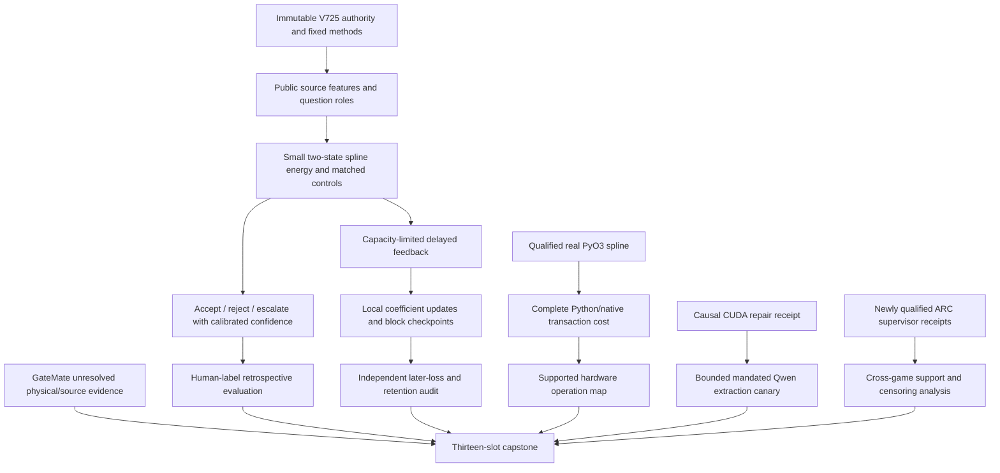
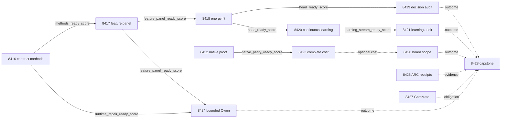

# Carnot Research Roadmap v725: Criterion-aware energy decisions and capacity-limited continuous learning

**Created:** 2026-10-11

**Milestone:** 2026.10.725

**Status:** Planned; not activated or executed

**Predecessor:** 2026.10.724, Exp8402–Exp8415

**Contract:** Exactly 13 tasks, Exp8416–Exp8428, in the order below.

**Execution plan:** `research-roadmap-next.yaml`

The milestone tests whether a small source-conditioned energy head can turn
existing judgments into better calibrated decisions against human factuality
labels. It then tests whether limited delayed feedback improves later decisions.
A separate branch measures complete native service cost. Independent factuality
and hidden-game claims remain open.

The V724 design is preserved byte-for-byte at
`openspec/change-proposals/research-roadmap-v724-preserved-20261011.md`.
Its SHA-256 is `04582ef7895085546a8107225e7887072b886be887aefa6dd7f03f3b2c9a6ab6`.
The active `research-roadmap.yaml` remains V724. Planning checks use a private
V725 activation copy. They must not require V724 active bytes to equal V725.

## What V724 proved and left unresolved

V724 completed fourteen scheduling slots: twelve producer primaries and two
pre-gate receipts. There were no cascade skips. Two producers were disqualified.
The completed-history archive still ended at V723 during planning. Current
producer artifacts, the Exp8415 capstone and conductor logs establish these facts.

| Evidence | Finding | Next step |
|---|---|---|
| Exp8402 | Current contract and direct/runtime consumer families qualified; independent historical V722 design remains absent | Preserve authentic V724 authority; do not reconstruct unavailable history |
| Exp8403 | 900 answers, 300 questions and a complete released factorial panel; all 300 questions have unknown older overlap | Use explicitly retrospective targets; do not claim unseen evaluation |
| Exp8404 | 33 process-death/recovery checks qualified, with no loss, duplication or mixed versions | Reuse direct durable state |
| Exp8405 | 473 real native calls; finite parity and type/coverage checks passed; unresolved informational `max_coefficient_error=0.0` disqualified publication | Repair only primitive-proof delivery to the existing typed consumer |
| Exp8406 | 5,301 coefficient changes, 666 completed rows, 198 excluded rows, exact resumed state; generalized benefit remains zero | Change the feedback-admission mechanism and target; preserve the old null |
| Exp8407 | Complete Python transactions measured: 27,360 work rows and 45,780 fsync calls | Compare native transactions under the identical work definition |
| Exp8408 and Exp8411 | Native timing and Qwen canary did not run because their gates failed | Admit each only after its concrete prerequisite changes |
| Exp8409 | Human-label criterion contrast = 0.46793587174348694 on the public release | Study calibration and error strata, not another aggregate replication |
| Exp8410 | Reader qualified; no causal CUDA repair or current context evidence | Accept supplied repair evidence; do not repeat the unchanged inventory |
| Exp8412 | Eight qualified episodes on two games; all eight carried censoring; no generalization benefit | Analyze actual supervisor events and support; do not repeat this panel |
| Exp8413 | Board reader failed five coverage statements and one historical consumer assertion | Fix these precise paths before using optional cost evidence |
| Exp8414–8415 | GateMate physical/source obligations remain blocked; capstone faithfully preserved branch outcomes | Keep bounded continuity and unconditional reconciliation |

V717/V721 H1=-0.00390625 and H2=0 remain closed on their original exposed
operands. Exp8381's dyadic-logit certificate is a separate circular arithmetic
result. Exp8259's PolarFire qualification is board-local Linux CPU dispatch.

## Three biggest gaps to the PRD vision

1. **Encoded consistency is not independently established factual truth
   (FR-12; research-program priority 1).** The criterion replication shows why
   reference support and factuality must remain separate. Exp8417–8419 test
   source features and calibrated decisions with human labels. This advances
   measurement quality, but does not close independent extraction truth.
2. **Durable updates do not establish useful continuous learning (FR-11).**
   Exact process recovery now works. Exp8420–8421 test changed feedback
   selection under a fixed pending-memory budget. Later loss, retention and
   real coefficient writes decide this new question. Old nulls stay intact.
3. **Native arithmetic parity is not complete deployment speed
   (FR-05/08; NFR-01).** Exp8422–8423 qualify native evidence and measure the
   complete durable request. Exp8426 maps supported operations and costs to
   actual hardware. No kernel-only or vendor number can close this gap.

## Research scan and method selection

The dated V725 entry in `research-references.md` was appended before this design.
It records all requested primary topics and secondary channels, including failed
Semantic Scholar citation-list retrieval, OpenReview's browser challenge and
stale GitHub trending snapshots. These limits do not imply an absence of papers.

| Source | Method adopted | Task |
|---|---|---|
| [Labeling Problem](https://arxiv.org/abs/2610.08026), October 2026 | Explicit human factuality target; distinguish criterion agreement from new verifier skill | 8417–8419 |
| [Detectability Gap](https://arxiv.org/html/2609.35860v1), September 2026 | Fix dataset/generator strata independently of detector scores; preserve paired questions | 8417, 8419 |
| [Online KAN](https://arxiv.org/abs/2602.02056), June 2026 revision | Existing local spline coefficients with explicit numerical and retention controls | 8418, 8420 |
| [Capacity-constrained delayed OCO](https://arxiv.org/html/2606.11711v1), June 2026 | Randomized feedback admission with explicit finite capacity and inclusion probabilities | 8420–8421 |
| [FPGA–ASIC Ising orchestration](https://arxiv.org/abs/2602.15985), September 2026 revision | Measure the whole request and its non-arithmetic work | 8423, 8426 |

EBT, ARM–EBM, structured verification, neural constraint certification, Ising
inference and energy-guided decoding remain context. Their results do not reopen
retired energy-as-generator or external-text reranking tracks. Extropic Z1T and
Kona remain vendor leads. The Rust StreamingKAN repository remains unaudited.
No new hardware purchase or third-party learner dependency is required.

## Architecture

The generator remains frozen. Public lexical features describe source/answer
agreement; they do not define truth. The small energy is normalized exactly over
two labels. The new block checkpoint includes issued predictions, coefficients, pending
labels and RNG state. The learner cannot use evaluator-only retention labels.

## Phase 1 — Freeze criteria and train small heads (Exp8416–8418)

Exp8416 binds full task objects and freezes `v725-methods-protocol.json`.
It ingests the selected papers. It inspects only an explicitly supplied causal
CUDA repair receipt; its absence zeros the canary gate without a device scan.
Missing V722 historical authority stays a separate unresolved record.

Exp8417 authenticates the existing 900-answer/300-question release. Sort question
hashes by SHA256(`v725:` + question_hash): first150 fit, next50 tune, last100 test.
All three generator answers and four prompt conditions stay with their question.
At least128/32/80 usable fit/tune/test questions are required, with eight questions
containing each class in tune/test. No reseeding follows class or outcome inspection.
This partition is retrospective. The unchanged independent-evaluation requirement
of 80 unexposed clusters and eight per class remains unmet.

The nine-input vector contains p2's probability of hallucination plus the eight
public source features from `evidence_features_7980.extract`. For released label1,
q=confidence; otherwise q=1-confidence. Clip q only to [0.0001,0.9999]. Preserve
extraction abstentions and source bytes. Generator identity is not a feature.

Exp8418 trains raw-p2, scalar-calibrated, nine-input logistic, nine-input spline
and source-permuted spline arms. The spline uses the shipped cubic basis and
sparse update code. Fix seeds17/29/43/71/101, 200 steps, rate0.01 and l2=0.001.
Choose temperature0.5/1/2 on tune log loss only. Freeze fitted bytes before test
scoring. Set E0=0 and E1=-logit; sigmoid equivalence is an arithmetic control.

## Phase 2 — Test decisions and continuous learning (Exp8419–8421)

Exp8419 seals predictions before its evaluator reads targets. Accept if p<=0.2,
reject if p>=0.8, otherwise escalate. Wrong decisions cost1; correct decisions
cost0; escalation costs0.2. The primary retrospective contrast is
Brier(logistic)-Brier(spline). Average seeds and answers within question before
10,000 cluster bootstrap draws, seed7258419. An exploratory positive needs a
positive lower95 percent bound and no increase in decision loss. Report all
controls, missing-data bounds, A2 sensitivity and predeclared strata. Valid nulls
are complete findings and do not gate the learning branch.

Exp8420 is continuous self-learning. Split the100 test questions into five ordered
blocks of20. At each block's start, admit C=8 primary or C=16 secondary question
IDs. FIFO selects the first C; uniform selects C without replacement. Admission
cannot see labels or outcomes. Predict all three sibling answers before release.
Release selected feedback only after the complete block's predictions are sealed.
Thus each arm has at most C pending clusters or3*C pending answer records.
Audit storage is separate from learner capacity. Uniform inclusion probability is
C/20; the experiment claims no transfer of the paper's regret theorem.

The four arms are frozen, FIFO updates, uniform updates and shuffled released
feedback. The shuffled control shares the uniform arm's admission IDs and uses
a separate deterministic RNG to permute only that completed block's labels.
Frozen records the same admissions for accounting but has zero coefficient writes.
Five seeds and two capacities produce4,000 question/arm/seed/capacity units and
12,000 intended answer rows. Missing rows remain visible. Only blocks1–4 enter
the primary later-loss contrast. Seed17/capacity8 additionally compares durable
uninterrupted execution with process exit after block2 and exact resume.
Retention uses the50 tune questions through a read-only evaluator at each boundary.

The old direct store supports five inputs,34 coefficients and sequential +8
feedback. It cannot accept the new nine-input109-coefficient head or block releases.
Exp8420 uses an isolated versioned block checkpoint, reusing only atomic JSON and
directory-sync primitives. Its own cold replay authenticates the complete causal
prefix and RNG/admission state. V724 recovery qualification is not inherited.

Exp8421 independently reconstructs every issued prediction and update. Its primary
contrast is Brier(FIFO)-Brier(uniform), with seed/answer averaging within question
and10,000 paired bootstrap draws, seed7258421. Its exploratory gate also requires
a positive conditional Brier-gain lower bound versus frozen, no decision-loss
increase versus frozen and retention's upper95 percent Brier
increase<=0.01. These intervals describe the exposed stream conditional on its
issued prediction histories; correlated adaptive trajectories do not become
independent deployments. Generalized learning benefit remains0. Report losses by
block and seed so uncertainty from stream dependence remains visible.

## Phase 3 — Native service and conditional live evidence (Exp8422–8425)

Exp8422 targets the exact informational perfect-error finding that disqualified
Exp8405. It delivers primitive coefficients and a rejected +0.125 perturbation
to the existing typed consumer. Preserve all4,564 intended panel operations and
31 exclusions. No validator rule, exemption, tolerance or kernel change is
permitted to obtain a pass. If the existing consumer cannot authenticate the
proof, report the remaining failure and leave native timing gated.

Exp8423 remeasures both Python and native transactions on seven prespecified
V724 cells. Use the existing five-input34-coefficient head and unchanged per-cell
work definition. Natural workload uses(batch,ratio)=(1,1),(1,8),(1,64),(8,8),(32,8).
Each other inherited workload uses(1,8). One warmup and five paired repeats yield
70 arm/cell/repeat summaries. Exp8407 needed2,808 seconds for one full-arm setup
and panel; duplicating all27 cells would exceed the4,800-second task cap. Reserve
1,200 seconds for validation/replay and bound measurement to3,000 seconds. Keep
censored cells if the deadline expires; never replace the planned denominator.
The primary cell is natural,batch1,ratio8. Each repeat has8 cycles,8*r prediction
attempts and8 designated feedback attempts. Labels have8 logical ticks of delay;
the timed tail drains remaining work without sleeps. Include copies, gathering,
updates, serialization, both fsync boundaries and response. Report equal-work
checks, complete speed ratios, tail costs and an Amdahl bound. A10x claim requires
a paired lower95 percent bound>10 in that stated cell only. This old service
measurement does not qualify the new109-coefficient V725 learner for native use.

Exp8424 requires a supplied, authenticated causal CUDA repair receipt. Revalidate
the same execution context before one context/copy probe and model load. Use
`unsloth/Qwen3.8-27B-GGUF`, local Q4_K_M, through CUDA-enabled llama.cpp. Four fit
questions receive original-reference and source-removed views: at most8 calls,
128 output tokens per call. Require exact copied evidence spans. This is
`model_bounded_generation` with a10-second execution floor, not full generation.
It cannot establish independent factuality or train the retrospective heads.
Use a600-second load timeout,180 seconds per request and900 seconds for validation.
A small fixed budget is bounded generation even if loading takes minutes.
Failure artifacts report actual execution: `blocked_no_run` before execution,
`model_load_no_generation` after a load without tokens, and
`model_bounded_generation` after actual generation. Keep all attempt counts. After actual model work, an owned execution failure
is disqualified with its measured class; it is not blocked precondition work.

Exp8425 uses Exp8412's new qualified live-wrapper receipts. It does not repeat the
eight-episode panel. Reduce censoring and per-arm shared support. Refinement needs
three overlapping adapter-withheld games and five firings per shared arm cell.
Inspect a supplied new frontier for at most60 seconds. No new game/model call is
scheduled. Missing support permits an honest no-change result under the ARC
supervisor-refinement floor. Incidental live level observations require
`solve_provenance`; existing registered solves receive zero new credit.

## Phase 4 — Hardware scope and evidence reconciliation (Exp8426–8428)

Exp8426 repairs the five uncovered board-reader statements and the original
historical CLI assertion using authentic immutable roots. Keep assertions intact.
Map optional native and existing Python costs onto actual supported operations.
KV260's quadratic Ising fabric does not implement the complete spline/fsync
service. PolarFire remains qualified only for Linux CPU dispatch. Run zero device
commands. A missing optional cost is absent, not a reason to invent a speedup.

Exp8427 is the required GateMate continuity record. Reuse exact missing hashes,
original IDCODE0xffffffff and the dated physical-change requirement. No new probe
runs. A supplied source recovery must match its historical hash. Reopening still
needs IDCODE0x20000001, n16 flash and real sample/hash smoke. Keep unchanged
external absence `blocked`, not retryable `partial`.

Exp8428 always runs. It accounts for all thirteen slots and replays eligible
branches in fresh workers. Use1,500 MiB peak and500 MiB growth bounds. Preserve
nulls, disqualifications and external blocks separately. Report stable G1–G4
publication gates without turning old FoVer readiness into V725 success.

## Dependency graph and producer fields

All solid arrows are conductor pre-gates using `== 1`. Every field appears
verbatim in the upstream prompt's REQUIRED ARTIFACT FIELDS. Every producer is
an earlier task in this roadmap. Dotted edges are optional evidence/reconciliation.

Numerical readiness does not require a positive scientific result. Contract
readiness does not require the optional CUDA repair. Historical Exp8404/8407
inputs are authenticated pinned artifacts, not `requires:` chains to retired
tasks. The capstone and hardware obligation readers have no pre-gates.

## Hardware and resource requirements

| Resource | Status and use | Requirement or acquisition condition |
|---|---|---|
| Host CPU and disk-backed RAM/scratch | Numeric heads, question grouping, causal replay and persistence timing | No purchase; check real free memory and disk before each task |
| Python/SciPy and Rust/PyO3 | Existing sparse head and native binding | Pin actual library/build hashes; no new learner dependency |
| 2×RTX3090,48GB nominal VRAM | Only the optional bounded Qwen canary | Inventory is not availability; require causal CUDA repair and actual offload |
| Qwen3.8-27B GGUF cache | Mandated model, approximately16GB historical cache entry | Resolve actual local Q4_K_M path/hash; no silent alternate model |
| KV260 | Quadratic Ising POC, k_max<=5, SSH/xmutil route | No bitstream redesign; compatible operation and complete transfer clocks precede speed claims |
| PolarFire | Terminal board-local CPU dispatch | Preserve scope; no fabric claim |
| GateMate | Physical/source evidence unresolved | Dated cable/port/power change plus IDCODE,flash and smoke evidence |
| APU/NPU/TSU | Portability/future hardware in wishlist | Qualify runtime and supported kernel first; vendor estimates are not local timings |

Continuous learning has a hardware path: bounded CPU counters and sparse
coefficient writes now; compiled Rust for deployment; fixed-point local spline
updates as a future FPGA option. Neither sub-microsecond nor100x speed is assumed.
Measured arithmetic fractions decide whether further acceleration can matter.

## Validation, runtime discipline and reconciliation

Each task starts with preconditions and prints flushed progress at phase edges,
before/after long calls, inside loops and while polling children at most60 seconds
apart. Every output gap stays below600 seconds. Split files over about200 lines
across several tool calls with intervening progress messages. Bound child work
inside the4,800-second cap. No duration padding is permitted.

Use spec-first, tests-first development. Each task owns a thin runner and
result JSON, with primitive rows under its matching `results/raw/` directory.
Require scoped unit coverage, Ruff, strict mypy, spec coverage and the named
private E2E checks. Preserve existing assertions and validators. Capture genuine
child coverage. Keep full repository health separate from task qualification.

All artifacts declare `verdict_class`, `gate_check_summary`, inference class,
model provenance, per-unit rows, checks, hashes and field principles. Oracle
results use `circular_positive`. Exposed results keep generalization scores zero.
Only the canary loads an LLM; other tasks use `no_model_load` and `MODEL_SPECS: []`.
Full generation's60-second floor and load-only's2-second floor are not canary classes.

Retired-scope continuations name prior verdicts, actual differences and mandatory
`retire_if_same_verdict: true`. Standing overrides are limited to authorized
routine transitions, mandatory hardware continuity and stated changed methods.
The old .111 scope-reduction work remains completed; its retired tracks stay closed.

Update relevant OpenSpec records, `_bmad/traceability.md`, `ops/status.md` and
`ops/changelog.md` after execution. This plan does not execute experiments,
activate V725, alter the conductor, push commits or publish externally.
