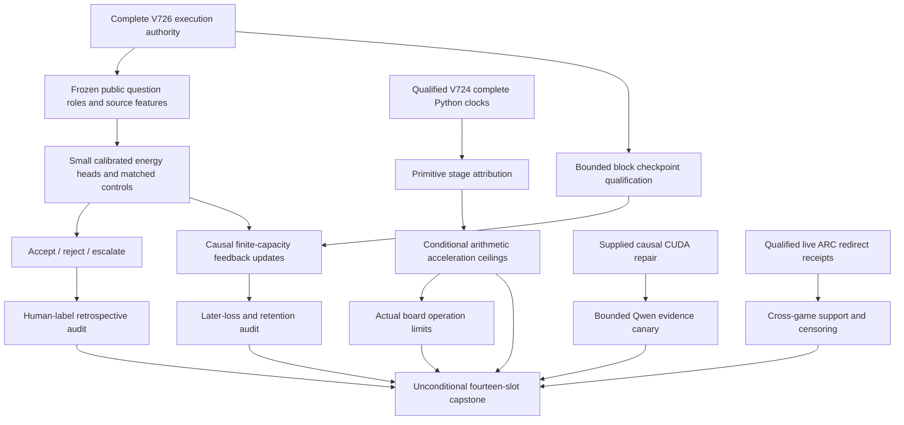
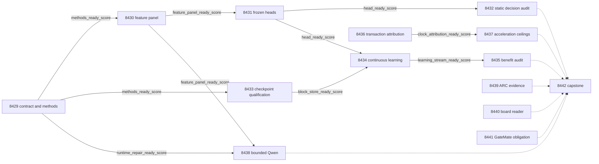

# Carnot Research Roadmap v726: Executable calibrated decisions, bounded continuous learning, and complete service cost

**Created:** 2026-10-11

**Milestone:** 2026.10.726

**Status:** Planned; execution and activation remain pending.

**Predecessor:** 2026.10.725, four activated tasks, Exp8416–Exp8419.

**Contract:** Exactly 14 tasks, Exp8429–Exp8442, in the order in the exact contract below.

**Execution plan:** `research-roadmap-next.yaml`

This milestone measures the human-label calibration and feedback questions that
V725 never executed. It separates checkpoint qualification from learning.
It also tests whether faster arithmetic can materially improve the complete service.

The V725 document is preserved byte-for-byte at
`openspec/change-proposals/research-roadmap-v725-preserved-20261011.md`.
Its SHA-256 is `37803440c884cd8385be61a8d2068135da856008a5676bf3cc513abcae1bfbf5`.
The active V725 YAML and conductor source remain unchanged. Exp8420–Exp8428
were promised in that old document but never queued. Their identifiers remain
reserved for historical clarity; the new sequence begins after the promised range.

## What V725 proved and what it did not execute

The completed-history archive currently ends at V724. Actual V725 producer
bytes and `ops/conductor-log.md` establish the following execution outcomes.
Completion of scheduling does not imply completion of the proposed science.

| Evidence | Observed result | Consequence |
|---|---|---|
| Active V725 YAML | Four tasks; design claimed thirteen | Nine proposed tasks never reached the queue |
| Exp8416 | `complete_blocked_v725_contract_methods`; `methods_ready_score=0` | Missing full-object table/digest and count mismatch correctly stopped methods |
| Exp8417 | `blocked_gate_check_failed` pre-gate receipt | Feature producer did not execute |
| Exp8418–Exp8419 | Conductor `GATE_BLOCK` cascade skips; producer primaries absent | No fitted head or decision audit exists |
| V725 protocol | Frozen question roles, methods and feedback definitions exist | Preserve scientific definitions while replacing broken execution authority |
| Optional CUDA evidence | No supplied causal repair receipt | No current Qwen result; only a conditional canary is justified |

V725 established an honest refusal and preserved a protocol. It proved no
calibration gain, learning gain, hardware speedup or ARC improvement.
The contract repair is completed and checked during planning, before the first
future experiment. Exp8429 rechecks actual activation rather than repairing a
mismatch after it has already consumed the milestone.

V724 remains the scientific starting point. Exp8404 qualified direct durable
state. Exp8406 measured actual coefficient changes but retained the old learning
null. Exp8407 measured complete Python transactions. Exp8409 reproduced a
retrospective criterion contrast of 0.46793587174348694 on public human labels.
The release contains 900 answers in 300 question clusters with unknown older
exposure. V717/V721 H1=-0.00390625 and H2=0 remain closed.

Exp8405's finite native parity proof remains disqualified. Source inspection
finds a concrete incompatibility: `v718_replay_history.consume` resolves only
`dense_sparse_error_max`, while this artifact reports `max_coefficient_error`.
Passing its existing proof again cannot fix that mismatch. This plan drops the
native retry and leaves the guard unchanged. Exp8436–Exp8437 ask whether native
arithmetic acceleration could matter under the existing complete-service boundary.

Exp8412 has qualified eight-episode evidence from two exposed ARC games, with
censoring. It cannot establish hidden-game transfer. Exp8413 still needs measured
coverage and its original historical consumer assertion. GateMate retains its
physical/source evidence obligation. PolarFire qualification remains Linux CPU dispatch.

## Three biggest gaps to the PRD vision

1. **Independently correct verification (FR-12).** Constraint consistency and
   reference agreement do not prove factual truth. Exp8430–Exp8432 test calibrated
   source-conditioned decisions against human labels. This is a retrospective
   measurement step; independent current-Qwen factuality remains open.
2. **Useful continuous self-learning (FR-11).** Durable coefficient changes
   do not establish better later decisions. Exp8433–Exp8435 test finite feedback
   admission, causal local updates and retention with a separately qualified store.
   This advances Tier 1 and bounded Tier 2 state, without generator training.
3. **A complete fast service (FR-05/08; NFR-01).** Native kernel parity does
   not establish tenfold request throughput. Exp8436–Exp8437 measure the arithmetic
   fraction from qualified complete clocks. Exp8440 maps this bound to actual
   board operations. A negative bound can stop an ineffective acceleration path.

The ARC supervisor study supports the live hidden-game discovery north star.
It preserves the distinction between an execution oracle and an independently
useful learned verifier. None of these studies automatically closes that latter gap.

## Research scan and selected methods

The V726 entry in `research-references.md` was appended before this design.
It covers the eight requested arXiv topics and all secondary channels.
Semantic Scholar citation lists were inaccessible; OpenReview imposed a browser
challenge. GitHub Trending returned four-week-old snapshots. These are coverage limits.

| Source | Adopted method | Tasks and limitation |
|---|---|---|
| [Labeling Problem](https://arxiv.org/abs/2610.08026), October 2026 | Explicit human factuality target and question clusters | Exp8430–Exp8432; public labels remain exposed |
| [Detectability Gap](https://arxiv.org/abs/2609.35860), September 2026 | Freeze strata without detector-outcome selection | Exp8430, Exp8432; no agreement-defined circular subgroup |
| [Online KAN](https://arxiv.org/abs/2602.02056), June 2026 revision | Sparse local spline updates | Exp8431, Exp8433–Exp8435; no imported FPGA speed claim |
| [Capacity-constrained delayed OCO](https://arxiv.org/html/2606.11711v1), June 2026 | Finite tracking and randomized admission | Exp8434–Exp8435; block ablation, not the paper's scheduler or regret theorem |
| [FPGA–ASIC co-design](https://arxiv.org/abs/2602.15985), September 2026 revision | Include orchestration and transfers in cost | Exp8436–Exp8437, Exp8440; no inferred kernel support |
| [HalluScoring 2026](https://arxiv.org/abs/2609.38355), September 2026 | Separate unseen-question and unseen-generator axes | Filed future corpus lead; no new Arabic benchmark in this milestone |

EBT, ARM–EBM, neural constraint certification and energy-guided decoding remain
context. They do not reopen retired generator or external-text ranking tracks.
Extropic Z1T and Kona remain vendor leads. No new hardware or learner dependency
is needed. The new corpus lead cannot justify changing the frozen test partition.

## Architecture



The generator remains frozen. The two-label energy normalizes exactly.
A source feature is evidence of agreement, not a truth oracle. The learner
sees only released admitted labels. Independent evaluator storage cannot feed
retention or unselected targets back into updates.

## Phase 1 — Executable authority and frozen human-label heads

**Exp8429–Exp8431 (three tasks).** Exp8429 authenticates all fourteen tasks
against the visible table, embedded full task objects, canonical digest and
activated YAML. Planning-time simulation is not an activation receipt. It writes
`openspec/change-proposals/v726-methods-protocol.json` before fitting. The V725
protocol is preserved. Allowed clarifications are the tune permutation seed 7252,
explicit block transaction/update order and a simultaneous retention bound.
The deployment question changes from native proof reuse to complete-clock attribution.

Exp8430 retains the frozen `v725:` question hash ordering: 150 fit, 50 tune,
100 test question groups, each with three generator answers. There are 900
intended answers. The baseline is released GPT-5-mini p2 hallucination probability,
clipped to [0.0001, 0.9999]; eight source features produce nine inputs. Generator
identity is a reporting stratum, not a predictor. Missing values remain unknown.
Support gates require 128/32/80 usable fit/tune/test groups and eight question clusters
per target class in tune and test. Evaluator targets remain separate from fitting.

Exp8431 compares raw p2, scalar calibration, nine-input logistic, nine-input
spline and source-permuted spline. The sparse cubic head has 109 coefficients.
Use E(0)=0 and E(1)=-eta/T with exact binary normalization. Fit 200 full-batch
steps at rate 0.01 and L2=0.001. Choose T from {0.5,1,2} by tune log loss;
ties prefer 1, then the smaller value. Retain seeds {17,29,43,71,101}; deterministic
identical heads are duplicates, not independent replications. Permute all eight
source features together at question level within dataset, matching generator
slots, with seeds 725/7252/7251 for fit/tune/test respectively. Keep q and labels
fixed. No test-outcome selection or post-hoc threshold search is allowed.

**Exit:** authenticated protocol, qualified feature panel and frozen fitted bytes.
Failure of the fit chain does not block independent complete-clock, ARC or board readers.

## Phase 2 — Retrospective decisions and continuous self-learning

**Exp8432–Exp8435 (four tasks).** Exp8432 issues and seals all 300 intended test
predictions before evaluator target access. Accept when p<=0.2, reject when
p>=0.8, otherwise escalate. Decision loss is 1 for a wrong accept/reject, 0 for a
correct decision and 0.2 for escalation. Report Brier, log loss, coverage,
false accepts and selective risk. A1 is primary; A2 is a sensitivity on its observed
subset. Keep missing cases in intended denominators with worst-case bounds.

The registered static contrast is Brier(logistic9)-Brier(spline9). Average seeds
and siblings within question; use 10,000 paired question bootstrap draws,
seed 7258419. Exploratory benefit requires a positive lower 95% bound and no
increase in decision loss. Strata and controls remain visible. This exposed
retrospective evaluation cannot establish independently correct current-Qwen facts.

Exp8433 qualifies a separate nine-input checkpoint before any human-label stream.
The old five-input/34-coefficient store does not qualify the new state shape.
Each block has two durable transactions: seal predictions and admissions before
feedback release; then commit all released updates and the next cursor together.
Intermediate updates are tentative. Recovery checks committed phase/version.
Replay only from a sealed-prediction checkpoint; an already committed updated
block advances without reapplying labels. Stable acknowledgment IDs make repeated
delivery idempotent, including a crash after commit but before delivery. State includes coefficients/decay scale,
scaler/temperature hashes, prediction IDs/hashes, cursor, admission IDs, pending
records, applied-feedback IDs and both RNG states. Exercise real child exits at
all four publication boundaries in both transaction types and after block 2,
with independent basis/update controls and rehashed corruption tests.

Exp8434 is the required continuous self-learning experiment. Use the original
five ordered blocks of 20 test questions, capacities C=8 primary and C=16 secondary,
and all five seeds. Compare frozen, FIFO updates, uniform updates and shuffled
released-feedback updates. FIFO admits the first C questions; uniform chooses C
without replacement before targets are visible, with inclusion probability C/20.
Seal all 60 sibling predictions in a block before releasing admitted labels.
Learner pending capacity is C clusters or 3*C answer records. Audit storage is
separate. Update selected questions in original block order and siblings in
release order, with one sparse log-loss step per valid label at rate 0.01 and
L2=0.001. Keep scaler and temperature fixed. Do not importance-weight this
block-admission ablation or attribute the cited paper's regret guarantee to it.

Emit 12,000 intended answer/arm/seed/capacity rows and 4,000 question units.
Measure later losses on blocks 1–4. Evaluate 50 tune questions at each boundary
through a read-only retention evaluator. Seed 17/C=8 also gets real exit after
block 2 and exact restart comparisons for all arms. Parameter changes, crash
recovery and learning benefit are three separate results.

Exp8435 independently reconstructs the primary capacity-8 contrast
Brier(FIFO)-Brier(uniform), averaging siblings and seeds within question.
Use 10,000 question resamples, seed 7258421. Adaptive histories are dependent:
this interval describes the exposed issued histories, not population generalization.
Exploratory benefit needs positive lower bounds for both the primary contrast
and uniform versus frozen, no decision-loss increase versus frozen, and a
simultaneous upper 95% retention Brier increase <=0.01. Use identical retention
question resamples across all five windows and their maximum increase in each
draw. Show every capacity, block, seed, control and missing-data bound.

**Exit:** reproducible issued histories and an honest measured benefit/null.
A scientific null is informative. The existing guard can flag a legitimate
zero `decision_loss_delta`; do not rename or hide the field to evade it.
Exp8429 exercises a private compatibility control before fitting. If unchanged
typed consumers cannot qualify valid zero evidence, preserve the scientific null
and separately report administrative disqualification. The decision audit is
not a prerequisite for the independent checkpoint/learning chain.

## Phase 3 — Complete service cost and a conditional Qwen canary

**Exp8436–Exp8438 (three tasks).** Exp8436 attributes Exp8407's qualified Python
complete clocks: 27 cells, five repeats, 135 repeat summaries containing the actual transactions. T includes
initialization, gaps and response tail. Partition disjoint arithmetic scoring and
coefficient updates as K, with conversion separately attributed. Preserve actual
composite pointer-publication spans rather than inventing unmeasured syscall
splits. Reproduce the native metric/consumer mismatch privately; no validator
change, exemption or native speed claim is part of this task.

Exp8437 reports conditional acceleration ceilings from those primitive timings:

`S(a) = T / (T - K + K/a)` for a in {1,10,100,infinity}.

The primary cell is natural batch 1/reuse 8; the other 26 cells are secondary.
Also report the sensitivity that accelerates conversion along with K. For each
of 10,000 paired repeat resamples (seed 7268437), use identical repeat indices
and the pooled ratio `sum(T)/(sum(T)-sum(K)+sum(K)/a)`. At a=infinity, 1/a=0.
If K=T, finite speedup equals a; only the infinite-a ceiling is infinite.
Arithmetic alone needs K/T>=0.9 to permit 10x. The additional nonkernel time
that would have to disappear, as a fraction of original total time, is
`max(0,0.9-K/T)` with infinite arithmetic acceleration. Five host repeats give
conditional host uncertainty; they do not establish a hardware deployment gain.
`actual_native_speedup` remains null.

Exp8438 runs only if Exp8429 authenticates a supplied causal CUDA repair receipt
and Exp8430 has a qualified panel. No unchanged-context repair probing is allowed.
Load cached `unsloth/Qwen3.8-27B-GGUF` Q4_K_M with actual CUDA offload, then use
four fit questions, first generator sibling, original-reference and source-removed
views: eight fixed calls, at most 128 generated tokens each, temperature 0.
Request a source evidence span or abstention. This is a bounded execution canary,
not a current-Qwen accuracy benchmark. Use `model_bounded_generation` (10s floor)
only if generation actually occurs; load-only is 2s and no-run remains no-run.
Never pad elapsed time. Limit load to 600s, each call to 180s and measurement to
2400s. Oracle span success is circular_positive and cannot headline factuality.
A missing repair receipt blocks only this optional task.

**Exit:** complete cost attribution, falsifiable acceleration bounds and, only
with changed runtime evidence, a correctly classified local-model canary.

## Phase 4 — Live-path support, physical obligations and synthesis

**Exp8439–Exp8442 (four tasks).** Exp8439 reduces Exp8412's existing eight ARC
episodes instead of rerunning exposed games. Reconstruct censoring and shared
support by arm. A new supplied frontier is read for at most 60 seconds. Any
future policy refinement needs at least three overlapping adapter-withheld games
and five resolved firings per shared arm cell. Otherwise leave policy unchanged.
Record the solve registry precheck and provenance; no duplicate level credit,
hand-RE solve, LLM invocation or hidden-game generalization claim is planned.

Exp8440 qualifies the existing board reader using the actual Exp8413 defects:
five uncovered statements (boundary module line 211 and runner lines 59–62)
and the historical `test_board_operation_boundary_8399.py` reader-receipt
assertion. Test the existing `bound_popen` historical-root adapter first.
Preserve original tests, guards, thresholds and historical source bytes. Map
qualified complete costs to actual KV260 quadratic operations, k_max<=5,
and PolarFire board-local Linux CPU dispatch. Optional Exp8437 bounds may be
cited with their hashes; missing optional bounds do not block reader qualification.
This task performs no board SSH, flashing or device probes.

Exp8441 preserves GateMate's IDCODE=0xffffffff and missing-source evidence
obligation. It reads newly supplied evidence for at most 60 seconds and performs
zero device commands. Reopening requires a dated physical change, IDCODE
0x20000001, n16 flash and a real device sample with its artifact/source hashes.
Absent changed evidence is a terminal blocked outcome, recorded once.

Exp8442 synthesizes every one of the fourteen slots, including its own as the
current synthesis slot rather than a required upstream artifact. Distinguish
producer results, pre-gate receipts, cascade skips, absent bytes and disqualified
claims. Use bounded cold workers (1500 MiB peak, 500 MiB growth); never load an
unbounded history chain. Publication G1–G4 remain separate long-term gates.
Report retirement recommendations; do not silently edit the exclusion manifest.
External absence is blocked, not retryable partial. Preserve old nulls and state
precisely which independent evidence could justify the next scientific step.

## Dependency graph and gate contract

All structured gates use `== 1`. Every named field is declared in its producer's
REQUIRED ARTIFACT FIELDS. All producer tasks occur earlier in this plan.



Solid edges are the ten conductor gates. Dashed edges are evidence imports,
not favorable-result gates. Exp8436 and Exp8439–Exp8442 have no structured
prerequisite gate. Their prompts require honest handling of missing inputs.
No `requires:` chain points to retired work. Historical reads are evidence,
not requests to reactivate retired experiments.

## Hardware, runtime and execution requirements

| Resource | Planned use | Admission and limit |
|---|---|---|
| Existing Ryzen AI 9 HX 370 host CPU and disk-backed scratch | All fitting, learning, audits and readers | Inspect free memory/storage at task start; stream primitive rows; bounded children; no new purchase |
| Two existing RTX 3090s, cached Qwen3.8 27B Q4_K_M | Exp8438 only | Supplied changed-runtime receipt, one context/copy check, actual CUDA offload; no guarantee both devices are needed or usable |
| KV260 | Exp8440 operation mapping | Existing quadratic k_max<=5 evidence; no assumed arbitrary spline/109-coefficient kernel |
| PolarFire | Exp8440 preserved graduation | Board-local Linux CPU only; no FPGA fabric performance claim |
| GateMate | Exp8441 physical-change obligation | No device command until an independently supplied changed state supports reopening |
| Ryzen NPU, ROCm eGPU, Extropic TSU | Future possibilities | No current milestone dependency or purchased hardware assumption |

No hardware is required beyond existing CPU/storage for the main scientific
chain. The conditional canary is the only LLM task. All other MODEL_SPECS are
empty and their substrate is `no_model_load`; imported historical model outputs
remain explicitly cached evidence. No legacy small model produces a headline.
The bounded canary's declared 10s floor is distinct from full generation's 60s
and load-only's 2s. Duration measures actual work without padding.

The conductor executes the fourteen tasks in table order. Estimates are planning
budgets, not minimum runtime claims. Every prompt requires a flushed start,
phase boundaries, before/after long calls and progress inside long loops. Poll
children at most every 60s, keep all gaps below 600s, and reserve 900s of the
4800s task cap for validation. Files over about 200 lines are written in calls
of about 150 lines with progress between calls. No one huge synthesis/write call.

Routing follows this request's explicit current instructions. Formulaic feature
and checkpoint code uses Codex `gpt-6.1-sol`; authority/schema and hardware work
uses explicit Claude Opus with 100 turns. Routine science keeps the default
Claude/Sonnet route. Simple readers use 20–30 turns. No Luna task is present.
Older repository defaults do not override this request; runtime routing must
be recorded honestly if the conductor selects a different backend.

## Qualification, retirement and acceptance

Every task records per-unit rows, a closed verdict_class, free-text honest_verdict,
substrate, actual invocations, missing/censored denominators, raw hashes and
field principles. A blocked result includes gate_check_summary with the exact
check and observed value. Unknown is distinct from zero. Oracle positives use
circular_positive; exposed retrospective outcomes keep independent/generalized
benefit scores zero. Own unfinished retryable work alone uses partial.

Complete prior_failures entries name actual producer verdicts, the changed
mechanism/prerequisite and retire_if_same_verdict=true. Exp8418/Exp8419 have no
producer verdict: their entries explicitly identify the conductor's GATE_BLOCK
outcome rather than inventing an honest_verdict. Same-verdict outcomes retire
the exact repeated attempt; old scientific nulls are never silently reopened.
The old V725 nine unqueued identifiers remain reserved.

Success for planning means fourteen complete task objects agree in the visible
table, embedded JSON, staged YAML and canonical digest, with ten valid forward
execution dependencies, resolvable existing paths and all prompt obligations.
Success for execution means qualified, replayable evidence with accurate
benefit/null/blocked boundaries; it does not require a favorable scientific result.
Unknown/warning/critical guard findings block affected readiness. Validators,
exemptions, acceptance thresholds and original historical bytes are preserved.

Each implementation experiment must update its relevant spec before code,
write focused failing tests, then verify owned unit/CLI/failure paths. Scoped
Ruff, formatting, strict mypy, spec-reference checks and genuine child coverage
are required. Private E2E-018 covers authority/publication; E2E-020/021 additionally
cover checkpoint, causality and cold replay where named. Historical results are
never overwritten merely to exercise an E2E command. Reconcile specs, traceability,
status and changelog after each real result.

## Planning validation

Validation ran on 2026-10-11. This is a documentation/queue change; no production
implementation or experimental measurement ran. Logs and private fixtures are
under `/tmp/carnot-v726-planning/`, with pytest scratch under
`/var/tmp/carnot-v726-planning-pytest/`.

| Check | Actual result |
|---|---|
| `scripts.roadmap_schema.Roadmap.model_validate` | Pass, 14 complete tasks in four phases |
| Existing `roadmap_contract` and `v685_authority_lifecycle` readers | Pass, visible table/full JSON/YAML/digest equality; matching private activation accepted |
| Direct V726 authority controls | 12 mutations rejected: drop, reorder, prompt, model, substrate, gate, routing, retirement flag/explanation, deliverable, turn budget and per-unit flag |
| Active V725 as a V726 authority | Correctly rejected; actual active bytes unchanged |
| Prompt/path checks | Pass, 189 existing-path references; every numbered progress, write-size, model, field and ending obligation present |
| `scripts/audit_roadmap_gates.py research-roadmap-next.yaml` | Pass, 14 prior-failure checks, 10 gate cross-references, no model/routing failures or Luna tasks |
| `scripts/exclusion_manifest_lint.py research-roadmap-next.yaml` | Clean; no activation refusal or warning |
| Harness fit, ARC floor, overdue-priority lint | Pass; ARC public-solving floor is retired and its generalization check is advisory |
| Focused pytest / private E2E-018 | 125 passed in 24.35s, including real private CLI publication and tamper rejection |
| Ruff check of six reused planning/authority modules | Pass |
| Ruff format check of the same unchanged modules | Existing failures in `scripts/audit_roadmap_gates.py` and `scripts/exclusion_manifest_lint.py`; other four pass |
| Strict mypy on `roadmap_contract.py` and `v685_authority_lifecycle.py` | Pass; no issues in two source files |
| Scoped spec references for five authority/schema/gate/ARC test files | Pass |
| Broader six-file spec check, including priority lint tests | 20 existing missing references, all in unchanged `tests/python/test_overdue_priority_lint.py` |
| Global spec-reference audit | 1,142 existing missing references; no new test files or references introduced |
| Protected inputs | Active roadmap, conductor and exclusion manifest hashes unchanged; preserved V725 design hash verified |

The focused command was:

```bash
PYTHONPATH=python:. PYTHONUNBUFFERED=1 .venv/bin/python -m pytest -n 0 -o addopts= --no-cov -q \
  tests/python/test_roadmap_schema.py tests/python/test_exclusion_manifest_lint.py \
  tests/python/test_audit_roadmap_gates.py tests/python/test_arc_levelup_guarantee_lint.py \
  tests/python/test_overdue_priority_lint.py tests/python/test_experiment_7891_v685_authority_lifecycle.py \
  --basetemp=/var/tmp/carnot-v726-planning-pytest
```

Applicable E2E-018 is exercised through its private real-CLI fixtures. The
historical production experiment command was not rerun against current authority
or published outputs. E2E-020/021 are required for the future implementation tasks
that name them; staging a plan cannot qualify those new implementations.
The full repository test suite was not run. Existing formatting and traceability
debt is recorded, not silently repaired in this planning change.
The actual active V725 roadmap is intentionally not a matching V726 authority.
Private activation simulation uses its own active copy; it cannot activate a milestone.

## Exact task contract

Exactly **14 tasks, Exp8429 through Exp8442**, in conductor execution order.
The JSON below contains every complete YAML task object, including prompts,
routing, prior failures and gates. The digest covers the full list with sorted
keys, compact JSON separators and UTF-8, matching the existing authority reader.

| Order | ID | Title | Phase | Deliverable |
|---|---|---|---|---|
| 1 | exp8429-contract-methods | Bind fourteen executable tasks and preserve the unmeasured scientific protocol | 1 | `results/experiment_8429_v726_contract_methods.json` |
| 2 | exp8430-criterion-feature-panel | Build the frozen question-grouped source-feature panel | 1 | `results/experiment_8430_v726_criterion_feature_panel.json` |
| 3 | exp8431-criterion-energy-fit | Train calibrated source energies with matched-information controls | 1 | `results/experiment_8431_v726_criterion_energy_fit.json` |
| 4 | exp8432-criterion-decision-audit | Measure retrospective typed decisions against released human factuality | 2 | `results/experiment_8432_v726_criterion_decision_audit.json` |
| 5 | exp8433-block-checkpoint-qualification | Qualify bounded feedback checkpoints before continuous learning | 2 | `results/experiment_8433_v726_block_checkpoint_qualification.json` |
| 6 | exp8434-capacity-online-learning | Measure continuous sparse learning under bounded delayed feedback | 2 | `results/experiment_8434_v726_capacity_online_learning.json` |
| 7 | exp8435-capacity-benefit-audit | Audit later decision loss retention and feedback-selection benefit | 2 | `results/experiment_8435_v726_capacity_benefit_audit.json` |
| 8 | exp8436-transaction-attribution | Reconstruct complete service clocks and isolate the native proof mismatch | 3 | `results/experiment_8436_v726_transaction_attribution.json` |
| 9 | exp8437-acceleration-ceiling | Test whether arithmetic acceleration can meet the complete-service target | 3 | `results/experiment_8437_v726_acceleration_ceiling.json` |
| 10 | exp8438-bounded-qwen-evidence | Run a bounded Qwen source-evidence canary only after a causal runtime repair | 3 | `results/experiment_8438_v726_bounded_qwen_evidence.json` |
| 11 | exp8439-arc-supervisor-support | Measure cross-game supervisor support and censoring from qualified live receipts | 4 | `results/experiment_8439_v726_arc_supervisor_support.json` |
| 12 | exp8440-board-reader-qualification | Qualify KV260 operation evidence and preserve PolarFire deployment limits | 4 | `results/experiment_8440_v726_board_reader_qualification.json` |
| 13 | exp8441-gatemate-obligation | Carry the exact GateMate reopening obligation without repeating the physical probe | 4 | `results/experiment_8441_v726_gatemate_obligation.json` |
| 14 | exp8442-capstone | Reconcile fourteen outcomes and decide which scientific claims earned continuation | 4 | `results/experiment_8442_v726_capstone.json` |

Canonical full-task SHA-256: `72f4cca447651e88180fd3196f947615d653b04cc7280ff8f12fd8f5eaedaa88`

<!-- V726_TASK_CONTRACT_START -->
```json
{
  "milestone": "2026.10.726",
  "tasks": [
    {"MODEL_SPECS": [], "agent_type": "claude", "deliverable": "results/experiment_8429_v726_contract_methods.json", "estimated_wall_time_min": 45, "gated_on": [], "id": "exp8429-contract-methods", "inference_substrate_class": "no_model_load", "max_turns": 100, "milestone": "2026.10.726", "model": "opus", "operator_override": "Standing operator directive 2026-05-29: routine milestone transition matching exp7992/exp8318; V726 repairs the measured V725 four-versus-thirteen contract failure before experiments.", "per_unit_rows": true, "phase": 1, "prior_failures": [{"addressed_by": "V725 lacked nine tasks, a visible machine table and digest. V726 supplies fourteen complete objects and validates mutated activation copies before execution; science parameters stay frozen.", "experiment_id": "exp8416-contract-methods", "retire_if_same_verdict": true, "verdict": "complete_blocked_v725_contract_methods"}, {"addressed_by": "Use independently preserved V724/V725 roots. Missing V722 authority cannot become a global dependency.", "experiment_id": "exp8402-historical-consumer-roots", "retire_if_same_verdict": true, "verdict": "complete_blocked_historical_consumer_roots"}, {"addressed_by": "Read only a supplied new causal repair receipt; do not repeat unchanged device inventory.", "experiment_id": "exp8410-cuda-reader-qualification", "retire_if_same_verdict": true, "verdict": "complete_blocked_cuda_reader_qualification"}], "priority": "high", "prompt": "CONTEXT:\nWork in {project_root} on {date}. V725 activated only four tasks although its design promised thirteen. Exp8416 correctly reported methods_ready_score=0. Exp8417 was pre-gated; Exp8418/8419 were cascade-blocked. No V725 calibration or learning result exists. V724 qualified direct durable state and Python costs. Native proof and board readers still have named validation defects. Public human labels cover 900 answers in 300 question clusters; old overlap is unknown. V717 H1=-0.00390625 and H2=0 stay closed. This milestone tests the unmeasured retrospective criterion and feedback hypotheses. Public-label results cannot establish independent factuality, current-Qwen skill or hidden-game generalization. Preserve all old artifacts and protocols.\nEXISTING CODE TO READ FIRST:\nCLAUDE.md; CODEX.md; ops/e2e-test-plan.md; ops/exclusion_manifest.yaml; openspec/capabilities/research-reporting/spec.md; openspec/capabilities/verification/spec.md; scripts/experiment_template.py; python/carnot/reporting/primary_publication.py; openspec/change-proposals/research-roadmap-vNEXT.md; python/carnot/reporting/v725_contract_methods.py; python/carnot/reporting/v685_authority_lifecycle.py; python/carnot/reporting/roadmap_contract.py; openspec/change-proposals/v725-methods-protocol.json; results/experiment_8416_v725_contract_methods.json; python/carnot/verify/cuda_reader_8410.py\nTASK:\nBind fourteen executable tasks and preserve the unmeasured scientific protocol. Deliver results/experiment_8429_v726_contract_methods.json. Create thin runner scripts/experiments/experiment_8429_v726_contract_methods.py. Store primitive evidence under results/raw/experiment_8429_v726_contract_methods/. Paths produced by earlier V726 tasks are future dependencies, not existing code.\nCONCRETE STEPS:\n1. PRECONDITIONS: Print a flushed start line. Authenticate this task against the activated V726 authority and the full design. Check named inputs and hashes, disk-backed private scratch, tools, free memory and deadlines before work. Treat only this task's real dependencies as required. Missing optional CUDA, board or historical V722 evidence cannot block independent CPU work. Record unavailable required inputs in gate_check_summary; never invent observations.\n2. Print a flushed progress line at each phase boundary and before and after every model load, generation, benchmark and subprocess that can take minutes. Print completed/pending counts inside long loops. Poll owned children at most every 60 seconds and emit actual status. Keep every output gap below 600 seconds, including synthesis. Use unbuffered output. Write any file over about 200 lines in several tool calls of at most about 150 lines, with a progress message between calls. Keep each tool call bounded; never compose one huge file call. Bound work within 4800 seconds, reserve at least 900 seconds for validation, and never pad duration.\n3. Spec first: add relevant REQ-* and SCENARIO-* before implementation. Write focused failing tests first. Reuse shipped modules through narrow adapters; preserve original assertions, numeric thresholds and historical bytes. Put runners in scripts/experiments/, tests in tests/python/, and temporary work outside the repo root. Accept --date {date}. Do not modify research-roadmap.yaml. Do not change generator weights or publish externally.\n4. Declare inference_substrate_class=no_model_load and MODEL_SPECS=[]. Record zero current LLM invocations. Use aggregation_from_upstream_artifacts for readers and verifier_ensemble_against_cached_candidates for numeric learning. Imported model names belong in historical_model_provenance. Cached outputs are not current Qwen inference.\n5. Use assess_authorities with milestone2026.10.726, first_id8429 and count14. Compare all complete task objects, visible table order and canonical digest, including prompts, routing, gates and prior_failures. Snapshot actual active, staged and design bytes. Do not manufacture missing authority or require the previous active milestone to match before activation. Test deletion, reorder and changes to prompt, field, model and retirement flag. Run private E2E-018.\n6. Freeze openspec/change-proposals/v726-methods-protocol.json and docs/research-notes/v726-methods.md before data fitting. Current deployment experiments use primitive attribution and conditional acceleration ceilings instead of the doomed native proof/cost retry. Copy the scientific partition, features, fit, decision, feedback and cost definitions for historical reference from the pinned V725 protocol. Preserve exact question IDs, SHA256(v725: + question_hash) ordering, seeds, losses and intended counts. Replace authority/task references. Permit only these pre-fit clarifications: tune-source permutation7252, explicit block transaction/update order, and simultaneous maximum-window retention bound. Keep all other scientific operands unchanged. Record a field-by-field protocol delta. Before fitting, test the unchanged publication consumers on private representative artifacts with honest zero decision_loss_delta and nonzero controls. Record unsupported informational findings; this compatibility audit cannot change validators, metrics or authority readiness. The blocked V725 receipt is historical evidence, not a required success gate.\n7. Record the dated literature mapping from research-references.md, including HalluScoring unseen-question versus unseen-generator axes as a future lead. Keep independent_generalization_score=0. No raw-data inspection may change the inherited split or thresholds. Missing V722 history stays a separate unresolved branch.\n8. Inspect only ops/cuda-runtime-repair-receipt.json if supplied, for at most60 seconds. Use the qualified typed reader to bind changed causal execution operands. Do not scan devices or re-run CUDA. runtime_repair_ready_score=1 requires authenticated causal change and a matching successful context/copy receipt. Absence sets that score0, with exact diagnostics, without lowering methods_ready_score. Own contract defects do lower methods_ready_score.\n9. Run scoped unit tests and real private CLI/consumer checks. Run Ruff check and format, strict mypy and scripts/check_spec_coverage.py --files <owned-test-files>. Require 100 percent newly owned statement coverage, including actual child and failure paths. Use pytest -n 0 -o addopts= --no-cov with genuine Coverage.py child shards and private disk-backed scratch. Run the task's named E2E checks from ops/e2e-test-plan.md against private outputs. Capture commands, exits, durations and log hashes. Do not run the full repository suite or overwrite historical published artifacts.\n10. Cold-replay primitive rows in a fresh bounded process. Exercise missing operands, deliberate errors and self-consistently rehashed tampering. Use unchanged primary_publication, scripts/adversarial_verify.py --json <private-candidate> and scripts/verdict_row_consistency_lint.py --strict <private-candidate>. Retain all findings. Resolve informational findings only through existing typed consumers with independent operands and negative controls. Unknown, warning or critical findings block readiness. Do not edit validators or add exemptions. Publish verified terminal bytes atomically. Owned validation failures are disqualified; unchanged external absence is blocked. Reserve partial for unfinished retryable owned work, never a terminal bootstrap. Reconcile openspec/, _bmad/traceability.md, ops/status.md and ops/changelog.md.\nREQUIRED ARTIFACT FIELDS:\nexperiment_id, task_id, milestone, run_date: principle: Bind evidence to the actual task and invocation.\nhonest_verdict, verdict_class: principle: Terminal honest_verdict starts complete_. verdict_class is positive | circular_positive | null | blocked | disqualified | partial. External absence is blocked, not partial.\ngate_check_summary: principle: Every blocked_* or complete_blocked_* result names check, upstream, path/hash, field, operator, expected and observed. Missing remains distinct from zero.\ninference_substrate, inference_substrate_class, MODEL_SPECS, model_invocation_counts, historical_model_provenance: principle: Distinguish actual model work from imported data and numeric heads.\nrows, intended_count, completed_count, failed_count, censored_count, excluded_count, independent_count, sample_size_budget: principle: Keep every intended unit and arm, with metric or missing reason. Seeds, sibling answers and repeats do not multiply independent questions.\nverifier_is_oracle, exposure_scope, independent_generalization_score, generalized_learning_benefit_score: principle: Oracle positives use circular_positive. Retrospective and feasibility results keep both generalization scores zero.\nrequired_checks_passed, flagged_adversarial, acceptance_gates, validation_receipts, terminal_validation_sidecar_path, adversarial_findings: principle: Qualification differs from scientific benefit. Failed required checks forbid positive classes.\npreconditions_checked, duration_s, phase_spans, random_seed, reproducibility_checksum, source_artifact_hashes, code_config_hashes, raw_shard_hashes: principle: Bind reductions to actual work and replayable operands.\ncited_upstream_artifacts, field_principles: principle: List imported fields and producer hashes. Explain each extra field and acceptance gate.\ncontract_ready_score, methods_ready_score, canonical_tasks_sha256, contract_rows, authority_snapshots: principle: All fourteen full objects must agree before downstream methods run.\nprotocol_path, protocol_sha256, protocol_delta, literature_mapping: principle: Keep the scientific target fixed while repairing scheduling authority.\nruntime_repair_ready_score, runtime_repair_reference, historical_authority_limits: principle: Optional external repair evidence cannot masquerade as current model execution.\nRun command: cd {project_root} && PYTHONPATH=python:. PYTHONUNBUFFERED=1 .venv/bin/python -u scripts/experiments/experiment_8429_v726_contract_methods.py --date {date}\nDo NOT push. Do NOT modify scripts/research_conductor.py.\n", "requires_gpu": false, "title": "Bind fourteen executable tasks and preserve the unmeasured scientific protocol", "track": "infrastructure"},
    {"MODEL_SPECS": [], "agent_type": "codex", "deliverable": "results/experiment_8430_v726_criterion_feature_panel.json", "estimated_wall_time_min": 40, "gated_on": [{"artifact_field": "methods_ready_score", "op": "==", "upstream": "exp8429-contract-methods", "value": 1}], "id": "exp8430-criterion-feature-panel", "inference_substrate_class": "no_model_load", "max_turns": 50, "milestone": "2026.10.726", "model": "gpt-6.1-sol", "per_unit_rows": true, "phase": 1, "prior_failures": [{"addressed_by": "The previous producer never ran because its contract expected13 tasks but had4. Its new prerequisite has a complete prevalidated14-task contract; frozen question roles remain unchanged.", "experiment_id": "exp8417-criterion-feature-panel", "retire_if_same_verdict": true, "verdict": "blocked_gate_check_failed"}, {"addressed_by": "Unknown earlier overlap stays blocked for independence. This deliverable builds retrospective features from the qualified release, without repeating identity recovery.", "experiment_id": "exp8403-released-question-identity", "retire_if_same_verdict": true, "verdict": "complete_blocked_released_question_identity"}], "priority": "high", "prompt": "CONTEXT:\nWork in {project_root} on {date}. V725 activated only four tasks although its design promised thirteen. Exp8416 correctly reported methods_ready_score=0. Exp8417 was pre-gated; Exp8418/8419 were cascade-blocked. No V725 calibration or learning result exists. V724 qualified direct durable state and Python costs. Native proof and board readers still have named validation defects. Public human labels cover 900 answers in 300 question clusters; old overlap is unknown. V717 H1=-0.00390625 and H2=0 stay closed. This milestone tests the unmeasured retrospective criterion and feedback hypotheses. Public-label results cannot establish independent factuality, current-Qwen skill or hidden-game generalization. Preserve all old artifacts and protocols.\nEXISTING CODE TO READ FIRST:\nCLAUDE.md; CODEX.md; ops/e2e-test-plan.md; ops/exclusion_manifest.yaml; openspec/capabilities/research-reporting/spec.md; openspec/capabilities/verification/spec.md; scripts/experiment_template.py; python/carnot/reporting/primary_publication.py; openspec/change-proposals/research-roadmap-vNEXT.md; python/carnot/reporting/released_question_identity_8403.py; python/carnot/reporting/human_label_custody_8389.py; python/carnot/verify/evidence_features_7980.py; openspec/change-proposals/v725-methods-protocol.json\nTASK:\nBuild the frozen question-grouped source-feature panel. Deliver results/experiment_8430_v726_criterion_feature_panel.json. Create thin runner scripts/experiments/experiment_8430_v726_criterion_feature_panel.py. Store primitive evidence under results/raw/experiment_8430_v726_criterion_feature_panel/. Paths produced by earlier V726 tasks are future dependencies, not existing code.\nCONCRETE STEPS:\n1. PRECONDITIONS: Print a flushed start line. Authenticate this task against the activated V726 authority and the full design. Check named inputs and hashes, disk-backed private scratch, tools, free memory and deadlines before work. Treat only this task's real dependencies as required. Missing optional CUDA, board or historical V722 evidence cannot block independent CPU work. Record unavailable required inputs in gate_check_summary; never invent observations.\n2. Print a flushed progress line at each phase boundary and before and after every model load, generation, benchmark and subprocess that can take minutes. Print completed/pending counts inside long loops. Poll owned children at most every 60 seconds and emit actual status. Keep every output gap below 600 seconds, including synthesis. Use unbuffered output. Write any file over about 200 lines in several tool calls of at most about 150 lines, with a progress message between calls. Keep each tool call bounded; never compose one huge file call. Bound work within 4800 seconds, reserve at least 900 seconds for validation, and never pad duration.\n3. Spec first: add relevant REQ-* and SCENARIO-* before implementation. Write focused failing tests first. Reuse shipped modules through narrow adapters; preserve original assertions, numeric thresholds and historical bytes. Put runners in scripts/experiments/, tests in tests/python/, and temporary work outside the repo root. Accept --date {date}. Do not modify research-roadmap.yaml. Do not change generator weights or publish externally.\n4. Declare inference_substrate_class=no_model_load and MODEL_SPECS=[]. Record zero current LLM invocations. Use aggregation_from_upstream_artifacts for readers and verifier_ensemble_against_cached_candidates for numeric learning. Imported model names belong in historical_model_provenance. Cached outputs are not current Qwen inference.\n5. Consume Exp8429 methods_ready_score and its pinned scientific protocol. Reconstruct the existing 900 answer rows from original release/source bytes. Reuse the exact150 fit,50 tune and100 test question IDs frozen by Exp8416. Never recompute a differently salted partition. Keep all sibling answers and four conditions together.\n6. Use the released GPT-5-mini p2 judgment only: q=confidence when its label=1, else1-confidence, clipped to[0.0001,0.9999]. Concatenate q with the eight public values from evidence_features_7980.extract. Join answer and reference bytes by the inherited authenticated IDs. Do not infer support from labels or substitute a new corpus. Unknown source, q or target stays missing.\n7. Freeze independent dataset and generator strata for reporting, never as predictor inputs. Require usable fit/tune/test support128/32/80 question clusters and at least8 questions carrying each class in tune/test. Preserve all intended900 rows and per-question exclusions. Missing support blocks numeric fitting without reseeding. Read only fit/tune targets in the trainer view; seal test targets in evaluator custody.\n8. Write docs/research-notes/v726-feature-panel.md with reference-faithfulness versus factuality limits. Run private E2E-018/E2E-021 and label/ID leakage tripwires. Reconstruct q and all public features independently on a fixed sample. feature_panel_ready_score concerns reproducible input, never independent truth.\n9. Run scoped unit tests and real private CLI/consumer checks. Run Ruff check and format, strict mypy and scripts/check_spec_coverage.py --files <owned-test-files>. Require 100 percent newly owned statement coverage, including actual child and failure paths. Use pytest -n 0 -o addopts= --no-cov with genuine Coverage.py child shards and private disk-backed scratch. Run the task's named E2E checks from ops/e2e-test-plan.md against private outputs. Capture commands, exits, durations and log hashes. Do not run the full repository suite or overwrite historical published artifacts.\n10. Cold-replay primitive rows in a fresh bounded process. Exercise missing operands, deliberate errors and self-consistently rehashed tampering. Use unchanged primary_publication, scripts/adversarial_verify.py --json <private-candidate> and scripts/verdict_row_consistency_lint.py --strict <private-candidate>. Retain all findings. Resolve informational findings only through existing typed consumers with independent operands and negative controls. Unknown, warning or critical findings block readiness. Do not edit validators or add exemptions. Publish verified terminal bytes atomically. Owned validation failures are disqualified; unchanged external absence is blocked. Reserve partial for unfinished retryable owned work, never a terminal bootstrap. Reconcile openspec/, _bmad/traceability.md, ops/status.md and ops/changelog.md.\nREQUIRED ARTIFACT FIELDS:\nexperiment_id, task_id, milestone, run_date: principle: Bind evidence to the actual task and invocation.\nhonest_verdict, verdict_class: principle: Terminal honest_verdict starts complete_. verdict_class is positive | circular_positive | null | blocked | disqualified | partial. External absence is blocked, not partial.\ngate_check_summary: principle: Every blocked_* or complete_blocked_* result names check, upstream, path/hash, field, operator, expected and observed. Missing remains distinct from zero.\ninference_substrate, inference_substrate_class, MODEL_SPECS, model_invocation_counts, historical_model_provenance: principle: Distinguish actual model work from imported data and numeric heads.\nrows, intended_count, completed_count, failed_count, censored_count, excluded_count, independent_count, sample_size_budget: principle: Keep every intended unit and arm, with metric or missing reason. Seeds, sibling answers and repeats do not multiply independent questions.\nverifier_is_oracle, exposure_scope, independent_generalization_score, generalized_learning_benefit_score: principle: Oracle positives use circular_positive. Retrospective and feasibility results keep both generalization scores zero.\nrequired_checks_passed, flagged_adversarial, acceptance_gates, validation_receipts, terminal_validation_sidecar_path, adversarial_findings: principle: Qualification differs from scientific benefit. Failed required checks forbid positive classes.\npreconditions_checked, duration_s, phase_spans, random_seed, reproducibility_checksum, source_artifact_hashes, code_config_hashes, raw_shard_hashes: principle: Bind reductions to actual work and replayable operands.\ncited_upstream_artifacts, field_principles: principle: List imported fields and producer hashes. Explain each extra field and acceptance gate.\nfeature_panel_ready_score, feature_panel_path, feature_panel_sha256, partition_hashes: principle: Gate fitting on actual nine-input rows with immutable question roles.\nfeature_schema, class_support, source_join_rows, exposure_ledger, stratum_roster: principle: Unknown overlap remains unknown; generator identity and labels cannot enter features.\nRun command: cd {project_root} && PYTHONPATH=python:. PYTHONUNBUFFERED=1 .venv/bin/python -u scripts/experiments/experiment_8430_v726_criterion_feature_panel.py --date {date}\nDo NOT push. Do NOT modify scripts/research_conductor.py.\n", "requires_gpu": false, "title": "Build the frozen question-grouped source-feature panel", "track": "research"},
    {"MODEL_SPECS": [], "deliverable": "results/experiment_8431_v726_criterion_energy_fit.json", "estimated_wall_time_min": 50, "gated_on": [{"artifact_field": "feature_panel_ready_score", "op": "==", "upstream": "exp8430-criterion-feature-panel", "value": 1}], "id": "exp8431-criterion-energy-fit", "inference_substrate_class": "no_model_load", "max_turns": 50, "milestone": "2026.10.726", "per_unit_rows": true, "phase": 1, "prior_failures": [{"addressed_by": "No producer honest_verdict exists; GATE_BLOCK is the recorded conductor outcome. V725 cascade-blocked before fitting. A newly complete contract and explicit feature readiness replace that broken chain; no retired requires dependency remains.", "experiment_id": "exp8418-criterion-energy-fit", "retire_if_same_verdict": true, "verdict": "GATE_BLOCK"}, {"addressed_by": "The old sentence-label H1 stays closed. This distinct unmeasured target uses public human factuality labels and frozen question groups, with equal-information controls.", "experiment_id": "exp8334-sentence-spline-fit", "retire_if_same_verdict": true, "verdict": "complete_null_sentence_spline_fit"}], "priority": "high", "prompt": "CONTEXT:\nWork in {project_root} on {date}. V725 activated only four tasks although its design promised thirteen. Exp8416 correctly reported methods_ready_score=0. Exp8417 was pre-gated; Exp8418/8419 were cascade-blocked. No V725 calibration or learning result exists. V724 qualified direct durable state and Python costs. Native proof and board readers still have named validation defects. Public human labels cover 900 answers in 300 question clusters; old overlap is unknown. V717 H1=-0.00390625 and H2=0 stay closed. This milestone tests the unmeasured retrospective criterion and feedback hypotheses. Public-label results cannot establish independent factuality, current-Qwen skill or hidden-game generalization. Preserve all old artifacts and protocols.\nEXISTING CODE TO READ FIRST:\nCLAUDE.md; CODEX.md; ops/e2e-test-plan.md; ops/exclusion_manifest.yaml; openspec/capabilities/research-reporting/spec.md; openspec/capabilities/verification/spec.md; scripts/experiment_template.py; python/carnot/reporting/primary_publication.py; openspec/change-proposals/research-roadmap-vNEXT.md; python/carnot/verify/sparse_energy_7996.py; python/carnot/verify/multivariate_energy_7982.py; python/carnot/verify/qwen_energy_calibration_7972.py; results/experiment_8334_v719_sentence_spline_fit.json\nTASK:\nTrain calibrated source energies with matched-information controls. Deliver results/experiment_8431_v726_criterion_energy_fit.json. Create thin runner scripts/experiments/experiment_8431_v726_criterion_energy_fit.py. Store primitive evidence under results/raw/experiment_8431_v726_criterion_energy_fit/. Paths produced by earlier V726 tasks are future dependencies, not existing code.\nCONCRETE STEPS:\n1. PRECONDITIONS: Print a flushed start line. Authenticate this task against the activated V726 authority and the full design. Check named inputs and hashes, disk-backed private scratch, tools, free memory and deadlines before work. Treat only this task's real dependencies as required. Missing optional CUDA, board or historical V722 evidence cannot block independent CPU work. Record unavailable required inputs in gate_check_summary; never invent observations.\n2. Print a flushed progress line at each phase boundary and before and after every model load, generation, benchmark and subprocess that can take minutes. Print completed/pending counts inside long loops. Poll owned children at most every 60 seconds and emit actual status. Keep every output gap below 600 seconds, including synthesis. Use unbuffered output. Write any file over about 200 lines in several tool calls of at most about 150 lines, with a progress message between calls. Keep each tool call bounded; never compose one huge file call. Bound work within 4800 seconds, reserve at least 900 seconds for validation, and never pad duration.\n3. Spec first: add relevant REQ-* and SCENARIO-* before implementation. Write focused failing tests first. Reuse shipped modules through narrow adapters; preserve original assertions, numeric thresholds and historical bytes. Put runners in scripts/experiments/, tests in tests/python/, and temporary work outside the repo root. Accept --date {date}. Do not modify research-roadmap.yaml. Do not change generator weights or publish externally.\n4. Declare inference_substrate_class=no_model_load and MODEL_SPECS=[]. Record zero current LLM invocations. Use aggregation_from_upstream_artifacts for readers and verifier_ensemble_against_cached_candidates for numeric learning. Imported model names belong in historical_model_provenance. Cached outputs are not current Qwen inference.\n5. Consume only the Exp8430 fit/tune view. Use the existing nine-input109-coefficient cubic head and its sparse mathematics. Fit raw_p2, scalar_calibrated, logistic9, spline9 and source_permuted_spline9. All nine-input arms receive identical rows and fit-only scaling; scalar receives q only. Use E0=0,E1=-eta/T. Exact normalization versus sigmoid is an identity control.\n6. Keep seeds17/29/43/71/101,200 gradient steps,learning_rate0.01,l2=0.001. Fit the scalar two-parameter logistic calibrator under the same loss boundary. Choose temperature0.5/1/2 on tune log loss only; ties prefer1 then the smaller. Record all fit/tune losses and fitted bytes. The shipped spline/logistic fitter uses zero initialization and deterministic full-batch updates. Report identical head hashes across seeds as duplicates, not five independent fits; do not randomize to create variation. No test labels, architecture sweep or generator training.\n7. For the source-permuted control, permute eight source values together between whole fit question groups within dataset, preserving generator position, q and labels. Use seed725 for fit,7251 for test and7252 for tune; record actual donor mappings. Keep original source IDs as provenance, never predictors. The explicit tune permutation removes an ambiguity in the unexecuted V725 plan, without inspecting scores.\n8. Freeze all heads and scaling before scoring any test row. Verify finite differences, normalized-energy equivalence, actual coefficient changes, sparse locality and cold replay. Freeze the chosen temperature per seed. A failed numeric check stops fitting; lack of scientific benefit does not. Run private E2E-018/E2E-021 and a poisoned-test-label tripwire. Write docs/research-notes/v726-calibrated-heads.md.\n9. Run scoped unit tests and real private CLI/consumer checks. Run Ruff check and format, strict mypy and scripts/check_spec_coverage.py --files <owned-test-files>. Require 100 percent newly owned statement coverage, including actual child and failure paths. Use pytest -n 0 -o addopts= --no-cov with genuine Coverage.py child shards and private disk-backed scratch. Run the task's named E2E checks from ops/e2e-test-plan.md against private outputs. Capture commands, exits, durations and log hashes. Do not run the full repository suite or overwrite historical published artifacts.\n10. Cold-replay primitive rows in a fresh bounded process. Exercise missing operands, deliberate errors and self-consistently rehashed tampering. Use unchanged primary_publication, scripts/adversarial_verify.py --json <private-candidate> and scripts/verdict_row_consistency_lint.py --strict <private-candidate>. Retain all findings. Resolve informational findings only through existing typed consumers with independent operands and negative controls. Unknown, warning or critical findings block readiness. Do not edit validators or add exemptions. Publish verified terminal bytes atomically. Owned validation failures are disqualified; unchanged external absence is blocked. Reserve partial for unfinished retryable owned work, never a terminal bootstrap. Reconcile openspec/, _bmad/traceability.md, ops/status.md and ops/changelog.md.\nREQUIRED ARTIFACT FIELDS:\nexperiment_id, task_id, milestone, run_date: principle: Bind evidence to the actual task and invocation.\nhonest_verdict, verdict_class: principle: Terminal honest_verdict starts complete_. verdict_class is positive | circular_positive | null | blocked | disqualified | partial. External absence is blocked, not partial.\ngate_check_summary: principle: Every blocked_* or complete_blocked_* result names check, upstream, path/hash, field, operator, expected and observed. Missing remains distinct from zero.\ninference_substrate, inference_substrate_class, MODEL_SPECS, model_invocation_counts, historical_model_provenance: principle: Distinguish actual model work from imported data and numeric heads.\nrows, intended_count, completed_count, failed_count, censored_count, excluded_count, independent_count, sample_size_budget: principle: Keep every intended unit and arm, with metric or missing reason. Seeds, sibling answers and repeats do not multiply independent questions.\nverifier_is_oracle, exposure_scope, independent_generalization_score, generalized_learning_benefit_score: principle: Oracle positives use circular_positive. Retrospective and feasibility results keep both generalization scores zero.\nrequired_checks_passed, flagged_adversarial, acceptance_gates, validation_receipts, terminal_validation_sidecar_path, adversarial_findings: principle: Qualification differs from scientific benefit. Failed required checks forbid positive classes.\npreconditions_checked, duration_s, phase_spans, random_seed, reproducibility_checksum, source_artifact_hashes, code_config_hashes, raw_shard_hashes: principle: Bind reductions to actual work and replayable operands.\ncited_upstream_artifacts, field_principles: principle: List imported fields and producer hashes. Explain each extra field and acceptance gate.\nhead_ready_score, frozen_heads_path, head_hashes, arm_roster: principle: Readiness means valid fitted computations, not improved decision quality.\nfit_tune_losses, temperature_choices, coefficient_changes, gradient_checks, normalization_parity: principle: Actual learning and arithmetic controls must be independently replayable.\nfeature_schema, donor_mappings, test_label_reads: principle: Matched controls must differ without leaking evaluator-only targets.\nRun command: cd {project_root} && PYTHONPATH=python:. PYTHONUNBUFFERED=1 .venv/bin/python -u scripts/experiments/experiment_8431_v726_criterion_energy_fit.py --date {date}\nDo NOT push. Do NOT modify scripts/research_conductor.py.\n", "requires_gpu": false, "title": "Train calibrated source energies with matched-information controls", "track": "research"},
    {"MODEL_SPECS": [], "deliverable": "results/experiment_8432_v726_criterion_decision_audit.json", "estimated_wall_time_min": 40, "gated_on": [{"artifact_field": "head_ready_score", "op": "==", "upstream": "exp8431-criterion-energy-fit", "value": 1}], "id": "exp8432-criterion-decision-audit", "inference_substrate_class": "no_model_load", "max_turns": 50, "milestone": "2026.10.726", "per_unit_rows": true, "phase": 2, "prior_failures": [{"addressed_by": "No producer honest_verdict exists; GATE_BLOCK is the recorded conductor outcome. The V725 fit never executed after the contract mismatch. V726 supplies a complete chain and gates on a real frozen head, preserving the same estimand.", "experiment_id": "exp8419-criterion-decision-audit", "retire_if_same_verdict": true, "verdict": "GATE_BLOCK"}, {"addressed_by": "Preserve old H1/H2 nulls. Measure new human-label criterion calibration, without changing their operands or promoting public labels to unseen truth.", "experiment_id": "exp8361-utility-audit-qualification", "retire_if_same_verdict": true, "verdict": "complete_null_utility_audit_qualification"}], "priority": "high", "prompt": "CONTEXT:\nWork in {project_root} on {date}. V725 activated only four tasks although its design promised thirteen. Exp8416 correctly reported methods_ready_score=0. Exp8417 was pre-gated; Exp8418/8419 were cascade-blocked. No V725 calibration or learning result exists. V724 qualified direct durable state and Python costs. Native proof and board readers still have named validation defects. Public human labels cover 900 answers in 300 question clusters; old overlap is unknown. V717 H1=-0.00390625 and H2=0 stay closed. This milestone tests the unmeasured retrospective criterion and feedback hypotheses. Public-label results cannot establish independent factuality, current-Qwen skill or hidden-game generalization. Preserve all old artifacts and protocols.\nEXISTING CODE TO READ FIRST:\nCLAUDE.md; CODEX.md; ops/e2e-test-plan.md; ops/exclusion_manifest.yaml; openspec/capabilities/research-reporting/spec.md; openspec/capabilities/verification/spec.md; scripts/experiment_template.py; python/carnot/reporting/primary_publication.py; openspec/change-proposals/research-roadmap-vNEXT.md; python/carnot/reporting/retrospective_label_criterion_8409.py; python/carnot/verify/restricted_decision_audit_8210.py; results/experiment_8361_v721_utility_audit_qualification.json\nTASK:\nMeasure retrospective typed decisions against released human factuality. Deliver results/experiment_8432_v726_criterion_decision_audit.json. Create thin runner scripts/experiments/experiment_8432_v726_criterion_decision_audit.py. Store primitive evidence under results/raw/experiment_8432_v726_criterion_decision_audit/. Paths produced by earlier V726 tasks are future dependencies, not existing code.\nCONCRETE STEPS:\n1. PRECONDITIONS: Print a flushed start line. Authenticate this task against the activated V726 authority and the full design. Check named inputs and hashes, disk-backed private scratch, tools, free memory and deadlines before work. Treat only this task's real dependencies as required. Missing optional CUDA, board or historical V722 evidence cannot block independent CPU work. Record unavailable required inputs in gate_check_summary; never invent observations.\n2. Print a flushed progress line at each phase boundary and before and after every model load, generation, benchmark and subprocess that can take minutes. Print completed/pending counts inside long loops. Poll owned children at most every 60 seconds and emit actual status. Keep every output gap below 600 seconds, including synthesis. Use unbuffered output. Write any file over about 200 lines in several tool calls of at most about 150 lines, with a progress message between calls. Keep each tool call bounded; never compose one huge file call. Bound work within 4800 seconds, reserve at least 900 seconds for validation, and never pad duration.\n3. Spec first: add relevant REQ-* and SCENARIO-* before implementation. Write focused failing tests first. Reuse shipped modules through narrow adapters; preserve original assertions, numeric thresholds and historical bytes. Put runners in scripts/experiments/, tests in tests/python/, and temporary work outside the repo root. Accept --date {date}. Do not modify research-roadmap.yaml. Do not change generator weights or publish externally.\n4. Declare inference_substrate_class=no_model_load and MODEL_SPECS=[]. Record zero current LLM invocations. Use aggregation_from_upstream_artifacts for readers and verifier_ensemble_against_cached_candidates for numeric learning. Imported model names belong in historical_model_provenance. Cached outputs are not current Qwen inference.\n5. Use frozen Exp8431 heads on all300 intended test answers from100 question groups. Seal prediction bytes before evaluator target access. Exposed labels remain retrospective even when the current predictor cannot read them. Keep all five arms and five seeds.\n6. Accept when P(hallucination)<=0.2, reject when>=0.8, otherwise escalate. Loss is1 for a wrong accept/reject,0 for a correct decision,0.2 for escalation. Compute Brier, log loss, decision loss, coverage, false accepts and selective risk. Keep explicit zero-denominator reasons. No threshold search.\n7. The primary contrast remains Brier(logistic9)-Brier(spline9). Average seeds and sibling answers within each question. Use10000 paired whole-question bootstrap draws, seed7258419, for the conditional95 percent interval. An exploratory positive requires lower bound>0 and no decision-loss increase. Report every raw/scalar/permuted control and fixed dataset/generator stratum; no pooled result hides a losing stratum.\n8. Use A1 as target and A2 as sensitivity on its observed subset. Preserve missing predictions in the intended denominator with worst-case Brier/decision bounds. Identical negative-control predictions require a degeneracy explanation; do not claim benefit from an inert control. Run private E2E-018/E2E-021 and rehashed metric tampering. Write docs/research-notes/v726-retrospective-decisions.md. A scientifically valid null sets decision_audit_ready_score=1 only if publication qualification also passes. An unsupported informational zero-delta finding remains recorded and disqualifies administrative readiness; it does not turn the observed null into missing science or block the independent learning branch.\n9. Run scoped unit tests and real private CLI/consumer checks. Run Ruff check and format, strict mypy and scripts/check_spec_coverage.py --files <owned-test-files>. Require 100 percent newly owned statement coverage, including actual child and failure paths. Use pytest -n 0 -o addopts= --no-cov with genuine Coverage.py child shards and private disk-backed scratch. Run the task's named E2E checks from ops/e2e-test-plan.md against private outputs. Capture commands, exits, durations and log hashes. Do not run the full repository suite or overwrite historical published artifacts.\n10. Cold-replay primitive rows in a fresh bounded process. Exercise missing operands, deliberate errors and self-consistently rehashed tampering. Use unchanged primary_publication, scripts/adversarial_verify.py --json <private-candidate> and scripts/verdict_row_consistency_lint.py --strict <private-candidate>. Retain all findings. Resolve informational findings only through existing typed consumers with independent operands and negative controls. Unknown, warning or critical findings block readiness. Do not edit validators or add exemptions. Publish verified terminal bytes atomically. Owned validation failures are disqualified; unchanged external absence is blocked. Reserve partial for unfinished retryable owned work, never a terminal bootstrap. Reconcile openspec/, _bmad/traceability.md, ops/status.md and ops/changelog.md.\nREQUIRED ARTIFACT FIELDS:\nexperiment_id, task_id, milestone, run_date: principle: Bind evidence to the actual task and invocation.\nhonest_verdict, verdict_class: principle: Terminal honest_verdict starts complete_. verdict_class is positive | circular_positive | null | blocked | disqualified | partial. External absence is blocked, not partial.\ngate_check_summary: principle: Every blocked_* or complete_blocked_* result names check, upstream, path/hash, field, operator, expected and observed. Missing remains distinct from zero.\ninference_substrate, inference_substrate_class, MODEL_SPECS, model_invocation_counts, historical_model_provenance: principle: Distinguish actual model work from imported data and numeric heads.\nrows, intended_count, completed_count, failed_count, censored_count, excluded_count, independent_count, sample_size_budget: principle: Keep every intended unit and arm, with metric or missing reason. Seeds, sibling answers and repeats do not multiply independent questions.\nverifier_is_oracle, exposure_scope, independent_generalization_score, generalized_learning_benefit_score: principle: Oracle positives use circular_positive. Retrospective and feasibility results keep both generalization scores zero.\nrequired_checks_passed, flagged_adversarial, acceptance_gates, validation_receipts, terminal_validation_sidecar_path, adversarial_findings: principle: Qualification differs from scientific benefit. Failed required checks forbid positive classes.\npreconditions_checked, duration_s, phase_spans, random_seed, reproducibility_checksum, source_artifact_hashes, code_config_hashes, raw_shard_hashes: principle: Bind reductions to actual work and replayable operands.\ncited_upstream_artifacts, field_principles: principle: List imported fields and producer hashes. Explain each extra field and acceptance gate.\ndecision_audit_ready_score, brier_gain_vs_logistic, brier_gain_ci95, decision_loss_delta, exploratory_benefit_score: principle: Valid measurement and positive benefit are separate gates.\nper_stratum_metrics, confidence_calibration, risk_coverage, missing_worst_case_bounds, sealed_predictions_sha256: principle: Reconstruct every conditional claim from the same paired questions.\nRun command: cd {project_root} && PYTHONPATH=python:. PYTHONUNBUFFERED=1 .venv/bin/python -u scripts/experiments/experiment_8432_v726_criterion_decision_audit.py --date {date}\nDo NOT push. Do NOT modify scripts/research_conductor.py.\n", "requires_gpu": false, "title": "Measure retrospective typed decisions against released human factuality", "track": "research"},
    {"MODEL_SPECS": [], "agent_type": "codex", "deliverable": "results/experiment_8433_v726_block_checkpoint_qualification.json", "estimated_wall_time_min": 55, "gated_on": [{"artifact_field": "methods_ready_score", "op": "==", "upstream": "exp8429-contract-methods", "value": 1}], "id": "exp8433-block-checkpoint-qualification", "inference_substrate_class": "no_model_load", "max_turns": 50, "milestone": "2026.10.726", "model": "gpt-6.1-sol", "per_unit_rows": true, "phase": 2, "prior_failures": [{"addressed_by": "Previous direct-store qualification lacked immutable consumer roots and measured coverage. This separate nine-input block schema uses preserved roots and genuine crash coverage; no old recovery claim is inherited.", "experiment_id": "exp8376-direct-atomic-state", "retire_if_same_verdict": true, "verdict": "complete_blocked_direct_atomic_state"}], "priority": "high", "prompt": "CONTEXT:\nWork in {project_root} on {date}. V725 activated only four tasks although its design promised thirteen. Exp8416 correctly reported methods_ready_score=0. Exp8417 was pre-gated; Exp8418/8419 were cascade-blocked. No V725 calibration or learning result exists. V724 qualified direct durable state and Python costs. Native proof and board readers still have named validation defects. Public human labels cover 900 answers in 300 question clusters; old overlap is unknown. V717 H1=-0.00390625 and H2=0 stay closed. This milestone tests the unmeasured retrospective criterion and feedback hypotheses. Public-label results cannot establish independent factuality, current-Qwen skill or hidden-game generalization. Preserve all old artifacts and protocols.\nEXISTING CODE TO READ FIRST:\nCLAUDE.md; CODEX.md; ops/e2e-test-plan.md; ops/exclusion_manifest.yaml; openspec/capabilities/research-reporting/spec.md; openspec/capabilities/verification/spec.md; scripts/experiment_template.py; python/carnot/reporting/primary_publication.py; openspec/change-proposals/research-roadmap-vNEXT.md; python/carnot/verify/sparse_energy_7996.py; python/carnot/verify/direct_atomic_state_8376.py; python/carnot/reporting/direct_state_qualification_8404.py; python/carnot/reporting/current_work_receipt.py; python/carnot/verify/hard_exit_learning_qualification_8206.py\nTASK:\nQualify bounded feedback checkpoints before continuous learning. Deliver results/experiment_8433_v726_block_checkpoint_qualification.json. Create thin runner scripts/experiments/experiment_8433_v726_block_checkpoint_qualification.py. Store primitive evidence under results/raw/experiment_8433_v726_block_checkpoint_qualification/. Paths produced by earlier V726 tasks are future dependencies, not existing code.\nCONCRETE STEPS:\n1. PRECONDITIONS: Print a flushed start line. Authenticate this task against the activated V726 authority and the full design. Check named inputs and hashes, disk-backed private scratch, tools, free memory and deadlines before work. Treat only this task's real dependencies as required. Missing optional CUDA, board or historical V722 evidence cannot block independent CPU work. Record unavailable required inputs in gate_check_summary; never invent observations.\n2. Print a flushed progress line at each phase boundary and before and after every model load, generation, benchmark and subprocess that can take minutes. Print completed/pending counts inside long loops. Poll owned children at most every 60 seconds and emit actual status. Keep every output gap below 600 seconds, including synthesis. Use unbuffered output. Write any file over about 200 lines in several tool calls of at most about 150 lines, with a progress message between calls. Keep each tool call bounded; never compose one huge file call. Bound work within 4800 seconds, reserve at least 900 seconds for validation, and never pad duration.\n3. Spec first: add relevant REQ-* and SCENARIO-* before implementation. Write focused failing tests first. Reuse shipped modules through narrow adapters; preserve original assertions, numeric thresholds and historical bytes. Put runners in scripts/experiments/, tests in tests/python/, and temporary work outside the repo root. Accept --date {date}. Do not modify research-roadmap.yaml. Do not change generator weights or publish externally.\n4. Declare inference_substrate_class=no_model_load and MODEL_SPECS=[]. Record zero current LLM invocations. Use aggregation_from_upstream_artifacts for readers and verifier_ensemble_against_cached_candidates for numeric learning. Imported model names belong in historical_model_provenance. Cached outputs are not current Qwen inference.\n5. Implement python/carnot/verify/block_feedback_state_8433.py as a small isolated checkpoint for the nine-input109-coefficient head. Reuse atomic JSON and fsync primitives only. The old five-input34-coefficient store and its qualification do not establish this schema. Keep old files and APIs unchanged.\n6. Persist coefficients including decay scale, scaler/temperature hash, issued prediction IDs and hashes, stream cursor, selected cluster IDs, pending records, applied-feedback IDs and both RNG states in one immutable version. Use exactly two durable transactions per block: seal predictions/admission before release, then commit all released updates and the next cursor together. Recovery inspects the committed phase/version: replay tentative updates only from a sealed-prediction checkpoint; if the updated block is already atomically committed, advance without reapplying its labels. Use stable idempotent acknowledgment IDs, including a crash after commit before delivery; repeated delivery of the same ID must not duplicate an effect. Publication orders temporary write,file fsync,atomic replace,directory fsync,acknowledgment. Cap learner pending storage at C question clusters and3*C answer records. Audit storage is separate and inaccessible to prediction/update logic.\n7. Use deterministic fixtures with five20-question blocks, capacities8/16 and FIFO/uniform admission. Qualification labels are synthetic plumbing evidence, never scientific results. Require all sibling predictions in a block sealed before any of its feedback releases. Prevent early release, duplicate application, future-label access, overcapacity, torn reads and lost RNG position.\n8. Run real child exits at all four publication boundaries in both transaction types and after completed block2. Resume must match the uninterrupted complete state and future decisions exactly. Inject coefficient, cursor, release and RNG corruption after recomputing outer hashes; replay must reject. Use an independent SciPy basis calculation for a nontrivial coefficient update. Qualification fails if an update is a no-op or a frozen arm writes coefficients.\n9. Run private E2E-018/E2E-020/E2E-021 plus the new checkpoint CLI. Keep synthetic recovery controls separate from the later human-label stream. Write docs/research-notes/v726-block-checkpoints.md. Set block_store_ready_score only after actual process recovery and scoped checks pass.\n10. Run scoped unit tests and real private CLI/consumer checks. Run Ruff check and format, strict mypy and scripts/check_spec_coverage.py --files <owned-test-files>. Require 100 percent newly owned statement coverage, including actual child and failure paths. Use pytest -n 0 -o addopts= --no-cov with genuine Coverage.py child shards and private disk-backed scratch. Run the task's named E2E checks from ops/e2e-test-plan.md against private outputs. Capture commands, exits, durations and log hashes. Do not run the full repository suite or overwrite historical published artifacts.\n11. Cold-replay primitive rows in a fresh bounded process. Exercise missing operands, deliberate errors and self-consistently rehashed tampering. Use unchanged primary_publication, scripts/adversarial_verify.py --json <private-candidate> and scripts/verdict_row_consistency_lint.py --strict <private-candidate>. Retain all findings. Resolve informational findings only through existing typed consumers with independent operands and negative controls. Unknown, warning or critical findings block readiness. Do not edit validators or add exemptions. Publish verified terminal bytes atomically. Owned validation failures are disqualified; unchanged external absence is blocked. Reserve partial for unfinished retryable owned work, never a terminal bootstrap. Reconcile openspec/, _bmad/traceability.md, ops/status.md and ops/changelog.md.\nREQUIRED ARTIFACT FIELDS:\nexperiment_id, task_id, milestone, run_date: principle: Bind evidence to the actual task and invocation.\nhonest_verdict, verdict_class: principle: Terminal honest_verdict starts complete_. verdict_class is positive | circular_positive | null | blocked | disqualified | partial. External absence is blocked, not partial.\ngate_check_summary: principle: Every blocked_* or complete_blocked_* result names check, upstream, path/hash, field, operator, expected and observed. Missing remains distinct from zero.\ninference_substrate, inference_substrate_class, MODEL_SPECS, model_invocation_counts, historical_model_provenance: principle: Distinguish actual model work from imported data and numeric heads.\nrows, intended_count, completed_count, failed_count, censored_count, excluded_count, independent_count, sample_size_budget: principle: Keep every intended unit and arm, with metric or missing reason. Seeds, sibling answers and repeats do not multiply independent questions.\nverifier_is_oracle, exposure_scope, independent_generalization_score, generalized_learning_benefit_score: principle: Oracle positives use circular_positive. Retrospective and feasibility results keep both generalization scores zero.\nrequired_checks_passed, flagged_adversarial, acceptance_gates, validation_receipts, terminal_validation_sidecar_path, adversarial_findings: principle: Qualification differs from scientific benefit. Failed required checks forbid positive classes.\npreconditions_checked, duration_s, phase_spans, random_seed, reproducibility_checksum, source_artifact_hashes, code_config_hashes, raw_shard_hashes: principle: Bind reductions to actual work and replayable operands.\ncited_upstream_artifacts, field_principles: principle: List imported fields and producer hashes. Explain each extra field and acceptance gate.\nblock_store_ready_score, checkpoint_schema, checkpoint_schema_hash, crash_rows, resume_state_hashes: principle: New state shape and release order require their own measured recovery.\npending_high_water, applied_feedback_ids, label_access_rows, rng_resume_checks, nonzero_update_controls: principle: Capacity, causality and parameter updates must hold together.\nRun command: cd {project_root} && PYTHONPATH=python:. PYTHONUNBUFFERED=1 .venv/bin/python -u scripts/experiments/experiment_8433_v726_block_checkpoint_qualification.py --date {date}\nDo NOT push. Do NOT modify scripts/research_conductor.py.\n", "requires_gpu": false, "title": "Qualify bounded feedback checkpoints before continuous learning", "track": "research"},
    {"MODEL_SPECS": [], "deliverable": "results/experiment_8434_v726_capacity_online_learning.json", "estimated_wall_time_min": 60, "gated_on": [{"artifact_field": "head_ready_score", "op": "==", "upstream": "exp8431-criterion-energy-fit", "value": 1}, {"artifact_field": "block_store_ready_score", "op": "==", "upstream": "exp8433-block-checkpoint-qualification", "value": 1}], "id": "exp8434-capacity-online-learning", "inference_substrate_class": "no_model_load", "max_turns": 50, "milestone": "2026.10.726", "per_unit_rows": true, "phase": 2, "prior_failures": [{"addressed_by": "Keep the old exposed H2 null. Change the target to human factuality and the admission mechanism to FIFO versus uniform block selection; qualify the new109-coefficient store before measuring.", "experiment_id": "exp8406-continuous-direct-learning", "retire_if_same_verdict": true, "verdict": "complete_null_continuous_direct_learning"}], "priority": "high", "prompt": "CONTEXT:\nWork in {project_root} on {date}. V725 activated only four tasks although its design promised thirteen. Exp8416 correctly reported methods_ready_score=0. Exp8417 was pre-gated; Exp8418/8419 were cascade-blocked. No V725 calibration or learning result exists. V724 qualified direct durable state and Python costs. Native proof and board readers still have named validation defects. Public human labels cover 900 answers in 300 question clusters; old overlap is unknown. V717 H1=-0.00390625 and H2=0 stay closed. This milestone tests the unmeasured retrospective criterion and feedback hypotheses. Public-label results cannot establish independent factuality, current-Qwen skill or hidden-game generalization. Preserve all old artifacts and protocols.\nEXISTING CODE TO READ FIRST:\nCLAUDE.md; CODEX.md; ops/e2e-test-plan.md; ops/exclusion_manifest.yaml; openspec/capabilities/research-reporting/spec.md; openspec/capabilities/verification/spec.md; scripts/experiment_template.py; python/carnot/reporting/primary_publication.py; openspec/change-proposals/research-roadmap-vNEXT.md; python/carnot/verify/sparse_energy_7996.py; python/carnot/verify/continuous_direct_learning_8406.py; openspec/change-proposals/v725-methods-protocol.json; results/experiment_8406_v724_continuous_direct_learning.json\nTASK:\nMeasure continuous sparse learning under bounded delayed feedback. Deliver results/experiment_8434_v726_capacity_online_learning.json. Create thin runner scripts/experiments/experiment_8434_v726_capacity_online_learning.py. Store primitive evidence under results/raw/experiment_8434_v726_capacity_online_learning/. Paths produced by earlier V726 tasks are future dependencies, not existing code.\nCONCRETE STEPS:\n1. PRECONDITIONS: Print a flushed start line. Authenticate this task against the activated V726 authority and the full design. Check named inputs and hashes, disk-backed private scratch, tools, free memory and deadlines before work. Treat only this task's real dependencies as required. Missing optional CUDA, board or historical V722 evidence cannot block independent CPU work. Record unavailable required inputs in gate_check_summary; never invent observations.\n2. Print a flushed progress line at each phase boundary and before and after every model load, generation, benchmark and subprocess that can take minutes. Print completed/pending counts inside long loops. Poll owned children at most every 60 seconds and emit actual status. Keep every output gap below 600 seconds, including synthesis. Use unbuffered output. Write any file over about 200 lines in several tool calls of at most about 150 lines, with a progress message between calls. Keep each tool call bounded; never compose one huge file call. Bound work within 4800 seconds, reserve at least 900 seconds for validation, and never pad duration.\n3. Spec first: add relevant REQ-* and SCENARIO-* before implementation. Write focused failing tests first. Reuse shipped modules through narrow adapters; preserve original assertions, numeric thresholds and historical bytes. Put runners in scripts/experiments/, tests in tests/python/, and temporary work outside the repo root. Accept --date {date}. Do not modify research-roadmap.yaml. Do not change generator weights or publish externally.\n4. Declare inference_substrate_class=no_model_load and MODEL_SPECS=[]. Record zero current LLM invocations. Use aggregation_from_upstream_artifacts for readers and verifier_ensemble_against_cached_candidates for numeric learning. Imported model names belong in historical_model_provenance. Cached outputs are not current Qwen inference.\n5. Consume Exp8431 frozen spline heads and Exp8433 qualified checkpoint. Read only admitted released feedback in the updater. Use the original five ordered20-question test blocks and seeds17/29/43/71/101. Retain capacities8 primary and16 secondary. Do not retrain on the test panel before issuing its predictions.\n6. Run frozen,FIFO_updates,uniform_updates,shuffled_released_feedback. At each block start FIFO admits first C questions; uniform admits C without replacement with probability C/20, using a saved per-seed RNG. Admission cannot read targets. Predict all three sibling answers and seal all60 block predictions before releasing selected labels. Store at most C pending clusters or3*C records; unused targets remain evaluator-only.\n7. Freeze the precise update before running: visit selected questions in original block order and sibling generators in the release order. Apply one existing sparse log-loss update per valid admitted answer, rate0.01,l2=0.001, with the fitted scaler and temperature fixed. Do not importance-weight this block-admission ablation. Report that it differs from the cited delayed-OCO scheduler. Use Exp8433's two durable transactions per block; intermediate answer updates are tentative until the block update commits. The shuffled arm uses uniform IDs and a separate saved RNG to permute only that just-released block's labels. Frozen records admissions but never updates.\n8. Emit12000 intended answer/arm/seed/capacity rows and4000 question units, retaining missing/censored slots. Record issued prediction time/version, released feedback, admission probability, loss, gradient, coefficient delta and checkpoint hashes. Only blocks1–4 enter later-loss analysis. Evaluate50 tune questions at each boundary in a read-only retention process, never feeding those labels to the learner.\n9. For seed17,capacity8, compare uninterrupted execution with real process exit after block2 and exact restart across all arms. Distinguish recovery equality from learning benefit. Bound each seed/capacity run to240 seconds and measurement to2400 seconds, retaining incomplete cells. Run private E2E-018/E2E-020/E2E-021. Write docs/research-notes/v726-capacity-learning.md. learning_stream_ready_score requires qualified causal measurements, not a favorable contrast.\n10. Run scoped unit tests and real private CLI/consumer checks. Run Ruff check and format, strict mypy and scripts/check_spec_coverage.py --files <owned-test-files>. Require 100 percent newly owned statement coverage, including actual child and failure paths. Use pytest -n 0 -o addopts= --no-cov with genuine Coverage.py child shards and private disk-backed scratch. Run the task's named E2E checks from ops/e2e-test-plan.md against private outputs. Capture commands, exits, durations and log hashes. Do not run the full repository suite or overwrite historical published artifacts.\n11. Cold-replay primitive rows in a fresh bounded process. Exercise missing operands, deliberate errors and self-consistently rehashed tampering. Use unchanged primary_publication, scripts/adversarial_verify.py --json <private-candidate> and scripts/verdict_row_consistency_lint.py --strict <private-candidate>. Retain all findings. Resolve informational findings only through existing typed consumers with independent operands and negative controls. Unknown, warning or critical findings block readiness. Do not edit validators or add exemptions. Publish verified terminal bytes atomically. Owned validation failures are disqualified; unchanged external absence is blocked. Reserve partial for unfinished retryable owned work, never a terminal bootstrap. Reconcile openspec/, _bmad/traceability.md, ops/status.md and ops/changelog.md.\nREQUIRED ARTIFACT FIELDS:\nexperiment_id, task_id, milestone, run_date: principle: Bind evidence to the actual task and invocation.\nhonest_verdict, verdict_class: principle: Terminal honest_verdict starts complete_. verdict_class is positive | circular_positive | null | blocked | disqualified | partial. External absence is blocked, not partial.\ngate_check_summary: principle: Every blocked_* or complete_blocked_* result names check, upstream, path/hash, field, operator, expected and observed. Missing remains distinct from zero.\ninference_substrate, inference_substrate_class, MODEL_SPECS, model_invocation_counts, historical_model_provenance: principle: Distinguish actual model work from imported data and numeric heads.\nrows, intended_count, completed_count, failed_count, censored_count, excluded_count, independent_count, sample_size_budget: principle: Keep every intended unit and arm, with metric or missing reason. Seeds, sibling answers and repeats do not multiply independent questions.\nverifier_is_oracle, exposure_scope, independent_generalization_score, generalized_learning_benefit_score: principle: Oracle positives use circular_positive. Retrospective and feasibility results keep both generalization scores zero.\nrequired_checks_passed, flagged_adversarial, acceptance_gates, validation_receipts, terminal_validation_sidecar_path, adversarial_findings: principle: Qualification differs from scientific benefit. Failed required checks forbid positive classes.\npreconditions_checked, duration_s, phase_spans, random_seed, reproducibility_checksum, source_artifact_hashes, code_config_hashes, raw_shard_hashes: principle: Bind reductions to actual work and replayable operands.\ncited_upstream_artifacts, field_principles: principle: List imported fields and producer hashes. Explain each extra field and acceptance gate.\nlearning_stream_ready_score, stream_rows_path, stream_rows_sha256, trajectory_manifest, coefficient_change_count: principle: Continuous self-learning requires real parameter writes after issued predictions.\nadmission_rows, release_rows, pending_high_water, inclusion_probabilities, lost_feedback_count: principle: Limited memory cannot silently consume dropped or future labels.\nretention_rows, restart_rows, block_losses, seed_losses: principle: Retention and recovery remain visible apart from any pooled gain.\nRun command: cd {project_root} && PYTHONPATH=python:. PYTHONUNBUFFERED=1 .venv/bin/python -u scripts/experiments/experiment_8434_v726_capacity_online_learning.py --date {date}\nDo NOT push. Do NOT modify scripts/research_conductor.py.\n", "requires_gpu": false, "title": "Measure continuous sparse learning under bounded delayed feedback", "track": "research"},
    {"MODEL_SPECS": [], "deliverable": "results/experiment_8435_v726_capacity_benefit_audit.json", "estimated_wall_time_min": 40, "gated_on": [{"artifact_field": "learning_stream_ready_score", "op": "==", "upstream": "exp8434-capacity-online-learning", "value": 1}], "id": "exp8435-capacity-benefit-audit", "inference_substrate_class": "no_model_load", "max_turns": 50, "milestone": "2026.10.726", "per_unit_rows": true, "phase": 2, "prior_failures": [{"addressed_by": "Audit a different public-human criterion and bounded feedback mechanism while preserving the old null. Real online rows and a predeclared simultaneous retention bound replace unmeasured proposals.", "experiment_id": "exp8361-utility-audit-qualification", "retire_if_same_verdict": true, "verdict": "complete_null_utility_audit_qualification"}], "priority": "high", "prompt": "CONTEXT:\nWork in {project_root} on {date}. V725 activated only four tasks although its design promised thirteen. Exp8416 correctly reported methods_ready_score=0. Exp8417 was pre-gated; Exp8418/8419 were cascade-blocked. No V725 calibration or learning result exists. V724 qualified direct durable state and Python costs. Native proof and board readers still have named validation defects. Public human labels cover 900 answers in 300 question clusters; old overlap is unknown. V717 H1=-0.00390625 and H2=0 stay closed. This milestone tests the unmeasured retrospective criterion and feedback hypotheses. Public-label results cannot establish independent factuality, current-Qwen skill or hidden-game generalization. Preserve all old artifacts and protocols.\nEXISTING CODE TO READ FIRST:\nCLAUDE.md; CODEX.md; ops/e2e-test-plan.md; ops/exclusion_manifest.yaml; openspec/capabilities/research-reporting/spec.md; openspec/capabilities/verification/spec.md; scripts/experiment_template.py; python/carnot/reporting/primary_publication.py; openspec/change-proposals/research-roadmap-vNEXT.md; python/carnot/verify/restricted_decision_audit_8210.py; python/carnot/reporting/retrospective_label_criterion_8409.py; python/carnot/verify/sparse_energy_7996.py\nTASK:\nAudit later decision loss retention and feedback-selection benefit. Deliver results/experiment_8435_v726_capacity_benefit_audit.json. Create thin runner scripts/experiments/experiment_8435_v726_capacity_benefit_audit.py. Store primitive evidence under results/raw/experiment_8435_v726_capacity_benefit_audit/. Paths produced by earlier V726 tasks are future dependencies, not existing code.\nCONCRETE STEPS:\n1. PRECONDITIONS: Print a flushed start line. Authenticate this task against the activated V726 authority and the full design. Check named inputs and hashes, disk-backed private scratch, tools, free memory and deadlines before work. Treat only this task's real dependencies as required. Missing optional CUDA, board or historical V722 evidence cannot block independent CPU work. Record unavailable required inputs in gate_check_summary; never invent observations.\n2. Print a flushed progress line at each phase boundary and before and after every model load, generation, benchmark and subprocess that can take minutes. Print completed/pending counts inside long loops. Poll owned children at most every 60 seconds and emit actual status. Keep every output gap below 600 seconds, including synthesis. Use unbuffered output. Write any file over about 200 lines in several tool calls of at most about 150 lines, with a progress message between calls. Keep each tool call bounded; never compose one huge file call. Bound work within 4800 seconds, reserve at least 900 seconds for validation, and never pad duration.\n3. Spec first: add relevant REQ-* and SCENARIO-* before implementation. Write focused failing tests first. Reuse shipped modules through narrow adapters; preserve original assertions, numeric thresholds and historical bytes. Put runners in scripts/experiments/, tests in tests/python/, and temporary work outside the repo root. Accept --date {date}. Do not modify research-roadmap.yaml. Do not change generator weights or publish externally.\n4. Declare inference_substrate_class=no_model_load and MODEL_SPECS=[]. Record zero current LLM invocations. Use aggregation_from_upstream_artifacts for readers and verifier_ensemble_against_cached_candidates for numeric learning. Imported model names belong in historical_model_provenance. Cached outputs are not current Qwen inference.\n5. Independently reconstruct Exp8434 issued predictions, selected/released feedback and coefficient writes in a bounded fresh process. Read primitive rows, never upstream summary scores. Reject future-label use, overcapacity, duplicate updates, hidden target access and modified RNG streams.\n6. Preserve the primary capacity8 contrast Brier(FIFO)-Brier(uniform) on blocks1–4. Average siblings and seeds within question. Use10000 whole-question bootstrap draws with seed7258421. Report its interval only as conditional descriptive uncertainty for the exposed issued histories; adaptive streams are dependent and this is not a population generalization confidence interval.\n7. Exploratory benefit requires positive lower95 bounds for the primary contrast and uniform versus frozen, no decision-loss increase versus frozen, and retention upper95 Brier increase<=0.01. Recompute all five retention windows with identical question resamples; use the maximum window increase in each bootstrap draw to bound all windows together. This conservative extension is frozen before learning; no favorable window selection.\n8. Distinguish a measured scientific null from administrative qualification. If an honest zero decision_loss_delta has no supporting typed consumer, retain its informational finding and disqualify readiness without hiding or renaming the metric. Report every block,seed,capacity,shuffled control and missing-data bound. Maintain the intended denominator. Compare empirical inclusion frequencies to the known design without treating five seeds as new datasets. If controls are degenerate or support is inadequate, mark the affected claim unqualified. generalized_learning_benefit_score stays0 even for an exploratory positive.\n9. Run private E2E-018/E2E-021. Write docs/research-notes/v726-learning-benefit.md with a continue/stop condition: a null retires this exact unchanged criterion/admission attempt; a positive earns only a future independent stream, not deployment or a moat claim.\n10. Run scoped unit tests and real private CLI/consumer checks. Run Ruff check and format, strict mypy and scripts/check_spec_coverage.py --files <owned-test-files>. Require 100 percent newly owned statement coverage, including actual child and failure paths. Use pytest -n 0 -o addopts= --no-cov with genuine Coverage.py child shards and private disk-backed scratch. Run the task's named E2E checks from ops/e2e-test-plan.md against private outputs. Capture commands, exits, durations and log hashes. Do not run the full repository suite or overwrite historical published artifacts.\n11. Cold-replay primitive rows in a fresh bounded process. Exercise missing operands, deliberate errors and self-consistently rehashed tampering. Use unchanged primary_publication, scripts/adversarial_verify.py --json <private-candidate> and scripts/verdict_row_consistency_lint.py --strict <private-candidate>. Retain all findings. Resolve informational findings only through existing typed consumers with independent operands and negative controls. Unknown, warning or critical findings block readiness. Do not edit validators or add exemptions. Publish verified terminal bytes atomically. Owned validation failures are disqualified; unchanged external absence is blocked. Reserve partial for unfinished retryable owned work, never a terminal bootstrap. Reconcile openspec/, _bmad/traceability.md, ops/status.md and ops/changelog.md.\nREQUIRED ARTIFACT FIELDS:\nexperiment_id, task_id, milestone, run_date: principle: Bind evidence to the actual task and invocation.\nhonest_verdict, verdict_class: principle: Terminal honest_verdict starts complete_. verdict_class is positive | circular_positive | null | blocked | disqualified | partial. External absence is blocked, not partial.\ngate_check_summary: principle: Every blocked_* or complete_blocked_* result names check, upstream, path/hash, field, operator, expected and observed. Missing remains distinct from zero.\ninference_substrate, inference_substrate_class, MODEL_SPECS, model_invocation_counts, historical_model_provenance: principle: Distinguish actual model work from imported data and numeric heads.\nrows, intended_count, completed_count, failed_count, censored_count, excluded_count, independent_count, sample_size_budget: principle: Keep every intended unit and arm, with metric or missing reason. Seeds, sibling answers and repeats do not multiply independent questions.\nverifier_is_oracle, exposure_scope, independent_generalization_score, generalized_learning_benefit_score: principle: Oracle positives use circular_positive. Retrospective and feasibility results keep both generalization scores zero.\nrequired_checks_passed, flagged_adversarial, acceptance_gates, validation_receipts, terminal_validation_sidecar_path, adversarial_findings: principle: Qualification differs from scientific benefit. Failed required checks forbid positive classes.\npreconditions_checked, duration_s, phase_spans, random_seed, reproducibility_checksum, source_artifact_hashes, code_config_hashes, raw_shard_hashes: principle: Bind reductions to actual work and replayable operands.\ncited_upstream_artifacts, field_principles: principle: List imported fields and producer hashes. Explain each extra field and acceptance gate.\nlearning_audit_ready_score, primary_capacity, fifo_minus_uniform_brier, conditional_ci95, gain_vs_frozen, decision_loss_delta: principle: Recompute the registered contrast without conflating a conditional interval with independent replication.\nretention_simultaneous_upper95, per_window_retention, control_degeneracy, exploratory_learning_benefit_score, next_evidence_condition: principle: A claimed useful learner must retain prior behavior and outperform matched frozen controls.\nRun command: cd {project_root} && PYTHONPATH=python:. PYTHONUNBUFFERED=1 .venv/bin/python -u scripts/experiments/experiment_8435_v726_capacity_benefit_audit.py --date {date}\nDo NOT push. Do NOT modify scripts/research_conductor.py.\n", "requires_gpu": false, "title": "Audit later decision loss retention and feedback-selection benefit", "track": "research"},
    {"MODEL_SPECS": [], "deliverable": "results/experiment_8436_v726_transaction_attribution.json", "estimated_wall_time_min": 30, "gated_on": [], "id": "exp8436-transaction-attribution", "inference_substrate_class": "no_model_load", "max_turns": 30, "milestone": "2026.10.726", "per_unit_rows": true, "phase": 3, "prior_failures": [{"addressed_by": "Source inspection identifies the hardcoded dense_sparse_error_max consumer versus max_coefficient_error finding. Drop the doomed parity rerun; diagnose on private evidence and use independent qualified Python clocks.", "experiment_id": "exp8405-native-parity-qualification", "retire_if_same_verdict": true, "verdict": "complete_disqualified_native_parity_qualification"}, {"addressed_by": "Native qualification remains zero. Reconstruct existing qualified complete Python clocks to ask a different feasibility question, without gating on unavailable native evidence.", "experiment_id": "exp8408-native-transaction-cost", "retire_if_same_verdict": true, "verdict": "blocked_gate_check_failed"}], "priority": "high", "prompt": "CONTEXT:\nWork in {project_root} on {date}. V725 activated only four tasks although its design promised thirteen. Exp8416 correctly reported methods_ready_score=0. Exp8417 was pre-gated; Exp8418/8419 were cascade-blocked. No V725 calibration or learning result exists. V724 qualified direct durable state and Python costs. Native proof and board readers still have named validation defects. Public human labels cover 900 answers in 300 question clusters; old overlap is unknown. V717 H1=-0.00390625 and H2=0 stay closed. This milestone tests the unmeasured retrospective criterion and feedback hypotheses. Public-label results cannot establish independent factuality, current-Qwen skill or hidden-game generalization. Preserve all old artifacts and protocols.\nEXISTING CODE TO READ FIRST:\nCLAUDE.md; CODEX.md; ops/e2e-test-plan.md; ops/exclusion_manifest.yaml; openspec/capabilities/research-reporting/spec.md; openspec/capabilities/verification/spec.md; scripts/experiment_template.py; python/carnot/reporting/primary_publication.py; openspec/change-proposals/research-roadmap-vNEXT.md; python/carnot/verify/python_transaction_cost_8407.py; python/carnot/reporting/python_transaction_cost_8407.py; results/experiment_8407_v724_python_transaction_cost.json; python/carnot/reporting/native_parity_8405.py; python/carnot/reporting/v718_replay_history.py; results/experiment_8405_v724_native_parity_qualification.json\nTASK:\nReconstruct complete service clocks and isolate the native proof mismatch. Deliver results/experiment_8436_v726_transaction_attribution.json. Create thin runner scripts/experiments/experiment_8436_v726_transaction_attribution.py. Store primitive evidence under results/raw/experiment_8436_v726_transaction_attribution/. Paths produced by earlier V726 tasks are future dependencies, not existing code.\nCONCRETE STEPS:\n1. PRECONDITIONS: Print a flushed start line. Authenticate this task against the activated V726 authority and the full design. Check named inputs and hashes, disk-backed private scratch, tools, free memory and deadlines before work. Treat only this task's real dependencies as required. Missing optional CUDA, board or historical V722 evidence cannot block independent CPU work. Record unavailable required inputs in gate_check_summary; never invent observations.\n2. Print a flushed progress line at each phase boundary and before and after every model load, generation, benchmark and subprocess that can take minutes. Print completed/pending counts inside long loops. Poll owned children at most every 60 seconds and emit actual status. Keep every output gap below 600 seconds, including synthesis. Use unbuffered output. Write any file over about 200 lines in several tool calls of at most about 150 lines, with a progress message between calls. Keep each tool call bounded; never compose one huge file call. Bound work within 4800 seconds, reserve at least 900 seconds for validation, and never pad duration.\n3. Spec first: add relevant REQ-* and SCENARIO-* before implementation. Write focused failing tests first. Reuse shipped modules through narrow adapters; preserve original assertions, numeric thresholds and historical bytes. Put runners in scripts/experiments/, tests in tests/python/, and temporary work outside the repo root. Accept --date {date}. Do not modify research-roadmap.yaml. Do not change generator weights or publish externally.\n4. Declare inference_substrate_class=no_model_load and MODEL_SPECS=[]. Record zero current LLM invocations. Use aggregation_from_upstream_artifacts for readers and verifier_ensemble_against_cached_candidates for numeric learning. Imported model names belong in historical_model_provenance. Cached outputs are not current Qwen inference.\n5. Authenticate Exp8407 primary,terminal receipt and raw repeat/transaction operands. Reduce all27 inherited workload/batch/update-ratio cells with five measured repetitions, keeping warmups separate. This is a primitive attribution audit, not a new timing run. Historical source and authority are pinned inputs; do not require those producers to run again.\n6. Reconstruct complete monotonic repeat wall time T from primitive boundaries, including initialization, all transactions,gaps,response and delayed tail drain. Sum only disjoint stage spans. Prove interval containment and no overlap before attributing time. Name pointer_publication as its actual composite measured stage; do not relabel it bare rename or infer disk-only timing.\n7. Output per-repeat T, K=direct_scoring+coefficient_update, conversion time, persistence/composite stages and unallocated remainder. Missing,negative,overlapping or inconsistent clocks invalidate that row and retain its intended slot. Require135 measured repeat rows across27 cells for complete attribution. Distinguish scheduled feedback from applied updates and preserve all original work counts.\n8. Reproduce the exact native rejection on private copies: Exp8405 supplies max_coefficient_error proof, while v718_replay_history.consume only resolves dense_sparse_error_max. Keep the finding and native_parity_ready_score=0. Do not rename the metric,change consumers,add exemptions or retry native measurement. Record this as a changed diagnosis explaining why the previous proposed retry is dropped.\n9. Run private E2E-018/E2E-021 and controls for doubled stage spans,deleted tail,swapped repeat IDs and self-consistently rehashed timings. Write docs/research-notes/v726-transaction-attribution.md. clock_attribution_ready_score reflects authentic complete timing operands, not a speed benefit.\n10. Run scoped unit tests and real private CLI/consumer checks. Run Ruff check and format, strict mypy and scripts/check_spec_coverage.py --files <owned-test-files>. Require 100 percent newly owned statement coverage, including actual child and failure paths. Use pytest -n 0 -o addopts= --no-cov with genuine Coverage.py child shards and private disk-backed scratch. Run the task's named E2E checks from ops/e2e-test-plan.md against private outputs. Capture commands, exits, durations and log hashes. Do not run the full repository suite or overwrite historical published artifacts.\n11. Cold-replay primitive rows in a fresh bounded process. Exercise missing operands, deliberate errors and self-consistently rehashed tampering. Use unchanged primary_publication, scripts/adversarial_verify.py --json <private-candidate> and scripts/verdict_row_consistency_lint.py --strict <private-candidate>. Retain all findings. Resolve informational findings only through existing typed consumers with independent operands and negative controls. Unknown, warning or critical findings block readiness. Do not edit validators or add exemptions. Publish verified terminal bytes atomically. Owned validation failures are disqualified; unchanged external absence is blocked. Reserve partial for unfinished retryable owned work, never a terminal bootstrap. Reconcile openspec/, _bmad/traceability.md, ops/status.md and ops/changelog.md.\nREQUIRED ARTIFACT FIELDS:\nexperiment_id, task_id, milestone, run_date: principle: Bind evidence to the actual task and invocation.\nhonest_verdict, verdict_class: principle: Terminal honest_verdict starts complete_. verdict_class is positive | circular_positive | null | blocked | disqualified | partial. External absence is blocked, not partial.\ngate_check_summary: principle: Every blocked_* or complete_blocked_* result names check, upstream, path/hash, field, operator, expected and observed. Missing remains distinct from zero.\ninference_substrate, inference_substrate_class, MODEL_SPECS, model_invocation_counts, historical_model_provenance: principle: Distinguish actual model work from imported data and numeric heads.\nrows, intended_count, completed_count, failed_count, censored_count, excluded_count, independent_count, sample_size_budget: principle: Keep every intended unit and arm, with metric or missing reason. Seeds, sibling answers and repeats do not multiply independent questions.\nverifier_is_oracle, exposure_scope, independent_generalization_score, generalized_learning_benefit_score: principle: Oracle positives use circular_positive. Retrospective and feasibility results keep both generalization scores zero.\nrequired_checks_passed, flagged_adversarial, acceptance_gates, validation_receipts, terminal_validation_sidecar_path, adversarial_findings: principle: Qualification differs from scientific benefit. Failed required checks forbid positive classes.\npreconditions_checked, duration_s, phase_spans, random_seed, reproducibility_checksum, source_artifact_hashes, code_config_hashes, raw_shard_hashes: principle: Bind reductions to actual work and replayable operands.\ncited_upstream_artifacts, field_principles: principle: List imported fields and producer hashes. Explain each extra field and acceptance gate.\nclock_attribution_ready_score, attribution_rows_path, attribution_rows_sha256, primary_cell, measured_repeat_count: principle: Acceleration bounds require all complete primitive repeat clocks.\ncomplete_wall_s, kernel_s, conversion_s, persistence_stage_s, unattributed_s, interval_checks: principle: Disjoint stages and retained gaps prevent inflated accelerated fractions.\nnative_parity_ready_score, native_consumer_failure, unchanged_guard_hashes: principle: Preserve the measured metric-name rejection instead of granting a self-exemption.\nRun command: cd {project_root} && PYTHONPATH=python:. PYTHONUNBUFFERED=1 .venv/bin/python -u scripts/experiments/experiment_8436_v726_transaction_attribution.py --date {date}\nDo NOT push. Do NOT modify scripts/research_conductor.py.\n", "requires_gpu": false, "title": "Reconstruct complete service clocks and isolate the native proof mismatch", "track": "research"},
    {"MODEL_SPECS": [], "deliverable": "results/experiment_8437_v726_acceleration_ceiling.json", "estimated_wall_time_min": 25, "gated_on": [{"artifact_field": "clock_attribution_ready_score", "op": "==", "upstream": "exp8436-transaction-attribution", "value": 1}], "id": "exp8437-acceleration-ceiling", "inference_substrate_class": "no_model_load", "max_turns": 30, "milestone": "2026.10.726", "operator_override": "Standing operator directive2026-05-29: changed cost lineage versus exp8002 uses qualified8407 complete transaction primitives and a conditional Amdahl falsification, with no repeated native or device run.", "per_unit_rows": true, "phase": 3, "prior_failures": [{"addressed_by": "No native rerun: use newly qualified complete-clock attribution to test the arithmetic-only10x premise before spending on a blocked binding or hardware.", "experiment_id": "exp8408-native-transaction-cost", "retire_if_same_verdict": true, "verdict": "blocked_gate_check_failed"}, {"addressed_by": "This changed estimand bounds achievable whole-service gain from actual durable8407 clocks and retained tail work; it does not repeat the old zero-benefit native comparison.", "experiment_id": "exp8002-service-cost", "retire_if_same_verdict": true, "verdict": "complete_null_service_cost"}], "priority": "high", "prompt": "CONTEXT:\nWork in {project_root} on {date}. V725 activated only four tasks although its design promised thirteen. Exp8416 correctly reported methods_ready_score=0. Exp8417 was pre-gated; Exp8418/8419 were cascade-blocked. No V725 calibration or learning result exists. V724 qualified direct durable state and Python costs. Native proof and board readers still have named validation defects. Public human labels cover 900 answers in 300 question clusters; old overlap is unknown. V717 H1=-0.00390625 and H2=0 stay closed. This milestone tests the unmeasured retrospective criterion and feedback hypotheses. Public-label results cannot establish independent factuality, current-Qwen skill or hidden-game generalization. Preserve all old artifacts and protocols.\nEXISTING CODE TO READ FIRST:\nCLAUDE.md; CODEX.md; ops/e2e-test-plan.md; ops/exclusion_manifest.yaml; openspec/capabilities/research-reporting/spec.md; openspec/capabilities/verification/spec.md; scripts/experiment_template.py; python/carnot/reporting/primary_publication.py; openspec/change-proposals/research-roadmap-vNEXT.md; python/carnot/verify/python_transaction_cost_8407.py; python/carnot/reporting/python_transaction_cost_8407.py; research-hardware-wishlist.md; results/experiment_8407_v724_python_transaction_cost.json\nTASK:\nTest whether arithmetic acceleration can meet the complete-service target. Deliver results/experiment_8437_v726_acceleration_ceiling.json. Create thin runner scripts/experiments/experiment_8437_v726_acceleration_ceiling.py. Store primitive evidence under results/raw/experiment_8437_v726_acceleration_ceiling/. Paths produced by earlier V726 tasks are future dependencies, not existing code.\nCONCRETE STEPS:\n1. PRECONDITIONS: Print a flushed start line. Authenticate this task against the activated V726 authority and the full design. Check named inputs and hashes, disk-backed private scratch, tools, free memory and deadlines before work. Treat only this task's real dependencies as required. Missing optional CUDA, board or historical V722 evidence cannot block independent CPU work. Record unavailable required inputs in gate_check_summary; never invent observations.\n2. Print a flushed progress line at each phase boundary and before and after every model load, generation, benchmark and subprocess that can take minutes. Print completed/pending counts inside long loops. Poll owned children at most every 60 seconds and emit actual status. Keep every output gap below 600 seconds, including synthesis. Use unbuffered output. Write any file over about 200 lines in several tool calls of at most about 150 lines, with a progress message between calls. Keep each tool call bounded; never compose one huge file call. Bound work within 4800 seconds, reserve at least 900 seconds for validation, and never pad duration.\n3. Spec first: add relevant REQ-* and SCENARIO-* before implementation. Write focused failing tests first. Reuse shipped modules through narrow adapters; preserve original assertions, numeric thresholds and historical bytes. Put runners in scripts/experiments/, tests in tests/python/, and temporary work outside the repo root. Accept --date {date}. Do not modify research-roadmap.yaml. Do not change generator weights or publish externally.\n4. Declare inference_substrate_class=no_model_load and MODEL_SPECS=[]. Record zero current LLM invocations. Use aggregation_from_upstream_artifacts for readers and verifier_ensemble_against_cached_candidates for numeric learning. Imported model names belong in historical_model_provenance. Cached outputs are not current Qwen inference.\n5. Consume only qualified Exp8436 primitive attribution. Freeze the primary cell natural,batch1,predictions_per_update8; every other cell is secondary. Recompute135 repeat rows. No native execution,device timing or GPU model call is authorized by this task.\n6. For each complete T and arithmetic K compute counterfactual speed S(a)=T/(T-K+K/a), for a=1,10,100 and infinity. Use measured disjoint K=direct_scoring+coefficient_update. Add a separately labeled optimistic sensitivity Kplus=K+python_boundary_conversion. Preserve initialization,persistence,gaps,response and tail in unaccelerated work. T<=0 or K outside[0,T] invalidates a row; K=T gives S=a for finite a and an explicit infinite bound only for a=infinity.\n7. Report the observed primary-cell range and a descriptive paired-repeat95 percent interval using10000 paired repeat resamples,seed7268437. Each resample uses identical indices for T,K,Kplus and reduces the pooled ratio sum(T)/(sum(T)-sum(K)+sum(K)/a), with1/a=0 at infinity. These repeats describe one host/workload; they are not independent deployment samples. A necessary condition for10x through arithmetic alone is K/T>=0.9. State whether every qualified primary repeat rules that out under the unchanged-service assumption. Do not claim a hardware impossibility theorem or measured native speed.\n8. Compare100x kernel acceleration against the research-program aspiration and unchanged whole-service NFR-01. Report the minimum additional fraction of original total time that must be removed outside K to reach10x with infinite arithmetic acceleration as max(0,0.9-K/T). Identify measured composite stages for follow-up without assigning their time to unmeasured suboperations. A durability/batching redesign needs a new hypothesis and new equivalence proof; this task does not implement it.\n9. Run private E2E-018/E2E-021 and analytical controls: K=0 gives1, a=1 gives1, increasing a is monotone,changed T/K changes the bound. Reject rehashed row substitution. Write docs/research-notes/v726-acceleration-ceiling.md with exact hardware/acquisition implications. actual_native_speedup remains null and native_parity_ready_score remains0.\n10. Run scoped unit tests and real private CLI/consumer checks. Run Ruff check and format, strict mypy and scripts/check_spec_coverage.py --files <owned-test-files>. Require 100 percent newly owned statement coverage, including actual child and failure paths. Use pytest -n 0 -o addopts= --no-cov with genuine Coverage.py child shards and private disk-backed scratch. Run the task's named E2E checks from ops/e2e-test-plan.md against private outputs. Capture commands, exits, durations and log hashes. Do not run the full repository suite or overwrite historical published artifacts.\n11. Cold-replay primitive rows in a fresh bounded process. Exercise missing operands, deliberate errors and self-consistently rehashed tampering. Use unchanged primary_publication, scripts/adversarial_verify.py --json <private-candidate> and scripts/verdict_row_consistency_lint.py --strict <private-candidate>. Retain all findings. Resolve informational findings only through existing typed consumers with independent operands and negative controls. Unknown, warning or critical findings block readiness. Do not edit validators or add exemptions. Publish verified terminal bytes atomically. Owned validation failures are disqualified; unchanged external absence is blocked. Reserve partial for unfinished retryable owned work, never a terminal bootstrap. Reconcile openspec/, _bmad/traceability.md, ops/status.md and ops/changelog.md.\nREQUIRED ARTIFACT FIELDS:\nexperiment_id, task_id, milestone, run_date: principle: Bind evidence to the actual task and invocation.\nhonest_verdict, verdict_class: principle: Terminal honest_verdict starts complete_. verdict_class is positive | circular_positive | null | blocked | disqualified | partial. External absence is blocked, not partial.\ngate_check_summary: principle: Every blocked_* or complete_blocked_* result names check, upstream, path/hash, field, operator, expected and observed. Missing remains distinct from zero.\ninference_substrate, inference_substrate_class, MODEL_SPECS, model_invocation_counts, historical_model_provenance: principle: Distinguish actual model work from imported data and numeric heads.\nrows, intended_count, completed_count, failed_count, censored_count, excluded_count, independent_count, sample_size_budget: principle: Keep every intended unit and arm, with metric or missing reason. Seeds, sibling answers and repeats do not multiply independent questions.\nverifier_is_oracle, exposure_scope, independent_generalization_score, generalized_learning_benefit_score: principle: Oracle positives use circular_positive. Retrospective and feasibility results keep both generalization scores zero.\nrequired_checks_passed, flagged_adversarial, acceptance_gates, validation_receipts, terminal_validation_sidecar_path, adversarial_findings: principle: Qualification differs from scientific benefit. Failed required checks forbid positive classes.\npreconditions_checked, duration_s, phase_spans, random_seed, reproducibility_checksum, source_artifact_hashes, code_config_hashes, raw_shard_hashes: principle: Bind reductions to actual work and replayable operands.\ncited_upstream_artifacts, field_principles: principle: List imported fields and producer hashes. Explain each extra field and acceptance gate.\nacceleration_analysis_ready_score, primary_cell, per_repeat_bounds, fraction_accelerable, lower_bound_nonkernel_removal: principle: Quantify which fraction a proposed accelerator can actually improve.\narithmetic_10x_feasible_under_fixed_service, bound_assumptions, descriptive_interval, actual_native_speedup: principle: Conditional speed ceilings are not measured hardware gains or universal impossibility claims.\nRun command: cd {project_root} && PYTHONPATH=python:. PYTHONUNBUFFERED=1 .venv/bin/python -u scripts/experiments/experiment_8437_v726_acceleration_ceiling.py --date {date}\nDo NOT push. Do NOT modify scripts/research_conductor.py.\n", "requires_gpu": false, "title": "Test whether arithmetic acceleration can meet the complete-service target", "track": "research"},
    {"MODEL_SPECS": ["unsloth/Qwen3.8-27B-GGUF"], "agent_type": "claude", "deliverable": "results/experiment_8438_v726_bounded_qwen_evidence.json", "estimated_wall_time_min": 45, "gated_on": [{"artifact_field": "runtime_repair_ready_score", "op": "==", "upstream": "exp8429-contract-methods", "value": 1}, {"artifact_field": "feature_panel_ready_score", "op": "==", "upstream": "exp8430-criterion-feature-panel", "value": 1}], "id": "exp8438-bounded-qwen-evidence", "inference_substrate_class": "model_bounded_generation", "max_turns": 100, "milestone": "2026.10.726", "model": "opus", "per_unit_rows": true, "phase": 3, "prior_failures": [{"addressed_by": "Require a supplied hash-bound causal runtime repair and successful context/copy receipt before launching. No unchanged inventory,unqualified offload or CPU fallback.", "experiment_id": "exp8411-bounded-qwen-canary", "retire_if_same_verdict": true, "verdict": "blocked_gate_check_failed"}], "priority": "high", "prompt": "CONTEXT:\nWork in {project_root} on {date}. V725 activated only four tasks although its design promised thirteen. Exp8416 correctly reported methods_ready_score=0. Exp8417 was pre-gated; Exp8418/8419 were cascade-blocked. No V725 calibration or learning result exists. V724 qualified direct durable state and Python costs. Native proof and board readers still have named validation defects. Public human labels cover 900 answers in 300 question clusters; old overlap is unknown. V717 H1=-0.00390625 and H2=0 stay closed. This milestone tests the unmeasured retrospective criterion and feedback hypotheses. Public-label results cannot establish independent factuality, current-Qwen skill or hidden-game generalization. Preserve all old artifacts and protocols.\nEXISTING CODE TO READ FIRST:\nCLAUDE.md; CODEX.md; ops/e2e-test-plan.md; ops/exclusion_manifest.yaml; openspec/capabilities/research-reporting/spec.md; openspec/capabilities/verification/spec.md; scripts/experiment_template.py; python/carnot/reporting/primary_publication.py; openspec/change-proposals/research-roadmap-vNEXT.md; python/carnot/verify/cuda_reader_8410.py; python/carnot/verify/runtime_evidence_execution_8382.py; python/carnot/experiment_7157_v630_qwen38_runtime.py; scripts/experiment_template.py\nTASK:\nRun a bounded Qwen source-evidence canary only after a causal runtime repair. Deliver results/experiment_8438_v726_bounded_qwen_evidence.json. Create thin runner scripts/experiments/experiment_8438_v726_bounded_qwen_evidence.py. Store primitive evidence under results/raw/experiment_8438_v726_bounded_qwen_evidence/. Paths produced by earlier V726 tasks are future dependencies, not existing code.\nCONCRETE STEPS:\n1. PRECONDITIONS: Print a flushed start line. Authenticate this task against the activated V726 authority and the full design. Check named inputs and hashes, disk-backed private scratch, tools, free memory and deadlines before work. Treat only this task's real dependencies as required. Missing optional CUDA, board or historical V722 evidence cannot block independent CPU work. Record unavailable required inputs in gate_check_summary; never invent observations.\n2. Print a flushed progress line at each phase boundary and before and after every model load, generation, benchmark and subprocess that can take minutes. Print completed/pending counts inside long loops. Poll owned children at most every 60 seconds and emit actual status. Keep every output gap below 600 seconds, including synthesis. Use unbuffered output. Write any file over about 200 lines in several tool calls of at most about 150 lines, with a progress message between calls. Keep each tool call bounded; never compose one huge file call. Bound work within 4800 seconds, reserve at least 900 seconds for validation, and never pad duration.\n3. Spec first: add relevant REQ-* and SCENARIO-* before implementation. Write focused failing tests first. Reuse shipped modules through narrow adapters; preserve original assertions, numeric thresholds and historical bytes. Put runners in scripts/experiments/, tests in tests/python/, and temporary work outside the repo root. Accept --date {date}. Do not modify research-roadmap.yaml. Do not change generator weights or publish externally.\n4. Declare MODEL_SPECS=[unsloth/Qwen3.8-27B-GGUF]. Planned inference_substrate_class=model_bounded_generation; real fixed-budget generation has a 10-second floor. Full generation has a 60-second floor; load without generation has a 2-second floor. Classify actual work and do not pad duration.\n5. Before any CUDA call, authenticate Exp8429 runtime_repair_ready_score and its supplied causal repair receipt. Bind exact driver/library,execution environment and context/copy evidence. Resolve the actual local unsloth/Qwen3.8-27B-GGUF Q4_K_M path and sha256. Verify compatible llama.cpp and real free VRAM without disturbing existing workloads. Any absent prerequisite is complete_blocked with zero invocations. No alternate headline model or CPU fallback.\n6. Revalidate the repaired execution context once with one bounded context/copy check. Then load the mandated GGUF with actual CUDA offload. Record logs,GPU allocations,backend/build/model hashes and load interval. Load timeout600 seconds; each generation timeout180 seconds; stop measurement at2400 seconds and retain all planned slots. Never retry an unchanged failed runtime.\n7. Use the first four fit questions from Exp8430 and the first generator sibling in frozen release order. Compare original reference versus source-removed view with identical prompt except evidence,temperature0 and seed7268438. At most8 calls with max_tokens128 each. Ask for an exact copied evidence span or explicit abstention. Preserve raw outputs,token counts,parse failures and source span offsets.\n8. Use model_bounded_generation for actual emitted tokens and its10-second duration floor. If loading occurred without generation, record model_load_no_generation and actual2-second-floor work. Before all execution use blocked_no_run. Owned runtime failures after actual work are disqualified with the measured substrate, not a pre-run block. No duration padding.\n9. Run private E2E-018 and real fresh-process replay of hashed outputs/span checks. A copied span proves source anchoring only; the verifier is an execution oracle and any positive is circular_positive. Set independent_generalization_score=0. Write docs/research-notes/v726-qwen-canary.md. This canary neither trains the numeric heads nor supports factuality/accuracy claims.\n10. Run scoped unit tests and real private CLI/consumer checks. Run Ruff check and format, strict mypy and scripts/check_spec_coverage.py --files <owned-test-files>. Require 100 percent newly owned statement coverage, including actual child and failure paths. Use pytest -n 0 -o addopts= --no-cov with genuine Coverage.py child shards and private disk-backed scratch. Run the task's named E2E checks from ops/e2e-test-plan.md against private outputs. Capture commands, exits, durations and log hashes. Do not run the full repository suite or overwrite historical published artifacts.\n11. Cold-replay primitive rows in a fresh bounded process. Exercise missing operands, deliberate errors and self-consistently rehashed tampering. Use unchanged primary_publication, scripts/adversarial_verify.py --json <private-candidate> and scripts/verdict_row_consistency_lint.py --strict <private-candidate>. Retain all findings. Resolve informational findings only through existing typed consumers with independent operands and negative controls. Unknown, warning or critical findings block readiness. Do not edit validators or add exemptions. Publish verified terminal bytes atomically. Owned validation failures are disqualified; unchanged external absence is blocked. Reserve partial for unfinished retryable owned work, never a terminal bootstrap. Reconcile openspec/, _bmad/traceability.md, ops/status.md and ops/changelog.md.\nREQUIRED ARTIFACT FIELDS:\nexperiment_id, task_id, milestone, run_date: principle: Bind evidence to the actual task and invocation.\nhonest_verdict, verdict_class: principle: Terminal honest_verdict starts complete_. verdict_class is positive | circular_positive | null | blocked | disqualified | partial. External absence is blocked, not partial.\ngate_check_summary: principle: Every blocked_* or complete_blocked_* result names check, upstream, path/hash, field, operator, expected and observed. Missing remains distinct from zero.\ninference_substrate, inference_substrate_class, MODEL_SPECS, model_invocation_counts, historical_model_provenance: principle: Distinguish actual model work from imported data and numeric heads.\nrows, intended_count, completed_count, failed_count, censored_count, excluded_count, independent_count, sample_size_budget: principle: Keep every intended unit and arm, with metric or missing reason. Seeds, sibling answers and repeats do not multiply independent questions.\nverifier_is_oracle, exposure_scope, independent_generalization_score, generalized_learning_benefit_score: principle: Oracle positives use circular_positive. Retrospective and feasibility results keep both generalization scores zero.\nrequired_checks_passed, flagged_adversarial, acceptance_gates, validation_receipts, terminal_validation_sidecar_path, adversarial_findings: principle: Qualification differs from scientific benefit. Failed required checks forbid positive classes.\npreconditions_checked, duration_s, phase_spans, random_seed, reproducibility_checksum, source_artifact_hashes, code_config_hashes, raw_shard_hashes: principle: Bind reductions to actual work and replayable operands.\ncited_upstream_artifacts, field_principles: principle: List imported fields and producer hashes. Explain each extra field and acceptance gate.\ncanary_ready_score, raw_outputs_path, model_specs, model_sha256, backend_hash, cuda_offload_receipt: principle: Actual mandated-model execution needs its own authenticated runtime evidence.\nper_unit_rows, span_offsets, token_counts, timeout_rows, current_model_loads, current_generation_calls: principle: A fixed small-token canary remains bounded generation and supports feasibility only.\nRun command: cd {project_root} && PYTHONPATH=python:. PYTHONUNBUFFERED=1 .venv/bin/python -u scripts/experiments/experiment_8438_v726_bounded_qwen_evidence.py --date {date}\nDo NOT push. Do NOT modify scripts/research_conductor.py.\n", "requires_gpu": true, "title": "Run a bounded Qwen source-evidence canary only after a causal runtime repair", "track": "research"},
    {"MODEL_SPECS": [], "deliverable": "results/experiment_8439_v726_arc_supervisor_support.json", "estimated_wall_time_min": 25, "gated_on": [], "id": "exp8439-arc-supervisor-support", "inference_substrate_class": "no_model_load", "max_turns": 30, "milestone": "2026.10.726", "operator_override": "Standing operator directive 2026-05-29 and ARC floor2026-08-22: changed lineage uses newly qualified Exp8412 event/censoring rows, unlike exp8370 unchanged-frontier inspection; no repeated panel or solve.", "per_unit_rows": true, "phase": 4, "prior_failures": [{"addressed_by": "Analyze newly qualified event-level shared support and right-censoring, rather than repeating eight episodes or claiming an outcome gain.", "experiment_id": "exp8412-arc-panel-qualification", "retire_if_same_verdict": true, "verdict": "complete_null_v724_arc_panel_qualification"}, {"addressed_by": "The current Exp8412 qualified panel is new relative to that retired frontier. Consume actual available events once; do not repeat an unchanged live scan.", "experiment_id": "exp8370-arc-outcome-delta", "retire_if_same_verdict": true, "verdict": "complete_null_no_supervisor_outcomes"}], "priority": "high", "prompt": "CONTEXT:\nWork in {project_root} on {date}. V725 activated only four tasks although its design promised thirteen. Exp8416 correctly reported methods_ready_score=0. Exp8417 was pre-gated; Exp8418/8419 were cascade-blocked. No V725 calibration or learning result exists. V724 qualified direct durable state and Python costs. Native proof and board readers still have named validation defects. Public human labels cover 900 answers in 300 question clusters; old overlap is unknown. V717 H1=-0.00390625 and H2=0 stay closed. This milestone tests the unmeasured retrospective criterion and feedback hypotheses. Public-label results cannot establish independent factuality, current-Qwen skill or hidden-game generalization. Preserve all old artifacts and protocols.\nEXISTING CODE TO READ FIRST:\nCLAUDE.md; CODEX.md; ops/e2e-test-plan.md; ops/exclusion_manifest.yaml; openspec/capabilities/research-reporting/spec.md; openspec/capabilities/verification/spec.md; scripts/experiment_template.py; python/carnot/reporting/primary_publication.py; openspec/change-proposals/research-roadmap-vNEXT.md; python/carnot/reporting/arc_panel_qualification_8412.py; results/experiment_8412_v724_arc_panel_qualification.json; python/carnot/agentic/arc_competition_agent.py; python/carnot/agentic/arc_solver_kit.py; ops/arc_solve_registry.yaml\nTASK:\nMeasure cross-game supervisor support and censoring from qualified live receipts. Deliver results/experiment_8439_v726_arc_supervisor_support.json. Create thin runner scripts/experiments/experiment_8439_v726_arc_supervisor_support.py. Store primitive evidence under results/raw/experiment_8439_v726_arc_supervisor_support/. Paths produced by earlier V726 tasks are future dependencies, not existing code.\nCONCRETE STEPS:\n1. PRECONDITIONS: Print a flushed start line. Authenticate this task against the activated V726 authority and the full design. Check named inputs and hashes, disk-backed private scratch, tools, free memory and deadlines before work. Treat only this task's real dependencies as required. Missing optional CUDA, board or historical V722 evidence cannot block independent CPU work. Record unavailable required inputs in gate_check_summary; never invent observations.\n2. Print a flushed progress line at each phase boundary and before and after every model load, generation, benchmark and subprocess that can take minutes. Print completed/pending counts inside long loops. Poll owned children at most every 60 seconds and emit actual status. Keep every output gap below 600 seconds, including synthesis. Use unbuffered output. Write any file over about 200 lines in several tool calls of at most about 150 lines, with a progress message between calls. Keep each tool call bounded; never compose one huge file call. Bound work within 4800 seconds, reserve at least 900 seconds for validation, and never pad duration.\n3. Spec first: add relevant REQ-* and SCENARIO-* before implementation. Write focused failing tests first. Reuse shipped modules through narrow adapters; preserve original assertions, numeric thresholds and historical bytes. Put runners in scripts/experiments/, tests in tests/python/, and temporary work outside the repo root. Accept --date {date}. Do not modify research-roadmap.yaml. Do not change generator weights or publish externally.\n4. Declare inference_substrate_class=no_model_load and MODEL_SPECS=[]. Record zero current LLM invocations. Use aggregation_from_upstream_artifacts for readers and verifier_ensemble_against_cached_candidates for numeric learning. Imported model names belong in historical_model_provenance. Cached outputs are not current Qwen inference.\n5. Authenticate the newly qualified Exp8412 live-wrapper rows and primitive redirect events. Use its eight episodes on two games as engineering evidence. Do not re-run that panel. This task applies the standing ARC generalization floor through supervisor-outcome analysis, not a new solve campaign.\n6. Reconstruct fired,helped,resolved_by_levelup,actions_to_levelup and censored/pending outcomes by game,arm and episode. Preserve all intended cells, right-censoring and lack of shared support. Compare observed outcome counts with the existing summary without treating censored events as failures or extra episodes as independent games.\n7. Inspect a supplied new outcome frontier for at most60 seconds. Distinguish new authenticated live outcomes from the already consumed frontier. Any selection-priority refinement requires at least3 overlapping adapter-withheld games and5 resolved firings per shared arm cell. If support fails, report no justified change and the precise absent support. Do not invent an arm or alter live priorities.\n8. Precheck ops/arc_solve_registry.yaml before mentioning level outcomes. Record solve_provenance=live_agent_self_discovery for authenticated runtime attempts, development_proxy for hand-adapter controls, or outer_loop_re for off-path work. Give no new credit to registered solves. No game-source reading, offline truth BFS, model call or game execution is scheduled.\n9. Run private E2E-018 and the existing private live-wrapper receipt tests. Test mismatched episode IDs, censoring, changed arm assignments and rehashed counts. Write docs/research-notes/v726-arc-support.md. Two exposed games cannot prove hidden-game generalization. A valid support null is terminal and keeps all refinement gates closed.\n10. Run scoped unit tests and real private CLI/consumer checks. Run Ruff check and format, strict mypy and scripts/check_spec_coverage.py --files <owned-test-files>. Require 100 percent newly owned statement coverage, including actual child and failure paths. Use pytest -n 0 -o addopts= --no-cov with genuine Coverage.py child shards and private disk-backed scratch. Run the task's named E2E checks from ops/e2e-test-plan.md against private outputs. Capture commands, exits, durations and log hashes. Do not run the full repository suite or overwrite historical published artifacts.\n11. Cold-replay primitive rows in a fresh bounded process. Exercise missing operands, deliberate errors and self-consistently rehashed tampering. Use unchanged primary_publication, scripts/adversarial_verify.py --json <private-candidate> and scripts/verdict_row_consistency_lint.py --strict <private-candidate>. Retain all findings. Resolve informational findings only through existing typed consumers with independent operands and negative controls. Unknown, warning or critical findings block readiness. Do not edit validators or add exemptions. Publish verified terminal bytes atomically. Owned validation failures are disqualified; unchanged external absence is blocked. Reserve partial for unfinished retryable owned work, never a terminal bootstrap. Reconcile openspec/, _bmad/traceability.md, ops/status.md and ops/changelog.md.\nREQUIRED ARTIFACT FIELDS:\nexperiment_id, task_id, milestone, run_date: principle: Bind evidence to the actual task and invocation.\nhonest_verdict, verdict_class: principle: Terminal honest_verdict starts complete_. verdict_class is positive | circular_positive | null | blocked | disqualified | partial. External absence is blocked, not partial.\ngate_check_summary: principle: Every blocked_* or complete_blocked_* result names check, upstream, path/hash, field, operator, expected and observed. Missing remains distinct from zero.\ninference_substrate, inference_substrate_class, MODEL_SPECS, model_invocation_counts, historical_model_provenance: principle: Distinguish actual model work from imported data and numeric heads.\nrows, intended_count, completed_count, failed_count, censored_count, excluded_count, independent_count, sample_size_budget: principle: Keep every intended unit and arm, with metric or missing reason. Seeds, sibling answers and repeats do not multiply independent questions.\nverifier_is_oracle, exposure_scope, independent_generalization_score, generalized_learning_benefit_score: principle: Oracle positives use circular_positive. Retrospective and feasibility results keep both generalization scores zero.\nrequired_checks_passed, flagged_adversarial, acceptance_gates, validation_receipts, terminal_validation_sidecar_path, adversarial_findings: principle: Qualification differs from scientific benefit. Failed required checks forbid positive classes.\npreconditions_checked, duration_s, phase_spans, random_seed, reproducibility_checksum, source_artifact_hashes, code_config_hashes, raw_shard_hashes: principle: Bind reductions to actual work and replayable operands.\ncited_upstream_artifacts, field_principles: principle: List imported fields and producer hashes. Explain each extra field and acceptance gate.\narc_support_ready_score, supervisor_outcome_rows, per_game_results, overlap_by_arm, censoring_counts: principle: Reconstruct transfer support from actual live redirects and explicit exposure.\nsolve_provenance, registry_precheck, duplicate_solve_credit, new_frontier_hash, arm_refinement_authorized: principle: Only runtime self-discovery earns solve credit; insufficient support cannot justify a live policy change.\nRun command: cd {project_root} && PYTHONPATH=python:. PYTHONUNBUFFERED=1 .venv/bin/python -u scripts/experiments/experiment_8439_v726_arc_supervisor_support.py --date {date}\nDo NOT push. Do NOT modify scripts/research_conductor.py.\n", "requires_gpu": false, "title": "Measure cross-game supervisor support and censoring from qualified live receipts", "track": "research"},
    {"MODEL_SPECS": [], "agent_type": "claude", "deliverable": "results/experiment_8440_v726_board_reader_qualification.json", "estimated_wall_time_min": 50, "gated_on": [], "id": "exp8440-board-reader-qualification", "inference_substrate_class": "no_model_load", "max_turns": 100, "milestone": "2026.10.726", "model": "opus", "operator_override": "Standing operator directive 2026-05-29: required KV260/PolarFire continuity with a concrete Exp8413 historical-root and coverage repair; qualified costs are new inputs, not a repeated device probe.", "per_unit_rows": true, "phase": 4, "prior_failures": [{"addressed_by": "Target five missed statements and the exact immutable-history consumer assertion with genuine CLI coverage, before using optional new costs.", "experiment_id": "exp8413-board-operation-boundary", "retire_if_same_verdict": true, "verdict": "complete_disqualified_board_operation_boundary"}, {"addressed_by": "Current qualified Python work provides cost inputs; keep absent native/transport/kernel evidence absent instead of probing hardware.", "experiment_id": "exp8385-board-operation-evidence", "retire_if_same_verdict": true, "verdict": "complete_blocked_board_operation_evidence"}], "priority": "high", "prompt": "CONTEXT:\nWork in {project_root} on {date}. V725 activated only four tasks although its design promised thirteen. Exp8416 correctly reported methods_ready_score=0. Exp8417 was pre-gated; Exp8418/8419 were cascade-blocked. No V725 calibration or learning result exists. V724 qualified direct durable state and Python costs. Native proof and board readers still have named validation defects. Public human labels cover 900 answers in 300 question clusters; old overlap is unknown. V717 H1=-0.00390625 and H2=0 stay closed. This milestone tests the unmeasured retrospective criterion and feedback hypotheses. Public-label results cannot establish independent factuality, current-Qwen skill or hidden-game generalization. Preserve all old artifacts and protocols.\nEXISTING CODE TO READ FIRST:\nCLAUDE.md; CODEX.md; ops/e2e-test-plan.md; ops/exclusion_manifest.yaml; openspec/capabilities/research-reporting/spec.md; openspec/capabilities/verification/spec.md; scripts/experiment_template.py; python/carnot/reporting/primary_publication.py; openspec/change-proposals/research-roadmap-vNEXT.md; python/carnot/reporting/board_operation_boundary_8413.py; python/carnot/reporting/board_operation_runner_8413.py; tests/python/test_board_operation_boundary_8413.py; python/carnot/reporting/historical_consumer_roots_8402.py; results/experiment_8413_v724_board_operation_boundary.json; python/carnot/reporting/polarfire_dispatch_qualification_8259.py\nTASK:\nQualify KV260 operation evidence and preserve PolarFire deployment limits. Deliver results/experiment_8440_v726_board_reader_qualification.json. Create thin runner scripts/experiments/experiment_8440_v726_board_reader_qualification.py. Store primitive evidence under results/raw/experiment_8440_v726_board_reader_qualification/. Paths produced by earlier V726 tasks are future dependencies, not existing code.\nCONCRETE STEPS:\n1. PRECONDITIONS: Print a flushed start line. Authenticate this task against the activated V726 authority and the full design. Check named inputs and hashes, disk-backed private scratch, tools, free memory and deadlines before work. Treat only this task's real dependencies as required. Missing optional CUDA, board or historical V722 evidence cannot block independent CPU work. Record unavailable required inputs in gate_check_summary; never invent observations.\n2. Print a flushed progress line at each phase boundary and before and after every model load, generation, benchmark and subprocess that can take minutes. Print completed/pending counts inside long loops. Poll owned children at most every 60 seconds and emit actual status. Keep every output gap below 600 seconds, including synthesis. Use unbuffered output. Write any file over about 200 lines in several tool calls of at most about 150 lines, with a progress message between calls. Keep each tool call bounded; never compose one huge file call. Bound work within 4800 seconds, reserve at least 900 seconds for validation, and never pad duration.\n3. Spec first: add relevant REQ-* and SCENARIO-* before implementation. Write focused failing tests first. Reuse shipped modules through narrow adapters; preserve original assertions, numeric thresholds and historical bytes. Put runners in scripts/experiments/, tests in tests/python/, and temporary work outside the repo root. Accept --date {date}. Do not modify research-roadmap.yaml. Do not change generator weights or publish externally.\n4. Declare inference_substrate_class=no_model_load and MODEL_SPECS=[]. Record zero current LLM invocations. Use aggregation_from_upstream_artifacts for readers and verifier_ensemble_against_cached_candidates for numeric learning. Imported model names belong in historical_model_provenance. Cached outputs are not current Qwen inference.\n5. Reproduce Exp8413's five uncovered statements (boundary module211; runner59–62) and the historical test_board_operation_boundary_8399.py reader_receipt assertion from original logs. Qualify the existing bound_popen historical-root adapter before adding another wrapper. Repair private historical roots and invoke the missing real branches. Preserve the original historical CLI assertion. Do not patch the test to expect failure or substitute current roadmap bytes for historical authority.\n6. Build a narrow V726 reader using authentic independent family roots. Run the repaired original consumer and private E2E-018 with real CLI/subprocess coverage. Rehashed mutation controls must retain their old rejection decisions. Missing historical evidence remains an explicit branch, not a fabricated reconstruction.\n7. Map qualified Exp8407 costs and optional current Exp8437 evidence to gathering,scoring,updates,copies,serialization,file/directory fsync,acknowledgment and transport. Missing optional cost stays absent. List the operations supported by the existing KV260 quadratic Ising fabric; keep k_max<=5. No spline or durable-storage hardware speedup follows.\n8. Preserve Exp8259 PolarFire graduation as board-local Linux CPU dispatch with matching hashes. Record no fabric claim. Issue zero SSH,flash,enumeration or board-probe commands. The standard future KV260 access remains ssh kria and xmutil, not a host storage check.\n9. Write docs/research-notes/v726-board-operations.md with the measured bottleneck and the exact kernel/transport evidence needed before acquisition or a board benchmark. Report the ideal100x arithmetic bound separately from measured end-to-end cost; if persistence dominates, hardware arithmetic is not the next remedy.\n10. Run scoped unit tests and real private CLI/consumer checks. Run Ruff check and format, strict mypy and scripts/check_spec_coverage.py --files <owned-test-files>. Require 100 percent newly owned statement coverage, including actual child and failure paths. Use pytest -n 0 -o addopts= --no-cov with genuine Coverage.py child shards and private disk-backed scratch. Run the task's named E2E checks from ops/e2e-test-plan.md against private outputs. Capture commands, exits, durations and log hashes. Do not run the full repository suite or overwrite historical published artifacts.\n11. Cold-replay primitive rows in a fresh bounded process. Exercise missing operands, deliberate errors and self-consistently rehashed tampering. Use unchanged primary_publication, scripts/adversarial_verify.py --json <private-candidate> and scripts/verdict_row_consistency_lint.py --strict <private-candidate>. Retain all findings. Resolve informational findings only through existing typed consumers with independent operands and negative controls. Unknown, warning or critical findings block readiness. Do not edit validators or add exemptions. Publish verified terminal bytes atomically. Owned validation failures are disqualified; unchanged external absence is blocked. Reserve partial for unfinished retryable owned work, never a terminal bootstrap. Reconcile openspec/, _bmad/traceability.md, ops/status.md and ops/changelog.md.\nREQUIRED ARTIFACT FIELDS:\nexperiment_id, task_id, milestone, run_date: principle: Bind evidence to the actual task and invocation.\nhonest_verdict, verdict_class: principle: Terminal honest_verdict starts complete_. verdict_class is positive | circular_positive | null | blocked | disqualified | partial. External absence is blocked, not partial.\ngate_check_summary: principle: Every blocked_* or complete_blocked_* result names check, upstream, path/hash, field, operator, expected and observed. Missing remains distinct from zero.\ninference_substrate, inference_substrate_class, MODEL_SPECS, model_invocation_counts, historical_model_provenance: principle: Distinguish actual model work from imported data and numeric heads.\nrows, intended_count, completed_count, failed_count, censored_count, excluded_count, independent_count, sample_size_budget: principle: Keep every intended unit and arm, with metric or missing reason. Seeds, sibling answers and repeats do not multiply independent questions.\nverifier_is_oracle, exposure_scope, independent_generalization_score, generalized_learning_benefit_score: principle: Oracle positives use circular_positive. Retrospective and feasibility results keep both generalization scores zero.\nrequired_checks_passed, flagged_adversarial, acceptance_gates, validation_receipts, terminal_validation_sidecar_path, adversarial_findings: principle: Qualification differs from scientific benefit. Failed required checks forbid positive classes.\npreconditions_checked, duration_s, phase_spans, random_seed, reproducibility_checksum, source_artifact_hashes, code_config_hashes, raw_shard_hashes: principle: Bind reductions to actual work and replayable operands.\ncited_upstream_artifacts, field_principles: principle: List imported fields and producer hashes. Explain each extra field and acceptance gate.\nboard_reader_ready_score, coverage_missing_before_after, historical_consumer_receipts, operation_mapping: principle: Reader correctness and actual board capability require different evidence.\nkv260_supported_operations, polarfire_workload_validated, device_commands_executed, hardware_reopening_conditions: principle: Existing fabric and Linux CPU scopes cannot become an unmeasured accelerator claim.\nRun command: cd {project_root} && PYTHONPATH=python:. PYTHONUNBUFFERED=1 .venv/bin/python -u scripts/experiments/experiment_8440_v726_board_reader_qualification.py --date {date}\nDo NOT push. Do NOT modify scripts/research_conductor.py.\n", "requires_gpu": false, "title": "Qualify KV260 operation evidence and preserve PolarFire deployment limits", "track": "hardware"},
    {"MODEL_SPECS": [], "deliverable": "results/experiment_8441_v726_gatemate_obligation.json", "estimated_wall_time_min": 15, "gated_on": [], "id": "exp8441-gatemate-obligation", "inference_substrate_class": "no_model_load", "max_turns": 20, "milestone": "2026.10.726", "operator_override": "Standing operator directives2026-05-18 hardware continuity and2026-05-29 continuation override: retain GateMate exp8330/exp8414 external obligation with zero device probes; no claim that the block changed.", "per_unit_rows": true, "phase": 4, "prior_failures": [{"addressed_by": "Mandatory continuity only: preserve exact missing-source and physical-change requirements, inspect supplied evidence once and issue zero device commands.", "experiment_id": "exp8414-gatemate-obligation", "retire_if_same_verdict": true, "verdict": "complete_blocked_gatemate_obligation"}, {"addressed_by": "Do not rerun the retired unchanged JTAG probe. Preserve its obligation under the hardware-continuity directive.", "experiment_id": "exp8330-gatemate-change-ledger", "retire_if_same_verdict": true, "verdict": "complete_blocked_gatemate_physical_change"}], "priority": "high", "prompt": "CONTEXT:\nWork in {project_root} on {date}. V725 activated only four tasks although its design promised thirteen. Exp8416 correctly reported methods_ready_score=0. Exp8417 was pre-gated; Exp8418/8419 were cascade-blocked. No V725 calibration or learning result exists. V724 qualified direct durable state and Python costs. Native proof and board readers still have named validation defects. Public human labels cover 900 answers in 300 question clusters; old overlap is unknown. V717 H1=-0.00390625 and H2=0 stay closed. This milestone tests the unmeasured retrospective criterion and feedback hypotheses. Public-label results cannot establish independent factuality, current-Qwen skill or hidden-game generalization. Preserve all old artifacts and protocols.\nEXISTING CODE TO READ FIRST:\nCLAUDE.md; CODEX.md; ops/e2e-test-plan.md; ops/exclusion_manifest.yaml; openspec/capabilities/research-reporting/spec.md; openspec/capabilities/verification/spec.md; scripts/experiment_template.py; python/carnot/reporting/primary_publication.py; openspec/change-proposals/research-roadmap-vNEXT.md; python/carnot/reporting/gatemate_obligation_8414.py; python/carnot/reporting/gatemate_obligation_runner_8414.py; results/experiment_8414_v724_gatemate_obligation.json; research-hardware-wishlist.md\nTASK:\nCarry the exact GateMate reopening obligation without repeating the physical probe. Deliver results/experiment_8441_v726_gatemate_obligation.json. Create thin runner scripts/experiments/experiment_8441_v726_gatemate_obligation.py. Store primitive evidence under results/raw/experiment_8441_v726_gatemate_obligation/. Paths produced by earlier V726 tasks are future dependencies, not existing code.\nCONCRETE STEPS:\n1. PRECONDITIONS: Print a flushed start line. Authenticate this task against the activated V726 authority and the full design. Check named inputs and hashes, disk-backed private scratch, tools, free memory and deadlines before work. Treat only this task's real dependencies as required. Missing optional CUDA, board or historical V722 evidence cannot block independent CPU work. Record unavailable required inputs in gate_check_summary; never invent observations.\n2. Print a flushed progress line at each phase boundary and before and after every model load, generation, benchmark and subprocess that can take minutes. Print completed/pending counts inside long loops. Poll owned children at most every 60 seconds and emit actual status. Keep every output gap below 600 seconds, including synthesis. Use unbuffered output. Write any file over about 200 lines in several tool calls of at most about 150 lines, with a progress message between calls. Keep each tool call bounded; never compose one huge file call. Bound work within 4800 seconds, reserve at least 900 seconds for validation, and never pad duration.\n3. Spec first: add relevant REQ-* and SCENARIO-* before implementation. Write focused failing tests first. Reuse shipped modules through narrow adapters; preserve original assertions, numeric thresholds and historical bytes. Put runners in scripts/experiments/, tests in tests/python/, and temporary work outside the repo root. Accept --date {date}. Do not modify research-roadmap.yaml. Do not change generator weights or publish externally.\n4. Declare inference_substrate_class=no_model_load and MODEL_SPECS=[]. Record zero current LLM invocations. Use aggregation_from_upstream_artifacts for readers and verifier_ensemble_against_cached_candidates for numeric learning. Imported model names belong in historical_model_provenance. Cached outputs are not current Qwen inference.\n5. Read the qualified Exp8414 receipt and its immutable evidence references. Copy exact missing source hashes and the original IDCODE0xffffffff observation. This required hardware-continuity record is an obligation update, not another physical experiment.\n6. Inspect only explicitly supplied source recovery or a dated cable,port or power change for at most60 seconds. Recovered files must equal original hashes. Do not search unbounded history or re-enumerate USB. If external evidence is unchanged, retain the blocked verdict once; never declare partial.\n7. Preserve reopening requirements: authentic physical-change receipt, GM1Ax IDCODE0x20000001, n16 flash and actual device sample/hash smoke. The next physical task is separate. Do not run openFPGALoader,yosys,nextpnr,SSH or flash operations here.\n8. Run private E2E-018 and existing obligation CLI tests, including missing bytes,wrong recovered hashes and forged physical receipts. Write docs/research-notes/v726-gatemate-obligation.md. Emit one row per obligation with unchanged/new status and source hashes.\n9. Run scoped unit tests and real private CLI/consumer checks. Run Ruff check and format, strict mypy and scripts/check_spec_coverage.py --files <owned-test-files>. Require 100 percent newly owned statement coverage, including actual child and failure paths. Use pytest -n 0 -o addopts= --no-cov with genuine Coverage.py child shards and private disk-backed scratch. Run the task's named E2E checks from ops/e2e-test-plan.md against private outputs. Capture commands, exits, durations and log hashes. Do not run the full repository suite or overwrite historical published artifacts.\n10. Cold-replay primitive rows in a fresh bounded process. Exercise missing operands, deliberate errors and self-consistently rehashed tampering. Use unchanged primary_publication, scripts/adversarial_verify.py --json <private-candidate> and scripts/verdict_row_consistency_lint.py --strict <private-candidate>. Retain all findings. Resolve informational findings only through existing typed consumers with independent operands and negative controls. Unknown, warning or critical findings block readiness. Do not edit validators or add exemptions. Publish verified terminal bytes atomically. Owned validation failures are disqualified; unchanged external absence is blocked. Reserve partial for unfinished retryable owned work, never a terminal bootstrap. Reconcile openspec/, _bmad/traceability.md, ops/status.md and ops/changelog.md.\nREQUIRED ARTIFACT FIELDS:\nexperiment_id, task_id, milestone, run_date: principle: Bind evidence to the actual task and invocation.\nhonest_verdict, verdict_class: principle: Terminal honest_verdict starts complete_. verdict_class is positive | circular_positive | null | blocked | disqualified | partial. External absence is blocked, not partial.\ngate_check_summary: principle: Every blocked_* or complete_blocked_* result names check, upstream, path/hash, field, operator, expected and observed. Missing remains distinct from zero.\ninference_substrate, inference_substrate_class, MODEL_SPECS, model_invocation_counts, historical_model_provenance: principle: Distinguish actual model work from imported data and numeric heads.\nrows, intended_count, completed_count, failed_count, censored_count, excluded_count, independent_count, sample_size_budget: principle: Keep every intended unit and arm, with metric or missing reason. Seeds, sibling answers and repeats do not multiply independent questions.\nverifier_is_oracle, exposure_scope, independent_generalization_score, generalized_learning_benefit_score: principle: Oracle positives use circular_positive. Retrospective and feasibility results keep both generalization scores zero.\nrequired_checks_passed, flagged_adversarial, acceptance_gates, validation_receipts, terminal_validation_sidecar_path, adversarial_findings: principle: Qualification differs from scientific benefit. Failed required checks forbid positive classes.\npreconditions_checked, duration_s, phase_spans, random_seed, reproducibility_checksum, source_artifact_hashes, code_config_hashes, raw_shard_hashes: principle: Bind reductions to actual work and replayable operands.\ncited_upstream_artifacts, field_principles: principle: List imported fields and producer hashes. Explain each extra field and acceptance gate.\ngatemate_obligation_recorded_score, obligation_rows, missing_source_hashes, physical_change_reference: principle: Keep an actionable external obligation without manufacturing a hardware observation.\ngatemate_bitstream_flashed, last_authenticated_idcode, device_commands_executed, reopening_condition: principle: Only actual authorized flash/smoke evidence can change terminal board status.\nRun command: cd {project_root} && PYTHONPATH=python:. PYTHONUNBUFFERED=1 .venv/bin/python -u scripts/experiments/experiment_8441_v726_gatemate_obligation.py --date {date}\nDo NOT push. Do NOT modify scripts/research_conductor.py.\n", "requires_gpu": false, "title": "Carry the exact GateMate reopening obligation without repeating the physical probe", "track": "hardware"},
    {"MODEL_SPECS": [], "deliverable": "results/experiment_8442_v726_capstone.json", "estimated_wall_time_min": 45, "gated_on": [], "id": "exp8442-capstone", "inference_substrate_class": "no_model_load", "max_turns": 50, "milestone": "2026.10.726", "operator_override": "Standing operator directive2026-05-29: routine milestone capstone continuation matching exp8317/exp8331/exp8345/exp8359; complete V726 task authority and measured new branches replace stale summaries.", "per_unit_rows": true, "phase": 4, "prior_failures": [{"addressed_by": "Use complete V726 authority and bounded independent branch readers; absent historical V722 authority remains named, not a global substitute for current evidence.", "experiment_id": "exp8415-capstone", "retire_if_same_verdict": true, "verdict": "complete_blocked_v724_capstone"}, {"addressed_by": "Use shipped worker isolation and authentic source aliases, with current full-object prevalidation; preserve every failed upstream and avoid incomplete retries.", "experiment_id": "exp8359-capstone", "retire_if_same_verdict": true, "verdict": "complete_disqualified_owned_validation"}], "priority": "high", "prompt": "CONTEXT:\nWork in {project_root} on {date}. V725 activated only four tasks although its design promised thirteen. Exp8416 correctly reported methods_ready_score=0. Exp8417 was pre-gated; Exp8418/8419 were cascade-blocked. No V725 calibration or learning result exists. V724 qualified direct durable state and Python costs. Native proof and board readers still have named validation defects. Public human labels cover 900 answers in 300 question clusters; old overlap is unknown. V717 H1=-0.00390625 and H2=0 stay closed. This milestone tests the unmeasured retrospective criterion and feedback hypotheses. Public-label results cannot establish independent factuality, current-Qwen skill or hidden-game generalization. Preserve all old artifacts and protocols.\nEXISTING CODE TO READ FIRST:\nCLAUDE.md; CODEX.md; ops/e2e-test-plan.md; ops/exclusion_manifest.yaml; openspec/capabilities/research-reporting/spec.md; openspec/capabilities/verification/spec.md; scripts/experiment_template.py; python/carnot/reporting/primary_publication.py; openspec/change-proposals/research-roadmap-vNEXT.md; python/carnot/reporting/v724_capstone.py; python/carnot/reporting/v724_capstone_evidence.py; python/carnot/reporting/v685_authority_lifecycle.py; scripts/publication_gate.py; results/experiment_8416_v725_contract_methods.json\nTASK:\nReconcile fourteen outcomes and decide which scientific claims earned continuation. Deliver results/experiment_8442_v726_capstone.json. Create thin runner scripts/experiments/experiment_8442_v726_capstone.py. Store primitive evidence under results/raw/experiment_8442_v726_capstone/. Paths produced by earlier V726 tasks are future dependencies, not existing code.\nCONCRETE STEPS:\n1. PRECONDITIONS: Print a flushed start line. Authenticate this task against the activated V726 authority and the full design. Check named inputs and hashes, disk-backed private scratch, tools, free memory and deadlines before work. Treat only this task's real dependencies as required. Missing optional CUDA, board or historical V722 evidence cannot block independent CPU work. Record unavailable required inputs in gate_check_summary; never invent observations.\n2. Print a flushed progress line at each phase boundary and before and after every model load, generation, benchmark and subprocess that can take minutes. Print completed/pending counts inside long loops. Poll owned children at most every 60 seconds and emit actual status. Keep every output gap below 600 seconds, including synthesis. Use unbuffered output. Write any file over about 200 lines in several tool calls of at most about 150 lines, with a progress message between calls. Keep each tool call bounded; never compose one huge file call. Bound work within 4800 seconds, reserve at least 900 seconds for validation, and never pad duration.\n3. Spec first: add relevant REQ-* and SCENARIO-* before implementation. Write focused failing tests first. Reuse shipped modules through narrow adapters; preserve original assertions, numeric thresholds and historical bytes. Put runners in scripts/experiments/, tests in tests/python/, and temporary work outside the repo root. Accept --date {date}. Do not modify research-roadmap.yaml. Do not change generator weights or publish externally.\n4. Declare inference_substrate_class=no_model_load and MODEL_SPECS=[]. Record zero current LLM invocations. Use aggregation_from_upstream_artifacts for readers and verifier_ensemble_against_cached_candidates for numeric learning. Imported model names belong in historical_model_provenance. Cached outputs are not current Qwen inference.\n5. Always run, with no pre-gates or requires chain. Account for every Exp8429–Exp8442 scheduling slot in exact order. For prior slots distinguish qualified producer, disqualified producer, pre-gate receipt,cascade skip and absent artifact. Represent this capstone's own slot as current reconciliation until terminal publication; never demand its own output as input.\n6. Compare the visible design table,embedded complete objects and actual activated authority. Cold-replay each eligible branch in its own process. Use1500MiB peak and500MiB growth limits, bounded shards and disk-backed scratch. Keep missing historical authority separate from current methods qualification. Do not copy or replay unbounded historical trees.\n7. Reconstruct static Brier/decision contrasts, continuous-learning later loss and all retention windows, conditional whole-service acceleration limits, optional Qwen work, ARC support and hardware obligations from primitive rows. Preserve V717 H1=-0.00390625,H2=0 and all disqualifications. Exposed-label exploratory findings cannot close independent factuality or hidden-game claims.\n8. Run scripts/publication_gate.py --json and retain its stable G1–G4 definitions. Old FoVer paper readiness is not V726 success. Output unmet_gates, not a redefined blocker count. Stop unchanged null/blocked reruns; each continuation must name a genuinely changed input or mechanism. Write docs/research-notes/v726-capstone.md and an exact repeat retirement recommendation with bound predecessor hashes; do not silently modify exclusion history.\n9. Run private E2E-018/E2E-021 and test missing upstream,pre-gate-only,all-null,disqualified and rehashed-tampered branches. If required external evidence is missing, use complete_blocked_v726_capstone/verdict_class=blocked, not partial. Own validation failures are disqualified. Complete accounting does not imply scientific success.\n10. Run scoped unit tests and real private CLI/consumer checks. Run Ruff check and format, strict mypy and scripts/check_spec_coverage.py --files <owned-test-files>. Require 100 percent newly owned statement coverage, including actual child and failure paths. Use pytest -n 0 -o addopts= --no-cov with genuine Coverage.py child shards and private disk-backed scratch. Run the task's named E2E checks from ops/e2e-test-plan.md against private outputs. Capture commands, exits, durations and log hashes. Do not run the full repository suite or overwrite historical published artifacts.\n11. Cold-replay primitive rows in a fresh bounded process. Exercise missing operands, deliberate errors and self-consistently rehashed tampering. Use unchanged primary_publication, scripts/adversarial_verify.py --json <private-candidate> and scripts/verdict_row_consistency_lint.py --strict <private-candidate>. Retain all findings. Resolve informational findings only through existing typed consumers with independent operands and negative controls. Unknown, warning or critical findings block readiness. Do not edit validators or add exemptions. Publish verified terminal bytes atomically. Owned validation failures are disqualified; unchanged external absence is blocked. Reserve partial for unfinished retryable owned work, never a terminal bootstrap. Reconcile openspec/, _bmad/traceability.md, ops/status.md and ops/changelog.md.\nREQUIRED ARTIFACT FIELDS:\nexperiment_id, task_id, milestone, run_date: principle: Bind evidence to the actual task and invocation.\nhonest_verdict, verdict_class: principle: Terminal honest_verdict starts complete_. verdict_class is positive | circular_positive | null | blocked | disqualified | partial. External absence is blocked, not partial.\ngate_check_summary: principle: Every blocked_* or complete_blocked_* result names check, upstream, path/hash, field, operator, expected and observed. Missing remains distinct from zero.\ninference_substrate, inference_substrate_class, MODEL_SPECS, model_invocation_counts, historical_model_provenance: principle: Distinguish actual model work from imported data and numeric heads.\nrows, intended_count, completed_count, failed_count, censored_count, excluded_count, independent_count, sample_size_budget: principle: Keep every intended unit and arm, with metric or missing reason. Seeds, sibling answers and repeats do not multiply independent questions.\nverifier_is_oracle, exposure_scope, independent_generalization_score, generalized_learning_benefit_score: principle: Oracle positives use circular_positive. Retrospective and feasibility results keep both generalization scores zero.\nrequired_checks_passed, flagged_adversarial, acceptance_gates, validation_receipts, terminal_validation_sidecar_path, adversarial_findings: principle: Qualification differs from scientific benefit. Failed required checks forbid positive classes.\npreconditions_checked, duration_s, phase_spans, random_seed, reproducibility_checksum, source_artifact_hashes, code_config_hashes, raw_shard_hashes: principle: Bind reductions to actual work and replayable operands.\ncited_upstream_artifacts, field_principles: principle: List imported fields and producer hashes. Explain each extra field and acceptance gate.\nmilestone_outcomes, task_count, producer_count, pregate_count, cascade_skip_count, absent_count, contract_digest: principle: All fourteen slots remain visible even when science never ran.\nscientific_claims, per_claim_provenance, next_evidence_conditions, retirement_recommendations: principle: Separate measured nulls from unmeasured claims and avoid unchanged retries.\ng1, g2, g3, g4, paper_ready, unmet_gates, publication_gate_receipt: principle: Preserve the existing external finish line rather than redefining success.\nRun command: cd {project_root} && PYTHONPATH=python:. PYTHONUNBUFFERED=1 .venv/bin/python -u scripts/experiments/experiment_8442_v726_capstone.py --date {date}\nDo NOT push. Do NOT modify scripts/research_conductor.py.\n", "requires_gpu": false, "title": "Reconcile fourteen outcomes and decide which scientific claims earned continuation", "track": "infrastructure"}
  ]
}
```
<!-- V726_TASK_CONTRACT_END -->
