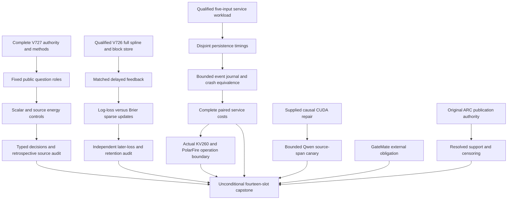

# Carnot Research Roadmap v727: Source information, objective-aligned online learning, and durable service efficiency

**Created:** 2026-10-12

**Milestone:** 2026.10.727

**Status:** Planned; not activated or executed by this planning change.

**Predecessor:** 2026.10.726, fourteen scheduled slots, Exp8429–Exp8442.

**Contract:** Exactly 14 tasks, Exp8443–Exp8456, in the order below.

**Execution plan:** `research-roadmap-next.yaml`

V727 asks three narrower questions after V726: does source information add value
beyond flexible scalar calibration, does a Brier-aligned update improve later
Brier loss, and can a different durable representation reduce complete service
cost? The main studies run on existing CPU and storage. Current Qwen generation
remains conditional on a real CUDA repair.

The complete predecessor design is preserved byte-for-byte at
`openspec/change-proposals/research-roadmap-v726-preserved-20261012.md`, SHA-256
`fa83ab5bd372b7ca9953ccc82953e51d0f126b3563bd907b7cde59c6d30298ab`.
The active `research-roadmap.yaml`, conductor and exclusion manifest are unchanged.
The completed-history archive currently ends at V725; V726 primary artifacts
and `ops/conductor-log.md` establish actual results. Scheduling completion is
not scientific success. Thirteen producers ran and the Qwen slot was pre-gated.

## What V726 proved

| Evidence | Measured result | Consequence |
|---|---|---|
| Exp8429–Exp8431 | Complete authority, public feature panel and frozen heads qualified | Reuse the 300-question split and immutable head bytes |
| Exp8432 | Brier(logistic) minus Brier(spline) = 0.01969866346324697; 95% interval [0.009633442406249476, 0.030576330671862523]; typed-loss delta -0.0073333333333333315 | Retrospective gain exists, but a flexible scalar spline control is still missing |
| Exp8433–Exp8434 | Nine-input checkpoints qualified; 12000 issued rows, 5400 coefficient-change count | Durable causal updates exist; they are not evidence of useful learning |
| Exp8435 | FIFO minus uniform Brier = -0.000839919183498522; uniform gain versus frozen = -0.00018457138267420078, interval [-0.0010567593336667806, 0.0007039343563264691] | Retire the unchanged admission comparison; change the learning objective explicitly |
| Exp8435 retention | Simultaneous upper bound 0.0007110233834077217, below 0.01 | Preserve all five retention windows in the next intervention |
| Exp8436–Exp8437 | Kernel 2.111569588s / complete 2277.868467307s = 0.093%; persistence stages 2196.846304841s = 96.44%; arithmetic-only 10x ruled out in every primary repeat | Stop native-arithmetic promotion; measure and change the nonkernel service path |
| Exp8438 | Pre-gate: runtime_repair_ready_score=0 | No current Qwen inference result |
| Exp8439 | Eight ARC episodes, twelve pending and zero resolved redirects; Exp8412 seal mismatch | Repair custody before any use; two games and censored events cannot establish transfer |
| Exp8440–Exp8441 | Reader/obligation records exist; compatible spline/transport evidence and GateMate physical/source evidence remain absent | Keep board claims within supported operations; no repeated device probe |
| Exp8442 | All fourteen slots accounted; terminal blocked capstone | Preserve nulls, external blocks and missing inputs independently |

Exp8432 also reports that setup inspected one evaluator record before its audit.
This and unknown historical exposure remain visible. These public labels support
retrospective development only. V717 H1=-0.00390625 and H2=0 remain closed.
No V726 result establishes independent factuality, current-Qwen accuracy,
hidden-game transfer, native speedup or FPGA learning.

## Three biggest gaps to the PRD vision

1. **Independent verifiable reasoning, FR-12.** The strongest recent signal is
   retrospective calibration. It does not distinguish added source information
   from a more flexible mapping of the old score. Exp8444–Exp8446 isolate that
   difference before spending on a fresh corpus. Independent factuality still
   requires disjoint adjudicated questions, resolved exposure and sealed targets.
2. **Useful continuous self-learning, FR-11.** State changes and recovery now
   work, but uniform feedback admission did not improve later loss. Exp8447–Exp8448
   change only the gradient objective under identical starting state and feedback.
   This advances Tier 1 with bounded Tier 2 state. It does not train the generator.
3. **Fast complete deployment, FR-05/08 and NFR-01.** Arithmetic is too small a
   fraction to meet the tenfold target. Exp8449–Exp8451 separate persistence costs
   and compare snapshot versus event-journal storage with identical durable work.
   A faster host store is engineering progress; Rust or board acceleration remains
   unproved until actual matched execution supports it.

## Research scan and method ingestion

The dated V727 entry in `research-references.md` was appended before this design.
The scan searched all eight primary topics and the requested secondary channels.
Semantic Scholar citation lists were inaccessible, OpenReview required browser
verification, and GitHub Trending returned roughly month-old snapshots. These
limits do not support claims about absent citations or current popularity.

| Primary source | Adopted question | Experiment and limit |
|---|---|---|
| [Proper-score decomposition](https://arxiv.org/abs/2603.15232), March 2026 | Separate scalar calibration from source information | Exp8444–Exp8446; finite controls do not estimate population grouping loss |
| [Calibeating Made Simple](https://arxiv.org/abs/2603.22167), March 2026 | Align an online objective with the measured proper loss | Exp8447–Exp8448; a spline gradient test, not the paper's algorithm or regret theorem |
| [Online KAN](https://arxiv.org/abs/2602.02056), June 2026 revision | Preserve sparse local support during real updates | Exp8447; no imported FPGA speed claim |
| [Capacity-constrained delayed OCO](https://arxiv.org/abs/2606.11711), June 2026 | Hold scarce feedback capacity fixed | Exp8447; no repeat of the null admission hypothesis |
| [FPGA–ASIC co-design](https://arxiv.org/abs/2602.15985), September 2026 revision | Account for orchestration and transfer | Exp8449–Exp8451/8454; actual host clocks govern |
| [Decomposed Entailment](https://arxiv.org/abs/2608.05823), August 2026 | Request a traceable source span or abstention | Exp8452 bounded canary only, conditional on repaired CUDA |

EBT and ARM–EBM remain architectural context. Neural constraint certification
reinforces instance checks. DescaPE and TeV are new deferred decoding/temporal
verification leads. Extropic and Kona remain vendor context. This plan does not
revive energy-as-generator, retired text rankers, PIMI sweeps or generator training.

## Architecture

The generator remains frozen. The science learner has nine inputs and 109
coefficients. The service branch deliberately retains the qualified five-input
workload; it does not inherit nine-input learning qualification. The journal is
an experimental store, not a production replacement. Historical consumers use
original sealed authority; current vNEXT is never substituted for old inputs.

## Phase 1 — Source controls and frozen hypotheses

**Exp8443–Exp8445, three tasks.** Exp8443 verifies full object equality, visible
rows, digest and activated authority, then seals `v727-methods-protocol.json`.
It reports methods, learning-input, service-input and runtime-repair readiness
separately. No missing CUDA or board family can disable unrelated CPU evidence.
It ingests the papers as specific testable methods before new fitting.

Exp8444 reuses 900 answers grouped into 300 questions: 150 fit, 50 tune and
100 test. The inherited support floors remain 128/32/80 usable groups plus eight
question clusters per target class in tune/test. Raw p2, scalar logistic, scalar
cubic spline, full nine-input spline and source-permuted spline are the five arms.
Scalar versus full tests information plus capacity; full versus permuted controls
parameter count. No generator identity becomes a predictor.

Exp8445 fits only the missing scalar spline when all original head hashes match.
Use the original zero initialization, 200 full-batch log-loss steps, rate0.01,
L2=0.001, fit-only scaling, degree3 and original knots. Select T in {0.5,1,2}
by tune log loss, ties1 then smaller. Seeds {17,29,43,71,101} retain the old
convention but duplicate deterministic fits are not independent observations.
Use E(0)=0, E(1)=-eta/T and exact binary normalization. Freeze head bytes before
test predictions. Qualification does not require a positive scientific effect.
