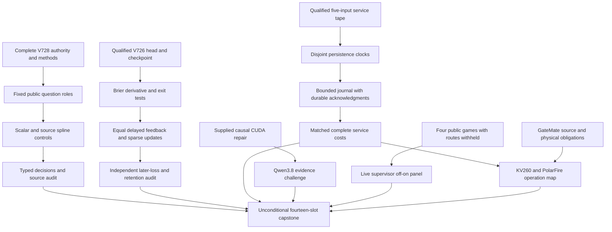
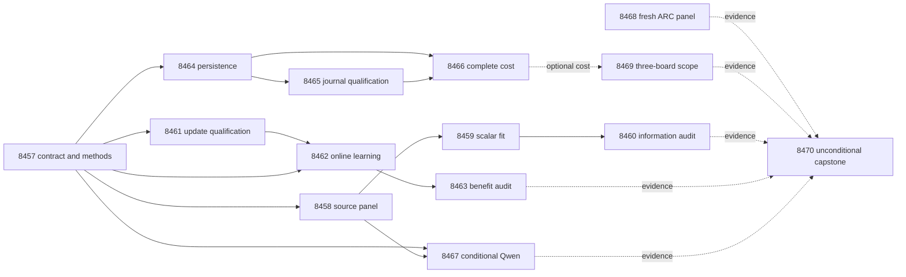

# Carnot Research Roadmap v728: Qualified source information, objective-aligned continuous learning, and durable service cost

**Created:** 2026-10-12

**Milestone:** 2026.10.728

**Status:** Planned; execution and activation are pending.

**Predecessor:** 2026.10.727, fourteen scheduled tasks, Exp8443–Exp8456.

**Contract:** Exactly 14 tasks, Exp8457–Exp8470, in four phases and the order
in the Exact task contract section. Complete task objects agree with
`research-roadmap-next.yaml`.

V728 completes the unmeasured source-information, online-objective and durable
storage studies after correcting the planning failure that stopped V727.
The generator stays frozen. Main studies use existing CPU and disk storage.
Current Qwen generation requires authenticated CUDA recovery. A new public ARC
panel tests the model-free live supervisor; it cannot establish hidden-game
performance or performance of the complete Qwen-equipped agent.

The exact incomplete V727 design is preserved at
`openspec/change-proposals/research-roadmap-v727-preserved-20261012.md`, SHA-256
`3dd5fa0484634b78e9e1bb5ff118718efd270a1dab3d849a4f859384c4b306dc`.
Do not repair that historical file or treat this design as its authority.
The active roadmap and conductor are outside this planning change.

## What V727 proved, and what it did not measure

V727 activated fourteen tasks. Six produced primary artifacts, all with
`verdict_class=blocked`; eight slots were pre-gated or cascade-skipped.
The completed archive ends at V726 at planning time. Current primary artifacts,
the active queue and conductor log establish V727 outcomes. An `OK` scheduling
entry records completed work; it does not mean the scientific gate passed.

| Evidence | Result | Consequence |
|---|---|---|
| Exp8443 | `methods_ready_score=0`: missing table, full JSON and digest; parser reported `list index out of range` | Supply complete authority and test the actual parser before handoff |
| Exp8443 family checks | Learning and service input readiness both 1; optional runtime repair absent | Reuse qualified V726 families independently |
| Exp8444–8448 | Source fitting, information audit, objective learning and its audit did not run | Preserve these unmeasured hypotheses and their parameters |
| Exp8449–8451 | Localization blocked on current authority; journal qualification and cost skipped | No journal or new persistence result exists |
| Exp8452 | Qwen slot skipped | No new local-model inference evidence |
| Exp8453 | Eight prior episodes authenticated; current authority failed; zero resolved redirects | Collect a new frozen public panel instead of another unchanged support inventory |
| Exp8454–8455 | Board and GateMate obligations remain blocked | Preserve exact physical and operation limits |
| Exp8456 | Fourteen slots accounted; capstone blocked | Missing branches are not scientific negatives |

The last useful science remains V726. Exp8432 reported retrospective
Brier(logistic) minus Brier(full spline) = 0.01969866346324697, interval
[0.009633442406249476, 0.030576330671862523]. It did not isolate information
from scalar flexibility. Exp8435 found no uniform-admission learning benefit:
gain versus frozen = -0.00018457138267420078, interval
[-0.0010567593336667806, 0.0007039343563264691]. Its five-window retention
upper bound was 0.0007110233834077217, below 0.01.

Exp8436 measured 2.111569588 seconds of arithmetic in 2277.868467307 seconds
of complete service; persistence stages totaled 2196.846304841 seconds.
These are approximately 0.093% and 96.44%. Exp8437 ruled out arithmetic-only
tenfold acceleration under that boundary. Keep that result closed.

The public panel has unknown historical exposure. Exp8432 also records an
evaluator-record setup read. Derived results remain retrospective.
V717 H1=-0.00390625 and H2=0 stay closed. No evidence above proves independent
factuality, generalized self-learning, hidden-game transfer, native service
speedup or FPGA spline learning.

## The three biggest gaps to the PRD vision

1. **FR-12: useful independent verification.** Source information has not beaten
   a flexible scalar control. Exp8458–8460 make that comparison with fixed
   question clusters. Independent factuality still needs disjoint adjudicated
   questions and resolved exposure; this milestone cannot manufacture those.
2. **FR-11: useful continuous self-learning.** Correct state updates have not
   yielded qualified later-loss gains. Exp8461 qualifies the Brier derivative
   and durable transitions; Exp8462–8463 test matched delayed feedback and
   retention. This advances Tier 1 with bounded Tier 2 state.
3. **FR-05/08 and NFR-01: complete deployment cost.** Arithmetic is too small
   a fraction for kernel-only promotion. Exp8464–8466 measure persistence and
   compare event journals with snapshots. Even a tenfold host-storage gain
   does not close NFR-01's Rust-versus-Python target.

## Research ingestion and selection

The V728 entry in `research-references.md` was written before this design.
It covers all requested arXiv topics and secondary channels. OpenReview browser
challenges and inaccessible Semantic Scholar citation lists limit coverage.
GitHub Trending supplied month-old snapshots; no current rank is asserted.

| Source | Adopted method | Task and boundary |
|---|---|---|
| [Proper-score decomposition, 2026](https://arxiv.org/abs/2603.15232) | Separate scalar calibration from source information | Exp8458–8460; finite ablations are not population grouping loss |
| [Online KAN, 2026](https://arxiv.org/abs/2602.02056) | Preserve sparse basis support | Exp8461–8462; no transferred FPGA speed claim |
| [Calibeating Made Simple, 2026](https://arxiv.org/abs/2603.22167) | Match updates to measured proper loss | Exp8461–8463; not its algorithm or regret theorem |
| [Delayed OCO, 2026](https://arxiv.org/abs/2606.11711) | Hold feedback capacity and release fixed | Exp8462; no rerun of the null admission contrast |
| [SIFT, October 2026](https://arxiv.org/abs/2610.04594) | Report repeat stability and seed effects | Exp8459–8460; not a hidden-state detector implementation |
| [VeriHarness, October 2026](https://arxiv.org/abs/2610.00972) | Challenge consensus with source evidence | Exp8467; bounded evidence-use canary only |
| [FPGA–ASIC co-design, 2026](https://arxiv.org/abs/2602.15985) | Include host work and transfer | Exp8464–8466/8469; actual local operations govern |

EBT, ARM–EBM, certified neural constraints and constrained decoding remain
architectural context. Extropic Z1T and Kona remain vendor context. Retired
external-text rankers, generator training and unchanged sampler sweeps stay
closed. Exp8457 records source-to-method mappings before fitting.

## Architecture



The science head has nine inputs and 109 coefficients. The scalar spline has
one input and its basis-derived dimension; it must not inherit a copied 109.
The service branch retains the separately qualified five-input workload.
Historical consumers read original sealed authority. V727's failed authority
is diagnostic evidence and cannot become a prerequisite for new CPU science.

## Phase 1 — Complete authority and source controls

**Exp8457–Exp8459: three tasks.** Exp8457 binds all fourteen complete objects,
including prompts, routing, gates and retirement metadata. It runs the existing
parser against private staged/activated copies and rejects twelve mutations
plus V727-style truncation. It seals `v728-methods-protocol.json` before fitting.
Source, learning, service and optional CUDA inputs receive separate readiness
fields. Missing optional hardware or runtime evidence cannot disable CPU work.
The failed V727 record is retained; qualified families come directly from V726.

Exp8458 freezes the inherited 900 answers grouped into 300 questions: 150 fit,
50 tune, 100 test. Support floors remain 128/32/80 usable questions, with at
least eight question clusters per target class in tune and test. A1 is primary;
A2 is sensitivity only. Preserve q and targets while permuting source features
at question level within dataset, with generator siblings aligned. Seeds remain
725/7252/7251 for fit/tune/test. Generator identity is a reporting stratum only.

Five arms are raw p2, scalar logistic, scalar cubic spline, full nine-input
spline and source-permuted full spline. Scalar/full differs in information and
parameter count; full/permuted is the equal-parameter information control.
Exp8459 fits only the missing scalar head if original heads authenticate.
Use zero initialization, degree 3, original fit-only scaling and knots,
200 full-batch log-loss steps, rate 0.01 and L2 0.001. Select T in {0.5,1,2}
by tune log loss; ties prefer 1 then smaller. Seeds {17,29,43,71,101} remain
recorded, but deterministic duplicate fits count once. Define E(0)=0,
E(1)=-eta/T and p=sigmoid(eta/T). Freeze every head before test prediction.
Accept p<=0.2, reject p>=0.8, otherwise escalate with confidence.

## Phase 2 — Information and continuous-learning measurements

**Exp8460–Exp8463: four tasks.** Exp8460 seals all test predictions before
reading evaluator labels. Retain 7,500 intended answer/arm/seed rows. Report
Brier, log loss, typed loss (wrong=1, correct=0, escalate=0.2), false accepts,
coverage, repeat stability and fixed dataset/generator strata. Primary contrasts
are Brier(scalar spline)-Brier(full) and Brier(permuted full)-Brier(full).
Average siblings and seeds within question. Use 10,000 paired whole-question
bootstrap draws, seed 7278446, with Bonferroni 97.5% two-sided intervals.
Both lower bounds must exceed zero, and typed loss must not increase versus
the scalar spline. SIFT motivates explicit variability reporting; the current
heads do not implement its hidden-state detector. Positive evidence remains
retrospective and at most `circular_positive`.

Exp8461 isolates the changed derivative and checkpoint qualification from the
learning run. On constructed inputs, verify the dense, sparse and finite-
difference gradients, all three temperatures, both labels and logits
{-20,-4,0,4,20}. Brier's data-gradient with respect to eta is
2*(p-y)*p*(1-p)/T; log loss uses (p-y)/T. Basis factors, bias treatment,
local support and the inherited regularizer must agree. Require absolute error
<=1e-7 and relative error <=1e-5 when reference magnitude exceeds 1e-6.
Wrong-sign, missing-temperature and future-label controls must be rejected.
Test real exits around prediction and update commits, idempotent acknowledgments
and wrong-update-rule rejection. Readiness says the mechanism works, not that
learning helps. This task reads no released evaluation labels.

Exp8462 starts every arm from the original qualified V726 full head, scaler and
temperature, never the new scalar fit. Retain five blocks of 20 test questions,
capacity C=8 and the five original seeds. Uniform pre-label admissions and
release order are identical across frozen, log-loss, Brier and shuffled-released-
label Brier arms. Change only the data-gradient; rate and L2 remain 0.01/0.001.
Shuffle only admitted labels already released in that block. Transaction one
seals predictions/admissions; transaction two commits released updates, RNG,
feedback IDs, acknowledgments and cursor. Exit after block 2 for seed 17 in
each arm and compare exact resumed versus uninterrupted state and predictions.
Retain 6,000 issued rows plus all five retention windows on 50 tune questions.
The learner cannot access retention labels.

Exp8463 independently reconstructs the entire trajectory from primitive inputs.
Score later blocks 1–4, 80 question clusters. Primary gains are Brier(log-loss)
minus Brier(Brier-update) and Brier(frozen) minus Brier(Brier-update). Use
10,000 paired question resamples, seed 7278448, and 97.5% intervals. Both
lower bounds must be positive with no typed-loss increase against either control.
Use identical retention-question resamples across all five windows, retain the
maximum Brier increase in each draw, and require its one-sided 95% upper bound
<=0.01 (10,000 draws, inherited seed 7258421). These intervals describe fixed
exposed trajectories, not independent deployments or adaptive-population bounds.
Independent and generalized learning scores stay zero. A null retires this
unchanged objective intervention; a missing producer is blocked, not partial.

Hardware path: local spline support bounds touched coefficients; CPU handles
current updates and persistence. Batched GPU training and FPGA sparse arithmetic
remain possible mappings, but no installed board supports this complete service.
The complete-cost branch tests whether faster arithmetic could matter at all.

## Phase 3 — Durable storage and complete cost

**Exp8464–Exp8466: three tasks.** Exp8464 reads the original qualified five-input
Exp8407 family through Exp8457's sealed roots. It does not depend on the blocked
Exp8449 publication. Use natural batch1/reuse8 as primary and natural batch8/reuse8
as secondary; one warmup and five measured repeats per cell. Pair instrumented
and uninstrumented runs in alternating order, capped at 1,800 measurement seconds.
Record disjoint clocks for state copy/validation, serialization/hash, writes,
file fsync, rename, directory fsync, pointer publication and residual work.
The outer clock includes startup and feedback tail drain. Report instrumentation
overhead, filesystem identity, bytes, fsyncs, transaction IDs and final hashes.
Seal the exact event tape before the journal study. Slow or incomplete runs remain
visible; no changed tape or hidden subtraction is allowed.

Exp8465 builds a separate experimental journal using that tape and the unchanged
transition oracle. Preserve release delay 8, request order, batching and replies.
Each event binds sequence, previous digest, payload length/hash, code/config and
stable acknowledgment IDs. File fsync precedes acknowledgment; directory fsync
covers creation, rotation and checkpoints. Snapshot every 32 committed
transactions and at final drain. Publish a checkpoint bound to its exact journal
prefix before reclaiming segments; pinned readers remain valid. State limits
are MAX_EVENTS=256 and MAX_BYTES=2 MiB, with a 16 MiB journal ceiling. Overflow
blocks. Process-exit tests cover both sides of payload, fsync, checkpoint and
acknowledgment, plus corruption, truncation, reordering, rehashed transitions,
stale pointers, concurrent readers and duplicate/conflicting feedback. Only an
uncommitted final tail may be truncated. No acknowledged event may disappear.
Process tests do not establish physical power-loss certification.

Exp8466 pairs snapshot and journal service on the same disk-backed filesystem,
using the two frozen cells, five repeats, one warmup and alternating AB/BA.
Reset identical state; include checkpoint, compaction, final drain, startup and
actual durable acknowledgments. Report restart separately and amortized over
the actual run. Measure request latency, updates, bytes, fsyncs, memory and disk.
All predictions, updates, final states and acknowledgments must match exactly.
Bootstrap paired repeat indices 10,000 times, seed 7278451. Speedup is pooled
snapshot wall/journal wall. Success requires lower95>1 and p95 latency ratio
<=1.05 plus durability qualification. Report lower95>=10 separately as a host-
service target; it cannot close Rust-versus-Python NFR-01. Five same-host repeats
support conditional engineering evidence only. Measurement cap is 1,800 seconds;
missing repeats block the comparison. This is a cached-feature local service,
not current-Qwen end-to-end latency.

## Phase 4 — Bounded live evidence, board scope and reconciliation

**Exp8467–Exp8470: four tasks.** Exp8467 is the only LLM task. It requires
Exp8457.runtime_repair_ready_score=1 and Exp8458.source_controls_ready_score=1.
Use `unsloth/Qwen3.8-27B-GGUF` Q4_K_M via its cached file and embedded tokenizer,
with actual CUDA offload evidence. Declare `model_bounded_generation`, whose
plausibility floor is 10 seconds; report real duration without padding. There
is no full-generation task. A future real full-generation run would use 60 seconds;
a load-only or embedding run would use `model_load_no_generation` and 2 seconds.

Freeze four fit questions, first sibling and three views: source present,
source absent, and source present with a plausible claim contradicted by an
exact source span. Keep ambiguous construction as missing. Twelve calls use
temperature 0, max128 output tokens, load deadline 600 seconds, call deadline
120 seconds and total measurement deadline 2,400 seconds. Request a span or
abstention. Preserve raw prompts/replies and all failures. This checks transport
and evidence use; span-oracle success is circular, not factual generalization.
Missing causal repair pre-gates the task before a model load. Qwen3.5-0.8B and
Gemma smoke models cannot replace the mandated model in this result.

Exp8468 collects a new model-free public ARC panel through the actual
`make_carnot_agent` / `E3AgentPolicy` wrapper and SDK. Freeze the first four games
in the shipped metadata-only hash order, seeds 11/22 and supervisor off/on:
16 episodes. Each has max512 actions and 120 seconds; total collection cap is
2,400 seconds. Withhold per-game adapters, routes, calibration, cached game
memory and induction that would load an LLM. Model-call tripwires must remain.
Retain the original two-game subset descriptively; never replace missing games
based on outcomes. No game-source reading, offline ground-truth BFS or hand
solver is allowed. Registry-precheck prevents duplicate solve credit.

Report all paired episode progress and action/compute costs, independent of
whether the supervisor fired. Redirect outcomes resolve only through actual
later level-up observations. Right-censored events are not failures. A redirect-
arm refinement needs at least three overlapping games and five resolved outcomes
per shared arm cell; otherwise support remains blocked. No supervisor default
change, new solve credit, competition submission or hidden-game claim follows.
`solve_provenance=live_agent_self_discovery` describes the runtime observations;
`new_level_solves=0`. Panel execution and refinement support have separate scores.
Four games are descriptive engineering support, not a population transfer estimate.

Exp8469 combines all three attached-board obligations. Read original board
receipts and map qualified new service operations if available. KV260 retains
quadratic-Ising scope at k_max<=5; PolarFire retains authenticated board-local
Linux CPU dispatch. Missing spline, journal and transfer support stay explicit.
GateMate retains original missing source hashes and IDCODE0xffffffff. Reopening
requires matching recovered bytes, dated cable/port/power change, GM1Ax
IDCODE0x20000001, n16 flash and sample/hash evidence. Inspect supplied changes
for at most 60 seconds, with zero device commands. This mandatory continuity
record is not another physical experiment. Missing optional service costs do
not prevent board accounting. No purchase, synthesis or flash is proposed.

Exp8470 always runs. It accounts for all fourteen slots, including its own
publication as current reconciliation rather than a missing prerequisite.
Distinguish producer, disqualified artifact, pre-gate receipt, cascade skip and
absence. Actual pre-gate files may differ from planned deliverable names; bind
their task IDs and conductor receipts instead of inventing producer artifacts.
Independently reduce eligible science, journal, ARC and board evidence in bounded
fresh workers. Retain the shipped 1,500 MiB peak and 500 MiB growth limits,
original historical roots and standalone outside-checkout CLI regression.
Compute unchanged publication G1–G4 with `scripts/publication_gate.py --json`;
report paper_ready and unmet_gates. Old paper readiness is not V728 success.
External absence is terminal blocked, not retryable partial. Record exact-repeat
retirement recommendations without editing old results or exclusion history.

## Dependency graph and gate contract

Only qualification fields gate downstream work; positive scientific effects
are not prerequisites for an independent branch. Every named field appears in
its producer's own REQUIRED ARTIFACT FIELDS. All structured gates use earlier
current-milestone task IDs and integer `== 1` comparisons.



Exp8468, Exp8469 and Exp8470 have no structured gate. Each authenticates the
current full contract itself. Optional missing branches cannot suppress their
accounting. The first task is a methods and input qualification task, not a
blanket success gate for every historical artifact.

## Hardware requirements and execution budgets

| Work | Existing hardware | Budget and claim boundary |
|---|---|---|
| Authority, source fits and audits | CPU, system RAM, disk-backed private scratch | 35–50 minute estimates; no LLM load |
| Objective qualification and learning | CPU, bounded sparse state | 40–65 minute estimates; real child exits; no generator training |
| Persistence and journal | Same real disk-backed filesystem | 1,800-second measurement caps; no tmpfs timing |
| Qwen evidence canary | One leased RTX 3090 if causal CUDA repair qualifies; cached approximately 16 GB GGUF | Preflight VRAM and reserve KV/context space; 2,400-second measurement cap; no small-model substitution |
| ARC public panel | CPU and existing small numerical scorer | Zero LLM calls; 16 episodes, 2,400-second collection cap |
| Board map | Existing KV260, PolarFire and GateMate evidence | No board commands; supported operations only |
| Capstone | CPU with bounded fresh workers | Preserve 1,500 MiB peak / 500 MiB growth checks |

The wishlist does not justify buying another accelerator while host persistence
is dominant. TSU access, NPU execution and compatible FPGA spline operations
are not qualified. Vendor estimates are not local timings. Future acceleration
must include sparse computation, update state, transfer and durable commits.

Every prompt has a numbered flushed-progress step at phase boundaries and
before/after model loads, generation, benchmarks and subprocesses. Long loops
report actual completed/pending counts; owned children are polled at most every
60 seconds. Synthesis also emits progress. Keep every output gap below 600
seconds; reserve at least 900 seconds for validation within the 4,800-second
hard cap. Files over about 200 lines are written in several calls of at most
about 150 lines, with a progress message between calls. No artificial duration
padding is allowed. Exp8457's schema/authority work and Exp8469's hardware
coordination route to Claude Opus with 100 turns. Formulaic panel, derivative
and journal code routes to Codex gpt-6.1-sol. Other experiments use the requested
Claude default, 50 turns. No Luna task is scheduled.

## Validation and retirement discipline

All implementation work follows spec, failing tests, implementation, unit/lint/
type/spec checks, then applicable private E2E-018/021 checks. Exp8461 also uses
E2E-020; ARC uses E2E-011/017. Historical CLIs keep their frozen dates. New code
requires real 100% owned statement coverage, including child and failure paths.
Use private disk-backed outputs, never overwrite historical primary evidence.

Every task declares rows, sample budgets, verdict_class, exact gate diagnostics,
actual substrate and model invocation counts. Oracle-positive evidence is
circular_positive. Qualification and scientific benefit use separate fields.
Cold-replay raw rows; reject missing inputs and self-consistently rehashed
incorrect evidence. Preserve adversarial and row-consistency validators.
No schema exception, weakened test or new validator exemption is authorized.

Each recurring scope names its actual previous failure and changed prerequisite
in prior_failures, including retire_if_same_verdict=true. Cascade skips with no
primary retain their conductor status instead of a fabricated honest_verdict.
No retired ID is reused, and no requires chain points to a retired upstream.
The changed complete contract permits unmeasured science to proceed; it does
not reopen closed scientific nulls or authorize repeated hardware probes.

## Exact task contract

Exactly **14 tasks, Exp8457 through Exp8470**, in this order. Titles, phases,
deliverables and all task fields below are executable commitments.

| Order | ID | Title | Phase | Deliverable |
|---|---|---|---|---|
| 1 | `exp8457-contract-methods` | Bind fourteen tasks and seal the changed source learning and storage hypotheses | 1 | `results/experiment_8457_v728_contract_methods.json` |
| 2 | `exp8458-source-control-panel` | Freeze scalar and source controls without changing the exposed question split | 1 | `results/experiment_8458_v728_source_control_panel.json` |
| 3 | `exp8459-source-control-fit` | Fit the scalar spline control and freeze matched source decision heads | 1 | `results/experiment_8459_v728_source_control_fit.json` |
| 4 | `exp8460-source-information-audit` | Measure source information beyond scalar recalibration on frozen decisions | 2 | `results/experiment_8460_v728_source_information_audit.json` |
| 5 | `exp8461-objective-checkpoint-qualification` | Qualify Brier gradients and durable feedback transitions before learning | 2 | `results/experiment_8461_v728_objective_checkpoint_qualification.json` |
| 6 | `exp8462-brier-online-learning` | Compare objective-aligned sparse updates under identical delayed feedback | 2 | `results/experiment_8462_v728_brier_online_learning.json` |
| 7 | `exp8463-objective-benefit-audit` | Audit later proper loss decision utility and retention independently | 2 | `results/experiment_8463_v728_objective_benefit_audit.json` |
| 8 | `exp8464-persistence-localization` | Measure serialization synchronization and publication inside complete transactions | 3 | `results/experiment_8464_v728_persistence_localization.json` |
| 9 | `exp8465-journal-equivalence` | Qualify a bounded event journal with unchanged durable acknowledgments | 3 | `results/experiment_8465_v728_journal_equivalence.json` |
| 10 | `exp8466-journal-service-cost` | Compare complete snapshot and journal service costs at equal durable work | 3 | `results/experiment_8466_v728_journal_service_cost.json` |
| 11 | `exp8467-bounded-qwen-evidence` | Test bounded Qwen source-span responses only after a qualified CUDA repair | 4 | `results/experiment_8467_v728_bounded_qwen_evidence.json` |
| 12 | `exp8468-arc-generalization-panel` | Measure fresh adapter-withheld ARC supervisor generalization on four public games | 4 | `results/experiment_8468_v728_arc_generalization_panel.json` |
| 13 | `exp8469-board-operation-boundary` | Map complete service work to KV260 and carry PolarFire and GateMate obligations | 4 | `results/experiment_8469_v728_board_operation_boundary.json` |
| 14 | `exp8470-capstone` | Reconcile fourteen outcomes and decide source learning and service continuation | 4 | `results/experiment_8470_v728_capstone.json` |

Canonical full-task SHA-256: `1a6bb695f9ef6e97d0891d20ae2aad7a9f04fd3bdf3707cdf4a5e79bacaed7ae`.

<!-- V728_TASK_CONTRACT_START -->
```json
{
  "milestone": "2026.10.728",
  "tasks": [
    {"MODEL_SPECS": [], "agent_type": "claude", "deliverable": "results/experiment_8457_v728_contract_methods.json", "estimated_wall_time_min": 45, "gated_on": [], "id": "exp8457-contract-methods", "inference_substrate_class": "no_model_load", "max_turns": 100, "milestone": "2026.10.728", "model": "opus", "operator_override": "2026-05-29 operator directive (standing): routine milestone transition matching exp7992; complete V727 authority and sealed V726 custody replace an incomplete design.", "per_unit_rows": true, "phase": 1, "prior_failures": [{"addressed_by": "V726 shipped complete full-object authority; V727 preserves its original bytes and tests fourteen actual tasks before new science.", "experiment_id": "exp8416-contract-methods", "retire_if_same_verdict": true, "verdict": "complete_blocked_v725_contract_methods"}, {"addressed_by": "V727 did not measure this hypothesis because complete design authority was absent; V728 supplies and mutation-tests the complete contract, using qualified V726 source families directly.", "experiment_id": "exp8443-contract-methods", "retire_if_same_verdict": true, "verdict": "complete_blocked_v727_contract_methods"}], "priority": "high", "prompt": "CONTEXT:\nWork in {project_root} on {date}. V727 scheduled fourteen tasks but produced six blocked primaries and eight skipped slots. Its design stopped in Phase 1 without the visible table, full JSON or digest; Exp8443 returned methods_ready_score=0. No scalar-source, Brier-objective or journal-cost hypothesis ran. V726 supplies qualified retrospective features, heads and checkpoints; its admission-learning audit was null. Kernel arithmetic was 0.093 percent of complete service, while persistence stages were 96.44 percent. Preserve these results and V717 H1=-0.00390625/H2=0. V728 supplies complete authority and separate gradient qualification before the unmeasured science. All public-label evidence remains retrospective; generator weights stay frozen.\nEXISTING CODE TO READ FIRST:\nCLAUDE.md; CODEX.md; ops/e2e-test-plan.md; ops/exclusion_manifest.yaml; openspec/capabilities/research-reporting/spec.md; openspec/capabilities/verification/spec.md; scripts/experiment_template.py; python/carnot/reporting/primary_publication.py; openspec/change-proposals/research-roadmap-vNEXT.md; python/carnot/reporting/v726_contract_methods.py; python/carnot/reporting/v685_authority_lifecycle.py; results/experiment_8442_v726_capstone.json; openspec/change-proposals/v726-methods-protocol.json; python/carnot/reporting/v727_contract_methods.py; python/carnot/reporting/v727_historical_inputs.py; python/carnot/reporting/roadmap_contract.py; openspec/change-proposals/v727-methods-protocol.json; results/experiment_8443_v727_contract_methods.json; openspec/change-proposals/research-roadmap-v726-preserved-20261012.md\nTASK:\nBind fourteen tasks and seal the changed source learning and storage hypotheses. Deliver results/experiment_8457_v728_contract_methods.json. Create thin runner scripts/experiments/experiment_8457_v728_contract_methods.py; store primitive evidence under results/raw/experiment_8457_v728_contract_methods/. Write docs/research-notes/v728-contract-methods.md. Earlier V728 outputs are future dependencies, not existing code. Do not require absent V727 science producers.\nCONCRETE STEPS:\n1. PRECONDITIONS: Print a flushed start line. Authenticate this task against the activated V728 full-object contract. Check required input bytes, tools, free memory, disk-backed private scratch and deadlines. Authenticate historical producers through their sealed original authority, not the mutable current vNEXT. Missing optional CUDA, board or unrelated history cannot block CPU science. Record missing required operands in gate_check_summary.\n2. Print a flushed progress line at each phase boundary and before and after every model load, generation, benchmark and subprocess that can take minutes. Emit completed/pending counts inside long loops. Poll owned children at most every 60 seconds and report actual status. Keep every output gap below 600 seconds, including synthesis. Use unbuffered output. Write any file over about 200 lines in several tool calls of at most about 150 lines, with a progress message between calls. Keep each tool call bounded. Print a real phase status at least every 60 seconds during waits or synthesis. Stop measurements by 3600 seconds and reserve at least 900 seconds within the 4800-second cap for validation; never pad duration.\n3. Spec first: add relevant REQ-* and SCENARIO-* before implementation; write focused failing tests first. Reuse qualified modules through narrow adapters. Preserve original assertions, historical bytes and acceptance thresholds. Put runners in scripts/experiments/, tests in tests/python/, scratch outside the repository root. Accept --date {date}. Do not modify research-roadmap.yaml. Do not update generator weights or publish externally.\n4. Declare inference_substrate_class=no_model_load, MODEL_SPECS=[] and zero current LLM calls. Use aggregation_from_upstream_artifacts for readers and verifier_ensemble_against_cached_candidates for numerical heads; keep imported models under historical_model_provenance.\n5. Compare exactly fourteen tasks Exp8457-Exp8470 across the visible table under the literal heading Exact task contract, embedded complete JSON task objects, printed canonical_tasks_sha256 and actual activated YAML. Use the existing roadmap_contract parser and full dictionary equality; prompts, priors, routing and every optional field participate. Reject truncation after Phase 1, absent markers, dropped/reordered objects and the twelve existing authority mutations. Do not repair old V727 authority or synthesize it from the new queue.\n6. Seal openspec/change-proposals/v728-methods-protocol.json before fitting. Independently copy V726 original authority and qualified panel/head/store/service receipts. Read v727-methods-protocol.json only as the frozen record of unexecuted hypotheses, never as qualified producer authority. Inherit its source_controls, scalar_fit, source_audit, objective_updates, objective_audit, persistence_profile, journal and journal_cost scientific operands, with an explicit delta ledger: scalar coefficient dimension comes from its one-input basis, derivative qualification is now separate, and the new ARC panel and evidence canary have their own frozen budgets. Review the score-decomposition, Online KAN, Calibeating, VeriHarness and SIFT sources in the dated V728 references; record source/method/limit mappings. Keep original question roles, thresholds and five retention windows.\n7. Qualify each historical family in its own immutable consumer root using V726 originals, without invoking the failed V727 current-authority gate. Emit source_inputs_ready_score, learning_inputs_ready_score and service_inputs_ready_score separately. A family can be ready when a different family is absent. Inspect only supplied CUDA repair evidence for at most 60 seconds with the shipped Exp8410 reader. Set runtime_repair_ready_score only for an authenticated changed driver/context/copy receipt bound to current operands; toolkit discovery hints are insufficient. No current CUDA, model or board probe.\n8. methods_ready_score requires full current authority and a sealed protocol; other readiness fields describe separate inputs and never scientific benefit. Pin the complete task digest and preserve protocol/reader hashes before new work. Authenticate scalar dimensionality against the shipped basis and reject a copied full-head dimension of 109 for a one-input control. Missing historical authority is reported for its own family. Run private authority lifecycle E2E-018 and frozen consumer E2E-021 with original historical dates, not {date} substituted into old CLIs.\n9. Run scoped unit tests and real private CLI/consumer checks, including the private E2E-018 authority lifecycle and E2E-021 frozen replay tests from ops/e2e-test-plan.md. Run Ruff check/format, strict mypy and scripts/check_spec_coverage.py --files <owned-test-files>. Require 100 percent newly owned statement coverage including child and failure paths, with genuine Coverage.py shards and pytest -n 0 -o addopts= --no-cov. Capture commands, exits, durations and log hashes. Use private disk-backed scratch. Do not run the full repository suite or overwrite historical publications.\n10. Cold-replay primitive rows in a fresh bounded process; test missing inputs, deliberate errors and self-consistently rehashed tampering. Run unchanged primary_publication, scripts/adversarial_verify.py --json <private-candidate> and scripts/verdict_row_consistency_lint.py --strict <private-candidate>. Retain all findings. Resolve informational findings only through existing typed consumers with independent operands and negative controls. Unknown, warning or critical findings block readiness. Do not edit validators or add exemptions. Publish terminal bytes atomically only after the checks. Owned validation failures are disqualified; unchanged external absence is blocked, never partial. Reconcile openspec/, _bmad/traceability.md, ops/status.md and ops/changelog.md.\nREQUIRED ARTIFACT FIELDS:\nexperiment_id, task_id, milestone, run_date: principle: Bind evidence to this task and actual invocation.\nhonest_verdict, verdict_class: principle: Terminal honest_verdict starts complete_; verdict_class is exactly positive | circular_positive | null | blocked | disqualified | partial. Only unfinished retryable owned work is partial.\ngate_check_summary: principle: Each blocked_* or complete_blocked_* verdict names the failed check, upstream, path/hash, field, operator, expected and observed; missing is distinct from zero.\ninference_substrate, inference_substrate_class, MODEL_SPECS, model_invocation_counts, historical_model_provenance: principle: Declare actual work; imported model output is cached evidence, never current generation.\nrows, intended_count, completed_count, failed_count, censored_count, excluded_count, independent_count, sample_size_budget: principle: Every intended unit and arm has a metric or missing reason; seeds, siblings and repeats do not multiply independent questions.\nverifier_is_oracle, exposure_scope, independent_generalization_score, generalized_learning_benefit_score: principle: Oracle positives use circular_positive; exposed experiments and engineering fixtures keep both generalization scores zero.\nrequired_checks_passed, flagged_adversarial, acceptance_gates, validation_receipts, terminal_validation_sidecar_path, adversarial_findings: principle: Qualification is distinct from scientific benefit; failed required checks forbid positive classes.\npreconditions_checked, duration_s, phase_spans, random_seed, reproducibility_checksum, source_artifact_hashes, code_config_hashes, raw_shard_hashes: principle: Preserve actual work and immutable primitive operands.\ncited_upstream_artifacts, field_principles: principle: Explain each extra metric/gate and list imported fields with original producer hashes.\nmethods_ready_score, learning_inputs_ready_score, service_inputs_ready_score, runtime_repair_ready_score, contract_digest, historical_family_receipts, methods_protocol_reference: principle: Each gate has one exact producer field and an independent evidence boundary.\nsource_inputs_ready_score, protocol_delta, literature_mapping, canonical_tasks_sha256: principle: Separate source admission, inherited methods and the exact full-object authority; never recreate missing history.\nRun command: cd {project_root} && JAX_PLATFORMS=cpu PYTHONPATH=python:. PYTHONUNBUFFERED=1 .venv/bin/python -u scripts/experiments/experiment_8457_v728_contract_methods.py --date {date}\nDo NOT push. Do NOT modify scripts/research_conductor.py.\n", "requires_gpu": false, "title": "Bind fourteen tasks and seal the changed source learning and storage hypotheses", "track": "infrastructure"},
    {"MODEL_SPECS": [], "agent_type": "codex", "deliverable": "results/experiment_8458_v728_source_control_panel.json", "estimated_wall_time_min": 35, "gated_on": [{"artifact_field": "methods_ready_score", "op": "==", "upstream": "exp8457-contract-methods", "value": 1}, {"artifact_field": "source_inputs_ready_score", "op": "==", "upstream": "exp8457-contract-methods", "value": 1}], "id": "exp8458-source-control-panel", "inference_substrate_class": "no_model_load", "max_turns": 50, "milestone": "2026.10.728", "model": "gpt-6.1-sol", "per_unit_rows": true, "phase": 1, "prior_failures": [{"addressed_by": "Use already qualified V726 retrospective features; do not retry the unresolved independent-exposure claim. Add a scalar-spline information control.", "experiment_id": "exp8403-released-question-identity", "retire_if_same_verdict": true, "verdict": "complete_blocked_released_question_identity"}, {"addressed_by": "V727 did not measure this hypothesis because complete design authority was absent; V728 supplies and mutation-tests the complete contract, using qualified V726 source families directly.", "experiment_id": "exp8444-source-control-panel", "retire_if_same_verdict": true, "verdict": "blocked_gate_check_failed"}], "priority": "high", "prompt": "CONTEXT:\nWork in {project_root} on {date}. V727 scheduled fourteen tasks but produced six blocked primaries and eight skipped slots. Its design stopped in Phase 1 without the visible table, full JSON or digest; Exp8443 returned methods_ready_score=0. No scalar-source, Brier-objective or journal-cost hypothesis ran. V726 supplies qualified retrospective features, heads and checkpoints; its admission-learning audit was null. Kernel arithmetic was 0.093 percent of complete service, while persistence stages were 96.44 percent. Preserve these results and V717 H1=-0.00390625/H2=0. V728 supplies complete authority and separate gradient qualification before the unmeasured science. All public-label evidence remains retrospective; generator weights stay frozen.\nEXISTING CODE TO READ FIRST:\nCLAUDE.md; CODEX.md; ops/e2e-test-plan.md; ops/exclusion_manifest.yaml; openspec/capabilities/research-reporting/spec.md; openspec/capabilities/verification/spec.md; scripts/experiment_template.py; python/carnot/reporting/primary_publication.py; openspec/change-proposals/research-roadmap-vNEXT.md; python/carnot/reporting/v726_feature_panel.py; results/experiment_8430_v726_criterion_feature_panel.json; python/carnot/verify/v726_criterion_energy_fit.py\nTASK:\nFreeze scalar and source controls without changing the exposed question split. Deliver results/experiment_8458_v728_source_control_panel.json. Create thin runner scripts/experiments/experiment_8458_v728_source_control_panel.py; store primitive evidence under results/raw/experiment_8458_v728_source_control_panel/. Write docs/research-notes/v728-source-control-panel.md. Earlier V728 outputs are future dependencies, not existing code. Do not require absent V727 science producers.\nCONCRETE STEPS:\n1. PRECONDITIONS: Print a flushed start line. Authenticate this task against the activated V728 full-object contract. Check required input bytes, tools, free memory, disk-backed private scratch and deadlines. Authenticate historical producers through their sealed original authority, not the mutable current vNEXT. Missing optional CUDA, board or unrelated history cannot block CPU science. Record missing required operands in gate_check_summary.\n2. Print a flushed progress line at each phase boundary and before and after every model load, generation, benchmark and subprocess that can take minutes. Emit completed/pending counts inside long loops. Poll owned children at most every 60 seconds and report actual status. Keep every output gap below 600 seconds, including synthesis. Use unbuffered output. Write any file over about 200 lines in several tool calls of at most about 150 lines, with a progress message between calls. Keep each tool call bounded. Print a real phase status at least every 60 seconds during waits or synthesis. Stop measurements by 3600 seconds and reserve at least 900 seconds within the 4800-second cap for validation; never pad duration.\n3. Spec first: add relevant REQ-* and SCENARIO-* before implementation; write focused failing tests first. Reuse qualified modules through narrow adapters. Preserve original assertions, historical bytes and acceptance thresholds. Put runners in scripts/experiments/, tests in tests/python/, scratch outside the repository root. Accept --date {date}. Do not modify research-roadmap.yaml. Do not update generator weights or publish externally.\n4. Declare inference_substrate_class=no_model_load, MODEL_SPECS=[] and zero current LLM calls. Use aggregation_from_upstream_artifacts for readers and verifier_ensemble_against_cached_candidates for numerical heads; keep imported models under historical_model_provenance.\n5. Reuse the qualified 900-answer, 300-question public panel: 150 fit, 50 tune, 100 test questions. Bind every question, sibling, source and original hash. Do not download replacement data or change roles. Require the inherited 128/32/80 usable question support and eight tune/test question clusters per target class.\n6. Prepare raw p2, scalar logistic, scalar cubic spline, full nine-input spline and source-permuted nine-input spline controls. The scalar spline uses only q with the same knots and degree as the full head. Keep generator identity a reporting stratum, not a predictor. Record parameter counts; the scalar has fewer inputs, while full versus permuted is the equal-parameter information control.\n7. Retain source-block permutations at question level within dataset, with generator slots aligned and fixed seeds 725/7252/7251 for fit/tune/test. Preserve q and labels. Separate prediction-visible vectors from evaluator targets. Freeze the operator list before fitting; no new feature or subgroup chosen from test errors.\n8. Test exact inherited full-head feature bytes, q-only independence from source edits, permutation preservation and denial of evaluator-label reads. Recovered question IDs do not resolve old exposure. Set source_controls_ready_score only after row-complete validation.\n9. Run scoped unit tests and real private CLI/consumer checks, including the private E2E-018 authority lifecycle and E2E-021 frozen replay tests from ops/e2e-test-plan.md. Run Ruff check/format, strict mypy and scripts/check_spec_coverage.py --files <owned-test-files>. Require 100 percent newly owned statement coverage including child and failure paths, with genuine Coverage.py shards and pytest -n 0 -o addopts= --no-cov. Capture commands, exits, durations and log hashes. Use private disk-backed scratch. Do not run the full repository suite or overwrite historical publications.\n10. Cold-replay primitive rows in a fresh bounded process; test missing inputs, deliberate errors and self-consistently rehashed tampering. Run unchanged primary_publication, scripts/adversarial_verify.py --json <private-candidate> and scripts/verdict_row_consistency_lint.py --strict <private-candidate>. Retain all findings. Resolve informational findings only through existing typed consumers with independent operands and negative controls. Unknown, warning or critical findings block readiness. Do not edit validators or add exemptions. Publish terminal bytes atomically only after the checks. Owned validation failures are disqualified; unchanged external absence is blocked, never partial. Reconcile openspec/, _bmad/traceability.md, ops/status.md and ops/changelog.md.\nREQUIRED ARTIFACT FIELDS:\nexperiment_id, task_id, milestone, run_date: principle: Bind evidence to this task and actual invocation.\nhonest_verdict, verdict_class: principle: Terminal honest_verdict starts complete_; verdict_class is exactly positive | circular_positive | null | blocked | disqualified | partial. Only unfinished retryable owned work is partial.\ngate_check_summary: principle: Each blocked_* or complete_blocked_* verdict names the failed check, upstream, path/hash, field, operator, expected and observed; missing is distinct from zero.\ninference_substrate, inference_substrate_class, MODEL_SPECS, model_invocation_counts, historical_model_provenance: principle: Declare actual work; imported model output is cached evidence, never current generation.\nrows, intended_count, completed_count, failed_count, censored_count, excluded_count, independent_count, sample_size_budget: principle: Every intended unit and arm has a metric or missing reason; seeds, siblings and repeats do not multiply independent questions.\nverifier_is_oracle, exposure_scope, independent_generalization_score, generalized_learning_benefit_score: principle: Oracle positives use circular_positive; exposed experiments and engineering fixtures keep both generalization scores zero.\nrequired_checks_passed, flagged_adversarial, acceptance_gates, validation_receipts, terminal_validation_sidecar_path, adversarial_findings: principle: Qualification is distinct from scientific benefit; failed required checks forbid positive classes.\npreconditions_checked, duration_s, phase_spans, random_seed, reproducibility_checksum, source_artifact_hashes, code_config_hashes, raw_shard_hashes: principle: Preserve actual work and immutable primitive operands.\ncited_upstream_artifacts, field_principles: principle: Explain each extra metric/gate and list imported fields with original producer hashes.\nsource_controls_ready_score, feature_manifest_reference, question_roles, predictor_access_log, control_parameter_counts: principle: Test information while preserving historical exposure and split custody.\nRun command: cd {project_root} && JAX_PLATFORMS=cpu PYTHONPATH=python:. PYTHONUNBUFFERED=1 .venv/bin/python -u scripts/experiments/experiment_8458_v728_source_control_panel.py --date {date}\nDo NOT push. Do NOT modify scripts/research_conductor.py.\n", "requires_gpu": false, "title": "Freeze scalar and source controls without changing the exposed question split", "track": "research"},
    {"MODEL_SPECS": [], "deliverable": "results/experiment_8459_v728_source_control_fit.json", "estimated_wall_time_min": 45, "gated_on": [{"artifact_field": "source_controls_ready_score", "op": "==", "upstream": "exp8458-source-control-panel", "value": 1}], "id": "exp8459-source-control-fit", "inference_substrate_class": "no_model_load", "max_turns": 50, "milestone": "2026.10.728", "per_unit_rows": true, "phase": 1, "prior_failures": [{"addressed_by": "Test the missing flexible scalar control on qualified V726 human-label inputs; this isolates calibration from source information rather than repeating old interaction features.", "experiment_id": "exp8074-interaction-decision-audit", "retire_if_same_verdict": true, "verdict": "complete_null_interaction_decision_audit"}, {"addressed_by": "V727 did not measure this hypothesis because complete design authority was absent; V728 supplies and mutation-tests the complete contract, using qualified V726 source families directly.", "experiment_id": "exp8445-source-control-fit", "retire_if_same_verdict": true, "verdict": "GATE_BLOCK"}], "priority": "high", "prompt": "CONTEXT:\nWork in {project_root} on {date}. V727 scheduled fourteen tasks but produced six blocked primaries and eight skipped slots. Its design stopped in Phase 1 without the visible table, full JSON or digest; Exp8443 returned methods_ready_score=0. No scalar-source, Brier-objective or journal-cost hypothesis ran. V726 supplies qualified retrospective features, heads and checkpoints; its admission-learning audit was null. Kernel arithmetic was 0.093 percent of complete service, while persistence stages were 96.44 percent. Preserve these results and V717 H1=-0.00390625/H2=0. V728 supplies complete authority and separate gradient qualification before the unmeasured science. All public-label evidence remains retrospective; generator weights stay frozen.\nEXISTING CODE TO READ FIRST:\nCLAUDE.md; CODEX.md; ops/e2e-test-plan.md; ops/exclusion_manifest.yaml; openspec/capabilities/research-reporting/spec.md; openspec/capabilities/verification/spec.md; scripts/experiment_template.py; python/carnot/reporting/primary_publication.py; openspec/change-proposals/research-roadmap-vNEXT.md; python/carnot/verify/v726_criterion_energy_fit.py; python/carnot/verify/sparse_energy_7996.py; results/experiment_8431_v726_criterion_energy_fit.json\nTASK:\nFit the scalar spline control and freeze matched source decision heads. Deliver results/experiment_8459_v728_source_control_fit.json. Create thin runner scripts/experiments/experiment_8459_v728_source_control_fit.py; store primitive evidence under results/raw/experiment_8459_v728_source_control_fit/. Write docs/research-notes/v728-source-control-fit.md. Earlier V728 outputs are future dependencies, not existing code. Do not require absent V727 science producers.\nCONCRETE STEPS:\n1. PRECONDITIONS: Print a flushed start line. Authenticate this task against the activated V728 full-object contract. Check required input bytes, tools, free memory, disk-backed private scratch and deadlines. Authenticate historical producers through their sealed original authority, not the mutable current vNEXT. Missing optional CUDA, board or unrelated history cannot block CPU science. Record missing required operands in gate_check_summary.\n2. Print a flushed progress line at each phase boundary and before and after every model load, generation, benchmark and subprocess that can take minutes. Emit completed/pending counts inside long loops. Poll owned children at most every 60 seconds and report actual status. Keep every output gap below 600 seconds, including synthesis. Use unbuffered output. Write any file over about 200 lines in several tool calls of at most about 150 lines, with a progress message between calls. Keep each tool call bounded. Print a real phase status at least every 60 seconds during waits or synthesis. Stop measurements by 3600 seconds and reserve at least 900 seconds within the 4800-second cap for validation; never pad duration.\n3. Spec first: add relevant REQ-* and SCENARIO-* before implementation; write focused failing tests first. Reuse qualified modules through narrow adapters. Preserve original assertions, historical bytes and acceptance thresholds. Put runners in scripts/experiments/, tests in tests/python/, scratch outside the repository root. Accept --date {date}. Do not modify research-roadmap.yaml. Do not update generator weights or publish externally.\n4. Declare inference_substrate_class=no_model_load, MODEL_SPECS=[] and zero current LLM calls. Use aggregation_from_upstream_artifacts for readers and verifier_ensemble_against_cached_candidates for numerical heads; keep imported models under historical_model_provenance.\n5. Load Exp8458 control vectors. Retain original full and source-permuted V726 head bytes when method hashes match. Train the new q-only cubic spline from the inherited zero initialization, 200 full-batch log-loss steps, rate 0.01 and L2=0.001. Reuse fit-only scaling and knots. Use exact binary E(0)=0, E(1)=-eta/T and p=sigmoid(eta/T).\n6. Select T from {0.5,1,2} by tune log loss; ties prefer 1 then the smaller value. Retain seeds {17,29,43,71,101}; deterministic duplicate fits count once for independence. If old heads cannot be authenticated, block their comparison rather than silently retraining on altered inputs.\n7. Freeze all five arm heads before test prediction. Emit accept for p<=0.2, reject for p>=0.8, otherwise escalate plus confidence; do not optimize thresholds. Validate the scalar model against independent dense basis arithmetic and finite differences, including sigmoid temperature and regularization.\n8. Record fit/tune losses, coefficients, parameter counts and actual optimization timing per arm/seed. Derive scalar coefficient count from its one-input basis, without padding to 109 coefficients. Repeat the deterministic fit in a fresh process and report bitwise prediction agreement; duplicate seeds are not replications. The calibrated-decision training floor is satisfied by fitting a small energy head, not by updating the 27B generator. head_controls_ready_score is qualification only.\n9. Run scoped unit tests and real private CLI/consumer checks, including the private E2E-018 authority lifecycle and E2E-021 frozen replay tests from ops/e2e-test-plan.md. Run Ruff check/format, strict mypy and scripts/check_spec_coverage.py --files <owned-test-files>. Require 100 percent newly owned statement coverage including child and failure paths, with genuine Coverage.py shards and pytest -n 0 -o addopts= --no-cov. Capture commands, exits, durations and log hashes. Use private disk-backed scratch. Do not run the full repository suite or overwrite historical publications.\n10. Cold-replay primitive rows in a fresh bounded process; test missing inputs, deliberate errors and self-consistently rehashed tampering. Run unchanged primary_publication, scripts/adversarial_verify.py --json <private-candidate> and scripts/verdict_row_consistency_lint.py --strict <private-candidate>. Retain all findings. Resolve informational findings only through existing typed consumers with independent operands and negative controls. Unknown, warning or critical findings block readiness. Do not edit validators or add exemptions. Publish terminal bytes atomically only after the checks. Owned validation failures are disqualified; unchanged external absence is blocked, never partial. Reconcile openspec/, _bmad/traceability.md, ops/status.md and ops/changelog.md.\nREQUIRED ARTIFACT FIELDS:\nexperiment_id, task_id, milestone, run_date: principle: Bind evidence to this task and actual invocation.\nhonest_verdict, verdict_class: principle: Terminal honest_verdict starts complete_; verdict_class is exactly positive | circular_positive | null | blocked | disqualified | partial. Only unfinished retryable owned work is partial.\ngate_check_summary: principle: Each blocked_* or complete_blocked_* verdict names the failed check, upstream, path/hash, field, operator, expected and observed; missing is distinct from zero.\ninference_substrate, inference_substrate_class, MODEL_SPECS, model_invocation_counts, historical_model_provenance: principle: Declare actual work; imported model output is cached evidence, never current generation.\nrows, intended_count, completed_count, failed_count, censored_count, excluded_count, independent_count, sample_size_budget: principle: Every intended unit and arm has a metric or missing reason; seeds, siblings and repeats do not multiply independent questions.\nverifier_is_oracle, exposure_scope, independent_generalization_score, generalized_learning_benefit_score: principle: Oracle positives use circular_positive; exposed experiments and engineering fixtures keep both generalization scores zero.\nrequired_checks_passed, flagged_adversarial, acceptance_gates, validation_receipts, terminal_validation_sidecar_path, adversarial_findings: principle: Qualification is distinct from scientific benefit; failed required checks forbid positive classes.\npreconditions_checked, duration_s, phase_spans, random_seed, reproducibility_checksum, source_artifact_hashes, code_config_hashes, raw_shard_hashes: principle: Preserve actual work and immutable primitive operands.\ncited_upstream_artifacts, field_principles: principle: Explain each extra metric/gate and list imported fields with original producer hashes.\nhead_controls_ready_score, frozen_heads_reference, fitting_rows, head_parameter_counts, test_label_reads: principle: Attribute later differences to declared information and model capacity.\nRun command: cd {project_root} && JAX_PLATFORMS=cpu PYTHONPATH=python:. PYTHONUNBUFFERED=1 .venv/bin/python -u scripts/experiments/experiment_8459_v728_source_control_fit.py --date {date}\nDo NOT push. Do NOT modify scripts/research_conductor.py.\n", "requires_gpu": false, "title": "Fit the scalar spline control and freeze matched source decision heads", "track": "research"},
    {"MODEL_SPECS": [], "deliverable": "results/experiment_8460_v728_source_information_audit.json", "estimated_wall_time_min": 40, "gated_on": [{"artifact_field": "head_controls_ready_score", "op": "==", "upstream": "exp8459-source-control-fit", "value": 1}], "id": "exp8460-source-information-audit", "inference_substrate_class": "no_model_load", "max_turns": 50, "milestone": "2026.10.728", "per_unit_rows": true, "phase": 2, "prior_failures": [{"addressed_by": "New q-only spline and equal-parameter permutation controls address missing information attribution after the V726 retrospective positive.", "experiment_id": "exp8074-interaction-decision-audit", "retire_if_same_verdict": true, "verdict": "complete_null_interaction_decision_audit"}, {"addressed_by": "V727 did not measure this hypothesis because complete design authority was absent; V728 supplies and mutation-tests the complete contract, using qualified V726 source families directly.", "experiment_id": "exp8446-source-information-audit", "retire_if_same_verdict": true, "verdict": "GATE_BLOCK"}], "priority": "high", "prompt": "CONTEXT:\nWork in {project_root} on {date}. V727 scheduled fourteen tasks but produced six blocked primaries and eight skipped slots. Its design stopped in Phase 1 without the visible table, full JSON or digest; Exp8443 returned methods_ready_score=0. No scalar-source, Brier-objective or journal-cost hypothesis ran. V726 supplies qualified retrospective features, heads and checkpoints; its admission-learning audit was null. Kernel arithmetic was 0.093 percent of complete service, while persistence stages were 96.44 percent. Preserve these results and V717 H1=-0.00390625/H2=0. V728 supplies complete authority and separate gradient qualification before the unmeasured science. All public-label evidence remains retrospective; generator weights stay frozen.\nEXISTING CODE TO READ FIRST:\nCLAUDE.md; CODEX.md; ops/e2e-test-plan.md; ops/exclusion_manifest.yaml; openspec/capabilities/research-reporting/spec.md; openspec/capabilities/verification/spec.md; scripts/experiment_template.py; python/carnot/reporting/primary_publication.py; openspec/change-proposals/research-roadmap-vNEXT.md; python/carnot/reporting/v726_criterion_decision_audit.py; python/carnot/verify/v726_decision_metrics.py; results/experiment_8432_v726_criterion_decision_audit.json\nTASK:\nMeasure source information beyond scalar recalibration on frozen decisions. Deliver results/experiment_8460_v728_source_information_audit.json. Create thin runner scripts/experiments/experiment_8460_v728_source_information_audit.py; store primitive evidence under results/raw/experiment_8460_v728_source_information_audit/. Write docs/research-notes/v728-source-information-audit.md. Earlier V728 outputs are future dependencies, not existing code. Do not require absent V727 science producers.\nCONCRETE STEPS:\n1. PRECONDITIONS: Print a flushed start line. Authenticate this task against the activated V728 full-object contract. Check required input bytes, tools, free memory, disk-backed private scratch and deadlines. Authenticate historical producers through their sealed original authority, not the mutable current vNEXT. Missing optional CUDA, board or unrelated history cannot block CPU science. Record missing required operands in gate_check_summary.\n2. Print a flushed progress line at each phase boundary and before and after every model load, generation, benchmark and subprocess that can take minutes. Emit completed/pending counts inside long loops. Poll owned children at most every 60 seconds and report actual status. Keep every output gap below 600 seconds, including synthesis. Use unbuffered output. Write any file over about 200 lines in several tool calls of at most about 150 lines, with a progress message between calls. Keep each tool call bounded. Print a real phase status at least every 60 seconds during waits or synthesis. Stop measurements by 3600 seconds and reserve at least 900 seconds within the 4800-second cap for validation; never pad duration.\n3. Spec first: add relevant REQ-* and SCENARIO-* before implementation; write focused failing tests first. Reuse qualified modules through narrow adapters. Preserve original assertions, historical bytes and acceptance thresholds. Put runners in scripts/experiments/, tests in tests/python/, scratch outside the repository root. Accept --date {date}. Do not modify research-roadmap.yaml. Do not update generator weights or publish externally.\n4. Declare inference_substrate_class=no_model_load, MODEL_SPECS=[] and zero current LLM calls. Use aggregation_from_upstream_artifacts for readers and verifier_ensemble_against_cached_candidates for numerical heads; keep imported models under historical_model_provenance.\n5. Seal all 100 test question predictions for five arms and five seeds before this evaluator reads A1/A2. Emit 7500 answer/arm/seed rows with original missing denominators. Score Brier, log loss, typed loss (wrong=1, correct=0, escalate=0.2), coverage and false accepts.\n6. Primary contrasts are Brier(q-only spline)-Brier(full spline) and Brier(source-permuted spline)-Brier(full spline). Average siblings and seeds within question. Use 10000 paired whole-question draws, seed 7278446, and Bonferroni 97.5 percent two-sided intervals for the two contrasts. Require both lower bounds >0 and no increase in typed loss versus q-only. Raw p2 and scalar logistic remain descriptive controls.\n7. Report fixed dataset/generator strata including small or missing cells. Following SIFT as an audit lesson, report each seed separately, deterministic duplicate rate, decision-flip rate between repeat fits and risk at matched coverage; no SIFT implementation or theorem claim. Reordering sealed rows and renaming metadata IDs must preserve the same numerical predictions after the inverse join. Do not estimate population grouping loss by plugging test labels into a fitted calibration curve. Cite the score-decomposition paper as motivation, not a theorem applied to this finite panel. Preserve V726 original gain alongside the new contrasts.\n8. A positive is at most circular_positive retrospective evidence; independent_generalization_score remains 0. If either contrast fails, retire this unchanged source-information claim and name the external new-label condition, not a new split of the same data.\n9. Run scoped unit tests and real private CLI/consumer checks, including the private E2E-018 authority lifecycle and E2E-021 frozen replay tests from ops/e2e-test-plan.md. Run Ruff check/format, strict mypy and scripts/check_spec_coverage.py --files <owned-test-files>. Require 100 percent newly owned statement coverage including child and failure paths, with genuine Coverage.py shards and pytest -n 0 -o addopts= --no-cov. Capture commands, exits, durations and log hashes. Use private disk-backed scratch. Do not run the full repository suite or overwrite historical publications.\n10. Cold-replay primitive rows in a fresh bounded process; test missing inputs, deliberate errors and self-consistently rehashed tampering. Run unchanged primary_publication, scripts/adversarial_verify.py --json <private-candidate> and scripts/verdict_row_consistency_lint.py --strict <private-candidate>. Retain all findings. Resolve informational findings only through existing typed consumers with independent operands and negative controls. Unknown, warning or critical findings block readiness. Do not edit validators or add exemptions. Publish terminal bytes atomically only after the checks. Owned validation failures are disqualified; unchanged external absence is blocked, never partial. Reconcile openspec/, _bmad/traceability.md, ops/status.md and ops/changelog.md.\nREQUIRED ARTIFACT FIELDS:\nexperiment_id, task_id, milestone, run_date: principle: Bind evidence to this task and actual invocation.\nhonest_verdict, verdict_class: principle: Terminal honest_verdict starts complete_; verdict_class is exactly positive | circular_positive | null | blocked | disqualified | partial. Only unfinished retryable owned work is partial.\ngate_check_summary: principle: Each blocked_* or complete_blocked_* verdict names the failed check, upstream, path/hash, field, operator, expected and observed; missing is distinct from zero.\ninference_substrate, inference_substrate_class, MODEL_SPECS, model_invocation_counts, historical_model_provenance: principle: Declare actual work; imported model output is cached evidence, never current generation.\nrows, intended_count, completed_count, failed_count, censored_count, excluded_count, independent_count, sample_size_budget: principle: Every intended unit and arm has a metric or missing reason; seeds, siblings and repeats do not multiply independent questions.\nverifier_is_oracle, exposure_scope, independent_generalization_score, generalized_learning_benefit_score: principle: Oracle positives use circular_positive; exposed experiments and engineering fixtures keep both generalization scores zero.\nrequired_checks_passed, flagged_adversarial, acceptance_gates, validation_receipts, terminal_validation_sidecar_path, adversarial_findings: principle: Qualification is distinct from scientific benefit; failed required checks forbid positive classes.\npreconditions_checked, duration_s, phase_spans, random_seed, reproducibility_checksum, source_artifact_hashes, code_config_hashes, raw_shard_hashes: principle: Preserve actual work and immutable primitive operands.\ncited_upstream_artifacts, field_principles: principle: Explain each extra metric/gate and list imported fields with original producer hashes.\nsource_audit_ready_score, source_information_benefit_score, paired_question_rows, contrasts, familywise_intervals, decision_loss_deltas: principle: Source information must survive both scalar flexibility and permutation controls.\nRun command: cd {project_root} && JAX_PLATFORMS=cpu PYTHONPATH=python:. PYTHONUNBUFFERED=1 .venv/bin/python -u scripts/experiments/experiment_8460_v728_source_information_audit.py --date {date}\nDo NOT push. Do NOT modify scripts/research_conductor.py.\n", "requires_gpu": false, "title": "Measure source information beyond scalar recalibration on frozen decisions", "track": "research"},
    {"MODEL_SPECS": [], "agent_type": "codex", "deliverable": "results/experiment_8461_v728_objective_checkpoint_qualification.json", "estimated_wall_time_min": 40, "gated_on": [{"artifact_field": "methods_ready_score", "op": "==", "upstream": "exp8457-contract-methods", "value": 1}, {"artifact_field": "learning_inputs_ready_score", "op": "==", "upstream": "exp8457-contract-methods", "value": 1}], "id": "exp8461-objective-checkpoint-qualification", "inference_substrate_class": "no_model_load", "max_turns": 50, "milestone": "2026.10.728", "model": "gpt-6.1-sol", "per_unit_rows": true, "phase": 2, "prior_failures": [{"addressed_by": "The qualified admission contrast was null. Hold admission and initialization fixed and change the optimized loss from log loss to Brier; preserve all retention windows.", "experiment_id": "exp8435-capacity-benefit-audit", "retire_if_same_verdict": true, "verdict": "complete_null_v726_capacity_benefit_audit"}, {"addressed_by": "V727 did not measure this hypothesis because complete design authority was absent; V728 supplies and mutation-tests the complete contract, using qualified V726 source families directly. This task now qualifies the changed derivative and checkpoint separately, using constructed labels only.", "experiment_id": "exp8447-brier-online-learning", "retire_if_same_verdict": true, "verdict": "blocked_gate_check_failed"}], "priority": "high", "prompt": "CONTEXT:\nWork in {project_root} on {date}. V727 scheduled fourteen tasks but produced six blocked primaries and eight skipped slots. Its design stopped in Phase 1 without the visible table, full JSON or digest; Exp8443 returned methods_ready_score=0. No scalar-source, Brier-objective or journal-cost hypothesis ran. V726 supplies qualified retrospective features, heads and checkpoints; its admission-learning audit was null. Kernel arithmetic was 0.093 percent of complete service, while persistence stages were 96.44 percent. Preserve these results and V717 H1=-0.00390625/H2=0. V728 supplies complete authority and separate gradient qualification before the unmeasured science. All public-label evidence remains retrospective; generator weights stay frozen.\nEXISTING CODE TO READ FIRST:\nCLAUDE.md; CODEX.md; ops/e2e-test-plan.md; ops/exclusion_manifest.yaml; openspec/capabilities/research-reporting/spec.md; openspec/capabilities/verification/spec.md; scripts/experiment_template.py; python/carnot/reporting/primary_publication.py; openspec/change-proposals/research-roadmap-vNEXT.md; python/carnot/verify/capacity_online_learning_8434.py; python/carnot/verify/block_feedback_state_8433.py; python/carnot/verify/sparse_energy_7996.py; results/experiment_8434_v726_capacity_online_learning.json\nTASK:\nQualify Brier gradients and durable feedback transitions before learning. Deliver results/experiment_8461_v728_objective_checkpoint_qualification.json. Create thin runner scripts/experiments/experiment_8461_v728_objective_checkpoint_qualification.py; store primitive evidence under results/raw/experiment_8461_v728_objective_checkpoint_qualification/. Write docs/research-notes/v728-objective-checkpoint-qualification.md. Earlier V728 outputs are future dependencies, not existing code. Do not require absent V727 science producers.\nCONCRETE STEPS:\n1. PRECONDITIONS: Print a flushed start line. Authenticate this task against the activated V728 full-object contract. Check required input bytes, tools, free memory, disk-backed private scratch and deadlines. Authenticate historical producers through their sealed original authority, not the mutable current vNEXT. Missing optional CUDA, board or unrelated history cannot block CPU science. Record missing required operands in gate_check_summary.\n2. Print a flushed progress line at each phase boundary and before and after every model load, generation, benchmark and subprocess that can take minutes. Emit completed/pending counts inside long loops. Poll owned children at most every 60 seconds and report actual status. Keep every output gap below 600 seconds, including synthesis. Use unbuffered output. Write any file over about 200 lines in several tool calls of at most about 150 lines, with a progress message between calls. Keep each tool call bounded. Print a real phase status at least every 60 seconds during waits or synthesis. Stop measurements by 3600 seconds and reserve at least 900 seconds within the 4800-second cap for validation; never pad duration.\n3. Spec first: add relevant REQ-* and SCENARIO-* before implementation; write focused failing tests first. Reuse qualified modules through narrow adapters. Preserve original assertions, historical bytes and acceptance thresholds. Put runners in scripts/experiments/, tests in tests/python/, scratch outside the repository root. Accept --date {date}. Do not modify research-roadmap.yaml. Do not update generator weights or publish externally.\n4. Declare inference_substrate_class=no_model_load, MODEL_SPECS=[] and zero current LLM calls. Use aggregation_from_upstream_artifacts for readers and verifier_ensemble_against_cached_candidates for numerical heads; keep imported models under historical_model_provenance.\n5. Build a narrow versioned update adapter over the shipped nine-input, 109-coefficient checkpoint store and sparse basis. Keep the original V726 full head, scaler, temperature, rate 0.01, L2 0.001, local-support and regularizer conventions. Introduce only the Brier data-gradient 2*(p-y)*p*(1-p)/T versus inherited log-loss data-gradient (p-y)/T. Include the basis factor and bias treatment exactly. This task uses constructed gradients and state transitions only, with no released evaluation labels.\n6. Check sparse versus independent dense derivatives and centered finite differences on both labels, all T in {0.5,1,2}, boundary basis supports and logits {-20,-4,0,4,20}. Use absolute error <=1e-7 plus relative <=1e-5 where reference magnitude exceeds 1e-6. A small directional step must reduce the declared objective on nonstationary constructed cases. Negative controls omit temperature, reverse gradient or use a future label; each must fail. Report saturation explicitly rather than claiming zero gradient is learning.\n7. Bind update-rule version and hashes in the checkpoint. Seal predictions/admissions in transaction one, then released updates, stable feedback/ack IDs, RNG and cursor in transaction two. Run real private child exits before and after both commits, resume exactly, reject wrong-rule checkpoints and conflicting duplicate IDs. Compare predictions and logical state bit-for-bit against uninterrupted execution. Retain all original store regressions and do not recertify physical power-loss behavior.\n8. Publish objective_kernel_ready_score only after derivative, crash, finite-state, current-authority and owned checks pass. Emit kernel/update bytes and a fixture receipt for the separate measurement task; no learning-benefit claim. Use private E2E-020 hard-exit checks as well as E2E-018/021. Stop at a falsified implementation rather than running the full online panel.\n9. Run scoped unit tests and real private CLI/consumer checks, including the private E2E-018 authority lifecycle and E2E-021 frozen replay tests from ops/e2e-test-plan.md. Run Ruff check/format, strict mypy and scripts/check_spec_coverage.py --files <owned-test-files>. Require 100 percent newly owned statement coverage including child and failure paths, with genuine Coverage.py shards and pytest -n 0 -o addopts= --no-cov. Capture commands, exits, durations and log hashes. Use private disk-backed scratch. Do not run the full repository suite or overwrite historical publications.\n10. Cold-replay primitive rows in a fresh bounded process; test missing inputs, deliberate errors and self-consistently rehashed tampering. Run unchanged primary_publication, scripts/adversarial_verify.py --json <private-candidate> and scripts/verdict_row_consistency_lint.py --strict <private-candidate>. Retain all findings. Resolve informational findings only through existing typed consumers with independent operands and negative controls. Unknown, warning or critical findings block readiness. Do not edit validators or add exemptions. Publish terminal bytes atomically only after the checks. Owned validation failures are disqualified; unchanged external absence is blocked, never partial. Reconcile openspec/, _bmad/traceability.md, ops/status.md and ops/changelog.md.\nREQUIRED ARTIFACT FIELDS:\nexperiment_id, task_id, milestone, run_date: principle: Bind evidence to this task and actual invocation.\nhonest_verdict, verdict_class: principle: Terminal honest_verdict starts complete_; verdict_class is exactly positive | circular_positive | null | blocked | disqualified | partial. Only unfinished retryable owned work is partial.\ngate_check_summary: principle: Each blocked_* or complete_blocked_* verdict names the failed check, upstream, path/hash, field, operator, expected and observed; missing is distinct from zero.\ninference_substrate, inference_substrate_class, MODEL_SPECS, model_invocation_counts, historical_model_provenance: principle: Declare actual work; imported model output is cached evidence, never current generation.\nrows, intended_count, completed_count, failed_count, censored_count, excluded_count, independent_count, sample_size_budget: principle: Every intended unit and arm has a metric or missing reason; seeds, siblings and repeats do not multiply independent questions.\nverifier_is_oracle, exposure_scope, independent_generalization_score, generalized_learning_benefit_score: principle: Oracle positives use circular_positive; exposed experiments and engineering fixtures keep both generalization scores zero.\nrequired_checks_passed, flagged_adversarial, acceptance_gates, validation_receipts, terminal_validation_sidecar_path, adversarial_findings: principle: Qualification is distinct from scientific benefit; failed required checks forbid positive classes.\npreconditions_checked, duration_s, phase_spans, random_seed, reproducibility_checksum, source_artifact_hashes, code_config_hashes, raw_shard_hashes: principle: Preserve actual work and immutable primitive operands.\ncited_upstream_artifacts, field_principles: principle: Explain each extra metric/gate and list imported fields with original producer hashes.\nobjective_stream_ready_score, stream_rows_reference, retention_rows, coefficient_change_count, admission_identity_checks, gradient_checks, restart_checks, update_rule_hash: principle: Genuine causal parameter updates must be separable from later benefit and persistence correctness.\nobjective_kernel_ready_score, derivative_rows, process_exit_rows, update_adapter_reference: principle: Formula correctness and recoverable state are prerequisites, not beneficial learning.\nRun command: cd {project_root} && JAX_PLATFORMS=cpu PYTHONPATH=python:. PYTHONUNBUFFERED=1 .venv/bin/python -u scripts/experiments/experiment_8461_v728_objective_checkpoint_qualification.py --date {date}\nDo NOT push. Do NOT modify scripts/research_conductor.py.\n", "requires_gpu": false, "title": "Qualify Brier gradients and durable feedback transitions before learning", "track": "infrastructure"},
    {"MODEL_SPECS": [], "deliverable": "results/experiment_8462_v728_brier_online_learning.json", "estimated_wall_time_min": 60, "gated_on": [{"artifact_field": "methods_ready_score", "op": "==", "upstream": "exp8457-contract-methods", "value": 1}, {"artifact_field": "learning_inputs_ready_score", "op": "==", "upstream": "exp8457-contract-methods", "value": 1}, {"artifact_field": "objective_kernel_ready_score", "op": "==", "upstream": "exp8461-objective-checkpoint-qualification", "value": 1}], "id": "exp8462-brier-online-learning", "inference_substrate_class": "no_model_load", "max_turns": 50, "milestone": "2026.10.728", "per_unit_rows": true, "phase": 2, "prior_failures": [{"addressed_by": "The qualified admission contrast was null. Hold admission and initialization fixed and change the optimized loss from log loss to Brier; preserve all retention windows.", "experiment_id": "exp8435-capacity-benefit-audit", "retire_if_same_verdict": true, "verdict": "complete_null_v726_capacity_benefit_audit"}, {"addressed_by": "V727 did not measure this hypothesis because complete design authority was absent; V728 supplies and mutation-tests the complete contract, using qualified V726 source families directly.", "experiment_id": "exp8447-brier-online-learning", "retire_if_same_verdict": true, "verdict": "blocked_gate_check_failed"}], "priority": "high", "prompt": "CONTEXT:\nWork in {project_root} on {date}. V727 scheduled fourteen tasks but produced six blocked primaries and eight skipped slots. Its design stopped in Phase 1 without the visible table, full JSON or digest; Exp8443 returned methods_ready_score=0. No scalar-source, Brier-objective or journal-cost hypothesis ran. V726 supplies qualified retrospective features, heads and checkpoints; its admission-learning audit was null. Kernel arithmetic was 0.093 percent of complete service, while persistence stages were 96.44 percent. Preserve these results and V717 H1=-0.00390625/H2=0. V728 supplies complete authority and separate gradient qualification before the unmeasured science. All public-label evidence remains retrospective; generator weights stay frozen.\nEXISTING CODE TO READ FIRST:\nCLAUDE.md; CODEX.md; ops/e2e-test-plan.md; ops/exclusion_manifest.yaml; openspec/capabilities/research-reporting/spec.md; openspec/capabilities/verification/spec.md; scripts/experiment_template.py; python/carnot/reporting/primary_publication.py; openspec/change-proposals/research-roadmap-vNEXT.md; python/carnot/verify/capacity_online_learning_8434.py; python/carnot/verify/block_feedback_state_8433.py; python/carnot/verify/sparse_energy_7996.py; results/experiment_8434_v726_capacity_online_learning.json\nTASK:\nCompare objective-aligned sparse updates under identical delayed feedback. Deliver results/experiment_8462_v728_brier_online_learning.json. Create thin runner scripts/experiments/experiment_8462_v728_brier_online_learning.py; store primitive evidence under results/raw/experiment_8462_v728_brier_online_learning/. Write docs/research-notes/v728-brier-online-learning.md. Earlier V728 outputs are future dependencies, not existing code. Do not require absent V727 science producers.\nCONCRETE STEPS:\n1. PRECONDITIONS: Print a flushed start line. Authenticate this task against the activated V728 full-object contract. Check required input bytes, tools, free memory, disk-backed private scratch and deadlines. Authenticate historical producers through their sealed original authority, not the mutable current vNEXT. Missing optional CUDA, board or unrelated history cannot block CPU science. Record missing required operands in gate_check_summary.\n2. Print a flushed progress line at each phase boundary and before and after every model load, generation, benchmark and subprocess that can take minutes. Emit completed/pending counts inside long loops. Poll owned children at most every 60 seconds and report actual status. Keep every output gap below 600 seconds, including synthesis. Use unbuffered output. Write any file over about 200 lines in several tool calls of at most about 150 lines, with a progress message between calls. Keep each tool call bounded. Print a real phase status at least every 60 seconds during waits or synthesis. Stop measurements by 3600 seconds and reserve at least 900 seconds within the 4800-second cap for validation; never pad duration.\n3. Spec first: add relevant REQ-* and SCENARIO-* before implementation; write focused failing tests first. Reuse qualified modules through narrow adapters. Preserve original assertions, historical bytes and acceptance thresholds. Put runners in scripts/experiments/, tests in tests/python/, scratch outside the repository root. Accept --date {date}. Do not modify research-roadmap.yaml. Do not update generator weights or publish externally.\n4. Declare inference_substrate_class=no_model_load, MODEL_SPECS=[] and zero current LLM calls. Use aggregation_from_upstream_artifacts for readers and verifier_ensemble_against_cached_candidates for numerical heads; keep imported models under historical_model_provenance.\n5. Load the qualified Exp8461 update adapter and its rule hash. Reuse the original qualified V726 full spline, scaler and temperature as the identical starting state for all arms. Do not start from Exp8459 new scalar fits. Keep the original five blocks of 20 test questions and capacity C=8; use uniform pre-label admission with the original five seeds. Admission sets and label order are identical across learning arms.\n6. Compare frozen, inherited log-loss update, Brier update, and Brier update with shuffled released labels. Keep step rate 0.01 and L2=0.001; change only the loss gradient. For p=sigmoid(eta/T), Brier derivative with respect to eta is 2*(p-y)*p*(1-p)/T. Preserve the inherited regularizer convention exactly; test dense, sparse and finite-difference derivatives before real labels. Shuffle only admitted labels released in the current block, never future/retention labels.\n7. Seal each block predictions/admission in the first durable transaction, then commit released updates, RNG, stable feedback IDs and cursor in the second. Reuse the qualified nine-input/109-coefficient store through a versioned update adapter. Audit all changed coefficients and prediction IDs; duplicate feedback must not write twice. Require real process exit after block 2 for seed17 in each arm, exact resumed final state and prediction equality, plus wrong-update-rule rejection. Store qualification does not automatically certify new update semantics.\n8. Emit 6000 intended answer/arm/seed rows and all five retention windows on the original 50 tune questions through a read-only evaluator. Reserve evaluator targets from the learner. Bound CPU work, checkpoint between seeds and report actual pending capacity, admissions, lost feedback and update cost. The objective mismatch is a testable hypothesis, not an established explanation for the old null.\n9. Run scoped unit tests and real private CLI/consumer checks, including the private E2E-018 authority lifecycle and E2E-021 frozen replay tests from ops/e2e-test-plan.md. Run Ruff check/format, strict mypy and scripts/check_spec_coverage.py --files <owned-test-files>. Require 100 percent newly owned statement coverage including child and failure paths, with genuine Coverage.py shards and pytest -n 0 -o addopts= --no-cov. Capture commands, exits, durations and log hashes. Use private disk-backed scratch. Do not run the full repository suite or overwrite historical publications.\n10. Cold-replay primitive rows in a fresh bounded process; test missing inputs, deliberate errors and self-consistently rehashed tampering. Run unchanged primary_publication, scripts/adversarial_verify.py --json <private-candidate> and scripts/verdict_row_consistency_lint.py --strict <private-candidate>. Retain all findings. Resolve informational findings only through existing typed consumers with independent operands and negative controls. Unknown, warning or critical findings block readiness. Do not edit validators or add exemptions. Publish terminal bytes atomically only after the checks. Owned validation failures are disqualified; unchanged external absence is blocked, never partial. Reconcile openspec/, _bmad/traceability.md, ops/status.md and ops/changelog.md.\nREQUIRED ARTIFACT FIELDS:\nexperiment_id, task_id, milestone, run_date: principle: Bind evidence to this task and actual invocation.\nhonest_verdict, verdict_class: principle: Terminal honest_verdict starts complete_; verdict_class is exactly positive | circular_positive | null | blocked | disqualified | partial. Only unfinished retryable owned work is partial.\ngate_check_summary: principle: Each blocked_* or complete_blocked_* verdict names the failed check, upstream, path/hash, field, operator, expected and observed; missing is distinct from zero.\ninference_substrate, inference_substrate_class, MODEL_SPECS, model_invocation_counts, historical_model_provenance: principle: Declare actual work; imported model output is cached evidence, never current generation.\nrows, intended_count, completed_count, failed_count, censored_count, excluded_count, independent_count, sample_size_budget: principle: Every intended unit and arm has a metric or missing reason; seeds, siblings and repeats do not multiply independent questions.\nverifier_is_oracle, exposure_scope, independent_generalization_score, generalized_learning_benefit_score: principle: Oracle positives use circular_positive; exposed experiments and engineering fixtures keep both generalization scores zero.\nrequired_checks_passed, flagged_adversarial, acceptance_gates, validation_receipts, terminal_validation_sidecar_path, adversarial_findings: principle: Qualification is distinct from scientific benefit; failed required checks forbid positive classes.\npreconditions_checked, duration_s, phase_spans, random_seed, reproducibility_checksum, source_artifact_hashes, code_config_hashes, raw_shard_hashes: principle: Preserve actual work and immutable primitive operands.\ncited_upstream_artifacts, field_principles: principle: Explain each extra metric/gate and list imported fields with original producer hashes.\nobjective_stream_ready_score, stream_rows_reference, retention_rows, coefficient_change_count, admission_identity_checks, gradient_checks, restart_checks, update_rule_hash: principle: Genuine causal parameter updates must be separable from later benefit and persistence correctness.\nRun command: cd {project_root} && JAX_PLATFORMS=cpu PYTHONPATH=python:. PYTHONUNBUFFERED=1 .venv/bin/python -u scripts/experiments/experiment_8462_v728_brier_online_learning.py --date {date}\nDo NOT push. Do NOT modify scripts/research_conductor.py.\n", "requires_gpu": false, "title": "Compare objective-aligned sparse updates under identical delayed feedback", "track": "research"},
    {"MODEL_SPECS": [], "deliverable": "results/experiment_8463_v728_objective_benefit_audit.json", "estimated_wall_time_min": 40, "gated_on": [{"artifact_field": "objective_stream_ready_score", "op": "==", "upstream": "exp8462-brier-online-learning", "value": 1}], "id": "exp8463-objective-benefit-audit", "inference_substrate_class": "no_model_load", "max_turns": 50, "milestone": "2026.10.728", "per_unit_rows": true, "phase": 2, "prior_failures": [{"addressed_by": "Audit the new Brier-gradient intervention with matched feedback and fixed initialization instead of repeating the failed FIFO/uniform contrast.", "experiment_id": "exp8435-capacity-benefit-audit", "retire_if_same_verdict": true, "verdict": "complete_null_v726_capacity_benefit_audit"}, {"addressed_by": "V727 did not measure this hypothesis because complete design authority was absent; V728 supplies and mutation-tests the complete contract, using qualified V726 source families directly.", "experiment_id": "exp8448-objective-benefit-audit", "retire_if_same_verdict": true, "verdict": "GATE_BLOCK"}], "priority": "high", "prompt": "CONTEXT:\nWork in {project_root} on {date}. V727 scheduled fourteen tasks but produced six blocked primaries and eight skipped slots. Its design stopped in Phase 1 without the visible table, full JSON or digest; Exp8443 returned methods_ready_score=0. No scalar-source, Brier-objective or journal-cost hypothesis ran. V726 supplies qualified retrospective features, heads and checkpoints; its admission-learning audit was null. Kernel arithmetic was 0.093 percent of complete service, while persistence stages were 96.44 percent. Preserve these results and V717 H1=-0.00390625/H2=0. V728 supplies complete authority and separate gradient qualification before the unmeasured science. All public-label evidence remains retrospective; generator weights stay frozen.\nEXISTING CODE TO READ FIRST:\nCLAUDE.md; CODEX.md; ops/e2e-test-plan.md; ops/exclusion_manifest.yaml; openspec/capabilities/research-reporting/spec.md; openspec/capabilities/verification/spec.md; scripts/experiment_template.py; python/carnot/reporting/primary_publication.py; openspec/change-proposals/research-roadmap-vNEXT.md; python/carnot/verify/capacity_benefit_audit_8435.py; python/carnot/reporting/capacity_benefit_report_8435.py; results/experiment_8435_v726_capacity_benefit_audit.json\nTASK:\nAudit later proper loss decision utility and retention independently. Deliver results/experiment_8463_v728_objective_benefit_audit.json. Create thin runner scripts/experiments/experiment_8463_v728_objective_benefit_audit.py; store primitive evidence under results/raw/experiment_8463_v728_objective_benefit_audit/. Write docs/research-notes/v728-objective-benefit-audit.md. Earlier V728 outputs are future dependencies, not existing code. Do not require absent V727 science producers.\nCONCRETE STEPS:\n1. PRECONDITIONS: Print a flushed start line. Authenticate this task against the activated V728 full-object contract. Check required input bytes, tools, free memory, disk-backed private scratch and deadlines. Authenticate historical producers through their sealed original authority, not the mutable current vNEXT. Missing optional CUDA, board or unrelated history cannot block CPU science. Record missing required operands in gate_check_summary.\n2. Print a flushed progress line at each phase boundary and before and after every model load, generation, benchmark and subprocess that can take minutes. Emit completed/pending counts inside long loops. Poll owned children at most every 60 seconds and report actual status. Keep every output gap below 600 seconds, including synthesis. Use unbuffered output. Write any file over about 200 lines in several tool calls of at most about 150 lines, with a progress message between calls. Keep each tool call bounded. Print a real phase status at least every 60 seconds during waits or synthesis. Stop measurements by 3600 seconds and reserve at least 900 seconds within the 4800-second cap for validation; never pad duration.\n3. Spec first: add relevant REQ-* and SCENARIO-* before implementation; write focused failing tests first. Reuse qualified modules through narrow adapters. Preserve original assertions, historical bytes and acceptance thresholds. Put runners in scripts/experiments/, tests in tests/python/, scratch outside the repository root. Accept --date {date}. Do not modify research-roadmap.yaml. Do not update generator weights or publish externally.\n4. Declare inference_substrate_class=no_model_load, MODEL_SPECS=[] and zero current LLM calls. Use aggregation_from_upstream_artifacts for readers and verifier_ensemble_against_cached_candidates for numerical heads; keep imported models under historical_model_provenance.\n5. Independently reconstruct all Exp8462 issued predictions and updates from initial coefficients, sealed admissions and released labels. Verify identical admission sets and original starting heads across arms. Do not trust producer headline metrics; detect rehashed future-label, wrong-gradient and duplicate-feedback alterations.\n6. Score later blocks1-4, 80 question clusters. Primary gains are Brier(log-loss-update)-Brier(Brier-update) and Brier(frozen)-Brier(Brier-update). Average siblings/seeds within question, use 10000 paired question resamples seed7278448 and Bonferroni 97.5 percent intervals. Require both lower bounds positive and no typed-loss increase versus either control.\n7. Require the simultaneous one-sided95 upper bound of retention Brier increase across all five windows <=0.01, with identical question resamples across windows and their maximum per draw. Shuffled feedback is a negative control and cannot count as independent replication. Publish every missing row and failure reason.\n8. This is a conditional exposed-history study, not a population confidence interval or fresh-label test. Set objective_learning_benefit_score only when all registered gates pass; independent and generalized scores stay0. A null retires the unchanged objective attempt. External missing inputs are blocked once, not partial retries.\n9. Run scoped unit tests and real private CLI/consumer checks, including the private E2E-018 authority lifecycle and E2E-021 frozen replay tests from ops/e2e-test-plan.md. Run Ruff check/format, strict mypy and scripts/check_spec_coverage.py --files <owned-test-files>. Require 100 percent newly owned statement coverage including child and failure paths, with genuine Coverage.py shards and pytest -n 0 -o addopts= --no-cov. Capture commands, exits, durations and log hashes. Use private disk-backed scratch. Do not run the full repository suite or overwrite historical publications.\n10. Cold-replay primitive rows in a fresh bounded process; test missing inputs, deliberate errors and self-consistently rehashed tampering. Run unchanged primary_publication, scripts/adversarial_verify.py --json <private-candidate> and scripts/verdict_row_consistency_lint.py --strict <private-candidate>. Retain all findings. Resolve informational findings only through existing typed consumers with independent operands and negative controls. Unknown, warning or critical findings block readiness. Do not edit validators or add exemptions. Publish terminal bytes atomically only after the checks. Owned validation failures are disqualified; unchanged external absence is blocked, never partial. Reconcile openspec/, _bmad/traceability.md, ops/status.md and ops/changelog.md.\nREQUIRED ARTIFACT FIELDS:\nexperiment_id, task_id, milestone, run_date: principle: Bind evidence to this task and actual invocation.\nhonest_verdict, verdict_class: principle: Terminal honest_verdict starts complete_; verdict_class is exactly positive | circular_positive | null | blocked | disqualified | partial. Only unfinished retryable owned work is partial.\ngate_check_summary: principle: Each blocked_* or complete_blocked_* verdict names the failed check, upstream, path/hash, field, operator, expected and observed; missing is distinct from zero.\ninference_substrate, inference_substrate_class, MODEL_SPECS, model_invocation_counts, historical_model_provenance: principle: Declare actual work; imported model output is cached evidence, never current generation.\nrows, intended_count, completed_count, failed_count, censored_count, excluded_count, independent_count, sample_size_budget: principle: Every intended unit and arm has a metric or missing reason; seeds, siblings and repeats do not multiply independent questions.\nverifier_is_oracle, exposure_scope, independent_generalization_score, generalized_learning_benefit_score: principle: Oracle positives use circular_positive; exposed experiments and engineering fixtures keep both generalization scores zero.\nrequired_checks_passed, flagged_adversarial, acceptance_gates, validation_receipts, terminal_validation_sidecar_path, adversarial_findings: principle: Qualification is distinct from scientific benefit; failed required checks forbid positive classes.\npreconditions_checked, duration_s, phase_spans, random_seed, reproducibility_checksum, source_artifact_hashes, code_config_hashes, raw_shard_hashes: principle: Preserve actual work and immutable primitive operands.\ncited_upstream_artifacts, field_principles: principle: Explain each extra metric/gate and list imported fields with original producer hashes.\nobjective_audit_ready_score, objective_learning_benefit_score, paired_question_rows, primary_contrasts, simultaneous_retention_upper95, gradient_reconstruction: principle: Learning benefit requires later losses and preserved retention, not coefficient activity.\nRun command: cd {project_root} && JAX_PLATFORMS=cpu PYTHONPATH=python:. PYTHONUNBUFFERED=1 .venv/bin/python -u scripts/experiments/experiment_8463_v728_objective_benefit_audit.py --date {date}\nDo NOT push. Do NOT modify scripts/research_conductor.py.\n", "requires_gpu": false, "title": "Audit later proper loss decision utility and retention independently", "track": "research"},
    {"MODEL_SPECS": [], "deliverable": "results/experiment_8464_v728_persistence_localization.json", "estimated_wall_time_min": 55, "gated_on": [{"artifact_field": "service_inputs_ready_score", "op": "==", "upstream": "exp8457-contract-methods", "value": 1}, {"artifact_field": "methods_ready_score", "op": "==", "upstream": "exp8457-contract-methods", "value": 1}], "id": "exp8464-persistence-localization", "inference_substrate_class": "no_model_load", "max_turns": 50, "milestone": "2026.10.728", "per_unit_rows": true, "phase": 3, "prior_failures": [{"addressed_by": "Historical attribution combined persistence stages. Collect new disjoint serialization/write/fsync clocks on two fixed cells; do not rerun native parity or the arithmetic ceiling.", "experiment_id": "exp8436-transaction-attribution", "retire_if_same_verdict": true, "verdict": "complete_null_transaction_attribution"}, {"addressed_by": "V727 did not measure this hypothesis because complete design authority was absent; V728 supplies and mutation-tests the complete contract, using qualified V726 source families directly.", "experiment_id": "exp8449-persistence-localization", "retire_if_same_verdict": true, "verdict": "complete_blocked_persistence_localization"}], "priority": "high", "prompt": "CONTEXT:\nWork in {project_root} on {date}. V727 scheduled fourteen tasks but produced six blocked primaries and eight skipped slots. Its design stopped in Phase 1 without the visible table, full JSON or digest; Exp8443 returned methods_ready_score=0. No scalar-source, Brier-objective or journal-cost hypothesis ran. V726 supplies qualified retrospective features, heads and checkpoints; its admission-learning audit was null. Kernel arithmetic was 0.093 percent of complete service, while persistence stages were 96.44 percent. Preserve these results and V717 H1=-0.00390625/H2=0. V728 supplies complete authority and separate gradient qualification before the unmeasured science. All public-label evidence remains retrospective; generator weights stay frozen.\nEXISTING CODE TO READ FIRST:\nCLAUDE.md; CODEX.md; ops/e2e-test-plan.md; ops/exclusion_manifest.yaml; openspec/capabilities/research-reporting/spec.md; openspec/capabilities/verification/spec.md; scripts/experiment_template.py; python/carnot/reporting/primary_publication.py; openspec/change-proposals/research-roadmap-vNEXT.md; python/carnot/verify/python_transaction_cost_8407.py; python/carnot/verify/direct_atomic_state_8376.py; results/experiment_8436_v726_transaction_attribution.json; results/experiment_8437_v726_acceleration_ceiling.json\nTASK:\nMeasure serialization synchronization and publication inside complete transactions. Deliver results/experiment_8464_v728_persistence_localization.json. Create thin runner scripts/experiments/experiment_8464_v728_persistence_localization.py; store primitive evidence under results/raw/experiment_8464_v728_persistence_localization/. Write docs/research-notes/v728-persistence-localization.md. Earlier V728 outputs are future dependencies, not existing code. Do not require absent V727 science producers.\nCONCRETE STEPS:\n1. PRECONDITIONS: Print a flushed start line. Authenticate this task against the activated V728 full-object contract. Check required input bytes, tools, free memory, disk-backed private scratch and deadlines. Authenticate historical producers through their sealed original authority, not the mutable current vNEXT. Missing optional CUDA, board or unrelated history cannot block CPU science. Record missing required operands in gate_check_summary.\n2. Print a flushed progress line at each phase boundary and before and after every model load, generation, benchmark and subprocess that can take minutes. Emit completed/pending counts inside long loops. Poll owned children at most every 60 seconds and report actual status. Keep every output gap below 600 seconds, including synthesis. Use unbuffered output. Write any file over about 200 lines in several tool calls of at most about 150 lines, with a progress message between calls. Keep each tool call bounded. Print a real phase status at least every 60 seconds during waits or synthesis. Stop measurements by 3600 seconds and reserve at least 900 seconds within the 4800-second cap for validation; never pad duration.\n3. Spec first: add relevant REQ-* and SCENARIO-* before implementation; write focused failing tests first. Reuse qualified modules through narrow adapters. Preserve original assertions, historical bytes and acceptance thresholds. Put runners in scripts/experiments/, tests in tests/python/, scratch outside the repository root. Accept --date {date}. Do not modify research-roadmap.yaml. Do not update generator weights or publish externally.\n4. Declare inference_substrate_class=no_model_load, MODEL_SPECS=[] and zero current LLM calls. Use aggregation_from_upstream_artifacts for readers and verifier_ensemble_against_cached_candidates for numerical heads; keep imported models under historical_model_provenance.\n5. Use the Exp8457 independently sealed Exp8407 family directly; do not call the blocked Exp8449 producer as an admission prerequisite. Reuse the qualified five-input Exp8407 service workload and its original causal feedback semantics, separate from the nine-input science learner. Register only natural batch1/reuse8 as primary and natural batch8/reuse8 as secondary; one warmup and five measured repeats per cell. Do not repeat the full27-cell grid. Cap measurement at1800 seconds.\n6. Instrument nested disjoint monotonic spans for state copy/validation, JSON serialization/hash, write, file fsync, rename, directory fsync, pointer serialization/write/fsync/publication and remaining orchestration. Preserve an outer complete clock including startup and feedback tail drain. Pair each instrumented repeat with an uninstrumented baseline in alternating order and report instrumentation overhead; never subtract it invisibly.\n7. Record request/transaction IDs, bytes, fsync counts, filesystem/mount identity and state/response hashes. Read real disk-backed files, never tmpfs. Wallclock gaps and unclassified residuals stay explicit. Separate slow filesystem operations from Python serialization before suggesting an accelerator.\n8. Freeze the exact event tape, expected state/response hashes and candidate journal work units for Exp8465/8451. persistence_profile_ready_score requires authentic complete clocks, unchanged causal semantics and exact stage nesting; it does not require a favorable bottleneck. Incomplete measurements retain all intended repeats and block the cost comparison.\n9. Run scoped unit tests and real private CLI/consumer checks, including the private E2E-018 authority lifecycle and E2E-021 frozen replay tests from ops/e2e-test-plan.md. Run Ruff check/format, strict mypy and scripts/check_spec_coverage.py --files <owned-test-files>. Require 100 percent newly owned statement coverage including child and failure paths, with genuine Coverage.py shards and pytest -n 0 -o addopts= --no-cov. Capture commands, exits, durations and log hashes. Use private disk-backed scratch. Do not run the full repository suite or overwrite historical publications.\n10. Cold-replay primitive rows in a fresh bounded process; test missing inputs, deliberate errors and self-consistently rehashed tampering. Run unchanged primary_publication, scripts/adversarial_verify.py --json <private-candidate> and scripts/verdict_row_consistency_lint.py --strict <private-candidate>. Retain all findings. Resolve informational findings only through existing typed consumers with independent operands and negative controls. Unknown, warning or critical findings block readiness. Do not edit validators or add exemptions. Publish terminal bytes atomically only after the checks. Owned validation failures are disqualified; unchanged external absence is blocked, never partial. Reconcile openspec/, _bmad/traceability.md, ops/status.md and ops/changelog.md.\nREQUIRED ARTIFACT FIELDS:\nexperiment_id, task_id, milestone, run_date: principle: Bind evidence to this task and actual invocation.\nhonest_verdict, verdict_class: principle: Terminal honest_verdict starts complete_; verdict_class is exactly positive | circular_positive | null | blocked | disqualified | partial. Only unfinished retryable owned work is partial.\ngate_check_summary: principle: Each blocked_* or complete_blocked_* verdict names the failed check, upstream, path/hash, field, operator, expected and observed; missing is distinct from zero.\ninference_substrate, inference_substrate_class, MODEL_SPECS, model_invocation_counts, historical_model_provenance: principle: Declare actual work; imported model output is cached evidence, never current generation.\nrows, intended_count, completed_count, failed_count, censored_count, excluded_count, independent_count, sample_size_budget: principle: Every intended unit and arm has a metric or missing reason; seeds, siblings and repeats do not multiply independent questions.\nverifier_is_oracle, exposure_scope, independent_generalization_score, generalized_learning_benefit_score: principle: Oracle positives use circular_positive; exposed experiments and engineering fixtures keep both generalization scores zero.\nrequired_checks_passed, flagged_adversarial, acceptance_gates, validation_receipts, terminal_validation_sidecar_path, adversarial_findings: principle: Qualification is distinct from scientific benefit; failed required checks forbid positive classes.\npreconditions_checked, duration_s, phase_spans, random_seed, reproducibility_checksum, source_artifact_hashes, code_config_hashes, raw_shard_hashes: principle: Preserve actual work and immutable primitive operands.\ncited_upstream_artifacts, field_principles: principle: Explain each extra metric/gate and list imported fields with original producer hashes.\npersistence_profile_ready_score, stage_rows, paired_repeat_rows, instrumentation_overhead, workload_reference, filesystem_identity, complete_wall_s: principle: The persistence umbrella is not synonymous with disk latency; isolate each measured stage.\nRun command: cd {project_root} && JAX_PLATFORMS=cpu PYTHONPATH=python:. PYTHONUNBUFFERED=1 .venv/bin/python -u scripts/experiments/experiment_8464_v728_persistence_localization.py --date {date}\nDo NOT push. Do NOT modify scripts/research_conductor.py.\n", "requires_gpu": false, "title": "Measure serialization synchronization and publication inside complete transactions", "track": "research"},
    {"MODEL_SPECS": [], "agent_type": "codex", "deliverable": "results/experiment_8465_v728_journal_equivalence.json", "estimated_wall_time_min": 60, "gated_on": [{"artifact_field": "persistence_profile_ready_score", "op": "==", "upstream": "exp8464-persistence-localization", "value": 1}], "id": "exp8465-journal-equivalence", "inference_substrate_class": "no_model_load", "max_turns": 50, "milestone": "2026.10.728", "model": "gpt-6.1-sol", "per_unit_rows": true, "phase": 3, "prior_failures": [{"addressed_by": "V724 qualified the original snapshot semantics. A new bounded append journal changes persistence representation and must independently pass acknowledgment and crash equivalence before cost work.", "experiment_id": "exp8376-direct-atomic-state", "retire_if_same_verdict": true, "verdict": "complete_blocked_direct_atomic_state"}, {"addressed_by": "V727 did not measure this hypothesis because complete design authority was absent; V728 supplies and mutation-tests the complete contract, using qualified V726 source families directly.", "experiment_id": "exp8450-journal-equivalence", "retire_if_same_verdict": true, "verdict": "blocked_gate_check_failed"}], "priority": "high", "prompt": "CONTEXT:\nWork in {project_root} on {date}. V727 scheduled fourteen tasks but produced six blocked primaries and eight skipped slots. Its design stopped in Phase 1 without the visible table, full JSON or digest; Exp8443 returned methods_ready_score=0. No scalar-source, Brier-objective or journal-cost hypothesis ran. V726 supplies qualified retrospective features, heads and checkpoints; its admission-learning audit was null. Kernel arithmetic was 0.093 percent of complete service, while persistence stages were 96.44 percent. Preserve these results and V717 H1=-0.00390625/H2=0. V728 supplies complete authority and separate gradient qualification before the unmeasured science. All public-label evidence remains retrospective; generator weights stay frozen.\nEXISTING CODE TO READ FIRST:\nCLAUDE.md; CODEX.md; ops/e2e-test-plan.md; ops/exclusion_manifest.yaml; openspec/capabilities/research-reporting/spec.md; openspec/capabilities/verification/spec.md; scripts/experiment_template.py; python/carnot/reporting/primary_publication.py; openspec/change-proposals/research-roadmap-vNEXT.md; python/carnot/verify/python_transaction_cost_8407.py; python/carnot/verify/direct_atomic_state_8376.py; python/carnot/reporting/direct_atomic_state_8376.py; tests/python/test_direct_atomic_state_8376.py\nTASK:\nQualify a bounded event journal with unchanged durable acknowledgments. Deliver results/experiment_8465_v728_journal_equivalence.json. Create thin runner scripts/experiments/experiment_8465_v728_journal_equivalence.py; store primitive evidence under results/raw/experiment_8465_v728_journal_equivalence/. Write docs/research-notes/v728-journal-equivalence.md. Earlier V728 outputs are future dependencies, not existing code. Do not require absent V727 science producers.\nCONCRETE STEPS:\n1. PRECONDITIONS: Print a flushed start line. Authenticate this task against the activated V728 full-object contract. Check required input bytes, tools, free memory, disk-backed private scratch and deadlines. Authenticate historical producers through their sealed original authority, not the mutable current vNEXT. Missing optional CUDA, board or unrelated history cannot block CPU science. Record missing required operands in gate_check_summary.\n2. Print a flushed progress line at each phase boundary and before and after every model load, generation, benchmark and subprocess that can take minutes. Emit completed/pending counts inside long loops. Poll owned children at most every 60 seconds and report actual status. Keep every output gap below 600 seconds, including synthesis. Use unbuffered output. Write any file over about 200 lines in several tool calls of at most about 150 lines, with a progress message between calls. Keep each tool call bounded. Print a real phase status at least every 60 seconds during waits or synthesis. Stop measurements by 3600 seconds and reserve at least 900 seconds within the 4800-second cap for validation; never pad duration.\n3. Spec first: add relevant REQ-* and SCENARIO-* before implementation; write focused failing tests first. Reuse qualified modules through narrow adapters. Preserve original assertions, historical bytes and acceptance thresholds. Put runners in scripts/experiments/, tests in tests/python/, scratch outside the repository root. Accept --date {date}. Do not modify research-roadmap.yaml. Do not update generator weights or publish externally.\n4. Declare inference_substrate_class=no_model_load, MODEL_SPECS=[] and zero current LLM calls. Use aggregation_from_upstream_artifacts for readers and verifier_ensemble_against_cached_candidates for numerical heads; keep imported models under historical_model_provenance.\n5. Implement a separate experimental journal store for Exp8464 five-input service tape; do not replace the production store. Keep the identical transition function, prediction order, release delay8, batch boundaries and response values. Record compact immutable transaction events with sequence, previous digest, payload length/hash, code/config hashes and stable acknowledgment IDs; retain all original input operands.\n6. Commit each complete transaction before acknowledgment using an actual file fsync; fsync the directory when creating/rotating a journal or publishing a checkpoint. Write a full snapshot every32 committed transactions and at final drain, including issued/applied IDs, pending feedback, release cursor and coefficients. Atomic checkpoint publication must bind the exact journal prefix before reclaiming any old segment. Preserve pinned readers. Keep MAX_EVENTS256 and MAX_BYTES2MiB state limits and an explicit16MiB journal ceiling; overflow blocks rather than silently drops history.\n7. Validate cold replay from the independent initial state using the unchanged transition oracle. Same logical state and responses must match the snapshot store bit-for-bit, including duplicate and conflicting IDs. Retain both stores in real private process tests. Exercise crashes before/after payload, fsync, checkpoint publication and acknowledgment, plus truncated final record, interior corruption, reordered events, forged recomputed hashes, stale pointers, concurrent readers and repeated feedback.\n8. Permit truncation only of an uncommitted final tail; an acknowledged transaction may never disappear. Detect rehashed tampering by reconstructing transitions against independently sealed inputs, not by hashes alone. Record that process-exit tests do not certify physical power-loss behavior. No speed claim in this qualification task; journal_ready_score requires all equivalence and owned checks.\n9. Run scoped unit tests and real private CLI/consumer checks, including the private E2E-018 authority lifecycle and E2E-021 frozen replay tests from ops/e2e-test-plan.md. Run Ruff check/format, strict mypy and scripts/check_spec_coverage.py --files <owned-test-files>. Require 100 percent newly owned statement coverage including child and failure paths, with genuine Coverage.py shards and pytest -n 0 -o addopts= --no-cov. Capture commands, exits, durations and log hashes. Use private disk-backed scratch. Do not run the full repository suite or overwrite historical publications.\n10. Cold-replay primitive rows in a fresh bounded process; test missing inputs, deliberate errors and self-consistently rehashed tampering. Run unchanged primary_publication, scripts/adversarial_verify.py --json <private-candidate> and scripts/verdict_row_consistency_lint.py --strict <private-candidate>. Retain all findings. Resolve informational findings only through existing typed consumers with independent operands and negative controls. Unknown, warning or critical findings block readiness. Do not edit validators or add exemptions. Publish terminal bytes atomically only after the checks. Owned validation failures are disqualified; unchanged external absence is blocked, never partial. Reconcile openspec/, _bmad/traceability.md, ops/status.md and ops/changelog.md.\nREQUIRED ARTIFACT FIELDS:\nexperiment_id, task_id, milestone, run_date: principle: Bind evidence to this task and actual invocation.\nhonest_verdict, verdict_class: principle: Terminal honest_verdict starts complete_; verdict_class is exactly positive | circular_positive | null | blocked | disqualified | partial. Only unfinished retryable owned work is partial.\ngate_check_summary: principle: Each blocked_* or complete_blocked_* verdict names the failed check, upstream, path/hash, field, operator, expected and observed; missing is distinct from zero.\ninference_substrate, inference_substrate_class, MODEL_SPECS, model_invocation_counts, historical_model_provenance: principle: Declare actual work; imported model output is cached evidence, never current generation.\nrows, intended_count, completed_count, failed_count, censored_count, excluded_count, independent_count, sample_size_budget: principle: Every intended unit and arm has a metric or missing reason; seeds, siblings and repeats do not multiply independent questions.\nverifier_is_oracle, exposure_scope, independent_generalization_score, generalized_learning_benefit_score: principle: Oracle positives use circular_positive; exposed experiments and engineering fixtures keep both generalization scores zero.\nrequired_checks_passed, flagged_adversarial, acceptance_gates, validation_receipts, terminal_validation_sidecar_path, adversarial_findings: principle: Qualification is distinct from scientific benefit; failed required checks forbid positive classes.\npreconditions_checked, duration_s, phase_spans, random_seed, reproducibility_checksum, source_artifact_hashes, code_config_hashes, raw_shard_hashes: principle: Preserve actual work and immutable primitive operands.\ncited_upstream_artifacts, field_principles: principle: Explain each extra metric/gate and list imported fields with original producer hashes.\njournal_ready_score, equivalence_rows, crash_rows, acknowledgment_ledger, recovered_state_hashes, journal_limits, durability_scope: principle: Representation changes must preserve causal state and every acknowledged operation.\nRun command: cd {project_root} && JAX_PLATFORMS=cpu PYTHONPATH=python:. PYTHONUNBUFFERED=1 .venv/bin/python -u scripts/experiments/experiment_8465_v728_journal_equivalence.py --date {date}\nDo NOT push. Do NOT modify scripts/research_conductor.py.\n", "requires_gpu": false, "title": "Qualify a bounded event journal with unchanged durable acknowledgments", "track": "infrastructure"},
    {"MODEL_SPECS": [], "deliverable": "results/experiment_8466_v728_journal_service_cost.json", "estimated_wall_time_min": 55, "gated_on": [{"artifact_field": "journal_ready_score", "op": "==", "upstream": "exp8465-journal-equivalence", "value": 1}, {"artifact_field": "persistence_profile_ready_score", "op": "==", "upstream": "exp8464-persistence-localization", "value": 1}], "id": "exp8466-journal-service-cost", "inference_substrate_class": "no_model_load", "max_turns": 50, "milestone": "2026.10.728", "operator_override": "2026-05-29 operator directive (standing): changed lineage versus exp8002; actual event-journal persistence replaces snapshot publication under equal acknowledgment semantics.", "per_unit_rows": true, "phase": 3, "prior_failures": [{"addressed_by": "Arithmetic acceleration cannot deliver10x. Change the measured nonkernel persistence representation and compare actual complete durable costs.", "experiment_id": "exp8437-acceleration-ceiling", "retire_if_same_verdict": true, "verdict": "complete_null_acceleration_ceiling"}, {"addressed_by": "New snapshot-versus-event-journal comparison changes the persistence mechanism and workload lineage; no repeated scalar service null.", "experiment_id": "exp8002-service-cost", "retire_if_same_verdict": true, "verdict": "complete_null_service_cost"}, {"addressed_by": "V727 did not measure this hypothesis because complete design authority was absent; V728 supplies and mutation-tests the complete contract, using qualified V726 source families directly.", "experiment_id": "exp8451-journal-service-cost", "retire_if_same_verdict": true, "verdict": "GATE_BLOCK"}], "priority": "high", "prompt": "CONTEXT:\nWork in {project_root} on {date}. V727 scheduled fourteen tasks but produced six blocked primaries and eight skipped slots. Its design stopped in Phase 1 without the visible table, full JSON or digest; Exp8443 returned methods_ready_score=0. No scalar-source, Brier-objective or journal-cost hypothesis ran. V726 supplies qualified retrospective features, heads and checkpoints; its admission-learning audit was null. Kernel arithmetic was 0.093 percent of complete service, while persistence stages were 96.44 percent. Preserve these results and V717 H1=-0.00390625/H2=0. V728 supplies complete authority and separate gradient qualification before the unmeasured science. All public-label evidence remains retrospective; generator weights stay frozen.\nEXISTING CODE TO READ FIRST:\nCLAUDE.md; CODEX.md; ops/e2e-test-plan.md; ops/exclusion_manifest.yaml; openspec/capabilities/research-reporting/spec.md; openspec/capabilities/verification/spec.md; scripts/experiment_template.py; python/carnot/reporting/primary_publication.py; openspec/change-proposals/research-roadmap-vNEXT.md; python/carnot/verify/python_transaction_cost_8407.py; python/carnot/reporting/transaction_attribution_8436.py; results/experiment_8437_v726_acceleration_ceiling.json\nTASK:\nCompare complete snapshot and journal service costs at equal durable work. Deliver results/experiment_8466_v728_journal_service_cost.json. Create thin runner scripts/experiments/experiment_8466_v728_journal_service_cost.py; store primitive evidence under results/raw/experiment_8466_v728_journal_service_cost/. Write docs/research-notes/v728-journal-service-cost.md. Earlier V728 outputs are future dependencies, not existing code. Do not require absent V727 science producers.\nCONCRETE STEPS:\n1. PRECONDITIONS: Print a flushed start line. Authenticate this task against the activated V728 full-object contract. Check required input bytes, tools, free memory, disk-backed private scratch and deadlines. Authenticate historical producers through their sealed original authority, not the mutable current vNEXT. Missing optional CUDA, board or unrelated history cannot block CPU science. Record missing required operands in gate_check_summary.\n2. Print a flushed progress line at each phase boundary and before and after every model load, generation, benchmark and subprocess that can take minutes. Emit completed/pending counts inside long loops. Poll owned children at most every 60 seconds and report actual status. Keep every output gap below 600 seconds, including synthesis. Use unbuffered output. Write any file over about 200 lines in several tool calls of at most about 150 lines, with a progress message between calls. Keep each tool call bounded. Print a real phase status at least every 60 seconds during waits or synthesis. Stop measurements by 3600 seconds and reserve at least 900 seconds within the 4800-second cap for validation; never pad duration.\n3. Spec first: add relevant REQ-* and SCENARIO-* before implementation; write focused failing tests first. Reuse qualified modules through narrow adapters. Preserve original assertions, historical bytes and acceptance thresholds. Put runners in scripts/experiments/, tests in tests/python/, scratch outside the repository root. Accept --date {date}. Do not modify research-roadmap.yaml. Do not update generator weights or publish externally.\n4. Declare inference_substrate_class=no_model_load, MODEL_SPECS=[] and zero current LLM calls. Use aggregation_from_upstream_artifacts for readers and verifier_ensemble_against_cached_candidates for numerical heads; keep imported models under historical_model_provenance.\n5. Use Exp8464 sealed tape and Exp8465 qualified stores. Pair snapshot and journal runs on the same disk-backed filesystem: primary natural batch1/reuse8 and secondary natural batch8/reuse8, one warmup and five measured repeats each, alternating AB/BA. Restore identical initial state before each run; include checkpoint/compaction and all feedback-tail work inside the complete clock.\n6. Measure decision attempts, completed decisions, applied updates, bytes, fsyncs, p50/p95 request latency, startup and restart replay time, peak memory and disk use. Charge cold reconstruction separately and amortized over the actual run; do not hide it. No shared model acquisition is performed; this is the cached-feature local verifier service, not a current-Qwen end-to-end service.\n7. Require bit-identical predictions, feedback accounting, final logical states and acknowledgments. Bootstrap paired repeat indices10000 times with seed7278451; compute pooled speedup=sum(snapshot wall)/sum(journal wall). Primary success requires lower95 bound>1, p95 ratio<=1.05 and exact durability checks. Separately require lower95>=10 for the descriptive tenfold host-service target. Even a tenfold snapshot/journal gain does not close NFR-01, which requires matched Rust versus Python; that remains open.\n8. Report both cells even if the journal is slower. Five same-host repeats support conditional engineering evidence only. Bound measurement at1800 seconds with visible progress; never reduce the tape or suppress a slow repeat after looking at results. If the budget prevents completion, report the missing count, not a favorable partial ratio.\n9. Run scoped unit tests and real private CLI/consumer checks, including the private E2E-018 authority lifecycle and E2E-021 frozen replay tests from ops/e2e-test-plan.md. Run Ruff check/format, strict mypy and scripts/check_spec_coverage.py --files <owned-test-files>. Require 100 percent newly owned statement coverage including child and failure paths, with genuine Coverage.py shards and pytest -n 0 -o addopts= --no-cov. Capture commands, exits, durations and log hashes. Use private disk-backed scratch. Do not run the full repository suite or overwrite historical publications.\n10. Cold-replay primitive rows in a fresh bounded process; test missing inputs, deliberate errors and self-consistently rehashed tampering. Run unchanged primary_publication, scripts/adversarial_verify.py --json <private-candidate> and scripts/verdict_row_consistency_lint.py --strict <private-candidate>. Retain all findings. Resolve informational findings only through existing typed consumers with independent operands and negative controls. Unknown, warning or critical findings block readiness. Do not edit validators or add exemptions. Publish terminal bytes atomically only after the checks. Owned validation failures are disqualified; unchanged external absence is blocked, never partial. Reconcile openspec/, _bmad/traceability.md, ops/status.md and ops/changelog.md.\nREQUIRED ARTIFACT FIELDS:\nexperiment_id, task_id, milestone, run_date: principle: Bind evidence to this task and actual invocation.\nhonest_verdict, verdict_class: principle: Terminal honest_verdict starts complete_; verdict_class is exactly positive | circular_positive | null | blocked | disqualified | partial. Only unfinished retryable owned work is partial.\ngate_check_summary: principle: Each blocked_* or complete_blocked_* verdict names the failed check, upstream, path/hash, field, operator, expected and observed; missing is distinct from zero.\ninference_substrate, inference_substrate_class, MODEL_SPECS, model_invocation_counts, historical_model_provenance: principle: Declare actual work; imported model output is cached evidence, never current generation.\nrows, intended_count, completed_count, failed_count, censored_count, excluded_count, independent_count, sample_size_budget: principle: Every intended unit and arm has a metric or missing reason; seeds, siblings and repeats do not multiply independent questions.\nverifier_is_oracle, exposure_scope, independent_generalization_score, generalized_learning_benefit_score: principle: Oracle positives use circular_positive; exposed experiments and engineering fixtures keep both generalization scores zero.\nrequired_checks_passed, flagged_adversarial, acceptance_gates, validation_receipts, terminal_validation_sidecar_path, adversarial_findings: principle: Qualification is distinct from scientific benefit; failed required checks forbid positive classes.\npreconditions_checked, duration_s, phase_spans, random_seed, reproducibility_checksum, source_artifact_hashes, code_config_hashes, raw_shard_hashes: principle: Preserve actual work and immutable primitive operands.\ncited_upstream_artifacts, field_principles: principle: Explain each extra metric/gate and list imported fields with original producer hashes.\nservice_cost_ready_score, journal_speed_benefit_score, tenfold_service_score, paired_repeat_rows, speedup_ci95, p95_ratio, restart_cost, accounting_equality: principle: A fast commit is useful only when complete work and durable semantics are equal.\nRun command: cd {project_root} && JAX_PLATFORMS=cpu PYTHONPATH=python:. PYTHONUNBUFFERED=1 .venv/bin/python -u scripts/experiments/experiment_8466_v728_journal_service_cost.py --date {date}\nDo NOT push. Do NOT modify scripts/research_conductor.py.\n", "requires_gpu": false, "title": "Compare complete snapshot and journal service costs at equal durable work", "track": "research"},
    {"MODEL_SPECS": ["unsloth/Qwen3.8-27B-GGUF"], "deliverable": "results/experiment_8467_v728_bounded_qwen_evidence.json", "estimated_wall_time_min": 45, "gated_on": [{"artifact_field": "runtime_repair_ready_score", "op": "==", "upstream": "exp8457-contract-methods", "value": 1}, {"artifact_field": "source_controls_ready_score", "op": "==", "upstream": "exp8458-source-control-panel", "value": 1}], "id": "exp8467-bounded-qwen-evidence", "inference_substrate_class": "model_bounded_generation", "max_turns": 50, "milestone": "2026.10.728", "per_unit_rows": true, "phase": 4, "prior_failures": [{"addressed_by": "Only newly supplied causal CUDA repair can reopen the pre-gated canary; no repeated unchanged initialization or model load is authorized.", "experiment_id": "exp8438-bounded-qwen-evidence", "retire_if_same_verdict": true, "verdict": "blocked_gate_check_failed"}, {"addressed_by": "Require a newly supplied causal runtime-repair receipt; complete current authority and fixed evidence controls replace the old cascade dependency. No unchanged probe is allowed.", "experiment_id": "exp8452-bounded-qwen-evidence", "retire_if_same_verdict": true, "verdict": "GATE_BLOCK"}], "priority": "high", "prompt": "CONTEXT:\nWork in {project_root} on {date}. V727 scheduled fourteen tasks but produced six blocked primaries and eight skipped slots. Its design stopped in Phase 1 without the visible table, full JSON or digest; Exp8443 returned methods_ready_score=0. No scalar-source, Brier-objective or journal-cost hypothesis ran. V726 supplies qualified retrospective features, heads and checkpoints; its admission-learning audit was null. Kernel arithmetic was 0.093 percent of complete service, while persistence stages were 96.44 percent. Preserve these results and V717 H1=-0.00390625/H2=0. V728 supplies complete authority and separate gradient qualification before the unmeasured science. All public-label evidence remains retrospective; generator weights stay frozen.\nEXISTING CODE TO READ FIRST:\nCLAUDE.md; CODEX.md; ops/e2e-test-plan.md; ops/exclusion_manifest.yaml; openspec/capabilities/research-reporting/spec.md; openspec/capabilities/verification/spec.md; scripts/experiment_template.py; python/carnot/reporting/primary_publication.py; openspec/change-proposals/research-roadmap-vNEXT.md; python/carnot/verify/cuda_reader_8410.py; scripts/experiment_template.py; results/experiment_8410_v724_cuda_reader_qualification.json; python/carnot/reporting/v726_feature_panel.py; research-references.md; python/carnot/reporting/v727_contract_methods.py\nTASK:\nTest bounded Qwen source-span responses only after a qualified CUDA repair. Deliver results/experiment_8467_v728_bounded_qwen_evidence.json. Create thin runner scripts/experiments/experiment_8467_v728_bounded_qwen_evidence.py; store primitive evidence under results/raw/experiment_8467_v728_bounded_qwen_evidence/. Write docs/research-notes/v728-bounded-qwen-evidence.md. Earlier V728 outputs are future dependencies, not existing code. Do not require absent V727 science producers.\nCONCRETE STEPS:\n1. PRECONDITIONS: Print a flushed start line. Authenticate this task against the activated V728 full-object contract. Check required input bytes, tools, free memory, disk-backed private scratch and deadlines. Authenticate historical producers through their sealed original authority, not the mutable current vNEXT. Missing optional CUDA, board or unrelated history cannot block CPU science. Record missing required operands in gate_check_summary.\n2. Print a flushed progress line at each phase boundary and before and after every model load, generation, benchmark and subprocess that can take minutes. Emit completed/pending counts inside long loops. Poll owned children at most every 60 seconds and report actual status. Keep every output gap below 600 seconds, including synthesis. Use unbuffered output. Write any file over about 200 lines in several tool calls of at most about 150 lines, with a progress message between calls. Keep each tool call bounded. Print a real phase status at least every 60 seconds during waits or synthesis. Stop measurements by 3600 seconds and reserve at least 900 seconds within the 4800-second cap for validation; never pad duration.\n3. Spec first: add relevant REQ-* and SCENARIO-* before implementation; write focused failing tests first. Reuse qualified modules through narrow adapters. Preserve original assertions, historical bytes and acceptance thresholds. Put runners in scripts/experiments/, tests in tests/python/, scratch outside the repository root. Accept --date {date}. Do not modify research-roadmap.yaml. Do not update generator weights or publish externally.\n4. Include unsloth/Qwen3.8-27B-GGUF in MODEL_SPECS. Use cached_sota_pair() model_path and the GGUF embedded tokenizer through llama.cpp. A small fixed-token canary is model_bounded_generation (10s floor), not model_full_generation (60s); load-only is model_load_no_generation (2s). A gate-blocked no-run truthfully records no_model_load and zero calls. Never pad time or substitute a small smoke model for headline evidence.\n5. Require Exp8457.runtime_repair_ready_score=1 and Exp8458.source_controls_ready_score=1 before any model call. Recheck the supplied changed driver/library/context/copy evidence against current hashes and acquire the existing GPU lease. Record actual llama.cpp CUDA support and GPU offload. Do not run unchanged CUDA diagnostics or load a replacement small headline model.\n6. Load unsloth/Qwen3.8-27B-GGUF Q4_K_M by its cached GGUF file path and embedded tokenizer. Freeze four fit questions, first generator sibling and three views before generation: source present, source absent, and source present with a plausible competing claim explicitly contradicted by an exact source span. The span contradiction is constructed only from fit evidence; require exact string custody and keep ambiguous cases as missing. Use temperature 0 and max128 output tokens for twelve calls. Request an evidence span or abstention. VeriHarness motivates challenging consensus; this is no reproduction of its system.\n7. Use the existing bounded transport; native llama CLI calls require --single-turn. Limit load to600 seconds, calls to120 seconds and total measurement to2400 seconds with polling and progress. Store raw prompts/replies, hashes, token counts, finish reasons and durations per view/question; failed and truncated replies stay in denominators. No adaptive panel expansion or decision-head training from these outputs.\n8. Declare model_bounded_generation with a 10-second plausibility floor and actual elapsed time; never sleep to meet a floor. A span-match success is circular_positive engineering evidence only. Report contradiction-view compliance, abstention and missing evidence per call, without a population accuracy claim. If repair is absent, the structured pre-gate skips generation; the unconditional capstone records the actual receipt.\n9. Run scoped unit tests and real private CLI/consumer checks, including the private E2E-018 authority lifecycle and E2E-021 frozen replay tests from ops/e2e-test-plan.md. Run Ruff check/format, strict mypy and scripts/check_spec_coverage.py --files <owned-test-files>. Require 100 percent newly owned statement coverage including child and failure paths, with genuine Coverage.py shards and pytest -n 0 -o addopts= --no-cov. Capture commands, exits, durations and log hashes. Use private disk-backed scratch. Do not run the full repository suite or overwrite historical publications.\n10. Cold-replay primitive rows in a fresh bounded process; test missing inputs, deliberate errors and self-consistently rehashed tampering. Run unchanged primary_publication, scripts/adversarial_verify.py --json <private-candidate> and scripts/verdict_row_consistency_lint.py --strict <private-candidate>. Retain all findings. Resolve informational findings only through existing typed consumers with independent operands and negative controls. Unknown, warning or critical findings block readiness. Do not edit validators or add exemptions. Publish terminal bytes atomically only after the checks. Owned validation failures are disqualified; unchanged external absence is blocked, never partial. Reconcile openspec/, _bmad/traceability.md, ops/status.md and ops/changelog.md.\nREQUIRED ARTIFACT FIELDS:\nexperiment_id, task_id, milestone, run_date: principle: Bind evidence to this task and actual invocation.\nhonest_verdict, verdict_class: principle: Terminal honest_verdict starts complete_; verdict_class is exactly positive | circular_positive | null | blocked | disqualified | partial. Only unfinished retryable owned work is partial.\ngate_check_summary: principle: Each blocked_* or complete_blocked_* verdict names the failed check, upstream, path/hash, field, operator, expected and observed; missing is distinct from zero.\ninference_substrate, inference_substrate_class, MODEL_SPECS, model_invocation_counts, historical_model_provenance: principle: Declare actual work; imported model output is cached evidence, never current generation.\nrows, intended_count, completed_count, failed_count, censored_count, excluded_count, independent_count, sample_size_budget: principle: Every intended unit and arm has a metric or missing reason; seeds, siblings and repeats do not multiply independent questions.\nverifier_is_oracle, exposure_scope, independent_generalization_score, generalized_learning_benefit_score: principle: Oracle positives use circular_positive; exposed experiments and engineering fixtures keep both generalization scores zero.\nrequired_checks_passed, flagged_adversarial, acceptance_gates, validation_receipts, terminal_validation_sidecar_path, adversarial_findings: principle: Qualification is distinct from scientific benefit; failed required checks forbid positive classes.\npreconditions_checked, duration_s, phase_spans, random_seed, reproducibility_checksum, source_artifact_hashes, code_config_hashes, raw_shard_hashes: principle: Preserve actual work and immutable primitive operands.\ncited_upstream_artifacts, field_principles: principle: Explain each extra metric/gate and list imported fields with original producer hashes.\nqwen_canary_ready_score, per_call_rows, gpu_offload_receipt, generated_token_count, finish_reasons, runtime_repair_reference: principle: Small-budget current generation has bounded substrate and cannot establish detector utility.\nevidence_view_manifest, consensus_challenge_rows: principle: Constructed contradictory claims test evidence use and never stand in for natural factual labels.\nRun command: cd {project_root} && JAX_PLATFORMS=cpu PYTHONPATH=python:. PYTHONUNBUFFERED=1 .venv/bin/python -u scripts/experiments/experiment_8467_v728_bounded_qwen_evidence.py --date {date}\nDo NOT push. Do NOT modify scripts/research_conductor.py.\n", "requires_gpu": true, "title": "Test bounded Qwen source-span responses only after a qualified CUDA repair", "track": "research"},
    {"MODEL_SPECS": [], "deliverable": "results/experiment_8468_v728_arc_generalization_panel.json", "estimated_wall_time_min": 55, "gated_on": [], "id": "exp8468-arc-generalization-panel", "inference_substrate_class": "no_model_load", "max_turns": 50, "milestone": "2026.10.728", "operator_override": "2026-05-29 operator directive (standing): changed ARC lineage versus exp8370/exp8342/exp8355; original Exp8412 publication-seal repair precedes any supervisor evidence use, under the2026-08-22 floor.", "per_unit_rows": true, "phase": 4, "prior_failures": [{"addressed_by": "Resolve the concrete original-publication seal mismatch through preserved bytes or independent new publication; never treat current hashes as historical authority.", "experiment_id": "exp8439-arc-supervisor-support", "retire_if_same_verdict": true, "verdict": "complete_blocked_v726_arc_supervisor_support"}, {"addressed_by": "This task addresses a measured seal discrepancy, not another unchanged frontier inventory.", "experiment_id": "exp8370-arc-outcome-delta", "retire_if_same_verdict": true, "verdict": "complete_null_no_supervisor_outcomes"}, {"addressed_by": "V727 lacked current authority and observed zero resolved redirects. Collect a new four-game, longer-horizon public live-path panel under complete V728 authority; do not repeat unchanged ledger inspection.", "experiment_id": "exp8453-arc-seal-and-support", "retire_if_same_verdict": true, "verdict": "complete_blocked_v727_arc_seal_and_support"}], "priority": "high", "prompt": "CONTEXT:\nWork in {project_root} on {date}. V727 scheduled fourteen tasks but produced six blocked primaries and eight skipped slots. Its design stopped in Phase 1 without the visible table, full JSON or digest; Exp8443 returned methods_ready_score=0. No scalar-source, Brier-objective or journal-cost hypothesis ran. V726 supplies qualified retrospective features, heads and checkpoints; its admission-learning audit was null. Kernel arithmetic was 0.093 percent of complete service, while persistence stages were 96.44 percent. Preserve these results and V717 H1=-0.00390625/H2=0. V728 supplies complete authority and separate gradient qualification before the unmeasured science. All public-label evidence remains retrospective; generator weights stay frozen.\nEXISTING CODE TO READ FIRST:\nCLAUDE.md; CODEX.md; ops/e2e-test-plan.md; ops/exclusion_manifest.yaml; openspec/capabilities/research-reporting/spec.md; openspec/capabilities/verification/spec.md; scripts/experiment_template.py; python/carnot/reporting/primary_publication.py; openspec/change-proposals/research-roadmap-vNEXT.md; python/carnot/reporting/arc_supervisor_support_8439.py; python/carnot/reporting/arc_supervisor_support_evidence_8439.py; results/experiment_8439_v726_arc_supervisor_support.json; ops/arc_solve_registry.yaml; python/carnot/reporting/arc_panel_qualification_8412.py; python/carnot/reporting/arc_supervisor_live_panel_8384.py; python/carnot/agentic/arc_live_panel_runtime_8384.py; python/carnot/agentic/arc_generalization_runtime.py; results/experiment_8453_v727_arc_seal_and_support.json\nTASK:\nMeasure fresh adapter-withheld ARC supervisor generalization on four public games. Deliver results/experiment_8468_v728_arc_generalization_panel.json. Create thin runner scripts/experiments/experiment_8468_v728_arc_generalization_panel.py; store primitive evidence under results/raw/experiment_8468_v728_arc_generalization_panel/. Write docs/research-notes/v728-arc-generalization-panel.md. Earlier V728 outputs are future dependencies, not existing code. Do not require absent V727 science producers.\nCONCRETE STEPS:\n1. PRECONDITIONS: Print a flushed start line. Authenticate this task against the activated V728 full-object contract. Check required input bytes, tools, free memory, disk-backed private scratch and deadlines. Authenticate historical producers through their sealed original authority, not the mutable current vNEXT. Missing optional CUDA, board or unrelated history cannot block CPU science. Record missing required operands in gate_check_summary.\n2. Print a flushed progress line at each phase boundary and before and after every model load, generation, benchmark and subprocess that can take minutes. Emit completed/pending counts inside long loops. Poll owned children at most every 60 seconds and report actual status. Keep every output gap below 600 seconds, including synthesis. Use unbuffered output. Write any file over about 200 lines in several tool calls of at most about 150 lines, with a progress message between calls. Keep each tool call bounded. Print a real phase status at least every 60 seconds during waits or synthesis. Stop measurements by 3600 seconds and reserve at least 900 seconds within the 4800-second cap for validation; never pad duration.\n3. Spec first: add relevant REQ-* and SCENARIO-* before implementation; write focused failing tests first. Reuse qualified modules through narrow adapters. Preserve original assertions, historical bytes and acceptance thresholds. Put runners in scripts/experiments/, tests in tests/python/, scratch outside the repository root. Accept --date {date}. Do not modify research-roadmap.yaml. Do not update generator weights or publish externally.\n4. Declare inference_substrate_class=no_model_load, MODEL_SPECS=[] and zero current LLM calls. Use aggregation_from_upstream_artifacts for readers and verifier_ensemble_against_cached_candidates for numerical heads; keep imported models under historical_model_provenance.\n5. Create a new invocation receipt under complete V728 authority. Reuse the actual make_carnot_agent/E3AgentPolicy wrapper and SDK transition recorder from Exp8384/8412, with per-game adapters, stored routes, hand-authored GameAdapter objects and per-game calibration disabled. Registry-precheck levels_reproduced before work: the purpose is live-path generalization and action efficiency, not re-solving credited levels. Do not read game source or perform offline ground-truth search.\n6. Before observations, freeze the first four games in the shipped metadata-only hash-order roster, seeds11 and22 and supervisor off/on arms: sixteen episodes. Preserve the old two-game subset for a descriptive comparison, with no data-dependent game replacement. Fix max512 actions, 120 seconds per episode and 2400 seconds aggregate; use fresh environments and paired seeds. Reject an unavailable selected game as missing. Use only the existing model-free live policy configuration; fail closed if it attempts any LLM call. MODEL_SPECS=[] means zero LLM loads, not cached Qwen represented as live generation.\n7. Record actual frames, action provenance, levels, official-score availability, action/compute costs and every supervisor event. Resolve redirect outcomes only from later actual level-up observations; horizon-limited events remain right-censored, never failed. Compare arm-level progress on all game/seed pairs regardless of whether redirects fired. Before testing a particular redirect arm require at least3 overlapping games and5 resolved outcomes per shared arm cell. Otherwise publish descriptive rows and blocked refinement, without changing supervisor policy or claiming hidden-game transfer.\n8. Separate panel_execution_ready_score from arc_support_ready_score. Reconstruct rows from raw SDK transitions and authenticate the new publication directly; do not reuse Exp8453 as positive current authority. Report games as units, not actions or seeds. All runtime outcomes use solve_provenance=live_agent_self_discovery, but credited new_level_solves=0 and known-level progress remains diagnostic. Include actual private E2E-011/017 wrapper parity and E2E-018/021 custody checks. Do not submit or change the live default.\n9. Run scoped unit tests and real private CLI/consumer checks, including the private E2E-018 authority lifecycle and E2E-021 frozen replay tests from ops/e2e-test-plan.md. Run Ruff check/format, strict mypy and scripts/check_spec_coverage.py --files <owned-test-files>. Require 100 percent newly owned statement coverage including child and failure paths, with genuine Coverage.py shards and pytest -n 0 -o addopts= --no-cov. Capture commands, exits, durations and log hashes. Use private disk-backed scratch. Do not run the full repository suite or overwrite historical publications.\n10. Cold-replay primitive rows in a fresh bounded process; test missing inputs, deliberate errors and self-consistently rehashed tampering. Run unchanged primary_publication, scripts/adversarial_verify.py --json <private-candidate> and scripts/verdict_row_consistency_lint.py --strict <private-candidate>. Retain all findings. Resolve informational findings only through existing typed consumers with independent operands and negative controls. Unknown, warning or critical findings block readiness. Do not edit validators or add exemptions. Publish terminal bytes atomically only after the checks. Owned validation failures are disqualified; unchanged external absence is blocked, never partial. Reconcile openspec/, _bmad/traceability.md, ops/status.md and ops/changelog.md.\nREQUIRED ARTIFACT FIELDS:\nexperiment_id, task_id, milestone, run_date: principle: Bind evidence to this task and actual invocation.\nhonest_verdict, verdict_class: principle: Terminal honest_verdict starts complete_; verdict_class is exactly positive | circular_positive | null | blocked | disqualified | partial. Only unfinished retryable owned work is partial.\ngate_check_summary: principle: Each blocked_* or complete_blocked_* verdict names the failed check, upstream, path/hash, field, operator, expected and observed; missing is distinct from zero.\ninference_substrate, inference_substrate_class, MODEL_SPECS, model_invocation_counts, historical_model_provenance: principle: Declare actual work; imported model output is cached evidence, never current generation.\nrows, intended_count, completed_count, failed_count, censored_count, excluded_count, independent_count, sample_size_budget: principle: Every intended unit and arm has a metric or missing reason; seeds, siblings and repeats do not multiply independent questions.\nverifier_is_oracle, exposure_scope, independent_generalization_score, generalized_learning_benefit_score: principle: Oracle positives use circular_positive; exposed experiments and engineering fixtures keep both generalization scores zero.\nrequired_checks_passed, flagged_adversarial, acceptance_gates, validation_receipts, terminal_validation_sidecar_path, adversarial_findings: principle: Qualification is distinct from scientific benefit; failed required checks forbid positive classes.\npreconditions_checked, duration_s, phase_spans, random_seed, reproducibility_checksum, source_artifact_hashes, code_config_hashes, raw_shard_hashes: principle: Preserve actual work and immutable primitive operands.\ncited_upstream_artifacts, field_principles: principle: Explain each extra metric/gate and list imported fields with original producer hashes.\narc_receipt_ready_score, arc_support_ready_score, per_game_results, censoring_counts, original_validated_hash, current_observed_hash, solve_provenance, new_level_solves: principle: Custody repair can qualify existing observations but cannot create resolved transfer support.\npanel_execution_ready_score, frozen_panel, per_episode_rows, redirect_outcome_rows, policy_model_calls: principle: Fresh model-free observations test public generalization; censored redirect outcomes do not support failure or transfer claims.\nRun command: cd {project_root} && JAX_PLATFORMS=cpu PYTHONPATH=python:. PYTHONUNBUFFERED=1 .venv/bin/python -u scripts/experiments/experiment_8468_v728_arc_generalization_panel.py --date {date}\nDo NOT push. Do NOT modify scripts/research_conductor.py.\n", "requires_gpu": false, "title": "Measure fresh adapter-withheld ARC supervisor generalization on four public games", "track": "research"},
    {"MODEL_SPECS": [], "agent_type": "claude", "deliverable": "results/experiment_8469_v728_board_operation_boundary.json", "estimated_wall_time_min": 30, "gated_on": [], "id": "exp8469-board-operation-boundary", "inference_substrate_class": "no_model_load", "max_turns": 100, "milestone": "2026.10.728", "model": "opus", "operator_override": "2026-05-29 operator directive (standing) and2026-05-18 hardware continuity: preserve KV260/PolarFire limits from exp8440 while mapping new journal operations; zero device probes.", "per_unit_rows": true, "phase": 4, "prior_failures": [{"addressed_by": "Qualified reader exists; newly measured journal work is a different operation map. Missing spline and complete transfer support remain explicit external obligations.", "experiment_id": "exp8440-board-reader-qualification", "retire_if_same_verdict": true, "verdict": "complete_blocked_v726_board_reader_qualification"}, {"addressed_by": "Bind complete V728 authority and map new measured storage operations; combine exact GateMate continuity without another physical probe. Unsupported operations remain blocked.", "experiment_id": "exp8454-board-operation-boundary", "retire_if_same_verdict": true, "verdict": "complete_blocked_v727_board_operation_boundary"}, {"addressed_by": "Combine mandatory evidence-only continuity with the service operation map; preserve exact missing source and physical-change conditions without rerunning the retired probe.", "experiment_id": "exp8455-gatemate-obligation", "retire_if_same_verdict": true, "verdict": "complete_blocked_gatemate_obligation"}, {"addressed_by": "Standing hardware-continuity obligation only; zero current device commands and no repeated physical experiment.", "experiment_id": "exp8330-gatemate-change-ledger", "retire_if_same_verdict": true, "verdict": "complete_blocked_gatemate_physical_change"}], "priority": "high", "prompt": "CONTEXT:\nWork in {project_root} on {date}. V727 scheduled fourteen tasks but produced six blocked primaries and eight skipped slots. Its design stopped in Phase 1 without the visible table, full JSON or digest; Exp8443 returned methods_ready_score=0. No scalar-source, Brier-objective or journal-cost hypothesis ran. V726 supplies qualified retrospective features, heads and checkpoints; its admission-learning audit was null. Kernel arithmetic was 0.093 percent of complete service, while persistence stages were 96.44 percent. Preserve these results and V717 H1=-0.00390625/H2=0. V728 supplies complete authority and separate gradient qualification before the unmeasured science. All public-label evidence remains retrospective; generator weights stay frozen.\nEXISTING CODE TO READ FIRST:\nCLAUDE.md; CODEX.md; ops/e2e-test-plan.md; ops/exclusion_manifest.yaml; openspec/capabilities/research-reporting/spec.md; openspec/capabilities/verification/spec.md; scripts/experiment_template.py; python/carnot/reporting/primary_publication.py; openspec/change-proposals/research-roadmap-vNEXT.md; python/carnot/reporting/board_reader_qualification_8440.py; results/experiment_8440_v726_board_reader_qualification.json; research-hardware-wishlist.md; results/experiment_8454_v727_board_operation_boundary.json; results/experiment_8455_v727_gatemate_obligation.json; research-hardware-wishlist.md\nTASK:\nMap complete service work to KV260 and carry PolarFire and GateMate obligations. Deliver results/experiment_8469_v728_board_operation_boundary.json. Create thin runner scripts/experiments/experiment_8469_v728_board_operation_boundary.py; store primitive evidence under results/raw/experiment_8469_v728_board_operation_boundary/. Write docs/research-notes/v728-board-operation-boundary.md. Earlier V728 outputs are future dependencies, not existing code. Do not require absent V727 science producers.\nCONCRETE STEPS:\n1. PRECONDITIONS: Print a flushed start line. Authenticate this task against the activated V728 full-object contract. Check required input bytes, tools, free memory, disk-backed private scratch and deadlines. Authenticate historical producers through their sealed original authority, not the mutable current vNEXT. Missing optional CUDA, board or unrelated history cannot block CPU science. Record missing required operands in gate_check_summary.\n2. Print a flushed progress line at each phase boundary and before and after every model load, generation, benchmark and subprocess that can take minutes. Emit completed/pending counts inside long loops. Poll owned children at most every 60 seconds and report actual status. Keep every output gap below 600 seconds, including synthesis. Use unbuffered output. Write any file over about 200 lines in several tool calls of at most about 150 lines, with a progress message between calls. Keep each tool call bounded. Print a real phase status at least every 60 seconds during waits or synthesis. Stop measurements by 3600 seconds and reserve at least 900 seconds within the 4800-second cap for validation; never pad duration.\n3. Spec first: add relevant REQ-* and SCENARIO-* before implementation; write focused failing tests first. Reuse qualified modules through narrow adapters. Preserve original assertions, historical bytes and acceptance thresholds. Put runners in scripts/experiments/, tests in tests/python/, scratch outside the repository root. Accept --date {date}. Do not modify research-roadmap.yaml. Do not update generator weights or publish externally.\n4. Declare inference_substrate_class=no_model_load, MODEL_SPECS=[] and zero current LLM calls. Use aggregation_from_upstream_artifacts for readers and verifier_ensemble_against_cached_candidates for numerical heads; keep imported models under historical_model_provenance.\n5. Reuse original qualified board-reader evidence and bind current V728 authority independently. Preserve KV260 quadratic-Ising operations with k_max<=5 and PolarFire board-local Linux CPU dispatch with its original graduation fields. Missing spline or journal operations remain unsupported. Inspect only explicitly supplied new board evidence; issue zero SSH, USB, flashing, synthesis or device commands.\n6. If Exp8466 service_cost_ready_score=1, map measured complete host operations, journal compaction, fsync, sparse arithmetic and transport to actual supported board operations or host-only/unsupported rows. If cost is absent, preserve the exact missing producer field and retain the older qualified five-input cost boundary with its date. Administrative continuity is independently runnable; optional timing cannot be fabricated or made a global prerequisite.\n7. Carry GateMate obligations from Exp8455 with exact original missing-source hashes and last IDCODE0xffffffff. Spend at most60 seconds inspecting explicitly supplied recovery/physical-change evidence. Reopen only after source bytes match original hashes, dated cable/port/power change, GM1Ax IDCODE0x20000001, n16 flash and sample/hash evidence. Keep gatemate_bitstream_flashed=false absent authentic evidence. This replaces a separate unchanged continuity task, not the required obligation.\n8. Emit per-board/per-operation rows with reader qualification separate from deployment readiness. Acceleration requires installed compatible operations plus real complete transfer/device clocks. A new host journal does not establish FPGA online learning. Preserve unsupported NPU/TSU status and vendor-estimate limits. Note that the current measured bottleneck supports host storage work without a hardware purchase; no board-speed headline or acquisition is authorized.\n9. Run scoped unit tests and real private CLI/consumer checks, including the private E2E-018 authority lifecycle and E2E-021 frozen replay tests from ops/e2e-test-plan.md. Run Ruff check/format, strict mypy and scripts/check_spec_coverage.py --files <owned-test-files>. Require 100 percent newly owned statement coverage including child and failure paths, with genuine Coverage.py shards and pytest -n 0 -o addopts= --no-cov. Capture commands, exits, durations and log hashes. Use private disk-backed scratch. Do not run the full repository suite or overwrite historical publications.\n10. Cold-replay primitive rows in a fresh bounded process; test missing inputs, deliberate errors and self-consistently rehashed tampering. Run unchanged primary_publication, scripts/adversarial_verify.py --json <private-candidate> and scripts/verdict_row_consistency_lint.py --strict <private-candidate>. Retain all findings. Resolve informational findings only through existing typed consumers with independent operands and negative controls. Unknown, warning or critical findings block readiness. Do not edit validators or add exemptions. Publish terminal bytes atomically only after the checks. Owned validation failures are disqualified; unchanged external absence is blocked, never partial. Reconcile openspec/, _bmad/traceability.md, ops/status.md and ops/changelog.md.\nREQUIRED ARTIFACT FIELDS:\nexperiment_id, task_id, milestone, run_date: principle: Bind evidence to this task and actual invocation.\nhonest_verdict, verdict_class: principle: Terminal honest_verdict starts complete_; verdict_class is exactly positive | circular_positive | null | blocked | disqualified | partial. Only unfinished retryable owned work is partial.\ngate_check_summary: principle: Each blocked_* or complete_blocked_* verdict names the failed check, upstream, path/hash, field, operator, expected and observed; missing is distinct from zero.\ninference_substrate, inference_substrate_class, MODEL_SPECS, model_invocation_counts, historical_model_provenance: principle: Declare actual work; imported model output is cached evidence, never current generation.\nrows, intended_count, completed_count, failed_count, censored_count, excluded_count, independent_count, sample_size_budget: principle: Every intended unit and arm has a metric or missing reason; seeds, siblings and repeats do not multiply independent questions.\nverifier_is_oracle, exposure_scope, independent_generalization_score, generalized_learning_benefit_score: principle: Oracle positives use circular_positive; exposed experiments and engineering fixtures keep both generalization scores zero.\nrequired_checks_passed, flagged_adversarial, acceptance_gates, validation_receipts, terminal_validation_sidecar_path, adversarial_findings: principle: Qualification is distinct from scientific benefit; failed required checks forbid positive classes.\npreconditions_checked, duration_s, phase_spans, random_seed, reproducibility_checksum, source_artifact_hashes, code_config_hashes, raw_shard_hashes: principle: Preserve actual work and immutable primitive operands.\ncited_upstream_artifacts, field_principles: principle: Explain each extra metric/gate and list imported fields with original producer hashes.\nboard_boundary_recorded_score, board_operation_rows, kv260_supported_operations, polarfire_graduation, unsupported_operations, next_device_evidence, device_commands_executed: principle: Installed board operations, not vendor throughput, determine compatibility.\ngatemate_obligation_recorded_score, missing_source_hashes, gatemate_bitstream_flashed, reopening_condition, polarfire_workload_validated, kv260_synthesis_succeeded: principle: Each attached board retains its own original evidence and exact unmet physical or operation condition.\nRun command: cd {project_root} && JAX_PLATFORMS=cpu PYTHONPATH=python:. PYTHONUNBUFFERED=1 .venv/bin/python -u scripts/experiments/experiment_8469_v728_board_operation_boundary.py --date {date}\nDo NOT push. Do NOT modify scripts/research_conductor.py.\n", "requires_gpu": false, "title": "Map complete service work to KV260 and carry PolarFire and GateMate obligations", "track": "hardware"},
    {"MODEL_SPECS": [], "deliverable": "results/experiment_8470_v728_capstone.json", "estimated_wall_time_min": 45, "gated_on": [], "id": "exp8470-capstone", "inference_substrate_class": "no_model_load", "max_turns": 50, "milestone": "2026.10.728", "operator_override": "2026-05-29 operator directive (standing): routine capstone matching exp8331/exp8345/exp8359; repaired CLI and new V727 branch evidence replace stale summaries.", "per_unit_rows": true, "phase": 4, "prior_failures": [{"addressed_by": "Use repaired standalone CLI and current14-task authority; changed source controls, learning objective and persistence representation produce new independently reduced branches.", "experiment_id": "exp8442-capstone", "retire_if_same_verdict": true, "verdict": "complete_blocked_v726_capstone"}, {"addressed_by": "Shipped fresh-process memory isolation and source aliases replace the prior owned-validation failure; keep all external absences terminal.", "experiment_id": "exp8359-capstone", "retire_if_same_verdict": true, "verdict": "complete_disqualified_owned_validation"}, {"addressed_by": "V727 did not measure this hypothesis because complete design authority was absent; V728 supplies and mutation-tests the complete contract, using qualified V726 source families directly.", "experiment_id": "exp8456-capstone", "retire_if_same_verdict": true, "verdict": "complete_blocked_v727_capstone"}], "priority": "high", "prompt": "CONTEXT:\nWork in {project_root} on {date}. V727 scheduled fourteen tasks but produced six blocked primaries and eight skipped slots. Its design stopped in Phase 1 without the visible table, full JSON or digest; Exp8443 returned methods_ready_score=0. No scalar-source, Brier-objective or journal-cost hypothesis ran. V726 supplies qualified retrospective features, heads and checkpoints; its admission-learning audit was null. Kernel arithmetic was 0.093 percent of complete service, while persistence stages were 96.44 percent. Preserve these results and V717 H1=-0.00390625/H2=0. V728 supplies complete authority and separate gradient qualification before the unmeasured science. All public-label evidence remains retrospective; generator weights stay frozen.\nEXISTING CODE TO READ FIRST:\nCLAUDE.md; CODEX.md; ops/e2e-test-plan.md; ops/exclusion_manifest.yaml; openspec/capabilities/research-reporting/spec.md; openspec/capabilities/verification/spec.md; scripts/experiment_template.py; python/carnot/reporting/primary_publication.py; openspec/change-proposals/research-roadmap-vNEXT.md; python/carnot/reporting/v726_capstone.py; python/carnot/reporting/v726_capstone_evidence.py; python/carnot/reporting/v726_capstone_report.py; results/experiment_8442_v726_capstone.json; scripts/publication_gate.py\nTASK:\nReconcile fourteen outcomes and decide source learning and service continuation. Deliver results/experiment_8470_v728_capstone.json. Create thin runner scripts/experiments/experiment_8470_v728_capstone.py; store primitive evidence under results/raw/experiment_8470_v728_capstone/. Write docs/research-notes/v728-capstone.md. Earlier V728 outputs are future dependencies, not existing code. Do not require absent V727 science producers.\nCONCRETE STEPS:\n1. PRECONDITIONS: Print a flushed start line. Authenticate this task against the activated V728 full-object contract. Check required input bytes, tools, free memory, disk-backed private scratch and deadlines. Authenticate historical producers through their sealed original authority, not the mutable current vNEXT. Missing optional CUDA, board or unrelated history cannot block CPU science. Record missing required operands in gate_check_summary.\n2. Print a flushed progress line at each phase boundary and before and after every model load, generation, benchmark and subprocess that can take minutes. Emit completed/pending counts inside long loops. Poll owned children at most every 60 seconds and report actual status. Keep every output gap below 600 seconds, including synthesis. Use unbuffered output. Write any file over about 200 lines in several tool calls of at most about 150 lines, with a progress message between calls. Keep each tool call bounded. Print a real phase status at least every 60 seconds during waits or synthesis. Stop measurements by 3600 seconds and reserve at least 900 seconds within the 4800-second cap for validation; never pad duration.\n3. Spec first: add relevant REQ-* and SCENARIO-* before implementation; write focused failing tests first. Reuse qualified modules through narrow adapters. Preserve original assertions, historical bytes and acceptance thresholds. Put runners in scripts/experiments/, tests in tests/python/, scratch outside the repository root. Accept --date {date}. Do not modify research-roadmap.yaml. Do not update generator weights or publish externally.\n4. Declare inference_substrate_class=no_model_load, MODEL_SPECS=[] and zero current LLM calls. Use aggregation_from_upstream_artifacts for readers and verifier_ensemble_against_cached_candidates for numerical heads; keep imported models under historical_model_provenance.\n5. Always run without gates or requires. Account for all fourteen Exp8457-Exp8470 slots in exact order, distinguishing qualified producer, disqualified producer, pre-gate receipt, cascade skip and missing artifact. Its own slot is current reconciliation until publication, not a required upstream input.\n6. Bind the full visible/JSON/activated contract. Replay each eligible branch in an isolated bounded worker using the shipped fresh-process1500MiB peak/500MiB growth limits. Keep historical roots sealed, use bounded shards, and exercise the outside-checkout standalone CLI import regression fixed after Exp8442. Do not recursively copy unbounded historical trees.\n7. Independently recompute scalar/source contrasts, objective-learning later losses and every retention window, complete journal speedup and durability, the separate Exp8461 derivative qualification, optional Qwen calls, fresh ARC support and each of three board obligations. Distinguish a complete host-service improvement from FR-05/08 Rust parity and NFR-01 Rust-versus-Python: snapshot/journal speed cannot close that requirement. Keep V726 positives retrospective, V726 learning null and arithmetic ceiling closed. Carry every absent/disqualified branch without converting it to zero scientific effect.\n8. Run scripts/publication_gate.py --json with unchanged G1-G4 definitions and emit paper_ready/unmet_gates; old FoVer readiness is not V728 success. Record per-hypothesis stop/continue conditions and exact-repeat retirement recommendations with predecessor hashes. Do not edit exclusion history or publish externally.\n9. A scientifically blocked milestone can have complete accounting: use blocked rather than partial for external absence. Report qualified retrospective source/learning benefit separately from engineering speed and independent generalization. No favorable verdict is required to finish the capstone.\n10. Run scoped unit tests and real private CLI/consumer checks, including the private E2E-018 authority lifecycle and E2E-021 frozen replay tests from ops/e2e-test-plan.md. Run Ruff check/format, strict mypy and scripts/check_spec_coverage.py --files <owned-test-files>. Require 100 percent newly owned statement coverage including child and failure paths, with genuine Coverage.py shards and pytest -n 0 -o addopts= --no-cov. Capture commands, exits, durations and log hashes. Use private disk-backed scratch. Do not run the full repository suite or overwrite historical publications.\n11. Cold-replay primitive rows in a fresh bounded process; test missing inputs, deliberate errors and self-consistently rehashed tampering. Run unchanged primary_publication, scripts/adversarial_verify.py --json <private-candidate> and scripts/verdict_row_consistency_lint.py --strict <private-candidate>. Retain all findings. Resolve informational findings only through existing typed consumers with independent operands and negative controls. Unknown, warning or critical findings block readiness. Do not edit validators or add exemptions. Publish terminal bytes atomically only after the checks. Owned validation failures are disqualified; unchanged external absence is blocked, never partial. Reconcile openspec/, _bmad/traceability.md, ops/status.md and ops/changelog.md.\nREQUIRED ARTIFACT FIELDS:\nexperiment_id, task_id, milestone, run_date: principle: Bind evidence to this task and actual invocation.\nhonest_verdict, verdict_class: principle: Terminal honest_verdict starts complete_; verdict_class is exactly positive | circular_positive | null | blocked | disqualified | partial. Only unfinished retryable owned work is partial.\ngate_check_summary: principle: Each blocked_* or complete_blocked_* verdict names the failed check, upstream, path/hash, field, operator, expected and observed; missing is distinct from zero.\ninference_substrate, inference_substrate_class, MODEL_SPECS, model_invocation_counts, historical_model_provenance: principle: Declare actual work; imported model output is cached evidence, never current generation.\nrows, intended_count, completed_count, failed_count, censored_count, excluded_count, independent_count, sample_size_budget: principle: Every intended unit and arm has a metric or missing reason; seeds, siblings and repeats do not multiply independent questions.\nverifier_is_oracle, exposure_scope, independent_generalization_score, generalized_learning_benefit_score: principle: Oracle positives use circular_positive; exposed experiments and engineering fixtures keep both generalization scores zero.\nrequired_checks_passed, flagged_adversarial, acceptance_gates, validation_receipts, terminal_validation_sidecar_path, adversarial_findings: principle: Qualification is distinct from scientific benefit; failed required checks forbid positive classes.\npreconditions_checked, duration_s, phase_spans, random_seed, reproducibility_checksum, source_artifact_hashes, code_config_hashes, raw_shard_hashes: principle: Preserve actual work and immutable primitive operands.\ncited_upstream_artifacts, field_principles: principle: Explain each extra metric/gate and list imported fields with original producer hashes.\nmilestone_outcomes, task_count, producer_count, pregate_count, cascade_skip_count, absent_count, scientific_claims, next_evidence_conditions, retirement_recommendations, g1, g2, g3, g4, paper_ready, unmet_gates: principle: Terminal accounting preserves nulls and external blocks without claiming milestone-wide scientific success.\nRun command: cd {project_root} && JAX_PLATFORMS=cpu PYTHONPATH=python:. PYTHONUNBUFFERED=1 .venv/bin/python -u scripts/experiments/experiment_8470_v728_capstone.py --date {date}\nDo NOT push. Do NOT modify scripts/research_conductor.py.\n", "requires_gpu": false, "title": "Reconcile fourteen outcomes and decide source learning and service continuation", "track": "infrastructure"}
  ]
}
```
<!-- V728_TASK_CONTRACT_END -->
