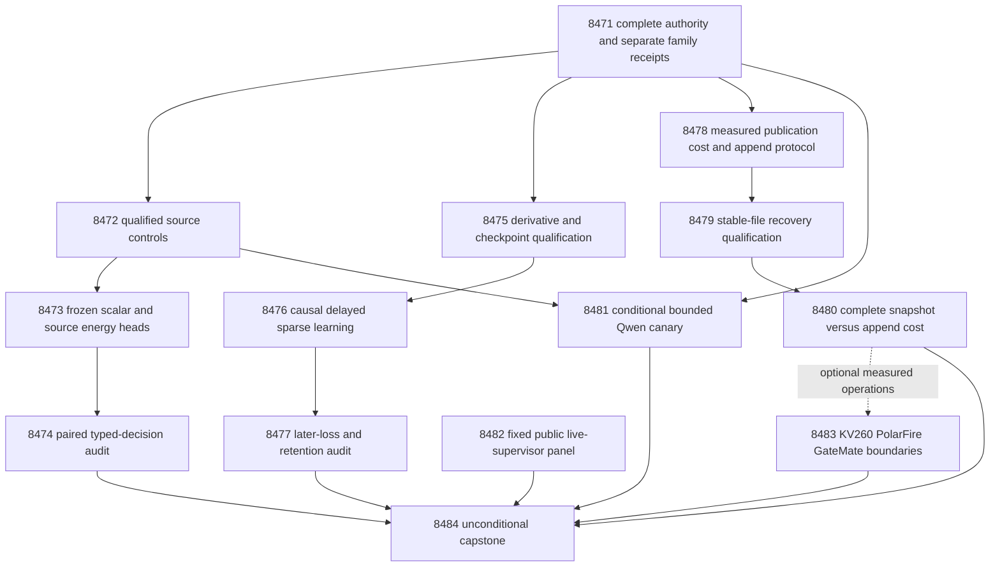

# Carnot Research Roadmap v729: Qualified source decisions, continuous proper-loss learning, and durable append efficiency

**Created:** 2026-10-13
**Milestone:** 2026.10.729
**Status:** Planned; execution and activation are pending.
**Predecessor:** 2026.10.728, fourteen scheduled tasks, Exp8457–Exp8470.
**Contract:** Exactly 14 tasks, Exp8471–Exp8484, in four phases and the order below.

This milestone tests the source-information and online-objective questions that
V728 never reached. It repairs named qualification failures first. Its new
storage intervention targets repeated pointer publication, which remained costly
in the qualified journal. The generator stays frozen. Public-label results remain
retrospective. CUDA recovery and board availability do not gate CPU science.

V728's complete design is preserved at
`openspec/change-proposals/research-roadmap-v728-preserved-20261013.md`.
Historical consumers retain their sealed authority. The active queue remains
`research-roadmap.yaml`; this document does not activate the staged queue.

## What V728 proved, and what remained unmeasured

The active queue and conductor log contain fourteen scheduled tasks. Nine have
primary result files. Five science/model producer files are absent after gates
or cascade skips. `research-complete.yaml` ends at V727 at planning time; its
19,742 archived task records include repeated milestone entries. It is not a
unique count of successful experiments. Conductor `OK` denotes completion,
not qualification or a beneficial scientific result.

| Evidence | Finding | Next consequence |
|---|---|---|
| Exp8457 | Full authority and source/learning/service inputs qualified; runtime repair score0 | Reuse independent families; keep optional model gate |
| Exp8458 | 246/247 owned statements; original-producer-pin rejection at line554 uncovered | Exercise the independent pin rejection; preserve thresholds |
| Exp8459–8460 | No fit/audit primary | Source information beyond scalar flexibility remains unmeasured |
| Exp8461 | Derivative and recovery checks passed, but563/564 owned statements; changed-reference rejection at line388 uncovered; historical child killed at600s | Add the missing rejection fixture; shard the exact original test set |
| Exp8462–8463 | No learning/audit primary | Objective-aligned continuous-learning benefit remains unmeasured |
| Exp8464 | Qualified disjoint service clocks; directory synchronization dominates sample rows | Target measured publication work, not a faster arithmetic kernel |
| Exp8465 | Snapshot/journal causal equivalence qualified on constructed workloads | Reuse transition semantics; a new storage protocol needs its own recovery qualification |
| Exp8466 | Speedup1.0447833367, CI95[0.9942346768,1.1095895448]; speed benefit0; p95 ratio0.5005563321 | Retire unchanged journal timing; test a different publication mechanism |
| Exp8467 | No primary; repair and source-control gates failed | No current Qwen inference evidence |
| Exp8468 | 231/232 owned statements; panel/registry rejection at line350 uncovered;16 episodes unstarted | Qualify rejection before collecting the fixed public panel |
| Exp8469 | Qualified continuity; required spline/journal operations and complete device clocks absent | Preserve actual board limits |
| Exp8470 | Fourteen slots accounted; scientific continuation blocked | Missing science stays missing, not a numerical null |

V726 remains the latest useful calibration and learning evidence. Its full
spline beat its logistic comparison retrospectively, but did not isolate source
information from scalar flexibility. Its admission-learning contrast was null.
V717 H1=-0.00390625 and H2=0 remain closed. V726's arithmetic-only complete-service
acceleration ceiling remains closed. Neither a new host store nor an exposed
question split establishes independent verification or generalized self-learning.

## The three biggest gaps to the PRD vision

1. **FR-12: useful independent verification.** A source head has not beaten a
   flexible scalar control under qualified paired decisions. Exp8472–8474 test
   that missing discriminator. New independently adjudicated questions and
   resolved exposure are still required for an independent factuality claim.
2. **FR-11: beneficial continuous learning.** Correct updates and durable state
   have not shown later decision gains. Exp8475–8477 qualify and test matched
   Brier/log-loss updates, frozen controls and simultaneous retention. This
   advances Tier1 sparse updates with bounded Tier2 feedback state.
3. **FR-05/08 and NFR-01: complete deployment efficiency.** Arithmetic is a tiny
   service fraction. Exp8478–8480 test a stable append file against the existing
   snapshot service. Host-storage improvement cannot close Rust/Python parity
   or the PRD's tenfold Rust-versus-Python throughput requirement.

ARC supervisor evaluation supports the north star through real action and
compute measurements. Four public games provide engineering evidence only.
They do not establish hidden-game transfer or a current-Qwen agent result.

## Research ingestion and experiment selection

The dated V729 entry in `research-references.md` preceded this design. It covers
all requested topics and secondary sources. Citation retrieval is incomplete;
Trending snapshots are stale. Source claims do not become Carnot findings.

| Source | Adopted idea | Experiment and limit |
|---|---|---|
| [Proper-score decomposition](https://arxiv.org/abs/2603.15232),2026 | Separate scalar recalibration from source information | Exp8472–8474; finite ablations, not a population decomposition |
| [Calibeating Made Simple](https://arxiv.org/html/2603.22167v1),2026 | Match online objective and proper-loss evaluation | Exp8475–8477; no transferred regret theorem |
| [Online KAN](https://arxiv.org/abs/2602.02056),2026 | Sparse local basis updates | Exp8475–8476; measure actual coefficients and cost |
| [Delayed capacity-constrained OCO](https://arxiv.org/abs/2606.11711),2026 | Hold pending capacity and feedback exposure fixed | Exp8476; no repeat of null admission selection |
| [SIFT](https://arxiv.org/abs/2610.04594),October2026 | Report repeat variability | Exp8474; not a hidden-state implementation |
| [VeriHarness](https://arxiv.org/abs/2610.00972),October2026 | Challenge shared wrong claims with source evidence | Exp8481; bounded constructed evidence-use canary |
| [Linux fsync semantics](https://man7.org/linux/man-pages/man2/fsync.2.html) | Separate file and namespace durability | Exp8478–8480; preserve required barriers |
| [Anechoic](https://arxiv.org/abs/2610.13368),October9 | Onsager correction for synchronous dense Ising optimization | Exp8483 maps prerequisites; no sampler or board benchmark |

New SAMBAR retention work is filed for later. Current retention is not the
binding failure, so no new regularizer is added. EBT, ARM–EBM, symbolic
certification and constrained decoding remain architecture context. Extropic
and Kona updates do not supply local hardware or independent correctness.
Retired external-text rankers, generator training and unchanged sampler sweeps
remain outside scope.

## Architecture

Science uses nine inputs and109 coefficients. The scalar spline has13
coefficients from its one-input basis. Service cost uses the separate qualified
five-input head. No cost claim silently transfers between these workloads.
Each reader checks original producer authority and current code qualification.

## Phase1 — Complete authority and qualified source decisions

**Exp8471–Exp8473: three tasks.** Exp8471 binds all fourteen complete task objects
and seals `v729-methods-protocol.json`. It inherits unexecuted V728 science
parameters and freezes the changed storage protocol separately. Source,
learning, service and supplied CUDA evidence receive independent readiness fields.
No model or board probe runs during binding.

Exp8472 exercises the exact original-pin rejection missed by Exp8458. It preserves
900 answers in300 question groups:150 fit,50 tune,100 test. Required usable
support stays128/32/80, with at least8 tune/test clusters per class. A1 is primary;
A2 is sensitivity. Question-level source permutations stay within dataset and
preserve generator sibling positions, q and targets. Seeds remain725/7252/7251.
The five controls are raw p2, scalar logistic, scalar cubic spline, full spline
and source-permuted full spline. Their parameter counts are0/2/13/109/109.

Exp8473 authenticates the original scalar-logistic, full and permuted heads.
It fits the missing scalar spline with zero initialization, degree3, original
fit-only scaling/knots,200 full-batch log-loss steps, rate0.01 and L2=0.001.
Choose temperature from{0.5,1,2} on tune log loss; ties prefer1 then smaller.
Keep seeds{17,29,43,71,101}; duplicate deterministic fits count once. Define
E(0)=0, E(1)=-eta/T, p=sigmoid(eta/T). Freeze all heads before evaluation.
Accept p<=0.2, reject p>=0.8, otherwise escalate with confidence.
