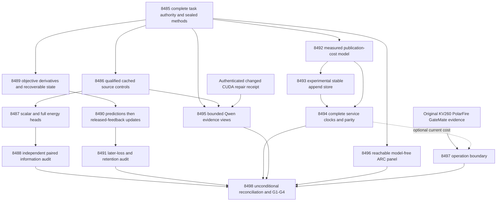

# Carnot Research Roadmap v730: Executable verification and continuous learning

**Created:** 2026-10-13

**Milestone:** 2026.10.730

**Status:** Planned; not activated or executed

**Title:** Executable source-information tests, continuous proper-loss learning, and durable append service

**Supersedes:** 2026.10.729; failed design preserved exactly in [research-roadmap-v729-preserved-20261013.md](research-roadmap-v729-preserved-20261013.md)
**Contract:** 14 tasks, Exp8485 through Exp8498 inclusive, in four phases. The visible table and complete machine contract below describe exactly `research-roadmap-next.yaml`. The active roadmap stays unchanged.

## What the previous milestone proved

V729 completed scheduling, not its scientific program. Its active YAML held fourteen tasks, but its design stopped after Phase 1 and omitted `## Exact task contract`, the task table, JSON and digest. Exp8471 correctly refused current authority: `methods_ready_score=0`, although `methods_frozen_score=1` and source, learning and service input readiness were all 1. Ten downstream tasks did not execute. This is a planning failure, not a null for source information, Brier learning or stable append storage.

| Evidence | Observed result | Consequence for V730 |
|---|---|---|
| Exp8471 contract | `complete_blocked_v729_contract_methods`; required validation passed; current contract absent | Emit and independently parse the complete design before queue activation; preserve old bytes. |
| Exp8482 ARC qualification | `complete_disqualified_v729_arc_panel_qualification`; 391/392 statements; original panel-replay line350 still unhit; all16 episodes unstarted | Begin the rejection test from a successful private historical replay, not an already-blocked fixture. |
| Exp8483 board boundary | `complete_blocked_v729_board_operation_boundary`; original reader ready, current boundary not ready | Reuse original board evidence under complete new authority; no unchanged physical probe. |
| Exp8484 capstone | `complete_blocked_v729_capstone`; four primary producers and ten nonexecuted slots | Keep primary, pre-gate, cascade-skip and absent evidence separate; no milestone-wide success claim. |
| V728 source/objective qualification | Exp8458 missed original line554; Exp8461 missed line388 and a historical test child timed out | Add the precise independent negative fixtures and preserve every collected test in bounded disjoint shards. |
| V728 durable service | Exp8465 journal equivalence qualified; Exp8466 speedup1.0447833367, CI95[0.9942346768,1.1095895448] | Preserve this null. Test a different stable-file publication mechanism only after durability qualification. |
| V726 earlier science | Exposed-history source comparison lacked a flexible scalar control; capacity-learning benefit was null with retention preserved | Execute the already registered information controls and matched objective study; do not reinterpret old nulls. |

The archive currently ends at V728, so V729 accounting uses the active queue, conductor log and current primary artifacts, not invented completed-archive entries. V717 H1=-0.00390625 and H2=0 remain closed. Qualified historical readers remain usable within their original sealed authority; they do not retroactively make the truncated V729 design valid.

## The three largest gaps against the PRD

1. **Independent evidence for useful verification (FR12).** Carnot can encode constraints and fit small decision heads, but exposed question labels, scalar flexibility and learned source information remain confounded. Energy verifies candidates; a fitted score is not an independently established truth oracle. Exp8486–8488 isolate the information question. Exp8495 diagnoses source and instruction sensitivity with the mandated live model; Exp8496 exercises the reachable live ARC path. Neither small public panel establishes hidden-game transfer or independent factual generalization.
2. **Beneficial continuous self-learning (FR11).** Durable feedback and changed coefficients exist; a demonstrated later-loss improvement with preserved retention does not. Exp8489–8491 hold admission, initial state, delay, capacity and examples fixed while comparing proper-loss objectives. This is the program's Tier1/Tier2 step toward learning constraints from use, not an autonomous rewrite of the generator or a claim that Tier3/Tier4 is complete.
3. **End-to-end deployment cost and hardware compatibility (FR05/FR08; NFR01).** Local arithmetic acceleration does not remove host durability cost. Exp8492–8494 test stable append publication with complete clocks and process-exit recovery. Exp8497 maps actual operations to installed boards. A host-store speedup cannot satisfy the separate matched Rust/Python >=10x NFR01 target.

Two infrastructure slots are sufficient: Exp8485 binds methods; Exp8498 reconciles evidence. Qualification work inside the science tracks repairs named missing checks. No conductor, exclusion-manifest or validator changes are proposed.

## Research grounding and experiment selection

The dated V730 scan was added to [research-references.md](../../research-references.md) before designing this queue. It covers arXiv's eight requested themes and OpenReview, Semantic Scholar, Hugging Face, GitHub Trending, Extropic and Logical Intelligence. Access limits are recorded: Semantic Scholar citation retrieval failed, the OpenReview forum challenged the browser, and trending snapshots were stale. These limits are not negative scientific findings.

| Research lead | Concrete use | Boundary |
|---|---|---|
| [Score decomposition](https://arxiv.org/abs/2603.15232) | Exp8487–8488: flexible scalar and source-permuted controls | A finite exposed panel does not estimate population grouping loss. |
| [Calibeating](https://arxiv.org/abs/2603.22167), [Online KAN](https://arxiv.org/abs/2602.02056), [delayed capacity OCO](https://arxiv.org/abs/2606.11711) | Exp8489–8491: matched Brier/log-loss gradients, sparse coefficient and capacity accounting | No convex-regret theorem or FPGA throughput transfers to this nonlinear host learner. |
| [Constrained paraphrase consistency](https://arxiv.org/abs/2606.08158), [VeriHarness](https://arxiv.org/abs/2610.00972) | Exp8495: sixteen bounded calls, fixed paraphrase and contradicted-evidence views | Diagnostic, not detector training, a full paper reproduction, or population accuracy. |
| [SIFT](https://arxiv.org/abs/2610.04594) | Exp8488: repeat-fit invariance, seed duplication and decision-flip reporting | No SIFT implementation or theorem claim. |
| [Anechoic](https://arxiv.org/abs/2610.13368), [author implementation](https://github.com/skethz/anechoic) | Exp8497: operation mapping and future evidence requirements | Dense Alveo V80 optimization is not the installed KV260 sampler or a Gibbs guarantee. |
| [EBT](https://arxiv.org/abs/2507.02092), [ARM–EBM](https://arxiv.org/abs/2512.15605), [MERITED](https://arxiv.org/abs/2610.00399) | Architectural context; defer another learned compute-allocation policy | Compatibility with EBM inference does not establish correct extracted constraints. |
| [GLEAN](https://arxiv.org/abs/2603.02798), [energy-based decoding](https://arxiv.org/abs/2605.28020), [CFGzip](https://arxiv.org/abs/2605.29986) | Record evidence/calibration and decoding leads for after current utility/runtime qualification | No new sequential head or decoder branch before its prerequisite evidence. |

PAL, T-SKM-Net, distributional EBMs, HalluScoring, primal-dual decoding, Extropic Z1T and Kona are also recorded with limitations in the research scan. No source warrants resurrecting retired external-text rankers, repeated sampler sweeps, unchanged CUDA diagnostics or GateMate flashing attempts.

## Architecture: information, learning and service remain distinguishable



Solid edges describe evidence flow; YAML `gated_on` fields below are the execution gates. Arrows into the capstone are read dependencies, never prerequisites that prevent it running. Historical source, learning and service families each retain separate immutable roots. The science head has nine inputs and109 coefficients; the scalar spline has13; the service experiment uses the established five-input head. Their timing or quality results are not interchangeable.

## Phase 1 — Complete authority and identify source information (Exp8485–8487)

**Exp8485, contract and methods.** Bind the visible table, entire JSON task objects including prompts, staged queue, and activated queue. Reject twelve authority mutations and truncation. Seal a new V730 protocol; use V729's protocol only as a historical method record. Preserve unchanged source, objective and append methods; explicitly register the fourth canary view and precise validation fixtures in `protocol_delta`. Emit independent input-readiness fields and inspect only a supplied changed CUDA repair receipt, for at most60 seconds, without device calls.

**Exp8486, source qualification.** Reach Exp8458's original independent-producer-pin rejection at line554 with an actually forged, self-consistently rehashed producer. Keep900 answers/300 questions and150/50/100 fit/tune/test roles,128/32/80 usable support and at least8 tune/test question clusters per target class. Qualified data are still exposed. Freeze raw p2, logistic scalar, q-only cubic spline, full spline and source-permuted spline controls with parameter counts0/2/13/109/109. Keep question-level permutation within dataset and original seeds725/7252/7251.

**Exp8487, calibrated decision training.** Authenticate existing full, permuted and logistic head bytes; block a missing head instead of silently retraining it. Fit the new scalar cubic spline from zero for200 full-batch log-loss steps, rate0.01 and L2=0.001 using fit-only scaler/knots. Select T in{0.5,1,2} on tune log loss, ties1 then smaller. Seeds17/29/43/71/101 retain their original roles; duplicate deterministic fits are not independent samples. Freeze E(0)=0,E(1)=-eta/T,p=sigmoid(eta/T), accept p<=0.2, reject p>=0.8, otherwise escalate. This satisfies the calibrated-decision training floor without changing 27B generator weights.

## Phase 2 — Evaluate information and continuous self-learning (Exp8488–8491)

**Exp8488, information benefit.** Seal predictions before evaluator access to A1/A2 labels. Emit7500 answer/arm/seed rows. Average siblings and seeds within the100 test questions. Primary gains are Brier(q-only)-Brier(full) and Brier(permuted)-Brier(full), with10000 paired question resamples, seed7278446 and97.5% two-sided intervals for two Bonferroni-adjusted contrasts. Both lower bounds must exceed0, with no typed-loss increase against q-only. Wrong/correct/escalate costs remain1/0/0.2. A1 is primary; A2 sensitivity only. Report Brier, log loss, coverage, false accepts and fixed strata even when small. Exposed-label positives are at most `circular_positive`.

**Exp8489, objective qualification.** Reuse derivatives and checkpoint adapter. Exercise the actual changed-source/code/coverage reference rejection at original reporting line388, requiring564/564 original statements plus added code. Collect every historical test node before execution, partition into disjoint <=600-second shards, preserve the exact union and heartbeat each60 seconds. Total historical validation budget1800 seconds. Check Brier derivative2(p-y)p(1-p)/T and log-loss derivative(p-y)/T against dense/sparse finite differences at T=.5/1/2,y=0/1,eta=-20,-4,0,4,20. Absolute error<=1e-7 and relative<=1e-5 above magnitude1e-6; retain bias and regularization conventions. Exercise actual exits and wrong-rule/future-label/duplicate rejection.

**Exp8490, continuous objective learning.** Start all arms from the original V726 full head, not Exp8487 scalar fits. Five blocks of20 questions, capacity8 and uniform admission before label release stay fixed. Compare frozen, log-loss update, Brier update and Brier with shuffled current released labels. Emit6000 intended rows. Commit issued predictions/admissions before committing released updates,RNG,IDs,cursor; stable feedback IDs prevent double application. Exit after block2 for seed17 in every arm and require bit-identical resumed state/predictions. Evaluate all five retention windows on the original50 tune questions through a read-only evaluator; the learner cannot access those targets.

**Exp8491, objective benefit.** Reconstruct predictions/updates independently. Compare later blocks1–4 (80 question clusters) against both log-loss and frozen baselines with10000 paired draws, seed7278448 and97.5% intervals. Both Brier-gain lower bounds must exceed0, with no typed-loss increase versus either control. Require simultaneous one-sided95% retention upper bound<=0.01 across five windows using shared question resamples and the per-draw maximum; retain seed7258421. Shuffled feedback is a negative control. This is conditional exposed-history evidence: independent/generalized benefit scores remain0. Coefficient activity alone cannot pass the benefit gate.

## Phase 3 — Change the measured persistence bottleneck (Exp8492–8494)

**Exp8492, publication cost model.** Reconstruct disjoint serialization,file-sync,directory-sync,pointer-publication spans and residuals from qualified Exp8464/8466 evidence. Do not rerun the old null journal benchmark. Map observed calls to create/rename/unlink operations and derive a conditional ceiling for avoiding repeated pointer namespace publication. Freeze the stable-append protocol before code changes. Counterfactual removable cost is not measured speedup.

**Exp8493, durable append qualification.** Implement a separate experimental single-writer stable journal using the unchanged five-input transition oracle and event tape. Frame records with version,sequence,length,payload checksum,previous digest,code/config hashes and stable acknowledgment IDs. Precreate and fsync file plus parent directory; append with short-write handling and fsync before acknowledgment. Checkpoint every32 committed transactions and at final drain. Namespace changes still require directory sync; durable checkpoint/prefix publication precedes reclamation and retains pinned readers. Keep MAX_EVENTS256,MAX_BYTES2MiB,journal16MiB; overflow blocks rather than loses feedback. Replay valid complete unacknowledged records idempotently; discard only an incomplete final frame; reject interior corruption and conflicting IDs. Use actual process exits at every append/sync/ack/checkpoint/reclamation boundary and independent logical-state parity. This establishes process-exit recovery, not physical power-loss durability.

**Exp8494, complete service cost.** Primary natural batch1/reuse8; secondary batch8/reuse8. Each cell contains64 decisions, one warmup and five measured paired repeats in fixed alternating AB/BA order. Restore identical state on the same disk-backed filesystem. Include cold reconstruction,startup,features,prediction,feedback,checkpoint/rotation,response and final drain in the complete clock; restart replay is separately measured. Record per-repeat latency p50/p95,bytes,syncs,namespace calls,memory,disk and all feedback accounting. Require bit-identical logical results and all durability checks. For the primary cell, speedup=sum(snapshot wall)/sum(append wall);10000 resamples of five paired repeat indices with inherited seed7298480; lower95>1 and p95 ratio<=1.05. Lower95>=10 is a separate host-service target, never Rust/Python NFR01. Secondary gains cannot rescue the primary. Measurement limit1800 seconds; incomplete pairs block benefit rather than disappear.

## Phase 4 — Live-path diagnostics, hardware continuity and closure (Exp8495–8498)

**Exp8495, bounded Qwen evidence.** Requires authenticated changed CUDA repair and qualified source controls. Load cached `unsloth/Qwen3.8-27B-GGUF` Q4_K_M with its embedded tokenizer under the existing GPU lease. Four frozen fit questions, first generator sibling, four views: source present; absent; present with a plausible claim explicitly contradicted by a source span; present with one fixed instruction paraphrase while claim/source bytes remain identical. Freeze all text before generation; ambiguous cases remain missing. Sixteen calls,temperature0,max128 output tokens. Report per-question span compliance,abstention,view disagreements,truncation and failure. `model_bounded_generation` has a10-second plausibility floor; never label this full generation or pad runtime. Load<=600s,calls<=120s,total measurement<=2400s, native CLI `--single-turn`. No prompt tuning, adaptive expansion or head training from outputs. If no changed repair exists, skip; never substitute a small headline model.

**Exp8496, ARC live-path panel.** The Exp8482 negative fixture failed too early. First obtain a valid private original V728 replay satisfying its historical pins, source snapshots and authority; only then alter the frozen panel against independent registry metadata and prove line350 executes. Preserve all392 baseline statements and the original collected test union. After qualification and complete current authority, freeze the first four metadata-hash-ordered games,seeds11/22,supervisor off/on:16 episodes. Actual `make_carnot_agent`/`E3AgentPolicy` SDK transitions, model-free configuration, no per-game adapters,stored routes,calibration,source inspection or offline BFS. Registry-precheck avoids duplicate level credit. Limit512 actions/120s per episode and2400s total; unavailable games stay missing. Record frames,actions,provenance,official-score availability,compute and redirect outcomes. Compare all paired episodes; right-censor unresolved redirects. Refinement requires>=3 overlapping games and>=5 resolved outcomes per shared arm cell. Otherwise descriptive rows and blocked refinement, no policy change. Incidental level claims require `solve_provenance=live_agent_self_discovery`; no duplicate public solve or hidden-game headline.

**Exp8497, board operation boundary.** No SSH,USB,synthesis or flashing. Reuse qualified original KV260 quadratic-Ising k<=5 and PolarFire Linux-CPU graduation receipts. Neither installed image supports the spline learner or durable append service. Optional qualified Exp8494 cost informs operation mapping; otherwise use dated Exp8466 evidence with the exact missing current field. Carry GateMate's original missing bytes/hashes and IDCODE0xffffffff. Reopening requires source-byte recovery,dated physical change,GM1Ax0x20000001,n16 flash and sample/hash evidence; keep `gatemate_bitstream_flashed=false` until proved. Anechoic and Extropic remain future operation leads, not local speed claims. This administrative read is routine Sonnet20; actual future hardware integration would require Opus100 and new authorization/evidence.

**Exp8498, capstone.** Always execute, no `requires` or gates. Account for exactly14 slots, including its own current reconciliation until publication. Distinguish validated producer,disqualified producer,pre-gate receipt,cascade skip and absent artifact. Cold-replay eligible branches with original dates and isolated roots; bound workers to1500MiB peak/500MiB growth and preserve outside-checkout CLI tests. Recompute source gains,learning gains,retention and primary complete-clock speed. Run unchanged G1–G4 via `scripts/publication_gate.py --json`; emit `paper_ready` and `unmet_gates`. External absence is `blocked`, never retryable `partial`. Recommend exact-verdict retirements without editing historical manifests or publishing externally.

## Dependency graph and runtime gates

| Consumer | Required current producers and exact fields |
|---|---|
| Exp8485 | None; independently validates authority and input families |
| Exp8486 | Exp8485.methods_ready_score==1 AND source_inputs_ready_score==1 |
| Exp8487 | Exp8486.source_controls_ready_score==1 |
| Exp8488 | Exp8487.head_controls_ready_score==1 |
| Exp8489 | Exp8485.methods_ready_score==1 AND learning_inputs_ready_score==1 |
| Exp8490 | Exp8489.objective_kernel_ready_score==1 |
| Exp8491 | Exp8490.objective_stream_ready_score==1 |
| Exp8492 | Exp8485.methods_ready_score==1 AND service_inputs_ready_score==1 |
| Exp8493 | Exp8492.append_protocol_ready_score==1 |
| Exp8494 | Exp8493.append_store_ready_score==1 AND Exp8492.append_protocol_ready_score==1 |
| Exp8495 | Exp8485.runtime_repair_ready_score==1 AND Exp8486.source_controls_ready_score==1 |
| Exp8496 | Exp8485.methods_ready_score==1 |
| Exp8497 | None; current cost is optional, historical hardware obligations are mandatory |
| Exp8498 | None; missing inputs must be reconciled |

Every gate producer exists earlier in this queue, and each field is declared verbatim in its own REQUIRED ARTIFACT FIELDS. The complete JSON below includes the actual gate dictionaries. No historical retired experiment is a `requires` dependency. Full `prior_failures` entries name actual previous verdicts, changed conditions and `retire_if_same_verdict: true`; cascade-skipped immediate predecessors with no artifact are described as nonexecution, not assigned invented verdicts. No operator override is requested.

## Hardware requirements and execution budgets

| Resource | Required use and limit |
|---|---|
| Existing CPU host and Python environment | Thirteen tasks use `no_model_load`, `MODEL_SPECS: []`; numeric training is on the small head. Use `.venv`, explicit `JAX_PLATFORMS=cpu`, disk-backed private scratch, bounded workers and measured memory. |
| Local disk with real fsync/rename | Append qualification and service clocks; never RAM-backed timing, global cache-drop commands or waived durability. Inspect free space first; retain original historical artifacts and bounded raw shards. |
| Cached mandated Qwen and existing dual RTX 3090 host | Only Exp8495; qualified changed driver/context/copy receipt and GPU lease first. Physical inventory is not a current working-runtime claim. Pin actual GGUF hash, CUDA backend and offloaded layers. No model downloads, new dual-GPU integration or full 27B training are required by this plan. |
| KV260 and PolarFire | Evidence read only. Supported installed operation sets remain unchanged. No board-dependent gate on CPU science. |
| GateMate | Closed until exact physical/source evidence changes. No repeated diagnostic slot. |
| TSU,NPU,Alveo V80 | No locally qualified access assumed and no purchase prerequisite. Vendor estimates do not qualify deployment. |

The queue records per-task wall estimates and max-turn budgets, not promises of measured runtime. The4800-second task cap includes synthesis and validation. Every prompt mandates unbuffered flushed lines at phase boundaries and before/after long loads,generation,benchmarks,subprocesses; loops and child polling emit actual progress each<=60 seconds, keeping gaps below600 seconds. Files over about200 lines are written through multiple <=150-line calls with progress between. Default measurement deadline3600 seconds reserves>=900 seconds for validation; narrower task-specific budgets take precedence. Never fabricate activity or pad substrate duration.

Formulaic source/derivative/store code routes to Codex `gpt-6.1-sol`; schema/authority integration uses Claude Opus100; routine numerical studies and audits use explicit Claude Sonnet with20–50 turns. These are implementation-agent settings, distinct from experimental `MODEL_SPECS`. No Luna experiment or Gemini Deep Think claim is included.

## Acceptance, retirement and scope limits

All fourteen tasks declare `per_unit_rows: true`, a closed `verdict_class`, free-text `honest_verdict`, primitive hashes, original-producer provenance, check receipts and `gate_check_summary`. Every intended unit remains present with a value or missing reason. Oracle fixtures and exposed-history positives use `circular_positive`; readiness is distinct from scientific benefit. `partial` is reserved for retryable owned incomplete work. External absent/retired/blocked dependencies use `blocked`; owned failed validation is `disqualified`.

Before publication, task runners require focused unit tests, exact historical-suite accounting, Ruff check/format, strict mypy, scoped spec coverage, relevant E2E-018/021 private original-date consumers, genuine Coverage.py shards with100% newly owned statement coverage, independent cold replay, adversarial verification and strict per-row consistency. Killed children are not passes. Do not relax validators or rerun the full repository suite. Reconcile specs,BMAD,status and changelog after each actual implementation; the planned requirements below remain unimplemented until then.

The planner itself validates schema, gates, exclusion discipline, complete-object/table/digest equality and twelve negative contract mutations before handoff. It runs the existing private authority lifecycle E2E without rewriting historical primaries. Planning does not activate the queue or execute experiments.

If source contrasts or objective/retention gates fail, retire the unchanged claim and name fresh independent evidence needed to reopen it. If append speed fails under complete clocks, retain the qualified mechanism if useful but retire its unchanged speed claim. Missing qualification evidence must not masquerade as a scientific null. G1–G4 and the independent-generalization/Rust targets remain open unless their own unchanged tests pass. No push, external publication, conductor edit or active-roadmap edit is part of this milestone planning change.

## Exact task contract

The following table is the human contract. The complete JSON after it is the machine contract, including every prompt, gate and prior-failure entry. SHA256 uses UTF-8 `json.dumps(tasks, sort_keys=True, separators=(",", ":"), ensure_ascii=False)` with no newline. Both must match the staged queue; at activation they must also match the active queue. Changing any task requires regenerating the table, full JSON and digest together.

| Order | ID | Title | Phase | Deliverable |
|---|---|---|---|---|
| 1 | `exp8485-contract-methods` | Bind fourteen tasks and freeze qualified science and append-store methods | 1 | `results/experiment_8485_v730_contract_methods.json` |
| 2 | `exp8486-source-control-qualification` | Qualify source controls after the missing producer-pin rejection test | 1 | `results/experiment_8486_v730_source_control_qualification.json` |
| 3 | `exp8487-source-control-fit` | Fit scalar energy controls and freeze typed source decisions | 1 | `results/experiment_8487_v730_source_control_fit.json` |
| 4 | `exp8488-source-information-audit` | Measure source information beyond scalar calibration on fixed questions | 2 | `results/experiment_8488_v730_source_information_audit.json` |
| 5 | `exp8489-objective-checkpoint-qualification` | Qualify objective updates with complete rejection coverage and bounded test shards | 2 | `results/experiment_8489_v730_objective_checkpoint_qualification.json` |
| 6 | `exp8490-brier-online-learning` | Measure continuous sparse learning with objective-aligned delayed updates | 2 | `results/experiment_8490_v730_brier_online_learning.json` |
| 7 | `exp8491-objective-benefit-audit` | Audit later decision benefit and simultaneous retention from causal rows | 2 | `results/experiment_8491_v730_objective_benefit_audit.json` |
| 8 | `exp8492-publication-cost-model` | Test whether stable journal names remove the measured synchronization bottleneck | 3 | `results/experiment_8492_v730_publication_cost_model.json` |
| 9 | `exp8493-append-store-qualification` | Qualify durable append recovery without a pointer replacement on every transaction | 3 | `results/experiment_8493_v730_append_store_qualification.json` |
| 10 | `exp8494-append-service-cost` | Compare complete stable-append and snapshot service under identical durable work | 3 | `results/experiment_8494_v730_append_service_cost.json` |
| 11 | `exp8495-bounded-qwen-evidence` | Test bounded Qwen evidence and fixed instruction-paraphrase sensitivity | 4 | `results/experiment_8495_v730_bounded_qwen_evidence.json` |
| 12 | `exp8496-arc-panel-qualification` | Qualify the missing ARC panel rejection path and measure live supervisor generalization | 4 | `results/experiment_8496_v730_arc_panel_qualification.json` |
| 13 | `exp8497-board-operation-boundary` | Map append operations to KV260 and preserve PolarFire and GateMate evidence | 4 | `results/experiment_8497_v730_board_operation_boundary.json` |
| 14 | `exp8498-capstone` | Reconcile fourteen outcomes and decide information learning and append continuation | 4 | `results/experiment_8498_v730_capstone.json` |

canonical_tasks_sha256: `37ffae6a91ff0b935c365948c7d3f9cc51f56b25ece016f05677d0dd10cf53c0`

Canonical full-task SHA-256: `37ffae6a91ff0b935c365948c7d3f9cc51f56b25ece016f05677d0dd10cf53c0`

<!-- V730_TASK_CONTRACT_START -->
```json
{
  "milestone": "2026.10.730",
  "tasks": [
    {
      "id": "exp8485-contract-methods",
      "title": "Bind fourteen tasks and freeze qualified science and append-store methods",
      "phase": 1,
      "track": "infrastructure",
      "priority": "high",
      "requires_gpu": false,
      "max_turns": 100,
      "estimated_wall_time_min": 45,
      "per_unit_rows": true,
      "milestone": "2026.10.730",
      "deliverable": "results/experiment_8485_v730_contract_methods.json",
      "inference_substrate_class": "no_model_load",
      "MODEL_SPECS": [],
      "gated_on": [],
      "prior_failures": [
        {
          "experiment_id": "exp8416-contract-methods",
          "verdict": "complete_blocked_v725_contract_methods",
          "addressed_by": "The planner now emits and independently validates the complete fourteen-task table, full JSON, YAML and digest before execution; V729 was truncated. Preserve that failure and seal new authority.",
          "retire_if_same_verdict": true
        },
        {
          "experiment_id": "exp8443-contract-methods",
          "verdict": "complete_blocked_v727_contract_methods",
          "addressed_by": "The planner now emits and independently validates the complete fourteen-task table, full JSON, YAML and digest before execution; V729 was truncated. Preserve that failure and seal new authority.",
          "retire_if_same_verdict": true
        },
        {
          "experiment_id": "exp8471-contract-methods",
          "verdict": "complete_blocked_v729_contract_methods",
          "addressed_by": "The planner now emits and independently validates the complete fourteen-task table, full JSON, YAML and digest before execution; V729 was truncated. Preserve that failure and seal new authority.",
          "retire_if_same_verdict": true
        }
      ],
      "agent_type": "claude",
      "model": "opus",
      "prompt": "CONTEXT:\nWork in {project_root} on {date}. V729 finished scheduling fourteen tasks, but its truncated design lacked the Exact task contract table, JSON and digest. Exp8471 methods_ready_score=0 cascade-blocked ten tasks: source-information, Brier-learning and append-service science did not run. Four primary producers ran; Exp8482 remained disqualified at391/392 statements with the original ARC line350 untested, while Exp8483 and Exp8484 honestly recorded missing authority. This is not evidence against those unmeasured hypotheses. Preserve V728 qualified journal equivalence and its null complete-service speedup1.0447833367, CI95[0.9942346768,1.1095895448], and V726 exposed-history results. V717 H1=-0.00390625/H2=0 remain closed. V730 supplies complete planner-validated authority before execution and narrows actual missing-branch fixtures. Generator weights stay frozen; CPU science is independent of optional CUDA and boards.\nEXISTING CODE TO READ FIRST:\nCLAUDE.md; CODEX.md; ops/e2e-test-plan.md; ops/exclusion_manifest.yaml; openspec/capabilities/research-reporting/spec.md; openspec/capabilities/verification/spec.md; scripts/experiment_template.py; python/carnot/reporting/primary_publication.py; openspec/change-proposals/research-roadmap-vNEXT.md; python/carnot/reporting/v728_contract_methods.py; python/carnot/reporting/v727_historical_inputs.py; python/carnot/reporting/roadmap_contract.py; openspec/change-proposals/v728-methods-protocol.json; results/experiment_8457_v728_contract_methods.json; results/experiment_8470_v728_capstone.json; python/carnot/verify/cuda_reader_8410.py; python/carnot/reporting/v729_contract_methods.py; python/carnot/reporting/v729_historical_inputs.py; results/experiment_8471_v729_contract_methods.json; results/experiment_8484_v729_capstone.json; openspec/change-proposals/v729-methods-protocol.json\nTASK:\nBind fourteen tasks and freeze qualified science and append-store methods. Deliver results/experiment_8485_v730_contract_methods.json. Create thin runner scripts/experiments/experiment_8485_v730_contract_methods.py. Put primitive evidence under results/raw/experiment_8485_v730_contract_methods/. Write docs/research-notes/v730-contract-methods.md. Same-roadmap upstream outputs are future dependencies, not existing files. Changed condition: The planner now emits and independently validates the complete fourteen-task table, full JSON, YAML and digest before execution; V729 was truncated. Preserve that failure and seal new authority.\nCONCRETE STEPS:\n1. PRECONDITIONS: Print a flushed start line. Authenticate the activated V730 task and required input hashes. Check tools, memory, disk-backed private scratch and deadlines. Read historical producers under their sealed original authority, not current vNEXT. Record unavailable required inputs in gate_check_summary. Missing optional hardware cannot block unrelated CPU work.\n2. Print a flushed progress line at each phase boundary. Print before and after every model load, generation, benchmark and subprocess that can take minutes. Print completed/pending counts inside long loops. Poll owned children and emit actual status at least every 60 seconds. Keep every output gap below 600 seconds, including synthesis. Use unbuffered output. Write any file over about 200 lines in several tool calls of at most about 150 lines. Send a progress message between calls. Keep every tool call bounded. Stop measurement by 3600 seconds and reserve at least 900 seconds within the 4800-second cap for validation. Never pad duration.\n3. Spec first: add relevant REQ-* and SCENARIO-* before implementation. Write focused failing tests first. Preserve existing assertions and acceptance thresholds. Reuse shipped modules through narrow adapters. Put runners in scripts/experiments/, tests in tests/python/, scratch outside the repository root. Accept --date {date}. Do not modify research-roadmap.yaml. Do not change generator weights or publish externally.\n4. Declare inference_substrate_class=no_model_load, MODEL_SPECS=[] and zero current LLM calls. Use aggregation_from_upstream_artifacts for readers or verifier_ensemble_against_cached_candidates for numerical heads. Imported outputs belong in historical_model_provenance.\n5. Compare exactly fourteen tasks Exp8485-Exp8498 across the visible Exact task contract table, complete embedded JSON, canonical_tasks_sha256 and activated YAML. Use full dictionary equality, including prompts and priors. Reject twelve mutations: count, order, ID, title, phase, deliverable, model, substrate, gate field, prompt, prior retirement flag, and truncation/missing end marker. Preserve the planner-created byte-identical failed V729 design at openspec/change-proposals/research-roadmap-v729-preserved-20261013.md and the original V728 sealed authority. Never reconstruct either old design from a new queue. Require current_contract_ready_score=1 before methods_ready_score=1.\n6. Seal openspec/change-proposals/v730-methods-protocol.json before science. Read the V729 protocol as a historical method record, not valid V729 task authority. Inherit its unmeasured source_controls, scalar_fit, source_audit, objective_updates, objective_audit, append_protocol and append_cost operands without changing seeds, splits, thresholds or clocks. Freeze precise original-branch validation fixtures and a fourth bounded instruction-paraphrase evidence view separately in protocol_delta. Cite the 2026-10-13 V730 literature scan in research-references.md: CCHD motivates sensitivity diagnostics, Online KAN/Calibeating motivate the objective test, and storage durability stays grounded in local syscall semantics. No generalization theorem transfers to exposed labels.\n7. Authenticate V726 source/head/checkpoint families and V728 service families in separate immutable roots. Emit source_inputs_ready_score, learning_inputs_ready_score and service_inputs_ready_score independently. methods_ready_score requires current authority and the complete protocol only. The science head has nine inputs and109 coefficients; the scalar basis has13 coefficients; service uses the five-input head.\n8. Inspect only explicitly supplied ops/cuda-runtime-repair-receipt.json for at most60 seconds with the shipped Exp8410 reader. Emit runtime_repair_ready_score=1 only for changed driver/context/copy operands authenticated against current hashes. Missing evidence yields0 without device probes. No current CUDA, model or board calls. Run original-date E2E-018/021 historical consumers without substituting this invocation date.\n9. Run scoped unit tests and real private CLI checks. Run applicable ops/e2e-test-plan.md checks, including E2E-018 authority and E2E-021 historical replay. Run Ruff check/format, strict mypy and scripts/check_spec_coverage.py --files <owned-test-files>. Require 100 percent newly owned statement coverage, including children and rejection paths. Use genuine Coverage.py shards with pytest -n 0 -o addopts= --no-cov. Collect required test node IDs before execution. Split slow historical suites into bounded nonoverlapping shards; prove their union equals the original collection. Capture commands, exits, duration and log hashes. Never omit a slow assertion or treat a killed child as passed. Do not run the full repository suite.\n10. Cold-replay primitive rows in a fresh bounded process. Test missing inputs, deliberate failures and self-consistently rehashed tampering. Run unchanged primary_publication, scripts/adversarial_verify.py --json <private-candidate> and scripts/verdict_row_consistency_lint.py --strict <private-candidate>. Retain findings. Resolve informational findings only through shipped typed consumers with independent operands and negative controls. Unresolved findings block readiness. Do not modify validators or add exemptions. Atomically publish terminal bytes after validation. Owned validation failure is disqualified. Unchanged external absence is blocked, never partial. Reconcile openspec/, _bmad/traceability.md, ops/status.md and ops/changelog.md.\nREQUIRED ARTIFACT FIELDS:\nexperiment_id, task_id, milestone, run_date: principle: Bind evidence to this task and actual invocation.\nhonest_verdict, verdict_class: principle: Terminal honest_verdict starts complete_; verdict_class is exactly positive | circular_positive | null | blocked | disqualified | partial. Only unfinished retryable owned work is partial.\ngate_check_summary: principle: Each blocked_* or complete_blocked_* verdict names the failed check, upstream, path/hash, field, operator, expected and observed; missing is distinct from zero.\ninference_substrate, inference_substrate_class, MODEL_SPECS, model_invocation_counts, historical_model_provenance: principle: Declare actual work; imported model output is cached evidence, never current generation.\nrows, intended_count, completed_count, failed_count, censored_count, excluded_count, independent_count, sample_size_budget: principle: Every intended unit and arm has a metric or missing reason; seeds, siblings and repeats do not multiply independent questions.\nverifier_is_oracle, exposure_scope, independent_generalization_score, generalized_learning_benefit_score: principle: Oracle positives use circular_positive; exposed experiments and engineering fixtures keep both generalization scores zero.\nrequired_checks_passed, flagged_adversarial, acceptance_gates, validation_receipts, terminal_validation_sidecar_path, adversarial_findings: principle: Qualification is distinct from scientific benefit; failed required checks forbid positive classes.\npreconditions_checked, duration_s, phase_spans, random_seed, reproducibility_checksum, source_artifact_hashes, code_config_hashes, raw_shard_hashes: principle: Preserve actual work and immutable primitive operands.\ncited_upstream_artifacts, field_principles: principle: Explain each extra metric/gate and list imported fields with original producer hashes.\ncurrent_contract_ready_score, methods_ready_score, source_inputs_ready_score, learning_inputs_ready_score, service_inputs_ready_score, runtime_repair_ready_score, canonical_tasks_sha256, contract_digest, historical_family_receipts, methods_protocol_reference, protocol_delta, literature_mapping: principle: Independent readiness gates do not imply scientific benefit.\nRun command: cd {project_root} && JAX_PLATFORMS=cpu PYTHONPATH=python:. PYTHONUNBUFFERED=1 .venv/bin/python -u scripts/experiments/experiment_8485_v730_contract_methods.py --date {date}\nDo NOT push. Do NOT modify scripts/research_conductor.py.\n"
    },
    {
      "id": "exp8486-source-control-qualification",
      "title": "Qualify source controls after the missing producer-pin rejection test",
      "phase": 1,
      "track": "research",
      "priority": "high",
      "requires_gpu": false,
      "max_turns": 30,
      "estimated_wall_time_min": 40,
      "per_unit_rows": true,
      "milestone": "2026.10.730",
      "deliverable": "results/experiment_8486_v730_source_control_qualification.json",
      "inference_substrate_class": "no_model_load",
      "MODEL_SPECS": [],
      "gated_on": [
        {
          "upstream": "exp8485-contract-methods",
          "artifact_field": "methods_ready_score",
          "op": "==",
          "value": 1
        },
        {
          "upstream": "exp8485-contract-methods",
          "artifact_field": "source_inputs_ready_score",
          "op": "==",
          "value": 1
        }
      ],
      "prior_failures": [
        {
          "experiment_id": "exp8403-released-question-identity",
          "verdict": "complete_blocked_released_question_identity",
          "addressed_by": "V729 never reached this repair because methods_ready_score was zero. Complete V730 authority now precedes the independent original-producer-pin fixture for Exp8458 line554.",
          "retire_if_same_verdict": true
        },
        {
          "experiment_id": "exp8444-source-control-panel",
          "verdict": "blocked_gate_check_failed",
          "addressed_by": "V729 never reached this repair because methods_ready_score was zero. Complete V730 authority now precedes the independent original-producer-pin fixture for Exp8458 line554.",
          "retire_if_same_verdict": true
        },
        {
          "experiment_id": "exp8458-source-control-panel",
          "verdict": "complete_disqualified_v728_source_control_panel",
          "addressed_by": "V729 never reached this repair because methods_ready_score was zero. Complete V730 authority now precedes the independent original-producer-pin fixture for Exp8458 line554.",
          "retire_if_same_verdict": true
        },
        {
          "experiment_id": "exp8472-source-control-qualification",
          "verdict": "blocked_gate_check_failed",
          "addressed_by": "V729 never reached this repair because methods_ready_score was zero. Complete V730 authority now precedes the independent original-producer-pin fixture for Exp8458 line554.",
          "retire_if_same_verdict": true
        }
      ],
      "agent_type": "codex",
      "model": "gpt-6.1-sol",
      "prompt": "CONTEXT:\nWork in {project_root} on {date}. V729 finished scheduling fourteen tasks, but its truncated design lacked the Exact task contract table, JSON and digest. Exp8471 methods_ready_score=0 cascade-blocked ten tasks: source-information, Brier-learning and append-service science did not run. Four primary producers ran; Exp8482 remained disqualified at391/392 statements with the original ARC line350 untested, while Exp8483 and Exp8484 honestly recorded missing authority. This is not evidence against those unmeasured hypotheses. Preserve V728 qualified journal equivalence and its null complete-service speedup1.0447833367, CI95[0.9942346768,1.1095895448], and V726 exposed-history results. V717 H1=-0.00390625/H2=0 remain closed. V730 supplies complete planner-validated authority before execution and narrows actual missing-branch fixtures. Generator weights stay frozen; CPU science is independent of optional CUDA and boards.\nEXISTING CODE TO READ FIRST:\nCLAUDE.md; CODEX.md; ops/e2e-test-plan.md; ops/exclusion_manifest.yaml; openspec/capabilities/research-reporting/spec.md; openspec/capabilities/verification/spec.md; scripts/experiment_template.py; python/carnot/reporting/primary_publication.py; openspec/change-proposals/research-roadmap-vNEXT.md; python/carnot/reporting/v728_source_control_panel.py; python/carnot/reporting/v728_source_control_runner.py; tests/python/test_v728_source_control_panel_8458.py; results/experiment_8458_v728_source_control_panel.json; python/carnot/verify/v726_criterion_energy_fit.py\nTASK:\nQualify source controls after the missing producer-pin rejection test. Deliver results/experiment_8486_v730_source_control_qualification.json. Create thin runner scripts/experiments/experiment_8486_v730_source_control_qualification.py. Put primitive evidence under results/raw/experiment_8486_v730_source_control_qualification/. Write docs/research-notes/v730-source-control-qualification.md. Same-roadmap upstream outputs are future dependencies, not existing files. Changed condition: V729 never reached this repair because methods_ready_score was zero. Complete V730 authority now precedes the independent original-producer-pin fixture for Exp8458 line554.\nCONCRETE STEPS:\n1. PRECONDITIONS: Print a flushed start line. Authenticate the activated V730 task and required input hashes. Check tools, memory, disk-backed private scratch and deadlines. Read historical producers under their sealed original authority, not current vNEXT. Record unavailable required inputs in gate_check_summary. Missing optional hardware cannot block unrelated CPU work.\n2. Print a flushed progress line at each phase boundary. Print before and after every model load, generation, benchmark and subprocess that can take minutes. Print completed/pending counts inside long loops. Poll owned children and emit actual status at least every 60 seconds. Keep every output gap below 600 seconds, including synthesis. Use unbuffered output. Write any file over about 200 lines in several tool calls of at most about 150 lines. Send a progress message between calls. Keep every tool call bounded. Stop measurement by 3600 seconds and reserve at least 900 seconds within the 4800-second cap for validation. Never pad duration.\n3. Spec first: add relevant REQ-* and SCENARIO-* before implementation. Write focused failing tests first. Preserve existing assertions and acceptance thresholds. Reuse shipped modules through narrow adapters. Put runners in scripts/experiments/, tests in tests/python/, scratch outside the repository root. Accept --date {date}. Do not modify research-roadmap.yaml. Do not change generator weights or publish externally.\n4. Declare inference_substrate_class=no_model_load, MODEL_SPECS=[] and zero current LLM calls. Use aggregation_from_upstream_artifacts for readers or verifier_ensemble_against_cached_candidates for numerical heads. Imported outputs belong in historical_model_provenance.\n5. Reuse the existing Exp8458 panel builder. Reproduce missing coverage at v728_source_control_panel.py original line554: rejection of a producer hash that differs from the independent original pin. Add a private self-consistently rehashed forged-producer regression. Preserve all existing tests and pin checks; do not remove the branch or exclude it from coverage.\n6. Requalify existing V726 feature and head bytes with historical authority in isolated roots. Keep900 answers,300 questions and150/50/100 fit/tune/test roles. Keep128/32/80 usable support and8 tune/test question clusters per target class. Unknown prior exposure remains explicit.\n7. Freeze raw p2, scalar logistic, q-only cubic spline, full nine-input spline and question-level source-permuted full spline controls. Preserve q, targets and generator slots. Permute source blocks within dataset using seeds725/7252/7251 for fit/tune/test. Parameter counts are0/2/13/109/109. Generator identity is a reporting stratum only. Deny prediction code evaluator-label access.\n8. Emit source_controls_ready_score only after fresh100 percent owned coverage, original consumer checks and cold reconstruction pass. Bind the repaired code to a NEW receipt; preserve Exp8458 terminal bytes and recorded failure. Verify the q-only model is invariant to source changes and the full/permuted pair has identical parameter capacity.\n9. Run scoped unit tests and real private CLI checks. Run applicable ops/e2e-test-plan.md checks, including E2E-018 authority and E2E-021 historical replay. Run Ruff check/format, strict mypy and scripts/check_spec_coverage.py --files <owned-test-files>. Require 100 percent newly owned statement coverage, including children and rejection paths. Use genuine Coverage.py shards with pytest -n 0 -o addopts= --no-cov. Collect required test node IDs before execution. Split slow historical suites into bounded nonoverlapping shards; prove their union equals the original collection. Capture commands, exits, duration and log hashes. Never omit a slow assertion or treat a killed child as passed. Do not run the full repository suite.\n10. Cold-replay primitive rows in a fresh bounded process. Test missing inputs, deliberate failures and self-consistently rehashed tampering. Run unchanged primary_publication, scripts/adversarial_verify.py --json <private-candidate> and scripts/verdict_row_consistency_lint.py --strict <private-candidate>. Retain findings. Resolve informational findings only through shipped typed consumers with independent operands and negative controls. Unresolved findings block readiness. Do not modify validators or add exemptions. Atomically publish terminal bytes after validation. Owned validation failure is disqualified. Unchanged external absence is blocked, never partial. Reconcile openspec/, _bmad/traceability.md, ops/status.md and ops/changelog.md.\nREQUIRED ARTIFACT FIELDS:\nexperiment_id, task_id, milestone, run_date: principle: Bind evidence to this task and actual invocation.\nhonest_verdict, verdict_class: principle: Terminal honest_verdict starts complete_; verdict_class is exactly positive | circular_positive | null | blocked | disqualified | partial. Only unfinished retryable owned work is partial.\ngate_check_summary: principle: Each blocked_* or complete_blocked_* verdict names the failed check, upstream, path/hash, field, operator, expected and observed; missing is distinct from zero.\ninference_substrate, inference_substrate_class, MODEL_SPECS, model_invocation_counts, historical_model_provenance: principle: Declare actual work; imported model output is cached evidence, never current generation.\nrows, intended_count, completed_count, failed_count, censored_count, excluded_count, independent_count, sample_size_budget: principle: Every intended unit and arm has a metric or missing reason; seeds, siblings and repeats do not multiply independent questions.\nverifier_is_oracle, exposure_scope, independent_generalization_score, generalized_learning_benefit_score: principle: Oracle positives use circular_positive; exposed experiments and engineering fixtures keep both generalization scores zero.\nrequired_checks_passed, flagged_adversarial, acceptance_gates, validation_receipts, terminal_validation_sidecar_path, adversarial_findings: principle: Qualification is distinct from scientific benefit; failed required checks forbid positive classes.\npreconditions_checked, duration_s, phase_spans, random_seed, reproducibility_checksum, source_artifact_hashes, code_config_hashes, raw_shard_hashes: principle: Preserve actual work and immutable primitive operands.\ncited_upstream_artifacts, field_principles: principle: Explain each extra metric/gate and list imported fields with original producer hashes.\nsource_controls_ready_score, feature_manifest_reference, question_roles, predictor_access_log, control_parameter_counts: principle: Test information while preserving historical exposure and split custody.\nRun command: cd {project_root} && JAX_PLATFORMS=cpu PYTHONPATH=python:. PYTHONUNBUFFERED=1 .venv/bin/python -u scripts/experiments/experiment_8486_v730_source_control_qualification.py --date {date}\nDo NOT push. Do NOT modify scripts/research_conductor.py.\n"
    },
    {
      "id": "exp8487-source-control-fit",
      "title": "Fit scalar energy controls and freeze typed source decisions",
      "phase": 1,
      "track": "research",
      "priority": "high",
      "requires_gpu": false,
      "max_turns": 50,
      "estimated_wall_time_min": 40,
      "per_unit_rows": true,
      "milestone": "2026.10.730",
      "deliverable": "results/experiment_8487_v730_source_control_fit.json",
      "inference_substrate_class": "no_model_load",
      "MODEL_SPECS": [],
      "gated_on": [
        {
          "upstream": "exp8486-source-control-qualification",
          "artifact_field": "source_controls_ready_score",
          "op": "==",
          "value": 1
        }
      ],
      "prior_failures": [
        {
          "experiment_id": "exp8074-interaction-decision-audit",
          "verdict": "complete_null_interaction_decision_audit",
          "addressed_by": "V729 fitting was cascade-skipped. Complete authority and Exp8486 producer-pin qualification now precede the unchanged registered scalar-capacity comparison.",
          "retire_if_same_verdict": true
        },
        {
          "experiment_id": "exp8445-source-control-fit",
          "verdict": "GATE_BLOCK",
          "addressed_by": "V729 fitting was cascade-skipped. Complete authority and Exp8486 producer-pin qualification now precede the unchanged registered scalar-capacity comparison.",
          "retire_if_same_verdict": true
        },
        {
          "experiment_id": "exp8459-source-control-fit",
          "verdict": "blocked_gate_check_failed",
          "addressed_by": "V729 fitting was cascade-skipped. Complete authority and Exp8486 producer-pin qualification now precede the unchanged registered scalar-capacity comparison.",
          "retire_if_same_verdict": true
        }
      ],
      "prompt": "CONTEXT:\nWork in {project_root} on {date}. V729 finished scheduling fourteen tasks, but its truncated design lacked the Exact task contract table, JSON and digest. Exp8471 methods_ready_score=0 cascade-blocked ten tasks: source-information, Brier-learning and append-service science did not run. Four primary producers ran; Exp8482 remained disqualified at391/392 statements with the original ARC line350 untested, while Exp8483 and Exp8484 honestly recorded missing authority. This is not evidence against those unmeasured hypotheses. Preserve V728 qualified journal equivalence and its null complete-service speedup1.0447833367, CI95[0.9942346768,1.1095895448], and V726 exposed-history results. V717 H1=-0.00390625/H2=0 remain closed. V730 supplies complete planner-validated authority before execution and narrows actual missing-branch fixtures. Generator weights stay frozen; CPU science is independent of optional CUDA and boards.\nEXISTING CODE TO READ FIRST:\nCLAUDE.md; CODEX.md; ops/e2e-test-plan.md; ops/exclusion_manifest.yaml; openspec/capabilities/research-reporting/spec.md; openspec/capabilities/verification/spec.md; scripts/experiment_template.py; python/carnot/reporting/primary_publication.py; openspec/change-proposals/research-roadmap-vNEXT.md; python/carnot/verify/v726_criterion_energy_fit.py; python/carnot/verify/sparse_energy_7996.py; results/experiment_8431_v726_criterion_energy_fit.json\nTASK:\nFit scalar energy controls and freeze typed source decisions. Deliver results/experiment_8487_v730_source_control_fit.json. Create thin runner scripts/experiments/experiment_8487_v730_source_control_fit.py. Put primitive evidence under results/raw/experiment_8487_v730_source_control_fit/. Write docs/research-notes/v730-source-control-fit.md. Same-roadmap upstream outputs are future dependencies, not existing files. Changed condition: V729 fitting was cascade-skipped. Complete authority and Exp8486 producer-pin qualification now precede the unchanged registered scalar-capacity comparison.\nCONCRETE STEPS:\n1. PRECONDITIONS: Print a flushed start line. Authenticate the activated V730 task and required input hashes. Check tools, memory, disk-backed private scratch and deadlines. Read historical producers under their sealed original authority, not current vNEXT. Record unavailable required inputs in gate_check_summary. Missing optional hardware cannot block unrelated CPU work.\n2. Print a flushed progress line at each phase boundary. Print before and after every model load, generation, benchmark and subprocess that can take minutes. Print completed/pending counts inside long loops. Poll owned children and emit actual status at least every 60 seconds. Keep every output gap below 600 seconds, including synthesis. Use unbuffered output. Write any file over about 200 lines in several tool calls of at most about 150 lines. Send a progress message between calls. Keep every tool call bounded. Stop measurement by 3600 seconds and reserve at least 900 seconds within the 4800-second cap for validation. Never pad duration.\n3. Spec first: add relevant REQ-* and SCENARIO-* before implementation. Write focused failing tests first. Preserve existing assertions and acceptance thresholds. Reuse shipped modules through narrow adapters. Put runners in scripts/experiments/, tests in tests/python/, scratch outside the repository root. Accept --date {date}. Do not modify research-roadmap.yaml. Do not change generator weights or publish externally.\n4. Declare inference_substrate_class=no_model_load, MODEL_SPECS=[] and zero current LLM calls. Use aggregation_from_upstream_artifacts for readers or verifier_ensemble_against_cached_candidates for numerical heads. Imported outputs belong in historical_model_provenance.\n5. Load Exp8486 control vectors. Retain original full and source-permuted V726 head bytes when method hashes match. Train the new q-only cubic spline from the inherited zero initialization, 200 full-batch log-loss steps, rate 0.01 and L2=0.001. Reuse fit-only scaling and knots. Use exact binary E(0)=0, E(1)=-eta/T and p=sigmoid(eta/T).\n6. Select T from {0.5,1,2} by tune log loss; ties prefer 1 then the smaller value. Retain seeds {17,29,43,71,101}; deterministic duplicate fits count once for independence. If old heads cannot be authenticated, block their comparison rather than silently retraining on altered inputs.\n7. Freeze all five arm heads before test prediction. Emit accept for p<=0.2, reject for p>=0.8, otherwise escalate plus confidence; do not optimize thresholds. Validate the scalar model against independent dense basis arithmetic and finite differences, including sigmoid temperature and regularization.\n8. Record fit/tune losses, coefficients, parameter counts and actual optimization timing per arm/seed. Derive scalar coefficient count from its one-input basis, without padding to 109 coefficients. Repeat the deterministic fit in a fresh process and report bitwise prediction agreement; duplicate seeds are not replications. The calibrated-decision training floor is satisfied by fitting a small energy head, not by updating the 27B generator. head_controls_ready_score is qualification only.\n9. Run scoped unit tests and real private CLI checks. Run applicable ops/e2e-test-plan.md checks, including E2E-018 authority and E2E-021 historical replay. Run Ruff check/format, strict mypy and scripts/check_spec_coverage.py --files <owned-test-files>. Require 100 percent newly owned statement coverage, including children and rejection paths. Use genuine Coverage.py shards with pytest -n 0 -o addopts= --no-cov. Collect required test node IDs before execution. Split slow historical suites into bounded nonoverlapping shards; prove their union equals the original collection. Capture commands, exits, duration and log hashes. Never omit a slow assertion or treat a killed child as passed. Do not run the full repository suite.\n10. Cold-replay primitive rows in a fresh bounded process. Test missing inputs, deliberate failures and self-consistently rehashed tampering. Run unchanged primary_publication, scripts/adversarial_verify.py --json <private-candidate> and scripts/verdict_row_consistency_lint.py --strict <private-candidate>. Retain findings. Resolve informational findings only through shipped typed consumers with independent operands and negative controls. Unresolved findings block readiness. Do not modify validators or add exemptions. Atomically publish terminal bytes after validation. Owned validation failure is disqualified. Unchanged external absence is blocked, never partial. Reconcile openspec/, _bmad/traceability.md, ops/status.md and ops/changelog.md.\nREQUIRED ARTIFACT FIELDS:\nexperiment_id, task_id, milestone, run_date: principle: Bind evidence to this task and actual invocation.\nhonest_verdict, verdict_class: principle: Terminal honest_verdict starts complete_; verdict_class is exactly positive | circular_positive | null | blocked | disqualified | partial. Only unfinished retryable owned work is partial.\ngate_check_summary: principle: Each blocked_* or complete_blocked_* verdict names the failed check, upstream, path/hash, field, operator, expected and observed; missing is distinct from zero.\ninference_substrate, inference_substrate_class, MODEL_SPECS, model_invocation_counts, historical_model_provenance: principle: Declare actual work; imported model output is cached evidence, never current generation.\nrows, intended_count, completed_count, failed_count, censored_count, excluded_count, independent_count, sample_size_budget: principle: Every intended unit and arm has a metric or missing reason; seeds, siblings and repeats do not multiply independent questions.\nverifier_is_oracle, exposure_scope, independent_generalization_score, generalized_learning_benefit_score: principle: Oracle positives use circular_positive; exposed experiments and engineering fixtures keep both generalization scores zero.\nrequired_checks_passed, flagged_adversarial, acceptance_gates, validation_receipts, terminal_validation_sidecar_path, adversarial_findings: principle: Qualification is distinct from scientific benefit; failed required checks forbid positive classes.\npreconditions_checked, duration_s, phase_spans, random_seed, reproducibility_checksum, source_artifact_hashes, code_config_hashes, raw_shard_hashes: principle: Preserve actual work and immutable primitive operands.\ncited_upstream_artifacts, field_principles: principle: Explain each extra metric/gate and list imported fields with original producer hashes.\nhead_controls_ready_score, frozen_heads_reference, fitting_rows, head_parameter_counts, test_label_reads: principle: Attribute later differences to declared information and model capacity.\nRun command: cd {project_root} && JAX_PLATFORMS=cpu PYTHONPATH=python:. PYTHONUNBUFFERED=1 .venv/bin/python -u scripts/experiments/experiment_8487_v730_source_control_fit.py --date {date}\nDo NOT push. Do NOT modify scripts/research_conductor.py.\n",
      "agent_type": "claude",
      "model": "sonnet"
    },
    {
      "id": "exp8488-source-information-audit",
      "title": "Measure source information beyond scalar calibration on fixed questions",
      "phase": 2,
      "track": "research",
      "priority": "high",
      "requires_gpu": false,
      "max_turns": 30,
      "estimated_wall_time_min": 40,
      "per_unit_rows": true,
      "milestone": "2026.10.730",
      "deliverable": "results/experiment_8488_v730_source_information_audit.json",
      "inference_substrate_class": "no_model_load",
      "MODEL_SPECS": [],
      "gated_on": [
        {
          "upstream": "exp8487-source-control-fit",
          "artifact_field": "head_controls_ready_score",
          "op": "==",
          "value": 1
        }
      ],
      "prior_failures": [
        {
          "experiment_id": "exp8074-interaction-decision-audit",
          "verdict": "complete_null_interaction_decision_audit",
          "addressed_by": "V729 comparison was cascade-skipped. Exp8487 now freezes the missing scalar control only after current authority and repaired source qualification; preserve both original contrasts.",
          "retire_if_same_verdict": true
        },
        {
          "experiment_id": "exp8446-source-information-audit",
          "verdict": "GATE_BLOCK",
          "addressed_by": "V729 comparison was cascade-skipped. Exp8487 now freezes the missing scalar control only after current authority and repaired source qualification; preserve both original contrasts.",
          "retire_if_same_verdict": true
        },
        {
          "experiment_id": "exp8460-source-information-audit",
          "verdict": "blocked_upstream_retired",
          "addressed_by": "V729 comparison was cascade-skipped. Exp8487 now freezes the missing scalar control only after current authority and repaired source qualification; preserve both original contrasts.",
          "retire_if_same_verdict": true
        }
      ],
      "prompt": "CONTEXT:\nWork in {project_root} on {date}. V729 finished scheduling fourteen tasks, but its truncated design lacked the Exact task contract table, JSON and digest. Exp8471 methods_ready_score=0 cascade-blocked ten tasks: source-information, Brier-learning and append-service science did not run. Four primary producers ran; Exp8482 remained disqualified at391/392 statements with the original ARC line350 untested, while Exp8483 and Exp8484 honestly recorded missing authority. This is not evidence against those unmeasured hypotheses. Preserve V728 qualified journal equivalence and its null complete-service speedup1.0447833367, CI95[0.9942346768,1.1095895448], and V726 exposed-history results. V717 H1=-0.00390625/H2=0 remain closed. V730 supplies complete planner-validated authority before execution and narrows actual missing-branch fixtures. Generator weights stay frozen; CPU science is independent of optional CUDA and boards.\nEXISTING CODE TO READ FIRST:\nCLAUDE.md; CODEX.md; ops/e2e-test-plan.md; ops/exclusion_manifest.yaml; openspec/capabilities/research-reporting/spec.md; openspec/capabilities/verification/spec.md; scripts/experiment_template.py; python/carnot/reporting/primary_publication.py; openspec/change-proposals/research-roadmap-vNEXT.md; python/carnot/reporting/v726_criterion_decision_audit.py; python/carnot/verify/v726_decision_metrics.py; results/experiment_8432_v726_criterion_decision_audit.json\nTASK:\nMeasure source information beyond scalar calibration on fixed questions. Deliver results/experiment_8488_v730_source_information_audit.json. Create thin runner scripts/experiments/experiment_8488_v730_source_information_audit.py. Put primitive evidence under results/raw/experiment_8488_v730_source_information_audit/. Write docs/research-notes/v730-source-information-audit.md. Same-roadmap upstream outputs are future dependencies, not existing files. Changed condition: V729 comparison was cascade-skipped. Exp8487 now freezes the missing scalar control only after current authority and repaired source qualification; preserve both original contrasts.\nCONCRETE STEPS:\n1. PRECONDITIONS: Print a flushed start line. Authenticate the activated V730 task and required input hashes. Check tools, memory, disk-backed private scratch and deadlines. Read historical producers under their sealed original authority, not current vNEXT. Record unavailable required inputs in gate_check_summary. Missing optional hardware cannot block unrelated CPU work.\n2. Print a flushed progress line at each phase boundary. Print before and after every model load, generation, benchmark and subprocess that can take minutes. Print completed/pending counts inside long loops. Poll owned children and emit actual status at least every 60 seconds. Keep every output gap below 600 seconds, including synthesis. Use unbuffered output. Write any file over about 200 lines in several tool calls of at most about 150 lines. Send a progress message between calls. Keep every tool call bounded. Stop measurement by 3600 seconds and reserve at least 900 seconds within the 4800-second cap for validation. Never pad duration.\n3. Spec first: add relevant REQ-* and SCENARIO-* before implementation. Write focused failing tests first. Preserve existing assertions and acceptance thresholds. Reuse shipped modules through narrow adapters. Put runners in scripts/experiments/, tests in tests/python/, scratch outside the repository root. Accept --date {date}. Do not modify research-roadmap.yaml. Do not change generator weights or publish externally.\n4. Declare inference_substrate_class=no_model_load, MODEL_SPECS=[] and zero current LLM calls. Use aggregation_from_upstream_artifacts for readers or verifier_ensemble_against_cached_candidates for numerical heads. Imported outputs belong in historical_model_provenance.\n5. Seal all 100 test question predictions for five arms and five seeds before this evaluator reads A1/A2. Emit 7500 answer/arm/seed rows with original missing denominators. Score Brier, log loss, typed loss (wrong=1, correct=0, escalate=0.2), coverage and false accepts.\n6. Primary contrasts are Brier(q-only spline)-Brier(full spline) and Brier(source-permuted spline)-Brier(full spline). Average siblings and seeds within question. Use 10000 paired whole-question draws, seed 7278446, and Bonferroni 97.5 percent two-sided intervals for the two contrasts. Require both lower bounds >0 and no increase in typed loss versus q-only. Raw p2 and scalar logistic remain descriptive controls.\n7. Report fixed dataset/generator strata including small or missing cells. Following SIFT as an audit lesson, report each seed separately, deterministic duplicate rate, decision-flip rate between repeat fits and risk at matched coverage; no SIFT implementation or theorem claim. Reordering sealed rows and renaming metadata IDs must preserve the same numerical predictions after the inverse join. Do not estimate population grouping loss by plugging test labels into a fitted calibration curve. Cite the score-decomposition paper as motivation, not a theorem applied to this finite panel. Preserve V726 original gain alongside the new contrasts.\n8. A positive is at most circular_positive retrospective evidence; independent_generalization_score remains 0. If either contrast fails, retire this unchanged source-information claim and name the external new-label condition, not a new split of the same data.\n9. Run scoped unit tests and real private CLI checks. Run applicable ops/e2e-test-plan.md checks, including E2E-018 authority and E2E-021 historical replay. Run Ruff check/format, strict mypy and scripts/check_spec_coverage.py --files <owned-test-files>. Require 100 percent newly owned statement coverage, including children and rejection paths. Use genuine Coverage.py shards with pytest -n 0 -o addopts= --no-cov. Collect required test node IDs before execution. Split slow historical suites into bounded nonoverlapping shards; prove their union equals the original collection. Capture commands, exits, duration and log hashes. Never omit a slow assertion or treat a killed child as passed. Do not run the full repository suite.\n10. Cold-replay primitive rows in a fresh bounded process. Test missing inputs, deliberate failures and self-consistently rehashed tampering. Run unchanged primary_publication, scripts/adversarial_verify.py --json <private-candidate> and scripts/verdict_row_consistency_lint.py --strict <private-candidate>. Retain findings. Resolve informational findings only through shipped typed consumers with independent operands and negative controls. Unresolved findings block readiness. Do not modify validators or add exemptions. Atomically publish terminal bytes after validation. Owned validation failure is disqualified. Unchanged external absence is blocked, never partial. Reconcile openspec/, _bmad/traceability.md, ops/status.md and ops/changelog.md.\nREQUIRED ARTIFACT FIELDS:\nexperiment_id, task_id, milestone, run_date: principle: Bind evidence to this task and actual invocation.\nhonest_verdict, verdict_class: principle: Terminal honest_verdict starts complete_; verdict_class is exactly positive | circular_positive | null | blocked | disqualified | partial. Only unfinished retryable owned work is partial.\ngate_check_summary: principle: Each blocked_* or complete_blocked_* verdict names the failed check, upstream, path/hash, field, operator, expected and observed; missing is distinct from zero.\ninference_substrate, inference_substrate_class, MODEL_SPECS, model_invocation_counts, historical_model_provenance: principle: Declare actual work; imported model output is cached evidence, never current generation.\nrows, intended_count, completed_count, failed_count, censored_count, excluded_count, independent_count, sample_size_budget: principle: Every intended unit and arm has a metric or missing reason; seeds, siblings and repeats do not multiply independent questions.\nverifier_is_oracle, exposure_scope, independent_generalization_score, generalized_learning_benefit_score: principle: Oracle positives use circular_positive; exposed experiments and engineering fixtures keep both generalization scores zero.\nrequired_checks_passed, flagged_adversarial, acceptance_gates, validation_receipts, terminal_validation_sidecar_path, adversarial_findings: principle: Qualification is distinct from scientific benefit; failed required checks forbid positive classes.\npreconditions_checked, duration_s, phase_spans, random_seed, reproducibility_checksum, source_artifact_hashes, code_config_hashes, raw_shard_hashes: principle: Preserve actual work and immutable primitive operands.\ncited_upstream_artifacts, field_principles: principle: Explain each extra metric/gate and list imported fields with original producer hashes.\nsource_audit_ready_score, source_information_benefit_score, paired_question_rows, contrasts, familywise_intervals, decision_loss_deltas: principle: Source information must survive both scalar flexibility and permutation controls.\nRun command: cd {project_root} && JAX_PLATFORMS=cpu PYTHONPATH=python:. PYTHONUNBUFFERED=1 .venv/bin/python -u scripts/experiments/experiment_8488_v730_source_information_audit.py --date {date}\nDo NOT push. Do NOT modify scripts/research_conductor.py.\n",
      "agent_type": "claude",
      "model": "sonnet"
    },
    {
      "id": "exp8489-objective-checkpoint-qualification",
      "title": "Qualify objective updates with complete rejection coverage and bounded test shards",
      "phase": 2,
      "track": "research",
      "priority": "high",
      "requires_gpu": false,
      "max_turns": 50,
      "estimated_wall_time_min": 60,
      "per_unit_rows": true,
      "milestone": "2026.10.730",
      "deliverable": "results/experiment_8489_v730_objective_checkpoint_qualification.json",
      "inference_substrate_class": "no_model_load",
      "MODEL_SPECS": [],
      "gated_on": [
        {
          "upstream": "exp8485-contract-methods",
          "artifact_field": "methods_ready_score",
          "op": "==",
          "value": 1
        },
        {
          "upstream": "exp8485-contract-methods",
          "artifact_field": "learning_inputs_ready_score",
          "op": "==",
          "value": 1
        }
      ],
      "prior_failures": [
        {
          "experiment_id": "exp8435-capacity-benefit-audit",
          "verdict": "complete_null_v726_capacity_benefit_audit",
          "addressed_by": "V729 did not attempt this repair. Complete current authority plus an independent changed-reference fixture reaches Exp8461 line388; disjoint bounded shards preserve the full historical suite.",
          "retire_if_same_verdict": true
        },
        {
          "experiment_id": "exp8447-brier-online-learning",
          "verdict": "blocked_gate_check_failed",
          "addressed_by": "V729 did not attempt this repair. Complete current authority plus an independent changed-reference fixture reaches Exp8461 line388; disjoint bounded shards preserve the full historical suite.",
          "retire_if_same_verdict": true
        },
        {
          "experiment_id": "exp8461-objective-checkpoint-qualification",
          "verdict": "complete_disqualified_v728_objective_checkpoint_qualification",
          "addressed_by": "V729 did not attempt this repair. Complete current authority plus an independent changed-reference fixture reaches Exp8461 line388; disjoint bounded shards preserve the full historical suite.",
          "retire_if_same_verdict": true
        },
        {
          "experiment_id": "exp8475-objective-checkpoint-qualification",
          "verdict": "blocked_gate_check_failed",
          "addressed_by": "V729 did not attempt this repair. Complete current authority plus an independent changed-reference fixture reaches Exp8461 line388; disjoint bounded shards preserve the full historical suite.",
          "retire_if_same_verdict": true
        }
      ],
      "agent_type": "codex",
      "model": "gpt-6.1-sol",
      "prompt": "CONTEXT:\nWork in {project_root} on {date}. V729 finished scheduling fourteen tasks, but its truncated design lacked the Exact task contract table, JSON and digest. Exp8471 methods_ready_score=0 cascade-blocked ten tasks: source-information, Brier-learning and append-service science did not run. Four primary producers ran; Exp8482 remained disqualified at391/392 statements with the original ARC line350 untested, while Exp8483 and Exp8484 honestly recorded missing authority. This is not evidence against those unmeasured hypotheses. Preserve V728 qualified journal equivalence and its null complete-service speedup1.0447833367, CI95[0.9942346768,1.1095895448], and V726 exposed-history results. V717 H1=-0.00390625/H2=0 remain closed. V730 supplies complete planner-validated authority before execution and narrows actual missing-branch fixtures. Generator weights stay frozen; CPU science is independent of optional CUDA and boards.\nEXISTING CODE TO READ FIRST:\nCLAUDE.md; CODEX.md; ops/e2e-test-plan.md; ops/exclusion_manifest.yaml; openspec/capabilities/research-reporting/spec.md; openspec/capabilities/verification/spec.md; scripts/experiment_template.py; python/carnot/reporting/primary_publication.py; openspec/change-proposals/research-roadmap-vNEXT.md; python/carnot/reporting/objective_checkpoint_8461.py; python/carnot/reporting/objective_checkpoint_runner_8461.py; python/carnot/reporting/objective_checkpoint_evidence_8461.py; python/carnot/verify/objective_checkpoint_8461.py; python/carnot/verify/objective_derivatives_8461.py; results/experiment_8461_v728_objective_checkpoint_qualification.json\nTASK:\nQualify objective updates with complete rejection coverage and bounded test shards. Deliver results/experiment_8489_v730_objective_checkpoint_qualification.json. Create thin runner scripts/experiments/experiment_8489_v730_objective_checkpoint_qualification.py. Put primitive evidence under results/raw/experiment_8489_v730_objective_checkpoint_qualification/. Write docs/research-notes/v730-objective-checkpoint-qualification.md. Same-roadmap upstream outputs are future dependencies, not existing files. Changed condition: V729 did not attempt this repair. Complete current authority plus an independent changed-reference fixture reaches Exp8461 line388; disjoint bounded shards preserve the full historical suite.\nCONCRETE STEPS:\n1. PRECONDITIONS: Print a flushed start line. Authenticate the activated V730 task and required input hashes. Check tools, memory, disk-backed private scratch and deadlines. Read historical producers under their sealed original authority, not current vNEXT. Record unavailable required inputs in gate_check_summary. Missing optional hardware cannot block unrelated CPU work.\n2. Print a flushed progress line at each phase boundary. Print before and after every model load, generation, benchmark and subprocess that can take minutes. Print completed/pending counts inside long loops. Poll owned children and emit actual status at least every 60 seconds. Keep every output gap below 600 seconds, including synthesis. Use unbuffered output. Write any file over about 200 lines in several tool calls of at most about 150 lines. Send a progress message between calls. Keep every tool call bounded. Stop measurement by 3600 seconds and reserve at least 900 seconds within the 4800-second cap for validation. Never pad duration.\n3. Spec first: add relevant REQ-* and SCENARIO-* before implementation. Write focused failing tests first. Preserve existing assertions and acceptance thresholds. Reuse shipped modules through narrow adapters. Put runners in scripts/experiments/, tests in tests/python/, scratch outside the repository root. Accept --date {date}. Do not modify research-roadmap.yaml. Do not change generator weights or publish externally.\n4. Declare inference_substrate_class=no_model_load, MODEL_SPECS=[] and zero current LLM calls. Use aggregation_from_upstream_artifacts for readers or verifier_ensemble_against_cached_candidates for numerical heads. Imported outputs belong in historical_model_provenance.\n5. Reuse Exp8461 derivatives and checkpoint adapter. Reproduce original reporting/objective_checkpoint_8461.py line388: reject changed bytes of a source, code or coverage reference. Add an independent changed-file fixture; recomputing outer hashes must not bypass the stored reference. Preserve existing assertions and require564/564 original owned statements plus full coverage of any added code.\n6. The historical_store_regressions child was killed at its600-second deadline after35 progress dots. Collect its exact node IDs first. Split the unchanged suite into disjoint shards, each with a600-second deadline and60-second heartbeat. Bound their total validation budget to1800 seconds; compare shard union with original collection. No node may be skipped or weakened. A still-unfinished suite leaves readiness0.\n7. Keep dense/sparse/finite-difference derivative checks for temperatures0.5/1/2, labels0/1 and logits -20,-4,0,4,20. Brier derivative is2*(p-y)*p*(1-p)/T, log-loss derivative (p-y)/T. Preserve basis factors, bias treatment and L2 convention. Require absolute error<=1e-7 and relative error<=1e-5 when magnitude>1e-6. Reject missing-temperature and wrong-sign controls.\n8. Run actual process exits around prediction/update commits, duplicate acknowledgments, wrong-rule recovery and future-label denial. Use no evaluation labels. Publish objective_kernel_ready_score only after every original required check plus new coverage passes. This qualifies update mechanics, not learning benefit.\n9. Run scoped unit tests and real private CLI checks. Run applicable ops/e2e-test-plan.md checks, including E2E-018 authority and E2E-021 historical replay. Run Ruff check/format, strict mypy and scripts/check_spec_coverage.py --files <owned-test-files>. Require 100 percent newly owned statement coverage, including children and rejection paths. Use genuine Coverage.py shards with pytest -n 0 -o addopts= --no-cov. Collect required test node IDs before execution. Split slow historical suites into bounded nonoverlapping shards; prove their union equals the original collection. Capture commands, exits, duration and log hashes. Never omit a slow assertion or treat a killed child as passed. Do not run the full repository suite.\n10. Cold-replay primitive rows in a fresh bounded process. Test missing inputs, deliberate failures and self-consistently rehashed tampering. Run unchanged primary_publication, scripts/adversarial_verify.py --json <private-candidate> and scripts/verdict_row_consistency_lint.py --strict <private-candidate>. Retain findings. Resolve informational findings only through shipped typed consumers with independent operands and negative controls. Unresolved findings block readiness. Do not modify validators or add exemptions. Atomically publish terminal bytes after validation. Owned validation failure is disqualified. Unchanged external absence is blocked, never partial. Reconcile openspec/, _bmad/traceability.md, ops/status.md and ops/changelog.md.\nREQUIRED ARTIFACT FIELDS:\nexperiment_id, task_id, milestone, run_date: principle: Bind evidence to this task and actual invocation.\nhonest_verdict, verdict_class: principle: Terminal honest_verdict starts complete_; verdict_class is exactly positive | circular_positive | null | blocked | disqualified | partial. Only unfinished retryable owned work is partial.\ngate_check_summary: principle: Each blocked_* or complete_blocked_* verdict names the failed check, upstream, path/hash, field, operator, expected and observed; missing is distinct from zero.\ninference_substrate, inference_substrate_class, MODEL_SPECS, model_invocation_counts, historical_model_provenance: principle: Declare actual work; imported model output is cached evidence, never current generation.\nrows, intended_count, completed_count, failed_count, censored_count, excluded_count, independent_count, sample_size_budget: principle: Every intended unit and arm has a metric or missing reason; seeds, siblings and repeats do not multiply independent questions.\nverifier_is_oracle, exposure_scope, independent_generalization_score, generalized_learning_benefit_score: principle: Oracle positives use circular_positive; exposed experiments and engineering fixtures keep both generalization scores zero.\nrequired_checks_passed, flagged_adversarial, acceptance_gates, validation_receipts, terminal_validation_sidecar_path, adversarial_findings: principle: Qualification is distinct from scientific benefit; failed required checks forbid positive classes.\npreconditions_checked, duration_s, phase_spans, random_seed, reproducibility_checksum, source_artifact_hashes, code_config_hashes, raw_shard_hashes: principle: Preserve actual work and immutable primitive operands.\ncited_upstream_artifacts, field_principles: principle: Explain each extra metric/gate and list imported fields with original producer hashes.\nobjective_kernel_ready_score, derivative_rows, process_exit_rows, update_adapter_reference: principle: Formula correctness and recoverable state are prerequisites, not beneficial learning.\nRun command: cd {project_root} && JAX_PLATFORMS=cpu PYTHONPATH=python:. PYTHONUNBUFFERED=1 .venv/bin/python -u scripts/experiments/experiment_8489_v730_objective_checkpoint_qualification.py --date {date}\nDo NOT push. Do NOT modify scripts/research_conductor.py.\n"
    },
    {
      "id": "exp8490-brier-online-learning",
      "title": "Measure continuous sparse learning with objective-aligned delayed updates",
      "phase": 2,
      "track": "research",
      "priority": "high",
      "requires_gpu": false,
      "max_turns": 50,
      "estimated_wall_time_min": 55,
      "per_unit_rows": true,
      "milestone": "2026.10.730",
      "deliverable": "results/experiment_8490_v730_brier_online_learning.json",
      "inference_substrate_class": "no_model_load",
      "MODEL_SPECS": [],
      "gated_on": [
        {
          "upstream": "exp8489-objective-checkpoint-qualification",
          "artifact_field": "objective_kernel_ready_score",
          "op": "==",
          "value": 1
        }
      ],
      "prior_failures": [
        {
          "experiment_id": "exp8435-capacity-benefit-audit",
          "verdict": "complete_null_v726_capacity_benefit_audit",
          "addressed_by": "V729 stream was cascade-skipped. Exp8489 must freshly qualify the actual objective-specific derivative and recovery path before the unchanged four-arm causal update study.",
          "retire_if_same_verdict": true
        },
        {
          "experiment_id": "exp8447-brier-online-learning",
          "verdict": "blocked_gate_check_failed",
          "addressed_by": "V729 stream was cascade-skipped. Exp8489 must freshly qualify the actual objective-specific derivative and recovery path before the unchanged four-arm causal update study.",
          "retire_if_same_verdict": true
        },
        {
          "experiment_id": "exp8462-brier-online-learning",
          "verdict": "blocked_gate_check_failed",
          "addressed_by": "V729 stream was cascade-skipped. Exp8489 must freshly qualify the actual objective-specific derivative and recovery path before the unchanged four-arm causal update study.",
          "retire_if_same_verdict": true
        }
      ],
      "prompt": "CONTEXT:\nWork in {project_root} on {date}. V729 finished scheduling fourteen tasks, but its truncated design lacked the Exact task contract table, JSON and digest. Exp8471 methods_ready_score=0 cascade-blocked ten tasks: source-information, Brier-learning and append-service science did not run. Four primary producers ran; Exp8482 remained disqualified at391/392 statements with the original ARC line350 untested, while Exp8483 and Exp8484 honestly recorded missing authority. This is not evidence against those unmeasured hypotheses. Preserve V728 qualified journal equivalence and its null complete-service speedup1.0447833367, CI95[0.9942346768,1.1095895448], and V726 exposed-history results. V717 H1=-0.00390625/H2=0 remain closed. V730 supplies complete planner-validated authority before execution and narrows actual missing-branch fixtures. Generator weights stay frozen; CPU science is independent of optional CUDA and boards.\nEXISTING CODE TO READ FIRST:\nCLAUDE.md; CODEX.md; ops/e2e-test-plan.md; ops/exclusion_manifest.yaml; openspec/capabilities/research-reporting/spec.md; openspec/capabilities/verification/spec.md; scripts/experiment_template.py; python/carnot/reporting/primary_publication.py; openspec/change-proposals/research-roadmap-vNEXT.md; python/carnot/verify/capacity_online_learning_8434.py; python/carnot/verify/block_feedback_state_8433.py; python/carnot/verify/sparse_energy_7996.py; results/experiment_8434_v726_capacity_online_learning.json; python/carnot/verify/objective_checkpoint_8461.py\nTASK:\nMeasure continuous sparse learning with objective-aligned delayed updates. Deliver results/experiment_8490_v730_brier_online_learning.json. Create thin runner scripts/experiments/experiment_8490_v730_brier_online_learning.py. Put primitive evidence under results/raw/experiment_8490_v730_brier_online_learning/. Write docs/research-notes/v730-brier-online-learning.md. Same-roadmap upstream outputs are future dependencies, not existing files. Changed condition: V729 stream was cascade-skipped. Exp8489 must freshly qualify the actual objective-specific derivative and recovery path before the unchanged four-arm causal update study.\nCONCRETE STEPS:\n1. PRECONDITIONS: Print a flushed start line. Authenticate the activated V730 task and required input hashes. Check tools, memory, disk-backed private scratch and deadlines. Read historical producers under their sealed original authority, not current vNEXT. Record unavailable required inputs in gate_check_summary. Missing optional hardware cannot block unrelated CPU work.\n2. Print a flushed progress line at each phase boundary. Print before and after every model load, generation, benchmark and subprocess that can take minutes. Print completed/pending counts inside long loops. Poll owned children and emit actual status at least every 60 seconds. Keep every output gap below 600 seconds, including synthesis. Use unbuffered output. Write any file over about 200 lines in several tool calls of at most about 150 lines. Send a progress message between calls. Keep every tool call bounded. Stop measurement by 3600 seconds and reserve at least 900 seconds within the 4800-second cap for validation. Never pad duration.\n3. Spec first: add relevant REQ-* and SCENARIO-* before implementation. Write focused failing tests first. Preserve existing assertions and acceptance thresholds. Reuse shipped modules through narrow adapters. Put runners in scripts/experiments/, tests in tests/python/, scratch outside the repository root. Accept --date {date}. Do not modify research-roadmap.yaml. Do not change generator weights or publish externally.\n4. Declare inference_substrate_class=no_model_load, MODEL_SPECS=[] and zero current LLM calls. Use aggregation_from_upstream_artifacts for readers or verifier_ensemble_against_cached_candidates for numerical heads. Imported outputs belong in historical_model_provenance.\n5. Load the qualified Exp8489 update adapter and its rule hash. Reuse the original qualified V726 full spline, scaler and temperature as the identical starting state for all arms. Do not start from Exp8487 new scalar fits. Keep the original five blocks of 20 test questions and capacity C=8; use uniform pre-label admission with the original five seeds. Admission sets and label order are identical across learning arms.\n6. Compare frozen, inherited log-loss update, Brier update, and Brier update with shuffled released labels. Keep step rate 0.01 and L2=0.001; change only the loss gradient. For p=sigmoid(eta/T), Brier derivative with respect to eta is 2*(p-y)*p*(1-p)/T. Preserve the inherited regularizer convention exactly; test dense, sparse and finite-difference derivatives before real labels. Shuffle only admitted labels released in the current block, never future/retention labels.\n7. Seal each block predictions/admission in the first durable transaction, then commit released updates, RNG, stable feedback IDs and cursor in the second. Reuse the qualified nine-input/109-coefficient store through a versioned update adapter. Audit all changed coefficients and prediction IDs; duplicate feedback must not write twice. Require real process exit after block 2 for seed17 in each arm, exact resumed final state and prediction equality, plus wrong-update-rule rejection. Store qualification does not automatically certify new update semantics.\n8. Emit 6000 intended answer/arm/seed rows and all five retention windows on the original 50 tune questions through a read-only evaluator. Reserve evaluator targets from the learner. Bound CPU work, checkpoint between seeds and report actual pending capacity, admissions, lost feedback and update cost. The objective mismatch is a testable hypothesis, not an established explanation for the old null.\n9. Run scoped unit tests and real private CLI checks. Run applicable ops/e2e-test-plan.md checks, including E2E-018 authority and E2E-021 historical replay. Run Ruff check/format, strict mypy and scripts/check_spec_coverage.py --files <owned-test-files>. Require 100 percent newly owned statement coverage, including children and rejection paths. Use genuine Coverage.py shards with pytest -n 0 -o addopts= --no-cov. Collect required test node IDs before execution. Split slow historical suites into bounded nonoverlapping shards; prove their union equals the original collection. Capture commands, exits, duration and log hashes. Never omit a slow assertion or treat a killed child as passed. Do not run the full repository suite.\n10. Cold-replay primitive rows in a fresh bounded process. Test missing inputs, deliberate failures and self-consistently rehashed tampering. Run unchanged primary_publication, scripts/adversarial_verify.py --json <private-candidate> and scripts/verdict_row_consistency_lint.py --strict <private-candidate>. Retain findings. Resolve informational findings only through shipped typed consumers with independent operands and negative controls. Unresolved findings block readiness. Do not modify validators or add exemptions. Atomically publish terminal bytes after validation. Owned validation failure is disqualified. Unchanged external absence is blocked, never partial. Reconcile openspec/, _bmad/traceability.md, ops/status.md and ops/changelog.md.\nREQUIRED ARTIFACT FIELDS:\nexperiment_id, task_id, milestone, run_date: principle: Bind evidence to this task and actual invocation.\nhonest_verdict, verdict_class: principle: Terminal honest_verdict starts complete_; verdict_class is exactly positive | circular_positive | null | blocked | disqualified | partial. Only unfinished retryable owned work is partial.\ngate_check_summary: principle: Each blocked_* or complete_blocked_* verdict names the failed check, upstream, path/hash, field, operator, expected and observed; missing is distinct from zero.\ninference_substrate, inference_substrate_class, MODEL_SPECS, model_invocation_counts, historical_model_provenance: principle: Declare actual work; imported model output is cached evidence, never current generation.\nrows, intended_count, completed_count, failed_count, censored_count, excluded_count, independent_count, sample_size_budget: principle: Every intended unit and arm has a metric or missing reason; seeds, siblings and repeats do not multiply independent questions.\nverifier_is_oracle, exposure_scope, independent_generalization_score, generalized_learning_benefit_score: principle: Oracle positives use circular_positive; exposed experiments and engineering fixtures keep both generalization scores zero.\nrequired_checks_passed, flagged_adversarial, acceptance_gates, validation_receipts, terminal_validation_sidecar_path, adversarial_findings: principle: Qualification is distinct from scientific benefit; failed required checks forbid positive classes.\npreconditions_checked, duration_s, phase_spans, random_seed, reproducibility_checksum, source_artifact_hashes, code_config_hashes, raw_shard_hashes: principle: Preserve actual work and immutable primitive operands.\ncited_upstream_artifacts, field_principles: principle: Explain each extra metric/gate and list imported fields with original producer hashes.\nobjective_stream_ready_score, stream_rows_reference, retention_rows, coefficient_change_count, admission_identity_checks, gradient_checks, restart_checks, update_rule_hash: principle: Genuine causal parameter updates must be separable from later benefit and persistence correctness.\nRun command: cd {project_root} && JAX_PLATFORMS=cpu PYTHONPATH=python:. PYTHONUNBUFFERED=1 .venv/bin/python -u scripts/experiments/experiment_8490_v730_brier_online_learning.py --date {date}\nDo NOT push. Do NOT modify scripts/research_conductor.py.\n",
      "agent_type": "claude",
      "model": "sonnet"
    },
    {
      "id": "exp8491-objective-benefit-audit",
      "title": "Audit later decision benefit and simultaneous retention from causal rows",
      "phase": 2,
      "track": "research",
      "priority": "high",
      "requires_gpu": false,
      "max_turns": 30,
      "estimated_wall_time_min": 40,
      "per_unit_rows": true,
      "milestone": "2026.10.730",
      "deliverable": "results/experiment_8491_v730_objective_benefit_audit.json",
      "inference_substrate_class": "no_model_load",
      "MODEL_SPECS": [],
      "gated_on": [
        {
          "upstream": "exp8490-brier-online-learning",
          "artifact_field": "objective_stream_ready_score",
          "op": "==",
          "value": 1
        }
      ],
      "prior_failures": [
        {
          "experiment_id": "exp8435-capacity-benefit-audit",
          "verdict": "complete_null_v726_capacity_benefit_audit",
          "addressed_by": "V729 benefit audit was cascade-skipped. Exp8490 supplies qualified issued predictions and released-feedback updates; retain the exact earlier Brier, typed-loss and retention criteria.",
          "retire_if_same_verdict": true
        },
        {
          "experiment_id": "exp8448-objective-benefit-audit",
          "verdict": "GATE_BLOCK",
          "addressed_by": "V729 benefit audit was cascade-skipped. Exp8490 supplies qualified issued predictions and released-feedback updates; retain the exact earlier Brier, typed-loss and retention criteria.",
          "retire_if_same_verdict": true
        },
        {
          "experiment_id": "exp8463-objective-benefit-audit",
          "verdict": "blocked_upstream_retired",
          "addressed_by": "V729 benefit audit was cascade-skipped. Exp8490 supplies qualified issued predictions and released-feedback updates; retain the exact earlier Brier, typed-loss and retention criteria.",
          "retire_if_same_verdict": true
        }
      ],
      "prompt": "CONTEXT:\nWork in {project_root} on {date}. V729 finished scheduling fourteen tasks, but its truncated design lacked the Exact task contract table, JSON and digest. Exp8471 methods_ready_score=0 cascade-blocked ten tasks: source-information, Brier-learning and append-service science did not run. Four primary producers ran; Exp8482 remained disqualified at391/392 statements with the original ARC line350 untested, while Exp8483 and Exp8484 honestly recorded missing authority. This is not evidence against those unmeasured hypotheses. Preserve V728 qualified journal equivalence and its null complete-service speedup1.0447833367, CI95[0.9942346768,1.1095895448], and V726 exposed-history results. V717 H1=-0.00390625/H2=0 remain closed. V730 supplies complete planner-validated authority before execution and narrows actual missing-branch fixtures. Generator weights stay frozen; CPU science is independent of optional CUDA and boards.\nEXISTING CODE TO READ FIRST:\nCLAUDE.md; CODEX.md; ops/e2e-test-plan.md; ops/exclusion_manifest.yaml; openspec/capabilities/research-reporting/spec.md; openspec/capabilities/verification/spec.md; scripts/experiment_template.py; python/carnot/reporting/primary_publication.py; openspec/change-proposals/research-roadmap-vNEXT.md; python/carnot/verify/capacity_benefit_audit_8435.py; python/carnot/reporting/capacity_benefit_report_8435.py; results/experiment_8435_v726_capacity_benefit_audit.json\nTASK:\nAudit later decision benefit and simultaneous retention from causal rows. Deliver results/experiment_8491_v730_objective_benefit_audit.json. Create thin runner scripts/experiments/experiment_8491_v730_objective_benefit_audit.py. Put primitive evidence under results/raw/experiment_8491_v730_objective_benefit_audit/. Write docs/research-notes/v730-objective-benefit-audit.md. Same-roadmap upstream outputs are future dependencies, not existing files. Changed condition: V729 benefit audit was cascade-skipped. Exp8490 supplies qualified issued predictions and released-feedback updates; retain the exact earlier Brier, typed-loss and retention criteria.\nCONCRETE STEPS:\n1. PRECONDITIONS: Print a flushed start line. Authenticate the activated V730 task and required input hashes. Check tools, memory, disk-backed private scratch and deadlines. Read historical producers under their sealed original authority, not current vNEXT. Record unavailable required inputs in gate_check_summary. Missing optional hardware cannot block unrelated CPU work.\n2. Print a flushed progress line at each phase boundary. Print before and after every model load, generation, benchmark and subprocess that can take minutes. Print completed/pending counts inside long loops. Poll owned children and emit actual status at least every 60 seconds. Keep every output gap below 600 seconds, including synthesis. Use unbuffered output. Write any file over about 200 lines in several tool calls of at most about 150 lines. Send a progress message between calls. Keep every tool call bounded. Stop measurement by 3600 seconds and reserve at least 900 seconds within the 4800-second cap for validation. Never pad duration.\n3. Spec first: add relevant REQ-* and SCENARIO-* before implementation. Write focused failing tests first. Preserve existing assertions and acceptance thresholds. Reuse shipped modules through narrow adapters. Put runners in scripts/experiments/, tests in tests/python/, scratch outside the repository root. Accept --date {date}. Do not modify research-roadmap.yaml. Do not change generator weights or publish externally.\n4. Declare inference_substrate_class=no_model_load, MODEL_SPECS=[] and zero current LLM calls. Use aggregation_from_upstream_artifacts for readers or verifier_ensemble_against_cached_candidates for numerical heads. Imported outputs belong in historical_model_provenance.\n5. Independently reconstruct all Exp8490 issued predictions and updates from initial coefficients, sealed admissions and released labels. Verify identical admission sets and original starting heads across arms. Do not trust producer headline metrics; detect rehashed future-label, wrong-gradient and duplicate-feedback alterations.\n6. Score later blocks1-4, 80 question clusters. Primary gains are Brier(log-loss-update)-Brier(Brier-update) and Brier(frozen)-Brier(Brier-update). Average siblings/seeds within question, use 10000 paired question resamples seed7278448 and Bonferroni 97.5 percent intervals. Require both lower bounds positive and no typed-loss increase versus either control.\n7. Require the simultaneous one-sided95 upper bound of retention Brier increase across all five windows <=0.01, with identical question resamples across windows and their maximum per draw. Shuffled feedback is a negative control and cannot count as independent replication. Publish every missing row and failure reason.\n8. This is a conditional exposed-history study, not a population confidence interval or fresh-label test. Set objective_learning_benefit_score only when all registered gates pass; independent and generalized scores stay0. A null retires the unchanged objective attempt. External missing inputs are blocked once, not partial retries.\n9. Run scoped unit tests and real private CLI checks. Run applicable ops/e2e-test-plan.md checks, including E2E-018 authority and E2E-021 historical replay. Run Ruff check/format, strict mypy and scripts/check_spec_coverage.py --files <owned-test-files>. Require 100 percent newly owned statement coverage, including children and rejection paths. Use genuine Coverage.py shards with pytest -n 0 -o addopts= --no-cov. Collect required test node IDs before execution. Split slow historical suites into bounded nonoverlapping shards; prove their union equals the original collection. Capture commands, exits, duration and log hashes. Never omit a slow assertion or treat a killed child as passed. Do not run the full repository suite.\n10. Cold-replay primitive rows in a fresh bounded process. Test missing inputs, deliberate failures and self-consistently rehashed tampering. Run unchanged primary_publication, scripts/adversarial_verify.py --json <private-candidate> and scripts/verdict_row_consistency_lint.py --strict <private-candidate>. Retain findings. Resolve informational findings only through shipped typed consumers with independent operands and negative controls. Unresolved findings block readiness. Do not modify validators or add exemptions. Atomically publish terminal bytes after validation. Owned validation failure is disqualified. Unchanged external absence is blocked, never partial. Reconcile openspec/, _bmad/traceability.md, ops/status.md and ops/changelog.md.\nREQUIRED ARTIFACT FIELDS:\nexperiment_id, task_id, milestone, run_date: principle: Bind evidence to this task and actual invocation.\nhonest_verdict, verdict_class: principle: Terminal honest_verdict starts complete_; verdict_class is exactly positive | circular_positive | null | blocked | disqualified | partial. Only unfinished retryable owned work is partial.\ngate_check_summary: principle: Each blocked_* or complete_blocked_* verdict names the failed check, upstream, path/hash, field, operator, expected and observed; missing is distinct from zero.\ninference_substrate, inference_substrate_class, MODEL_SPECS, model_invocation_counts, historical_model_provenance: principle: Declare actual work; imported model output is cached evidence, never current generation.\nrows, intended_count, completed_count, failed_count, censored_count, excluded_count, independent_count, sample_size_budget: principle: Every intended unit and arm has a metric or missing reason; seeds, siblings and repeats do not multiply independent questions.\nverifier_is_oracle, exposure_scope, independent_generalization_score, generalized_learning_benefit_score: principle: Oracle positives use circular_positive; exposed experiments and engineering fixtures keep both generalization scores zero.\nrequired_checks_passed, flagged_adversarial, acceptance_gates, validation_receipts, terminal_validation_sidecar_path, adversarial_findings: principle: Qualification is distinct from scientific benefit; failed required checks forbid positive classes.\npreconditions_checked, duration_s, phase_spans, random_seed, reproducibility_checksum, source_artifact_hashes, code_config_hashes, raw_shard_hashes: principle: Preserve actual work and immutable primitive operands.\ncited_upstream_artifacts, field_principles: principle: Explain each extra metric/gate and list imported fields with original producer hashes.\nobjective_audit_ready_score, objective_learning_benefit_score, paired_question_rows, primary_contrasts, simultaneous_retention_upper95, gradient_reconstruction: principle: Learning benefit requires later losses and preserved retention, not coefficient activity.\nRun command: cd {project_root} && JAX_PLATFORMS=cpu PYTHONPATH=python:. PYTHONUNBUFFERED=1 .venv/bin/python -u scripts/experiments/experiment_8491_v730_objective_benefit_audit.py --date {date}\nDo NOT push. Do NOT modify scripts/research_conductor.py.\n",
      "agent_type": "claude",
      "model": "sonnet"
    },
    {
      "id": "exp8492-publication-cost-model",
      "title": "Test whether stable journal names remove the measured synchronization bottleneck",
      "phase": 3,
      "track": "research",
      "priority": "high",
      "requires_gpu": false,
      "max_turns": 30,
      "estimated_wall_time_min": 30,
      "per_unit_rows": true,
      "milestone": "2026.10.730",
      "deliverable": "results/experiment_8492_v730_publication_cost_model.json",
      "inference_substrate_class": "no_model_load",
      "MODEL_SPECS": [],
      "gated_on": [
        {
          "upstream": "exp8485-contract-methods",
          "artifact_field": "methods_ready_score",
          "op": "==",
          "value": 1
        },
        {
          "upstream": "exp8485-contract-methods",
          "artifact_field": "service_inputs_ready_score",
          "op": "==",
          "value": 1
        }
      ],
      "prior_failures": [
        {
          "experiment_id": "exp8436-transaction-attribution",
          "verdict": "complete_null_transaction_attribution",
          "addressed_by": "V729 never modeled the new mechanism. Current authority enables reconstruction of qualified V728 disjoint publication spans and a stable-file append protocol, not another unchanged journal benchmark.",
          "retire_if_same_verdict": true
        },
        {
          "experiment_id": "exp8449-persistence-localization",
          "verdict": "complete_blocked_persistence_localization",
          "addressed_by": "V729 never modeled the new mechanism. Current authority enables reconstruction of qualified V728 disjoint publication spans and a stable-file append protocol, not another unchanged journal benchmark.",
          "retire_if_same_verdict": true
        },
        {
          "experiment_id": "exp8478-publication-cost-model",
          "verdict": "blocked_gate_check_failed",
          "addressed_by": "V729 never modeled the new mechanism. Current authority enables reconstruction of qualified V728 disjoint publication spans and a stable-file append protocol, not another unchanged journal benchmark.",
          "retire_if_same_verdict": true
        }
      ],
      "prompt": "CONTEXT:\nWork in {project_root} on {date}. V729 finished scheduling fourteen tasks, but its truncated design lacked the Exact task contract table, JSON and digest. Exp8471 methods_ready_score=0 cascade-blocked ten tasks: source-information, Brier-learning and append-service science did not run. Four primary producers ran; Exp8482 remained disqualified at391/392 statements with the original ARC line350 untested, while Exp8483 and Exp8484 honestly recorded missing authority. This is not evidence against those unmeasured hypotheses. Preserve V728 qualified journal equivalence and its null complete-service speedup1.0447833367, CI95[0.9942346768,1.1095895448], and V726 exposed-history results. V717 H1=-0.00390625/H2=0 remain closed. V730 supplies complete planner-validated authority before execution and narrows actual missing-branch fixtures. Generator weights stay frozen; CPU science is independent of optional CUDA and boards.\nEXISTING CODE TO READ FIRST:\nCLAUDE.md; CODEX.md; ops/e2e-test-plan.md; ops/exclusion_manifest.yaml; openspec/capabilities/research-reporting/spec.md; openspec/capabilities/verification/spec.md; scripts/experiment_template.py; python/carnot/reporting/primary_publication.py; openspec/change-proposals/research-roadmap-vNEXT.md; python/carnot/verify/direct_atomic_state_8376.py; python/carnot/verify/python_transaction_cost_8407.py; results/experiment_8464_v728_persistence_localization.json; results/experiment_8465_v728_journal_equivalence.json; results/experiment_8466_v728_journal_service_cost.json\nTASK:\nTest whether stable journal names remove the measured synchronization bottleneck. Deliver results/experiment_8492_v730_publication_cost_model.json. Create thin runner scripts/experiments/experiment_8492_v730_publication_cost_model.py. Put primitive evidence under results/raw/experiment_8492_v730_publication_cost_model/. Write docs/research-notes/v730-publication-cost-model.md. Same-roadmap upstream outputs are future dependencies, not existing files. Changed condition: V729 never modeled the new mechanism. Current authority enables reconstruction of qualified V728 disjoint publication spans and a stable-file append protocol, not another unchanged journal benchmark.\nCONCRETE STEPS:\n1. PRECONDITIONS: Print a flushed start line. Authenticate the activated V730 task and required input hashes. Check tools, memory, disk-backed private scratch and deadlines. Read historical producers under their sealed original authority, not current vNEXT. Record unavailable required inputs in gate_check_summary. Missing optional hardware cannot block unrelated CPU work.\n2. Print a flushed progress line at each phase boundary. Print before and after every model load, generation, benchmark and subprocess that can take minutes. Print completed/pending counts inside long loops. Poll owned children and emit actual status at least every 60 seconds. Keep every output gap below 600 seconds, including synthesis. Use unbuffered output. Write any file over about 200 lines in several tool calls of at most about 150 lines. Send a progress message between calls. Keep every tool call bounded. Stop measurement by 3600 seconds and reserve at least 900 seconds within the 4800-second cap for validation. Never pad duration.\n3. Spec first: add relevant REQ-* and SCENARIO-* before implementation. Write focused failing tests first. Preserve existing assertions and acceptance thresholds. Reuse shipped modules through narrow adapters. Put runners in scripts/experiments/, tests in tests/python/, scratch outside the repository root. Accept --date {date}. Do not modify research-roadmap.yaml. Do not change generator weights or publish externally.\n4. Declare inference_substrate_class=no_model_load, MODEL_SPECS=[] and zero current LLM calls. Use aggregation_from_upstream_artifacts for readers or verifier_ensemble_against_cached_candidates for numerical heads. Imported outputs belong in historical_model_provenance.\n5. Read qualified Exp8464 primitive spans and Exp8466 per-repeat service rows through sealed V728 authority. Do not rerun the null snapshot/journal benchmark. Recompute nonoverlapping serialization, file-sync, directory-sync and pointer-publication fractions per cell and repeat. Include all complete-clock residuals.\n6. Trace the shipped journal commit and checkpoint calls. Count which directory synchronizations follow actual create/rename/unlink operations and which accompany per-transaction pointer replacement. Match syscall counts to measured rows. Derive a conditional complete-cost ceiling for replacing pointer publication with a stable append file; give no measured speedup to this counterfactual.\n7. Freeze an experimental single-writer append protocol against the unchanged five-input event tape. Each transaction includes sequence, length, checksum, previous digest, transition inputs and stable acknowledgment ID. Precreate and sync the journal file and parent directory. Append a complete framed record and fsync the file before acknowledgment. Publish checkpoints only every32 committed transactions and at final drain. Namespace changes still require directory sync.\n8. Define recovery before implementation: replay validated complete records after the checkpoint; discard only an incomplete final frame. Complete unacknowledged transactions may replay, so retries use stable IDs and return identical responses exactly once. Interior corruption or conflicting IDs fail closed. A checkpoint names the durable journal prefix before reclamation. Preserve MAX_EVENTS256, MAX_BYTES2MiB and16MiB journal ceiling. Record append_protocol_ready_score only after independent transition/ordering fixtures and all original cost rows authenticate.\n9. Run scoped unit tests and real private CLI checks. Run applicable ops/e2e-test-plan.md checks, including E2E-018 authority and E2E-021 historical replay. Run Ruff check/format, strict mypy and scripts/check_spec_coverage.py --files <owned-test-files>. Require 100 percent newly owned statement coverage, including children and rejection paths. Use genuine Coverage.py shards with pytest -n 0 -o addopts= --no-cov. Collect required test node IDs before execution. Split slow historical suites into bounded nonoverlapping shards; prove their union equals the original collection. Capture commands, exits, duration and log hashes. Never omit a slow assertion or treat a killed child as passed. Do not run the full repository suite.\n10. Cold-replay primitive rows in a fresh bounded process. Test missing inputs, deliberate failures and self-consistently rehashed tampering. Run unchanged primary_publication, scripts/adversarial_verify.py --json <private-candidate> and scripts/verdict_row_consistency_lint.py --strict <private-candidate>. Retain findings. Resolve informational findings only through shipped typed consumers with independent operands and negative controls. Unresolved findings block readiness. Do not modify validators or add exemptions. Atomically publish terminal bytes after validation. Owned validation failure is disqualified. Unchanged external absence is blocked, never partial. Reconcile openspec/, _bmad/traceability.md, ops/status.md and ops/changelog.md.\nREQUIRED ARTIFACT FIELDS:\nexperiment_id, task_id, milestone, run_date: principle: Bind evidence to this task and actual invocation.\nhonest_verdict, verdict_class: principle: Terminal honest_verdict starts complete_; verdict_class is exactly positive | circular_positive | null | blocked | disqualified | partial. Only unfinished retryable owned work is partial.\ngate_check_summary: principle: Each blocked_* or complete_blocked_* verdict names the failed check, upstream, path/hash, field, operator, expected and observed; missing is distinct from zero.\ninference_substrate, inference_substrate_class, MODEL_SPECS, model_invocation_counts, historical_model_provenance: principle: Declare actual work; imported model output is cached evidence, never current generation.\nrows, intended_count, completed_count, failed_count, censored_count, excluded_count, independent_count, sample_size_budget: principle: Every intended unit and arm has a metric or missing reason; seeds, siblings and repeats do not multiply independent questions.\nverifier_is_oracle, exposure_scope, independent_generalization_score, generalized_learning_benefit_score: principle: Oracle positives use circular_positive; exposed experiments and engineering fixtures keep both generalization scores zero.\nrequired_checks_passed, flagged_adversarial, acceptance_gates, validation_receipts, terminal_validation_sidecar_path, adversarial_findings: principle: Qualification is distinct from scientific benefit; failed required checks forbid positive classes.\npreconditions_checked, duration_s, phase_spans, random_seed, reproducibility_checksum, source_artifact_hashes, code_config_hashes, raw_shard_hashes: principle: Preserve actual work and immutable primitive operands.\ncited_upstream_artifacts, field_principles: principle: Explain each extra metric/gate and list imported fields with original producer hashes.\nappend_protocol_ready_score, stage_rows, namespace_operation_rows, conditional_speed_ceiling, complete_cost_denominators, append_protocol_reference, fsync_obligations: principle: A counterfactual cost bound is not an observed speedup; durable namespace changes remain charged.\nRun command: cd {project_root} && JAX_PLATFORMS=cpu PYTHONPATH=python:. PYTHONUNBUFFERED=1 .venv/bin/python -u scripts/experiments/experiment_8492_v730_publication_cost_model.py --date {date}\nDo NOT push. Do NOT modify scripts/research_conductor.py.\n",
      "agent_type": "claude",
      "model": "sonnet"
    },
    {
      "id": "exp8493-append-store-qualification",
      "title": "Qualify durable append recovery without a pointer replacement on every transaction",
      "phase": 3,
      "track": "research",
      "priority": "high",
      "requires_gpu": false,
      "max_turns": 50,
      "estimated_wall_time_min": 60,
      "per_unit_rows": true,
      "milestone": "2026.10.730",
      "deliverable": "results/experiment_8493_v730_append_store_qualification.json",
      "inference_substrate_class": "no_model_load",
      "MODEL_SPECS": [],
      "gated_on": [
        {
          "upstream": "exp8492-publication-cost-model",
          "artifact_field": "append_protocol_ready_score",
          "op": "==",
          "value": 1
        }
      ],
      "prior_failures": [
        {
          "experiment_id": "exp8376-direct-atomic-state",
          "verdict": "complete_blocked_direct_atomic_state",
          "addressed_by": "V729 append implementation was cascade-skipped. Exp8492 now seals stable-file framing, fsync-before-ack and checkpoint/reclamation ordering before a separate experimental store is written.",
          "retire_if_same_verdict": true
        },
        {
          "experiment_id": "exp8450-journal-equivalence",
          "verdict": "blocked_gate_check_failed",
          "addressed_by": "V729 append implementation was cascade-skipped. Exp8492 now seals stable-file framing, fsync-before-ack and checkpoint/reclamation ordering before a separate experimental store is written.",
          "retire_if_same_verdict": true
        }
      ],
      "agent_type": "codex",
      "model": "gpt-6.1-sol",
      "prompt": "CONTEXT:\nWork in {project_root} on {date}. V729 finished scheduling fourteen tasks, but its truncated design lacked the Exact task contract table, JSON and digest. Exp8471 methods_ready_score=0 cascade-blocked ten tasks: source-information, Brier-learning and append-service science did not run. Four primary producers ran; Exp8482 remained disqualified at391/392 statements with the original ARC line350 untested, while Exp8483 and Exp8484 honestly recorded missing authority. This is not evidence against those unmeasured hypotheses. Preserve V728 qualified journal equivalence and its null complete-service speedup1.0447833367, CI95[0.9942346768,1.1095895448], and V726 exposed-history results. V717 H1=-0.00390625/H2=0 remain closed. V730 supplies complete planner-validated authority before execution and narrows actual missing-branch fixtures. Generator weights stay frozen; CPU science is independent of optional CUDA and boards.\nEXISTING CODE TO READ FIRST:\nCLAUDE.md; CODEX.md; ops/e2e-test-plan.md; ops/exclusion_manifest.yaml; openspec/capabilities/research-reporting/spec.md; openspec/capabilities/verification/spec.md; scripts/experiment_template.py; python/carnot/reporting/primary_publication.py; openspec/change-proposals/research-roadmap-vNEXT.md; python/carnot/verify/direct_atomic_state_8376.py; python/carnot/verify/python_transaction_cost_8407.py; results/experiment_8465_v728_journal_equivalence.json; tests/python/test_direct_atomic_state_8376.py\nTASK:\nQualify durable append recovery without a pointer replacement on every transaction. Deliver results/experiment_8493_v730_append_store_qualification.json. Create thin runner scripts/experiments/experiment_8493_v730_append_store_qualification.py. Put primitive evidence under results/raw/experiment_8493_v730_append_store_qualification/. Write docs/research-notes/v730-append-store-qualification.md. Same-roadmap upstream outputs are future dependencies, not existing files. Changed condition: V729 append implementation was cascade-skipped. Exp8492 now seals stable-file framing, fsync-before-ack and checkpoint/reclamation ordering before a separate experimental store is written.\nCONCRETE STEPS:\n1. PRECONDITIONS: Print a flushed start line. Authenticate the activated V730 task and required input hashes. Check tools, memory, disk-backed private scratch and deadlines. Read historical producers under their sealed original authority, not current vNEXT. Record unavailable required inputs in gate_check_summary. Missing optional hardware cannot block unrelated CPU work.\n2. Print a flushed progress line at each phase boundary. Print before and after every model load, generation, benchmark and subprocess that can take minutes. Print completed/pending counts inside long loops. Poll owned children and emit actual status at least every 60 seconds. Keep every output gap below 600 seconds, including synthesis. Use unbuffered output. Write any file over about 200 lines in several tool calls of at most about 150 lines. Send a progress message between calls. Keep every tool call bounded. Stop measurement by 3600 seconds and reserve at least 900 seconds within the 4800-second cap for validation. Never pad duration.\n3. Spec first: add relevant REQ-* and SCENARIO-* before implementation. Write focused failing tests first. Preserve existing assertions and acceptance thresholds. Reuse shipped modules through narrow adapters. Put runners in scripts/experiments/, tests in tests/python/, scratch outside the repository root. Accept --date {date}. Do not modify research-roadmap.yaml. Do not change generator weights or publish externally.\n4. Declare inference_substrate_class=no_model_load, MODEL_SPECS=[] and zero current LLM calls. Use aggregation_from_upstream_artifacts for readers or verifier_ensemble_against_cached_candidates for numerical heads. Imported outputs belong in historical_model_provenance.\n5. Implement a separate experimental stable-file journal from Exp8492. Reuse the existing five-input transition function and prediction/feedback tape. Do not replace production stores. Use a single-writer lock; concurrent readers see only a verified committed prefix. Record framing version, sequence, previous digest, payload length/hash, config hashes and acknowledgment IDs.\n6. Create and fsync journal plus parent directory before accepting work. Append complete transaction records with short-write handling, then fsync the file before acknowledging. Keep the journal name stable between checkpoints; never bypass sync after a namespace change. Preserve checkpoint-every32 and final-drain policy. At rotation, make the new checkpoint/prefix durable before reclaiming old data; retain pinned readers. Failure to sync never produces an acknowledgment.\n7. Use the independent snapshot transition oracle and sealed input tape for bitwise state, response, cursor and feedback parity. Test real process exits before/after append, sync, acknowledgment, checkpoint replacement, directory sync and reclamation. Test truncated final frames, complete unacknowledged frames, interior corruption, short writes, stale readers, duplicate/conflicting IDs, reordered events and self-consistently rehashed transitions.\n8. Prove every acknowledged transaction survives process-exit recovery. Replay complete unacknowledged frames idempotently; retry IDs cannot apply feedback twice. Reject interior errors instead of silently truncating. Preserve state and journal size ceilings. Report actual fsync and namespace calls. append_store_ready_score requires every original transition invariant and100 percent owned coverage. Process-exit tests do not certify physical power loss. No speed claim in this task.\n9. Run scoped unit tests and real private CLI checks. Run applicable ops/e2e-test-plan.md checks, including E2E-018 authority and E2E-021 historical replay. Run Ruff check/format, strict mypy and scripts/check_spec_coverage.py --files <owned-test-files>. Require 100 percent newly owned statement coverage, including children and rejection paths. Use genuine Coverage.py shards with pytest -n 0 -o addopts= --no-cov. Collect required test node IDs before execution. Split slow historical suites into bounded nonoverlapping shards; prove their union equals the original collection. Capture commands, exits, duration and log hashes. Never omit a slow assertion or treat a killed child as passed. Do not run the full repository suite.\n10. Cold-replay primitive rows in a fresh bounded process. Test missing inputs, deliberate failures and self-consistently rehashed tampering. Run unchanged primary_publication, scripts/adversarial_verify.py --json <private-candidate> and scripts/verdict_row_consistency_lint.py --strict <private-candidate>. Retain findings. Resolve informational findings only through shipped typed consumers with independent operands and negative controls. Unresolved findings block readiness. Do not modify validators or add exemptions. Atomically publish terminal bytes after validation. Owned validation failure is disqualified. Unchanged external absence is blocked, never partial. Reconcile openspec/, _bmad/traceability.md, ops/status.md and ops/changelog.md.\nREQUIRED ARTIFACT FIELDS:\nexperiment_id, task_id, milestone, run_date: principle: Bind evidence to this task and actual invocation.\nhonest_verdict, verdict_class: principle: Terminal honest_verdict starts complete_; verdict_class is exactly positive | circular_positive | null | blocked | disqualified | partial. Only unfinished retryable owned work is partial.\ngate_check_summary: principle: Each blocked_* or complete_blocked_* verdict names the failed check, upstream, path/hash, field, operator, expected and observed; missing is distinct from zero.\ninference_substrate, inference_substrate_class, MODEL_SPECS, model_invocation_counts, historical_model_provenance: principle: Declare actual work; imported model output is cached evidence, never current generation.\nrows, intended_count, completed_count, failed_count, censored_count, excluded_count, independent_count, sample_size_budget: principle: Every intended unit and arm has a metric or missing reason; seeds, siblings and repeats do not multiply independent questions.\nverifier_is_oracle, exposure_scope, independent_generalization_score, generalized_learning_benefit_score: principle: Oracle positives use circular_positive; exposed experiments and engineering fixtures keep both generalization scores zero.\nrequired_checks_passed, flagged_adversarial, acceptance_gates, validation_receipts, terminal_validation_sidecar_path, adversarial_findings: principle: Qualification is distinct from scientific benefit; failed required checks forbid positive classes.\npreconditions_checked, duration_s, phase_spans, random_seed, reproducibility_checksum, source_artifact_hashes, code_config_hashes, raw_shard_hashes: principle: Preserve actual work and immutable primitive operands.\ncited_upstream_artifacts, field_principles: principle: Explain each extra metric/gate and list imported fields with original producer hashes.\nappend_store_ready_score, equivalence_rows, crash_rows, acknowledgment_ledger, recovered_state_hashes, journal_limits, durability_scope, namespace_operation_rows: principle: Reduced publication work must preserve every acknowledged transition and all required synchronization.\nRun command: cd {project_root} && JAX_PLATFORMS=cpu PYTHONPATH=python:. PYTHONUNBUFFERED=1 .venv/bin/python -u scripts/experiments/experiment_8493_v730_append_store_qualification.py --date {date}\nDo NOT push. Do NOT modify scripts/research_conductor.py.\n"
    },
    {
      "id": "exp8494-append-service-cost",
      "title": "Compare complete stable-append and snapshot service under identical durable work",
      "phase": 3,
      "track": "research",
      "priority": "high",
      "requires_gpu": false,
      "max_turns": 50,
      "estimated_wall_time_min": 55,
      "per_unit_rows": true,
      "milestone": "2026.10.730",
      "deliverable": "results/experiment_8494_v730_append_service_cost.json",
      "inference_substrate_class": "no_model_load",
      "MODEL_SPECS": [],
      "gated_on": [
        {
          "upstream": "exp8493-append-store-qualification",
          "artifact_field": "append_store_ready_score",
          "op": "==",
          "value": 1
        },
        {
          "upstream": "exp8492-publication-cost-model",
          "artifact_field": "append_protocol_ready_score",
          "op": "==",
          "value": 1
        }
      ],
      "prior_failures": [
        {
          "experiment_id": "exp8437-acceleration-ceiling",
          "verdict": "complete_null_acceleration_ceiling",
          "addressed_by": "V729 cost run was cascade-skipped. Test the different stable-file append mechanism only after Exp8493 durability qualification; preserve complete clocks and the old snapshot/journal null.",
          "retire_if_same_verdict": true
        },
        {
          "experiment_id": "exp8002-service-cost",
          "verdict": "complete_null_service_cost",
          "addressed_by": "V729 cost run was cascade-skipped. Test the different stable-file append mechanism only after Exp8493 durability qualification; preserve complete clocks and the old snapshot/journal null.",
          "retire_if_same_verdict": true
        },
        {
          "experiment_id": "exp8451-journal-service-cost",
          "verdict": "GATE_BLOCK",
          "addressed_by": "V729 cost run was cascade-skipped. Test the different stable-file append mechanism only after Exp8493 durability qualification; preserve complete clocks and the old snapshot/journal null.",
          "retire_if_same_verdict": true
        },
        {
          "experiment_id": "exp8466-journal-service-cost",
          "verdict": "complete_null_journal_service_cost",
          "addressed_by": "V729 cost run was cascade-skipped. Test the different stable-file append mechanism only after Exp8493 durability qualification; preserve complete clocks and the old snapshot/journal null.",
          "retire_if_same_verdict": true
        }
      ],
      "prompt": "CONTEXT:\nWork in {project_root} on {date}. V729 finished scheduling fourteen tasks, but its truncated design lacked the Exact task contract table, JSON and digest. Exp8471 methods_ready_score=0 cascade-blocked ten tasks: source-information, Brier-learning and append-service science did not run. Four primary producers ran; Exp8482 remained disqualified at391/392 statements with the original ARC line350 untested, while Exp8483 and Exp8484 honestly recorded missing authority. This is not evidence against those unmeasured hypotheses. Preserve V728 qualified journal equivalence and its null complete-service speedup1.0447833367, CI95[0.9942346768,1.1095895448], and V726 exposed-history results. V717 H1=-0.00390625/H2=0 remain closed. V730 supplies complete planner-validated authority before execution and narrows actual missing-branch fixtures. Generator weights stay frozen; CPU science is independent of optional CUDA and boards.\nEXISTING CODE TO READ FIRST:\nCLAUDE.md; CODEX.md; ops/e2e-test-plan.md; ops/exclusion_manifest.yaml; openspec/capabilities/research-reporting/spec.md; openspec/capabilities/verification/spec.md; scripts/experiment_template.py; python/carnot/reporting/primary_publication.py; openspec/change-proposals/research-roadmap-vNEXT.md; python/carnot/verify/python_transaction_cost_8407.py; results/experiment_8464_v728_persistence_localization.json; results/experiment_8466_v728_journal_service_cost.json\nTASK:\nCompare complete stable-append and snapshot service under identical durable work. Deliver results/experiment_8494_v730_append_service_cost.json. Create thin runner scripts/experiments/experiment_8494_v730_append_service_cost.py. Put primitive evidence under results/raw/experiment_8494_v730_append_service_cost/. Write docs/research-notes/v730-append-service-cost.md. Same-roadmap upstream outputs are future dependencies, not existing files. Changed condition: V729 cost run was cascade-skipped. Test the different stable-file append mechanism only after Exp8493 durability qualification; preserve complete clocks and the old snapshot/journal null.\nCONCRETE STEPS:\n1. PRECONDITIONS: Print a flushed start line. Authenticate the activated V730 task and required input hashes. Check tools, memory, disk-backed private scratch and deadlines. Read historical producers under their sealed original authority, not current vNEXT. Record unavailable required inputs in gate_check_summary. Missing optional hardware cannot block unrelated CPU work.\n2. Print a flushed progress line at each phase boundary. Print before and after every model load, generation, benchmark and subprocess that can take minutes. Print completed/pending counts inside long loops. Poll owned children and emit actual status at least every 60 seconds. Keep every output gap below 600 seconds, including synthesis. Use unbuffered output. Write any file over about 200 lines in several tool calls of at most about 150 lines. Send a progress message between calls. Keep every tool call bounded. Stop measurement by 3600 seconds and reserve at least 900 seconds within the 4800-second cap for validation. Never pad duration.\n3. Spec first: add relevant REQ-* and SCENARIO-* before implementation. Write focused failing tests first. Preserve existing assertions and acceptance thresholds. Reuse shipped modules through narrow adapters. Put runners in scripts/experiments/, tests in tests/python/, scratch outside the repository root. Accept --date {date}. Do not modify research-roadmap.yaml. Do not change generator weights or publish externally.\n4. Declare inference_substrate_class=no_model_load, MODEL_SPECS=[] and zero current LLM calls. Use aggregation_from_upstream_artifacts for readers or verifier_ensemble_against_cached_candidates for numerical heads. Imported outputs belong in historical_model_provenance.\n5. Use Exp8492 sealed workload and Exp8493 qualified append store against the unchanged snapshot baseline. Primary cell is natural batch1/reuse8; secondary is natural batch8/reuse8. Run one warmup and five measured paired repeats per cell in fixed alternating AB/BA order. Each cell has64 decisions. Keep warmups separate. Use the same disk-backed filesystem and identical restored initial state.\n6. Include cold numerical reconstruction, startup, feature gathering, predictions, delayed feedback, checkpoint/rotation, response and final tail drain inside each complete clock. Time restart replay separately. Record request latency p50/p95, actual applied versus scheduled feedback, lost/missing/pending counts, bytes, file/directory syncs, namespace calls, peak memory and disk. No model acquisition is performed.\n7. Require bit-identical predictions, logical state, feedback accounting and acknowledgment IDs. For the PRIMARY cell only, resample five paired repeat indices10000 times, seed7298480. Compute speedup=sum(snapshot wall)/sum(append wall). Require its95 percent lower bound>1 and primary p95 ratio<=1.05 plus all durability checks. Secondary results are descriptive and cannot rescue a failed primary. Separately test lower95>=10 for a host-service target; Rust/Python NFR-01 remains open.\n8. Preserve Exp8466 null as a historical different-mechanism comparator. Report both cells and every failed repeat. Five same-host repeats support conditional engineering evidence only. Cap measurements at1800 seconds with per-request/repeat progress. Incomplete pairs block speed claims; do not trim slow repeats, subtract overhead, or use pooled cross-cell gains as primary evidence.\n9. Run scoped unit tests and real private CLI checks. Run applicable ops/e2e-test-plan.md checks, including E2E-018 authority and E2E-021 historical replay. Run Ruff check/format, strict mypy and scripts/check_spec_coverage.py --files <owned-test-files>. Require 100 percent newly owned statement coverage, including children and rejection paths. Use genuine Coverage.py shards with pytest -n 0 -o addopts= --no-cov. Collect required test node IDs before execution. Split slow historical suites into bounded nonoverlapping shards; prove their union equals the original collection. Capture commands, exits, duration and log hashes. Never omit a slow assertion or treat a killed child as passed. Do not run the full repository suite.\n10. Cold-replay primitive rows in a fresh bounded process. Test missing inputs, deliberate failures and self-consistently rehashed tampering. Run unchanged primary_publication, scripts/adversarial_verify.py --json <private-candidate> and scripts/verdict_row_consistency_lint.py --strict <private-candidate>. Retain findings. Resolve informational findings only through shipped typed consumers with independent operands and negative controls. Unresolved findings block readiness. Do not modify validators or add exemptions. Atomically publish terminal bytes after validation. Owned validation failure is disqualified. Unchanged external absence is blocked, never partial. Reconcile openspec/, _bmad/traceability.md, ops/status.md and ops/changelog.md.\nREQUIRED ARTIFACT FIELDS:\nexperiment_id, task_id, milestone, run_date: principle: Bind evidence to this task and actual invocation.\nhonest_verdict, verdict_class: principle: Terminal honest_verdict starts complete_; verdict_class is exactly positive | circular_positive | null | blocked | disqualified | partial. Only unfinished retryable owned work is partial.\ngate_check_summary: principle: Each blocked_* or complete_blocked_* verdict names the failed check, upstream, path/hash, field, operator, expected and observed; missing is distinct from zero.\ninference_substrate, inference_substrate_class, MODEL_SPECS, model_invocation_counts, historical_model_provenance: principle: Declare actual work; imported model output is cached evidence, never current generation.\nrows, intended_count, completed_count, failed_count, censored_count, excluded_count, independent_count, sample_size_budget: principle: Every intended unit and arm has a metric or missing reason; seeds, siblings and repeats do not multiply independent questions.\nverifier_is_oracle, exposure_scope, independent_generalization_score, generalized_learning_benefit_score: principle: Oracle positives use circular_positive; exposed experiments and engineering fixtures keep both generalization scores zero.\nrequired_checks_passed, flagged_adversarial, acceptance_gates, validation_receipts, terminal_validation_sidecar_path, adversarial_findings: principle: Qualification is distinct from scientific benefit; failed required checks forbid positive classes.\npreconditions_checked, duration_s, phase_spans, random_seed, reproducibility_checksum, source_artifact_hashes, code_config_hashes, raw_shard_hashes: principle: Preserve actual work and immutable primitive operands.\ncited_upstream_artifacts, field_principles: principle: Explain each extra metric/gate and list imported fields with original producer hashes.\nservice_cost_ready_score, append_speed_benefit_score, tenfold_service_score, paired_repeat_rows, primary_speedup_ci95, secondary_speedup_ci95, primary_p95_ratio, restart_cost, accounting_equality: principle: Primary complete-service benefit requires matched durable work; cross-cell pooling cannot supply significance.\nRun command: cd {project_root} && JAX_PLATFORMS=cpu PYTHONPATH=python:. PYTHONUNBUFFERED=1 .venv/bin/python -u scripts/experiments/experiment_8494_v730_append_service_cost.py --date {date}\nDo NOT push. Do NOT modify scripts/research_conductor.py.\n",
      "agent_type": "claude",
      "model": "sonnet"
    },
    {
      "id": "exp8495-bounded-qwen-evidence",
      "title": "Test bounded Qwen evidence and fixed instruction-paraphrase sensitivity",
      "phase": 4,
      "track": "research",
      "priority": "high",
      "requires_gpu": true,
      "max_turns": 50,
      "estimated_wall_time_min": 50,
      "per_unit_rows": true,
      "milestone": "2026.10.730",
      "deliverable": "results/experiment_8495_v730_bounded_qwen_evidence.json",
      "inference_substrate_class": "model_bounded_generation",
      "MODEL_SPECS": [
        "unsloth/Qwen3.8-27B-GGUF"
      ],
      "gated_on": [
        {
          "upstream": "exp8485-contract-methods",
          "artifact_field": "runtime_repair_ready_score",
          "op": "==",
          "value": 1
        },
        {
          "upstream": "exp8486-source-control-qualification",
          "artifact_field": "source_controls_ready_score",
          "op": "==",
          "value": 1
        }
      ],
      "prior_failures": [
        {
          "experiment_id": "exp8438-bounded-qwen-evidence",
          "verdict": "blocked_gate_check_failed",
          "addressed_by": "V729 canary was cascade-skipped. Current authority and an independently authenticated changed CUDA repair remain mandatory; add one frozen instruction-paraphrase view to the same bounded fit-only evidence test.",
          "retire_if_same_verdict": true
        },
        {
          "experiment_id": "exp8452-bounded-qwen-evidence",
          "verdict": "GATE_BLOCK",
          "addressed_by": "V729 canary was cascade-skipped. Current authority and an independently authenticated changed CUDA repair remain mandatory; add one frozen instruction-paraphrase view to the same bounded fit-only evidence test.",
          "retire_if_same_verdict": true
        },
        {
          "experiment_id": "exp8467-bounded-qwen-evidence",
          "verdict": "blocked_gate_check_failed",
          "addressed_by": "V729 canary was cascade-skipped. Current authority and an independently authenticated changed CUDA repair remain mandatory; add one frozen instruction-paraphrase view to the same bounded fit-only evidence test.",
          "retire_if_same_verdict": true
        }
      ],
      "prompt": "CONTEXT:\nWork in {project_root} on {date}. V729 finished scheduling fourteen tasks, but its truncated design lacked the Exact task contract table, JSON and digest. Exp8471 methods_ready_score=0 cascade-blocked ten tasks: source-information, Brier-learning and append-service science did not run. Four primary producers ran; Exp8482 remained disqualified at391/392 statements with the original ARC line350 untested, while Exp8483 and Exp8484 honestly recorded missing authority. This is not evidence against those unmeasured hypotheses. Preserve V728 qualified journal equivalence and its null complete-service speedup1.0447833367, CI95[0.9942346768,1.1095895448], and V726 exposed-history results. V717 H1=-0.00390625/H2=0 remain closed. V730 supplies complete planner-validated authority before execution and narrows actual missing-branch fixtures. Generator weights stay frozen; CPU science is independent of optional CUDA and boards.\nEXISTING CODE TO READ FIRST:\nCLAUDE.md; CODEX.md; ops/e2e-test-plan.md; ops/exclusion_manifest.yaml; openspec/capabilities/research-reporting/spec.md; openspec/capabilities/verification/spec.md; scripts/experiment_template.py; python/carnot/reporting/primary_publication.py; openspec/change-proposals/research-roadmap-vNEXT.md; python/carnot/verify/cuda_reader_8410.py; scripts/experiment_template.py; results/experiment_8410_v724_cuda_reader_qualification.json; python/carnot/reporting/v726_feature_panel.py; research-references.md; python/carnot/reporting/v727_contract_methods.py\nTASK:\nTest bounded Qwen evidence and fixed instruction-paraphrase sensitivity. Deliver results/experiment_8495_v730_bounded_qwen_evidence.json. Create thin runner scripts/experiments/experiment_8495_v730_bounded_qwen_evidence.py. Put primitive evidence under results/raw/experiment_8495_v730_bounded_qwen_evidence/. Write docs/research-notes/v730-bounded-qwen-evidence.md. Same-roadmap upstream outputs are future dependencies, not existing files. Changed condition: V729 canary was cascade-skipped. Current authority and an independently authenticated changed CUDA repair remain mandatory; add one frozen instruction-paraphrase view to the same bounded fit-only evidence test.\nCONCRETE STEPS:\n1. PRECONDITIONS: Print a flushed start line. Authenticate the activated V730 task and required input hashes. Check tools, memory, disk-backed private scratch and deadlines. Read historical producers under their sealed original authority, not current vNEXT. Record unavailable required inputs in gate_check_summary. Missing optional hardware cannot block unrelated CPU work.\n2. Print a flushed progress line at each phase boundary. Print before and after every model load, generation, benchmark and subprocess that can take minutes. Print completed/pending counts inside long loops. Poll owned children and emit actual status at least every 60 seconds. Keep every output gap below 600 seconds, including synthesis. Use unbuffered output. Write any file over about 200 lines in several tool calls of at most about 150 lines. Send a progress message between calls. Keep every tool call bounded. Stop measurement by 3600 seconds and reserve at least 900 seconds within the 4800-second cap for validation. Never pad duration.\n3. Spec first: add relevant REQ-* and SCENARIO-* before implementation. Write focused failing tests first. Preserve existing assertions and acceptance thresholds. Reuse shipped modules through narrow adapters. Put runners in scripts/experiments/, tests in tests/python/, scratch outside the repository root. Accept --date {date}. Do not modify research-roadmap.yaml. Do not change generator weights or publish externally.\n4. Declare MODEL_SPECS=[unsloth/Qwen3.8-27B-GGUF], inference_substrate=live_llm_inference and inference_substrate_class=model_bounded_generation. Its plausibility floor is10 seconds, not60. Record actual current generation and GPU offload. Never label bounded calls as full generation or sleep to meet a floor.\n5. Require Exp8485.runtime_repair_ready_score=1 and Exp8486.source_controls_ready_score=1 before any model call. Recheck the supplied changed driver/library/context/copy evidence against current hashes and acquire the existing GPU lease. Record actual llama.cpp CUDA support and GPU offload. Do not run unchanged CUDA diagnostics or load a replacement small headline model.\n6. Load unsloth/Qwen3.8-27B-GGUF Q4_K_M by cached GGUF path and embedded tokenizer. Freeze four fit questions, first generator sibling and FOUR views before generation: source present; source absent; source present plus a plausible claim contradicted by an exact source span; and source present with one fixed instruction paraphrase while claim and source bytes stay identical. Freeze paraphrase text before observing outputs. Keep ambiguous contradiction construction missing. Use temperature0 and max128 output tokens for sixteen calls requesting an evidence span or abstention. VeriHarness motivates the contradiction view; CCHD arXiv2606.08158 motivates paired instruction sensitivity, not a reproduction or calibrated hallucination detector.\n7. Use the existing bounded transport; native llama CLI calls require --single-turn. Limit load to600 seconds, calls to120 seconds and total measurement to2400 seconds with polling and progress. Store raw prompts/replies, hashes, token counts, finish reasons and durations per view/question; failed and truncated replies stay in denominators. No adaptive panel expansion or decision-head training from these outputs.\n8. Declare model_bounded_generation with the10-second plausibility floor and actual elapsed time; never pad duration. Report source-present versus absent/contradicted/paraphrased views per question, exact-span compliance, abstention, decision flips, truncation and failures in the denominator. A span-match success is circular_positive engineering evidence only. Do not fit a detector, tune prompts on outputs or claim population accuracy from four exposed questions. If the changed CUDA repair is absent the structured pre-gate skips generation and the unconditional capstone records the receipt.\n9. Run scoped unit tests and real private CLI checks. Run applicable ops/e2e-test-plan.md checks, including E2E-018 authority and E2E-021 historical replay. Run Ruff check/format, strict mypy and scripts/check_spec_coverage.py --files <owned-test-files>. Require 100 percent newly owned statement coverage, including children and rejection paths. Use genuine Coverage.py shards with pytest -n 0 -o addopts= --no-cov. Collect required test node IDs before execution. Split slow historical suites into bounded nonoverlapping shards; prove their union equals the original collection. Capture commands, exits, duration and log hashes. Never omit a slow assertion or treat a killed child as passed. Do not run the full repository suite.\n10. Cold-replay primitive rows in a fresh bounded process. Test missing inputs, deliberate failures and self-consistently rehashed tampering. Run unchanged primary_publication, scripts/adversarial_verify.py --json <private-candidate> and scripts/verdict_row_consistency_lint.py --strict <private-candidate>. Retain findings. Resolve informational findings only through shipped typed consumers with independent operands and negative controls. Unresolved findings block readiness. Do not modify validators or add exemptions. Atomically publish terminal bytes after validation. Owned validation failure is disqualified. Unchanged external absence is blocked, never partial. Reconcile openspec/, _bmad/traceability.md, ops/status.md and ops/changelog.md.\nREQUIRED ARTIFACT FIELDS:\nexperiment_id, task_id, milestone, run_date: principle: Bind evidence to this task and actual invocation.\nhonest_verdict, verdict_class: principle: Terminal honest_verdict starts complete_; verdict_class is exactly positive | circular_positive | null | blocked | disqualified | partial. Only unfinished retryable owned work is partial.\ngate_check_summary: principle: Each blocked_* or complete_blocked_* verdict names the failed check, upstream, path/hash, field, operator, expected and observed; missing is distinct from zero.\ninference_substrate, inference_substrate_class, MODEL_SPECS, model_invocation_counts, historical_model_provenance: principle: Declare actual work; imported model output is cached evidence, never current generation.\nrows, intended_count, completed_count, failed_count, censored_count, excluded_count, independent_count, sample_size_budget: principle: Every intended unit and arm has a metric or missing reason; seeds, siblings and repeats do not multiply independent questions.\nverifier_is_oracle, exposure_scope, independent_generalization_score, generalized_learning_benefit_score: principle: Oracle positives use circular_positive; exposed experiments and engineering fixtures keep both generalization scores zero.\nrequired_checks_passed, flagged_adversarial, acceptance_gates, validation_receipts, terminal_validation_sidecar_path, adversarial_findings: principle: Qualification is distinct from scientific benefit; failed required checks forbid positive classes.\npreconditions_checked, duration_s, phase_spans, random_seed, reproducibility_checksum, source_artifact_hashes, code_config_hashes, raw_shard_hashes: principle: Preserve actual work and immutable primitive operands.\ncited_upstream_artifacts, field_principles: principle: Explain each extra metric/gate and list imported fields with original producer hashes.\nqwen_canary_ready_score, per_call_rows, gpu_offload_receipt, generated_token_count, finish_reasons, runtime_repair_reference: principle: Small-budget current generation has bounded substrate and cannot establish detector utility.\nevidence_view_manifest, consensus_challenge_rows: principle: Constructed contradictory claims test evidence use and never stand in for natural factual labels.\npaired_view_rows, instruction_paraphrase_sha256, evidence_view_count: principle: Preserve the fixed four-view sixteen-call design and paired fit-question dependence.\nRun command: cd {project_root} && JAX_PLATFORMS=cpu PYTHONPATH=python:. PYTHONUNBUFFERED=1 .venv/bin/python -u scripts/experiments/experiment_8495_v730_bounded_qwen_evidence.py --date {date}\nDo NOT push. Do NOT modify scripts/research_conductor.py.\n",
      "agent_type": "claude",
      "model": "sonnet"
    },
    {
      "id": "exp8496-arc-panel-qualification",
      "title": "Qualify the missing ARC panel rejection path and measure live supervisor generalization",
      "phase": 4,
      "track": "research",
      "priority": "high",
      "requires_gpu": false,
      "max_turns": 50,
      "estimated_wall_time_min": 65,
      "per_unit_rows": true,
      "milestone": "2026.10.730",
      "deliverable": "results/experiment_8496_v730_arc_panel_qualification.json",
      "inference_substrate_class": "no_model_load",
      "MODEL_SPECS": [],
      "gated_on": [
        {
          "upstream": "exp8485-contract-methods",
          "artifact_field": "methods_ready_score",
          "op": "==",
          "value": 1
        }
      ],
      "prior_failures": [
        {
          "experiment_id": "exp8439-arc-supervisor-support",
          "verdict": "complete_blocked_v726_arc_supervisor_support",
          "addressed_by": "V729 test still failed to reach original ARC line350: an already-blocked fixture exited earlier. Begin with a successful private historical replay, then mutate only the panel against independent registry metadata; require392/392 baseline statements plus new coverage.",
          "retire_if_same_verdict": true
        },
        {
          "experiment_id": "exp8370-arc-outcome-delta",
          "verdict": "complete_null_no_supervisor_outcomes",
          "addressed_by": "V729 test still failed to reach original ARC line350: an already-blocked fixture exited earlier. Begin with a successful private historical replay, then mutate only the panel against independent registry metadata; require392/392 baseline statements plus new coverage.",
          "retire_if_same_verdict": true
        },
        {
          "experiment_id": "exp8453-arc-seal-and-support",
          "verdict": "complete_blocked_v727_arc_seal_and_support",
          "addressed_by": "V729 test still failed to reach original ARC line350: an already-blocked fixture exited earlier. Begin with a successful private historical replay, then mutate only the panel against independent registry metadata; require392/392 baseline statements plus new coverage.",
          "retire_if_same_verdict": true
        },
        {
          "experiment_id": "exp8468-arc-generalization-panel",
          "verdict": "complete_disqualified_v728_arc_generalization_panel",
          "addressed_by": "V729 test still failed to reach original ARC line350: an already-blocked fixture exited earlier. Begin with a successful private historical replay, then mutate only the panel against independent registry metadata; require392/392 baseline statements plus new coverage.",
          "retire_if_same_verdict": true
        },
        {
          "experiment_id": "exp8482-arc-panel-qualification",
          "verdict": "complete_disqualified_v729_arc_panel_qualification",
          "addressed_by": "V729 test still failed to reach original ARC line350: an already-blocked fixture exited earlier. Begin with a successful private historical replay, then mutate only the panel against independent registry metadata; require392/392 baseline statements plus new coverage.",
          "retire_if_same_verdict": true
        }
      ],
      "prompt": "CONTEXT:\nWork in {project_root} on {date}. V729 finished scheduling fourteen tasks, but its truncated design lacked the Exact task contract table, JSON and digest. Exp8471 methods_ready_score=0 cascade-blocked ten tasks: source-information, Brier-learning and append-service science did not run. Four primary producers ran; Exp8482 remained disqualified at391/392 statements with the original ARC line350 untested, while Exp8483 and Exp8484 honestly recorded missing authority. This is not evidence against those unmeasured hypotheses. Preserve V728 qualified journal equivalence and its null complete-service speedup1.0447833367, CI95[0.9942346768,1.1095895448], and V726 exposed-history results. V717 H1=-0.00390625/H2=0 remain closed. V730 supplies complete planner-validated authority before execution and narrows actual missing-branch fixtures. Generator weights stay frozen; CPU science is independent of optional CUDA and boards.\nEXISTING CODE TO READ FIRST:\nCLAUDE.md; CODEX.md; ops/e2e-test-plan.md; ops/exclusion_manifest.yaml; openspec/capabilities/research-reporting/spec.md; openspec/capabilities/verification/spec.md; scripts/experiment_template.py; python/carnot/reporting/primary_publication.py; openspec/change-proposals/research-roadmap-vNEXT.md; python/carnot/reporting/arc_supervisor_support_8439.py; python/carnot/reporting/arc_supervisor_support_evidence_8439.py; results/experiment_8439_v726_arc_supervisor_support.json; ops/arc_solve_registry.yaml; python/carnot/reporting/arc_panel_qualification_8412.py; python/carnot/reporting/arc_supervisor_live_panel_8384.py; python/carnot/agentic/arc_live_panel_runtime_8384.py; python/carnot/agentic/arc_generalization_runtime.py; results/experiment_8453_v727_arc_seal_and_support.json; python/carnot/reporting/arc_generalization_panel_8468.py; tests/python/test_arc_generalization_panel_8468.py; results/experiment_8468_v728_arc_generalization_panel.json; python/carnot/reporting/arc_panel_validation_8482.py; tests/python/test_arc_panel_qualification_8482.py; results/experiment_8482_v729_arc_panel_qualification.json\nTASK:\nQualify the missing ARC panel rejection path and measure live supervisor generalization. Deliver results/experiment_8496_v730_arc_panel_qualification.json. Create thin runner scripts/experiments/experiment_8496_v730_arc_panel_qualification.py. Put primitive evidence under results/raw/experiment_8496_v730_arc_panel_qualification/. Write docs/research-notes/v730-arc-panel-qualification.md. Same-roadmap upstream outputs are future dependencies, not existing files. Changed condition: V729 test still failed to reach original ARC line350: an already-blocked fixture exited earlier. Begin with a successful private historical replay, then mutate only the panel against independent registry metadata; require392/392 baseline statements plus new coverage.\nCONCRETE STEPS:\n1. PRECONDITIONS: Print a flushed start line. Authenticate the activated V730 task and required input hashes. Check tools, memory, disk-backed private scratch and deadlines. Read historical producers under their sealed original authority, not current vNEXT. Record unavailable required inputs in gate_check_summary. Missing optional hardware cannot block unrelated CPU work.\n2. Print a flushed progress line at each phase boundary. Print before and after every model load, generation, benchmark and subprocess that can take minutes. Print completed/pending counts inside long loops. Poll owned children and emit actual status at least every 60 seconds. Keep every output gap below 600 seconds, including synthesis. Use unbuffered output. Write any file over about 200 lines in several tool calls of at most about 150 lines. Send a progress message between calls. Keep every tool call bounded. Stop measurement by 3600 seconds and reserve at least 900 seconds within the 4800-second cap for validation. Never pad duration.\n3. Spec first: add relevant REQ-* and SCENARIO-* before implementation. Write focused failing tests first. Preserve existing assertions and acceptance thresholds. Reuse shipped modules through narrow adapters. Put runners in scripts/experiments/, tests in tests/python/, scratch outside the repository root. Accept --date {date}. Do not modify research-roadmap.yaml. Do not change generator weights or publish externally.\n4. Declare inference_substrate_class=no_model_load, MODEL_SPECS=[] and zero current LLM calls. Use aggregation_from_upstream_artifacts for readers or verifier_ensemble_against_cached_candidates for numerical heads. Imported outputs belong in historical_model_provenance.\n5. Reproduce the STILL missing arc_generalization_panel_8468.py original line350. Exp8482 covered391/392 statements because its already-blocked work fixture exited before that branch. First obtain a successful private original V728 authority/replay fixture satisfying _REPLAY, all source hashes, TASK_PIN and activated authority; then change only the frozen panel against independently pinned installed-roster/registry metadata and recompute outer hashes. Assert failure at the intended comparison with real coverage; never stub _REPLAY or validators to true. Preserve every original assertion and the Exp8482 exact-node shard union. Require392/392 baseline owned statements plus100 percent added-code coverage before episodes. Historical fixture authority and the new V730 invocation receipt are separate.\n6. Create a new invocation receipt under complete V730 authority. Reuse the actual make_carnot_agent/E3AgentPolicy wrapper and SDK transition recorder from Exp8384/8412, with per-game adapters, stored routes, hand-authored GameAdapter objects and per-game calibration disabled. Registry-precheck levels_reproduced before work: the purpose is live-path generalization and action efficiency, not re-solving credited levels. Do not read game source or perform offline ground-truth search.\n7. Before observations, freeze the first four games in the shipped metadata-only hash-order roster, seeds11 and22 and supervisor off/on arms: sixteen episodes. Preserve the old two-game subset for a descriptive comparison, with no data-dependent game replacement. Fix max512 actions, 120 seconds per episode and 2400 seconds aggregate; use fresh environments and paired seeds. Reject an unavailable selected game as missing. Use only the existing model-free live policy configuration; fail closed if it attempts any LLM call. MODEL_SPECS=[] means zero LLM loads, not cached Qwen represented as live generation.\n8. Record actual frames, action provenance, levels, official-score availability, action/compute costs and every supervisor event. Resolve redirect outcomes only from later actual level-up observations; horizon-limited events remain right-censored, never failed. Compare arm-level progress on all game/seed pairs regardless of whether redirects fired. Before testing a particular redirect arm require at least3 overlapping games and5 resolved outcomes per shared arm cell. Otherwise publish descriptive rows and blocked refinement, without changing supervisor policy or claiming hidden-game transfer.\n9. Separate panel_execution_ready_score from arc_support_ready_score. Reconstruct rows from raw SDK transitions and authenticate the new publication directly; do not reuse Exp8453 as positive current authority. Report games as units, not actions or seeds. All runtime outcomes use solve_provenance=live_agent_self_discovery, but credited new_level_solves=0 and known-level progress remains diagnostic. Include actual private E2E-011/017 wrapper parity and E2E-018/021 custody checks. Do not submit or change the live default.\n10. The Exp8468 primary has16 unstarted episode rows; do not describe these as observed outcomes. Reuse its exact frozen game IDs tn36-ef4dde99, lf52-271a04aa, ft09-0d8bbf25, ar25-0c556536, seeds11/22 and off/on arms. Do not choose another roster after seeing results. Qualify and collect within separate bounded stages; budget1920 seconds for16 episode limits plus480 seconds overhead. Keep unavailable games missing.\n11. Run scoped unit tests and real private CLI checks. Run applicable ops/e2e-test-plan.md checks, including E2E-018 authority and E2E-021 historical replay. Run Ruff check/format, strict mypy and scripts/check_spec_coverage.py --files <owned-test-files>. Require 100 percent newly owned statement coverage, including children and rejection paths. Use genuine Coverage.py shards with pytest -n 0 -o addopts= --no-cov. Collect required test node IDs before execution. Split slow historical suites into bounded nonoverlapping shards; prove their union equals the original collection. Capture commands, exits, duration and log hashes. Never omit a slow assertion or treat a killed child as passed. Do not run the full repository suite.\n12. Cold-replay primitive rows in a fresh bounded process. Test missing inputs, deliberate failures and self-consistently rehashed tampering. Run unchanged primary_publication, scripts/adversarial_verify.py --json <private-candidate> and scripts/verdict_row_consistency_lint.py --strict <private-candidate>. Retain findings. Resolve informational findings only through shipped typed consumers with independent operands and negative controls. Unresolved findings block readiness. Do not modify validators or add exemptions. Atomically publish terminal bytes after validation. Owned validation failure is disqualified. Unchanged external absence is blocked, never partial. Reconcile openspec/, _bmad/traceability.md, ops/status.md and ops/changelog.md.\nREQUIRED ARTIFACT FIELDS:\nexperiment_id, task_id, milestone, run_date: principle: Bind evidence to this task and actual invocation.\nhonest_verdict, verdict_class: principle: Terminal honest_verdict starts complete_; verdict_class is exactly positive | circular_positive | null | blocked | disqualified | partial. Only unfinished retryable owned work is partial.\ngate_check_summary: principle: Each blocked_* or complete_blocked_* verdict names the failed check, upstream, path/hash, field, operator, expected and observed; missing is distinct from zero.\ninference_substrate, inference_substrate_class, MODEL_SPECS, model_invocation_counts, historical_model_provenance: principle: Declare actual work; imported model output is cached evidence, never current generation.\nrows, intended_count, completed_count, failed_count, censored_count, excluded_count, independent_count, sample_size_budget: principle: Every intended unit and arm has a metric or missing reason; seeds, siblings and repeats do not multiply independent questions.\nverifier_is_oracle, exposure_scope, independent_generalization_score, generalized_learning_benefit_score: principle: Oracle positives use circular_positive; exposed experiments and engineering fixtures keep both generalization scores zero.\nrequired_checks_passed, flagged_adversarial, acceptance_gates, validation_receipts, terminal_validation_sidecar_path, adversarial_findings: principle: Qualification is distinct from scientific benefit; failed required checks forbid positive classes.\npreconditions_checked, duration_s, phase_spans, random_seed, reproducibility_checksum, source_artifact_hashes, code_config_hashes, raw_shard_hashes: principle: Preserve actual work and immutable primitive operands.\ncited_upstream_artifacts, field_principles: principle: Explain each extra metric/gate and list imported fields with original producer hashes.\narc_receipt_ready_score, arc_support_ready_score, per_game_results, censoring_counts, original_validated_hash, current_observed_hash, solve_provenance, new_level_solves: principle: Custody repair can qualify existing observations but cannot create resolved transfer support.\npanel_execution_ready_score, frozen_panel, per_episode_rows, redirect_outcome_rows, policy_model_calls: principle: Fresh model-free observations test public generalization; censored redirect outcomes do not support failure or transfer claims.\nRun command: cd {project_root} && JAX_PLATFORMS=cpu PYTHONPATH=python:. PYTHONUNBUFFERED=1 .venv/bin/python -u scripts/experiments/experiment_8496_v730_arc_panel_qualification.py --date {date}\nDo NOT push. Do NOT modify scripts/research_conductor.py.\n",
      "agent_type": "claude",
      "model": "sonnet"
    },
    {
      "id": "exp8497-board-operation-boundary",
      "title": "Map append operations to KV260 and preserve PolarFire and GateMate evidence",
      "phase": 4,
      "track": "hardware",
      "priority": "high",
      "requires_gpu": false,
      "max_turns": 20,
      "estimated_wall_time_min": 25,
      "per_unit_rows": true,
      "milestone": "2026.10.730",
      "deliverable": "results/experiment_8497_v730_board_operation_boundary.json",
      "inference_substrate_class": "no_model_load",
      "MODEL_SPECS": [],
      "gated_on": [],
      "prior_failures": [
        {
          "experiment_id": "exp8440-board-reader-qualification",
          "verdict": "complete_blocked_v726_board_reader_qualification",
          "addressed_by": "V729 reader qualified but current boundary remained blocked by missing authority. Bind complete V730 authority and original board hashes; this is an operation inventory, never a retry of unchanged physical GateMate diagnostics.",
          "retire_if_same_verdict": true
        },
        {
          "experiment_id": "exp8454-board-operation-boundary",
          "verdict": "complete_blocked_v727_board_operation_boundary",
          "addressed_by": "V729 reader qualified but current boundary remained blocked by missing authority. Bind complete V730 authority and original board hashes; this is an operation inventory, never a retry of unchanged physical GateMate diagnostics.",
          "retire_if_same_verdict": true
        },
        {
          "experiment_id": "exp8455-gatemate-obligation",
          "verdict": "complete_blocked_gatemate_obligation",
          "addressed_by": "V729 reader qualified but current boundary remained blocked by missing authority. Bind complete V730 authority and original board hashes; this is an operation inventory, never a retry of unchanged physical GateMate diagnostics.",
          "retire_if_same_verdict": true
        },
        {
          "experiment_id": "exp8330-gatemate-change-ledger",
          "verdict": "complete_blocked_gatemate_physical_change",
          "addressed_by": "V729 reader qualified but current boundary remained blocked by missing authority. Bind complete V730 authority and original board hashes; this is an operation inventory, never a retry of unchanged physical GateMate diagnostics.",
          "retire_if_same_verdict": true
        },
        {
          "experiment_id": "exp8469-board-operation-boundary",
          "verdict": "complete_blocked_v728_board_operation_boundary",
          "addressed_by": "V729 reader qualified but current boundary remained blocked by missing authority. Bind complete V730 authority and original board hashes; this is an operation inventory, never a retry of unchanged physical GateMate diagnostics.",
          "retire_if_same_verdict": true
        },
        {
          "experiment_id": "exp8483-board-operation-boundary",
          "verdict": "complete_blocked_v729_board_operation_boundary",
          "addressed_by": "V729 reader qualified but current boundary remained blocked by missing authority. Bind complete V730 authority and original board hashes; this is an operation inventory, never a retry of unchanged physical GateMate diagnostics.",
          "retire_if_same_verdict": true
        }
      ],
      "prompt": "CONTEXT:\nWork in {project_root} on {date}. V729 finished scheduling fourteen tasks, but its truncated design lacked the Exact task contract table, JSON and digest. Exp8471 methods_ready_score=0 cascade-blocked ten tasks: source-information, Brier-learning and append-service science did not run. Four primary producers ran; Exp8482 remained disqualified at391/392 statements with the original ARC line350 untested, while Exp8483 and Exp8484 honestly recorded missing authority. This is not evidence against those unmeasured hypotheses. Preserve V728 qualified journal equivalence and its null complete-service speedup1.0447833367, CI95[0.9942346768,1.1095895448], and V726 exposed-history results. V717 H1=-0.00390625/H2=0 remain closed. V730 supplies complete planner-validated authority before execution and narrows actual missing-branch fixtures. Generator weights stay frozen; CPU science is independent of optional CUDA and boards.\nEXISTING CODE TO READ FIRST:\nCLAUDE.md; CODEX.md; ops/e2e-test-plan.md; ops/exclusion_manifest.yaml; openspec/capabilities/research-reporting/spec.md; openspec/capabilities/verification/spec.md; scripts/experiment_template.py; python/carnot/reporting/primary_publication.py; openspec/change-proposals/research-roadmap-vNEXT.md; python/carnot/reporting/board_reader_qualification_8440.py; results/experiment_8440_v726_board_reader_qualification.json; results/experiment_8469_v728_board_operation_boundary.json; research-hardware-wishlist.md; research-references.md; results/experiment_8483_v729_board_operation_boundary.json\nTASK:\nMap append operations to KV260 and preserve PolarFire and GateMate evidence. Deliver results/experiment_8497_v730_board_operation_boundary.json. Create thin runner scripts/experiments/experiment_8497_v730_board_operation_boundary.py. Put primitive evidence under results/raw/experiment_8497_v730_board_operation_boundary/. Write docs/research-notes/v730-board-operation-boundary.md. Same-roadmap upstream outputs are future dependencies, not existing files. Changed condition: V729 reader qualified but current boundary remained blocked by missing authority. Bind complete V730 authority and original board hashes; this is an operation inventory, never a retry of unchanged physical GateMate diagnostics.\nCONCRETE STEPS:\n1. PRECONDITIONS: Print a flushed start line. Authenticate the activated V730 task and required input hashes. Check tools, memory, disk-backed private scratch and deadlines. Read historical producers under their sealed original authority, not current vNEXT. Record unavailable required inputs in gate_check_summary. Missing optional hardware cannot block unrelated CPU work.\n2. Print a flushed progress line at each phase boundary. Print before and after every model load, generation, benchmark and subprocess that can take minutes. Print completed/pending counts inside long loops. Poll owned children and emit actual status at least every 60 seconds. Keep every output gap below 600 seconds, including synthesis. Use unbuffered output. Write any file over about 200 lines in several tool calls of at most about 150 lines. Send a progress message between calls. Keep every tool call bounded. Stop measurement by 3600 seconds and reserve at least 900 seconds within the 4800-second cap for validation. Never pad duration.\n3. Spec first: add relevant REQ-* and SCENARIO-* before implementation. Write focused failing tests first. Preserve existing assertions and acceptance thresholds. Reuse shipped modules through narrow adapters. Put runners in scripts/experiments/, tests in tests/python/, scratch outside the repository root. Accept --date {date}. Do not modify research-roadmap.yaml. Do not change generator weights or publish externally.\n4. Declare inference_substrate_class=no_model_load, MODEL_SPECS=[] and zero current LLM calls. Use aggregation_from_upstream_artifacts for readers or verifier_ensemble_against_cached_candidates for numerical heads. Imported outputs belong in historical_model_provenance.\n5. Read Exp8469 and original qualified Exp8440 board evidence under sealed historical authority. Preserve KV260 quadratic-Ising k_max<=5 and PolarFire board-local Linux CPU graduation with original hashes. The installed images do not implement spline learning or durable append service. Reader readiness and deployment readiness are different fields.\n6. If Exp8494.service_cost_ready_score=1, map complete measured append operations, checkpoint rotation, sync, sparse arithmetic and host/device transfer to supported, host-only or absent operations. Otherwise use the qualified Exp8466 boundary with its date and exact missing current field. Optional costs cannot block administrative continuity. Issue zero SSH, USB, synthesis, flashing or other device commands.\n7. Record Anechoic arXiv2610.13368 and author code as a new operation-mapping lead. Its dense Alveo V80 optimizer is not the installed KV260 sampler and supplies no Gibbs or Carnot speed claim. State what local workload, RTL resources and quality evidence would be required before testing it. Retain Extropic Z1T vendor estimates and unqualified NPU/TSU status.\n8. Carry exact GateMate missing-source hashes and IDCODE0xffffffff from Exp8469. Inspect explicitly supplied new evidence for at most60 seconds. Reopening requires original source-byte recovery, dated cable/port/power change, GM1Ax IDCODE0x20000001, n16 flash and sample/hash evidence. Keep gatemate_bitstream_flashed=false otherwise. No hardware purchase is justified by the measured host-persistence bottleneck.\n9. Run scoped unit tests and real private CLI checks. Run applicable ops/e2e-test-plan.md checks, including E2E-018 authority and E2E-021 historical replay. Run Ruff check/format, strict mypy and scripts/check_spec_coverage.py --files <owned-test-files>. Require 100 percent newly owned statement coverage, including children and rejection paths. Use genuine Coverage.py shards with pytest -n 0 -o addopts= --no-cov. Collect required test node IDs before execution. Split slow historical suites into bounded nonoverlapping shards; prove their union equals the original collection. Capture commands, exits, duration and log hashes. Never omit a slow assertion or treat a killed child as passed. Do not run the full repository suite.\n10. Cold-replay primitive rows in a fresh bounded process. Test missing inputs, deliberate failures and self-consistently rehashed tampering. Run unchanged primary_publication, scripts/adversarial_verify.py --json <private-candidate> and scripts/verdict_row_consistency_lint.py --strict <private-candidate>. Retain findings. Resolve informational findings only through shipped typed consumers with independent operands and negative controls. Unresolved findings block readiness. Do not modify validators or add exemptions. Atomically publish terminal bytes after validation. Owned validation failure is disqualified. Unchanged external absence is blocked, never partial. Reconcile openspec/, _bmad/traceability.md, ops/status.md and ops/changelog.md.\nREQUIRED ARTIFACT FIELDS:\nexperiment_id, task_id, milestone, run_date: principle: Bind evidence to this task and actual invocation.\nhonest_verdict, verdict_class: principle: Terminal honest_verdict starts complete_; verdict_class is exactly positive | circular_positive | null | blocked | disqualified | partial. Only unfinished retryable owned work is partial.\ngate_check_summary: principle: Each blocked_* or complete_blocked_* verdict names the failed check, upstream, path/hash, field, operator, expected and observed; missing is distinct from zero.\ninference_substrate, inference_substrate_class, MODEL_SPECS, model_invocation_counts, historical_model_provenance: principle: Declare actual work; imported model output is cached evidence, never current generation.\nrows, intended_count, completed_count, failed_count, censored_count, excluded_count, independent_count, sample_size_budget: principle: Every intended unit and arm has a metric or missing reason; seeds, siblings and repeats do not multiply independent questions.\nverifier_is_oracle, exposure_scope, independent_generalization_score, generalized_learning_benefit_score: principle: Oracle positives use circular_positive; exposed experiments and engineering fixtures keep both generalization scores zero.\nrequired_checks_passed, flagged_adversarial, acceptance_gates, validation_receipts, terminal_validation_sidecar_path, adversarial_findings: principle: Qualification is distinct from scientific benefit; failed required checks forbid positive classes.\npreconditions_checked, duration_s, phase_spans, random_seed, reproducibility_checksum, source_artifact_hashes, code_config_hashes, raw_shard_hashes: principle: Preserve actual work and immutable primitive operands.\ncited_upstream_artifacts, field_principles: principle: Explain each extra metric/gate and list imported fields with original producer hashes.\nboard_boundary_recorded_score, board_operation_rows, kv260_supported_operations, polarfire_graduation, unsupported_operations, next_device_evidence, device_commands_executed: principle: Installed board operations, not vendor throughput, determine compatibility.\ngatemate_obligation_recorded_score, missing_source_hashes, gatemate_bitstream_flashed, reopening_condition, polarfire_workload_validated, kv260_synthesis_succeeded: principle: Each attached board retains its own original evidence and exact unmet physical or operation condition.\nRun command: cd {project_root} && JAX_PLATFORMS=cpu PYTHONPATH=python:. PYTHONUNBUFFERED=1 .venv/bin/python -u scripts/experiments/experiment_8497_v730_board_operation_boundary.py --date {date}\nDo NOT push. Do NOT modify scripts/research_conductor.py.\n",
      "agent_type": "claude",
      "model": "sonnet"
    },
    {
      "id": "exp8498-capstone",
      "title": "Reconcile fourteen outcomes and decide information learning and append continuation",
      "phase": 4,
      "track": "infrastructure",
      "priority": "high",
      "requires_gpu": false,
      "max_turns": 30,
      "estimated_wall_time_min": 45,
      "per_unit_rows": true,
      "milestone": "2026.10.730",
      "deliverable": "results/experiment_8498_v730_capstone.json",
      "inference_substrate_class": "no_model_load",
      "MODEL_SPECS": [],
      "gated_on": [],
      "prior_failures": [
        {
          "experiment_id": "exp8442-capstone",
          "verdict": "complete_blocked_v726_capstone",
          "addressed_by": "V729 capstone correctly recorded missing authority and absent science. Complete current authority now permits fourteen-slot reconciliation with independently replayed eligible producers and unchanged publication gates.",
          "retire_if_same_verdict": true
        },
        {
          "experiment_id": "exp8359-capstone",
          "verdict": "complete_disqualified_owned_validation",
          "addressed_by": "V729 capstone correctly recorded missing authority and absent science. Complete current authority now permits fourteen-slot reconciliation with independently replayed eligible producers and unchanged publication gates.",
          "retire_if_same_verdict": true
        },
        {
          "experiment_id": "exp8456-capstone",
          "verdict": "complete_blocked_v727_capstone",
          "addressed_by": "V729 capstone correctly recorded missing authority and absent science. Complete current authority now permits fourteen-slot reconciliation with independently replayed eligible producers and unchanged publication gates.",
          "retire_if_same_verdict": true
        },
        {
          "experiment_id": "exp8470-capstone",
          "verdict": "complete_blocked_v728_capstone",
          "addressed_by": "V729 capstone correctly recorded missing authority and absent science. Complete current authority now permits fourteen-slot reconciliation with independently replayed eligible producers and unchanged publication gates.",
          "retire_if_same_verdict": true
        },
        {
          "experiment_id": "exp8484-capstone",
          "verdict": "complete_blocked_v729_capstone",
          "addressed_by": "V729 capstone correctly recorded missing authority and absent science. Complete current authority now permits fourteen-slot reconciliation with independently replayed eligible producers and unchanged publication gates.",
          "retire_if_same_verdict": true
        }
      ],
      "prompt": "CONTEXT:\nWork in {project_root} on {date}. V729 finished scheduling fourteen tasks, but its truncated design lacked the Exact task contract table, JSON and digest. Exp8471 methods_ready_score=0 cascade-blocked ten tasks: source-information, Brier-learning and append-service science did not run. Four primary producers ran; Exp8482 remained disqualified at391/392 statements with the original ARC line350 untested, while Exp8483 and Exp8484 honestly recorded missing authority. This is not evidence against those unmeasured hypotheses. Preserve V728 qualified journal equivalence and its null complete-service speedup1.0447833367, CI95[0.9942346768,1.1095895448], and V726 exposed-history results. V717 H1=-0.00390625/H2=0 remain closed. V730 supplies complete planner-validated authority before execution and narrows actual missing-branch fixtures. Generator weights stay frozen; CPU science is independent of optional CUDA and boards.\nEXISTING CODE TO READ FIRST:\nCLAUDE.md; CODEX.md; ops/e2e-test-plan.md; ops/exclusion_manifest.yaml; openspec/capabilities/research-reporting/spec.md; openspec/capabilities/verification/spec.md; scripts/experiment_template.py; python/carnot/reporting/primary_publication.py; openspec/change-proposals/research-roadmap-vNEXT.md; python/carnot/reporting/v726_capstone.py; python/carnot/reporting/v726_capstone_evidence.py; python/carnot/reporting/v726_capstone_report.py; results/experiment_8470_v728_capstone.json; scripts/publication_gate.py; python/carnot/reporting/v729_capstone.py; python/carnot/reporting/v729_capstone_evidence.py; python/carnot/reporting/v729_capstone_report.py; results/experiment_8484_v729_capstone.json\nTASK:\nReconcile fourteen outcomes and decide information learning and append continuation. Deliver results/experiment_8498_v730_capstone.json. Create thin runner scripts/experiments/experiment_8498_v730_capstone.py. Put primitive evidence under results/raw/experiment_8498_v730_capstone/. Write docs/research-notes/v730-capstone.md. Same-roadmap upstream outputs are future dependencies, not existing files. Changed condition: V729 capstone correctly recorded missing authority and absent science. Complete current authority now permits fourteen-slot reconciliation with independently replayed eligible producers and unchanged publication gates.\nCONCRETE STEPS:\n1. PRECONDITIONS: Print a flushed start line. Authenticate the activated V730 task and required input hashes. Check tools, memory, disk-backed private scratch and deadlines. Read historical producers under their sealed original authority, not current vNEXT. Record unavailable required inputs in gate_check_summary. Missing optional hardware cannot block unrelated CPU work.\n2. Print a flushed progress line at each phase boundary. Print before and after every model load, generation, benchmark and subprocess that can take minutes. Print completed/pending counts inside long loops. Poll owned children and emit actual status at least every 60 seconds. Keep every output gap below 600 seconds, including synthesis. Use unbuffered output. Write any file over about 200 lines in several tool calls of at most about 150 lines. Send a progress message between calls. Keep every tool call bounded. Stop measurement by 3600 seconds and reserve at least 900 seconds within the 4800-second cap for validation. Never pad duration.\n3. Spec first: add relevant REQ-* and SCENARIO-* before implementation. Write focused failing tests first. Preserve existing assertions and acceptance thresholds. Reuse shipped modules through narrow adapters. Put runners in scripts/experiments/, tests in tests/python/, scratch outside the repository root. Accept --date {date}. Do not modify research-roadmap.yaml. Do not change generator weights or publish externally.\n4. Declare inference_substrate_class=no_model_load, MODEL_SPECS=[] and zero current LLM calls. Use aggregation_from_upstream_artifacts for readers or verifier_ensemble_against_cached_candidates for numerical heads. Imported outputs belong in historical_model_provenance.\n5. Always run without gates or requires. Account for exactly14 slots Exp8485-Exp8498 in execution order. Distinguish qualified/disqualified primary, pre-gate receipt, cascade skip and absent artifact. Its own slot is current reconciliation until publication, never a required upstream artifact.\n6. Bind complete visible/JSON/YAML authority and replay eligible branches in isolated workers with the shipped1500MiB peak and500MiB growth limits. Preserve original dates and sealed roots. Reuse the outside-checkout CLI import regression. Avoid recursive copies of historical trees. Check current receipts rather than assuming old reader readiness transfers to changed code.\n7. Independently recompute scalar/source gains, later Brier/typed losses, all retention windows and PRIMARY-cell append speed. Report historical journal null separately. Audit the exact qualification repairs, optional Qwen invocations, ARC observations and all three board obligations. Preserve every external block. Neither source exposure nor a faster host store closes oracle-distinct generalization or matched Rust/Python NFR-01.\n8. Run scripts/publication_gate.py --json with unchanged G1-G4 definitions. Emit paper_ready and unmet_gates. Give per-hypothesis stop/continue conditions and exact-verdict retirement recommendations with source hashes. Null comparisons retire unchanged mechanisms; missing prerequisites retire unchanged attempts, not unmeasured science. External absence yields blocked, never partial. Do not modify exclusion history or publish externally.\n9. Run scoped unit tests and real private CLI checks. Run applicable ops/e2e-test-plan.md checks, including E2E-018 authority and E2E-021 historical replay. Run Ruff check/format, strict mypy and scripts/check_spec_coverage.py --files <owned-test-files>. Require 100 percent newly owned statement coverage, including children and rejection paths. Use genuine Coverage.py shards with pytest -n 0 -o addopts= --no-cov. Collect required test node IDs before execution. Split slow historical suites into bounded nonoverlapping shards; prove their union equals the original collection. Capture commands, exits, duration and log hashes. Never omit a slow assertion or treat a killed child as passed. Do not run the full repository suite.\n10. Cold-replay primitive rows in a fresh bounded process. Test missing inputs, deliberate failures and self-consistently rehashed tampering. Run unchanged primary_publication, scripts/adversarial_verify.py --json <private-candidate> and scripts/verdict_row_consistency_lint.py --strict <private-candidate>. Retain findings. Resolve informational findings only through shipped typed consumers with independent operands and negative controls. Unresolved findings block readiness. Do not modify validators or add exemptions. Atomically publish terminal bytes after validation. Owned validation failure is disqualified. Unchanged external absence is blocked, never partial. Reconcile openspec/, _bmad/traceability.md, ops/status.md and ops/changelog.md.\nREQUIRED ARTIFACT FIELDS:\nexperiment_id, task_id, milestone, run_date: principle: Bind evidence to this task and actual invocation.\nhonest_verdict, verdict_class: principle: Terminal honest_verdict starts complete_; verdict_class is exactly positive | circular_positive | null | blocked | disqualified | partial. Only unfinished retryable owned work is partial.\ngate_check_summary: principle: Each blocked_* or complete_blocked_* verdict names the failed check, upstream, path/hash, field, operator, expected and observed; missing is distinct from zero.\ninference_substrate, inference_substrate_class, MODEL_SPECS, model_invocation_counts, historical_model_provenance: principle: Declare actual work; imported model output is cached evidence, never current generation.\nrows, intended_count, completed_count, failed_count, censored_count, excluded_count, independent_count, sample_size_budget: principle: Every intended unit and arm has a metric or missing reason; seeds, siblings and repeats do not multiply independent questions.\nverifier_is_oracle, exposure_scope, independent_generalization_score, generalized_learning_benefit_score: principle: Oracle positives use circular_positive; exposed experiments and engineering fixtures keep both generalization scores zero.\nrequired_checks_passed, flagged_adversarial, acceptance_gates, validation_receipts, terminal_validation_sidecar_path, adversarial_findings: principle: Qualification is distinct from scientific benefit; failed required checks forbid positive classes.\npreconditions_checked, duration_s, phase_spans, random_seed, reproducibility_checksum, source_artifact_hashes, code_config_hashes, raw_shard_hashes: principle: Preserve actual work and immutable primitive operands.\ncited_upstream_artifacts, field_principles: principle: Explain each extra metric/gate and list imported fields with original producer hashes.\nmilestone_outcomes, task_count, producer_count, pregate_count, cascade_skip_count, absent_count, scientific_claims, next_evidence_conditions, retirement_recommendations, g1, g2, g3, g4, paper_ready, unmet_gates: principle: Terminal accounting preserves nulls and external blocks without claiming milestone-wide scientific success.\nRun command: cd {project_root} && JAX_PLATFORMS=cpu PYTHONPATH=python:. PYTHONUNBUFFERED=1 .venv/bin/python -u scripts/experiments/experiment_8498_v730_capstone.py --date {date}\nDo NOT push. Do NOT modify scripts/research_conductor.py.\n",
      "agent_type": "claude",
      "model": "sonnet"
    }
  ]
}
```
<!-- V730_TASK_CONTRACT_END -->
