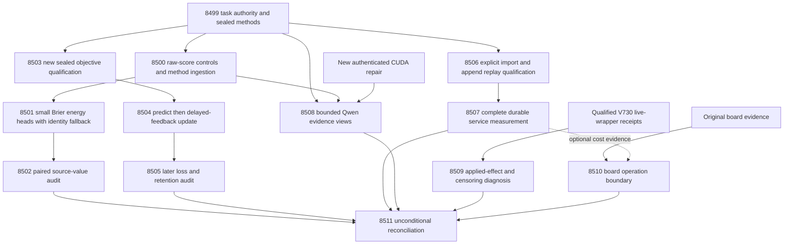

# Carnot Research Roadmap v731: Strong-baseline decisions and recoverable learning

**Created:** 2026-10-14 UTC (2026-10-13 America/New_York)
**Milestone:** 2026.10.731
**Title:** Strong-baseline energy decisions, recoverable continuous learning, and qualified append cost
**Status:** Planned; execution and activation have not occurred.
**Supersedes:** V730, preserved byte-for-byte at `openspec/change-proposals/research-roadmap-v730-preserved-20261014.md`.
**Task contract:** Exactly **13 tasks, Exp8499 through Exp8511**, in the order below and in `research-roadmap-next.yaml`.

## What V730 proved

Scheduling completion is distinct from scientific success. V730 scheduled fourteen slots; twelve declared primary files exist and two tasks were pre-gated. The completed ledger currently ends at V729, so the following findings use the V730 primaries, bound validation records and conductor log. This planning pass does not rewrite that history.

| Evidence | Finding | Limit and next step |
|---|---|---|
| Exp8485–8487 | Complete authority, source controls and scalar fits qualified. | Preserve original authority; reuse the existing basis and raw-logit offset. |
| Exp8488 | Full-source A1 Brier 0.1334283811 versus scalar spline 0.1529864194; paired gain 0.0195580383. The corrected scalar and permutation contrasts passed their registered gates. | Raw p2 Brier was already 0.133672. The difference from raw is only about 0.000244, with no registered raw-benefit result. All questions are exposed; no independent factuality claim follows. |
| Exp8489–8491 | Original derivative/recovery checks ran, but the current Exp8489 bytes are flagged and fail the older bound sidecar. Exp8490 blocked and Exp8491 was pre-gated. | Objective-aligned online benefit remains unmeasured. Produce a new sealed qualification before running it. |
| Exp8492–8493 | Publication-cost model and stable-append recovery qualified. | A counterfactual cost ceiling is not speed. Process-exit recovery does not establish physical power-loss durability. |
| Exp8494 | Observed primary ratio 2.3386343639, CI95 [2.1622196343, 2.5293404491], p95 ratio 0.5170403149. | **Disqualified:** strict mypy rejects `k.append.Store` at reporting line 309. Preserve these observations as disqualified; qualify the exact import repair before fresh timing. |
| Exp8495 | No changed CUDA repair receipt; pre-gated. | A cached model and physical GPUs do not prove a usable live runtime. |
| Exp8496 | Sixteen adapter-withheld live-wrapper episodes across four public games; sixteen applied-mode and sixteen shadow redirects; zero resolved redirects. | Shadow recommendations are controls, and censored outcomes are not failures. Diagnose actual state changes before any arm refinement. No new solve credit. |
| Exp8497–8498 | Hardware boundaries and missing evidence recorded; capstone blocked on unqualified science. | Its separate `paper_ready=true` output is not a successful milestone claim or authorization to publish. |

## Three biggest gaps against the PRD

1. **Independent value of extracted evidence and calibrated decisions (FR-12).** A source head can beat weak recalibration controls while barely matching the original detector. The next comparison must include raw p2 and equally trained scalar controls, preserve an identity fallback and count question clusters. Independent, disjoint, human-adjudicated labels remain necessary for generalization; this milestone cannot manufacture that evidence by splitting the same panel again.
2. **Continuous self-learning that improves later decisions (FR-11).** Sparse derivatives, checkpoints and coefficient changes are infrastructure. Benefit requires predictions before delayed feedback, later loss improvement, intact retention and measured update cost. The registered objective experiment still deserves one executable trial after its exact publication defect is repaired.
3. **Qualified complete-service efficiency and deployable operations (FR-05/08, NFR-01).** Durable storage dominates recent service work. The promising append ratio needs valid typing, replay and equal durable work. A host storage gain is distinct from Rust/Python throughput or FPGA acceleration. Installed board operation sets must constrain the next hardware step.

The first two tracks train and evaluate only small energy decision heads. They advance the path to an EBM foundation model without tuning the mandated 27B generator. ARC generalization and attached-board continuity retain their standing slots.

## Research ingestion before design

The `2026-10-14 UTC — V731 planning scan` was appended to `research-references.md` before these tasks were written. It records all requested primary topics and secondary channels, dates, access limits and adopt/defer decisions.

| Method | Experiment use | Boundary |
|---|---|---|
| [RAIM, September 2026](https://arxiv.org/abs/2609.39229), [author analysis](https://github.com/eOnofri04/raim-analysis) | Exp8500–8502: compare against the strongest component and allow the raw-score fallback. | Carnot's Brier/shrinkage design is an inference from comparator discipline, not a reproduction of the RAIM stacker or theorem. |
| [Decomposing Probabilistic Scores](https://arxiv.org/abs/2603.15232) | Separate source information from scalar calibration. | The finite exposed-panel contrast does not estimate a population information decomposition. |
| [Calibeating Made Simple](https://arxiv.org/abs/2603.22167), [capacity-constrained delayed OCO](https://arxiv.org/abs/2606.11711) | Exp8503–8505: proper-loss objective, causal release and matched capacity. | No regret guarantee transfers to this nonlinear delayed sparse learner. |
| [Online KAN](https://arxiv.org/abs/2602.02056), [KAN forgetting](https://arxiv.org/abs/2511.12828) | Sparse updates, touched coefficients and independent retention windows. | Local support alone does not ensure retention or installed FPGA support. |
| [Anechoic](https://arxiv.org/abs/2610.13368), [Extropic Z1T](https://extropic.ai/writing/z1t/) | Exp8510: operation mapping and future acceleration evidence. | Dense optimization, probabilistic sampling and durable host service are distinct workloads. |
| [EBT](https://arxiv.org/abs/2507.02092), [ARM–EBM](https://arxiv.org/abs/2512.15605), [energy-based decoding](https://arxiv.org/abs/2605.28020) | Architectural context; defer new generation or decoding work. | Energy compatibility does not establish correct constraint extraction. |

AS2, HardNet++, distributional EBMs and HalluScoring were also checked. Retired solver/ranker scopes remain closed. OpenReview forums challenged retrieval; Semantic Scholar citing-paper endpoints failed; GitHub Trending returned month-old snapshots. These are documented access limits, not evidence of no new work. The inspected Kona page supplies no reproducible implementation to import. No dependency or model was installed during planning.

## Architecture

CPU science, optional CUDA and physical board evidence remain separable. Historical producers use immutable original-authority roots. Source fitting and learning use nine inputs/109 full coefficients; the scalar head has thirteen coefficients. Storage timing uses the established five-input service head. Neither quality nor timing transfers between those boundaries automatically. Capstone arrows are read dependencies, never execution gates.

## Phase 1 — Strongest controls and calibrated energy training (Exp8499–8501)

**Exp8499: contract and methods.** Bind the visible table, entire JSON task objects, digest and YAML before measurement. Preserve the V730 design and sealed historical families. Emit source, learning, service and optional runtime readiness independently. Seal all V731 method operands before new fits, including the source objective/shrinkage change. Preserve the unmeasured V730 online and append protocols without threshold or seed changes. Inspect only a supplied changed CUDA receipt for at most sixty seconds, without device calls.

**Exp8500: strongest-baseline audit and SOTA ingestion.** Independently reproduce the old arm metrics, including raw p2, and freeze a five-arm comparator manifest. Read RAIM and three complementary methods, record concrete adoption/defer decisions, and update the research/studying records. The existing scalar code already has the raw-logit offset. This task qualifies the frozen comparison, not a new corpus or independent score gain. Keep 900 answers/300 questions, original 150/50/100 roles, support requirements and permutation donors.

**Exp8501: identity-admissible Brier heads.** Keep raw p2 and legacy full-source probabilities frozen. Fit scalar, full and source-permuted residual spline heads from zero for 200 full-batch Brier steps at rate 0.01, L2 0.001 and fixed T=1. The basis/scaler and bias regularization convention stay unchanged. Seeds 17/29/43/71/101 are retained, with deterministic duplicates explicitly identified. Gradient tolerances are absolute 1e-7 and relative 1e-5 above magnitude 1e-6.

Select each arm's alpha from {0, .25, .5, .75, 1} on tune A1 Brier only, ties toward smaller alpha. The output is `(1-alpha)*raw_p2 + alpha*trained_probability`. Alpha zero returns raw bytes exactly; epsilon 1e-4 is only an internal logit safeguard. Encode the resulting Bernoulli energy with explicit endpoint limits, not nonfinite JSON or a fake finite certificate. Accept p<=.2, reject p>=.8, otherwise escalate. Costs stay wrong/correct/escalate = 1/0/.2. Freeze heads and 7,500 test prediction rows before evaluator label access. Identity inclusion protects observed tune loss only; no test guarantee is claimed.

## Phase 2 — Source value and continuous self-learning (Exp8502–8505)

**Exp8502: incremental source value.** Compare the new full head to raw p2, equally trained scalar and equally trained permuted-source heads. Average three answer siblings and five seeds within each of the 100 test questions. Use 10,000 paired question bootstrap draws, seed 7318502, and 98.3333333333% two-sided intervals per contrast (Bonferroni familywise 95%). All three lower bounds must exceed zero; typed loss must not increase versus raw or scalar. Legacy-full and A2 results are descriptive sensitivity analyses. Keep missing slots and worst-case bounds. An exposed-data positive is at most `circular_positive`; a null stops further tuning on these test questions without new evidence or a different registered causal mechanism.

**Exp8503: immutable objective qualification.** The existing flagged Exp8489 SHA-256 begins `f306c910`; its sidecar binds the older `e9145dae` bytes. Reproduce that mismatch privately, preserve both records and create a new qualification from independently pinned primitive evidence. Never clear a flag or rewrite an old sidecar. Retain the original changed-reference rejection, all derivative and checkpoint assertions, real exits and resume tests. Test the unchanged publisher and actual consumer against a new primary, plus post-seal byte mutation and copied-flagged-envelope controls. Run the exact collected historical test union in <=600-second shards with <=60-second progress and a total 1,800-second historical validation budget.

**Exp8504: continuous Brier learning.** Consume the new qualification through a valid bound sidecar and cold replay. Preserve the original V726 full head, capacity eight, uniform pre-release admission, five blocks of twenty questions, four arms (frozen, log-loss, Brier, Brier with shuffled released labels) and original five seeds. The 6,000 intended rows record predictions before labels and stable feedback IDs. Save RNG, cursor, pending IDs and coefficients durably. Exit after block two for seed 17 in every arm; resumed states and predictions must match uninterrupted runs exactly. A separate evaluator retains five windows over the original fifty tune questions. Measure update cost and touched coefficients; coefficient activity alone is not benefit.

**Exp8505: later benefit and retention.** The primary unit is one of eighty later-block questions, averaged over siblings/seeds. Compare Brier updates with both frozen and log-loss controls, using 10,000 paired draws, seed 7278448 and 97.5% intervals. Both lower bounds must exceed zero with no typed-loss increase against either. Simultaneous one-sided 95% retention upper bound must be <=.01 over all five windows, using shared question resamples, the per-draw maximum and seed 7258421. Shuffled feedback cannot support a learning-specific claim if it matches or exceeds the real learner. Keep the prior admission-policy null closed. This completes a Tier-1 continuous-learning test with an explicit future sparse-arithmetic hardware path, not an achieved 100x acceleration claim.
