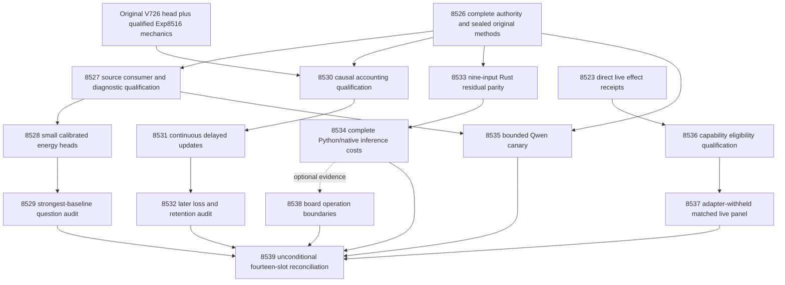

# Carnot Research Roadmap v733: Qualified decisions and complete inference

**Created:** 2026-10-14
**Milestone:** 2026.10.733
**Status:** Planned; staged for conductor review, not activated
**Supersedes:** V732 scheduling; its complete design is preserved at
`openspec/change-proposals/research-roadmap-v732-preserved-20261014.md`.
**Task contract:** exactly **14 tasks, Exp8526 through Exp8539**, in the order
shown below. Four phases contain 3, 4, 3 and 4 tasks respectively.

## What V732 proved

Scheduling completion is distinct from a qualified scientific result. The active
queue and final Exp8525 capstone account for fourteen slots. At planning time,
`research-complete.yaml` still ends at V731. V732 primary artifacts and the
conductor log supply the newer evidence; this plan does not rewrite that ledger.

| Branch | Evidence | Finding and next implication |
|---|---|---|
| Authority | Exp8512 | Complete fourteen-task authority and original historical inputs qualified. Preserve this reader instead of reconstructing historical authority from a new queue. |
| Source information | Exp8513, pre-gate8514, absent8515 | Owned test `test_missing_and_owned_failure` raised `KeyError: upstream`. Comparator readiness remained0. Identity-Brier fitting and its audit did not run. Repair the diagnostic before the same registered science. |
| Objective mechanics | Exp8516 | A new immutable derivative/checkpoint publication qualified. It supersedes neither old quarantines nor scientific benefit. Reuse its exact consumer. |
| Continuous learning | Exp8517, pre-gate8518 | The gate rejection test raised `KeyError: field`; historical validation did not complete. Both coefficient-change and update counts were1800, triggering TAUTOLOGY. The producer is disqualified. Account for coordinates from actual state changes before a new stream. |
| Durable service | Exp8519/8520 | Explicit import/replay qualification and fresh five-input append measurements passed. Complete speedup2.1626817, paired CI95[2.0387708,2.2915669], primary p95 ratio0.5102803. This is local host storage evidence, not nine-input inference, Rust/Python NFR-01 or physical power-loss validation. |
| Live Qwen | pre-gate8521 | No authenticated changed CUDA repair receipt. No current generation ran. Keep the cheap structured gate. |
| ARC effects | Exp8522/8523 | Direct receipts qualified. Sixteen episodes produced32 redirects, zero resolved. Eight applied diversity changes affected policy; eight reinduction latch changes led to model-disabled attempts. No arm refinement or new solve was earned. |
| Hardware | Exp8524 | Original operation limits and GateMate obligations remain. Installed spline operations and complete transport/device clocks are absent. |
| Capstone | Exp8525 | Administrative reconciliation completed; science remains `complete_blocked_v732_capstone`. G1–G4 publication status does not repair those branches. |

Primary paths are the active V732 task deliverables under `results/`; each new
prompt names the exact predecessors it uses. A flagged producer's numerical
observations stay historical and cannot be promoted through a new sidecar.

## Three biggest gaps against the PRD

1. **Verifiable decisions with incremental value — FR-12.** Infrastructure can
   compute energies, but added source information has not earned its place over
   the raw score and an equally fitted scalar control. The entire released
   900-answer/300-question panel is exposed. New fitting can establish a narrow
   retrospective result; it cannot close independent factual generalization.
2. **Useful continuous self-learning — FR-06/FR-11.** Durable mechanics exist,
   while useful later predictions and simultaneous retention remain unqualified.
   Update events, coordinate writes, logical decay and beneficial predictions
   need separate measurements. The unmeasured proper-loss comparison remains
   the next causal test; another architecture sweep would obscure that question.
3. **Measured deployment benefit — FR-05/FR-08/NFR-01 and live reasoning.** The
   qualified append win concerns a different five-input service. The actual
   nine-input science head needs its own native parity and complete inference
   cost. Live ARC must choose executable interventions and demonstrate transfer;
   a changed latch or suppressed unavailable call does not prove reasoning gain.

## Literature ingestion before experiment design

The dated V733 section of `research-references.md` was written before these
experiments. It covers all requested arXiv topics and secondary channels.

| Method/source | Concrete use | Boundary |
|---|---|---|
| [RAIM, 2609.39229](https://arxiv.org/abs/2609.39229) | Exp8527–8529 retain strongest-component controls and identity fallback. | Local adaptation; no borrowed RAIM guarantee. |
| [Calibeating, 2603.22167](https://arxiv.org/abs/2603.22167) | Exp8530–8532 test delayed Brier updates against frozen/log-loss controls. | Nonlinear delayed learning does not inherit convex regret bounds. |
| [Delayed capacity, 2606.11711](https://arxiv.org/abs/2606.11711) | Preserve causal admission and explicit pending/lost feedback. | Actual coordinate changes are separate from label/update counts. |
| [Online KAN, 2602.02056](https://arxiv.org/abs/2602.02056) | Exp8533/8534 test local spline arithmetic inside complete nine-input inference. | Published FPGA times are not local service evidence. |
| [KAN training budgets, 2610.10627](https://arxiv.org/abs/2610.10627) | Fixed fit/tune prefixes in Exp8528. | No test-driven checkpoint choice or sample-efficiency claim. |
| [SURE-RAG, 2605.03534](https://arxiv.org/abs/2605.03534) and [RT4CHART, 2603.27752](https://arxiv.org/abs/2603.27752) | Exp8535 distinguishes evidence sufficiency and context faithfulness from factual truth. | The16-call canary is not a replication or benchmark. |
| [Pipelined p-computer, 2607.21077](https://arxiv.org/abs/2607.21077) | Exp8538 maps operation and memory obligations. | No new sampler, FPGA execution or Gibbs-quality claim. |

EBT, ARM–EBM, neural symbolic constraints and reward-guided decoding remain
architectural context. KAN-CL anchoring stays retired. The new Rust repository
lead `irithyll` is recorded for inspection, with no dependency adoption. Semantic
Scholar citation endpoints failed; citation coverage is incomplete. GitHub
Trending returned month-old snapshots. Extropic and Kona pages supplied vendor
context, not a reproducible local capability. No unseen paper or review is claimed.

## Architecture



Arrows into the capstone indicate evidence inputs, not execution gates. The
source, learning, native inference and ARC branches have independent readiness.
The hardware reader and capstone always execute, including when inputs are absent.

## Phase 1 — Complete authority and calibrated fitting (Exp8526–Exp8528)

**Exp8526** binds the full task objects and original historical consumers. It
seals `v733-methods-protocol.json`. The identity-Brier, primary source contrasts,
optimization prefixes, objective updates/audit and evidence canary inherit
V732 operands exactly. New registrations cover nine-input inference and the
capability-masked ARC panel. Missing optional CUDA evidence does not fail CPU
readiness. The V732 design's SHA256 is
`1dc51cf5035a2b7635362d47f17db4ee5d5e34a777a088d24f6e7286d395f5aa`.

**Exp8527** first reproduces the missing `upstream` diagnostic. Every failure
row must retain its named source and observed value. Existing tests and old
primary bytes remain intact. A new consumer publication qualifies comparator
custody. It also maps three to five already discovered methods into exact local
operations, with primary citations and explicit deferrals.

**Exp8528** trains the previously unexecuted decision heads. Keep150/50/100
whole-question roles,900 answers, original basis/scaler and source permutations.
The five canonical arms are `raw_p2`, `legacy_full_source`, `brier_scalar`,
`brier_full`, `brier_source_permuted`. Scalar/full dimensions are13/109.
The trainable heads start at zero residual, use T=1,200 full-batch steps,
rate0.01,L2=0.001 and seeds17/29/43/71/101. Duplicate deterministic heads do not
increase independence. Fit/tune curves at0/25/50/100/200 cannot select a model.

Choose mixture alpha from0/.25/.5/.75/1 on tune A1 Brier; ties favor smaller
alpha. Alpha0 returns exact raw p2. Freeze7500 test predictions before evaluator
label access. At error probability p<=.2 accept; p>=.8 reject; otherwise escalate.
Wrong/correct/escalation costs are1/0/.2. Endpoint energy metadata must remain
finite JSON with explicit limiting cases. A fully qualified all-alpha0 result
is a valid scientific null, not incomplete work.

## Phase 2 — Added information and continuous learning (Exp8529–Exp8532)

**Exp8529** tests source information against raw, scalar and permuted-source
controls. Its10000 paired whole-question draws use seed7318502. Three two-sided
98.3333333333 percent Bonferroni intervals provide the registered95 percent
familywise convention. All three Brier gain lower bounds must exceed zero;
typed loss must not increase against raw or scalar. Average seeds/siblings
within each of100 test questions. Keep legacy-head and A2 results descriptive.
An honest null closes unchanged tuning on this exposed panel.

**Exp8530** addresses two distinct failures before another learning run. It
repairs missing `field` in rejection diagnostics. It independently reconstructs
applied update events, physical writes, changed coordinates, distinct coordinates
and decay effects from primitive states. Zero-gradient, repeated-coordinate and
decay-only controls prevent an event counter from masquerading as coefficient
change. Keep a reconciliation of the old1800/1800 metrics. If equal values are
real, explain them with independent operands; never hide a validator finding.

Validation collects exact original test nodes and executes bounded disjoint
shards. A start-only historical runner log is not a passing test receipt.
Qualification uses small fixtures plus genuine process-exit/restart checks,
not a second full scientific training run. Exp8516's original qualified
publication remains the derivative/checkpoint authority.

**Exp8531** performs continuous self-learning under the unchanged causal
protocol. Start from the original V726109-coefficient head, not Exp8528.
Four arms are frozen/log_loss/brier/brier_shuffled_released; five20-question
blocks,capacity8,five seeds and identical admission before label release give
6000 prediction rows. Save predictions before feedback and commit each stable
feedback ID once. Shuffling sees only already released labels. Seed17 in all
four arms undergoes a real exit after block2 and exact resume. A separate
read-only evaluator supplies15000 retention rows over five windows and50 tune
questions. Count and time real sparse updates without claiming benefit from
activity. CPU locality is the current hardware path; acceleration is unmeasured.

**Exp8532** measures later blocks1–4:80 whole-question units. Brier updates must
beat both frozen and log-loss updates using10000 paired draws,seed7278448,
97.5 percent two-sided intervals, and no typed-loss increase. Shared retention
resamples across five windows use seed7258421 and the per-draw maximum. The
simultaneous one-sided95 percent upper bound on Brier deterioration must be<=.01.
Shuffled feedback matching or beating the real learner prevents a learning-specific
benefit claim. Qualification and benefit are separate output fields.

## Phase 3 — Actual inference workload and conditional generation (Exp8533–Exp8535)

**Exp8533** builds a separately versioned Rust/PyO3 residual evaluator for
nine inputs and109 coefficients. Keep the shipped Python scaler,raw-logit
offset,temperature,stable normalization and typed decision policy. The old
five-input kernel is neither edited nor recertified. Test900 frozen answer
rows,knots,nextafter neighbors,endpoints,decay and malformed inputs against the
independent dense SciPy reference. Require error<=1e-12*(1+abs(reference)).
Within1e-10 of either decision threshold,fall back to the Python reference and
count it. All finite-panel typed decisions must match. This is a finite test,
not a universal numerical proof. Real loaded extension bytes and Rust coverage
are required; a Python replacement cannot satisfy native qualification.

**Exp8534** measures complete cached-request inference,using the original V726
head independently of source-fit success. Freeze the first64 test answer records
in original stable order. Recompute public text features on each request; include
scaling,offset,binding/residual,normalization,typed decision and serialization.
Use batch1 primary,batch8 secondary,one untimed warmup and ten paired AB/BA
repeats per cell. Fresh child startup belongs in complete totals and is also
reported separately. Ten repeats do not imply ten independent machines.

Retain640 measured request rows per arm/cell,all primitive spans and boundary
fallbacks. Bootstrap paired repeat indices10000 times with seed7338534.
Complete speed benefit requires lower95>1 and request-p95 ratio<=1.05;
lower95>=10 is the separate scoped NFR-01 inference target. Kernel-only or
secondary-batch wins cannot rescue the primary. No live model acquisition,
feedback update or durable-storage cost is included in this inference boundary.
The five-input append result remains separate and is not rerun.

**Exp8535** is optional:16 fixed calls,temperature0,max128 tokens,over four
fit questions and four evidence views. It requires an authenticated causal CUDA
repair and qualified comparator custody. The model is exclusively mandated
`unsloth/Qwen3.8-27B-GGUF` for current headline generation; small models are
allowed only as separately labeled CPU smoke checks. Declare
`model_bounded_generation`,10-second floor. Loading has a600-second deadline,
each call120 seconds,total measurement2400 seconds. No sleep padding or fallback
simulation. This canary cannot establish hallucination reduction or generalization.

## Phase 4 — Executable supervision and final decisions (Exp8536–Exp8539)

**Exp8536** qualifies an opt-in capability mask in the live
`E3AgentPolicy`/`make_carnot_agent` selection path. Model-disabled runtime cannot
execute reinduction, even if changing its latch is possible. Mask only an
explicitly unavailable capability; preserve unknown values as unknown. Keep arm
order,window120,stall threshold150,existing predicates and diversity behavior.
Do not reset diversity,lower support thresholds or propose a game-specific arm.
Default flag-off behavior stays unchanged. Preserve ledger visibility for
ineligible arms and distinguish unavailable from tried/exhausted.

Fixtures cover disabled,enabled,unknown and changing capabilities plus level
transitions and shadow mode. They qualify the real wrapper; they make no solve
claim and load no model. Freeze the policy and panel after these tests.

**Exp8537** compares baseline-applied with capability-masked-applied on
ar25-0c556536,ft09-0d8bbf25,lf52-271a04aa,tn36-ef4dde99,each with seeds11/22:
16 fresh episodes. Both arms withhold per-game adapters,routes,solver artifacts,
source inspection and LLM calls. Caps remain512 actions/120 seconds per episode.
The new variable is capability eligibility,not a new action budget or shadow mode.

Count actual model-disabled induction attempts separately from selections and
latch changes. Report paired levels,actions,wall cost,visible-state diversity,
resolved redirects and censored outcomes. The four games,not actions or seeds,
define transfer units. Reduced unavailable work proves a mechanical property.
Useful efficiency also requires no paired level regression or complete-wall cost
increase. Hidden-game performance remains unmeasured. The original refinement
bar of three overlapping games and five resolved observations per shared cell
is unchanged. No duplicate solve is credited; any incidental level needs live
self-discovery provenance and reproduction before registry consideration.

**Exp8538** unconditionally carries KV260,PolarFire and GateMate obligations and
maps the new nine-input operations to installed support. It reads supplied
records for at most60 seconds,with zero device commands. A qualified Exp8534
provides disjoint cost shares and a conditional zero-time arithmetic ceiling;
absence yields null costs with explicit gate diagnostics. Neither host arithmetic
nor append speed creates a spline kernel in an Ising image.

KV260 retains k_max<=5 and its original operation scope. PolarFire's Linux CPU
dispatch status is distinct from fabric acceleration. GateMate retains exact
missing-source hashes,last IDCODE0xffffffff and the physical reopening sequence:
original source recovery,dated cable/port/power change,IDCODE0x20000001,n16 flash,
sample/hash smoke. TSU/NPU remain unqualified. No purchase or unchanged physical
probe is planned.

**Exp8539** always reconciles all fourteen slots,including itself. It reads
producer bytes,pre-gate receipts,cascade skips and absences separately. It
independently reconstructs qualified scientific metrics,retains quarantines and
reports unchanged G1–G4 from `scripts/publication_gate.py --json`. It recommends
retirement on repeated exact verdicts and records reopening evidence per branch.
It does not edit the exclusion manifest or publish externally. A completed
reconciliation over externally blocked science correctly has class `blocked`.

## Dependency and gate contract

Only readiness gates control expensive downstream work. Each field below is
spelled identically in its producer's REQUIRED ARTIFACT FIELDS. Every gate is
`== 1`,and all conditions within a task are conjunctive.

| Consumer | Required current-milestone producer fields |
|---|---|
| Exp8527 | Exp8526.methods_ready_score; Exp8526.source_inputs_ready_score |
| Exp8528 | Exp8527.comparator_inputs_ready_score |
| Exp8529 | Exp8528.identity_heads_ready_score |
| Exp8530 | Exp8526.methods_ready_score; Exp8526.learning_inputs_ready_score |
| Exp8531 | Exp8530.online_adapter_ready_score |
| Exp8532 | Exp8531.objective_stream_ready_score |
| Exp8533 | Exp8526.methods_ready_score; Exp8526.nine_input_inputs_ready_score |
| Exp8534 | Exp8533.nine_input_native_ready_score |
| Exp8535 | Exp8526.runtime_repair_ready_score; Exp8527.comparator_inputs_ready_score |
| Exp8537 | Exp8536.arc_capability_ready_score |

Exp8526,Exp8536,Exp8538 and Exp8539 have no structured upstream gate. They
still authenticate any inputs they use. Exp8538 consumes costs optionally;
Exp8539 is not gated on successful science. There are14 structured conditions.
No `requires` chain points at a retired historical task. Historical evidence is
read through original consumers; historical failures are never activation gates.

## Hardware and execution requirements

| Work | Available substrate | Budget and limitation |
|---|---|---|
| Contract,source and learning | CPU,system memory,disk-backed scratch | 30–45 minutes estimated each; sparse updates and small heads need no LLM. Keep measurement<=3600s,validation reserve>=900s. |
| Nine-input native qualification | CPU,Rust toolchain,cached PyO3 dependencies | 45-minute estimate; real extension build and finite parity. No device integration or five-input certificate reuse. |
| Complete inference timing | Same host/filesystem,CPU threads pinned consistently | Measurement<=1800s. Same request work in both arms; startup and conversions measured. |
| Qwen canary | Existing dual RTX3090 host; cached Q4_K_M about16GB | Requires causal CUDA recovery and GPU lease. Use the qualified existing allocation; no new multi-GPU bring-up. |
| ARC panel | CPU,installed SDK,live wrapper with LLM disabled | 16 bounded episodes;512 actions/120s each. Fixtures are separate from live measurements. |
| Hardware reader | Existing records for KV260,PolarFire,GateMate | Zero device commands. TSU,NPU,larger FPGA and photonic devices supply no local result. |

The hardware wishlist was reviewed. No acquisition is necessary for this plan.
A larger FPGA cannot fix label exposure,validation failures or host startup costs.
Exp8538 states which measured operation a future device would actually replace.
The FR-11 acceleration path is sparse CPU coefficient work today,with GPU/NPU
batch or FPGA arithmetic only after separate operation and complete-cost evidence.
A100x target remains a research target,not a claimed result.

All prompts require flushed output at phase boundaries,before/after long calls
and inside loops; supervised children report at least every60 seconds. Files
over about200 lines are written in chunks of about150 lines with progress between
calls. Silence gaps must remain below600 seconds. Work stops before the4800s cap.
No task may sleep-pad authenticity duration or replace unfinished tests with prose.

Routing follows the current user instruction: synthesis and routine studies use
Claude/Sonnet; authority/schema qualification uses Claude/Opus with100 turns.
The formulaic Rust/PyO3 task uses Codex/gpt-6.1-sol with50 turns. No Luna task is
included. Model routing refers to the coding agent; it is separate from the
mandatory local Qwen used as an experimental LLM.

## Evidence rules and stopping conditions

Every task declares per-unit rows,closed verdict class and principle-annotated
artifact fields. Every relevant prior failure names its exact observed verdict,
changed condition and `retire_if_same_verdict: true`. The Exp8489 self-reported
circular-positive verdict is retained exactly even though later flags and a stale
sidecar disqualified its use. No history is sanitized to simplify the plan.

The finite source study and delayed-learning study keep their old method bytes.
New source information or independently adjudicated disjoint questions are needed
after a valid source null. A valid learning null closes the unchanged update
objective. The native experiment may honestly find overhead dominates; that is
terminal evidence. The ARC mask may reduce unavailable work without better
progress; do not turn that into a strategy claim. Runtime and physical board
absence remain blocked,never retryable partial. G1–G4 remains unchanged.

## Planning validation

Validation results are recorded below after the staged files have been checked.
Checks use a private activation copy; no experiment is activated or executed here.

<!-- V733_PLANNING_VALIDATION -->

Full results and commands: `docs/research-notes/v733-plan-validation.md`.
100 focused tests pass,including private E2E-018/E2E-021. Schema,full-object
contract,digest,twelve negative mutations,fourteen gate conditions,21 exact
failure-lineage entries and217 existing-path checks pass. Exclusion,harness-fit,
ARC-floor,priority and gate audits pass. Scoped Ruff lint and spec tracing pass.

Baseline limits: Ruff format flags unchanged `scripts/audit_roadmap_gates.py`;
repository-wide tracing reports1,142 existing missing requirement references.
The active roadmap,conductor and exclusion manifest retain task-start hashes.
No implementation changed and no experiment was activated or executed.


## Exact task contract

The visible table and full JSON bind all fourteen complete task objects, including
prompts, routing, gates, model declarations and retirement flags.

| Order | ID | Title | Phase | Deliverable |
|---|---|---|---|---|
| 1 | `exp8526-contract-methods` | Bind fourteen tasks and seal independent source learning and inference protocols | 1 | `results/experiment_8526_v733_contract_methods.json` |
| 2 | `exp8527-source-consumer-qualification` | Qualify source comparator custody after the missing upstream diagnostic | 1 | `results/experiment_8527_v733_source_consumer_qualification.json` |
| 3 | `exp8528-identity-brier-fit` | Train identity-admissible calibrated energy heads on frozen question roles | 1 | `results/experiment_8528_v733_identity_brier_fit.json` |
| 4 | `exp8529-incremental-source-audit` | Measure source information beyond raw and equally trained scalar decisions | 2 | `results/experiment_8529_v733_incremental_source_audit.json` |
| 5 | `exp8530-update-accounting-qualification` | Qualify causal update accounting and complete rejection diagnostics | 2 | `results/experiment_8530_v733_update_accounting_qualification.json` |
| 6 | `exp8531-causal-brier-learning` | Measure continuous delayed Brier learning with independent coordinate accounting | 2 | `results/experiment_8531_v733_causal_brier_learning.json` |
| 7 | `exp8532-objective-benefit-audit` | Audit later proper-loss benefit and simultaneous retention from qualified updates | 2 | `results/experiment_8532_v733_objective_benefit_audit.json` |
| 8 | `exp8533-nine-input-native-qualification` | Qualify a native residual evaluator for the actual nine-input energy head | 3 | `results/experiment_8533_v733_nine_input_native_qualification.json` |
| 9 | `exp8534-nine-input-inference-cost` | Measure complete nine-input Python and native inference at matched decisions | 3 | `results/experiment_8534_v733_nine_input_inference_cost.json` |
| 10 | `exp8535-bounded-qwen-evidence` | Test bounded mandated-Qwen evidence views after authenticated CUDA recovery | 3 | `results/experiment_8535_v733_bounded_qwen_evidence.json` |
| 11 | `exp8536-arc-capability-qualification` | Qualify capability-aware supervisor eligibility on the live ARC path | 4 | `results/experiment_8536_v733_arc_capability_qualification.json` |
| 12 | `exp8537-arc-capability-panel` | Measure capability-aware ARC supervision across adapter-withheld games | 4 | `results/experiment_8537_v733_arc_capability_panel.json` |
| 13 | `exp8538-nine-input-board-boundary` | Map nine-input inference operations to KV260 and retain physical board obligations | 4 | `results/experiment_8538_v733_nine_input_board_boundary.json` |
| 14 | `exp8539-capstone` | Reconcile fourteen outcomes and decide source learning inference and ARC continuation | 4 | `results/experiment_8539_v733_capstone.json` |

Canonical full-task SHA-256: `2ef10dc73811b0b01d16722133a0ba5b5d36ee703bbc72a521f513396582ade3`

<!-- V733_TASK_CONTRACT_START -->
```json
{
  "milestone": "2026.10.733",
  "tasks": [
    {
      "id": "exp8526-contract-methods",
      "title": "Bind fourteen tasks and seal independent source learning and inference protocols",
      "phase": 1,
      "track": "infrastructure",
      "priority": "high",
      "requires_gpu": false,
      "max_turns": 100,
      "estimated_wall_time_min": 40,
      "per_unit_rows": true,
      "milestone": "2026.10.733",
      "deliverable": "results/experiment_8526_v733_contract_methods.json",
      "inference_substrate_class": "no_model_load",
      "MODEL_SPECS": [],
      "gated_on": [],
      "prior_failures": [
        {
          "experiment_id": "exp8499-contract-methods",
          "verdict": "complete_blocked_v731_contract_methods",
          "addressed_by": "The complete fourteen-object table, JSON, digest and end marker are supplied and checked during planning; preserve failed historical authority. V732 already qualified this reader.",
          "retire_if_same_verdict": true
        }
      ],
      "agent_type": "claude",
      "model": "opus",
      "prompt": "CONTEXT:\nWork in {project_root} on {date}. V732 completed fourteen scheduling slots, not fourteen successful scientific studies. Its contract, objective qualification, append runner and direct ARC receipts qualified. Exp8513 failed its missing-input upstream diagnostic; source fitting did not run. Exp8517 failed its field diagnostic, historical validation and coefficient/update accounting; its learning benefit remains unqualified. Exp8520 measured a five-input host-service speedup of 2.16268, CI95 [2.03877,2.29157], not nine-input inference or Rust/Python NFR-01. Exp8523 measured eight effective diversity changes and eight model-disabled reinduction latch changes; none of 32 redirects resolved. Original historical authority, exposure and quarantines remain intact. V733 targets those exact gaps.\nEXISTING CODE TO READ FIRST:\nCLAUDE.md; CODEX.md; ops/e2e-test-plan.md; ops/exclusion_manifest.yaml; openspec/capabilities/research-reporting/spec.md; openspec/capabilities/verification/spec.md; scripts/experiment_template.py; python/carnot/reporting/primary_publication.py; openspec/change-proposals/research-roadmap-vNEXT.md; python/carnot/reporting/v732_contract_methods.py; python/carnot/reporting/v732_historical_inputs.py; python/carnot/reporting/roadmap_contract.py; python/carnot/reporting/v732_capstone.py; openspec/change-proposals/v732-methods-protocol.json; openspec/change-proposals/research-roadmap-v732-preserved-20261014.md; results/experiment_8525_v732_capstone.json; python/carnot/verify/cuda_reader_8410.py; research-references.md\nTASK:\nBind fourteen tasks and seal independent source learning and inference protocols. Deliver results/experiment_8526_v733_contract_methods.json. Create thin runner scripts/experiments/experiment_8526_v733_contract_methods.py, primitive evidence under results/raw/experiment_8526_v733_contract_methods/, and docs/research-notes/v733-contract-methods.md. Same-roadmap upstream outputs are future dependencies.\nCONCRETE STEPS:\n1. PRECONDITIONS: Print a flushed start line. Authenticate the current task, original input hashes, tools, free memory, writable disk-backed scratch and deadlines. Use original sealed dates and authority for historical inputs. Record exact missing inputs and observed values in gate_check_summary. CUDA and board absence must not block independent CPU work.\n2. Print a flushed progress line at every phase boundary and before and after any model load, generation, benchmark or subprocess that can take minutes. Use unbuffered output and print completed/pending counts inside long loops. Supervise children with a status line at least every 60 seconds; keep every output gap under 600 seconds. Write any file over about 200 lines in several tool calls of at most about 150 lines, with a progress message between calls. Bound every tool call. Stop measurement by 3600 seconds and reserve at least 900 seconds for validation within the 4800-second hard cap. Never pad duration.\n3. Spec first: ensure applicable REQ-* and SCENARIO-* exist before implementation. Write focused failing tests first. Preserve existing assertions, thresholds and historical source snapshots. Reuse shipped code through small explicit adapters. Keep runners in scripts/experiments/, tests in tests/python/, scratch outside the repository root. Accept --date {date}. Do not modify the active roadmap, conductor, validation gates, generator weights or external services.\n4. Declare inference_substrate_class=no_model_load, MODEL_SPECS=[] and zero current LLM calls. Use aggregation_from_upstream_artifacts for readers or verifier_ensemble_against_cached_candidates for numerical heads. Cached generator outputs belong only in historical_model_provenance.\n5. Compare exactly 14 complete tasks Exp8526 through Exp8539 across the visible Exact task contract table, full embedded JSON, canonical_tasks_sha256 and activated YAML. Reuse the existing parser. Require full dictionary equality, including prompts, routing and retirement flags. Test twelve independent mutations: count, order, ID, title, phase, deliverable, model, substrate, gate, prompt, retirement flag and missing end marker. If staging was consumed, use authentic activation evidence; never manufacture a staged file.\n6. Preserve V732 design bytes at openspec/change-proposals/research-roadmap-v732-preserved-20261014.md, SHA256 1dc51cf5035a2b7635362d47f17db4ee5d5e34a777a088d24f6e7286d395f5aa. Read V732 through its original frozen family authority. research-complete.yaml currently ends at V731; resolve current dispositions from V732 primaries, pre-gates, capstone and conductor log, without rewriting archival history.\n7. Create openspec/change-proposals/v733-methods-protocol.json before any fitting or benchmark. Copy V732 identity_brier, primary_contrasts, optimization_diagnostics, objective_updates, objective_audit and evidence_canary operands exactly. Register only the new nine-input native inference and ARC capability-mask protocols described in this design. Seal task map, question IDs, budgets, acceptance thresholds and producer field names. Keep nine-input/109-coefficient science, thirteen-coefficient scalar and historical five-input/34-coefficient service workloads distinct.\n8. Authenticate original V726/V730 source inputs and original V726 initial learning head through their existing consumers. Separately authenticate Exp8516 objective qualification and Exp8520 service observations. Emit source_inputs_ready_score, learning_inputs_ready_score, nine_input_inputs_ready_score independently; historical service speed is not a prerequisite for new nine-input inference. methods_ready_score requires full current authority and method seals, not a favorable scientific outcome.\n9. Inspect only a supplied ops/cuda-runtime-repair-receipt.json through the shipped Exp8410 reader for at most 60 seconds. Set runtime_repair_ready_score=1 only for an authenticated causal environment/library change plus context/copy evidence. No device probe, environment rebuild or model load. Absent evidence gives zero and cheaply pre-gates the optional Qwen canary.\n10. Keep exposure and retirement boundaries: all 900 answers/300 questions are exposed development history. Original 150/50/100 question roles stay fixed. V717 H1/H2 and unchanged importance anchoring remain closed. Distinguish independently measured numerical work from independent factual generalization.\n11. Run scoped unit tests, actual private CLI checks, Ruff check/format, strict mypy and scripts/check_spec_coverage.py --files <owned-test-files>. Run applicable ops/e2e-test-plan.md checks, including private E2E-018 and E2E-021 for authority/publication consumers. Require 100 percent newly owned statement coverage, including child and rejection paths. Collect original test node IDs first and preserve their exact union in disjoint bounded shards using pytest -n 0 -o addopts= --no-cov. Supervise each shard with heartbeats; record commands, exit codes, durations and log hashes. Do not launch a nested full historical validation runner or the full repository suite. A killed child is failed validation, not a skipped success.\n12. Cold-replay primitive rows in a fresh bounded process; exercise absent inputs, owned failure and self-consistently rehashed tampering. Run unchanged primary_publication, scripts/adversarial_verify.py --json <private-candidate> and scripts/verdict_row_consistency_lint.py --strict <private-candidate>. Preserve every finding. Validate final bytes, publish atomically, bind the terminal sidecar, then exercise the actual downstream consumer. Historical flagged bytes and sidecars stay immutable. Owned validation failure is disqualified. Unchanged external absence is blocked, never partial. Reconcile openspec/, _bmad/traceability.md, ops/status.md and ops/changelog.md.\nREQUIRED ARTIFACT FIELDS:\nexperiment_id, task_id, milestone, run_date: principle: Bind evidence to the actual invocation.\nhonest_verdict, verdict_class: principle: Terminal honest_verdict starts complete_; verdict_class is exactly positive | circular_positive | null | blocked | disqualified | partial. Only unfinished owned work that another attempt can finish is partial.\ngate_check_summary: principle: Every blocked_* or complete_blocked_* outcome names check, upstream, path/hash, field, operator, expected and observed; missing is distinct from zero.\ninference_substrate, inference_substrate_class, MODEL_SPECS, model_invocation_counts, historical_model_provenance: principle: Record actual calls and separate imported evidence from current generation.\nrows, intended_count, completed_count, failed_count, censored_count, excluded_count, independent_count, sample_size_budget: principle: Each intended question, arm, seed, episode or repeat retains its own metric or missing reason; siblings and deterministic repeats do not multiply independence.\nverifier_is_oracle, exposure_scope, independent_generalization_score, generalized_learning_benefit_score: principle: Oracle fixtures and exposed-history positives are circular_positive, with generalization scores zero.\nrequired_checks_passed, flagged_adversarial, acceptance_gates, validation_receipts, terminal_validation_sidecar_path, adversarial_findings: principle: Qualification is distinct from benefit; failed required checks forbid positive classes.\npreconditions_checked, duration_s, phase_spans, random_seed, reproducibility_checksum, source_artifact_hashes, code_config_hashes, raw_shard_hashes: principle: Preserve real measured work and immutable primitive operands.\ncited_upstream_artifacts, field_principles: principle: Explain each additional metric and acceptance gate and identify original producer hashes.\ncurrent_contract_ready_score, methods_ready_score, source_inputs_ready_score, learning_inputs_ready_score, nine_input_inputs_ready_score, runtime_repair_ready_score, canonical_tasks_sha256, methods_protocol_reference, historical_family_receipts, protocol_delta, literature_mapping: principle: Each gate has a named producer and measures readiness independently of scientific benefit.\nRun command: cd {project_root} && JAX_PLATFORMS=cpu PYTHONPATH=python:. PYTHONUNBUFFERED=1 .venv/bin/python -u scripts/experiments/experiment_8526_v733_contract_methods.py --date {date}\nDo NOT push. Do NOT modify scripts/research_conductor.py.\n"
    },
    {
      "id": "exp8527-source-consumer-qualification",
      "title": "Qualify source comparator custody after the missing upstream diagnostic",
      "phase": 1,
      "track": "infrastructure",
      "priority": "high",
      "requires_gpu": false,
      "max_turns": 100,
      "estimated_wall_time_min": 40,
      "per_unit_rows": true,
      "milestone": "2026.10.733",
      "deliverable": "results/experiment_8527_v733_source_consumer_qualification.json",
      "inference_substrate_class": "no_model_load",
      "MODEL_SPECS": [],
      "gated_on": [
        {
          "upstream": "exp8526-contract-methods",
          "artifact_field": "methods_ready_score",
          "op": "==",
          "value": 1
        },
        {
          "upstream": "exp8526-contract-methods",
          "artifact_field": "source_inputs_ready_score",
          "op": "==",
          "value": 1
        }
      ],
      "prior_failures": [
        {
          "experiment_id": "exp8513-strongest-baseline-audit",
          "verdict": "complete_disqualified_v732_strongest_baseline_audit",
          "addressed_by": "Repair the measured missing upstream key in test_missing_and_owned_failure, qualify all diagnostic paths, then publish a new bound consumer without changing old bytes.",
          "retire_if_same_verdict": true
        },
        {
          "experiment_id": "exp8500-strongest-baseline-audit",
          "verdict": "blocked_gate_check_failed",
          "addressed_by": "V732 shipped complete authority; this task adds the exact diagnostic repair before consuming qualified historical inputs.",
          "retire_if_same_verdict": true
        }
      ],
      "agent_type": "claude",
      "model": "opus",
      "prompt": "CONTEXT:\nWork in {project_root} on {date}. V732 completed fourteen scheduling slots, not fourteen successful scientific studies. Its contract, objective qualification, append runner and direct ARC receipts qualified. Exp8513 failed its missing-input upstream diagnostic; source fitting did not run. Exp8517 failed its field diagnostic, historical validation and coefficient/update accounting; its learning benefit remains unqualified. Exp8520 measured a five-input host-service speedup of 2.16268, CI95 [2.03877,2.29157], not nine-input inference or Rust/Python NFR-01. Exp8523 measured eight effective diversity changes and eight model-disabled reinduction latch changes; none of 32 redirects resolved. Original historical authority, exposure and quarantines remain intact. V733 targets those exact gaps.\nEXISTING CODE TO READ FIRST:\nCLAUDE.md; CODEX.md; ops/e2e-test-plan.md; ops/exclusion_manifest.yaml; openspec/capabilities/research-reporting/spec.md; openspec/capabilities/verification/spec.md; scripts/experiment_template.py; python/carnot/reporting/primary_publication.py; openspec/change-proposals/research-roadmap-vNEXT.md; python/carnot/reporting/v732_strongest_baseline_audit.py; tests/python/test_v732_strongest_baseline_8513.py; python/carnot/reporting/v730_source_information_audit.py; python/carnot/verify/v730_information_metrics.py; results/experiment_8513_v732_strongest_baseline_audit.json; results/experiment_8487_v730_source_control_fit.json; research-references.md; research-studying.md\nTASK:\nQualify source comparator custody after the missing upstream diagnostic. Deliver results/experiment_8527_v733_source_consumer_qualification.json. Create thin runner scripts/experiments/experiment_8527_v733_source_consumer_qualification.py, primitive evidence under results/raw/experiment_8527_v733_source_consumer_qualification/, and docs/research-notes/v733-source-consumer-qualification.md. Same-roadmap upstream outputs are future dependencies.\nCONCRETE STEPS:\n1. PRECONDITIONS: Print a flushed start line. Authenticate the current task, original input hashes, tools, free memory, writable disk-backed scratch and deadlines. Use original sealed dates and authority for historical inputs. Record exact missing inputs and observed values in gate_check_summary. CUDA and board absence must not block independent CPU work.\n2. Print a flushed progress line at every phase boundary and before and after any model load, generation, benchmark or subprocess that can take minutes. Use unbuffered output and print completed/pending counts inside long loops. Supervise children with a status line at least every 60 seconds; keep every output gap under 600 seconds. Write any file over about 200 lines in several tool calls of at most about 150 lines, with a progress message between calls. Bound every tool call. Stop measurement by 3600 seconds and reserve at least 900 seconds for validation within the 4800-second hard cap. Never pad duration.\n3. Spec first: ensure applicable REQ-* and SCENARIO-* exist before implementation. Write focused failing tests first. Preserve existing assertions, thresholds and historical source snapshots. Reuse shipped code through small explicit adapters. Keep runners in scripts/experiments/, tests in tests/python/, scratch outside the repository root. Accept --date {date}. Do not modify the active roadmap, conductor, validation gates, generator weights or external services.\n4. Declare inference_substrate_class=no_model_load, MODEL_SPECS=[] and zero current LLM calls. Use aggregation_from_upstream_artifacts for readers or verifier_ensemble_against_cached_candidates for numerical heads. Cached generator outputs belong only in historical_model_provenance.\n5. Reproduce tests/python/test_v732_strongest_baseline_8513.py::test_missing_and_owned_failure in private scratch. The original log reports KeyError upstream in a missing-input gate row. Repair the narrow row construction/adapter so every gate row has explicit check, upstream, path/hash, field, operator, expected and observed, including absent inputs. Do not weaken the assertion, change thresholds, or certify Exp8513 retroactively.\n6. Preserve original input and basis custody. Reuse the actual strongest-baseline reader with a new producer identity and new terminal publication. Reject missing sources, a zero readiness value, wrong upstream identity, altered source hashes and copied flagged envelopes. Cold-read the new consumer before granting comparator_inputs_ready_score=1; its downstream consumer must accept exact final bytes.\n7. Freeze the existing five-arm comparator roster raw_p2, legacy_full_source, brier_scalar, brier_full, brier_source_permuted. Preserve source permutations and fit/tune/test question roles. All inspected test losses remain exposed descriptive history; do not select a threshold or new method from them.\n8. Ingest three to five methods from the dated V733 references scan using bounded low-concurrency primary-source reads: RAIM strongest-component control, Calibeating proper loss, delayed-capacity accounting, spline-local arithmetic and fixed KAN prefixes. Record exact adopted operations and deferred guarantees with URLs. Update research-references.md and research-studying.md. Do not reopen retired importance anchoring or external-text reranking.\n9. Keep the original Exp8513 primary and sidecar immutable. Run the full original source consumer test-node union in bounded shards; measure newly owned rejection-path coverage. A numeric reproduction alone cannot override a failing consumer. No LLM calls or fitting occur here.\n10. Run scoped unit tests, actual private CLI checks, Ruff check/format, strict mypy and scripts/check_spec_coverage.py --files <owned-test-files>. Run applicable ops/e2e-test-plan.md checks, including private E2E-018 and E2E-021 for authority/publication consumers. Require 100 percent newly owned statement coverage, including child and rejection paths. Collect original test node IDs first and preserve their exact union in disjoint bounded shards using pytest -n 0 -o addopts= --no-cov. Supervise each shard with heartbeats; record commands, exit codes, durations and log hashes. Do not launch a nested full historical validation runner or the full repository suite. A killed child is failed validation, not a skipped success.\n11. Cold-replay primitive rows in a fresh bounded process; exercise absent inputs, owned failure and self-consistently rehashed tampering. Run unchanged primary_publication, scripts/adversarial_verify.py --json <private-candidate> and scripts/verdict_row_consistency_lint.py --strict <private-candidate>. Preserve every finding. Validate final bytes, publish atomically, bind the terminal sidecar, then exercise the actual downstream consumer. Historical flagged bytes and sidecars stay immutable. Owned validation failure is disqualified. Unchanged external absence is blocked, never partial. Reconcile openspec/, _bmad/traceability.md, ops/status.md and ops/changelog.md.\nREQUIRED ARTIFACT FIELDS:\nexperiment_id, task_id, milestone, run_date: principle: Bind evidence to the actual invocation.\nhonest_verdict, verdict_class: principle: Terminal honest_verdict starts complete_; verdict_class is exactly positive | circular_positive | null | blocked | disqualified | partial. Only unfinished owned work that another attempt can finish is partial.\ngate_check_summary: principle: Every blocked_* or complete_blocked_* outcome names check, upstream, path/hash, field, operator, expected and observed; missing is distinct from zero.\ninference_substrate, inference_substrate_class, MODEL_SPECS, model_invocation_counts, historical_model_provenance: principle: Record actual calls and separate imported evidence from current generation.\nrows, intended_count, completed_count, failed_count, censored_count, excluded_count, independent_count, sample_size_budget: principle: Each intended question, arm, seed, episode or repeat retains its own metric or missing reason; siblings and deterministic repeats do not multiply independence.\nverifier_is_oracle, exposure_scope, independent_generalization_score, generalized_learning_benefit_score: principle: Oracle fixtures and exposed-history positives are circular_positive, with generalization scores zero.\nrequired_checks_passed, flagged_adversarial, acceptance_gates, validation_receipts, terminal_validation_sidecar_path, adversarial_findings: principle: Qualification is distinct from benefit; failed required checks forbid positive classes.\npreconditions_checked, duration_s, phase_spans, random_seed, reproducibility_checksum, source_artifact_hashes, code_config_hashes, raw_shard_hashes: principle: Preserve real measured work and immutable primitive operands.\ncited_upstream_artifacts, field_principles: principle: Explain each additional metric and acceptance gate and identify original producer hashes.\ncomparator_inputs_ready_score, comparator_manifest_reference, diagnostic_schema_rows, original_failure_reference, consumer_receipt, historical_arm_metrics, literature_mapping: principle: A repaired diagnostic and qualified source custody enable fitting but do not establish source value.\nRun command: cd {project_root} && JAX_PLATFORMS=cpu PYTHONPATH=python:. PYTHONUNBUFFERED=1 .venv/bin/python -u scripts/experiments/experiment_8527_v733_source_consumer_qualification.py --date {date}\nDo NOT push. Do NOT modify scripts/research_conductor.py.\n"
    },
    {
      "id": "exp8528-identity-brier-fit",
      "title": "Train identity-admissible calibrated energy heads on frozen question roles",
      "phase": 1,
      "track": "research",
      "priority": "high",
      "requires_gpu": false,
      "max_turns": 50,
      "estimated_wall_time_min": 40,
      "per_unit_rows": true,
      "milestone": "2026.10.733",
      "deliverable": "results/experiment_8528_v733_identity_brier_fit.json",
      "inference_substrate_class": "no_model_load",
      "MODEL_SPECS": [],
      "gated_on": [
        {
          "upstream": "exp8527-source-consumer-qualification",
          "artifact_field": "comparator_inputs_ready_score",
          "op": "==",
          "value": 1
        }
      ],
      "prior_failures": [
        {
          "experiment_id": "exp8514-identity-brier-fit",
          "verdict": "blocked_gate_check_failed",
          "addressed_by": "Exp8527 repairs the exact missing-upstream diagnostic that prevented V732 fitting; preserve the original unmeasured numerical protocol.",
          "retire_if_same_verdict": true
        },
        {
          "experiment_id": "exp8459-source-control-fit",
          "verdict": "blocked_gate_check_failed",
          "addressed_by": "Qualified V730 input custody and the registered identity-admissible Brier objective replace the blocked upstream chain.",
          "retire_if_same_verdict": true
        }
      ],
      "agent_type": "claude",
      "model": "sonnet",
      "prompt": "CONTEXT:\nWork in {project_root} on {date}. V732 completed fourteen scheduling slots, not fourteen successful scientific studies. Its contract, objective qualification, append runner and direct ARC receipts qualified. Exp8513 failed its missing-input upstream diagnostic; source fitting did not run. Exp8517 failed its field diagnostic, historical validation and coefficient/update accounting; its learning benefit remains unqualified. Exp8520 measured a five-input host-service speedup of 2.16268, CI95 [2.03877,2.29157], not nine-input inference or Rust/Python NFR-01. Exp8523 measured eight effective diversity changes and eight model-disabled reinduction latch changes; none of 32 redirects resolved. Original historical authority, exposure and quarantines remain intact. V733 targets those exact gaps.\nEXISTING CODE TO READ FIRST:\nCLAUDE.md; CODEX.md; ops/e2e-test-plan.md; ops/exclusion_manifest.yaml; openspec/capabilities/research-reporting/spec.md; openspec/capabilities/verification/spec.md; scripts/experiment_template.py; python/carnot/reporting/primary_publication.py; openspec/change-proposals/research-roadmap-vNEXT.md; python/carnot/verify/v730_source_control_fit.py; python/carnot/verify/v726_criterion_energy_fit.py; python/carnot/verify/sparse_energy_7996.py; python/carnot/verify/objective_derivatives_8461.py; results/experiment_8487_v730_source_control_fit.json; openspec/change-proposals/v732-methods-protocol.json\nTASK:\nTrain identity-admissible calibrated energy heads on frozen question roles. Deliver results/experiment_8528_v733_identity_brier_fit.json. Create thin runner scripts/experiments/experiment_8528_v733_identity_brier_fit.py, primitive evidence under results/raw/experiment_8528_v733_identity_brier_fit/, and docs/research-notes/v733-identity-brier-fit.md. Same-roadmap upstream outputs are future dependencies.\nCONCRETE STEPS:\n1. PRECONDITIONS: Print a flushed start line. Authenticate the current task, original input hashes, tools, free memory, writable disk-backed scratch and deadlines. Use original sealed dates and authority for historical inputs. Record exact missing inputs and observed values in gate_check_summary. CUDA and board absence must not block independent CPU work.\n2. Print a flushed progress line at every phase boundary and before and after any model load, generation, benchmark or subprocess that can take minutes. Use unbuffered output and print completed/pending counts inside long loops. Supervise children with a status line at least every 60 seconds; keep every output gap under 600 seconds. Write any file over about 200 lines in several tool calls of at most about 150 lines, with a progress message between calls. Bound every tool call. Stop measurement by 3600 seconds and reserve at least 900 seconds for validation within the 4800-second hard cap. Never pad duration.\n3. Spec first: ensure applicable REQ-* and SCENARIO-* exist before implementation. Write focused failing tests first. Preserve existing assertions, thresholds and historical source snapshots. Reuse shipped code through small explicit adapters. Keep runners in scripts/experiments/, tests in tests/python/, scratch outside the repository root. Accept --date {date}. Do not modify the active roadmap, conductor, validation gates, generator weights or external services.\n4. Declare inference_substrate_class=no_model_load, MODEL_SPECS=[] and zero current LLM calls. Use aggregation_from_upstream_artifacts for readers or verifier_ensemble_against_cached_candidates for numerical heads. Cached generator outputs belong only in historical_model_provenance.\n5. Use Exp8527 comparator custody and the unchanged identity_brier registration. V732 fitting never ran; do not invent a prior trained head. Train only the small scalar/full/permuted heads; raw_p2 and legacy_full_source remain frozen controls. Keep the existing raw-logit offset, knots, fit-only scaler, permutation donors and bias convention.\n6. Initialize residual coefficients to zero; T=1; exactly 200 full-batch Brier updates, rate0.01 and L2=0.001. Scalar has13 coefficients, full/permuted109. Preserve seeds17/29/43/71/101, marking deterministic duplicate heads without counting independent repeats. Check Brier gradients against finite differences at endpoints and interiors: absolute<=1e-7 and relative<=1e-5 for magnitude>1e-6.\n7. Record fit/tune per-question Brier and coefficient norms at steps0,25,50,100,200. No test-label access, early stopping or checkpoint selection. This diagnoses optimization; it is not a sample-efficiency study.\n8. Select alpha from[0,.25,.5,.75,1] by tune A1 Brier, ties toward smaller alpha. Predict (1-alpha)*raw_p2+alpha*trained_probability. Alpha0 returns exact raw probabilities. Clip only the original raw-logit offset at1e-4; use explicit limiting-energy metadata at probability endpoints, never nonfinite JSON. Accept p<=.2, reject p>=.8, otherwise escalate; typed costs error/correct/escalate=1/0/.2.\n9. Seal heads, alphas and predictions before evaluator test-label access. Emit all7500 intended answer/seed/arm rows across100 test questions. identity_heads_ready_score depends on complete qualified predictions, even when every alpha is zero. Preserve all failures and parameter/fit-cost accounting. Do not treat tune fallback as a test guarantee.\n10. Run scoped unit tests, actual private CLI checks, Ruff check/format, strict mypy and scripts/check_spec_coverage.py --files <owned-test-files>. Run applicable ops/e2e-test-plan.md checks, including private E2E-018 and E2E-021 for authority/publication consumers. Require 100 percent newly owned statement coverage, including child and rejection paths. Collect original test node IDs first and preserve their exact union in disjoint bounded shards using pytest -n 0 -o addopts= --no-cov. Supervise each shard with heartbeats; record commands, exit codes, durations and log hashes. Do not launch a nested full historical validation runner or the full repository suite. A killed child is failed validation, not a skipped success.\n11. Cold-replay primitive rows in a fresh bounded process; exercise absent inputs, owned failure and self-consistently rehashed tampering. Run unchanged primary_publication, scripts/adversarial_verify.py --json <private-candidate> and scripts/verdict_row_consistency_lint.py --strict <private-candidate>. Preserve every finding. Validate final bytes, publish atomically, bind the terminal sidecar, then exercise the actual downstream consumer. Historical flagged bytes and sidecars stay immutable. Owned validation failure is disqualified. Unchanged external absence is blocked, never partial. Reconcile openspec/, _bmad/traceability.md, ops/status.md and ops/changelog.md.\nREQUIRED ARTIFACT FIELDS:\nexperiment_id, task_id, milestone, run_date: principle: Bind evidence to the actual invocation.\nhonest_verdict, verdict_class: principle: Terminal honest_verdict starts complete_; verdict_class is exactly positive | circular_positive | null | blocked | disqualified | partial. Only unfinished owned work that another attempt can finish is partial.\ngate_check_summary: principle: Every blocked_* or complete_blocked_* outcome names check, upstream, path/hash, field, operator, expected and observed; missing is distinct from zero.\ninference_substrate, inference_substrate_class, MODEL_SPECS, model_invocation_counts, historical_model_provenance: principle: Record actual calls and separate imported evidence from current generation.\nrows, intended_count, completed_count, failed_count, censored_count, excluded_count, independent_count, sample_size_budget: principle: Each intended question, arm, seed, episode or repeat retains its own metric or missing reason; siblings and deterministic repeats do not multiply independence.\nverifier_is_oracle, exposure_scope, independent_generalization_score, generalized_learning_benefit_score: principle: Oracle fixtures and exposed-history positives are circular_positive, with generalization scores zero.\nrequired_checks_passed, flagged_adversarial, acceptance_gates, validation_receipts, terminal_validation_sidecar_path, adversarial_findings: principle: Qualification is distinct from benefit; failed required checks forbid positive classes.\npreconditions_checked, duration_s, phase_spans, random_seed, reproducibility_checksum, source_artifact_hashes, code_config_hashes, raw_shard_hashes: principle: Preserve real measured work and immutable primitive operands.\ncited_upstream_artifacts, field_principles: principle: Explain each additional metric and acceptance gate and identify original producer hashes.\nidentity_heads_ready_score, frozen_heads_reference, predictions_reference, alpha_choices, training_prefix_rows, duplicate_seed_heads, parameter_counts, gradient_checks, fit_tune_losses, test_label_reads: principle: Freeze the decision policy before evaluation; identity is an admissible terminal null.\nRun command: cd {project_root} && JAX_PLATFORMS=cpu PYTHONPATH=python:. PYTHONUNBUFFERED=1 .venv/bin/python -u scripts/experiments/experiment_8528_v733_identity_brier_fit.py --date {date}\nDo NOT push. Do NOT modify scripts/research_conductor.py.\n"
    },
    {
      "id": "exp8529-incremental-source-audit",
      "title": "Measure source information beyond raw and equally trained scalar decisions",
      "phase": 2,
      "track": "research",
      "priority": "high",
      "requires_gpu": false,
      "max_turns": 30,
      "estimated_wall_time_min": 30,
      "per_unit_rows": true,
      "milestone": "2026.10.733",
      "deliverable": "results/experiment_8529_v733_incremental_source_audit.json",
      "inference_substrate_class": "no_model_load",
      "MODEL_SPECS": [],
      "gated_on": [
        {
          "upstream": "exp8528-identity-brier-fit",
          "artifact_field": "identity_heads_ready_score",
          "op": "==",
          "value": 1
        }
      ],
      "prior_failures": [
        {
          "experiment_id": "exp8513-strongest-baseline-audit",
          "verdict": "complete_disqualified_v732_strongest_baseline_audit",
          "addressed_by": "Exp8527 repairs the measured source-consumer diagnostic and Exp8528 supplies previously absent identity-Brier predictions; this changes the failed upstream chain before the registered comparison.",
          "retire_if_same_verdict": true
        }
      ],
      "agent_type": "claude",
      "model": "sonnet",
      "prompt": "CONTEXT:\nWork in {project_root} on {date}. V732 completed fourteen scheduling slots, not fourteen successful scientific studies. Its contract, objective qualification, append runner and direct ARC receipts qualified. Exp8513 failed its missing-input upstream diagnostic; source fitting did not run. Exp8517 failed its field diagnostic, historical validation and coefficient/update accounting; its learning benefit remains unqualified. Exp8520 measured a five-input host-service speedup of 2.16268, CI95 [2.03877,2.29157], not nine-input inference or Rust/Python NFR-01. Exp8523 measured eight effective diversity changes and eight model-disabled reinduction latch changes; none of 32 redirects resolved. Original historical authority, exposure and quarantines remain intact. V733 targets those exact gaps.\nEXISTING CODE TO READ FIRST:\nCLAUDE.md; CODEX.md; ops/e2e-test-plan.md; ops/exclusion_manifest.yaml; openspec/capabilities/research-reporting/spec.md; openspec/capabilities/verification/spec.md; scripts/experiment_template.py; python/carnot/reporting/primary_publication.py; openspec/change-proposals/research-roadmap-vNEXT.md; python/carnot/verify/v730_information_metrics.py; python/carnot/reporting/v730_source_information_audit.py; results/experiment_8488_v730_source_information_audit.json; openspec/change-proposals/v732-methods-protocol.json\nTASK:\nMeasure source information beyond raw and equally trained scalar decisions. Deliver results/experiment_8529_v733_incremental_source_audit.json. Create thin runner scripts/experiments/experiment_8529_v733_incremental_source_audit.py, primitive evidence under results/raw/experiment_8529_v733_incremental_source_audit/, and docs/research-notes/v733-incremental-source-audit.md. Same-roadmap upstream outputs are future dependencies.\nCONCRETE STEPS:\n1. PRECONDITIONS: Print a flushed start line. Authenticate the current task, original input hashes, tools, free memory, writable disk-backed scratch and deadlines. Use original sealed dates and authority for historical inputs. Record exact missing inputs and observed values in gate_check_summary. CUDA and board absence must not block independent CPU work.\n2. Print a flushed progress line at every phase boundary and before and after any model load, generation, benchmark or subprocess that can take minutes. Use unbuffered output and print completed/pending counts inside long loops. Supervise children with a status line at least every 60 seconds; keep every output gap under 600 seconds. Write any file over about 200 lines in several tool calls of at most about 150 lines, with a progress message between calls. Bound every tool call. Stop measurement by 3600 seconds and reserve at least 900 seconds for validation within the 4800-second hard cap. Never pad duration.\n3. Spec first: ensure applicable REQ-* and SCENARIO-* exist before implementation. Write focused failing tests first. Preserve existing assertions, thresholds and historical source snapshots. Reuse shipped code through small explicit adapters. Keep runners in scripts/experiments/, tests in tests/python/, scratch outside the repository root. Accept --date {date}. Do not modify the active roadmap, conductor, validation gates, generator weights or external services.\n4. Declare inference_substrate_class=no_model_load, MODEL_SPECS=[] and zero current LLM calls. Use aggregation_from_upstream_artifacts for readers or verifier_ensemble_against_cached_candidates for numerical heads. Cached generator outputs belong only in historical_model_provenance.\n5. Consume exact Exp8528 predictions and seals. Preserve the original primary_contrasts numerical operands from V732. Reconstruct all five arm losses from answer rows and average siblings/seeds within question before uncertainty calculation. The100 questions, not7500 rows, define independent units.\n6. Compare brier_full against raw_p2, brier_scalar and brier_source_permuted. Use10000 paired question-bootstrap draws,seed7318502,and98.3333333333 percent two-sided Bonferroni intervals for the three contrasts (95 percent familywise). Require no typed-loss increase versus raw or scalar; do not invent a new significance level. Require each registered Brier lower bound>0 and typed-cost noninferiority. Include legacy_full_source descriptively and preserve A2-label sensitivity separately.\n7. Report risk/coverage, calibration, class support, missing worst-case bounds, clipping and alpha0 degeneracy. Show gains or losses for every question and comparator. An identical treatment/control or a favorable weak-baseline comparison cannot establish incremental information.\n8. Emit source_audit_ready_score independently of incremental_source_benefit_score. Exposed-panel favorable results are circular_positive with both generalization scores0. If the registered contrasts fail, close unchanged source tuning; reopening requires a registered changed information source or independently adjudicated disjoint questions. Do not re-split this exposed release.\n9. Run scoped unit tests, actual private CLI checks, Ruff check/format, strict mypy and scripts/check_spec_coverage.py --files <owned-test-files>. Run applicable ops/e2e-test-plan.md checks, including private E2E-018 and E2E-021 for authority/publication consumers. Require 100 percent newly owned statement coverage, including child and rejection paths. Collect original test node IDs first and preserve their exact union in disjoint bounded shards using pytest -n 0 -o addopts= --no-cov. Supervise each shard with heartbeats; record commands, exit codes, durations and log hashes. Do not launch a nested full historical validation runner or the full repository suite. A killed child is failed validation, not a skipped success.\n10. Cold-replay primitive rows in a fresh bounded process; exercise absent inputs, owned failure and self-consistently rehashed tampering. Run unchanged primary_publication, scripts/adversarial_verify.py --json <private-candidate> and scripts/verdict_row_consistency_lint.py --strict <private-candidate>. Preserve every finding. Validate final bytes, publish atomically, bind the terminal sidecar, then exercise the actual downstream consumer. Historical flagged bytes and sidecars stay immutable. Owned validation failure is disqualified. Unchanged external absence is blocked, never partial. Reconcile openspec/, _bmad/traceability.md, ops/status.md and ops/changelog.md.\nREQUIRED ARTIFACT FIELDS:\nexperiment_id, task_id, milestone, run_date: principle: Bind evidence to the actual invocation.\nhonest_verdict, verdict_class: principle: Terminal honest_verdict starts complete_; verdict_class is exactly positive | circular_positive | null | blocked | disqualified | partial. Only unfinished owned work that another attempt can finish is partial.\ngate_check_summary: principle: Every blocked_* or complete_blocked_* outcome names check, upstream, path/hash, field, operator, expected and observed; missing is distinct from zero.\ninference_substrate, inference_substrate_class, MODEL_SPECS, model_invocation_counts, historical_model_provenance: principle: Record actual calls and separate imported evidence from current generation.\nrows, intended_count, completed_count, failed_count, censored_count, excluded_count, independent_count, sample_size_budget: principle: Each intended question, arm, seed, episode or repeat retains its own metric or missing reason; siblings and deterministic repeats do not multiply independence.\nverifier_is_oracle, exposure_scope, independent_generalization_score, generalized_learning_benefit_score: principle: Oracle fixtures and exposed-history positives are circular_positive, with generalization scores zero.\nrequired_checks_passed, flagged_adversarial, acceptance_gates, validation_receipts, terminal_validation_sidecar_path, adversarial_findings: principle: Qualification is distinct from benefit; failed required checks forbid positive classes.\npreconditions_checked, duration_s, phase_spans, random_seed, reproducibility_checksum, source_artifact_hashes, code_config_hashes, raw_shard_hashes: principle: Preserve real measured work and immutable primitive operands.\ncited_upstream_artifacts, field_principles: principle: Explain each additional metric and acceptance gate and identify original producer hashes.\nsource_audit_ready_score, incremental_source_benefit_score, primary_contrast_rows, paired_question_rows, familywise_intervals, typed_cost_deltas, risk_coverage, A2_sensitivity, next_evidence_condition: principle: Added source information must beat every registered strong control; exposed data cannot prove fresh generalization.\nRun command: cd {project_root} && JAX_PLATFORMS=cpu PYTHONPATH=python:. PYTHONUNBUFFERED=1 .venv/bin/python -u scripts/experiments/experiment_8529_v733_incremental_source_audit.py --date {date}\nDo NOT push. Do NOT modify scripts/research_conductor.py.\n"
    },
    {
      "id": "exp8530-update-accounting-qualification",
      "title": "Qualify causal update accounting and complete rejection diagnostics",
      "phase": 2,
      "track": "infrastructure",
      "priority": "high",
      "requires_gpu": false,
      "max_turns": 100,
      "estimated_wall_time_min": 45,
      "per_unit_rows": true,
      "milestone": "2026.10.733",
      "deliverable": "results/experiment_8530_v733_update_accounting_qualification.json",
      "inference_substrate_class": "no_model_load",
      "MODEL_SPECS": [],
      "gated_on": [
        {
          "upstream": "exp8526-contract-methods",
          "artifact_field": "methods_ready_score",
          "op": "==",
          "value": 1
        },
        {
          "upstream": "exp8526-contract-methods",
          "artifact_field": "learning_inputs_ready_score",
          "op": "==",
          "value": 1
        }
      ],
      "prior_failures": [
        {
          "experiment_id": "exp8517-brier-online-learning",
          "verdict": "complete_disqualified_v732_brier_online_learning",
          "addressed_by": "Repair the measured missing field diagnostic, distinguish coordinate changes from update events using before/after states, and replace incomplete nested validation with the exact bounded test union.",
          "retire_if_same_verdict": true
        },
        {
          "experiment_id": "exp8489-objective-checkpoint-qualification",
          "verdict": "complete_circular_positive_v730_objective_checkpoint_qualification",
          "addressed_by": "Exp8516 now supplies a qualified immutable objective publication; reuse it without rewriting Exp8489 or its stale sidecar.",
          "retire_if_same_verdict": true
        }
      ],
      "agent_type": "claude",
      "model": "opus",
      "prompt": "CONTEXT:\nWork in {project_root} on {date}. V732 completed fourteen scheduling slots, not fourteen successful scientific studies. Its contract, objective qualification, append runner and direct ARC receipts qualified. Exp8513 failed its missing-input upstream diagnostic; source fitting did not run. Exp8517 failed its field diagnostic, historical validation and coefficient/update accounting; its learning benefit remains unqualified. Exp8520 measured a five-input host-service speedup of 2.16268, CI95 [2.03877,2.29157], not nine-input inference or Rust/Python NFR-01. Exp8523 measured eight effective diversity changes and eight model-disabled reinduction latch changes; none of 32 redirects resolved. Original historical authority, exposure and quarantines remain intact. V733 targets those exact gaps.\nEXISTING CODE TO READ FIRST:\nCLAUDE.md; CODEX.md; ops/e2e-test-plan.md; ops/exclusion_manifest.yaml; openspec/capabilities/research-reporting/spec.md; openspec/capabilities/verification/spec.md; scripts/experiment_template.py; python/carnot/reporting/primary_publication.py; openspec/change-proposals/research-roadmap-vNEXT.md; python/carnot/reporting/brier_online_learning_8517.py; tests/python/test_brier_online_learning_8517.py; python/carnot/reporting/brier_online_learning_8490.py; python/carnot/verify/capacity_online_learning_8434.py; python/carnot/verify/objective_checkpoint_8461.py; results/experiment_8516_v732_objective_publication_qualification.json; results/experiment_8517_v732_brier_online_learning.json\nTASK:\nQualify causal update accounting and complete rejection diagnostics. Deliver results/experiment_8530_v733_update_accounting_qualification.json. Create thin runner scripts/experiments/experiment_8530_v733_update_accounting_qualification.py, primitive evidence under results/raw/experiment_8530_v733_update_accounting_qualification/, and docs/research-notes/v733-update-accounting-qualification.md. Same-roadmap upstream outputs are future dependencies.\nCONCRETE STEPS:\n1. PRECONDITIONS: Print a flushed start line. Authenticate the current task, original input hashes, tools, free memory, writable disk-backed scratch and deadlines. Use original sealed dates and authority for historical inputs. Record exact missing inputs and observed values in gate_check_summary. CUDA and board absence must not block independent CPU work.\n2. Print a flushed progress line at every phase boundary and before and after any model load, generation, benchmark or subprocess that can take minutes. Use unbuffered output and print completed/pending counts inside long loops. Supervise children with a status line at least every 60 seconds; keep every output gap under 600 seconds. Write any file over about 200 lines in several tool calls of at most about 150 lines, with a progress message between calls. Bound every tool call. Stop measurement by 3600 seconds and reserve at least 900 seconds for validation within the 4800-second hard cap. Never pad duration.\n3. Spec first: ensure applicable REQ-* and SCENARIO-* exist before implementation. Write focused failing tests first. Preserve existing assertions, thresholds and historical source snapshots. Reuse shipped code through small explicit adapters. Keep runners in scripts/experiments/, tests in tests/python/, scratch outside the repository root. Accept --date {date}. Do not modify the active roadmap, conductor, validation gates, generator weights or external services.\n4. Declare inference_substrate_class=no_model_load, MODEL_SPECS=[] and zero current LLM calls. Use aggregation_from_upstream_artifacts for readers or verifier_ensemble_against_cached_candidates for numerical heads. Cached generator outputs belong only in historical_model_provenance.\n5. Reproduce test_brier_online_learning_8517.py::test_source_and_gate_rejections. The failing row lacks field, so iteration raises before the zero learning_qualification_ready_score is reported. Normalize only this experiment adapter diagnostic with complete named operands; preserve the original failure and assertion. Test missing,zero,wrong-task,wrong-hash and stale-sidecar cases.\n6. Trace coefficient_change_count=1800 and label_updates=1800 back to original primitive state and cost rows. Define applied_update_events, physical_coordinate_writes, changed_coordinate_count and unique_changed_coordinates distinctly. Derive actual coordinate changes from before/after serialized coefficients; report decay-scale changes separately from physical writes and effective logical coefficient changes. Keep zero-gradient, repeated-coordinate and decay-only controls. Do not rename or remove a metric merely to evade the tautology validator; keep a reconciliation table for the old metric and correct its semantic computation.\n7. Retain the qualified Exp8516 derivative/checkpoint consumer and original V726 initial head. Qualify the new reporting/measurement adapter on small deterministic fixtures, including a real process exit and resume. Do not train the full scientific stream in qualification. Measure before/after state independently of reported update counts.\n8. Collect the original test node union, then execute exact disjoint shards with individual bounded children and60-second status. The old historical_union log contained only runner start lines; it did not establish a completed test union. Require each collected node to have a terminal test result and each shard a clean exit. Do not invoke a historical runner recursively or count a killed shard as passed.\n9. Publish a new exact-byte qualification and exercise the new stream consumer. Preserve Exp8517 quarantine and stale sidecar as history. Emit online_adapter_ready_score only if diagnostics, arithmetic counts, causal/restart fixtures, unchanged adversarial checks and actual consumer all pass. A validator finding remains blocking if its cause cannot be resolved honestly.\n10. Run scoped unit tests, actual private CLI checks, Ruff check/format, strict mypy and scripts/check_spec_coverage.py --files <owned-test-files>. Run applicable ops/e2e-test-plan.md checks, including private E2E-018 and E2E-021 for authority/publication consumers. Require 100 percent newly owned statement coverage, including child and rejection paths. Collect original test node IDs first and preserve their exact union in disjoint bounded shards using pytest -n 0 -o addopts= --no-cov. Supervise each shard with heartbeats; record commands, exit codes, durations and log hashes. Do not launch a nested full historical validation runner or the full repository suite. A killed child is failed validation, not a skipped success.\n11. Cold-replay primitive rows in a fresh bounded process; exercise absent inputs, owned failure and self-consistently rehashed tampering. Run unchanged primary_publication, scripts/adversarial_verify.py --json <private-candidate> and scripts/verdict_row_consistency_lint.py --strict <private-candidate>. Preserve every finding. Validate final bytes, publish atomically, bind the terminal sidecar, then exercise the actual downstream consumer. Historical flagged bytes and sidecars stay immutable. Owned validation failure is disqualified. Unchanged external absence is blocked, never partial. Reconcile openspec/, _bmad/traceability.md, ops/status.md and ops/changelog.md.\nREQUIRED ARTIFACT FIELDS:\nexperiment_id, task_id, milestone, run_date: principle: Bind evidence to the actual invocation.\nhonest_verdict, verdict_class: principle: Terminal honest_verdict starts complete_; verdict_class is exactly positive | circular_positive | null | blocked | disqualified | partial. Only unfinished owned work that another attempt can finish is partial.\ngate_check_summary: principle: Every blocked_* or complete_blocked_* outcome names check, upstream, path/hash, field, operator, expected and observed; missing is distinct from zero.\ninference_substrate, inference_substrate_class, MODEL_SPECS, model_invocation_counts, historical_model_provenance: principle: Record actual calls and separate imported evidence from current generation.\nrows, intended_count, completed_count, failed_count, censored_count, excluded_count, independent_count, sample_size_budget: principle: Each intended question, arm, seed, episode or repeat retains its own metric or missing reason; siblings and deterministic repeats do not multiply independence.\nverifier_is_oracle, exposure_scope, independent_generalization_score, generalized_learning_benefit_score: principle: Oracle fixtures and exposed-history positives are circular_positive, with generalization scores zero.\nrequired_checks_passed, flagged_adversarial, acceptance_gates, validation_receipts, terminal_validation_sidecar_path, adversarial_findings: principle: Qualification is distinct from benefit; failed required checks forbid positive classes.\npreconditions_checked, duration_s, phase_spans, random_seed, reproducibility_checksum, source_artifact_hashes, code_config_hashes, raw_shard_hashes: principle: Preserve real measured work and immutable primitive operands.\ncited_upstream_artifacts, field_principles: principle: Explain each additional metric and acceptance gate and identify original producer hashes.\nonline_adapter_ready_score, accounting_schema, metric_reconciliation_rows, applied_update_events, physical_coordinate_writes, changed_coordinate_count, unique_changed_coordinates, decay_scale_changes, effective_coefficient_changes, original_failure_references, collected_node_ids, shard_receipts, downstream_consumer_receipt: principle: Numeric activity, causal integrity and test completion each require independent primitive evidence.\nRun command: cd {project_root} && JAX_PLATFORMS=cpu PYTHONPATH=python:. PYTHONUNBUFFERED=1 .venv/bin/python -u scripts/experiments/experiment_8530_v733_update_accounting_qualification.py --date {date}\nDo NOT push. Do NOT modify scripts/research_conductor.py.\n"
    },
    {
      "id": "exp8531-causal-brier-learning",
      "title": "Measure continuous delayed Brier learning with independent coordinate accounting",
      "phase": 2,
      "track": "research",
      "priority": "high",
      "requires_gpu": false,
      "max_turns": 50,
      "estimated_wall_time_min": 45,
      "per_unit_rows": true,
      "milestone": "2026.10.733",
      "deliverable": "results/experiment_8531_v733_causal_brier_learning.json",
      "inference_substrate_class": "no_model_load",
      "MODEL_SPECS": [],
      "gated_on": [
        {
          "upstream": "exp8530-update-accounting-qualification",
          "artifact_field": "online_adapter_ready_score",
          "op": "==",
          "value": 1
        }
      ],
      "prior_failures": [
        {
          "experiment_id": "exp8517-brier-online-learning",
          "verdict": "complete_disqualified_v732_brier_online_learning",
          "addressed_by": "Exp8530 must first qualify the exact diagnostic, accounting and test-shard repairs; then execute the unchanged registered stream under a new publication.",
          "retire_if_same_verdict": true
        },
        {
          "experiment_id": "exp8490-brier-online-learning",
          "verdict": "complete_blocked_v730_brier_online_learning",
          "addressed_by": "Qualified Exp8516 and Exp8530 consumers replace the earlier failed objective publication chain.",
          "retire_if_same_verdict": true
        }
      ],
      "agent_type": "claude",
      "model": "sonnet",
      "prompt": "CONTEXT:\nWork in {project_root} on {date}. V732 completed fourteen scheduling slots, not fourteen successful scientific studies. Its contract, objective qualification, append runner and direct ARC receipts qualified. Exp8513 failed its missing-input upstream diagnostic; source fitting did not run. Exp8517 failed its field diagnostic, historical validation and coefficient/update accounting; its learning benefit remains unqualified. Exp8520 measured a five-input host-service speedup of 2.16268, CI95 [2.03877,2.29157], not nine-input inference or Rust/Python NFR-01. Exp8523 measured eight effective diversity changes and eight model-disabled reinduction latch changes; none of 32 redirects resolved. Original historical authority, exposure and quarantines remain intact. V733 targets those exact gaps.\nEXISTING CODE TO READ FIRST:\nCLAUDE.md; CODEX.md; ops/e2e-test-plan.md; ops/exclusion_manifest.yaml; openspec/capabilities/research-reporting/spec.md; openspec/capabilities/verification/spec.md; scripts/experiment_template.py; python/carnot/reporting/primary_publication.py; openspec/change-proposals/research-roadmap-vNEXT.md; python/carnot/reporting/brier_online_learning_8517.py; python/carnot/verify/capacity_online_learning_8434.py; python/carnot/verify/objective_derivatives_8461.py; results/experiment_8434_v726_capacity_online_learning.json; results/experiment_8516_v732_objective_publication_qualification.json; openspec/change-proposals/v732-methods-protocol.json\nTASK:\nMeasure continuous delayed Brier learning with independent coordinate accounting. Deliver results/experiment_8531_v733_causal_brier_learning.json. Create thin runner scripts/experiments/experiment_8531_v733_causal_brier_learning.py, primitive evidence under results/raw/experiment_8531_v733_causal_brier_learning/, and docs/research-notes/v733-causal-brier-learning.md. Same-roadmap upstream outputs are future dependencies.\nCONCRETE STEPS:\n1. PRECONDITIONS: Print a flushed start line. Authenticate the current task, original input hashes, tools, free memory, writable disk-backed scratch and deadlines. Use original sealed dates and authority for historical inputs. Record exact missing inputs and observed values in gate_check_summary. CUDA and board absence must not block independent CPU work.\n2. Print a flushed progress line at every phase boundary and before and after any model load, generation, benchmark or subprocess that can take minutes. Use unbuffered output and print completed/pending counts inside long loops. Supervise children with a status line at least every 60 seconds; keep every output gap under 600 seconds. Write any file over about 200 lines in several tool calls of at most about 150 lines, with a progress message between calls. Bound every tool call. Stop measurement by 3600 seconds and reserve at least 900 seconds for validation within the 4800-second hard cap. Never pad duration.\n3. Spec first: ensure applicable REQ-* and SCENARIO-* exist before implementation. Write focused failing tests first. Preserve existing assertions, thresholds and historical source snapshots. Reuse shipped code through small explicit adapters. Keep runners in scripts/experiments/, tests in tests/python/, scratch outside the repository root. Accept --date {date}. Do not modify the active roadmap, conductor, validation gates, generator weights or external services.\n4. Declare inference_substrate_class=no_model_load, MODEL_SPECS=[] and zero current LLM calls. Use aggregation_from_upstream_artifacts for readers or verifier_ensemble_against_cached_candidates for numerical heads. Cached generator outputs belong only in historical_model_provenance.\n5. Authenticate Exp8530 exact terminal consumer and Exp8516 original qualification before reading feedback. Retain the original V726 full nine-input109-coefficient head in every arm, not Exp8528 fitted heads. Copy objective_updates numerical operands exactly; change only qualified reporting and test execution.\n6. Run frozen,log_loss,brier,brier_shuffled_released on five blocks of20 questions, capacity8, seeds17/29/43/71/101. Produce6000 intended answer/seed/arm rows. Persist issued predictions and identical uniform admission IDs before label release. Apply only released admitted feedback once, with stable IDs,RNG,cursor and coefficient state. Preserve unadmitted,pending,lost,duplicate and released counts.\n7. For seed17 in each arm, exit the actual child after block2 and resume. Require bit-identical final states and issued predictions versus uninterrupted execution. A separate read-only evaluator measures all five retention windows on original50 tune questions; labels never enter the learner. Shuffling uses only labels released by that step.\n8. Record applied-update events, actual coordinate writes, before/after coordinate changes, logical decay effects, per-update compute, serialization/fsync/ack clocks, memory and pending high-water. Independently reduce these metrics through Exp8530 schema. No physical-update count can stand in for prediction benefit. Sparse CPU arithmetic is the present hardware path; GPU/NPU and FPGA need their own measured operations.\n9. Keep full prediction/update primitives. Reuse valid same-invocation checkpoints for restart, but never promote old flagged scientific rows into new observations. Emit objective_stream_ready_score only after6000 stream slots,15000 retention slots,four restart comparisons and all current consumers qualify. A completed zero-benefit stream may still be ready; external missing qualification is blocked.\n10. Run scoped unit tests, actual private CLI checks, Ruff check/format, strict mypy and scripts/check_spec_coverage.py --files <owned-test-files>. Run applicable ops/e2e-test-plan.md checks, including private E2E-018 and E2E-021 for authority/publication consumers. Require 100 percent newly owned statement coverage, including child and rejection paths. Collect original test node IDs first and preserve their exact union in disjoint bounded shards using pytest -n 0 -o addopts= --no-cov. Supervise each shard with heartbeats; record commands, exit codes, durations and log hashes. Do not launch a nested full historical validation runner or the full repository suite. A killed child is failed validation, not a skipped success.\n11. Cold-replay primitive rows in a fresh bounded process; exercise absent inputs, owned failure and self-consistently rehashed tampering. Run unchanged primary_publication, scripts/adversarial_verify.py --json <private-candidate> and scripts/verdict_row_consistency_lint.py --strict <private-candidate>. Preserve every finding. Validate final bytes, publish atomically, bind the terminal sidecar, then exercise the actual downstream consumer. Historical flagged bytes and sidecars stay immutable. Owned validation failure is disqualified. Unchanged external absence is blocked, never partial. Reconcile openspec/, _bmad/traceability.md, ops/status.md and ops/changelog.md.\nREQUIRED ARTIFACT FIELDS:\nexperiment_id, task_id, milestone, run_date: principle: Bind evidence to the actual invocation.\nhonest_verdict, verdict_class: principle: Terminal honest_verdict starts complete_; verdict_class is exactly positive | circular_positive | null | blocked | disqualified | partial. Only unfinished owned work that another attempt can finish is partial.\ngate_check_summary: principle: Every blocked_* or complete_blocked_* outcome names check, upstream, path/hash, field, operator, expected and observed; missing is distinct from zero.\ninference_substrate, inference_substrate_class, MODEL_SPECS, model_invocation_counts, historical_model_provenance: principle: Record actual calls and separate imported evidence from current generation.\nrows, intended_count, completed_count, failed_count, censored_count, excluded_count, independent_count, sample_size_budget: principle: Each intended question, arm, seed, episode or repeat retains its own metric or missing reason; siblings and deterministic repeats do not multiply independence.\nverifier_is_oracle, exposure_scope, independent_generalization_score, generalized_learning_benefit_score: principle: Oracle fixtures and exposed-history positives are circular_positive, with generalization scores zero.\nrequired_checks_passed, flagged_adversarial, acceptance_gates, validation_receipts, terminal_validation_sidecar_path, adversarial_findings: principle: Qualification is distinct from benefit; failed required checks forbid positive classes.\npreconditions_checked, duration_s, phase_spans, random_seed, reproducibility_checksum, source_artifact_hashes, code_config_hashes, raw_shard_hashes: principle: Preserve real measured work and immutable primitive operands.\ncited_upstream_artifacts, field_principles: principle: Explain each additional metric and acceptance gate and identify original producer hashes.\nobjective_stream_ready_score, stream_rows_reference, retention_rows, trajectory_manifest, applied_update_events, physical_coordinate_writes, changed_coordinate_count, unique_changed_coordinates, decay_scale_changes, effective_coefficient_changes, admission_rows, release_rows, restart_rows, update_cost_s, hardware_path: principle: Causal later predictions and independently measured update activity are different outcomes.\nRun command: cd {project_root} && JAX_PLATFORMS=cpu PYTHONPATH=python:. PYTHONUNBUFFERED=1 .venv/bin/python -u scripts/experiments/experiment_8531_v733_causal_brier_learning.py --date {date}\nDo NOT push. Do NOT modify scripts/research_conductor.py.\n"
    },
    {
      "id": "exp8532-objective-benefit-audit",
      "title": "Audit later proper-loss benefit and simultaneous retention from qualified updates",
      "phase": 2,
      "track": "research",
      "priority": "high",
      "requires_gpu": false,
      "max_turns": 30,
      "estimated_wall_time_min": 30,
      "per_unit_rows": true,
      "milestone": "2026.10.733",
      "deliverable": "results/experiment_8532_v733_objective_benefit_audit.json",
      "inference_substrate_class": "no_model_load",
      "MODEL_SPECS": [],
      "gated_on": [
        {
          "upstream": "exp8531-causal-brier-learning",
          "artifact_field": "objective_stream_ready_score",
          "op": "==",
          "value": 1
        }
      ],
      "prior_failures": [
        {
          "experiment_id": "exp8518-objective-benefit-audit",
          "verdict": "blocked_gate_check_failed",
          "addressed_by": "A newly qualified accounting adapter and complete causal stream replace Exp8517 readiness0; the unmeasured audit operands remain fixed.",
          "retire_if_same_verdict": true
        }
      ],
      "agent_type": "claude",
      "model": "sonnet",
      "prompt": "CONTEXT:\nWork in {project_root} on {date}. V732 completed fourteen scheduling slots, not fourteen successful scientific studies. Its contract, objective qualification, append runner and direct ARC receipts qualified. Exp8513 failed its missing-input upstream diagnostic; source fitting did not run. Exp8517 failed its field diagnostic, historical validation and coefficient/update accounting; its learning benefit remains unqualified. Exp8520 measured a five-input host-service speedup of 2.16268, CI95 [2.03877,2.29157], not nine-input inference or Rust/Python NFR-01. Exp8523 measured eight effective diversity changes and eight model-disabled reinduction latch changes; none of 32 redirects resolved. Original historical authority, exposure and quarantines remain intact. V733 targets those exact gaps.\nEXISTING CODE TO READ FIRST:\nCLAUDE.md; CODEX.md; ops/e2e-test-plan.md; ops/exclusion_manifest.yaml; openspec/capabilities/research-reporting/spec.md; openspec/capabilities/verification/spec.md; scripts/experiment_template.py; python/carnot/reporting/primary_publication.py; openspec/change-proposals/research-roadmap-vNEXT.md; python/carnot/verify/capacity_benefit_audit_8435.py; python/carnot/reporting/capacity_benefit_report_8435.py; results/experiment_8435_v726_capacity_benefit_audit.json; openspec/change-proposals/v732-methods-protocol.json\nTASK:\nAudit later proper-loss benefit and simultaneous retention from qualified updates. Deliver results/experiment_8532_v733_objective_benefit_audit.json. Create thin runner scripts/experiments/experiment_8532_v733_objective_benefit_audit.py, primitive evidence under results/raw/experiment_8532_v733_objective_benefit_audit/, and docs/research-notes/v733-objective-benefit-audit.md. Same-roadmap upstream outputs are future dependencies.\nCONCRETE STEPS:\n1. PRECONDITIONS: Print a flushed start line. Authenticate the current task, original input hashes, tools, free memory, writable disk-backed scratch and deadlines. Use original sealed dates and authority for historical inputs. Record exact missing inputs and observed values in gate_check_summary. CUDA and board absence must not block independent CPU work.\n2. Print a flushed progress line at every phase boundary and before and after any model load, generation, benchmark or subprocess that can take minutes. Use unbuffered output and print completed/pending counts inside long loops. Supervise children with a status line at least every 60 seconds; keep every output gap under 600 seconds. Write any file over about 200 lines in several tool calls of at most about 150 lines, with a progress message between calls. Bound every tool call. Stop measurement by 3600 seconds and reserve at least 900 seconds for validation within the 4800-second hard cap. Never pad duration.\n3. Spec first: ensure applicable REQ-* and SCENARIO-* exist before implementation. Write focused failing tests first. Preserve existing assertions, thresholds and historical source snapshots. Reuse shipped code through small explicit adapters. Keep runners in scripts/experiments/, tests in tests/python/, scratch outside the repository root. Accept --date {date}. Do not modify the active roadmap, conductor, validation gates, generator weights or external services.\n4. Declare inference_substrate_class=no_model_load, MODEL_SPECS=[] and zero current LLM calls. Use aggregation_from_upstream_artifacts for readers or verifier_ensemble_against_cached_candidates for numerical heads. Cached generator outputs belong only in historical_model_provenance.\n5. Cold-read Exp8531 exact published bytes and reconstruct predictions,admissions,releases,coordinate changes and all retention windows. Copy objective_audit registration unchanged. Reject any future-target access or missing intended slot; numerical parameter activity alone cannot satisfy benefit.\n6. Evaluate later blocks1-4:80 independent question clusters. Compare Brier-update Brier loss with BOTH frozen and log-loss-update arms. Average siblings/seeds within question. Use10000 paired question draws,seed7278448,97.5 percent two-sided intervals. Require both lower bounds>0 and typed decision loss not increased against either comparator.\n7. Use shared question resamples over the original50 tune questions with seed7258421 and per-draw maximum across all five windows. Require simultaneous one-sided95 percent Brier deterioration upper bound<=.01. Report every window,not just the favorable one. Preserve costs,class support,missing worst-case bounds and decisions.\n8. Report the shuffled-released-label control separately. Matching or outperforming real feedback prevents a learning-specific benefit interpretation. Emit objective_audit_ready_score for qualified analysis independently of objective_learning_benefit_score. Close unchanged objective/admission repeats after an honest null; do not claim independent generalization from this exposed panel.\n9. Run scoped unit tests, actual private CLI checks, Ruff check/format, strict mypy and scripts/check_spec_coverage.py --files <owned-test-files>. Run applicable ops/e2e-test-plan.md checks, including private E2E-018 and E2E-021 for authority/publication consumers. Require 100 percent newly owned statement coverage, including child and rejection paths. Collect original test node IDs first and preserve their exact union in disjoint bounded shards using pytest -n 0 -o addopts= --no-cov. Supervise each shard with heartbeats; record commands, exit codes, durations and log hashes. Do not launch a nested full historical validation runner or the full repository suite. A killed child is failed validation, not a skipped success.\n10. Cold-replay primitive rows in a fresh bounded process; exercise absent inputs, owned failure and self-consistently rehashed tampering. Run unchanged primary_publication, scripts/adversarial_verify.py --json <private-candidate> and scripts/verdict_row_consistency_lint.py --strict <private-candidate>. Preserve every finding. Validate final bytes, publish atomically, bind the terminal sidecar, then exercise the actual downstream consumer. Historical flagged bytes and sidecars stay immutable. Owned validation failure is disqualified. Unchanged external absence is blocked, never partial. Reconcile openspec/, _bmad/traceability.md, ops/status.md and ops/changelog.md.\nREQUIRED ARTIFACT FIELDS:\nexperiment_id, task_id, milestone, run_date: principle: Bind evidence to the actual invocation.\nhonest_verdict, verdict_class: principle: Terminal honest_verdict starts complete_; verdict_class is exactly positive | circular_positive | null | blocked | disqualified | partial. Only unfinished owned work that another attempt can finish is partial.\ngate_check_summary: principle: Every blocked_* or complete_blocked_* outcome names check, upstream, path/hash, field, operator, expected and observed; missing is distinct from zero.\ninference_substrate, inference_substrate_class, MODEL_SPECS, model_invocation_counts, historical_model_provenance: principle: Record actual calls and separate imported evidence from current generation.\nrows, intended_count, completed_count, failed_count, censored_count, excluded_count, independent_count, sample_size_budget: principle: Each intended question, arm, seed, episode or repeat retains its own metric or missing reason; siblings and deterministic repeats do not multiply independence.\nverifier_is_oracle, exposure_scope, independent_generalization_score, generalized_learning_benefit_score: principle: Oracle fixtures and exposed-history positives are circular_positive, with generalization scores zero.\nrequired_checks_passed, flagged_adversarial, acceptance_gates, validation_receipts, terminal_validation_sidecar_path, adversarial_findings: principle: Qualification is distinct from benefit; failed required checks forbid positive classes.\npreconditions_checked, duration_s, phase_spans, random_seed, reproducibility_checksum, source_artifact_hashes, code_config_hashes, raw_shard_hashes: principle: Preserve real measured work and immutable primitive operands.\ncited_upstream_artifacts, field_principles: principle: Explain each additional metric and acceptance gate and identify original producer hashes.\nobjective_audit_ready_score, objective_learning_benefit_score, paired_question_rows, brier_gain_intervals, typed_cost_deltas, simultaneous_retention_upper95, retention_window_rows, shuffled_feedback_contrast, next_evidence_condition: principle: FR-11 requires useful later behavior and retained old behavior, not just successful updates.\nRun command: cd {project_root} && JAX_PLATFORMS=cpu PYTHONPATH=python:. PYTHONUNBUFFERED=1 .venv/bin/python -u scripts/experiments/experiment_8532_v733_objective_benefit_audit.py --date {date}\nDo NOT push. Do NOT modify scripts/research_conductor.py.\n"
    },
    {
      "id": "exp8533-nine-input-native-qualification",
      "title": "Qualify a native residual evaluator for the actual nine-input energy head",
      "phase": 3,
      "track": "research",
      "priority": "high",
      "requires_gpu": false,
      "max_turns": 50,
      "estimated_wall_time_min": 45,
      "per_unit_rows": true,
      "milestone": "2026.10.733",
      "deliverable": "results/experiment_8533_v733_nine_input_native_qualification.json",
      "inference_substrate_class": "no_model_load",
      "MODEL_SPECS": [],
      "gated_on": [
        {
          "upstream": "exp8526-contract-methods",
          "artifact_field": "methods_ready_score",
          "op": "==",
          "value": 1
        },
        {
          "upstream": "exp8526-contract-methods",
          "artifact_field": "nine_input_inputs_ready_score",
          "op": "==",
          "value": 1
        }
      ],
      "prior_failures": [
        {
          "experiment_id": "exp8405-native-parity-qualification",
          "verdict": "complete_disqualified_native_parity_qualification",
          "addressed_by": "Use a separately versioned nine-input residual evaluator with explicit producer field and actual timing-consumer check. Do not reuse the failed five-input consumer or claim its certification transfers.",
          "retire_if_same_verdict": true
        },
        {
          "experiment_id": "exp8379-native-direct-parity",
          "verdict": "complete_disqualified_finite_native_direct_parity",
          "addressed_by": "The new task has explicit nine-input knots,109 coefficients and reference normalization; validate the actual loaded binary and typed boundary fallback separately.",
          "retire_if_same_verdict": true
        }
      ],
      "agent_type": "codex",
      "model": "gpt-6.1-sol",
      "prompt": "CONTEXT:\nWork in {project_root} on {date}. V732 completed fourteen scheduling slots, not fourteen successful scientific studies. Its contract, objective qualification, append runner and direct ARC receipts qualified. Exp8513 failed its missing-input upstream diagnostic; source fitting did not run. Exp8517 failed its field diagnostic, historical validation and coefficient/update accounting; its learning benefit remains unqualified. Exp8520 measured a five-input host-service speedup of 2.16268, CI95 [2.03877,2.29157], not nine-input inference or Rust/Python NFR-01. Exp8523 measured eight effective diversity changes and eight model-disabled reinduction latch changes; none of 32 redirects resolved. Original historical authority, exposure and quarantines remain intact. V733 targets those exact gaps.\nEXISTING CODE TO READ FIRST:\nCLAUDE.md; CODEX.md; ops/e2e-test-plan.md; ops/exclusion_manifest.yaml; openspec/capabilities/research-reporting/spec.md; openspec/capabilities/verification/spec.md; scripts/experiment_template.py; python/carnot/reporting/primary_publication.py; openspec/change-proposals/research-roadmap-vNEXT.md; python/carnot/verify/sparse_energy_7996.py; python/carnot/verify/v726_criterion_energy_fit.py; python/carnot/verify/native_direct_8379.py; crates/carnot-core/src/direct_spline_8379.rs; crates/carnot-python/src/direct_spline_8379.rs; results/experiment_8405_v724_native_parity_qualification.json; results/experiment_8431_v726_criterion_energy_fit.json\nTASK:\nQualify a native residual evaluator for the actual nine-input energy head. Deliver results/experiment_8533_v733_nine_input_native_qualification.json. Create thin runner scripts/experiments/experiment_8533_v733_nine_input_native_qualification.py, primitive evidence under results/raw/experiment_8533_v733_nine_input_native_qualification/, and docs/research-notes/v733-nine-input-native-qualification.md. Same-roadmap upstream outputs are future dependencies.\nCONCRETE STEPS:\n1. PRECONDITIONS: Print a flushed start line. Authenticate the current task, original input hashes, tools, free memory, writable disk-backed scratch and deadlines. Use original sealed dates and authority for historical inputs. Record exact missing inputs and observed values in gate_check_summary. CUDA and board absence must not block independent CPU work.\n2. Print a flushed progress line at every phase boundary and before and after any model load, generation, benchmark or subprocess that can take minutes. Use unbuffered output and print completed/pending counts inside long loops. Supervise children with a status line at least every 60 seconds; keep every output gap under 600 seconds. Write any file over about 200 lines in several tool calls of at most about 150 lines, with a progress message between calls. Bound every tool call. Stop measurement by 3600 seconds and reserve at least 900 seconds for validation within the 4800-second hard cap. Never pad duration.\n3. Spec first: ensure applicable REQ-* and SCENARIO-* exist before implementation. Write focused failing tests first. Preserve existing assertions, thresholds and historical source snapshots. Reuse shipped code through small explicit adapters. Keep runners in scripts/experiments/, tests in tests/python/, scratch outside the repository root. Accept --date {date}. Do not modify the active roadmap, conductor, validation gates, generator weights or external services.\n4. Declare inference_substrate_class=no_model_load, MODEL_SPECS=[] and zero current LLM calls. Use aggregation_from_upstream_artifacts for readers or verifier_ensemble_against_cached_candidates for numerical heads. Cached generator outputs belong only in historical_model_provenance.\n5. This is a separately versioned nine-input/109-coefficient inference kernel, not a reinterpretation of the five-input/34-coefficient direct store. Preserve the old kernel, consumer mismatch and qualified append result. Read the original V726 head through Exp8526 nine_input_inputs_ready_score; the source-fitting branch is not a dependency.\n6. Add a small Rust residual-evaluation module and PyO3 binding for the exact clamped cubic knot vector and109 effective coefficients in sparse_energy_7996. Pass scaled features and effective coefficients; keep scaler, raw-p2 logit offset, temperature, stable two-energy normalization and typed decision thresholds in the existing Python policy. No sampler, sigmoid approximation, weight fitting or durable update kernel. Use separate multiplication/addition without fast-math/FMA contraction; record compiler flags and binary/source hashes.\n7. Write independent dense-SciPy versus native controls for all900 fixed released answer rows, all knots and nextafter neighbors per dimension, clipping endpoints,zero coefficients,decay scales and malformed dimensions/nonfinite inputs. Require residual and probability errors<=1e-12*(1+abs(reference)). Guard final accept/reject thresholds at.2/.8: if native probability is within1e-10 of either threshold, use the reference Python path and record the fallback. Require identical typed decisions on the entire frozen finite panel. This is finite numerical qualification,not a universal error certificate.\n8. Freeze a complete inference request tape from the900 existing question/answer/source records and cached raw p2; no current generation or new labels. Use first64 test answers in original stable order for timed tape,with original head and fitting-only scaler. The timing boundary must recompute the eight public features from actual stored text, then scale,evaluate,normalize,select typed decision and serialize response. Both arms share all steps except the residual evaluator.\n9. Build/load the real extension in isolated disk-backed scratch using pinned cached dependencies. Run scoped Rust fmt,test,clippy and measured coverage plus Python unit/CLI coverage. Never substitute a Python mirror for native execution. Freeze the exact module.__file__,binary hash,measurement kernel and request tape. Emit nine_input_native_ready_score only after actual native calls,negative controls and downstream timing-consumer qualification pass. Missing toolchain is blocked; owned numerical mismatch is disqualified.\n10. Run scoped unit tests, actual private CLI checks, Ruff check/format, strict mypy and scripts/check_spec_coverage.py --files <owned-test-files>. Run applicable ops/e2e-test-plan.md checks, including private E2E-018 and E2E-021 for authority/publication consumers. Require 100 percent newly owned statement coverage, including child and rejection paths. Collect original test node IDs first and preserve their exact union in disjoint bounded shards using pytest -n 0 -o addopts= --no-cov. Supervise each shard with heartbeats; record commands, exit codes, durations and log hashes. Do not launch a nested full historical validation runner or the full repository suite. A killed child is failed validation, not a skipped success.\n11. Cold-replay primitive rows in a fresh bounded process; exercise absent inputs, owned failure and self-consistently rehashed tampering. Run unchanged primary_publication, scripts/adversarial_verify.py --json <private-candidate> and scripts/verdict_row_consistency_lint.py --strict <private-candidate>. Preserve every finding. Validate final bytes, publish atomically, bind the terminal sidecar, then exercise the actual downstream consumer. Historical flagged bytes and sidecars stay immutable. Owned validation failure is disqualified. Unchanged external absence is blocked, never partial. Reconcile openspec/, _bmad/traceability.md, ops/status.md and ops/changelog.md.\nREQUIRED ARTIFACT FIELDS:\nexperiment_id, task_id, milestone, run_date: principle: Bind evidence to the actual invocation.\nhonest_verdict, verdict_class: principle: Terminal honest_verdict starts complete_; verdict_class is exactly positive | circular_positive | null | blocked | disqualified | partial. Only unfinished owned work that another attempt can finish is partial.\ngate_check_summary: principle: Every blocked_* or complete_blocked_* outcome names check, upstream, path/hash, field, operator, expected and observed; missing is distinct from zero.\ninference_substrate, inference_substrate_class, MODEL_SPECS, model_invocation_counts, historical_model_provenance: principle: Record actual calls and separate imported evidence from current generation.\nrows, intended_count, completed_count, failed_count, censored_count, excluded_count, independent_count, sample_size_budget: principle: Each intended question, arm, seed, episode or repeat retains its own metric or missing reason; siblings and deterministic repeats do not multiply independence.\nverifier_is_oracle, exposure_scope, independent_generalization_score, generalized_learning_benefit_score: principle: Oracle fixtures and exposed-history positives are circular_positive, with generalization scores zero.\nrequired_checks_passed, flagged_adversarial, acceptance_gates, validation_receipts, terminal_validation_sidecar_path, adversarial_findings: principle: Qualification is distinct from benefit; failed required checks forbid positive classes.\npreconditions_checked, duration_s, phase_spans, random_seed, reproducibility_checksum, source_artifact_hashes, code_config_hashes, raw_shard_hashes: principle: Preserve real measured work and immutable primitive operands.\ncited_upstream_artifacts, field_principles: principle: Explain each additional metric and acceptance gate and identify original producer hashes.\nnine_input_native_ready_score, loaded_extension_reference, native_execution_count, finite_parity_rows, boundary_fallback_rows, max_residual_error, max_probability_error, typed_decision_mismatch_count, request_tape_reference, head_reference, compiler_flags, numerical_scope: principle: The real science head needs its own native parity and finite claim boundary.\nRun command: cd {project_root} && JAX_PLATFORMS=cpu PYTHONPATH=python:. PYTHONUNBUFFERED=1 .venv/bin/python -u scripts/experiments/experiment_8533_v733_nine_input_native_qualification.py --date {date}\nDo NOT push. Do NOT modify scripts/research_conductor.py.\n"
    },
    {
      "id": "exp8534-nine-input-inference-cost",
      "title": "Measure complete nine-input Python and native inference at matched decisions",
      "phase": 3,
      "track": "research",
      "priority": "high",
      "requires_gpu": false,
      "max_turns": 50,
      "estimated_wall_time_min": 40,
      "per_unit_rows": true,
      "milestone": "2026.10.733",
      "deliverable": "results/experiment_8534_v733_nine_input_inference_cost.json",
      "inference_substrate_class": "no_model_load",
      "MODEL_SPECS": [],
      "gated_on": [
        {
          "upstream": "exp8533-nine-input-native-qualification",
          "artifact_field": "nine_input_native_ready_score",
          "op": "==",
          "value": 1
        }
      ],
      "prior_failures": [
        {
          "experiment_id": "exp8408-native-transaction-cost",
          "verdict": "blocked_gate_check_failed",
          "addressed_by": "Exp8533 supplies a new explicitly matched nine-input native consumer; measure read-only inference separately rather than retry the failed five-input transaction chain.",
          "retire_if_same_verdict": true
        },
        {
          "experiment_id": "exp8494-append-service-cost",
          "verdict": "complete_disqualified_append_service_cost",
          "addressed_by": "V732 already qualified the append import and measured storage. This changes the workload to nine-input Python/native inference and keeps the old storage findings separate.",
          "retire_if_same_verdict": true
        }
      ],
      "agent_type": "claude",
      "model": "sonnet",
      "prompt": "CONTEXT:\nWork in {project_root} on {date}. V732 completed fourteen scheduling slots, not fourteen successful scientific studies. Its contract, objective qualification, append runner and direct ARC receipts qualified. Exp8513 failed its missing-input upstream diagnostic; source fitting did not run. Exp8517 failed its field diagnostic, historical validation and coefficient/update accounting; its learning benefit remains unqualified. Exp8520 measured a five-input host-service speedup of 2.16268, CI95 [2.03877,2.29157], not nine-input inference or Rust/Python NFR-01. Exp8523 measured eight effective diversity changes and eight model-disabled reinduction latch changes; none of 32 redirects resolved. Original historical authority, exposure and quarantines remain intact. V733 targets those exact gaps.\nEXISTING CODE TO READ FIRST:\nCLAUDE.md; CODEX.md; ops/e2e-test-plan.md; ops/exclusion_manifest.yaml; openspec/capabilities/research-reporting/spec.md; openspec/capabilities/verification/spec.md; scripts/experiment_template.py; python/carnot/reporting/primary_publication.py; openspec/change-proposals/research-roadmap-vNEXT.md; python/carnot/verify/sparse_energy_7996.py; python/carnot/verify/native_direct_8379.py; python/carnot/verify/multivariate_energy_7982.py; python/carnot/reporting/append_service_cost_8520.py; results/experiment_8520_v732_append_service_cost.json\nTASK:\nMeasure complete nine-input Python and native inference at matched decisions. Deliver results/experiment_8534_v733_nine_input_inference_cost.json. Create thin runner scripts/experiments/experiment_8534_v733_nine_input_inference_cost.py, primitive evidence under results/raw/experiment_8534_v733_nine_input_inference_cost/, and docs/research-notes/v733-nine-input-inference-cost.md. Same-roadmap upstream outputs are future dependencies.\nCONCRETE STEPS:\n1. PRECONDITIONS: Print a flushed start line. Authenticate the current task, original input hashes, tools, free memory, writable disk-backed scratch and deadlines. Use original sealed dates and authority for historical inputs. Record exact missing inputs and observed values in gate_check_summary. CUDA and board absence must not block independent CPU work.\n2. Print a flushed progress line at every phase boundary and before and after any model load, generation, benchmark or subprocess that can take minutes. Use unbuffered output and print completed/pending counts inside long loops. Supervise children with a status line at least every 60 seconds; keep every output gap under 600 seconds. Write any file over about 200 lines in several tool calls of at most about 150 lines, with a progress message between calls. Bound every tool call. Stop measurement by 3600 seconds and reserve at least 900 seconds for validation within the 4800-second hard cap. Never pad duration.\n3. Spec first: ensure applicable REQ-* and SCENARIO-* exist before implementation. Write focused failing tests first. Preserve existing assertions, thresholds and historical source snapshots. Reuse shipped code through small explicit adapters. Keep runners in scripts/experiments/, tests in tests/python/, scratch outside the repository root. Accept --date {date}. Do not modify the active roadmap, conductor, validation gates, generator weights or external services.\n4. Declare inference_substrate_class=no_model_load, MODEL_SPECS=[] and zero current LLM calls. Use aggregation_from_upstream_artifacts for readers or verifier_ensemble_against_cached_candidates for numerical heads. Cached generator outputs belong only in historical_model_provenance.\n5. Consume exact Exp8533 head,tape,binary and consumer qualification. This tests FR-05/FR-08/NFR-01 inference on the actual nine-input head. Do not repeat the closed five-input append comparison or infer its2.16x speed transfers. The boundary is cached-request inference,not current LLM generation,online updates or durable storage.\n6. Use primary batch1 and secondary batch8,each over the same64 fixed requests. For each cell run one untimed warmup and ten measured paired repeats in fixed alternating AB/BA order. Each arm starts in a fresh child; time process/import/extension startup separately and include it in complete-service totals. Record steady-state request p50/p95 too. Both arms recompute public text features,scale,evaluate,normalize,apply exact policy/fallback and serialize. Include Python/native conversions and response bytes; no precomputed-feature shortcut in the primary.\n7. Use disjoint primitive spans for startup,feature gathering,scaling,offset,residual evaluation,binding,normalization,decision,serialization and residual unclassified time. Record clocks and all640 request rows per arm/cell,per-repeat complete sums and boundary fallback counts. Require accounting equality and identical probabilities within the qualification tolerance plus exact typed decisions and row order.\n8. Primary speedup is sum(Python complete wall)/sum(native complete wall). Bootstrap ten paired repeat indices10000 times,seed7338534. Benefit requires lower95>1 and primary request-p95 ratio<=1.05; lower95>=10 is the separate scoped NFR-01 target. Report throughput and steady-state kernel ratios separately; secondary batching or kernel-only speed cannot rescue primary failure. These are local engineering repeats,not ten independent hosts.\n9. Cap timing at1800 seconds and retain incomplete pairs as censored. Emit nine_input_cost_ready_score independently of native_inference_benefit_score and nfr01_inference_score. Compute conditional acceleration ceilings only from disjoint observed spans. Keep model acquisition,feedback,durable storage,physical power loss and FPGA/TSU execution outside this measured boundary with explicit unavailable fields.\n10. Run scoped unit tests, actual private CLI checks, Ruff check/format, strict mypy and scripts/check_spec_coverage.py --files <owned-test-files>. Run applicable ops/e2e-test-plan.md checks, including private E2E-018 and E2E-021 for authority/publication consumers. Require 100 percent newly owned statement coverage, including child and rejection paths. Collect original test node IDs first and preserve their exact union in disjoint bounded shards using pytest -n 0 -o addopts= --no-cov. Supervise each shard with heartbeats; record commands, exit codes, durations and log hashes. Do not launch a nested full historical validation runner or the full repository suite. A killed child is failed validation, not a skipped success.\n11. Cold-replay primitive rows in a fresh bounded process; exercise absent inputs, owned failure and self-consistently rehashed tampering. Run unchanged primary_publication, scripts/adversarial_verify.py --json <private-candidate> and scripts/verdict_row_consistency_lint.py --strict <private-candidate>. Preserve every finding. Validate final bytes, publish atomically, bind the terminal sidecar, then exercise the actual downstream consumer. Historical flagged bytes and sidecars stay immutable. Owned validation failure is disqualified. Unchanged external absence is blocked, never partial. Reconcile openspec/, _bmad/traceability.md, ops/status.md and ops/changelog.md.\nREQUIRED ARTIFACT FIELDS:\nexperiment_id, task_id, milestone, run_date: principle: Bind evidence to the actual invocation.\nhonest_verdict, verdict_class: principle: Terminal honest_verdict starts complete_; verdict_class is exactly positive | circular_positive | null | blocked | disqualified | partial. Only unfinished owned work that another attempt can finish is partial.\ngate_check_summary: principle: Every blocked_* or complete_blocked_* outcome names check, upstream, path/hash, field, operator, expected and observed; missing is distinct from zero.\ninference_substrate, inference_substrate_class, MODEL_SPECS, model_invocation_counts, historical_model_provenance: principle: Record actual calls and separate imported evidence from current generation.\nrows, intended_count, completed_count, failed_count, censored_count, excluded_count, independent_count, sample_size_budget: principle: Each intended question, arm, seed, episode or repeat retains its own metric or missing reason; siblings and deterministic repeats do not multiply independence.\nverifier_is_oracle, exposure_scope, independent_generalization_score, generalized_learning_benefit_score: principle: Oracle fixtures and exposed-history positives are circular_positive, with generalization scores zero.\nrequired_checks_passed, flagged_adversarial, acceptance_gates, validation_receipts, terminal_validation_sidecar_path, adversarial_findings: principle: Qualification is distinct from benefit; failed required checks forbid positive classes.\npreconditions_checked, duration_s, phase_spans, random_seed, reproducibility_checksum, source_artifact_hashes, code_config_hashes, raw_shard_hashes: principle: Preserve real measured work and immutable primitive operands.\ncited_upstream_artifacts, field_principles: principle: Explain each additional metric and acceptance gate and identify original producer hashes.\nnine_input_cost_ready_score, native_inference_benefit_score, nfr01_inference_score, paired_repeat_rows, per_request_rows_reference, complete_cost_shares, speedup_ci95, primary_p95_ratio, boundary_fallback_counts, accounting_equality, inference_boundary, unmeasured_operations: principle: A numerical kernel speedup matters only inside the stated complete inference workload.\nRun command: cd {project_root} && JAX_PLATFORMS=cpu PYTHONPATH=python:. PYTHONUNBUFFERED=1 .venv/bin/python -u scripts/experiments/experiment_8534_v733_nine_input_inference_cost.py --date {date}\nDo NOT push. Do NOT modify scripts/research_conductor.py.\n"
    },
    {
      "id": "exp8535-bounded-qwen-evidence",
      "title": "Test bounded mandated-Qwen evidence views after authenticated CUDA recovery",
      "phase": 3,
      "track": "research",
      "priority": "high",
      "requires_gpu": true,
      "max_turns": 30,
      "estimated_wall_time_min": 45,
      "per_unit_rows": true,
      "milestone": "2026.10.733",
      "deliverable": "results/experiment_8535_v733_bounded_qwen_evidence.json",
      "inference_substrate_class": "model_bounded_generation",
      "MODEL_SPECS": [
        "unsloth/Qwen3.8-27B-GGUF"
      ],
      "gated_on": [
        {
          "upstream": "exp8526-contract-methods",
          "artifact_field": "runtime_repair_ready_score",
          "op": "==",
          "value": 1
        },
        {
          "upstream": "exp8527-source-consumer-qualification",
          "artifact_field": "comparator_inputs_ready_score",
          "op": "==",
          "value": 1
        }
      ],
      "prior_failures": [
        {
          "experiment_id": "exp8521-bounded-qwen-evidence",
          "verdict": "blocked_gate_check_failed",
          "addressed_by": "Only a newly authenticated causal CUDA receipt and repaired source consumer can reopen generation; structured gates skip the task without a synthesis call when unchanged.",
          "retire_if_same_verdict": true
        },
        {
          "experiment_id": "exp8495-bounded-qwen-evidence",
          "verdict": "blocked_gate_check_failed",
          "addressed_by": "Retain the original small evidence-view protocol and require changed runtime operands before any current model load.",
          "retire_if_same_verdict": true
        }
      ],
      "agent_type": "claude",
      "model": "sonnet",
      "prompt": "CONTEXT:\nWork in {project_root} on {date}. V732 completed fourteen scheduling slots, not fourteen successful scientific studies. Its contract, objective qualification, append runner and direct ARC receipts qualified. Exp8513 failed its missing-input upstream diagnostic; source fitting did not run. Exp8517 failed its field diagnostic, historical validation and coefficient/update accounting; its learning benefit remains unqualified. Exp8520 measured a five-input host-service speedup of 2.16268, CI95 [2.03877,2.29157], not nine-input inference or Rust/Python NFR-01. Exp8523 measured eight effective diversity changes and eight model-disabled reinduction latch changes; none of 32 redirects resolved. Original historical authority, exposure and quarantines remain intact. V733 targets those exact gaps.\nEXISTING CODE TO READ FIRST:\nCLAUDE.md; CODEX.md; ops/e2e-test-plan.md; ops/exclusion_manifest.yaml; openspec/capabilities/research-reporting/spec.md; openspec/capabilities/verification/spec.md; scripts/experiment_template.py; python/carnot/reporting/primary_publication.py; openspec/change-proposals/research-roadmap-vNEXT.md; python/carnot/verify/cuda_reader_8410.py; python/carnot/inference/llama_cpp_process.py; python/carnot/inference/sota_models.py; openspec/change-proposals/v732-methods-protocol.json; research-references.md\nTASK:\nTest bounded mandated-Qwen evidence views after authenticated CUDA recovery. Deliver results/experiment_8535_v733_bounded_qwen_evidence.json. Create thin runner scripts/experiments/experiment_8535_v733_bounded_qwen_evidence.py, primitive evidence under results/raw/experiment_8535_v733_bounded_qwen_evidence/, and docs/research-notes/v733-bounded-qwen-evidence.md. Same-roadmap upstream outputs are future dependencies.\nCONCRETE STEPS:\n1. PRECONDITIONS: Print a flushed start line. Authenticate the current task, original input hashes, tools, free memory, writable disk-backed scratch and deadlines. Use original sealed dates and authority for historical inputs. Record exact missing inputs and observed values in gate_check_summary. CUDA and board absence must not block independent CPU work.\n2. Print a flushed progress line at every phase boundary and before and after any model load, generation, benchmark or subprocess that can take minutes. Use unbuffered output and print completed/pending counts inside long loops. Supervise children with a status line at least every 60 seconds; keep every output gap under 600 seconds. Write any file over about 200 lines in several tool calls of at most about 150 lines, with a progress message between calls. Bound every tool call. Stop measurement by 3600 seconds and reserve at least 900 seconds for validation within the 4800-second hard cap. Never pad duration.\n3. Spec first: ensure applicable REQ-* and SCENARIO-* exist before implementation. Write focused failing tests first. Preserve existing assertions, thresholds and historical source snapshots. Reuse shipped code through small explicit adapters. Keep runners in scripts/experiments/, tests in tests/python/, scratch outside the repository root. Accept --date {date}. Do not modify the active roadmap, conductor, validation gates, generator weights or external services.\n4. Declare MODEL_SPECS=[unsloth/Qwen3.8-27B-GGUF], inference_substrate_class=model_bounded_generation (10-second authenticity floor), and inference_mode=live_gpu only after actual CUDA generation. This fixed-budget canary is not model_full_generation (60 seconds). A load-only probe would instead be model_load_no_generation (2 seconds). No simulation fallback, sleep padding, or small-model headline substitution.\n5. Require Exp8526.runtime_repair_ready_score=1 and Exp8527.comparator_inputs_ready_score=1. Reauthenticate the supplied causal repair,actual library hashes,CUDA context/copy and GPU lease immediately before use. If unchanged or unavailable,record blocked without probing again. No runtime rebuild,download or dual-GPU integration.\n6. Pin cached unsloth/Qwen3.8-27B-GGUF Q4_K_M bytes,embedded tokenizer,context,CUDA backend and actual offloaded layers. Use the existing qualified native loader and --single-turn. The original four fit questions and first generator sibling remain fixed with source-present,source-absent,explicit span contradiction and fixed instruction-paraphrase views. Keep the exact evidence_canary operands from V732.\n7. Run16 calls,temperature0,max128 generated tokens each. Load deadline600 seconds,each call120 seconds,total measurement2400 seconds including load. Supervise with60-second heartbeat during load and calls; flush actual token/call counts. Store every raw output,token count,truncation,error and actual duration. Four question clusters remain four independent units.\n8. Reduce evidence-span compliance,abstention,contradicted-claim rejection and paraphrase sensitivity. SURE-RAG and RT4CHART motivate distinguishing evidence sufficiency from factual truth; neither is replicated here. No headline hallucination reduction or training from this tiny panel. Legacy small models may appear only in separate CPU smoke records and cannot replace mandated Qwen. Emit qwen_views_complete_score for protocol completion independently of diagnostic success.\n9. Run scoped unit tests, actual private CLI checks, Ruff check/format, strict mypy and scripts/check_spec_coverage.py --files <owned-test-files>. Run applicable ops/e2e-test-plan.md checks, including private E2E-018 and E2E-021 for authority/publication consumers. Require 100 percent newly owned statement coverage, including child and rejection paths. Collect original test node IDs first and preserve their exact union in disjoint bounded shards using pytest -n 0 -o addopts= --no-cov. Supervise each shard with heartbeats; record commands, exit codes, durations and log hashes. Do not launch a nested full historical validation runner or the full repository suite. A killed child is failed validation, not a skipped success.\n10. Cold-replay primitive rows in a fresh bounded process; exercise absent inputs, owned failure and self-consistently rehashed tampering. Run unchanged primary_publication, scripts/adversarial_verify.py --json <private-candidate> and scripts/verdict_row_consistency_lint.py --strict <private-candidate>. Preserve every finding. Validate final bytes, publish atomically, bind the terminal sidecar, then exercise the actual downstream consumer. Historical flagged bytes and sidecars stay immutable. Owned validation failure is disqualified. Unchanged external absence is blocked, never partial. Reconcile openspec/, _bmad/traceability.md, ops/status.md and ops/changelog.md.\nREQUIRED ARTIFACT FIELDS:\nexperiment_id, task_id, milestone, run_date: principle: Bind evidence to the actual invocation.\nhonest_verdict, verdict_class: principle: Terminal honest_verdict starts complete_; verdict_class is exactly positive | circular_positive | null | blocked | disqualified | partial. Only unfinished owned work that another attempt can finish is partial.\ngate_check_summary: principle: Every blocked_* or complete_blocked_* outcome names check, upstream, path/hash, field, operator, expected and observed; missing is distinct from zero.\ninference_substrate, inference_substrate_class, MODEL_SPECS, model_invocation_counts, historical_model_provenance: principle: Record actual calls and separate imported evidence from current generation.\nrows, intended_count, completed_count, failed_count, censored_count, excluded_count, independent_count, sample_size_budget: principle: Each intended question, arm, seed, episode or repeat retains its own metric or missing reason; siblings and deterministic repeats do not multiply independence.\nverifier_is_oracle, exposure_scope, independent_generalization_score, generalized_learning_benefit_score: principle: Oracle fixtures and exposed-history positives are circular_positive, with generalization scores zero.\nrequired_checks_passed, flagged_adversarial, acceptance_gates, validation_receipts, terminal_validation_sidecar_path, adversarial_findings: principle: Qualification is distinct from benefit; failed required checks forbid positive classes.\npreconditions_checked, duration_s, phase_spans, random_seed, reproducibility_checksum, source_artifact_hashes, code_config_hashes, raw_shard_hashes: principle: Preserve real measured work and immutable primitive operands.\ncited_upstream_artifacts, field_principles: principle: Explain each additional metric and acceptance gate and identify original producer hashes.\nqwen_views_complete_score, model_file_reference, runtime_repair_reference, cuda_receipt, per_question_view_rows, raw_outputs_reference, token_counts, evidence_sufficiency_scope, current_model_acquisition_cost: principle: Bounded real generation is a canary,not a full benchmark or proof of independent factuality.\nRun command: cd {project_root} && CARNOT_FORCE_LIVE=1 PYTHONPATH=python:. PYTHONUNBUFFERED=1 .venv/bin/python -u scripts/experiments/experiment_8535_v733_bounded_qwen_evidence.py --date {date}\nDo NOT push. Do NOT modify scripts/research_conductor.py.\n"
    },
    {
      "id": "exp8536-arc-capability-qualification",
      "title": "Qualify capability-aware supervisor eligibility on the live ARC path",
      "phase": 4,
      "track": "infrastructure",
      "priority": "high",
      "requires_gpu": false,
      "max_turns": 50,
      "estimated_wall_time_min": 40,
      "per_unit_rows": true,
      "milestone": "2026.10.733",
      "deliverable": "results/experiment_8536_v733_arc_capability_qualification.json",
      "inference_substrate_class": "no_model_load",
      "MODEL_SPECS": [],
      "gated_on": [],
      "prior_failures": [
        {
          "experiment_id": "exp8523-arc-effect-panel",
          "verdict": "complete_null_v732_arc_effect_panel",
          "addressed_by": "The new opt-in mechanism masks reinduction only when actual runtime capability is explicitly disabled; compare it to baseline-applied,not another unchanged applied/shadow panel.",
          "retire_if_same_verdict": true
        }
      ],
      "agent_type": "claude",
      "model": "sonnet",
      "prompt": "CONTEXT:\nWork in {project_root} on {date}. V732 completed fourteen scheduling slots, not fourteen successful scientific studies. Its contract, objective qualification, append runner and direct ARC receipts qualified. Exp8513 failed its missing-input upstream diagnostic; source fitting did not run. Exp8517 failed its field diagnostic, historical validation and coefficient/update accounting; its learning benefit remains unqualified. Exp8520 measured a five-input host-service speedup of 2.16268, CI95 [2.03877,2.29157], not nine-input inference or Rust/Python NFR-01. Exp8523 measured eight effective diversity changes and eight model-disabled reinduction latch changes; none of 32 redirects resolved. Original historical authority, exposure and quarantines remain intact. V733 targets those exact gaps.\nEXISTING CODE TO READ FIRST:\nCLAUDE.md; CODEX.md; ops/e2e-test-plan.md; ops/exclusion_manifest.yaml; openspec/capabilities/research-reporting/spec.md; openspec/capabilities/verification/spec.md; scripts/experiment_template.py; python/carnot/reporting/primary_publication.py; openspec/change-proposals/research-roadmap-vNEXT.md; python/carnot/agentic/arc_competition_agent.py; python/carnot/agentic/arc_trajectory_supervisor.py; python/carnot/agentic/arc_arm_eligibility.py; python/carnot/agentic/arc_effect_receipts.py; python/carnot/reporting/arc_effect_qualification_8522.py; python/carnot/reporting/arc_effect_panel_8523.py; results/experiment_8523_v732_arc_effect_panel.json; ops/arc_solve_registry.yaml; ops/north-star.md\nTASK:\nQualify capability-aware supervisor eligibility on the live ARC path. Deliver results/experiment_8536_v733_arc_capability_qualification.json. Create thin runner scripts/experiments/experiment_8536_v733_arc_capability_qualification.py, primitive evidence under results/raw/experiment_8536_v733_arc_capability_qualification/, and docs/research-notes/v733-arc-capability-qualification.md. Same-roadmap upstream outputs are future dependencies.\nCONCRETE STEPS:\n1. PRECONDITIONS: Print a flushed start line. Authenticate the current task, original input hashes, tools, free memory, writable disk-backed scratch and deadlines. Use original sealed dates and authority for historical inputs. Record exact missing inputs and observed values in gate_check_summary. CUDA and board absence must not block independent CPU work.\n2. Print a flushed progress line at every phase boundary and before and after any model load, generation, benchmark or subprocess that can take minutes. Use unbuffered output and print completed/pending counts inside long loops. Supervise children with a status line at least every 60 seconds; keep every output gap under 600 seconds. Write any file over about 200 lines in several tool calls of at most about 150 lines, with a progress message between calls. Bound every tool call. Stop measurement by 3600 seconds and reserve at least 900 seconds for validation within the 4800-second hard cap. Never pad duration.\n3. Spec first: ensure applicable REQ-* and SCENARIO-* exist before implementation. Write focused failing tests first. Preserve existing assertions, thresholds and historical source snapshots. Reuse shipped code through small explicit adapters. Keep runners in scripts/experiments/, tests in tests/python/, scratch outside the repository root. Accept --date {date}. Do not modify the active roadmap, conductor, validation gates, generator weights or external services.\n4. Declare inference_substrate_class=no_model_load, MODEL_SPECS=[] and zero current LLM calls. Use aggregation_from_upstream_artifacts for readers or verifier_ensemble_against_cached_candidates for numerical heads. Cached generator outputs belong only in historical_model_provenance.\n5. Registry-precheck current solves; do not re-solve already banked levels. Authenticate Exp8523 direct rows: eight force-diversity applications changed the effective policy,while eight allow_reinduction latch changes led to disabled_by_env and no model action. All32 redirects were censored. This motivates an availability correction,not an outcome-derived priority or efficacy claim.\n6. Implement an opt-in capability mask at the actual E3AgentPolicy/make_carnot_agent selection boundary. An arm requiring an LLM is ineligible when the runtime explicitly disables that path. Check actual policy/runtime capability,not game ID or a stale environment snapshot. Preserve existing curated arm order,window120,stall threshold150,eligibility predicates and diversity_in_effect behavior. Do not reset the diversity latch,lower outcome-support thresholds or add a new arm. Default behavior remains byte-equivalent when the flag is off.\n7. Record baseline eligibility,capability eligibility,reason,selected arm and applied effect separately. Capability-ineligible arms remain in the ledger and do not count as tried or successfully exhausted; distinguish no currently executable arm from all arms attempted. Unknown capabilities are explicitly unknown and cannot establish mask benefit. A later capability change must reopen normal eligibility without stale cached masking.\n8. Test real wrapper paths with model explicitly disabled,enabled-but-not-called,unknown capability,already-active diversity,level transition and shadow mode. Use fixtures to qualify selection only; no real LLM load. Preserve receipt-on/off action parity within each policy. Demonstrate that a candidate mutation which ignores model-disabled capability fails the new test.\n9. Freeze the four original public games ar25-0c556536,ft09-0d8bbf25,lf52-271a04aa,tn36-ef4dde99; seeds11/22; baseline_applied versus capability_masked_applied. Each episode uses512-action/120-second caps and original stop rules. Disable LLM,per-game adapters,stored routes,solver artifacts and source introspection. Run private E2E-011/E2E-013 and exact wrapper consumer checks. Emit arc_capability_ready_score only for qualified code and frozen panel; no strategy benefit or solve credit.\n10. Run scoped unit tests, actual private CLI checks, Ruff check/format, strict mypy and scripts/check_spec_coverage.py --files <owned-test-files>. Run applicable ops/e2e-test-plan.md checks, including private E2E-018 and E2E-021 for authority/publication consumers. Require 100 percent newly owned statement coverage, including child and rejection paths. Collect original test node IDs first and preserve their exact union in disjoint bounded shards using pytest -n 0 -o addopts= --no-cov. Supervise each shard with heartbeats; record commands, exit codes, durations and log hashes. Do not launch a nested full historical validation runner or the full repository suite. A killed child is failed validation, not a skipped success.\n11. Cold-replay primitive rows in a fresh bounded process; exercise absent inputs, owned failure and self-consistently rehashed tampering. Run unchanged primary_publication, scripts/adversarial_verify.py --json <private-candidate> and scripts/verdict_row_consistency_lint.py --strict <private-candidate>. Preserve every finding. Validate final bytes, publish atomically, bind the terminal sidecar, then exercise the actual downstream consumer. Historical flagged bytes and sidecars stay immutable. Owned validation failure is disqualified. Unchanged external absence is blocked, never partial. Reconcile openspec/, _bmad/traceability.md, ops/status.md and ops/changelog.md.\nREQUIRED ARTIFACT FIELDS:\nexperiment_id, task_id, milestone, run_date: principle: Bind evidence to the actual invocation.\nhonest_verdict, verdict_class: principle: Terminal honest_verdict starts complete_; verdict_class is exactly positive | circular_positive | null | blocked | disqualified | partial. Only unfinished owned work that another attempt can finish is partial.\ngate_check_summary: principle: Every blocked_* or complete_blocked_* outcome names check, upstream, path/hash, field, operator, expected and observed; missing is distinct from zero.\ninference_substrate, inference_substrate_class, MODEL_SPECS, model_invocation_counts, historical_model_provenance: principle: Record actual calls and separate imported evidence from current generation.\nrows, intended_count, completed_count, failed_count, censored_count, excluded_count, independent_count, sample_size_budget: principle: Each intended question, arm, seed, episode or repeat retains its own metric or missing reason; siblings and deterministic repeats do not multiply independence.\nverifier_is_oracle, exposure_scope, independent_generalization_score, generalized_learning_benefit_score: principle: Oracle fixtures and exposed-history positives are circular_positive, with generalization scores zero.\nrequired_checks_passed, flagged_adversarial, acceptance_gates, validation_receipts, terminal_validation_sidecar_path, adversarial_findings: principle: Qualification is distinct from benefit; failed required checks forbid positive classes.\npreconditions_checked, duration_s, phase_spans, random_seed, reproducibility_checksum, source_artifact_hashes, code_config_hashes, raw_shard_hashes: principle: Preserve real measured work and immutable primitive operands.\ncited_upstream_artifacts, field_principles: principle: Explain each additional metric and acceptance gate and identify original producer hashes.\narc_capability_ready_score, capability_predicate_rows, unknown_capabilities, selection_fixture_rows, action_parity_rows, frozen_panel_reference, policy_hash, runner_hash, registry_precheck, solve_provenance, headline_solve_credit: principle: solve_provenance=live_agent_self_discovery identifies the reachable path; fixtures confer no game-level solve and headline_solve_credit=0.\nRun command: cd {project_root} && JAX_PLATFORMS=cpu PYTHONPATH=python:. PYTHONUNBUFFERED=1 .venv/bin/python -u scripts/experiments/experiment_8536_v733_arc_capability_qualification.py --date {date}\nDo NOT push. Do NOT modify scripts/research_conductor.py.\n"
    },
    {
      "id": "exp8537-arc-capability-panel",
      "title": "Measure capability-aware ARC supervision across adapter-withheld games",
      "phase": 4,
      "track": "research",
      "priority": "high",
      "requires_gpu": false,
      "max_turns": 50,
      "estimated_wall_time_min": 40,
      "per_unit_rows": true,
      "milestone": "2026.10.733",
      "deliverable": "results/experiment_8537_v733_arc_capability_panel.json",
      "inference_substrate_class": "no_model_load",
      "MODEL_SPECS": [],
      "gated_on": [
        {
          "upstream": "exp8536-arc-capability-qualification",
          "artifact_field": "arc_capability_ready_score",
          "op": "==",
          "value": 1
        }
      ],
      "prior_failures": [
        {
          "experiment_id": "exp8523-arc-effect-panel",
          "verdict": "complete_null_v732_arc_effect_panel",
          "addressed_by": "Exp8536 changes only capability eligibility and this panel uses matched baseline-applied controls; direct disabled-attempt evidence replaces another unchanged shadow comparison.",
          "retire_if_same_verdict": true
        }
      ],
      "agent_type": "claude",
      "model": "sonnet",
      "prompt": "CONTEXT:\nWork in {project_root} on {date}. V732 completed fourteen scheduling slots, not fourteen successful scientific studies. Its contract, objective qualification, append runner and direct ARC receipts qualified. Exp8513 failed its missing-input upstream diagnostic; source fitting did not run. Exp8517 failed its field diagnostic, historical validation and coefficient/update accounting; its learning benefit remains unqualified. Exp8520 measured a five-input host-service speedup of 2.16268, CI95 [2.03877,2.29157], not nine-input inference or Rust/Python NFR-01. Exp8523 measured eight effective diversity changes and eight model-disabled reinduction latch changes; none of 32 redirects resolved. Original historical authority, exposure and quarantines remain intact. V733 targets those exact gaps.\nEXISTING CODE TO READ FIRST:\nCLAUDE.md; CODEX.md; ops/e2e-test-plan.md; ops/exclusion_manifest.yaml; openspec/capabilities/research-reporting/spec.md; openspec/capabilities/verification/spec.md; scripts/experiment_template.py; python/carnot/reporting/primary_publication.py; openspec/change-proposals/research-roadmap-vNEXT.md; python/carnot/agentic/arc_competition_agent.py; python/carnot/agentic/arc_live_panel_runtime_8384.py; python/carnot/reporting/arc_effect_panel_8523.py; python/carnot/reporting/arc_effect_panel_runner_8523.py; python/carnot/agentic/arc_effect_receipts.py; results/experiment_8523_v732_arc_effect_panel.json; ops/arc_solve_registry.yaml\nTASK:\nMeasure capability-aware ARC supervision across adapter-withheld games. Deliver results/experiment_8537_v733_arc_capability_panel.json. Create thin runner scripts/experiments/experiment_8537_v733_arc_capability_panel.py, primitive evidence under results/raw/experiment_8537_v733_arc_capability_panel/, and docs/research-notes/v733-arc-capability-panel.md. Same-roadmap upstream outputs are future dependencies.\nCONCRETE STEPS:\n1. PRECONDITIONS: Print a flushed start line. Authenticate the current task, original input hashes, tools, free memory, writable disk-backed scratch and deadlines. Use original sealed dates and authority for historical inputs. Record exact missing inputs and observed values in gate_check_summary. CUDA and board absence must not block independent CPU work.\n2. Print a flushed progress line at every phase boundary and before and after any model load, generation, benchmark or subprocess that can take minutes. Use unbuffered output and print completed/pending counts inside long loops. Supervise children with a status line at least every 60 seconds; keep every output gap under 600 seconds. Write any file over about 200 lines in several tool calls of at most about 150 lines, with a progress message between calls. Bound every tool call. Stop measurement by 3600 seconds and reserve at least 900 seconds for validation within the 4800-second hard cap. Never pad duration.\n3. Spec first: ensure applicable REQ-* and SCENARIO-* exist before implementation. Write focused failing tests first. Preserve existing assertions, thresholds and historical source snapshots. Reuse shipped code through small explicit adapters. Keep runners in scripts/experiments/, tests in tests/python/, scratch outside the repository root. Accept --date {date}. Do not modify the active roadmap, conductor, validation gates, generator weights or external services.\n4. Declare inference_substrate_class=no_model_load, MODEL_SPECS=[] and zero current LLM calls. Use aggregation_from_upstream_artifacts for readers or verifier_ensemble_against_cached_candidates for numerical heads. Cached generator outputs belong only in historical_model_provenance.\n5. Consume Exp8536 exact policy/runner qualification and frozen panel; recheck registry without reading game source. Run16 fresh episodes: four games times two seeds times baseline_applied/capability_masked_applied. Withhold adapters,routes,solver outputs and per-game hints. Both arms are model-disabled with zero LLM calls; retain every episode and each512-action/120-second budget.\n6. Collect observations,actions,direct effects and capability exclusions through make_carnot_agent. Primary engineering endpoint is selected reinduction events whose observed attempt is disabled_by_env per game/seed. Report both selection count and actual skipped-attempt count. Mechanical elimination proves gating behavior only,not improved reasoning. Record induction-latch changes,effective diversity changes,no-ops,unknown capability,unredirected stagnations and full exhaustion states.\n7. Measure paired levels progressed,actions to progress,wall time,unique visible-state hashes and resolved redirects separately. Aggregate two seeds within game; four games are the transfer units. Report all game deltas and descriptive uncertainty,not pooled action-level significance. A useful-efficiency finding requires fewer actual disabled attempts,nondecreasing levels in every paired episode and no increase in complete wall cost; any zero headroom or censoring remains explicit. Do not claim hidden-game performance.\n8. Keep the prior arm-refinement bar: at least three overlapping games with five resolved observations per shared arm/mode cell. This small engineering panel cannot relax it,learn priorities from censored outcomes or establish a new solve. Preserve official score as unavailable. If a level incidentally progresses,require live-agent provenance and reproduction before any registry credit; never headline a duplicate solve.\n9. Emit arc_capability_panel_ready_score for a complete qualified panel independently of capability_efficiency_score. A null is terminal. Do not increase action caps,rerun seeds or add game-specific helpers after observing results. Record the next concrete condition for a model-enabled study; mandated Qwen would require a separate qualified runtime and MODEL_SPECS.\n10. Run scoped unit tests, actual private CLI checks, Ruff check/format, strict mypy and scripts/check_spec_coverage.py --files <owned-test-files>. Run applicable ops/e2e-test-plan.md checks, including private E2E-018 and E2E-021 for authority/publication consumers. Require 100 percent newly owned statement coverage, including child and rejection paths. Collect original test node IDs first and preserve their exact union in disjoint bounded shards using pytest -n 0 -o addopts= --no-cov. Supervise each shard with heartbeats; record commands, exit codes, durations and log hashes. Do not launch a nested full historical validation runner or the full repository suite. A killed child is failed validation, not a skipped success.\n11. Cold-replay primitive rows in a fresh bounded process; exercise absent inputs, owned failure and self-consistently rehashed tampering. Run unchanged primary_publication, scripts/adversarial_verify.py --json <private-candidate> and scripts/verdict_row_consistency_lint.py --strict <private-candidate>. Preserve every finding. Validate final bytes, publish atomically, bind the terminal sidecar, then exercise the actual downstream consumer. Historical flagged bytes and sidecars stay immutable. Owned validation failure is disqualified. Unchanged external absence is blocked, never partial. Reconcile openspec/, _bmad/traceability.md, ops/status.md and ops/changelog.md.\nREQUIRED ARTIFACT FIELDS:\nexperiment_id, task_id, milestone, run_date: principle: Bind evidence to the actual invocation.\nhonest_verdict, verdict_class: principle: Terminal honest_verdict starts complete_; verdict_class is exactly positive | circular_positive | null | blocked | disqualified | partial. Only unfinished owned work that another attempt can finish is partial.\ngate_check_summary: principle: Every blocked_* or complete_blocked_* outcome names check, upstream, path/hash, field, operator, expected and observed; missing is distinct from zero.\ninference_substrate, inference_substrate_class, MODEL_SPECS, model_invocation_counts, historical_model_provenance: principle: Record actual calls and separate imported evidence from current generation.\nrows, intended_count, completed_count, failed_count, censored_count, excluded_count, independent_count, sample_size_budget: principle: Each intended question, arm, seed, episode or repeat retains its own metric or missing reason; siblings and deterministic repeats do not multiply independence.\nverifier_is_oracle, exposure_scope, independent_generalization_score, generalized_learning_benefit_score: principle: Oracle fixtures and exposed-history positives are circular_positive, with generalization scores zero.\nrequired_checks_passed, flagged_adversarial, acceptance_gates, validation_receipts, terminal_validation_sidecar_path, adversarial_findings: principle: Qualification is distinct from benefit; failed required checks forbid positive classes.\npreconditions_checked, duration_s, phase_spans, random_seed, reproducibility_checksum, source_artifact_hashes, code_config_hashes, raw_shard_hashes: principle: Preserve real measured work and immutable primitive operands.\ncited_upstream_artifacts, field_principles: principle: Explain each additional metric and acceptance gate and identify original producer hashes.\narc_capability_panel_ready_score, capability_efficiency_score, per_game_results, per_episode_rows, capability_exclusion_rows, redirect_effect_rows, disabled_attempt_counts, resolved_redirects, action_costs, censoring_counts, arm_refinement_authorized, registry_precheck, solve_provenance, headline_solve_credit: principle: Live-agent self-discovery provenance travels with any incidental progress; mechanical eligibility success is distinct from generalization and solve credit.\nRun command: cd {project_root} && JAX_PLATFORMS=cpu PYTHONPATH=python:. PYTHONUNBUFFERED=1 .venv/bin/python -u scripts/experiments/experiment_8537_v733_arc_capability_panel.py --date {date}\nDo NOT push. Do NOT modify scripts/research_conductor.py.\n"
    },
    {
      "id": "exp8538-nine-input-board-boundary",
      "title": "Map nine-input inference operations to KV260 and retain physical board obligations",
      "phase": 4,
      "track": "hardware",
      "priority": "high",
      "requires_gpu": false,
      "max_turns": 30,
      "estimated_wall_time_min": 25,
      "per_unit_rows": true,
      "milestone": "2026.10.733",
      "deliverable": "results/experiment_8538_v733_nine_input_board_boundary.json",
      "inference_substrate_class": "no_model_load",
      "MODEL_SPECS": [],
      "gated_on": [],
      "prior_failures": [
        {
          "experiment_id": "exp8524-board-cost-boundary",
          "verdict": "complete_blocked_v732_board_cost_boundary",
          "addressed_by": "Map the new nine-input inference operation boundary rather than repeat five-input append or physical probes; preserve all unchanged board blocks and exact recovery obligations.",
          "retire_if_same_verdict": true
        }
      ],
      "agent_type": "claude",
      "model": "sonnet",
      "prompt": "CONTEXT:\nWork in {project_root} on {date}. V732 completed fourteen scheduling slots, not fourteen successful scientific studies. Its contract, objective qualification, append runner and direct ARC receipts qualified. Exp8513 failed its missing-input upstream diagnostic; source fitting did not run. Exp8517 failed its field diagnostic, historical validation and coefficient/update accounting; its learning benefit remains unqualified. Exp8520 measured a five-input host-service speedup of 2.16268, CI95 [2.03877,2.29157], not nine-input inference or Rust/Python NFR-01. Exp8523 measured eight effective diversity changes and eight model-disabled reinduction latch changes; none of 32 redirects resolved. Original historical authority, exposure and quarantines remain intact. V733 targets those exact gaps.\nEXISTING CODE TO READ FIRST:\nCLAUDE.md; CODEX.md; ops/e2e-test-plan.md; ops/exclusion_manifest.yaml; openspec/capabilities/research-reporting/spec.md; openspec/capabilities/verification/spec.md; scripts/experiment_template.py; python/carnot/reporting/primary_publication.py; openspec/change-proposals/research-roadmap-vNEXT.md; python/carnot/reporting/board_cost_boundary_8524.py; results/experiment_8524_v732_board_cost_boundary.json; results/experiment_8440_v726_board_reader_qualification.json; research-hardware-wishlist.md; ops/hardware-bringup-prep.md; research-references.md\nTASK:\nMap nine-input inference operations to KV260 and retain physical board obligations. Deliver results/experiment_8538_v733_nine_input_board_boundary.json. Create thin runner scripts/experiments/experiment_8538_v733_nine_input_board_boundary.py, primitive evidence under results/raw/experiment_8538_v733_nine_input_board_boundary/, and docs/research-notes/v733-nine-input-board-boundary.md. Same-roadmap upstream outputs are future dependencies.\nCONCRETE STEPS:\n1. PRECONDITIONS: Print a flushed start line. Authenticate the current task, original input hashes, tools, free memory, writable disk-backed scratch and deadlines. Use original sealed dates and authority for historical inputs. Record exact missing inputs and observed values in gate_check_summary. CUDA and board absence must not block independent CPU work.\n2. Print a flushed progress line at every phase boundary and before and after any model load, generation, benchmark or subprocess that can take minutes. Use unbuffered output and print completed/pending counts inside long loops. Supervise children with a status line at least every 60 seconds; keep every output gap under 600 seconds. Write any file over about 200 lines in several tool calls of at most about 150 lines, with a progress message between calls. Bound every tool call. Stop measurement by 3600 seconds and reserve at least 900 seconds for validation within the 4800-second hard cap. Never pad duration.\n3. Spec first: ensure applicable REQ-* and SCENARIO-* exist before implementation. Write focused failing tests first. Preserve existing assertions, thresholds and historical source snapshots. Reuse shipped code through small explicit adapters. Keep runners in scripts/experiments/, tests in tests/python/, scratch outside the repository root. Accept --date {date}. Do not modify the active roadmap, conductor, validation gates, generator weights or external services.\n4. Declare inference_substrate_class=no_model_load, MODEL_SPECS=[] and zero current LLM calls. Use aggregation_from_upstream_artifacts for readers or verifier_ensemble_against_cached_candidates for numerical heads. Cached generator outputs belong only in historical_model_provenance.\n5. Run an unconditional evidence reader with a60-second supplied-evidence scan. No SSH,JTAG,flash,device enumeration or repeated physical probe. Authenticate each original board reader and its supported-operation rows independently. Optional Exp8534 cost absence must not prevent board-state preservation; record exact failed field rather than invent timing.\n6. Map the new nine-input workload operation by operation: text features,scaling,raw-logit offset,cubic residual,normalization,threshold fallback,response serialization. If Exp8534 qualifies,compute the conditional zero-time arithmetic ceiling from disjoint measured spans and include transport/startup obligations. Otherwise costs and ceiling are null with gate_check_summary. Never import the five-input append2.16x ratio as a nine-input or FPGA result.\n7. For KV260 preserve original k_max<=5 and actual fabric operations. The installed Ising evaluator is not a spline/log/serialization kernel. For PolarFire preserve the existing hash-verified Linux CPU dispatch and distinguish that terminal state from fabric acceleration. No native arithmetic result changes either board support declaration.\n8. Carry GateMate exact missing-source hashes and the last authenticated0xffffffff IDCODE record from Exp8524. Reopening requires original-source recovery plus dated cable/port/power change,expected IDCODE0x20000001,n16 flash and sample/hash smoke. Do not repeat unchanged detect calls or infer those conditions from USB presence.\n9. Map online-KAN and pipelined p-computer papers to specific operations only. Extropic Z1T is vendor context; TSU/NPU stay unqualified. Record whether any desired hardware could change the measured dominant span before recommending acquisition. No purchase is authorized or required. Emit board_boundary_recorded_score and separate deployment_ready; missing installed operations imply blocked deployment,not partial work.\n10. Run scoped unit tests, actual private CLI checks, Ruff check/format, strict mypy and scripts/check_spec_coverage.py --files <owned-test-files>. Run applicable ops/e2e-test-plan.md checks, including private E2E-018 and E2E-021 for authority/publication consumers. Require 100 percent newly owned statement coverage, including child and rejection paths. Collect original test node IDs first and preserve their exact union in disjoint bounded shards using pytest -n 0 -o addopts= --no-cov. Supervise each shard with heartbeats; record commands, exit codes, durations and log hashes. Do not launch a nested full historical validation runner or the full repository suite. A killed child is failed validation, not a skipped success.\n11. Cold-replay primitive rows in a fresh bounded process; exercise absent inputs, owned failure and self-consistently rehashed tampering. Run unchanged primary_publication, scripts/adversarial_verify.py --json <private-candidate> and scripts/verdict_row_consistency_lint.py --strict <private-candidate>. Preserve every finding. Validate final bytes, publish atomically, bind the terminal sidecar, then exercise the actual downstream consumer. Historical flagged bytes and sidecars stay immutable. Owned validation failure is disqualified. Unchanged external absence is blocked, never partial. Reconcile openspec/, _bmad/traceability.md, ops/status.md and ops/changelog.md.\nREQUIRED ARTIFACT FIELDS:\nexperiment_id, task_id, milestone, run_date: principle: Bind evidence to the actual invocation.\nhonest_verdict, verdict_class: principle: Terminal honest_verdict starts complete_; verdict_class is exactly positive | circular_positive | null | blocked | disqualified | partial. Only unfinished owned work that another attempt can finish is partial.\ngate_check_summary: principle: Every blocked_* or complete_blocked_* outcome names check, upstream, path/hash, field, operator, expected and observed; missing is distinct from zero.\ninference_substrate, inference_substrate_class, MODEL_SPECS, model_invocation_counts, historical_model_provenance: principle: Record actual calls and separate imported evidence from current generation.\nrows, intended_count, completed_count, failed_count, censored_count, excluded_count, independent_count, sample_size_budget: principle: Each intended question, arm, seed, episode or repeat retains its own metric or missing reason; siblings and deterministic repeats do not multiply independence.\nverifier_is_oracle, exposure_scope, independent_generalization_score, generalized_learning_benefit_score: principle: Oracle fixtures and exposed-history positives are circular_positive, with generalization scores zero.\nrequired_checks_passed, flagged_adversarial, acceptance_gates, validation_receipts, terminal_validation_sidecar_path, adversarial_findings: principle: Qualification is distinct from benefit; failed required checks forbid positive classes.\npreconditions_checked, duration_s, phase_spans, random_seed, reproducibility_checksum, source_artifact_hashes, code_config_hashes, raw_shard_hashes: principle: Preserve real measured work and immutable primitive operands.\ncited_upstream_artifacts, field_principles: principle: Explain each additional metric and acceptance gate and identify original producer hashes.\nboard_boundary_recorded_score, board_operation_rows, nine_input_cost_reference, conditional_acceleration_ceiling, unsupported_operations, kv260_synthesis_succeeded, polarfire_workload_validated, gatemate_bitstream_flashed, gatemate_obligation_rows, missing_source_hashes, last_authenticated_idcode, reopening_condition, device_commands_executed, deployment_ready, NPU_qualified, TSU_qualified: principle: New host costs do not create installed hardware operations or satisfy physical obligations.\nRun command: cd {project_root} && JAX_PLATFORMS=cpu PYTHONPATH=python:. PYTHONUNBUFFERED=1 .venv/bin/python -u scripts/experiments/experiment_8538_v733_nine_input_board_boundary.py --date {date}\nDo NOT push. Do NOT modify scripts/research_conductor.py.\n"
    },
    {
      "id": "exp8539-capstone",
      "title": "Reconcile fourteen outcomes and decide source learning inference and ARC continuation",
      "phase": 4,
      "track": "infrastructure",
      "priority": "high",
      "requires_gpu": false,
      "max_turns": 50,
      "estimated_wall_time_min": 40,
      "per_unit_rows": true,
      "milestone": "2026.10.733",
      "deliverable": "results/experiment_8539_v733_capstone.json",
      "inference_substrate_class": "no_model_load",
      "MODEL_SPECS": [],
      "gated_on": [],
      "prior_failures": [
        {
          "experiment_id": "exp8525-capstone",
          "verdict": "complete_blocked_v732_capstone",
          "addressed_by": "New diagnostic/accounting qualifications and new nine-input/ARC mechanisms change available evidence; reconcile every terminal slot without reinterpreting old blocked branches.",
          "retire_if_same_verdict": true
        }
      ],
      "agent_type": "claude",
      "model": "sonnet",
      "prompt": "CONTEXT:\nWork in {project_root} on {date}. V732 completed fourteen scheduling slots, not fourteen successful scientific studies. Its contract, objective qualification, append runner and direct ARC receipts qualified. Exp8513 failed its missing-input upstream diagnostic; source fitting did not run. Exp8517 failed its field diagnostic, historical validation and coefficient/update accounting; its learning benefit remains unqualified. Exp8520 measured a five-input host-service speedup of 2.16268, CI95 [2.03877,2.29157], not nine-input inference or Rust/Python NFR-01. Exp8523 measured eight effective diversity changes and eight model-disabled reinduction latch changes; none of 32 redirects resolved. Original historical authority, exposure and quarantines remain intact. V733 targets those exact gaps.\nEXISTING CODE TO READ FIRST:\nCLAUDE.md; CODEX.md; ops/e2e-test-plan.md; ops/exclusion_manifest.yaml; openspec/capabilities/research-reporting/spec.md; openspec/capabilities/verification/spec.md; scripts/experiment_template.py; python/carnot/reporting/primary_publication.py; openspec/change-proposals/research-roadmap-vNEXT.md; python/carnot/reporting/v732_capstone.py; python/carnot/reporting/roadmap_contract.py; scripts/publication_gate.py; scripts/conductor_gates.py; scripts/recurring_blocker_ledger.py; results/experiment_8525_v732_capstone.json; ops/conductor-log.md; research-complete.yaml\nTASK:\nReconcile fourteen outcomes and decide source learning inference and ARC continuation. Deliver results/experiment_8539_v733_capstone.json. Create thin runner scripts/experiments/experiment_8539_v733_capstone.py, primitive evidence under results/raw/experiment_8539_v733_capstone/, and docs/research-notes/v733-capstone.md. Same-roadmap upstream outputs are future dependencies.\nCONCRETE STEPS:\n1. PRECONDITIONS: Print a flushed start line. Authenticate the current task, original input hashes, tools, free memory, writable disk-backed scratch and deadlines. Use original sealed dates and authority for historical inputs. Record exact missing inputs and observed values in gate_check_summary. CUDA and board absence must not block independent CPU work.\n2. Print a flushed progress line at every phase boundary and before and after any model load, generation, benchmark or subprocess that can take minutes. Use unbuffered output and print completed/pending counts inside long loops. Supervise children with a status line at least every 60 seconds; keep every output gap under 600 seconds. Write any file over about 200 lines in several tool calls of at most about 150 lines, with a progress message between calls. Bound every tool call. Stop measurement by 3600 seconds and reserve at least 900 seconds for validation within the 4800-second hard cap. Never pad duration.\n3. Spec first: ensure applicable REQ-* and SCENARIO-* exist before implementation. Write focused failing tests first. Preserve existing assertions, thresholds and historical source snapshots. Reuse shipped code through small explicit adapters. Keep runners in scripts/experiments/, tests in tests/python/, scratch outside the repository root. Accept --date {date}. Do not modify the active roadmap, conductor, validation gates, generator weights or external services.\n4. Declare inference_substrate_class=no_model_load, MODEL_SPECS=[] and zero current LLM calls. Use aggregation_from_upstream_artifacts for readers or verifier_ensemble_against_cached_candidates for numerical heads. Cached generator outputs belong only in historical_model_provenance.\n5. Run unconditionally after all thirteen preceding slots. Freeze complete V733 authority and actual terminal dispositions. Account for14 tasks including this capstone; producer primaries,conductor pre-gates,cascade skips,absent files and disqualified results remain distinct. Locate exact upstream paths through the task map and authentic conductor receipts; never read a similarly named file as if it were the planned producer.\n6. Independently cold-replay qualified source contrasts,causal learning/retention,complete nine-input inference and ARC episode reductions. Preserve failed and censored branches. V732 append speed remains qualified only for its five-input host service. Report V733 raw/scalar/permuted controls,real/shuffled feedback and numerical/decision parity without conflating readiness with benefit.\n7. Reduce each branch using verdict_class; oracle fixtures or exposed history cannot become positive generalized science. Missing external or retired inputs imply blocked,not partial. Preserve both generalization scores0 unless independently qualified new evidence actually exists; none is planned here.\n8. Run unchanged scripts/publication_gate.py --json and report g1,g2,g3,g4,paper_ready,unmet_gates verbatim. This does not authorize publication and is distinct from current milestone science. Keep the original V732 contract and all quarantines intact.\n9. Compare exact authenticated prior_failures verdicts and recommend retirement on the same result; do not edit the exclusion manifest or rewrite artifacts. Set per-branch next evidence: new disjoint labels or information for failed source contrasts; changed objective only after a valid learning null; actual complete native speed for NFR-01; model-enabled qualified capability or new general mechanism for ARC; actual runtime/physical change for Qwen/boards. Do not queue unchanged re-solves or another five-input append benchmark.\n10. Publish a compact fourteen-slot outcome table, source hashes and next-evidence conditions under results/experiment_8539_v733_capstone.json. Preserve all science and administrative distinctions. Terminal blocked is correct when required scientific branches remain externally blocked,even if reconciliation itself completes.\n11. Run scoped unit tests, actual private CLI checks, Ruff check/format, strict mypy and scripts/check_spec_coverage.py --files <owned-test-files>. Run applicable ops/e2e-test-plan.md checks, including private E2E-018 and E2E-021 for authority/publication consumers. Require 100 percent newly owned statement coverage, including child and rejection paths. Collect original test node IDs first and preserve their exact union in disjoint bounded shards using pytest -n 0 -o addopts= --no-cov. Supervise each shard with heartbeats; record commands, exit codes, durations and log hashes. Do not launch a nested full historical validation runner or the full repository suite. A killed child is failed validation, not a skipped success.\n12. Cold-replay primitive rows in a fresh bounded process; exercise absent inputs, owned failure and self-consistently rehashed tampering. Run unchanged primary_publication, scripts/adversarial_verify.py --json <private-candidate> and scripts/verdict_row_consistency_lint.py --strict <private-candidate>. Preserve every finding. Validate final bytes, publish atomically, bind the terminal sidecar, then exercise the actual downstream consumer. Historical flagged bytes and sidecars stay immutable. Owned validation failure is disqualified. Unchanged external absence is blocked, never partial. Reconcile openspec/, _bmad/traceability.md, ops/status.md and ops/changelog.md.\nREQUIRED ARTIFACT FIELDS:\nexperiment_id, task_id, milestone, run_date: principle: Bind evidence to the actual invocation.\nhonest_verdict, verdict_class: principle: Terminal honest_verdict starts complete_; verdict_class is exactly positive | circular_positive | null | blocked | disqualified | partial. Only unfinished owned work that another attempt can finish is partial.\ngate_check_summary: principle: Every blocked_* or complete_blocked_* outcome names check, upstream, path/hash, field, operator, expected and observed; missing is distinct from zero.\ninference_substrate, inference_substrate_class, MODEL_SPECS, model_invocation_counts, historical_model_provenance: principle: Record actual calls and separate imported evidence from current generation.\nrows, intended_count, completed_count, failed_count, censored_count, excluded_count, independent_count, sample_size_budget: principle: Each intended question, arm, seed, episode or repeat retains its own metric or missing reason; siblings and deterministic repeats do not multiply independence.\nverifier_is_oracle, exposure_scope, independent_generalization_score, generalized_learning_benefit_score: principle: Oracle fixtures and exposed-history positives are circular_positive, with generalization scores zero.\nrequired_checks_passed, flagged_adversarial, acceptance_gates, validation_receipts, terminal_validation_sidecar_path, adversarial_findings: principle: Qualification is distinct from benefit; failed required checks forbid positive classes.\npreconditions_checked, duration_s, phase_spans, random_seed, reproducibility_checksum, source_artifact_hashes, code_config_hashes, raw_shard_hashes: principle: Preserve real measured work and immutable primitive operands.\ncited_upstream_artifacts, field_principles: principle: Explain each additional metric and acceptance gate and identify original producer hashes.\nmilestone_outcomes, per_claim_provenance, scientific_claims, task_count, canonical_tasks_sha256, producer_count, disqualified_producer_count, pregate_count, cascade_skip_count, absent_count, g1, g2, g3, g4, paper_ready, unmet_gates, next_evidence_conditions, retirement_recommendations: principle: Administrative completion cannot turn missing or invalid science into a positive result.\nRun command: cd {project_root} && JAX_PLATFORMS=cpu PYTHONPATH=python:. PYTHONUNBUFFERED=1 .venv/bin/python -u scripts/experiments/experiment_8539_v733_capstone.py --date {date}\nDo NOT push. Do NOT modify scripts/research_conductor.py.\n"
    }
  ],
  "canonical_tasks_sha256": "2ef10dc73811b0b01d16722133a0ba5b5d36ee703bbc72a521f513396582ade3"
}
```
<!-- V733_TASK_CONTRACT_END -->
