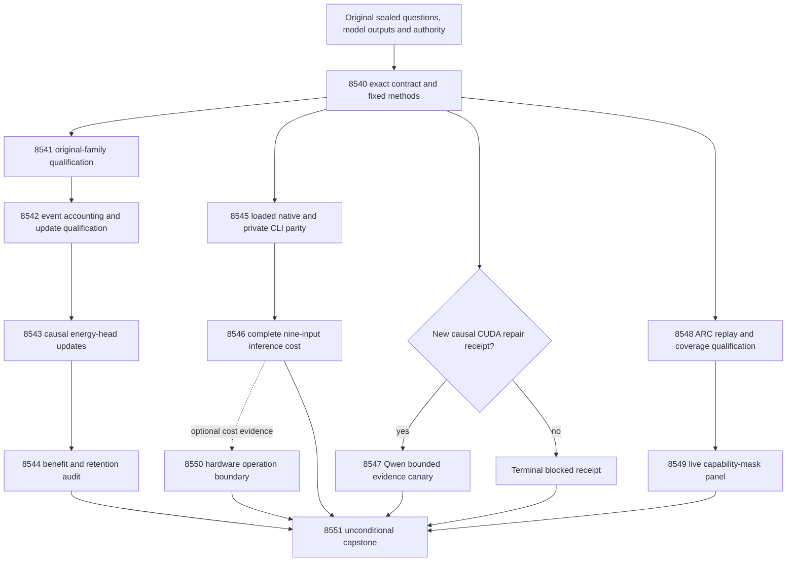

# Carnot Research Roadmap v734: Qualified Continuous Learning and Complete Inference Boundaries

**Created:** 2026-10-15

**Milestone:** 2026.10.734

**Status:** Planned; staged only, not activated

**Supersedes:** V733 scheduling, not its findings or evidence

**Execution contract:** Exactly 12 tasks, exp8540 through exp8551, in the order below

**Companion:** `research-roadmap-next.yaml`; the active `research-roadmap.yaml` is unchanged

## What V733 proved

Completion of fourteen scheduling slots did not qualify fourteen experiments.
The completion archive currently ends at V732; V733 primary artifacts, conductor
pre-gate receipts and the capstone are the current evidence. Preserve original
producer hashes, sealed dates, failed diagnostics and all quarantine flags.

| Evidence | Qualified conclusion | Consequence for V734 |
|---|---|---|
| Exp8526–8528 | Contract, source consumer and identity-admissible fit ran with qualified controls | Retain question roles and original numerical methods; no repeat fit |
| Exp8529 | Complete source-information null on 100 exposed test questions: full-head Brier gains over raw, scalar and permuted controls were approximately 0.000063, 0.000052 and 0.000154; all simultaneous intervals crossed zero | Close unchanged exposed source tuning; reopen only with new information or disjoint independently adjudicated questions |
| Exp8530 | Update arithmetic observations exist, but original-family validation failed and duplicate scalar accounting triggered adversarial quarantine | Separate historical fixture qualification from independently reconstructed event accounting |
| Exp8531–8532 | Learning execution and its audit were pre-gated/cascade-blocked | No learning-benefit null or objective-change conclusion exists |
| Exp8533–8534 | Nine-input parity observations exist, but native build/CLI, historical scratch and coverage failed; complete cost never ran | Qualify actual consumers first, then measure the complete boundary |
| Exp8535 | CUDA repair evidence was absent; no model call occurred | Keep the Qwen canary optional and cheaply pre-gated |
| Exp8536–8537 | Capability wrapper fixtures qualified; the 16-episode panel did not qualify terminal replay/coverage | Old zero-progress and increased-wall observations remain diagnostic, not a validated mask verdict |
| Exp8538–8539 | Board obligations and terminal outcome accounting qualified; scientific/deployment conclusions remained blocked | No physical probe or scope promotion; unconditional readers preserve independent results |

Historical Exp8520 measured a **five-input append-service** throughput ratio of
2.16268, CI [2.03877, 2.29157]. It is neither nine-input inference speed nor FPGA
acceleration. The 300-question/900-answer corpus and FaithBench groups have
already been exposed. Repartitioning them cannot create independent evidence.
The original V733 design is preserved byte-for-byte in
`research-roadmap-v733-preserved-20261015.md`, SHA256
`cbcc949d69842d869c5516e076aaa960a010925b02bc244587eb6bd10a76e270`.

## Three largest gaps against the PRD

| Gap | PRD / program anchor | Bounded next evidence |
|---|---|---|
| Trustworthy semantic verification and calibration on real model output | FR-12; research-program learned extraction and calibrated verification | Preserve the qualified source null; qualify the small energy head and an optional Qwen source-evidence canary. Independent generalization remains an explicit fresh-data gap |
| Demonstrated continuous self-learning with retention | FR-06/11; Continuous Self-Learning | Causal Brier versus log-loss/frozen training, fixed delayed feedback, real process recovery, independent question-level benefit/retention audit |
| Efficient, reachable end-to-end execution | FR-05/08, NFR-01; live ARC and hardware acceleration | Actual native CLI parity plus complete inference cost, reachable capability-mask behavior, operation-level hardware feasibility |

This milestone closes execution qualifications that prevented scientific answers.
It does not spend another slot fitting the same source features, relabel known
benchmark groups as fresh, or promise independent semantic accuracy without new
adjudicated data. Readiness and scientific benefit are separate artifact fields.

## Research scanned before experiment design

The dated V734 section of `../../research-references.md` was added before this
plan. The scan covered arXiv, OpenReview, Hugging Face Papers, GitHub, Extropic,
Logical Intelligence and attempted Semantic Scholar citation queries. Citation
API access failed; the citation scan is incomplete, not evidence of zero cites.
GitHub trending snapshots were stale; no current trending claim is made.

| Primary source | Design decision |
|---|---|
| [EBT](https://arxiv.org/abs/2507.02092), [ARM-EBM](https://arxiv.org/abs/2512.15605) | Energy-based reasoning motivates the program; neither substitutes for verified Carnot outcomes |
| [Calibeating](https://arxiv.org/abs/2603.22167), [delayed-feedback capacity](https://arxiv.org/abs/2606.11711) | Exp8543–8544 test proper-loss updates under fixed causal admissions and delayed labels; no imported theorem claim |
| [Online spline KAN](https://arxiv.org/abs/2602.02056) | Exp8542–8546 preserve local sparse updates and test complete native execution |
| [KANCL](https://arxiv.org/abs/2605.12306) | Unchanged importance anchoring is locally retired; no rerun |
| [Neural certified constraints](https://arxiv.org/abs/2608.14569), [reward-guided decoding](https://arxiv.org/abs/2605.28020) | Follow-up leads only; retrieval-date conflicts and absent calibrated independent signal prevent a new decoding claim |
| [Enoki](https://arxiv.org/abs/2609.00581), [FaithJudge](https://arxiv.org/abs/2505.04847) | Rule-extraction dependence and label custody matter; both ideas/data already have local history, so no novelty reset |
| [Pipelined p-computer](https://arxiv.org/abs/2607.21077), [250-MTJ hardware](https://arxiv.org/pdf/2506.14590) | Exp8550 maps required operations and complete costs before any physical feasibility claim |
| [Extropic Z1T](https://extropic.ai/writing/z1t/) | Newly inspected boundary exclusions—dense final logits and inter-device movement—enter Exp8550 explicitly; vendor estimates are not local measurements |
| [Kona](https://logicalintelligence.com/kona), [irithyll](https://github.com/evilrat420/irithyll) | Architecture/streaming leads only; no reproducible new Kona result or reason to replace the qualified local learner |

## Architecture: qualified paths with independent hardware gates



The learner changes only the small energy head. A sealed prediction transaction
precedes label release; one atomic update transaction advances coefficients,
applied IDs, acknowledgments and cursor together. Typed decisions consume the
new state only on later questions. Retention labels never train the head.
Native inference preserves the original scaler, offset, temperature and policy.
ARC uses the agent's own observations and reachable runtime routes; source RE,
hand adapters and offline ground-truth solves are outside the deliverable.

## Phase 1 — qualify the causal foundations (Exp8540–8542)

Exp8540 binds every complete task dictionary, the visible table and a canonical
digest. It freezes the original numerical protocols before experiments and
exposes independent methods, learning-input, native-input, canary-input and
runtime-repair gates. Optional runtime absence never blocks CPU work.

Exp8541 fixes suite-to-authority binding, scratch parents and bounded child
execution for the original learning tests. Every original node must have a
terminal outcome; a killed shard is a failed check, not an omitted test.

Exp8542 reconstructs operations from event/state transitions. Distinct counters
retain numeric values, units, definitions and source IDs; aliases reference one
canonical record. Independent controls distinguish assignment, coefficient
change, decay and admission. Every distinct counter also has a validator-visible
numeric projection with its original name and exact value. A deliberately
coincident-counter negative control must trigger the unchanged validator in this
final representation. Equal quantities remain equal. If truthful output still
fails, disqualify it; never suppress a finding or mistake nesting for a repair.

## Phase 2 — measure continuous self-learning (Exp8543–8544)

Exp8543 trains frozen/log-loss/Brier/shuffled-released-label arms over the fixed
five blocks, 100 questions, three siblings and five seeds: 6000 prediction rows.
Capacity is eight questions per block, learning rate 0.01, L2 0.001. The initial
state is original qualified Exp8431, never the new source fit. Real process exit
after block2 at seed17 in every arm must resume to identical state/predictions.

Exp8544 averages siblings and seeds within question and audits 80 later-block
questions. Two primary contrasts use 10000 paired question bootstrap draws,
seed7278448, 97.5% intervals each; both lower bounds must exceed zero with no
typed-loss increase. Retention uses all 50 fixed questions and five windows,
10000 joint resamples, seed7258421; maximum-window upper95 must be <=0.01.
Success is conditional on exposed histories, at most circular_positive.
A qualified null closes this unchanged objective/panel.

## Phase 3 — qualify and measure complete inference (Exp8545–8547)

Exp8545 repairs the actual isolated build and private CLI failures, then proves
parity of the loaded Rust/PyO3 nine-input, 109-coefficient head against independent
dense SciPy on 900 answers plus numerical edge cases. Tolerance remains
1e-12*(1+abs(reference)); Python fallback within1e-10 of thresholds0.2/0.8 is real
and counted. No fast-math change, changed reference or partial-path qualification.

Exp8546 measures ten alternating AB/BA repeat pairs on64 fixed test answers,
batch1 primary and batch8 secondary. Complete cost includes fresh child startup,
text feature recomputation, scaling, offset, binding/residual, normalization,
typed decisions and serialization. Model acquisition, updates and durable storage
are excluded explicitly. A scoped speed benefit requires primary lower95>1 and
p95 latency ratio<=1.05; NFR01 needs lower95>=10. One machine is one machine.
Qualified measurement readiness remains1 even if speed benefit is0.

Exp8547 is a sixteen-call diagnostic, gated on a new causal CUDA repair receipt.
Use only `unsloth/Qwen3.8-27B-GGUF`, cached Q4_K_M, four fit questions and four
source/instruction views, temperature0, max128 output tokens. Actual bounded
generation uses `model_bounded_generation` and its10-second floor. Load is capped
at600s, each call120s, measurement2400s. Missing repair evidence causes a cheap
terminal block, no unchanged device probe and no CPU model fallback.

## Phase 4 — qualify reachable ARC behavior and reconcile boundaries (Exp8548–8551)

Exp8548 repairs terminal cold replay and real child coverage before any fresh
panel. Retain original episodes, failures and the tested240-second replay bound;
no fresh game collection in this qualification. Exp8537 stays disqualified.

Exp8549 runs the existing mask once through the qualified live wrapper:
`ar25-0c556536`, `ft09-0d8bbf25`, `lf52-271a04aa`, `tn36-ef4dde99`; seeds11/22;
two arms;16 episodes;512 actions and120seconds per episode;2400seconds total.
Only explicitly unavailable capability is masked. Unknown capability, predicates,
window120, stall150 and default-off behavior remain unchanged. Benefit requires
less unavailable work, no paired level regression and no complete-wall increase.
Four games bound transfer evidence; no percentage headline from action counts.
A qualified null closes the unchanged mask/panel. Registry-precheck prevents
repeat solve credit; any incidental level solve requires
`solve_provenance=live_agent_self_discovery` and a reachable trajectory.

Exp8550 runs unconditionally, without physical commands. It maps complete costs
when qualified and preserves unknown costs otherwise. Compare actual KV260,
PolarFire and GateMate supported operations, plus Z1T vendor exclusions. A
conditional zero-cost ceiling is allowed only from disjoint qualified spans;
it is never measured acceleration. Exp8551 runs unconditionally after all slots,
retains all terminal classes and publication G1–G4, and records concrete next
evidence. External blockage uses blocked, never retryable partial.

## Dependency graph and exact gate fields

All listed conditions use `== 1` and exist in the upstream task's own required
artifact fields. Every upstream is earlier in this same roadmap. Optional
readers inspect absence without a gate. The full JSON contract includes each
structured `gated_on` entry.

| Consumer | Required producer fields |
|---|---|
| Exp8541 | Exp8540.methods_ready_score; Exp8540.learning_inputs_ready_score |
| Exp8542 | Exp8541.historical_learning_validation_ready_score |
| Exp8543 | Exp8540.methods_ready_score; Exp8542.online_adapter_ready_score |
| Exp8544 | Exp8540.methods_ready_score; Exp8543.causal_learning_rows_ready_score |
| Exp8545 | Exp8540.methods_ready_score; Exp8540.nine_input_inputs_ready_score |
| Exp8546 | Exp8540.methods_ready_score; Exp8545.nine_input_native_ready_score |
| Exp8547 | Exp8540.methods_ready_score; Exp8540.runtime_repair_ready_score; Exp8540.canary_inputs_ready_score |
| Exp8548 | Exp8540.methods_ready_score |
| Exp8549 | Exp8540.methods_ready_score; Exp8548.arc_panel_execution_ready_score |
| Exp8540, Exp8550, Exp8551 | Unconditional; hardware-cost and capstone evidence remain optional inputs |

## Hardware, model routing and resource budget

CPU and disk-backed `/var/tmp` support all mandatory work. The native track needs
the existing offline Rust toolchain, PyO3, NumPy/SciPy and retained extension bytes.
Check available memory and disk before compilation; never assume `/tmp` tmpfs
capacity. Use one GPU lease only for Exp8547 if the causal runtime repair qualifies.
Two RTX3090 boards are available, but availability does not prove working CUDA.
No new hardware, downloads, reflashing, purchases or operator physical action is
required by this plan. KV260 k<=5 quadratic Ising is not nine-input spline support;
PolarFire Linux CPU dispatch is not fabric; GateMate remains externally blocked.

Planned sequential task budgets total585minutes (9h45m), including optional
canary; eleven non-LLM slots total530minutes. Estimates include agent work and
validation, not just measurement. Each invocation has the4800-second cap:
stop measurement by3600s and reserve at least900s for checks. Long children print
status every60s; every phase/load/generation/benchmark/subprocess prints before
and after, and loops print completed/pending counts. Keep gaps under600s. Write
files over about200 lines in chunks of at most150 lines with progress between
calls. No duration padding or oversized single tool call.

Schema/qualification tasks Exp8540–8542, Exp8545 and Exp8548 use Claude Opus,
max_turns100. Routine scientific experiments use Claude Sonnet,max_turns50;
the bounded board reader uses30. No Gemini long-context or formulaic new sampler,
verifier, Rust boilerplate or test-only task is scheduled. Future such formulaic
work should use Codex/gpt-6.1-sol; no Luna experiment is included. All tasks declare
current model use; historical outputs never count as fresh calls. No full-generation
or embedding-only experiment is planned. Legacy small models provide no headline.

## Acceptance, retirement and validation

Each task delivers the exact JSON path in the contract, a thin runner under
`scripts/experiments/`, primitive evidence under the matching `results/raw/`
directory, and a task note under `docs/research-notes/v734-<slug>.md`.
Every comparison emits per-unit rows with intended/completed/failed/censored/
excluded/independent counts. Bootstrap seeds, methods, model identities and
substantive thresholds are frozen before the first comparison.

Every artifact declares `verdict_class` from the closed enum positive,
circular_positive, null, blocked, disqualified, partial. Circular/oracle evidence
cannot be positive; every failed required check disqualifies. Exposed panel
benefits leave independent_generalization_score and generalized_learning_benefit_score
at zero. Every blocked verdict records `gate_check_summary` with upstream path,
hash, exact field, expected condition and observed value. Missing differs from0.

Every repeated failed/retired scope lists its authentic prior verdict, concrete
changed prerequisite/technique and `retire_if_same_verdict: true`. No retired ID
is reused and no `requires` chain points at a retired upstream. No override is
requested. The full contract preserves inherited prior failures as well as V733
failures. A blocked task is terminal for this milestone; its null result is not
inferred. No fresh experiment can erase prior quarantine.

Validation remains spec-first and tests-first for execution changes. Relevant
REQ-* and SCENARIO-* must exist before implementation. Run scoped units, actual
private CLI checks, Ruff/format, strict types, spec references and applicable
`ops/e2e-test-plan.md` checks. Authority and publication consumers run private
E2E-018 and E2E-021. Require100% newly owned statement coverage including actual
children and rejection paths. Collect each historical family before sharding;
retain its exact node union and original authority. Never launch an expanding
full-repository test run or nested all-history validation runner.

Cold-replay primitive operands in a fresh bounded process; retain absent-input,
owned-failure and self-consistently rehashed-tamper rejection controls. Run
unchanged primary publication, adversarial verification and strict row consistency
before immutable publication, then test the actual consumer. Keep every finding.
The planning pair itself is checked with the existing roadmap schema, exclusion
manifest lint, ARC contract lint, harness fit lint, full-object and table equality,
canonical digest and negative contract mutations. No runtime science is claimed
by planning validation.

## Continuation decisions and non-goals

- Learning can advance only with qualified causal updates and independent row
  reduction; a scientific null closes this objective/panel without tuning it.
- Native speed requires qualified complete costs. Kernel speed, five-input append
  cost and vendor energy estimates cannot satisfy the nine-input NFR01 claim.
- ARC efficiency requires actual work avoided and complete cost parity. The
  public adapter-withheld panel does not establish hidden-game generalization.
- Semantic superiority still needs disjoint independently adjudicated questions
  or materially new information. Source refits, old FaithBench groups, neural
  oracle claims and unchanged external text reranking remain closed.
- Physical acceleration needs compatible executed operations, provenance and
  complete host/device costs. No unchanged hardware probe is a new experiment.
- Capstone bookkeeping can succeed while science remains blocked. Keep these
  outcomes distinct; preserve G1–G4 and do not publish externally.

## Exact task contract

Exactly 12 tasks, exp8540 through exp8551, in this order.

| Order | Task ID | Title | Phase | Deliverable |
|---|---|---|---|---|
| 1 | exp8540-contract-methods | Bind twelve tasks and preserve the source null and original scientific protocols | 1 | results/experiment_8540_v734_contract_methods.json |
| 2 | exp8541-historical-learning-qualification | Qualify original learning test families with isolated authority and bounded children | 1 | results/experiment_8541_v734_historical_learning_qualification.json |
| 3 | exp8542-canonical-update-accounting | Qualify event accounting from actual state transitions and canonical counter records | 1 | results/experiment_8542_v734_canonical_update_accounting.json |
| 4 | exp8543-causal-brier-stream | Train the continuous energy head with delayed feedback and objective controls | 2 | results/experiment_8543_v734_causal_brier_stream.json |
| 5 | exp8544-learning-benefit-audit | Independently test later-block Brier benefit, retention and useful decision cost | 2 | results/experiment_8544_v734_learning_benefit_audit.json |
| 6 | exp8545-nine-input-native-qualification | Repair the native build and private CLI contract, then qualify complete nine-input parity | 3 | results/experiment_8545_v734_nine_input_native_qualification.json |
| 7 | exp8546-complete-native-cost | Measure complete nine-input native inference against the qualified Python path | 3 | results/experiment_8546_v734_complete_native_cost.json |
| 8 | exp8547-qwen-evidence-canary | Run the bounded Qwen source-evidence canary only after causal CUDA repair | 3 | results/experiment_8547_v734_qwen_evidence_canary.json |
| 9 | exp8548-arc-panel-replay-qualification | Qualify terminal ARC panel replay and actual subprocess coverage | 4 | results/experiment_8548_v734_arc_panel_replay_qualification.json |
| 10 | exp8549-arc-capability-panel | Measure the live capability mask on the fixed adapter-withheld ARC panel | 4 | results/experiment_8549_v734_arc_capability_panel.json |
| 11 | exp8550-hardware-operation-boundary | Map qualified complete-operation costs to the actual board and thermodynamic boundaries | 4 | results/experiment_8550_v734_hardware_operation_boundary.json |
| 12 | exp8551-capstone | Reconcile twelve terminal outcomes without promoting quarantined or exposed evidence | 4 | results/experiment_8551_v734_capstone.json |

Canonical tasks SHA256: `d14c6915c6f390f334608c72557bce12a843973542bc70e9785b1b0868ec099c`

The machine contract below includes every task field, including full prompts.
Only the two-file pair is the staged plan; activation is a separate conductor action.

<!-- V734_TASK_CONTRACT_START -->
```json
{
"milestone": "2026.10.734",
"tasks": [
{"id": "exp8540-contract-methods", "title": "Bind twelve tasks and preserve the source null and original scientific protocols", "phase": 1, "track": "infrastructure", "priority": "high", "requires_gpu": false, "max_turns": 100, "estimated_wall_time_min": 40, "per_unit_rows": true, "milestone": "2026.10.734", "deliverable": "results/experiment_8540_v734_contract_methods.json", "inference_substrate_class": "no_model_load", "MODEL_SPECS": [], "gated_on": [], "prior_failures": [{"experiment_id": "exp8499-contract-methods", "verdict": "complete_blocked_v731_contract_methods", "addressed_by": "V734 supplies and checks twelve complete task objects, the table, JSON, digest and end marker; preserve failed historical authority and the qualified V732/V733 reader behavior.", "retire_if_same_verdict": true}], "agent_type": "claude", "model": "opus", "prompt": "CONTEXT:\nWork in {project_root} on {date}. V733 completed fourteen scheduling slots. Exp8529 qualified an exposed-panel source-information null; do not repeat its raw/scalar/permuted fits. Exp8530 is quarantined: original-family validation failed and duplicate accounting scalars triggered TAUTOLOGY. Exp8533 failed private build/CLI, historical scratch and coverage checks. Exp8537 failed terminal replay and coverage. Learning benefit, complete native speed and capability-panel benefit remain unqualified. Preserve original authority and all quarantines.\nEXISTING CODE TO READ FIRST:\nCLAUDE.md; CODEX.md; ops/e2e-test-plan.md; ops/exclusion_manifest.yaml; openspec/capabilities/research-reporting/spec.md; openspec/capabilities/verification/spec.md; scripts/experiment_template.py; python/carnot/reporting/primary_publication.py; openspec/change-proposals/research-roadmap-vNEXT.md; research-references.md; python/carnot/reporting/v733_contract_methods.py; python/carnot/reporting/v733_historical_inputs.py; python/carnot/reporting/roadmap_contract.py; python/carnot/verify/cuda_reader_8410.py; results/experiment_8539_v733_capstone.json; results/experiment_8529_v733_incremental_source_audit.json; openspec/change-proposals/v733-methods-protocol.json; openspec/change-proposals/research-roadmap-v733-preserved-20261015.md\nTASK:\nBind twelve tasks and preserve the source null and original scientific protocols. Deliver results/experiment_8540_v734_contract_methods.json. Create thin runner scripts/experiments/experiment_8540_v734_contract_methods.py, primitive evidence under results/raw/experiment_8540_v734_contract_methods/, and docs/research-notes/v734-contract-methods.md. Same-roadmap outputs are future dependencies.\nCONCRETE STEPS:\n1. PRECONDITIONS: Print a flushed start line. Authenticate original inputs, tool availability, writable disk-backed scratch, memory and deadlines before work. Record missing resources in gate_check_summary. Use original sealed historical dates and authority. Optional CUDA or board absence must not block independent CPU work.\n2. Print a flushed progress line at each phase boundary and before and after every model load, generation, benchmark or subprocess that can take minutes. Use unbuffered output. Print completed and pending counts inside long loops. Supervise each child with a status line at least every 60 seconds. Keep every output gap under 600 seconds. Write any file over about 200 lines in several tool calls of at most about 150 lines, with a progress message between calls. Bound each tool call. Stop measurements by 3600 seconds and reserve at least 900 seconds for validation inside the 4800-second hard cap. Never pad duration.\n3. Spec first: ensure the relevant capability spec contains REQ-* and SCENARIO-* before implementation. Write focused failing tests first. Preserve existing tests, assertions, numerical thresholds and historical result bytes. Reuse shipped modules through explicit small adapters. Place runners in scripts/experiments/ and tests in tests/python/. Put scratch under /var/tmp. Accept --date {date}. Do not change the active roadmap, conductor, validation gates, generator weights or external services.\n4. Declare inference_substrate_class=no_model_load, MODEL_SPECS=[]. Record zero current LLM calls. Use aggregation_from_upstream_artifacts as inference_substrate. Put cached generator identities only in historical_model_provenance.\n5. Compare exactly 12 complete task objects Exp8540 through Exp8551 across the visible table, embedded JSON, canonical_tasks_sha256 and activated YAML. Require full dictionary equality, including prompts, routing, gates and retirement flags. Exercise count, order, ID, title, phase, deliverable, model, substrate, gate, prompt, retirement-flag and missing-end-marker mutations. Reuse authentic activation evidence if staging was consumed.\n6. Create openspec/change-proposals/v734-methods-protocol.json before any experiment. Preserve V733 design SHA256 cbcc949d69842d869c5516e076aaa960a010925b02bc244587eb6bd10a76e270. Copy objective_updates, objective_audit, nine_input_native_inference, evidence_canary and arc_capability_mask numerical operands exactly. Change only task bindings and separately documented validation mechanics. Preserve all original question roles, heads, thresholds, seeds and budgets.\n7. Authenticate original V726 learning heads and streams, V733 comparator inputs and original ARC qualification separately. Emit learning_inputs_ready_score, nine_input_inputs_ready_score and canary_inputs_ready_score independently. Close unchanged exposed source tuning after Exp8529; require new information or disjoint independently adjudicated questions to reopen. FaithBench is already exposed. Do not create a fresh split or fit another source head.\n8. Inspect only a supplied ops/cuda-runtime-repair-receipt.json through the shipped Exp8410 reader, at most 60 seconds. runtime_repair_ready_score=1 requires causal changed library/environment hashes plus actual context/copy evidence. No device commands, runtime rebuild or model load. Missing evidence cheaply pre-gates the canary.\n9. Bind the V734 references section and map Calibeating, delayed-capacity learning, spline locality and Z1T operation exclusions to named tasks. Keep deferred papers explicit. Read archive lag honestly: research-complete.yaml currently ends at V732, so use authenticated V733 primaries, pre-gates and conductor outcomes without modifying the archive.\n10. Run scoped unit tests, actual private CLI checks, Ruff check/format, strict mypy and scripts/check_spec_coverage.py --files <owned-test-files>. Run applicable ops/e2e-test-plan.md checks, including private E2E-018 and E2E-021 for authority/publication consumers. Require 100 percent newly owned statement coverage, including real children and rejection paths. Collect original test node IDs before sharding. Preserve their exact union in disjoint bounded pytest children using -n 0 -o addopts= --no-cov. Use suite-specific original authority. Never launch a nested full historical validation runner or the full repository suite. A killed child fails validation. Preserve commands, terminal node outcomes, exit codes, durations and log hashes.\n11. Cold-replay primitive rows in a fresh bounded process. Test absent inputs, owned failures and self-consistently rehashed tampering. Run unchanged primary_publication, scripts/adversarial_verify.py --json <private-candidate> and scripts/verdict_row_consistency_lint.py --strict <private-candidate>. Keep every finding. Validate final bytes, publish atomically, bind the terminal sidecar and exercise the actual downstream consumer. A new artifact cannot clear old flags. Owned required-check failure is disqualified. Unchanged external blockage is blocked, never partial. Reconcile openspec/, _bmad/traceability.md, ops/status.md and ops/changelog.md.\nREQUIRED ARTIFACT FIELDS:\nexperiment_id, task_id, milestone, run_date: principle: Bind evidence to this invocation.\nhonest_verdict, verdict_class: principle: Terminal verdicts start complete_; the class is exactly positive | circular_positive | null | blocked | disqualified | partial. Reserve partial for unfinished owned work another attempt can complete.\ngate_check_summary: principle: Every blocked_* or complete_blocked_* outcome names check, upstream, path/hash, field, operator, expected and observed. Missing differs from zero.\ninference_substrate, inference_substrate_class, MODEL_SPECS, model_invocation_counts, historical_model_provenance: principle: Separate actual model calls from imported historical outputs.\nrows, intended_count, completed_count, failed_count, censored_count, excluded_count, independent_count, sample_size_budget: principle: Emit each question, arm, seed, episode or repeat metric and missing reason. Repeats do not multiply independent evidence.\nverifier_is_oracle, exposure_scope, independent_generalization_score, generalized_learning_benefit_score: principle: Oracle fixtures and exposed-history benefits are at most circular_positive; generalization scores remain zero for this plan.\nrequired_checks_passed, flagged_adversarial, acceptance_gates, validation_receipts, terminal_validation_sidecar_path, adversarial_findings: principle: Qualification and scientific benefit are separate. Failed required checks forbid positive classes.\npreconditions_checked, duration_s, phase_spans, random_seed, reproducibility_checksum, source_artifact_hashes, code_config_hashes, raw_shard_hashes: principle: Preserve real work and immutable primitive operands.\ncited_upstream_artifacts, field_principles: principle: Identify original producer hashes and explain every extra metric and gate.\ncurrent_contract_ready_score, methods_ready_score, learning_inputs_ready_score, nine_input_inputs_ready_score, canary_inputs_ready_score, runtime_repair_ready_score, methods_protocol_reference, canonical_tasks_sha256, historical_family_receipts, closed_source_comparison, literature_mapping: principle: Independent readiness gates must not depend on favorable science or optional hardware.\nRun command: cd {project_root} && JAX_PLATFORMS=cpu PYTHONPATH=python:. PYTHONUNBUFFERED=1 .venv/bin/python -u scripts/experiments/experiment_8540_v734_contract_methods.py --date {date}\nDo NOT push. Do NOT modify scripts/research_conductor.py.\n"},
{"id": "exp8541-historical-learning-qualification", "title": "Qualify original learning test families with isolated authority and bounded children", "phase": 1, "track": "infrastructure", "priority": "high", "requires_gpu": false, "max_turns": 100, "estimated_wall_time_min": 40, "per_unit_rows": true, "milestone": "2026.10.734", "deliverable": "results/experiment_8541_v734_historical_learning_qualification.json", "inference_substrate_class": "no_model_load", "MODEL_SPECS": [], "gated_on": [{"upstream": "exp8540-contract-methods", "artifact_field": "methods_ready_score", "op": "==", "value": 1}, {"upstream": "exp8540-contract-methods", "artifact_field": "learning_inputs_ready_score", "op": "==", "value": 1}], "prior_failures": [{"experiment_id": "exp8517-brier-online-learning", "verdict": "complete_disqualified_v732_brier_online_learning", "addressed_by": "Repair the measured missing field diagnostic, distinguish coordinate changes from update events using before/after states, and replace incomplete nested validation with the exact bounded test union.", "retire_if_same_verdict": true}, {"experiment_id": "exp8489-objective-checkpoint-qualification", "verdict": "complete_circular_positive_v730_objective_checkpoint_qualification", "addressed_by": "Exp8516 now supplies a qualified immutable objective publication; reuse it without rewriting Exp8489 or its stale sidecar.", "retire_if_same_verdict": true}, {"experiment_id": "exp8530-update-accounting-qualification", "verdict": "complete_disqualified_v733_update_accounting_qualification", "addressed_by": "Split historical validation from arithmetic; replace the single wrong-family bootstrap with original per-suite bindings and bounded disjoint children.", "retire_if_same_verdict": true}], "agent_type": "claude", "model": "opus", "prompt": "CONTEXT:\nWork in {project_root} on {date}. V733 completed fourteen scheduling slots. Exp8529 qualified an exposed-panel source-information null; do not repeat its raw/scalar/permuted fits. Exp8530 is quarantined: original-family validation failed and duplicate accounting scalars triggered TAUTOLOGY. Exp8533 failed private build/CLI, historical scratch and coverage checks. Exp8537 failed terminal replay and coverage. Learning benefit, complete native speed and capability-panel benefit remain unqualified. Preserve original authority and all quarantines.\nEXISTING CODE TO READ FIRST:\nCLAUDE.md; CODEX.md; ops/e2e-test-plan.md; ops/exclusion_manifest.yaml; openspec/capabilities/research-reporting/spec.md; openspec/capabilities/verification/spec.md; scripts/experiment_template.py; python/carnot/reporting/primary_publication.py; openspec/change-proposals/research-roadmap-vNEXT.md; research-references.md; python/carnot/reporting/v733_update_validation.py; python/carnot/reporting/objective_publication_runner_8516.py; python/carnot/reporting/historical_consumer_roots_8402.py; tests/python/test_objective_reporting_8461.py; tests/python/test_objective_checkpoint_8489.py; tests/python/test_block_feedback_state_8433.py; results/experiment_8530_v733_update_accounting_qualification.json\nTASK:\nQualify original learning test families with isolated authority and bounded children. Deliver results/experiment_8541_v734_historical_learning_qualification.json. Create thin runner scripts/experiments/experiment_8541_v734_historical_learning_qualification.py, primitive evidence under results/raw/experiment_8541_v734_historical_learning_qualification/, and docs/research-notes/v734-historical-learning-qualification.md. Same-roadmap outputs are future dependencies.\nCONCRETE STEPS:\n1. PRECONDITIONS: Print a flushed start line. Authenticate original inputs, tool availability, writable disk-backed scratch, memory and deadlines before work. Record missing resources in gate_check_summary. Use original sealed historical dates and authority. Optional CUDA or board absence must not block independent CPU work.\n2. Print a flushed progress line at each phase boundary and before and after every model load, generation, benchmark or subprocess that can take minutes. Use unbuffered output. Print completed and pending counts inside long loops. Supervise each child with a status line at least every 60 seconds. Keep every output gap under 600 seconds. Write any file over about 200 lines in several tool calls of at most about 150 lines, with a progress message between calls. Bound each tool call. Stop measurements by 3600 seconds and reserve at least 900 seconds for validation inside the 4800-second hard cap. Never pad duration.\n3. Spec first: ensure the relevant capability spec contains REQ-* and SCENARIO-* before implementation. Write focused failing tests first. Preserve existing tests, assertions, numerical thresholds and historical result bytes. Reuse shipped modules through explicit small adapters. Place runners in scripts/experiments/ and tests in tests/python/. Put scratch under /var/tmp. Accept --date {date}. Do not change the active roadmap, conductor, validation gates, generator weights or external services.\n4. Declare inference_substrate_class=no_model_load, MODEL_SPECS=[]. Record zero current LLM calls. Use aggregation_from_upstream_artifacts as inference_substrate. Put cached generator identities only in historical_model_provenance.\n5. Reproduce the recorded original-family failures in private scratch: test_objective_reporting_8461 yielded empty evidence lists and a missing tasks mapping; later historical shards were killed at 300 seconds. Trace each failing suite to its original sealed family and fixture. Preserve old failed evidence. Do not substitute V734 authority into an older consumer.\n6. Implement a small suite-to-original-authority adapter. Resolve immutable paths explicitly, create parent scratch directories before child startup, and isolate per-suite patches. Run a single representative real fixture before the full union. Do not mock a passing qualification or manufacture missing historical bytes.\n7. Collect the exact historical node union recorded by Exp8530. Partition by fixture family with a measured per-child deadline of at most 480 seconds and status output every 60 seconds. Validate every original node exactly once, including rejection and recovery tests. If a family still cannot finish, emit its actual timed-out node and disqualify; do not delete nodes or expand to the full suite.\n8. Emit historical_learning_validation_ready_score=1 only if every intended original node has a passing terminal outcome and new adapter coverage is complete. Bind original authority, source snapshots and all executed children. Exclude repeated validation of unchanged already-qualified unrelated scientific families.\n9. Run scoped unit tests, actual private CLI checks, Ruff check/format, strict mypy and scripts/check_spec_coverage.py --files <owned-test-files>. Run applicable ops/e2e-test-plan.md checks, including private E2E-018 and E2E-021 for authority/publication consumers. Require 100 percent newly owned statement coverage, including real children and rejection paths. Collect original test node IDs before sharding. Preserve their exact union in disjoint bounded pytest children using -n 0 -o addopts= --no-cov. Use suite-specific original authority. Never launch a nested full historical validation runner or the full repository suite. A killed child fails validation. Preserve commands, terminal node outcomes, exit codes, durations and log hashes.\n10. Cold-replay primitive rows in a fresh bounded process. Test absent inputs, owned failures and self-consistently rehashed tampering. Run unchanged primary_publication, scripts/adversarial_verify.py --json <private-candidate> and scripts/verdict_row_consistency_lint.py --strict <private-candidate>. Keep every finding. Validate final bytes, publish atomically, bind the terminal sidecar and exercise the actual downstream consumer. A new artifact cannot clear old flags. Owned required-check failure is disqualified. Unchanged external blockage is blocked, never partial. Reconcile openspec/, _bmad/traceability.md, ops/status.md and ops/changelog.md.\nREQUIRED ARTIFACT FIELDS:\nexperiment_id, task_id, milestone, run_date: principle: Bind evidence to this invocation.\nhonest_verdict, verdict_class: principle: Terminal verdicts start complete_; the class is exactly positive | circular_positive | null | blocked | disqualified | partial. Reserve partial for unfinished owned work another attempt can complete.\ngate_check_summary: principle: Every blocked_* or complete_blocked_* outcome names check, upstream, path/hash, field, operator, expected and observed. Missing differs from zero.\ninference_substrate, inference_substrate_class, MODEL_SPECS, model_invocation_counts, historical_model_provenance: principle: Separate actual model calls from imported historical outputs.\nrows, intended_count, completed_count, failed_count, censored_count, excluded_count, independent_count, sample_size_budget: principle: Emit each question, arm, seed, episode or repeat metric and missing reason. Repeats do not multiply independent evidence.\nverifier_is_oracle, exposure_scope, independent_generalization_score, generalized_learning_benefit_score: principle: Oracle fixtures and exposed-history benefits are at most circular_positive; generalization scores remain zero for this plan.\nrequired_checks_passed, flagged_adversarial, acceptance_gates, validation_receipts, terminal_validation_sidecar_path, adversarial_findings: principle: Qualification and scientific benefit are separate. Failed required checks forbid positive classes.\npreconditions_checked, duration_s, phase_spans, random_seed, reproducibility_checksum, source_artifact_hashes, code_config_hashes, raw_shard_hashes: principle: Preserve real work and immutable primitive operands.\ncited_upstream_artifacts, field_principles: principle: Identify original producer hashes and explain every extra metric and gate.\nhistorical_learning_validation_ready_score, original_authority_by_suite, collected_node_ids, shard_node_ids, terminal_node_outcomes, exact_union_receipt, failed_family_diagnostics: principle: One passing outer command cannot stand in for missing or killed original tests.\nRun command: cd {project_root} && JAX_PLATFORMS=cpu PYTHONPATH=python:. PYTHONUNBUFFERED=1 .venv/bin/python -u scripts/experiments/experiment_8541_v734_historical_learning_qualification.py --date {date}\nDo NOT push. Do NOT modify scripts/research_conductor.py.\n"},
{"id": "exp8542-canonical-update-accounting", "title": "Qualify event accounting from actual state transitions and canonical counter records", "phase": 1, "track": "infrastructure", "priority": "high", "requires_gpu": false, "max_turns": 100, "estimated_wall_time_min": 40, "per_unit_rows": true, "milestone": "2026.10.734", "deliverable": "results/experiment_8542_v734_canonical_update_accounting.json", "inference_substrate_class": "no_model_load", "MODEL_SPECS": [], "gated_on": [{"upstream": "exp8541-historical-learning-qualification", "artifact_field": "historical_learning_validation_ready_score", "op": "==", "value": 1}], "prior_failures": [{"experiment_id": "exp8517-brier-online-learning", "verdict": "complete_disqualified_v732_brier_online_learning", "addressed_by": "Repair the measured missing field diagnostic, distinguish coordinate changes from update events using before/after states, and replace incomplete nested validation with the exact bounded test union.", "retire_if_same_verdict": true}, {"experiment_id": "exp8489-objective-checkpoint-qualification", "verdict": "complete_circular_positive_v730_objective_checkpoint_qualification", "addressed_by": "Exp8516 now supplies a qualified immutable objective publication; reuse it without rewriting Exp8489 or its stale sidecar.", "retire_if_same_verdict": true}, {"experiment_id": "exp8530-update-accounting-qualification", "verdict": "complete_disqualified_v733_update_accounting_qualification", "addressed_by": "Original suite isolation is qualified separately; fresh event records distinguish real quantities from duplicate aliases and prove identities with independent controls.", "retire_if_same_verdict": true}], "agent_type": "claude", "model": "opus", "prompt": "CONTEXT:\nWork in {project_root} on {date}. V733 completed fourteen scheduling slots. Exp8529 qualified an exposed-panel source-information null; do not repeat its raw/scalar/permuted fits. Exp8530 is quarantined: original-family validation failed and duplicate accounting scalars triggered TAUTOLOGY. Exp8533 failed private build/CLI, historical scratch and coverage checks. Exp8537 failed terminal replay and coverage. Learning benefit, complete native speed and capability-panel benefit remain unqualified. Preserve original authority and all quarantines.\nEXISTING CODE TO READ FIRST:\nCLAUDE.md; CODEX.md; ops/e2e-test-plan.md; ops/exclusion_manifest.yaml; openspec/capabilities/research-reporting/spec.md; openspec/capabilities/verification/spec.md; scripts/experiment_template.py; python/carnot/reporting/primary_publication.py; openspec/change-proposals/research-roadmap-vNEXT.md; research-references.md; python/carnot/reporting/v733_update_accounting.py; python/carnot/reporting/v733_update_metrics.py; python/carnot/reporting/v733_update_fixture.py; python/carnot/reporting/v733_update_accounting_runner.py; python/carnot/verify/objective_stream_8517.py; results/experiment_8530_v733_update_accounting_qualification.json\nTASK:\nQualify event accounting from actual state transitions and canonical counter records. Deliver results/experiment_8542_v734_canonical_update_accounting.json. Create thin runner scripts/experiments/experiment_8542_v734_canonical_update_accounting.py, primitive evidence under results/raw/experiment_8542_v734_canonical_update_accounting/, and docs/research-notes/v734-canonical-update-accounting.md. Same-roadmap outputs are future dependencies.\nCONCRETE STEPS:\n1. PRECONDITIONS: Print a flushed start line. Authenticate original inputs, tool availability, writable disk-backed scratch, memory and deadlines before work. Record missing resources in gate_check_summary. Use original sealed historical dates and authority. Optional CUDA or board absence must not block independent CPU work.\n2. Print a flushed progress line at each phase boundary and before and after every model load, generation, benchmark or subprocess that can take minutes. Use unbuffered output. Print completed and pending counts inside long loops. Supervise each child with a status line at least every 60 seconds. Keep every output gap under 600 seconds. Write any file over about 200 lines in several tool calls of at most about 150 lines, with a progress message between calls. Bound each tool call. Stop measurements by 3600 seconds and reserve at least 900 seconds for validation inside the 4800-second hard cap. Never pad duration.\n3. Spec first: ensure the relevant capability spec contains REQ-* and SCENARIO-* before implementation. Write focused failing tests first. Preserve existing tests, assertions, numerical thresholds and historical result bytes. Reuse shipped modules through explicit small adapters. Place runners in scripts/experiments/ and tests in tests/python/. Put scratch under /var/tmp. Accept --date {date}. Do not change the active roadmap, conductor, validation gates, generator weights or external services.\n4. Declare inference_substrate_class=no_model_load, MODEL_SPECS=[]. Record zero current LLM calls. Use aggregation_from_upstream_artifacts as inference_substrate. Put cached generator identities only in historical_model_provenance.\n5. Authenticate Exp8541 historical_learning_validation_ready_score and its exact source/test hashes. Reuse Exp8516 objective mechanics through the original consumer. The old Exp8530 artifact stays quarantined. A fresh qualification must be computed from its original primitive transitions, not copied from its disqualified totals.\n6. Use one canonical named counter record per distinct quantity, with numeric value, unit, definition and source event IDs. Compatibility aliases map to canonical names rather than posing as independent measurements. Retain event-level admission, label release, applied-update, assignment-index and before/after coefficient evidence. Actual equal counts remain equal; do not perturb values, stringify numbers, omit distinct metrics or change validators to suppress TAUTOLOGY.\n7. Independently reduce physical assignments, changed stored coordinates, effective decay changes and unique coordinates. Exercise duplicate assignment, zero gradient, rejected feedback, decay-only change, clipping, pending feedback, frozen arm and restart controls. Demonstrate cases where the quantities differ and cases of proved one-to-one equality. Emit metric_relation_rows containing explicit derivations and independently recomputed checks.\n8. Project every distinct canonical counter into validator-visible numeric metrics or supported top-level value/principle fields, retaining its original metric name and exact numeric value. Prove projection completeness against the canonical records and raw event reductions. True compatibility aliases remain references, never independently measured quantities. Run a negative control on this final representation with deliberately coincident distinct counters and require the unchanged validator to report TAUTOLOGY. If that control does not trigger, fail qualification rather than publish a clean receipt. Run the unchanged adversarial validator on the truthful final artifact. If it remains critically flagged, publish complete_disqualified with every finding; online_adapter_ready_score stays zero. No waiver, silent promotion or scientific null follows.\n9. Qualify the numerical update rule and typed-decision adapter with independent finite differences and real interruption/restart checks. No new objective, learning-rate sweep or source fit. online_adapter_ready_score=1 requires passed historical qualification, every owned control, clean unchanged validators and the actual stream consumer.\n10. Run scoped unit tests, actual private CLI checks, Ruff check/format, strict mypy and scripts/check_spec_coverage.py --files <owned-test-files>. Run applicable ops/e2e-test-plan.md checks, including private E2E-018 and E2E-021 for authority/publication consumers. Require 100 percent newly owned statement coverage, including real children and rejection paths. Collect original test node IDs before sharding. Preserve their exact union in disjoint bounded pytest children using -n 0 -o addopts= --no-cov. Use suite-specific original authority. Never launch a nested full historical validation runner or the full repository suite. A killed child fails validation. Preserve commands, terminal node outcomes, exit codes, durations and log hashes.\n11. Cold-replay primitive rows in a fresh bounded process. Test absent inputs, owned failures and self-consistently rehashed tampering. Run unchanged primary_publication, scripts/adversarial_verify.py --json <private-candidate> and scripts/verdict_row_consistency_lint.py --strict <private-candidate>. Keep every finding. Validate final bytes, publish atomically, bind the terminal sidecar and exercise the actual downstream consumer. A new artifact cannot clear old flags. Owned required-check failure is disqualified. Unchanged external blockage is blocked, never partial. Reconcile openspec/, _bmad/traceability.md, ops/status.md and ops/changelog.md.\nREQUIRED ARTIFACT FIELDS:\nexperiment_id, task_id, milestone, run_date: principle: Bind evidence to this invocation.\nhonest_verdict, verdict_class: principle: Terminal verdicts start complete_; the class is exactly positive | circular_positive | null | blocked | disqualified | partial. Reserve partial for unfinished owned work another attempt can complete.\ngate_check_summary: principle: Every blocked_* or complete_blocked_* outcome names check, upstream, path/hash, field, operator, expected and observed. Missing differs from zero.\ninference_substrate, inference_substrate_class, MODEL_SPECS, model_invocation_counts, historical_model_provenance: principle: Separate actual model calls from imported historical outputs.\nrows, intended_count, completed_count, failed_count, censored_count, excluded_count, independent_count, sample_size_budget: principle: Emit each question, arm, seed, episode or repeat metric and missing reason. Repeats do not multiply independent evidence.\nverifier_is_oracle, exposure_scope, independent_generalization_score, generalized_learning_benefit_score: principle: Oracle fixtures and exposed-history benefits are at most circular_positive; generalization scores remain zero for this plan.\nrequired_checks_passed, flagged_adversarial, acceptance_gates, validation_receipts, terminal_validation_sidecar_path, adversarial_findings: principle: Qualification and scientific benefit are separate. Failed required checks forbid positive classes.\npreconditions_checked, duration_s, phase_spans, random_seed, reproducibility_checksum, source_artifact_hashes, code_config_hashes, raw_shard_hashes: principle: Preserve real work and immutable primitive operands.\ncited_upstream_artifacts, field_principles: principle: Identify original producer hashes and explain every extra metric and gate.\nonline_adapter_ready_score, canonical_counter_rows, metrics, counter_visibility_receipt, alias_map, metric_relation_rows, event_rows_reference, numerical_update_controls, restart_receipts, historical_validation_reference: principle: Counters describe different operations, while aliases and exact identities are explicit rather than false independent evidence.\nRun command: cd {project_root} && JAX_PLATFORMS=cpu PYTHONPATH=python:. PYTHONUNBUFFERED=1 .venv/bin/python -u scripts/experiments/experiment_8542_v734_canonical_update_accounting.py --date {date}\nDo NOT push. Do NOT modify scripts/research_conductor.py.\n"},
{"id": "exp8543-causal-brier-stream", "title": "Train the continuous energy head with delayed feedback and objective controls", "phase": 2, "track": "research", "priority": "high", "requires_gpu": false, "max_turns": 50, "estimated_wall_time_min": 60, "per_unit_rows": true, "milestone": "2026.10.734", "deliverable": "results/experiment_8543_v734_causal_brier_stream.json", "inference_substrate_class": "no_model_load", "MODEL_SPECS": [], "gated_on": [{"upstream": "exp8540-contract-methods", "artifact_field": "methods_ready_score", "op": "==", "value": 1}, {"upstream": "exp8542-canonical-update-accounting", "artifact_field": "online_adapter_ready_score", "op": "==", "value": 1}], "prior_failures": [{"experiment_id": "exp8517-brier-online-learning", "verdict": "complete_disqualified_v732_brier_online_learning", "addressed_by": "Exp8541 must qualify original historical families and Exp8542 must qualify actual update accounting before executing the unchanged registered stream; Exp8530 remains quarantined.", "retire_if_same_verdict": true}, {"experiment_id": "exp8490-brier-online-learning", "verdict": "complete_blocked_v730_brier_online_learning", "addressed_by": "Original qualified Exp8516 publication plus the new Exp8541/Exp8542 qualifications replace the failed chain; Exp8530 remains quarantined.", "retire_if_same_verdict": true}, {"experiment_id": "exp8531-causal-brier-learning", "verdict": "blocked_gate_check_failed", "addressed_by": "Prior execution was pre-gated by the failed accounting qualification; two separately qualified repairs now precede the unchanged causal protocol.", "retire_if_same_verdict": true}], "agent_type": "claude", "model": "sonnet", "prompt": "CONTEXT:\nWork in {project_root} on {date}. V733 completed fourteen scheduling slots. Exp8529 qualified an exposed-panel source-information null; do not repeat its raw/scalar/permuted fits. Exp8530 is quarantined: original-family validation failed and duplicate accounting scalars triggered TAUTOLOGY. Exp8533 failed private build/CLI, historical scratch and coverage checks. Exp8537 failed terminal replay and coverage. Learning benefit, complete native speed and capability-panel benefit remain unqualified. Preserve original authority and all quarantines.\nEXISTING CODE TO READ FIRST:\nCLAUDE.md; CODEX.md; ops/e2e-test-plan.md; ops/exclusion_manifest.yaml; openspec/capabilities/research-reporting/spec.md; openspec/capabilities/verification/spec.md; scripts/experiment_template.py; python/carnot/reporting/primary_publication.py; openspec/change-proposals/research-roadmap-vNEXT.md; research-references.md; python/carnot/verify/objective_stream_8517.py; python/carnot/reporting/brier_online_learning_8517.py; python/carnot/reporting/objective_publication_runner_8516.py; python/carnot/verify/block_feedback_state_8433.py; openspec/change-proposals/v733-methods-protocol.json\nTASK:\nTrain the continuous energy head with delayed feedback and objective controls. Deliver results/experiment_8543_v734_causal_brier_stream.json. Create thin runner scripts/experiments/experiment_8543_v734_causal_brier_stream.py, primitive evidence under results/raw/experiment_8543_v734_causal_brier_stream/, and docs/research-notes/v734-causal-brier-stream.md. Same-roadmap outputs are future dependencies.\nCONCRETE STEPS:\n1. PRECONDITIONS: Print a flushed start line. Authenticate original inputs, tool availability, writable disk-backed scratch, memory and deadlines before work. Record missing resources in gate_check_summary. Use original sealed historical dates and authority. Optional CUDA or board absence must not block independent CPU work.\n2. Print a flushed progress line at each phase boundary and before and after every model load, generation, benchmark or subprocess that can take minutes. Use unbuffered output. Print completed and pending counts inside long loops. Supervise each child with a status line at least every 60 seconds. Keep every output gap under 600 seconds. Write any file over about 200 lines in several tool calls of at most about 150 lines, with a progress message between calls. Bound each tool call. Stop measurements by 3600 seconds and reserve at least 900 seconds for validation inside the 4800-second hard cap. Never pad duration.\n3. Spec first: ensure the relevant capability spec contains REQ-* and SCENARIO-* before implementation. Write focused failing tests first. Preserve existing tests, assertions, numerical thresholds and historical result bytes. Reuse shipped modules through explicit small adapters. Place runners in scripts/experiments/ and tests in tests/python/. Put scratch under /var/tmp. Accept --date {date}. Do not change the active roadmap, conductor, validation gates, generator weights or external services.\n4. Declare inference_substrate_class=no_model_load, MODEL_SPECS=[]. Record zero current LLM calls. Use verifier_ensemble_against_cached_candidates as inference_substrate. Put cached generator identities only in historical_model_provenance.\n5. Consume Exp8542 online_adapter_ready_score through its actual qualified adapter and Exp8540 sealed methods. This is the required continuous self-learning experiment: change the small spline energy head from its own causally released verifier feedback, then apply that state to later typed decisions. Generator weights remain frozen. Do not substitute Exp8528 or fit on future labels.\n6. Run exactly frozen, log_loss, brier and brier_shuffled_released arms with seeds 17,29,43,71,101, five fixed 20-question blocks and all three siblings: 6000 intended prediction rows. Start from original qualified Exp8431 head/scaler/temperature. Freeze capacity=8 questions per block, learning_rate=0.01, l2=0.001, inherited regularizer and derivative 2*(p-y)*p*(1-p)/T. Admission sets and ordering are identical and target-blind. Shuffle only admitted labels already released in the current block.\n7. Seal all block predictions and target-blind admissions in transaction 1 before releasing labels. Apply one inherited sparse update per valid released label in original question/sibling order. Commit state, applied IDs, acknowledgments and next cursor together in transaction 2. Record actual canonical operations and row-level state hashes. No future label, retention label or hidden oracle enters admission or gradient calculation.\n8. Perform a real process exit after block2 for seed17 in every arm. Recover pending updates idempotently and compare exact resumed predictions/state with the uninterrupted control. Reject wrong-rule checkpoints. Evaluate all 50 fixed retention questions at five windows without feeding their labels to training. Capture complete prediction/update/storage cost and exact counts separately.\n9. Emit causal_learning_rows_ready_score=1 only for complete, validated row and state histories. This is execution readiness, independent of objective benefit. Publish no learning-benefit verdict before Exp8544. Cite Calibeating and delayed-feedback capacity as motivations; this exposed, dependent panel cannot establish their theorems or new-task generalization.\n10. Run scoped unit tests, actual private CLI checks, Ruff check/format, strict mypy and scripts/check_spec_coverage.py --files <owned-test-files>. Run applicable ops/e2e-test-plan.md checks, including private E2E-018 and E2E-021 for authority/publication consumers. Require 100 percent newly owned statement coverage, including real children and rejection paths. Collect original test node IDs before sharding. Preserve their exact union in disjoint bounded pytest children using -n 0 -o addopts= --no-cov. Use suite-specific original authority. Never launch a nested full historical validation runner or the full repository suite. A killed child fails validation. Preserve commands, terminal node outcomes, exit codes, durations and log hashes.\n11. Cold-replay primitive rows in a fresh bounded process. Test absent inputs, owned failures and self-consistently rehashed tampering. Run unchanged primary_publication, scripts/adversarial_verify.py --json <private-candidate> and scripts/verdict_row_consistency_lint.py --strict <private-candidate>. Keep every finding. Validate final bytes, publish atomically, bind the terminal sidecar and exercise the actual downstream consumer. A new artifact cannot clear old flags. Owned required-check failure is disqualified. Unchanged external blockage is blocked, never partial. Reconcile openspec/, _bmad/traceability.md, ops/status.md and ops/changelog.md.\nREQUIRED ARTIFACT FIELDS:\nexperiment_id, task_id, milestone, run_date: principle: Bind evidence to this invocation.\nhonest_verdict, verdict_class: principle: Terminal verdicts start complete_; the class is exactly positive | circular_positive | null | blocked | disqualified | partial. Reserve partial for unfinished owned work another attempt can complete.\ngate_check_summary: principle: Every blocked_* or complete_blocked_* outcome names check, upstream, path/hash, field, operator, expected and observed. Missing differs from zero.\ninference_substrate, inference_substrate_class, MODEL_SPECS, model_invocation_counts, historical_model_provenance: principle: Separate actual model calls from imported historical outputs.\nrows, intended_count, completed_count, failed_count, censored_count, excluded_count, independent_count, sample_size_budget: principle: Emit each question, arm, seed, episode or repeat metric and missing reason. Repeats do not multiply independent evidence.\nverifier_is_oracle, exposure_scope, independent_generalization_score, generalized_learning_benefit_score: principle: Oracle fixtures and exposed-history benefits are at most circular_positive; generalization scores remain zero for this plan.\nrequired_checks_passed, flagged_adversarial, acceptance_gates, validation_receipts, terminal_validation_sidecar_path, adversarial_findings: principle: Qualification and scientific benefit are separate. Failed required checks forbid positive classes.\npreconditions_checked, duration_s, phase_spans, random_seed, reproducibility_checksum, source_artifact_hashes, code_config_hashes, raw_shard_hashes: principle: Preserve real work and immutable primitive operands.\ncited_upstream_artifacts, field_principles: principle: Identify original producer hashes and explain every extra metric and gate.\ncausal_learning_rows_ready_score, prediction_rows, released_feedback_rows, canonical_counter_rows, restart_receipts, retention_rows, checkpoint_hashes, leakage_checks, causal_order_receipts: principle: Later predictions must depend only on prior released feedback; procedural correctness is distinct from measured improvement.\nRun command: cd {project_root} && JAX_PLATFORMS=cpu PYTHONPATH=python:. PYTHONUNBUFFERED=1 .venv/bin/python -u scripts/experiments/experiment_8543_v734_causal_brier_stream.py --date {date}\nDo NOT push. Do NOT modify scripts/research_conductor.py.\n"},
{"id": "exp8544-learning-benefit-audit", "title": "Independently test later-block Brier benefit, retention and useful decision cost", "phase": 2, "track": "research", "priority": "high", "requires_gpu": false, "max_turns": 50, "estimated_wall_time_min": 45, "per_unit_rows": true, "milestone": "2026.10.734", "deliverable": "results/experiment_8544_v734_learning_benefit_audit.json", "inference_substrate_class": "no_model_load", "MODEL_SPECS": [], "gated_on": [{"upstream": "exp8540-contract-methods", "artifact_field": "methods_ready_score", "op": "==", "value": 1}, {"upstream": "exp8543-causal-brier-stream", "artifact_field": "causal_learning_rows_ready_score", "op": "==", "value": 1}], "prior_failures": [{"experiment_id": "exp8518-objective-benefit-audit", "verdict": "blocked_gate_check_failed", "addressed_by": "A newly qualified accounting adapter and complete causal stream replace Exp8517 readiness0; the unmeasured audit operands remain fixed.", "retire_if_same_verdict": true}], "agent_type": "claude", "model": "sonnet", "prompt": "CONTEXT:\nWork in {project_root} on {date}. V733 completed fourteen scheduling slots. Exp8529 qualified an exposed-panel source-information null; do not repeat its raw/scalar/permuted fits. Exp8530 is quarantined: original-family validation failed and duplicate accounting scalars triggered TAUTOLOGY. Exp8533 failed private build/CLI, historical scratch and coverage checks. Exp8537 failed terminal replay and coverage. Learning benefit, complete native speed and capability-panel benefit remain unqualified. Preserve original authority and all quarantines.\nEXISTING CODE TO READ FIRST:\nCLAUDE.md; CODEX.md; ops/e2e-test-plan.md; ops/exclusion_manifest.yaml; openspec/capabilities/research-reporting/spec.md; openspec/capabilities/verification/spec.md; scripts/experiment_template.py; python/carnot/reporting/primary_publication.py; openspec/change-proposals/research-roadmap-vNEXT.md; research-references.md; python/carnot/verify/capacity_benefit_audit_8435.py; python/carnot/reporting/capacity_benefit_report_8435.py; python/carnot/verify/objective_derivatives_8461.py; openspec/change-proposals/v733-methods-protocol.json\nTASK:\nIndependently test later-block Brier benefit, retention and useful decision cost. Deliver results/experiment_8544_v734_learning_benefit_audit.json. Create thin runner scripts/experiments/experiment_8544_v734_learning_benefit_audit.py, primitive evidence under results/raw/experiment_8544_v734_learning_benefit_audit/, and docs/research-notes/v734-learning-benefit-audit.md. Same-roadmap outputs are future dependencies.\nCONCRETE STEPS:\n1. PRECONDITIONS: Print a flushed start line. Authenticate original inputs, tool availability, writable disk-backed scratch, memory and deadlines before work. Record missing resources in gate_check_summary. Use original sealed historical dates and authority. Optional CUDA or board absence must not block independent CPU work.\n2. Print a flushed progress line at each phase boundary and before and after every model load, generation, benchmark or subprocess that can take minutes. Use unbuffered output. Print completed and pending counts inside long loops. Supervise each child with a status line at least every 60 seconds. Keep every output gap under 600 seconds. Write any file over about 200 lines in several tool calls of at most about 150 lines, with a progress message between calls. Bound each tool call. Stop measurements by 3600 seconds and reserve at least 900 seconds for validation inside the 4800-second hard cap. Never pad duration.\n3. Spec first: ensure the relevant capability spec contains REQ-* and SCENARIO-* before implementation. Write focused failing tests first. Preserve existing tests, assertions, numerical thresholds and historical result bytes. Reuse shipped modules through explicit small adapters. Place runners in scripts/experiments/ and tests in tests/python/. Put scratch under /var/tmp. Accept --date {date}. Do not change the active roadmap, conductor, validation gates, generator weights or external services.\n4. Declare inference_substrate_class=no_model_load, MODEL_SPECS=[]. Record zero current LLM calls. Use verifier_ensemble_against_cached_candidates as inference_substrate. Put cached generator identities only in historical_model_provenance.\n5. Read only qualified Exp8543 sealed primitive predictions, released-label ledger, state hashes and retention rows. Recompute predictions/losses from original operands in a separate bounded process; do not copy headline numbers. Cross-check causal admissions and four-arm coverage before any aggregation.\n6. Use the original 80 later-block questions (blocks 1 through 4), average siblings and seeds within question, and retain paired question units. Compare Brier-update against log-loss-update and frozen. Use 10000 paired question bootstrap draws, seed7278448, two-sided 97.5 percent intervals per contrast for familywise 95 percent. Require both lower bounds greater than zero and no typed-loss increase versus either control. Report shuffled-label behavior as the fixed causal negative control, not an extra tuned selection rule.\n7. For retention, use identical resampled question indices across all five windows. Retain the maximum window Brier increase per draw, 10000 draws, seed7258421; require its upper95 bound <=0.01. Keep all windows including failures. Report capacity, number of admitted and changed questions, full cost and checkpoint integrity beside accuracy.\n8. Emit row-derived contrasts and acceptance_gate_* fields, and explicit scoped_learning_benefit_score. Any exposed/oracle-dependent success is at most circular_positive; independent_generalization_score and generalized_learning_benefit_score stay zero. A complete null closes this unchanged Brier objective on this panel. If upstream never qualifies, terminate blocked with the precise field and value, never partial.\n9. Run scoped unit tests, actual private CLI checks, Ruff check/format, strict mypy and scripts/check_spec_coverage.py --files <owned-test-files>. Run applicable ops/e2e-test-plan.md checks, including private E2E-018 and E2E-021 for authority/publication consumers. Require 100 percent newly owned statement coverage, including real children and rejection paths. Collect original test node IDs before sharding. Preserve their exact union in disjoint bounded pytest children using -n 0 -o addopts= --no-cov. Use suite-specific original authority. Never launch a nested full historical validation runner or the full repository suite. A killed child fails validation. Preserve commands, terminal node outcomes, exit codes, durations and log hashes.\n10. Cold-replay primitive rows in a fresh bounded process. Test absent inputs, owned failures and self-consistently rehashed tampering. Run unchanged primary_publication, scripts/adversarial_verify.py --json <private-candidate> and scripts/verdict_row_consistency_lint.py --strict <private-candidate>. Keep every finding. Validate final bytes, publish atomically, bind the terminal sidecar and exercise the actual downstream consumer. A new artifact cannot clear old flags. Owned required-check failure is disqualified. Unchanged external blockage is blocked, never partial. Reconcile openspec/, _bmad/traceability.md, ops/status.md and ops/changelog.md.\nREQUIRED ARTIFACT FIELDS:\nexperiment_id, task_id, milestone, run_date: principle: Bind evidence to this invocation.\nhonest_verdict, verdict_class: principle: Terminal verdicts start complete_; the class is exactly positive | circular_positive | null | blocked | disqualified | partial. Reserve partial for unfinished owned work another attempt can complete.\ngate_check_summary: principle: Every blocked_* or complete_blocked_* outcome names check, upstream, path/hash, field, operator, expected and observed. Missing differs from zero.\ninference_substrate, inference_substrate_class, MODEL_SPECS, model_invocation_counts, historical_model_provenance: principle: Separate actual model calls from imported historical outputs.\nrows, intended_count, completed_count, failed_count, censored_count, excluded_count, independent_count, sample_size_budget: principle: Emit each question, arm, seed, episode or repeat metric and missing reason. Repeats do not multiply independent evidence.\nverifier_is_oracle, exposure_scope, independent_generalization_score, generalized_learning_benefit_score: principle: Oracle fixtures and exposed-history benefits are at most circular_positive; generalization scores remain zero for this plan.\nrequired_checks_passed, flagged_adversarial, acceptance_gates, validation_receipts, terminal_validation_sidecar_path, adversarial_findings: principle: Qualification and scientific benefit are separate. Failed required checks forbid positive classes.\npreconditions_checked, duration_s, phase_spans, random_seed, reproducibility_checksum, source_artifact_hashes, code_config_hashes, raw_shard_hashes: principle: Preserve real work and immutable primitive operands.\ncited_upstream_artifacts, field_principles: principle: Identify original producer hashes and explain every extra metric and gate.\nlearning_audit_ready_score, scoped_learning_benefit_score, per_question_contrasts, retention_window_rows, simultaneous_intervals, typed_loss_deltas, shuffled_label_control, acceptance_gate_brier, acceptance_gate_retention, unchanged_objective_closed: principle: Proper-loss gains must survive fixed controls and retention, and remain conditional on exposed histories.\nRun command: cd {project_root} && JAX_PLATFORMS=cpu PYTHONPATH=python:. PYTHONUNBUFFERED=1 .venv/bin/python -u scripts/experiments/experiment_8544_v734_learning_benefit_audit.py --date {date}\nDo NOT push. Do NOT modify scripts/research_conductor.py.\n"},
{"id": "exp8545-nine-input-native-qualification", "title": "Repair the native build and private CLI contract, then qualify complete nine-input parity", "phase": 3, "track": "infrastructure", "priority": "high", "requires_gpu": false, "max_turns": 100, "estimated_wall_time_min": 65, "per_unit_rows": true, "milestone": "2026.10.734", "deliverable": "results/experiment_8545_v734_nine_input_native_qualification.json", "inference_substrate_class": "no_model_load", "MODEL_SPECS": [], "gated_on": [{"upstream": "exp8540-contract-methods", "artifact_field": "methods_ready_score", "op": "==", "value": 1}, {"upstream": "exp8540-contract-methods", "artifact_field": "nine_input_inputs_ready_score", "op": "==", "value": 1}], "prior_failures": [{"experiment_id": "exp8405-native-parity-qualification", "verdict": "complete_disqualified_native_parity_qualification", "addressed_by": "Use a separately versioned nine-input residual evaluator with explicit producer field and actual timing-consumer check. Do not reuse the failed five-input consumer or claim its certification transfers.", "retire_if_same_verdict": true}, {"experiment_id": "exp8379-native-direct-parity", "verdict": "complete_disqualified_finite_native_direct_parity", "addressed_by": "The new task has explicit nine-input knots,109 coefficients and reference normalization; validate the actual loaded binary and typed boundary fallback separately.", "retire_if_same_verdict": true}, {"experiment_id": "exp8533-nine-input-native-qualification", "verdict": "complete_disqualified_v733_nine_input_native_qualification", "addressed_by": "The previous attempt failed actual build/CLI, scratch-family isolation and coverage; this task fixes those specific contracts before measuring the unchanged nine-input head.", "retire_if_same_verdict": true}], "agent_type": "claude", "model": "opus", "prompt": "CONTEXT:\nWork in {project_root} on {date}. V733 completed fourteen scheduling slots. Exp8529 qualified an exposed-panel source-information null; do not repeat its raw/scalar/permuted fits. Exp8530 is quarantined: original-family validation failed and duplicate accounting scalars triggered TAUTOLOGY. Exp8533 failed private build/CLI, historical scratch and coverage checks. Exp8537 failed terminal replay and coverage. Learning benefit, complete native speed and capability-panel benefit remain unqualified. Preserve original authority and all quarantines.\nEXISTING CODE TO READ FIRST:\nCLAUDE.md; CODEX.md; ops/e2e-test-plan.md; ops/exclusion_manifest.yaml; openspec/capabilities/research-reporting/spec.md; openspec/capabilities/verification/spec.md; scripts/experiment_template.py; python/carnot/reporting/primary_publication.py; openspec/change-proposals/research-roadmap-vNEXT.md; research-references.md; python/carnot/verify/native_nine_input_8533.py; python/carnot/verify/nine_input_8533.py; python/carnot/reporting/nine_input_runner_8533.py; python/carnot/reporting/nine_input_validation_8533.py; python/carnot/reporting/nine_input_qualification_8533.py; python/carnot/reporting/nine_input_inputs_8533.py; tests/python/test_nine_input_8533.py\nTASK:\nRepair the native build and private CLI contract, then qualify complete nine-input parity. Deliver results/experiment_8545_v734_nine_input_native_qualification.json. Create thin runner scripts/experiments/experiment_8545_v734_nine_input_native_qualification.py, primitive evidence under results/raw/experiment_8545_v734_nine_input_native_qualification/, and docs/research-notes/v734-nine-input-native-qualification.md. Same-roadmap outputs are future dependencies.\nCONCRETE STEPS:\n1. PRECONDITIONS: Print a flushed start line. Authenticate original inputs, tool availability, writable disk-backed scratch, memory and deadlines before work. Record missing resources in gate_check_summary. Use original sealed historical dates and authority. Optional CUDA or board absence must not block independent CPU work.\n2. Print a flushed progress line at each phase boundary and before and after every model load, generation, benchmark or subprocess that can take minutes. Use unbuffered output. Print completed and pending counts inside long loops. Supervise each child with a status line at least every 60 seconds. Keep every output gap under 600 seconds. Write any file over about 200 lines in several tool calls of at most about 150 lines, with a progress message between calls. Bound each tool call. Stop measurements by 3600 seconds and reserve at least 900 seconds for validation inside the 4800-second hard cap. Never pad duration.\n3. Spec first: ensure the relevant capability spec contains REQ-* and SCENARIO-* before implementation. Write focused failing tests first. Preserve existing tests, assertions, numerical thresholds and historical result bytes. Reuse shipped modules through explicit small adapters. Place runners in scripts/experiments/ and tests in tests/python/. Put scratch under /var/tmp. Accept --date {date}. Do not change the active roadmap, conductor, validation gates, generator weights or external services.\n4. Declare inference_substrate_class=no_model_load, MODEL_SPECS=[]. Record zero current LLM calls. Use aggregation_from_upstream_artifacts as inference_substrate. Put cached generator identities only in historical_model_provenance.\n5. Reproduce both real owned failures from Exp8533: the isolated offline-build child assertion and the private CLI argparse failure. Inspect empty versus absent CARNOT_8533_EXTENSION and the actual command/parser mismatch rather than assuming their cause. Repair production contracts while retaining the original rejection assertions. Use explicit disk-backed scratch roots and create all basetemp parents before historical children.\n6. Collect original native/consumer test families, bind each to its sealed authority and run disjoint measured shards rather than nesting the whole historical runner. Preserve original failed evidence. Reach 100 percent newly owned statements in Python and the loaded Rust implementation, including subprocess and boundary paths. A passing outer wrapper cannot replace actual child coverage.\n7. Qualify the separately versioned Rust/PyO3 nine-input, 109-coefficient extension from original Exp8431. Preserve Python scaling, raw-logit offset, temperature, stable normalization, typed decisions and serialization. Compare to independent dense SciPy over all 900 stored answers plus knots, nextafter neighbors, endpoints, decay and malformed inputs. Require absolute error <=1e-12*(1+abs(reference)); no fast-math or FMA change.\n8. Exercise real fallback to Python at distance <=1e-10 from decision thresholds0.2/0.8 and count each fallback. Test the full public text-to-typed-decision private CLI, not only residual kernels. Retain extension bytes, compiler/toolchain hashes and original dense reference operands.\n9. Emit nine_input_native_ready_score=1 only after every required parity, CLI, historical-union, coverage and publication check passes. Exp8533 remains disqualified. Do not run a five-input append benchmark or report speed from this qualification.\n10. Run scoped unit tests, actual private CLI checks, Ruff check/format, strict mypy and scripts/check_spec_coverage.py --files <owned-test-files>. Run applicable ops/e2e-test-plan.md checks, including private E2E-018 and E2E-021 for authority/publication consumers. Require 100 percent newly owned statement coverage, including real children and rejection paths. Collect original test node IDs before sharding. Preserve their exact union in disjoint bounded pytest children using -n 0 -o addopts= --no-cov. Use suite-specific original authority. Never launch a nested full historical validation runner or the full repository suite. A killed child fails validation. Preserve commands, terminal node outcomes, exit codes, durations and log hashes.\n11. Cold-replay primitive rows in a fresh bounded process. Test absent inputs, owned failures and self-consistently rehashed tampering. Run unchanged primary_publication, scripts/adversarial_verify.py --json <private-candidate> and scripts/verdict_row_consistency_lint.py --strict <private-candidate>. Keep every finding. Validate final bytes, publish atomically, bind the terminal sidecar and exercise the actual downstream consumer. A new artifact cannot clear old flags. Owned required-check failure is disqualified. Unchanged external blockage is blocked, never partial. Reconcile openspec/, _bmad/traceability.md, ops/status.md and ops/changelog.md.\nREQUIRED ARTIFACT FIELDS:\nexperiment_id, task_id, milestone, run_date: principle: Bind evidence to this invocation.\nhonest_verdict, verdict_class: principle: Terminal verdicts start complete_; the class is exactly positive | circular_positive | null | blocked | disqualified | partial. Reserve partial for unfinished owned work another attempt can complete.\ngate_check_summary: principle: Every blocked_* or complete_blocked_* outcome names check, upstream, path/hash, field, operator, expected and observed. Missing differs from zero.\ninference_substrate, inference_substrate_class, MODEL_SPECS, model_invocation_counts, historical_model_provenance: principle: Separate actual model calls from imported historical outputs.\nrows, intended_count, completed_count, failed_count, censored_count, excluded_count, independent_count, sample_size_budget: principle: Emit each question, arm, seed, episode or repeat metric and missing reason. Repeats do not multiply independent evidence.\nverifier_is_oracle, exposure_scope, independent_generalization_score, generalized_learning_benefit_score: principle: Oracle fixtures and exposed-history benefits are at most circular_positive; generalization scores remain zero for this plan.\nrequired_checks_passed, flagged_adversarial, acceptance_gates, validation_receipts, terminal_validation_sidecar_path, adversarial_findings: principle: Qualification and scientific benefit are separate. Failed required checks forbid positive classes.\npreconditions_checked, duration_s, phase_spans, random_seed, reproducibility_checksum, source_artifact_hashes, code_config_hashes, raw_shard_hashes: principle: Preserve real work and immutable primitive operands.\ncited_upstream_artifacts, field_principles: principle: Identify original producer hashes and explain every extra metric and gate.\nnine_input_native_ready_score, extension_reference, build_receipts, private_cli_receipts, parity_rows, fallback_rows, original_authority_by_suite, exact_union_receipt, python_coverage, rust_coverage: principle: Loaded extension and actual complete consumer must both qualify before timing.\nRun command: cd {project_root} && JAX_PLATFORMS=cpu PYTHONPATH=python:. PYTHONUNBUFFERED=1 .venv/bin/python -u scripts/experiments/experiment_8545_v734_nine_input_native_qualification.py --date {date}\nDo NOT push. Do NOT modify scripts/research_conductor.py.\n"},
{"id": "exp8546-complete-native-cost", "title": "Measure complete nine-input native inference against the qualified Python path", "phase": 3, "track": "research", "priority": "high", "requires_gpu": false, "max_turns": 50, "estimated_wall_time_min": 55, "per_unit_rows": true, "milestone": "2026.10.734", "deliverable": "results/experiment_8546_v734_complete_native_cost.json", "inference_substrate_class": "no_model_load", "MODEL_SPECS": [], "gated_on": [{"upstream": "exp8540-contract-methods", "artifact_field": "methods_ready_score", "op": "==", "value": 1}, {"upstream": "exp8545-nine-input-native-qualification", "artifact_field": "nine_input_native_ready_score", "op": "==", "value": 1}], "prior_failures": [{"experiment_id": "exp8408-native-transaction-cost", "verdict": "blocked_gate_check_failed", "addressed_by": "Exp8545 must qualify the actual matched nine-input native consumer after the Exp8533 failures; measure read-only inference separately from the retired five-input transaction chain.", "retire_if_same_verdict": true}, {"experiment_id": "exp8494-append-service-cost", "verdict": "complete_disqualified_append_service_cost", "addressed_by": "V732 already qualified the append import and measured storage. This changes the workload to nine-input Python/native inference and keeps the old storage findings separate.", "retire_if_same_verdict": true}, {"experiment_id": "exp8534-nine-input-inference-cost", "verdict": "blocked_gate_check_failed", "addressed_by": "The old cost study was pre-gated by an unqualified native consumer; the new build, CLI and historical-family qualification is an explicit upstream.", "retire_if_same_verdict": true}], "agent_type": "claude", "model": "sonnet", "prompt": "CONTEXT:\nWork in {project_root} on {date}. V733 completed fourteen scheduling slots. Exp8529 qualified an exposed-panel source-information null; do not repeat its raw/scalar/permuted fits. Exp8530 is quarantined: original-family validation failed and duplicate accounting scalars triggered TAUTOLOGY. Exp8533 failed private build/CLI, historical scratch and coverage checks. Exp8537 failed terminal replay and coverage. Learning benefit, complete native speed and capability-panel benefit remain unqualified. Preserve original authority and all quarantines.\nEXISTING CODE TO READ FIRST:\nCLAUDE.md; CODEX.md; ops/e2e-test-plan.md; ops/exclusion_manifest.yaml; openspec/capabilities/research-reporting/spec.md; openspec/capabilities/verification/spec.md; scripts/experiment_template.py; python/carnot/reporting/primary_publication.py; openspec/change-proposals/research-roadmap-vNEXT.md; research-references.md; python/carnot/reporting/nine_input_runner_8533.py; python/carnot/reporting/append_service_cost_8520.py; python/carnot/reporting/append_service_runner_8520.py; python/carnot/verify/nine_input_8533.py; openspec/change-proposals/v733-methods-protocol.json\nTASK:\nMeasure complete nine-input native inference against the qualified Python path. Deliver results/experiment_8546_v734_complete_native_cost.json. Create thin runner scripts/experiments/experiment_8546_v734_complete_native_cost.py, primitive evidence under results/raw/experiment_8546_v734_complete_native_cost/, and docs/research-notes/v734-complete-native-cost.md. Same-roadmap outputs are future dependencies.\nCONCRETE STEPS:\n1. PRECONDITIONS: Print a flushed start line. Authenticate original inputs, tool availability, writable disk-backed scratch, memory and deadlines before work. Record missing resources in gate_check_summary. Use original sealed historical dates and authority. Optional CUDA or board absence must not block independent CPU work.\n2. Print a flushed progress line at each phase boundary and before and after every model load, generation, benchmark or subprocess that can take minutes. Use unbuffered output. Print completed and pending counts inside long loops. Supervise each child with a status line at least every 60 seconds. Keep every output gap under 600 seconds. Write any file over about 200 lines in several tool calls of at most about 150 lines, with a progress message between calls. Bound each tool call. Stop measurements by 3600 seconds and reserve at least 900 seconds for validation inside the 4800-second hard cap. Never pad duration.\n3. Spec first: ensure the relevant capability spec contains REQ-* and SCENARIO-* before implementation. Write focused failing tests first. Preserve existing tests, assertions, numerical thresholds and historical result bytes. Reuse shipped modules through explicit small adapters. Place runners in scripts/experiments/ and tests in tests/python/. Put scratch under /var/tmp. Accept --date {date}. Do not change the active roadmap, conductor, validation gates, generator weights or external services.\n4. Declare inference_substrate_class=no_model_load, MODEL_SPECS=[]. Record zero current LLM calls. Use verifier_ensemble_against_cached_candidates as inference_substrate. Put cached generator identities only in historical_model_provenance.\n5. Authenticate Exp8545 native readiness, actual loaded extension bytes and original dense reference. Preserve the original request IDs and timing protocol. Compare Python versus native over the first64 stable-order test answer records, ten paired repeats with alternating AB/BA order; batch1 is primary and batch8 secondary. Record one explicit warmup per arm/cell without hiding its cost.\n6. Measure complete fresh-child startup plus public text feature recomputation per request, scaling, offset, binding/residual, normalization, typed decision and serialization. Exclude model acquisition, feedback updates and durable storage explicitly. Do not use cached features in complete-path timings. Emit per-request, per-repeat and component-span rows, including every Python fallback and timeout.\n7. Require zero typed-decision mismatches and the sealed numerical tolerance before speed interpretation. Report complete throughput ratio and p95 latency ratio, startup separately, peak memory and fallback share. Bootstrap paired repeat indices with 10000 draws, seed7338534, 95 percent intervals. Repeats describe one machine, not independent workloads.\n8. Classify a scoped speed benefit only if the complete primary batch1 lower95 throughput ratio exceeds1 and p95 latency ratio<=1.05. NFR01 requires lower95>=10. Preserve a complete null, even if kernel-only timing wins. The old five-input append-service ratio2.16268 belongs only to its original boundary and cannot substitute here.\n9. Publish complete_native_cost_ready_score=1 for a complete clean measurement regardless of its speed verdict. Emit disjoint operation shares for Exp8550; reconcile their sum to the measured wall boundary and separately record overlap/unattributed time. Never subtract overlapping spans to manufacture a hardware ceiling.\n10. Run scoped unit tests, actual private CLI checks, Ruff check/format, strict mypy and scripts/check_spec_coverage.py --files <owned-test-files>. Run applicable ops/e2e-test-plan.md checks, including private E2E-018 and E2E-021 for authority/publication consumers. Require 100 percent newly owned statement coverage, including real children and rejection paths. Collect original test node IDs before sharding. Preserve their exact union in disjoint bounded pytest children using -n 0 -o addopts= --no-cov. Use suite-specific original authority. Never launch a nested full historical validation runner or the full repository suite. A killed child fails validation. Preserve commands, terminal node outcomes, exit codes, durations and log hashes.\n11. Cold-replay primitive rows in a fresh bounded process. Test absent inputs, owned failures and self-consistently rehashed tampering. Run unchanged primary_publication, scripts/adversarial_verify.py --json <private-candidate> and scripts/verdict_row_consistency_lint.py --strict <private-candidate>. Keep every finding. Validate final bytes, publish atomically, bind the terminal sidecar and exercise the actual downstream consumer. A new artifact cannot clear old flags. Owned required-check failure is disqualified. Unchanged external blockage is blocked, never partial. Reconcile openspec/, _bmad/traceability.md, ops/status.md and ops/changelog.md.\nREQUIRED ARTIFACT FIELDS:\nexperiment_id, task_id, milestone, run_date: principle: Bind evidence to this invocation.\nhonest_verdict, verdict_class: principle: Terminal verdicts start complete_; the class is exactly positive | circular_positive | null | blocked | disqualified | partial. Reserve partial for unfinished owned work another attempt can complete.\ngate_check_summary: principle: Every blocked_* or complete_blocked_* outcome names check, upstream, path/hash, field, operator, expected and observed. Missing differs from zero.\ninference_substrate, inference_substrate_class, MODEL_SPECS, model_invocation_counts, historical_model_provenance: principle: Separate actual model calls from imported historical outputs.\nrows, intended_count, completed_count, failed_count, censored_count, excluded_count, independent_count, sample_size_budget: principle: Emit each question, arm, seed, episode or repeat metric and missing reason. Repeats do not multiply independent evidence.\nverifier_is_oracle, exposure_scope, independent_generalization_score, generalized_learning_benefit_score: principle: Oracle fixtures and exposed-history benefits are at most circular_positive; generalization scores remain zero for this plan.\nrequired_checks_passed, flagged_adversarial, acceptance_gates, validation_receipts, terminal_validation_sidecar_path, adversarial_findings: principle: Qualification and scientific benefit are separate. Failed required checks forbid positive classes.\npreconditions_checked, duration_s, phase_spans, random_seed, reproducibility_checksum, source_artifact_hashes, code_config_hashes, raw_shard_hashes: principle: Preserve real work and immutable primitive operands.\ncited_upstream_artifacts, field_principles: principle: Identify original producer hashes and explain every extra metric and gate.\ncomplete_native_cost_ready_score, scoped_native_speed_benefit_score, nfr01_score, per_request_rows, paired_repeat_rows, component_span_rows, throughput_ratio_ci95, p95_latency_ratio, startup_cost, fallback_count, complete_boundary, excluded_operations: principle: The headline covers the complete declared inference path, while useful hardware shares require non-overlapping measured costs.\nRun command: cd {project_root} && JAX_PLATFORMS=cpu PYTHONPATH=python:. PYTHONUNBUFFERED=1 .venv/bin/python -u scripts/experiments/experiment_8546_v734_complete_native_cost.py --date {date}\nDo NOT push. Do NOT modify scripts/research_conductor.py.\n"},
{"id": "exp8547-qwen-evidence-canary", "title": "Run the bounded Qwen source-evidence canary only after causal CUDA repair", "phase": 3, "track": "research", "priority": "high", "requires_gpu": true, "max_turns": 50, "estimated_wall_time_min": 55, "per_unit_rows": true, "milestone": "2026.10.734", "deliverable": "results/experiment_8547_v734_qwen_evidence_canary.json", "inference_substrate_class": "model_bounded_generation", "MODEL_SPECS": ["unsloth/Qwen3.8-27B-GGUF"], "gated_on": [{"upstream": "exp8540-contract-methods", "artifact_field": "methods_ready_score", "op": "==", "value": 1}, {"upstream": "exp8540-contract-methods", "artifact_field": "runtime_repair_ready_score", "op": "==", "value": 1}, {"upstream": "exp8540-contract-methods", "artifact_field": "canary_inputs_ready_score", "op": "==", "value": 1}], "prior_failures": [{"experiment_id": "exp8521-bounded-qwen-evidence", "verdict": "blocked_gate_check_failed", "addressed_by": "Only a newly authenticated causal CUDA receipt and repaired source consumer can reopen generation; structured gates skip the task without a synthesis call when unchanged.", "retire_if_same_verdict": true}, {"experiment_id": "exp8495-bounded-qwen-evidence", "verdict": "blocked_gate_check_failed", "addressed_by": "Retain the original small evidence-view protocol and require changed runtime operands before any current model load.", "retire_if_same_verdict": true}, {"experiment_id": "exp8535-bounded-qwen-evidence", "verdict": "blocked_gate_check_failed", "addressed_by": "This attempt is mechanically skipped until a new causal CUDA repair receipt exists; it never repeats the unchanged unavailable-runtime scope.", "retire_if_same_verdict": true}], "agent_type": "claude", "model": "sonnet", "prompt": "CONTEXT:\nWork in {project_root} on {date}. V733 completed fourteen scheduling slots. Exp8529 qualified an exposed-panel source-information null; do not repeat its raw/scalar/permuted fits. Exp8530 is quarantined: original-family validation failed and duplicate accounting scalars triggered TAUTOLOGY. Exp8533 failed private build/CLI, historical scratch and coverage checks. Exp8537 failed terminal replay and coverage. Learning benefit, complete native speed and capability-panel benefit remain unqualified. Preserve original authority and all quarantines.\nEXISTING CODE TO READ FIRST:\nCLAUDE.md; CODEX.md; ops/e2e-test-plan.md; ops/exclusion_manifest.yaml; openspec/capabilities/research-reporting/spec.md; openspec/capabilities/verification/spec.md; scripts/experiment_template.py; python/carnot/reporting/primary_publication.py; openspec/change-proposals/research-roadmap-vNEXT.md; research-references.md; python/carnot/verify/cuda_reader_8410.py; scripts/experiment_template.py; python/carnot/inference/llama_cpp_process.py; python/carnot/inference/sota_models.py; openspec/change-proposals/v733-methods-protocol.json; ops/known-issues.md\nTASK:\nRun the bounded Qwen source-evidence canary only after causal CUDA repair. Deliver results/experiment_8547_v734_qwen_evidence_canary.json. Create thin runner scripts/experiments/experiment_8547_v734_qwen_evidence_canary.py, primitive evidence under results/raw/experiment_8547_v734_qwen_evidence_canary/, and docs/research-notes/v734-qwen-evidence-canary.md. Same-roadmap outputs are future dependencies.\nCONCRETE STEPS:\n1. PRECONDITIONS: Print a flushed start line. Authenticate original inputs, tool availability, writable disk-backed scratch, memory and deadlines before work. Record missing resources in gate_check_summary. Use original sealed historical dates and authority. Optional CUDA or board absence must not block independent CPU work.\n2. Print a flushed progress line at each phase boundary and before and after every model load, generation, benchmark or subprocess that can take minutes. Use unbuffered output. Print completed and pending counts inside long loops. Supervise each child with a status line at least every 60 seconds. Keep every output gap under 600 seconds. Write any file over about 200 lines in several tool calls of at most about 150 lines, with a progress message between calls. Bound each tool call. Stop measurements by 3600 seconds and reserve at least 900 seconds for validation inside the 4800-second hard cap. Never pad duration.\n3. Spec first: ensure the relevant capability spec contains REQ-* and SCENARIO-* before implementation. Write focused failing tests first. Preserve existing tests, assertions, numerical thresholds and historical result bytes. Reuse shipped modules through explicit small adapters. Place runners in scripts/experiments/ and tests in tests/python/. Put scratch under /var/tmp. Accept --date {date}. Do not change the active roadmap, conductor, validation gates, generator weights or external services.\n4. Declare inference_substrate_class=model_bounded_generation, MODEL_SPECS=['unsloth/Qwen3.8-27B-GGUF']. Use live_llm_inference only after a successful current CUDA load. On a precondition block record zero calls and the actual non-generation substrate.\n5. Before loading, authenticate the actual runtime-repair receipt through Exp8540 and recheck its hashes against the current environment. Acquire the existing GPU lease; verify cached Q4_K_M shards, available memory, working CUDA context/copy and the harness runtime. Missing causal evidence terminates blocked with zero model calls. No CPU-only fallback, download, driver rebuild or unchanged device probe.\n6. Set MODEL_SPECS=[\"unsloth/Qwen3.8-27B-GGUF\"] and inference_substrate_class=model_bounded_generation. This small fixed-budget canary has the 10-second duration floor, never model_full_generation or its60-second floor. Record actual load/generation time without padding. Emit flushed output before and after load, each generation and all child boundaries; supervise loads at60-second intervals.\n7. Use the first sibling of exactly four sealed fit questions and four views: source present, source absent, source present with contradicted claim, and the frozen instruction paraphrase preserving claim/source bytes. Run16 real calls, temperature0, at most128 output tokens/call. Bound load600s, eachcall120s and allmeasurement2400s. Retain model shard hashes, actual offload logs, exact prompts/outputs, tokens, timings and failures.\n8. Score source-span support or abstention only. Emit per-question view rows, source sensitivity and instruction-paraphrase disagreement; four questions do not support a population theorem. No detector training, fit selection, task-count inflation or reuse as fresh generalization data. Release the GPU lease on every path and retain incomplete/censored calls.\n9. Run scoped unit tests, actual private CLI checks, Ruff check/format, strict mypy and scripts/check_spec_coverage.py --files <owned-test-files>. Run applicable ops/e2e-test-plan.md checks, including private E2E-018 and E2E-021 for authority/publication consumers. Require 100 percent newly owned statement coverage, including real children and rejection paths. Collect original test node IDs before sharding. Preserve their exact union in disjoint bounded pytest children using -n 0 -o addopts= --no-cov. Use suite-specific original authority. Never launch a nested full historical validation runner or the full repository suite. A killed child fails validation. Preserve commands, terminal node outcomes, exit codes, durations and log hashes.\n10. Cold-replay primitive rows in a fresh bounded process. Test absent inputs, owned failures and self-consistently rehashed tampering. Run unchanged primary_publication, scripts/adversarial_verify.py --json <private-candidate> and scripts/verdict_row_consistency_lint.py --strict <private-candidate>. Keep every finding. Validate final bytes, publish atomically, bind the terminal sidecar and exercise the actual downstream consumer. A new artifact cannot clear old flags. Owned required-check failure is disqualified. Unchanged external blockage is blocked, never partial. Reconcile openspec/, _bmad/traceability.md, ops/status.md and ops/changelog.md.\nREQUIRED ARTIFACT FIELDS:\nexperiment_id, task_id, milestone, run_date: principle: Bind evidence to this invocation.\nhonest_verdict, verdict_class: principle: Terminal verdicts start complete_; the class is exactly positive | circular_positive | null | blocked | disqualified | partial. Reserve partial for unfinished owned work another attempt can complete.\ngate_check_summary: principle: Every blocked_* or complete_blocked_* outcome names check, upstream, path/hash, field, operator, expected and observed. Missing differs from zero.\ninference_substrate, inference_substrate_class, MODEL_SPECS, model_invocation_counts, historical_model_provenance: principle: Separate actual model calls from imported historical outputs.\nrows, intended_count, completed_count, failed_count, censored_count, excluded_count, independent_count, sample_size_budget: principle: Emit each question, arm, seed, episode or repeat metric and missing reason. Repeats do not multiply independent evidence.\nverifier_is_oracle, exposure_scope, independent_generalization_score, generalized_learning_benefit_score: principle: Oracle fixtures and exposed-history benefits are at most circular_positive; generalization scores remain zero for this plan.\nrequired_checks_passed, flagged_adversarial, acceptance_gates, validation_receipts, terminal_validation_sidecar_path, adversarial_findings: principle: Qualification and scientific benefit are separate. Failed required checks forbid positive classes.\npreconditions_checked, duration_s, phase_spans, random_seed, reproducibility_checksum, source_artifact_hashes, code_config_hashes, raw_shard_hashes: principle: Preserve real work and immutable primitive operands.\ncited_upstream_artifacts, field_principles: principle: Identify original producer hashes and explain every extra metric and gate.\ncanary_complete_score, model_revision, gguf_shard_hashes, actual_offload_receipts, per_call_rows, source_sensitivity, instruction_paraphrase_disagreement, lease_receipt, runtime_repair_reference: principle: Real bounded generation and its exact exposure scope must be distinguishable from cached text and load-only work.\nRun command: cd {project_root} && JAX_PLATFORMS=cpu PYTHONPATH=python:. PYTHONUNBUFFERED=1 CARNOT_FORCE_LIVE=1 .venv/bin/python -u scripts/experiments/experiment_8547_v734_qwen_evidence_canary.py --date {date}\nDo NOT push. Do NOT modify scripts/research_conductor.py.\n"},
{"id": "exp8548-arc-panel-replay-qualification", "title": "Qualify terminal ARC panel replay and actual subprocess coverage", "phase": 4, "track": "infrastructure", "priority": "high", "requires_gpu": false, "max_turns": 100, "estimated_wall_time_min": 55, "per_unit_rows": true, "milestone": "2026.10.734", "deliverable": "results/experiment_8548_v734_arc_panel_replay_qualification.json", "inference_substrate_class": "no_model_load", "MODEL_SPECS": [], "gated_on": [{"upstream": "exp8540-contract-methods", "artifact_field": "methods_ready_score", "op": "==", "value": 1}], "prior_failures": [{"experiment_id": "exp8523-arc-effect-panel", "verdict": "complete_null_v732_arc_effect_panel", "addressed_by": "Original qualified Exp8536 changed capability eligibility after the Exp8523 null. Exp8548 now qualifies replay/coverage; only then may Exp8549 measure matched applied controls and actual disabled attempts.", "retire_if_same_verdict": true}, {"experiment_id": "exp8537-arc-capability-panel", "verdict": "complete_disqualified_v733_arc_capability_panel", "addressed_by": "Separate replay/coverage repair from episode collection; the specific terminal deadline and missing child coverage are resolved before any renewed policy comparison.", "retire_if_same_verdict": true}], "agent_type": "claude", "model": "opus", "prompt": "CONTEXT:\nWork in {project_root} on {date}. V733 completed fourteen scheduling slots. Exp8529 qualified an exposed-panel source-information null; do not repeat its raw/scalar/permuted fits. Exp8530 is quarantined: original-family validation failed and duplicate accounting scalars triggered TAUTOLOGY. Exp8533 failed private build/CLI, historical scratch and coverage checks. Exp8537 failed terminal replay and coverage. Learning benefit, complete native speed and capability-panel benefit remain unqualified. Preserve original authority and all quarantines.\nEXISTING CODE TO READ FIRST:\nCLAUDE.md; CODEX.md; ops/e2e-test-plan.md; ops/exclusion_manifest.yaml; openspec/capabilities/research-reporting/spec.md; openspec/capabilities/verification/spec.md; scripts/experiment_template.py; python/carnot/reporting/primary_publication.py; openspec/change-proposals/research-roadmap-vNEXT.md; research-references.md; python/carnot/reporting/arc_capability_panel_runner_8537.py; python/carnot/reporting/arc_capability_panel_8537.py; python/carnot/reporting/arc_capability_qualification_8536.py; python/carnot/reporting/arc_effect_panel_runner_8523.py; tests/python/test_arc_capability_panel_runner_8537.py; tests/python/test_arc_capability_panel_8537.py; ops/arc_solve_registry.yaml\nTASK:\nQualify terminal ARC panel replay and actual subprocess coverage. Deliver results/experiment_8548_v734_arc_panel_replay_qualification.json. Create thin runner scripts/experiments/experiment_8548_v734_arc_panel_replay_qualification.py, primitive evidence under results/raw/experiment_8548_v734_arc_panel_replay_qualification/, and docs/research-notes/v734-arc-panel-replay-qualification.md. Same-roadmap outputs are future dependencies.\nCONCRETE STEPS:\n1. PRECONDITIONS: Print a flushed start line. Authenticate original inputs, tool availability, writable disk-backed scratch, memory and deadlines before work. Record missing resources in gate_check_summary. Use original sealed historical dates and authority. Optional CUDA or board absence must not block independent CPU work.\n2. Print a flushed progress line at each phase boundary and before and after every model load, generation, benchmark or subprocess that can take minutes. Use unbuffered output. Print completed and pending counts inside long loops. Supervise each child with a status line at least every 60 seconds. Keep every output gap under 600 seconds. Write any file over about 200 lines in several tool calls of at most about 150 lines, with a progress message between calls. Bound each tool call. Stop measurements by 3600 seconds and reserve at least 900 seconds for validation inside the 4800-second hard cap. Never pad duration.\n3. Spec first: ensure the relevant capability spec contains REQ-* and SCENARIO-* before implementation. Write focused failing tests first. Preserve existing tests, assertions, numerical thresholds and historical result bytes. Reuse shipped modules through explicit small adapters. Place runners in scripts/experiments/ and tests in tests/python/. Put scratch under /var/tmp. Accept --date {date}. Do not change the active roadmap, conductor, validation gates, generator weights or external services.\n4. Declare inference_substrate_class=no_model_load, MODEL_SPECS=[]. Record zero current LLM calls. Use aggregation_from_upstream_artifacts as inference_substrate. Put cached generator identities only in historical_model_provenance.\n5. Read original Exp8537 terminal receipts before using its observations. The cold replay exceeded the old90-second deadline and resumed coverage was24 percent. Reproduce those infrastructure failures on stored episode bytes in private scratch. Do not collect fresh episodes, infer a policy null or credit a solve in this qualification.\n6. Repair bounded terminal replay and coverage propagation to real subprocesses. Use the shipped240-second replay bound only after measuring replay; emit60-second supervisor progress. Bind child coverage to exact owned source hashes and union actual executed rejection/acceptance lines. Keep every original test and report killed or omitted children as failures.\n7. Cold-replay the stored16 episodes to verify every selection, executed action, model-disabled induction attempt, latch event, outcome and censor marker. Keep known-zero model capability distinct from unknown; retain changing-capability, level-transition and shadow controls from Exp8536. Authenticate E3AgentPolicy and make_carnot_agent reachability without per-game routes or source inspection.\n8. Emit arc_panel_execution_ready_score=1 only if terminal replay, owned coverage, original qualification fixtures and actual CLI pass. Store independently authenticated old observations as diagnostic history only; Exp8537 remains disqualified. This is a prerequisite for one fresh application panel, not a new evidence inventory or an offline solver.\n9. Run scoped unit tests, actual private CLI checks, Ruff check/format, strict mypy and scripts/check_spec_coverage.py --files <owned-test-files>. Run applicable ops/e2e-test-plan.md checks, including private E2E-018 and E2E-021 for authority/publication consumers. Require 100 percent newly owned statement coverage, including real children and rejection paths. Collect original test node IDs before sharding. Preserve their exact union in disjoint bounded pytest children using -n 0 -o addopts= --no-cov. Use suite-specific original authority. Never launch a nested full historical validation runner or the full repository suite. A killed child fails validation. Preserve commands, terminal node outcomes, exit codes, durations and log hashes.\n10. Cold-replay primitive rows in a fresh bounded process. Test absent inputs, owned failures and self-consistently rehashed tampering. Run unchanged primary_publication, scripts/adversarial_verify.py --json <private-candidate> and scripts/verdict_row_consistency_lint.py --strict <private-candidate>. Keep every finding. Validate final bytes, publish atomically, bind the terminal sidecar and exercise the actual downstream consumer. A new artifact cannot clear old flags. Owned required-check failure is disqualified. Unchanged external blockage is blocked, never partial. Reconcile openspec/, _bmad/traceability.md, ops/status.md and ops/changelog.md.\nREQUIRED ARTIFACT FIELDS:\nexperiment_id, task_id, milestone, run_date: principle: Bind evidence to this invocation.\nhonest_verdict, verdict_class: principle: Terminal verdicts start complete_; the class is exactly positive | circular_positive | null | blocked | disqualified | partial. Reserve partial for unfinished owned work another attempt can complete.\ngate_check_summary: principle: Every blocked_* or complete_blocked_* outcome names check, upstream, path/hash, field, operator, expected and observed. Missing differs from zero.\ninference_substrate, inference_substrate_class, MODEL_SPECS, model_invocation_counts, historical_model_provenance: principle: Separate actual model calls from imported historical outputs.\nrows, intended_count, completed_count, failed_count, censored_count, excluded_count, independent_count, sample_size_budget: principle: Emit each question, arm, seed, episode or repeat metric and missing reason. Repeats do not multiply independent evidence.\nverifier_is_oracle, exposure_scope, independent_generalization_score, generalized_learning_benefit_score: principle: Oracle fixtures and exposed-history benefits are at most circular_positive; generalization scores remain zero for this plan.\nrequired_checks_passed, flagged_adversarial, acceptance_gates, validation_receipts, terminal_validation_sidecar_path, adversarial_findings: principle: Qualification and scientific benefit are separate. Failed required checks forbid positive classes.\npreconditions_checked, duration_s, phase_spans, random_seed, reproducibility_checksum, source_artifact_hashes, code_config_hashes, raw_shard_hashes: principle: Preserve real work and immutable primitive operands.\ncited_upstream_artifacts, field_principles: principle: Identify original producer hashes and explain every extra metric and gate.\narc_panel_execution_ready_score, terminal_replay_receipts, child_coverage_receipts, original_episode_hashes, replay_rows, exact_union_receipt, solve_provenance: principle: solve_provenance=live_agent_self_discovery describes the eligible runtime path; this task claims no new level solve.\nRun command: cd {project_root} && JAX_PLATFORMS=cpu PYTHONPATH=python:. PYTHONUNBUFFERED=1 .venv/bin/python -u scripts/experiments/experiment_8548_v734_arc_panel_replay_qualification.py --date {date}\nDo NOT push. Do NOT modify scripts/research_conductor.py.\n"},
{"id": "exp8549-arc-capability-panel", "title": "Measure the live capability mask on the fixed adapter-withheld ARC panel", "phase": 4, "track": "research", "priority": "high", "requires_gpu": false, "max_turns": 50, "estimated_wall_time_min": 65, "per_unit_rows": true, "milestone": "2026.10.734", "deliverable": "results/experiment_8549_v734_arc_capability_panel.json", "inference_substrate_class": "no_model_load", "MODEL_SPECS": [], "gated_on": [{"upstream": "exp8540-contract-methods", "artifact_field": "methods_ready_score", "op": "==", "value": 1}, {"upstream": "exp8548-arc-panel-replay-qualification", "artifact_field": "arc_panel_execution_ready_score", "op": "==", "value": 1}], "prior_failures": [{"experiment_id": "exp8523-arc-effect-panel", "verdict": "complete_null_v732_arc_effect_panel", "addressed_by": "Original qualified Exp8536 changed capability eligibility after the Exp8523 null. Exp8548 now qualifies replay/coverage; only then may Exp8549 measure matched applied controls and actual disabled attempts.", "retire_if_same_verdict": true}, {"experiment_id": "exp8537-arc-capability-panel", "verdict": "complete_disqualified_v733_arc_capability_panel", "addressed_by": "The prior comparison was unqualified by replay and coverage; run once only after a separate execution qualification, keeping the identical scientific protocol and closing a qualified null.", "retire_if_same_verdict": true}], "agent_type": "claude", "model": "sonnet", "prompt": "CONTEXT:\nWork in {project_root} on {date}. V733 completed fourteen scheduling slots. Exp8529 qualified an exposed-panel source-information null; do not repeat its raw/scalar/permuted fits. Exp8530 is quarantined: original-family validation failed and duplicate accounting scalars triggered TAUTOLOGY. Exp8533 failed private build/CLI, historical scratch and coverage checks. Exp8537 failed terminal replay and coverage. Learning benefit, complete native speed and capability-panel benefit remain unqualified. Preserve original authority and all quarantines.\nEXISTING CODE TO READ FIRST:\nCLAUDE.md; CODEX.md; ops/e2e-test-plan.md; ops/exclusion_manifest.yaml; openspec/capabilities/research-reporting/spec.md; openspec/capabilities/verification/spec.md; scripts/experiment_template.py; python/carnot/reporting/primary_publication.py; openspec/change-proposals/research-roadmap-vNEXT.md; research-references.md; python/carnot/reporting/arc_capability_panel_runner_8537.py; python/carnot/reporting/arc_capability_panel_8537.py; python/carnot/agentic/arc_arm_eligibility.py; ops/arc_solve_registry.yaml; openspec/change-proposals/v733-methods-protocol.json\nTASK:\nMeasure the live capability mask on the fixed adapter-withheld ARC panel. Deliver results/experiment_8549_v734_arc_capability_panel.json. Create thin runner scripts/experiments/experiment_8549_v734_arc_capability_panel.py, primitive evidence under results/raw/experiment_8549_v734_arc_capability_panel/, and docs/research-notes/v734-arc-capability-panel.md. Same-roadmap outputs are future dependencies.\nCONCRETE STEPS:\n1. PRECONDITIONS: Print a flushed start line. Authenticate original inputs, tool availability, writable disk-backed scratch, memory and deadlines before work. Record missing resources in gate_check_summary. Use original sealed historical dates and authority. Optional CUDA or board absence must not block independent CPU work.\n2. Print a flushed progress line at each phase boundary and before and after every model load, generation, benchmark or subprocess that can take minutes. Use unbuffered output. Print completed and pending counts inside long loops. Supervise each child with a status line at least every 60 seconds. Keep every output gap under 600 seconds. Write any file over about 200 lines in several tool calls of at most about 150 lines, with a progress message between calls. Bound each tool call. Stop measurements by 3600 seconds and reserve at least 900 seconds for validation inside the 4800-second hard cap. Never pad duration.\n3. Spec first: ensure the relevant capability spec contains REQ-* and SCENARIO-* before implementation. Write focused failing tests first. Preserve existing tests, assertions, numerical thresholds and historical result bytes. Reuse shipped modules through explicit small adapters. Place runners in scripts/experiments/ and tests in tests/python/. Put scratch under /var/tmp. Accept --date {date}. Do not change the active roadmap, conductor, validation gates, generator weights or external services.\n4. Declare inference_substrate_class=no_model_load, MODEL_SPECS=[]. Record zero current LLM calls. Use offline_arcade_live_agent_runtime_self_discovery_no_llm as inference_substrate. Put cached generator identities only in historical_model_provenance.\n5. Authenticate Exp8548 execution readiness plus original Exp8536 live wrapper qualification. Registry-precheck ops/arc_solve_registry.yaml levels_reproduced and current arc_loop_solve records. Do not re-solve an existing level for credit. Exercise the live E3AgentPolicy/make_carnot_agent route using only its own observations and runtime self-discovery.\n6. Run baseline_applied versus capability_masked_applied for exactly ar25-0c556536, ft09-0d8bbf25, lf52-271a04aa and tn36-ef4dde99, seeds11/22:16 intended episodes,512 actions maximum each,120seconds/episode,2400seconds total measurement. Preserve arm order, window120, stall150, predicates and diversity behavior. Mask only explicitly unavailable capability; unknown stays unknown. No LLM calls, game source inspection, hand GameAdapters, offline ground-truth BFS, per-game routes or imported solver artifacts.\n7. Keep the feature opt-in with the default flag off. Emit per-episode and per-action primitive rows for selections, actual disabled induction attempts, latch changes, levels, actions, complete wall cost, visible-state diversity, resolved redirects and censored outcomes. A latch change is not executed re-induction. Any timeout remains in the denominator.\n8. A scoped efficiency benefit requires reduced unavailable work, no paired level regression and no complete-wall cost increase. Report four game-level pairs; seeds and512 actions are not independent games. Hidden-game performance remains unmeasured. Refinement requires at least3 overlapping games and5 resolved observations per shared cell; otherwise make no mechanism-refinement claim.\n9. Require solve_provenance=live_agent_self_discovery for any incidental new level claim, with reachable trajectory and registry cross-check. Known levels receive zero new credit. This exposed public panel is at most circular_positive. A qualified null closes the unchanged mask on this panel; no automatic rerun on more seeds or the same games.\n10. Run scoped unit tests, actual private CLI checks, Ruff check/format, strict mypy and scripts/check_spec_coverage.py --files <owned-test-files>. Run applicable ops/e2e-test-plan.md checks, including private E2E-018 and E2E-021 for authority/publication consumers. Require 100 percent newly owned statement coverage, including real children and rejection paths. Collect original test node IDs before sharding. Preserve their exact union in disjoint bounded pytest children using -n 0 -o addopts= --no-cov. Use suite-specific original authority. Never launch a nested full historical validation runner or the full repository suite. A killed child fails validation. Preserve commands, terminal node outcomes, exit codes, durations and log hashes.\n11. Cold-replay primitive rows in a fresh bounded process. Test absent inputs, owned failures and self-consistently rehashed tampering. Run unchanged primary_publication, scripts/adversarial_verify.py --json <private-candidate> and scripts/verdict_row_consistency_lint.py --strict <private-candidate>. Keep every finding. Validate final bytes, publish atomically, bind the terminal sidecar and exercise the actual downstream consumer. A new artifact cannot clear old flags. Owned required-check failure is disqualified. Unchanged external blockage is blocked, never partial. Reconcile openspec/, _bmad/traceability.md, ops/status.md and ops/changelog.md.\nREQUIRED ARTIFACT FIELDS:\nexperiment_id, task_id, milestone, run_date: principle: Bind evidence to this invocation.\nhonest_verdict, verdict_class: principle: Terminal verdicts start complete_; the class is exactly positive | circular_positive | null | blocked | disqualified | partial. Reserve partial for unfinished owned work another attempt can complete.\ngate_check_summary: principle: Every blocked_* or complete_blocked_* outcome names check, upstream, path/hash, field, operator, expected and observed. Missing differs from zero.\ninference_substrate, inference_substrate_class, MODEL_SPECS, model_invocation_counts, historical_model_provenance: principle: Separate actual model calls from imported historical outputs.\nrows, intended_count, completed_count, failed_count, censored_count, excluded_count, independent_count, sample_size_budget: principle: Emit each question, arm, seed, episode or repeat metric and missing reason. Repeats do not multiply independent evidence.\nverifier_is_oracle, exposure_scope, independent_generalization_score, generalized_learning_benefit_score: principle: Oracle fixtures and exposed-history benefits are at most circular_positive; generalization scores remain zero for this plan.\nrequired_checks_passed, flagged_adversarial, acceptance_gates, validation_receipts, terminal_validation_sidecar_path, adversarial_findings: principle: Qualification and scientific benefit are separate. Failed required checks forbid positive classes.\npreconditions_checked, duration_s, phase_spans, random_seed, reproducibility_checksum, source_artifact_hashes, code_config_hashes, raw_shard_hashes: principle: Preserve real work and immutable primitive operands.\ncited_upstream_artifacts, field_principles: principle: Identify original producer hashes and explain every extra metric and gate.\narc_capability_panel_ready_score, scoped_arc_efficiency_score, per_game_results, per_episode_results, action_rows_reference, capability_attempt_rows, paired_level_deltas, paired_complete_wall_deltas, overlap_games, resolved_per_shared_cell, solve_provenance, registry_precheck, unchanged_mask_closed: principle: Actual reachable behavior and complete costs determine the claim; public exposed games do not certify hidden transfer.\nRun command: cd {project_root} && JAX_PLATFORMS=cpu PYTHONPATH=python:. PYTHONUNBUFFERED=1 .venv/bin/python -u scripts/experiments/experiment_8549_v734_arc_capability_panel.py --date {date}\nDo NOT push. Do NOT modify scripts/research_conductor.py.\n"},
{"id": "exp8550-hardware-operation-boundary", "title": "Map qualified complete-operation costs to the actual board and thermodynamic boundaries", "phase": 4, "track": "infrastructure", "priority": "high", "requires_gpu": false, "max_turns": 30, "estimated_wall_time_min": 25, "per_unit_rows": true, "milestone": "2026.10.734", "deliverable": "results/experiment_8550_v734_hardware_operation_boundary.json", "inference_substrate_class": "no_model_load", "MODEL_SPECS": [], "gated_on": [], "prior_failures": [{"experiment_id": "exp8524-board-cost-boundary", "verdict": "complete_blocked_v732_board_cost_boundary", "addressed_by": "Map the new nine-input inference operation boundary rather than repeat five-input append or physical probes; preserve all unchanged board blocks and exact recovery obligations.", "retire_if_same_verdict": true}, {"experiment_id": "exp8538-nine-input-board-boundary", "verdict": "complete_blocked_v733_nine_input_board_boundary", "addressed_by": "Use new complete nine-input operation costs when qualified and newly inspected Z1T exclusions; unchanged physical probes are forbidden and missing costs produce a bounded evidence-only result.", "retire_if_same_verdict": true}], "agent_type": "claude", "model": "sonnet", "prompt": "CONTEXT:\nWork in {project_root} on {date}. V733 completed fourteen scheduling slots. Exp8529 qualified an exposed-panel source-information null; do not repeat its raw/scalar/permuted fits. Exp8530 is quarantined: original-family validation failed and duplicate accounting scalars triggered TAUTOLOGY. Exp8533 failed private build/CLI, historical scratch and coverage checks. Exp8537 failed terminal replay and coverage. Learning benefit, complete native speed and capability-panel benefit remain unqualified. Preserve original authority and all quarantines.\nEXISTING CODE TO READ FIRST:\nCLAUDE.md; CODEX.md; ops/e2e-test-plan.md; ops/exclusion_manifest.yaml; openspec/capabilities/research-reporting/spec.md; openspec/capabilities/verification/spec.md; scripts/experiment_template.py; python/carnot/reporting/primary_publication.py; openspec/change-proposals/research-roadmap-vNEXT.md; research-references.md; python/carnot/reporting/nine_input_board_boundary_8538.py; python/carnot/reporting/nine_input_board_runner_8538.py; research-hardware-wishlist.md; research-references.md; results/experiment_8538_v733_nine_input_board_boundary.json\nTASK:\nMap qualified complete-operation costs to the actual board and thermodynamic boundaries. Deliver results/experiment_8550_v734_hardware_operation_boundary.json. Create thin runner scripts/experiments/experiment_8550_v734_hardware_operation_boundary.py, primitive evidence under results/raw/experiment_8550_v734_hardware_operation_boundary/, and docs/research-notes/v734-hardware-operation-boundary.md. Same-roadmap outputs are future dependencies.\nCONCRETE STEPS:\n1. PRECONDITIONS: Print a flushed start line. Authenticate original inputs, tool availability, writable disk-backed scratch, memory and deadlines before work. Record missing resources in gate_check_summary. Use original sealed historical dates and authority. Optional CUDA or board absence must not block independent CPU work.\n2. Print a flushed progress line at each phase boundary and before and after every model load, generation, benchmark or subprocess that can take minutes. Use unbuffered output. Print completed and pending counts inside long loops. Supervise each child with a status line at least every 60 seconds. Keep every output gap under 600 seconds. Write any file over about 200 lines in several tool calls of at most about 150 lines, with a progress message between calls. Bound each tool call. Stop measurements by 3600 seconds and reserve at least 900 seconds for validation inside the 4800-second hard cap. Never pad duration.\n3. Spec first: ensure the relevant capability spec contains REQ-* and SCENARIO-* before implementation. Write focused failing tests first. Preserve existing tests, assertions, numerical thresholds and historical result bytes. Reuse shipped modules through explicit small adapters. Place runners in scripts/experiments/ and tests in tests/python/. Put scratch under /var/tmp. Accept --date {date}. Do not change the active roadmap, conductor, validation gates, generator weights or external services.\n4. Declare inference_substrate_class=no_model_load, MODEL_SPECS=[]. Record zero current LLM calls. Use aggregation_from_upstream_artifacts as inference_substrate. Put cached generator identities only in historical_model_provenance.\n5. Run this CPU evidence reader regardless of Exp8546 outcome. Read unchanged board history once with a60-second bound and no board/device/model commands. Authenticate any new complete-native-cost rows if present; if absent or unqualified, record the exact missing cost gate and leave numerical acceleration fields null. Do not let missing board access block other tasks.\n6. Create an operation-level coverage matrix for the nine-input complete boundary: text features, scaling, offset,109-coefficient spline evaluation, normalization, typed policy, serialization, startup and host/device transfers. KV260 k<=5 Ising is not this spline; PolarFire Linux CPU dispatch is not fabric execution; GateMate unknown build provenance and0xffffffff do not qualify a bitstream; NPU/TSU support remains unqualified.\n7. Add the inspected Extropic Z1T boundary explicitly: vendor energy estimates exclude dense final logits and inter-device movement. Compare scope and excluded operations only; do not transfer vendor efficiency ratios to Carnot. Map pipelined p-computer and250-MTJ papers as future hardware hypotheses, not local measurements.\n8. Only with qualified, reconciled, non-overlapping Exp8546 operation costs calculate a conditional zero-cost ceiling for any candidate offloaded subset, including fixed host costs. Record unknown transfer, precision, update and sampling costs separately. If the maximum possible gain cannot reach10x, label that proposed boundary insufficient for NFR01; never call this measured acceleration.\n9. Emit exact reopening evidence per board. GateMate needs recovered source/build hashes, dated physical cable/port/power evidence, expected ID0x20000001, n16 flash and sample-hash smoke before execution. No purchases, flashes or physical probing. Hardware readiness stays zero without actual qualified execution, even if documentation is complete.\n10. Run scoped unit tests, actual private CLI checks, Ruff check/format, strict mypy and scripts/check_spec_coverage.py --files <owned-test-files>. Run applicable ops/e2e-test-plan.md checks, including private E2E-018 and E2E-021 for authority/publication consumers. Require 100 percent newly owned statement coverage, including real children and rejection paths. Collect original test node IDs before sharding. Preserve their exact union in disjoint bounded pytest children using -n 0 -o addopts= --no-cov. Use suite-specific original authority. Never launch a nested full historical validation runner or the full repository suite. A killed child fails validation. Preserve commands, terminal node outcomes, exit codes, durations and log hashes.\n11. Cold-replay primitive rows in a fresh bounded process. Test absent inputs, owned failures and self-consistently rehashed tampering. Run unchanged primary_publication, scripts/adversarial_verify.py --json <private-candidate> and scripts/verdict_row_consistency_lint.py --strict <private-candidate>. Keep every finding. Validate final bytes, publish atomically, bind the terminal sidecar and exercise the actual downstream consumer. A new artifact cannot clear old flags. Owned required-check failure is disqualified. Unchanged external blockage is blocked, never partial. Reconcile openspec/, _bmad/traceability.md, ops/status.md and ops/changelog.md.\nREQUIRED ARTIFACT FIELDS:\nexperiment_id, task_id, milestone, run_date: principle: Bind evidence to this invocation.\nhonest_verdict, verdict_class: principle: Terminal verdicts start complete_; the class is exactly positive | circular_positive | null | blocked | disqualified | partial. Reserve partial for unfinished owned work another attempt can complete.\ngate_check_summary: principle: Every blocked_* or complete_blocked_* outcome names check, upstream, path/hash, field, operator, expected and observed. Missing differs from zero.\ninference_substrate, inference_substrate_class, MODEL_SPECS, model_invocation_counts, historical_model_provenance: principle: Separate actual model calls from imported historical outputs.\nrows, intended_count, completed_count, failed_count, censored_count, excluded_count, independent_count, sample_size_budget: principle: Emit each question, arm, seed, episode or repeat metric and missing reason. Repeats do not multiply independent evidence.\nverifier_is_oracle, exposure_scope, independent_generalization_score, generalized_learning_benefit_score: principle: Oracle fixtures and exposed-history benefits are at most circular_positive; generalization scores remain zero for this plan.\nrequired_checks_passed, flagged_adversarial, acceptance_gates, validation_receipts, terminal_validation_sidecar_path, adversarial_findings: principle: Qualification and scientific benefit are separate. Failed required checks forbid positive classes.\npreconditions_checked, duration_s, phase_spans, random_seed, reproducibility_checksum, source_artifact_hashes, code_config_hashes, raw_shard_hashes: principle: Preserve real work and immutable primitive operands.\ncited_upstream_artifacts, field_principles: principle: Identify original producer hashes and explain every extra metric and gate.\nhardware_boundary_ready_score, physical_hardware_ready_score, operation_coverage_rows, qualified_cost_reference, conditional_ceiling_rows, vendor_exclusion_rows, board_reopen_requirements: principle: Scope reconciliation can complete while physical execution remains blocked, and vendor exclusions travel with every comparison.\nRun command: cd {project_root} && JAX_PLATFORMS=cpu PYTHONPATH=python:. PYTHONUNBUFFERED=1 .venv/bin/python -u scripts/experiments/experiment_8550_v734_hardware_operation_boundary.py --date {date}\nDo NOT push. Do NOT modify scripts/research_conductor.py.\n"},
{"id": "exp8551-capstone", "title": "Reconcile twelve terminal outcomes without promoting quarantined or exposed evidence", "phase": 4, "track": "infrastructure", "priority": "high", "requires_gpu": false, "max_turns": 50, "estimated_wall_time_min": 40, "per_unit_rows": true, "milestone": "2026.10.734", "deliverable": "results/experiment_8551_v734_capstone.json", "inference_substrate_class": "no_model_load", "MODEL_SPECS": [], "gated_on": [], "prior_failures": [{"experiment_id": "exp8525-capstone", "verdict": "complete_blocked_v732_capstone", "addressed_by": "New original-family, accounting, native and ARC replay qualifications change available evidence; reconcile twelve terminal slots without treating unchanged blocked branches as new mechanisms.", "retire_if_same_verdict": true}, {"experiment_id": "exp8539-capstone", "verdict": "complete_blocked_v733_capstone", "addressed_by": "Use an unconditional capstone with terminal blocked classification for external gaps, bounded representative replay and the exact twelve-task contract; avoid repeating the prior4800-second full-history run.", "retire_if_same_verdict": true}], "agent_type": "claude", "model": "sonnet", "prompt": "CONTEXT:\nWork in {project_root} on {date}. V733 completed fourteen scheduling slots. Exp8529 qualified an exposed-panel source-information null; do not repeat its raw/scalar/permuted fits. Exp8530 is quarantined: original-family validation failed and duplicate accounting scalars triggered TAUTOLOGY. Exp8533 failed private build/CLI, historical scratch and coverage checks. Exp8537 failed terminal replay and coverage. Learning benefit, complete native speed and capability-panel benefit remain unqualified. Preserve original authority and all quarantines.\nEXISTING CODE TO READ FIRST:\nCLAUDE.md; CODEX.md; ops/e2e-test-plan.md; ops/exclusion_manifest.yaml; openspec/capabilities/research-reporting/spec.md; openspec/capabilities/verification/spec.md; scripts/experiment_template.py; python/carnot/reporting/primary_publication.py; openspec/change-proposals/research-roadmap-vNEXT.md; research-references.md; python/carnot/reporting/v733_capstone.py; python/carnot/reporting/v733_capstone_report.py; python/carnot/reporting/primary_publication.py; scripts/publication_gate.py; scripts/recurring_blocker_ledger.py; ops/conductor-log.md\nTASK:\nReconcile twelve terminal outcomes without promoting quarantined or exposed evidence. Deliver results/experiment_8551_v734_capstone.json. Create thin runner scripts/experiments/experiment_8551_v734_capstone.py, primitive evidence under results/raw/experiment_8551_v734_capstone/, and docs/research-notes/v734-capstone.md. Same-roadmap outputs are future dependencies.\nCONCRETE STEPS:\n1. PRECONDITIONS: Print a flushed start line. Authenticate original inputs, tool availability, writable disk-backed scratch, memory and deadlines before work. Record missing resources in gate_check_summary. Use original sealed historical dates and authority. Optional CUDA or board absence must not block independent CPU work.\n2. Print a flushed progress line at each phase boundary and before and after every model load, generation, benchmark or subprocess that can take minutes. Use unbuffered output. Print completed and pending counts inside long loops. Supervise each child with a status line at least every 60 seconds. Keep every output gap under 600 seconds. Write any file over about 200 lines in several tool calls of at most about 150 lines, with a progress message between calls. Bound each tool call. Stop measurements by 3600 seconds and reserve at least 900 seconds for validation inside the 4800-second hard cap. Never pad duration.\n3. Spec first: ensure the relevant capability spec contains REQ-* and SCENARIO-* before implementation. Write focused failing tests first. Preserve existing tests, assertions, numerical thresholds and historical result bytes. Reuse shipped modules through explicit small adapters. Place runners in scripts/experiments/ and tests in tests/python/. Put scratch under /var/tmp. Accept --date {date}. Do not change the active roadmap, conductor, validation gates, generator weights or external services.\n4. Declare inference_substrate_class=no_model_load, MODEL_SPECS=[]. Record zero current LLM calls. Use aggregation_from_upstream_artifacts as inference_substrate. Put cached generator identities only in historical_model_provenance.\n5. Run unconditionally after the preceding eleven scheduling slots, including skipped or pre-gated tasks. Authenticate every exact deliverable path, raw sidecar, current flag and terminal outcome. Emit twelve contract rows including this capstone; seal its own final row without a self-referential content hash. Compare full YAML objects and design contract again.\n6. Separate qualified scientific null, conditional exposed benefit, unavailable prerequisite and owned-validation disqualification. Preserve Exp8529 source null, all prior quarantine flags and G1-G4. Missing/retired/pre-gated upstream is external blockage and uses verdict_class=blocked, never partial. A complete clean CPU subset can be reported explicitly without implying full milestone success.\n7. Recompute a small deterministic sample of learning, native-cost and ARC claim rows from original operands, then consume their actual downstream interfaces. Do not rerun the experiments or every historical family. Run the existing publication gate with --json, retaining its exact result; no external publication, score promotion or relaxed acceptance rule.\n8. Reconcile research-program priorities, architecture boundary notes, relevant OpenSpec specs, _bmad/traceability.md, ops/status.md and ops/changelog.md. Record what changed, what remains unknown, which unchanged scope is retired and the concrete new evidence required to reopen it. Do not mutate research-complete.yaml or activate/overwrite the active roadmap.\n9. Deliver a short next-decision record: continuous-learning benefit if qualified, complete native cost if qualified, actual capability-mask behavior if qualified, and explicit fresh-data/runtime/physical-hardware gaps. No automatic plan to refit the exposed source head, repeat a qualified null or collect another unchanged inventory.\n10. Run scoped unit tests, actual private CLI checks, Ruff check/format, strict mypy and scripts/check_spec_coverage.py --files <owned-test-files>. Run applicable ops/e2e-test-plan.md checks, including private E2E-018 and E2E-021 for authority/publication consumers. Require 100 percent newly owned statement coverage, including real children and rejection paths. Collect original test node IDs before sharding. Preserve their exact union in disjoint bounded pytest children using -n 0 -o addopts= --no-cov. Use suite-specific original authority. Never launch a nested full historical validation runner or the full repository suite. A killed child fails validation. Preserve commands, terminal node outcomes, exit codes, durations and log hashes.\n11. Cold-replay primitive rows in a fresh bounded process. Test absent inputs, owned failures and self-consistently rehashed tampering. Run unchanged primary_publication, scripts/adversarial_verify.py --json <private-candidate> and scripts/verdict_row_consistency_lint.py --strict <private-candidate>. Keep every finding. Validate final bytes, publish atomically, bind the terminal sidecar and exercise the actual downstream consumer. A new artifact cannot clear old flags. Owned required-check failure is disqualified. Unchanged external blockage is blocked, never partial. Reconcile openspec/, _bmad/traceability.md, ops/status.md and ops/changelog.md.\nREQUIRED ARTIFACT FIELDS:\nexperiment_id, task_id, milestone, run_date: principle: Bind evidence to this invocation.\nhonest_verdict, verdict_class: principle: Terminal verdicts start complete_; the class is exactly positive | circular_positive | null | blocked | disqualified | partial. Reserve partial for unfinished owned work another attempt can complete.\ngate_check_summary: principle: Every blocked_* or complete_blocked_* outcome names check, upstream, path/hash, field, operator, expected and observed. Missing differs from zero.\ninference_substrate, inference_substrate_class, MODEL_SPECS, model_invocation_counts, historical_model_provenance: principle: Separate actual model calls from imported historical outputs.\nrows, intended_count, completed_count, failed_count, censored_count, excluded_count, independent_count, sample_size_budget: principle: Emit each question, arm, seed, episode or repeat metric and missing reason. Repeats do not multiply independent evidence.\nverifier_is_oracle, exposure_scope, independent_generalization_score, generalized_learning_benefit_score: principle: Oracle fixtures and exposed-history benefits are at most circular_positive; generalization scores remain zero for this plan.\nrequired_checks_passed, flagged_adversarial, acceptance_gates, validation_receipts, terminal_validation_sidecar_path, adversarial_findings: principle: Qualification and scientific benefit are separate. Failed required checks forbid positive classes.\npreconditions_checked, duration_s, phase_spans, random_seed, reproducibility_checksum, source_artifact_hashes, code_config_hashes, raw_shard_hashes: principle: Preserve real work and immutable primitive operands.\ncited_upstream_artifacts, field_principles: principle: Identify original producer hashes and explain every extra metric and gate.\nmilestone_status, task_contract_rows, qualified_scientific_results, blocked_inputs, quarantined_inputs, preserved_nulls, publication_gate_receipt, g_gate_rows, retirement_recommendations, next_evidence_requirements: principle: Scheduling completion is not scientific qualification, and independent CPU evidence survives optional hardware blocks.\nRun command: cd {project_root} && JAX_PLATFORMS=cpu PYTHONPATH=python:. PYTHONUNBUFFERED=1 .venv/bin/python -u scripts/experiments/experiment_8551_v734_capstone.py --date {date}\nDo NOT push. Do NOT modify scripts/research_conductor.py.\n"}
]
}
```
<!-- V734_TASK_CONTRACT_END -->
