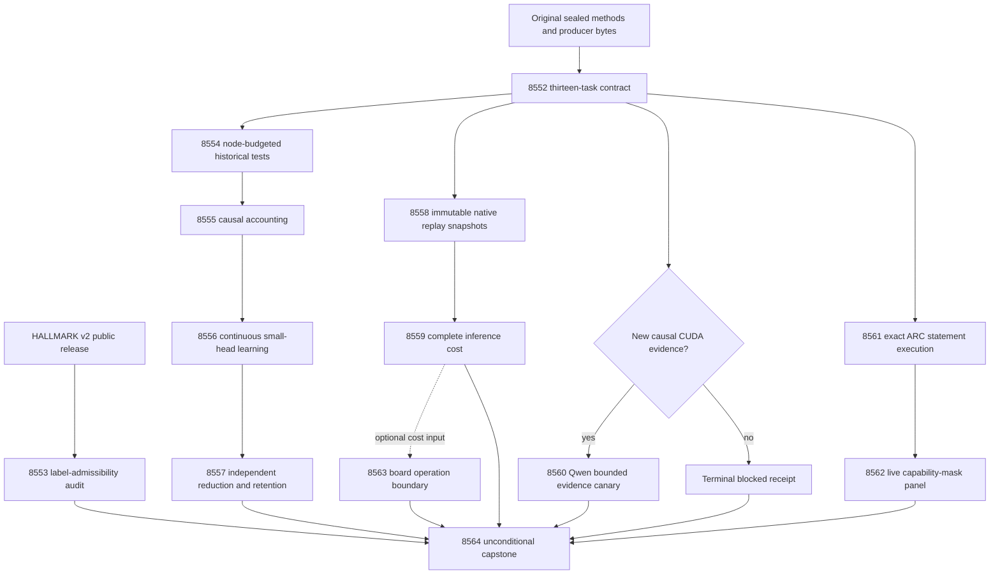

# Carnot Research Roadmap v735: Causal Learning and Qualified Execution

**Created:** 2026-10-15

**Milestone:** 2026.10.735

**Status:** Planned; staged only, not activated

**Supersedes:** V734 scheduling. Its evidence and quarantines remain unchanged.

**Execution contract:** Exactly 13 tasks, exp8552 through exp8564, in the order below.

**Companion:** `research-roadmap-next.yaml`

## What V734 proved

All twelve scheduling slots ended. Six produced primary artifacts. Six were
pre-gated or cascade-skipped. Conductor `OK` is not scientific qualification.
The archive ends at V733; the V734 primaries and conductor log supply current evidence.

| Evidence | Qualified conclusion | Consequence |
|---|---|---|
| Exp8540 | Its twelve-object contract and fixed methods qualified; CUDA evidence remained absent | Reuse its methods and original inputs; bind thirteen new tasks |
| Exp8541 | 152 of 158 original test nodes passed. The 24-node capacity suite hit its 480-second family deadline after eighteen passes | Split by measured node cost; preserve every original node and suite authority |
| Exp8542–8544 | Accounting was pre-gated; training and benefit audit were cascade-skipped | Learning benefit remains untested, not a qualified null |
| Exp8545 | Numerical and complete-request parity observations passed. Preliminary cold replay exited one in 4.67 seconds | Test primitive snapshot ordering before another qualification; no speed claim |
| Exp8546–8547 | Native timing and Qwen canary were pre-gated | Neither complete speed nor new generator behavior was measured |
| Exp8548 | Stored ARC replay passed in 134.14 seconds under the 240-second limit. Exact coverage still failed | Resolve four conditional statement anchors with actual execution evidence |
| Exp8549 | Live capability panel was pre-gated | No qualified capability-mask benefit or null |
| Exp8550–8551 | Board boundaries and all twelve terminal slots were accounted for | Missing hardware and science remain blocked; no physical execution claim |

The exact ARC discrepancy is narrower than missing all child coverage.
`arc_panel_replay_8548.py` statements 78, 370 and 377, plus runner statement384,
are absent from executed-line sets. All four are multiline `if` anchors.
Combined/shard unions and source hashes agree. Coverage's missing-line lists
are empty. The exact containment check still fails and must remain unchanged.

Native source inspection identifies a testable ordering defect: validation
mutates the work object before the preliminary candidate is constructed, while
the primitive JSON is rewritten only after cold controls. Exp8558 must reproduce
this hypothesis before claiming a repair. A later terminal replay cannot erase
a failed required preliminary check.

The qualified Exp8529 exposed source-information null remains closed. The old
five-input append-service ratio2.16268 is not nine-input inference speed.
The 300-question corpus and FaithBench are exposed. New splits do not erase exposure.

Original V734 design: `research-roadmap-v734-preserved-20261015.md`.
SHA256: `9a213619fcc67cbaa26e0b8fcdc8492917b6b874e22d332b1038ded73d2231a8`.

## Three largest gaps against the PRD

| Gap | Requirement / priority | Planned evidence |
|---|---|---|
| Verification lacks independent semantic generalization | FR-12; real constraint extraction and calibration | Exp8553 evaluates the updated HALLMARK release's label limits; Exp8560 conditionally measures mandated-Qwen evidence views. Existing nulls stay closed |
| Continuous learning lacks qualified later-prediction benefit and retention | FR-06/FR-11; Continuous Self-Learning Tiers1–2 | Exp8554–8557 qualify accounting, change the small energy head, then audit future decisions and simultaneous retention |
| Production efficiency and reachable live-agent benefit remain unqualified | FR-05/FR-08/NFR-01; ARC accuracy and action/compute efficiency | Exp8558–8559 measure the complete native path; Exp8561–8562 measure adapter-withheld live behavior; Exp8563 maps actual hardware operations |

HALLMARK does not automatically close the first gap. Its construction uses
pipeline labels and database-confirmable positives. A justified rejection is
useful evidence. Do not relabel a successful download as independent validation.
The milestone invests in completing fixed studies, rather than adding new
objectives, learning rates or repeated source fits.

## Literature reviewed before design

The V735 section in `../../research-references.md` was appended before design.
It covers all eight arXiv topics and all six secondary channels. Semantic Scholar
citation endpoints failed. GitHub Trending snapshots were stale. OpenReview's
EBT endpoint returned a challenge. These are coverage limits, not negative findings.

| Finding | Experiment consequence |
|---|---|
| [HALLMARK v2](https://arxiv.org/abs/2607.18360v2), October11 revision | Exp8553 audits release versions, label origins, base-work overlap, abstentions and decision criteria. Its co-designed tool is not independent truth |
| [Calibeating](https://arxiv.org/abs/2603.22167) and [finite delayed feedback](https://arxiv.org/abs/2606.11711) | Exp8555–8557 separate actual updates from later proper-loss and retention benefit; no borrowed regret guarantee |
| [Online spline KAN](https://arxiv.org/abs/2602.02056) | Exp8558–8559 and8563 separate sparse arithmetic from complete request and hardware costs |
| [CCHD](https://arxiv.org/abs/2606.08158) | Exp8560 keeps view agreement distinct from label validity; unchanged consistency fitting remains closed |
| [EBT](https://arxiv.org/abs/2507.02092), [ARM–EBM](https://arxiv.org/abs/2512.15605), [T-SKM-Net](https://arxiv.org/abs/2512.10461) | Architectural leads; likelihood or linear feasibility does not certify extracted sentence truth. Defer new generator and projection methods |
| [Draft-conditioned decoding](https://arxiv.org/abs/2603.03305), [HalluScoring](https://arxiv.org/abs/2609.38355v2) | Defer decoding changes and Arabic QA; neither fixes present execution failures |
| [Pipelined p-computer](https://arxiv.org/abs/2607.21077), [Extropic Z1T](https://extropic.ai/writing/z1t/) | Exp8563 counts supported operations and excluded host work; vendor estimates are not measured local acceleration |
| [Kona](https://logicalintelligence.com/kona) | Rechecked positioning; no inspected reproducible update changes the current architecture |

## Architecture and dependency graph



The learner updates only the small spline energy head. Predictions and admissions
are sealed before feedback. An atomic update commits coefficients, applied IDs,
acknowledgments and cursor together. Later questions consume the updated state.
Retention labels never train the head. Native inference preserves the same policy.
ARC discovers behavior from its own observations through `make_carnot_agent`.
No game-source inspection, per-game adapter or offline ground-truth solver enters it.

## Phase 1 — establish usable evidence (Exp8552–8555)

**Exp8552:** bind all thirteen full task dictionaries, table and digest. Freeze
V734 numerical protocols under a new task mapping. Expose independent learning,
native, canary and CUDA gates. Resolve actual pre-gate paths with the shipped
reader: the conductor can use a shorter basename than the planned deliverable.

**Exp8553:** audit HALLMARK's October11 revision and pinned public release.
Reconcile actual row counts, licenses, labels and base-paper overlap. The paper
says2,526; repository metadata says2,525. Do not silently choose one. Inspect the
first20 stable-ID records per available provenance stratum. A small reducer may
analyze released predictions, with explicit abstention denominators. No verifier
runs, new labels or training occur. Audit readiness differs from independent-label
readiness; constructed or incompatible labels cannot pass the latter.

**Exp8554:** qualify all158 original learning nodes. Measure the previously
interrupted node alone. Split the24-node capacity suite into children of at most
four nodes, with exit/retention fixtures isolated. Keep480seconds per child and
2400seconds total. Do not raise the family timeout, omit slow nodes or change tests.

**Exp8555:** finish the still-unrun causal accounting qualification. Independently
reduce assignments, changed coordinates, decay changes and unique coordinates.
Use canonical numeric records plus visible numeric projections for every distinct
quantity. Aliases reference their canonical record. Preserve real equal counts.
A deliberately coincident-counter control must trigger the unchanged adversarial
validator. Truthful output that remains critically flagged must disqualify.

## Phase 2 — continuous self-learning and retention (Exp8556–8557)

**Exp8556:** start from the original qualified Exp8431 head, scaler and temperature.
Run frozen, log_loss, brier and brier_shuffled_released arms. Seeds are17/29/43/71/101.
Five20-question blocks, three siblings and four arms produce6000 prediction rows.
Capacity remains8 questions/block, learning_rate0.01 and L2=0.001. Preserve the
registered derivative and admission order. Shuffle only already released labels.

Seal block predictions before releases. Commit each real update durably. Exit a
real process after block2 at seed17 in every arm. Resumed states and predictions
must equal uninterrupted controls. Measure all50 fixed retention questions at
five windows. Row readiness does not require a favorable learning result.

**Exp8557:** average siblings and seeds within each of80 later-block questions.
Compare Brier updates with log-loss and frozen controls using10000 paired question
resamples, seed7278448, two-sided97.5% intervals for each primary contrast.
Both lower bounds must exceed zero, with no typed-loss increase. Use joint
question resampling across five retention windows,10000 draws, seed7258421.
The maximum-window Brier increase upper95 bound must be<=0.01.

Shuffled released labels remain the causal negative control. An exposed-history
benefit is at most `circular_positive`. Independent generalization stays zero.
A complete qualified null closes the unchanged objective/panel. Missing upstream
work is `blocked`, not a retryable `partial`.

## Phase 3 — immutable native evidence and complete cost (Exp8558–8560)

**Exp8558:** reproduce the native snapshot-order defect. Seal separate immutable
primitive versions before preliminary and terminal candidates. Never rewrite a
referenced snapshot. Keep full replay equality, negative controls and original
qualification thresholds. Reuse the actual loaded binary and independent SciPy
reference:900 answer inputs,274 numerical controls and1800 complete request rows.
Tolerance remains1e-12*(1+abs(reference)). Count the real Python fallback within
1e-10 of thresholds0.2/0.8. Qualify both replay stages and the actual cost consumer.

**Exp8559:** compare Python and native over64 stable-order test answers. Run ten
alternatingAB/BA pairs; batch1 is primary, batch8 secondary. Include fresh-child
startup, text feature extraction, scaling, offset, residual evaluation, normalization,
typed decisions and serialization. Report warmup, fallback and startup costs.
Model acquisition, feedback updates and durable storage are outside this boundary.

Zero decision mismatches and sealed numerical parity precede speed interpretation.
Use10000 paired-repeat bootstrap draws, seed7338534. A scoped speed win requires
primary lower95 throughput ratio>1 and p95 latency ratio<=1.05. NFR01 requires
lower95>=10. Complete clean measurements retain readiness1 even for a null.
One host and repeated timing pairs do not establish cross-machine generality.

**Exp8560:** only a new causal CUDA repair receipt permits sixteen real calls.
Use `MODEL_SPECS=["unsloth/Qwen3.8-27B-GGUF"]`, cached Q4_K_M, temperature0,
max128 output tokens, four sealed fit questions and four original evidence views.
The substrate is `model_bounded_generation` with the10-second floor. Load cap600s,
call cap120s, measurement cap2400s. On external blockage emit zero calls and the
actual non-generation substrate. No CPU fallback or alternative headline model.

## Phase 4 — live transfer and deployment boundaries (Exp8561–8564)

**Exp8561:** test the four ARC conditional anchors under the same sysmon collector.
An equivalent explicit predicate followed by a simple executable branch is the
proposed repair. Add true/false/rejection tests before changing owned code.
Preserve every original assertion, collector and exact statement-containment rule.
Require genuine new child shards, exact combined/shard union,240-second replay,
and a passing downstream consumer. No repeated90-second timeout demonstration.

**Exp8562:** measure the existing capability mask through live `E3AgentPolicy`.
Withhold adapters/routes for `ar25-0c556536`, `ft09-0d8bbf25`, `lf52-271a04aa`
and `tn36-ef4dde99`. Seeds11/22, two arms,16 episodes;512 actions and120seconds
per episode,2400seconds total. Preserve original arm order,window120,stall150,
predicates and default-off behavior. Mask only explicitly unavailable capability.

Report actual attempts, applied changes, resolved redirects, levels, actions and
complete wall cost. Benefit requires less unavailable work, no paired level loss
and no increased wall cost. Four games bound transfer evidence. Refinement requires
three overlapping games and five resolved observations per shared cell. Otherwise
report insufficient evidence. Any incidental new level needs registry-precheck,
reachable reproduction and `solve_provenance=live_agent_self_discovery`. Known
levels gain no new solve credit. A qualified null closes this unchanged panel.

**Exp8563:** run an unconditional CPU operation map. Qualified new complete costs
can support a conditional acceleration ceiling. Without them, costs remain null.
Keep KV260 quadratic-Ising k_max<=5 separate from the nine-input spline workload.
PolarFire Linux CPU dispatch is not fabric execution. GateMate needs exact closure
bytes and a changed physical cable/port/power setup before IDCODE/flash/smoke.
Keep NPU/TSU unqualified. Preserve Z1T dense-logit and inter-device exclusions.
No repeated board probe, hardware purchase, flash or unsupported speed claim.

**Exp8564:** consume thirteen terminal outcomes, including its own sealed row.
Resolve actual producer/pre-gate paths. Recompute a small deterministic sample of
claim rows. Preserve source nulls, all quarantines, G1–G4 and `paper_ready`.
Readiness, scoped benefit and independent benefit remain separate. Missing external
inputs produce `blocked`; failed owned checks produce `disqualified`. Do not
rerun all historical suites during reconciliation or alter the completion archive.

## Resources, routing and execution limits

CPU, disk-backed `/var/tmp`, existing Python/SciPy and offline Rust/PyO3 tools
support mandatory work. Check memory and disk before execution. Only Exp8560
needs one qualified RTX3090 lease; the inventory's two24GB cards do not prove CUDA
works. No new hardware is needed. Larger FPGA, NPU SDK and TSU access remain
wishlist items until measured operation shares justify them. Sparse updates give
FR11 a hardware path, but a100x whole-service gain is a hypothesis, not a promise.

Schema and qualification tasks8552/8554/8555/8558/8561 use Claude Opus,max_turns100.
Routine studies use Sonnet,max_turns50; bounded hardware and capstone readers use30.
The HALLMARK task makes label judgments and stays Sonnet. No formulaic new verifier,
sampler or binding project is planned. Such work would use Codex/gpt-6.1-sol.
No Luna task is scheduled. These routes follow the current user directive.

Every prompt requires flushed phase lines, before/after long calls and loop progress.
Children report at least every60seconds. Every gap stays below600seconds.
Split files above about200lines across tool calls, at most150lines per call,
with progress messages between calls. Stop measurement by3600seconds and reserve
at least900seconds for checks within4800seconds. Never pad measured duration.

## Acceptance, retirement and planning checks

The plan preserves prior-failure IDs, actual verdicts, concrete changed prerequisites
and `retire_if_same_verdict: true`. No retired ID is reused. Every dependency points
to an earlier task here, with an identically named required output field.
No new scientific result is claimed during planning. Specifications and operations
records label all future behavior planned. The active roadmap and conductor stay intact.

Required future checks are scoped unit tests, lint/format, strict types, spec tracing,
real subprocess coverage and applicable E2E checks. Authority/publication work includes
private E2E-018 and E2E-021. Require100% owned statement coverage. Do not weaken shared
validators, remove historical tests, discard killed children or rewrite prior artifacts.

## Exact task contract

The visible table and full JSON below are the same thirteen objects as the staged
YAML. Full-object equality includes every prompt, routing field and prior failure.
The digest uses SHA256 of JSON with sorted keys and separators `(',', ':')`.

| Order | Task ID | Title | Phase | Deliverable |
|---|---|---|---|---|
| 1 | exp8552-contract-methods | Bind thirteen tasks and freeze isolated qualification and scientific methods | 1 | results/experiment_8552_v735_contract_methods.json |
| 2 | exp8553-hallmark-release-admissibility | Assess HALLMARK revision labels and deployment criteria without fitting a detector | 1 | results/experiment_8553_v735_hallmark_release_admissibility.json |
| 3 | exp8554-historical-learning-qualification | Qualify the original learning union with measured node budgets | 1 | results/experiment_8554_v735_historical_learning_qualification.json |
| 4 | exp8555-canonical-update-accounting | Qualify event accounting from actual state transitions and canonical counter records | 1 | results/experiment_8555_v735_canonical_update_accounting.json |
| 5 | exp8556-causal-brier-stream | Train the continuous energy head with delayed feedback and objective controls | 2 | results/experiment_8556_v735_causal_brier_stream.json |
| 6 | exp8557-learning-benefit-audit | Independently test later-block Brier benefit, retention and useful decision cost | 2 | results/experiment_8557_v735_learning_benefit_audit.json |
| 7 | exp8558-nine-input-native-qualification | Seal native replay primitives before qualification and complete inference timing | 3 | results/experiment_8558_v735_nine_input_native_qualification.json |
| 8 | exp8559-complete-native-cost | Measure complete nine-input native inference against the qualified Python path | 3 | results/experiment_8559_v735_complete_native_cost.json |
| 9 | exp8560-qwen-evidence-canary | Run the bounded Qwen source-evidence canary only after causal CUDA repair | 3 | results/experiment_8560_v735_qwen_evidence_canary.json |
| 10 | exp8561-arc-panel-replay-qualification | Qualify ARC conditional anchors with actual child execution receipts | 4 | results/experiment_8561_v735_arc_panel_replay_qualification.json |
| 11 | exp8562-arc-capability-panel | Measure the live capability mask on the fixed adapter-withheld ARC panel | 4 | results/experiment_8562_v735_arc_capability_panel.json |
| 12 | exp8563-hardware-operation-boundary | Map qualified complete-operation costs to the actual board and thermodynamic boundaries | 4 | results/experiment_8563_v735_hardware_operation_boundary.json |
| 13 | exp8564-capstone | Reconcile twelve terminal outcomes without promoting quarantined or exposed evidence | 4 | results/experiment_8564_v735_capstone.json |

### Exact dependency conditions

| Consumer | Conditions (all conjunctive) |
|---|---|
| exp8552-contract-methods | Unconditional |
| exp8553-hallmark-release-admissibility | Unconditional |
| exp8554-historical-learning-qualification | exp8552-contract-methods.methods_ready_score == 1; exp8552-contract-methods.learning_inputs_ready_score == 1 |
| exp8555-canonical-update-accounting | exp8554-historical-learning-qualification.historical_learning_validation_ready_score == 1 |
| exp8556-causal-brier-stream | exp8552-contract-methods.methods_ready_score == 1; exp8555-canonical-update-accounting.online_adapter_ready_score == 1 |
| exp8557-learning-benefit-audit | exp8552-contract-methods.methods_ready_score == 1; exp8556-causal-brier-stream.causal_learning_rows_ready_score == 1 |
| exp8558-nine-input-native-qualification | exp8552-contract-methods.methods_ready_score == 1; exp8552-contract-methods.nine_input_inputs_ready_score == 1 |
| exp8559-complete-native-cost | exp8552-contract-methods.methods_ready_score == 1; exp8558-nine-input-native-qualification.nine_input_native_ready_score == 1 |
| exp8560-qwen-evidence-canary | exp8552-contract-methods.methods_ready_score == 1; exp8552-contract-methods.runtime_repair_ready_score == 1; exp8552-contract-methods.canary_inputs_ready_score == 1 |
| exp8561-arc-panel-replay-qualification | exp8552-contract-methods.methods_ready_score == 1 |
| exp8562-arc-capability-panel | exp8552-contract-methods.methods_ready_score == 1; exp8561-arc-panel-replay-qualification.arc_panel_execution_ready_score == 1 |
| exp8563-hardware-operation-boundary | Unconditional |
| exp8564-capstone | Unconditional |

Sequential estimated budget: 635 minutes, including optional branches and validation.

canonical_tasks_sha256: `9696b266453ac3dd98bd694f81ccbd6e85e1065ebf4173c291d35d33db7cb10d`

<!-- V735_TASK_CONTRACT_START -->
```json
{"milestone":"2026.10.735","tasks":[
{"id": "exp8552-contract-methods", "title": "Bind thirteen tasks and freeze isolated qualification and scientific methods", "phase": 1, "track": "infrastructure", "priority": "high", "requires_gpu": false, "max_turns": 100, "estimated_wall_time_min": 40, "per_unit_rows": true, "milestone": "2026.10.735", "deliverable": "results/experiment_8552_v735_contract_methods.json", "inference_substrate_class": "no_model_load", "MODEL_SPECS": [], "gated_on": [], "prior_failures": [{"experiment_id": "exp8499-contract-methods", "verdict": "complete_blocked_v731_contract_methods", "addressed_by": "V735 supplies thirteen complete task objects, visible table, JSON, digest and end marker. Preserve qualified historical readers and failed earlier authority.", "retire_if_same_verdict": true}], "agent_type": "claude", "model": "opus", "prompt": "CONTEXT:\nWork in {project_root} on {date}. V734 finished twelve scheduling slots: six producer artifacts and six pre-gates or cascade skips. Exp8541 passed 152 of 158 original nodes; family4 was killed at480s. Exp8545 passed numerical and complete-request parity but failed its preliminary cold replay. Exp8548 replayed stored episodes in134s; exact statement receipts still failed at four multiline conditional anchors. Learning, native speed and capability-mask benefit remain unmeasured. Exp8529 remains a qualified exposed source-information null. Preserve every quarantine, original input role and numerical protocol. The archive ends at V733; use V734 primary and pre-gate evidence.\nEXISTING CODE TO READ FIRST:\nCLAUDE.md; CODEX.md; ops/e2e-test-plan.md; ops/exclusion_manifest.yaml; openspec/capabilities/research-reporting/spec.md; openspec/capabilities/verification/spec.md; scripts/experiment_template.py; python/carnot/reporting/primary_publication.py; openspec/change-proposals/research-roadmap-vNEXT.md; research-references.md; python/carnot/reporting/v733_contract_methods.py; python/carnot/reporting/v733_historical_inputs.py; python/carnot/reporting/roadmap_contract.py; python/carnot/verify/cuda_reader_8410.py; results/experiment_8539_v733_capstone.json; results/experiment_8529_v733_incremental_source_audit.json; openspec/change-proposals/v733-methods-protocol.json; openspec/change-proposals/research-roadmap-v733-preserved-20261015.md; python/carnot/reporting/v734_contract_methods.py; python/carnot/reporting/v734_historical_inputs.py; results/experiment_8551_v734_capstone.json; openspec/change-proposals/v734-methods-protocol.json; openspec/change-proposals/research-roadmap-v734-preserved-20261015.md\nTASK:\nBind thirteen tasks and freeze isolated qualification and scientific methods. Deliver results/experiment_8552_v735_contract_methods.json. Create thin runner scripts/experiments/experiment_8552_v735_contract_methods.py, primitive evidence under results/raw/experiment_8552_v735_contract_methods/, and docs/research-notes/v735-contract-methods.md. Same-roadmap outputs are future dependencies.\nCONCRETE STEPS:\n1. PRECONDITIONS: Print a flushed start line. Authenticate original inputs, tool availability, writable disk-backed scratch, memory and deadlines before work. Record missing resources in gate_check_summary. Use original sealed historical dates and authority. Optional CUDA or board absence must not block independent CPU work.\n2. Print a flushed progress line at each phase boundary and before and after every model load, generation, benchmark or subprocess that can take minutes. Use unbuffered output. Print completed and pending counts inside long loops. Supervise each child with a status line at least every60seconds. Keep every output gap under600seconds. Write any file over about200lines in several tool calls of at most150lines. Send a progress message between calls. Bound each tool call. Stop measurements by3600seconds. Reserve at least900seconds for validation within the4800-second cap. Never pad duration.\n3. Spec first: ensure the relevant capability spec contains REQ-* and SCENARIO-* before implementation. Write focused failing tests first. Preserve existing tests, assertions, numerical thresholds and historical result bytes. Reuse shipped modules through explicit small adapters. Place runners in scripts/experiments/ and tests in tests/python/. Put scratch under /var/tmp. Accept --date {date}. Do not change the active roadmap, conductor, validation gates, generator weights or external services.\n4. Declare inference_substrate_class=no_model_load, MODEL_SPECS=[]. Record zero current LLM calls. Use aggregation_from_upstream_artifacts as inference_substrate. Put cached generator identities only in historical_model_provenance.\n5. Compare exactly13 complete task objects Exp8552 through Exp8564 across the visible table, embedded JSON, canonical_tasks_sha256 and activated YAML. Check full dictionary equality, including prompts, routing, gates and retirement flags. Exercise count, order, ID, title, phase, deliverable, model, substrate, gate, prompt, retirement-flag and missing-end-marker mutations. Reuse authentic activation evidence if staging was consumed.\n6. Create openspec/change-proposals/v735-methods-protocol.json before measurements. Bind preserved V734 design SHA256 9a213619fcc67cbaa26e0b8fcdc8492917b6b874e22d332b1038ded73d2231a8. Copy objective_updates, objective_audit, nine_input_native_inference, evidence_canary and arc_capability_mask numerical operands exactly from qualified V734 authority. Change only task bindings and explicit validation mechanics. Add a separate HALLMARK release-admissibility protocol before inspecting its rows; never mix its labels into the existing learning stream.\n7. Authenticate original learning heads/streams, nine-input operands and canary inputs independently. Emit learning_inputs_ready_score, nine_input_inputs_ready_score and canary_inputs_ready_score separately. HALLMARK availability, CUDA absence or one failed historical test family must not disable another branch. Close unchanged exposed source tuning after Exp8529. FaithBench and the300-question corpus remain exposed.\n8. Inspect only a supplied ops/cuda-runtime-repair-receipt.json with the shipped Exp8410 reader for at most60seconds. runtime_repair_ready_score=1 requires causal library/environment change and actual context/copy evidence. No device command, rebuild or model load. Missing evidence cheaply pre-gates Exp8560.\n9. Bind the V735 literature section. Map HALLMARK v2 to Exp8553, proper losses and delayed capacity to Exp8555-8557, and sparse KAN operations to Exp8558-8559/8563. Use V734 primaries and conductor outcomes because research-complete.yaml ends at V733. Locate pre-gate receipts through reader_receipt rather than guessing the planned deliverable basename; preserve actual paths and hashes.\n10. Run scoped unit tests, actual private CLI checks, Ruff check/format, strict mypy and scripts/check_spec_coverage.py --files <owned-test-files>. Run applicable ops/e2e-test-plan.md checks, including private E2E-018 and E2E-021 for authority/publication consumers. Require 100 percent newly owned statement coverage, including real children and rejection paths. Collect original test node IDs before sharding. Preserve their exact union in disjoint bounded pytest children using -n 0 -o addopts= --no-cov. Use suite-specific original authority. Never launch a nested full historical validation runner or the full repository suite. A killed child fails validation. Preserve commands, terminal node outcomes, exit codes, durations and log hashes.\n11. Cold-replay primitive rows in a fresh bounded process. Test absent inputs, owned failures and self-consistently rehashed tampering. Run unchanged primary_publication, scripts/adversarial_verify.py --json <private-candidate> and scripts/verdict_row_consistency_lint.py --strict <private-candidate>. Keep every finding. Validate final bytes, publish atomically, bind the terminal sidecar and exercise the actual downstream consumer. A new artifact cannot clear old flags. Owned required-check failure is disqualified. Unchanged external blockage is blocked, never partial. Reconcile openspec/, _bmad/traceability.md, ops/status.md and ops/changelog.md.\nREQUIRED ARTIFACT FIELDS:\nexperiment_id, task_id, milestone, run_date: principle: Bind evidence to this invocation.\nhonest_verdict, verdict_class: principle: Terminal verdicts start complete_; the class is exactly positive | circular_positive | null | blocked | disqualified | partial. Reserve partial for unfinished owned work another attempt can complete.\ngate_check_summary: principle: Every blocked_* or complete_blocked_* outcome names check, upstream, path/hash, field, operator, expected and observed. Missing differs from zero.\ninference_substrate, inference_substrate_class, MODEL_SPECS, model_invocation_counts, historical_model_provenance: principle: Separate actual model calls from imported historical outputs.\nrows, intended_count, completed_count, failed_count, censored_count, excluded_count, independent_count, sample_size_budget: principle: Emit each question, arm, seed, episode or repeat metric and missing reason. Repeats do not multiply independent evidence.\nverifier_is_oracle, exposure_scope, independent_generalization_score, generalized_learning_benefit_score: principle: Oracle fixtures and exposed-history benefits are at most circular_positive; generalization scores remain zero unless independently qualified in a separately authorized study.\nrequired_checks_passed, flagged_adversarial, acceptance_gates, validation_receipts, terminal_validation_sidecar_path, adversarial_findings: principle: Qualification and scientific benefit are separate. Failed required checks forbid positive classes.\npreconditions_checked, duration_s, phase_spans, random_seed, reproducibility_checksum, source_artifact_hashes, code_config_hashes, raw_shard_hashes: principle: Preserve real work and immutable primitive operands.\ncited_upstream_artifacts, field_principles: principle: Identify original producer hashes and explain every extra metric and gate.\ncurrent_contract_ready_score, methods_ready_score, learning_inputs_ready_score, nine_input_inputs_ready_score, canary_inputs_ready_score, runtime_repair_ready_score, methods_protocol_reference, canonical_tasks_sha256, historical_family_receipts, closed_source_comparison, literature_mapping: principle: Independent readiness gates must not depend on favorable science or optional hardware.\nRun command: cd {project_root} && JAX_PLATFORMS=cpu PYTHONPATH=python:. PYTHONUNBUFFERED=1 .venv/bin/python -u scripts/experiments/experiment_8552_v735_contract_methods.py --date {date}\nDo NOT push. Do NOT modify scripts/research_conductor.py.\n"},
{"id": "exp8553-hallmark-release-admissibility", "title": "Assess HALLMARK revision labels and deployment criteria without fitting a detector", "phase": 1, "track": "verification", "priority": "high", "requires_gpu": false, "max_turns": 50, "estimated_wall_time_min": 35, "per_unit_rows": true, "milestone": "2026.10.735", "deliverable": "results/experiment_8553_v735_hallmark_release_admissibility.json", "inference_substrate_class": "no_model_load", "MODEL_SPECS": [], "gated_on": [], "prior_failures": [{"experiment_id": "exp8389-human-label-custody", "verdict": "complete_blocked_human_label_custody", "addressed_by": "Different source and question: audit the October11 HALLMARK revision and its constructed-label boundary. Do not repeat LPHB acquisition or claim its missing independent-label gate now passes.", "retire_if_same_verdict": true}], "agent_type": "claude", "model": "sonnet", "prompt": "CONTEXT:\nWork in {project_root} on {date}. V734 finished twelve scheduling slots: six producer artifacts and six pre-gates or cascade skips. Exp8541 passed 152 of 158 original nodes; family4 was killed at480s. Exp8545 passed numerical and complete-request parity but failed its preliminary cold replay. Exp8548 replayed stored episodes in134s; exact statement receipts still failed at four multiline conditional anchors. Learning, native speed and capability-mask benefit remain unmeasured. Exp8529 remains a qualified exposed source-information null. Preserve every quarantine, original input role and numerical protocol. The archive ends at V733; use V734 primary and pre-gate evidence.\nEXISTING CODE TO READ FIRST:\nCLAUDE.md; CODEX.md; ops/e2e-test-plan.md; ops/exclusion_manifest.yaml; openspec/capabilities/research-reporting/spec.md; openspec/capabilities/verification/spec.md; scripts/experiment_template.py; python/carnot/reporting/primary_publication.py; openspec/change-proposals/research-roadmap-vNEXT.md; research-references.md; python/carnot/reporting/current_work_receipt.py; python/carnot/reporting/primary_publication.py; python/carnot/reporting/v734_contract_methods.py; results/experiment_8389_v723_human_label_custody.json\nTASK:\nAssess HALLMARK revision labels and deployment criteria without fitting a detector. Deliver results/experiment_8553_v735_hallmark_release_admissibility.json. Create thin runner scripts/experiments/experiment_8553_v735_hallmark_release_admissibility.py, primitive evidence under results/raw/experiment_8553_v735_hallmark_release_admissibility/, and docs/research-notes/v735-hallmark-release-admissibility.md. Same-roadmap outputs are future dependencies.\nCONCRETE STEPS:\n1. PRECONDITIONS: Print a flushed start line. Authenticate original inputs, tool availability, writable disk-backed scratch, memory and deadlines before work. Record missing resources in gate_check_summary. Use original sealed historical dates and authority. Optional CUDA or board absence must not block independent CPU work.\n2. Print a flushed progress line at each phase boundary and before and after every model load, generation, benchmark or subprocess that can take minutes. Use unbuffered output. Print completed and pending counts inside long loops. Supervise each child with a status line at least every60seconds. Keep every output gap under600seconds. Write any file over about200lines in several tool calls of at most150lines. Send a progress message between calls. Bound each tool call. Stop measurements by3600seconds. Reserve at least900seconds for validation within the4800-second cap. Never pad duration.\n3. Spec first: ensure the relevant capability spec contains REQ-* and SCENARIO-* before implementation. Write focused failing tests first. Preserve existing tests, assertions, numerical thresholds and historical result bytes. Reuse shipped modules through explicit small adapters. Place runners in scripts/experiments/ and tests in tests/python/. Put scratch under /var/tmp. Accept --date {date}. Do not change the active roadmap, conductor, validation gates, generator weights or external services.\n4. Declare inference_substrate_class=no_model_load, MODEL_SPECS=[]. Record zero current LLM calls. Use aggregation_from_upstream_artifacts as inference_substrate. Put cached generator identities only in historical_model_provenance.\n5. Pre-register the admissibility checklist before row access. Inspect https://arxiv.org/html/2607.18360v2 and the author repository https://github.com/rpatrik96/hallmark at a pinned release/commit. Fetch only public metadata, license, schema and released JSONL; use bounded30-second requests and a600-second acquisition cap. Do not execute repository code, regenerate labels, use paid APIs or fetch hidden-test content. Record unavailable resources as blocked, not an empty successful corpus.\n6. Reconcile the paper/repository entry-count discrepancy from actual versioned bytes. Preserve file-level licenses, release IDs, hashes, exact row counts and missing labels. Hash base-paper identities across released splits to measure duplicate and perturbed-sibling overlap. Describe citation-domain compatibility separately from Carnot sentence verification; never pass incompatible records into the nine-input head.\n7. Classify each released label by documented origin: deterministic perturbation, database cross-check, model judgment, explicit human adjudication or unknown. Inspect a fixed first20 stable-ID records per available provenance stratum, retaining all inventory counts. Report construction constraints and valid-entry inclusion criteria. Pipeline labels and database-confirmable positives do not pass independent human-label readiness. Independent_label_ready_score must remain0 unless disjointness, independent adjudication and target compatibility are all established.\n8. Implement a small reducer over released per-entry prediction records only if such records exist with declared versions and complete denominators. Recompute confusion counts under the release's committed and abstention-aware conventions. Keep source availability as a separate condition. If predictions are absent, record that limitation without running a verifier. Report per-entry rows and a hand-checked rejection control; do not tune thresholds or claim detector accuracy for Carnot.\n9. Emit release_audit_ready_score=1 when custody and the admissibility decision are complete, including a justified rejection. This gate is not independent_label_ready_score. Supply a concrete future-use or reject decision. No new model, training, source refit or independent-generalization claim. Cite HALLMARK's co-design limitation explicitly.\n10. Run scoped unit tests, actual private CLI checks, Ruff check/format, strict mypy and scripts/check_spec_coverage.py --files <owned-test-files>. Run applicable ops/e2e-test-plan.md checks, including private E2E-018 and E2E-021 for authority/publication consumers. Require 100 percent newly owned statement coverage, including real children and rejection paths. Collect original test node IDs before sharding. Preserve their exact union in disjoint bounded pytest children using -n 0 -o addopts= --no-cov. Use suite-specific original authority. Never launch a nested full historical validation runner or the full repository suite. A killed child fails validation. Preserve commands, terminal node outcomes, exit codes, durations and log hashes.\n11. Cold-replay primitive rows in a fresh bounded process. Test absent inputs, owned failures and self-consistently rehashed tampering. Run unchanged primary_publication, scripts/adversarial_verify.py --json <private-candidate> and scripts/verdict_row_consistency_lint.py --strict <private-candidate>. Keep every finding. Validate final bytes, publish atomically, bind the terminal sidecar and exercise the actual downstream consumer. A new artifact cannot clear old flags. Owned required-check failure is disqualified. Unchanged external blockage is blocked, never partial. Reconcile openspec/, _bmad/traceability.md, ops/status.md and ops/changelog.md.\nREQUIRED ARTIFACT FIELDS:\nexperiment_id, task_id, milestone, run_date: principle: Bind evidence to this invocation.\nhonest_verdict, verdict_class: principle: Terminal verdicts start complete_; the class is exactly positive | circular_positive | null | blocked | disqualified | partial. Reserve partial for unfinished owned work another attempt can complete.\ngate_check_summary: principle: Every blocked_* or complete_blocked_* outcome names check, upstream, path/hash, field, operator, expected and observed. Missing differs from zero.\ninference_substrate, inference_substrate_class, MODEL_SPECS, model_invocation_counts, historical_model_provenance: principle: Separate actual model calls from imported historical outputs.\nrows, intended_count, completed_count, failed_count, censored_count, excluded_count, independent_count, sample_size_budget: principle: Emit each question, arm, seed, episode or repeat metric and missing reason. Repeats do not multiply independent evidence.\nverifier_is_oracle, exposure_scope, independent_generalization_score, generalized_learning_benefit_score: principle: Oracle fixtures and exposed-history benefits are at most circular_positive; generalization scores remain zero unless independently qualified in a separately authorized study.\nrequired_checks_passed, flagged_adversarial, acceptance_gates, validation_receipts, terminal_validation_sidecar_path, adversarial_findings: principle: Qualification and scientific benefit are separate. Failed required checks forbid positive classes.\npreconditions_checked, duration_s, phase_spans, random_seed, reproducibility_checksum, source_artifact_hashes, code_config_hashes, raw_shard_hashes: principle: Preserve real work and immutable primitive operands.\ncited_upstream_artifacts, field_principles: principle: Identify original producer hashes and explain every extra metric and gate.\nrelease_audit_ready_score, independent_label_ready_score, release_manifest, criterion_rows, label_provenance_rows, base_work_overlap_rows, admission_decision: principle: Readable data and constructed labels do not establish independent human truth.\nRun command: cd {project_root} && JAX_PLATFORMS=cpu PYTHONPATH=python:. PYTHONUNBUFFERED=1 .venv/bin/python -u scripts/experiments/experiment_8553_v735_hallmark_release_admissibility.py --date {date}\nDo NOT push. Do NOT modify scripts/research_conductor.py.\n"},
{"id": "exp8554-historical-learning-qualification", "title": "Qualify the original learning union with measured node budgets", "phase": 1, "track": "infrastructure", "priority": "high", "requires_gpu": false, "max_turns": 100, "estimated_wall_time_min": 60, "per_unit_rows": true, "milestone": "2026.10.735", "deliverable": "results/experiment_8554_v735_historical_learning_qualification.json", "inference_substrate_class": "no_model_load", "MODEL_SPECS": [], "gated_on": [{"upstream": "exp8552-contract-methods", "artifact_field": "methods_ready_score", "op": "==", "value": 1}, {"upstream": "exp8552-contract-methods", "artifact_field": "learning_inputs_ready_score", "op": "==", "value": 1}], "prior_failures": [{"experiment_id": "exp8517-brier-online-learning", "verdict": "complete_disqualified_v732_brier_online_learning", "addressed_by": "Repair the measured missing field diagnostic, distinguish coordinate changes from update events using before/after states, and replace incomplete nested validation with the exact bounded test union.", "retire_if_same_verdict": true}, {"experiment_id": "exp8489-objective-checkpoint-qualification", "verdict": "complete_circular_positive_v730_objective_checkpoint_qualification", "addressed_by": "Exp8516 now supplies a qualified immutable objective publication; reuse it without rewriting Exp8489 or its stale sidecar.", "retire_if_same_verdict": true}, {"experiment_id": "exp8530-update-accounting-qualification", "verdict": "complete_disqualified_v733_update_accounting_qualification", "addressed_by": "Split historical validation from arithmetic; replace the single wrong-family bootstrap with original per-suite bindings and bounded disjoint children.", "retire_if_same_verdict": true}, {"experiment_id": "exp8541-historical-learning-qualification", "verdict": "complete_disqualified_v734_historical_learning_qualification", "addressed_by": "Exp8541 exhausted a480s deadline for24 nodes after18 passes. Partition by measured node budget, isolate slow fixtures, preserve the exact158-node union and original authority; no larger timeout.", "retire_if_same_verdict": true}], "agent_type": "claude", "model": "opus", "prompt": "CONTEXT:\nWork in {project_root} on {date}. V734 finished twelve scheduling slots: six producer artifacts and six pre-gates or cascade skips. Exp8541 passed 152 of 158 original nodes; family4 was killed at480s. Exp8545 passed numerical and complete-request parity but failed its preliminary cold replay. Exp8548 replayed stored episodes in134s; exact statement receipts still failed at four multiline conditional anchors. Learning, native speed and capability-mask benefit remain unmeasured. Exp8529 remains a qualified exposed source-information null. Preserve every quarantine, original input role and numerical protocol. The archive ends at V733; use V734 primary and pre-gate evidence.\nEXISTING CODE TO READ FIRST:\nCLAUDE.md; CODEX.md; ops/e2e-test-plan.md; ops/exclusion_manifest.yaml; openspec/capabilities/research-reporting/spec.md; openspec/capabilities/verification/spec.md; scripts/experiment_template.py; python/carnot/reporting/primary_publication.py; openspec/change-proposals/research-roadmap-vNEXT.md; research-references.md; python/carnot/reporting/v733_update_validation.py; python/carnot/reporting/objective_publication_runner_8516.py; python/carnot/reporting/historical_consumer_roots_8402.py; tests/python/test_objective_reporting_8461.py; tests/python/test_objective_checkpoint_8489.py; tests/python/test_block_feedback_state_8433.py; results/experiment_8530_v733_update_accounting_qualification.json; python/carnot/reporting/historical_learning_8541.py; python/carnot/reporting/historical_learning_runner_8541.py; tests/python/test_historical_learning_8541.py; tests/python/test_capacity_online_learning_8434.py; results/experiment_8541_v734_historical_learning_qualification.json\nTASK:\nQualify the original learning union with measured node budgets. Deliver results/experiment_8554_v735_historical_learning_qualification.json. Create thin runner scripts/experiments/experiment_8554_v735_historical_learning_qualification.py, primitive evidence under results/raw/experiment_8554_v735_historical_learning_qualification/, and docs/research-notes/v735-historical-learning-qualification.md. Same-roadmap outputs are future dependencies.\nCONCRETE STEPS:\n1. PRECONDITIONS: Print a flushed start line. Authenticate original inputs, tool availability, writable disk-backed scratch, memory and deadlines before work. Record missing resources in gate_check_summary. Use original sealed historical dates and authority. Optional CUDA or board absence must not block independent CPU work.\n2. Print a flushed progress line at each phase boundary and before and after every model load, generation, benchmark or subprocess that can take minutes. Use unbuffered output. Print completed and pending counts inside long loops. Supervise each child with a status line at least every60seconds. Keep every output gap under600seconds. Write any file over about200lines in several tool calls of at most150lines. Send a progress message between calls. Bound each tool call. Stop measurements by3600seconds. Reserve at least900seconds for validation within the4800-second cap. Never pad duration.\n3. Spec first: ensure the relevant capability spec contains REQ-* and SCENARIO-* before implementation. Write focused failing tests first. Preserve existing tests, assertions, numerical thresholds and historical result bytes. Reuse shipped modules through explicit small adapters. Place runners in scripts/experiments/ and tests in tests/python/. Put scratch under /var/tmp. Accept --date {date}. Do not change the active roadmap, conductor, validation gates, generator weights or external services.\n4. Declare inference_substrate_class=no_model_load, MODEL_SPECS=[]. Record zero current LLM calls. Use aggregation_from_upstream_artifacts as inference_substrate. Put cached generator identities only in historical_model_provenance.\n5. Authenticate Exp8541 and freeze its158 collected node IDs and suite-to-original-authority mapping. It passed152 nodes. family4 reached test_retention_child_failure_and_restart_mismatch after eighteen passes, then hit its480-second whole-family limit. This is not evidence that the remaining six tests failed their assertions.\n6. Reproduce the named node alone under its original suite authority. Record per-node elapsed times. Change the partition to at most four nodes per child for the24-node capacity suite, isolating each process-exit and retention fixture. Keep each child bounded at480seconds, with60-second status output and a2400-second total validation budget. Preserve original tests and assertion bytes. Do not increase the family deadline or launch nested historical runners.\n7. Run the complete original158-node union in disjoint bounded children. Collect every terminal node outcome exactly once. Use isolated disk-backed scratch and original per-suite authority. Never drop slow nodes or count an interrupted node as passed. A single-node timeout stops qualification with its actual diagnosis; no speculation of a science null.\n8. Add focused tests for partition completeness, disjointness, killed-node rejection, original authority and missing scratch parents. Exercise the real CLI. historical_learning_validation_ready_score=1 requires the exact original union, new adapter coverage, unchanged validators and a successful downstream accounting consumer. Retain Exp8541 quarantine.\n9. Run scoped unit tests, actual private CLI checks, Ruff check/format, strict mypy and scripts/check_spec_coverage.py --files <owned-test-files>. Run applicable ops/e2e-test-plan.md checks, including private E2E-018 and E2E-021 for authority/publication consumers. Require 100 percent newly owned statement coverage, including real children and rejection paths. Collect original test node IDs before sharding. Preserve their exact union in disjoint bounded pytest children using -n 0 -o addopts= --no-cov. Use suite-specific original authority. Never launch a nested full historical validation runner or the full repository suite. A killed child fails validation. Preserve commands, terminal node outcomes, exit codes, durations and log hashes.\n10. Cold-replay primitive rows in a fresh bounded process. Test absent inputs, owned failures and self-consistently rehashed tampering. Run unchanged primary_publication, scripts/adversarial_verify.py --json <private-candidate> and scripts/verdict_row_consistency_lint.py --strict <private-candidate>. Keep every finding. Validate final bytes, publish atomically, bind the terminal sidecar and exercise the actual downstream consumer. A new artifact cannot clear old flags. Owned required-check failure is disqualified. Unchanged external blockage is blocked, never partial. Reconcile openspec/, _bmad/traceability.md, ops/status.md and ops/changelog.md.\nREQUIRED ARTIFACT FIELDS:\nexperiment_id, task_id, milestone, run_date: principle: Bind evidence to this invocation.\nhonest_verdict, verdict_class: principle: Terminal verdicts start complete_; the class is exactly positive | circular_positive | null | blocked | disqualified | partial. Reserve partial for unfinished owned work another attempt can complete.\ngate_check_summary: principle: Every blocked_* or complete_blocked_* outcome names check, upstream, path/hash, field, operator, expected and observed. Missing differs from zero.\ninference_substrate, inference_substrate_class, MODEL_SPECS, model_invocation_counts, historical_model_provenance: principle: Separate actual model calls from imported historical outputs.\nrows, intended_count, completed_count, failed_count, censored_count, excluded_count, independent_count, sample_size_budget: principle: Emit each question, arm, seed, episode or repeat metric and missing reason. Repeats do not multiply independent evidence.\nverifier_is_oracle, exposure_scope, independent_generalization_score, generalized_learning_benefit_score: principle: Oracle fixtures and exposed-history benefits are at most circular_positive; generalization scores remain zero unless independently qualified in a separately authorized study.\nrequired_checks_passed, flagged_adversarial, acceptance_gates, validation_receipts, terminal_validation_sidecar_path, adversarial_findings: principle: Qualification and scientific benefit are separate. Failed required checks forbid positive classes.\npreconditions_checked, duration_s, phase_spans, random_seed, reproducibility_checksum, source_artifact_hashes, code_config_hashes, raw_shard_hashes: principle: Preserve real work and immutable primitive operands.\ncited_upstream_artifacts, field_principles: principle: Identify original producer hashes and explain every extra metric and gate.\nhistorical_learning_validation_ready_score, original_authority_by_suite, collected_node_ids, shard_node_ids, terminal_node_outcomes, exact_union_receipt, failed_family_diagnostics: principle: One passing outer command cannot stand in for missing or killed original tests.\nRun command: cd {project_root} && JAX_PLATFORMS=cpu PYTHONPATH=python:. PYTHONUNBUFFERED=1 .venv/bin/python -u scripts/experiments/experiment_8554_v735_historical_learning_qualification.py --date {date}\nDo NOT push. Do NOT modify scripts/research_conductor.py.\n"},
{"id": "exp8555-canonical-update-accounting", "title": "Qualify event accounting from actual state transitions and canonical counter records", "phase": 1, "track": "infrastructure", "priority": "high", "requires_gpu": false, "max_turns": 100, "estimated_wall_time_min": 40, "per_unit_rows": true, "milestone": "2026.10.735", "deliverable": "results/experiment_8555_v735_canonical_update_accounting.json", "inference_substrate_class": "no_model_load", "MODEL_SPECS": [], "gated_on": [{"upstream": "exp8554-historical-learning-qualification", "artifact_field": "historical_learning_validation_ready_score", "op": "==", "value": 1}], "prior_failures": [{"experiment_id": "exp8517-brier-online-learning", "verdict": "complete_disqualified_v732_brier_online_learning", "addressed_by": "Repair the measured missing field diagnostic, distinguish coordinate changes from update events using before/after states, and replace incomplete nested validation with the exact bounded test union.", "retire_if_same_verdict": true}, {"experiment_id": "exp8489-objective-checkpoint-qualification", "verdict": "complete_circular_positive_v730_objective_checkpoint_qualification", "addressed_by": "Exp8516 now supplies a qualified immutable objective publication; reuse it without rewriting Exp8489 or its stale sidecar.", "retire_if_same_verdict": true}, {"experiment_id": "exp8530-update-accounting-qualification", "verdict": "complete_disqualified_v733_update_accounting_qualification", "addressed_by": "Original suite isolation is qualified separately; fresh event records distinguish real quantities from duplicate aliases and prove identities with independent controls.", "retire_if_same_verdict": true}, {"experiment_id": "exp8542-canonical-update-accounting", "verdict": "blocked_gate_check_failed", "addressed_by": "Exp8542 was pre-gated on Exp8541=0. Exp8554 now supplies a complete node-budgeted original union before the unchanged accounting and validator-visible counter controls.", "retire_if_same_verdict": true}], "agent_type": "claude", "model": "opus", "prompt": "CONTEXT:\nWork in {project_root} on {date}. V734 finished twelve scheduling slots: six producer artifacts and six pre-gates or cascade skips. Exp8541 passed 152 of 158 original nodes; family4 was killed at480s. Exp8545 passed numerical and complete-request parity but failed its preliminary cold replay. Exp8548 replayed stored episodes in134s; exact statement receipts still failed at four multiline conditional anchors. Learning, native speed and capability-mask benefit remain unmeasured. Exp8529 remains a qualified exposed source-information null. Preserve every quarantine, original input role and numerical protocol. The archive ends at V733; use V734 primary and pre-gate evidence.\nEXISTING CODE TO READ FIRST:\nCLAUDE.md; CODEX.md; ops/e2e-test-plan.md; ops/exclusion_manifest.yaml; openspec/capabilities/research-reporting/spec.md; openspec/capabilities/verification/spec.md; scripts/experiment_template.py; python/carnot/reporting/primary_publication.py; openspec/change-proposals/research-roadmap-vNEXT.md; research-references.md; python/carnot/reporting/v733_update_accounting.py; python/carnot/reporting/v733_update_metrics.py; python/carnot/reporting/v733_update_fixture.py; python/carnot/reporting/v733_update_accounting_runner.py; python/carnot/verify/objective_stream_8517.py; results/experiment_8530_v733_update_accounting_qualification.json; python/carnot/reporting/historical_learning_8541.py; results/experiment_8542_canonical_update_accounting.json\nTASK:\nQualify event accounting from actual state transitions and canonical counter records. Deliver results/experiment_8555_v735_canonical_update_accounting.json. Create thin runner scripts/experiments/experiment_8555_v735_canonical_update_accounting.py, primitive evidence under results/raw/experiment_8555_v735_canonical_update_accounting/, and docs/research-notes/v735-canonical-update-accounting.md. Same-roadmap outputs are future dependencies.\nCONCRETE STEPS:\n1. PRECONDITIONS: Print a flushed start line. Authenticate original inputs, tool availability, writable disk-backed scratch, memory and deadlines before work. Record missing resources in gate_check_summary. Use original sealed historical dates and authority. Optional CUDA or board absence must not block independent CPU work.\n2. Print a flushed progress line at each phase boundary and before and after every model load, generation, benchmark or subprocess that can take minutes. Use unbuffered output. Print completed and pending counts inside long loops. Supervise each child with a status line at least every60seconds. Keep every output gap under600seconds. Write any file over about200lines in several tool calls of at most150lines. Send a progress message between calls. Bound each tool call. Stop measurements by3600seconds. Reserve at least900seconds for validation within the4800-second cap. Never pad duration.\n3. Spec first: ensure the relevant capability spec contains REQ-* and SCENARIO-* before implementation. Write focused failing tests first. Preserve existing tests, assertions, numerical thresholds and historical result bytes. Reuse shipped modules through explicit small adapters. Place runners in scripts/experiments/ and tests in tests/python/. Put scratch under /var/tmp. Accept --date {date}. Do not change the active roadmap, conductor, validation gates, generator weights or external services.\n4. Declare inference_substrate_class=no_model_load, MODEL_SPECS=[]. Record zero current LLM calls. Use aggregation_from_upstream_artifacts as inference_substrate. Put cached generator identities only in historical_model_provenance.\n5. Authenticate Exp8554 historical_learning_validation_ready_score and its exact source/test hashes. Reuse Exp8516 objective mechanics through the original consumer. The old Exp8530 artifact stays quarantined. A fresh qualification must be computed from its original primitive transitions, not copied from its disqualified totals.\n6. Use one canonical named counter record per distinct quantity, with numeric value, unit, definition and source event IDs. Compatibility aliases map to canonical names rather than posing as independent measurements. Retain event-level admission, label release, applied-update, assignment-index and before/after coefficient evidence. Actual equal counts remain equal; do not perturb values, stringify numbers, omit distinct metrics or change validators to suppress TAUTOLOGY.\n7. Independently reduce physical assignments, changed stored coordinates, effective decay changes and unique coordinates. Exercise duplicate assignment, zero gradient, rejected feedback, decay-only change, clipping, pending feedback, frozen arm and restart controls. Demonstrate cases where the quantities differ and cases of proved one-to-one equality. Emit metric_relation_rows containing explicit derivations and independently recomputed checks.\n8. Project every distinct canonical counter into validator-visible numeric metrics or supported top-level value/principle fields, retaining its original metric name and exact numeric value. Prove projection completeness against the canonical records and raw event reductions. True compatibility aliases remain references, never independently measured quantities. Run a negative control on this final representation with deliberately coincident distinct counters and require the unchanged validator to report TAUTOLOGY. If that control does not trigger, fail qualification rather than publish a clean receipt. Run the unchanged adversarial validator on the truthful final artifact. If it remains critically flagged, publish complete_disqualified with every finding; online_adapter_ready_score stays zero. No waiver, silent promotion or scientific null follows.\n9. Qualify the numerical update rule and typed-decision adapter with independent finite differences and real interruption/restart checks. No new objective, learning-rate sweep or source fit. online_adapter_ready_score=1 requires passed historical qualification, every owned control, clean unchanged validators and the actual stream consumer.\n10. Run scoped unit tests, actual private CLI checks, Ruff check/format, strict mypy and scripts/check_spec_coverage.py --files <owned-test-files>. Run applicable ops/e2e-test-plan.md checks, including private E2E-018 and E2E-021 for authority/publication consumers. Require 100 percent newly owned statement coverage, including real children and rejection paths. Collect original test node IDs before sharding. Preserve their exact union in disjoint bounded pytest children using -n 0 -o addopts= --no-cov. Use suite-specific original authority. Never launch a nested full historical validation runner or the full repository suite. A killed child fails validation. Preserve commands, terminal node outcomes, exit codes, durations and log hashes.\n11. Cold-replay primitive rows in a fresh bounded process. Test absent inputs, owned failures and self-consistently rehashed tampering. Run unchanged primary_publication, scripts/adversarial_verify.py --json <private-candidate> and scripts/verdict_row_consistency_lint.py --strict <private-candidate>. Keep every finding. Validate final bytes, publish atomically, bind the terminal sidecar and exercise the actual downstream consumer. A new artifact cannot clear old flags. Owned required-check failure is disqualified. Unchanged external blockage is blocked, never partial. Reconcile openspec/, _bmad/traceability.md, ops/status.md and ops/changelog.md.\nREQUIRED ARTIFACT FIELDS:\nexperiment_id, task_id, milestone, run_date: principle: Bind evidence to this invocation.\nhonest_verdict, verdict_class: principle: Terminal verdicts start complete_; the class is exactly positive | circular_positive | null | blocked | disqualified | partial. Reserve partial for unfinished owned work another attempt can complete.\ngate_check_summary: principle: Every blocked_* or complete_blocked_* outcome names check, upstream, path/hash, field, operator, expected and observed. Missing differs from zero.\ninference_substrate, inference_substrate_class, MODEL_SPECS, model_invocation_counts, historical_model_provenance: principle: Separate actual model calls from imported historical outputs.\nrows, intended_count, completed_count, failed_count, censored_count, excluded_count, independent_count, sample_size_budget: principle: Emit each question, arm, seed, episode or repeat metric and missing reason. Repeats do not multiply independent evidence.\nverifier_is_oracle, exposure_scope, independent_generalization_score, generalized_learning_benefit_score: principle: Oracle fixtures and exposed-history benefits are at most circular_positive; generalization scores remain zero unless independently qualified in a separately authorized study.\nrequired_checks_passed, flagged_adversarial, acceptance_gates, validation_receipts, terminal_validation_sidecar_path, adversarial_findings: principle: Qualification and scientific benefit are separate. Failed required checks forbid positive classes.\npreconditions_checked, duration_s, phase_spans, random_seed, reproducibility_checksum, source_artifact_hashes, code_config_hashes, raw_shard_hashes: principle: Preserve real work and immutable primitive operands.\ncited_upstream_artifacts, field_principles: principle: Identify original producer hashes and explain every extra metric and gate.\nonline_adapter_ready_score, canonical_counter_rows, metrics, counter_visibility_receipt, alias_map, metric_relation_rows, event_rows_reference, numerical_update_controls, restart_receipts, historical_validation_reference: principle: Counters describe different operations, while aliases and exact identities are explicit rather than false independent evidence.\nRun command: cd {project_root} && JAX_PLATFORMS=cpu PYTHONPATH=python:. PYTHONUNBUFFERED=1 .venv/bin/python -u scripts/experiments/experiment_8555_v735_canonical_update_accounting.py --date {date}\nDo NOT push. Do NOT modify scripts/research_conductor.py.\n"},
{"id": "exp8556-causal-brier-stream", "title": "Train the continuous energy head with delayed feedback and objective controls", "phase": 2, "track": "research", "priority": "high", "requires_gpu": false, "max_turns": 50, "estimated_wall_time_min": 60, "per_unit_rows": true, "milestone": "2026.10.735", "deliverable": "results/experiment_8556_v735_causal_brier_stream.json", "inference_substrate_class": "no_model_load", "MODEL_SPECS": [], "gated_on": [{"upstream": "exp8552-contract-methods", "artifact_field": "methods_ready_score", "op": "==", "value": 1}, {"upstream": "exp8555-canonical-update-accounting", "artifact_field": "online_adapter_ready_score", "op": "==", "value": 1}], "prior_failures": [{"experiment_id": "exp8517-brier-online-learning", "verdict": "complete_disqualified_v732_brier_online_learning", "addressed_by": "Exp8554 must qualify original historical families and Exp8555 must qualify actual update accounting before executing the unchanged registered stream; Exp8530 remains quarantined.", "retire_if_same_verdict": true}, {"experiment_id": "exp8490-brier-online-learning", "verdict": "complete_blocked_v730_brier_online_learning", "addressed_by": "Original qualified Exp8516 publication plus the new Exp8554/Exp8555 qualifications replace the failed chain; Exp8530 remains quarantined.", "retire_if_same_verdict": true}, {"experiment_id": "exp8531-causal-brier-learning", "verdict": "blocked_gate_check_failed", "addressed_by": "Prior execution was pre-gated by the failed accounting qualification; two separately qualified repairs now precede the unchanged causal protocol.", "retire_if_same_verdict": true}, {"experiment_id": "exp8543-causal-brier-stream", "verdict": "blocked_gate_check_failed", "addressed_by": "Exp8543 never ran after the retired accounting upstream. New Exp8554/8555 gates require complete original tests and clean actual counter reductions before unchanged causal learning.", "retire_if_same_verdict": true}], "agent_type": "claude", "model": "sonnet", "prompt": "CONTEXT:\nWork in {project_root} on {date}. V734 finished twelve scheduling slots: six producer artifacts and six pre-gates or cascade skips. Exp8541 passed 152 of 158 original nodes; family4 was killed at480s. Exp8545 passed numerical and complete-request parity but failed its preliminary cold replay. Exp8548 replayed stored episodes in134s; exact statement receipts still failed at four multiline conditional anchors. Learning, native speed and capability-mask benefit remain unmeasured. Exp8529 remains a qualified exposed source-information null. Preserve every quarantine, original input role and numerical protocol. The archive ends at V733; use V734 primary and pre-gate evidence.\nEXISTING CODE TO READ FIRST:\nCLAUDE.md; CODEX.md; ops/e2e-test-plan.md; ops/exclusion_manifest.yaml; openspec/capabilities/research-reporting/spec.md; openspec/capabilities/verification/spec.md; scripts/experiment_template.py; python/carnot/reporting/primary_publication.py; openspec/change-proposals/research-roadmap-vNEXT.md; research-references.md; python/carnot/verify/objective_stream_8517.py; python/carnot/reporting/brier_online_learning_8517.py; python/carnot/reporting/objective_publication_runner_8516.py; python/carnot/verify/block_feedback_state_8433.py; openspec/change-proposals/v733-methods-protocol.json\nTASK:\nTrain the continuous energy head with delayed feedback and objective controls. Deliver results/experiment_8556_v735_causal_brier_stream.json. Create thin runner scripts/experiments/experiment_8556_v735_causal_brier_stream.py, primitive evidence under results/raw/experiment_8556_v735_causal_brier_stream/, and docs/research-notes/v735-causal-brier-stream.md. Same-roadmap outputs are future dependencies.\nCONCRETE STEPS:\n1. PRECONDITIONS: Print a flushed start line. Authenticate original inputs, tool availability, writable disk-backed scratch, memory and deadlines before work. Record missing resources in gate_check_summary. Use original sealed historical dates and authority. Optional CUDA or board absence must not block independent CPU work.\n2. Print a flushed progress line at each phase boundary and before and after every model load, generation, benchmark or subprocess that can take minutes. Use unbuffered output. Print completed and pending counts inside long loops. Supervise each child with a status line at least every60seconds. Keep every output gap under600seconds. Write any file over about200lines in several tool calls of at most150lines. Send a progress message between calls. Bound each tool call. Stop measurements by3600seconds. Reserve at least900seconds for validation within the4800-second cap. Never pad duration.\n3. Spec first: ensure the relevant capability spec contains REQ-* and SCENARIO-* before implementation. Write focused failing tests first. Preserve existing tests, assertions, numerical thresholds and historical result bytes. Reuse shipped modules through explicit small adapters. Place runners in scripts/experiments/ and tests in tests/python/. Put scratch under /var/tmp. Accept --date {date}. Do not change the active roadmap, conductor, validation gates, generator weights or external services.\n4. Declare inference_substrate_class=no_model_load, MODEL_SPECS=[]. Record zero current LLM calls. Use verifier_ensemble_against_cached_candidates as inference_substrate. Put cached generator identities only in historical_model_provenance.\n5. Consume Exp8555 online_adapter_ready_score through its actual qualified adapter and Exp8552 sealed methods. This is the required continuous self-learning experiment: change the small spline energy head from its own causally released verifier feedback, then apply that state to later typed decisions. Generator weights remain frozen. Do not substitute Exp8528 or fit on future labels.\n6. Run exactly frozen, log_loss, brier and brier_shuffled_released arms with seeds 17,29,43,71,101, five fixed 20-question blocks and all three siblings: 6000 intended prediction rows. Start from original qualified Exp8431 head/scaler/temperature. Freeze capacity=8 questions per block, learning_rate=0.01, l2=0.001, inherited regularizer and derivative 2*(p-y)*p*(1-p)/T. Admission sets and ordering are identical and target-blind. Shuffle only admitted labels already released in the current block.\n7. Seal all block predictions and target-blind admissions in transaction 1 before releasing labels. Apply one inherited sparse update per valid released label in original question/sibling order. Commit state, applied IDs, acknowledgments and next cursor together in transaction 2. Record actual canonical operations and row-level state hashes. No future label, retention label or hidden oracle enters admission or gradient calculation.\n8. Perform a real process exit after block2 for seed17 in every arm. Recover pending updates idempotently and compare exact resumed predictions/state with the uninterrupted control. Reject wrong-rule checkpoints. Evaluate all 50 fixed retention questions at five windows without feeding their labels to training. Capture complete prediction/update/storage cost and exact counts separately.\n9. Emit causal_learning_rows_ready_score=1 only for complete, validated row and state histories. This is execution readiness, independent of objective benefit. Publish no learning-benefit verdict before Exp8557. Cite Calibeating and delayed-feedback capacity as motivations; this exposed, dependent panel cannot establish their theorems or new-task generalization.\n10. Run scoped unit tests, actual private CLI checks, Ruff check/format, strict mypy and scripts/check_spec_coverage.py --files <owned-test-files>. Run applicable ops/e2e-test-plan.md checks, including private E2E-018 and E2E-021 for authority/publication consumers. Require 100 percent newly owned statement coverage, including real children and rejection paths. Collect original test node IDs before sharding. Preserve their exact union in disjoint bounded pytest children using -n 0 -o addopts= --no-cov. Use suite-specific original authority. Never launch a nested full historical validation runner or the full repository suite. A killed child fails validation. Preserve commands, terminal node outcomes, exit codes, durations and log hashes.\n11. Cold-replay primitive rows in a fresh bounded process. Test absent inputs, owned failures and self-consistently rehashed tampering. Run unchanged primary_publication, scripts/adversarial_verify.py --json <private-candidate> and scripts/verdict_row_consistency_lint.py --strict <private-candidate>. Keep every finding. Validate final bytes, publish atomically, bind the terminal sidecar and exercise the actual downstream consumer. A new artifact cannot clear old flags. Owned required-check failure is disqualified. Unchanged external blockage is blocked, never partial. Reconcile openspec/, _bmad/traceability.md, ops/status.md and ops/changelog.md.\nREQUIRED ARTIFACT FIELDS:\nexperiment_id, task_id, milestone, run_date: principle: Bind evidence to this invocation.\nhonest_verdict, verdict_class: principle: Terminal verdicts start complete_; the class is exactly positive | circular_positive | null | blocked | disqualified | partial. Reserve partial for unfinished owned work another attempt can complete.\ngate_check_summary: principle: Every blocked_* or complete_blocked_* outcome names check, upstream, path/hash, field, operator, expected and observed. Missing differs from zero.\ninference_substrate, inference_substrate_class, MODEL_SPECS, model_invocation_counts, historical_model_provenance: principle: Separate actual model calls from imported historical outputs.\nrows, intended_count, completed_count, failed_count, censored_count, excluded_count, independent_count, sample_size_budget: principle: Emit each question, arm, seed, episode or repeat metric and missing reason. Repeats do not multiply independent evidence.\nverifier_is_oracle, exposure_scope, independent_generalization_score, generalized_learning_benefit_score: principle: Oracle fixtures and exposed-history benefits are at most circular_positive; generalization scores remain zero unless independently qualified in a separately authorized study.\nrequired_checks_passed, flagged_adversarial, acceptance_gates, validation_receipts, terminal_validation_sidecar_path, adversarial_findings: principle: Qualification and scientific benefit are separate. Failed required checks forbid positive classes.\npreconditions_checked, duration_s, phase_spans, random_seed, reproducibility_checksum, source_artifact_hashes, code_config_hashes, raw_shard_hashes: principle: Preserve real work and immutable primitive operands.\ncited_upstream_artifacts, field_principles: principle: Identify original producer hashes and explain every extra metric and gate.\ncausal_learning_rows_ready_score, prediction_rows, released_feedback_rows, canonical_counter_rows, restart_receipts, retention_rows, checkpoint_hashes, leakage_checks, causal_order_receipts: principle: Later predictions must depend only on prior released feedback; procedural correctness is distinct from measured improvement.\nRun command: cd {project_root} && JAX_PLATFORMS=cpu PYTHONPATH=python:. PYTHONUNBUFFERED=1 .venv/bin/python -u scripts/experiments/experiment_8556_v735_causal_brier_stream.py --date {date}\nDo NOT push. Do NOT modify scripts/research_conductor.py.\n"},
{"id": "exp8557-learning-benefit-audit", "title": "Independently test later-block Brier benefit, retention and useful decision cost", "phase": 2, "track": "research", "priority": "high", "requires_gpu": false, "max_turns": 50, "estimated_wall_time_min": 45, "per_unit_rows": true, "milestone": "2026.10.735", "deliverable": "results/experiment_8557_v735_learning_benefit_audit.json", "inference_substrate_class": "no_model_load", "MODEL_SPECS": [], "gated_on": [{"upstream": "exp8552-contract-methods", "artifact_field": "methods_ready_score", "op": "==", "value": 1}, {"upstream": "exp8556-causal-brier-stream", "artifact_field": "causal_learning_rows_ready_score", "op": "==", "value": 1}], "prior_failures": [{"experiment_id": "exp8518-objective-benefit-audit", "verdict": "blocked_gate_check_failed", "addressed_by": "A newly qualified accounting adapter and complete causal stream replace Exp8517 readiness0; the unmeasured audit operands remain fixed.", "retire_if_same_verdict": true}, {"experiment_id": "exp8544-learning-benefit-audit", "verdict": "blocked_gate_check_failed", "addressed_by": "Exp8544 had no qualified stream. Require same-roadmap Exp8556 complete primitive rows; preserve all registered contrasts, retention windows and exposed-data limits.", "retire_if_same_verdict": true}], "agent_type": "claude", "model": "sonnet", "prompt": "CONTEXT:\nWork in {project_root} on {date}. V734 finished twelve scheduling slots: six producer artifacts and six pre-gates or cascade skips. Exp8541 passed 152 of 158 original nodes; family4 was killed at480s. Exp8545 passed numerical and complete-request parity but failed its preliminary cold replay. Exp8548 replayed stored episodes in134s; exact statement receipts still failed at four multiline conditional anchors. Learning, native speed and capability-mask benefit remain unmeasured. Exp8529 remains a qualified exposed source-information null. Preserve every quarantine, original input role and numerical protocol. The archive ends at V733; use V734 primary and pre-gate evidence.\nEXISTING CODE TO READ FIRST:\nCLAUDE.md; CODEX.md; ops/e2e-test-plan.md; ops/exclusion_manifest.yaml; openspec/capabilities/research-reporting/spec.md; openspec/capabilities/verification/spec.md; scripts/experiment_template.py; python/carnot/reporting/primary_publication.py; openspec/change-proposals/research-roadmap-vNEXT.md; research-references.md; python/carnot/verify/capacity_benefit_audit_8435.py; python/carnot/reporting/capacity_benefit_report_8435.py; python/carnot/verify/objective_derivatives_8461.py; openspec/change-proposals/v733-methods-protocol.json\nTASK:\nIndependently test later-block Brier benefit, retention and useful decision cost. Deliver results/experiment_8557_v735_learning_benefit_audit.json. Create thin runner scripts/experiments/experiment_8557_v735_learning_benefit_audit.py, primitive evidence under results/raw/experiment_8557_v735_learning_benefit_audit/, and docs/research-notes/v735-learning-benefit-audit.md. Same-roadmap outputs are future dependencies.\nCONCRETE STEPS:\n1. PRECONDITIONS: Print a flushed start line. Authenticate original inputs, tool availability, writable disk-backed scratch, memory and deadlines before work. Record missing resources in gate_check_summary. Use original sealed historical dates and authority. Optional CUDA or board absence must not block independent CPU work.\n2. Print a flushed progress line at each phase boundary and before and after every model load, generation, benchmark or subprocess that can take minutes. Use unbuffered output. Print completed and pending counts inside long loops. Supervise each child with a status line at least every60seconds. Keep every output gap under600seconds. Write any file over about200lines in several tool calls of at most150lines. Send a progress message between calls. Bound each tool call. Stop measurements by3600seconds. Reserve at least900seconds for validation within the4800-second cap. Never pad duration.\n3. Spec first: ensure the relevant capability spec contains REQ-* and SCENARIO-* before implementation. Write focused failing tests first. Preserve existing tests, assertions, numerical thresholds and historical result bytes. Reuse shipped modules through explicit small adapters. Place runners in scripts/experiments/ and tests in tests/python/. Put scratch under /var/tmp. Accept --date {date}. Do not change the active roadmap, conductor, validation gates, generator weights or external services.\n4. Declare inference_substrate_class=no_model_load, MODEL_SPECS=[]. Record zero current LLM calls. Use verifier_ensemble_against_cached_candidates as inference_substrate. Put cached generator identities only in historical_model_provenance.\n5. Read only qualified Exp8556 sealed primitive predictions, released-label ledger, state hashes and retention rows. Recompute predictions/losses from original operands in a separate bounded process; do not copy headline numbers. Cross-check causal admissions and four-arm coverage before any aggregation.\n6. Use the original 80 later-block questions (blocks 1 through 4), average siblings and seeds within question, and retain paired question units. Compare Brier-update against log-loss-update and frozen. Use 10000 paired question bootstrap draws, seed7278448, two-sided 97.5 percent intervals per contrast for familywise 95 percent. Require both lower bounds greater than zero and no typed-loss increase versus either control. Report shuffled-label behavior as the fixed causal negative control, not an extra tuned selection rule.\n7. For retention, use identical resampled question indices across all five windows. Retain the maximum window Brier increase per draw, 10000 draws, seed7258421; require its upper95 bound <=0.01. Keep all windows including failures. Report capacity, number of admitted and changed questions, full cost and checkpoint integrity beside accuracy.\n8. Emit row-derived contrasts and acceptance_gate_* fields, and explicit scoped_learning_benefit_score. Any exposed/oracle-dependent success is at most circular_positive; independent_generalization_score and generalized_learning_benefit_score stay zero. A complete null closes this unchanged Brier objective on this panel. If upstream never qualifies, terminate blocked with the precise field and value, never partial.\n9. Run scoped unit tests, actual private CLI checks, Ruff check/format, strict mypy and scripts/check_spec_coverage.py --files <owned-test-files>. Run applicable ops/e2e-test-plan.md checks, including private E2E-018 and E2E-021 for authority/publication consumers. Require 100 percent newly owned statement coverage, including real children and rejection paths. Collect original test node IDs before sharding. Preserve their exact union in disjoint bounded pytest children using -n 0 -o addopts= --no-cov. Use suite-specific original authority. Never launch a nested full historical validation runner or the full repository suite. A killed child fails validation. Preserve commands, terminal node outcomes, exit codes, durations and log hashes.\n10. Cold-replay primitive rows in a fresh bounded process. Test absent inputs, owned failures and self-consistently rehashed tampering. Run unchanged primary_publication, scripts/adversarial_verify.py --json <private-candidate> and scripts/verdict_row_consistency_lint.py --strict <private-candidate>. Keep every finding. Validate final bytes, publish atomically, bind the terminal sidecar and exercise the actual downstream consumer. A new artifact cannot clear old flags. Owned required-check failure is disqualified. Unchanged external blockage is blocked, never partial. Reconcile openspec/, _bmad/traceability.md, ops/status.md and ops/changelog.md.\nREQUIRED ARTIFACT FIELDS:\nexperiment_id, task_id, milestone, run_date: principle: Bind evidence to this invocation.\nhonest_verdict, verdict_class: principle: Terminal verdicts start complete_; the class is exactly positive | circular_positive | null | blocked | disqualified | partial. Reserve partial for unfinished owned work another attempt can complete.\ngate_check_summary: principle: Every blocked_* or complete_blocked_* outcome names check, upstream, path/hash, field, operator, expected and observed. Missing differs from zero.\ninference_substrate, inference_substrate_class, MODEL_SPECS, model_invocation_counts, historical_model_provenance: principle: Separate actual model calls from imported historical outputs.\nrows, intended_count, completed_count, failed_count, censored_count, excluded_count, independent_count, sample_size_budget: principle: Emit each question, arm, seed, episode or repeat metric and missing reason. Repeats do not multiply independent evidence.\nverifier_is_oracle, exposure_scope, independent_generalization_score, generalized_learning_benefit_score: principle: Oracle fixtures and exposed-history benefits are at most circular_positive; generalization scores remain zero unless independently qualified in a separately authorized study.\nrequired_checks_passed, flagged_adversarial, acceptance_gates, validation_receipts, terminal_validation_sidecar_path, adversarial_findings: principle: Qualification and scientific benefit are separate. Failed required checks forbid positive classes.\npreconditions_checked, duration_s, phase_spans, random_seed, reproducibility_checksum, source_artifact_hashes, code_config_hashes, raw_shard_hashes: principle: Preserve real work and immutable primitive operands.\ncited_upstream_artifacts, field_principles: principle: Identify original producer hashes and explain every extra metric and gate.\nlearning_audit_ready_score, scoped_learning_benefit_score, per_question_contrasts, retention_window_rows, simultaneous_intervals, typed_loss_deltas, shuffled_label_control, acceptance_gate_brier, acceptance_gate_retention, unchanged_objective_closed: principle: Proper-loss gains must survive fixed controls and retention, and remain conditional on exposed histories.\nRun command: cd {project_root} && JAX_PLATFORMS=cpu PYTHONPATH=python:. PYTHONUNBUFFERED=1 .venv/bin/python -u scripts/experiments/experiment_8557_v735_learning_benefit_audit.py --date {date}\nDo NOT push. Do NOT modify scripts/research_conductor.py.\n"},
{"id": "exp8558-nine-input-native-qualification", "title": "Seal native replay primitives before qualification and complete inference timing", "phase": 3, "track": "infrastructure", "priority": "high", "requires_gpu": false, "max_turns": 100, "estimated_wall_time_min": 65, "per_unit_rows": true, "milestone": "2026.10.735", "deliverable": "results/experiment_8558_v735_nine_input_native_qualification.json", "inference_substrate_class": "no_model_load", "MODEL_SPECS": [], "gated_on": [{"upstream": "exp8552-contract-methods", "artifact_field": "methods_ready_score", "op": "==", "value": 1}, {"upstream": "exp8552-contract-methods", "artifact_field": "nine_input_inputs_ready_score", "op": "==", "value": 1}], "prior_failures": [{"experiment_id": "exp8405-native-parity-qualification", "verdict": "complete_disqualified_native_parity_qualification", "addressed_by": "Use a separately versioned nine-input residual evaluator with explicit producer field and actual timing-consumer check. Do not reuse the failed five-input consumer or claim its certification transfers.", "retire_if_same_verdict": true}, {"experiment_id": "exp8379-native-direct-parity", "verdict": "complete_disqualified_finite_native_direct_parity", "addressed_by": "The new task has explicit nine-input knots,109 coefficients and reference normalization; validate the actual loaded binary and typed boundary fallback separately.", "retire_if_same_verdict": true}, {"experiment_id": "exp8533-nine-input-native-qualification", "verdict": "complete_disqualified_v733_nine_input_native_qualification", "addressed_by": "The previous attempt failed actual build/CLI, scratch-family isolation and coverage; this task fixes those specific contracts before measuring the unchanged nine-input head.", "retire_if_same_verdict": true}, {"experiment_id": "exp8545-nine-input-native-qualification", "verdict": "complete_disqualified_v734_nine_input_native_qualification", "addressed_by": "Exp8545 failed preliminary cold replay after validation mutated work before the primitive file was resealed. Test that ordering defect, use immutable per-stage snapshots, retain full-equality and terminal consumer checks.", "retire_if_same_verdict": true}], "agent_type": "claude", "model": "opus", "prompt": "CONTEXT:\nWork in {project_root} on {date}. V734 finished twelve scheduling slots: six producer artifacts and six pre-gates or cascade skips. Exp8541 passed 152 of 158 original nodes; family4 was killed at480s. Exp8545 passed numerical and complete-request parity but failed its preliminary cold replay. Exp8548 replayed stored episodes in134s; exact statement receipts still failed at four multiline conditional anchors. Learning, native speed and capability-mask benefit remain unmeasured. Exp8529 remains a qualified exposed source-information null. Preserve every quarantine, original input role and numerical protocol. The archive ends at V733; use V734 primary and pre-gate evidence.\nEXISTING CODE TO READ FIRST:\nCLAUDE.md; CODEX.md; ops/e2e-test-plan.md; ops/exclusion_manifest.yaml; openspec/capabilities/research-reporting/spec.md; openspec/capabilities/verification/spec.md; scripts/experiment_template.py; python/carnot/reporting/primary_publication.py; openspec/change-proposals/research-roadmap-vNEXT.md; research-references.md; python/carnot/verify/native_nine_input_8533.py; python/carnot/verify/nine_input_8533.py; python/carnot/reporting/nine_input_runner_8533.py; python/carnot/reporting/nine_input_validation_8533.py; python/carnot/reporting/nine_input_qualification_8533.py; python/carnot/reporting/nine_input_inputs_8533.py; tests/python/test_nine_input_8533.py; python/carnot/reporting/nine_input_qualification_8545.py; python/carnot/reporting/nine_input_runner_8545.py; python/carnot/reporting/nine_input_validation_8545.py; tests/python/test_nine_input_8545.py; results/experiment_8545_v734_nine_input_native_qualification.json\nTASK:\nSeal native replay primitives before qualification and complete inference timing. Deliver results/experiment_8558_v735_nine_input_native_qualification.json. Create thin runner scripts/experiments/experiment_8558_v735_nine_input_native_qualification.py, primitive evidence under results/raw/experiment_8558_v735_nine_input_native_qualification/, and docs/research-notes/v735-nine-input-native-qualification.md. Same-roadmap outputs are future dependencies.\nCONCRETE STEPS:\n1. PRECONDITIONS: Print a flushed start line. Authenticate original inputs, tool availability, writable disk-backed scratch, memory and deadlines before work. Record missing resources in gate_check_summary. Use original sealed historical dates and authority. Optional CUDA or board absence must not block independent CPU work.\n2. Print a flushed progress line at each phase boundary and before and after every model load, generation, benchmark or subprocess that can take minutes. Use unbuffered output. Print completed and pending counts inside long loops. Supervise each child with a status line at least every60seconds. Keep every output gap under600seconds. Write any file over about200lines in several tool calls of at most150lines. Send a progress message between calls. Bound each tool call. Stop measurements by3600seconds. Reserve at least900seconds for validation within the4800-second cap. Never pad duration.\n3. Spec first: ensure the relevant capability spec contains REQ-* and SCENARIO-* before implementation. Write focused failing tests first. Preserve existing tests, assertions, numerical thresholds and historical result bytes. Reuse shipped modules through explicit small adapters. Place runners in scripts/experiments/ and tests in tests/python/. Put scratch under /var/tmp. Accept --date {date}. Do not change the active roadmap, conductor, validation gates, generator weights or external services.\n4. Declare inference_substrate_class=no_model_load, MODEL_SPECS=[]. Record zero current LLM calls. Use aggregation_from_upstream_artifacts as inference_substrate. Put cached generator identities only in historical_model_provenance.\n5. Preserve the qualified numerical observations and Exp8545 quarantine. Reproduce its4.67-second preliminary cold exit1 in private scratch. The runner mutates work during validation, constructs a candidate, then writes measurement.json only after cold controls. Test this snapshot-order hypothesis with field-level expected-versus-reduced diagnostics. A diagnosis that does not reproduce forbids claiming this proposed repair worked.\n6. Use immutable versioned primitive snapshots at each candidate boundary. Seal post-validation work before constructing the preliminary candidate, then seal a distinct terminal snapshot after finishing receipts. Bind each candidate to exactly one snapshot. Do not mutate an earlier referenced file. Add failing-then-passing tests for stale snapshots, post-seal changes, missing inputs and rehashed counters. Preserve full-equality replay and every required receipt; do not accept a failed preliminary replay merely because terminal replay later passes.\n7. Reuse the existing offline build and actual loaded Rust/PyO3 binary. Retain all900 answer inputs and274 numerical controls, plus1800 complete Python/native request rows. Preserve the nine-input109-coefficient head, SciPy reference tolerance1e-12*(1+abs(reference)), threshold fallback within1e-10 of0.2/0.8 and exact typed decisions. No new kernel, fast math, feature cache or performance claim.\n8. Run the real private request CLI, preliminary replay, terminal replay and actual timing consumer in separate bounded children. Verify build identity, original suite authority, Python/Rust coverage and negative controls. nine_input_native_ready_score=1 requires all gates and unchanged validators. Keep parity observations diagnostic if any owned check fails. Do not re-run unrelated historical learning families.\n9. Run scoped unit tests, actual private CLI checks, Ruff check/format, strict mypy and scripts/check_spec_coverage.py --files <owned-test-files>. Run applicable ops/e2e-test-plan.md checks, including private E2E-018 and E2E-021 for authority/publication consumers. Require 100 percent newly owned statement coverage, including real children and rejection paths. Collect original test node IDs before sharding. Preserve their exact union in disjoint bounded pytest children using -n 0 -o addopts= --no-cov. Use suite-specific original authority. Never launch a nested full historical validation runner or the full repository suite. A killed child fails validation. Preserve commands, terminal node outcomes, exit codes, durations and log hashes.\n10. Cold-replay primitive rows in a fresh bounded process. Test absent inputs, owned failures and self-consistently rehashed tampering. Run unchanged primary_publication, scripts/adversarial_verify.py --json <private-candidate> and scripts/verdict_row_consistency_lint.py --strict <private-candidate>. Keep every finding. Validate final bytes, publish atomically, bind the terminal sidecar and exercise the actual downstream consumer. A new artifact cannot clear old flags. Owned required-check failure is disqualified. Unchanged external blockage is blocked, never partial. Reconcile openspec/, _bmad/traceability.md, ops/status.md and ops/changelog.md.\nREQUIRED ARTIFACT FIELDS:\nexperiment_id, task_id, milestone, run_date: principle: Bind evidence to this invocation.\nhonest_verdict, verdict_class: principle: Terminal verdicts start complete_; the class is exactly positive | circular_positive | null | blocked | disqualified | partial. Reserve partial for unfinished owned work another attempt can complete.\ngate_check_summary: principle: Every blocked_* or complete_blocked_* outcome names check, upstream, path/hash, field, operator, expected and observed. Missing differs from zero.\ninference_substrate, inference_substrate_class, MODEL_SPECS, model_invocation_counts, historical_model_provenance: principle: Separate actual model calls from imported historical outputs.\nrows, intended_count, completed_count, failed_count, censored_count, excluded_count, independent_count, sample_size_budget: principle: Emit each question, arm, seed, episode or repeat metric and missing reason. Repeats do not multiply independent evidence.\nverifier_is_oracle, exposure_scope, independent_generalization_score, generalized_learning_benefit_score: principle: Oracle fixtures and exposed-history benefits are at most circular_positive; generalization scores remain zero unless independently qualified in a separately authorized study.\nrequired_checks_passed, flagged_adversarial, acceptance_gates, validation_receipts, terminal_validation_sidecar_path, adversarial_findings: principle: Qualification and scientific benefit are separate. Failed required checks forbid positive classes.\npreconditions_checked, duration_s, phase_spans, random_seed, reproducibility_checksum, source_artifact_hashes, code_config_hashes, raw_shard_hashes: principle: Preserve real work and immutable primitive operands.\ncited_upstream_artifacts, field_principles: principle: Identify original producer hashes and explain every extra metric and gate.\nnine_input_native_ready_score, extension_reference, build_receipts, private_cli_receipts, parity_rows, fallback_rows, original_authority_by_suite, exact_union_receipt, python_coverage, rust_coverage: principle: Loaded extension and actual complete consumer must both qualify before timing.\nRun command: cd {project_root} && JAX_PLATFORMS=cpu PYTHONPATH=python:. PYTHONUNBUFFERED=1 .venv/bin/python -u scripts/experiments/experiment_8558_v735_nine_input_native_qualification.py --date {date}\nDo NOT push. Do NOT modify scripts/research_conductor.py.\n"},
{"id": "exp8559-complete-native-cost", "title": "Measure complete nine-input native inference against the qualified Python path", "phase": 3, "track": "research", "priority": "high", "requires_gpu": false, "max_turns": 50, "estimated_wall_time_min": 55, "per_unit_rows": true, "milestone": "2026.10.735", "deliverable": "results/experiment_8559_v735_complete_native_cost.json", "inference_substrate_class": "no_model_load", "MODEL_SPECS": [], "gated_on": [{"upstream": "exp8552-contract-methods", "artifact_field": "methods_ready_score", "op": "==", "value": 1}, {"upstream": "exp8558-nine-input-native-qualification", "artifact_field": "nine_input_native_ready_score", "op": "==", "value": 1}], "prior_failures": [{"experiment_id": "exp8408-native-transaction-cost", "verdict": "blocked_gate_check_failed", "addressed_by": "Exp8558 must qualify the actual matched nine-input native consumer after the Exp8533 failures; measure read-only inference separately from the retired five-input transaction chain.", "retire_if_same_verdict": true}, {"experiment_id": "exp8494-append-service-cost", "verdict": "complete_disqualified_append_service_cost", "addressed_by": "V732 already qualified the append import and measured storage. This changes the workload to nine-input Python/native inference and keeps the old storage findings separate.", "retire_if_same_verdict": true}, {"experiment_id": "exp8534-nine-input-inference-cost", "verdict": "blocked_gate_check_failed", "addressed_by": "The old cost study was pre-gated by an unqualified native consumer; the new build, CLI and historical-family qualification is an explicit upstream.", "retire_if_same_verdict": true}, {"experiment_id": "exp8546-complete-native-cost", "verdict": "blocked_gate_check_failed", "addressed_by": "Exp8546 never timed complete inference because Exp8545 readiness was0. Require Exp8558 snapshot-bound preliminary and terminal replay plus the real timing consumer before unchanged paired costs.", "retire_if_same_verdict": true}], "agent_type": "claude", "model": "sonnet", "prompt": "CONTEXT:\nWork in {project_root} on {date}. V734 finished twelve scheduling slots: six producer artifacts and six pre-gates or cascade skips. Exp8541 passed 152 of 158 original nodes; family4 was killed at480s. Exp8545 passed numerical and complete-request parity but failed its preliminary cold replay. Exp8548 replayed stored episodes in134s; exact statement receipts still failed at four multiline conditional anchors. Learning, native speed and capability-mask benefit remain unmeasured. Exp8529 remains a qualified exposed source-information null. Preserve every quarantine, original input role and numerical protocol. The archive ends at V733; use V734 primary and pre-gate evidence.\nEXISTING CODE TO READ FIRST:\nCLAUDE.md; CODEX.md; ops/e2e-test-plan.md; ops/exclusion_manifest.yaml; openspec/capabilities/research-reporting/spec.md; openspec/capabilities/verification/spec.md; scripts/experiment_template.py; python/carnot/reporting/primary_publication.py; openspec/change-proposals/research-roadmap-vNEXT.md; research-references.md; python/carnot/reporting/nine_input_runner_8533.py; python/carnot/reporting/append_service_cost_8520.py; python/carnot/reporting/append_service_runner_8520.py; python/carnot/verify/nine_input_8533.py; openspec/change-proposals/v733-methods-protocol.json\nTASK:\nMeasure complete nine-input native inference against the qualified Python path. Deliver results/experiment_8559_v735_complete_native_cost.json. Create thin runner scripts/experiments/experiment_8559_v735_complete_native_cost.py, primitive evidence under results/raw/experiment_8559_v735_complete_native_cost/, and docs/research-notes/v735-complete-native-cost.md. Same-roadmap outputs are future dependencies.\nCONCRETE STEPS:\n1. PRECONDITIONS: Print a flushed start line. Authenticate original inputs, tool availability, writable disk-backed scratch, memory and deadlines before work. Record missing resources in gate_check_summary. Use original sealed historical dates and authority. Optional CUDA or board absence must not block independent CPU work.\n2. Print a flushed progress line at each phase boundary and before and after every model load, generation, benchmark or subprocess that can take minutes. Use unbuffered output. Print completed and pending counts inside long loops. Supervise each child with a status line at least every60seconds. Keep every output gap under600seconds. Write any file over about200lines in several tool calls of at most150lines. Send a progress message between calls. Bound each tool call. Stop measurements by3600seconds. Reserve at least900seconds for validation within the4800-second cap. Never pad duration.\n3. Spec first: ensure the relevant capability spec contains REQ-* and SCENARIO-* before implementation. Write focused failing tests first. Preserve existing tests, assertions, numerical thresholds and historical result bytes. Reuse shipped modules through explicit small adapters. Place runners in scripts/experiments/ and tests in tests/python/. Put scratch under /var/tmp. Accept --date {date}. Do not change the active roadmap, conductor, validation gates, generator weights or external services.\n4. Declare inference_substrate_class=no_model_load, MODEL_SPECS=[]. Record zero current LLM calls. Use verifier_ensemble_against_cached_candidates as inference_substrate. Put cached generator identities only in historical_model_provenance.\n5. Authenticate Exp8558 native readiness, actual loaded extension bytes and original dense reference. Preserve the original request IDs and timing protocol. Compare Python versus native over the first64 stable-order test answer records, ten paired repeats with alternating AB/BA order; batch1 is primary and batch8 secondary. Record one explicit warmup per arm/cell without hiding its cost.\n6. Measure complete fresh-child startup plus public text feature recomputation per request, scaling, offset, binding/residual, normalization, typed decision and serialization. Exclude model acquisition, feedback updates and durable storage explicitly. Do not use cached features in complete-path timings. Emit per-request, per-repeat and component-span rows, including every Python fallback and timeout.\n7. Require zero typed-decision mismatches and the sealed numerical tolerance before speed interpretation. Report complete throughput ratio and p95 latency ratio, startup separately, peak memory and fallback share. Bootstrap paired repeat indices with 10000 draws, seed7338534, 95 percent intervals. Repeats describe one machine, not independent workloads.\n8. Classify a scoped speed benefit only if the complete primary batch1 lower95 throughput ratio exceeds1 and p95 latency ratio<=1.05. NFR01 requires lower95>=10. Preserve a complete null, even if kernel-only timing wins. The old five-input append-service ratio2.16268 belongs only to its original boundary and cannot substitute here.\n9. Publish complete_native_cost_ready_score=1 for a complete clean measurement regardless of its speed verdict. Emit disjoint operation shares for Exp8563; reconcile their sum to the measured wall boundary and separately record overlap/unattributed time. Never subtract overlapping spans to manufacture a hardware ceiling.\n10. Run scoped unit tests, actual private CLI checks, Ruff check/format, strict mypy and scripts/check_spec_coverage.py --files <owned-test-files>. Run applicable ops/e2e-test-plan.md checks, including private E2E-018 and E2E-021 for authority/publication consumers. Require 100 percent newly owned statement coverage, including real children and rejection paths. Collect original test node IDs before sharding. Preserve their exact union in disjoint bounded pytest children using -n 0 -o addopts= --no-cov. Use suite-specific original authority. Never launch a nested full historical validation runner or the full repository suite. A killed child fails validation. Preserve commands, terminal node outcomes, exit codes, durations and log hashes.\n11. Cold-replay primitive rows in a fresh bounded process. Test absent inputs, owned failures and self-consistently rehashed tampering. Run unchanged primary_publication, scripts/adversarial_verify.py --json <private-candidate> and scripts/verdict_row_consistency_lint.py --strict <private-candidate>. Keep every finding. Validate final bytes, publish atomically, bind the terminal sidecar and exercise the actual downstream consumer. A new artifact cannot clear old flags. Owned required-check failure is disqualified. Unchanged external blockage is blocked, never partial. Reconcile openspec/, _bmad/traceability.md, ops/status.md and ops/changelog.md.\nREQUIRED ARTIFACT FIELDS:\nexperiment_id, task_id, milestone, run_date: principle: Bind evidence to this invocation.\nhonest_verdict, verdict_class: principle: Terminal verdicts start complete_; the class is exactly positive | circular_positive | null | blocked | disqualified | partial. Reserve partial for unfinished owned work another attempt can complete.\ngate_check_summary: principle: Every blocked_* or complete_blocked_* outcome names check, upstream, path/hash, field, operator, expected and observed. Missing differs from zero.\ninference_substrate, inference_substrate_class, MODEL_SPECS, model_invocation_counts, historical_model_provenance: principle: Separate actual model calls from imported historical outputs.\nrows, intended_count, completed_count, failed_count, censored_count, excluded_count, independent_count, sample_size_budget: principle: Emit each question, arm, seed, episode or repeat metric and missing reason. Repeats do not multiply independent evidence.\nverifier_is_oracle, exposure_scope, independent_generalization_score, generalized_learning_benefit_score: principle: Oracle fixtures and exposed-history benefits are at most circular_positive; generalization scores remain zero unless independently qualified in a separately authorized study.\nrequired_checks_passed, flagged_adversarial, acceptance_gates, validation_receipts, terminal_validation_sidecar_path, adversarial_findings: principle: Qualification and scientific benefit are separate. Failed required checks forbid positive classes.\npreconditions_checked, duration_s, phase_spans, random_seed, reproducibility_checksum, source_artifact_hashes, code_config_hashes, raw_shard_hashes: principle: Preserve real work and immutable primitive operands.\ncited_upstream_artifacts, field_principles: principle: Identify original producer hashes and explain every extra metric and gate.\ncomplete_native_cost_ready_score, scoped_native_speed_benefit_score, nfr01_score, per_request_rows, paired_repeat_rows, component_span_rows, throughput_ratio_ci95, p95_latency_ratio, startup_cost, fallback_count, complete_boundary, excluded_operations: principle: The headline covers the complete declared inference path, while useful hardware shares require non-overlapping measured costs.\nRun command: cd {project_root} && JAX_PLATFORMS=cpu PYTHONPATH=python:. PYTHONUNBUFFERED=1 .venv/bin/python -u scripts/experiments/experiment_8559_v735_complete_native_cost.py --date {date}\nDo NOT push. Do NOT modify scripts/research_conductor.py.\n"},
{"id": "exp8560-qwen-evidence-canary", "title": "Run the bounded Qwen source-evidence canary only after causal CUDA repair", "phase": 3, "track": "research", "priority": "high", "requires_gpu": true, "max_turns": 50, "estimated_wall_time_min": 55, "per_unit_rows": true, "milestone": "2026.10.735", "deliverable": "results/experiment_8560_v735_qwen_evidence_canary.json", "inference_substrate_class": "model_bounded_generation", "MODEL_SPECS": ["unsloth/Qwen3.8-27B-GGUF"], "gated_on": [{"upstream": "exp8552-contract-methods", "artifact_field": "methods_ready_score", "op": "==", "value": 1}, {"upstream": "exp8552-contract-methods", "artifact_field": "runtime_repair_ready_score", "op": "==", "value": 1}, {"upstream": "exp8552-contract-methods", "artifact_field": "canary_inputs_ready_score", "op": "==", "value": 1}], "prior_failures": [{"experiment_id": "exp8521-bounded-qwen-evidence", "verdict": "blocked_gate_check_failed", "addressed_by": "Only a newly authenticated causal CUDA receipt and repaired source consumer can reopen generation; structured gates skip the task without a synthesis call when unchanged.", "retire_if_same_verdict": true}, {"experiment_id": "exp8495-bounded-qwen-evidence", "verdict": "blocked_gate_check_failed", "addressed_by": "Retain the original small evidence-view protocol and require changed runtime operands before any current model load.", "retire_if_same_verdict": true}, {"experiment_id": "exp8535-bounded-qwen-evidence", "verdict": "blocked_gate_check_failed", "addressed_by": "This attempt is mechanically skipped until a new causal CUDA repair receipt exists; it never repeats the unchanged unavailable-runtime scope.", "retire_if_same_verdict": true}, {"experiment_id": "exp8547-qwen-evidence-canary", "verdict": "blocked_gate_check_failed", "addressed_by": "Exp8547 was pre-gated for absent causal CUDA evidence. Only a new hash-bound repair receipt and working context/copy evidence can activate this bounded16-call canary.", "retire_if_same_verdict": true}], "agent_type": "claude", "model": "sonnet", "prompt": "CONTEXT:\nWork in {project_root} on {date}. V734 finished twelve scheduling slots: six producer artifacts and six pre-gates or cascade skips. Exp8541 passed 152 of 158 original nodes; family4 was killed at480s. Exp8545 passed numerical and complete-request parity but failed its preliminary cold replay. Exp8548 replayed stored episodes in134s; exact statement receipts still failed at four multiline conditional anchors. Learning, native speed and capability-mask benefit remain unmeasured. Exp8529 remains a qualified exposed source-information null. Preserve every quarantine, original input role and numerical protocol. The archive ends at V733; use V734 primary and pre-gate evidence.\nEXISTING CODE TO READ FIRST:\nCLAUDE.md; CODEX.md; ops/e2e-test-plan.md; ops/exclusion_manifest.yaml; openspec/capabilities/research-reporting/spec.md; openspec/capabilities/verification/spec.md; scripts/experiment_template.py; python/carnot/reporting/primary_publication.py; openspec/change-proposals/research-roadmap-vNEXT.md; research-references.md; python/carnot/verify/cuda_reader_8410.py; scripts/experiment_template.py; python/carnot/inference/llama_cpp_process.py; python/carnot/inference/sota_models.py; openspec/change-proposals/v733-methods-protocol.json; ops/known-issues.md; python/carnot/verify/cuda_reader_8410.py; results/experiment_8547_qwen_evidence_canary.json\nTASK:\nRun the bounded Qwen source-evidence canary only after causal CUDA repair. Deliver results/experiment_8560_v735_qwen_evidence_canary.json. Create thin runner scripts/experiments/experiment_8560_v735_qwen_evidence_canary.py, primitive evidence under results/raw/experiment_8560_v735_qwen_evidence_canary/, and docs/research-notes/v735-qwen-evidence-canary.md. Same-roadmap outputs are future dependencies.\nCONCRETE STEPS:\n1. PRECONDITIONS: Print a flushed start line. Authenticate original inputs, tool availability, writable disk-backed scratch, memory and deadlines before work. Record missing resources in gate_check_summary. Use original sealed historical dates and authority. Optional CUDA or board absence must not block independent CPU work.\n2. Print a flushed progress line at each phase boundary and before and after every model load, generation, benchmark or subprocess that can take minutes. Use unbuffered output. Print completed and pending counts inside long loops. Supervise each child with a status line at least every60seconds. Keep every output gap under600seconds. Write any file over about200lines in several tool calls of at most150lines. Send a progress message between calls. Bound each tool call. Stop measurements by3600seconds. Reserve at least900seconds for validation within the4800-second cap. Never pad duration.\n3. Spec first: ensure the relevant capability spec contains REQ-* and SCENARIO-* before implementation. Write focused failing tests first. Preserve existing tests, assertions, numerical thresholds and historical result bytes. Reuse shipped modules through explicit small adapters. Place runners in scripts/experiments/ and tests in tests/python/. Put scratch under /var/tmp. Accept --date {date}. Do not change the active roadmap, conductor, validation gates, generator weights or external services.\n4. Declare inference_substrate_class=model_bounded_generation, MODEL_SPECS=['unsloth/Qwen3.8-27B-GGUF']. Use live_llm_inference only after a successful current CUDA load. On a precondition block record zero calls and the actual non-generation substrate.\n5. Before loading, authenticate the actual runtime-repair receipt through Exp8552 and recheck its hashes against the current environment. Acquire the existing GPU lease; verify cached Q4_K_M shards, available memory, working CUDA context/copy and the harness runtime. Missing causal evidence terminates blocked with zero model calls. No CPU-only fallback, download, driver rebuild or unchanged device probe.\n6. Set MODEL_SPECS=[\"unsloth/Qwen3.8-27B-GGUF\"] and inference_substrate_class=model_bounded_generation. This small fixed-budget canary has the 10-second duration floor, never model_full_generation or its60-second floor. Record actual load/generation time without padding. Emit flushed output before and after load, each generation and all child boundaries; supervise loads at60-second intervals.\n7. Use the first sibling of exactly four sealed fit questions and four views: source present, source absent, source present with contradicted claim, and the frozen instruction paraphrase preserving claim/source bytes. Run16 real calls, temperature0, at most128 output tokens/call. Bound load600s, eachcall120s and allmeasurement2400s. Retain model shard hashes, actual offload logs, exact prompts/outputs, tokens, timings and failures.\n8. Score source-span support or abstention only. Emit per-question view rows, source sensitivity and instruction-paraphrase disagreement; four questions do not support a population theorem. No detector training, fit selection, task-count inflation or reuse as fresh generalization data. Release the GPU lease on every path and retain incomplete/censored calls.\n9. Run scoped unit tests, actual private CLI checks, Ruff check/format, strict mypy and scripts/check_spec_coverage.py --files <owned-test-files>. Run applicable ops/e2e-test-plan.md checks, including private E2E-018 and E2E-021 for authority/publication consumers. Require 100 percent newly owned statement coverage, including real children and rejection paths. Collect original test node IDs before sharding. Preserve their exact union in disjoint bounded pytest children using -n 0 -o addopts= --no-cov. Use suite-specific original authority. Never launch a nested full historical validation runner or the full repository suite. A killed child fails validation. Preserve commands, terminal node outcomes, exit codes, durations and log hashes.\n10. Cold-replay primitive rows in a fresh bounded process. Test absent inputs, owned failures and self-consistently rehashed tampering. Run unchanged primary_publication, scripts/adversarial_verify.py --json <private-candidate> and scripts/verdict_row_consistency_lint.py --strict <private-candidate>. Keep every finding. Validate final bytes, publish atomically, bind the terminal sidecar and exercise the actual downstream consumer. A new artifact cannot clear old flags. Owned required-check failure is disqualified. Unchanged external blockage is blocked, never partial. Reconcile openspec/, _bmad/traceability.md, ops/status.md and ops/changelog.md.\nREQUIRED ARTIFACT FIELDS:\nexperiment_id, task_id, milestone, run_date: principle: Bind evidence to this invocation.\nhonest_verdict, verdict_class: principle: Terminal verdicts start complete_; the class is exactly positive | circular_positive | null | blocked | disqualified | partial. Reserve partial for unfinished owned work another attempt can complete.\ngate_check_summary: principle: Every blocked_* or complete_blocked_* outcome names check, upstream, path/hash, field, operator, expected and observed. Missing differs from zero.\ninference_substrate, inference_substrate_class, MODEL_SPECS, model_invocation_counts, historical_model_provenance: principle: Separate actual model calls from imported historical outputs.\nrows, intended_count, completed_count, failed_count, censored_count, excluded_count, independent_count, sample_size_budget: principle: Emit each question, arm, seed, episode or repeat metric and missing reason. Repeats do not multiply independent evidence.\nverifier_is_oracle, exposure_scope, independent_generalization_score, generalized_learning_benefit_score: principle: Oracle fixtures and exposed-history benefits are at most circular_positive; generalization scores remain zero unless independently qualified in a separately authorized study.\nrequired_checks_passed, flagged_adversarial, acceptance_gates, validation_receipts, terminal_validation_sidecar_path, adversarial_findings: principle: Qualification and scientific benefit are separate. Failed required checks forbid positive classes.\npreconditions_checked, duration_s, phase_spans, random_seed, reproducibility_checksum, source_artifact_hashes, code_config_hashes, raw_shard_hashes: principle: Preserve real work and immutable primitive operands.\ncited_upstream_artifacts, field_principles: principle: Identify original producer hashes and explain every extra metric and gate.\ncanary_complete_score, model_revision, gguf_shard_hashes, actual_offload_receipts, per_call_rows, source_sensitivity, instruction_paraphrase_disagreement, lease_receipt, runtime_repair_reference: principle: Real bounded generation and its exact exposure scope must be distinguishable from cached text and load-only work.\nRun command: cd {project_root} && JAX_PLATFORMS=cpu PYTHONPATH=python:. PYTHONUNBUFFERED=1 CARNOT_FORCE_LIVE=1 .venv/bin/python -u scripts/experiments/experiment_8560_v735_qwen_evidence_canary.py --date {date}\nDo NOT push. Do NOT modify scripts/research_conductor.py.\n"},
{"id": "exp8561-arc-panel-replay-qualification", "title": "Qualify ARC conditional anchors with actual child execution receipts", "phase": 4, "track": "infrastructure", "priority": "high", "requires_gpu": false, "max_turns": 100, "estimated_wall_time_min": 55, "per_unit_rows": true, "milestone": "2026.10.735", "deliverable": "results/experiment_8561_v735_arc_panel_replay_qualification.json", "inference_substrate_class": "no_model_load", "MODEL_SPECS": [], "gated_on": [{"upstream": "exp8552-contract-methods", "artifact_field": "methods_ready_score", "op": "==", "value": 1}], "prior_failures": [{"experiment_id": "exp8523-arc-effect-panel", "verdict": "complete_null_v732_arc_effect_panel", "addressed_by": "Original qualified Exp8536 changed capability eligibility after the Exp8523 null. Exp8561 must qualify exact replay/coverage; only then may Exp8562 measure matched applied controls and actual disabled attempts.", "retire_if_same_verdict": true}, {"experiment_id": "exp8537-arc-capability-panel", "verdict": "complete_disqualified_v733_arc_capability_panel", "addressed_by": "Separate replay/coverage repair from episode collection; the specific terminal deadline and missing child coverage are resolved before any renewed policy comparison.", "retire_if_same_verdict": true}, {"experiment_id": "exp8548-arc-panel-replay-qualification", "verdict": "complete_disqualified_v734_arc_panel_replay_qualification", "addressed_by": "Exp8548 replay now succeeds. Four multiline if anchors remain absent from executed-line sets despite empty coverage missing-lines lists. Qualify equivalent explicit predicates through genuine children without relaxing statement containment or validators.", "retire_if_same_verdict": true}], "agent_type": "claude", "model": "opus", "prompt": "CONTEXT:\nWork in {project_root} on {date}. V734 finished twelve scheduling slots: six producer artifacts and six pre-gates or cascade skips. Exp8541 passed 152 of 158 original nodes; family4 was killed at480s. Exp8545 passed numerical and complete-request parity but failed its preliminary cold replay. Exp8548 replayed stored episodes in134s; exact statement receipts still failed at four multiline conditional anchors. Learning, native speed and capability-mask benefit remain unmeasured. Exp8529 remains a qualified exposed source-information null. Preserve every quarantine, original input role and numerical protocol. The archive ends at V733; use V734 primary and pre-gate evidence.\nEXISTING CODE TO READ FIRST:\nCLAUDE.md; CODEX.md; ops/e2e-test-plan.md; ops/exclusion_manifest.yaml; openspec/capabilities/research-reporting/spec.md; openspec/capabilities/verification/spec.md; scripts/experiment_template.py; python/carnot/reporting/primary_publication.py; openspec/change-proposals/research-roadmap-vNEXT.md; research-references.md; python/carnot/reporting/arc_capability_panel_runner_8537.py; python/carnot/reporting/arc_capability_panel_8537.py; python/carnot/reporting/arc_capability_qualification_8536.py; python/carnot/reporting/arc_effect_panel_runner_8523.py; tests/python/test_arc_capability_panel_runner_8537.py; tests/python/test_arc_capability_panel_8537.py; ops/arc_solve_registry.yaml; python/carnot/reporting/arc_panel_replay_8548.py; python/carnot/reporting/arc_panel_replay_runner_8548.py; tests/python/test_arc_panel_replay_8548.py; results/experiment_8548_v734_arc_panel_replay_qualification.json\nTASK:\nQualify ARC conditional anchors with actual child execution receipts. Deliver results/experiment_8561_v735_arc_panel_replay_qualification.json. Create thin runner scripts/experiments/experiment_8561_v735_arc_panel_replay_qualification.py, primitive evidence under results/raw/experiment_8561_v735_arc_panel_replay_qualification/, and docs/research-notes/v735-arc-panel-replay-qualification.md. Same-roadmap outputs are future dependencies.\nCONCRETE STEPS:\n1. PRECONDITIONS: Print a flushed start line. Authenticate original inputs, tool availability, writable disk-backed scratch, memory and deadlines before work. Record missing resources in gate_check_summary. Use original sealed historical dates and authority. Optional CUDA or board absence must not block independent CPU work.\n2. Print a flushed progress line at each phase boundary and before and after every model load, generation, benchmark or subprocess that can take minutes. Use unbuffered output. Print completed and pending counts inside long loops. Supervise each child with a status line at least every60seconds. Keep every output gap under600seconds. Write any file over about200lines in several tool calls of at most150lines. Send a progress message between calls. Bound each tool call. Stop measurements by3600seconds. Reserve at least900seconds for validation within the4800-second cap. Never pad duration.\n3. Spec first: ensure the relevant capability spec contains REQ-* and SCENARIO-* before implementation. Write focused failing tests first. Preserve existing tests, assertions, numerical thresholds and historical result bytes. Reuse shipped modules through explicit small adapters. Place runners in scripts/experiments/ and tests in tests/python/. Put scratch under /var/tmp. Accept --date {date}. Do not change the active roadmap, conductor, validation gates, generator weights or external services.\n4. Declare inference_substrate_class=no_model_load, MODEL_SPECS=[]. Record zero current LLM calls. Use aggregation_from_upstream_artifacts as inference_substrate. Put cached generator identities only in historical_model_provenance.\n5. Authenticate Exp8548 original replay and coverage shards. Stored terminal replay already passed in134.14seconds under the240-second bound. Exact union and hash checks pass. Coverage analysis reports no missing lines, yet statement-set containment fails at arc_panel_replay_8548.py lines78/370/377 and arc_panel_replay_runner_8548.py line384. Recompute those set differences from the actual combined data and original source hashes.\n6. Reproduce the multiline-conditional trace discrepancy with the same sysmon collector and real subprocesses. Make the owned predicates explicit named booleans with executable single-line branches if this preserves behavior and gives unambiguous statement receipts. Write true/false and rejection tests first. Keep every original assertion, source pin, coverage predicate and shard-union comparison. Do not change the shared collector, ignore anchor lines, exclude statements, edit recorded shards or relax100-percent coverage.\n7. Execute the original qualification fixtures and real cold-replay CLI after the source change. Include corrupt episode seal, wrong authority, unavailable capability, unknown capability, shadow-only and rehashed row controls. Preserve successful134-second replay evidence as history; retain the240-second deadline. Do not spend another90seconds re-demonstrating the already established timeout.\n8. Collect new invocation-only unit and genuine child shards. Require all declared statements to appear in real executed-line sets and exact combined/shard union agreement. Publish arc_panel_execution_ready_score=1 only if the actual future panel consumer accepts the final checked bytes. No fresh episodes, scientific benefit or solve credit in qualification. Exp8537/8548 remain disqualified history.\n9. Run scoped unit tests, actual private CLI checks, Ruff check/format, strict mypy and scripts/check_spec_coverage.py --files <owned-test-files>. Run applicable ops/e2e-test-plan.md checks, including private E2E-018 and E2E-021 for authority/publication consumers. Require 100 percent newly owned statement coverage, including real children and rejection paths. Collect original test node IDs before sharding. Preserve their exact union in disjoint bounded pytest children using -n 0 -o addopts= --no-cov. Use suite-specific original authority. Never launch a nested full historical validation runner or the full repository suite. A killed child fails validation. Preserve commands, terminal node outcomes, exit codes, durations and log hashes.\n10. Cold-replay primitive rows in a fresh bounded process. Test absent inputs, owned failures and self-consistently rehashed tampering. Run unchanged primary_publication, scripts/adversarial_verify.py --json <private-candidate> and scripts/verdict_row_consistency_lint.py --strict <private-candidate>. Keep every finding. Validate final bytes, publish atomically, bind the terminal sidecar and exercise the actual downstream consumer. A new artifact cannot clear old flags. Owned required-check failure is disqualified. Unchanged external blockage is blocked, never partial. Reconcile openspec/, _bmad/traceability.md, ops/status.md and ops/changelog.md.\nREQUIRED ARTIFACT FIELDS:\nexperiment_id, task_id, milestone, run_date: principle: Bind evidence to this invocation.\nhonest_verdict, verdict_class: principle: Terminal verdicts start complete_; the class is exactly positive | circular_positive | null | blocked | disqualified | partial. Reserve partial for unfinished owned work another attempt can complete.\ngate_check_summary: principle: Every blocked_* or complete_blocked_* outcome names check, upstream, path/hash, field, operator, expected and observed. Missing differs from zero.\ninference_substrate, inference_substrate_class, MODEL_SPECS, model_invocation_counts, historical_model_provenance: principle: Separate actual model calls from imported historical outputs.\nrows, intended_count, completed_count, failed_count, censored_count, excluded_count, independent_count, sample_size_budget: principle: Emit each question, arm, seed, episode or repeat metric and missing reason. Repeats do not multiply independent evidence.\nverifier_is_oracle, exposure_scope, independent_generalization_score, generalized_learning_benefit_score: principle: Oracle fixtures and exposed-history benefits are at most circular_positive; generalization scores remain zero unless independently qualified in a separately authorized study.\nrequired_checks_passed, flagged_adversarial, acceptance_gates, validation_receipts, terminal_validation_sidecar_path, adversarial_findings: principle: Qualification and scientific benefit are separate. Failed required checks forbid positive classes.\npreconditions_checked, duration_s, phase_spans, random_seed, reproducibility_checksum, source_artifact_hashes, code_config_hashes, raw_shard_hashes: principle: Preserve real work and immutable primitive operands.\ncited_upstream_artifacts, field_principles: principle: Identify original producer hashes and explain every extra metric and gate.\narc_panel_execution_ready_score, terminal_replay_receipts, child_coverage_receipts, original_episode_hashes, replay_rows, exact_union_receipt, solve_provenance: principle: solve_provenance=live_agent_self_discovery describes the eligible runtime path; this task claims no new level solve.\nRun command: cd {project_root} && JAX_PLATFORMS=cpu PYTHONPATH=python:. PYTHONUNBUFFERED=1 .venv/bin/python -u scripts/experiments/experiment_8561_v735_arc_panel_replay_qualification.py --date {date}\nDo NOT push. Do NOT modify scripts/research_conductor.py.\n"},
{"id": "exp8562-arc-capability-panel", "title": "Measure the live capability mask on the fixed adapter-withheld ARC panel", "phase": 4, "track": "research", "priority": "high", "requires_gpu": false, "max_turns": 50, "estimated_wall_time_min": 65, "per_unit_rows": true, "milestone": "2026.10.735", "deliverable": "results/experiment_8562_v735_arc_capability_panel.json", "inference_substrate_class": "no_model_load", "MODEL_SPECS": [], "gated_on": [{"upstream": "exp8552-contract-methods", "artifact_field": "methods_ready_score", "op": "==", "value": 1}, {"upstream": "exp8561-arc-panel-replay-qualification", "artifact_field": "arc_panel_execution_ready_score", "op": "==", "value": 1}], "prior_failures": [{"experiment_id": "exp8523-arc-effect-panel", "verdict": "complete_null_v732_arc_effect_panel", "addressed_by": "Original qualified Exp8536 changed capability eligibility after the Exp8523 null. Exp8561 must qualify exact replay/coverage; only then may Exp8562 measure matched applied controls and actual disabled attempts.", "retire_if_same_verdict": true}, {"experiment_id": "exp8537-arc-capability-panel", "verdict": "complete_disqualified_v733_arc_capability_panel", "addressed_by": "The prior comparison was unqualified by replay and coverage; run once only after a separate execution qualification, keeping the identical scientific protocol and closing a qualified null.", "retire_if_same_verdict": true}, {"experiment_id": "exp8549-arc-capability-panel", "verdict": "blocked_gate_check_failed", "addressed_by": "Exp8549 was pre-gated by the four uncovered conditional anchors. Exp8561 preserves replay and qualifies genuine statement execution before the unchanged16-episode live panel.", "retire_if_same_verdict": true}], "agent_type": "claude", "model": "sonnet", "prompt": "CONTEXT:\nWork in {project_root} on {date}. V734 finished twelve scheduling slots: six producer artifacts and six pre-gates or cascade skips. Exp8541 passed 152 of 158 original nodes; family4 was killed at480s. Exp8545 passed numerical and complete-request parity but failed its preliminary cold replay. Exp8548 replayed stored episodes in134s; exact statement receipts still failed at four multiline conditional anchors. Learning, native speed and capability-mask benefit remain unmeasured. Exp8529 remains a qualified exposed source-information null. Preserve every quarantine, original input role and numerical protocol. The archive ends at V733; use V734 primary and pre-gate evidence.\nEXISTING CODE TO READ FIRST:\nCLAUDE.md; CODEX.md; ops/e2e-test-plan.md; ops/exclusion_manifest.yaml; openspec/capabilities/research-reporting/spec.md; openspec/capabilities/verification/spec.md; scripts/experiment_template.py; python/carnot/reporting/primary_publication.py; openspec/change-proposals/research-roadmap-vNEXT.md; research-references.md; python/carnot/reporting/arc_capability_panel_runner_8537.py; python/carnot/reporting/arc_capability_panel_8537.py; python/carnot/agentic/arc_arm_eligibility.py; ops/arc_solve_registry.yaml; openspec/change-proposals/v733-methods-protocol.json; python/carnot/reporting/arc_panel_replay_8548.py; results/experiment_8549_arc_capability_panel.json\nTASK:\nMeasure the live capability mask on the fixed adapter-withheld ARC panel. Deliver results/experiment_8562_v735_arc_capability_panel.json. Create thin runner scripts/experiments/experiment_8562_v735_arc_capability_panel.py, primitive evidence under results/raw/experiment_8562_v735_arc_capability_panel/, and docs/research-notes/v735-arc-capability-panel.md. Same-roadmap outputs are future dependencies.\nCONCRETE STEPS:\n1. PRECONDITIONS: Print a flushed start line. Authenticate original inputs, tool availability, writable disk-backed scratch, memory and deadlines before work. Record missing resources in gate_check_summary. Use original sealed historical dates and authority. Optional CUDA or board absence must not block independent CPU work.\n2. Print a flushed progress line at each phase boundary and before and after every model load, generation, benchmark or subprocess that can take minutes. Use unbuffered output. Print completed and pending counts inside long loops. Supervise each child with a status line at least every60seconds. Keep every output gap under600seconds. Write any file over about200lines in several tool calls of at most150lines. Send a progress message between calls. Bound each tool call. Stop measurements by3600seconds. Reserve at least900seconds for validation within the4800-second cap. Never pad duration.\n3. Spec first: ensure the relevant capability spec contains REQ-* and SCENARIO-* before implementation. Write focused failing tests first. Preserve existing tests, assertions, numerical thresholds and historical result bytes. Reuse shipped modules through explicit small adapters. Place runners in scripts/experiments/ and tests in tests/python/. Put scratch under /var/tmp. Accept --date {date}. Do not change the active roadmap, conductor, validation gates, generator weights or external services.\n4. Declare inference_substrate_class=no_model_load, MODEL_SPECS=[]. Record zero current LLM calls. Use offline_arcade_live_agent_runtime_self_discovery_no_llm as inference_substrate. Put cached generator identities only in historical_model_provenance.\n5. Authenticate Exp8561 execution readiness plus original Exp8536 live wrapper qualification. Registry-precheck ops/arc_solve_registry.yaml levels_reproduced and current arc_loop_solve records. Do not re-solve an existing level for credit. Exercise the live E3AgentPolicy/make_carnot_agent route using only its own observations and runtime self-discovery.\n6. Run baseline_applied versus capability_masked_applied for exactly ar25-0c556536, ft09-0d8bbf25, lf52-271a04aa and tn36-ef4dde99, seeds11/22:16 intended episodes,512 actions maximum each,120seconds/episode,2400seconds total measurement. Preserve arm order, window120, stall150, predicates and diversity behavior. Mask only explicitly unavailable capability; unknown stays unknown. No LLM calls, game source inspection, hand GameAdapters, offline ground-truth BFS, per-game routes or imported solver artifacts.\n7. Keep the feature opt-in with the default flag off. Emit per-episode and per-action primitive rows for selections, actual disabled induction attempts, latch changes, levels, actions, complete wall cost, visible-state diversity, resolved redirects and censored outcomes. A latch change is not executed re-induction. Any timeout remains in the denominator.\n8. A scoped efficiency benefit requires reduced unavailable work, no paired level regression and no complete-wall cost increase. Report four game-level pairs; seeds and512 actions are not independent games. Hidden-game performance remains unmeasured. Refinement requires at least3 overlapping games and5 resolved observations per shared cell; otherwise make no mechanism-refinement claim.\n9. Require solve_provenance=live_agent_self_discovery for any incidental new level claim, with reachable trajectory and registry cross-check. Known levels receive zero new credit. This exposed public panel is at most circular_positive. A qualified null closes the unchanged mask on this panel; no automatic rerun on more seeds or the same games.\n10. Run scoped unit tests, actual private CLI checks, Ruff check/format, strict mypy and scripts/check_spec_coverage.py --files <owned-test-files>. Run applicable ops/e2e-test-plan.md checks, including private E2E-018 and E2E-021 for authority/publication consumers. Require 100 percent newly owned statement coverage, including real children and rejection paths. Collect original test node IDs before sharding. Preserve their exact union in disjoint bounded pytest children using -n 0 -o addopts= --no-cov. Use suite-specific original authority. Never launch a nested full historical validation runner or the full repository suite. A killed child fails validation. Preserve commands, terminal node outcomes, exit codes, durations and log hashes.\n11. Cold-replay primitive rows in a fresh bounded process. Test absent inputs, owned failures and self-consistently rehashed tampering. Run unchanged primary_publication, scripts/adversarial_verify.py --json <private-candidate> and scripts/verdict_row_consistency_lint.py --strict <private-candidate>. Keep every finding. Validate final bytes, publish atomically, bind the terminal sidecar and exercise the actual downstream consumer. A new artifact cannot clear old flags. Owned required-check failure is disqualified. Unchanged external blockage is blocked, never partial. Reconcile openspec/, _bmad/traceability.md, ops/status.md and ops/changelog.md.\nREQUIRED ARTIFACT FIELDS:\nexperiment_id, task_id, milestone, run_date: principle: Bind evidence to this invocation.\nhonest_verdict, verdict_class: principle: Terminal verdicts start complete_; the class is exactly positive | circular_positive | null | blocked | disqualified | partial. Reserve partial for unfinished owned work another attempt can complete.\ngate_check_summary: principle: Every blocked_* or complete_blocked_* outcome names check, upstream, path/hash, field, operator, expected and observed. Missing differs from zero.\ninference_substrate, inference_substrate_class, MODEL_SPECS, model_invocation_counts, historical_model_provenance: principle: Separate actual model calls from imported historical outputs.\nrows, intended_count, completed_count, failed_count, censored_count, excluded_count, independent_count, sample_size_budget: principle: Emit each question, arm, seed, episode or repeat metric and missing reason. Repeats do not multiply independent evidence.\nverifier_is_oracle, exposure_scope, independent_generalization_score, generalized_learning_benefit_score: principle: Oracle fixtures and exposed-history benefits are at most circular_positive; generalization scores remain zero unless independently qualified in a separately authorized study.\nrequired_checks_passed, flagged_adversarial, acceptance_gates, validation_receipts, terminal_validation_sidecar_path, adversarial_findings: principle: Qualification and scientific benefit are separate. Failed required checks forbid positive classes.\npreconditions_checked, duration_s, phase_spans, random_seed, reproducibility_checksum, source_artifact_hashes, code_config_hashes, raw_shard_hashes: principle: Preserve real work and immutable primitive operands.\ncited_upstream_artifacts, field_principles: principle: Identify original producer hashes and explain every extra metric and gate.\narc_capability_panel_ready_score, scoped_arc_efficiency_score, per_game_results, per_episode_results, action_rows_reference, capability_attempt_rows, paired_level_deltas, paired_complete_wall_deltas, overlap_games, resolved_per_shared_cell, solve_provenance, registry_precheck, unchanged_mask_closed: principle: Actual reachable behavior and complete costs determine the claim; public exposed games do not certify hidden transfer.\nRun command: cd {project_root} && JAX_PLATFORMS=cpu PYTHONPATH=python:. PYTHONUNBUFFERED=1 .venv/bin/python -u scripts/experiments/experiment_8562_v735_arc_capability_panel.py --date {date}\nDo NOT push. Do NOT modify scripts/research_conductor.py.\n"},
{"id": "exp8563-hardware-operation-boundary", "title": "Map qualified complete-operation costs to the actual board and thermodynamic boundaries", "phase": 4, "track": "infrastructure", "priority": "high", "requires_gpu": false, "max_turns": 30, "estimated_wall_time_min": 25, "per_unit_rows": true, "milestone": "2026.10.735", "deliverable": "results/experiment_8563_v735_hardware_operation_boundary.json", "inference_substrate_class": "no_model_load", "MODEL_SPECS": [], "gated_on": [], "prior_failures": [{"experiment_id": "exp8524-board-cost-boundary", "verdict": "complete_blocked_v732_board_cost_boundary", "addressed_by": "Map the new nine-input inference operation boundary rather than repeat five-input append or physical probes; preserve all unchanged board blocks and exact recovery obligations.", "retire_if_same_verdict": true}, {"experiment_id": "exp8538-nine-input-board-boundary", "verdict": "complete_blocked_v733_nine_input_board_boundary", "addressed_by": "Use new complete nine-input operation costs when qualified and newly inspected Z1T exclusions; unchanged physical probes are forbidden and missing costs produce a bounded evidence-only result.", "retire_if_same_verdict": true}, {"experiment_id": "exp8550-hardware-operation-boundary", "verdict": "complete_blocked_v734_hardware_operation_boundary", "addressed_by": "New optional Exp8559 complete-request costs enable an operation map. Absent costs remain null; preserve old board receipts without repeating physical probes or claiming unchanged missing hardware was repaired.", "retire_if_same_verdict": true}], "agent_type": "claude", "model": "sonnet", "prompt": "CONTEXT:\nWork in {project_root} on {date}. V734 finished twelve scheduling slots: six producer artifacts and six pre-gates or cascade skips. Exp8541 passed 152 of 158 original nodes; family4 was killed at480s. Exp8545 passed numerical and complete-request parity but failed its preliminary cold replay. Exp8548 replayed stored episodes in134s; exact statement receipts still failed at four multiline conditional anchors. Learning, native speed and capability-mask benefit remain unmeasured. Exp8529 remains a qualified exposed source-information null. Preserve every quarantine, original input role and numerical protocol. The archive ends at V733; use V734 primary and pre-gate evidence.\nEXISTING CODE TO READ FIRST:\nCLAUDE.md; CODEX.md; ops/e2e-test-plan.md; ops/exclusion_manifest.yaml; openspec/capabilities/research-reporting/spec.md; openspec/capabilities/verification/spec.md; scripts/experiment_template.py; python/carnot/reporting/primary_publication.py; openspec/change-proposals/research-roadmap-vNEXT.md; research-references.md; python/carnot/reporting/nine_input_board_boundary_8538.py; python/carnot/reporting/nine_input_board_runner_8538.py; research-hardware-wishlist.md; research-references.md; results/experiment_8538_v733_nine_input_board_boundary.json; results/experiment_8550_v734_hardware_operation_boundary.json\nTASK:\nMap qualified complete-operation costs to the actual board and thermodynamic boundaries. Deliver results/experiment_8563_v735_hardware_operation_boundary.json. Create thin runner scripts/experiments/experiment_8563_v735_hardware_operation_boundary.py, primitive evidence under results/raw/experiment_8563_v735_hardware_operation_boundary/, and docs/research-notes/v735-hardware-operation-boundary.md. Same-roadmap outputs are future dependencies.\nCONCRETE STEPS:\n1. PRECONDITIONS: Print a flushed start line. Authenticate original inputs, tool availability, writable disk-backed scratch, memory and deadlines before work. Record missing resources in gate_check_summary. Use original sealed historical dates and authority. Optional CUDA or board absence must not block independent CPU work.\n2. Print a flushed progress line at each phase boundary and before and after every model load, generation, benchmark or subprocess that can take minutes. Use unbuffered output. Print completed and pending counts inside long loops. Supervise each child with a status line at least every60seconds. Keep every output gap under600seconds. Write any file over about200lines in several tool calls of at most150lines. Send a progress message between calls. Bound each tool call. Stop measurements by3600seconds. Reserve at least900seconds for validation within the4800-second cap. Never pad duration.\n3. Spec first: ensure the relevant capability spec contains REQ-* and SCENARIO-* before implementation. Write focused failing tests first. Preserve existing tests, assertions, numerical thresholds and historical result bytes. Reuse shipped modules through explicit small adapters. Place runners in scripts/experiments/ and tests in tests/python/. Put scratch under /var/tmp. Accept --date {date}. Do not change the active roadmap, conductor, validation gates, generator weights or external services.\n4. Declare inference_substrate_class=no_model_load, MODEL_SPECS=[]. Record zero current LLM calls. Use aggregation_from_upstream_artifacts as inference_substrate. Put cached generator identities only in historical_model_provenance.\n5. Run this CPU evidence reader regardless of Exp8559 outcome. Read unchanged board history once with a60-second bound and no board/device/model commands. Authenticate any new complete-native-cost rows if present; if absent or unqualified, record the exact missing cost gate and leave numerical acceleration fields null. Do not let missing board access block other tasks.\n6. Create an operation-level coverage matrix for the nine-input complete boundary: text features, scaling, offset,109-coefficient spline evaluation, normalization, typed policy, serialization, startup and host/device transfers. KV260 k<=5 Ising is not this spline; PolarFire Linux CPU dispatch is not fabric execution; GateMate unknown build provenance and0xffffffff do not qualify a bitstream; NPU/TSU support remains unqualified.\n7. Add the inspected Extropic Z1T boundary explicitly: vendor energy estimates exclude dense final logits and inter-device movement. Compare scope and excluded operations only; do not transfer vendor efficiency ratios to Carnot. Map pipelined p-computer and250-MTJ papers as future hardware hypotheses, not local measurements.\n8. Only with qualified, reconciled, non-overlapping Exp8559 operation costs calculate a conditional zero-cost ceiling for any candidate offloaded subset, including fixed host costs. Record unknown transfer, precision, update and sampling costs separately. If the maximum possible gain cannot reach10x, label that proposed boundary insufficient for NFR01; never call this measured acceleration.\n9. Emit exact reopening evidence per board. GateMate needs recovered source/build hashes, dated physical cable/port/power evidence, expected ID0x20000001, n16 flash and sample-hash smoke before execution. No purchases, flashes or physical probing. Hardware readiness stays zero without actual qualified execution, even if documentation is complete.\n10. Run scoped unit tests, actual private CLI checks, Ruff check/format, strict mypy and scripts/check_spec_coverage.py --files <owned-test-files>. Run applicable ops/e2e-test-plan.md checks, including private E2E-018 and E2E-021 for authority/publication consumers. Require 100 percent newly owned statement coverage, including real children and rejection paths. Collect original test node IDs before sharding. Preserve their exact union in disjoint bounded pytest children using -n 0 -o addopts= --no-cov. Use suite-specific original authority. Never launch a nested full historical validation runner or the full repository suite. A killed child fails validation. Preserve commands, terminal node outcomes, exit codes, durations and log hashes.\n11. Cold-replay primitive rows in a fresh bounded process. Test absent inputs, owned failures and self-consistently rehashed tampering. Run unchanged primary_publication, scripts/adversarial_verify.py --json <private-candidate> and scripts/verdict_row_consistency_lint.py --strict <private-candidate>. Keep every finding. Validate final bytes, publish atomically, bind the terminal sidecar and exercise the actual downstream consumer. A new artifact cannot clear old flags. Owned required-check failure is disqualified. Unchanged external blockage is blocked, never partial. Reconcile openspec/, _bmad/traceability.md, ops/status.md and ops/changelog.md.\nREQUIRED ARTIFACT FIELDS:\nexperiment_id, task_id, milestone, run_date: principle: Bind evidence to this invocation.\nhonest_verdict, verdict_class: principle: Terminal verdicts start complete_; the class is exactly positive | circular_positive | null | blocked | disqualified | partial. Reserve partial for unfinished owned work another attempt can complete.\ngate_check_summary: principle: Every blocked_* or complete_blocked_* outcome names check, upstream, path/hash, field, operator, expected and observed. Missing differs from zero.\ninference_substrate, inference_substrate_class, MODEL_SPECS, model_invocation_counts, historical_model_provenance: principle: Separate actual model calls from imported historical outputs.\nrows, intended_count, completed_count, failed_count, censored_count, excluded_count, independent_count, sample_size_budget: principle: Emit each question, arm, seed, episode or repeat metric and missing reason. Repeats do not multiply independent evidence.\nverifier_is_oracle, exposure_scope, independent_generalization_score, generalized_learning_benefit_score: principle: Oracle fixtures and exposed-history benefits are at most circular_positive; generalization scores remain zero unless independently qualified in a separately authorized study.\nrequired_checks_passed, flagged_adversarial, acceptance_gates, validation_receipts, terminal_validation_sidecar_path, adversarial_findings: principle: Qualification and scientific benefit are separate. Failed required checks forbid positive classes.\npreconditions_checked, duration_s, phase_spans, random_seed, reproducibility_checksum, source_artifact_hashes, code_config_hashes, raw_shard_hashes: principle: Preserve real work and immutable primitive operands.\ncited_upstream_artifacts, field_principles: principle: Identify original producer hashes and explain every extra metric and gate.\nhardware_boundary_ready_score, physical_hardware_ready_score, operation_coverage_rows, qualified_cost_reference, conditional_ceiling_rows, vendor_exclusion_rows, board_reopen_requirements: principle: Scope reconciliation can complete while physical execution remains blocked, and vendor exclusions travel with every comparison.\nRun command: cd {project_root} && JAX_PLATFORMS=cpu PYTHONPATH=python:. PYTHONUNBUFFERED=1 .venv/bin/python -u scripts/experiments/experiment_8563_v735_hardware_operation_boundary.py --date {date}\nDo NOT push. Do NOT modify scripts/research_conductor.py.\n"},
{"id": "exp8564-capstone", "title": "Reconcile twelve terminal outcomes without promoting quarantined or exposed evidence", "phase": 4, "track": "infrastructure", "priority": "high", "requires_gpu": false, "max_turns": 30, "estimated_wall_time_min": 35, "per_unit_rows": true, "milestone": "2026.10.735", "deliverable": "results/experiment_8564_v735_capstone.json", "inference_substrate_class": "no_model_load", "MODEL_SPECS": [], "gated_on": [], "prior_failures": [{"experiment_id": "exp8525-capstone", "verdict": "complete_blocked_v732_capstone", "addressed_by": "New original-family, accounting, native and ARC replay qualifications change available evidence; reconcile thirteen terminal slots without treating unchanged blocked branches as new mechanisms.", "retire_if_same_verdict": true}, {"experiment_id": "exp8539-capstone", "verdict": "complete_blocked_v733_capstone", "addressed_by": "Use an unconditional capstone with terminal blocked classification for external gaps, bounded representative replay and the exact thirteen-task contract; avoid repeating the prior4800-second full-history run.", "retire_if_same_verdict": true}, {"experiment_id": "exp8551-capstone", "verdict": "complete_blocked_v734_capstone", "addressed_by": "Account for thirteen new outcomes and the separately acquired label-admissibility result. Consume only qualified current branches, preserve skipped branches as blocked, and retain exact prior failure evidence.", "retire_if_same_verdict": true}], "agent_type": "claude", "model": "sonnet", "prompt": "CONTEXT:\nWork in {project_root} on {date}. V734 finished twelve scheduling slots: six producer artifacts and six pre-gates or cascade skips. Exp8541 passed 152 of 158 original nodes; family4 was killed at480s. Exp8545 passed numerical and complete-request parity but failed its preliminary cold replay. Exp8548 replayed stored episodes in134s; exact statement receipts still failed at four multiline conditional anchors. Learning, native speed and capability-mask benefit remain unmeasured. Exp8529 remains a qualified exposed source-information null. Preserve every quarantine, original input role and numerical protocol. The archive ends at V733; use V734 primary and pre-gate evidence.\nEXISTING CODE TO READ FIRST:\nCLAUDE.md; CODEX.md; ops/e2e-test-plan.md; ops/exclusion_manifest.yaml; openspec/capabilities/research-reporting/spec.md; openspec/capabilities/verification/spec.md; scripts/experiment_template.py; python/carnot/reporting/primary_publication.py; openspec/change-proposals/research-roadmap-vNEXT.md; research-references.md; python/carnot/reporting/v733_capstone.py; python/carnot/reporting/v733_capstone_report.py; python/carnot/reporting/primary_publication.py; scripts/publication_gate.py; scripts/recurring_blocker_ledger.py; ops/conductor-log.md; python/carnot/reporting/v734_capstone.py; python/carnot/reporting/v734_capstone_evidence.py; results/experiment_8551_v734_capstone.json\nTASK:\nReconcile twelve terminal outcomes without promoting quarantined or exposed evidence. Deliver results/experiment_8564_v735_capstone.json. Create thin runner scripts/experiments/experiment_8564_v735_capstone.py, primitive evidence under results/raw/experiment_8564_v735_capstone/, and docs/research-notes/v735-capstone.md. Same-roadmap outputs are future dependencies.\nCONCRETE STEPS:\n1. PRECONDITIONS: Print a flushed start line. Authenticate original inputs, tool availability, writable disk-backed scratch, memory and deadlines before work. Record missing resources in gate_check_summary. Use original sealed historical dates and authority. Optional CUDA or board absence must not block independent CPU work.\n2. Print a flushed progress line at each phase boundary and before and after every model load, generation, benchmark or subprocess that can take minutes. Use unbuffered output. Print completed and pending counts inside long loops. Supervise each child with a status line at least every60seconds. Keep every output gap under600seconds. Write any file over about200lines in several tool calls of at most150lines. Send a progress message between calls. Bound each tool call. Stop measurements by3600seconds. Reserve at least900seconds for validation within the4800-second cap. Never pad duration.\n3. Spec first: ensure the relevant capability spec contains REQ-* and SCENARIO-* before implementation. Write focused failing tests first. Preserve existing tests, assertions, numerical thresholds and historical result bytes. Reuse shipped modules through explicit small adapters. Place runners in scripts/experiments/ and tests in tests/python/. Put scratch under /var/tmp. Accept --date {date}. Do not change the active roadmap, conductor, validation gates, generator weights or external services.\n4. Declare inference_substrate_class=no_model_load, MODEL_SPECS=[]. Record zero current LLM calls. Use aggregation_from_upstream_artifacts as inference_substrate. Put cached generator identities only in historical_model_provenance.\n5. Run unconditionally after the preceding twelve scheduling slots, including skipped or pre-gated tasks. Authenticate every exact deliverable path, raw sidecar, current flag and terminal outcome. Emit thirteen contract rows including this capstone; seal its own final row without a self-referential content hash. Compare full YAML objects and design contract again.\n6. Copy the qualified Exp8553 admission_decision into release_admissibility_decision with its source hash. Separate qualified scientific null, conditional exposed benefit, unavailable prerequisite and owned-validation disqualification. Preserve Exp8529 source null, all prior quarantine flags and G1-G4. Missing/retired/pre-gated upstream is external blockage and uses verdict_class=blocked, never partial. A complete clean CPU subset can be reported explicitly without implying full milestone success.\n7. Recompute a small deterministic sample of learning, native-cost and ARC claim rows from original operands, then consume their actual downstream interfaces. Do not rerun the experiments or every historical family. Run the existing publication gate with --json, retaining its exact result; no external publication, score promotion or relaxed acceptance rule.\n8. Reconcile research-program priorities, architecture boundary notes, relevant OpenSpec specs, _bmad/traceability.md, ops/status.md and ops/changelog.md. Record what changed, what remains unknown, which unchanged scope is retired and the concrete new evidence required to reopen it. Do not mutate research-complete.yaml or activate/overwrite the active roadmap.\n9. Deliver a short next-decision record: continuous-learning benefit if qualified, complete native cost if qualified, actual capability-mask behavior if qualified, and explicit fresh-data/runtime/physical-hardware gaps. No automatic plan to refit the exposed source head, repeat a qualified null or collect another unchanged inventory.\n10. Run scoped unit tests, actual private CLI checks, Ruff check/format, strict mypy and scripts/check_spec_coverage.py --files <owned-test-files>. Run applicable ops/e2e-test-plan.md checks, including private E2E-018 and E2E-021 for authority/publication consumers. Require 100 percent newly owned statement coverage, including real children and rejection paths. Collect original test node IDs before sharding. Preserve their exact union in disjoint bounded pytest children using -n 0 -o addopts= --no-cov. Use suite-specific original authority. Never launch a nested full historical validation runner or the full repository suite. A killed child fails validation. Preserve commands, terminal node outcomes, exit codes, durations and log hashes.\n11. Cold-replay primitive rows in a fresh bounded process. Test absent inputs, owned failures and self-consistently rehashed tampering. Run unchanged primary_publication, scripts/adversarial_verify.py --json <private-candidate> and scripts/verdict_row_consistency_lint.py --strict <private-candidate>. Keep every finding. Validate final bytes, publish atomically, bind the terminal sidecar and exercise the actual downstream consumer. A new artifact cannot clear old flags. Owned required-check failure is disqualified. Unchanged external blockage is blocked, never partial. Reconcile openspec/, _bmad/traceability.md, ops/status.md and ops/changelog.md.\nREQUIRED ARTIFACT FIELDS:\nexperiment_id, task_id, milestone, run_date: principle: Bind evidence to this invocation.\nhonest_verdict, verdict_class: principle: Terminal verdicts start complete_; the class is exactly positive | circular_positive | null | blocked | disqualified | partial. Reserve partial for unfinished owned work another attempt can complete.\ngate_check_summary: principle: Every blocked_* or complete_blocked_* outcome names check, upstream, path/hash, field, operator, expected and observed. Missing differs from zero.\ninference_substrate, inference_substrate_class, MODEL_SPECS, model_invocation_counts, historical_model_provenance: principle: Separate actual model calls from imported historical outputs.\nrows, intended_count, completed_count, failed_count, censored_count, excluded_count, independent_count, sample_size_budget: principle: Emit each question, arm, seed, episode or repeat metric and missing reason. Repeats do not multiply independent evidence.\nverifier_is_oracle, exposure_scope, independent_generalization_score, generalized_learning_benefit_score: principle: Oracle fixtures and exposed-history benefits are at most circular_positive; generalization scores remain zero unless independently qualified in a separately authorized study.\nrequired_checks_passed, flagged_adversarial, acceptance_gates, validation_receipts, terminal_validation_sidecar_path, adversarial_findings: principle: Qualification and scientific benefit are separate. Failed required checks forbid positive classes.\npreconditions_checked, duration_s, phase_spans, random_seed, reproducibility_checksum, source_artifact_hashes, code_config_hashes, raw_shard_hashes: principle: Preserve real work and immutable primitive operands.\ncited_upstream_artifacts, field_principles: principle: Identify original producer hashes and explain every extra metric and gate.\nmilestone_status, task_contract_rows, qualified_scientific_results, blocked_inputs, quarantined_inputs, preserved_nulls, publication_gate_receipt, g_gate_rows, retirement_recommendations, next_evidence_requirements: principle: Scheduling completion is not scientific qualification, and independent CPU evidence survives optional hardware blocks.\nrelease_admissibility_decision: principle: A coherent constructed-label release cannot close independent human-label generalization.\nRun command: cd {project_root} && JAX_PLATFORMS=cpu PYTHONPATH=python:. PYTHONUNBUFFERED=1 .venv/bin/python -u scripts/experiments/experiment_8564_v735_capstone.py --date {date}\nDo NOT push. Do NOT modify scripts/research_conductor.py.\n"}
]}
```
<!-- V735_TASK_CONTRACT_END -->
