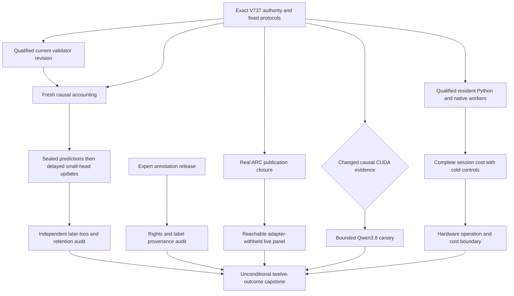
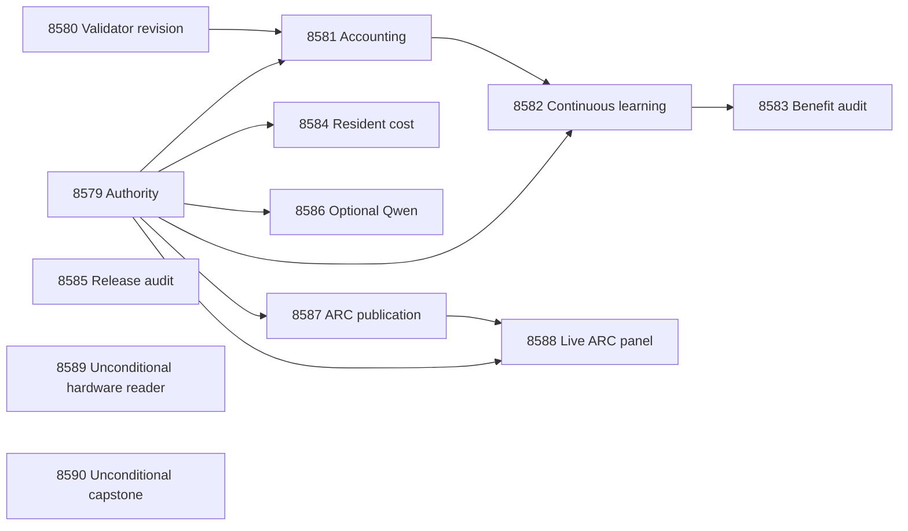

# Carnot Research Roadmap v737: Executable Learning and Complete Service Evidence

**Created:** 2026-10-16
**Milestone:** 2026.10.737
**Status:** Planned; staged only, not activated
**Title:** Executable causal learning, resident service cost, and independent evidence
**Supersedes:** V736 scheduling. All historical findings and failed authority remain intact.
**Task contract:** Exactly 12 tasks, Exp8579 through Exp8590, in the order below.

## What V736 Proved

V736 completed fourteen scheduling slots. Eight producers ran; six slots were
pre-gated or cascade-skipped. Scheduling completion does not mean scientific
completion. The completed archive ends at V735. V736 primary artifacts and
`ops/conductor-log.md` supply the current findings.

| Evidence | Finding | Consequence |
|---|---|---|
| Exp8565 | `methods_ready_score=0`: V736 queue had fourteen tasks, but vNEXT still contained V735 | Correct the complete design before activation; preserve the failed old authority |
| Exp8566–Exp8567 | Sealed count controls and proof-backed integer classification qualified | Reuse the correction; do not redesign or weaken it |
| Exp8568 | `online_adapter_ready_score=0`; validator revision hashes changed after the standalone import repair | Qualify the actual revision, then publish fresh accounting through an explicit revision adapter |
| Exp8571–Exp8572 | Resident worker prototype, request isolation and Python/native parity qualified | Reuse these components for complete cost measurement |
| Exp8569/8570, Exp8573/8574, Exp8575/8576 | No qualified learning benefit, resident cost, Qwen canary or live capability panel | These are unmeasured questions, not scientific nulls |
| Exp8577–Exp8578 | Hardware mapping and capstone preserved absent science and failed authority | Keep physical evidence and administrative completion separate |

The standalone count-validator repair passed its affected regressions. It did
not update old qualification hashes. Exp8580 must create new evidence rather
than substituting current bytes into an old successful receipt.

Closed findings stay closed: Exp8529's exposed source-information null;
Exp8553's HALLMARK independent-label rejection; and Exp8559's complete cold
inference null, ratio1.010149 with CI95[0.997428,1.023458]. A resident lifecycle
gain cannot overturn that cold-process result. Historical quarantines persist.
The preserved V735 design already exists at
`openspec/change-proposals/research-roadmap-v735-preserved-20261016.md`.
No genuine V736 design exists to preserve or retroactively manufacture.

## Three Biggest Gaps Against the PRD

1. **FR-12: reliable verification beyond exposed or constructed examples.**
   Calibrated confidence is not factual truth. Existing source features added
   no qualified benefit on the exposed panel. HALLMARK did not provide the
   needed independent labels. A new expert-annotated release merits an actual
   provenance audit, including its language, construction and rights limits.
2. **FR-11/FR-06: beneficial continuous learning with preserved retention.**
   The fixed delayed-feedback experiment remains unmeasured. Revision and
   authority failures blocked execution. Qualify those specific boundaries,
   then test later losses and retention from sealed causal updates.
3. **FR-05/FR-08/NFR-01: useful complete-service performance on real hardware.**
   Native arithmetic parity exists, but cold complete inference has a qualified
   null. Resident requests change the service lifetime. Measure all host work
   before using kernel speed or vendor estimates to justify an accelerator.

ARC remains a separate standing live-agent generalization obligation. Its
fixed four-game panel measures reachable runtime effects. It cannot certify
hidden-game performance or reuse known solves as new progress.

## Research Ingestion and Experiment Choices

The dated V737 entry in `research-references.md` was written before this design.
It records searches across all eight requested arXiv topics and six secondary
channels, including access failures and stale search snapshots.

| Finding | Experiment | Adoption and limit |
|---|---|---|
| [Calibeating Made Simple](https://arxiv.org/abs/2603.22167) | Exp8582–Exp8583 | Brier/log-loss controls; no imported regret theorem for this nonlinear learner |
| [Capacity-constrained delayed learning](https://arxiv.org/abs/2606.11711) | Exp8581–Exp8583 | Explicit released, admitted and lost feedback; retention stays separate |
| [Online spline KAN](https://arxiv.org/abs/2602.02056) | Exp8582, Exp8584, Exp8589 | Sparse local updates and complete service clocks; no transferred FPGA timing |
| [HalluTruthQA-4K](https://arxiv.org/abs/2608.03966), [HalluScoring](https://arxiv.org/abs/2609.38355) | Exp8585 | New author-release audit; distinguish question holdout, generator holdout and natural errors |
| [SEVRA](https://arxiv.org/abs/2606.19808), previously ingested | Exp8588 | Useful, harmful and unresolved intervention associations; no invented causal counterfactuals |
| [Pipelined p-computer](https://arxiv.org/abs/2607.21077), [Extropic Z1T](https://extropic.ai/writing/z1t/) | Exp8589 | Supported operations and explicit host/transfer exclusions; no local device gain implied |

HalluTruthQA's card states `cc-by-nc-nd-4.0`. Its paper reports one Arabic
generator and controlled generation. The audit can qualify label provenance
while rejecting broader deployment or unseen-generator claims. It keeps text
private and does not translate, train on, or redistribute the release.

EBT/ARM–EBM remain architectural context. T-SKM-Net addresses linear feasibility,
not extraction truth. DCCD/ETS decoding changes wait for a qualified runtime and
useful verifier. KAC/RBF and new spline bases wait for the fixed objective study.
Kona's inspected page supplies positioning rather than reproducible new evidence.
Semantic Scholar citation retrieval failed. GitHub Trending snapshots were old;
no current ranking claim is made.

## V737 Architecture



This diagram describes planned work. Existing energy-head, resident-worker and
live-agent implementations remain the starting point. New authority wrappers
must be small and explicit. Historical readers retain original pins. Do not
change shared validators or the research conductor to make new results pass.

## Phase 1: Executable Authority and Current Accounting — Exp8579–Exp8581

**Exp8579:** bind all twelve complete objects, visible table, digest and end
marker. Seal inherited numerical methods before measurements. Readiness fields
separate learning, resident service and optional CUDA. The stale V736 authority
remains an explicit failure.

**Exp8580:** qualify the already repaired validator against seventeen frozen
controls, current affected tests and both CLI/import paths. Bind actual source
and test bytes. Rejected proofs and unrelated fabrication cases must still fail.
No validator algorithm change is part of this task.

**Exp8581:** pass that new qualified revision explicitly to fresh accounting.
Retain original numerical mechanics and test authority. Prove drift rejection,
truthful before/after counts and exact restart before admitting a stream run.

## Phase 2: Fixed Learning and Complete Serving Science — Exp8582–Exp8584

**Exp8582:** continuous self-learning updates the small energy head and changes
later typed decisions. Four arms are frozen, log_loss, brier and
brier_shuffled_released. Five seeds17/29/43/71/101, five20-question blocks,
three siblings and four arms produce6000 prediction rows. Capacity8 questions
per block, learning rate0.01, L2=0.001 and the original head/scaler/temperature
stay fixed. Predictions precede feedback. Real block2 process exits resume
exactly. Fifty retention questions are evaluated at five windows without training.

**Exp8583:** independently reduce later-question Brier changes. Average siblings
and seeds within each of80 later questions. Use10000 paired bootstrap draws,
seed7278448, with97.5percent two-sided intervals for each primary contrast.
Both lower bounds must exceed zero, with no typed-loss increase. Resample
retention questions jointly across windows, seed7258421, and require the upper95
bound on maximum-window Brier increase to be at most0.01. Exposed benefit is
at most circular_positive; both generalization scores remain zero.

**Exp8584:** reuse qualified resident workers. Compare cold_python, cold_native,
resident_python and resident_native. Each panel has64 fixed answers; lengths
are1/4/16 panels, batches1/8, with ten paired repeats. Include launch, imports,
transport, every feature, arithmetic, fallback, serialization and shutdown.
Primary native contrast is length16/batch1, resident_native versus resident_python.
Keep10000 bootstrap draws and seed7368573. Benefit needs lower95 throughput
ratio>1, p95 latency ratio<=1.05 and zero decision mismatches. NFR-01 requires
lower95>=10. Resident_python versus cold_python measures lifecycle separately.
A2400-second measurement budget preserves censored cells if the design cannot
finish; no missing cell may be dropped to declare a complete comparison.

## Phase 3: Independent Evidence and Reachable Runtime Effects — Exp8585–Exp8588

**Exp8585:** inspect the actual HalluTruthQA release, capped at5000 rows/100MiB.
Record file/commit hashes, license, annotation lineage, repeated questions,
span consistency, construction cues and label-bearing fields. Keep separate
eligibility scores for human evidence, question holdout, generator holdout,
deployment permission and natural errors. Audit completion is independent of
eligibility. No detector fit or new generation occurs. This task also maps
new literature to later methods without changing this milestone's fixed corpus.

**Exp8586:** the only model-loading task. It requires an authenticated causal
CUDA repair receipt before any load. Use `unsloth/Qwen3.8-27B-GGUF`, cached
Q4_K_M shards and llama.cpp's embedded tokenizer. Four fixed fit questions,
four views and max128 output tokens yield16 bounded calls. Declare
`model_bounded_generation` with its10-second floor. A load-only outcome uses
`model_load_no_generation` and2seconds; a zero-load block uses `no_model_load`.
A real full generative study would use `model_full_generation` and60seconds;
none is scheduled here. Never pad clocks. No legacy model supplies headline evidence.

**Exp8587:** exercise the real ARC publication closure missed by Exp8561,
including `validator(candidate)` at its recorded line282. Confirm its current
source location first. Cover valid and rehashed-invalid private publication in
genuine children, then qualify terminal replay within240seconds. Do not stub
validators, remove statements or normalize away missing execution.

**Exp8588:** run the qualified live path on ar25-0c556536, ft09-0d8bbf25,
lf52-271a04aa and tn36-ef4dde99, seeds11/22, two arms:16 episodes. Withhold
per-game adapters/routes/solver artifacts. Use E3AgentPolicy/make_carnot_agent,
512 actions and120seconds per episode, total measurement<=2400seconds.
Preserve arm order, window120, stall150 and default flag off. No model calls.
Mask only explicitly unavailable capabilities. Keep unknown capabilities unknown.
Require less unavailable work, no paired level regression and no complete-wall
increase for the scoped efficiency claim. Include every timeout. Four games
limit generalization. Incidental new solves require registry-precheck and
`solve_provenance=live_agent_self_discovery`. No offline BFS or source inspection.

## Phase 4: Hardware Boundary and Honest Closure — Exp8589–Exp8590

**Exp8589:** run regardless of optional successes. Use qualified complete session
clocks if present; otherwise keep new ceilings null. Map supported operations
and fixed host/transfer work to existing board evidence. Preserve KV260 Ising
k<=5, PolarFire CPU-versus-fabric limits and GateMate physical obligations.
Current IDCODE0xffffffff does not become expected0x20000001 without changed
cable/port/power evidence, authenticated source/build, n16 flash and sample smoke.
No repeated device probe, flash or purchase is scheduled. Conditional zero-cost
ceilings are bounds, never measured speedups. NPU/TSU remain unqualified.

**Exp8590:** run regardless of all prior dispositions. Record all twelve slots,
including itself. Read real conductor pre-gate paths through the existing
locator; do not guess missing filenames. Recompute selected primitive rows,
keep owned disqualification separate from external blockage, and preserve
publication gates G1–G4. Close qualified unchanged nulls. Name exact changed
prerequisites for unmeasured branches. External absence is blocked, not partial.

## Dependency Graph and Gate Contract



Every structured gate points backward within this queue and uses equality to1.
Exp8579 declares `methods_ready_score`, `learning_inputs_ready_score`,
`resident_inputs_ready_score`, `canary_inputs_ready_score` and
`runtime_repair_ready_score`. Exp8580 declares `current_validator_ready_score`;
Exp8581 declares `online_adapter_ready_score`; Exp8582 declares
`causal_learning_rows_ready_score`; Exp8587 declares
`arc_panel_execution_ready_score`. Each name occurs in its own required fields.
Hardware and capstone edges are evidence reads, not execution gates. A missing
CUDA receipt can block only Exp8586. A learning failure cannot gate resident cost.

## Hardware Requirements and Execution Budget

| Tasks | Required resource | Bounds and acceleration question |
|---|---|---|
| Exp8579–Exp8585 | Host CPU, Python environment, disk-backed scratch; existing native extension for cost | 4–8GB working-memory planning allowance; measure actual peak. Sparse updates and complete serving work precede any100x proposal |
| Exp8586 | Cached Qwen3.8 GGUF; leased RTX3090 capacity, possibly both24GB devices if offload requires | Verify available memory at runtime; do not disturb other processes. Load<=600s, call<=120s, measurement<=2400s |
| Exp8587–Exp8588 | CPU, installed local ARC environment, original runtime wrappers | No LLM; replay<=240s; panel<=2400s; bounded child supervision |
| Exp8589–Exp8590 | CPU and authenticated stored board/primitive receipts | No new physical hardware access required; evidence reads<=60s |

Per-task estimates total about8hours, excluding conductor synthesis overhead.
Each task fits the4800-second cap with measurement stop by3600seconds and a
900-second validation reserve. Tasks with2400-second measurement limits keep
more time for qualification. Emit flushed start/end/phase lines and status
inside loops at least every60seconds. Every output gap must remain under600s.
Write files over about200lines through several calls, at most150lines each,
with a progress message between calls. No task may rely on a larger estimate
or stall grace to compensate for silence.

## Rerun, Validation and Claim Discipline

Every continuation includes complete `prior_failures` records with
`retire_if_same_verdict: true`. No retired experiment ID is reused. New authority,
qualified changed validator bytes and actual closure coverage are explicit
reopening conditions. The same failed verdict retires the new attempt. The
release audit uses a different author corpus; HALLMARK remains rejected.

All twelve tasks emit per-unit rows and the closed verdict enum. Partial is
reserved for unfinished owned work which another attempt could finish. Missing,
retired or unchanged blocked upstreams cannot improve through retries.
Oracle/exposed results carry their limitations with the artifact. Failed owned
acceptance checks prohibit positive classes. Neither schema correctness nor
administrative completion constitutes scientific benefit.

The current user routing directive takes precedence over older defaults:
complex schema/revision work uses Claude Opus with100turns; mechanical dataset
and regression work uses Codex gpt-6.1-sol; routine science keeps Sonnet defaults.
Hardware mapping and capstone readers use20turns. No luna or Gemini task is queued.
At least two infrastructure slots, actual small-head training, live ARC
measurement and hardware continuity are present.

Planning checks cover schema, retirement, ARC floor, full object equality,
gate producers, existing paths and contract mutations. Run focused unit/spec
checks and private E2E-018/021. Later experiment code requires tests first,
scoped lint/types, actual child coverage and100percent newly owned statements.
Preserve all existing tests and historical authority. Never run an unbounded
repository test suite. No experiment, activation, push or external publication
is part of this planning change.

## Exact task contract

The visible table and embedded full dictionaries define the same twelve tasks
as `research-roadmap-next.yaml`. The digest uses UTF-8 JSON of the task list
with sorted keys, compact separators and `ensure_ascii=False`.

canonical_tasks_sha256: `2ea815d961d6c8c5a9063608219869c72944c46278617125da74ddb48a8e9c75`

| Order | ID | Title | Phase | Deliverable |
|---|---|---|---|---|
| 1 | exp8579-contract-methods | Bind twelve complete tasks and seal branch-specific scientific authority | 1 | results/experiment_8579_v737_contract_methods.json |
| 2 | exp8580-current-validator-qualification | Qualify the repaired count validator under immutable current revision evidence | 1 | results/experiment_8580_v737_current_validator_qualification.json |
| 3 | exp8581-causal-accounting-qualification | Qualify causal accounting against the explicitly qualified validator revision | 1 | results/experiment_8581_v737_causal_accounting_qualification.json |
| 4 | exp8582-causal-brier-stream | Train the small energy head through sealed delayed feedback and fixed controls | 2 | results/experiment_8582_v737_causal_brier_stream.json |
| 5 | exp8583-learning-benefit-audit | Measure later Brier benefit and simultaneous retention from qualified updates | 2 | results/experiment_8583_v737_learning_benefit_audit.json |
| 6 | exp8584-resident-complete-cost | Measure complete resident-session cost at matched Python and native decisions | 2 | results/experiment_8584_v737_resident_complete_cost.json |
| 7 | exp8585-hallutruth-release-audit | Audit HalluTruthQA label authority and construction before independent evaluation | 3 | results/experiment_8585_v737_hallutruth_release_audit.json |
| 8 | exp8586-qwen-evidence-canary | Run bounded mandated-Qwen evidence views only after causal CUDA recovery | 3 | results/experiment_8586_v737_qwen_evidence_canary.json |
| 9 | exp8587-arc-publication-qualification | Qualify actual ARC publication closure before the reachable live panel | 3 | results/experiment_8587_v737_arc_publication_qualification.json |
| 10 | exp8588-arc-capability-panel | Measure adapter-withheld live supervisor effects across the fixed four games | 3 | results/experiment_8588_v737_arc_capability_panel.json |
| 11 | exp8589-resident-hardware-boundary | Map qualified resident operations to board support and acquisition needs | 4 | results/experiment_8589_v737_resident_hardware_boundary.json |
| 12 | exp8590-capstone | Reconcile twelve outcomes and retain only evidence-qualified continuation | 4 | results/experiment_8590_v737_capstone.json |

<!-- V737_TASK_CONTRACT_START -->
```json
{
"milestone": "2026.10.737",
"tasks": [
{
  "id": "exp8579-contract-methods",
  "title": "Bind twelve complete tasks and seal branch-specific scientific authority",
  "phase": 1,
  "track": "infrastructure",
  "priority": "high",
  "requires_gpu": false,
  "max_turns": 100,
  "estimated_wall_time_min": 40,
  "per_unit_rows": true,
  "milestone": "2026.10.737",
  "deliverable": "results/experiment_8579_v737_contract_methods.json",
  "inference_substrate_class": "no_model_load",
  "MODEL_SPECS": [],
  "gated_on": [],
  "prior_failures": [
    {
      "experiment_id": "exp8499-contract-methods",
      "verdict": "complete_blocked_v731_contract_methods",
      "addressed_by": "V735 supplies thirteen complete task objects, visible table, JSON, digest and end marker. Preserve qualified historical readers and failed earlier authority.",
      "retire_if_same_verdict": true
    },
    {
      "experiment_id": "exp8552-contract-methods",
      "verdict": "complete_circular_positive_v735_contract_methods",
      "addressed_by": "Fourteen complete objects replace thirteen; qualified V735 family/native evidence is reused and two new protocols are sealed separately.",
      "retire_if_same_verdict": true
    },
    {
      "experiment_id": "exp8565-contract-methods",
      "verdict": "complete_blocked_v736_contract_methods",
      "addressed_by": "V736 failed because its design still contained V735. V737 supplies twelve matching full objects, table, digest and end marker, verified before staging. Preserve the failed old authority.",
      "retire_if_same_verdict": true
    }
  ],
  "agent_type": "claude",
  "model": "opus",
  "prompt": "CONTEXT:\nWork in {project_root} on {date}. V736 ended fourteen slots: eight producers ran and six slots were pre-gated or cascade-skipped. Its queue contained fourteen tasks but vNEXT still held V735. Exp8565 therefore set methods_ready_score=0. Exp8568 also rejected validator revision hashes after a real standalone-import repair. Count controls and resident parity qualified; learning benefit, resident cost and the live mask panel remain unmeasured. Preserve Exp8529 source null, Exp8553 label rejection, Exp8559 cold-cost null and every old quarantine. The completed archive ends at V735; V736 primaries and conductor receipts are current authority. This task belongs to a complete twelve-object V737 contract.\nEXISTING CODE TO READ FIRST:\nCLAUDE.md; CODEX.md; ops/e2e-test-plan.md; ops/exclusion_manifest.yaml; openspec/capabilities/research-reporting/spec.md; openspec/capabilities/verification/spec.md; scripts/experiment_template.py; python/carnot/reporting/primary_publication.py; openspec/change-proposals/research-roadmap-vNEXT.md; research-references.md; python/carnot/reporting/v735_contract_methods.py; python/carnot/reporting/v735_historical_inputs.py; python/carnot/reporting/roadmap_contract.py; python/carnot/verify/cuda_reader_8410.py; openspec/change-proposals/v735-methods-protocol.json; results/experiment_8554_v735_historical_learning_qualification.json; results/experiment_8559_v735_complete_native_cost.json; results/experiment_8564_v735_capstone.json; openspec/change-proposals/research-roadmap-v735-preserved-20261016.md; openspec/change-proposals/v736-methods-protocol.json; results/experiment_8565_v736_contract_methods.json; results/experiment_8572_v736_resident_inference_qualification.json; results/experiment_8578_v736_capstone.json; python/carnot/reporting/v736_contract_methods.py\nTASK:\nBind twelve complete tasks and seal branch-specific scientific authority. Deliver results/experiment_8579_v737_contract_methods.json. Create thin runner scripts/experiments/experiment_8579_v737_contract_methods.py, primitives under results/raw/experiment_8579_v737_contract_methods/ and docs/research-notes/v737-contract-methods.md. Same-roadmap outputs are future dependencies.\nCONCRETE STEPS:\n1. PRECONDITIONS: Print a flushed start line. Authenticate input bytes, original authority, tools, memory, writable disk-backed scratch and deadlines. Record missing resources in gate_check_summary. Optional CUDA and board absence cannot disable independent CPU branches.\n2. Print a flushed progress line at every phase boundary and before and after each model load, generation, benchmark and subprocess that can take minutes. Use unbuffered output. Print completed/pending counts inside long loops. Supervise children with status output at least every 60 seconds. Keep every gap under 600 seconds. Write any file over about 200 lines in several tool calls of at most 150 lines. Send a progress message between calls. Bound each tool call. Stop measurements by 3600 seconds and reserve 900 seconds for validation within the 4800-second cap. Never pad duration.\n3. Spec first: confirm relevant capability specs contain REQ-* and SCENARIO-* before implementation. Write focused failing tests first. Preserve original tests, thresholds, scientific operands and historical authority. Reuse existing modules through small explicit adapters. Accept --date {date}. Put runners in scripts/experiments/, tests in tests/python/ and scratch in /var/tmp. Do not modify active roadmap, conductor, shared validators, generator weights or external services.\n4. Declare inference_substrate_class=no_model_load and MODEL_SPECS=[]. Record zero current LLM calls. Historical generation belongs only in historical_model_provenance. Use actual CPU work or aggregation_from_upstream_artifacts as appropriate.\n5. Compare exactly twelve complete task dictionaries, Exp8579 through Exp8590, across activated YAML, visible table, embedded JSON, end marker and canonical_tasks_sha256. Include prompts, routes, gates and retirement flags. Test count/order/ID/title/phase/deliverable/model/substrate/gate/prompt/retirement/end-marker mutations. Reuse authentic activation evidence if staging was consumed. Never synthesize a V736 design retroactively.\n6. Create openspec/change-proposals/v737-methods-protocol.json before measurements. Copy objective_updates, objective_audit, evidence_canary and arc_capability_mask numerical operands from V735 unchanged. Copy resident_session from v736-methods-protocol.json as the pre-existing registered design, not proof of qualified V736 authority. Compare every inherited operand by value and hash. Seal current task mappings separately. Old source and cold native nulls stay closed.\n7. Authenticate original Exp8431 head/scaler/temperature and Exp8554 exact 158-node receipt. Reuse qualified historical tests under original authority when dependency hashes match. Authenticate Exp8571 prototype and Exp8572 resident qualification independently. Emit learning_inputs_ready_score, resident_inputs_ready_score and canary_inputs_ready_score independently. A changed source dependency requires only its affected family, not an automatic historical cascade.\n8. Seal complete resident sessions: 64 stable-order test answers per panel; batches1/8; lengths1/4/16 panels; ten paired repeats. Keep four arms and length16/batch1 as primary. Preserve bootstrap seed7368573 and latency limit1.05. Register no new scientific thresholds. Register the HalluTruthQA release-admissibility questions separately; it cannot change the learning corpus mid-milestone.\n9. Read only the supplied ops/cuda-runtime-repair-receipt.json through the Exp8410 reader within60seconds. runtime_repair_ready_score=1 requires changed causal library/environment operands and real context/copy evidence. Run no device/model command. Optional runtime absence cannot lower methods_ready_score. Bind the V737 literature entry and immutable V736 terminal receipts.\n10. Emit current_contract_ready_score and methods_ready_score solely from exact current authority and fixed protocol checks. The stale V736 contract remains failed. Ensure downstream prompts and gates spell every field identically. Do not bind future validation to mutable status, metrics or literature whole-file hashes.\n11. Run scoped unit tests, real private CLI checks, Ruff check/format, strict mypy and scripts/check_spec_coverage.py --files <owned-test-files>. Run applicable ops/e2e-test-plan.md checks, including private E2E-018 and E2E-021 for authority/publication consumers. Require 100 percent newly owned statement coverage, including genuine children and rejection paths. Collect original test node IDs before disjoint bounded children. Retain their exact union and original authority. Use -n 0 -o addopts= --no-cov. Never run the full repository suite or a nested historical validation controller. A killed child fails validation. Retain commands, exits, durations and log hashes.\n12. Cold-replay immutable primitives in a fresh bounded process. Test missing inputs, owned failures and self-consistently rehashed tampering. Run primary_publication, scripts/adversarial_verify.py --json <private-candidate> and scripts/verdict_row_consistency_lint.py --strict <private-candidate>. Preserve all findings. Validate final bytes before atomic publication and exercise the actual downstream consumer. Do not clear old quarantines. Owned required-check failure means disqualified. Unchanged external blockage means blocked, never partial. Reconcile openspec/, _bmad/traceability.md, ops/status.md and ops/changelog.md.\nREQUIRED ARTIFACT FIELDS:\nexperiment_id, task_id, milestone, run_date: principle: Bind evidence to this invocation.\nhonest_verdict, verdict_class: principle: Terminal verdicts start complete_. verdict_class is exactly positive | circular_positive | null | blocked | disqualified | partial. Partial means incomplete owned work that a retry can finish. External unchanged incompleteness is blocked.\ngate_check_summary: principle: Every blocked_* or complete_blocked_* outcome names failed check, upstream, path/hash, field, operator, expected and observed. Missing differs from zero.\ninference_substrate, inference_substrate_class, MODEL_SPECS, model_invocation_counts, historical_model_provenance: principle: Separate actual execution from imported generator names.\nrows, intended_count, completed_count, failed_count, censored_count, excluded_count, independent_count, sample_size_budget: principle: Emit each unit's metrics and missing reason. Repeated observations do not create independent units.\nverifier_is_oracle, exposure_scope, independent_generalization_score, generalized_learning_benefit_score: principle: Oracle-dependent or exposed learning claims are at most circular_positive. Both generalization scores stay zero in this milestone.\nrequired_checks_passed, flagged_adversarial, acceptance_gates, validation_receipts, terminal_validation_sidecar_path, adversarial_findings: principle: Qualification differs from benefit. Failed acceptance gates forbid positive classes.\npreconditions_checked, duration_s, phase_spans, random_seed, reproducibility_checksum, source_artifact_hashes, code_config_hashes, raw_shard_hashes: principle: Preserve real clocks and immutable operands.\ncited_upstream_artifacts, field_principles: principle: Name original producers and explain every added metric and gate.\ncurrent_contract_ready_score, methods_ready_score, learning_inputs_ready_score, resident_inputs_ready_score, canary_inputs_ready_score, runtime_repair_ready_score, canonical_tasks_sha256, methods_protocol_reference, inherited_operand_checks, historical_family_receipts, closed_comparisons: principle: Exact authority qualifies each branch independently; optional devices cannot gate CPU science.\nRun command: cd {project_root} && JAX_PLATFORMS=cpu PYTHONPATH=python:. PYTHONUNBUFFERED=1 .venv/bin/python -u scripts/experiments/experiment_8579_v737_contract_methods.py --date {date}\nDo NOT push. Do NOT modify scripts/research_conductor.py.\n"
},
{
  "id": "exp8580-current-validator-qualification",
  "title": "Qualify the repaired count validator under immutable current revision evidence",
  "phase": 1,
  "track": "infrastructure",
  "priority": "high",
  "requires_gpu": false,
  "max_turns": 100,
  "estimated_wall_time_min": 40,
  "per_unit_rows": true,
  "milestone": "2026.10.737",
  "deliverable": "results/experiment_8580_v737_current_validator_qualification.json",
  "inference_substrate_class": "no_model_load",
  "MODEL_SPECS": [],
  "gated_on": [],
  "prior_failures": [
    {
      "experiment_id": "exp8517-brier-online-learning",
      "verdict": "complete_disqualified_v732_brier_online_learning",
      "addressed_by": "Repair the measured missing field diagnostic, distinguish coordinate changes from update events using before/after states, and replace incomplete nested validation with the exact bounded test union.",
      "retire_if_same_verdict": true
    },
    {
      "experiment_id": "exp8489-objective-checkpoint-qualification",
      "verdict": "complete_circular_positive_v730_objective_checkpoint_qualification",
      "addressed_by": "Exp8516 now supplies a qualified immutable objective publication; reuse it without rewriting Exp8489 or its stale sidecar.",
      "retire_if_same_verdict": true
    },
    {
      "experiment_id": "exp8530-update-accounting-qualification",
      "verdict": "complete_disqualified_v733_update_accounting_qualification",
      "addressed_by": "Original suite isolation is qualified separately; fresh event records distinguish real quantities from duplicate aliases and prove identities with independent controls.",
      "retire_if_same_verdict": true
    },
    {
      "experiment_id": "exp8542-canonical-update-accounting",
      "verdict": "blocked_gate_check_failed",
      "addressed_by": "Exp8542 was pre-gated on Exp8541=0. Exp8554 now supplies a complete node-budgeted original union before the unchanged accounting and validator-visible counter controls.",
      "retire_if_same_verdict": true
    },
    {
      "experiment_id": "exp8555-canonical-update-accounting",
      "verdict": "complete_disqualified_v735_canonical_update_accounting",
      "addressed_by": "Adds a separately qualified generic cardinality proof check; previous counter aliases did not address the shared classifier.",
      "retire_if_same_verdict": true
    },
    {
      "experiment_id": "exp8567-count-validator-correction",
      "verdict": "complete_null_v736_count_validator_correction",
      "addressed_by": "The post-publication standalone-import repair changed the sealed validator and tests. Measure the current revision against the original frozen controls and publish new authority without editing old receipts.",
      "retire_if_same_verdict": true
    }
  ],
  "agent_type": "claude",
  "model": "opus",
  "prompt": "CONTEXT:\nWork in {project_root} on {date}. V736 ended fourteen slots: eight producers ran and six slots were pre-gated or cascade-skipped. Its queue contained fourteen tasks but vNEXT still held V735. Exp8565 therefore set methods_ready_score=0. Exp8568 also rejected validator revision hashes after a real standalone-import repair. Count controls and resident parity qualified; learning benefit, resident cost and the live mask panel remain unmeasured. Preserve Exp8529 source null, Exp8553 label rejection, Exp8559 cold-cost null and every old quarantine. The completed archive ends at V735; V736 primaries and conductor receipts are current authority. This task belongs to a complete twelve-object V737 contract.\nEXISTING CODE TO READ FIRST:\nCLAUDE.md; CODEX.md; ops/e2e-test-plan.md; ops/exclusion_manifest.yaml; openspec/capabilities/research-reporting/spec.md; openspec/capabilities/verification/spec.md; scripts/experiment_template.py; python/carnot/reporting/primary_publication.py; openspec/change-proposals/research-roadmap-vNEXT.md; research-references.md; scripts/adversarial_verify.py; tests/python/test_adversarial_verify_baseline_identity_tautology.py; tests/python/test_adversarial_verify_nested_wall_clock_tautology.py; python/carnot/reporting/canonical_update_8555.py; tests/python/test_count_validator_correction_8567.py; tests/python/test_count_validator_runner_8567.py; python/carnot/reporting/count_validator_8567.py; python/carnot/reporting/causal_accounting_8568.py; results/experiment_8568_v736_causal_accounting_qualification.json\nTASK:\nQualify the repaired count validator under immutable current revision evidence. Deliver results/experiment_8580_v737_current_validator_qualification.json. Create thin runner scripts/experiments/experiment_8580_v737_current_validator_qualification.py, primitives under results/raw/experiment_8580_v737_current_validator_qualification/ and docs/research-notes/v737-current-validator-qualification.md. Same-roadmap outputs are future dependencies.\nCONCRETE STEPS:\n1. PRECONDITIONS: Print a flushed start line. Authenticate input bytes, original authority, tools, memory, writable disk-backed scratch and deadlines. Record missing resources in gate_check_summary. Optional CUDA and board absence cannot disable independent CPU branches.\n2. Print a flushed progress line at every phase boundary and before and after each model load, generation, benchmark and subprocess that can take minutes. Use unbuffered output. Print completed/pending counts inside long loops. Supervise children with status output at least every 60 seconds. Keep every gap under 600 seconds. Write any file over about 200 lines in several tool calls of at most 150 lines. Send a progress message between calls. Bound each tool call. Stop measurements by 3600 seconds and reserve 900 seconds for validation within the 4800-second cap. Never pad duration.\n3. Spec first: confirm relevant capability specs contain REQ-* and SCENARIO-* before implementation. Write focused failing tests first. Preserve original tests, thresholds, scientific operands and historical authority. Reuse existing modules through small explicit adapters. Accept --date {date}. Put runners in scripts/experiments/, tests in tests/python/ and scratch in /var/tmp. Do not modify active roadmap, conductor, shared validators, generator weights or external services.\n4. Declare inference_substrate_class=no_model_load and MODEL_SPECS=[]. Record zero current LLM calls. Historical generation belongs only in historical_model_provenance. Use actual CPU work or aggregation_from_upstream_artifacts as appropriate.\n5. Inspect the exact Exp8567-to-current source and test differences. The documented standalone import repair changed scripts/adversarial_verify.py and test_count_validator_correction_8567.py after the old receipt. Authenticate that repair and original control-corpus hashes. Reject unexplained changes. Do not edit shared validator code or amend the old Exp8567 artifact.\n6. Replay all17 frozen Exp8566 controls through both the imported validator and its standalone CLI from outside the checkout without PYTHONPATH. Verify valid cardinality proof warnings and critical corrupt/missing-proof findings. Recheck copied continuous values and unrelated true-positive fixtures. Preserve exact original expected classifications.\n7. Run the affected regression union, including all112 count tests and standalone import regressions when their actual collected union matches the stored repair receipt. Collect node IDs first; do not substitute a count assertion for test execution. Use measured bounded children. Keep the existing independent cardinality reducer, exact integer checks and mutation controls unchanged.\n8. Publish a new immutable current_validator_reference binding actual source, tests, controls, commands and private replay. Emit current_validator_ready_score=1 only after all current checks pass. This receipt authorizes new producers using this revision; it does not make old invalid hashes valid. Verify the next accounting consumer can accept this explicit revision argument and still rejects drift.\n9. Run scoped unit tests, real private CLI checks, Ruff check/format, strict mypy and scripts/check_spec_coverage.py --files <owned-test-files>. Run applicable ops/e2e-test-plan.md checks, including private E2E-018 and E2E-021 for authority/publication consumers. Require 100 percent newly owned statement coverage, including genuine children and rejection paths. Collect original test node IDs before disjoint bounded children. Retain their exact union and original authority. Use -n 0 -o addopts= --no-cov. Never run the full repository suite or a nested historical validation controller. A killed child fails validation. Retain commands, exits, durations and log hashes.\n10. Cold-replay immutable primitives in a fresh bounded process. Test missing inputs, owned failures and self-consistently rehashed tampering. Run primary_publication, scripts/adversarial_verify.py --json <private-candidate> and scripts/verdict_row_consistency_lint.py --strict <private-candidate>. Preserve all findings. Validate final bytes before atomic publication and exercise the actual downstream consumer. Do not clear old quarantines. Owned required-check failure means disqualified. Unchanged external blockage means blocked, never partial. Reconcile openspec/, _bmad/traceability.md, ops/status.md and ops/changelog.md.\nREQUIRED ARTIFACT FIELDS:\nexperiment_id, task_id, milestone, run_date: principle: Bind evidence to this invocation.\nhonest_verdict, verdict_class: principle: Terminal verdicts start complete_. verdict_class is exactly positive | circular_positive | null | blocked | disqualified | partial. Partial means incomplete owned work that a retry can finish. External unchanged incompleteness is blocked.\ngate_check_summary: principle: Every blocked_* or complete_blocked_* outcome names failed check, upstream, path/hash, field, operator, expected and observed. Missing differs from zero.\ninference_substrate, inference_substrate_class, MODEL_SPECS, model_invocation_counts, historical_model_provenance: principle: Separate actual execution from imported generator names.\nrows, intended_count, completed_count, failed_count, censored_count, excluded_count, independent_count, sample_size_budget: principle: Emit each unit's metrics and missing reason. Repeated observations do not create independent units.\nverifier_is_oracle, exposure_scope, independent_generalization_score, generalized_learning_benefit_score: principle: Oracle-dependent or exposed learning claims are at most circular_positive. Both generalization scores stay zero in this milestone.\nrequired_checks_passed, flagged_adversarial, acceptance_gates, validation_receipts, terminal_validation_sidecar_path, adversarial_findings: principle: Qualification differs from benefit. Failed acceptance gates forbid positive classes.\npreconditions_checked, duration_s, phase_spans, random_seed, reproducibility_checksum, source_artifact_hashes, code_config_hashes, raw_shard_hashes: principle: Preserve real clocks and immutable operands.\ncited_upstream_artifacts, field_principles: principle: Name original producers and explain every added metric and gate.\ncurrent_validator_ready_score, current_validator_reference, repair_diff_reference, frozen_control_rows, cli_import_classification_rows, exact_node_union, mutation_receipts: principle: A changed validator needs new measured qualification; never silently substitute hashes in old evidence.\nRun command: cd {project_root} && JAX_PLATFORMS=cpu PYTHONPATH=python:. PYTHONUNBUFFERED=1 .venv/bin/python -u scripts/experiments/experiment_8580_v737_current_validator_qualification.py --date {date}\nDo NOT push. Do NOT modify scripts/research_conductor.py.\n"
},
{
  "id": "exp8581-causal-accounting-qualification",
  "title": "Qualify causal accounting against the explicitly qualified validator revision",
  "phase": 1,
  "track": "infrastructure",
  "priority": "high",
  "requires_gpu": false,
  "max_turns": 100,
  "estimated_wall_time_min": 40,
  "per_unit_rows": true,
  "milestone": "2026.10.737",
  "deliverable": "results/experiment_8581_v737_causal_accounting_qualification.json",
  "inference_substrate_class": "no_model_load",
  "MODEL_SPECS": [],
  "gated_on": [
    {
      "upstream": "exp8579-contract-methods",
      "artifact_field": "learning_inputs_ready_score",
      "op": "==",
      "value": 1
    },
    {
      "upstream": "exp8580-current-validator-qualification",
      "artifact_field": "current_validator_ready_score",
      "op": "==",
      "value": 1
    }
  ],
  "prior_failures": [
    {
      "experiment_id": "exp8517-brier-online-learning",
      "verdict": "complete_disqualified_v732_brier_online_learning",
      "addressed_by": "Repair the measured missing field diagnostic, distinguish coordinate changes from update events using before/after states, and replace incomplete nested validation with the exact bounded test union.",
      "retire_if_same_verdict": true
    },
    {
      "experiment_id": "exp8489-objective-checkpoint-qualification",
      "verdict": "complete_circular_positive_v730_objective_checkpoint_qualification",
      "addressed_by": "Exp8516 now supplies a qualified immutable objective publication; reuse it without rewriting Exp8489 or its stale sidecar.",
      "retire_if_same_verdict": true
    },
    {
      "experiment_id": "exp8530-update-accounting-qualification",
      "verdict": "complete_disqualified_v733_update_accounting_qualification",
      "addressed_by": "Original suite isolation is qualified separately; fresh event records distinguish real quantities from duplicate aliases and prove identities with independent controls.",
      "retire_if_same_verdict": true
    },
    {
      "experiment_id": "exp8542-canonical-update-accounting",
      "verdict": "blocked_gate_check_failed",
      "addressed_by": "Exp8542 was pre-gated on Exp8541=0. Exp8554 now supplies a complete node-budgeted original union before the unchanged accounting and validator-visible counter controls.",
      "retire_if_same_verdict": true
    },
    {
      "experiment_id": "exp8555-canonical-update-accounting",
      "verdict": "complete_disqualified_v735_canonical_update_accounting",
      "addressed_by": "The 158-node union now qualifies; a separate proof-backed validator correction and targeted controller regressions replace repeated alias-only attempts.",
      "retire_if_same_verdict": true
    },
    {
      "experiment_id": "exp8568-causal-accounting-qualification",
      "verdict": "complete_blocked_v736_causal_accounting_qualification",
      "addressed_by": "Exp8568 rejected stale validator hashes after a real import repair. A new explicit revision receipt from Exp8580 replaces only the new producer binding; original numerical tests and old authority remain intact.",
      "retire_if_same_verdict": true
    }
  ],
  "agent_type": "claude",
  "model": "opus",
  "prompt": "CONTEXT:\nWork in {project_root} on {date}. V736 ended fourteen slots: eight producers ran and six slots were pre-gated or cascade-skipped. Its queue contained fourteen tasks but vNEXT still held V735. Exp8565 therefore set methods_ready_score=0. Exp8568 also rejected validator revision hashes after a real standalone-import repair. Count controls and resident parity qualified; learning benefit, resident cost and the live mask panel remain unmeasured. Preserve Exp8529 source null, Exp8553 label rejection, Exp8559 cold-cost null and every old quarantine. The completed archive ends at V735; V736 primaries and conductor receipts are current authority. This task belongs to a complete twelve-object V737 contract.\nEXISTING CODE TO READ FIRST:\nCLAUDE.md; CODEX.md; ops/e2e-test-plan.md; ops/exclusion_manifest.yaml; openspec/capabilities/research-reporting/spec.md; openspec/capabilities/verification/spec.md; scripts/experiment_template.py; python/carnot/reporting/primary_publication.py; openspec/change-proposals/research-roadmap-vNEXT.md; research-references.md; python/carnot/reporting/canonical_update_8555.py; python/carnot/reporting/canonical_update_runner_8555.py; python/carnot/reporting/canonical_update_report_8555.py; tests/python/test_canonical_update_8555.py; tests/python/test_canonical_update_runner_8555.py; results/experiment_8554_v735_historical_learning_qualification.json; results/experiment_8555_v735_canonical_update_accounting.json; python/carnot/reporting/causal_accounting_8568.py; python/carnot/reporting/causal_accounting_validation_8568.py; python/carnot/reporting/causal_accounting_runner_8568.py; results/experiment_8568_v736_causal_accounting_qualification.json\nTASK:\nQualify causal accounting against the explicitly qualified validator revision. Deliver results/experiment_8581_v737_causal_accounting_qualification.json. Create thin runner scripts/experiments/experiment_8581_v737_causal_accounting_qualification.py, primitives under results/raw/experiment_8581_v737_causal_accounting_qualification/ and docs/research-notes/v737-causal-accounting-qualification.md. Same-roadmap outputs are future dependencies.\nCONCRETE STEPS:\n1. PRECONDITIONS: Print a flushed start line. Authenticate input bytes, original authority, tools, memory, writable disk-backed scratch and deadlines. Record missing resources in gate_check_summary. Optional CUDA and board absence cannot disable independent CPU branches.\n2. Print a flushed progress line at every phase boundary and before and after each model load, generation, benchmark and subprocess that can take minutes. Use unbuffered output. Print completed/pending counts inside long loops. Supervise children with status output at least every 60 seconds. Keep every gap under 600 seconds. Write any file over about 200 lines in several tool calls of at most 150 lines. Send a progress message between calls. Bound each tool call. Stop measurements by 3600 seconds and reserve 900 seconds for validation within the 4800-second cap. Never pad duration.\n3. Spec first: confirm relevant capability specs contain REQ-* and SCENARIO-* before implementation. Write focused failing tests first. Preserve original tests, thresholds, scientific operands and historical authority. Reuse existing modules through small explicit adapters. Accept --date {date}. Put runners in scripts/experiments/, tests in tests/python/ and scratch in /var/tmp. Do not modify active roadmap, conductor, shared validators, generator weights or external services.\n4. Declare inference_substrate_class=no_model_load and MODEL_SPECS=[]. Record zero current LLM calls. Historical generation belongs only in historical_model_provenance. Use actual CPU work or aggregation_from_upstream_artifacts as appropriate.\n5. Consume Exp8580 current_validator_reference and Exp8579 learning_inputs_ready_score. Reuse Exp8568 event production and original numerical mechanics. Its failure was validator_revision=False; all other acceptance gates were true. Do not rerun the count-classifier redesign or silently overwrite the hard-coded old VALIDATOR_PIN.\n6. Add a small explicit current-revision adapter for new V737 evidence. Keep historical readers bound to original producer authority. Bind original Exp8554 node union and Exp8516 update mechanics. Run only affected test families when dependencies changed. Prove the adapter rejects a different source/test/control revision and a forged current receipt.\n7. Reduce admissions, releases, applied updates, assignments, changed coordinates and effective decay changes from actual before/after events. Preserve original numeric names, values and aliases. Attach proof-backed integer cardinalities through the qualified validator. Keep finite-difference Brier checks, zero gradient, frozen head, duplicate assignment, clipping, decay, pending feedback and restart controls.\n8. Seal immutable preliminary and final primitive snapshots. Execute a fresh bounded controller to normal exit, with genuine children. Qualify the actual stream consumer and unchanged publication/row checks. Emit online_adapter_ready_score=1 only after every current owned check passes. Keep Exp8568 blocked with its original failed revision gate; this is fresh producer evidence, not retroactive promotion.\n9. Run scoped unit tests, real private CLI checks, Ruff check/format, strict mypy and scripts/check_spec_coverage.py --files <owned-test-files>. Run applicable ops/e2e-test-plan.md checks, including private E2E-018 and E2E-021 for authority/publication consumers. Require 100 percent newly owned statement coverage, including genuine children and rejection paths. Collect original test node IDs before disjoint bounded children. Retain their exact union and original authority. Use -n 0 -o addopts= --no-cov. Never run the full repository suite or a nested historical validation controller. A killed child fails validation. Retain commands, exits, durations and log hashes.\n10. Cold-replay immutable primitives in a fresh bounded process. Test missing inputs, owned failures and self-consistently rehashed tampering. Run primary_publication, scripts/adversarial_verify.py --json <private-candidate> and scripts/verdict_row_consistency_lint.py --strict <private-candidate>. Preserve all findings. Validate final bytes before atomic publication and exercise the actual downstream consumer. Do not clear old quarantines. Owned required-check failure means disqualified. Unchanged external blockage means blocked, never partial. Reconcile openspec/, _bmad/traceability.md, ops/status.md and ops/changelog.md.\nREQUIRED ARTIFACT FIELDS:\nexperiment_id, task_id, milestone, run_date: principle: Bind evidence to this invocation.\nhonest_verdict, verdict_class: principle: Terminal verdicts start complete_. verdict_class is exactly positive | circular_positive | null | blocked | disqualified | partial. Partial means incomplete owned work that a retry can finish. External unchanged incompleteness is blocked.\ngate_check_summary: principle: Every blocked_* or complete_blocked_* outcome names failed check, upstream, path/hash, field, operator, expected and observed. Missing differs from zero.\ninference_substrate, inference_substrate_class, MODEL_SPECS, model_invocation_counts, historical_model_provenance: principle: Separate actual execution from imported generator names.\nrows, intended_count, completed_count, failed_count, censored_count, excluded_count, independent_count, sample_size_budget: principle: Emit each unit's metrics and missing reason. Repeated observations do not create independent units.\nverifier_is_oracle, exposure_scope, independent_generalization_score, generalized_learning_benefit_score: principle: Oracle-dependent or exposed learning claims are at most circular_positive. Both generalization scores stay zero in this milestone.\nrequired_checks_passed, flagged_adversarial, acceptance_gates, validation_receipts, terminal_validation_sidecar_path, adversarial_findings: principle: Qualification differs from benefit. Failed acceptance gates forbid positive classes.\npreconditions_checked, duration_s, phase_spans, random_seed, reproducibility_checksum, source_artifact_hashes, code_config_hashes, raw_shard_hashes: principle: Preserve real clocks and immutable operands.\ncited_upstream_artifacts, field_principles: principle: Name original producers and explain every added metric and gate.\nonline_adapter_ready_score, historical_validation_reference, validator_revision_reference, canonical_counter_rows, metric_relation_rows, event_rows_reference, numerical_update_controls, restart_receipts, controller_failure_regressions: principle: Fresh accounting must satisfy all owned checks; previous failures remain historical.\nRun command: cd {project_root} && JAX_PLATFORMS=cpu PYTHONPATH=python:. PYTHONUNBUFFERED=1 .venv/bin/python -u scripts/experiments/experiment_8581_v737_causal_accounting_qualification.py --date {date}\nDo NOT push. Do NOT modify scripts/research_conductor.py.\n"
},
{
  "id": "exp8582-causal-brier-stream",
  "title": "Train the small energy head through sealed delayed feedback and fixed controls",
  "phase": 2,
  "track": "research",
  "priority": "high",
  "requires_gpu": false,
  "max_turns": 50,
  "estimated_wall_time_min": 55,
  "per_unit_rows": true,
  "milestone": "2026.10.737",
  "deliverable": "results/experiment_8582_v737_causal_brier_stream.json",
  "inference_substrate_class": "no_model_load",
  "MODEL_SPECS": [],
  "gated_on": [
    {
      "upstream": "exp8579-contract-methods",
      "artifact_field": "methods_ready_score",
      "op": "==",
      "value": 1
    },
    {
      "upstream": "exp8581-causal-accounting-qualification",
      "artifact_field": "online_adapter_ready_score",
      "op": "==",
      "value": 1
    }
  ],
  "prior_failures": [
    {
      "experiment_id": "exp8517-brier-online-learning",
      "verdict": "complete_disqualified_v732_brier_online_learning",
      "addressed_by": "Exp8554 must qualify original historical families and Exp8555 must qualify actual update accounting before executing the unchanged registered stream; Exp8530 remains quarantined.",
      "retire_if_same_verdict": true
    },
    {
      "experiment_id": "exp8490-brier-online-learning",
      "verdict": "complete_blocked_v730_brier_online_learning",
      "addressed_by": "Original qualified Exp8516 publication plus the new Exp8554/Exp8555 qualifications replace the failed chain; Exp8530 remains quarantined.",
      "retire_if_same_verdict": true
    },
    {
      "experiment_id": "exp8531-causal-brier-learning",
      "verdict": "blocked_gate_check_failed",
      "addressed_by": "Prior execution was pre-gated by the failed accounting qualification; two separately qualified repairs now precede the unchanged causal protocol.",
      "retire_if_same_verdict": true
    },
    {
      "experiment_id": "exp8543-causal-brier-stream",
      "verdict": "blocked_gate_check_failed",
      "addressed_by": "Exp8543 never ran after the retired accounting upstream. New Exp8554/8555 gates require complete original tests and clean actual counter reductions before unchanged causal learning.",
      "retire_if_same_verdict": true
    },
    {
      "experiment_id": "exp8556-causal-brier-stream",
      "verdict": "blocked_gate_check_failed",
      "addressed_by": "The failed accounting prerequisite is replaced by fresh qualification after count semantics and controller defects are addressed.",
      "retire_if_same_verdict": true
    },
    {
      "experiment_id": "exp8569-causal-brier-stream",
      "verdict": "blocked_gate_check_failed",
      "addressed_by": "Exp8569 was blocked before measurement by stale V736 authority and revision qualification. V737 supplies matching authority and a qualified current-revision accounting adapter; all scientific operands stay fixed.",
      "retire_if_same_verdict": true
    }
  ],
  "prompt": "CONTEXT:\nWork in {project_root} on {date}. V736 ended fourteen slots: eight producers ran and six slots were pre-gated or cascade-skipped. Its queue contained fourteen tasks but vNEXT still held V735. Exp8565 therefore set methods_ready_score=0. Exp8568 also rejected validator revision hashes after a real standalone-import repair. Count controls and resident parity qualified; learning benefit, resident cost and the live mask panel remain unmeasured. Preserve Exp8529 source null, Exp8553 label rejection, Exp8559 cold-cost null and every old quarantine. The completed archive ends at V735; V736 primaries and conductor receipts are current authority. This task belongs to a complete twelve-object V737 contract.\nEXISTING CODE TO READ FIRST:\nCLAUDE.md; CODEX.md; ops/e2e-test-plan.md; ops/exclusion_manifest.yaml; openspec/capabilities/research-reporting/spec.md; openspec/capabilities/verification/spec.md; scripts/experiment_template.py; python/carnot/reporting/primary_publication.py; openspec/change-proposals/research-roadmap-vNEXT.md; research-references.md; python/carnot/reporting/canonical_update_8555.py; python/carnot/verify/objective_stream_8517.py; python/carnot/reporting/brier_online_learning_8517.py; python/carnot/verify/block_feedback_state_8433.py; openspec/change-proposals/v735-methods-protocol.json; results/experiment_8431_v726_criterion_energy_fit.json; python/carnot/reporting/causal_accounting_8568.py; openspec/change-proposals/v736-methods-protocol.json\nTASK:\nTrain the small energy head through sealed delayed feedback and fixed controls. Deliver results/experiment_8582_v737_causal_brier_stream.json. Create thin runner scripts/experiments/experiment_8582_v737_causal_brier_stream.py, primitives under results/raw/experiment_8582_v737_causal_brier_stream/ and docs/research-notes/v737-causal-brier-stream.md. Same-roadmap outputs are future dependencies.\nCONCRETE STEPS:\n1. PRECONDITIONS: Print a flushed start line. Authenticate input bytes, original authority, tools, memory, writable disk-backed scratch and deadlines. Record missing resources in gate_check_summary. Optional CUDA and board absence cannot disable independent CPU branches.\n2. Print a flushed progress line at every phase boundary and before and after each model load, generation, benchmark and subprocess that can take minutes. Use unbuffered output. Print completed/pending counts inside long loops. Supervise children with status output at least every 60 seconds. Keep every gap under 600 seconds. Write any file over about 200 lines in several tool calls of at most 150 lines. Send a progress message between calls. Bound each tool call. Stop measurements by 3600 seconds and reserve 900 seconds for validation within the 4800-second cap. Never pad duration.\n3. Spec first: confirm relevant capability specs contain REQ-* and SCENARIO-* before implementation. Write focused failing tests first. Preserve original tests, thresholds, scientific operands and historical authority. Reuse existing modules through small explicit adapters. Accept --date {date}. Put runners in scripts/experiments/, tests in tests/python/ and scratch in /var/tmp. Do not modify active roadmap, conductor, shared validators, generator weights or external services.\n4. Declare inference_substrate_class=no_model_load and MODEL_SPECS=[]. Record zero current LLM calls. Historical generation belongs only in historical_model_provenance. Use actual CPU work or aggregation_from_upstream_artifacts as appropriate.\n5. Consume Exp8581 online_adapter_ready_score and Exp8579 sealed methods through their real interfaces. This is the continuous self-learning experiment required by FR-11 and the calibrated-decision floor. Update only the small spline energy head, then use its new state for later accept/reject/escalate decisions. Preserve the mandated generator weights.\n6. Run frozen, log_loss, brier and brier_shuffled_released arms with seeds 17/29/43/71/101. Use five fixed 20-question blocks, three siblings and all four arms: 6000 prediction rows. Start from original qualified Exp8431 head/scaler/temperature, never a later refit. Preserve capacity8 questions/block, learning_rate0.01, L2=0.001 and derivative 2*(p-y)*p*(1-p)/T. Admission order is identical and target-blind.\n7. Seal block predictions and admissions before labels arrive. Apply inherited sparse updates in original question/sibling order. Commit coefficients, applied IDs, acknowledgments and cursor atomically. Shuffle only already released admitted labels in that block. Emit per-event state hashes and the qualified discrete-counter evidence; no future or retention label may enter updates.\n8. Exit a real process after block2 at seed17 in each arm. Resume idempotently and require exact state/prediction equality with uninterrupted controls. Reject wrong-rule checkpoints. Evaluate all 50 fixed retention questions at five windows without training on their labels. Measure complete prediction/update/storage cost including the final feedback drain.\n9. Emit causal_learning_rows_ready_score=1 for complete validated histories independent of benefit. Use Calibeating and finite delayed capacity as motivation, not inherited theorems. Record this exposed-history study as conditional evidence. Exp8583 independently evaluates benefit; do not select new learning rates, objectives or checkpoints.\n10. Run scoped unit tests, real private CLI checks, Ruff check/format, strict mypy and scripts/check_spec_coverage.py --files <owned-test-files>. Run applicable ops/e2e-test-plan.md checks, including private E2E-018 and E2E-021 for authority/publication consumers. Require 100 percent newly owned statement coverage, including genuine children and rejection paths. Collect original test node IDs before disjoint bounded children. Retain their exact union and original authority. Use -n 0 -o addopts= --no-cov. Never run the full repository suite or a nested historical validation controller. A killed child fails validation. Retain commands, exits, durations and log hashes.\n11. Cold-replay immutable primitives in a fresh bounded process. Test missing inputs, owned failures and self-consistently rehashed tampering. Run primary_publication, scripts/adversarial_verify.py --json <private-candidate> and scripts/verdict_row_consistency_lint.py --strict <private-candidate>. Preserve all findings. Validate final bytes before atomic publication and exercise the actual downstream consumer. Do not clear old quarantines. Owned required-check failure means disqualified. Unchanged external blockage means blocked, never partial. Reconcile openspec/, _bmad/traceability.md, ops/status.md and ops/changelog.md.\nREQUIRED ARTIFACT FIELDS:\nexperiment_id, task_id, milestone, run_date: principle: Bind evidence to this invocation.\nhonest_verdict, verdict_class: principle: Terminal verdicts start complete_. verdict_class is exactly positive | circular_positive | null | blocked | disqualified | partial. Partial means incomplete owned work that a retry can finish. External unchanged incompleteness is blocked.\ngate_check_summary: principle: Every blocked_* or complete_blocked_* outcome names failed check, upstream, path/hash, field, operator, expected and observed. Missing differs from zero.\ninference_substrate, inference_substrate_class, MODEL_SPECS, model_invocation_counts, historical_model_provenance: principle: Separate actual execution from imported generator names.\nrows, intended_count, completed_count, failed_count, censored_count, excluded_count, independent_count, sample_size_budget: principle: Emit each unit's metrics and missing reason. Repeated observations do not create independent units.\nverifier_is_oracle, exposure_scope, independent_generalization_score, generalized_learning_benefit_score: principle: Oracle-dependent or exposed learning claims are at most circular_positive. Both generalization scores stay zero in this milestone.\nrequired_checks_passed, flagged_adversarial, acceptance_gates, validation_receipts, terminal_validation_sidecar_path, adversarial_findings: principle: Qualification differs from benefit. Failed acceptance gates forbid positive classes.\npreconditions_checked, duration_s, phase_spans, random_seed, reproducibility_checksum, source_artifact_hashes, code_config_hashes, raw_shard_hashes: principle: Preserve real clocks and immutable operands.\ncited_upstream_artifacts, field_principles: principle: Name original producers and explain every added metric and gate.\ncausal_learning_rows_ready_score, prediction_rows_reference, released_feedback_reference, coefficient_transition_rows, canonical_counter_rows, retention_rows_reference, checkpoint_restart_rows, complete_learning_cost: principle: Real causal updates and later sealed predictions establish execution, not beneficial generalization.\nRun command: cd {project_root} && JAX_PLATFORMS=cpu PYTHONPATH=python:. PYTHONUNBUFFERED=1 .venv/bin/python -u scripts/experiments/experiment_8582_v737_causal_brier_stream.py --date {date}\nDo NOT push. Do NOT modify scripts/research_conductor.py.\n"
},
{
  "id": "exp8583-learning-benefit-audit",
  "title": "Measure later Brier benefit and simultaneous retention from qualified updates",
  "phase": 2,
  "track": "research",
  "priority": "high",
  "requires_gpu": false,
  "max_turns": 50,
  "estimated_wall_time_min": 35,
  "per_unit_rows": true,
  "milestone": "2026.10.737",
  "deliverable": "results/experiment_8583_v737_learning_benefit_audit.json",
  "inference_substrate_class": "no_model_load",
  "MODEL_SPECS": [],
  "gated_on": [
    {
      "upstream": "exp8582-causal-brier-stream",
      "artifact_field": "causal_learning_rows_ready_score",
      "op": "==",
      "value": 1
    }
  ],
  "prior_failures": [
    {
      "experiment_id": "exp8518-objective-benefit-audit",
      "verdict": "blocked_gate_check_failed",
      "addressed_by": "A newly qualified accounting adapter and complete causal stream replace Exp8517 readiness0; the unmeasured audit operands remain fixed.",
      "retire_if_same_verdict": true
    },
    {
      "experiment_id": "exp8544-learning-benefit-audit",
      "verdict": "blocked_gate_check_failed",
      "addressed_by": "Exp8544 had no qualified stream. Require same-roadmap Exp8556 complete primitive rows; preserve all registered contrasts, retention windows and exposed-data limits.",
      "retire_if_same_verdict": true
    },
    {
      "experiment_id": "exp8555-canonical-update-accounting",
      "verdict": "complete_disqualified_v735_canonical_update_accounting",
      "addressed_by": "A newly qualified accounting adapter changes the previously cascade-blocked audit input; no old learning result is promoted.",
      "retire_if_same_verdict": true
    },
    {
      "experiment_id": "exp8570-learning-benefit-audit",
      "verdict": "blocked_upstream_retired",
      "addressed_by": "Exp8570 was cascade-skipped without a producer. The new upstream qualifies revision evidence and executes the unchanged causal study before this independent reduction.",
      "retire_if_same_verdict": true
    }
  ],
  "prompt": "CONTEXT:\nWork in {project_root} on {date}. V736 ended fourteen slots: eight producers ran and six slots were pre-gated or cascade-skipped. Its queue contained fourteen tasks but vNEXT still held V735. Exp8565 therefore set methods_ready_score=0. Exp8568 also rejected validator revision hashes after a real standalone-import repair. Count controls and resident parity qualified; learning benefit, resident cost and the live mask panel remain unmeasured. Preserve Exp8529 source null, Exp8553 label rejection, Exp8559 cold-cost null and every old quarantine. The completed archive ends at V735; V736 primaries and conductor receipts are current authority. This task belongs to a complete twelve-object V737 contract.\nEXISTING CODE TO READ FIRST:\nCLAUDE.md; CODEX.md; ops/e2e-test-plan.md; ops/exclusion_manifest.yaml; openspec/capabilities/research-reporting/spec.md; openspec/capabilities/verification/spec.md; scripts/experiment_template.py; python/carnot/reporting/primary_publication.py; openspec/change-proposals/research-roadmap-vNEXT.md; research-references.md; python/carnot/verify/capacity_benefit_audit_8435.py; python/carnot/reporting/capacity_benefit_report_8435.py; python/carnot/verify/objective_derivatives_8461.py; openspec/change-proposals/v735-methods-protocol.json\nTASK:\nMeasure later Brier benefit and simultaneous retention from qualified updates. Deliver results/experiment_8583_v737_learning_benefit_audit.json. Create thin runner scripts/experiments/experiment_8583_v737_learning_benefit_audit.py, primitives under results/raw/experiment_8583_v737_learning_benefit_audit/ and docs/research-notes/v737-learning-benefit-audit.md. Same-roadmap outputs are future dependencies.\nCONCRETE STEPS:\n1. PRECONDITIONS: Print a flushed start line. Authenticate input bytes, original authority, tools, memory, writable disk-backed scratch and deadlines. Record missing resources in gate_check_summary. Optional CUDA and board absence cannot disable independent CPU branches.\n2. Print a flushed progress line at every phase boundary and before and after each model load, generation, benchmark and subprocess that can take minutes. Use unbuffered output. Print completed/pending counts inside long loops. Supervise children with status output at least every 60 seconds. Keep every gap under 600 seconds. Write any file over about 200 lines in several tool calls of at most 150 lines. Send a progress message between calls. Bound each tool call. Stop measurements by 3600 seconds and reserve 900 seconds for validation within the 4800-second cap. Never pad duration.\n3. Spec first: confirm relevant capability specs contain REQ-* and SCENARIO-* before implementation. Write focused failing tests first. Preserve original tests, thresholds, scientific operands and historical authority. Reuse existing modules through small explicit adapters. Accept --date {date}. Put runners in scripts/experiments/, tests in tests/python/ and scratch in /var/tmp. Do not modify active roadmap, conductor, shared validators, generator weights or external services.\n4. Declare inference_substrate_class=no_model_load and MODEL_SPECS=[]. Record zero current LLM calls. Historical generation belongs only in historical_model_provenance. Use actual CPU work or aggregation_from_upstream_artifacts as appropriate.\n5. Authenticate Exp8582 primitive predictions, released labels, coefficients and retention histories. Recompute losses in an independent bounded process. Cross-check causality and complete four-arm coverage before aggregation. Reuse original audit methods, with no headline copied from the producer.\n6. Use the 80 later-block questions, averaging siblings and seeds within question. Compare Brier updates with log-loss updates and frozen. Use 10000 paired question bootstrap draws, seed7278448, two-sided97.5 percent intervals per primary contrast for familywise95 percent. Require both lower bounds above zero and no typed-loss increase. Keep shuffled released labels as the fixed negative control.\n7. For retention, resample question identities jointly across all five windows, 10000 draws, seed7258421. Require the upper95 bound on maximum-window Brier increase <=0.01. Keep every failed window. Report capacity, admitted questions, changed questions, checkpoint integrity and complete cost beside losses.\n8. Emit explicit acceptance_gate_brier, acceptance_gate_retention and scoped_learning_benefit_score from per-question rows. A valid exposed benefit is at most circular_positive. independent_generalization_score and generalized_learning_benefit_score remain zero. A qualified null closes the unchanged objective/panel. If upstream is missing or blocked, use blocked, never partial.\n9. Run scoped unit tests, real private CLI checks, Ruff check/format, strict mypy and scripts/check_spec_coverage.py --files <owned-test-files>. Run applicable ops/e2e-test-plan.md checks, including private E2E-018 and E2E-021 for authority/publication consumers. Require 100 percent newly owned statement coverage, including genuine children and rejection paths. Collect original test node IDs before disjoint bounded children. Retain their exact union and original authority. Use -n 0 -o addopts= --no-cov. Never run the full repository suite or a nested historical validation controller. A killed child fails validation. Retain commands, exits, durations and log hashes.\n10. Cold-replay immutable primitives in a fresh bounded process. Test missing inputs, owned failures and self-consistently rehashed tampering. Run primary_publication, scripts/adversarial_verify.py --json <private-candidate> and scripts/verdict_row_consistency_lint.py --strict <private-candidate>. Preserve all findings. Validate final bytes before atomic publication and exercise the actual downstream consumer. Do not clear old quarantines. Owned required-check failure means disqualified. Unchanged external blockage means blocked, never partial. Reconcile openspec/, _bmad/traceability.md, ops/status.md and ops/changelog.md.\nREQUIRED ARTIFACT FIELDS:\nexperiment_id, task_id, milestone, run_date: principle: Bind evidence to this invocation.\nhonest_verdict, verdict_class: principle: Terminal verdicts start complete_. verdict_class is exactly positive | circular_positive | null | blocked | disqualified | partial. Partial means incomplete owned work that a retry can finish. External unchanged incompleteness is blocked.\ngate_check_summary: principle: Every blocked_* or complete_blocked_* outcome names failed check, upstream, path/hash, field, operator, expected and observed. Missing differs from zero.\ninference_substrate, inference_substrate_class, MODEL_SPECS, model_invocation_counts, historical_model_provenance: principle: Separate actual execution from imported generator names.\nrows, intended_count, completed_count, failed_count, censored_count, excluded_count, independent_count, sample_size_budget: principle: Emit each unit's metrics and missing reason. Repeated observations do not create independent units.\nverifier_is_oracle, exposure_scope, independent_generalization_score, generalized_learning_benefit_score: principle: Oracle-dependent or exposed learning claims are at most circular_positive. Both generalization scores stay zero in this milestone.\nrequired_checks_passed, flagged_adversarial, acceptance_gates, validation_receipts, terminal_validation_sidecar_path, adversarial_findings: principle: Qualification differs from benefit. Failed acceptance gates forbid positive classes.\npreconditions_checked, duration_s, phase_spans, random_seed, reproducibility_checksum, source_artifact_hashes, code_config_hashes, raw_shard_hashes: principle: Preserve real clocks and immutable operands.\ncited_upstream_artifacts, field_principles: principle: Name original producers and explain every added metric and gate.\nlearning_audit_ready_score, scoped_learning_benefit_score, per_question_contrasts, retention_window_rows, simultaneous_intervals, typed_loss_deltas, shuffled_label_control, acceptance_gate_brier, acceptance_gate_retention, unchanged_objective_closed: principle: Benefit must survive fixed controls and retention; data exposure remains part of the claim.\nRun command: cd {project_root} && JAX_PLATFORMS=cpu PYTHONPATH=python:. PYTHONUNBUFFERED=1 .venv/bin/python -u scripts/experiments/experiment_8583_v737_learning_benefit_audit.py --date {date}\nDo NOT push. Do NOT modify scripts/research_conductor.py.\n"
},
{
  "id": "exp8584-resident-complete-cost",
  "title": "Measure complete resident-session cost at matched Python and native decisions",
  "phase": 2,
  "track": "research",
  "priority": "high",
  "requires_gpu": false,
  "max_turns": 50,
  "estimated_wall_time_min": 55,
  "per_unit_rows": true,
  "milestone": "2026.10.737",
  "deliverable": "results/experiment_8584_v737_resident_complete_cost.json",
  "inference_substrate_class": "no_model_load",
  "MODEL_SPECS": [],
  "gated_on": [
    {
      "upstream": "exp8579-contract-methods",
      "artifact_field": "methods_ready_score",
      "op": "==",
      "value": 1
    },
    {
      "upstream": "exp8579-contract-methods",
      "artifact_field": "resident_inputs_ready_score",
      "op": "==",
      "value": 1
    }
  ],
  "prior_failures": [
    {
      "experiment_id": "exp8408-native-transaction-cost",
      "verdict": "blocked_gate_check_failed",
      "addressed_by": "Exp8558 must qualify the actual matched nine-input native consumer after the Exp8533 failures; measure read-only inference separately from the retired five-input transaction chain.",
      "retire_if_same_verdict": true
    },
    {
      "experiment_id": "exp8494-append-service-cost",
      "verdict": "complete_disqualified_append_service_cost",
      "addressed_by": "V732 already qualified the append import and measured storage. This changes the workload to nine-input Python/native inference and keeps the old storage findings separate.",
      "retire_if_same_verdict": true
    },
    {
      "experiment_id": "exp8534-nine-input-inference-cost",
      "verdict": "blocked_gate_check_failed",
      "addressed_by": "The old cost study was pre-gated by an unqualified native consumer; the new build, CLI and historical-family qualification is an explicit upstream.",
      "retire_if_same_verdict": true
    },
    {
      "experiment_id": "exp8546-complete-native-cost",
      "verdict": "blocked_gate_check_failed",
      "addressed_by": "Exp8546 never timed complete inference because Exp8545 readiness was0. Require Exp8558 snapshot-bound preliminary and terminal replay plus the real timing consumer before unchanged paired costs.",
      "retire_if_same_verdict": true
    },
    {
      "experiment_id": "exp8559-complete-native-cost",
      "verdict": "complete_null_v735_complete_native_cost",
      "addressed_by": "Tests predeclared resident sessions against matched resident Python, with all startup and transport included; prior cold-process null remains closed.",
      "retire_if_same_verdict": true
    },
    {
      "experiment_id": "exp8573-resident-complete-cost",
      "verdict": "blocked_gate_check_failed",
      "addressed_by": "Exp8573 never ran because the V736 document mismatched its queue. Existing Exp8572 parity now qualifies the worker; exact V737 authority permits the same registered complete-cost measurement once.",
      "retire_if_same_verdict": true
    }
  ],
  "prompt": "CONTEXT:\nWork in {project_root} on {date}. V736 ended fourteen slots: eight producers ran and six slots were pre-gated or cascade-skipped. Its queue contained fourteen tasks but vNEXT still held V735. Exp8565 therefore set methods_ready_score=0. Exp8568 also rejected validator revision hashes after a real standalone-import repair. Count controls and resident parity qualified; learning benefit, resident cost and the live mask panel remain unmeasured. Preserve Exp8529 source null, Exp8553 label rejection, Exp8559 cold-cost null and every old quarantine. The completed archive ends at V735; V736 primaries and conductor receipts are current authority. This task belongs to a complete twelve-object V737 contract.\nEXISTING CODE TO READ FIRST:\nCLAUDE.md; CODEX.md; ops/e2e-test-plan.md; ops/exclusion_manifest.yaml; openspec/capabilities/research-reporting/spec.md; openspec/capabilities/verification/spec.md; scripts/experiment_template.py; python/carnot/reporting/primary_publication.py; openspec/change-proposals/research-roadmap-vNEXT.md; research-references.md; python/carnot/reporting/complete_native_worker_8559.py; python/carnot/reporting/complete_native_cost_8559.py; python/carnot/verify/native_nine_input_8533.py; python/carnot/verify/nine_input_8533.py; results/experiment_8558_v735_nine_input_native_qualification.json; results/experiment_8559_v735_complete_native_cost.json; python/carnot/reporting/resident_measure_8572.py; python/carnot/reporting/resident_qualification_8572.py; results/experiment_8572_v736_resident_inference_qualification.json; openspec/change-proposals/v736-methods-protocol.json\nTASK:\nMeasure complete resident-session cost at matched Python and native decisions. Deliver results/experiment_8584_v737_resident_complete_cost.json. Create thin runner scripts/experiments/experiment_8584_v737_resident_complete_cost.py, primitives under results/raw/experiment_8584_v737_resident_complete_cost/ and docs/research-notes/v737-resident-complete-cost.md. Same-roadmap outputs are future dependencies.\nCONCRETE STEPS:\n1. PRECONDITIONS: Print a flushed start line. Authenticate input bytes, original authority, tools, memory, writable disk-backed scratch and deadlines. Record missing resources in gate_check_summary. Optional CUDA and board absence cannot disable independent CPU branches.\n2. Print a flushed progress line at every phase boundary and before and after each model load, generation, benchmark and subprocess that can take minutes. Use unbuffered output. Print completed/pending counts inside long loops. Supervise children with status output at least every 60 seconds. Keep every gap under 600 seconds. Write any file over about 200 lines in several tool calls of at most 150 lines. Send a progress message between calls. Bound each tool call. Stop measurements by 3600 seconds and reserve 900 seconds for validation within the 4800-second cap. Never pad duration.\n3. Spec first: confirm relevant capability specs contain REQ-* and SCENARIO-* before implementation. Write focused failing tests first. Preserve original tests, thresholds, scientific operands and historical authority. Reuse existing modules through small explicit adapters. Accept --date {date}. Put runners in scripts/experiments/, tests in tests/python/ and scratch in /var/tmp. Do not modify active roadmap, conductor, shared validators, generator weights or external services.\n4. Declare inference_substrate_class=no_model_load and MODEL_SPECS=[]. Record zero current LLM calls. Historical generation belongs only in historical_model_provenance. Use actual CPU work or aggregation_from_upstream_artifacts as appropriate.\n5. Authenticate original Exp8572 resident qualification and its exact source/test/extension dependencies. Consume Exp8579 resident_inputs_ready_score and methods_ready_score. Reuse the existing prototype and parity implementation. If a dependency changed, rerun only affected parity/private-CLI checks before timing. Run cold_python, cold_native, resident_python and resident_native on all64 stable-order test answers. Session lengths1/4/16 panels, batches1/8, ten paired repetitions, alternating AB/BA with the original balanced four-arm rotation remain fixed.\n6. Include launch, imports, immutable setup, transport, parsing, every feature computation, arithmetic, fallback, serialization and shutdown. Cold arms launch once per64-answer panel; resident arms launch once per session. Retain all first requests and startup. No answer/feature cache or pooled hidden warmup. Report request latency including startup on the first request, total session wall time, throughput and peak RSS.\n7. Write per-session/repeat and per-request rows with exact completion/failure/censoring counts. Compare resident_native versus resident_python at length16/batch1 as the primary native-effect contrast. Compare resident_python versus cold_python separately as the lifecycle contrast. Other cells describe the break-even curve; never relabel a lifecycle gain as a Rust gain.\n8. Use10000 paired-repeat bootstrap draws, seed7368573. A scoped primary speed benefit needs throughput-ratio lower95>1, p95 request-latency ratio<=1.05, zero decision mismatches and full parity. NFR01 requires primary lower95>=10. Mark ten repeats on one host as timing evidence, not independent machines. Keep numerical readiness1 for a qualified null.\n9. Budget at most2400 seconds for measurement. Forecast from real first-cell clocks; checkpoint each pair and emit frequent progress. If the fixed design cannot finish, retain censored cells and make no complete-comparison claim. Do not change the registered length or omit cold controls. Report disjoint operation shares and the original Exp8559 null alongside the new boundary.\n10. Run scoped unit tests, real private CLI checks, Ruff check/format, strict mypy and scripts/check_spec_coverage.py --files <owned-test-files>. Run applicable ops/e2e-test-plan.md checks, including private E2E-018 and E2E-021 for authority/publication consumers. Require 100 percent newly owned statement coverage, including genuine children and rejection paths. Collect original test node IDs before disjoint bounded children. Retain their exact union and original authority. Use -n 0 -o addopts= --no-cov. Never run the full repository suite or a nested historical validation controller. A killed child fails validation. Retain commands, exits, durations and log hashes.\n11. Cold-replay immutable primitives in a fresh bounded process. Test missing inputs, owned failures and self-consistently rehashed tampering. Run primary_publication, scripts/adversarial_verify.py --json <private-candidate> and scripts/verdict_row_consistency_lint.py --strict <private-candidate>. Preserve all findings. Validate final bytes before atomic publication and exercise the actual downstream consumer. Do not clear old quarantines. Owned required-check failure means disqualified. Unchanged external blockage means blocked, never partial. Reconcile openspec/, _bmad/traceability.md, ops/status.md and ops/changelog.md.\nREQUIRED ARTIFACT FIELDS:\nexperiment_id, task_id, milestone, run_date: principle: Bind evidence to this invocation.\nhonest_verdict, verdict_class: principle: Terminal verdicts start complete_. verdict_class is exactly positive | circular_positive | null | blocked | disqualified | partial. Partial means incomplete owned work that a retry can finish. External unchanged incompleteness is blocked.\ngate_check_summary: principle: Every blocked_* or complete_blocked_* outcome names failed check, upstream, path/hash, field, operator, expected and observed. Missing differs from zero.\ninference_substrate, inference_substrate_class, MODEL_SPECS, model_invocation_counts, historical_model_provenance: principle: Separate actual execution from imported generator names.\nrows, intended_count, completed_count, failed_count, censored_count, excluded_count, independent_count, sample_size_budget: principle: Emit each unit's metrics and missing reason. Repeated observations do not create independent units.\nverifier_is_oracle, exposure_scope, independent_generalization_score, generalized_learning_benefit_score: principle: Oracle-dependent or exposed learning claims are at most circular_positive. Both generalization scores stay zero in this milestone.\nrequired_checks_passed, flagged_adversarial, acceptance_gates, validation_receipts, terminal_validation_sidecar_path, adversarial_findings: principle: Qualification differs from benefit. Failed acceptance gates forbid positive classes.\npreconditions_checked, duration_s, phase_spans, random_seed, reproducibility_checksum, source_artifact_hashes, code_config_hashes, raw_shard_hashes: principle: Preserve real clocks and immutable operands.\ncited_upstream_artifacts, field_principles: principle: Name original producers and explain every added metric and gate.\nresident_cost_ready_score, resident_native_benefit_score, lifecycle_benefit_score, nfr01_score, per_request_rows_reference, paired_session_rows, primary_contrast, lifecycle_contrast, operation_cost_rows, throughput_intervals, startup_shutdown_cost, censoring_rows: principle: Native arithmetic and process-lifetime effects are separate complete-cost comparisons.\nRun command: cd {project_root} && JAX_PLATFORMS=cpu PYTHONPATH=python:. PYTHONUNBUFFERED=1 .venv/bin/python -u scripts/experiments/experiment_8584_v737_resident_complete_cost.py --date {date}\nDo NOT push. Do NOT modify scripts/research_conductor.py.\n"
},
{
  "id": "exp8585-hallutruth-release-audit",
  "title": "Audit HalluTruthQA label authority and construction before independent evaluation",
  "phase": 3,
  "track": "research",
  "priority": "high",
  "requires_gpu": false,
  "max_turns": 50,
  "estimated_wall_time_min": 35,
  "per_unit_rows": true,
  "milestone": "2026.10.737",
  "deliverable": "results/experiment_8585_v737_hallutruth_release_audit.json",
  "inference_substrate_class": "no_model_load",
  "MODEL_SPECS": [],
  "gated_on": [],
  "prior_failures": [
    {
      "experiment_id": "exp8553-hallmark-release-admissibility",
      "verdict": "complete_null_hallmark_independent_label_rejection",
      "addressed_by": "HALLMARK constructed citation labels remain rejected. Inspect a different author release with expert response annotations, while separately testing its controlled-generation, single-generator, language and license limits.",
      "retire_if_same_verdict": true
    }
  ],
  "agent_type": "codex",
  "model": "gpt-6.1-sol",
  "prompt": "CONTEXT:\nWork in {project_root} on {date}. V736 ended fourteen slots: eight producers ran and six slots were pre-gated or cascade-skipped. Its queue contained fourteen tasks but vNEXT still held V735. Exp8565 therefore set methods_ready_score=0. Exp8568 also rejected validator revision hashes after a real standalone-import repair. Count controls and resident parity qualified; learning benefit, resident cost and the live mask panel remain unmeasured. Preserve Exp8529 source null, Exp8553 label rejection, Exp8559 cold-cost null and every old quarantine. The completed archive ends at V735; V736 primaries and conductor receipts are current authority. This task belongs to a complete twelve-object V737 contract.\nEXISTING CODE TO READ FIRST:\nCLAUDE.md; CODEX.md; ops/e2e-test-plan.md; ops/exclusion_manifest.yaml; openspec/capabilities/research-reporting/spec.md; openspec/capabilities/verification/spec.md; scripts/experiment_template.py; python/carnot/reporting/primary_publication.py; openspec/change-proposals/research-roadmap-vNEXT.md; research-references.md; python/carnot/reporting/hallmark_release_8553.py; results/experiment_8553_v735_hallmark_release_admissibility.json; research-studying.md\nTASK:\nAudit HalluTruthQA label authority and construction before independent evaluation. Deliver results/experiment_8585_v737_hallutruth_release_audit.json. Create thin runner scripts/experiments/experiment_8585_v737_hallutruth_release_audit.py, primitives under results/raw/experiment_8585_v737_hallutruth_release_audit/ and docs/research-notes/v737-hallutruth-release-audit.md. Same-roadmap outputs are future dependencies.\nCONCRETE STEPS:\n1. PRECONDITIONS: Print a flushed start line. Authenticate input bytes, original authority, tools, memory, writable disk-backed scratch and deadlines. Record missing resources in gate_check_summary. Optional CUDA and board absence cannot disable independent CPU branches.\n2. Print a flushed progress line at every phase boundary and before and after each model load, generation, benchmark and subprocess that can take minutes. Use unbuffered output. Print completed/pending counts inside long loops. Supervise children with status output at least every 60 seconds. Keep every gap under 600 seconds. Write any file over about 200 lines in several tool calls of at most 150 lines. Send a progress message between calls. Bound each tool call. Stop measurements by 3600 seconds and reserve 900 seconds for validation within the 4800-second cap. Never pad duration.\n3. Spec first: confirm relevant capability specs contain REQ-* and SCENARIO-* before implementation. Write focused failing tests first. Preserve original tests, thresholds, scientific operands and historical authority. Reuse existing modules through small explicit adapters. Accept --date {date}. Put runners in scripts/experiments/, tests in tests/python/ and scratch in /var/tmp. Do not modify active roadmap, conductor, shared validators, generator weights or external services.\n4. Declare inference_substrate_class=no_model_load and MODEL_SPECS=[]. Record zero current LLM calls. Historical generation belongs only in historical_model_provenance. Use actual CPU work or aggregation_from_upstream_artifacts as appropriate.\n5. Read HalluTruthQA-4K arXiv2608.03966, HalluScoring2609.38355 and the author dataset Bekhouche/HalluTruthQA-4K. Use only public read access. Freeze commit, file hashes, original metadata, annotation process and rights. The card states cc-by-nc-nd-4.0. Keep raw text private and unmodified; publish hashes and aggregate diagnostics only. No translation, redistribution, paid annotation or model execution.\n6. Inspect the complete bounded release, at most5000 rows and100MiB downloaded. Separate question identity, generator, response, reference, human verdict and construction metadata. Validate span offsets against unchanged UTF-8 text, adjudication coverage, unresolved needs_human_review rows, class counts and split overlap. Emit one private row per released instance and explicit missing reasons. Never infer independent labels from a dataset name.\n7. Apply the HalluScoring distinction: question holdout, generator holdout and natural-error prevalence are separate axes. The paper reports one Arabic generator and controlled response generation. That cannot support unseen-generator evaluation or natural prevalence claims. Check whether the available human labels remain independent of Carnot scores and identify source/reference faithfulness versus factual correctness.\n8. Build a data-only exclusion manifest for label-bearing fields, including label, gold_answer, answer, hallucinations and quality/review notes. Test that a prospective feature reader excludes them and retains only question/response/permitted evidence. Diagnose exact question duplicates and release construction cues without training a detector or using test labels to choose features. Preserve original release split authority.\n9. Emit release_audit_ready_score for completed inspection and separate human_label_evidence_score, unseen_question_eligible_score, unseen_generator_eligible_score, deployment_permission_score and natural_error_evidence_score. Keep independent_generalization_score=0. A complete audit can conclude ineligibility. Missing release data is blocked; known single-generator scope is a measured limitation, not a reason to retry unchanged. Document a future multilingual protocol only if admissible evidence exists; it cannot change this milestone training corpus.\n10. Write a concise SOTA-to-method mapping for this source and the proper-loss/KAN papers already scanned. Mark examined leads in research-studying.md. Preserve HALLMARK and exposed-source findings. Any later independent benchmark needs a fresh unexposed evaluation partition and a language-qualified feature pipeline.\n11. Run scoped unit tests, real private CLI checks, Ruff check/format, strict mypy and scripts/check_spec_coverage.py --files <owned-test-files>. Run applicable ops/e2e-test-plan.md checks, including private E2E-018 and E2E-021 for authority/publication consumers. Require 100 percent newly owned statement coverage, including genuine children and rejection paths. Collect original test node IDs before disjoint bounded children. Retain their exact union and original authority. Use -n 0 -o addopts= --no-cov. Never run the full repository suite or a nested historical validation controller. A killed child fails validation. Retain commands, exits, durations and log hashes.\n12. Cold-replay immutable primitives in a fresh bounded process. Test missing inputs, owned failures and self-consistently rehashed tampering. Run primary_publication, scripts/adversarial_verify.py --json <private-candidate> and scripts/verdict_row_consistency_lint.py --strict <private-candidate>. Preserve all findings. Validate final bytes before atomic publication and exercise the actual downstream consumer. Do not clear old quarantines. Owned required-check failure means disqualified. Unchanged external blockage means blocked, never partial. Reconcile openspec/, _bmad/traceability.md, ops/status.md and ops/changelog.md.\nREQUIRED ARTIFACT FIELDS:\nexperiment_id, task_id, milestone, run_date: principle: Bind evidence to this invocation.\nhonest_verdict, verdict_class: principle: Terminal verdicts start complete_. verdict_class is exactly positive | circular_positive | null | blocked | disqualified | partial. Partial means incomplete owned work that a retry can finish. External unchanged incompleteness is blocked.\ngate_check_summary: principle: Every blocked_* or complete_blocked_* outcome names failed check, upstream, path/hash, field, operator, expected and observed. Missing differs from zero.\ninference_substrate, inference_substrate_class, MODEL_SPECS, model_invocation_counts, historical_model_provenance: principle: Separate actual execution from imported generator names.\nrows, intended_count, completed_count, failed_count, censored_count, excluded_count, independent_count, sample_size_budget: principle: Emit each unit's metrics and missing reason. Repeated observations do not create independent units.\nverifier_is_oracle, exposure_scope, independent_generalization_score, generalized_learning_benefit_score: principle: Oracle-dependent or exposed learning claims are at most circular_positive. Both generalization scores stay zero in this milestone.\nrequired_checks_passed, flagged_adversarial, acceptance_gates, validation_receipts, terminal_validation_sidecar_path, adversarial_findings: principle: Qualification differs from benefit. Failed acceptance gates forbid positive classes.\npreconditions_checked, duration_s, phase_spans, random_seed, reproducibility_checksum, source_artifact_hashes, code_config_hashes, raw_shard_hashes: principle: Preserve real clocks and immutable operands.\ncited_upstream_artifacts, field_principles: principle: Name original producers and explain every added metric and gate.\nrelease_audit_ready_score, human_label_evidence_score, unseen_question_eligible_score, unseen_generator_eligible_score, deployment_permission_score, natural_error_evidence_score, release_reference, rights_reference, annotation_lineage_rows, split_overlap_rows, construction_cue_rows, excluded_label_fields, future_protocol_conditions: principle: Inspect actual label authority and admissible scope before scoring; audit completion cannot establish generalization.\nRun command: cd {project_root} && JAX_PLATFORMS=cpu PYTHONPATH=python:. PYTHONUNBUFFERED=1 .venv/bin/python -u scripts/experiments/experiment_8585_v737_hallutruth_release_audit.py --date {date}\nDo NOT push. Do NOT modify scripts/research_conductor.py.\n"
},
{
  "id": "exp8586-qwen-evidence-canary",
  "title": "Run bounded mandated-Qwen evidence views only after causal CUDA recovery",
  "phase": 3,
  "track": "research",
  "priority": "high",
  "requires_gpu": true,
  "max_turns": 100,
  "estimated_wall_time_min": 45,
  "per_unit_rows": true,
  "milestone": "2026.10.737",
  "deliverable": "results/experiment_8586_v737_qwen_evidence_canary.json",
  "inference_substrate_class": "model_bounded_generation",
  "MODEL_SPECS": [
    "unsloth/Qwen3.8-27B-GGUF"
  ],
  "gated_on": [
    {
      "upstream": "exp8579-contract-methods",
      "artifact_field": "methods_ready_score",
      "op": "==",
      "value": 1
    },
    {
      "upstream": "exp8579-contract-methods",
      "artifact_field": "canary_inputs_ready_score",
      "op": "==",
      "value": 1
    },
    {
      "upstream": "exp8579-contract-methods",
      "artifact_field": "runtime_repair_ready_score",
      "op": "==",
      "value": 1
    }
  ],
  "prior_failures": [
    {
      "experiment_id": "exp8521-bounded-qwen-evidence",
      "verdict": "blocked_gate_check_failed",
      "addressed_by": "Only a newly authenticated causal CUDA receipt and repaired source consumer can reopen generation; structured gates skip the task without a synthesis call when unchanged.",
      "retire_if_same_verdict": true
    },
    {
      "experiment_id": "exp8495-bounded-qwen-evidence",
      "verdict": "blocked_gate_check_failed",
      "addressed_by": "Retain the original small evidence-view protocol and require changed runtime operands before any current model load.",
      "retire_if_same_verdict": true
    },
    {
      "experiment_id": "exp8535-bounded-qwen-evidence",
      "verdict": "blocked_gate_check_failed",
      "addressed_by": "This attempt is mechanically skipped until a new causal CUDA repair receipt exists; it never repeats the unchanged unavailable-runtime scope.",
      "retire_if_same_verdict": true
    },
    {
      "experiment_id": "exp8547-qwen-evidence-canary",
      "verdict": "blocked_gate_check_failed",
      "addressed_by": "Exp8547 was pre-gated for absent causal CUDA evidence. Only a new hash-bound repair receipt and working context/copy evidence can activate this bounded16-call canary.",
      "retire_if_same_verdict": true
    },
    {
      "experiment_id": "exp8560-qwen-evidence-canary",
      "verdict": "blocked_gate_check_failed",
      "addressed_by": "Execution is admitted only by genuinely changed causal CUDA evidence; absent evidence pre-gates this optional task without another model attempt.",
      "retire_if_same_verdict": true
    },
    {
      "experiment_id": "exp8574-qwen-evidence-canary",
      "verdict": "blocked_gate_check_failed",
      "addressed_by": "The prior canary was pre-gated by both stale authority and absent causal CUDA repair. Current authority is corrected; execution still requires a genuinely changed authenticated repair receipt, never an unchanged GPU probe.",
      "retire_if_same_verdict": true
    }
  ],
  "agent_type": "claude",
  "model": "opus",
  "prompt": "CONTEXT:\nWork in {project_root} on {date}. V736 ended fourteen slots: eight producers ran and six slots were pre-gated or cascade-skipped. Its queue contained fourteen tasks but vNEXT still held V735. Exp8565 therefore set methods_ready_score=0. Exp8568 also rejected validator revision hashes after a real standalone-import repair. Count controls and resident parity qualified; learning benefit, resident cost and the live mask panel remain unmeasured. Preserve Exp8529 source null, Exp8553 label rejection, Exp8559 cold-cost null and every old quarantine. The completed archive ends at V735; V736 primaries and conductor receipts are current authority. This task belongs to a complete twelve-object V737 contract.\nEXISTING CODE TO READ FIRST:\nCLAUDE.md; CODEX.md; ops/e2e-test-plan.md; ops/exclusion_manifest.yaml; openspec/capabilities/research-reporting/spec.md; openspec/capabilities/verification/spec.md; scripts/experiment_template.py; python/carnot/reporting/primary_publication.py; openspec/change-proposals/research-roadmap-vNEXT.md; research-references.md; python/carnot/verify/cuda_reader_8410.py; openspec/change-proposals/v735-methods-protocol.json; results/experiment_8560_qwen_evidence_canary.json\nTASK:\nRun bounded mandated-Qwen evidence views only after causal CUDA recovery. Deliver results/experiment_8586_v737_qwen_evidence_canary.json. Create thin runner scripts/experiments/experiment_8586_v737_qwen_evidence_canary.py, primitives under results/raw/experiment_8586_v737_qwen_evidence_canary/ and docs/research-notes/v737-qwen-evidence-canary.md. Same-roadmap outputs are future dependencies.\nCONCRETE STEPS:\n1. PRECONDITIONS: Print a flushed start line. Authenticate input bytes, original authority, tools, memory, writable disk-backed scratch and deadlines. Record missing resources in gate_check_summary. Optional CUDA and board absence cannot disable independent CPU branches.\n2. Print a flushed progress line at every phase boundary and before and after each model load, generation, benchmark and subprocess that can take minutes. Use unbuffered output. Print completed/pending counts inside long loops. Supervise children with status output at least every 60 seconds. Keep every gap under 600 seconds. Write any file over about 200 lines in several tool calls of at most 150 lines. Send a progress message between calls. Bound each tool call. Stop measurements by 3600 seconds and reserve 900 seconds for validation within the 4800-second cap. Never pad duration.\n3. Spec first: confirm relevant capability specs contain REQ-* and SCENARIO-* before implementation. Write focused failing tests first. Preserve original tests, thresholds, scientific operands and historical authority. Reuse existing modules through small explicit adapters. Accept --date {date}. Put runners in scripts/experiments/, tests in tests/python/ and scratch in /var/tmp. Do not modify active roadmap, conductor, shared validators, generator weights or external services.\n4. Declare inference_substrate_class=model_bounded_generation and MODEL_SPECS=['unsloth/Qwen3.8-27B-GGUF']. Use the 10-second bounded-generation floor. Declare no_model_load for zero-load blocks or model_load_no_generation for load-only outcomes, with the actual 2-second floor. Never claim full generation for this canary.\n5. Before any model load, authenticate Exp8579 runtime_repair_ready_score and recheck its exact supplied repair hashes against this environment. Require causal changed library/environment evidence and genuine context/copy success. Acquire the existing GPU lease and verify cached Q4_K_M shards, available memory and actual offload support. No unchanged probe, download, CPU fallback or driver rebuild.\n6. Load the local GGUF path using cached_sota_pair() or the shipped resolver and llama.cpp embedded tokenizer. Never call AutoTokenizer.from_pretrained on a GGUF repository ID. Set MODEL_SPECS=[\"unsloth/Qwen3.8-27B-GGUF\"]. This bounded canary uses the10-second generation floor; a load-only outcome uses2seconds and a zero-load block uses no_model_load.\n7. Run exactly four sealed fit questions, first sibling, and four frozen views: source present, absent, contradicted claim, and instruction paraphrase. Use16 actual calls, temperature0 and max128 output tokens per call. Bound load600s, each call120s, total measurement2400s. Supervise children every60s and retain raw prompts, outputs, tokens, shard hashes, offload evidence and actual timings.\n8. Score source-span support or abstention, source sensitivity and paraphrase disagreement. Retain every failure and censored call. Four questions cannot support independent generalization or model ranking. Release the lease on every path. If runtime repair is absent, make no model call and preserve the blocked gate; that does not block CPU learning or serving studies.\n9. Run scoped unit tests, real private CLI checks, Ruff check/format, strict mypy and scripts/check_spec_coverage.py --files <owned-test-files>. Run applicable ops/e2e-test-plan.md checks, including private E2E-018 and E2E-021 for authority/publication consumers. Require 100 percent newly owned statement coverage, including genuine children and rejection paths. Collect original test node IDs before disjoint bounded children. Retain their exact union and original authority. Use -n 0 -o addopts= --no-cov. Never run the full repository suite or a nested historical validation controller. A killed child fails validation. Retain commands, exits, durations and log hashes.\n10. Cold-replay immutable primitives in a fresh bounded process. Test missing inputs, owned failures and self-consistently rehashed tampering. Run primary_publication, scripts/adversarial_verify.py --json <private-candidate> and scripts/verdict_row_consistency_lint.py --strict <private-candidate>. Preserve all findings. Validate final bytes before atomic publication and exercise the actual downstream consumer. Do not clear old quarantines. Owned required-check failure means disqualified. Unchanged external blockage means blocked, never partial. Reconcile openspec/, _bmad/traceability.md, ops/status.md and ops/changelog.md.\nREQUIRED ARTIFACT FIELDS:\nexperiment_id, task_id, milestone, run_date: principle: Bind evidence to this invocation.\nhonest_verdict, verdict_class: principle: Terminal verdicts start complete_. verdict_class is exactly positive | circular_positive | null | blocked | disqualified | partial. Partial means incomplete owned work that a retry can finish. External unchanged incompleteness is blocked.\ngate_check_summary: principle: Every blocked_* or complete_blocked_* outcome names failed check, upstream, path/hash, field, operator, expected and observed. Missing differs from zero.\ninference_substrate, inference_substrate_class, MODEL_SPECS, model_invocation_counts, historical_model_provenance: principle: Separate actual execution from imported generator names.\nrows, intended_count, completed_count, failed_count, censored_count, excluded_count, independent_count, sample_size_budget: principle: Emit each unit's metrics and missing reason. Repeated observations do not create independent units.\nverifier_is_oracle, exposure_scope, independent_generalization_score, generalized_learning_benefit_score: principle: Oracle-dependent or exposed learning claims are at most circular_positive. Both generalization scores stay zero in this milestone.\nrequired_checks_passed, flagged_adversarial, acceptance_gates, validation_receipts, terminal_validation_sidecar_path, adversarial_findings: principle: Qualification differs from benefit. Failed acceptance gates forbid positive classes.\npreconditions_checked, duration_s, phase_spans, random_seed, reproducibility_checksum, source_artifact_hashes, code_config_hashes, raw_shard_hashes: principle: Preserve real clocks and immutable operands.\ncited_upstream_artifacts, field_principles: principle: Name original producers and explain every added metric and gate.\ncanary_complete_score, model_revision, gguf_shard_hashes, actual_offload_receipts, per_call_rows, source_sensitivity, instruction_paraphrase_disagreement, lease_receipt, runtime_repair_reference: principle: Actual bounded generation remains distinguishable from a model load or imported historical text.\nRun command: cd {project_root} && CARNOT_FORCE_LIVE=1 PYTHONPATH=python:. PYTHONUNBUFFERED=1 .venv/bin/python -u scripts/experiments/experiment_8586_v737_qwen_evidence_canary.py --date {date}\nDo NOT push. Do NOT modify scripts/research_conductor.py.\n"
},
{
  "id": "exp8587-arc-publication-qualification",
  "title": "Qualify actual ARC publication closure before the reachable live panel",
  "phase": 3,
  "track": "infrastructure",
  "priority": "high",
  "requires_gpu": false,
  "max_turns": 50,
  "estimated_wall_time_min": 45,
  "per_unit_rows": true,
  "milestone": "2026.10.737",
  "deliverable": "results/experiment_8587_v737_arc_publication_qualification.json",
  "inference_substrate_class": "no_model_load",
  "MODEL_SPECS": [],
  "gated_on": [
    {
      "upstream": "exp8579-contract-methods",
      "artifact_field": "methods_ready_score",
      "op": "==",
      "value": 1
    }
  ],
  "prior_failures": [
    {
      "experiment_id": "exp8523-arc-effect-panel",
      "verdict": "complete_null_v732_arc_effect_panel",
      "addressed_by": "Original qualified Exp8536 changed capability eligibility after the Exp8523 null. Exp8561 must qualify exact replay/coverage; only then may Exp8562 measure matched applied controls and actual disabled attempts.",
      "retire_if_same_verdict": true
    },
    {
      "experiment_id": "exp8537-arc-capability-panel",
      "verdict": "complete_disqualified_v733_arc_capability_panel",
      "addressed_by": "Separate replay/coverage repair from episode collection; the specific terminal deadline and missing child coverage are resolved before any renewed policy comparison.",
      "retire_if_same_verdict": true
    },
    {
      "experiment_id": "exp8548-arc-panel-replay-qualification",
      "verdict": "complete_disqualified_v734_arc_panel_replay_qualification",
      "addressed_by": "Exp8548 replay now succeeds. Four multiline if anchors remain absent from executed-line sets despite empty coverage missing-lines lists. Qualify equivalent explicit predicates through genuine children without relaxing statement containment or validators.",
      "retire_if_same_verdict": true
    },
    {
      "experiment_id": "exp8561-arc-panel-replay-qualification",
      "verdict": "complete_disqualified_v735_arc_panel_replay_qualification",
      "addressed_by": "The remaining missing statement is the publication validator closure at line282, not the already-fixed conditional anchors; add genuine publication-child execution.",
      "retire_if_same_verdict": true
    },
    {
      "experiment_id": "exp8575-arc-publication-qualification",
      "verdict": "blocked_gate_check_failed",
      "addressed_by": "Exp8575 never reached its diagnosed publication-closure repair because V736 authority was stale. Matching V737 authority enables the specific real closure test at line282; old conditional-anchor work is already complete.",
      "retire_if_same_verdict": true
    }
  ],
  "agent_type": "codex",
  "model": "gpt-6.1-sol",
  "prompt": "CONTEXT:\nWork in {project_root} on {date}. V736 ended fourteen slots: eight producers ran and six slots were pre-gated or cascade-skipped. Its queue contained fourteen tasks but vNEXT still held V735. Exp8565 therefore set methods_ready_score=0. Exp8568 also rejected validator revision hashes after a real standalone-import repair. Count controls and resident parity qualified; learning benefit, resident cost and the live mask panel remain unmeasured. Preserve Exp8529 source null, Exp8553 label rejection, Exp8559 cold-cost null and every old quarantine. The completed archive ends at V735; V736 primaries and conductor receipts are current authority. This task belongs to a complete twelve-object V737 contract.\nEXISTING CODE TO READ FIRST:\nCLAUDE.md; CODEX.md; ops/e2e-test-plan.md; ops/exclusion_manifest.yaml; openspec/capabilities/research-reporting/spec.md; openspec/capabilities/verification/spec.md; scripts/experiment_template.py; python/carnot/reporting/primary_publication.py; openspec/change-proposals/research-roadmap-vNEXT.md; research-references.md; python/carnot/reporting/arc_panel_replay_8561.py; python/carnot/reporting/arc_panel_replay_8548.py; python/carnot/reporting/arc_panel_replay_runner_8548.py; tests/python/test_arc_panel_replay_8561.py; scripts/experiments/experiment_8561_v735_arc_panel_replay_qualification.py; results/experiment_8561_v735_arc_panel_replay_qualification.json; python/carnot/agentic/arc_competition_agent.py\nTASK:\nQualify actual ARC publication closure before the reachable live panel. Deliver results/experiment_8587_v737_arc_publication_qualification.json. Create thin runner scripts/experiments/experiment_8587_v737_arc_publication_qualification.py, primitives under results/raw/experiment_8587_v737_arc_publication_qualification/ and docs/research-notes/v737-arc-publication-qualification.md. Same-roadmap outputs are future dependencies.\nCONCRETE STEPS:\n1. PRECONDITIONS: Print a flushed start line. Authenticate input bytes, original authority, tools, memory, writable disk-backed scratch and deadlines. Record missing resources in gate_check_summary. Optional CUDA and board absence cannot disable independent CPU branches.\n2. Print a flushed progress line at every phase boundary and before and after each model load, generation, benchmark and subprocess that can take minutes. Use unbuffered output. Print completed/pending counts inside long loops. Supervise children with status output at least every 60 seconds. Keep every gap under 600 seconds. Write any file over about 200 lines in several tool calls of at most 150 lines. Send a progress message between calls. Bound each tool call. Stop measurements by 3600 seconds and reserve 900 seconds for validation within the 4800-second cap. Never pad duration.\n3. Spec first: confirm relevant capability specs contain REQ-* and SCENARIO-* before implementation. Write focused failing tests first. Preserve original tests, thresholds, scientific operands and historical authority. Reuse existing modules through small explicit adapters. Accept --date {date}. Put runners in scripts/experiments/, tests in tests/python/ and scratch in /var/tmp. Do not modify active roadmap, conductor, shared validators, generator weights or external services.\n4. Declare inference_substrate_class=no_model_load and MODEL_SPECS=[]. Record zero current LLM calls. Historical generation belongs only in historical_model_provenance. Use actual CPU work or aggregation_from_upstream_artifacts as appropriate.\n5. Recompute Exp8561 exact statement differences from authenticated source and coverage SQL shards. The four old anchors now execute. The observed remaining difference is arc_panel_replay_8561.py line282, report=validator(candidate), inside the publication closure. Confirm this specific path before changing owned code; do not repeat the old multiline-conditional remedy.\n6. Write a private real-publication regression that executes publish -> checked_publish -> validate -> validator(candidate) under the same collector. Exercise both valid terminal bytes and a rehashed invalid candidate, including actual panel_consumer results. Keep fixture outputs private. Do not replace the publisher, validator or consumer with a success stub.\n7. If orchestration currently collects coverage before this closure runs, add a bounded private publication child before coverage is sealed. Seal immutable primitive snapshots before candidates; retain final publication outside measurement without losing measured fixture execution. Preserve the exact statement-containment, source-hash and shard-union checks. No excluded lines, fabricated shards or changed collector.\n8. Run original tests with sealed historical authority and the added publication cases. Require genuine child coverage, terminal replay within240seconds, negative tamper rejection and the actual future panel consumer. If terminal replay fails separately, report that owned failure; coverage alone cannot set readiness. Historical Exp8537/8548/8561 remain disqualified.\n9. Publish arc_panel_execution_ready_score=1 only after all current required checks. This task qualifies the reachable live E3AgentPolicy mechanism for adapter-withheld generalization measurement; it makes no new level or leaderboard claim.\n10. Run scoped unit tests, real private CLI checks, Ruff check/format, strict mypy and scripts/check_spec_coverage.py --files <owned-test-files>. Run applicable ops/e2e-test-plan.md checks, including private E2E-018 and E2E-021 for authority/publication consumers. Require 100 percent newly owned statement coverage, including genuine children and rejection paths. Collect original test node IDs before disjoint bounded children. Retain their exact union and original authority. Use -n 0 -o addopts= --no-cov. Never run the full repository suite or a nested historical validation controller. A killed child fails validation. Retain commands, exits, durations and log hashes.\n11. Cold-replay immutable primitives in a fresh bounded process. Test missing inputs, owned failures and self-consistently rehashed tampering. Run primary_publication, scripts/adversarial_verify.py --json <private-candidate> and scripts/verdict_row_consistency_lint.py --strict <private-candidate>. Preserve all findings. Validate final bytes before atomic publication and exercise the actual downstream consumer. Do not clear old quarantines. Owned required-check failure means disqualified. Unchanged external blockage means blocked, never partial. Reconcile openspec/, _bmad/traceability.md, ops/status.md and ops/changelog.md.\nREQUIRED ARTIFACT FIELDS:\nexperiment_id, task_id, milestone, run_date: principle: Bind evidence to this invocation.\nhonest_verdict, verdict_class: principle: Terminal verdicts start complete_. verdict_class is exactly positive | circular_positive | null | blocked | disqualified | partial. Partial means incomplete owned work that a retry can finish. External unchanged incompleteness is blocked.\ngate_check_summary: principle: Every blocked_* or complete_blocked_* outcome names failed check, upstream, path/hash, field, operator, expected and observed. Missing differs from zero.\ninference_substrate, inference_substrate_class, MODEL_SPECS, model_invocation_counts, historical_model_provenance: principle: Separate actual execution from imported generator names.\nrows, intended_count, completed_count, failed_count, censored_count, excluded_count, independent_count, sample_size_budget: principle: Emit each unit's metrics and missing reason. Repeated observations do not create independent units.\nverifier_is_oracle, exposure_scope, independent_generalization_score, generalized_learning_benefit_score: principle: Oracle-dependent or exposed learning claims are at most circular_positive. Both generalization scores stay zero in this milestone.\nrequired_checks_passed, flagged_adversarial, acceptance_gates, validation_receipts, terminal_validation_sidecar_path, adversarial_findings: principle: Qualification differs from benefit. Failed acceptance gates forbid positive classes.\npreconditions_checked, duration_s, phase_spans, random_seed, reproducibility_checksum, source_artifact_hashes, code_config_hashes, raw_shard_hashes: principle: Preserve real clocks and immutable operands.\ncited_upstream_artifacts, field_principles: principle: Name original producers and explain every added metric and gate.\narc_panel_execution_ready_score, exact_statement_differences, publication_closure_receipts, child_coverage_receipts, terminal_replay_receipts, exact_union_receipt, panel_consumer_receipt, solve_provenance: principle: Real publication and consumer execution qualify the live_agent_self_discovery path without claiming a solve.\nRun command: cd {project_root} && JAX_PLATFORMS=cpu PYTHONPATH=python:. PYTHONUNBUFFERED=1 .venv/bin/python -u scripts/experiments/experiment_8587_v737_arc_publication_qualification.py --date {date}\nDo NOT push. Do NOT modify scripts/research_conductor.py.\n"
},
{
  "id": "exp8588-arc-capability-panel",
  "title": "Measure adapter-withheld live supervisor effects across the fixed four games",
  "phase": 3,
  "track": "research",
  "priority": "high",
  "requires_gpu": false,
  "max_turns": 50,
  "estimated_wall_time_min": 55,
  "per_unit_rows": true,
  "milestone": "2026.10.737",
  "deliverable": "results/experiment_8588_v737_arc_capability_panel.json",
  "inference_substrate_class": "no_model_load",
  "MODEL_SPECS": [],
  "gated_on": [
    {
      "upstream": "exp8579-contract-methods",
      "artifact_field": "methods_ready_score",
      "op": "==",
      "value": 1
    },
    {
      "upstream": "exp8587-arc-publication-qualification",
      "artifact_field": "arc_panel_execution_ready_score",
      "op": "==",
      "value": 1
    }
  ],
  "prior_failures": [
    {
      "experiment_id": "exp8523-arc-effect-panel",
      "verdict": "complete_null_v732_arc_effect_panel",
      "addressed_by": "Original qualified Exp8536 changed capability eligibility after the Exp8523 null. Exp8561 must qualify exact replay/coverage; only then may Exp8562 measure matched applied controls and actual disabled attempts.",
      "retire_if_same_verdict": true
    },
    {
      "experiment_id": "exp8537-arc-capability-panel",
      "verdict": "complete_disqualified_v733_arc_capability_panel",
      "addressed_by": "The prior comparison was unqualified by replay and coverage; run once only after a separate execution qualification, keeping the identical scientific protocol and closing a qualified null.",
      "retire_if_same_verdict": true
    },
    {
      "experiment_id": "exp8549-arc-capability-panel",
      "verdict": "blocked_gate_check_failed",
      "addressed_by": "Exp8549 was pre-gated by the four uncovered conditional anchors. Exp8561 preserves replay and qualifies genuine statement execution before the unchanged16-episode live panel.",
      "retire_if_same_verdict": true
    },
    {
      "experiment_id": "exp8562-arc-capability-panel",
      "verdict": "blocked_gate_check_failed",
      "addressed_by": "Qualifies the previously unexecuted publication closure before the fixed live panel; adds descriptive useful/harmful/unresolved intervention accounting without changing policy.",
      "retire_if_same_verdict": true
    },
    {
      "experiment_id": "exp8576-arc-capability-panel",
      "verdict": "blocked_upstream_retired",
      "addressed_by": "Exp8576 was cascade-skipped behind stale authority and the unexecuted publication repair. V737 requires actual closure qualification before fresh fixed live-agent episodes; no per-game solver or off-path replay.",
      "retire_if_same_verdict": true
    }
  ],
  "prompt": "CONTEXT:\nWork in {project_root} on {date}. V736 ended fourteen slots: eight producers ran and six slots were pre-gated or cascade-skipped. Its queue contained fourteen tasks but vNEXT still held V735. Exp8565 therefore set methods_ready_score=0. Exp8568 also rejected validator revision hashes after a real standalone-import repair. Count controls and resident parity qualified; learning benefit, resident cost and the live mask panel remain unmeasured. Preserve Exp8529 source null, Exp8553 label rejection, Exp8559 cold-cost null and every old quarantine. The completed archive ends at V735; V736 primaries and conductor receipts are current authority. This task belongs to a complete twelve-object V737 contract.\nEXISTING CODE TO READ FIRST:\nCLAUDE.md; CODEX.md; ops/e2e-test-plan.md; ops/exclusion_manifest.yaml; openspec/capabilities/research-reporting/spec.md; openspec/capabilities/verification/spec.md; scripts/experiment_template.py; python/carnot/reporting/primary_publication.py; openspec/change-proposals/research-roadmap-vNEXT.md; research-references.md; python/carnot/agentic/arc_competition_agent.py; python/carnot/reporting/arc_panel_replay_8561.py; ops/arc_solve_registry.yaml; openspec/change-proposals/v735-methods-protocol.json; results/experiment_8536_v733_arc_capability_qualification.json; results/experiment_8562_arc_capability_panel.json\nTASK:\nMeasure adapter-withheld live supervisor effects across the fixed four games. Deliver results/experiment_8588_v737_arc_capability_panel.json. Create thin runner scripts/experiments/experiment_8588_v737_arc_capability_panel.py, primitives under results/raw/experiment_8588_v737_arc_capability_panel/ and docs/research-notes/v737-arc-capability-panel.md. Same-roadmap outputs are future dependencies.\nCONCRETE STEPS:\n1. PRECONDITIONS: Print a flushed start line. Authenticate input bytes, original authority, tools, memory, writable disk-backed scratch and deadlines. Record missing resources in gate_check_summary. Optional CUDA and board absence cannot disable independent CPU branches.\n2. Print a flushed progress line at every phase boundary and before and after each model load, generation, benchmark and subprocess that can take minutes. Use unbuffered output. Print completed/pending counts inside long loops. Supervise children with status output at least every 60 seconds. Keep every gap under 600 seconds. Write any file over about 200 lines in several tool calls of at most 150 lines. Send a progress message between calls. Bound each tool call. Stop measurements by 3600 seconds and reserve 900 seconds for validation within the 4800-second cap. Never pad duration.\n3. Spec first: confirm relevant capability specs contain REQ-* and SCENARIO-* before implementation. Write focused failing tests first. Preserve original tests, thresholds, scientific operands and historical authority. Reuse existing modules through small explicit adapters. Accept --date {date}. Put runners in scripts/experiments/, tests in tests/python/ and scratch in /var/tmp. Do not modify active roadmap, conductor, shared validators, generator weights or external services.\n4. Declare inference_substrate_class=no_model_load and MODEL_SPECS=[]. Record zero current LLM calls. Historical generation belongs only in historical_model_provenance. Use actual CPU work or aggregation_from_upstream_artifacts as appropriate.\n5. Authenticate Exp8587 readiness and original Exp8536 live-wrapper qualification. Registry-precheck levels_reproduced and arc_loop_solve records. Use only E3AgentPolicy/make_carnot_agent and its own observations/runtime discovery. Withhold per-game adapters, routes and solver artifacts. Do not inspect hidden game source or use offline ground-truth BFS.\n6. Run baseline_applied versus capability_masked_applied on ar25-0c556536, ft09-0d8bbf25, lf52-271a04aa and tn36-ef4dde99, seeds11/22:16 episodes. Preserve arm order, window120, stall150, predicates and diversity behavior. Keep512 actions and120seconds per episode; total measurement2400seconds. No LLM calls. Mask only explicitly unavailable capabilities; unknown remains unknown. Keep default flag off.\n7. Emit per-action and per-episode rows for attempts, applied changes, actual disabled induction calls, levels, actions, wall cost, diversity, resolved redirects and censoring. A changed latch is not an executed induction. Use SEVRA as evaluation motivation: separate progress-associated, regression-associated and unresolved interventions. Label these associations, not unobserved causal counterfactual effects. Do not train or tune a new arm-selection policy.\n8. The registered efficiency gate requires reduced unavailable work, no paired level regression and no complete-wall increase. Report four game-level pairs and all seeds. Timeouts stay in denominators. Hidden-game performance remains unmeasured. Any later refinement needs at least3 overlapping games and5 resolved observations per shared cell; otherwise report insufficient evidence without manufacturing a policy change.\n9. For an incidental new level, require solve_provenance=live_agent_self_discovery, reachable trajectory reproduction and registry cross-check. Known levels receive zero new credit. This exposed panel is at most circular_positive. A qualified null closes the unchanged mask/panel. Do not raise token budgets, add games after seeing outcomes or reuse a hand-built adapter.\n10. Run scoped unit tests, real private CLI checks, Ruff check/format, strict mypy and scripts/check_spec_coverage.py --files <owned-test-files>. Run applicable ops/e2e-test-plan.md checks, including private E2E-018 and E2E-021 for authority/publication consumers. Require 100 percent newly owned statement coverage, including genuine children and rejection paths. Collect original test node IDs before disjoint bounded children. Retain their exact union and original authority. Use -n 0 -o addopts= --no-cov. Never run the full repository suite or a nested historical validation controller. A killed child fails validation. Retain commands, exits, durations and log hashes.\n11. Cold-replay immutable primitives in a fresh bounded process. Test missing inputs, owned failures and self-consistently rehashed tampering. Run primary_publication, scripts/adversarial_verify.py --json <private-candidate> and scripts/verdict_row_consistency_lint.py --strict <private-candidate>. Preserve all findings. Validate final bytes before atomic publication and exercise the actual downstream consumer. Do not clear old quarantines. Owned required-check failure means disqualified. Unchanged external blockage means blocked, never partial. Reconcile openspec/, _bmad/traceability.md, ops/status.md and ops/changelog.md.\nREQUIRED ARTIFACT FIELDS:\nexperiment_id, task_id, milestone, run_date: principle: Bind evidence to this invocation.\nhonest_verdict, verdict_class: principle: Terminal verdicts start complete_. verdict_class is exactly positive | circular_positive | null | blocked | disqualified | partial. Partial means incomplete owned work that a retry can finish. External unchanged incompleteness is blocked.\ngate_check_summary: principle: Every blocked_* or complete_blocked_* outcome names failed check, upstream, path/hash, field, operator, expected and observed. Missing differs from zero.\ninference_substrate, inference_substrate_class, MODEL_SPECS, model_invocation_counts, historical_model_provenance: principle: Separate actual execution from imported generator names.\nrows, intended_count, completed_count, failed_count, censored_count, excluded_count, independent_count, sample_size_budget: principle: Emit each unit's metrics and missing reason. Repeated observations do not create independent units.\nverifier_is_oracle, exposure_scope, independent_generalization_score, generalized_learning_benefit_score: principle: Oracle-dependent or exposed learning claims are at most circular_positive. Both generalization scores stay zero in this milestone.\nrequired_checks_passed, flagged_adversarial, acceptance_gates, validation_receipts, terminal_validation_sidecar_path, adversarial_findings: principle: Qualification differs from benefit. Failed acceptance gates forbid positive classes.\npreconditions_checked, duration_s, phase_spans, random_seed, reproducibility_checksum, source_artifact_hashes, code_config_hashes, raw_shard_hashes: principle: Preserve real clocks and immutable operands.\ncited_upstream_artifacts, field_principles: principle: Name original producers and explain every added metric and gate.\narc_panel_rows_ready_score, scoped_arc_efficiency_score, per_game_results, per_action_rows_reference, unavailable_work_delta, paired_level_deltas, paired_wall_deltas, intervention_outcome_rows, censoring_rows, solve_provenance, refinement_eligible_score: principle: Measure actual runtime effects and harm while preserving live_agent_self_discovery provenance and four-game limits.\nRun command: cd {project_root} && JAX_PLATFORMS=cpu PYTHONPATH=python:. PYTHONUNBUFFERED=1 .venv/bin/python -u scripts/experiments/experiment_8588_v737_arc_capability_panel.py --date {date}\nDo NOT push. Do NOT modify scripts/research_conductor.py.\n"
},
{
  "id": "exp8589-resident-hardware-boundary",
  "title": "Map qualified resident operations to board support and acquisition needs",
  "phase": 4,
  "track": "research",
  "priority": "high",
  "requires_gpu": false,
  "max_turns": 20,
  "estimated_wall_time_min": 20,
  "per_unit_rows": true,
  "milestone": "2026.10.737",
  "deliverable": "results/experiment_8589_v737_resident_hardware_boundary.json",
  "inference_substrate_class": "no_model_load",
  "MODEL_SPECS": [],
  "gated_on": [],
  "prior_failures": [
    {
      "experiment_id": "exp8524-board-cost-boundary",
      "verdict": "complete_blocked_v732_board_cost_boundary",
      "addressed_by": "Map the new nine-input inference operation boundary rather than repeat five-input append or physical probes; preserve all unchanged board blocks and exact recovery obligations.",
      "retire_if_same_verdict": true
    },
    {
      "experiment_id": "exp8538-nine-input-board-boundary",
      "verdict": "complete_blocked_v733_nine_input_board_boundary",
      "addressed_by": "Use new complete nine-input operation costs when qualified and newly inspected Z1T exclusions; unchanged physical probes are forbidden and missing costs produce a bounded evidence-only result.",
      "retire_if_same_verdict": true
    },
    {
      "experiment_id": "exp8550-hardware-operation-boundary",
      "verdict": "complete_blocked_v734_hardware_operation_boundary",
      "addressed_by": "New optional Exp8559 complete-request costs enable an operation map. Absent costs remain null; preserve old board receipts without repeating physical probes or claiming unchanged missing hardware was repaired.",
      "retire_if_same_verdict": true
    },
    {
      "experiment_id": "exp8563-hardware-operation-boundary",
      "verdict": "complete_blocked_v735_hardware_operation_boundary",
      "addressed_by": "New resident-session cost changes the operation boundary; if unavailable, retain the established cold ceiling and stop without repeating board probes.",
      "retire_if_same_verdict": true
    },
    {
      "experiment_id": "exp8577-resident-hardware-boundary",
      "verdict": "complete_blocked_v736_resident_hardware_boundary",
      "addressed_by": "Exp8577 had no resident-cost producer. New complete session clocks enable a different operation-level ceiling; without them report an external block once and preserve physical requirements.",
      "retire_if_same_verdict": true
    }
  ],
  "prompt": "CONTEXT:\nWork in {project_root} on {date}. V736 ended fourteen slots: eight producers ran and six slots were pre-gated or cascade-skipped. Its queue contained fourteen tasks but vNEXT still held V735. Exp8565 therefore set methods_ready_score=0. Exp8568 also rejected validator revision hashes after a real standalone-import repair. Count controls and resident parity qualified; learning benefit, resident cost and the live mask panel remain unmeasured. Preserve Exp8529 source null, Exp8553 label rejection, Exp8559 cold-cost null and every old quarantine. The completed archive ends at V735; V736 primaries and conductor receipts are current authority. This task belongs to a complete twelve-object V737 contract.\nEXISTING CODE TO READ FIRST:\nCLAUDE.md; CODEX.md; ops/e2e-test-plan.md; ops/exclusion_manifest.yaml; openspec/capabilities/research-reporting/spec.md; openspec/capabilities/verification/spec.md; scripts/experiment_template.py; python/carnot/reporting/primary_publication.py; openspec/change-proposals/research-roadmap-vNEXT.md; research-references.md; python/carnot/reporting/nine_input_board_boundary_8538.py; python/carnot/reporting/nine_input_board_runner_8538.py; research-hardware-wishlist.md; results/experiment_8563_v735_hardware_operation_boundary.json\nTASK:\nMap qualified resident operations to board support and acquisition needs. Deliver results/experiment_8589_v737_resident_hardware_boundary.json. Create thin runner scripts/experiments/experiment_8589_v737_resident_hardware_boundary.py, primitives under results/raw/experiment_8589_v737_resident_hardware_boundary/ and docs/research-notes/v737-resident-hardware-boundary.md. Same-roadmap outputs are future dependencies.\nCONCRETE STEPS:\n1. PRECONDITIONS: Print a flushed start line. Authenticate input bytes, original authority, tools, memory, writable disk-backed scratch and deadlines. Record missing resources in gate_check_summary. Optional CUDA and board absence cannot disable independent CPU branches.\n2. Print a flushed progress line at every phase boundary and before and after each model load, generation, benchmark and subprocess that can take minutes. Use unbuffered output. Print completed/pending counts inside long loops. Supervise children with status output at least every 60 seconds. Keep every gap under 600 seconds. Write any file over about 200 lines in several tool calls of at most 150 lines. Send a progress message between calls. Bound each tool call. Stop measurements by 3600 seconds and reserve 900 seconds for validation within the 4800-second cap. Never pad duration.\n3. Spec first: confirm relevant capability specs contain REQ-* and SCENARIO-* before implementation. Write focused failing tests first. Preserve original tests, thresholds, scientific operands and historical authority. Reuse existing modules through small explicit adapters. Accept --date {date}. Put runners in scripts/experiments/, tests in tests/python/ and scratch in /var/tmp. Do not modify active roadmap, conductor, shared validators, generator weights or external services.\n4. Declare inference_substrate_class=no_model_load and MODEL_SPECS=[]. Record zero current LLM calls. Historical generation belongs only in historical_model_provenance. Use actual CPU work or aggregation_from_upstream_artifacts as appropriate.\n5. Run unconditionally. Authenticate existing board evidence once with a60-second bound and zero device/model commands. Preserve Exp8563 cold-boundary ceilings1.008746 for scaling/offset/residual and1.007981 for residual alone. They cannot establish resident acceleration. Use Exp8584 only if its complete rows and parity are qualified; otherwise record the missing input and leave new ceilings null.\n6. Produce an operation matrix for startup/imports, frame transport, text features, scaling, offset,109-coefficient residual, normalization/fallback, typed policy, serialization and shutdown. Distinguish a resident-session boundary from one cold64-answer panel and from durable learning. Avoid double-counted timings.\n7. Calculate conditional zero-cost ceilings only from qualified disjoint operation clocks, separately by session length and batch. Include fixed host and transfer work. Record unknown precision/transport/update/sampling costs. A theoretical ceiling below10x rules out that boundary for NFR01; it is never a measured speedup.\n8. Preserve KV260 quadratic-Ising k<=5 support, PolarFire CPU-versus-fabric limits, and GateMate source/build/physical-change obligations. GateMate needs changed cable/port/power evidence, expected ID0x20000001, source/build hashes, n16 flash and sample-hash smoke before execution. No repeated device probes, flashes, purchases or FPGA redesign.\n9. Compare Extropic Z1T exclusions and pipelined p-computer operation scopes, with no transfer of vendor efficiency ratios. State whether existing CPU residence removes a bottleneck before new hardware is justified. NPU/TSU remain unqualified without authenticated compatible workloads. Emit hardware_boundary_ready_score separately from physical_hardware_ready_score.\n10. Run scoped unit tests, real private CLI checks, Ruff check/format, strict mypy and scripts/check_spec_coverage.py --files <owned-test-files>. Run applicable ops/e2e-test-plan.md checks, including private E2E-018 and E2E-021 for authority/publication consumers. Require 100 percent newly owned statement coverage, including genuine children and rejection paths. Collect original test node IDs before disjoint bounded children. Retain their exact union and original authority. Use -n 0 -o addopts= --no-cov. Never run the full repository suite or a nested historical validation controller. A killed child fails validation. Retain commands, exits, durations and log hashes.\n11. Cold-replay immutable primitives in a fresh bounded process. Test missing inputs, owned failures and self-consistently rehashed tampering. Run primary_publication, scripts/adversarial_verify.py --json <private-candidate> and scripts/verdict_row_consistency_lint.py --strict <private-candidate>. Preserve all findings. Validate final bytes before atomic publication and exercise the actual downstream consumer. Do not clear old quarantines. Owned required-check failure means disqualified. Unchanged external blockage means blocked, never partial. Reconcile openspec/, _bmad/traceability.md, ops/status.md and ops/changelog.md.\nREQUIRED ARTIFACT FIELDS:\nexperiment_id, task_id, milestone, run_date: principle: Bind evidence to this invocation.\nhonest_verdict, verdict_class: principle: Terminal verdicts start complete_. verdict_class is exactly positive | circular_positive | null | blocked | disqualified | partial. Partial means incomplete owned work that a retry can finish. External unchanged incompleteness is blocked.\ngate_check_summary: principle: Every blocked_* or complete_blocked_* outcome names failed check, upstream, path/hash, field, operator, expected and observed. Missing differs from zero.\ninference_substrate, inference_substrate_class, MODEL_SPECS, model_invocation_counts, historical_model_provenance: principle: Separate actual execution from imported generator names.\nrows, intended_count, completed_count, failed_count, censored_count, excluded_count, independent_count, sample_size_budget: principle: Emit each unit's metrics and missing reason. Repeated observations do not create independent units.\nverifier_is_oracle, exposure_scope, independent_generalization_score, generalized_learning_benefit_score: principle: Oracle-dependent or exposed learning claims are at most circular_positive. Both generalization scores stay zero in this milestone.\nrequired_checks_passed, flagged_adversarial, acceptance_gates, validation_receipts, terminal_validation_sidecar_path, adversarial_findings: principle: Qualification differs from benefit. Failed acceptance gates forbid positive classes.\npreconditions_checked, duration_s, phase_spans, random_seed, reproducibility_checksum, source_artifact_hashes, code_config_hashes, raw_shard_hashes: principle: Preserve real clocks and immutable operands.\ncited_upstream_artifacts, field_principles: principle: Name original producers and explain every added metric and gate.\nhardware_boundary_ready_score, physical_hardware_ready_score, operation_coverage_rows, qualified_cost_reference, conditional_ceiling_rows, vendor_exclusion_rows, board_reopen_requirements, acquisition_decision: principle: Cost mapping can complete while physical execution remains blocked; hardware needs follow measured operations.\nRun command: cd {project_root} && JAX_PLATFORMS=cpu PYTHONPATH=python:. PYTHONUNBUFFERED=1 .venv/bin/python -u scripts/experiments/experiment_8589_v737_resident_hardware_boundary.py --date {date}\nDo NOT push. Do NOT modify scripts/research_conductor.py.\n"
},
{
  "id": "exp8590-capstone",
  "title": "Reconcile twelve outcomes and retain only evidence-qualified continuation",
  "phase": 4,
  "track": "research",
  "priority": "high",
  "requires_gpu": false,
  "max_turns": 20,
  "estimated_wall_time_min": 25,
  "per_unit_rows": true,
  "milestone": "2026.10.737",
  "deliverable": "results/experiment_8590_v737_capstone.json",
  "inference_substrate_class": "no_model_load",
  "MODEL_SPECS": [],
  "gated_on": [],
  "prior_failures": [
    {
      "experiment_id": "exp8525-capstone",
      "verdict": "complete_blocked_v732_capstone",
      "addressed_by": "New original-family, accounting, native and ARC replay qualifications change available evidence; reconcile thirteen terminal slots without treating unchanged blocked branches as new mechanisms.",
      "retire_if_same_verdict": true
    },
    {
      "experiment_id": "exp8539-capstone",
      "verdict": "complete_blocked_v733_capstone",
      "addressed_by": "Use an unconditional capstone with terminal blocked classification for external gaps, bounded representative replay and the exact thirteen-task contract; avoid repeating the prior4800-second full-history run.",
      "retire_if_same_verdict": true
    },
    {
      "experiment_id": "exp8551-capstone",
      "verdict": "complete_blocked_v734_capstone",
      "addressed_by": "Account for thirteen new outcomes and the separately acquired label-admissibility result. Consume only qualified current branches, preserve skipped branches as blocked, and retain exact prior failure evidence.",
      "retire_if_same_verdict": true
    },
    {
      "experiment_id": "exp8564-capstone",
      "verdict": "complete_blocked_v735_capstone",
      "addressed_by": "Reconciles fourteen new terminal slots, proof-qualified count correction and changed resident boundary; bounded representative replay replaces repeated full-history work.",
      "retire_if_same_verdict": true
    },
    {
      "experiment_id": "exp8578-capstone",
      "verdict": "complete_blocked_v736_capstone",
      "addressed_by": "V736 capstone correctly reported stale authority and absent science. V737 binds the actual twelve-task contract, authenticates a new revision chain and distinguishes real measurements from external blocks.",
      "retire_if_same_verdict": true
    }
  ],
  "prompt": "CONTEXT:\nWork in {project_root} on {date}. V736 ended fourteen slots: eight producers ran and six slots were pre-gated or cascade-skipped. Its queue contained fourteen tasks but vNEXT still held V735. Exp8565 therefore set methods_ready_score=0. Exp8568 also rejected validator revision hashes after a real standalone-import repair. Count controls and resident parity qualified; learning benefit, resident cost and the live mask panel remain unmeasured. Preserve Exp8529 source null, Exp8553 label rejection, Exp8559 cold-cost null and every old quarantine. The completed archive ends at V735; V736 primaries and conductor receipts are current authority. This task belongs to a complete twelve-object V737 contract.\nEXISTING CODE TO READ FIRST:\nCLAUDE.md; CODEX.md; ops/e2e-test-plan.md; ops/exclusion_manifest.yaml; openspec/capabilities/research-reporting/spec.md; openspec/capabilities/verification/spec.md; scripts/experiment_template.py; python/carnot/reporting/primary_publication.py; openspec/change-proposals/research-roadmap-vNEXT.md; research-references.md; python/carnot/reporting/v735_capstone.py; python/carnot/reporting/v735_capstone_evidence.py; scripts/publication_gate.py; scripts/recurring_blocker_ledger.py; ops/conductor-log.md; results/experiment_8564_v735_capstone.json; results/experiment_8578_v736_capstone.json; python/carnot/reporting/v736_capstone.py; python/carnot/reporting/v736_capstone_evidence.py\nTASK:\nReconcile twelve outcomes and retain only evidence-qualified continuation. Deliver results/experiment_8590_v737_capstone.json. Create thin runner scripts/experiments/experiment_8590_v737_capstone.py, primitives under results/raw/experiment_8590_v737_capstone/ and docs/research-notes/v737-capstone.md. Same-roadmap outputs are future dependencies.\nCONCRETE STEPS:\n1. PRECONDITIONS: Print a flushed start line. Authenticate input bytes, original authority, tools, memory, writable disk-backed scratch and deadlines. Record missing resources in gate_check_summary. Optional CUDA and board absence cannot disable independent CPU branches.\n2. Print a flushed progress line at every phase boundary and before and after each model load, generation, benchmark and subprocess that can take minutes. Use unbuffered output. Print completed/pending counts inside long loops. Supervise children with status output at least every 60 seconds. Keep every gap under 600 seconds. Write any file over about 200 lines in several tool calls of at most 150 lines. Send a progress message between calls. Bound each tool call. Stop measurements by 3600 seconds and reserve 900 seconds for validation within the 4800-second cap. Never pad duration.\n3. Spec first: confirm relevant capability specs contain REQ-* and SCENARIO-* before implementation. Write focused failing tests first. Preserve original tests, thresholds, scientific operands and historical authority. Reuse existing modules through small explicit adapters. Accept --date {date}. Put runners in scripts/experiments/, tests in tests/python/ and scratch in /var/tmp. Do not modify active roadmap, conductor, shared validators, generator weights or external services.\n4. Declare inference_substrate_class=no_model_load and MODEL_SPECS=[]. Record zero current LLM calls. Historical generation belongs only in historical_model_provenance. Use actual CPU work or aggregation_from_upstream_artifacts as appropriate.\n5. Run unconditionally after the preceding eleven scheduling slots. Emit twelve ordered task rows including this capstone. Authenticate primary paths, primitive/terminal sidecars and current flags. Locate actual pre-gate receipts through the existing reader rather than guessing filenames. Missing cascade artifacts remain missing. Recheck the complete YAML/document contract.\n6. Separate qualified null, conditional exposed benefit, external blockage and owned disqualification. Retain Exp8529 source null, Exp8553 label rejection and Exp8559 cold inference null. Carry every historical quarantine. A count-validator correction does not clear old producer failures, and a resident speed gain does not revise cold-path evidence.\n7. Recompute a fixed small sample of qualified learning, resident-cost and ARC claim rows from their original operands. Exercise actual downstream interfaces without rerunning complete experiments or all historical suites. Preserve all twelve dispositions even if optional Qwen or hardware inputs are blocked. Missing/retired upstream means blocked, never partial.\n8. Run scripts/publication_gate.py --json and retain G1/G2/G3/G4, paper_ready and unmet_gates without redefining them. No external publication. Reconcile architecture, relevant OpenSpec, traceability, status and changelog. Do not change research-complete.yaml, activate the staged roadmap or modify the active roadmap.\n9. Write exact continuation decisions: retain or close fixed Brier learning based on qualified benefit; retain or close the resident native boundary; retain or close the fixed ARC panel. Identify fresh independently adjudicated data, causal CUDA evidence and physical-operation evidence separately. Reopen a failed scope only for a diagnosed changed mechanism, not another version number.\n10. Include HalluTruthQA release eligibility and its rights, language, single-generator and construction limits. Distinguish audit completion from usable independent truth. Preserve the count-revision chain: new Exp8580/8581 receipts cannot repair Exp8567/8568 historical hashes. Record exactly which changed prerequisite could reopen any unfinished branch.\n11. Run scoped unit tests, real private CLI checks, Ruff check/format, strict mypy and scripts/check_spec_coverage.py --files <owned-test-files>. Run applicable ops/e2e-test-plan.md checks, including private E2E-018 and E2E-021 for authority/publication consumers. Require 100 percent newly owned statement coverage, including genuine children and rejection paths. Collect original test node IDs before disjoint bounded children. Retain their exact union and original authority. Use -n 0 -o addopts= --no-cov. Never run the full repository suite or a nested historical validation controller. A killed child fails validation. Retain commands, exits, durations and log hashes.\n12. Cold-replay immutable primitives in a fresh bounded process. Test missing inputs, owned failures and self-consistently rehashed tampering. Run primary_publication, scripts/adversarial_verify.py --json <private-candidate> and scripts/verdict_row_consistency_lint.py --strict <private-candidate>. Preserve all findings. Validate final bytes before atomic publication and exercise the actual downstream consumer. Do not clear old quarantines. Owned required-check failure means disqualified. Unchanged external blockage means blocked, never partial. Reconcile openspec/, _bmad/traceability.md, ops/status.md and ops/changelog.md.\nREQUIRED ARTIFACT FIELDS:\nexperiment_id, task_id, milestone, run_date: principle: Bind evidence to this invocation.\nhonest_verdict, verdict_class: principle: Terminal verdicts start complete_. verdict_class is exactly positive | circular_positive | null | blocked | disqualified | partial. Partial means incomplete owned work that a retry can finish. External unchanged incompleteness is blocked.\ngate_check_summary: principle: Every blocked_* or complete_blocked_* outcome names failed check, upstream, path/hash, field, operator, expected and observed. Missing differs from zero.\ninference_substrate, inference_substrate_class, MODEL_SPECS, model_invocation_counts, historical_model_provenance: principle: Separate actual execution from imported generator names.\nrows, intended_count, completed_count, failed_count, censored_count, excluded_count, independent_count, sample_size_budget: principle: Emit each unit's metrics and missing reason. Repeated observations do not create independent units.\nverifier_is_oracle, exposure_scope, independent_generalization_score, generalized_learning_benefit_score: principle: Oracle-dependent or exposed learning claims are at most circular_positive. Both generalization scores stay zero in this milestone.\nrequired_checks_passed, flagged_adversarial, acceptance_gates, validation_receipts, terminal_validation_sidecar_path, adversarial_findings: principle: Qualification differs from benefit. Failed acceptance gates forbid positive classes.\npreconditions_checked, duration_s, phase_spans, random_seed, reproducibility_checksum, source_artifact_hashes, code_config_hashes, raw_shard_hashes: principle: Preserve real clocks and immutable operands.\ncited_upstream_artifacts, field_principles: principle: Name original producers and explain every added metric and gate.\nmilestone_status, task_contract_rows, qualified_scientific_results, blocked_inputs, quarantined_inputs, preserved_nulls, publication_gate_receipt, g_gate_rows, paper_ready, unmet_gates, retirement_recommendations, next_evidence_requirements: principle: Completed scheduling is distinct from qualified science; independent branches retain their evidence.\nRun command: cd {project_root} && JAX_PLATFORMS=cpu PYTHONPATH=python:. PYTHONUNBUFFERED=1 .venv/bin/python -u scripts/experiments/experiment_8590_v737_capstone.py --date {date}\nDo NOT push. Do NOT modify scripts/research_conductor.py.\n"
}
]
}
```
<!-- V737_TASK_CONTRACT_END -->
