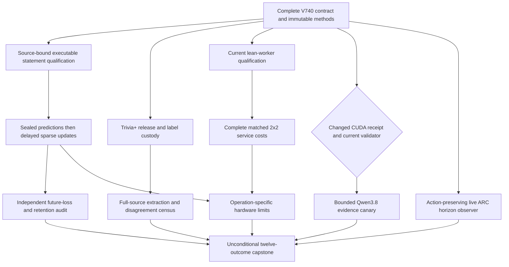
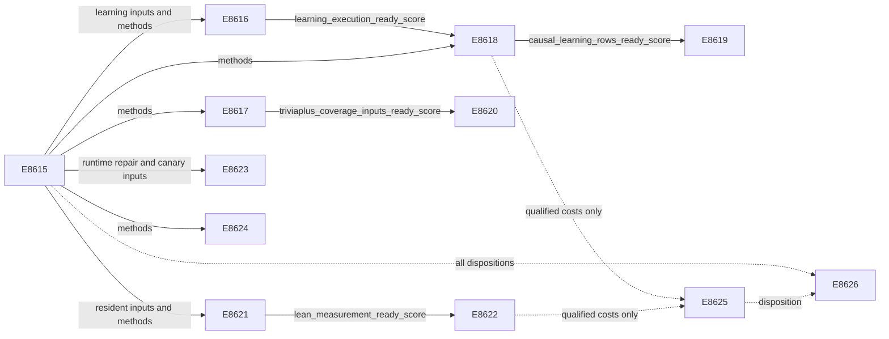

# Carnot Research Roadmap v740: Executable Learning and Complete Evidence

**Created:** 2026-10-17
**Milestone:** 2026.10.740
**Status:** Planned; staged only
**Title:** Executable continuous learning, long-context extraction, and lean service costs
**Supersedes:** V739 scheduling; preserves its findings and failures.
**Task contract:** Exactly 12 tasks, Exp8615 through Exp8626, in conductor order.

## What V739 Proved

V739 finished thirteen scheduling slots. Six producer artifacts exist, including
its capstone. Five other slots have pre-gate receipts. Two were cascade-skipped.
The completed archive ends at V738; V739 artifacts and conductor records are newer.
Scheduling completion does not establish scientific completion.

The document found at vNEXT was V738, although the active YAML declared V739.
Its exact bytes already exist at
`openspec/change-proposals/research-roadmap-v738-preserved-20261017.md`.
V740 does not manufacture a retrospective V739 design or repair its verdicts.

| Evidence | Qualified finding or failure | Consequence |
|---|---|---|
| Exp8602 | `complete_blocked_v739_contract_methods`; missing V739 JSON contract; methods readiness0 | Supply a complete V740 contract and new immutable registration |
| Exp8603 | `complete_disqualified_v739_deadline_edge_qualification`; projected anchor94 marked missing | Correct the diagnosed statement-accounting mechanism before fresh learning |
| Exp8604–Exp8607 | Release, learning, audit and extraction did not reach qualified measurement | These remain unmeasured questions, not scientific nulls |
| Exp8608 | Qualified lean-worker prototype; no speed claim | Reuse the shipped worker instead of rebuilding it |
| Exp8609 | Import repair passes122 distinct tests and552 owned statements; current methods still blocked | Qualify a separate current-method adapter while preserving old pins |
| Exp8610–Exp8612 | Lean cost, Qwen canary and ARC observer pre-gated | Separate current authority from optional CUDA recovery |
| Exp8613–Exp8614 | Hardware/capstone record absent authority and science | Preserve absent device evidence and unmeasured benefits |

### Planning diagnosis of the learning blocker

The raw Exp8603 `coverage_full.json` reports83/83 runner statements executed,
with zero missing or excluded statements. All51 collected nodes pass. The three
real deadline cases report two/three/three clock reads and expected elapsed
values `null`, `3600.25`, `3601.25`. The custom projection demands literal line94.
The installed Coverage.py parser maps that continuation line to statement92.
That statement is executed. This is a measurement mismatch, not evidence of an
unexecuted deadline branch.

The diagnosis comes from the immutable primitives referenced by
`results/experiment_8603_v739_deadline_edge_qualification.json` and a read-only
parser check. It does not retrospectively qualify Exp8603. A new source-bound
adapter must preserve semantic controls: statement coverage alone cannot prove
that the third clock read remains present. No deadline or learner change is planned.

Earlier qualified findings remain closed: V733 source-information null, V735
cold-inference null and V737 ARC efficiency null. V738 native throughput has
CI95[1.0740525,1.1057774]; its separate lifecycle gain does not satisfy NFR-01.

## Three Biggest Gaps Against the PRD

1. **FR-12: useful independently grounded verification.** Existing lexical and
   confidence signals have not shown an oracle-distinct factuality benefit.
   Trivia+ can test complete-source extraction and annotation sensitivity.
   Source faithfulness, factuality, calibrated decisions and coverage stay separate.
2. **FR-06/FR-11: useful continuous self-learning.** Update mechanics exist,
   but fixed delayed-learning benefit and simultaneous retention remain unqualified.
   Repair the measured instrumentation mismatch, then finish the registered study.
3. **FR-05/FR-08/NFR-01: complete deployment performance.** Numerical parity and
   a modest native benefit exist. The lean import path has no complete cost result.
   Compare equal lifecycle and arithmetic work before making acceleration claims.

ARC remains a standing generalization obligation. Its zero resolved outcomes
justify better horizon records, not another unchanged panel or new solve credit.

## Research Selection

The dated V740 scan was added to `research-references.md` before this design.
It covers all eight arXiv topics and the six requested secondary channels.

| Method | Experiment use | Boundary |
|---|---|---|
| [Trivia+, 2605.11330](https://arxiv.org/abs/2605.11330) | Exp8617/Exp8620: authentic human labels, complete source and disagreement strata | Internal source-faithfulness study; no invented judge confidence |
| [RT4CHART, 2603.27752](https://arxiv.org/abs/2603.27752) | Exp8620: claim and evidence coverage accounting | No imported judge or semantic guarantee from overlap |
| [Calibeating, 2603.22167](https://arxiv.org/abs/2603.22167) and [delayed capacity, 2606.11711](https://arxiv.org/abs/2606.11711) | Exp8618/Exp8619: fixed proper-loss controls, pending and lost feedback | No transferred convex regret theorem |
| [Delay reduction, 2602.02634](https://arxiv.org/abs/2602.02634) | Exp8618: descriptive release-lag and pending-state evidence | No post-hoc change to admission or learner |
| [Online KAN, 2602.02056](https://arxiv.org/abs/2602.02056) | Exp8615/Exp8625: sparse update and operation mapping | No new basis or inferred FPGA speed |
| [Ising review, 2610.03972](https://arxiv.org/abs/2610.03972) | Exp8625: sampling versus deterministic evaluation | Different operations require different hardware evidence |

EBT and ARM–EBM inform architecture without proving factual truth. CAffNet
addresses affine feasibility, not language extraction. EBD and the newly checked
GrammarRL remain deferred until useful verification and runtime access qualify.
External-text reranking, unchanged source refits and generator training stay closed.

OpenReview returned a browser challenge. Semantic Scholar citation APIs failed;
no dependable citing inventory was recovered. GitHub Trending returned month-old
snapshots. Extropic's Z1T projections exclude final vocabulary computation.
Kona's inspected page supplied positioning without a reproducible architecture
update. These retrieval limits are recorded rather than replaced with claims.

## V740 Architecture



The existing small energy head, lean workers and live agent remain the substrate.
Current adapters accept explicit immutable references; historical readers retain
their original pins. Shared validators and scientific thresholds remain unchanged.
This is a research plan, not deployed behavior.

## Phase 1: Establish Executable Inputs — Exp8615–Exp8617

**Exp8615: contract and SOTA ingestion.** Bind all twelve full objects, not just
IDs. Freeze inherited V738 scientific operands and new V740 producer mappings.
Register previously unmeasured Trivia+, lean2x2 and observer methods explicitly.
Read changed CUDA evidence without a device command. Branch readiness is separate.
Test staging against historical active YAML and authenticated later activation.

**Exp8616: statement qualification.** Reproduce the raw-versus-projected coverage
mismatch. Bind raw anchor94 and normalized statement92 to the actual source and
Coverage.py version. Preserve all27 original runner nodes, the full affected
Exp8592/8603 union and semantic deadline assertions. Reject removed diagnostic
reads even if line92 executes. Reject missing shards, changed source and an
unexecuted real statement. No exclusion, forced coverage or historical rewrite.

**Exp8617: Trivia+ custody.** Fetch author release files at one revision, with
at most ten30-second requests,300seconds and100MiB. Recompute human aggregation
and preserve raw disagreement. Exclude automatic/noisy targets. Seal128 question
clusters before labels using the original seed7398607; retain all siblings and
full context. Fewer clusters form an explicitly smaller census. Preserve private
internal use under the recorded license. Unknown historical exposure stays unknown.

## Phase 2: Measure Learning and Extraction — Exp8618–Exp8620

**Exp8618: continuous self-learning.** Train only the small nine-input,
109-coefficient spline head. The four arms are frozen, log_loss, brier and
brier_shuffled_released. Seeds17/29/43/71/101, five20-question blocks and three
siblings yield6000 predictions. Start from the original Exp8431 head, scaler
and temperature. Capacity is eight questions per block; learning rate0.01,
L2=0.001, Brier derivative `2*(p-y)*p*(1-p)/T`. Seal predictions and target-blind
admission before label release. Shuffle only released admitted labels. Commit
coefficients, acknowledgments and cursor atomically. Test actual block2 exits
and exact resume for seed17 in every arm. Evaluate50 retention questions at
five windows without training on them. Include final feedback drain and storage.
Release-lag and lost-feedback rows are descriptive; they do not change the study.

**Exp8619: benefit and retention.** Reduce80 later-block question units, averaging
siblings and seeds within each question. Compare Brier updates against log-loss
updates and the frozen head. Use10000 paired question bootstrap draws, seed7278448,
and97.5% two-sided intervals for both contrasts. Both lower bounds must exceed
zero, without increased typed loss. Retention resamples the same50 questions
jointly across all five windows,10000 draws, seed7258421. The upper95% bound on
maximum-window Brier increase must be<=0.01. The shuffled-released arm tests
causal sensitivity. Qualified exposed-data benefit is at most circular_positive;
independent and generalized-learning scores remain zero. A sound null closes this
unchanged study. Missing upstream science is blocked, never a scientific null.

**Exp8620: full-source extraction.** Run shipped extraction in a child receiving
only opaque IDs, source bytes and answer bytes. Preserve128 source windows and
16 answer-unit limits; never truncate to force support. Seal numeric mismatch,
negation mismatch, uncovered fraction and1-overlap before the label join. Report
coverage across source windows1–32/33–128/>128 and answer units<=16/>16. Separate
unsupported, contradicted and disputed annotations. Scores are lexical, not
probabilities. Trivia+ lacks the head's p2 judge-confidence input; no substitute
value or head inference is allowed. Descriptive AUROC uses10000 question-cluster
draws, seed7398607, with at least32 usable clusters and8 per class. Retain all
missing rows. No score selection, fitting or generalization headline follows.

## Phase 3: Measure Serving and Conditional Runtime — Exp8621–Exp8623

**Exp8621: current lean qualification.** Reuse Exp8608's implementation and the
Exp8609 import repair. New qualification accepts an explicit V740 methods
reference. Old replay keeps Exp8602 authority and its zero readiness. Run the
original122 distinct nodes plus current-authority controls. Exercise all four
real workers outside the checkout without PYTHONPATH. Preserve numerical,
request-isolation, timeout, malformed-frame, process-cleanup and provenance tests.
New readiness requires accepted current methods and all owned checks.

**Exp8622: complete lean cost.** Cross legacy/lean import paths with Python/native
arithmetic. All four arms are resident. Use identical64-request panels, lengths
1/4/16, batches1/8 and ten paired repetitions. Include launch, import, setup,
transport, full feature extraction, arithmetic, fallback, typed policy,
serialization and shutdown. Disjoint spans must reconstruct total time. No
result cache or favorable censoring. Primary L16/B1 compares lean_native against
legacy_native. Require lower95% throughput ratio>1, p95 latency ratio<=1.05 and
exact decisions. Use10000 paired-repeat bootstrap draws, seed7368573. Report
lean_python/legacy_python and lean_native/lean_python separately. NFR-01 requires
the native/Python lower bound>=10 within equal lean lifecycle. A lifecycle gain
alone cannot satisfy it. Preserve all intended cells if the3600second cap prevents
completion; do not reduce repetitions after viewing costs.

**Exp8623: bounded Qwen canary.** Only run after both causal CUDA repair evidence
and current-validator canary inputs qualify. Use cached
`MODEL_SPECS=["unsloth/Qwen3.8-27B-GGUF"]`, embedded GGUF tokenizer and real offload
receipts. Sixteen calls cover four exposed fit questions in four fixed evidence
views. Temperature0, max128 output tokens, load cap600seconds, call cap120seconds,
measurement cap2400seconds. Acquire and release the GPU lease. No new model
download, CPU headline fallback or unchanged CUDA probe. This is diagnostic,
not a detector result or Trivia+ evaluation.

## Phase 4: Improve Observability and Reconcile — Exp8624–Exp8626

**Exp8624: live ARC observer.** Implement the previously skipped, opt-in horizon
observer at the reachable `E3AgentPolicy`/`make_carnot_agent` boundary. Preserve
legacy `resolved_by_levelup` and `actions_to_levelup`. A fully observed120-action
horizon can report no_progress_within_horizon; missing observation, reset or
cutoff is censored. Neither proves an arm helped or harmed. Mark overlapping
redirects without attributing shared progress. Qualify observer-off/on action,
RNG, termination and original-field parity through actual wrapper execution on
three generic scripted mechanics classes. This hardens a reusable primitive for
cross-game generalization. No unchanged four-game panel, policy refinement or
new solver is planned. Scripted fixtures use development_proxy provenance;
incidental future credited solves require live_agent_self_discovery and replay.
Check the registry before any solve claim. Existing zero resolved outcomes stay zero.

**Exp8625: hardware operation boundary.** Read current qualified costs separately
for learning and inference. If current costs are blocked, identify the historical
Exp8596 boundary without presenting it as a new result. Distinguish process
lifecycle, features, sparse arithmetic, normalization, transport and durable
feedback. Compute conditional zero-cost ceilings only from disjoint clocks.
Keep KV260 quadratic-Ising k<=5, PolarFire Linux-versus-fabric and GateMate's
physical prerequisites explicit. No device probe, flash or acquisition is planned.

**Exp8626: capstone.** Run regardless of science gates. Account for all twelve
slots from actual producer and conductor receipts. Independently recompute small
samples from primitive rows. Preserve historical nulls, blocks and quarantines.
Separate administrative completion, exposed learning, source faithfulness,
service performance and physical readiness. Use unchanged publication gates
G1–G4; an older FoVer paper_ready does not authorize current claims or publication.
Retire exact unchanged failures and state concrete evidence required to reopen.

## Dependency Graph and Gate Contract



All solid edges are structured `gated_on` entries. Their exact fields appear in
the upstream REQUIRED ARTIFACT FIELDS. They are top-level numeric0/1 values.
Hardware and capstone tasks have no gates. Missing differs from zero, and each
blocked artifact must record the check, path/hash, field, expected and observed.
No `requires` chain names a retired task. Historical inputs are evidence, not
new scheduled dependencies. Full-object JSON below is part of this contract.

## Hardware Requirements and Acceleration Path

| Resource | Required work | Claim boundary |
|---|---|---|
| CPU and disk-backed scratch | Coverage qualification, small-head learning, extraction, service and observer tests | Record actual RSS, disk and tool availability; do not assume old inventory is current |
| Existing Rust/PyO3 build | Real native parity and service timings | Hash the loaded extension; import success alone is insufficient |
| Two RTX3090 GPUs,48GB combined inventory | Optional cached Qwen3.8 canary after changed causal CUDA evidence | Inventory does not prove current runtime readiness; no GPU dependency for other branches |
| KV260 | Read existing supported operation evidence | Quadratic Ising,k<=5; deterministic spline/update deployment remains unqualified |
| PolarFire | Retain existing board record | Linux CPU dispatch is distinct from fabric acceleration |
| GateMate | Preserve changed-physical-state prerequisite | Cable/port/power change, ID0x20000001, source/build hashes, n16 flash and sample smoke precede any reopening |
| XDNA/Extropic TSU/photonic devices | Future operation-specific candidates | No local qualified execution or transferred paper speedup |

Tier1/2 learning uses local coefficient writes and small durable state. Count the
actual active writes. A Rust port and batched sparse hardware are plausible paths;
the study must quantify the eligible cost fraction. The program's100x learning
aspiration is a hypothesis, not a gate to invent a device result. If fixed host
work prevents100x, report that ceiling and the operation that must change first.
No purchase is justified from an unsupported mapping. The hardware wishlist's
historical availability claims remain subordinate to authenticated current evidence.

## Execution, Routing and Acceptance

Every task includes numbered instructions for flushed phase boundaries, before
and after multi-minute calls, and inside long loops. Child status arrives at
least every60seconds; every gap stays below600seconds. Files over about200lines
are written in chunks of at most150lines with progress between calls. Measurement
ends by3600seconds, leaving900seconds for validation within the4800second cap.
Task wall estimates are planning estimates, not overrides of that cap.

Exp8615/Exp8616/Exp8621 use Opus100 for authority and qualification work. Exp8624
uses Codex `gpt-6.1-sol` for bounded observer code. Routine science uses Sonnet50;
audit/capstone use20, hardware evidence reading30. No Luna tasks are scheduled.
These are execution routes; no research task runs during this planning change.

All tasks declare `per_unit_rows: true`. Preserve question, sibling, seed, arm,
window, request or fixture identities as applicable. Do not treat siblings or
repetitions as independent deployment evidence. Report intended, completed,
failed, censored and excluded counts with reasons. Emit primitive hashes, actual
clocks, source identity, validation receipts and principle annotations.

The closed verdict enum is positive | circular_positive | null | blocked |
disqualified | partial. Oracle-dependent benefit is circular_positive. A failed
owned acceptance check forbids positive. An unchanged external block is blocked;
partial is reserved for incomplete owned work that a retry can finish. Gate
qualification never substitutes for scientific benefit.

The Qwen task declares model_bounded_generation, with a10second floor. An actual
load-only attempt reports model_load_no_generation, with a2second floor. A
zero-load block reports no_model_load. The60second model_full_generation class
is reserved for genuine generative workloads, not this canary. Never pad time.
Other tasks use MODEL_SPECS=[] and no_model_load, with truthful provenance for
small numerical heads and historical generators. Legacy small LLMs may serve
only CPU smoke tests, never headline evidence.

Each phase has a runnable prototype or existing substrate, explicit empirical
criteria and adversarial controls before scaling. Spec first, tests first and
100% newly owned executable-statement coverage apply. Run scoped lint, typing,
spec tracing and applicable private E2E-018/021 checks. Preserve test assertions,
real child coverage and immutable historical authority. Avoid full-repository
suites and nested validation controllers inside experiments. Cold replay and
rehashed-tamper rejection must precede atomic publication.

No active-roadmap change, conductor change, external publication or push belongs
to this plan. Historical vNEXT copies, results and the exclusion manifest remain
intact. Repeated scopes carry four-field prior_failures records with mechanical
retirement enabled. V740 does not reuse retired IDs or fabricate an override.

## Exact task contract

The table, complete task objects, canonical digest and staged YAML must agree.
The digest is SHA256 of the UTF-8 JSON task list with sorted keys, separators
`,` and `:`, and ensure_ascii=true. It includes prompts, routes and failure lineage.

| Order | ID | Title | Phase | Deliverable |
|---|---|---|---|---|
| 1 | exp8615-contract-methods | Bind twelve tasks and seal independent learning evidence and service methods | 1 | results/experiment_8615_v740_contract_methods.json |
| 2 | exp8616-deadline-statement-qualification | Qualify executable deadline statements with source-bound coverage and semantic controls | 1 | results/experiment_8616_v740_deadline_statement_qualification.json |
| 3 | exp8617-triviaplus-release | Authenticate Trivia+ human labels and private complete-source custody | 1 | results/experiment_8617_v740_triviaplus_release.json |
| 4 | exp8618-causal-brier-stream | Measure continuous Brier learning after qualified executable accounting | 2 | results/experiment_8618_v740_causal_brier_stream.json |
| 5 | exp8619-learning-benefit-audit | Test later proper-loss benefit and simultaneous retention from causal histories | 2 | results/experiment_8619_v740_learning_benefit_audit.json |
| 6 | exp8620-triviaplus-extraction | Measure complete-source extraction and annotation sensitivity on Trivia+ | 2 | results/experiment_8620_v740_triviaplus_extraction.json |
| 7 | exp8621-lean-resident-qualification | Qualify lean workers under explicit current methods and preserved historical pins | 3 | results/experiment_8621_v740_lean_resident_qualification.json |
| 8 | exp8622-lean-resident-cost | Measure complete lean resident costs with matched arithmetic controls | 3 | results/experiment_8622_v740_lean_resident_cost.json |
| 9 | exp8623-qwen-evidence-canary | Run bounded mandated-Qwen evidence views only after changed CUDA evidence | 3 | results/experiment_8623_v740_qwen_evidence_canary.json |
| 10 | exp8624-arc-outcome-observer | Harden live ARC horizon and censoring records without changing actions | 4 | results/experiment_8624_v740_arc_outcome_observer.json |
| 11 | exp8625-hardware-operation-boundary | Map complete learning and lean-service operations to actual hardware support | 4 | results/experiment_8625_v740_hardware_operation_boundary.json |
| 12 | exp8626-capstone | Reconcile twelve outcomes and close exact unchanged studies | 4 | results/experiment_8626_v740_capstone.json |

canonical_tasks_sha256: `38c2808bdfa97a61b2312d5482f0a30b20f0ab45ac0f23fab67186b1bb5b30c3`

<!-- V740_TASK_CONTRACT_START -->
```json
{
  "milestone": "2026.10.740",
  "tasks": [
    {
      "id": "exp8615-contract-methods",
      "title": "Bind twelve tasks and seal independent learning evidence and service methods",
      "phase": 1,
      "track": "infrastructure",
      "priority": "high",
      "requires_gpu": false,
      "max_turns": 100,
      "estimated_wall_time_min": 40,
      "per_unit_rows": true,
      "milestone": "2026.10.740",
      "deliverable": "results/experiment_8615_v740_contract_methods.json",
      "inference_substrate_class": "no_model_load",
      "MODEL_SPECS": [],
      "gated_on": [],
      "prior_failures": [
        {
          "experiment_id": "exp8602-contract-methods",
          "verdict": "complete_blocked_v739_contract_methods",
          "addressed_by": "V739 pointed to V738 and failed its full-object contract. V740 supplies a new complete twelve-task document, independently compared table, JSON, digest and staged authority. Historical V739 remains blocked.",
          "retire_if_same_verdict": true
        }
      ],
      "agent_type": "claude",
      "model": "opus",
      "prompt": "CONTEXT:\nWork in {project_root} on {date}. V739 ended thirteen scheduling slots with six producer artifacts. The live YAML pointed to a V738 design, so methods authority failed. Exp8608 qualified a lean prototype. Repaired Exp8609 passed its owned checks but remained blocked on methods. Exp8603 passed all 51 collected tests and all three deadline cases, yet its custom coverage projection demanded continuation line94. The raw Coverage.py report covered all83 executable runner statements; first_line(94)=92. Preserve the old disqualification. V740 changes measurement accounting, not deadline behavior or the learner. V733 source, V735 cold-cost and V737 ARC nulls remain closed. V738 native throughput CI95[1.0740525,1.1057774] does not meet NFR01. V740 has exactly twelve tasks, Exp8615 through Exp8626.\nEXISTING CODE TO READ FIRST:\nCLAUDE.md; CODEX.md; ops/e2e-test-plan.md; ops/exclusion_manifest.yaml; openspec/capabilities/research-reporting/spec.md; openspec/capabilities/verification/spec.md; scripts/experiment_template.py; python/carnot/reporting/primary_publication.py; openspec/change-proposals/research-roadmap-vNEXT.md; research-references.md; python/carnot/reporting/v738_contract_methods.py; python/carnot/reporting/v738_contract_inputs.py; python/carnot/reporting/roadmap_contract.py; openspec/change-proposals/v738-methods-protocol.json; openspec/change-proposals/research-roadmap-v738-preserved-20261017.md; results/experiment_8591_v738_contract_methods.json; results/experiment_8601_v738_capstone.json; python/carnot/verify/cuda_reader_8410.py; python/carnot/reporting/v739_contract_methods.py; results/experiment_8602_v739_contract_methods.json; results/experiment_8614_v739_capstone.json\nTASK:\nBind twelve tasks and seal independent learning evidence and service methods. Deliver results/experiment_8615_v740_contract_methods.json. Create thin runner scripts/experiments/experiment_8615_v740_contract_methods.py. Store primitives under results/raw/experiment_8615_v740_contract_methods/ and notes in docs/research-notes/v740-contract-methods.md. Same-roadmap outputs are future dependencies.\nCONCRETE STEPS:\n1. PRECONDITIONS: Print a flushed start line. Authenticate actual input paths, original authority, hashes, tools, memory and writable disk-backed scratch. Record missing required inputs in gate_check_summary. Optional GPU and board absence cannot block independent CPU branches.\n2. Print a flushed progress line at every phase boundary. Print before and after every model load, generation, benchmark, or subprocess that can take minutes. Use unbuffered output. Inside long loops, print completed and pending counts. Supervise children with status lines at least every 60 seconds. Keep every silence gap below 600 seconds. Write any file over about 200 lines in several tool calls of at most 150 lines. Send a progress message between those calls. Poll long work in calls of at most 60 seconds. Stop measurement by 3600 seconds. Reserve 900 seconds for validation within the 4800-second hard cap. Never pad duration.\n3. Spec first: confirm the relevant capability spec contains REQ-* and SCENARIO-* before implementation. Add focused failing tests first. Preserve original scientific assertions and historical evidence. Accept --date {date}. Put runners in scripts/experiments/, tests in tests/python/, and scratch in /var/tmp. Do not modify research-roadmap.yaml, shared validators, generator weights or external services.\n4. Declare inference_substrate_class=no_model_load and MODEL_SPECS=[]. Record zero current language-model calls. Imported generator names belong in historical_model_provenance. Identify any actual small energy head and checkpoint in target_model; no_model_load does not mean absence of numerical inference.\n5. Bind exactly twelve complete task dictionaries, Exp8615 through Exp8626. Compare staged or authentically activated V740 YAML, the visible table, embedded full JSON, canonical_tasks_sha256 and end marker. Reject count, order, ID, title, phase, deliverable, model, substrate, gate, prompt, retirement and marker mutations. V739 remains historical; never manufacture its missing design or require future artifacts.\n6. Create openspec/change-proposals/v740-methods-protocol.json before measurement. Inherit objective_updates, objective_audit, evidence_canary and resident_session from authenticated V738 by value and hash. Register V740 producer mappings separately. Preserve original readers and pins. Authenticate only dependencies used by each branch; mutable roadmap or references files cannot substitute for sealed historical bytes.\n7. Ingest the dated V740 scan using low-concurrency primary-source retrieval. Read Trivia+2605.11330, RT4CHART2603.27752, Calibeating2603.22167, delayed feedback2602.02634/2606.11711 and online KAN2602.02056. Record methods, assumptions, hashes and use/defer decisions. Mark ingested leads in research-studying.md. Do not infer correctness from compatibility, lexical overlap or source faithfulness.\n8. Authenticate original Exp8580 validator, Exp8581 accounting, Exp8431 head and Exp8554 test union. Separately authenticate Exp8593 provenance, Exp8596 cost, Exp8608 prototype and repaired Exp8609 owned evidence. Keep blocked historical readiness zero. Emit learning_inputs_ready_score and resident_inputs_ready_score separately. No current validation can erase an old failure.\n9. Register the still-unmeasured Trivia+ protocol from V739 as new V740 methods. Select first128 normalized official-test question clusters by SHA256(seed7398607 || question_hash) before labels, preserving all siblings. Keep full sources, original labels and private internal use. No released p2 judge confidence means no nine-input head inference. Register four fixed lexical scores and descriptive disagreement strata without fitting.\n10. Register lean_worker_2x2 explicitly: legacy/lean imports crossed with Python/native arithmetic, original64 requests, session lengths1/4/16, batches1/8 and ten paired repetitions. Preserve the V739 intended operands by value, without treating its invalid authority as qualification. Primary is L16/B1 lean_native versus legacy_native; separately test native versus Python. Register observer horizon120 without changing ARC policy.\n11. Read the existing CUDA evidence reader once without a device command. A supplied causal library/environment repair and qualified current validator custody are required for runtime_repair_ready_score=1. Declare canary_inputs_ready_score separately. Missing or unchanged evidence keeps the optional model gate closed; CPU work proceeds.\n12. Seal snapshots and branch references. Exercise staged-V740/active-V739 selection and later activated-V740 selection in private fixtures. Test that missing optional runtime evidence leaves learning, extraction and service methods usable. Publish methods_ready_score only after full-object equality and independent mutation controls pass.\n13. Run scoped unit tests, private CLI checks, Ruff check/format, strict mypy and scripts/check_spec_coverage.py --files <owned-test-files>. Run applicable ops/e2e-test-plan.md checks, including private E2E-018/021 for authority/publication readers. Require100percent newly owned statement coverage, including actual children and rejection paths. Collect original node IDs before bounded disjoint test children; retain the exact union and original authority. Use -n 0 -o addopts= --no-cov. Never run the whole repository suite or nested historical validation controllers. A killed child fails validation. Keep commands, exits, durations and log hashes.\n14. Cold-replay immutable primitives in a fresh bounded process. Test missing inputs, owned failures and self-consistently rehashed tampering. Run primary_publication, scripts/adversarial_verify.py --json <private-candidate> and scripts/verdict_row_consistency_lint.py --strict <private-candidate>. Preserve actual findings and downstream acceptance. Validate final bytes before atomic publication. Required owned-check failure is disqualified. Unchanged external blockage is blocked, never partial. Reconcile openspec/, _bmad/traceability.md, ops/status.md and ops/changelog.md without rewriting history.\nREQUIRED ARTIFACT FIELDS:\nexperiment_id, task_id, milestone, run_date: principle: Bind evidence to this invocation.\nhonest_verdict, verdict_class: principle: Terminal verdicts start complete_. verdict_class is exactly positive | circular_positive | null | blocked | disqualified | partial. Partial means incomplete owned work that another attempt can finish; external unchanged failures mean blocked.\ngate_check_summary: principle: Every blocked_* or complete_blocked_* outcome names failed check, upstream, path/hash, field, operator, expected and observed. Missing differs from zero.\ninference_substrate, inference_substrate_class, MODEL_SPECS, model_invocation_counts, historical_model_provenance, target_model: principle: Separate actual execution from imported generator names and authenticate numerical checkpoints.\nrows, intended_count, completed_count, failed_count, censored_count, excluded_count, independent_count, sample_size_budget: principle: Retain each unit and arm, its metric or missing reason. Seeds, sibling answers and timing repetitions are not independent questions.\nverifier_is_oracle, exposure_scope, independent_generalization_score, generalized_learning_benefit_score: principle: Oracle-dependent positives use circular_positive. Exposed learning, eligibility, fixtures and service timings keep both generalization scores zero.\nrequired_checks_passed, flagged_adversarial, acceptance_gates, validation_receipts, terminal_validation_sidecar_path, adversarial_findings: principle: Qualification differs from benefit. Failed acceptance gates forbid positive classes.\npreconditions_checked, duration_s, phase_spans, random_seed, reproducibility_checksum, source_artifact_hashes, code_config_hashes, raw_shard_hashes: principle: Preserve actual clocks and immutable operands.\ncited_upstream_artifacts, field_principles: principle: Name original producers and explain every added metric and gate.\nmethods_ready_score, current_contract_ready_score, learning_inputs_ready_score, resident_inputs_ready_score, canary_inputs_ready_score, runtime_repair_ready_score, inherited_operand_checks, literature_method_rows, gate_field_map, canonical_tasks_sha256: principle: Each branch has explicit authority and readiness; method registration cannot establish benefit.\nmethods_protocol_reference, learning_protocol_reference, lean_worker_2x2, preserved_v739_failure, authority_mutation_rows: principle: Bind current authority and measured operands without rewriting historical qualification.\nbranch_gate_values: principle: Readiness fields named above are top-level numeric0/1 values. Explain each in field_principles; missing differs from zero.\nRun command: cd {project_root} && JAX_PLATFORMS=cpu PYTHONPATH=python:. PYTHONUNBUFFERED=1 .venv/bin/python -u scripts/experiments/experiment_8615_v740_contract_methods.py --date {date}\nDo NOT push. Do NOT modify scripts/research_conductor.py.\n"
    },
    {
      "id": "exp8616-deadline-statement-qualification",
      "title": "Qualify executable deadline statements with source-bound coverage and semantic controls",
      "phase": 1,
      "track": "infrastructure",
      "priority": "high",
      "requires_gpu": false,
      "max_turns": 100,
      "estimated_wall_time_min": 45,
      "per_unit_rows": true,
      "milestone": "2026.10.740",
      "deliverable": "results/experiment_8616_v740_deadline_statement_qualification.json",
      "inference_substrate_class": "no_model_load",
      "MODEL_SPECS": [],
      "gated_on": [
        {
          "upstream": "exp8615-contract-methods",
          "artifact_field": "learning_inputs_ready_score",
          "op": "==",
          "value": 1
        },
        {
          "upstream": "exp8615-contract-methods",
          "artifact_field": "methods_ready_score",
          "op": "==",
          "value": 1
        }
      ],
      "prior_failures": [
        {
          "experiment_id": "exp8603-deadline-edge-qualification",
          "verdict": "complete_disqualified_v739_deadline_edge_qualification",
          "addressed_by": "All51 tests and83 executable statements passed. The custom reader compared continuation line94 to executable-line coverage, which normalizes it to92. A source-bound mapping plus semantic negative controls changes that measurement mechanism.",
          "retire_if_same_verdict": true
        }
      ],
      "agent_type": "claude",
      "model": "opus",
      "prompt": "CONTEXT:\nWork in {project_root} on {date}. V739 ended thirteen scheduling slots with six producer artifacts. The live YAML pointed to a V738 design, so methods authority failed. Exp8608 qualified a lean prototype. Repaired Exp8609 passed its owned checks but remained blocked on methods. Exp8603 passed all 51 collected tests and all three deadline cases, yet its custom coverage projection demanded continuation line94. The raw Coverage.py report covered all83 executable runner statements; first_line(94)=92. Preserve the old disqualification. V740 changes measurement accounting, not deadline behavior or the learner. V733 source, V735 cold-cost and V737 ARC nulls remain closed. V738 native throughput CI95[1.0740525,1.1057774] does not meet NFR01. V740 has exactly twelve tasks, Exp8615 through Exp8626.\nEXISTING CODE TO READ FIRST:\nCLAUDE.md; CODEX.md; ops/e2e-test-plan.md; ops/exclusion_manifest.yaml; openspec/capabilities/research-reporting/spec.md; openspec/capabilities/verification/spec.md; scripts/experiment_template.py; python/carnot/reporting/primary_publication.py; openspec/change-proposals/research-roadmap-vNEXT.md; research-references.md; python/carnot/reporting/causal_brier_runner_8582.py; python/carnot/reporting/learning_clock_8592.py; results/experiment_8592_v738_learning_clock_qualification.json; results/experiment_8601_v738_capstone.json; tests/python/test_causal_brier_stream_8582.py; python/carnot/reporting/deadline_edge_validation_8603.py; python/carnot/reporting/deadline_edge_8603.py; tests/python/test_deadline_edge_8603.py; results/experiment_8603_v739_deadline_edge_qualification.json\nTASK:\nQualify executable deadline statements with source-bound coverage and semantic controls. Deliver results/experiment_8616_v740_deadline_statement_qualification.json. Create thin runner scripts/experiments/experiment_8616_v740_deadline_statement_qualification.py. Store primitives under results/raw/experiment_8616_v740_deadline_statement_qualification/ and notes in docs/research-notes/v740-deadline-statement-qualification.md. Same-roadmap outputs are future dependencies.\nCONCRETE STEPS:\n1. PRECONDITIONS: Print a flushed start line. Authenticate actual input paths, original authority, hashes, tools, memory and writable disk-backed scratch. Record missing required inputs in gate_check_summary. Optional GPU and board absence cannot block independent CPU branches.\n2. Print a flushed progress line at every phase boundary. Print before and after every model load, generation, benchmark, or subprocess that can take minutes. Use unbuffered output. Inside long loops, print completed and pending counts. Supervise children with status lines at least every 60 seconds. Keep every silence gap below 600 seconds. Write any file over about 200 lines in several tool calls of at most 150 lines. Send a progress message between those calls. Poll long work in calls of at most 60 seconds. Stop measurement by 3600 seconds. Reserve 900 seconds for validation within the 4800-second hard cap. Never pad duration.\n3. Spec first: confirm the relevant capability spec contains REQ-* and SCENARIO-* before implementation. Add focused failing tests first. Preserve original scientific assertions and historical evidence. Accept --date {date}. Put runners in scripts/experiments/, tests in tests/python/, and scratch in /var/tmp. Do not modify research-roadmap.yaml, shared validators, generator weights or external services.\n4. Declare inference_substrate_class=no_model_load and MODEL_SPECS=[]. Record zero current language-model calls. Imported generator names belong in historical_model_provenance. Identify any actual small energy head and checkpoint in target_model; no_model_load does not mean absence of numerical inference.\n5. Reproduce the exact measurement defect from Exp8603 immutable coverage_full.json, coverage_owned.json and deadline cases. Raw runner coverage has83/83 statements and no exclusions. Its projected anchors call continuation line94 missing although Coverage.py first_line(94)=92. All three deadline controls passed. Record installed Coverage.py version, source hash, executable statements and bytecode line table before any change.\n6. Create a narrow V740 qualification adapter. Map an anchor to its actual executable statement using the installed Coverage.py parser and bind the mapping to source bytes. Keep raw anchor94, normalized92 and executed membership as separate evidence. Do not subtract the anchor, exclude it, force an executed flag, change the deadline threshold, or weaken a shared validator. Preserve original deadlines and learner code.\n7. Write failing regression controls first. Execute the real runner for3599,3600,3601 seconds through its isolated fake clock. Preserve two/three/three clock reads and observed elapsed None/3600.25/3601.25. Add omitted-expired-case and changed-diagnostic mutants. The new mapper must reject an unexecuted real statement, altered source, missing shard or failed original assertion. Semantic assertions must reject removing the third clock read even if statement92 still executes.\n8. Qualify source-bound statement mapping before expensive historical tests. Collect the original27-node runner union plus the complete Exp8592/8603 affected union and new tests. Use bounded disjoint children with immutable original authority and the existing mechanics fixture. Preserve every original assertion. Do not invoke nested historical validation controllers or rerun training in each test.\n9. Require100percent newly owned executable statements and the exact original node union. Combine actual child shards. Keep all literal anchors and their normalized execution records. Require real expired-path diagnostics, cleanup, independent kernel clocks, cold replay and tamper rejection. Emit learning_execution_ready_score=1 only after all checks pass. Old Exp8582/8592/8603 artifacts stay disqualified.\n10. If raw execution or the source-bound mapping contradicts this diagnosis, stop the study with precise evidence. Do not propose another unchanged line94 retry. This is instrumentation qualification, never a learning benefit.\n11. Run scoped unit tests, private CLI checks, Ruff check/format, strict mypy and scripts/check_spec_coverage.py --files <owned-test-files>. Run applicable ops/e2e-test-plan.md checks, including private E2E-018/021 for authority/publication readers. Require100percent newly owned statement coverage, including actual children and rejection paths. Collect original node IDs before bounded disjoint test children; retain the exact union and original authority. Use -n 0 -o addopts= --no-cov. Never run the whole repository suite or nested historical validation controllers. A killed child fails validation. Keep commands, exits, durations and log hashes.\n12. Cold-replay immutable primitives in a fresh bounded process. Test missing inputs, owned failures and self-consistently rehashed tampering. Run primary_publication, scripts/adversarial_verify.py --json <private-candidate> and scripts/verdict_row_consistency_lint.py --strict <private-candidate>. Preserve actual findings and downstream acceptance. Validate final bytes before atomic publication. Required owned-check failure is disqualified. Unchanged external blockage is blocked, never partial. Reconcile openspec/, _bmad/traceability.md, ops/status.md and ops/changelog.md without rewriting history.\nREQUIRED ARTIFACT FIELDS:\nexperiment_id, task_id, milestone, run_date: principle: Bind evidence to this invocation.\nhonest_verdict, verdict_class: principle: Terminal verdicts start complete_. verdict_class is exactly positive | circular_positive | null | blocked | disqualified | partial. Partial means incomplete owned work that another attempt can finish; external unchanged failures mean blocked.\ngate_check_summary: principle: Every blocked_* or complete_blocked_* outcome names failed check, upstream, path/hash, field, operator, expected and observed. Missing differs from zero.\ninference_substrate, inference_substrate_class, MODEL_SPECS, model_invocation_counts, historical_model_provenance, target_model: principle: Separate actual execution from imported generator names and authenticate numerical checkpoints.\nrows, intended_count, completed_count, failed_count, censored_count, excluded_count, independent_count, sample_size_budget: principle: Retain each unit and arm, its metric or missing reason. Seeds, sibling answers and timing repetitions are not independent questions.\nverifier_is_oracle, exposure_scope, independent_generalization_score, generalized_learning_benefit_score: principle: Oracle-dependent positives use circular_positive. Exposed learning, eligibility, fixtures and service timings keep both generalization scores zero.\nrequired_checks_passed, flagged_adversarial, acceptance_gates, validation_receipts, terminal_validation_sidecar_path, adversarial_findings: principle: Qualification differs from benefit. Failed acceptance gates forbid positive classes.\npreconditions_checked, duration_s, phase_spans, random_seed, reproducibility_checksum, source_artifact_hashes, code_config_hashes, raw_shard_hashes: principle: Preserve actual clocks and immutable operands.\ncited_upstream_artifacts, field_principles: principle: Name original producers and explain every added metric and gate.\nlearning_execution_ready_score, deadline_case_rows, original_node_ids, executed_node_ids, exact_union_receipt, measured_statement_anchors, kernel_clock_independence, current_revision_reference: principle: Real original assertions and executed deadline statements qualify execution, not learning.\nraw_statement_anchor_rows, normalized_statement_rows, coverage_version, source_bytecode_hashes, raw_coverage_reference, semantic_mutation_rows: principle: Bind current authority and measured operands without rewriting historical qualification.\nbranch_gate_values: principle: Readiness fields named above are top-level numeric0/1 values. Explain each in field_principles; missing differs from zero.\nRun command: cd {project_root} && JAX_PLATFORMS=cpu PYTHONPATH=python:. PYTHONUNBUFFERED=1 .venv/bin/python -u scripts/experiments/experiment_8616_v740_deadline_statement_qualification.py --date {date}\nDo NOT push. Do NOT modify scripts/research_conductor.py.\n"
    },
    {
      "id": "exp8617-triviaplus-release",
      "title": "Authenticate Trivia+ human labels and private complete-source custody",
      "phase": 1,
      "track": "research",
      "priority": "high",
      "requires_gpu": false,
      "max_turns": 50,
      "estimated_wall_time_min": 40,
      "per_unit_rows": true,
      "milestone": "2026.10.740",
      "deliverable": "results/experiment_8617_v740_triviaplus_release.json",
      "inference_substrate_class": "no_model_load",
      "MODEL_SPECS": [],
      "gated_on": [
        {
          "upstream": "exp8615-contract-methods",
          "artifact_field": "methods_ready_score",
          "op": "==",
          "value": 1
        }
      ],
      "prior_failures": [
        {
          "experiment_id": "exp8604-triviaplus-release",
          "verdict": "blocked_gate_check_failed",
          "addressed_by": "Exp8604 was pre-gated by absent V739 design authority. New complete V740 registration supplies the missing prerequisite. No Trivia+ release or label result existed to repeat.",
          "retire_if_same_verdict": true
        }
      ],
      "agent_type": "claude",
      "model": "sonnet",
      "prompt": "CONTEXT:\nWork in {project_root} on {date}. V739 ended thirteen scheduling slots with six producer artifacts. The live YAML pointed to a V738 design, so methods authority failed. Exp8608 qualified a lean prototype. Repaired Exp8609 passed its owned checks but remained blocked on methods. Exp8603 passed all 51 collected tests and all three deadline cases, yet its custom coverage projection demanded continuation line94. The raw Coverage.py report covered all83 executable runner statements; first_line(94)=92. Preserve the old disqualification. V740 changes measurement accounting, not deadline behavior or the learner. V733 source, V735 cold-cost and V737 ARC nulls remain closed. V738 native throughput CI95[1.0740525,1.1057774] does not meet NFR01. V740 has exactly twelve tasks, Exp8615 through Exp8626.\nEXISTING CODE TO READ FIRST:\nCLAUDE.md; CODEX.md; ops/e2e-test-plan.md; ops/exclusion_manifest.yaml; openspec/capabilities/research-reporting/spec.md; openspec/capabilities/verification/spec.md; scripts/experiment_template.py; python/carnot/reporting/primary_publication.py; openspec/change-proposals/research-roadmap-vNEXT.md; research-references.md; python/carnot/reporting/human_label_custody_8389.py; python/carnot/reporting/released_question_identity_8403.py; python/carnot/verify/source_projection.py; results/experiment_8597_v738_medexpert_evidence_audit.json\nTASK:\nAuthenticate Trivia+ human labels and private complete-source custody. Deliver results/experiment_8617_v740_triviaplus_release.json. Create thin runner scripts/experiments/experiment_8617_v740_triviaplus_release.py. Store primitives under results/raw/experiment_8617_v740_triviaplus_release/ and notes in docs/research-notes/v740-triviaplus-release.md. Same-roadmap outputs are future dependencies.\nCONCRETE STEPS:\n1. PRECONDITIONS: Print a flushed start line. Authenticate actual input paths, original authority, hashes, tools, memory and writable disk-backed scratch. Record missing required inputs in gate_check_summary. Optional GPU and board absence cannot block independent CPU branches.\n2. Print a flushed progress line at every phase boundary. Print before and after every model load, generation, benchmark, or subprocess that can take minutes. Use unbuffered output. Inside long loops, print completed and pending counts. Supervise children with status lines at least every 60 seconds. Keep every silence gap below 600 seconds. Write any file over about 200 lines in several tool calls of at most 150 lines. Send a progress message between those calls. Poll long work in calls of at most 60 seconds. Stop measurement by 3600 seconds. Reserve 900 seconds for validation within the 4800-second hard cap. Never pad duration.\n3. Spec first: confirm the relevant capability spec contains REQ-* and SCENARIO-* before implementation. Add focused failing tests first. Preserve original scientific assertions and historical evidence. Accept --date {date}. Put runners in scripts/experiments/, tests in tests/python/, and scratch in /var/tmp. Do not modify research-roadmap.yaml, shared validators, generator weights or external services.\n4. Declare inference_substrate_class=no_model_load and MODEL_SPECS=[]. Record zero current language-model calls. Imported generator names belong in historical_model_provenance. Identify any actual small energy head and checkpoint in target_model; no_model_load does not mean absence of numerical inference.\n5. Acquire the author Trivia+ README, DATA_DETAILS.md, LICENSE, consistency checker and triviaplus_dataset.parquet at one immutable Git revision. Use bounded downloads with hashes. Paper2605.11330 and author URL https://github.com/amazon-science/hallucination-benchmark-trivialplus define the lead. No MedExpert request or fallback is needed. Bound retrieval to ten requests of30seconds,300seconds total and100MiB. Pin source revision. A missing advertised checker requires a locally tested implementation of the documented rule, not a missing-file crash.\n6. Keep source and transformed text in an untracked private local cache outside results/. Record private paths and content hashes. The observed license is CC BY-NC-ND4.0; limit this work to internal evaluation. Do not redistribute text or infer product-training permission. Record explicit internal-use and redistribution decisions; unresolved use scope blocks dependent evaluation.\n7. Reconstruct sentence majority votes from raw annotations. Retain the documented strict tie order and derive the response label by any contradicted or not-mentioned sentence. Separate unsupported, contradicted, supplementary and supported labels. Preserve disagreement counts and missing annotations. Automatic/noisy labels are excluded from target authority.\n8. Build normalized question/source hashes and sibling groups across official train/valid/test. Check actual historical corpus manifests for prior exposure. Unknown historical overlap stays unknown. Do not expose test labels or annotator/model/split columns to the predictor. A random split cannot cure shared questions or an already viewed release.\n9. Emit triviaplus_coverage_inputs_ready_score=1 only for authenticated release, valid human aggregation and usable private source/answer/target custody. Independent disjointness is a separate score and does not block a clearly exposed coverage study. Seal the label-blind128-question roster registered by Exp8615 and all sibling IDs; fewer clusters remain a census with actual counts. Emit release/source-length/support rows, not a detector benefit claim.\n10. Run scoped unit tests, private CLI checks, Ruff check/format, strict mypy and scripts/check_spec_coverage.py --files <owned-test-files>. Run applicable ops/e2e-test-plan.md checks, including private E2E-018/021 for authority/publication readers. Require100percent newly owned statement coverage, including actual children and rejection paths. Collect original node IDs before bounded disjoint test children; retain the exact union and original authority. Use -n 0 -o addopts= --no-cov. Never run the whole repository suite or nested historical validation controllers. A killed child fails validation. Keep commands, exits, durations and log hashes.\n11. Cold-replay immutable primitives in a fresh bounded process. Test missing inputs, owned failures and self-consistently rehashed tampering. Run primary_publication, scripts/adversarial_verify.py --json <private-candidate> and scripts/verdict_row_consistency_lint.py --strict <private-candidate>. Preserve actual findings and downstream acceptance. Validate final bytes before atomic publication. Required owned-check failure is disqualified. Unchanged external blockage is blocked, never partial. Reconcile openspec/, _bmad/traceability.md, ops/status.md and ops/changelog.md without rewriting history.\nREQUIRED ARTIFACT FIELDS:\nexperiment_id, task_id, milestone, run_date: principle: Bind evidence to this invocation.\nhonest_verdict, verdict_class: principle: Terminal verdicts start complete_. verdict_class is exactly positive | circular_positive | null | blocked | disqualified | partial. Partial means incomplete owned work that another attempt can finish; external unchanged failures mean blocked.\ngate_check_summary: principle: Every blocked_* or complete_blocked_* outcome names failed check, upstream, path/hash, field, operator, expected and observed. Missing differs from zero.\ninference_substrate, inference_substrate_class, MODEL_SPECS, model_invocation_counts, historical_model_provenance, target_model: principle: Separate actual execution from imported generator names and authenticate numerical checkpoints.\nrows, intended_count, completed_count, failed_count, censored_count, excluded_count, independent_count, sample_size_budget: principle: Retain each unit and arm, its metric or missing reason. Seeds, sibling answers and timing repetitions are not independent questions.\nverifier_is_oracle, exposure_scope, independent_generalization_score, generalized_learning_benefit_score: principle: Oracle-dependent positives use circular_positive. Exposed learning, eligibility, fixtures and service timings keep both generalization scores zero.\nrequired_checks_passed, flagged_adversarial, acceptance_gates, validation_receipts, terminal_validation_sidecar_path, adversarial_findings: principle: Qualification differs from benefit. Failed acceptance gates forbid positive classes.\npreconditions_checked, duration_s, phase_spans, random_seed, reproducibility_checksum, source_artifact_hashes, code_config_hashes, raw_shard_hashes: principle: Preserve actual clocks and immutable operands.\ncited_upstream_artifacts, field_principles: principle: Name original producers and explain every added metric and gate.\ntriviaplus_coverage_inputs_ready_score, release_available_score, annotation_authority_score, private_use_ready_score, question_disjoint_score, release_revision, release_file_hashes, label_aggregation_rows, overlap_rows, private_cache_reference, label_blind_roster, predictor_field_allowlist: principle: Data availability, label validity and independent evaluation are separate decisions.\nbranch_gate_values: principle: Readiness fields named above are top-level numeric0/1 values. Explain each in field_principles; missing differs from zero.\nRun command: cd {project_root} && JAX_PLATFORMS=cpu PYTHONPATH=python:. PYTHONUNBUFFERED=1 .venv/bin/python -u scripts/experiments/experiment_8617_v740_triviaplus_release.py --date {date}\nDo NOT push. Do NOT modify scripts/research_conductor.py.\n"
    },
    {
      "id": "exp8618-causal-brier-stream",
      "title": "Measure continuous Brier learning after qualified executable accounting",
      "phase": 2,
      "track": "research",
      "priority": "high",
      "requires_gpu": false,
      "max_turns": 50,
      "estimated_wall_time_min": 65,
      "per_unit_rows": true,
      "milestone": "2026.10.740",
      "deliverable": "results/experiment_8618_v740_causal_brier_stream.json",
      "inference_substrate_class": "no_model_load",
      "MODEL_SPECS": [],
      "gated_on": [
        {
          "upstream": "exp8616-deadline-statement-qualification",
          "artifact_field": "learning_execution_ready_score",
          "op": "==",
          "value": 1
        },
        {
          "upstream": "exp8615-contract-methods",
          "artifact_field": "methods_ready_score",
          "op": "==",
          "value": 1
        }
      ],
      "prior_failures": [
        {
          "experiment_id": "exp8605-causal-brier-stream",
          "verdict": "blocked_gate_check_failed",
          "addressed_by": "Exp8605 was pre-gated. Source-bound statement accounting now must qualify before new fixed-method learning, under new complete V740 authority. No quarantined prediction history is promoted.",
          "retire_if_same_verdict": true
        }
      ],
      "agent_type": "claude",
      "model": "sonnet",
      "prompt": "CONTEXT:\nWork in {project_root} on {date}. V739 ended thirteen scheduling slots with six producer artifacts. The live YAML pointed to a V738 design, so methods authority failed. Exp8608 qualified a lean prototype. Repaired Exp8609 passed its owned checks but remained blocked on methods. Exp8603 passed all 51 collected tests and all three deadline cases, yet its custom coverage projection demanded continuation line94. The raw Coverage.py report covered all83 executable runner statements; first_line(94)=92. Preserve the old disqualification. V740 changes measurement accounting, not deadline behavior or the learner. V733 source, V735 cold-cost and V737 ARC nulls remain closed. V738 native throughput CI95[1.0740525,1.1057774] does not meet NFR01. V740 has exactly twelve tasks, Exp8615 through Exp8626.\nEXISTING CODE TO READ FIRST:\nCLAUDE.md; CODEX.md; ops/e2e-test-plan.md; ops/exclusion_manifest.yaml; openspec/capabilities/research-reporting/spec.md; openspec/capabilities/verification/spec.md; scripts/experiment_template.py; python/carnot/reporting/primary_publication.py; openspec/change-proposals/research-roadmap-vNEXT.md; research-references.md; python/carnot/reporting/causal_brier_stream_8582.py; python/carnot/reporting/causal_brier_runner_8582.py; python/carnot/verify/sparse_energy_7996.py; python/carnot/verify/block_feedback_state_8433.py; results/experiment_8581_v737_causal_accounting_qualification.json; openspec/change-proposals/v738-methods-protocol.json\nTASK:\nMeasure continuous Brier learning after qualified executable accounting. Deliver results/experiment_8618_v740_causal_brier_stream.json. Create thin runner scripts/experiments/experiment_8618_v740_causal_brier_stream.py. Store primitives under results/raw/experiment_8618_v740_causal_brier_stream/ and notes in docs/research-notes/v740-causal-brier-stream.md. Same-roadmap outputs are future dependencies.\nCONCRETE STEPS:\n1. PRECONDITIONS: Print a flushed start line. Authenticate actual input paths, original authority, hashes, tools, memory and writable disk-backed scratch. Record missing required inputs in gate_check_summary. Optional GPU and board absence cannot block independent CPU branches.\n2. Print a flushed progress line at every phase boundary. Print before and after every model load, generation, benchmark, or subprocess that can take minutes. Use unbuffered output. Inside long loops, print completed and pending counts. Supervise children with status lines at least every 60 seconds. Keep every silence gap below 600 seconds. Write any file over about 200 lines in several tool calls of at most 150 lines. Send a progress message between those calls. Poll long work in calls of at most 60 seconds. Stop measurement by 3600 seconds. Reserve 900 seconds for validation within the 4800-second hard cap. Never pad duration.\n3. Spec first: confirm the relevant capability spec contains REQ-* and SCENARIO-* before implementation. Add focused failing tests first. Preserve original scientific assertions and historical evidence. Accept --date {date}. Put runners in scripts/experiments/, tests in tests/python/, and scratch in /var/tmp. Do not modify research-roadmap.yaml, shared validators, generator weights or external services.\n4. Declare inference_substrate_class=no_model_load and MODEL_SPECS=[]. Record zero current language-model calls. Imported generator names belong in historical_model_provenance. Identify any actual small energy head and checkpoint in target_model; no_model_load does not mean absence of numerical inference.\n5. Consume Exp8616 learning_execution_ready_score and Exp8615 sealed methods through their actual interfaces. This is the continuous self-learning FR-11 experiment and the calibrated typed-decision training slot. Update only the small spline head; later accept/reject/escalate predictions must use the committed changed state.\n6. Run the fixed frozen, log_loss, brier and brier_shuffled_released arms with seeds17/29/43/71/101. Use the original five20-question blocks and three siblings:6000 prediction rows. Start from the qualified Exp8431 head/scaler/temperature. Keep capacity8 questions/block, learning_rate0.01, L2=0.001 and derivative2*(p-y)*p*(1-p)/T. Preserve original admission and release order.\n7. Seal each block prediction and target-blind admission before label release. Shuffle only already released admitted labels within that block. Commit coefficients, applied IDs, acknowledgments and cursor atomically. Emit per-event before/after hashes and the qualified count-proof records. Future and retention labels cannot enter an update.\n8. Exit a real process after block2 for seed17 in every arm. Resume and require exact predictions/state against uninterrupted controls. Reject wrong-rule checkpoints. Evaluate50 fixed retention questions at five windows without training on their labels. Charge prediction, update, durable storage and final feedback drain.\n9. Create fresh invocation evidence after qualification. Do not relabel Exp8582 measurements. Emit causal_learning_rows_ready_score=1 only for complete validated histories, independently of benefit. Exposed historical learning is at most circular_positive and both generalization scores remain zero. Exp8619 tests benefit without new tuning. Report active coefficient writes and the CPU-to-Rust sparse-update path; no device speed is measured.\n10. Add descriptive release-lag, maximum-pending and lost-feedback rows from real event clocks. Cite2602.02634 and2606.11711 without importing convex regret guarantees. Do not change admission, update equations or the primary comparison to improve these diagnostics.\n11. Run scoped unit tests, private CLI checks, Ruff check/format, strict mypy and scripts/check_spec_coverage.py --files <owned-test-files>. Run applicable ops/e2e-test-plan.md checks, including private E2E-018/021 for authority/publication readers. Require100percent newly owned statement coverage, including actual children and rejection paths. Collect original node IDs before bounded disjoint test children; retain the exact union and original authority. Use -n 0 -o addopts= --no-cov. Never run the whole repository suite or nested historical validation controllers. A killed child fails validation. Keep commands, exits, durations and log hashes.\n12. Cold-replay immutable primitives in a fresh bounded process. Test missing inputs, owned failures and self-consistently rehashed tampering. Run primary_publication, scripts/adversarial_verify.py --json <private-candidate> and scripts/verdict_row_consistency_lint.py --strict <private-candidate>. Preserve actual findings and downstream acceptance. Validate final bytes before atomic publication. Required owned-check failure is disqualified. Unchanged external blockage is blocked, never partial. Reconcile openspec/, _bmad/traceability.md, ops/status.md and ops/changelog.md without rewriting history.\nREQUIRED ARTIFACT FIELDS:\nexperiment_id, task_id, milestone, run_date: principle: Bind evidence to this invocation.\nhonest_verdict, verdict_class: principle: Terminal verdicts start complete_. verdict_class is exactly positive | circular_positive | null | blocked | disqualified | partial. Partial means incomplete owned work that another attempt can finish; external unchanged failures mean blocked.\ngate_check_summary: principle: Every blocked_* or complete_blocked_* outcome names failed check, upstream, path/hash, field, operator, expected and observed. Missing differs from zero.\ninference_substrate, inference_substrate_class, MODEL_SPECS, model_invocation_counts, historical_model_provenance, target_model: principle: Separate actual execution from imported generator names and authenticate numerical checkpoints.\nrows, intended_count, completed_count, failed_count, censored_count, excluded_count, independent_count, sample_size_budget: principle: Retain each unit and arm, its metric or missing reason. Seeds, sibling answers and timing repetitions are not independent questions.\nverifier_is_oracle, exposure_scope, independent_generalization_score, generalized_learning_benefit_score: principle: Oracle-dependent positives use circular_positive. Exposed learning, eligibility, fixtures and service timings keep both generalization scores zero.\nrequired_checks_passed, flagged_adversarial, acceptance_gates, validation_receipts, terminal_validation_sidecar_path, adversarial_findings: principle: Qualification differs from benefit. Failed acceptance gates forbid positive classes.\npreconditions_checked, duration_s, phase_spans, random_seed, reproducibility_checksum, source_artifact_hashes, code_config_hashes, raw_shard_hashes: principle: Preserve actual clocks and immutable operands.\ncited_upstream_artifacts, field_principles: principle: Name original producers and explain every added metric and gate.\ncausal_learning_rows_ready_score, prediction_rows, released_feedback_rows, coefficient_transition_rows, retention_rows, count_evidence, checkpoint_hashes, resume_equivalence, complete_learning_cost, objective_protocol_hash: principle: Real updates must precede useful future predictions; validated mechanics do not imply benefit.\nfeedback_lag_rows, pending_capacity_rows, lost_feedback_rows: principle: Bind current authority and measured operands without rewriting historical qualification.\nbranch_gate_values: principle: Readiness fields named above are top-level numeric0/1 values. Explain each in field_principles; missing differs from zero.\nRun command: cd {project_root} && JAX_PLATFORMS=cpu PYTHONPATH=python:. PYTHONUNBUFFERED=1 .venv/bin/python -u scripts/experiments/experiment_8618_v740_causal_brier_stream.py --date {date}\nDo NOT push. Do NOT modify scripts/research_conductor.py.\n"
    },
    {
      "id": "exp8619-learning-benefit-audit",
      "title": "Test later proper-loss benefit and simultaneous retention from causal histories",
      "phase": 2,
      "track": "research",
      "priority": "high",
      "requires_gpu": false,
      "max_turns": 20,
      "estimated_wall_time_min": 30,
      "per_unit_rows": true,
      "milestone": "2026.10.740",
      "deliverable": "results/experiment_8619_v740_learning_benefit_audit.json",
      "inference_substrate_class": "no_model_load",
      "MODEL_SPECS": [],
      "gated_on": [
        {
          "upstream": "exp8618-causal-brier-stream",
          "artifact_field": "causal_learning_rows_ready_score",
          "op": "==",
          "value": 1
        }
      ],
      "prior_failures": [
        {
          "experiment_id": "exp8605-causal-brier-stream",
          "verdict": "blocked_gate_check_failed",
          "addressed_by": "Exp8606 had no producer after its upstream cascade. New qualified V740 predictions and immutable audit operands are required before reduction. Absent upstream evidence remains terminal blocked.",
          "retire_if_same_verdict": true
        }
      ],
      "agent_type": "claude",
      "model": "sonnet",
      "prompt": "CONTEXT:\nWork in {project_root} on {date}. V739 ended thirteen scheduling slots with six producer artifacts. The live YAML pointed to a V738 design, so methods authority failed. Exp8608 qualified a lean prototype. Repaired Exp8609 passed its owned checks but remained blocked on methods. Exp8603 passed all 51 collected tests and all three deadline cases, yet its custom coverage projection demanded continuation line94. The raw Coverage.py report covered all83 executable runner statements; first_line(94)=92. Preserve the old disqualification. V740 changes measurement accounting, not deadline behavior or the learner. V733 source, V735 cold-cost and V737 ARC nulls remain closed. V738 native throughput CI95[1.0740525,1.1057774] does not meet NFR01. V740 has exactly twelve tasks, Exp8615 through Exp8626.\nEXISTING CODE TO READ FIRST:\nCLAUDE.md; CODEX.md; ops/e2e-test-plan.md; ops/exclusion_manifest.yaml; openspec/capabilities/research-reporting/spec.md; openspec/capabilities/verification/spec.md; scripts/experiment_template.py; python/carnot/reporting/primary_publication.py; openspec/change-proposals/research-roadmap-vNEXT.md; research-references.md; python/carnot/reporting/capacity_benefit_report_8435.py; python/carnot/reporting/causal_brier_stream_8582.py; openspec/change-proposals/v738-methods-protocol.json; results/experiment_8601_v738_capstone.json\nTASK:\nTest later proper-loss benefit and simultaneous retention from causal histories. Deliver results/experiment_8619_v740_learning_benefit_audit.json. Create thin runner scripts/experiments/experiment_8619_v740_learning_benefit_audit.py. Store primitives under results/raw/experiment_8619_v740_learning_benefit_audit/ and notes in docs/research-notes/v740-learning-benefit-audit.md. Same-roadmap outputs are future dependencies.\nCONCRETE STEPS:\n1. PRECONDITIONS: Print a flushed start line. Authenticate actual input paths, original authority, hashes, tools, memory and writable disk-backed scratch. Record missing required inputs in gate_check_summary. Optional GPU and board absence cannot block independent CPU branches.\n2. Print a flushed progress line at every phase boundary. Print before and after every model load, generation, benchmark, or subprocess that can take minutes. Use unbuffered output. Inside long loops, print completed and pending counts. Supervise children with status lines at least every 60 seconds. Keep every silence gap below 600 seconds. Write any file over about 200 lines in several tool calls of at most 150 lines. Send a progress message between those calls. Poll long work in calls of at most 60 seconds. Stop measurement by 3600 seconds. Reserve 900 seconds for validation within the 4800-second hard cap. Never pad duration.\n3. Spec first: confirm the relevant capability spec contains REQ-* and SCENARIO-* before implementation. Add focused failing tests first. Preserve original scientific assertions and historical evidence. Accept --date {date}. Put runners in scripts/experiments/, tests in tests/python/, and scratch in /var/tmp. Do not modify research-roadmap.yaml, shared validators, generator weights or external services.\n4. Declare inference_substrate_class=no_model_load and MODEL_SPECS=[]. Record zero current language-model calls. Imported generator names belong in historical_model_provenance. Identify any actual small energy head and checkpoint in target_model; no_model_load does not mean absence of numerical inference.\n5. Authenticate Exp8618 histories and Exp8615 objective_audit by original hashes. Read prediction, release, state-transition and retention primitives separately. Recompute per-question Brier and typed losses from predictions emitted before their labels.\n6. Preserve the two primary contrasts: Brier(log_loss update)-Brier(brier update), and Brier(frozen)-Brier(brier update). Use later blocks1..4, the same80 questions,10000 paired question-cluster bootstrap draws, seed7278448 and two97.5percent intervals. Keep siblings, arms and seeds paired within each resampled question.\n7. Require both lower bounds above0 and no typed-loss increase versus either control. The shuffled-released arm is a causal negative control, not a replacement baseline. Publish all arm/block/question metrics and excluded reasons. Do not select favorable seeds, windows or a different objective.\n8. For retention, use identical50-question resamples across all five windows. Retain the maximum window increase on every draw. Its upper95percent bound must be<=0.01, using inherited10000 draws and seed7258421. Report cost per useful decision, dropped feedback and full tail-drain costs.\n9. Emit learning_audit_ready_score independently of conditional_learning_benefit_score. Only qualified benefit plus simultaneous retention can pass the latter. A sound null closes this unchanged study. Exposed data keep independent_generalization_score and generalized_learning_benefit_score zero. Unavailable or disqualified upstream evidence means blocked, not an invented null or partial.\n10. Run scoped unit tests, private CLI checks, Ruff check/format, strict mypy and scripts/check_spec_coverage.py --files <owned-test-files>. Run applicable ops/e2e-test-plan.md checks, including private E2E-018/021 for authority/publication readers. Require100percent newly owned statement coverage, including actual children and rejection paths. Collect original node IDs before bounded disjoint test children; retain the exact union and original authority. Use -n 0 -o addopts= --no-cov. Never run the whole repository suite or nested historical validation controllers. A killed child fails validation. Keep commands, exits, durations and log hashes.\n11. Cold-replay immutable primitives in a fresh bounded process. Test missing inputs, owned failures and self-consistently rehashed tampering. Run primary_publication, scripts/adversarial_verify.py --json <private-candidate> and scripts/verdict_row_consistency_lint.py --strict <private-candidate>. Preserve actual findings and downstream acceptance. Validate final bytes before atomic publication. Required owned-check failure is disqualified. Unchanged external blockage is blocked, never partial. Reconcile openspec/, _bmad/traceability.md, ops/status.md and ops/changelog.md without rewriting history.\nREQUIRED ARTIFACT FIELDS:\nexperiment_id, task_id, milestone, run_date: principle: Bind evidence to this invocation.\nhonest_verdict, verdict_class: principle: Terminal verdicts start complete_. verdict_class is exactly positive | circular_positive | null | blocked | disqualified | partial. Partial means incomplete owned work that another attempt can finish; external unchanged failures mean blocked.\ngate_check_summary: principle: Every blocked_* or complete_blocked_* outcome names failed check, upstream, path/hash, field, operator, expected and observed. Missing differs from zero.\ninference_substrate, inference_substrate_class, MODEL_SPECS, model_invocation_counts, historical_model_provenance, target_model: principle: Separate actual execution from imported generator names and authenticate numerical checkpoints.\nrows, intended_count, completed_count, failed_count, censored_count, excluded_count, independent_count, sample_size_budget: principle: Retain each unit and arm, its metric or missing reason. Seeds, sibling answers and timing repetitions are not independent questions.\nverifier_is_oracle, exposure_scope, independent_generalization_score, generalized_learning_benefit_score: principle: Oracle-dependent positives use circular_positive. Exposed learning, eligibility, fixtures and service timings keep both generalization scores zero.\nrequired_checks_passed, flagged_adversarial, acceptance_gates, validation_receipts, terminal_validation_sidecar_path, adversarial_findings: principle: Qualification differs from benefit. Failed acceptance gates forbid positive classes.\npreconditions_checked, duration_s, phase_spans, random_seed, reproducibility_checksum, source_artifact_hashes, code_config_hashes, raw_shard_hashes: principle: Preserve actual clocks and immutable operands.\ncited_upstream_artifacts, field_principles: principle: Name original producers and explain every added metric and gate.\nlearning_audit_ready_score, conditional_learning_benefit_score, paired_question_rows, brier_contrasts, typed_loss_contrasts, simultaneous_retention_bound, complete_cost_per_decision, negative_control_rows: principle: Benefit requires both comparator improvements and retention under the frozen cluster analysis.\nbranch_gate_values: principle: Readiness fields named above are top-level numeric0/1 values. Explain each in field_principles; missing differs from zero.\nRun command: cd {project_root} && JAX_PLATFORMS=cpu PYTHONPATH=python:. PYTHONUNBUFFERED=1 .venv/bin/python -u scripts/experiments/experiment_8619_v740_learning_benefit_audit.py --date {date}\nDo NOT push. Do NOT modify scripts/research_conductor.py.\n"
    },
    {
      "id": "exp8620-triviaplus-extraction",
      "title": "Measure complete-source extraction and annotation sensitivity on Trivia+",
      "phase": 2,
      "track": "research",
      "priority": "high",
      "requires_gpu": false,
      "max_turns": 50,
      "estimated_wall_time_min": 40,
      "per_unit_rows": true,
      "milestone": "2026.10.740",
      "deliverable": "results/experiment_8620_v740_triviaplus_extraction.json",
      "inference_substrate_class": "no_model_load",
      "MODEL_SPECS": [],
      "gated_on": [
        {
          "upstream": "exp8617-triviaplus-release",
          "artifact_field": "triviaplus_coverage_inputs_ready_score",
          "op": "==",
          "value": 1
        }
      ],
      "prior_failures": [
        {
          "experiment_id": "exp8604-triviaplus-release",
          "verdict": "blocked_gate_check_failed",
          "addressed_by": "Exp8607 was cascade-skipped after release pre-gating. New current authority and an authenticated private release must precede the unchanged complete-source census.",
          "retire_if_same_verdict": true
        }
      ],
      "agent_type": "claude",
      "model": "sonnet",
      "prompt": "CONTEXT:\nWork in {project_root} on {date}. V739 ended thirteen scheduling slots with six producer artifacts. The live YAML pointed to a V738 design, so methods authority failed. Exp8608 qualified a lean prototype. Repaired Exp8609 passed its owned checks but remained blocked on methods. Exp8603 passed all 51 collected tests and all three deadline cases, yet its custom coverage projection demanded continuation line94. The raw Coverage.py report covered all83 executable runner statements; first_line(94)=92. Preserve the old disqualification. V740 changes measurement accounting, not deadline behavior or the learner. V733 source, V735 cold-cost and V737 ARC nulls remain closed. V738 native throughput CI95[1.0740525,1.1057774] does not meet NFR01. V740 has exactly twelve tasks, Exp8615 through Exp8626.\nEXISTING CODE TO READ FIRST:\nCLAUDE.md; CODEX.md; ops/e2e-test-plan.md; ops/exclusion_manifest.yaml; openspec/capabilities/research-reporting/spec.md; openspec/capabilities/verification/spec.md; scripts/experiment_template.py; python/carnot/reporting/primary_publication.py; openspec/change-proposals/research-roadmap-vNEXT.md; research-references.md; python/carnot/verify/evidence_features_7980.py; python/carnot/verify/source_alignment.py; python/carnot/verify/source_projection.py; python/carnot/reporting/v726_feature_panel.py\nTASK:\nMeasure complete-source extraction and annotation sensitivity on Trivia+. Deliver results/experiment_8620_v740_triviaplus_extraction.json. Create thin runner scripts/experiments/experiment_8620_v740_triviaplus_extraction.py. Store primitives under results/raw/experiment_8620_v740_triviaplus_extraction/ and notes in docs/research-notes/v740-triviaplus-extraction.md. Same-roadmap outputs are future dependencies.\nCONCRETE STEPS:\n1. PRECONDITIONS: Print a flushed start line. Authenticate actual input paths, original authority, hashes, tools, memory and writable disk-backed scratch. Record missing required inputs in gate_check_summary. Optional GPU and board absence cannot block independent CPU branches.\n2. Print a flushed progress line at every phase boundary. Print before and after every model load, generation, benchmark, or subprocess that can take minutes. Use unbuffered output. Inside long loops, print completed and pending counts. Supervise children with status lines at least every 60 seconds. Keep every silence gap below 600 seconds. Write any file over about 200 lines in several tool calls of at most 150 lines. Send a progress message between those calls. Poll long work in calls of at most 60 seconds. Stop measurement by 3600 seconds. Reserve 900 seconds for validation within the 4800-second hard cap. Never pad duration.\n3. Spec first: confirm the relevant capability spec contains REQ-* and SCENARIO-* before implementation. Add focused failing tests first. Preserve original scientific assertions and historical evidence. Accept --date {date}. Put runners in scripts/experiments/, tests in tests/python/, and scratch in /var/tmp. Do not modify research-roadmap.yaml, shared validators, generator weights or external services.\n4. Declare inference_substrate_class=no_model_load and MODEL_SPECS=[]. Record zero current language-model calls. Imported generator names belong in historical_model_provenance. Identify any actual small energy head and checkpoint in target_model; no_model_load does not mean absence of numerical inference.\n5. Consume Exp8617 qualified private descriptors and Exp8615 label-blind128-question roster. Run a predictor child that receives only opaque IDs, complete source_bytes and answer_bytes. Remove question labels, model identities, splits, annotator fields, noisy labels and evaluation paths from that process.\n6. Run the shipped extract and source_alignment.prepare on every original answer/source pair. Keep the current128-window and16-answer-unit limits unchanged. Record full text lengths, window counts, answer-unit counts, values and abstention reasons. Never truncate a source to force coverage, synthesize a missing score, or silently drop long examples.\n7. Before labels are read, emit fixed lexical risk signals: numeric_mismatch maximum, negation_mismatch maximum, uncovered_fraction mean, and1-overlap mean. These are lexical scores, not calibrated probabilities. No small energy-head inference is authorized here: its q input is a released p2 judge confidence unavailable in Trivia+. Do not substitute noisy LLM labels or0.5 for q.\n8. Join independently held human labels only after features and scores are sealed. Report usable coverage and abstention across predeclared source windows1..32,33..128,>128 and answer units<=16/>16. Cross-tabulate unsupported versus contradicted and annotator-disagreement strata. Retain all question/sibling rows. Recompute response targets using the documented aggregation rule.\n9. Report each fixed score AUROC as descriptive with question-cluster bootstrap95percent intervals,10000 draws and seed7398607. Require at least32 usable question clusters and8 per class for a comparative interval; otherwise record insufficient support. Four score comparisons are exploratory, never select a winner for this milestone. Report selective coverage alongside discrimination; a lexical conflict is not certified factual error.\n10. Emit extraction_audit_ready_score for a complete honest census, even if zero rows are supported. Record whether long-context coverage, label disagreement or missing judge scores prevent a subsequent calibration study. Historical overlap unknown limits independence. This task does not reopen the closed source-information fit, train a detector or claim current-Qwen performance.\n11. Keep raw annotator votes and strict aggregation separate. Report descriptive unanimous versus disputed label strata and whether available support changes conclusions. Do not retune scores, choose thresholds or change the primary target after reading labels.\n12. Run scoped unit tests, private CLI checks, Ruff check/format, strict mypy and scripts/check_spec_coverage.py --files <owned-test-files>. Run applicable ops/e2e-test-plan.md checks, including private E2E-018/021 for authority/publication readers. Require100percent newly owned statement coverage, including actual children and rejection paths. Collect original node IDs before bounded disjoint test children; retain the exact union and original authority. Use -n 0 -o addopts= --no-cov. Never run the whole repository suite or nested historical validation controllers. A killed child fails validation. Keep commands, exits, durations and log hashes.\n13. Cold-replay immutable primitives in a fresh bounded process. Test missing inputs, owned failures and self-consistently rehashed tampering. Run primary_publication, scripts/adversarial_verify.py --json <private-candidate> and scripts/verdict_row_consistency_lint.py --strict <private-candidate>. Preserve actual findings and downstream acceptance. Validate final bytes before atomic publication. Required owned-check failure is disqualified. Unchanged external blockage is blocked, never partial. Reconcile openspec/, _bmad/traceability.md, ops/status.md and ops/changelog.md without rewriting history.\nREQUIRED ARTIFACT FIELDS:\nexperiment_id, task_id, milestone, run_date: principle: Bind evidence to this invocation.\nhonest_verdict, verdict_class: principle: Terminal verdicts start complete_. verdict_class is exactly positive | circular_positive | null | blocked | disqualified | partial. Partial means incomplete owned work that another attempt can finish; external unchanged failures mean blocked.\ngate_check_summary: principle: Every blocked_* or complete_blocked_* outcome names failed check, upstream, path/hash, field, operator, expected and observed. Missing differs from zero.\ninference_substrate, inference_substrate_class, MODEL_SPECS, model_invocation_counts, historical_model_provenance, target_model: principle: Separate actual execution from imported generator names and authenticate numerical checkpoints.\nrows, intended_count, completed_count, failed_count, censored_count, excluded_count, independent_count, sample_size_budget: principle: Retain each unit and arm, its metric or missing reason. Seeds, sibling answers and timing repetitions are not independent questions.\nverifier_is_oracle, exposure_scope, independent_generalization_score, generalized_learning_benefit_score: principle: Oracle-dependent positives use circular_positive. Exposed learning, eligibility, fixtures and service timings keep both generalization scores zero.\nrequired_checks_passed, flagged_adversarial, acceptance_gates, validation_receipts, terminal_validation_sidecar_path, adversarial_findings: principle: Qualification differs from benefit. Failed acceptance gates forbid positive classes.\npreconditions_checked, duration_s, phase_spans, random_seed, reproducibility_checksum, source_artifact_hashes, code_config_hashes, raw_shard_hashes: principle: Preserve actual clocks and immutable operands.\ncited_upstream_artifacts, field_principles: principle: Name original producers and explain every added metric and gate.\nextraction_audit_ready_score, extraction_rows, source_length_strata, abstention_reason_counts, usable_question_support, fixed_score_rows, descriptive_auroc_intervals, annotation_disagreement_rows, missing_q_contract, followup_evidence_requirements: principle: Complete-source coverage and lexical ranking must be measured before any semantic or calibrated claim.\nbranch_gate_values: principle: Readiness fields named above are top-level numeric0/1 values. Explain each in field_principles; missing differs from zero.\nRun command: cd {project_root} && JAX_PLATFORMS=cpu PYTHONPATH=python:. PYTHONUNBUFFERED=1 .venv/bin/python -u scripts/experiments/experiment_8620_v740_triviaplus_extraction.py --date {date}\nDo NOT push. Do NOT modify scripts/research_conductor.py.\n"
    },
    {
      "id": "exp8621-lean-resident-qualification",
      "title": "Qualify lean workers under explicit current methods and preserved historical pins",
      "phase": 3,
      "track": "infrastructure",
      "priority": "high",
      "requires_gpu": false,
      "max_turns": 100,
      "estimated_wall_time_min": 50,
      "per_unit_rows": true,
      "milestone": "2026.10.740",
      "deliverable": "results/experiment_8621_v740_lean_resident_qualification.json",
      "inference_substrate_class": "no_model_load",
      "MODEL_SPECS": [],
      "gated_on": [
        {
          "upstream": "exp8615-contract-methods",
          "artifact_field": "methods_ready_score",
          "op": "==",
          "value": 1
        },
        {
          "upstream": "exp8615-contract-methods",
          "artifact_field": "resident_inputs_ready_score",
          "op": "==",
          "value": 1
        }
      ],
      "prior_failures": [
        {
          "experiment_id": "exp8609-lean-resident-qualification",
          "verdict": "complete_blocked_v739_lean_resident_qualification",
          "addressed_by": "Exp8609 passed its repaired122-node union but remained blocked by Exp8602 methods_ready_score0. A distinct current-method adapter admits V740 authority while retaining historical pins and all original parity assertions.",
          "retire_if_same_verdict": true
        }
      ],
      "agent_type": "claude",
      "model": "opus",
      "prompt": "CONTEXT:\nWork in {project_root} on {date}. V739 ended thirteen scheduling slots with six producer artifacts. The live YAML pointed to a V738 design, so methods authority failed. Exp8608 qualified a lean prototype. Repaired Exp8609 passed its owned checks but remained blocked on methods. Exp8603 passed all 51 collected tests and all three deadline cases, yet its custom coverage projection demanded continuation line94. The raw Coverage.py report covered all83 executable runner statements; first_line(94)=92. Preserve the old disqualification. V740 changes measurement accounting, not deadline behavior or the learner. V733 source, V735 cold-cost and V737 ARC nulls remain closed. V738 native throughput CI95[1.0740525,1.1057774] does not meet NFR01. V740 has exactly twelve tasks, Exp8615 through Exp8626.\nEXISTING CODE TO READ FIRST:\nCLAUDE.md; CODEX.md; ops/e2e-test-plan.md; ops/exclusion_manifest.yaml; openspec/capabilities/research-reporting/spec.md; openspec/capabilities/verification/spec.md; scripts/experiment_template.py; python/carnot/reporting/primary_publication.py; openspec/change-proposals/research-roadmap-vNEXT.md; research-references.md; python/carnot/reporting/resident_qualification_8572.py; python/carnot/reporting/resident_measure_8572.py; python/carnot/verify/nine_input_8533.py; results/experiment_8593_v738_resident_provenance_qualification.json; python/carnot/reporting/lean_qualification_8609.py; python/carnot/reporting/lean_runner_8609.py; python/carnot/reporting/lean_peer_8609.py; python/carnot/inference/resident_energy.py; tests/python/test_lean_qualification_8609.py; results/experiment_8608_v739_lean_resident_prototype.json; results/experiment_8609_v739_lean_resident_qualification.json\nTASK:\nQualify lean workers under explicit current methods and preserved historical pins. Deliver results/experiment_8621_v740_lean_resident_qualification.json. Create thin runner scripts/experiments/experiment_8621_v740_lean_resident_qualification.py. Store primitives under results/raw/experiment_8621_v740_lean_resident_qualification/ and notes in docs/research-notes/v740-lean-resident-qualification.md. Same-roadmap outputs are future dependencies.\nCONCRETE STEPS:\n1. PRECONDITIONS: Print a flushed start line. Authenticate actual input paths, original authority, hashes, tools, memory and writable disk-backed scratch. Record missing required inputs in gate_check_summary. Optional GPU and board absence cannot block independent CPU branches.\n2. Print a flushed progress line at every phase boundary. Print before and after every model load, generation, benchmark, or subprocess that can take minutes. Use unbuffered output. Inside long loops, print completed and pending counts. Supervise children with status lines at least every 60 seconds. Keep every silence gap below 600 seconds. Write any file over about 200 lines in several tool calls of at most 150 lines. Send a progress message between those calls. Poll long work in calls of at most 60 seconds. Stop measurement by 3600 seconds. Reserve 900 seconds for validation within the 4800-second hard cap. Never pad duration.\n3. Spec first: confirm the relevant capability spec contains REQ-* and SCENARIO-* before implementation. Add focused failing tests first. Preserve original scientific assertions and historical evidence. Accept --date {date}. Put runners in scripts/experiments/, tests in tests/python/, and scratch in /var/tmp. Do not modify research-roadmap.yaml, shared validators, generator weights or external services.\n4. Declare inference_substrate_class=no_model_load and MODEL_SPECS=[]. Record zero current language-model calls. Imported generator names belong in historical_model_provenance. Identify any actual small energy head and checkpoint in target_model; no_model_load does not mean absence of numerical inference.\n5. Authenticate Exp8608 shipped lean prototype and repaired Exp8609 owned evidence. Its122 tests and552 statements passed, but methods_ready_score remained0. Do not rebuild the prototype or promote the blocked artifact. Add a narrow current qualification adapter accepting the explicit immutable Exp8615 methods reference and producer map.\n6. Keep Exp8609 historical replay pinned to Exp8602. The V740 adapter must reject substituting current methods into old evidence, while accepting an independently registered V740 invocation. Compare lean_worker_2x2 and all head/scaler/temperature/build operands by value. Reuse original numerical workers and assertions; do not relax publication or provenance checks.\n7. Compare actual legacy_python, legacy_native, lean_python and lean_native workers. Authenticate absolute imported paths and the loaded extension. Preserve original probability tolerance, exact typed decisions, fallbacks and response fields across64 requests, knots, neighboring floats, nonfinite inputs, long text and empty batches.\n8. Run private real subprocesses outside the checkout with PYTHONPATH unset. Exercise duplicate and stale requests, expired deadlines, malformed or partial frames, backpressure, idle shutdown, abnormal exit and next-request contamination. Require no orphan child or stale successful response. Keep all four import-repair regressions and the standalone CLI regression.\n9. Collect the original122 distinct nodes and new current-method controls before bounded disjoint execution. Seal V738 historical authority for its provenance tests. Use actual subprocess coverage for changed code. Reuse old receipts only for byte-identical unaffected dependencies; a hash change requires affected validation.\n10. Emit lean_measurement_ready_score=1 only after current methods, actual parity, isolation, complete-operation custody, cold replay and coverage pass. This grants permission for fresh complete clocks, not speed. Preserve Exp8609 zero readiness as historical evidence.\n11. Run scoped unit tests, private CLI checks, Ruff check/format, strict mypy and scripts/check_spec_coverage.py --files <owned-test-files>. Run applicable ops/e2e-test-plan.md checks, including private E2E-018/021 for authority/publication readers. Require100percent newly owned statement coverage, including actual children and rejection paths. Collect original node IDs before bounded disjoint test children; retain the exact union and original authority. Use -n 0 -o addopts= --no-cov. Never run the whole repository suite or nested historical validation controllers. A killed child fails validation. Keep commands, exits, durations and log hashes.\n12. Cold-replay immutable primitives in a fresh bounded process. Test missing inputs, owned failures and self-consistently rehashed tampering. Run primary_publication, scripts/adversarial_verify.py --json <private-candidate> and scripts/verdict_row_consistency_lint.py --strict <private-candidate>. Preserve actual findings and downstream acceptance. Validate final bytes before atomic publication. Required owned-check failure is disqualified. Unchanged external blockage is blocked, never partial. Reconcile openspec/, _bmad/traceability.md, ops/status.md and ops/changelog.md without rewriting history.\nREQUIRED ARTIFACT FIELDS:\nexperiment_id, task_id, milestone, run_date: principle: Bind evidence to this invocation.\nhonest_verdict, verdict_class: principle: Terminal verdicts start complete_. verdict_class is exactly positive | circular_positive | null | blocked | disqualified | partial. Partial means incomplete owned work that another attempt can finish; external unchanged failures mean blocked.\ngate_check_summary: principle: Every blocked_* or complete_blocked_* outcome names failed check, upstream, path/hash, field, operator, expected and observed. Missing differs from zero.\ninference_substrate, inference_substrate_class, MODEL_SPECS, model_invocation_counts, historical_model_provenance, target_model: principle: Separate actual execution from imported generator names and authenticate numerical checkpoints.\nrows, intended_count, completed_count, failed_count, censored_count, excluded_count, independent_count, sample_size_budget: principle: Retain each unit and arm, its metric or missing reason. Seeds, sibling answers and timing repetitions are not independent questions.\nverifier_is_oracle, exposure_scope, independent_generalization_score, generalized_learning_benefit_score: principle: Oracle-dependent positives use circular_positive. Exposed learning, eligibility, fixtures and service timings keep both generalization scores zero.\nrequired_checks_passed, flagged_adversarial, acceptance_gates, validation_receipts, terminal_validation_sidecar_path, adversarial_findings: principle: Qualification differs from benefit. Failed acceptance gates forbid positive classes.\npreconditions_checked, duration_s, phase_spans, random_seed, reproducibility_checksum, source_artifact_hashes, code_config_hashes, raw_shard_hashes: principle: Preserve actual clocks and immutable operands.\ncited_upstream_artifacts, field_principles: principle: Name original producers and explain every added metric and gate.\nlean_measurement_ready_score, parity_rows, rejection_rows, lifecycle_rows, loaded_extension_identity, original_node_union, child_statement_coverage, complete_operation_contract: principle: Equivalent numerical and failure behavior must precede any timing comparison.\ncurrent_methods_reference, historical_replay_rejection_rows, original_122_node_union: principle: Bind current authority and measured operands without rewriting historical qualification.\nbranch_gate_values: principle: Readiness fields named above are top-level numeric0/1 values. Explain each in field_principles; missing differs from zero.\nRun command: cd {project_root} && JAX_PLATFORMS=cpu PYTHONPATH=python:. PYTHONUNBUFFERED=1 .venv/bin/python -u scripts/experiments/experiment_8621_v740_lean_resident_qualification.py --date {date}\nDo NOT push. Do NOT modify scripts/research_conductor.py.\n"
    },
    {
      "id": "exp8622-lean-resident-cost",
      "title": "Measure complete lean resident costs with matched arithmetic controls",
      "phase": 3,
      "track": "research",
      "priority": "high",
      "requires_gpu": false,
      "max_turns": 50,
      "estimated_wall_time_min": 65,
      "per_unit_rows": true,
      "milestone": "2026.10.740",
      "deliverable": "results/experiment_8622_v740_lean_resident_cost.json",
      "inference_substrate_class": "no_model_load",
      "MODEL_SPECS": [],
      "gated_on": [
        {
          "upstream": "exp8621-lean-resident-qualification",
          "artifact_field": "lean_measurement_ready_score",
          "op": "==",
          "value": 1
        }
      ],
      "prior_failures": [
        {
          "experiment_id": "exp8610-lean-resident-cost",
          "verdict": "blocked_gate_check_failed",
          "addressed_by": "Exp8610 was pre-gated on lean_measurement_ready_score0. A current-authority qualification is required before fresh complete2x2 clocks; the already-shipped prototype is reused.",
          "retire_if_same_verdict": true
        }
      ],
      "agent_type": "claude",
      "model": "sonnet",
      "prompt": "CONTEXT:\nWork in {project_root} on {date}. V739 ended thirteen scheduling slots with six producer artifacts. The live YAML pointed to a V738 design, so methods authority failed. Exp8608 qualified a lean prototype. Repaired Exp8609 passed its owned checks but remained blocked on methods. Exp8603 passed all 51 collected tests and all three deadline cases, yet its custom coverage projection demanded continuation line94. The raw Coverage.py report covered all83 executable runner statements; first_line(94)=92. Preserve the old disqualification. V740 changes measurement accounting, not deadline behavior or the learner. V733 source, V735 cold-cost and V737 ARC nulls remain closed. V738 native throughput CI95[1.0740525,1.1057774] does not meet NFR01. V740 has exactly twelve tasks, Exp8615 through Exp8626.\nEXISTING CODE TO READ FIRST:\nCLAUDE.md; CODEX.md; ops/e2e-test-plan.md; ops/exclusion_manifest.yaml; openspec/capabilities/research-reporting/spec.md; openspec/capabilities/verification/spec.md; scripts/experiment_template.py; python/carnot/reporting/primary_publication.py; openspec/change-proposals/research-roadmap-vNEXT.md; research-references.md; python/carnot/reporting/resident_complete_cost_8596.py; python/carnot/reporting/resident_complete_runner_8596.py; python/carnot/reporting/resident_complete_worker_8584.py; results/experiment_8596_v738_resident_complete_cost.json; openspec/change-proposals/v738-methods-protocol.json\nTASK:\nMeasure complete lean resident costs with matched arithmetic controls. Deliver results/experiment_8622_v740_lean_resident_cost.json. Create thin runner scripts/experiments/experiment_8622_v740_lean_resident_cost.py. Store primitives under results/raw/experiment_8622_v740_lean_resident_cost/ and notes in docs/research-notes/v740-lean-resident-cost.md. Same-roadmap outputs are future dependencies.\nCONCRETE STEPS:\n1. PRECONDITIONS: Print a flushed start line. Authenticate actual input paths, original authority, hashes, tools, memory and writable disk-backed scratch. Record missing required inputs in gate_check_summary. Optional GPU and board absence cannot block independent CPU branches.\n2. Print a flushed progress line at every phase boundary. Print before and after every model load, generation, benchmark, or subprocess that can take minutes. Use unbuffered output. Inside long loops, print completed and pending counts. Supervise children with status lines at least every 60 seconds. Keep every silence gap below 600 seconds. Write any file over about 200 lines in several tool calls of at most 150 lines. Send a progress message between those calls. Poll long work in calls of at most 60 seconds. Stop measurement by 3600 seconds. Reserve 900 seconds for validation within the 4800-second hard cap. Never pad duration.\n3. Spec first: confirm the relevant capability spec contains REQ-* and SCENARIO-* before implementation. Add focused failing tests first. Preserve original scientific assertions and historical evidence. Accept --date {date}. Put runners in scripts/experiments/, tests in tests/python/, and scratch in /var/tmp. Do not modify research-roadmap.yaml, shared validators, generator weights or external services.\n4. Declare inference_substrate_class=no_model_load and MODEL_SPECS=[]. Record zero current language-model calls. Imported generator names belong in historical_model_provenance. Identify any actual small energy head and checkpoint in target_model; no_model_load does not mean absence of numerical inference.\n5. Consume Exp8621 lean_measurement_ready_score and Exp8615 registered lean_session operands. Use fresh original64-request panels. Four arms cross legacy/lean lifecycle with Python/native arithmetic; all four are resident. Old cold-process and native-only findings remain unchanged.\n6. Run lengths1/4/16 panels, batches1/8 and ten paired repetitions per cell. Alternate pair order and rotate the four arms deterministically across repetitions. Keep identical public text, q values, head/scaler/temperature, CPU threads and native build. Recompute all features; no warm result cache. Record actual host load and all censored cells without post-hoc exclusion.\n7. Clock from process launch through last response and clean shutdown. Record startup, imports, frame transport, text features, scaling, offset, residual, normalization/fallback, typed policy, serialization, shutdown and parent residual as disjoint spans. Sum must reconstruct total. Include request p95 and peak/growth RSS; retain per-request primitives.\n8. Primary L16/B1 contrast is lean_native versus legacy_native. Require paired throughput-ratio lower95percent bound>1, p95 ratio<=1.05 and exact decision parity. Preserve10000 bootstrap draws and seed7368573 with repeat index as paired unit. Separately report lean_python versus legacy_python and lean_native versus lean_python. Other cells are descriptive. Ten timings on one host are not ten independent deployments.\n9. Compute the unchanged NFR01 native-versus-Python gate within the lean lifecycle. A lean-versus-legacy gain cannot satisfy NFR01 by itself. Preserve original thresholds and distinguish engineering benefit from scientific verification. Emit lean_cost_ready_score independently of lean_service_benefit_score and nfr01_score.\n10. Use first-cell timing only for a predeclared feasibility forecast. If the full run cannot finish by3600seconds, retain all intended cells with missing reasons and classify incomplete owned work accurately. Do not lower repetition counts or report a complete table from a favorable subset. Never republish quarantined Exp8584 clocks.\n11. Run scoped unit tests, private CLI checks, Ruff check/format, strict mypy and scripts/check_spec_coverage.py --files <owned-test-files>. Run applicable ops/e2e-test-plan.md checks, including private E2E-018/021 for authority/publication readers. Require100percent newly owned statement coverage, including actual children and rejection paths. Collect original node IDs before bounded disjoint test children; retain the exact union and original authority. Use -n 0 -o addopts= --no-cov. Never run the whole repository suite or nested historical validation controllers. A killed child fails validation. Keep commands, exits, durations and log hashes.\n12. Cold-replay immutable primitives in a fresh bounded process. Test missing inputs, owned failures and self-consistently rehashed tampering. Run primary_publication, scripts/adversarial_verify.py --json <private-candidate> and scripts/verdict_row_consistency_lint.py --strict <private-candidate>. Preserve actual findings and downstream acceptance. Validate final bytes before atomic publication. Required owned-check failure is disqualified. Unchanged external blockage is blocked, never partial. Reconcile openspec/, _bmad/traceability.md, ops/status.md and ops/changelog.md without rewriting history.\nREQUIRED ARTIFACT FIELDS:\nexperiment_id, task_id, milestone, run_date: principle: Bind evidence to this invocation.\nhonest_verdict, verdict_class: principle: Terminal verdicts start complete_. verdict_class is exactly positive | circular_positive | null | blocked | disqualified | partial. Partial means incomplete owned work that another attempt can finish; external unchanged failures mean blocked.\ngate_check_summary: principle: Every blocked_* or complete_blocked_* outcome names failed check, upstream, path/hash, field, operator, expected and observed. Missing differs from zero.\ninference_substrate, inference_substrate_class, MODEL_SPECS, model_invocation_counts, historical_model_provenance, target_model: principle: Separate actual execution from imported generator names and authenticate numerical checkpoints.\nrows, intended_count, completed_count, failed_count, censored_count, excluded_count, independent_count, sample_size_budget: principle: Retain each unit and arm, its metric or missing reason. Seeds, sibling answers and timing repetitions are not independent questions.\nverifier_is_oracle, exposure_scope, independent_generalization_score, generalized_learning_benefit_score: principle: Oracle-dependent positives use circular_positive. Exposed learning, eligibility, fixtures and service timings keep both generalization scores zero.\nrequired_checks_passed, flagged_adversarial, acceptance_gates, validation_receipts, terminal_validation_sidecar_path, adversarial_findings: principle: Qualification differs from benefit. Failed acceptance gates forbid positive classes.\npreconditions_checked, duration_s, phase_spans, random_seed, reproducibility_checksum, source_artifact_hashes, code_config_hashes, raw_shard_hashes: principle: Preserve actual clocks and immutable operands.\ncited_upstream_artifacts, field_principles: principle: Name original producers and explain every added metric and gate.\nlean_cost_ready_score, lean_service_benefit_score, nfr01_score, paired_session_rows, per_request_rows_reference, operation_cost_rows, latency_reconstruction, primary_contrast, arithmetic_contrast, lifecycle_contrast, throughput_intervals, censoring_rows: principle: Whole-session speed, arithmetic speed and missing measurements remain separate.\nbranch_gate_values: principle: Readiness fields named above are top-level numeric0/1 values. Explain each in field_principles; missing differs from zero.\nRun command: cd {project_root} && JAX_PLATFORMS=cpu PYTHONPATH=python:. PYTHONUNBUFFERED=1 .venv/bin/python -u scripts/experiments/experiment_8622_v740_lean_resident_cost.py --date {date}\nDo NOT push. Do NOT modify scripts/research_conductor.py.\n"
    },
    {
      "id": "exp8623-qwen-evidence-canary",
      "title": "Run bounded mandated-Qwen evidence views only after changed CUDA evidence",
      "phase": 3,
      "track": "research",
      "priority": "high",
      "requires_gpu": true,
      "max_turns": 50,
      "estimated_wall_time_min": 55,
      "per_unit_rows": true,
      "milestone": "2026.10.740",
      "deliverable": "results/experiment_8623_v740_qwen_evidence_canary.json",
      "inference_substrate_class": "model_bounded_generation",
      "MODEL_SPECS": [
        "unsloth/Qwen3.8-27B-GGUF"
      ],
      "gated_on": [
        {
          "upstream": "exp8615-contract-methods",
          "artifact_field": "runtime_repair_ready_score",
          "op": "==",
          "value": 1
        },
        {
          "upstream": "exp8615-contract-methods",
          "artifact_field": "canary_inputs_ready_score",
          "op": "==",
          "value": 1
        }
      ],
      "prior_failures": [
        {
          "experiment_id": "exp8611-qwen-evidence-canary",
          "verdict": "blocked_gate_check_failed",
          "addressed_by": "Exp8611 was pre-gated on absent causal CUDA repair. This conditional slot runs only after a supplied changed library/environment receipt and qualified current validator custody; unchanged evidence skips all model work.",
          "retire_if_same_verdict": true
        }
      ],
      "agent_type": "claude",
      "model": "sonnet",
      "prompt": "CONTEXT:\nWork in {project_root} on {date}. V739 ended thirteen scheduling slots with six producer artifacts. The live YAML pointed to a V738 design, so methods authority failed. Exp8608 qualified a lean prototype. Repaired Exp8609 passed its owned checks but remained blocked on methods. Exp8603 passed all 51 collected tests and all three deadline cases, yet its custom coverage projection demanded continuation line94. The raw Coverage.py report covered all83 executable runner statements; first_line(94)=92. Preserve the old disqualification. V740 changes measurement accounting, not deadline behavior or the learner. V733 source, V735 cold-cost and V737 ARC nulls remain closed. V738 native throughput CI95[1.0740525,1.1057774] does not meet NFR01. V740 has exactly twelve tasks, Exp8615 through Exp8626.\nEXISTING CODE TO READ FIRST:\nCLAUDE.md; CODEX.md; ops/e2e-test-plan.md; ops/exclusion_manifest.yaml; openspec/capabilities/research-reporting/spec.md; openspec/capabilities/verification/spec.md; scripts/experiment_template.py; python/carnot/reporting/primary_publication.py; openspec/change-proposals/research-roadmap-vNEXT.md; research-references.md; python/carnot/verify/cuda_reader_8410.py; openspec/change-proposals/v738-methods-protocol.json; results/experiment_8591_v738_contract_methods.json\nTASK:\nRun bounded mandated-Qwen evidence views only after changed CUDA evidence. Deliver results/experiment_8623_v740_qwen_evidence_canary.json. Create thin runner scripts/experiments/experiment_8623_v740_qwen_evidence_canary.py. Store primitives under results/raw/experiment_8623_v740_qwen_evidence_canary/ and notes in docs/research-notes/v740-qwen-evidence-canary.md. Same-roadmap outputs are future dependencies.\nCONCRETE STEPS:\n1. PRECONDITIONS: Print a flushed start line. Authenticate actual input paths, original authority, hashes, tools, memory and writable disk-backed scratch. Record missing required inputs in gate_check_summary. Optional GPU and board absence cannot block independent CPU branches.\n2. Print a flushed progress line at every phase boundary. Print before and after every model load, generation, benchmark, or subprocess that can take minutes. Use unbuffered output. Inside long loops, print completed and pending counts. Supervise children with status lines at least every 60 seconds. Keep every silence gap below 600 seconds. Write any file over about 200 lines in several tool calls of at most 150 lines. Send a progress message between those calls. Poll long work in calls of at most 60 seconds. Stop measurement by 3600 seconds. Reserve 900 seconds for validation within the 4800-second hard cap. Never pad duration.\n3. Spec first: confirm the relevant capability spec contains REQ-* and SCENARIO-* before implementation. Add focused failing tests first. Preserve original scientific assertions and historical evidence. Accept --date {date}. Put runners in scripts/experiments/, tests in tests/python/, and scratch in /var/tmp. Do not modify research-roadmap.yaml, shared validators, generator weights or external services.\n4. Declare MODEL_SPECS=[\"unsloth/Qwen3.8-27B-GGUF\"] and inference_substrate_class=model_bounded_generation for actual bounded generation (10s floor). A load-only result uses model_load_no_generation (2s); a zero-load block uses no_model_load. Full generation alone uses model_full_generation (60s). Report actual work without padding.\n5. Before load, authenticate Exp8615 runtime_repair_ready_score and canary_inputs_ready_score. Recheck supplied causal library/environment repair hashes. Require genuine context/copy success and acquire the existing GPU lease. Do not repeat unchanged CUDA probes, rebuild drivers, download models or fall back to CPU.\n6. Resolve cached Q4_K_M GGUF shards for unsloth/Qwen3.8-27B-GGUF through cached_sota_pair() or the shipped resolver. Load the local path with llama.cpp and its embedded tokenizer. Never use AutoTokenizer.from_pretrained on the GGUF repo. Check real offload support and memory evidence; release the lease on every exit.\n7. Run the inherited four exposed fit questions, first sibling, in four fixed views: source present, absent, contradicted claim and instruction paraphrase. Exactly16 calls use temperature0 and max128 output tokens. Bound load600seconds, each call120seconds and total measurement2400seconds. Emit heartbeat during load and every generation; retain prompts, outputs, tokens, shard hashes, offload proof and real clocks.\n8. Score supported span or abstention, source sensitivity and paraphrase disagreement with the existing oracle. This bounded canary is diagnostic and at most circular_positive. Four questions support no detector training or generalization claim. No Trivia+ labels or examples enter this call set.\n9. If the external repair receipt is absent, the structured pre-gate must prevent the agent/model call. If a runtime changes after gating, record blocked with actual failed hash or capability and no fabricated output. This branch has no downstream scientific dependents.\n10. Run scoped unit tests, private CLI checks, Ruff check/format, strict mypy and scripts/check_spec_coverage.py --files <owned-test-files>. Run applicable ops/e2e-test-plan.md checks, including private E2E-018/021 for authority/publication readers. Require100percent newly owned statement coverage, including actual children and rejection paths. Collect original node IDs before bounded disjoint test children; retain the exact union and original authority. Use -n 0 -o addopts= --no-cov. Never run the whole repository suite or nested historical validation controllers. A killed child fails validation. Keep commands, exits, durations and log hashes.\n11. Cold-replay immutable primitives in a fresh bounded process. Test missing inputs, owned failures and self-consistently rehashed tampering. Run primary_publication, scripts/adversarial_verify.py --json <private-candidate> and scripts/verdict_row_consistency_lint.py --strict <private-candidate>. Preserve actual findings and downstream acceptance. Validate final bytes before atomic publication. Required owned-check failure is disqualified. Unchanged external blockage is blocked, never partial. Reconcile openspec/, _bmad/traceability.md, ops/status.md and ops/changelog.md without rewriting history.\nREQUIRED ARTIFACT FIELDS:\nexperiment_id, task_id, milestone, run_date: principle: Bind evidence to this invocation.\nhonest_verdict, verdict_class: principle: Terminal verdicts start complete_. verdict_class is exactly positive | circular_positive | null | blocked | disqualified | partial. Partial means incomplete owned work that another attempt can finish; external unchanged failures mean blocked.\ngate_check_summary: principle: Every blocked_* or complete_blocked_* outcome names failed check, upstream, path/hash, field, operator, expected and observed. Missing differs from zero.\ninference_substrate, inference_substrate_class, MODEL_SPECS, model_invocation_counts, historical_model_provenance, target_model: principle: Separate actual execution from imported generator names and authenticate numerical checkpoints.\nrows, intended_count, completed_count, failed_count, censored_count, excluded_count, independent_count, sample_size_budget: principle: Retain each unit and arm, its metric or missing reason. Seeds, sibling answers and timing repetitions are not independent questions.\nverifier_is_oracle, exposure_scope, independent_generalization_score, generalized_learning_benefit_score: principle: Oracle-dependent positives use circular_positive. Exposed learning, eligibility, fixtures and service timings keep both generalization scores zero.\nrequired_checks_passed, flagged_adversarial, acceptance_gates, validation_receipts, terminal_validation_sidecar_path, adversarial_findings: principle: Qualification differs from benefit. Failed acceptance gates forbid positive classes.\npreconditions_checked, duration_s, phase_spans, random_seed, reproducibility_checksum, source_artifact_hashes, code_config_hashes, raw_shard_hashes: principle: Preserve actual clocks and immutable operands.\ncited_upstream_artifacts, field_principles: principle: Name original producers and explain every added metric and gate.\nbounded_canary_ready_score, runtime_repair_reference, model_shard_hashes, offload_evidence, prompt_output_rows, token_counts, source_sensitivity, paraphrase_disagreement, lease_cleanup: principle: The mandated model must actually generate under the correct bounded substrate; diagnostics are not population evidence.\nbranch_gate_values: principle: Readiness fields named above are top-level numeric0/1 values. Explain each in field_principles; missing differs from zero.\nRun command: cd {project_root} && JAX_PLATFORMS=cpu PYTHONPATH=python:. PYTHONUNBUFFERED=1 .venv/bin/python -u scripts/experiments/experiment_8623_v740_qwen_evidence_canary.py --date {date}\nDo NOT push. Do NOT modify scripts/research_conductor.py.\n"
    },
    {
      "id": "exp8624-arc-outcome-observer",
      "title": "Harden live ARC horizon and censoring records without changing actions",
      "phase": 4,
      "track": "research",
      "priority": "high",
      "requires_gpu": false,
      "max_turns": 50,
      "estimated_wall_time_min": 45,
      "per_unit_rows": true,
      "milestone": "2026.10.740",
      "deliverable": "results/experiment_8624_v740_arc_outcome_observer.json",
      "inference_substrate_class": "no_model_load",
      "MODEL_SPECS": [],
      "gated_on": [
        {
          "upstream": "exp8615-contract-methods",
          "artifact_field": "methods_ready_score",
          "op": "==",
          "value": 1
        }
      ],
      "prior_failures": [
        {
          "experiment_id": "exp8612-arc-outcome-observer",
          "verdict": "blocked_gate_check_failed",
          "addressed_by": "Exp8612 was pre-gated by V739 authority failure. Complete V740 registration permits the previously unbuilt horizon observer. Existing zero-outcome ARC findings stay closed; no unchanged panel is rerun.",
          "retire_if_same_verdict": true
        }
      ],
      "agent_type": "codex",
      "model": "gpt-6.1-sol",
      "prompt": "CONTEXT:\nWork in {project_root} on {date}. V739 ended thirteen scheduling slots with six producer artifacts. The live YAML pointed to a V738 design, so methods authority failed. Exp8608 qualified a lean prototype. Repaired Exp8609 passed its owned checks but remained blocked on methods. Exp8603 passed all 51 collected tests and all three deadline cases, yet its custom coverage projection demanded continuation line94. The raw Coverage.py report covered all83 executable runner statements; first_line(94)=92. Preserve the old disqualification. V740 changes measurement accounting, not deadline behavior or the learner. V733 source, V735 cold-cost and V737 ARC nulls remain closed. V738 native throughput CI95[1.0740525,1.1057774] does not meet NFR01. V740 has exactly twelve tasks, Exp8615 through Exp8626.\nEXISTING CODE TO READ FIRST:\nCLAUDE.md; CODEX.md; ops/e2e-test-plan.md; ops/exclusion_manifest.yaml; openspec/capabilities/research-reporting/spec.md; openspec/capabilities/verification/spec.md; scripts/experiment_template.py; python/carnot/reporting/primary_publication.py; openspec/change-proposals/research-roadmap-vNEXT.md; research-references.md; python/carnot/agentic/arc_competition_agent.py; python/carnot/agentic/arc_solver_kit.py; ops/arc_solve_registry.yaml; results/experiment_8588_v737_arc_capability_panel.json; results/experiment_8599_v738_arc_outcome_identifiability.json; results/experiment_8601_v738_capstone.json\nTASK:\nHarden live ARC horizon and censoring records without changing actions. Deliver results/experiment_8624_v740_arc_outcome_observer.json. Create thin runner scripts/experiments/experiment_8624_v740_arc_outcome_observer.py. Store primitives under results/raw/experiment_8624_v740_arc_outcome_observer/ and notes in docs/research-notes/v740-arc-outcome-observer.md. Same-roadmap outputs are future dependencies.\nCONCRETE STEPS:\n1. PRECONDITIONS: Print a flushed start line. Authenticate actual input paths, original authority, hashes, tools, memory and writable disk-backed scratch. Record missing required inputs in gate_check_summary. Optional GPU and board absence cannot block independent CPU branches.\n2. Print a flushed progress line at every phase boundary. Print before and after every model load, generation, benchmark, or subprocess that can take minutes. Use unbuffered output. Inside long loops, print completed and pending counts. Supervise children with status lines at least every 60 seconds. Keep every silence gap below 600 seconds. Write any file over about 200 lines in several tool calls of at most 150 lines. Send a progress message between those calls. Poll long work in calls of at most 60 seconds. Stop measurement by 3600 seconds. Reserve 900 seconds for validation within the 4800-second hard cap. Never pad duration.\n3. Spec first: confirm the relevant capability spec contains REQ-* and SCENARIO-* before implementation. Add focused failing tests first. Preserve original scientific assertions and historical evidence. Accept --date {date}. Put runners in scripts/experiments/, tests in tests/python/, and scratch in /var/tmp. Do not modify research-roadmap.yaml, shared validators, generator weights or external services.\n4. Declare inference_substrate_class=no_model_load and MODEL_SPECS=[]. Record zero current language-model calls. Imported generator names belong in historical_model_provenance. Identify any actual small energy head and checkpoint in target_model; no_model_load does not mean absence of numerical inference.\n5. Use the V737 panel and Exp8599 reductions to identify the shared method gap: selected/applied redirects exist, but no resolved level outcomes support refinement. Preserve that null and the closed panel. Do not rerun the same four-game panel, rank arms from censored outcomes or inspect hidden game source.\n6. Add an opt-in observer helper at the reachable E3AgentPolicy/make_carnot_agent observation boundary. Record redirect ID, application action, subsequent action/observation sequence, observed horizon120, level progress and terminal/cap reason. A completed horizon with no progress is no_progress_within_horizon; cap, missing observations, reset or incomplete horizon is censored. Neither becomes harmful or helped by definition.\n7. Preserve legacy resolved_by_levelup and actions_to_levelup exactly. New horizon status is a separate field and cannot satisfy the old refinement gate. Handle overlapping redirects independently with explicit overlap markers; no causal attribution to an arm from a shared subsequent levelup. Retain missing historical observations instead of fabricating them.\n8. Qualify the actual live choose_action wrapper on deterministic scripted observation streams from at least three generic mechanics classes. Disable models and per-game adapters. Compare observer off/on and require identical action sequences, RNG consumption, termination and original receipt fields. Exercise full horizon, early levelup, reset, terminal, cutoff, duplicate/missing observation and overlapping redirect cases. These are mechanical transfer fixtures, not public-game solves.\n9. Reduce available stored transitions through the same helper only when their coverage suffices. Report per-game/arm/window rows and actual missing support. Emit arc_observer_ready_score only for reachable action-preserving instrumentation. This is reusable-primitive hardening for future cross-game generalization measurement, not a new policy or score. Leave refine/promotion scores zero and do not update solve counts.\n10. Registry-precheck prevents duplicate solve credit. If any incidental level is reported, include solve_provenance=development_proxy for scripted fixtures. A future genuine solve requires live_agent_self_discovery and reproduction; outer_loop_re never becomes a headline. No new game-specific solver, hand adapter or offline exhaustive search is in scope.\n11. Run scoped unit tests, private CLI checks, Ruff check/format, strict mypy and scripts/check_spec_coverage.py --files <owned-test-files>. Run applicable ops/e2e-test-plan.md checks, including private E2E-018/021 for authority/publication readers. Require100percent newly owned statement coverage, including actual children and rejection paths. Collect original node IDs before bounded disjoint test children; retain the exact union and original authority. Use -n 0 -o addopts= --no-cov. Never run the whole repository suite or nested historical validation controllers. A killed child fails validation. Keep commands, exits, durations and log hashes.\n12. Cold-replay immutable primitives in a fresh bounded process. Test missing inputs, owned failures and self-consistently rehashed tampering. Run primary_publication, scripts/adversarial_verify.py --json <private-candidate> and scripts/verdict_row_consistency_lint.py --strict <private-candidate>. Preserve actual findings and downstream acceptance. Validate final bytes before atomic publication. Required owned-check failure is disqualified. Unchanged external blockage is blocked, never partial. Reconcile openspec/, _bmad/traceability.md, ops/status.md and ops/changelog.md without rewriting history.\nREQUIRED ARTIFACT FIELDS:\nexperiment_id, task_id, milestone, run_date: principle: Bind evidence to this invocation.\nhonest_verdict, verdict_class: principle: Terminal verdicts start complete_. verdict_class is exactly positive | circular_positive | null | blocked | disqualified | partial. Partial means incomplete owned work that another attempt can finish; external unchanged failures mean blocked.\ngate_check_summary: principle: Every blocked_* or complete_blocked_* outcome names failed check, upstream, path/hash, field, operator, expected and observed. Missing differs from zero.\ninference_substrate, inference_substrate_class, MODEL_SPECS, model_invocation_counts, historical_model_provenance, target_model: principle: Separate actual execution from imported generator names and authenticate numerical checkpoints.\nrows, intended_count, completed_count, failed_count, censored_count, excluded_count, independent_count, sample_size_budget: principle: Retain each unit and arm, its metric or missing reason. Seeds, sibling answers and timing repetitions are not independent questions.\nverifier_is_oracle, exposure_scope, independent_generalization_score, generalized_learning_benefit_score: principle: Oracle-dependent positives use circular_positive. Exposed learning, eligibility, fixtures and service timings keep both generalization scores zero.\nrequired_checks_passed, flagged_adversarial, acceptance_gates, validation_receipts, terminal_validation_sidecar_path, adversarial_findings: principle: Qualification differs from benefit. Failed acceptance gates forbid positive classes.\npreconditions_checked, duration_s, phase_spans, random_seed, reproducibility_checksum, source_artifact_hashes, code_config_hashes, raw_shard_hashes: principle: Preserve actual clocks and immutable operands.\ncited_upstream_artifacts, field_principles: principle: Name original producers and explain every added metric and gate.\narc_observer_ready_score, observer_reachability, observer_parity_rows, per_game_results, horizon_status_rows, missing_observation_rows, legacy_receipt_equivalence, overlap_rows, refinement_eligible_score, solve_provenance: principle: Observed no-progress differs from censoring and cannot be redefined as causal harm or a credited solve.\nbranch_gate_values: principle: Readiness fields named above are top-level numeric0/1 values. Explain each in field_principles; missing differs from zero.\nRun command: cd {project_root} && JAX_PLATFORMS=cpu PYTHONPATH=python:. PYTHONUNBUFFERED=1 .venv/bin/python -u scripts/experiments/experiment_8624_v740_arc_outcome_observer.py --date {date}\nDo NOT push. Do NOT modify scripts/research_conductor.py.\n"
    },
    {
      "id": "exp8625-hardware-operation-boundary",
      "title": "Map complete learning and lean-service operations to actual hardware support",
      "phase": 4,
      "track": "research",
      "priority": "high",
      "requires_gpu": false,
      "max_turns": 30,
      "estimated_wall_time_min": 30,
      "per_unit_rows": true,
      "milestone": "2026.10.740",
      "deliverable": "results/experiment_8625_v740_hardware_operation_boundary.json",
      "inference_substrate_class": "no_model_load",
      "MODEL_SPECS": [],
      "gated_on": [],
      "prior_failures": [
        {
          "experiment_id": "exp8613-hardware-operation-boundary",
          "verdict": "complete_blocked_v739_hardware_operation_boundary",
          "addressed_by": "Exp8613 lacked V739 authority and qualified new lean/learning costs. V740 provides current authority and independent cost branches; unchanged physical obligations are recorded without another device probe.",
          "retire_if_same_verdict": true
        }
      ],
      "agent_type": "claude",
      "model": "sonnet",
      "prompt": "CONTEXT:\nWork in {project_root} on {date}. V739 ended thirteen scheduling slots with six producer artifacts. The live YAML pointed to a V738 design, so methods authority failed. Exp8608 qualified a lean prototype. Repaired Exp8609 passed its owned checks but remained blocked on methods. Exp8603 passed all 51 collected tests and all three deadline cases, yet its custom coverage projection demanded continuation line94. The raw Coverage.py report covered all83 executable runner statements; first_line(94)=92. Preserve the old disqualification. V740 changes measurement accounting, not deadline behavior or the learner. V733 source, V735 cold-cost and V737 ARC nulls remain closed. V738 native throughput CI95[1.0740525,1.1057774] does not meet NFR01. V740 has exactly twelve tasks, Exp8615 through Exp8626.\nEXISTING CODE TO READ FIRST:\nCLAUDE.md; CODEX.md; ops/e2e-test-plan.md; ops/exclusion_manifest.yaml; openspec/capabilities/research-reporting/spec.md; openspec/capabilities/verification/spec.md; scripts/experiment_template.py; python/carnot/reporting/primary_publication.py; openspec/change-proposals/research-roadmap-vNEXT.md; research-references.md; research-hardware-wishlist.md; python/carnot/reporting/resident_hardware_boundary_8600.py; results/experiment_8600_v738_resident_hardware_boundary.json; results/experiment_8596_v738_resident_complete_cost.json\nTASK:\nMap complete learning and lean-service operations to actual hardware support. Deliver results/experiment_8625_v740_hardware_operation_boundary.json. Create thin runner scripts/experiments/experiment_8625_v740_hardware_operation_boundary.py. Store primitives under results/raw/experiment_8625_v740_hardware_operation_boundary/ and notes in docs/research-notes/v740-hardware-operation-boundary.md. Same-roadmap outputs are future dependencies.\nCONCRETE STEPS:\n1. PRECONDITIONS: Print a flushed start line. Authenticate actual input paths, original authority, hashes, tools, memory and writable disk-backed scratch. Record missing required inputs in gate_check_summary. Optional GPU and board absence cannot block independent CPU branches.\n2. Print a flushed progress line at every phase boundary. Print before and after every model load, generation, benchmark, or subprocess that can take minutes. Use unbuffered output. Inside long loops, print completed and pending counts. Supervise children with status lines at least every 60 seconds. Keep every silence gap below 600 seconds. Write any file over about 200 lines in several tool calls of at most 150 lines. Send a progress message between those calls. Poll long work in calls of at most 60 seconds. Stop measurement by 3600 seconds. Reserve 900 seconds for validation within the 4800-second hard cap. Never pad duration.\n3. Spec first: confirm the relevant capability spec contains REQ-* and SCENARIO-* before implementation. Add focused failing tests first. Preserve original scientific assertions and historical evidence. Accept --date {date}. Put runners in scripts/experiments/, tests in tests/python/, and scratch in /var/tmp. Do not modify research-roadmap.yaml, shared validators, generator weights or external services.\n4. Declare inference_substrate_class=no_model_load and MODEL_SPECS=[]. Record zero current language-model calls. Imported generator names belong in historical_model_provenance. Identify any actual small energy head and checkpoint in target_model; no_model_load does not mean absence of numerical inference.\n5. Run unconditionally. Authenticate existing board evidence once within60seconds with zero model/device commands. Use new Exp8622 complete clocks only when qualified; otherwise retain Exp8596 and clearly state its historical boundary. Use Exp8618 sparse-update clocks only when qualified; missing cost inputs remain null.\n6. Build separate operation matrices for resident inference and delayed learning. Include startup, transport, full text features, scaling, offset,109-coefficient residual, normalization/fallback, typed policy, serialization, shutdown, gradient updates, checkpoint sync and feedback drain where applicable. Never combine nonmatching boundaries or double-count clocks.\n7. Calculate conditional zero-cost acceleration ceilings only from disjoint qualified clocks. Separate lifecycle savings, native arithmetic and possible offload. Charge fixed host work and expose unknown transfer/precision/sampling costs. Explain the sparse CPU/Rust update path and whether any measured dominant operation has a compatible installed accelerator. A ceiling below10x cannot support NFR01 on that boundary.\n8. Preserve KV260 quadratic-Ising k<=5 support, PolarFire Linux CPU-versus-fabric distinction and GateMate physical prerequisites. GateMate still requires changed cable/port/power evidence, expected ID0x20000001, source/build hashes, n16 flash and sample-hash smoke. Do not repeat board probes, buy hardware, flash a device or redesign FPGA logic.\n9. Ingest the Ising review2610.03972, million-p-bit2606.25313 and Extropic Z1T operation limits. Distribution sampling, argmin search and deterministic spline evaluation are different workloads. Vendor projections exclude work and do not become Carnot speedups. Emit hardware_boundary_ready_score separately from physical_hardware_ready_score and a concrete acquisition prerequisite; no compatible physical evidence means the latter stays zero.\n10. Run scoped unit tests, private CLI checks, Ruff check/format, strict mypy and scripts/check_spec_coverage.py --files <owned-test-files>. Run applicable ops/e2e-test-plan.md checks, including private E2E-018/021 for authority/publication readers. Require100percent newly owned statement coverage, including actual children and rejection paths. Collect original node IDs before bounded disjoint test children; retain the exact union and original authority. Use -n 0 -o addopts= --no-cov. Never run the whole repository suite or nested historical validation controllers. A killed child fails validation. Keep commands, exits, durations and log hashes.\n11. Cold-replay immutable primitives in a fresh bounded process. Test missing inputs, owned failures and self-consistently rehashed tampering. Run primary_publication, scripts/adversarial_verify.py --json <private-candidate> and scripts/verdict_row_consistency_lint.py --strict <private-candidate>. Preserve actual findings and downstream acceptance. Validate final bytes before atomic publication. Required owned-check failure is disqualified. Unchanged external blockage is blocked, never partial. Reconcile openspec/, _bmad/traceability.md, ops/status.md and ops/changelog.md without rewriting history.\nREQUIRED ARTIFACT FIELDS:\nexperiment_id, task_id, milestone, run_date: principle: Bind evidence to this invocation.\nhonest_verdict, verdict_class: principle: Terminal verdicts start complete_. verdict_class is exactly positive | circular_positive | null | blocked | disqualified | partial. Partial means incomplete owned work that another attempt can finish; external unchanged failures mean blocked.\ngate_check_summary: principle: Every blocked_* or complete_blocked_* outcome names failed check, upstream, path/hash, field, operator, expected and observed. Missing differs from zero.\ninference_substrate, inference_substrate_class, MODEL_SPECS, model_invocation_counts, historical_model_provenance, target_model: principle: Separate actual execution from imported generator names and authenticate numerical checkpoints.\nrows, intended_count, completed_count, failed_count, censored_count, excluded_count, independent_count, sample_size_budget: principle: Retain each unit and arm, its metric or missing reason. Seeds, sibling answers and timing repetitions are not independent questions.\nverifier_is_oracle, exposure_scope, independent_generalization_score, generalized_learning_benefit_score: principle: Oracle-dependent positives use circular_positive. Exposed learning, eligibility, fixtures and service timings keep both generalization scores zero.\nrequired_checks_passed, flagged_adversarial, acceptance_gates, validation_receipts, terminal_validation_sidecar_path, adversarial_findings: principle: Qualification differs from benefit. Failed acceptance gates forbid positive classes.\npreconditions_checked, duration_s, phase_spans, random_seed, reproducibility_checksum, source_artifact_hashes, code_config_hashes, raw_shard_hashes: principle: Preserve actual clocks and immutable operands.\ncited_upstream_artifacts, field_principles: principle: Name original producers and explain every added metric and gate.\nhardware_boundary_ready_score, physical_hardware_ready_score, operation_coverage_rows, conditional_ceiling_rows, learning_locality_rows, qualified_cost_reference, board_reopen_requirements, NPU_qualified, TSU_qualified, acquisition_decision: principle: Compatible supported operations and full cost precede hardware-performance claims.\nbranch_gate_values: principle: Readiness fields named above are top-level numeric0/1 values. Explain each in field_principles; missing differs from zero.\nRun command: cd {project_root} && JAX_PLATFORMS=cpu PYTHONPATH=python:. PYTHONUNBUFFERED=1 .venv/bin/python -u scripts/experiments/experiment_8625_v740_hardware_operation_boundary.py --date {date}\nDo NOT push. Do NOT modify scripts/research_conductor.py.\n"
    },
    {
      "id": "exp8626-capstone",
      "title": "Reconcile twelve outcomes and close exact unchanged studies",
      "phase": 4,
      "track": "research",
      "priority": "high",
      "requires_gpu": false,
      "max_turns": 20,
      "estimated_wall_time_min": 30,
      "per_unit_rows": true,
      "milestone": "2026.10.740",
      "deliverable": "results/experiment_8626_v740_capstone.json",
      "inference_substrate_class": "no_model_load",
      "MODEL_SPECS": [],
      "gated_on": [],
      "prior_failures": [
        {
          "experiment_id": "exp8614-capstone",
          "verdict": "complete_blocked_v739_capstone",
          "addressed_by": "Exp8614 accurately recorded V739 authority and science blocks. V740 has different measurement accounting, current lean qualification and actual release prerequisites. The new capstone retains external blocks once, without declaring partial.",
          "retire_if_same_verdict": true
        }
      ],
      "agent_type": "claude",
      "model": "sonnet",
      "prompt": "CONTEXT:\nWork in {project_root} on {date}. V739 ended thirteen scheduling slots with six producer artifacts. The live YAML pointed to a V738 design, so methods authority failed. Exp8608 qualified a lean prototype. Repaired Exp8609 passed its owned checks but remained blocked on methods. Exp8603 passed all 51 collected tests and all three deadline cases, yet its custom coverage projection demanded continuation line94. The raw Coverage.py report covered all83 executable runner statements; first_line(94)=92. Preserve the old disqualification. V740 changes measurement accounting, not deadline behavior or the learner. V733 source, V735 cold-cost and V737 ARC nulls remain closed. V738 native throughput CI95[1.0740525,1.1057774] does not meet NFR01. V740 has exactly twelve tasks, Exp8615 through Exp8626.\nEXISTING CODE TO READ FIRST:\nCLAUDE.md; CODEX.md; ops/e2e-test-plan.md; ops/exclusion_manifest.yaml; openspec/capabilities/research-reporting/spec.md; openspec/capabilities/verification/spec.md; scripts/experiment_template.py; python/carnot/reporting/primary_publication.py; openspec/change-proposals/research-roadmap-vNEXT.md; research-references.md; python/carnot/reporting/v738_capstone.py; python/carnot/reporting/v738_capstone_evidence.py; results/experiment_8601_v738_capstone.json; scripts/publication_gate.py; scripts/recurring_blocker_ledger.py; ops/conductor-log.md; openspec/change-proposals/research-roadmap-v738-preserved-20261017.md; python/carnot/reporting/v739_capstone.py; results/experiment_8614_v739_capstone.json\nTASK:\nReconcile twelve outcomes and close exact unchanged studies. Deliver results/experiment_8626_v740_capstone.json. Create thin runner scripts/experiments/experiment_8626_v740_capstone.py. Store primitives under results/raw/experiment_8626_v740_capstone/ and notes in docs/research-notes/v740-capstone.md. Same-roadmap outputs are future dependencies.\nCONCRETE STEPS:\n1. PRECONDITIONS: Print a flushed start line. Authenticate actual input paths, original authority, hashes, tools, memory and writable disk-backed scratch. Record missing required inputs in gate_check_summary. Optional GPU and board absence cannot block independent CPU branches.\n2. Print a flushed progress line at every phase boundary. Print before and after every model load, generation, benchmark, or subprocess that can take minutes. Use unbuffered output. Inside long loops, print completed and pending counts. Supervise children with status lines at least every 60 seconds. Keep every silence gap below 600 seconds. Write any file over about 200 lines in several tool calls of at most 150 lines. Send a progress message between those calls. Poll long work in calls of at most 60 seconds. Stop measurement by 3600 seconds. Reserve 900 seconds for validation within the 4800-second hard cap. Never pad duration.\n3. Spec first: confirm the relevant capability spec contains REQ-* and SCENARIO-* before implementation. Add focused failing tests first. Preserve original scientific assertions and historical evidence. Accept --date {date}. Put runners in scripts/experiments/, tests in tests/python/, and scratch in /var/tmp. Do not modify research-roadmap.yaml, shared validators, generator weights or external services.\n4. Declare inference_substrate_class=no_model_load and MODEL_SPECS=[]. Record zero current language-model calls. Imported generator names belong in historical_model_provenance. Identify any actual small energy head and checkpoint in target_model; no_model_load does not mean absence of numerical inference.\n5. Run unconditionally. Bind all twelve V740 objects, including this capstone. Locate producer primaries, sealed primitives, terminal sidecars and conductor pre-gate or cascade receipts. Archive lag is explicit: the completed archive ended at V738 during planning. Count scheduling completion separately from executed science.\n6. Independently reduce fixed samples of causal predictions, released feedback, retention maxima, Trivia+ coverage and complete lean-session totals. Recheck exact source-bound coverage maps and ARC horizon states. Read verdict_class and acceptance gates. Missing, blocked and disqualified inputs do not become numerical nulls.\n7. Preserve V739 missing design authority and Exp8603 historical disqualification. State whether V740 source-bound instrumentation qualified the actual executed statement. Preserve V733 source-information, V735 cold-cost and V737 ARC nulls. Separate V738 native arithmetic from lifecycle reuse and new lean gains.\n8. Report administrative_complete, conditional exposed-learning benefit, independent evaluation limits, complete-cost benefit and NFR01 separately. Unknown prior exposure remains unknown. Trivia+ faithfulness and lexical coverage are not factuality or Qwen results. Observer fixtures establish reachable mechanics only; no supervisor priority or solve count changes follow.\n9. Compute G1/G2/G3/G4 with scripts/publication_gate.py --json under unchanged definitions. Emit paper_ready and unmet_gates. The gate concerns the older FoVer headline, not automatic approval of current science. Do not publish, submit, deploy or edit public claims.\n10. Compare every repeat to its actual prior cause and verdict. Retire exact unchanged failures and qualified null studies. A blocked diagnostic does not justify repeated identical runs. State concrete new evidence needed for each open question. Keep exclusion-manifest mutation for conductor-owned reconciliation.\n11. Run scoped unit tests, private CLI checks, Ruff check/format, strict mypy and scripts/check_spec_coverage.py --files <owned-test-files>. Run applicable ops/e2e-test-plan.md checks, including private E2E-018/021 for authority/publication readers. Require100percent newly owned statement coverage, including actual children and rejection paths. Collect original node IDs before bounded disjoint test children; retain the exact union and original authority. Use -n 0 -o addopts= --no-cov. Never run the whole repository suite or nested historical validation controllers. A killed child fails validation. Keep commands, exits, durations and log hashes.\n12. Cold-replay immutable primitives in a fresh bounded process. Test missing inputs, owned failures and self-consistently rehashed tampering. Run primary_publication, scripts/adversarial_verify.py --json <private-candidate> and scripts/verdict_row_consistency_lint.py --strict <private-candidate>. Preserve actual findings and downstream acceptance. Validate final bytes before atomic publication. Required owned-check failure is disqualified. Unchanged external blockage is blocked, never partial. Reconcile openspec/, _bmad/traceability.md, ops/status.md and ops/changelog.md without rewriting history.\nREQUIRED ARTIFACT FIELDS:\nexperiment_id, task_id, milestone, run_date: principle: Bind evidence to this invocation.\nhonest_verdict, verdict_class: principle: Terminal verdicts start complete_. verdict_class is exactly positive | circular_positive | null | blocked | disqualified | partial. Partial means incomplete owned work that another attempt can finish; external unchanged failures mean blocked.\ngate_check_summary: principle: Every blocked_* or complete_blocked_* outcome names failed check, upstream, path/hash, field, operator, expected and observed. Missing differs from zero.\ninference_substrate, inference_substrate_class, MODEL_SPECS, model_invocation_counts, historical_model_provenance, target_model: principle: Separate actual execution from imported generator names and authenticate numerical checkpoints.\nrows, intended_count, completed_count, failed_count, censored_count, excluded_count, independent_count, sample_size_budget: principle: Retain each unit and arm, its metric or missing reason. Seeds, sibling answers and timing repetitions are not independent questions.\nverifier_is_oracle, exposure_scope, independent_generalization_score, generalized_learning_benefit_score: principle: Oracle-dependent positives use circular_positive. Exposed learning, eligibility, fixtures and service timings keep both generalization scores zero.\nrequired_checks_passed, flagged_adversarial, acceptance_gates, validation_receipts, terminal_validation_sidecar_path, adversarial_findings: principle: Qualification differs from benefit. Failed acceptance gates forbid positive classes.\npreconditions_checked, duration_s, phase_spans, random_seed, reproducibility_checksum, source_artifact_hashes, code_config_hashes, raw_shard_hashes: principle: Preserve actual clocks and immutable operands.\ncited_upstream_artifacts, field_principles: principle: Name original producers and explain every added metric and gate.\nadministrative_complete, task_count, task_contract_rows, qualified_scientific_results, quarantined_inputs, blocked_inputs, continuation_decisions, retirement_recommendations, next_evidence_requirements, g_gate_rows, paper_ready, unmet_gates, publication_authorized, canonical_tasks_sha256: principle: Administrative completion, old publication readiness and new scientific success are distinct.\nbranch_gate_values: principle: Readiness fields named above are top-level numeric0/1 values. Explain each in field_principles; missing differs from zero.\nRun command: cd {project_root} && JAX_PLATFORMS=cpu PYTHONPATH=python:. PYTHONUNBUFFERED=1 .venv/bin/python -u scripts/experiments/experiment_8626_v740_capstone.py --date {date}\nDo NOT push. Do NOT modify scripts/research_conductor.py.\n"
    }
  ]
}
```
<!-- V740_TASK_CONTRACT_END -->
