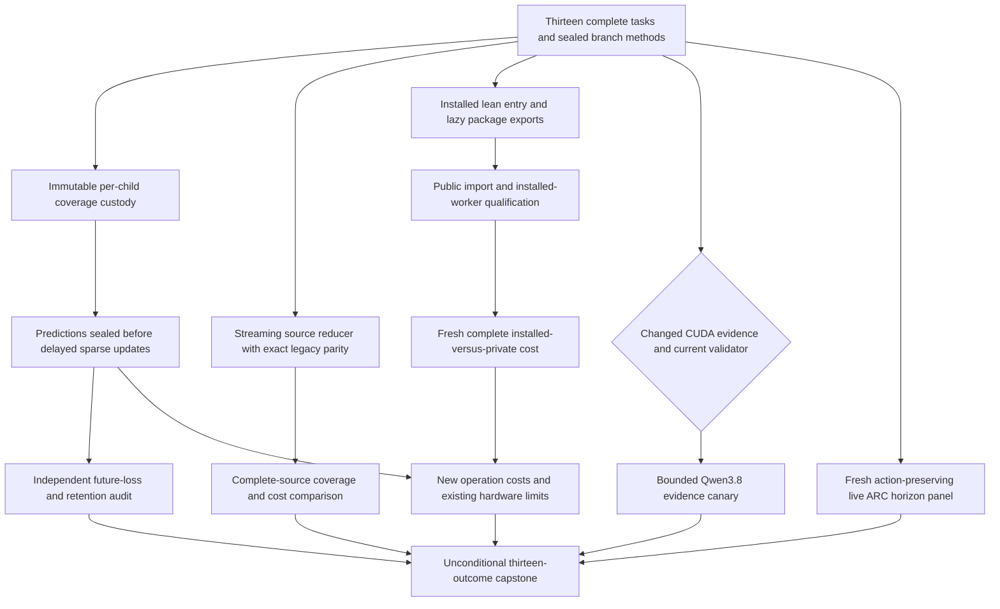
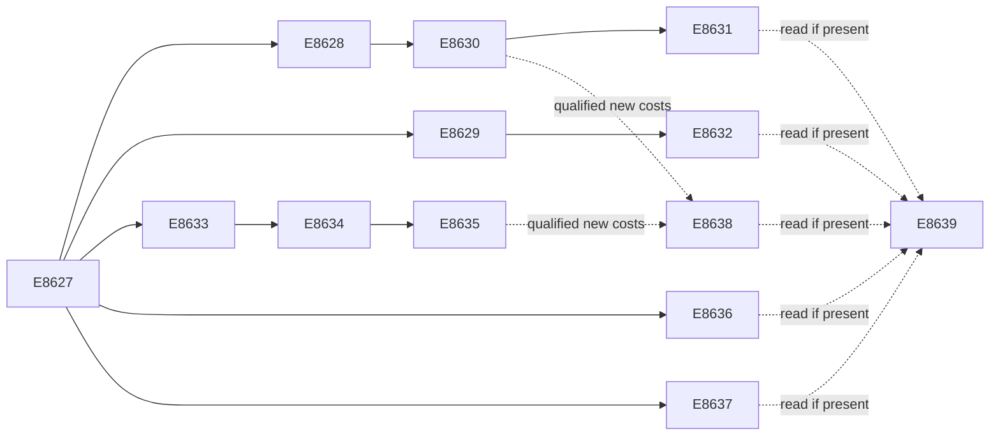

# Carnot Research Roadmap v741: Complete Evidence and Deployable Learning

**Created:** 2026-10-17 (workspace date, America/New_York)
**Milestone:** 2026.10.741
**Status:** Planned; staged only
**Title:** Continuous learning, complete source processing, and deployable lean inference
**Supersedes:** V740 scheduling; preserves its evidence and scientific limits.
**Task contract:** Exactly 13 tasks, Exp8627 through Exp8639, in conductor order.

## What V740 Proved

V740 completed twelve scheduling slots. Nine producers ran. Learning and its
benefit audit remained blocked; the optional Qwen canary also did not run.
The archive records completion on October 18 UTC. Scheduling completion does
not establish scientific success. The exact previous design is preserved at
`openspec/change-proposals/research-roadmap-v740-preserved-20261017.md`.

| Evidence | Actual finding | Consequence |
|---|---|---|
| Exp8615 | Twelve full task objects and branch methods qualified | Reuse the contract method with new complete V741 authority |
| Exp8616 | Statement normalization and semantic controls passed, but original child coverage shards were not retained | Snapshot each real child before combining; retain separate aggregates |
| Exp8618/8619 | Pre-gated or absent after execution qualification failed | Continuous-learning benefit remains unmeasured, not a scientific null |
| Exp8617/8620 | Release custody qualified; 135 of 190 responses were usable across 128 question groups; 55 exceeded 128 source windows | Test a different streaming execution mechanism on the exposed roster |
| Exp8621/8622 | Lean workers qualified; L16/B1 lifecycle throughput CI95 [2.6021614, 2.7140500] with latency ratio 1.02679 | Carry the gain into an installed package and measure the complete path |
| Exp8622 | Native/Python throughput CI95 [1.1799076, 1.2584954] | NFR-01 remains unmet; lifecycle and arithmetic gains stay separate |
| Exp8623 | No changed causal CUDA evidence | Pre-skip the optional canary until the exact prerequisite changes |
| Exp8624 | Action-preserving observer mechanics qualified; no policy promotion | Collect fresh real horizons through the qualified live hook |
| Exp8625/8626 | Hardware and capstone retained missing learning and physical evidence | Reuse old board facts; admit only new qualified operation costs |

The learning failure is specific. Exp8616's combine step retained zero original
child shards. Later aggregation replaced the original 83-statement report.
The source mapping from continuation line 94 to statement 92 cannot establish
execution without retained raw data. V741 changes evidence custody, not deadline
behavior, numerical gradients or scientific thresholds. Exp8616 remains disqualified.

Exp8620's lexical scores were exploratory. Their varying support cannot establish
calibration or factual correctness. The release lacks the existing head's p2
judge-confidence input. The next study cannot fill that input with a constant.
V733 source-information, V735 cold-cost and V737 ARC nulls remain closed.

## Three Biggest Gaps Against the PRD

1. **FR-12: useful verification from complete evidence.** The current extractor
   cannot process 55 measured long-source responses. Complete input processing
   is a necessary prerequisite; lexical overlap still cannot certify factual truth.
   Test bounded streaming with exact old-domain parity and explicit evidence offsets.
2. **FR-06/FR-11: useful continuous self-learning.** Mechanics exist, but qualified
   future-loss and retention evidence is missing. Retain original execution data,
   then finish the fixed delayed-feedback experiment without changing its hypothesis.
3. **FR-05/FR-08/NFR-01: deployment of measured performance.** The lean gain uses
   a private worker. An installed package must preserve that gain and existing APIs.
   Native arithmetic has not reached the PRD's 10× complete inference target.

ARC remains the live generalization obligation. Fresh observer records test whether
reusable instrumentation transfers across adapter-withheld games. They do not
reopen a closed policy-benefit result or grant another known-level solve claim.

## Research Selection

The V741 scan was appended to `research-references.md` before this design.
It searched all eight requested arXiv topics and checked all six secondary sources.

| Research lead | Planned use | Limit |
|---|---|---|
| [Long-context decomposition, 2504.19457](https://arxiv.org/abs/2504.19457) | Exp8629/8632 stream complete source windows with bounded intermediate storage | Carnot adapts decomposition; it does not reproduce the trained encoder or adopt injected labels |
| [Input-side evidence alignment, 2608.15804](https://arxiv.org/abs/2608.15804) | Exp8629/8632 retain byte offsets and source-window provenance | Lexical offsets are not semantic entailment |
| [Calibeating, 2603.22167](https://arxiv.org/abs/2603.22167) | Exp8630/8631 preserve proper-loss controls | Its guarantees do not transfer to this nonlinear learner |
| [Delayed capacity, 2606.11711](https://arxiv.org/abs/2606.11711) | Exp8630 records admission, pending and lost feedback | No post-hoc scheduler change |
| [Online KAN, 2602.02056](https://arxiv.org/abs/2602.02056) | Sparse updates and complete operation accounting | No inferred FPGA speed or new spline basis |
| [Ising review, 2610.03972](https://arxiv.org/abs/2610.03972) | Exp8638 distinguishes sampling, optimization and deterministic evaluation | Workload compatibility precedes hardware claims |

EBT and ARM–EBM remain architectural references. T-SKM-Net and PAL address explicit
constraint feasibility, which does not solve language extraction. Reward-guided
decoding remains deferred until local runtime and verifier utility qualify.
Retired external-text reranking and unchanged source-head refits stay closed.

OpenReview returned a browser challenge. Semantic Scholar did not return a usable
citation inventory for EBT or ARM–EBM. GitHub Trending snapshots were month-old.
Extropic's Z1T ratios are projections with final-logit and transfer exclusions.
Kona's inspected page supplied product positioning without a reproducible new
architecture result. The reference log records these limits explicitly.

## V741 Architecture



The existing small energy head and live agent remain fixed. The streaming branch
changes feature execution capacity; it does not feed new features into the learner.
The deployment branch keeps the original capped features and numerical decisions.
This separation prevents a packaging result from silently changing the science.
Historical readers retain their pins. Current adapters receive explicit references.

## Phase 1: Establish Executable Inputs — Exp8627–Exp8629

**Exp8627: contract and source ingestion.** Bind thirteen full objects, their
visible table, JSON, digest and end marker. Preserve active V740 and its historical
authority. Seal inherited learning, audit and canary operands before measurement.
Register streaming, installation and observer protocols as new methods. Read changed
CUDA evidence without a device command. Optional absence cannot veto CPU branches.

**Exp8628: original execution custody.** Give each child its own coverage path.
Copy and hash actual SQLite shards immediately after child exit, before cleanup
or combine. Separate original-runner and new-adapter data. Combine copies into
separate destinations. A second combine must leave original hashes unchanged.
Qualify the original 27-node runner family and complete affected historical union.
Require 83/83 original runner statements, all deadline controls and no exclusions.
Keep deadline cases 3599/3600/3601, clock reads 2/3/3 and elapsed values
null/3600.25/3601.25. A missing shard or removed third read must reject qualification.

**Exp8629: streaming prototype.** Add an opt-in reducer without changing historical
`source_alignment.prepare`. Iterate sentence windows then consecutive triples in
original order. Deduplicate exact stripped bytes. Reduce the same eight lexical
features with ordered sums and maxima. Retain UTF-8 byte offsets and disk-backed
window evidence. Test chunk sizes 1/32/128 against independent eager enumeration.
Preserve answer cap 16 and every old-domain feature hash. Bound each source at
512 KiB, answer at 64 KiB, response at 30 seconds and extra working memory at
256 MiB. Exhaustion remains an explicit abstention; silent truncation is forbidden.

## Phase 2: Measure Learning and Evidence Reach — Exp8630–Exp8632

**Exp8630: continuous self-learning.** Train the existing nine-input,
109-coefficient head only. Arms are frozen, log_loss, brier and
brier_shuffled_released. Seeds are 17/29/43/71/101. Five 20-question blocks with
three siblings yield 6,000 predictions. Start from original Exp8431 operands.
Use capacity eight questions per block, learning rate 0.01, L2=0.001 and Brier
derivative `2*(p-y)*p*(1-p)/T`. Seal predictions and target-blind admission before
feedback. Shuffle released admitted labels only. Commit state and acknowledgments
atomically. Test real block-2 exits and exact resume for seed 17 in every arm.
Evaluate 50 retention questions at five windows without training on them.
Count actual updates and include durable writes and final feedback drain in cost.

**Exp8631: independent benefit audit.** Reduce 80 later-block question units,
averaging siblings and seeds within each question. Compare Brier against log-loss
and frozen controls. Use 10,000 paired question draws, seed 7278448, and 97.5%
two-sided intervals. Both lower bounds must exceed zero without higher typed loss.
For retention, jointly resample the same 50 questions across all five windows.
Use 10,000 draws and seed 7258421. The upper 95% bound on maximum-window Brier
increase must be at most 0.01. Preserve the shuffled-release control. A valid null
closes the unchanged study. A positive remains exposed-development evidence,
with independent and generalized-learning scores zero.

**Exp8632: complete-source comparison.** Use the same 190 responses and 128
exposed question groups. Compare capped extraction against chunk-32 streaming.
Chunk-1 and chunk-128 runs test invariance. All 135 previously usable responses
must retain exact features. Preserve all 55 former window-limit abstentions,
including any that exceed new resource bounds. The primary engineering gate
requires complete window custody, exact common-domain parity and at least one
recovered response. Use three paired cost repetitions and descriptive question
bootstrap intervals with 10,000 draws, seed 7418632. Join labels after sealing
features. Report four fixed scores on common and recovered support separately.
No changed-denominator AUROC improvement, detector fit or p2 imputation is allowed.

## Phase 3: Deploy the Measured Service Path — Exp8633–Exp8636

**Exp8633: installed lean entry.** Expose the existing resident protocol through
`python -m carnot.inference.resident_protocol`. Make package exports lazy only
where needed to remove training/reporting imports from this path. Preserve public
names, import behavior, optional dependency semantics and numerical outputs.
Use relative imports and an actual private wheel outside the checkout. Keep the
old private worker as a baseline. This is an opt-in research interface; it does
not certify the exposed checkpoint as an independently calibrated verifier.

**Exp8634: public compatibility.** Test the installed wheel without PYTHONPATH
or checkout shadowing. Preserve imports for models, samplers and training.
Exercise Python, CLI, MCP and existing HTTP smoke paths through their actual
entry points. Existing surfaces need not gain a new endpoint. Verify frame limits,
deadlines, malformed inputs, immutable configuration, cleanup and Python/native
parity. Measure real child coverage for all changed initialization statements.

**Exp8635: installed complete cost.** Measure private/installed entry crossed
with Python/native arithmetic. Keep the original 64 requests, session lengths
1/4/16, batch 1 and ten paired repeats: 120 intended cells. Include client and
worker lifecycle, full features, framing, arithmetic, policy and clean shutdown.
Primary L16/B1 installed_native/private_native requires throughput lower95>=0.95,
p95 latency ratio<=1.05 and exact decisions. Use 10,000 paired-index draws,
seed 7418635. Report native/Python separately; only its lower95>=10 meets NFR-01.
This tests whether installation preserves the private-path gain. Preserve missing
cells when the fixed budget prevents completion; do not shrink the sample after timing.

**Exp8636: conditional Qwen canary.** Require changed causal CUDA evidence and
current validator custody. Use `MODEL_SPECS=["unsloth/Qwen3.8-27B-GGUF"]` with
`model_bounded_generation`. Sixteen calls cover four exposed fit questions in
four fixed evidence views, temperature 0 and at most 128 output tokens per call.
Load cap is 600 seconds; call cap is 120 seconds; measurement cap is 2,400 seconds.
Use the GPU lease and real offload receipts. No unchanged CUDA probe, new model
download, CPU headline substitute, generator training or detector-benefit claim.

## Phase 4: Transfer Evidence and Close Decisions — Exp8637–Exp8639

**Exp8637: live observer transfer.** Run fresh official-SDK episodes through
`make_carnot_agent` with adapters and stored routes withheld. Use the original four
games and two seeds. Cross observer off/on with capability masking fixed ON:
16 episodes. Preserve original action/reset/time budgets and horizon 120. Disable
all LLM calls. Require identical paired actions, RNG state, termination and legacy
receipts. Record only real redirects and subsequent public observations. Never
inject scripted firings into the panel. Full no-progress horizons, level-progress
associations and censored intervals remain separate. The existing three-game,
five-firing support floor is descriptive here; refinement and promotion stay zero.
A no-firing result closes this exact panel scope. No new level-solve credit follows.

**Exp8638: hardware operation delta.** Read the existing board ledger once,
without device commands. Admit new learning or installed-service costs only when
qualified. Keep their boundaries separate. Charge host lifecycle, full features,
transport and feedback storage before conditional ceilings. KV260's quadratic
Ising support does not implement arbitrary spline updates. Retain PolarFire CPU
scope, GateMate physical prerequisites, and unqualified NPU/TSU status. If no new
costs qualify, write one blocked result and reference the old ledger.

**Exp8639: capstone.** Account for thirteen task objects, primaries, pre-gates and
cascade skips. Independently reduce fixed primitive samples. Preserve old failures
and qualified nulls. Compare both literal verdicts and normalized failure causes.
Use unchanged G1–G4 publication gates. External blocks are terminal blocked,
not retryable partial. Recommend exact retirements without modifying the manifest.

## Dependency Graph and Conductor Order



Solid edges are structured gates. Dashed edges are optional evidence reads.
Exp8638 and Exp8639 run unconditionally. All structured upstreams exist earlier
in this roadmap. The JSON contract and YAML contain the exact gate dictionaries.
Each producer names its top-level numeric readiness fields in its own required
artifact fields. A missing field is a broken contract, not a measured zero.

## Hardware Requirements and Decentralization

| Resource | Work | Requirement and limit |
|---|---|---|
| Existing CPU, RAM and disk | All qualification, streaming, learning, package, ARC and audit branches | Use disk-backed private scratch; bound children and retain original raw shards |
| Rust/PyO3 build and installed Python dependencies | Native package qualification and complete costs | Record actual extension and wheel hashes; no global dependency replacement |
| Two RTX 3090 GPUs, 24 GiB each | Exp8636 only | Cached mandated GGUF, authenticated runtime repair and GPU lease required; card presence alone is insufficient |
| KV260 | Existing operation ledger | Quadratic Ising, k<=5; no new board run or spline accelerator claim |
| PolarFire | Existing operation ledger | Linux CPU dispatch remains distinct from fabric acceleration |
| GateMate | Deferred physical recovery | Changed cable/port/power evidence, ID0x20000001, source/build hashes, n16 flash and sample-hash smoke precede reopening |
| XDNA NPU / Extropic TSU | Deferred | Actual compatible SDK/device execution required; vendor projections do not supply access |

No purchase is required. The highest-value hardware prerequisite remains a causal
repair receipt for the existing CUDA path. Future sparse-update acceleration must
identify the dominant measured operation. Fixed host work may prevent a 100×
complete-service gain even when a numerical kernel is arbitrarily fast.

**Decentralization implications:** All required capability work remains local and
open. Closed model services are unnecessary. Agent execution routing is separate
from runtime model choice. Existing Python, CLI, MCP and HTTP surfaces retain their
contracts. No external publication or deployment is part of this plan.

## Execution, Evidence and Retirement Rules

- Every prompt requires flushed phase lines and before/after lines around loads,
  generation, benchmarks and subprocesses. Long loops emit counts. Children report
  status at least every 60 seconds, keeping silence gaps below 600 seconds.
- Every prompt requires files over about 200 lines to be written in separate tool
  calls of at most 150 lines, with progress between calls. Polls last at most
  60 seconds. Measurement stops by 3,600 seconds with 900 seconds for validation.
- Comparative artifacts retain per-unit rows. Blocked records name the failed
  check and observed value. Closed verdict classes carry circularity downstream.
  External unchanged blocks never use retryable `partial`.
- Actual current model calls use only Qwen3.8-27B. The canary declares bounded
  generation with the 10-second audit floor. Full generation uses 60 seconds;
  load-only work uses 2 seconds. No task pads elapsed time to meet a floor.
- Non-LLM tasks declare `no_model_load`, while authenticating any numerical head.
  Imported generator names remain historical provenance. Legacy small LLMs are
  CPU smoke fixtures only. No generator weights change.
- Each task has a concrete result path and thin runner. Specs and failing tests
  precede implementation. Required checks include scoped unit/lint/type/spec
  checks and applicable private E2E checks. Existing raw evidence and tests remain intact.
- Prior failures include all four mandatory fields and a falsifiable changed
  mechanism. No retired experiment ID is reused. No `requires` chain points at
  a retired upstream. The active roadmap, conductor and exclusion manifest remain unchanged.

The estimated queue contains about nine hours of sequential work if every branch
runs. Most tasks use the 50-turn default. Contract and shard qualification use
Opus with 100 turns because they coordinate authority and validation machinery.
Streaming/package implementation and compatibility tests use Codex gpt-6.1-sol.
The hardware reader and capstone use 20 turns. No task uses Luna.

## Planning Validation

Validation results are appended after both complete files exist. The checks must
compare every full task object, the visible table, count, order, digest and markers.
They must validate the schema, retirement discipline, gate fields and standing floors.
Planning checks cannot establish experiment success. No experiment runs during planning.

## Exact task contract

The table and full JSON below are normative. They contain exactly 13 tasks,
Exp8627 through Exp8639, in the same order as `research-roadmap-next.yaml`.

| Order | ID | Title | Phase | Deliverable |
|---|---|---|---|---|
| 1 | `exp8627-contract-methods` | Bind thirteen tasks and seal changed execution and deployment protocols | 1 | `results/experiment_8627_v741_contract_methods.json` |
| 2 | `exp8628-learning-shard-custody` | Retain original child coverage before qualifying causal learning execution | 1 | `results/experiment_8628_v741_learning_shard_custody.json` |
| 3 | `exp8629-streaming-source-prototype` | Build bounded streaming source features with exact capped-domain parity | 1 | `results/experiment_8629_v741_streaming_source_prototype.json` |
| 4 | `exp8630-causal-brier-stream` | Measure continuous small-head learning with retained causal execution evidence | 2 | `results/experiment_8630_v741_causal_brier_stream.json` |
| 5 | `exp8631-learning-benefit-audit` | Test later proper-loss benefit and simultaneous retention from sealed updates | 2 | `results/experiment_8631_v741_learning_benefit_audit.json` |
| 6 | `exp8632-complete-source-comparison` | Measure streaming source coverage and cost on the exposed Trivia+ roster | 2 | `results/experiment_8632_v741_complete_source_comparison.json` |
| 7 | `exp8633-installed-lean-prototype` | Expose lean inference through an installed package entry point | 3 | `results/experiment_8633_v741_installed_lean_prototype.json` |
| 8 | `exp8634-installed-compatibility` | Qualify installed inference and existing public import contracts | 3 | `results/experiment_8634_v741_installed_compatibility.json` |
| 9 | `exp8635-installed-complete-cost` | Measure complete installed inference against the qualified private worker | 3 | `results/experiment_8635_v741_installed_complete_cost.json` |
| 10 | `exp8636-qwen-evidence-canary` | Run bounded mandated-Qwen evidence calls only after causal runtime recovery | 3 | `results/experiment_8636_v741_qwen_evidence_canary.json` |
| 11 | `exp8637-arc-observer-transfer` | Measure real cross-game redirect horizons through the qualified live observer | 4 | `results/experiment_8637_v741_arc_observer_transfer.json` |
| 12 | `exp8638-hardware-operation-delta` | Map newly measured learning and installed inference operations to hardware support | 4 | `results/experiment_8638_v741_hardware_operation_delta.json` |
| 13 | `exp8639-capstone` | Reconcile thirteen outcomes and close unchanged scientific and deployment questions | 4 | `results/experiment_8639_v741_capstone.json` |

canonical_tasks_sha256: `sha256:8f3b221dfc5f9b38949b6717470f0449152a0d4a3bc10e698b3e456227fd74d9`

<!-- V741_TASK_CONTRACT_START -->
```json
{
  "milestone": "2026.10.741",
  "tasks": [
    {
      "id": "exp8627-contract-methods",
      "title": "Bind thirteen tasks and seal changed execution and deployment protocols",
      "phase": 1,
      "track": "research",
      "priority": "high",
      "requires_gpu": false,
      "max_turns": 100,
      "estimated_wall_time_min": 35,
      "per_unit_rows": true,
      "milestone": "2026.10.741",
      "deliverable": "results/experiment_8627_v741_contract_methods.json",
      "inference_substrate_class": "no_model_load",
      "MODEL_SPECS": [],
      "gated_on": [],
      "prior_failures": [
        {
          "experiment_id": "exp8602-contract-methods",
          "verdict": "complete_blocked_v739_contract_methods",
          "addressed_by": "The missing V739 design caused an authority block. V741 supplies thirteen full objects, an independently parsed table and digest; V740 qualification proves the binding approach. Historical failures remain unchanged.",
          "retire_if_same_verdict": true
        }
      ],
      "agent_type": "claude",
      "model": "opus",
      "prompt": "CONTEXT:\nWork in {project_root} on {date}. V740 completed twelve slots, with nine producers. Exp8616 lost original child coverage shards; its mapping94=92 alone cannot qualify execution. Learning remained blocked. Exp8620 retained190 responses in128 exposed question groups, but55 exceeded128 source windows. Exp8622 measured a lean lifecycle gain, CI95[2.6021614,2.7140500], with native/Python CI95[1.1799076,1.2584954]; NFR01 remains unmet. Exp8624 qualified an action-preserving horizon observer, not supervisor benefit. Preserve all historical nulls and quarantines. V741 contains exactly thirteen tasks, Exp8627 through Exp8639.\n\nEXISTING CODE TO READ FIRST:\nCLAUDE.md; CODEX.md; ops/e2e-test-plan.md; ops/exclusion_manifest.yaml; openspec/capabilities/research-reporting/spec.md; openspec/capabilities/verification/spec.md; scripts/experiment_template.py; python/carnot/reporting/primary_publication.py; openspec/change-proposals/research-roadmap-vNEXT.md; research-references.md; python/carnot/reporting/v740_contract_methods.py; python/carnot/reporting/roadmap_contract.py; openspec/change-proposals/v740-methods-protocol.json; results/experiment_8615_v740_contract_methods.json; results/experiment_8626_v740_capstone.json; python/carnot/verify/cuda_reader_8410.py; research-studying.md\n\nTASK:\nBind thirteen tasks and seal changed execution and deployment protocols. Deliver results/experiment_8627_v741_contract_methods.json. Create thin runner scripts/experiments/experiment_8627_v741_contract_methods.py. Keep primitives under results/raw/experiment_8627_v741_contract_methods/ and notes in docs/research-notes/v741-contract-methods.md. Same-roadmap outputs are future dependencies.\n\nCONCRETE STEPS:\n1. PRECONDITIONS: Print a flushed start line. Authenticate only the inputs required by this branch. Check tools, memory, writable disk-backed scratch and input hashes. Record missing inputs in gate_check_summary. Optional GPU or board absence cannot block CPU branches.\n\n2. Print a flushed progress line at every phase boundary. Print before and after every model load, generation, benchmark and subprocess that can take minutes. Use unbuffered output. Print completed and pending counts inside long loops. Supervise children with a flushed status line at least every60 seconds. Keep every silence gap below600 seconds. Write any file over about200 lines in several tool calls, each at most150 lines. Send a progress message between calls. Poll work with calls lasting at most60 seconds. Stop measurement by3600 seconds; reserve900 seconds for validation within the4800-second cap. Never pad measured duration.\n\n3. Spec first: confirm driving REQ-* and SCENARIO-* items before implementation. Add focused failing tests first. Preserve original assertions and scientific thresholds. Accept --date {date}. Put experiment runners in scripts/experiments/, tests in tests/python/ and scratch in /var/tmp. Do not change research-roadmap.yaml, shared validators, generator weights or external services.\n\n4. Declare inference_substrate_class=no_model_load and MODEL_SPECS=[]. Record zero current language-model calls. Historical model names belong only in historical_model_provenance. Identify actual small-head numerical inference separately; this class is not a claim of no arithmetic.\n\n5. Bind exactly thirteen complete task dictionaries, Exp8627 through Exp8639. Compare the visible table, full JSON, canonical_tasks_sha256, end marker and staged or authentically activated V741 YAML. Reject count, order, ID, title, phase, deliverable, prompt, model, substrate, gate and retirement mutations. Test staged-V741/active-V740 and genuinely activated-V741 separately. Preserve V740 at research-roadmap-v740-preserved-20261017.md. Do not fabricate historical authority.\n\n6. Create openspec/change-proposals/v741-methods-protocol.json before measurements. Inherit objective_updates, objective_audit and evidence_canary from authenticated V740 by value and hash. Keep original V738/V740 readers and their pins. Register current producer mappings separately. Reuse qualified Exp8580 validator, Exp8581 accounting and Exp8431 head descriptors without clearing Exp8582 or Exp8616 quarantine. Emit learning_inputs_ready_score independently.\n\n7. Ingest the dated V741 references scan. Read 2504.19457,2608.15804,2603.22167,2606.11711,2602.02056 and2610.03972. Record method, assumption, source hash and use/defer decisions. Mark ingested leads in research-studying.md. Streaming lexical reduction adapts decomposition; it does not reproduce a trained semantic encoder.\n\n8. Authenticate Exp8617 private release custody and Exp8620 full190-row/128-question roster. Register an exposed, paired coverage study: original capped extraction versus streaming complete extraction; chunk sizes1/32/128; same window order, byte deduplication and eight features. Answer cap16 remains. Fix512KiB per source,64KiB per answer,30seconds per response and256MiB additional working memory. Oversized or timed-out rows remain explicit abstentions. Require exact old-domain parity and no missing source spans before coverage benefit. No labels or p2 imputation enter prediction. Emit extraction_inputs_ready_score.\n\n9. Authenticate Exp8621 qualification and Exp8622 complete costs. Register installed_entry_2x2: private/installed entry crossed with Python/native arithmetic, original64 requests, lengths1/4/16, batch1, ten paired repeats. Record wheel/dependency identities. Primary installed_native versus private_native at L16 is noninferiority: throughput lower95>=0.95 and p95 ratio<=1.05 with exact decisions. Separately test installed_native versus installed_python. NFR01 requires that arithmetic lower95>=10. Use10000 paired-index draws, seed7418635. Emit deployment_inputs_ready_score; no old cost is a fresh measurement.\n\n10. Authenticate Exp8624 observer qualification and Exp8588 original panel authority. Register fresh action-preserving observer off/on episodes through make_carnot_agent: the same four games and two seeds, capability masking fixed ON, two observer conditions,16 episodes. Preserve original action/reset/time budgets; do not extend episodes to fill horizons. Horizon120 remains fixed. Define the primary outcome as complete versus censored real redirect records, with strict off/on action parity. No causal supervisor-benefit or hidden-game claim follows. Emit arc_inputs_ready_score.\n\n11. Read the existing CUDA evidence reader once without any device command. Require a supplied causal CUDA library/environment repair receipt and genuine context/copy success for runtime_repair_ready_score=1. Authenticate current validator custody separately for canary_inputs_ready_score. No changed receipt means the optional model task pre-skips; all CPU readiness remains independent.\n\n12. Seal each branch reference. Test missing optional runtime evidence while CPU methods remain usable. Emit methods_ready_score only after the full contract and all authority controls pass. Freeze checksums before experiments, not after their outcomes.\n\n13. Run scoped unit tests, private CLI checks, Ruff check/format, strict mypy and scripts/check_spec_coverage.py --files <owned-test-files>. Run applicable ops/e2e-test-plan.md checks, including private E2E-018/021 for authority and publication readers. Require100percent newly owned statement coverage, including real children and rejection paths. Collect original node IDs once. Use bounded disjoint test children with immutable original authority and -n 0 -o addopts= --no-cov. Do not run the whole repository suite or nested historical controllers. A killed child fails validation. Retain commands, exit codes, durations and hashed logs.\n\n14. Cold-replay immutable primitives in a fresh bounded process. Reject missing inputs and self-consistently rehashed tampering. Run primary_publication, scripts/adversarial_verify.py --json <private-candidate> and scripts/verdict_row_consistency_lint.py --strict <private-candidate>. Retain actual findings. Validate final bytes before atomic publication. Owned-check failures are disqualified. Unchanged external failures are blocked, never partial. Reconcile openspec/, _bmad/traceability.md, ops/status.md and ops/changelog.md without rewriting history.\n\nREQUIRED ARTIFACT FIELDS:\nexperiment_id, task_id, milestone, run_date: principle: Bind evidence to this invocation.\nhonest_verdict, verdict_class: principle: Use a complete_ terminal prefix. verdict_class is exactly positive | circular_positive | null | blocked | disqualified | partial. Partial permits retry only for unfinished owned work; external unchanged failures are blocked.\ngate_check_summary: principle: Every blocked_* or complete_blocked_* verdict names the failed check, upstream, path/hash, field, operator, expected and observed value. Missing differs from zero.\ninference_substrate, inference_substrate_class, MODEL_SPECS, model_invocation_counts, historical_model_provenance, target_model: principle: Separate current execution from imported generator identities. Authenticate any small energy head and actual checkpoint.\nrows, intended_count, completed_count, failed_count, censored_count, excluded_count, independent_count, sample_size_budget: principle: Preserve each unit, arm, metric and missing reason. Seeds and sibling responses are not independent questions.\nverifier_is_oracle, exposure_scope, independent_generalization_score, generalized_learning_benefit_score: principle: Oracle-dependent positives use circular_positive. Exposed data, compatibility and timing cannot establish independent generalization.\nrequired_checks_passed, flagged_adversarial, acceptance_gates, validation_receipts, terminal_validation_sidecar_path, adversarial_findings: principle: Qualification differs from scientific benefit. Failed acceptance gates forbid a positive class.\npreconditions_checked, duration_s, phase_spans, random_seed, reproducibility_checksum, source_artifact_hashes, code_config_hashes, raw_shard_hashes: principle: Preserve real clocks and immutable operands.\ncited_upstream_artifacts, field_principles: principle: Name original producers and explain every added metric or gate.\nmethods_ready_score, current_contract_ready_score, learning_inputs_ready_score, extraction_inputs_ready_score, deployment_inputs_ready_score, arc_inputs_ready_score, canary_inputs_ready_score, runtime_repair_ready_score: principle: Independent readiness binds each branch to its exact operands.\nmethods_protocol_reference, inherited_operand_checks, source_roster_reference, installed_entry_2x2, arc_observer_protocol, literature_method_rows, gate_field_map, canonical_tasks_sha256, authority_mutation_rows: principle: Register methods and unchanged history before observing outcomes.\n\nbranch_gate_values: principle: Every readiness field named above is a top-level numeric0/1 value. Missing differs from zero.\n\nRun command: cd {project_root} && JAX_PLATFORMS=cpu PYTHONPATH=python:. PYTHONUNBUFFERED=1 .venv/bin/python -u scripts/experiments/experiment_8627_v741_contract_methods.py --date {date}\n\nDo NOT push. Do NOT modify scripts/research_conductor.py.\n"
    },
    {
      "id": "exp8628-learning-shard-custody",
      "title": "Retain original child coverage before qualifying causal learning execution",
      "phase": 1,
      "track": "research",
      "priority": "high",
      "requires_gpu": false,
      "max_turns": 100,
      "estimated_wall_time_min": 55,
      "per_unit_rows": true,
      "milestone": "2026.10.741",
      "deliverable": "results/experiment_8628_v741_learning_shard_custody.json",
      "inference_substrate_class": "no_model_load",
      "MODEL_SPECS": [],
      "gated_on": [
        {
          "upstream": "exp8627-contract-methods",
          "artifact_field": "methods_ready_score",
          "op": "==",
          "value": 1
        },
        {
          "upstream": "exp8627-contract-methods",
          "artifact_field": "learning_inputs_ready_score",
          "op": "==",
          "value": 1
        }
      ],
      "prior_failures": [
        {
          "experiment_id": "exp8616-deadline-statement-qualification",
          "verdict": "complete_disqualified_v740_deadline_statement_qualification",
          "addressed_by": "V740 lost original subprocess shards and replaced its original aggregate. Per-child raw snapshots before combining, separate aggregate namespaces and an actual second-combine regression change the evidence mechanism; the learner remains fixed.",
          "retire_if_same_verdict": true
        }
      ],
      "agent_type": "claude",
      "model": "opus",
      "prompt": "CONTEXT:\nWork in {project_root} on {date}. V740 completed twelve slots, with nine producers. Exp8616 lost original child coverage shards; its mapping94=92 alone cannot qualify execution. Learning remained blocked. Exp8620 retained190 responses in128 exposed question groups, but55 exceeded128 source windows. Exp8622 measured a lean lifecycle gain, CI95[2.6021614,2.7140500], with native/Python CI95[1.1799076,1.2584954]; NFR01 remains unmet. Exp8624 qualified an action-preserving horizon observer, not supervisor benefit. Preserve all historical nulls and quarantines. V741 contains exactly thirteen tasks, Exp8627 through Exp8639.\n\nEXISTING CODE TO READ FIRST:\nCLAUDE.md; CODEX.md; ops/e2e-test-plan.md; ops/exclusion_manifest.yaml; openspec/capabilities/research-reporting/spec.md; openspec/capabilities/verification/spec.md; scripts/experiment_template.py; python/carnot/reporting/primary_publication.py; openspec/change-proposals/research-roadmap-vNEXT.md; research-references.md; python/carnot/reporting/deadline_statement_validation_8616.py; python/carnot/reporting/deadline_statement_8616.py; python/carnot/reporting/learning_clock_8592.py; python/carnot/reporting/deadline_edge_8603.py; python/carnot/reporting/causal_brier_runner_8582.py; tests/python/test_deadline_statement_8616.py; tests/python/test_causal_brier_stream_8582.py; results/experiment_8616_v740_deadline_statement_qualification.json\n\nTASK:\nRetain original child coverage before qualifying causal learning execution. Deliver results/experiment_8628_v741_learning_shard_custody.json. Create thin runner scripts/experiments/experiment_8628_v741_learning_shard_custody.py. Keep primitives under results/raw/experiment_8628_v741_learning_shard_custody/ and notes in docs/research-notes/v741-learning-shard-custody.md. Same-roadmap outputs are future dependencies.\n\nCONCRETE STEPS:\n1. PRECONDITIONS: Print a flushed start line. Authenticate only the inputs required by this branch. Check tools, memory, writable disk-backed scratch and input hashes. Record missing inputs in gate_check_summary. Optional GPU or board absence cannot block CPU branches.\n\n2. Print a flushed progress line at every phase boundary. Print before and after every model load, generation, benchmark and subprocess that can take minutes. Use unbuffered output. Print completed and pending counts inside long loops. Supervise children with a flushed status line at least every60 seconds. Keep every silence gap below600 seconds. Write any file over about200 lines in several tool calls, each at most150 lines. Send a progress message between calls. Poll work with calls lasting at most60 seconds. Stop measurement by3600 seconds; reserve900 seconds for validation within the4800-second cap. Never pad measured duration.\n\n3. Spec first: confirm driving REQ-* and SCENARIO-* items before implementation. Add focused failing tests first. Preserve original assertions and scientific thresholds. Accept --date {date}. Put experiment runners in scripts/experiments/, tests in tests/python/ and scratch in /var/tmp. Do not change research-roadmap.yaml, shared validators, generator weights or external services.\n\n4. Declare inference_substrate_class=no_model_load and MODEL_SPECS=[]. Record zero current language-model calls. Historical model names belong only in historical_model_provenance. Identify actual small-head numerical inference separately; this class is not a claim of no arithmetic.\n\n5. Reproduce the diagnosed custody failure in a small private fixture before the historical union. Exp8616 retained no original child shards; a later combine replaced its83-statement aggregate. A normalized line mapping cannot repair missing evidence. Preserve the original disqualification and source-bound94-to92 mapping.\n\n6. Implement a narrow new qualification adapter with a unique COVERAGE_FILE and raw directory for every child. After each child exits, inventory, copy and hash all actual SQLite shards before any combine or cleanup. Store a manifest linking command, exact node IDs, PID/child identity, source hashes, shard paths and terminal exit. Require nonempty original-runner data. Keep original-runner and new-adapter shards in separate immutable namespaces. Combine copies into separate aggregate destinations; never combine into the raw namespace.\n\n7. Write failing controls for deleted, overwritten, zero-file, duplicate, foreign-source and rehashed-substitution shards. Repeat combining owned coverage after original aggregation and prove original raw and aggregate hashes remain unchanged. Exercise the real coverage subprocess path and actual cleanup. Byte-identical duplicate data cannot count as another executed child. Require semantic checks, not only line membership.\n\n8. Run the original27-node runner union and full affected Exp8592/8603/8616 union under their immutable authority. Collect once, partition into bounded disjoint children and preserve every assertion. Use the existing measured mechanics fixture rather than training once per test. Retain every child shard before advancing. Execute real3599/3600/3601 deadline cases with2/3/3 clock reads and elapsed null/3600.25/3601.25. Reject a removed third read, omitted expired case and changed diagnostic.\n\n9. Require83/83 original executable runner statements, no exclusions, complete original node outcomes and100percent new owned statements. Recompute each union from retained raw data in a fresh process. Do not stamp old results clean, exclude continuation lines, modify learner behavior or relax shared validators. Separate kernel clocks from orchestration clocks.\n\n10. Emit learning_execution_ready_score=1 only after original execution, semantic cases, current source mapping, all owned checks and terminal consumer acceptance pass. Retire the unchanged failed custody scope if the same failure recurs. Keep a failure narrowly scoped; do not rebuild the learner.\n\n11. Run scoped unit tests, private CLI checks, Ruff check/format, strict mypy and scripts/check_spec_coverage.py --files <owned-test-files>. Run applicable ops/e2e-test-plan.md checks, including private E2E-018/021 for authority and publication readers. Require100percent newly owned statement coverage, including real children and rejection paths. Collect original node IDs once. Use bounded disjoint test children with immutable original authority and -n 0 -o addopts= --no-cov. Do not run the whole repository suite or nested historical controllers. A killed child fails validation. Retain commands, exit codes, durations and hashed logs.\n\n12. Cold-replay immutable primitives in a fresh bounded process. Reject missing inputs and self-consistently rehashed tampering. Run primary_publication, scripts/adversarial_verify.py --json <private-candidate> and scripts/verdict_row_consistency_lint.py --strict <private-candidate>. Retain actual findings. Validate final bytes before atomic publication. Owned-check failures are disqualified. Unchanged external failures are blocked, never partial. Reconcile openspec/, _bmad/traceability.md, ops/status.md and ops/changelog.md without rewriting history.\n\nREQUIRED ARTIFACT FIELDS:\nexperiment_id, task_id, milestone, run_date: principle: Bind evidence to this invocation.\nhonest_verdict, verdict_class: principle: Use a complete_ terminal prefix. verdict_class is exactly positive | circular_positive | null | blocked | disqualified | partial. Partial permits retry only for unfinished owned work; external unchanged failures are blocked.\ngate_check_summary: principle: Every blocked_* or complete_blocked_* verdict names the failed check, upstream, path/hash, field, operator, expected and observed value. Missing differs from zero.\ninference_substrate, inference_substrate_class, MODEL_SPECS, model_invocation_counts, historical_model_provenance, target_model: principle: Separate current execution from imported generator identities. Authenticate any small energy head and actual checkpoint.\nrows, intended_count, completed_count, failed_count, censored_count, excluded_count, independent_count, sample_size_budget: principle: Preserve each unit, arm, metric and missing reason. Seeds and sibling responses are not independent questions.\nverifier_is_oracle, exposure_scope, independent_generalization_score, generalized_learning_benefit_score: principle: Oracle-dependent positives use circular_positive. Exposed data, compatibility and timing cannot establish independent generalization.\nrequired_checks_passed, flagged_adversarial, acceptance_gates, validation_receipts, terminal_validation_sidecar_path, adversarial_findings: principle: Qualification differs from scientific benefit. Failed acceptance gates forbid a positive class.\npreconditions_checked, duration_s, phase_spans, random_seed, reproducibility_checksum, source_artifact_hashes, code_config_hashes, raw_shard_hashes: principle: Preserve real clocks and immutable operands.\ncited_upstream_artifacts, field_principles: principle: Name original producers and explain every added metric or gate.\nlearning_execution_ready_score, original_node_union, executed_node_ids, child_shard_manifest, original_aggregate_reference, owned_aggregate_reference, coverage_version, source_bytecode_hashes: principle: Actual retained child data establish execution.\nnormalized_statement_rows, deadline_case_rows, semantic_mutation_rows, custody_mutation_rows, second_combine_invariance, historical_quarantines: principle: Coverage normalization, behavioral assertions and immutable custody are separate checks.\n\nbranch_gate_values: principle: Every readiness field named above is a top-level numeric0/1 value. Missing differs from zero.\n\nRun command: cd {project_root} && JAX_PLATFORMS=cpu PYTHONPATH=python:. PYTHONUNBUFFERED=1 .venv/bin/python -u scripts/experiments/experiment_8628_v741_learning_shard_custody.py --date {date}\n\nDo NOT push. Do NOT modify scripts/research_conductor.py.\n"
    },
    {
      "id": "exp8629-streaming-source-prototype",
      "title": "Build bounded streaming source features with exact capped-domain parity",
      "phase": 1,
      "track": "research",
      "priority": "high",
      "requires_gpu": false,
      "max_turns": 50,
      "estimated_wall_time_min": 40,
      "per_unit_rows": true,
      "milestone": "2026.10.741",
      "deliverable": "results/experiment_8629_v741_streaming_source_prototype.json",
      "inference_substrate_class": "no_model_load",
      "MODEL_SPECS": [],
      "gated_on": [
        {
          "upstream": "exp8627-contract-methods",
          "artifact_field": "methods_ready_score",
          "op": "==",
          "value": 1
        }
      ],
      "prior_failures": [
        {
          "experiment_id": "exp8620-triviaplus-extraction",
          "verdict": "complete_null_v740_triviaplus_extraction",
          "addressed_by": "The capped extractor abstained on55/190 rows. Streaming ordered reduction changes memory use and source reach while preserving numerical features on the old domain. No unchanged detector-benefit claim is repeated.",
          "retire_if_same_verdict": true
        }
      ],
      "agent_type": "codex",
      "model": "gpt-6.1-sol",
      "prompt": "CONTEXT:\nWork in {project_root} on {date}. V740 completed twelve slots, with nine producers. Exp8616 lost original child coverage shards; its mapping94=92 alone cannot qualify execution. Learning remained blocked. Exp8620 retained190 responses in128 exposed question groups, but55 exceeded128 source windows. Exp8622 measured a lean lifecycle gain, CI95[2.6021614,2.7140500], with native/Python CI95[1.1799076,1.2584954]; NFR01 remains unmet. Exp8624 qualified an action-preserving horizon observer, not supervisor benefit. Preserve all historical nulls and quarantines. V741 contains exactly thirteen tasks, Exp8627 through Exp8639.\n\nEXISTING CODE TO READ FIRST:\nCLAUDE.md; CODEX.md; ops/e2e-test-plan.md; ops/exclusion_manifest.yaml; openspec/capabilities/research-reporting/spec.md; openspec/capabilities/verification/spec.md; scripts/experiment_template.py; python/carnot/reporting/primary_publication.py; openspec/change-proposals/research-roadmap-vNEXT.md; research-references.md; python/carnot/verify/source_alignment.py; python/carnot/verify/evidence_features_7980.py; python/carnot/reporting/triviaplus_extraction_8620.py; tests/python/test_triviaplus_extraction_8620.py; results/experiment_8620_v740_triviaplus_extraction.json\n\nTASK:\nBuild bounded streaming source features with exact capped-domain parity. Deliver results/experiment_8629_v741_streaming_source_prototype.json. Create thin runner scripts/experiments/experiment_8629_v741_streaming_source_prototype.py. Keep primitives under results/raw/experiment_8629_v741_streaming_source_prototype/ and notes in docs/research-notes/v741-streaming-source-prototype.md. Same-roadmap outputs are future dependencies.\n\nCONCRETE STEPS:\n1. PRECONDITIONS: Print a flushed start line. Authenticate only the inputs required by this branch. Check tools, memory, writable disk-backed scratch and input hashes. Record missing inputs in gate_check_summary. Optional GPU or board absence cannot block CPU branches.\n\n2. Print a flushed progress line at every phase boundary. Print before and after every model load, generation, benchmark and subprocess that can take minutes. Use unbuffered output. Print completed and pending counts inside long loops. Supervise children with a flushed status line at least every60 seconds. Keep every silence gap below600 seconds. Write any file over about200 lines in several tool calls, each at most150 lines. Send a progress message between calls. Poll work with calls lasting at most60 seconds. Stop measurement by3600 seconds; reserve900 seconds for validation within the4800-second cap. Never pad measured duration.\n\n3. Spec first: confirm driving REQ-* and SCENARIO-* items before implementation. Add focused failing tests first. Preserve original assertions and scientific thresholds. Accept --date {date}. Put experiment runners in scripts/experiments/, tests in tests/python/ and scratch in /var/tmp. Do not change research-roadmap.yaml, shared validators, generator weights or external services.\n\n4. Declare inference_substrate_class=no_model_load and MODEL_SPECS=[]. Record zero current language-model calls. Historical model names belong only in historical_model_provenance. Identify actual small-head numerical inference separately; this class is not a claim of no arithmetic.\n\n5. Implement an opt-in streaming extractor in python/carnot/verify/streaming_evidence.py. Keep existing source_alignment.prepare and historical readers unchanged. Iterate original sentence windows then consecutive three-sentence windows in the original order. Preserve complete UTF-8 byte offsets. Deduplicate by exact stripped bytes, with collision-safe equality. Do not keep the full pair-feature tensor.\n\n6. Reduce the same four lexical measurements into ordered sums and maxima, yielding the same eight feature values and feature hashes for old-domain rows. Preserve the exact public input allowlist and answer cap16. Use rolling context and bounded deduplication state under the registered byte/memory/time limits. Chunk size controls working batches, not source truncation or window selection.\n\n7. Write failing property and fixture tests for chunk sizes1/32/128; compare to independent eager enumeration below and above128 windows. Include duplicate windows, multibyte text, empty inputs, malformed UTF-8, whitespace, punctuation boundaries, exactly128/129 windows, oversized answers and resource exits. Preserve all legacy abstentions except source_windows_over_budget within the new bounded domain.\n\n8. Capture each window hash, byte interval and contributing answer-unit IDs in disk-backed primitives. Prove their ordered digest matches complete enumeration. Any missing chunk, wrong offset, feature drift, source swap or label-bearing predictor key must fail. Do not equate window coverage with entailed claims.\n\n9. Qualify prototype behavior and chunk invariance on deterministic fixtures only. Record prototype memory and latency descriptively. Emit streaming_extractor_ready_score only after exact parity and rejection controls pass. Natural coverage measurement belongs to Exp8632. No fit, score selection, new encoder or LLM call is allowed.\n\n10. Run scoped unit tests, private CLI checks, Ruff check/format, strict mypy and scripts/check_spec_coverage.py --files <owned-test-files>. Run applicable ops/e2e-test-plan.md checks, including private E2E-018/021 for authority and publication readers. Require100percent newly owned statement coverage, including real children and rejection paths. Collect original node IDs once. Use bounded disjoint test children with immutable original authority and -n 0 -o addopts= --no-cov. Do not run the whole repository suite or nested historical controllers. A killed child fails validation. Retain commands, exit codes, durations and hashed logs.\n\n11. Cold-replay immutable primitives in a fresh bounded process. Reject missing inputs and self-consistently rehashed tampering. Run primary_publication, scripts/adversarial_verify.py --json <private-candidate> and scripts/verdict_row_consistency_lint.py --strict <private-candidate>. Retain actual findings. Validate final bytes before atomic publication. Owned-check failures are disqualified. Unchanged external failures are blocked, never partial. Reconcile openspec/, _bmad/traceability.md, ops/status.md and ops/changelog.md without rewriting history.\n\nREQUIRED ARTIFACT FIELDS:\nexperiment_id, task_id, milestone, run_date: principle: Bind evidence to this invocation.\nhonest_verdict, verdict_class: principle: Use a complete_ terminal prefix. verdict_class is exactly positive | circular_positive | null | blocked | disqualified | partial. Partial permits retry only for unfinished owned work; external unchanged failures are blocked.\ngate_check_summary: principle: Every blocked_* or complete_blocked_* verdict names the failed check, upstream, path/hash, field, operator, expected and observed value. Missing differs from zero.\ninference_substrate, inference_substrate_class, MODEL_SPECS, model_invocation_counts, historical_model_provenance, target_model: principle: Separate current execution from imported generator identities. Authenticate any small energy head and actual checkpoint.\nrows, intended_count, completed_count, failed_count, censored_count, excluded_count, independent_count, sample_size_budget: principle: Preserve each unit, arm, metric and missing reason. Seeds and sibling responses are not independent questions.\nverifier_is_oracle, exposure_scope, independent_generalization_score, generalized_learning_benefit_score: principle: Oracle-dependent positives use circular_positive. Exposed data, compatibility and timing cannot establish independent generalization.\nrequired_checks_passed, flagged_adversarial, acceptance_gates, validation_receipts, terminal_validation_sidecar_path, adversarial_findings: principle: Qualification differs from scientific benefit. Failed acceptance gates forbid a positive class.\npreconditions_checked, duration_s, phase_spans, random_seed, reproducibility_checksum, source_artifact_hashes, code_config_hashes, raw_shard_hashes: principle: Preserve real clocks and immutable operands.\ncited_upstream_artifacts, field_principles: principle: Name original producers and explain every added metric or gate.\nstreaming_extractor_ready_score, chunk_parity_rows, bounded_memory_rows, window_offset_rows, complete_window_digest, feature_parity_rows, resource_rejection_rows: principle: A bounded implementation must account for all input windows and preserve old-domain results.\n\nbranch_gate_values: principle: Every readiness field named above is a top-level numeric0/1 value. Missing differs from zero.\n\nRun command: cd {project_root} && JAX_PLATFORMS=cpu PYTHONPATH=python:. PYTHONUNBUFFERED=1 .venv/bin/python -u scripts/experiments/experiment_8629_v741_streaming_source_prototype.py --date {date}\n\nDo NOT push. Do NOT modify scripts/research_conductor.py.\n"
    },
    {
      "id": "exp8630-causal-brier-stream",
      "title": "Measure continuous small-head learning with retained causal execution evidence",
      "phase": 2,
      "track": "research",
      "priority": "high",
      "requires_gpu": false,
      "max_turns": 50,
      "estimated_wall_time_min": 55,
      "per_unit_rows": true,
      "milestone": "2026.10.741",
      "deliverable": "results/experiment_8630_v741_causal_brier_stream.json",
      "inference_substrate_class": "no_model_load",
      "MODEL_SPECS": [],
      "gated_on": [
        {
          "upstream": "exp8628-learning-shard-custody",
          "artifact_field": "learning_execution_ready_score",
          "op": "==",
          "value": 1
        },
        {
          "upstream": "exp8627-contract-methods",
          "artifact_field": "methods_ready_score",
          "op": "==",
          "value": 1
        }
      ],
      "prior_failures": [
        {
          "experiment_id": "exp8618-causal-brier-stream",
          "verdict": "blocked_gate_check_failed",
          "addressed_by": "V740 was pre-gated by lost original execution evidence. New Exp8628 retains per-child shards before combine and qualifies the unchanged learner before any stream is run.",
          "retire_if_same_verdict": true
        }
      ],
      "agent_type": "claude",
      "model": "sonnet",
      "prompt": "CONTEXT:\nWork in {project_root} on {date}. V740 completed twelve slots, with nine producers. Exp8616 lost original child coverage shards; its mapping94=92 alone cannot qualify execution. Learning remained blocked. Exp8620 retained190 responses in128 exposed question groups, but55 exceeded128 source windows. Exp8622 measured a lean lifecycle gain, CI95[2.6021614,2.7140500], with native/Python CI95[1.1799076,1.2584954]; NFR01 remains unmet. Exp8624 qualified an action-preserving horizon observer, not supervisor benefit. Preserve all historical nulls and quarantines. V741 contains exactly thirteen tasks, Exp8627 through Exp8639.\n\nEXISTING CODE TO READ FIRST:\nCLAUDE.md; CODEX.md; ops/e2e-test-plan.md; ops/exclusion_manifest.yaml; openspec/capabilities/research-reporting/spec.md; openspec/capabilities/verification/spec.md; scripts/experiment_template.py; python/carnot/reporting/primary_publication.py; openspec/change-proposals/research-roadmap-vNEXT.md; research-references.md; python/carnot/reporting/causal_brier_runner_8582.py; python/carnot/reporting/learning_clock_8592.py; results/experiment_8581_v737_causal_accounting_qualification.json; results/experiment_8431_v726_criterion_energy_fit.json; openspec/change-proposals/v740-methods-protocol.json; results/experiment_8616_v740_deadline_statement_qualification.json\n\nTASK:\nMeasure continuous small-head learning with retained causal execution evidence. Deliver results/experiment_8630_v741_causal_brier_stream.json. Create thin runner scripts/experiments/experiment_8630_v741_causal_brier_stream.py. Keep primitives under results/raw/experiment_8630_v741_causal_brier_stream/ and notes in docs/research-notes/v741-causal-brier-stream.md. Same-roadmap outputs are future dependencies.\n\nCONCRETE STEPS:\n1. PRECONDITIONS: Print a flushed start line. Authenticate only the inputs required by this branch. Check tools, memory, writable disk-backed scratch and input hashes. Record missing inputs in gate_check_summary. Optional GPU or board absence cannot block CPU branches.\n\n2. Print a flushed progress line at every phase boundary. Print before and after every model load, generation, benchmark and subprocess that can take minutes. Use unbuffered output. Print completed and pending counts inside long loops. Supervise children with a flushed status line at least every60 seconds. Keep every silence gap below600 seconds. Write any file over about200 lines in several tool calls, each at most150 lines. Send a progress message between calls. Poll work with calls lasting at most60 seconds. Stop measurement by3600 seconds; reserve900 seconds for validation within the4800-second cap. Never pad measured duration.\n\n3. Spec first: confirm driving REQ-* and SCENARIO-* items before implementation. Add focused failing tests first. Preserve original assertions and scientific thresholds. Accept --date {date}. Put experiment runners in scripts/experiments/, tests in tests/python/ and scratch in /var/tmp. Do not change research-roadmap.yaml, shared validators, generator weights or external services.\n\n4. Declare inference_substrate_class=no_model_load and MODEL_SPECS=[]. Record zero current language-model calls. Historical model names belong only in historical_model_provenance. Identify actual small-head numerical inference separately; this class is not a claim of no arithmetic.\n\n5. Authenticate Exp8628 learning_execution_ready_score and inherited objective_updates under Exp8627. Use a new explicit V741 consumer adapter. Do not alter original reader pins or rehabilitate old failed runs. Reuse the original Exp8431 head, scaler, temperature, split roles and typed decision thresholds.\n\n6. Run four fixed arms: frozen, log_loss, brier and brier_shuffled_released. Use seeds17/29/43/71/101, five20-question blocks and all three siblings, totaling6000 predictions. Capacity is eight admitted questions per block, learning rate0.01 and L2=0.001. Apply Brier derivative2*(p-y)*p*(1-p)/T. Do not tune rates, order, capacity or loss after seeing outcomes.\n\n7. Seal predictions and target-blind admission before releasing each block of feedback. Shuffle only released admitted labels. Commit coefficients, cursor and acknowledgment IDs atomically. Retain scheduled, admitted, pending, lost, duplicate, applied and rejected events plus measured coordinate writes. Emit the canonical validator-visible count proof from actual state transitions. Genuine equal counts are not by themselves learning evidence.\n\n8. Measure one uninterrupted stream and actual block2 hard exits/resume for seed17 in every arm. Check exact completed state, feedback acknowledgment and prediction equivalence. Retain raw child coverage before aggregation using the qualified custody mechanism. Do not rerecord already-sealed predictions after receiving their labels.\n\n9. Evaluate the original50 retention questions at all five windows without training on them. Include feature extraction, sparse gradient work, durable writes, synchronization and final feedback drain in complete learning clocks. Record feedback lag and peak pending capacity descriptively. No new admission policy or retention regularizer is introduced.\n\n10. Publish per-question/per-sibling/per-seed/per-arm predictions, released labels, typed decisions and state hashes. Emit causal_learning_rows_ready_score and learning_cost_ready_score separately. A qualified null closes this fixed study. Any benefit is exposed-development evidence only; independent_generalization_score and generalized_learning_benefit_score stay0. Do not update the mandated generator.\n\n11. Run scoped unit tests, private CLI checks, Ruff check/format, strict mypy and scripts/check_spec_coverage.py --files <owned-test-files>. Run applicable ops/e2e-test-plan.md checks, including private E2E-018/021 for authority and publication readers. Require100percent newly owned statement coverage, including real children and rejection paths. Collect original node IDs once. Use bounded disjoint test children with immutable original authority and -n 0 -o addopts= --no-cov. Do not run the whole repository suite or nested historical controllers. A killed child fails validation. Retain commands, exit codes, durations and hashed logs.\n\n12. Cold-replay immutable primitives in a fresh bounded process. Reject missing inputs and self-consistently rehashed tampering. Run primary_publication, scripts/adversarial_verify.py --json <private-candidate> and scripts/verdict_row_consistency_lint.py --strict <private-candidate>. Retain actual findings. Validate final bytes before atomic publication. Owned-check failures are disqualified. Unchanged external failures are blocked, never partial. Reconcile openspec/, _bmad/traceability.md, ops/status.md and ops/changelog.md without rewriting history.\n\nREQUIRED ARTIFACT FIELDS:\nexperiment_id, task_id, milestone, run_date: principle: Bind evidence to this invocation.\nhonest_verdict, verdict_class: principle: Use a complete_ terminal prefix. verdict_class is exactly positive | circular_positive | null | blocked | disqualified | partial. Partial permits retry only for unfinished owned work; external unchanged failures are blocked.\ngate_check_summary: principle: Every blocked_* or complete_blocked_* verdict names the failed check, upstream, path/hash, field, operator, expected and observed value. Missing differs from zero.\ninference_substrate, inference_substrate_class, MODEL_SPECS, model_invocation_counts, historical_model_provenance, target_model: principle: Separate current execution from imported generator identities. Authenticate any small energy head and actual checkpoint.\nrows, intended_count, completed_count, failed_count, censored_count, excluded_count, independent_count, sample_size_budget: principle: Preserve each unit, arm, metric and missing reason. Seeds and sibling responses are not independent questions.\nverifier_is_oracle, exposure_scope, independent_generalization_score, generalized_learning_benefit_score: principle: Oracle-dependent positives use circular_positive. Exposed data, compatibility and timing cannot establish independent generalization.\nrequired_checks_passed, flagged_adversarial, acceptance_gates, validation_receipts, terminal_validation_sidecar_path, adversarial_findings: principle: Qualification differs from scientific benefit. Failed acceptance gates forbid a positive class.\npreconditions_checked, duration_s, phase_spans, random_seed, reproducibility_checksum, source_artifact_hashes, code_config_hashes, raw_shard_hashes: principle: Preserve real clocks and immutable operands.\ncited_upstream_artifacts, field_principles: principle: Name original producers and explain every added metric or gate.\ncausal_learning_rows_ready_score, learning_cost_ready_score, prediction_rows, feedback_event_rows, update_rows, retained_question_rows, original_head_reference: principle: Causal state changes and later predictions precede a learning-benefit claim.\ncanonical_count_proof, coordinate_write_counts, exact_resume_rows, retention_predictions, complete_learning_clocks, feedback_lag_rows, pending_capacity_rows: principle: Retain actual work and full costs, including feedback drain.\n\nbranch_gate_values: principle: Every readiness field named above is a top-level numeric0/1 value. Missing differs from zero.\n\nRun command: cd {project_root} && JAX_PLATFORMS=cpu PYTHONPATH=python:. PYTHONUNBUFFERED=1 .venv/bin/python -u scripts/experiments/experiment_8630_v741_causal_brier_stream.py --date {date}\n\nDo NOT push. Do NOT modify scripts/research_conductor.py.\n"
    },
    {
      "id": "exp8631-learning-benefit-audit",
      "title": "Test later proper-loss benefit and simultaneous retention from sealed updates",
      "phase": 2,
      "track": "research",
      "priority": "high",
      "requires_gpu": false,
      "max_turns": 50,
      "estimated_wall_time_min": 30,
      "per_unit_rows": true,
      "milestone": "2026.10.741",
      "deliverable": "results/experiment_8631_v741_learning_benefit_audit.json",
      "inference_substrate_class": "no_model_load",
      "MODEL_SPECS": [],
      "gated_on": [
        {
          "upstream": "exp8630-causal-brier-stream",
          "artifact_field": "causal_learning_rows_ready_score",
          "op": "==",
          "value": 1
        }
      ],
      "prior_failures": [
        {
          "experiment_id": "exp8619-learning-benefit-audit",
          "verdict": "complete_blocked_missing_primary",
          "addressed_by": "V740 produced no learning primary after the custody failure. The new audit requires qualified fresh Exp8630 causal rows, uses unchanged scientific gates and does not reinterpret missing history as a null.",
          "retire_if_same_verdict": true
        }
      ],
      "agent_type": "claude",
      "model": "sonnet",
      "prompt": "CONTEXT:\nWork in {project_root} on {date}. V740 completed twelve slots, with nine producers. Exp8616 lost original child coverage shards; its mapping94=92 alone cannot qualify execution. Learning remained blocked. Exp8620 retained190 responses in128 exposed question groups, but55 exceeded128 source windows. Exp8622 measured a lean lifecycle gain, CI95[2.6021614,2.7140500], with native/Python CI95[1.1799076,1.2584954]; NFR01 remains unmet. Exp8624 qualified an action-preserving horizon observer, not supervisor benefit. Preserve all historical nulls and quarantines. V741 contains exactly thirteen tasks, Exp8627 through Exp8639.\n\nEXISTING CODE TO READ FIRST:\nCLAUDE.md; CODEX.md; ops/e2e-test-plan.md; ops/exclusion_manifest.yaml; openspec/capabilities/research-reporting/spec.md; openspec/capabilities/verification/spec.md; scripts/experiment_template.py; python/carnot/reporting/primary_publication.py; openspec/change-proposals/research-roadmap-vNEXT.md; research-references.md; python/carnot/reporting/causal_brier_runner_8582.py; openspec/change-proposals/v740-methods-protocol.json; results/experiment_8626_v740_capstone.json; scripts/verdict_row_consistency_lint.py\n\nTASK:\nTest later proper-loss benefit and simultaneous retention from sealed updates. Deliver results/experiment_8631_v741_learning_benefit_audit.json. Create thin runner scripts/experiments/experiment_8631_v741_learning_benefit_audit.py. Keep primitives under results/raw/experiment_8631_v741_learning_benefit_audit/ and notes in docs/research-notes/v741-learning-benefit-audit.md. Same-roadmap outputs are future dependencies.\n\nCONCRETE STEPS:\n1. PRECONDITIONS: Print a flushed start line. Authenticate only the inputs required by this branch. Check tools, memory, writable disk-backed scratch and input hashes. Record missing inputs in gate_check_summary. Optional GPU or board absence cannot block CPU branches.\n\n2. Print a flushed progress line at every phase boundary. Print before and after every model load, generation, benchmark and subprocess that can take minutes. Use unbuffered output. Print completed and pending counts inside long loops. Supervise children with a flushed status line at least every60 seconds. Keep every silence gap below600 seconds. Write any file over about200 lines in several tool calls, each at most150 lines. Send a progress message between calls. Poll work with calls lasting at most60 seconds. Stop measurement by3600 seconds; reserve900 seconds for validation within the4800-second cap. Never pad measured duration.\n\n3. Spec first: confirm driving REQ-* and SCENARIO-* items before implementation. Add focused failing tests first. Preserve original assertions and scientific thresholds. Accept --date {date}. Put experiment runners in scripts/experiments/, tests in tests/python/ and scratch in /var/tmp. Do not change research-roadmap.yaml, shared validators, generator weights or external services.\n\n4. Declare inference_substrate_class=no_model_load and MODEL_SPECS=[]. Record zero current language-model calls. Historical model names belong only in historical_model_provenance. Identify actual small-head numerical inference separately; this class is not a claim of no arithmetic.\n\n5. Read only qualified Exp8630 primitives and inherited objective_audit. Independently reconstruct each prediction-before-release boundary, admission event, applied update and complete state. Reject altered or duplicated question IDs and stale checkpoint hashes. Do not run training or select a checkpoint.\n\n6. Use80 later-block question units. Average seeds and sibling responses within each question before comparisons. Compare Brier updates against log-loss updates and the frozen head. Use10000 paired question bootstrap draws, seed7278448, and97.5percent two-sided intervals for both contrasts. Both lower bounds must exceed0 with no increase in the registered typed loss. Report each contrast even if neither wins.\n\n7. Resample the same50 retention questions jointly across all five windows using10000 draws and seed7258421. Require the upper95percent bound on maximum-window Brier increase<=0.01. Test the shuffled-released control for causal sensitivity under the inherited criterion. Missing retention windows cannot silently leave the denominator.\n\n8. Reduce complete costs from primitive spans. Report update microseconds, feedback-tail cost and cost per useful decision without treating zero useful decisions as infinite speedup. CPU sparse updates supply a hardware path; no100x result is assumed. Report loss benefit, retention and typed decision benefit separately.\n\n9. Emit learning_audit_ready_score for a valid reduction even when benefit is null. Emit conditional_learning_benefit_score only for all registered scientific gates. Exposed positive evidence uses circular_positive; independent and generalized-learning scores stay0. External missing science is blocked, never partial. Close this unchanged study on a sound null.\n\n10. Run scoped unit tests, private CLI checks, Ruff check/format, strict mypy and scripts/check_spec_coverage.py --files <owned-test-files>. Run applicable ops/e2e-test-plan.md checks, including private E2E-018/021 for authority and publication readers. Require100percent newly owned statement coverage, including real children and rejection paths. Collect original node IDs once. Use bounded disjoint test children with immutable original authority and -n 0 -o addopts= --no-cov. Do not run the whole repository suite or nested historical controllers. A killed child fails validation. Retain commands, exit codes, durations and hashed logs.\n\n11. Cold-replay immutable primitives in a fresh bounded process. Reject missing inputs and self-consistently rehashed tampering. Run primary_publication, scripts/adversarial_verify.py --json <private-candidate> and scripts/verdict_row_consistency_lint.py --strict <private-candidate>. Retain actual findings. Validate final bytes before atomic publication. Owned-check failures are disqualified. Unchanged external failures are blocked, never partial. Reconcile openspec/, _bmad/traceability.md, ops/status.md and ops/changelog.md without rewriting history.\n\nREQUIRED ARTIFACT FIELDS:\nexperiment_id, task_id, milestone, run_date: principle: Bind evidence to this invocation.\nhonest_verdict, verdict_class: principle: Use a complete_ terminal prefix. verdict_class is exactly positive | circular_positive | null | blocked | disqualified | partial. Partial permits retry only for unfinished owned work; external unchanged failures are blocked.\ngate_check_summary: principle: Every blocked_* or complete_blocked_* verdict names the failed check, upstream, path/hash, field, operator, expected and observed value. Missing differs from zero.\ninference_substrate, inference_substrate_class, MODEL_SPECS, model_invocation_counts, historical_model_provenance, target_model: principle: Separate current execution from imported generator identities. Authenticate any small energy head and actual checkpoint.\nrows, intended_count, completed_count, failed_count, censored_count, excluded_count, independent_count, sample_size_budget: principle: Preserve each unit, arm, metric and missing reason. Seeds and sibling responses are not independent questions.\nverifier_is_oracle, exposure_scope, independent_generalization_score, generalized_learning_benefit_score: principle: Oracle-dependent positives use circular_positive. Exposed data, compatibility and timing cannot establish independent generalization.\nrequired_checks_passed, flagged_adversarial, acceptance_gates, validation_receipts, terminal_validation_sidecar_path, adversarial_findings: principle: Qualification differs from scientific benefit. Failed acceptance gates forbid a positive class.\npreconditions_checked, duration_s, phase_spans, random_seed, reproducibility_checksum, source_artifact_hashes, code_config_hashes, raw_shard_hashes: principle: Preserve real clocks and immutable operands.\ncited_upstream_artifacts, field_principles: principle: Name original producers and explain every added metric or gate.\nlearning_audit_ready_score, conditional_learning_benefit_score, later_question_rows, paired_loss_intervals, retention_window_rows, simultaneous_retention_interval, shuffled_control_rows, typed_loss_rows, useful_decision_cost_rows: principle: Successful updates do not establish future benefit or retention.\n\nbranch_gate_values: principle: Every readiness field named above is a top-level numeric0/1 value. Missing differs from zero.\n\nRun command: cd {project_root} && JAX_PLATFORMS=cpu PYTHONPATH=python:. PYTHONUNBUFFERED=1 .venv/bin/python -u scripts/experiments/experiment_8631_v741_learning_benefit_audit.py --date {date}\n\nDo NOT push. Do NOT modify scripts/research_conductor.py.\n"
    },
    {
      "id": "exp8632-complete-source-comparison",
      "title": "Measure streaming source coverage and cost on the exposed Trivia+ roster",
      "phase": 2,
      "track": "research",
      "priority": "high",
      "requires_gpu": false,
      "max_turns": 50,
      "estimated_wall_time_min": 40,
      "per_unit_rows": true,
      "milestone": "2026.10.741",
      "deliverable": "results/experiment_8632_v741_complete_source_comparison.json",
      "inference_substrate_class": "no_model_load",
      "MODEL_SPECS": [],
      "gated_on": [
        {
          "upstream": "exp8629-streaming-source-prototype",
          "artifact_field": "streaming_extractor_ready_score",
          "op": "==",
          "value": 1
        },
        {
          "upstream": "exp8627-contract-methods",
          "artifact_field": "extraction_inputs_ready_score",
          "op": "==",
          "value": 1
        }
      ],
      "prior_failures": [
        {
          "experiment_id": "exp8620-triviaplus-extraction",
          "verdict": "complete_null_v740_triviaplus_extraction",
          "addressed_by": "The previous capped census is closed. This paired study tests a new streaming execution mechanism on the frozen roster, with exact common-domain parity and explicit cost; it does not refit or reheadline the old lexical scores.",
          "retire_if_same_verdict": true
        }
      ],
      "agent_type": "claude",
      "model": "sonnet",
      "prompt": "CONTEXT:\nWork in {project_root} on {date}. V740 completed twelve slots, with nine producers. Exp8616 lost original child coverage shards; its mapping94=92 alone cannot qualify execution. Learning remained blocked. Exp8620 retained190 responses in128 exposed question groups, but55 exceeded128 source windows. Exp8622 measured a lean lifecycle gain, CI95[2.6021614,2.7140500], with native/Python CI95[1.1799076,1.2584954]; NFR01 remains unmet. Exp8624 qualified an action-preserving horizon observer, not supervisor benefit. Preserve all historical nulls and quarantines. V741 contains exactly thirteen tasks, Exp8627 through Exp8639.\n\nEXISTING CODE TO READ FIRST:\nCLAUDE.md; CODEX.md; ops/e2e-test-plan.md; ops/exclusion_manifest.yaml; openspec/capabilities/research-reporting/spec.md; openspec/capabilities/verification/spec.md; scripts/experiment_template.py; python/carnot/reporting/primary_publication.py; openspec/change-proposals/research-roadmap-vNEXT.md; research-references.md; python/carnot/reporting/triviaplus_release_8617.py; python/carnot/reporting/triviaplus_extraction_8620.py; results/experiment_8617_v740_triviaplus_release.json; results/experiment_8620_v740_triviaplus_extraction.json; python/carnot/verify/evidence_features_7980.py\n\nTASK:\nMeasure streaming source coverage and cost on the exposed Trivia+ roster. Deliver results/experiment_8632_v741_complete_source_comparison.json. Create thin runner scripts/experiments/experiment_8632_v741_complete_source_comparison.py. Keep primitives under results/raw/experiment_8632_v741_complete_source_comparison/ and notes in docs/research-notes/v741-complete-source-comparison.md. Same-roadmap outputs are future dependencies.\n\nCONCRETE STEPS:\n1. PRECONDITIONS: Print a flushed start line. Authenticate only the inputs required by this branch. Check tools, memory, writable disk-backed scratch and input hashes. Record missing inputs in gate_check_summary. Optional GPU or board absence cannot block CPU branches.\n\n2. Print a flushed progress line at every phase boundary. Print before and after every model load, generation, benchmark and subprocess that can take minutes. Use unbuffered output. Print completed and pending counts inside long loops. Supervise children with a flushed status line at least every60 seconds. Keep every silence gap below600 seconds. Write any file over about200 lines in several tool calls, each at most150 lines. Send a progress message between calls. Poll work with calls lasting at most60 seconds. Stop measurement by3600 seconds; reserve900 seconds for validation within the4800-second cap. Never pad measured duration.\n\n3. Spec first: confirm driving REQ-* and SCENARIO-* items before implementation. Add focused failing tests first. Preserve original assertions and scientific thresholds. Accept --date {date}. Put experiment runners in scripts/experiments/, tests in tests/python/ and scratch in /var/tmp. Do not change research-roadmap.yaml, shared validators, generator weights or external services.\n\n4. Declare inference_substrate_class=no_model_load and MODEL_SPECS=[]. Record zero current language-model calls. Historical model names belong only in historical_model_provenance. Identify actual small-head numerical inference separately; this class is not a claim of no arithmetic.\n\n5. Authenticate the same190 response rows and128 question groups from Exp8617/Exp8620. Keep all siblings and full original source bytes. Reuse private cached release data without another download or release audit. The roster is already exposed; this is a paired engineering comparison, not independent evaluation.\n\n6. Launch a predictor child that receives only opaque IDs, source bytes and answer bytes. Compare shipped capped extraction with Exp8629 streaming extraction using chunk32. Repeat streaming with chunk1 and128 as invariance checks. Fix resource limits before any label join. Preserve original window order, exact byte deduplication, the eight feature values and answer cap16. Never fill missing p2.\n\n7. For every response, retain total source windows, processed unique windows, ordered window digest, source-byte coverage, offsets, answer units, feature values, abstention and elapsed/memory values. Require exact equality on all135 originally usable responses. Record all55 former window-limit abstentions, including any that remain over the new byte or time bound. One silently omitted window disqualifies a completeness claim.\n\n8. Primary gate: every processed response has full window custody, old-domain parity is exact, and at least one former window-limit response becomes complete within the fixed limits. Report paired question-level coverage change and all resource failures. Runtime and memory comparisons use three paired repetitions; repeated timings are not independent questions. Use10000 question bootstrap draws, seed7418632, for descriptive coverage intervals.\n\n9. Join original human votes only after features are sealed. Retain unsupported, contradicted and disputed strata. Report the four previously registered lexical scores descriptively on common-support and newly covered subsets separately. Do not compare changed-denominator AUROC as detector improvement, select a winning score, fit a head or infer factual truth. Missing p2 keeps calibration eligibility false.\n\n10. Emit complete_source_rows_ready_score for complete auditable comparisons and streaming_coverage_benefit_score for the engineering gate. Window completeness does not prove semantic evidence adequacy. Store source text and transformed examples privately; public artifacts contain hashes and aggregate evidence only.\n\n11. Run scoped unit tests, private CLI checks, Ruff check/format, strict mypy and scripts/check_spec_coverage.py --files <owned-test-files>. Run applicable ops/e2e-test-plan.md checks, including private E2E-018/021 for authority and publication readers. Require100percent newly owned statement coverage, including real children and rejection paths. Collect original node IDs once. Use bounded disjoint test children with immutable original authority and -n 0 -o addopts= --no-cov. Do not run the whole repository suite or nested historical controllers. A killed child fails validation. Retain commands, exit codes, durations and hashed logs.\n\n12. Cold-replay immutable primitives in a fresh bounded process. Reject missing inputs and self-consistently rehashed tampering. Run primary_publication, scripts/adversarial_verify.py --json <private-candidate> and scripts/verdict_row_consistency_lint.py --strict <private-candidate>. Retain actual findings. Validate final bytes before atomic publication. Owned-check failures are disqualified. Unchanged external failures are blocked, never partial. Reconcile openspec/, _bmad/traceability.md, ops/status.md and ops/changelog.md without rewriting history.\n\nREQUIRED ARTIFACT FIELDS:\nexperiment_id, task_id, milestone, run_date: principle: Bind evidence to this invocation.\nhonest_verdict, verdict_class: principle: Use a complete_ terminal prefix. verdict_class is exactly positive | circular_positive | null | blocked | disqualified | partial. Partial permits retry only for unfinished owned work; external unchanged failures are blocked.\ngate_check_summary: principle: Every blocked_* or complete_blocked_* verdict names the failed check, upstream, path/hash, field, operator, expected and observed value. Missing differs from zero.\ninference_substrate, inference_substrate_class, MODEL_SPECS, model_invocation_counts, historical_model_provenance, target_model: principle: Separate current execution from imported generator identities. Authenticate any small energy head and actual checkpoint.\nrows, intended_count, completed_count, failed_count, censored_count, excluded_count, independent_count, sample_size_budget: principle: Preserve each unit, arm, metric and missing reason. Seeds and sibling responses are not independent questions.\nverifier_is_oracle, exposure_scope, independent_generalization_score, generalized_learning_benefit_score: principle: Oracle-dependent positives use circular_positive. Exposed data, compatibility and timing cannot establish independent generalization.\nrequired_checks_passed, flagged_adversarial, acceptance_gates, validation_receipts, terminal_validation_sidecar_path, adversarial_findings: principle: Qualification differs from scientific benefit. Failed acceptance gates forbid a positive class.\npreconditions_checked, duration_s, phase_spans, random_seed, reproducibility_checksum, source_artifact_hashes, code_config_hashes, raw_shard_hashes: principle: Preserve real clocks and immutable operands.\ncited_upstream_artifacts, field_principles: principle: Name original producers and explain every added metric or gate.\ncomplete_source_rows_ready_score, streaming_coverage_benefit_score, paired_coverage_rows, original_domain_parity_rows, recovered_response_rows, resource_failure_rows, window_custody_references: principle: Complete input processing and comparative costs are checkable per response.\ncommon_support_score_rows, recovered_support_score_rows, annotation_sensitivity_rows, missing_p2_contract, calibration_eligible_score: principle: Changed support and lexical scores do not establish calibration or factuality.\n\nbranch_gate_values: principle: Every readiness field named above is a top-level numeric0/1 value. Missing differs from zero.\n\nRun command: cd {project_root} && JAX_PLATFORMS=cpu PYTHONPATH=python:. PYTHONUNBUFFERED=1 .venv/bin/python -u scripts/experiments/experiment_8632_v741_complete_source_comparison.py --date {date}\n\nDo NOT push. Do NOT modify scripts/research_conductor.py.\n"
    },
    {
      "id": "exp8633-installed-lean-prototype",
      "title": "Expose lean inference through an installed package entry point",
      "phase": 3,
      "track": "research",
      "priority": "high",
      "requires_gpu": false,
      "max_turns": 50,
      "estimated_wall_time_min": 45,
      "per_unit_rows": true,
      "milestone": "2026.10.741",
      "deliverable": "results/experiment_8633_v741_installed_lean_prototype.json",
      "inference_substrate_class": "no_model_load",
      "MODEL_SPECS": [],
      "gated_on": [
        {
          "upstream": "exp8627-contract-methods",
          "artifact_field": "deployment_inputs_ready_score",
          "op": "==",
          "value": 1
        }
      ],
      "prior_failures": [
        {
          "experiment_id": "exp8559-complete-native-cost",
          "verdict": "complete_null_v735_complete_native_cost",
          "addressed_by": "The old cold-process inference comparison had no complete speed benefit. V740 now proves a lean lifecycle gain through a private worker. An installed lazy-import entry is a different deployment mechanism; old arithmetic and cold-cost nulls remain closed.",
          "retire_if_same_verdict": true
        }
      ],
      "agent_type": "codex",
      "model": "gpt-6.1-sol",
      "prompt": "CONTEXT:\nWork in {project_root} on {date}. V740 completed twelve slots, with nine producers. Exp8616 lost original child coverage shards; its mapping94=92 alone cannot qualify execution. Learning remained blocked. Exp8620 retained190 responses in128 exposed question groups, but55 exceeded128 source windows. Exp8622 measured a lean lifecycle gain, CI95[2.6021614,2.7140500], with native/Python CI95[1.1799076,1.2584954]; NFR01 remains unmet. Exp8624 qualified an action-preserving horizon observer, not supervisor benefit. Preserve all historical nulls and quarantines. V741 contains exactly thirteen tasks, Exp8627 through Exp8639.\n\nEXISTING CODE TO READ FIRST:\nCLAUDE.md; CODEX.md; ops/e2e-test-plan.md; ops/exclusion_manifest.yaml; openspec/capabilities/research-reporting/spec.md; openspec/capabilities/verification/spec.md; scripts/experiment_template.py; python/carnot/reporting/primary_publication.py; openspec/change-proposals/research-roadmap-vNEXT.md; research-references.md; python/carnot/__init__.py; python/carnot/inference/__init__.py; python/carnot/inference/resident_energy.py; python/carnot/inference/resident_protocol.py; scripts/experiments/resident_worker_8608.py; python/carnot/pipeline/calibrated_decision_service.py; pyproject.toml; tests/python/test_lean_resident_8608.py; results/experiment_8622_v740_lean_resident_cost.json\n\nTASK:\nExpose lean inference through an installed package entry point. Deliver results/experiment_8633_v741_installed_lean_prototype.json. Create thin runner scripts/experiments/experiment_8633_v741_installed_lean_prototype.py. Keep primitives under results/raw/experiment_8633_v741_installed_lean_prototype/ and notes in docs/research-notes/v741-installed-lean-prototype.md. Same-roadmap outputs are future dependencies.\n\nCONCRETE STEPS:\n1. PRECONDITIONS: Print a flushed start line. Authenticate only the inputs required by this branch. Check tools, memory, writable disk-backed scratch and input hashes. Record missing inputs in gate_check_summary. Optional GPU or board absence cannot block CPU branches.\n\n2. Print a flushed progress line at every phase boundary. Print before and after every model load, generation, benchmark and subprocess that can take minutes. Use unbuffered output. Print completed and pending counts inside long loops. Supervise children with a flushed status line at least every60 seconds. Keep every silence gap below600 seconds. Write any file over about200 lines in several tool calls, each at most150 lines. Send a progress message between calls. Poll work with calls lasting at most60 seconds. Stop measurement by3600 seconds; reserve900 seconds for validation within the4800-second cap. Never pad measured duration.\n\n3. Spec first: confirm driving REQ-* and SCENARIO-* items before implementation. Add focused failing tests first. Preserve original assertions and scientific thresholds. Accept --date {date}. Put experiment runners in scripts/experiments/, tests in tests/python/ and scratch in /var/tmp. Do not change research-roadmap.yaml, shared validators, generator weights or external services.\n\n4. Declare inference_substrate_class=no_model_load and MODEL_SPECS=[]. Record zero current language-model calls. Historical model names belong only in historical_model_provenance. Identify actual small-head numerical inference separately; this class is not a claim of no arithmetic.\n\n5. Implement an opt-in installed-package entry for the existing resident inference worker. The target is python -m carnot.inference.resident_protocol with explicit immutable head configuration and Python/native choice. Reuse existing frame limits, request deadlines, error schema and cleanup. Do not expose an unauthenticated network listener or change numerical features.\n\n6. Make package exports lazy only as needed to avoid importing training or reporting during the inference entry. Preserve __all__, attribute names, public from-import behavior, version and established optional-JAX/Rust availability semantics. Resolve relative imports without mutating global sys.path. Do not rename existing model or training APIs. Add failing compatibility tests before changing initialization.\n\n7. Keep the old private worker available as the exact baseline. Test identical input frames and typed responses on the original64 requests. Preserve the small-head descriptor, scaler, temperature, fallback policy and extension identity. The checkpoint remains research evidence; exposing it through a package does not certify factual confidence.\n\n8. Build a private wheel with existing local dependencies and no network access. Launch the installed entry from outside the checkout with PYTHONPATH unset. Capture module imports and verify no research-reporting or training module was pulled into the worker. Avoid relying on uninstalled repository-relative assets.\n\n9. Emit installed_prototype_ready_score for executable mechanics only. This task includes focused tests, not the full surface qualification or a speed claim. List exact changed imports and public paths for Exp8634. Reconcile internal API documentation; do not edit operator-curated public marketing claims.\n\n10. Run scoped unit tests, private CLI checks, Ruff check/format, strict mypy and scripts/check_spec_coverage.py --files <owned-test-files>. Run applicable ops/e2e-test-plan.md checks, including private E2E-018/021 for authority and publication readers. Require100percent newly owned statement coverage, including real children and rejection paths. Collect original node IDs once. Use bounded disjoint test children with immutable original authority and -n 0 -o addopts= --no-cov. Do not run the whole repository suite or nested historical controllers. A killed child fails validation. Retain commands, exit codes, durations and hashed logs.\n\n11. Cold-replay immutable primitives in a fresh bounded process. Reject missing inputs and self-consistently rehashed tampering. Run primary_publication, scripts/adversarial_verify.py --json <private-candidate> and scripts/verdict_row_consistency_lint.py --strict <private-candidate>. Retain actual findings. Validate final bytes before atomic publication. Owned-check failures are disqualified. Unchanged external failures are blocked, never partial. Reconcile openspec/, _bmad/traceability.md, ops/status.md and ops/changelog.md without rewriting history.\n\nREQUIRED ARTIFACT FIELDS:\nexperiment_id, task_id, milestone, run_date: principle: Bind evidence to this invocation.\nhonest_verdict, verdict_class: principle: Use a complete_ terminal prefix. verdict_class is exactly positive | circular_positive | null | blocked | disqualified | partial. Partial permits retry only for unfinished owned work; external unchanged failures are blocked.\ngate_check_summary: principle: Every blocked_* or complete_blocked_* verdict names the failed check, upstream, path/hash, field, operator, expected and observed value. Missing differs from zero.\ninference_substrate, inference_substrate_class, MODEL_SPECS, model_invocation_counts, historical_model_provenance, target_model: principle: Separate current execution from imported generator identities. Authenticate any small energy head and actual checkpoint.\nrows, intended_count, completed_count, failed_count, censored_count, excluded_count, independent_count, sample_size_budget: principle: Preserve each unit, arm, metric and missing reason. Seeds and sibling responses are not independent questions.\nverifier_is_oracle, exposure_scope, independent_generalization_score, generalized_learning_benefit_score: principle: Oracle-dependent positives use circular_positive. Exposed data, compatibility and timing cannot establish independent generalization.\nrequired_checks_passed, flagged_adversarial, acceptance_gates, validation_receipts, terminal_validation_sidecar_path, adversarial_findings: principle: Qualification differs from scientific benefit. Failed acceptance gates forbid a positive class.\npreconditions_checked, duration_s, phase_spans, random_seed, reproducibility_checksum, source_artifact_hashes, code_config_hashes, raw_shard_hashes: principle: Preserve real clocks and immutable operands.\ncited_upstream_artifacts, field_principles: principle: Name original producers and explain every added metric or gate.\ninstalled_prototype_ready_score, wheel_reference, installed_entry_command, import_trace_rows, export_contract_rows, prototype_parity_rows, changed_public_paths, original_head_reference: principle: A usable installed path must preserve existing APIs and numerical authority.\n\nbranch_gate_values: principle: Every readiness field named above is a top-level numeric0/1 value. Missing differs from zero.\n\nRun command: cd {project_root} && JAX_PLATFORMS=cpu PYTHONPATH=python:. PYTHONUNBUFFERED=1 .venv/bin/python -u scripts/experiments/experiment_8633_v741_installed_lean_prototype.py --date {date}\n\nDo NOT push. Do NOT modify scripts/research_conductor.py.\n"
    },
    {
      "id": "exp8634-installed-compatibility",
      "title": "Qualify installed inference and existing public import contracts",
      "phase": 3,
      "track": "research",
      "priority": "high",
      "requires_gpu": false,
      "max_turns": 50,
      "estimated_wall_time_min": 50,
      "per_unit_rows": true,
      "milestone": "2026.10.741",
      "deliverable": "results/experiment_8634_v741_installed_compatibility.json",
      "inference_substrate_class": "no_model_load",
      "MODEL_SPECS": [],
      "gated_on": [
        {
          "upstream": "exp8633-installed-lean-prototype",
          "artifact_field": "installed_prototype_ready_score",
          "op": "==",
          "value": 1
        }
      ],
      "prior_failures": [
        {
          "experiment_id": "exp8609-lean-resident-qualification",
          "verdict": "complete_blocked_v739_lean_resident_qualification",
          "addressed_by": "The old qualification relied on checkout bootstrap and remained blocked on V739 authority. V741 uses a real installed wheel, explicit current methods and public export tests while preserving old pins.",
          "retire_if_same_verdict": true
        }
      ],
      "agent_type": "codex",
      "model": "gpt-6.1-sol",
      "prompt": "CONTEXT:\nWork in {project_root} on {date}. V740 completed twelve slots, with nine producers. Exp8616 lost original child coverage shards; its mapping94=92 alone cannot qualify execution. Learning remained blocked. Exp8620 retained190 responses in128 exposed question groups, but55 exceeded128 source windows. Exp8622 measured a lean lifecycle gain, CI95[2.6021614,2.7140500], with native/Python CI95[1.1799076,1.2584954]; NFR01 remains unmet. Exp8624 qualified an action-preserving horizon observer, not supervisor benefit. Preserve all historical nulls and quarantines. V741 contains exactly thirteen tasks, Exp8627 through Exp8639.\n\nEXISTING CODE TO READ FIRST:\nCLAUDE.md; CODEX.md; ops/e2e-test-plan.md; ops/exclusion_manifest.yaml; openspec/capabilities/research-reporting/spec.md; openspec/capabilities/verification/spec.md; scripts/experiment_template.py; python/carnot/reporting/primary_publication.py; openspec/change-proposals/research-roadmap-vNEXT.md; research-references.md; python/carnot/__init__.py; python/carnot/cli.py; python/carnot/mcp/server.py; python/carnot/inference/resident_protocol.py; tests/python/test_lean_resident_8608.py; tests/python/test_lean_qualification_8609.py; tests/python/test_lean_qualification_8621.py; ops/e2e-test-plan.md\n\nTASK:\nQualify installed inference and existing public import contracts. Deliver results/experiment_8634_v741_installed_compatibility.json. Create thin runner scripts/experiments/experiment_8634_v741_installed_compatibility.py. Keep primitives under results/raw/experiment_8634_v741_installed_compatibility/ and notes in docs/research-notes/v741-installed-compatibility.md. Same-roadmap outputs are future dependencies.\n\nCONCRETE STEPS:\n1. PRECONDITIONS: Print a flushed start line. Authenticate only the inputs required by this branch. Check tools, memory, writable disk-backed scratch and input hashes. Record missing inputs in gate_check_summary. Optional GPU or board absence cannot block CPU branches.\n\n2. Print a flushed progress line at every phase boundary. Print before and after every model load, generation, benchmark and subprocess that can take minutes. Use unbuffered output. Print completed and pending counts inside long loops. Supervise children with a flushed status line at least every60 seconds. Keep every silence gap below600 seconds. Write any file over about200 lines in several tool calls, each at most150 lines. Send a progress message between calls. Poll work with calls lasting at most60 seconds. Stop measurement by3600 seconds; reserve900 seconds for validation within the4800-second cap. Never pad measured duration.\n\n3. Spec first: confirm driving REQ-* and SCENARIO-* items before implementation. Add focused failing tests first. Preserve original assertions and scientific thresholds. Accept --date {date}. Put experiment runners in scripts/experiments/, tests in tests/python/ and scratch in /var/tmp. Do not change research-roadmap.yaml, shared validators, generator weights or external services.\n\n4. Declare inference_substrate_class=no_model_load and MODEL_SPECS=[]. Record zero current language-model calls. Historical model names belong only in historical_model_provenance. Identify actual small-head numerical inference separately; this class is not a claim of no arithmetic.\n\n5. Independently qualify the Exp8633 wheel and public-entry changes. Resolve the actual API, CLI, MCP and HTTP modules from existing code. Record their exact test-node families before execution. If an interface does not expose this research feature, test its existing import and verification behavior rather than inventing a new endpoint. No public default changes are authorized.\n\n6. Preserve original export behavior for Ising, Gibbs, Boltzmann, EBT, samplers and training functions. Test explicit imports, import-star, repeated lazy access, missing optional dependencies and import errors in isolated subprocesses. Verify public health and verification smoke paths across Python, CLI, MCP and existing HTTP surfaces. A narrow worker test cannot qualify a changed package initializer.\n\n7. Run installed and private workers from outside the checkout without PYTHONPATH. Exercise Python/native parity, threshold fallback, immutable config changes, unknown/duplicate IDs, malformed and oversized frames, partial reads, deadlines, worker death and cleanup. Use the original request/control families plus new installed-entry cases. Retain the full observed union without weakening assertions.\n\n8. Use a private wheel environment and disk-backed scratch. Measure100percent new/changed initialization and worker statements with real child shards retained before combine. Verify the imported extension path/hash and configuration belong to that environment. A checkout shadowing the wheel fails qualification.\n\n9. Emit installed_measurement_ready_score only after public compatibility, actual installed imports, numerical parity and publication checks pass. This gate establishes deployment compatibility only. Retain historical Exp8609 methods blockage as historical evidence; current qualification cannot overwrite it.\n\n10. Run scoped unit tests, private CLI checks, Ruff check/format, strict mypy and scripts/check_spec_coverage.py --files <owned-test-files>. Run applicable ops/e2e-test-plan.md checks, including private E2E-018/021 for authority and publication readers. Require100percent newly owned statement coverage, including real children and rejection paths. Collect original node IDs once. Use bounded disjoint test children with immutable original authority and -n 0 -o addopts= --no-cov. Do not run the whole repository suite or nested historical controllers. A killed child fails validation. Retain commands, exit codes, durations and hashed logs.\n\n11. Cold-replay immutable primitives in a fresh bounded process. Reject missing inputs and self-consistently rehashed tampering. Run primary_publication, scripts/adversarial_verify.py --json <private-candidate> and scripts/verdict_row_consistency_lint.py --strict <private-candidate>. Retain actual findings. Validate final bytes before atomic publication. Owned-check failures are disqualified. Unchanged external failures are blocked, never partial. Reconcile openspec/, _bmad/traceability.md, ops/status.md and ops/changelog.md without rewriting history.\n\nREQUIRED ARTIFACT FIELDS:\nexperiment_id, task_id, milestone, run_date: principle: Bind evidence to this invocation.\nhonest_verdict, verdict_class: principle: Use a complete_ terminal prefix. verdict_class is exactly positive | circular_positive | null | blocked | disqualified | partial. Partial permits retry only for unfinished owned work; external unchanged failures are blocked.\ngate_check_summary: principle: Every blocked_* or complete_blocked_* verdict names the failed check, upstream, path/hash, field, operator, expected and observed value. Missing differs from zero.\ninference_substrate, inference_substrate_class, MODEL_SPECS, model_invocation_counts, historical_model_provenance, target_model: principle: Separate current execution from imported generator identities. Authenticate any small energy head and actual checkpoint.\nrows, intended_count, completed_count, failed_count, censored_count, excluded_count, independent_count, sample_size_budget: principle: Preserve each unit, arm, metric and missing reason. Seeds and sibling responses are not independent questions.\nverifier_is_oracle, exposure_scope, independent_generalization_score, generalized_learning_benefit_score: principle: Oracle-dependent positives use circular_positive. Exposed data, compatibility and timing cannot establish independent generalization.\nrequired_checks_passed, flagged_adversarial, acceptance_gates, validation_receipts, terminal_validation_sidecar_path, adversarial_findings: principle: Qualification differs from scientific benefit. Failed acceptance gates forbid a positive class.\npreconditions_checked, duration_s, phase_spans, random_seed, reproducibility_checksum, source_artifact_hashes, code_config_hashes, raw_shard_hashes: principle: Preserve real clocks and immutable operands.\ncited_upstream_artifacts, field_principles: principle: Name original producers and explain every added metric or gate.\ninstalled_measurement_ready_score, installed_module_identity, wheel_reference, public_surface_rows, export_compatibility_rows, original_node_union, installed_parity_rows, rejection_rows, child_shard_manifest: principle: New entry points must work outside the checkout and preserve all affected public contracts.\n\nbranch_gate_values: principle: Every readiness field named above is a top-level numeric0/1 value. Missing differs from zero.\n\nRun command: cd {project_root} && JAX_PLATFORMS=cpu PYTHONPATH=python:. PYTHONUNBUFFERED=1 .venv/bin/python -u scripts/experiments/experiment_8634_v741_installed_compatibility.py --date {date}\n\nDo NOT push. Do NOT modify scripts/research_conductor.py.\n"
    },
    {
      "id": "exp8635-installed-complete-cost",
      "title": "Measure complete installed inference against the qualified private worker",
      "phase": 3,
      "track": "research",
      "priority": "high",
      "requires_gpu": false,
      "max_turns": 50,
      "estimated_wall_time_min": 45,
      "per_unit_rows": true,
      "milestone": "2026.10.741",
      "deliverable": "results/experiment_8635_v741_installed_complete_cost.json",
      "inference_substrate_class": "no_model_load",
      "MODEL_SPECS": [],
      "gated_on": [
        {
          "upstream": "exp8634-installed-compatibility",
          "artifact_field": "installed_measurement_ready_score",
          "op": "==",
          "value": 1
        },
        {
          "upstream": "exp8627-contract-methods",
          "artifact_field": "methods_ready_score",
          "op": "==",
          "value": 1
        }
      ],
      "prior_failures": [
        {
          "experiment_id": "exp8559-complete-native-cost",
          "verdict": "complete_null_v735_complete_native_cost",
          "addressed_by": "The cold native comparison did not meet the full-cost objective. The new study tests installed versus private lean entry under fresh matched lifecycle controls. It preserves the cold null and uses packaging noninferiority, not a redefined native-speed headline.",
          "retire_if_same_verdict": true
        }
      ],
      "agent_type": "claude",
      "model": "sonnet",
      "prompt": "CONTEXT:\nWork in {project_root} on {date}. V740 completed twelve slots, with nine producers. Exp8616 lost original child coverage shards; its mapping94=92 alone cannot qualify execution. Learning remained blocked. Exp8620 retained190 responses in128 exposed question groups, but55 exceeded128 source windows. Exp8622 measured a lean lifecycle gain, CI95[2.6021614,2.7140500], with native/Python CI95[1.1799076,1.2584954]; NFR01 remains unmet. Exp8624 qualified an action-preserving horizon observer, not supervisor benefit. Preserve all historical nulls and quarantines. V741 contains exactly thirteen tasks, Exp8627 through Exp8639.\n\nEXISTING CODE TO READ FIRST:\nCLAUDE.md; CODEX.md; ops/e2e-test-plan.md; ops/exclusion_manifest.yaml; openspec/capabilities/research-reporting/spec.md; openspec/capabilities/verification/spec.md; scripts/experiment_template.py; python/carnot/reporting/primary_publication.py; openspec/change-proposals/research-roadmap-vNEXT.md; research-references.md; python/carnot/reporting/lean_cost_8622.py; python/carnot/reporting/lean_cost_session_8622.py; python/carnot/reporting/lean_cost_worker_8622.py; results/experiment_8622_v740_lean_resident_cost.json; python/carnot/inference/resident_energy.py\n\nTASK:\nMeasure complete installed inference against the qualified private worker. Deliver results/experiment_8635_v741_installed_complete_cost.json. Create thin runner scripts/experiments/experiment_8635_v741_installed_complete_cost.py. Keep primitives under results/raw/experiment_8635_v741_installed_complete_cost/ and notes in docs/research-notes/v741-installed-complete-cost.md. Same-roadmap outputs are future dependencies.\n\nCONCRETE STEPS:\n1. PRECONDITIONS: Print a flushed start line. Authenticate only the inputs required by this branch. Check tools, memory, writable disk-backed scratch and input hashes. Record missing inputs in gate_check_summary. Optional GPU or board absence cannot block CPU branches.\n\n2. Print a flushed progress line at every phase boundary. Print before and after every model load, generation, benchmark and subprocess that can take minutes. Use unbuffered output. Print completed and pending counts inside long loops. Supervise children with a flushed status line at least every60 seconds. Keep every silence gap below600 seconds. Write any file over about200 lines in several tool calls, each at most150 lines. Send a progress message between calls. Poll work with calls lasting at most60 seconds. Stop measurement by3600 seconds; reserve900 seconds for validation within the4800-second cap. Never pad measured duration.\n\n3. Spec first: confirm driving REQ-* and SCENARIO-* items before implementation. Add focused failing tests first. Preserve original assertions and scientific thresholds. Accept --date {date}. Put experiment runners in scripts/experiments/, tests in tests/python/ and scratch in /var/tmp. Do not change research-roadmap.yaml, shared validators, generator weights or external services.\n\n4. Declare inference_substrate_class=no_model_load and MODEL_SPECS=[]. Record zero current language-model calls. Historical model names belong only in historical_model_provenance. Identify actual small-head numerical inference separately; this class is not a claim of no arithmetic.\n\n5. Authenticate Exp8634 and the registered installed_entry_2x2 protocol. Freeze the wheel, all numerical operands, extension identity and source/config hashes before timing. Measure fresh private/installed by Python/native sessions with the same64 requests, lengths1/4/16, batch1 and ten paired repeats:120 cells. Do not reuse V740 timings as current controls.\n\n6. Run deterministic rotating arm order. Include client launch/import, worker launch/import/setup, framing, full source feature extraction, scaling, arithmetic, fallback, typed policy, serialization and clean shutdown. Preserve actual per-request responses and disjoint spans that reconstruct complete elapsed time. No feature or result cache is added.\n\n7. Forecast from the first complete cell only for feasibility. Keep every intended cell and missing reason if the3600second budget is insufficient. Never reduce repeats, select a favorable length or censor slow successful requests after observing costs. Record host load and repeated sessions on one host as one deployment domain.\n\n8. Primary L16/B1 installed_native/private_native must have lower95percent throughput ratio>=0.95, p95 request latency ratio<=1.05 and exact typed decisions. Use10000 paired-repeat bootstrap draws, seed7418635. This tests retention of the known gain through installation. Separately report installed_native/installed_python and installed_python/private_python. NFR01 requires the native/Python lower95>=10 under equal installed lifecycle.\n\n9. Emit installed_cost_ready_score for complete qualified clocks, installed_noninferiority_score for the packaging gate, and nfr01_score separately. Do not call packaging parity a new detector result or a10x speedup. Preserve V740 lifecycle benefit and all prior qualified nulls.\n\n10. Run scoped unit tests, private CLI checks, Ruff check/format, strict mypy and scripts/check_spec_coverage.py --files <owned-test-files>. Run applicable ops/e2e-test-plan.md checks, including private E2E-018/021 for authority and publication readers. Require100percent newly owned statement coverage, including real children and rejection paths. Collect original node IDs once. Use bounded disjoint test children with immutable original authority and -n 0 -o addopts= --no-cov. Do not run the whole repository suite or nested historical controllers. A killed child fails validation. Retain commands, exit codes, durations and hashed logs.\n\n11. Cold-replay immutable primitives in a fresh bounded process. Reject missing inputs and self-consistently rehashed tampering. Run primary_publication, scripts/adversarial_verify.py --json <private-candidate> and scripts/verdict_row_consistency_lint.py --strict <private-candidate>. Retain actual findings. Validate final bytes before atomic publication. Owned-check failures are disqualified. Unchanged external failures are blocked, never partial. Reconcile openspec/, _bmad/traceability.md, ops/status.md and ops/changelog.md without rewriting history.\n\nREQUIRED ARTIFACT FIELDS:\nexperiment_id, task_id, milestone, run_date: principle: Bind evidence to this invocation.\nhonest_verdict, verdict_class: principle: Use a complete_ terminal prefix. verdict_class is exactly positive | circular_positive | null | blocked | disqualified | partial. Partial permits retry only for unfinished owned work; external unchanged failures are blocked.\ngate_check_summary: principle: Every blocked_* or complete_blocked_* verdict names the failed check, upstream, path/hash, field, operator, expected and observed value. Missing differs from zero.\ninference_substrate, inference_substrate_class, MODEL_SPECS, model_invocation_counts, historical_model_provenance, target_model: principle: Separate current execution from imported generator identities. Authenticate any small energy head and actual checkpoint.\nrows, intended_count, completed_count, failed_count, censored_count, excluded_count, independent_count, sample_size_budget: principle: Preserve each unit, arm, metric and missing reason. Seeds and sibling responses are not independent questions.\nverifier_is_oracle, exposure_scope, independent_generalization_score, generalized_learning_benefit_score: principle: Oracle-dependent positives use circular_positive. Exposed data, compatibility and timing cannot establish independent generalization.\nrequired_checks_passed, flagged_adversarial, acceptance_gates, validation_receipts, terminal_validation_sidecar_path, adversarial_findings: principle: Qualification differs from scientific benefit. Failed acceptance gates forbid a positive class.\npreconditions_checked, duration_s, phase_spans, random_seed, reproducibility_checksum, source_artifact_hashes, code_config_hashes, raw_shard_hashes: principle: Preserve real clocks and immutable operands.\ncited_upstream_artifacts, field_principles: principle: Name original producers and explain every added metric or gate.\ninstalled_cost_ready_score, installed_noninferiority_score, nfr01_score, paired_session_rows, per_request_rows_reference, complete_clock_rows, latency_reconstruction, throughput_intervals, wheel_reference, extension_identity: principle: Complete matched work, installation fidelity and native acceleration are different claims.\n\nbranch_gate_values: principle: Every readiness field named above is a top-level numeric0/1 value. Missing differs from zero.\n\nRun command: cd {project_root} && JAX_PLATFORMS=cpu PYTHONPATH=python:. PYTHONUNBUFFERED=1 .venv/bin/python -u scripts/experiments/experiment_8635_v741_installed_complete_cost.py --date {date}\n\nDo NOT push. Do NOT modify scripts/research_conductor.py.\n"
    },
    {
      "id": "exp8636-qwen-evidence-canary",
      "title": "Run bounded mandated-Qwen evidence calls only after causal runtime recovery",
      "phase": 3,
      "track": "research",
      "priority": "high",
      "requires_gpu": true,
      "max_turns": 50,
      "estimated_wall_time_min": 45,
      "per_unit_rows": true,
      "milestone": "2026.10.741",
      "deliverable": "results/experiment_8636_v741_qwen_evidence_canary.json",
      "inference_substrate_class": "model_bounded_generation",
      "MODEL_SPECS": [
        "unsloth/Qwen3.8-27B-GGUF"
      ],
      "gated_on": [
        {
          "upstream": "exp8627-contract-methods",
          "artifact_field": "runtime_repair_ready_score",
          "op": "==",
          "value": 1
        },
        {
          "upstream": "exp8627-contract-methods",
          "artifact_field": "canary_inputs_ready_score",
          "op": "==",
          "value": 1
        }
      ],
      "prior_failures": [
        {
          "experiment_id": "exp8623-qwen-evidence-canary",
          "verdict": "blocked_gate_check_failed",
          "addressed_by": "V740 pre-skipped on unchanged CUDA evidence. The same question is executable only after a supplied causal runtime repair and genuine context/copy success; structured gates prevent another unchanged probe.",
          "retire_if_same_verdict": true
        }
      ],
      "agent_type": "claude",
      "model": "sonnet",
      "prompt": "CONTEXT:\nWork in {project_root} on {date}. V740 completed twelve slots, with nine producers. Exp8616 lost original child coverage shards; its mapping94=92 alone cannot qualify execution. Learning remained blocked. Exp8620 retained190 responses in128 exposed question groups, but55 exceeded128 source windows. Exp8622 measured a lean lifecycle gain, CI95[2.6021614,2.7140500], with native/Python CI95[1.1799076,1.2584954]; NFR01 remains unmet. Exp8624 qualified an action-preserving horizon observer, not supervisor benefit. Preserve all historical nulls and quarantines. V741 contains exactly thirteen tasks, Exp8627 through Exp8639.\n\nEXISTING CODE TO READ FIRST:\nCLAUDE.md; CODEX.md; ops/e2e-test-plan.md; ops/exclusion_manifest.yaml; openspec/capabilities/research-reporting/spec.md; openspec/capabilities/verification/spec.md; scripts/experiment_template.py; python/carnot/reporting/primary_publication.py; openspec/change-proposals/research-roadmap-vNEXT.md; research-references.md; python/carnot/verify/cuda_reader_8410.py; scripts/experiment_template.py; openspec/change-proposals/v740-methods-protocol.json; results/experiment_8615_v740_contract_methods.json; results/experiment_8626_v740_capstone.json\n\nTASK:\nRun bounded mandated-Qwen evidence calls only after causal runtime recovery. Deliver results/experiment_8636_v741_qwen_evidence_canary.json. Create thin runner scripts/experiments/experiment_8636_v741_qwen_evidence_canary.py. Keep primitives under results/raw/experiment_8636_v741_qwen_evidence_canary/ and notes in docs/research-notes/v741-qwen-evidence-canary.md. Same-roadmap outputs are future dependencies.\n\nCONCRETE STEPS:\n1. PRECONDITIONS: Print a flushed start line. Authenticate only the inputs required by this branch. Check tools, memory, writable disk-backed scratch and input hashes. Record missing inputs in gate_check_summary. Optional GPU or board absence cannot block CPU branches.\n\n2. Print a flushed progress line at every phase boundary. Print before and after every model load, generation, benchmark and subprocess that can take minutes. Use unbuffered output. Print completed and pending counts inside long loops. Supervise children with a flushed status line at least every60 seconds. Keep every silence gap below600 seconds. Write any file over about200 lines in several tool calls, each at most150 lines. Send a progress message between calls. Poll work with calls lasting at most60 seconds. Stop measurement by3600 seconds; reserve900 seconds for validation within the4800-second cap. Never pad measured duration.\n\n3. Spec first: confirm driving REQ-* and SCENARIO-* items before implementation. Add focused failing tests first. Preserve original assertions and scientific thresholds. Accept --date {date}. Put experiment runners in scripts/experiments/, tests in tests/python/ and scratch in /var/tmp. Do not change research-roadmap.yaml, shared validators, generator weights or external services.\n\n4. Declare MODEL_SPECS=[\"unsloth/Qwen3.8-27B-GGUF\"] and inference_substrate_class=model_bounded_generation. This is a small fixed-token canary with a10second audit floor, not full generation. Record actual duration without padding. Full generation has a60second floor; load-only work has a2second floor. Neither class describes this task.\n\n5. Run only when both same-roadmap runtime_repair_ready_score and canary_inputs_ready_score equal1. Revalidate the supplied changed CUDA library/environment receipt before leasing devices. Missing or unchanged causal evidence yields a blocked artifact without another device probe or model load.\n\n6. Use only cached unsloth/Qwen3.8-27B-GGUF with embedded GGUF tokenizer and authenticated local llama.cpp CUDA offload. Retain GGUF shard hashes, backend build, real context/copy evidence and GPU lease lifecycle. Legacy small models may be separate CPU smoke fixtures only and cannot replace this model.\n\n7. Execute the inherited16-call evidence canary: four exposed fit questions crossed with four fixed evidence views, temperature0, max128 output tokens. Load cap600seconds, per-call cap120seconds and total measurement cap2400seconds. Record request, response, token count, stop reason, prompt hash, model hash and elapsed time for every call. Supervise long loads with external flushed progress.\n\n8. Keep incomplete calls and unusable outputs in the denominator. Record source-view sensitivity descriptively. Do not fit, alter decoding or generator weights, download another model, claim Trivia+ generalization or turn this small diagnostic into a full-generation result. Release the lease on every exit.\n\n9. Emit qwen_canary_ready_score only for authentic complete bounded calls through accepted current validators. This may qualify runtime evidence; it does not establish a verifier benefit. Identical runtime blockage retires this exact attempted scope.\n\n10. Run scoped unit tests, private CLI checks, Ruff check/format, strict mypy and scripts/check_spec_coverage.py --files <owned-test-files>. Run applicable ops/e2e-test-plan.md checks, including private E2E-018/021 for authority and publication readers. Require100percent newly owned statement coverage, including real children and rejection paths. Collect original node IDs once. Use bounded disjoint test children with immutable original authority and -n 0 -o addopts= --no-cov. Do not run the whole repository suite or nested historical controllers. A killed child fails validation. Retain commands, exit codes, durations and hashed logs.\n\n11. Cold-replay immutable primitives in a fresh bounded process. Reject missing inputs and self-consistently rehashed tampering. Run primary_publication, scripts/adversarial_verify.py --json <private-candidate> and scripts/verdict_row_consistency_lint.py --strict <private-candidate>. Retain actual findings. Validate final bytes before atomic publication. Owned-check failures are disqualified. Unchanged external failures are blocked, never partial. Reconcile openspec/, _bmad/traceability.md, ops/status.md and ops/changelog.md without rewriting history.\n\nREQUIRED ARTIFACT FIELDS:\nexperiment_id, task_id, milestone, run_date: principle: Bind evidence to this invocation.\nhonest_verdict, verdict_class: principle: Use a complete_ terminal prefix. verdict_class is exactly positive | circular_positive | null | blocked | disqualified | partial. Partial permits retry only for unfinished owned work; external unchanged failures are blocked.\ngate_check_summary: principle: Every blocked_* or complete_blocked_* verdict names the failed check, upstream, path/hash, field, operator, expected and observed value. Missing differs from zero.\ninference_substrate, inference_substrate_class, MODEL_SPECS, model_invocation_counts, historical_model_provenance, target_model: principle: Separate current execution from imported generator identities. Authenticate any small energy head and actual checkpoint.\nrows, intended_count, completed_count, failed_count, censored_count, excluded_count, independent_count, sample_size_budget: principle: Preserve each unit, arm, metric and missing reason. Seeds and sibling responses are not independent questions.\nverifier_is_oracle, exposure_scope, independent_generalization_score, generalized_learning_benefit_score: principle: Oracle-dependent positives use circular_positive. Exposed data, compatibility and timing cannot establish independent generalization.\nrequired_checks_passed, flagged_adversarial, acceptance_gates, validation_receipts, terminal_validation_sidecar_path, adversarial_findings: principle: Qualification differs from scientific benefit. Failed acceptance gates forbid a positive class.\npreconditions_checked, duration_s, phase_spans, random_seed, reproducibility_checksum, source_artifact_hashes, code_config_hashes, raw_shard_hashes: principle: Preserve real clocks and immutable operands.\ncited_upstream_artifacts, field_principles: principle: Name original producers and explain every added metric or gate.\nqwen_canary_ready_score, current_cuda_repair_reference, gguf_shard_hashes, backend_build, gpu_lease_receipt, offload_rows, per_call_rows, evidence_view_rows, tokenizer_identity: principle: Bounded current generation requires real local model and device provenance.\n\nbranch_gate_values: principle: Every readiness field named above is a top-level numeric0/1 value. Missing differs from zero.\n\nRun command: cd {project_root} && JAX_PLATFORMS=cpu PYTHONPATH=python:. PYTHONUNBUFFERED=1 CARNOT_FORCE_LIVE=1 .venv/bin/python -u scripts/experiments/experiment_8636_v741_qwen_evidence_canary.py --date {date}\n\nDo NOT push. Do NOT modify scripts/research_conductor.py.\n"
    },
    {
      "id": "exp8637-arc-observer-transfer",
      "title": "Measure real cross-game redirect horizons through the qualified live observer",
      "phase": 4,
      "track": "research",
      "priority": "high",
      "requires_gpu": false,
      "max_turns": 50,
      "estimated_wall_time_min": 45,
      "per_unit_rows": true,
      "milestone": "2026.10.741",
      "deliverable": "results/experiment_8637_v741_arc_observer_transfer.json",
      "inference_substrate_class": "no_model_load",
      "MODEL_SPECS": [],
      "gated_on": [
        {
          "upstream": "exp8627-contract-methods",
          "artifact_field": "arc_inputs_ready_score",
          "op": "==",
          "value": 1
        }
      ],
      "prior_failures": [
        {
          "experiment_id": "exp8624-arc-outcome-observer",
          "verdict": "complete_null_arc_outcome_observer",
          "addressed_by": "V740 qualified observer mechanics only; historical records lacked complete horizon fields. Fresh paired live SDK episodes exercise the newly shipped observer with unchanged actions. This is new execution evidence, not another unchanged historical census.",
          "retire_if_same_verdict": true
        }
      ],
      "agent_type": "claude",
      "model": "sonnet",
      "prompt": "CONTEXT:\nWork in {project_root} on {date}. V740 completed twelve slots, with nine producers. Exp8616 lost original child coverage shards; its mapping94=92 alone cannot qualify execution. Learning remained blocked. Exp8620 retained190 responses in128 exposed question groups, but55 exceeded128 source windows. Exp8622 measured a lean lifecycle gain, CI95[2.6021614,2.7140500], with native/Python CI95[1.1799076,1.2584954]; NFR01 remains unmet. Exp8624 qualified an action-preserving horizon observer, not supervisor benefit. Preserve all historical nulls and quarantines. V741 contains exactly thirteen tasks, Exp8627 through Exp8639.\n\nEXISTING CODE TO READ FIRST:\nCLAUDE.md; CODEX.md; ops/e2e-test-plan.md; ops/exclusion_manifest.yaml; openspec/capabilities/research-reporting/spec.md; openspec/capabilities/verification/spec.md; scripts/experiment_template.py; python/carnot/reporting/primary_publication.py; openspec/change-proposals/research-roadmap-vNEXT.md; research-references.md; python/carnot/agentic/arc_competition_agent.py; python/carnot/agentic/arc_outcome_observer.py; python/carnot/reporting/arc_observer_8624.py; python/carnot/reporting/arc_capability_panel_8588.py; python/carnot/reporting/arc_capability_panel_8537.py; results/experiment_8624_v740_arc_outcome_observer.json; ops/arc_solve_registry.yaml\n\nTASK:\nMeasure real cross-game redirect horizons through the qualified live observer. Deliver results/experiment_8637_v741_arc_observer_transfer.json. Create thin runner scripts/experiments/experiment_8637_v741_arc_observer_transfer.py. Keep primitives under results/raw/experiment_8637_v741_arc_observer_transfer/ and notes in docs/research-notes/v741-arc-observer-transfer.md. Same-roadmap outputs are future dependencies.\n\nCONCRETE STEPS:\n1. PRECONDITIONS: Print a flushed start line. Authenticate only the inputs required by this branch. Check tools, memory, writable disk-backed scratch and input hashes. Record missing inputs in gate_check_summary. Optional GPU or board absence cannot block CPU branches.\n\n2. Print a flushed progress line at every phase boundary. Print before and after every model load, generation, benchmark and subprocess that can take minutes. Use unbuffered output. Print completed and pending counts inside long loops. Supervise children with a flushed status line at least every60 seconds. Keep every silence gap below600 seconds. Write any file over about200 lines in several tool calls, each at most150 lines. Send a progress message between calls. Poll work with calls lasting at most60 seconds. Stop measurement by3600 seconds; reserve900 seconds for validation within the4800-second cap. Never pad measured duration.\n\n3. Spec first: confirm driving REQ-* and SCENARIO-* items before implementation. Add focused failing tests first. Preserve original assertions and scientific thresholds. Accept --date {date}. Put experiment runners in scripts/experiments/, tests in tests/python/ and scratch in /var/tmp. Do not change research-roadmap.yaml, shared validators, generator weights or external services.\n\n4. Declare inference_substrate_class=no_model_load and MODEL_SPECS=[]. Record zero current language-model calls. Historical model names belong only in historical_model_provenance. Identify actual small-head numerical inference separately; this class is not a claim of no arithmetic.\n\n5. Authenticate Exp8624 original publication, observer tests and registered Exp8627 panel. Registry-precheck all target games before execution. This is a generalization-instrumentation task through make_carnot_agent/E3AgentPolicy, not a new level-solve campaign. Keep all per-game adapters, stored routes, outer-loop models and game-source access disabled.\n\n6. Run the registered four-game/two-seed observer off/on panel using fresh official SDK environments. Capability masking stays ON in both conditions. Preserve original action/reset/time budgets, horizon120 and curated supervisor priorities. Disable every LLM path explicitly and count actual calls as0. Retain sixteen episodes, including early terminal or resource exits.\n\n7. Record only real supervisor redirects, actual applied actions and subsequent public observations. Never inject synthetic firings into the natural panel. Capture redirect ID, arm, game, action index, observed horizon, missing observations, reset, terminal, cutoff, overlapping redirects and available level changes. Require exact paired actions, RNG state, termination and legacy-receipt equality; any observer-induced behavior change disqualifies the panel.\n\n8. Independently replay the new public observation stream. Classify each redirect as progress-associated, full120-action no-progress or explicitly censored. Censored and overlapping outcomes cannot become causal arm wins. Retain per-game/per-arm denominators, including zero firing cells. Compare record completeness with the historical schema only on equal actual episodes.\n\n9. Report cross-game support with the existing floor of at least3 overlapping games and5 firings per shared arm cell. This is descriptive support, not permission to change supervisor priority. Emit real_horizon_rows_ready_score for valid records while refinement_eligible_score, promotion_ready_score and headline_solve_credit remain0. solve_provenance is live_agent_self_discovery for these actual runtime attempts; scripted qualification controls are separately development_proxy.\n\n10. If no real firings or complete horizons appear, record a qualified null and close this exact observer-panel scope. Do not extend budgets, re-solve known levels, read game source, use offline ground-truth BFS or claim hidden leaderboard performance. Future changes require a different causal mechanism or genuinely new evidence.\n\n11. Run scoped unit tests, private CLI checks, Ruff check/format, strict mypy and scripts/check_spec_coverage.py --files <owned-test-files>. Run applicable ops/e2e-test-plan.md checks, including private E2E-018/021 for authority and publication readers. Require100percent newly owned statement coverage, including real children and rejection paths. Collect original node IDs once. Use bounded disjoint test children with immutable original authority and -n 0 -o addopts= --no-cov. Do not run the whole repository suite or nested historical controllers. A killed child fails validation. Retain commands, exit codes, durations and hashed logs.\n\n12. Cold-replay immutable primitives in a fresh bounded process. Reject missing inputs and self-consistently rehashed tampering. Run primary_publication, scripts/adversarial_verify.py --json <private-candidate> and scripts/verdict_row_consistency_lint.py --strict <private-candidate>. Retain actual findings. Validate final bytes before atomic publication. Owned-check failures are disqualified. Unchanged external failures are blocked, never partial. Reconcile openspec/, _bmad/traceability.md, ops/status.md and ops/changelog.md without rewriting history.\n\nREQUIRED ARTIFACT FIELDS:\nexperiment_id, task_id, milestone, run_date: principle: Bind evidence to this invocation.\nhonest_verdict, verdict_class: principle: Use a complete_ terminal prefix. verdict_class is exactly positive | circular_positive | null | blocked | disqualified | partial. Partial permits retry only for unfinished owned work; external unchanged failures are blocked.\ngate_check_summary: principle: Every blocked_* or complete_blocked_* verdict names the failed check, upstream, path/hash, field, operator, expected and observed value. Missing differs from zero.\ninference_substrate, inference_substrate_class, MODEL_SPECS, model_invocation_counts, historical_model_provenance, target_model: principle: Separate current execution from imported generator identities. Authenticate any small energy head and actual checkpoint.\nrows, intended_count, completed_count, failed_count, censored_count, excluded_count, independent_count, sample_size_budget: principle: Preserve each unit, arm, metric and missing reason. Seeds and sibling responses are not independent questions.\nverifier_is_oracle, exposure_scope, independent_generalization_score, generalized_learning_benefit_score: principle: Oracle-dependent positives use circular_positive. Exposed data, compatibility and timing cannot establish independent generalization.\nrequired_checks_passed, flagged_adversarial, acceptance_gates, validation_receipts, terminal_validation_sidecar_path, adversarial_findings: principle: Qualification differs from scientific benefit. Failed acceptance gates forbid a positive class.\npreconditions_checked, duration_s, phase_spans, random_seed, reproducibility_checksum, source_artifact_hashes, code_config_hashes, raw_shard_hashes: principle: Preserve real clocks and immutable operands.\ncited_upstream_artifacts, field_principles: principle: Name original producers and explain every added metric or gate.\nreal_horizon_rows_ready_score, per_game_results, actual_redirect_rows, horizon_status_rows, censored_reason_rows, observer_action_parity_rows, overlap_rows, support_by_game_arm, registry_precheck: principle: Real live-path observations establish instrumentation support, not causal benefit.\nsolve_provenance, refinement_eligible_score, promotion_ready_score, headline_solve_credit: principle: Distinguish runtime self-discovery, development controls and solve claims. No solve or priority promotion is credited here.\n\nbranch_gate_values: principle: Every readiness field named above is a top-level numeric0/1 value. Missing differs from zero.\n\nRun command: cd {project_root} && JAX_PLATFORMS=cpu PYTHONPATH=python:. PYTHONUNBUFFERED=1 .venv/bin/python -u scripts/experiments/experiment_8637_v741_arc_observer_transfer.py --date {date}\n\nDo NOT push. Do NOT modify scripts/research_conductor.py.\n"
    },
    {
      "id": "exp8638-hardware-operation-delta",
      "title": "Map newly measured learning and installed inference operations to hardware support",
      "phase": 4,
      "track": "research",
      "priority": "high",
      "requires_gpu": false,
      "max_turns": 20,
      "estimated_wall_time_min": 20,
      "per_unit_rows": true,
      "milestone": "2026.10.741",
      "deliverable": "results/experiment_8638_v741_hardware_operation_delta.json",
      "inference_substrate_class": "no_model_load",
      "MODEL_SPECS": [],
      "gated_on": [],
      "prior_failures": [
        {
          "experiment_id": "exp8625-hardware-operation-boundary",
          "verdict": "complete_blocked_v740_hardware_operation_boundary",
          "addressed_by": "V740 lacked qualified learning costs and compatible physical execution. V741 admits only new learning or installed-service cost boundaries and reuses unchanged board evidence. Missing new costs cause one terminal block, not another board probe.",
          "retire_if_same_verdict": true
        }
      ],
      "agent_type": "claude",
      "model": "sonnet",
      "prompt": "CONTEXT:\nWork in {project_root} on {date}. V740 completed twelve slots, with nine producers. Exp8616 lost original child coverage shards; its mapping94=92 alone cannot qualify execution. Learning remained blocked. Exp8620 retained190 responses in128 exposed question groups, but55 exceeded128 source windows. Exp8622 measured a lean lifecycle gain, CI95[2.6021614,2.7140500], with native/Python CI95[1.1799076,1.2584954]; NFR01 remains unmet. Exp8624 qualified an action-preserving horizon observer, not supervisor benefit. Preserve all historical nulls and quarantines. V741 contains exactly thirteen tasks, Exp8627 through Exp8639.\n\nEXISTING CODE TO READ FIRST:\nCLAUDE.md; CODEX.md; ops/e2e-test-plan.md; ops/exclusion_manifest.yaml; openspec/capabilities/research-reporting/spec.md; openspec/capabilities/verification/spec.md; scripts/experiment_template.py; python/carnot/reporting/primary_publication.py; openspec/change-proposals/research-roadmap-vNEXT.md; research-references.md; python/carnot/reporting/hardware_operation_boundary_8625.py; results/experiment_8625_v740_hardware_operation_boundary.json; research-hardware-wishlist.md; ops/exclusion_manifest.yaml\n\nTASK:\nMap newly measured learning and installed inference operations to hardware support. Deliver results/experiment_8638_v741_hardware_operation_delta.json. Create thin runner scripts/experiments/experiment_8638_v741_hardware_operation_delta.py. Keep primitives under results/raw/experiment_8638_v741_hardware_operation_delta/ and notes in docs/research-notes/v741-hardware-operation-delta.md. Same-roadmap outputs are future dependencies.\n\nCONCRETE STEPS:\n1. PRECONDITIONS: Print a flushed start line. Authenticate only the inputs required by this branch. Check tools, memory, writable disk-backed scratch and input hashes. Record missing inputs in gate_check_summary. Optional GPU or board absence cannot block CPU branches.\n\n2. Print a flushed progress line at every phase boundary. Print before and after every model load, generation, benchmark and subprocess that can take minutes. Use unbuffered output. Print completed and pending counts inside long loops. Supervise children with a flushed status line at least every60 seconds. Keep every silence gap below600 seconds. Write any file over about200 lines in several tool calls, each at most150 lines. Send a progress message between calls. Poll work with calls lasting at most60 seconds. Stop measurement by3600 seconds; reserve900 seconds for validation within the4800-second cap. Never pad measured duration.\n\n3. Spec first: confirm driving REQ-* and SCENARIO-* items before implementation. Add focused failing tests first. Preserve original assertions and scientific thresholds. Accept --date {date}. Put experiment runners in scripts/experiments/, tests in tests/python/ and scratch in /var/tmp. Do not change research-roadmap.yaml, shared validators, generator weights or external services.\n\n4. Declare inference_substrate_class=no_model_load and MODEL_SPECS=[]. Record zero current language-model calls. Historical model names belong only in historical_model_provenance. Identify actual small-head numerical inference separately; this class is not a claim of no arithmetic.\n\n5. Run unconditionally. Authenticate the original Exp8625 board ledger once within60seconds with zero device or model commands. Reuse its unchanged board facts. Add a cost row only for qualified new Exp8630 learning or Exp8635 installed-service primitives. Missing branches remain null; do not repeat the old boundary study to fill the task.\n\n6. Construct separate full-operation matrices for delayed learning and installed inference. Include all client/worker lifecycle, full text features, framing, numerical evaluation, typed policy and shutdown. Learning additionally includes sparse coordinate updates, durable synchronization and feedback drain. Require disjoint spans before calculating a conditional zero-cost ceiling.\n\n7. Map actual operations to CPU sparse updates, Rust arithmetic, KV260 quadratic Ising with k<=5, and PolarFire Linux CPU dispatch. Explicitly separate deterministic spline inference from distribution sampling and argmin. Record why the installed board cannot accelerate an incompatible operation. Never turn a paper or vendor ratio into measured Carnot performance.\n\n8. Retain GateMate physical prerequisites without probing: dated changed cable/port/power evidence, expected ID0x20000001, build/source hashes, n16 flash and sample-hash smoke. NPU and TSU remain unqualified without real supported execution. No purchases, board flashing, driver installs or repeated unchanged probes belong to this task.\n\n9. For the continuous learner, state the CPU/Rust sparse-update path and measured dominant work. Give the operation-compatible prerequisite for any future100x hypothesis. If fixed host cost prevents100x, say so and propose a changed deployment boundary for future study; do not assert the target was met. Ingest the online-KAN and Ising review operation limits plus Extropic final-logit/transfer exclusions.\n\n10. Emit hardware_delta_ready_score only for an admitted new cost boundary. Emit physical_hardware_ready_score separately and keep it0 without compatible physical execution. If neither new cost producer qualifies, emit one blocked terminal record and reuse the prior ledger by reference.\n\n11. Run scoped unit tests, private CLI checks, Ruff check/format, strict mypy and scripts/check_spec_coverage.py --files <owned-test-files>. Run applicable ops/e2e-test-plan.md checks, including private E2E-018/021 for authority and publication readers. Require100percent newly owned statement coverage, including real children and rejection paths. Collect original node IDs once. Use bounded disjoint test children with immutable original authority and -n 0 -o addopts= --no-cov. Do not run the whole repository suite or nested historical controllers. A killed child fails validation. Retain commands, exit codes, durations and hashed logs.\n\n12. Cold-replay immutable primitives in a fresh bounded process. Reject missing inputs and self-consistently rehashed tampering. Run primary_publication, scripts/adversarial_verify.py --json <private-candidate> and scripts/verdict_row_consistency_lint.py --strict <private-candidate>. Retain actual findings. Validate final bytes before atomic publication. Owned-check failures are disqualified. Unchanged external failures are blocked, never partial. Reconcile openspec/, _bmad/traceability.md, ops/status.md and ops/changelog.md without rewriting history.\n\nREQUIRED ARTIFACT FIELDS:\nexperiment_id, task_id, milestone, run_date: principle: Bind evidence to this invocation.\nhonest_verdict, verdict_class: principle: Use a complete_ terminal prefix. verdict_class is exactly positive | circular_positive | null | blocked | disqualified | partial. Partial permits retry only for unfinished owned work; external unchanged failures are blocked.\ngate_check_summary: principle: Every blocked_* or complete_blocked_* verdict names the failed check, upstream, path/hash, field, operator, expected and observed value. Missing differs from zero.\ninference_substrate, inference_substrate_class, MODEL_SPECS, model_invocation_counts, historical_model_provenance, target_model: principle: Separate current execution from imported generator identities. Authenticate any small energy head and actual checkpoint.\nrows, intended_count, completed_count, failed_count, censored_count, excluded_count, independent_count, sample_size_budget: principle: Preserve each unit, arm, metric and missing reason. Seeds and sibling responses are not independent questions.\nverifier_is_oracle, exposure_scope, independent_generalization_score, generalized_learning_benefit_score: principle: Oracle-dependent positives use circular_positive. Exposed data, compatibility and timing cannot establish independent generalization.\nrequired_checks_passed, flagged_adversarial, acceptance_gates, validation_receipts, terminal_validation_sidecar_path, adversarial_findings: principle: Qualification differs from scientific benefit. Failed acceptance gates forbid a positive class.\npreconditions_checked, duration_s, phase_spans, random_seed, reproducibility_checksum, source_artifact_hashes, code_config_hashes, raw_shard_hashes: principle: Preserve real clocks and immutable operands.\ncited_upstream_artifacts, field_principles: principle: Name original producers and explain every added metric or gate.\nhardware_delta_ready_score, physical_hardware_ready_score, new_operation_cost_rows, conditional_ceiling_rows, learning_acceleration_path, acquisition_prerequisites, board_reopen_requirements, NPU_qualified, TSU_qualified: principle: Actual operation compatibility and complete cost precede hardware claims.\n\nbranch_gate_values: principle: Every readiness field named above is a top-level numeric0/1 value. Missing differs from zero.\n\nRun command: cd {project_root} && JAX_PLATFORMS=cpu PYTHONPATH=python:. PYTHONUNBUFFERED=1 .venv/bin/python -u scripts/experiments/experiment_8638_v741_hardware_operation_delta.py --date {date}\n\nDo NOT push. Do NOT modify scripts/research_conductor.py.\n"
    },
    {
      "id": "exp8639-capstone",
      "title": "Reconcile thirteen outcomes and close unchanged scientific and deployment questions",
      "phase": 4,
      "track": "research",
      "priority": "high",
      "requires_gpu": false,
      "max_turns": 20,
      "estimated_wall_time_min": 30,
      "per_unit_rows": true,
      "milestone": "2026.10.741",
      "deliverable": "results/experiment_8639_v741_capstone.json",
      "inference_substrate_class": "no_model_load",
      "MODEL_SPECS": [],
      "gated_on": [],
      "prior_failures": [
        {
          "experiment_id": "exp8626-capstone",
          "verdict": "complete_blocked_v740_capstone",
          "addressed_by": "V740 capstone correctly retained learning and runtime blocks. V741 has new shard-custody, streaming and installed-entry mechanisms plus fresh observer data. Reduce these new outcomes once; unchanged external gaps remain terminal blocked.",
          "retire_if_same_verdict": true
        }
      ],
      "agent_type": "claude",
      "model": "sonnet",
      "prompt": "CONTEXT:\nWork in {project_root} on {date}. V740 completed twelve slots, with nine producers. Exp8616 lost original child coverage shards; its mapping94=92 alone cannot qualify execution. Learning remained blocked. Exp8620 retained190 responses in128 exposed question groups, but55 exceeded128 source windows. Exp8622 measured a lean lifecycle gain, CI95[2.6021614,2.7140500], with native/Python CI95[1.1799076,1.2584954]; NFR01 remains unmet. Exp8624 qualified an action-preserving horizon observer, not supervisor benefit. Preserve all historical nulls and quarantines. V741 contains exactly thirteen tasks, Exp8627 through Exp8639.\n\nEXISTING CODE TO READ FIRST:\nCLAUDE.md; CODEX.md; ops/e2e-test-plan.md; ops/exclusion_manifest.yaml; openspec/capabilities/research-reporting/spec.md; openspec/capabilities/verification/spec.md; scripts/experiment_template.py; python/carnot/reporting/primary_publication.py; openspec/change-proposals/research-roadmap-vNEXT.md; research-references.md; python/carnot/reporting/v740_capstone.py; results/experiment_8626_v740_capstone.json; scripts/publication_gate.py; scripts/recurring_blocker_ledger.py; ops/conductor-log.md; research-complete.yaml\n\nTASK:\nReconcile thirteen outcomes and close unchanged scientific and deployment questions. Deliver results/experiment_8639_v741_capstone.json. Create thin runner scripts/experiments/experiment_8639_v741_capstone.py. Keep primitives under results/raw/experiment_8639_v741_capstone/ and notes in docs/research-notes/v741-capstone.md. Same-roadmap outputs are future dependencies.\n\nCONCRETE STEPS:\n1. PRECONDITIONS: Print a flushed start line. Authenticate only the inputs required by this branch. Check tools, memory, writable disk-backed scratch and input hashes. Record missing inputs in gate_check_summary. Optional GPU or board absence cannot block CPU branches.\n\n2. Print a flushed progress line at every phase boundary. Print before and after every model load, generation, benchmark and subprocess that can take minutes. Use unbuffered output. Print completed and pending counts inside long loops. Supervise children with a flushed status line at least every60 seconds. Keep every silence gap below600 seconds. Write any file over about200 lines in several tool calls, each at most150 lines. Send a progress message between calls. Poll work with calls lasting at most60 seconds. Stop measurement by3600 seconds; reserve900 seconds for validation within the4800-second cap. Never pad measured duration.\n\n3. Spec first: confirm driving REQ-* and SCENARIO-* items before implementation. Add focused failing tests first. Preserve original assertions and scientific thresholds. Accept --date {date}. Put experiment runners in scripts/experiments/, tests in tests/python/ and scratch in /var/tmp. Do not change research-roadmap.yaml, shared validators, generator weights or external services.\n\n4. Declare inference_substrate_class=no_model_load and MODEL_SPECS=[]. Record zero current language-model calls. Historical model names belong only in historical_model_provenance. Identify actual small-head numerical inference separately; this class is not a claim of no arithmetic.\n\n5. Run unconditionally. Account for all thirteen V741 full task objects, including this capstone. Locate producer primaries, raw primitives, terminal sidecars and conductor pre-gate/cascade records. Distinguish scheduling completion from executed scientific work. No future output is required to bind the plan.\n\n6. Independently reduce fixed samples of retained original coverage shards, causal predictions, released feedback, simultaneous retention, streaming coverage, installed session clocks and actual ARC horizons. Check top-level gate field spelling against every declared upstream. Missing paths differ from missing fields and observed0.\n\n7. Preserve V740 lost-shard disqualification, its55/190 extraction limit and measured lean lifecycle benefit. Preserve V733 source-information, V735 cold-cost and V737 ARC nulls. Streaming completeness cannot become semantic correctness. Installed compatibility cannot become a newly calibrated verifier. Observer support cannot become causal policy benefit.\n\n8. Report administrative_complete, conditional exposed-learning benefit, streaming coverage, packaging noninferiority, complete native cost and NFR01 separately. Read verdict_class and all acceptance gates. Quarantined or externally blocked science stays blocked; do not call this partial merely because upstream work could not run.\n\n9. Compute G1/G2/G3/G4 using scripts/publication_gate.py --json under unchanged definitions. Emit paper_ready and unmet_gates. These concern the existing FoVer publication claim, not automatic approval of new results. Do not publish, submit, deploy, push or edit public claims.\n\n10. Compare every repeat with its actual prior cause and verdict. Close qualified null studies and retire exact unchanged failures. Record both literal verdicts and normalized failure causes so milestone suffixes cannot hide recurrence. Recommend exclusion changes for conductor-owned reconciliation; do not mutate its manifest here. State the concrete new evidence needed to reopen each remaining question.\n\n11. Run scoped unit tests, private CLI checks, Ruff check/format, strict mypy and scripts/check_spec_coverage.py --files <owned-test-files>. Run applicable ops/e2e-test-plan.md checks, including private E2E-018/021 for authority and publication readers. Require100percent newly owned statement coverage, including real children and rejection paths. Collect original node IDs once. Use bounded disjoint test children with immutable original authority and -n 0 -o addopts= --no-cov. Do not run the whole repository suite or nested historical controllers. A killed child fails validation. Retain commands, exit codes, durations and hashed logs.\n\n12. Cold-replay immutable primitives in a fresh bounded process. Reject missing inputs and self-consistently rehashed tampering. Run primary_publication, scripts/adversarial_verify.py --json <private-candidate> and scripts/verdict_row_consistency_lint.py --strict <private-candidate>. Retain actual findings. Validate final bytes before atomic publication. Owned-check failures are disqualified. Unchanged external failures are blocked, never partial. Reconcile openspec/, _bmad/traceability.md, ops/status.md and ops/changelog.md without rewriting history.\n\nREQUIRED ARTIFACT FIELDS:\nexperiment_id, task_id, milestone, run_date: principle: Bind evidence to this invocation.\nhonest_verdict, verdict_class: principle: Use a complete_ terminal prefix. verdict_class is exactly positive | circular_positive | null | blocked | disqualified | partial. Partial permits retry only for unfinished owned work; external unchanged failures are blocked.\ngate_check_summary: principle: Every blocked_* or complete_blocked_* verdict names the failed check, upstream, path/hash, field, operator, expected and observed value. Missing differs from zero.\ninference_substrate, inference_substrate_class, MODEL_SPECS, model_invocation_counts, historical_model_provenance, target_model: principle: Separate current execution from imported generator identities. Authenticate any small energy head and actual checkpoint.\nrows, intended_count, completed_count, failed_count, censored_count, excluded_count, independent_count, sample_size_budget: principle: Preserve each unit, arm, metric and missing reason. Seeds and sibling responses are not independent questions.\nverifier_is_oracle, exposure_scope, independent_generalization_score, generalized_learning_benefit_score: principle: Oracle-dependent positives use circular_positive. Exposed data, compatibility and timing cannot establish independent generalization.\nrequired_checks_passed, flagged_adversarial, acceptance_gates, validation_receipts, terminal_validation_sidecar_path, adversarial_findings: principle: Qualification differs from scientific benefit. Failed acceptance gates forbid a positive class.\npreconditions_checked, duration_s, phase_spans, random_seed, reproducibility_checksum, source_artifact_hashes, code_config_hashes, raw_shard_hashes: principle: Preserve real clocks and immutable operands.\ncited_upstream_artifacts, field_principles: principle: Name original producers and explain every added metric or gate.\nadministrative_complete, task_count, task_contract_rows, canonical_tasks_sha256, qualified_scientific_results, blocked_inputs, quarantined_inputs, branch_outcomes, continuation_decisions, retirement_recommendations, next_evidence_requirements: principle: Every slot has a terminal disposition and a precise claim boundary.\ng_gate_rows, paper_ready, unmet_gates, publication_authorized: principle: Stable publication gates remain separate from new experimental outcomes.\n\nbranch_gate_values: principle: Every readiness field named above is a top-level numeric0/1 value. Missing differs from zero.\n\nRun command: cd {project_root} && JAX_PLATFORMS=cpu PYTHONPATH=python:. PYTHONUNBUFFERED=1 .venv/bin/python -u scripts/experiments/experiment_8639_v741_capstone.py --date {date}\n\nDo NOT push. Do NOT modify scripts/research_conductor.py.\n"
    }
  ]
}
```
<!-- V741_TASK_CONTRACT_END -->
