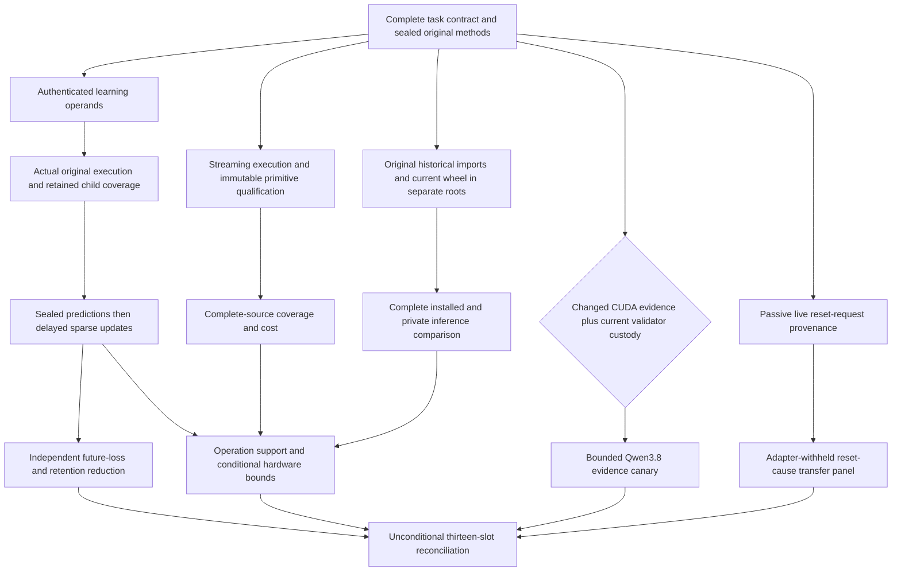
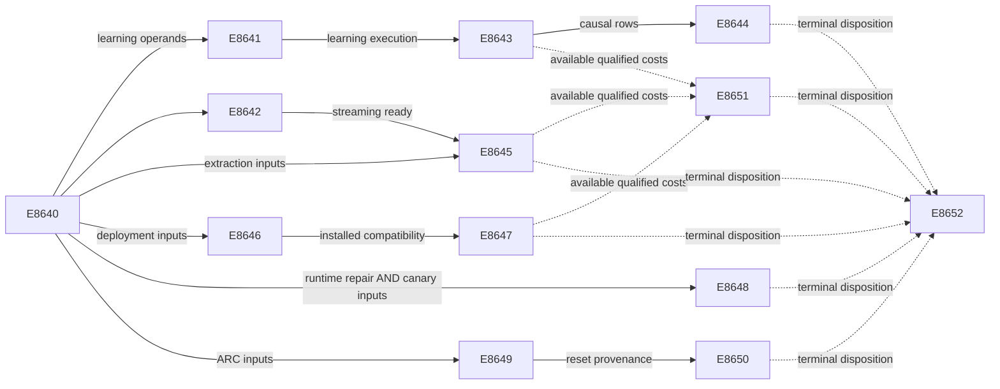

# Carnot Research Roadmap v742: Executable Learning and Complete Evidence

**Created:** 2026-10-18
**Milestone:** 2026.10.742
**Status:** Planned; staged only
**Title:** Causal learning, complete-source verification, and qualified installed inference
**Supersedes:** V741 scheduling; all historical evidence remains unchanged.
**Task contract:** Exactly 13 tasks, Exp8640 through Exp8652, in conductor order.

## What V741 Proved

V741 completed thirteen scheduling slots. Seven producers ran; four slots have
conductor pre-gate records and two have cascade-skip records without a producer.
The archive has not yet appended V741. The active queue, conductor log, original
producer artifacts and Exp8639 capstone establish the disposition. An `OK`
conductor row is not proof that scientific acceptance gates passed.

The complete previous design is preserved byte-for-byte in
`openspec/change-proposals/research-roadmap-v741-preserved-20261018.md`.

| Evidence | Actual result | Next decision |
|---|---|---|
| Exp8627 | Thirteen-object authority qualified; learning_inputs_ready_score=0 | Separate available learning operands from failed execution qualification |
| Exp8628/8630/8631 | Qualification pre-gated; training and audit cascade-skipped | Qualify actual execution before the unchanged scientific study |
| Exp8629 | Fixture parity and resource checks passed; original_coverage_retention failed | Capture actual child data immediately and freeze measurement bytes |
| Exp8632 | Natural complete-source comparison pre-gated | The 190-response coverage question remains unmeasured |
| Exp8633 | Installed lean prototype and private replay qualified | Preserve installed entry and lazy exports |
| Exp8634/8635 | Original compatibility node union failed; cost pre-gated | Qualify historical replay and current wheel separately, then measure |
| Exp8636 | No causal CUDA repair evidence | Conditional canary only; no repeated unchanged device probe |
| Exp8637 | Eight paired action-parity checks passed; all 16 redirects censored | Record reset request origin without changing policy or horizons |
| Exp8638 | No admitted new costs; owned validation disqualified its report | Separate external cost absence from report qualification and actual severity |
| Exp8639 | All thirteen slots reconciled; learning, streaming and cost remain blocked | Preserve missing science and all historical quarantines |

The learning defect is a circular prerequisite. `v741_contract_inputs.historical`
requires `Exp8616.required_checks_passed=1` for learning input readiness. Exp8628
was meant to repair Exp8616's missing execution evidence, but required that
readiness field first. V742 keeps the old failed result and creates a current
operand adapter. Only the new execution qualification can authorize training.

The streaming hook captures `.coverage.*` at combine time. Its retained-data
check failed. The capstone also found that its measurement bytes changed after
sealing. Fresh per-child snapshots and immutable invocation operands address
these two defects. Numerical parity observations alone remain insufficient.

Installed compatibility failed when an original prototype reader saw changed
`resident_protocol.py` bytes. A later source-overlay helper exists in the code;
its presence is not a qualified terminal receipt. V742 tests actual isolated
historical execution and current installed behavior, preserving both contracts.

Qualified older findings remain closed: exposed source-head information nulls,
V735 cold-cost null, V737 supervisor efficacy null, and V740's separate lean
lifecycle gain. V740 measured native/Python throughput CI95 [1.1799076, 1.2584954];
it did not meet NFR-01. No new study renames that comparison into a 10× result.

## Three Biggest Gaps Against the PRD

1. **FR-12: useful verification from complete evidence.** The original extractor
   abstained on 55 of 190 long-source responses. Streaming completeness remains
   unmeasured, and lexical evidence does not certify semantic truth. Finish the
   exposed coverage study with exact old-domain parity and full source custody.
2. **FR-06/FR-11: useful continuous self-learning.** The fixed causal study has
   not produced qualified future-loss and retention evidence. Separate input
   authentication from execution, then measure actual small-head updates and
   held-future typed decisions under the original controls.
3. **FR-05/FR-08/NFR-01: deployable, measured performance.** The installed lean
   entry exists, but public compatibility and complete installed costs remain
   unqualified. Preserve APIs and compare complete installed/private sessions.
   Native arithmetic and lifecycle gains remain separate estimands.

The ARC standing floor remains independent. Generalization work tests a reusable
reset-provenance hook on the scored live path with adapters withheld. It explains
observed censoring; it cannot establish supervisor efficacy or a new level solve.

## Research Selection

The dated V742 scan was appended to `research-references.md` before this design.
All eight requested arXiv topics and six secondary channels were checked.

| Lead | Experiment use | Boundary |
|---|---|---|
| [Long-context decomposition, 2504.19457](https://arxiv.org/abs/2504.19457) | Exp8642/8645 finish bounded complete-source reduction | Carnot's lexical adaptation is not the trained encoder |
| [Calibeating, 2603.22167](https://arxiv.org/abs/2603.22167) | Exp8643/8644 use proper-loss controls | No transferred nonlinear regret guarantee |
| [Delayed capacity, 2606.11711](https://arxiv.org/abs/2606.11711) | Exp8643 retains pending, admitted and lost feedback | Fixed causal protocol; no post-test scheduler change |
| [Online KAN, 2602.02056](https://arxiv.org/abs/2602.02056) | Exp8643/8651 count sparse writes and complete operations | No inferred FPGA speed |
| [Enoki, 2609.00581](https://arxiv.org/abs/2609.00581) | Exp8645 preserves answer/source offsets | Anchored evidence is not semantic entailment |
| [Ising review, 2610.03972](https://arxiv.org/abs/2610.03972) | Exp8651 distinguishes evaluator, optimizer and sampler support | Device compatibility precedes performance claims |

CORTEX (2606.31033) offers a future internal-representation discriminator.
It requires internal-state access and independent span labels. EBT, ARM–EBM,
neural routing feasibility, reward-guided decoding and KAN sample-efficiency
remain useful references. They do not justify a new generator, basis or retired
external-text reranker while the fixed studies remain unmeasured.

Semantic Scholar citation requests failed; citation-following is incomplete.
OpenReview forums returned browser challenges. GitHub Trending returned month-old
snapshots. Extropic estimates and Kona product positioning do not establish
local hardware access or a reproducible new architecture result.

## V742 Architecture



The existing nine-input energy head, basis, causal objective and learner stay
fixed. Streaming features do not enter the learning or installed-cost branches.
Original readers keep original pins. New adapters bind explicit current producers.
ARC instrumentation records actual causes without modifying decisions. Optional
CUDA absence cannot block CPU science. Hardware readers admit available branches
independently and preserve missing costs.

## Phase 1: Qualify Execution — Exp8640–Exp8642

**Exp8640 — contract and methods.** Bind thirteen full task objects and register
branch methods before observing results. Inherit V741 objective, audit, streaming,
installed-cost and canary operands by value and hash. Separate
`learning_operands_ready_score` from `learning_execution_ready_score`.
The first authenticates Exp8431's head, Exp8580's validator, Exp8581's accounting,
data and test inventory. Exp8641 exclusively owns the second. A regression must
show failed old execution permits the repair to run, while missing head/data
still blocks. This changes the input dependency, not the science acceptance gate.

**Exp8641 — learning execution custody.** Give each child an independent coverage
path. Read actual CoverageData immediately on child completion, retain raw SQLite
bytes and source identities, then combine copies. Keep original and new-adapter
aggregates separate. Require the original 27-node family, complete affected union,
83/83 original runner statements and unchanged deadline semantics. Deadline cases
3599/3600/3601 retain 2/3/3 clock reads and null/3600.25/3601.25 elapsed values.
Missing, overwritten, duplicate or foreign data must fail. A second combine must
leave original evidence unchanged. No historical quarantine is cleared.

**Exp8642 — streaming execution custody.** Keep the existing reducer. Replace late
filename-glob custody with direct per-child data capture and immutable invocation
measurements. Run original streaming tests and real child/publication checks.
Require exact eager/streaming parity at chunk sizes 1/32/128, original window
order, collision-safe byte deduplication and UTF-8 offsets. Preserve 512 KiB source,
64 KiB answer, 30 seconds per response, 256 MiB extra working memory and answer
cap 16. Qualification uses fixtures; natural coverage remains Exp8645's question.

## Phase 2: Measure Learning and Evidence — Exp8643–Exp8645

**Exp8643 — continuous self-learning.** Run the fixed nine-input,
109-coefficient head under frozen, log_loss, brier and brier_shuffled_released
arms. Seeds are 17/29/43/71/101. Five 20-question blocks with three siblings produce
6,000 intended predictions. Capacity is eight questions per block, learning rate
0.01 and L2 0.001. Preserve derivative `2*(p-y)*p*(1-p)/T`.
Seal predictions and target-blind admission before labels. Shuffle only admitted,
released labels. Commit state and acknowledgments atomically. Count real coordinate
writes, delayed/pending/lost feedback, durable writes and final drain. Execute real
block-2 exits and exact resumes for seed 17 in every arm. Retention evaluates
50 questions at five windows without training on them. This is the FR-11 and
calibrated typed-decision training slot; generator weights are untouched.

**Exp8644 — benefit and retention.** Reduce 80 later-block question units,
averaging siblings and seeds within question. Use 10,000 paired question draws,
seed 7278448 and two-sided 97.5% intervals. Brier training must beat both frozen
and log-loss controls with both lower bounds above zero and no higher typed loss.
Retention jointly resamples the same 50 questions across all five windows with
10,000 draws and seed 7258421. The upper 95% bound for maximum-window Brier
increase must be at most 0.01. Retain shuffled-release controls. A qualified null
closes this unchanged study. Exposed positives retain independent and generalized
learning scores of zero; construction-dependent positives remain circular.

**Exp8645 — complete-source coverage.** Use the same 190 responses and 128 exposed
question groups. Compare capped extraction to chunk-32 streaming; check chunk-1
and chunk-128 invariance. All 135 previously usable rows must preserve features
exactly. Keep all 55 prior window-limit abstentions, including any that still exceed
resource limits. The engineering gate requires full window custody, common-domain
parity, satisfied resource bounds and at least one recovered response. Interleave
three paired cost repetitions. Use question-cluster descriptive intervals with
10,000 draws and seed 7418632. Join labels after sealing features; compare fixed
scores on common and recovered support separately. No detector fitting, confidence
imputation or changed-denominator detection-benefit claim is authorized.

## Phase 3: Qualify Installed Costs — Exp8646–Exp8648

**Exp8646 — original and current compatibility.** First test the existing
original-source overlay in actual historical children. If unavailable, use an
immutable private checkout. Authenticate the original resident-protocol bytes;
never update historical pins. Preserve all 122 original nodes and their assertions.
Test the current wheel separately outside the checkout with PYTHONPATH removed.
Exercise installed inference, public imports, Python/native parity, CLI, MCP and
existing HTTP smoke routes. Verify resolved source paths, malformed framing,
deadlines, immutable configuration, stale payloads and forced cleanup. Legacy
coverage cannot fill missing current statements. All owned checks must pass
before installed measurement readiness.

**Exp8647 — complete installed cost.** Cross private/installed entry with
Python/native arithmetic. Keep original 64 requests, session lengths 1/4/16,
batch 1 and ten paired repetitions: 120 intended cells. Include setup, imports,
full features, transport, arithmetic, typed policy, serialization and shutdown.
Use original capped features and checkpoint. Primary L16/B1 installed_native /
private_native noninferiority requires throughput lower95 >= 0.95, p95 latency
ratio <= 1.05 and exact decisions. Use 10,000 paired-index draws and seed 7418635.
Native/Python remains a separate contrast; only its lower95 >= 10 meets NFR-01.
Preserve missing cells if the time cap stops work. Never shrink the planned matrix.

**Exp8648 — conditional Qwen canary.** Require supplied causal CUDA repair evidence
and current validator custody. Use `MODEL_SPECS=["unsloth/Qwen3.8-27B-GGUF"]`
and `model_bounded_generation`: four exposed fit questions in four fixed evidence
views, 16 calls, temperature zero and at most 128 output tokens per call.
Load cap is 600 seconds, call cap 120 seconds and measurement cap 2,400 seconds.
Use a GPU lease and real offload evidence. No unchanged device probe, download,
CPU headline fallback, generator training or scientific benefit claim is planned.

## Phase 4: Transfer Diagnostics and Reconcile — Exp8649–Exp8652

**Exp8649 — live reset provenance.** V741's real censoring motivates a reusable
passive hook. Record request ID, action index, actual requester/branch, public
observation hashes and remaining action/time budgets at reachable request sites.
Distinguish agent RESET, environment terminal, harness reset and unknown. Test
conflicting requesters, repeated reset, terminal without reset, recorder failure,
overlapping redirects and disabled instrumentation. Require action/RNG/SDK-call
parity through the scored wrapper. Seal historical source closures before changes;
new adapters bind current source explicitly. No arm priority or reset timing changes.

**Exp8650 — diagnostic transfer.** Run four games (ar25, ft09, lf52, tn36), seeds
11/22, with reset provenance off/on: 16 fresh official-SDK episodes. Keep the
existing outcome observer and capability masking on. Withhold adapters, routes and
LLM induction. Preserve 512-action/120-second limits and horizon 120. Require exact
actions in all eight pairs and unique authenticated requester ownership for every
observed agent/harness reset across all four games. Zero-reset games retain zero
support; unknown origins remain unknown. Current instrumentation and original
observer history use separate source bindings. Outcome censoring and the prior
supervisor null remain unchanged. This is a new diagnostic-transfer question,
not a repeated efficacy panel. No game-source access, offline BFS or solve claim.

**Exp8651 — operation evidence.** Read original board facts once, without device
commands. Admit new learning, installed and extraction cost boundaries separately.
Qualify report-state handling: external missing costs are blocked, INFO findings
stay INFO, critical findings and owned failures remain disqualified. Preserve every
finding. Recompute complete disjoint costs before any arithmetic-removal ceiling.
A ceiling is conditional, never a measured speedup. Explain the compatible work
and fixed host fraction needed for the program's 100× learning target. If costs
remain unavailable, emit null ceilings with exact diagnostics once.

**Exp8652 — capstone.** Run unconditionally. Reconcile all thirteen slots from
original producer and conductor evidence. Treat missing producers and pre-gate
artifacts distinctly. Reduce admitted science, preserve quarantines, and compare
literal verdicts plus normalized causes before recommending retirement. A qualified
null closes its exact study; failed qualification leaves science unmeasured.
Report G1–G4 and unmet gates from the unchanged publication script. Essential
external incompleteness is `blocked`, never retryable `partial`.

## Dependency Graph and Failure Isolation



The YAML supplies all conjunctive gates, including method/branch prerequisites
omitted from the compact diagram. Every gate references an earlier task in this
roadmap and a top-level numeric field in that producer's required fields.
Dotted edges are optional evidence reads, not conductor gates. Exp8651 and Exp8652
must run even if science or CUDA remains blocked. No `requires:` references a
retired task. Prior failures retain all four mandatory fields and concrete changes.
No operator override is asserted or needed for a reused retired ID.

## Hardware and Execution Requirements

| Resource | Tasks | Requirement and limit |
|---|---|---|
| CPU, Python 3.12 environment, disk-backed scratch | All except conditional model work | Bounded children, immutable raw shards, real flush/exit receipts |
| Rust/PyO3 and private wheel environment | Exp8646/8647 | Actual current extension and loaded wheel; original source separate |
| Dual RTX 3090 host | Exp8648 only | Lease sufficient available VRAM; authenticated repaired CUDA; no background-process interference |
| ARC SDK | Exp8649/8650 | Scored wrapper, adapter-withheld games, no LLM calls |
| KV260 | Exp8651 evidence mapping | Quadratic Ising scope, k <= 5; no deterministic spline or full-service support inferred |
| PolarFire | Exp8651 evidence mapping | Existing Linux CPU dispatch only |
| GateMate | Exp8651 evidence mapping | Physical change, GM1Ax IDCODE and n16 smoke remain prerequisites; no unchanged probe |
| NPU / Extropic TSU | Deferred | No qualified local execution or authenticated provider run |

No hardware acquisition, driver installation, flashing, external publication or
network message is part of the milestone. Sparse CPU/Rust updates remain the
current learning path. A conditional 100× target needs compatible dominant work
and at most 1% unaccelerated cost; a faster isolated kernel cannot establish it.

Task estimates total 650 minutes of serial work, including qualification. They
are scheduling estimates, not measured durations. Each task stays within the
4,800-second cap. All prompts require flushed phase/long-call boundaries,
inside-loop progress, child heartbeats at least every 60 seconds, silence below
600 seconds and file writes in chunks of at most 150 lines. Measurement ends by
3,600 seconds with at least 900 seconds reserved for validation. The model canary
uses the 10-second bounded-generation floor; load-only and full-generation classes
are not used. Small legacy models are permitted only as CPU smoke checks.

## Verification and Stop Conditions

Before activation, check schema, full-object JSON/YAML equality, independent visible
table parsing, canonical task digest, prompt requirements, path existence, gate
order/field names and complete prior-failure entries. Run exclusion, harness,
ARC-floor and priority linters. Use existing unit tests and private E2E-018/021
for planning authority/publication contracts. This planning change runs no science.

Each future implementation follows spec first, tests first, scoped lint/types,
100% owned unit/child statement coverage and applicable E2E checks. Preserve all
original assertions and raw evidence; no broad historical rerun controllers.
All claimed comparisons retain per-unit rows. Owned failure is disqualified;
unchanged external failure is blocked. The capstone cannot rewrite these classes.

Exp8640–8642 and Exp8646 reserve infrastructure work. Exp8643 satisfies continuous
self-learning and calibrated-decision training. Exp8649/8650 satisfy reusable live
ARC generalization work. Literature ingestion occurs in Exp8640. Formulaic live
hook work routes to Codex/gpt-6.1-sol; schema/preflight coordination routes to Opus
with 100 turns. Routine experiments use Sonnet. No Gemini or luna task is scheduled.

## Exact task contract

Exactly 13 tasks, Exp8640 through Exp8652, in this order. The JSON below contains
the complete task objects, including every prompt, gate and failure lineage.

| Order | Task ID | Title | Phase | Deliverable |
|---|---|---|---|---|
| 1 | exp8640-contract-methods | Bind thirteen tasks and separate research operands from execution qualification | 1 | results/experiment_8640_v742_contract_methods.json |
| 2 | exp8641-learning-execution-custody | Qualify original learning execution with immutable per-child coverage | 1 | results/experiment_8641_v742_learning_execution_custody.json |
| 3 | exp8642-streaming-execution-custody | Qualify streaming extraction with immutable measurements and actual child data | 1 | results/experiment_8642_v742_streaming_execution_custody.json |
| 4 | exp8643-causal-brier-stream | Measure continuous small-head learning with sealed delayed feedback | 2 | results/experiment_8643_v742_causal_brier_stream.json |
| 5 | exp8644-learning-benefit-audit | Test future Brier benefit and simultaneous retention from qualified causal rows | 2 | results/experiment_8644_v742_learning_benefit_audit.json |
| 6 | exp8645-complete-source-comparison | Measure complete streaming source coverage and matched cost on the exposed roster | 2 | results/experiment_8645_v742_complete_source_comparison.json |
| 7 | exp8646-installed-compatibility | Qualify original import contracts and current installed inference in separate roots | 3 | results/experiment_8646_v742_installed_compatibility.json |
| 8 | exp8647-installed-complete-cost | Measure complete installed and private inference under qualified compatibility | 3 | results/experiment_8647_v742_installed_complete_cost.json |
| 9 | exp8648-qwen-evidence-canary | Run bounded mandated-Qwen evidence views after causal runtime recovery | 3 | results/experiment_8648_v742_qwen_evidence_canary.json |
| 10 | exp8649-arc-reset-provenance | Qualify passive reset provenance on the reachable live ARC path | 4 | results/experiment_8649_v742_arc_reset_provenance.json |
| 11 | exp8650-arc-reset-transfer | Measure reset-cause transfer across adapter-withheld live games | 4 | results/experiment_8650_v742_arc_reset_transfer.json |
| 12 | exp8651-hardware-operation-evidence | Map qualified new operations while preserving absent cost and physical evidence | 4 | results/experiment_8651_v742_hardware_operation_evidence.json |
| 13 | exp8652-capstone | Reconcile thirteen outcomes and close unchanged scientific questions | 4 | results/experiment_8652_v742_capstone.json |

canonical_tasks_sha256: `sha256:37b4a48b1d0649006b646d10749f79badecb1c9dbbf84869a92f591f7fdbe12a`

<!-- V742_TASK_CONTRACT_START -->
```json
{
  "milestone": "2026.10.742",
  "tasks": [
{"MODEL_SPECS": [], "agent_type": "claude", "deliverable": "results/experiment_8640_v742_contract_methods.json", "estimated_wall_time_min": 40, "gated_on": [], "id": "exp8640-contract-methods", "inference_substrate_class": "no_model_load", "max_turns": 100, "milestone": "2026.10.742", "model": "opus", "per_unit_rows": true, "phase": 1, "prior_failures": [{"addressed_by": "Its scientific operand gate depended on failed execution qualification. A new adapter separates authenticated operands from execution; training still requires both new gates. The qualified old contract and failed execution remain unchanged.", "experiment_id": "exp8627-contract-methods", "retire_if_same_verdict": true, "verdict": "complete_circular_positive_v741_contract_methods"}], "priority": "high", "prompt": "CONTEXT:\nWork in {project_root} on {date}. V741 completed thirteen scheduling slots; seven producers ran. Learning never ran because input readiness required the failed Exp8616 qualification that its successor was meant to repair. Streaming fixtures passed numerical parity but lost original coverage custody. The installed prototype qualified; compatibility failed the original node union after resident_protocol.py changed. Exp8637 recorded sixteen censored redirects and exact observer action parity, with no complete horizon or promotion. Preserve all historical nulls and quarantines. V742 contains exactly thirteen tasks, Exp8640 through Exp8652.\n\nEXISTING CODE TO READ FIRST:\nCLAUDE.md; CODEX.md; ops/e2e-test-plan.md; ops/exclusion_manifest.yaml; openspec/capabilities/research-reporting/spec.md; openspec/capabilities/verification/spec.md; scripts/experiment_template.py; python/carnot/reporting/primary_publication.py; openspec/change-proposals/research-roadmap-vNEXT.md; research-references.md; python/carnot/reporting/v741_contract_inputs.py; python/carnot/reporting/v741_contract_methods.py; python/carnot/reporting/roadmap_contract.py; openspec/change-proposals/v741-methods-protocol.json; results/experiment_8627_v741_contract_methods.json; results/experiment_8639_v741_capstone.json; python/carnot/verify/cuda_reader_8410.py; research-studying.md\n\nTASK:\nBind thirteen tasks and separate research operands from execution qualification. Deliver results/experiment_8640_v742_contract_methods.json. Create thin runner scripts/experiments/experiment_8640_v742_contract_methods.py. Retain immutable primitives under results/raw/experiment_8640_v742_contract_methods/ and notes in docs/research-notes/v742-contract-methods.md. Same-roadmap outputs are future dependencies.\n\nCONCRETE STEPS:\n1. PRECONDITIONS: Print a flushed start line. Authenticate branch inputs, exact upstream paths, tools, free memory and writable disk-backed scratch. Record missing inputs and observed zeros separately in gate_check_summary. Optional GPU or board absence cannot block independent CPU branches.\n\n2. Print a flushed progress line at each phase boundary and before and after every model load, generation, benchmark and subprocess that can take minutes. Use unbuffered output. Print completed and pending counts inside long loops; supervise children with a flushed line at least every 60 seconds. Keep every silence gap under 600 seconds. Write any file over about 200 lines in several tool calls of at most 150 lines, with a progress message between calls. Poll work in calls of at most 60 seconds. Stop measurements by 3600 seconds and reserve at least 900 seconds for validation within the 4800-second hard cap. Never pad measured duration.\n\n3. Spec first: confirm driving REQ-* and SCENARIO-* before implementation. Write focused failing tests first for changed behavior. Preserve original assertions, scientific thresholds and historical verdicts. Accept --date {date}; use scripts/experiments/ for runners, tests/python/ for tests and /var/tmp for scratch. Do not change research-roadmap.yaml, shared validators, generator weights or external services.\n\n4. Declare inference_substrate_class=no_model_load and MODEL_SPECS=[]. Record zero current language-model calls. Keep imported generator identities in historical_model_provenance. Authenticate actual small-head numerical inference and checkpoint separately; no_model_load does not mean no numerical work.\n\n5. Bind exactly thirteen complete dictionaries, Exp8640 through Exp8652. Compare the independently parsed visible table, full JSON, canonical_tasks_sha256, end marker and staged or genuinely activated V742 YAML. Reject count, order, ID, title, phase, deliverable, prompt, model, substrate, gate and retirement mutations. Test staged-V742/active-V741 and authentically activated-V742. Preserve original V741 authority; never treat current vNEXT as a historical document.\n\n6. Create openspec/change-proposals/v742-methods-protocol.json before measurements. Inherit objective_updates, objective_audit, streaming_extraction_protocol, installed_entry_2x2 and evidence_canary by value and hash from original V741. Register explicit new producer references; retain original historical readers. Ingest the V742 research scan and map decomposition, delayed capacity, proper-loss controls and sparse updates to the studies. Record CORTEX and Enoki use/defer decisions with source versions; mark ingestion in research-studying.md.\n\n7. Reproduce the circular input gate using original Exp8627: learning_inputs_ready_score=0 because Exp8616.required_checks_passed=false. Implement a NEW current operand adapter; preserve that historical judgment. learning_operands_ready_score requires authenticated Exp8431 head, Exp8580 validator, Exp8581 accounting, original data/labels, sealed objective and original test-source inventory. It MUST NOT require Exp8616 or a future execution qualification to pass. Keep learning_execution_ready_score absent here; Exp8641 alone owns it. Test that valid research operands plus failed historical execution permit qualification to run, while missing head/data/hash still block. Both operand and execution gates remain required for actual training.\n\n8. Authenticate Exp8617 release custody and Exp8620 roster: 190 responses in 128 exposed question groups. Preserve streaming resource bounds, original eight features, answer cap 16 and chunk sizes 1/32/128; no p2 confidence imputation. Emit extraction_inputs_ready_score independently. Authenticate Exp8633 installed prototype and Exp8621/8622 baseline methods independently of failed Exp8634 compatibility; emit deployment_inputs_ready_score without claiming compatibility.\n\n9. Register the unchanged installed/private by Python/native 2x2 cost matrix: original 64 requests, session lengths 1/4/16, batch 1, ten paired repeats, 120 cells. Primary installed_native/private_native at L16 requires throughput lower95>=0.95, p95 ratio<=1.05 and exact decisions. Keep seed 7418635 and 10000 paired-index draws. Native/Python lower95>=10 alone meets NFR-01. Inherit source-study seed 7418632 and fixed causal audit seeds; no tuning after test outcomes.\n\n10. Authenticate Exp8637 real redirect ledger and Exp8624 observer. Register reset provenance qualification plus a fresh four-game/two-seed off/on panel, 16 episodes, max512 actions and120 seconds each, horizon120, original games/seeds and capability masking ON. New instrumentation records the actual reset request origin and termination reason. It changes no action, priority, reset timing or budget. Classify unknown provenance explicitly. This tests diagnostic transfer, not supervisor efficacy; emit arc_inputs_ready_score.\n\n11. Use the existing reader once on supplied CUDA change evidence, without a device command. runtime_repair_ready_score=1 requires causal library/environment repair hashes and actual context/copy success. canary_inputs_ready_score separately requires current validator custody. Missing optional evidence pre-skips Exp8648 without vetoing CPU branches. Emit methods_ready_score only after complete contract and authority controls; each branch readiness has its own exact input checks.\n\n12. Run scoped unit tests, private CLI checks, Ruff check/format, strict mypy and scripts/check_spec_coverage.py --files <owned-test-files>. Run applicable ops/e2e-test-plan.md checks, including private E2E-018/021 for authority and publication readers. Require 100 percent newly owned statement coverage including actual child and rejection paths. Collect the original node IDs once and run bounded disjoint children with -n 0 -o addopts= --no-cov under their immutable original authority. Preserve raw child coverage before combining copies. A killed child fails validation. Do not run the whole repository suite or nested historical controllers. Retain actual commands, exit codes, durations and hashed logs.\n\n13. Cold-replay immutable primitives in a fresh bounded process. Reject missing inputs and self-consistently rehashed tampering. Run primary_publication, scripts/adversarial_verify.py --json <private-candidate> and scripts/verdict_row_consistency_lint.py --strict <private-candidate>; preserve actual severity and findings. Validate final bytes before atomic publication. Failed owned checks are disqualified. Unchanged external incompleteness is blocked, never partial. Reconcile openspec/, _bmad/traceability.md, ops/status.md and ops/changelog.md without rewriting history.\n\nREQUIRED ARTIFACT FIELDS:\nexperiment_id, task_id, milestone, run_date: principle: Bind evidence to this invocation.\nhonest_verdict, verdict_class: principle: Use a complete_ terminal prefix. verdict_class is exactly positive | circular_positive | null | blocked | disqualified | partial. Partial permits retry only for unfinished owned work; external unchanged failures are blocked.\ngate_check_summary: principle: Every blocked_* or complete_blocked_* verdict names the failed check, upstream, path/hash, field, operator, expected and observed value. Missing differs from zero.\ninference_substrate, inference_substrate_class, MODEL_SPECS, model_invocation_counts, historical_model_provenance, target_model: principle: Separate current execution from imported generator identities. Authenticate any small energy head and actual checkpoint.\nrows, intended_count, completed_count, failed_count, censored_count, excluded_count, independent_count, sample_size_budget: principle: Preserve each unit, arm, metric and missing reason. Seeds and sibling responses are not independent questions.\nverifier_is_oracle, exposure_scope, independent_generalization_score, generalized_learning_benefit_score: principle: Oracle-dependent positives use circular_positive. Exposed data, compatibility and timing cannot establish independent generalization.\nrequired_checks_passed, flagged_adversarial, acceptance_gates, validation_receipts, terminal_validation_sidecar_path, adversarial_findings: principle: Qualification differs from scientific benefit. Failed acceptance gates forbid a positive class.\npreconditions_checked, duration_s, phase_spans, random_seed, reproducibility_checksum, source_artifact_hashes, code_config_hashes, raw_shard_hashes: principle: Preserve real clocks and immutable operands.\ncited_upstream_artifacts, field_principles: principle: Name original producers and explain every added metric or gate.\nmethods_ready_score, current_contract_ready_score, learning_operands_ready_score, extraction_inputs_ready_score, deployment_inputs_ready_score, arc_inputs_ready_score, canary_inputs_ready_score, runtime_repair_ready_score: principle: Separate available operands from execution certification and optional runtime.\nmethods_protocol_reference, inherited_operand_checks, circular_gate_regression_rows, historical_quarantines, gate_field_map, literature_method_rows, canonical_tasks_sha256, authority_mutation_rows: principle: Preserve original authority and register every gate before measurement.\n\nbranch_gate_values: principle: Every readiness field named above is a top-level numeric 0/1 value. Qualification and scientific benefit are separate.\n\nRun command: cd {project_root} && JAX_PLATFORMS=cpu PYTHONPATH=python:. PYTHONUNBUFFERED=1 .venv/bin/python -u scripts/experiments/experiment_8640_v742_contract_methods.py --date {date}\n\nDo NOT push. Do NOT modify scripts/research_conductor.py.\n", "requires_gpu": false, "title": "Bind thirteen tasks and separate research operands from execution qualification", "track": "research"},
{"MODEL_SPECS": [], "agent_type": "claude", "deliverable": "results/experiment_8641_v742_learning_execution_custody.json", "estimated_wall_time_min": 65, "gated_on": [{"artifact_field": "methods_ready_score", "op": "==", "upstream": "exp8640-contract-methods", "value": 1}, {"artifact_field": "learning_operands_ready_score", "op": "==", "upstream": "exp8640-contract-methods", "value": 1}], "id": "exp8641-learning-execution-custody", "inference_substrate_class": "no_model_load", "max_turns": 100, "milestone": "2026.10.742", "model": "opus", "per_unit_rows": true, "phase": 1, "prior_failures": [{"addressed_by": "It never ran because its input gate required the failed Exp8616. Exp8640 now separates valid research operands from execution, and this task independently certifies real child shards.", "experiment_id": "exp8628-learning-shard-custody", "retire_if_same_verdict": true, "verdict": "blocked_gate_check_failed"}, {"addressed_by": "Per-child capture before any later suite, distinct aggregate namespaces and a second-combine regression address missing original SQLite evidence.", "experiment_id": "exp8616-deadline-statement-qualification", "retire_if_same_verdict": true, "verdict": "complete_disqualified_v740_deadline_statement_qualification"}], "priority": "high", "prompt": "CONTEXT:\nWork in {project_root} on {date}. V741 completed thirteen scheduling slots; seven producers ran. Learning never ran because input readiness required the failed Exp8616 qualification that its successor was meant to repair. Streaming fixtures passed numerical parity but lost original coverage custody. The installed prototype qualified; compatibility failed the original node union after resident_protocol.py changed. Exp8637 recorded sixteen censored redirects and exact observer action parity, with no complete horizon or promotion. Preserve all historical nulls and quarantines. V742 contains exactly thirteen tasks, Exp8640 through Exp8652.\n\nEXISTING CODE TO READ FIRST:\nCLAUDE.md; CODEX.md; ops/e2e-test-plan.md; ops/exclusion_manifest.yaml; openspec/capabilities/research-reporting/spec.md; openspec/capabilities/verification/spec.md; scripts/experiment_template.py; python/carnot/reporting/primary_publication.py; openspec/change-proposals/research-roadmap-vNEXT.md; research-references.md; python/carnot/reporting/deadline_statement_validation_8616.py; python/carnot/reporting/deadline_statement_8616.py; python/carnot/reporting/learning_clock_8592.py; python/carnot/reporting/deadline_edge_8603.py; python/carnot/reporting/causal_brier_runner_8582.py; tests/python/test_deadline_statement_8616.py; tests/python/test_causal_brier_stream_8582.py; results/experiment_8616_v740_deadline_statement_qualification.json; results/experiment_8628_learning_shard_custody.json\n\nTASK:\nQualify original learning execution with immutable per-child coverage. Deliver results/experiment_8641_v742_learning_execution_custody.json. Create thin runner scripts/experiments/experiment_8641_v742_learning_execution_custody.py. Retain immutable primitives under results/raw/experiment_8641_v742_learning_execution_custody/ and notes in docs/research-notes/v742-learning-execution-custody.md. Same-roadmap outputs are future dependencies.\n\nCONCRETE STEPS:\n1. PRECONDITIONS: Print a flushed start line. Authenticate branch inputs, exact upstream paths, tools, free memory and writable disk-backed scratch. Record missing inputs and observed zeros separately in gate_check_summary. Optional GPU or board absence cannot block independent CPU branches.\n\n2. Print a flushed progress line at each phase boundary and before and after every model load, generation, benchmark and subprocess that can take minutes. Use unbuffered output. Print completed and pending counts inside long loops; supervise children with a flushed line at least every 60 seconds. Keep every silence gap under 600 seconds. Write any file over about 200 lines in several tool calls of at most 150 lines, with a progress message between calls. Poll work in calls of at most 60 seconds. Stop measurements by 3600 seconds and reserve at least 900 seconds for validation within the 4800-second hard cap. Never pad measured duration.\n\n3. Spec first: confirm driving REQ-* and SCENARIO-* before implementation. Write focused failing tests first for changed behavior. Preserve original assertions, scientific thresholds and historical verdicts. Accept --date {date}; use scripts/experiments/ for runners, tests/python/ for tests and /var/tmp for scratch. Do not change research-roadmap.yaml, shared validators, generator weights or external services.\n\n4. Declare inference_substrate_class=no_model_load and MODEL_SPECS=[]. Record zero current language-model calls. Keep imported generator identities in historical_model_provenance. Authenticate actual small-head numerical inference and checkpoint separately; no_model_load does not mean no numerical work.\n\n5. Require Exp8640.methods_ready_score=1 and learning_operands_ready_score=1. No dependency on Exp8616.required_checks_passed or retired Exp8628 is allowed. Preserve original failure as evidence; this is a new qualification with a changed execution-evidence mechanism, not a repair stamp on old results.\n\n6. Give every test child a unique COVERAGE_FILE and raw namespace. Immediately after each child exits, before another suite or combine, inventory actual data paths, read CoverageData to confirm source statements and contexts, copy and hash SQLite bytes, command, node IDs, PID, source hashes and exit. Include actual data files whether suffix-sharded or unsuffixed. Never infer execution from a filename glob alone. Separate original runner and new adapter data; combine copies into different output namespaces.\n\n7. Use a small failing fixture to demonstrate the old lost-shard/second-combine failure. Add deleted, overwritten, empty, duplicate, foreign-source and self-consistently rehashed-substitution controls. A repeated combine must preserve original raw and aggregate hashes. Execute actual subprocess and cleanup paths; zero real child data rejects readiness. Do not reuse Exp8616 current overwritten measurement bytes as the original evidence.\n\n8. Run the original27-node causal runner family and complete affected Exp8592/8603/8616 test union under independently sealed original authority. Collect once and partition into bounded children. Reuse the measured mechanics fixture instead of retraining per test. Require83/83 original executable runner statements, source-bound continuation94-to-statement92 mapping, no exclusions and100percent newly owned statements. Keep deadline3599/3600/3601 controls with2/3/3 clock reads and elapsed null/3600.25/3601.25. Mutation controls must catch a removed third read, absent expired case and changed diagnostic.\n\n9. Cold-recompute both coverage unions from retained raw data. Require all original assertions, semantic deadline checks, current source identity and terminal consumer acceptance before learning_execution_ready_score=1. Do not change learner numerics, clock semantics or shared validators. A repeat of the same custody failure retires this precise qualification scope; it does not fabricate a scientific null.\n\n10. Run scoped unit tests, private CLI checks, Ruff check/format, strict mypy and scripts/check_spec_coverage.py --files <owned-test-files>. Run applicable ops/e2e-test-plan.md checks, including private E2E-018/021 for authority and publication readers. Require 100 percent newly owned statement coverage including actual child and rejection paths. Collect the original node IDs once and run bounded disjoint children with -n 0 -o addopts= --no-cov under their immutable original authority. Preserve raw child coverage before combining copies. A killed child fails validation. Do not run the whole repository suite or nested historical controllers. Retain actual commands, exit codes, durations and hashed logs.\n\n11. Cold-replay immutable primitives in a fresh bounded process. Reject missing inputs and self-consistently rehashed tampering. Run primary_publication, scripts/adversarial_verify.py --json <private-candidate> and scripts/verdict_row_consistency_lint.py --strict <private-candidate>; preserve actual severity and findings. Validate final bytes before atomic publication. Failed owned checks are disqualified. Unchanged external incompleteness is blocked, never partial. Reconcile openspec/, _bmad/traceability.md, ops/status.md and ops/changelog.md without rewriting history.\n\nREQUIRED ARTIFACT FIELDS:\nexperiment_id, task_id, milestone, run_date: principle: Bind evidence to this invocation.\nhonest_verdict, verdict_class: principle: Use a complete_ terminal prefix. verdict_class is exactly positive | circular_positive | null | blocked | disqualified | partial. Partial permits retry only for unfinished owned work; external unchanged failures are blocked.\ngate_check_summary: principle: Every blocked_* or complete_blocked_* verdict names the failed check, upstream, path/hash, field, operator, expected and observed value. Missing differs from zero.\ninference_substrate, inference_substrate_class, MODEL_SPECS, model_invocation_counts, historical_model_provenance, target_model: principle: Separate current execution from imported generator identities. Authenticate any small energy head and actual checkpoint.\nrows, intended_count, completed_count, failed_count, censored_count, excluded_count, independent_count, sample_size_budget: principle: Preserve each unit, arm, metric and missing reason. Seeds and sibling responses are not independent questions.\nverifier_is_oracle, exposure_scope, independent_generalization_score, generalized_learning_benefit_score: principle: Oracle-dependent positives use circular_positive. Exposed data, compatibility and timing cannot establish independent generalization.\nrequired_checks_passed, flagged_adversarial, acceptance_gates, validation_receipts, terminal_validation_sidecar_path, adversarial_findings: principle: Qualification differs from scientific benefit. Failed acceptance gates forbid a positive class.\npreconditions_checked, duration_s, phase_spans, random_seed, reproducibility_checksum, source_artifact_hashes, code_config_hashes, raw_shard_hashes: principle: Preserve real clocks and immutable operands.\ncited_upstream_artifacts, field_principles: principle: Name original producers and explain every added metric or gate.\nlearning_execution_ready_score, original_node_union, executed_node_ids, child_shard_manifest, original_aggregate_reference, owned_aggregate_reference: principle: A new actual execution qualifies training; historical failure never qualifies itself.\ncoverage_version, source_bytecode_hashes, normalized_statement_rows, deadline_case_rows, semantic_mutation_rows, custody_mutation_rows, second_combine_invariance: principle: Coverage evidence and behavioral controls must both be retained.\n\nbranch_gate_values: principle: Every readiness field named above is a top-level numeric 0/1 value. Qualification and scientific benefit are separate.\n\nRun command: cd {project_root} && JAX_PLATFORMS=cpu PYTHONPATH=python:. PYTHONUNBUFFERED=1 .venv/bin/python -u scripts/experiments/experiment_8641_v742_learning_execution_custody.py --date {date}\n\nDo NOT push. Do NOT modify scripts/research_conductor.py.\n", "requires_gpu": false, "title": "Qualify original learning execution with immutable per-child coverage", "track": "research"},
{"MODEL_SPECS": [], "agent_type": "claude", "deliverable": "results/experiment_8642_v742_streaming_execution_custody.json", "estimated_wall_time_min": 50, "gated_on": [{"artifact_field": "methods_ready_score", "op": "==", "upstream": "exp8640-contract-methods", "value": 1}], "id": "exp8642-streaming-execution-custody", "inference_substrate_class": "no_model_load", "max_turns": 100, "milestone": "2026.10.742", "model": "opus", "per_unit_rows": true, "phase": 1, "prior_failures": [{"addressed_by": "Capture actual data immediately per child instead of a late filename glob; immutable invocation measurements also address the changed operand hash observed by Exp8639.", "experiment_id": "exp8629-streaming-source-prototype", "retire_if_same_verdict": true, "verdict": "complete_disqualified_v741_streaming_source_prototype"}], "priority": "high", "prompt": "CONTEXT:\nWork in {project_root} on {date}. V741 completed thirteen scheduling slots; seven producers ran. Learning never ran because input readiness required the failed Exp8616 qualification that its successor was meant to repair. Streaming fixtures passed numerical parity but lost original coverage custody. The installed prototype qualified; compatibility failed the original node union after resident_protocol.py changed. Exp8637 recorded sixteen censored redirects and exact observer action parity, with no complete horizon or promotion. Preserve all historical nulls and quarantines. V742 contains exactly thirteen tasks, Exp8640 through Exp8652.\n\nEXISTING CODE TO READ FIRST:\nCLAUDE.md; CODEX.md; ops/e2e-test-plan.md; ops/exclusion_manifest.yaml; openspec/capabilities/research-reporting/spec.md; openspec/capabilities/verification/spec.md; scripts/experiment_template.py; python/carnot/reporting/primary_publication.py; openspec/change-proposals/research-roadmap-vNEXT.md; research-references.md; python/carnot/verify/streaming_evidence.py; python/carnot/reporting/streaming_source_runner_8629.py; python/carnot/reporting/streaming_source_8629.py; python/carnot/reporting/triviaplus_extraction_runner_8620.py; tests/python/test_streaming_evidence_8629.py; results/experiment_8629_v741_streaming_source_prototype.json; results/experiment_8639_v741_capstone.json\n\nTASK:\nQualify streaming extraction with immutable measurements and actual child data. Deliver results/experiment_8642_v742_streaming_execution_custody.json. Create thin runner scripts/experiments/experiment_8642_v742_streaming_execution_custody.py. Retain immutable primitives under results/raw/experiment_8642_v742_streaming_execution_custody/ and notes in docs/research-notes/v742-streaming-execution-custody.md. Same-roadmap outputs are future dependencies.\n\nCONCRETE STEPS:\n1. PRECONDITIONS: Print a flushed start line. Authenticate branch inputs, exact upstream paths, tools, free memory and writable disk-backed scratch. Record missing inputs and observed zeros separately in gate_check_summary. Optional GPU or board absence cannot block independent CPU branches.\n\n2. Print a flushed progress line at each phase boundary and before and after every model load, generation, benchmark and subprocess that can take minutes. Use unbuffered output. Print completed and pending counts inside long loops; supervise children with a flushed line at least every 60 seconds. Keep every silence gap under 600 seconds. Write any file over about 200 lines in several tool calls of at most 150 lines, with a progress message between calls. Poll work in calls of at most 60 seconds. Stop measurements by 3600 seconds and reserve at least 900 seconds for validation within the 4800-second hard cap. Never pad measured duration.\n\n3. Spec first: confirm driving REQ-* and SCENARIO-* before implementation. Write focused failing tests first for changed behavior. Preserve original assertions, scientific thresholds and historical verdicts. Accept --date {date}; use scripts/experiments/ for runners, tests/python/ for tests and /var/tmp for scratch. Do not change research-roadmap.yaml, shared validators, generator weights or external services.\n\n4. Declare inference_substrate_class=no_model_load and MODEL_SPECS=[]. Record zero current language-model calls. Keep imported generator identities in historical_model_provenance. Authenticate actual small-head numerical inference and checkpoint separately; no_model_load does not mean no numerical work.\n\n5. Reproduce original_coverage_retention=false in the small runner fixture. The existing hook scans .coverage.* only at combine time, after other suites can consume data. Add direct per-child capture with explicit CoverageData inventory and distinct per-run paths; preserve unsuffixed data where actually produced. Record real source statements before cleanup. Reuse the extractor unchanged unless a failing semantic regression identifies a specific bug.\n\n6. Freeze measurement primitives in a new invocation directory before candidate construction. Exp8639 recorded a changed Exp8629 measurement hash; old bytes and old disqualification remain unchanged. New candidates reference immutable copied operands. Repeated validation and combines must leave their hashes stable. Reject rehashed replacement, deleted shards, foreign source data and stale aliases. Historical publication files are never rewritten by tests.\n\n7. Execute the complete original streaming test family and original private publication readers. Independently enumerate eager windows and compare chunk sizes1/32/128. Require exact feature parity, original window order, collision-safe byte deduplication, UTF-8 offsets and preserved answer cap16. Test empty/repeated/unicode/oversized inputs, timeout, memory/resource rejection and actual disk cleanup.\n\n8. Keep bounds512KiB source,64KiB answer,30seconds per response and256MiB extra working memory. Qualify100percent actual owned statements, original node union and stable cold replay using immutable child evidence. streaming_extractor_ready_score=1 requires these checks and original semantic parity. This task uses constructed fixtures; natural coverage is exclusively Exp8645. No semantic detection claim follows.\n\n9. Run scoped unit tests, private CLI checks, Ruff check/format, strict mypy and scripts/check_spec_coverage.py --files <owned-test-files>. Run applicable ops/e2e-test-plan.md checks, including private E2E-018/021 for authority and publication readers. Require 100 percent newly owned statement coverage including actual child and rejection paths. Collect the original node IDs once and run bounded disjoint children with -n 0 -o addopts= --no-cov under their immutable original authority. Preserve raw child coverage before combining copies. A killed child fails validation. Do not run the whole repository suite or nested historical controllers. Retain actual commands, exit codes, durations and hashed logs.\n\n10. Cold-replay immutable primitives in a fresh bounded process. Reject missing inputs and self-consistently rehashed tampering. Run primary_publication, scripts/adversarial_verify.py --json <private-candidate> and scripts/verdict_row_consistency_lint.py --strict <private-candidate>; preserve actual severity and findings. Validate final bytes before atomic publication. Failed owned checks are disqualified. Unchanged external incompleteness is blocked, never partial. Reconcile openspec/, _bmad/traceability.md, ops/status.md and ops/changelog.md without rewriting history.\n\nREQUIRED ARTIFACT FIELDS:\nexperiment_id, task_id, milestone, run_date: principle: Bind evidence to this invocation.\nhonest_verdict, verdict_class: principle: Use a complete_ terminal prefix. verdict_class is exactly positive | circular_positive | null | blocked | disqualified | partial. Partial permits retry only for unfinished owned work; external unchanged failures are blocked.\ngate_check_summary: principle: Every blocked_* or complete_blocked_* verdict names the failed check, upstream, path/hash, field, operator, expected and observed value. Missing differs from zero.\ninference_substrate, inference_substrate_class, MODEL_SPECS, model_invocation_counts, historical_model_provenance, target_model: principle: Separate current execution from imported generator identities. Authenticate any small energy head and actual checkpoint.\nrows, intended_count, completed_count, failed_count, censored_count, excluded_count, independent_count, sample_size_budget: principle: Preserve each unit, arm, metric and missing reason. Seeds and sibling responses are not independent questions.\nverifier_is_oracle, exposure_scope, independent_generalization_score, generalized_learning_benefit_score: principle: Oracle-dependent positives use circular_positive. Exposed data, compatibility and timing cannot establish independent generalization.\nrequired_checks_passed, flagged_adversarial, acceptance_gates, validation_receipts, terminal_validation_sidecar_path, adversarial_findings: principle: Qualification differs from scientific benefit. Failed acceptance gates forbid a positive class.\npreconditions_checked, duration_s, phase_spans, random_seed, reproducibility_checksum, source_artifact_hashes, code_config_hashes, raw_shard_hashes: principle: Preserve real clocks and immutable operands.\ncited_upstream_artifacts, field_principles: principle: Name original producers and explain every added metric or gate.\nstreaming_extractor_ready_score, child_shard_manifest, measurement_reference, original_node_union, immutable_revalidation_rows, feature_parity_rows, chunk_parity_rows, window_offset_rows, resource_rejection_rows, bounded_memory_rows: principle: Actual code execution and stable primitive custody qualify the later natural comparison.\n\nbranch_gate_values: principle: Every readiness field named above is a top-level numeric 0/1 value. Qualification and scientific benefit are separate.\n\nRun command: cd {project_root} && JAX_PLATFORMS=cpu PYTHONPATH=python:. PYTHONUNBUFFERED=1 .venv/bin/python -u scripts/experiments/experiment_8642_v742_streaming_execution_custody.py --date {date}\n\nDo NOT push. Do NOT modify scripts/research_conductor.py.\n", "requires_gpu": false, "title": "Qualify streaming extraction with immutable measurements and actual child data", "track": "research"},
{"MODEL_SPECS": [], "agent_type": "claude", "deliverable": "results/experiment_8643_v742_causal_brier_stream.json", "estimated_wall_time_min": 65, "gated_on": [{"artifact_field": "learning_operands_ready_score", "op": "==", "upstream": "exp8640-contract-methods", "value": 1}, {"artifact_field": "learning_execution_ready_score", "op": "==", "upstream": "exp8641-learning-execution-custody", "value": 1}], "id": "exp8643-causal-brier-stream", "inference_substrate_class": "no_model_load", "max_turns": 50, "milestone": "2026.10.742", "model": "sonnet", "per_unit_rows": true, "phase": 2, "prior_failures": [{"addressed_by": "The V741 slot has no producer artifact; its disposition is recorded by the conductor and Exp8639. New independent operand and actual execution qualifications replace that dead chain. This is the Exp8639 adjudicated disposition; no producer honest_verdict exists.", "experiment_id": "exp8630-causal-brier-stream", "retire_if_same_verdict": true, "verdict": "complete_blocked_missing_primary"}, {"addressed_by": "Use the qualified isolated orchestration clock and retained original deadline tests; preserve the original numerical protocol and previous quarantine.", "experiment_id": "exp8582-causal-brier-stream", "retire_if_same_verdict": true, "verdict": "complete_disqualified_v737_causal_brier_stream"}], "priority": "high", "prompt": "CONTEXT:\nWork in {project_root} on {date}. V741 completed thirteen scheduling slots; seven producers ran. Learning never ran because input readiness required the failed Exp8616 qualification that its successor was meant to repair. Streaming fixtures passed numerical parity but lost original coverage custody. The installed prototype qualified; compatibility failed the original node union after resident_protocol.py changed. Exp8637 recorded sixteen censored redirects and exact observer action parity, with no complete horizon or promotion. Preserve all historical nulls and quarantines. V742 contains exactly thirteen tasks, Exp8640 through Exp8652.\n\nEXISTING CODE TO READ FIRST:\nCLAUDE.md; CODEX.md; ops/e2e-test-plan.md; ops/exclusion_manifest.yaml; openspec/capabilities/research-reporting/spec.md; openspec/capabilities/verification/spec.md; scripts/experiment_template.py; python/carnot/reporting/primary_publication.py; openspec/change-proposals/research-roadmap-vNEXT.md; research-references.md; python/carnot/reporting/causal_brier_stream_8582.py; python/carnot/reporting/causal_brier_evidence_8582.py; python/carnot/reporting/causal_brier_runner_8582.py; openspec/change-proposals/v741-methods-protocol.json; results/experiment_8431_v726_criterion_energy_fit.json; tests/python/test_causal_brier_stream_8582.py\n\nTASK:\nMeasure continuous small-head learning with sealed delayed feedback. Deliver results/experiment_8643_v742_causal_brier_stream.json. Create thin runner scripts/experiments/experiment_8643_v742_causal_brier_stream.py. Retain immutable primitives under results/raw/experiment_8643_v742_causal_brier_stream/ and notes in docs/research-notes/v742-causal-brier-stream.md. Same-roadmap outputs are future dependencies.\n\nCONCRETE STEPS:\n1. PRECONDITIONS: Print a flushed start line. Authenticate branch inputs, exact upstream paths, tools, free memory and writable disk-backed scratch. Record missing inputs and observed zeros separately in gate_check_summary. Optional GPU or board absence cannot block independent CPU branches.\n\n2. Print a flushed progress line at each phase boundary and before and after every model load, generation, benchmark and subprocess that can take minutes. Use unbuffered output. Print completed and pending counts inside long loops; supervise children with a flushed line at least every 60 seconds. Keep every silence gap under 600 seconds. Write any file over about 200 lines in several tool calls of at most 150 lines, with a progress message between calls. Poll work in calls of at most 60 seconds. Stop measurements by 3600 seconds and reserve at least 900 seconds for validation within the 4800-second hard cap. Never pad measured duration.\n\n3. Spec first: confirm driving REQ-* and SCENARIO-* before implementation. Write focused failing tests first for changed behavior. Preserve original assertions, scientific thresholds and historical verdicts. Accept --date {date}; use scripts/experiments/ for runners, tests/python/ for tests and /var/tmp for scratch. Do not change research-roadmap.yaml, shared validators, generator weights or external services.\n\n4. Declare inference_substrate_class=no_model_load and MODEL_SPECS=[]. Record zero current language-model calls. Keep imported generator identities in historical_model_provenance. Authenticate actual small-head numerical inference and checkpoint separately; no_model_load does not mean no numerical work.\n\n5. Require Exp8640.learning_operands_ready_score=1 and Exp8641.learning_execution_ready_score=1. Authenticate current qualification and original Exp8431 operands. Reuse fixed objective_updates by value/hash. A qualifying receipt permits fresh work; it does not clear Exp8582 or Exp8616 historical disqualification.\n\n6. Train only the existing nine-input109-coefficient small energy head. Preserve arms frozen, log_loss, brier and brier_shuffled_released; seeds17/29/43/71/101; five20-question blocks with three siblings,6000 predictions. Preserve capacity8 questions per block, learning_rate0.01,L2=0.001 and Brier derivative2*(p-y)*p*(1-p)/T. Do not refit the source head, change basis, tune on test rows or train the mandated generator.\n\n7. Seal all predictions and target-blind admission before releasing labels. Shuffle only released admitted labels within the registered block. Persist prediction hashes, delay and admission/rejection reasons, pending/lost feedback, pre/post coefficients, actual nonzero coordinate writes and acknowledgment IDs. Commit updated state and acknowledgments atomically. Evaluate50 retention questions at five windows without admitting their labels to training.\n\n8. For seed17 in every arm, execute real block2 child exits and exact resume comparisons against uninterrupted histories. Preserve earlier state commits and no double acknowledgment. Count actual attempted/applied updates; zero numerical movement is not a learned result. Qualify causal rows even if science is null; learning_rows_ready_score does not depend on benefit.\n\n9. Use real complete clocks including extraction, prediction, update, serialization, durable file/directory sync, response and final feedback drain. Retain disjoint spans and actual primitive operands. Authenticate the head descriptor for shared validators; do not disguise numerical inference as absence of inference. Publish learning_rows_ready_score and learning_cost_ready_score independently. Refer every efficacy conclusion to Exp8644.\n\n10. Run scoped unit tests, private CLI checks, Ruff check/format, strict mypy and scripts/check_spec_coverage.py --files <owned-test-files>. Run applicable ops/e2e-test-plan.md checks, including private E2E-018/021 for authority and publication readers. Require 100 percent newly owned statement coverage including actual child and rejection paths. Collect the original node IDs once and run bounded disjoint children with -n 0 -o addopts= --no-cov under their immutable original authority. Preserve raw child coverage before combining copies. A killed child fails validation. Do not run the whole repository suite or nested historical controllers. Retain actual commands, exit codes, durations and hashed logs.\n\n11. Cold-replay immutable primitives in a fresh bounded process. Reject missing inputs and self-consistently rehashed tampering. Run primary_publication, scripts/adversarial_verify.py --json <private-candidate> and scripts/verdict_row_consistency_lint.py --strict <private-candidate>; preserve actual severity and findings. Validate final bytes before atomic publication. Failed owned checks are disqualified. Unchanged external incompleteness is blocked, never partial. Reconcile openspec/, _bmad/traceability.md, ops/status.md and ops/changelog.md without rewriting history.\n\nREQUIRED ARTIFACT FIELDS:\nexperiment_id, task_id, milestone, run_date: principle: Bind evidence to this invocation.\nhonest_verdict, verdict_class: principle: Use a complete_ terminal prefix. verdict_class is exactly positive | circular_positive | null | blocked | disqualified | partial. Partial permits retry only for unfinished owned work; external unchanged failures are blocked.\ngate_check_summary: principle: Every blocked_* or complete_blocked_* verdict names the failed check, upstream, path/hash, field, operator, expected and observed value. Missing differs from zero.\ninference_substrate, inference_substrate_class, MODEL_SPECS, model_invocation_counts, historical_model_provenance, target_model: principle: Separate current execution from imported generator identities. Authenticate any small energy head and actual checkpoint.\nrows, intended_count, completed_count, failed_count, censored_count, excluded_count, independent_count, sample_size_budget: principle: Preserve each unit, arm, metric and missing reason. Seeds and sibling responses are not independent questions.\nverifier_is_oracle, exposure_scope, independent_generalization_score, generalized_learning_benefit_score: principle: Oracle-dependent positives use circular_positive. Exposed data, compatibility and timing cannot establish independent generalization.\nrequired_checks_passed, flagged_adversarial, acceptance_gates, validation_receipts, terminal_validation_sidecar_path, adversarial_findings: principle: Qualification differs from scientific benefit. Failed acceptance gates forbid a positive class.\npreconditions_checked, duration_s, phase_spans, random_seed, reproducibility_checksum, source_artifact_hashes, code_config_hashes, raw_shard_hashes: principle: Preserve real clocks and immutable operands.\ncited_upstream_artifacts, field_principles: principle: Name original producers and explain every added metric or gate.\ncontinuous_self_learning_task, learning_rows_ready_score, learning_cost_ready_score, prediction_rows, update_rows, retention_rows, restart_rows, head_descriptor_reference, actual_coordinate_writes, pre_post_state_hashes: principle: FR-11 requires real causal model updates and preserved later predictions.\nprediction_seals, feedback_release_rows, acknowledgment_rows, pending_feedback_rows, lost_feedback_rows, complete_cost_rows, final_drain_reference: principle: No future labels and no omitted update or durable-storage cost.\n\nbranch_gate_values: principle: Every readiness field named above is a top-level numeric 0/1 value. Qualification and scientific benefit are separate.\n\nRun command: cd {project_root} && JAX_PLATFORMS=cpu PYTHONPATH=python:. PYTHONUNBUFFERED=1 .venv/bin/python -u scripts/experiments/experiment_8643_v742_causal_brier_stream.py --date {date}\n\nDo NOT push. Do NOT modify scripts/research_conductor.py.\n", "requires_gpu": false, "title": "Measure continuous small-head learning with sealed delayed feedback", "track": "research"},
{"MODEL_SPECS": [], "agent_type": "claude", "deliverable": "results/experiment_8644_v742_learning_benefit_audit.json", "estimated_wall_time_min": 35, "gated_on": [{"artifact_field": "learning_rows_ready_score", "op": "==", "upstream": "exp8643-causal-brier-stream", "value": 1}], "id": "exp8644-learning-benefit-audit", "inference_substrate_class": "no_model_load", "max_turns": 50, "milestone": "2026.10.742", "model": "sonnet", "per_unit_rows": true, "phase": 2, "prior_failures": [{"addressed_by": "Its causal producer never ran. Exp8643 requires the new qualified execution chain; unchanged absent upstream evidence remains blocked and cannot trigger partial retries. This is the Exp8639 adjudicated disposition; no producer honest_verdict exists.", "experiment_id": "exp8631-learning-benefit-audit", "retire_if_same_verdict": true, "verdict": "complete_blocked_missing_primary"}], "priority": "high", "prompt": "CONTEXT:\nWork in {project_root} on {date}. V741 completed thirteen scheduling slots; seven producers ran. Learning never ran because input readiness required the failed Exp8616 qualification that its successor was meant to repair. Streaming fixtures passed numerical parity but lost original coverage custody. The installed prototype qualified; compatibility failed the original node union after resident_protocol.py changed. Exp8637 recorded sixteen censored redirects and exact observer action parity, with no complete horizon or promotion. Preserve all historical nulls and quarantines. V742 contains exactly thirteen tasks, Exp8640 through Exp8652.\n\nEXISTING CODE TO READ FIRST:\nCLAUDE.md; CODEX.md; ops/e2e-test-plan.md; ops/exclusion_manifest.yaml; openspec/capabilities/research-reporting/spec.md; openspec/capabilities/verification/spec.md; scripts/experiment_template.py; python/carnot/reporting/primary_publication.py; openspec/change-proposals/research-roadmap-vNEXT.md; research-references.md; python/carnot/reporting/causal_brier_evidence_8582.py; openspec/change-proposals/v741-methods-protocol.json; python/carnot/verify/restricted_decision_audit_8210.py; results/experiment_8639_v741_capstone.json\n\nTASK:\nTest future Brier benefit and simultaneous retention from qualified causal rows. Deliver results/experiment_8644_v742_learning_benefit_audit.json. Create thin runner scripts/experiments/experiment_8644_v742_learning_benefit_audit.py. Retain immutable primitives under results/raw/experiment_8644_v742_learning_benefit_audit/ and notes in docs/research-notes/v742-learning-benefit-audit.md. Same-roadmap outputs are future dependencies.\n\nCONCRETE STEPS:\n1. PRECONDITIONS: Print a flushed start line. Authenticate branch inputs, exact upstream paths, tools, free memory and writable disk-backed scratch. Record missing inputs and observed zeros separately in gate_check_summary. Optional GPU or board absence cannot block independent CPU branches.\n\n2. Print a flushed progress line at each phase boundary and before and after every model load, generation, benchmark and subprocess that can take minutes. Use unbuffered output. Print completed and pending counts inside long loops; supervise children with a flushed line at least every 60 seconds. Keep every silence gap under 600 seconds. Write any file over about 200 lines in several tool calls of at most 150 lines, with a progress message between calls. Poll work in calls of at most 60 seconds. Stop measurements by 3600 seconds and reserve at least 900 seconds for validation within the 4800-second hard cap. Never pad measured duration.\n\n3. Spec first: confirm driving REQ-* and SCENARIO-* before implementation. Write focused failing tests first for changed behavior. Preserve original assertions, scientific thresholds and historical verdicts. Accept --date {date}; use scripts/experiments/ for runners, tests/python/ for tests and /var/tmp for scratch. Do not change research-roadmap.yaml, shared validators, generator weights or external services.\n\n4. Declare inference_substrate_class=no_model_load and MODEL_SPECS=[]. Record zero current language-model calls. Keep imported generator identities in historical_model_provenance. Authenticate actual small-head numerical inference and checkpoint separately; no_model_load does not mean no numerical work.\n\n5. Require Exp8643.learning_rows_ready_score=1. Authenticate original objective_audit and a frozen copy of all producer primitives. Recompute predictions, release chronology, real coefficient changes, capacity accounting and restart equality. Missing upstream evidence is blocked once; an internally contradictory audit is disqualified.\n\n6. Use the registered80 later-block question units. Average siblings and seeds within each question; do not inflate independent N from6000 prediction rows. Compare Brier-trained against frozen and log-loss controls. Use10000 paired question bootstrap draws, seed7278448, and two-sided97.5percent intervals. Both lower bounds must exceed0 with no higher typed-decision loss. Keep shuffled-release evidence separate and retain raw paired differences.\n\n7. Retention jointly resamples the same50 questions across all five windows,10000 draws, seed7258421. The upper95percent bound on the maximum-window Brier increase must be<=0.01. Seal retention labels outside training. Report typed accept/reject/escalate errors, risk and coverage with fixed thresholds. Reject leakage, missing rows, duplicate units and post-test selection.\n\n8. Emit qualified null when all measurements are valid but benefit gates fail. Close that unchanged objective/data/control scope after a valid null. An exposed-development positive cannot close GAP-ORACLE-DISTINCT: independent_generalization_score=0 and generalized_learning_benefit_score=0. Keep verifier_is_oracle and circular_positive classification consistent with actual label construction. Publish learning_audit_ready_score separately from learning_benefit_score.\n\n9. Run scoped unit tests, private CLI checks, Ruff check/format, strict mypy and scripts/check_spec_coverage.py --files <owned-test-files>. Run applicable ops/e2e-test-plan.md checks, including private E2E-018/021 for authority and publication readers. Require 100 percent newly owned statement coverage including actual child and rejection paths. Collect the original node IDs once and run bounded disjoint children with -n 0 -o addopts= --no-cov under their immutable original authority. Preserve raw child coverage before combining copies. A killed child fails validation. Do not run the whole repository suite or nested historical controllers. Retain actual commands, exit codes, durations and hashed logs.\n\n10. Cold-replay immutable primitives in a fresh bounded process. Reject missing inputs and self-consistently rehashed tampering. Run primary_publication, scripts/adversarial_verify.py --json <private-candidate> and scripts/verdict_row_consistency_lint.py --strict <private-candidate>; preserve actual severity and findings. Validate final bytes before atomic publication. Failed owned checks are disqualified. Unchanged external incompleteness is blocked, never partial. Reconcile openspec/, _bmad/traceability.md, ops/status.md and ops/changelog.md without rewriting history.\n\nREQUIRED ARTIFACT FIELDS:\nexperiment_id, task_id, milestone, run_date: principle: Bind evidence to this invocation.\nhonest_verdict, verdict_class: principle: Use a complete_ terminal prefix. verdict_class is exactly positive | circular_positive | null | blocked | disqualified | partial. Partial permits retry only for unfinished owned work; external unchanged failures are blocked.\ngate_check_summary: principle: Every blocked_* or complete_blocked_* verdict names the failed check, upstream, path/hash, field, operator, expected and observed value. Missing differs from zero.\ninference_substrate, inference_substrate_class, MODEL_SPECS, model_invocation_counts, historical_model_provenance, target_model: principle: Separate current execution from imported generator identities. Authenticate any small energy head and actual checkpoint.\nrows, intended_count, completed_count, failed_count, censored_count, excluded_count, independent_count, sample_size_budget: principle: Preserve each unit, arm, metric and missing reason. Seeds and sibling responses are not independent questions.\nverifier_is_oracle, exposure_scope, independent_generalization_score, generalized_learning_benefit_score: principle: Oracle-dependent positives use circular_positive. Exposed data, compatibility and timing cannot establish independent generalization.\nrequired_checks_passed, flagged_adversarial, acceptance_gates, validation_receipts, terminal_validation_sidecar_path, adversarial_findings: principle: Qualification differs from scientific benefit. Failed acceptance gates forbid a positive class.\npreconditions_checked, duration_s, phase_spans, random_seed, reproducibility_checksum, source_artifact_hashes, code_config_hashes, raw_shard_hashes: principle: Preserve real clocks and immutable operands.\ncited_upstream_artifacts, field_principles: principle: Name original producers and explain every added metric or gate.\nlearning_audit_ready_score, learning_benefit_score, per_question_differences, paired_confidence_intervals, retention_max_window_rows, typed_decision_rows, shuffled_control_rows, leakage_checks, closure_decision: principle: Readiness, within-corpus benefit, retention and independent generalization are different claims.\n\nbranch_gate_values: principle: Every readiness field named above is a top-level numeric 0/1 value. Qualification and scientific benefit are separate.\n\nRun command: cd {project_root} && JAX_PLATFORMS=cpu PYTHONPATH=python:. PYTHONUNBUFFERED=1 .venv/bin/python -u scripts/experiments/experiment_8644_v742_learning_benefit_audit.py --date {date}\n\nDo NOT push. Do NOT modify scripts/research_conductor.py.\n", "requires_gpu": false, "title": "Test future Brier benefit and simultaneous retention from qualified causal rows", "track": "research"},
{"MODEL_SPECS": [], "agent_type": "claude", "deliverable": "results/experiment_8645_v742_complete_source_comparison.json", "estimated_wall_time_min": 60, "gated_on": [{"artifact_field": "streaming_extractor_ready_score", "op": "==", "upstream": "exp8642-streaming-execution-custody", "value": 1}, {"artifact_field": "extraction_inputs_ready_score", "op": "==", "upstream": "exp8640-contract-methods", "value": 1}], "id": "exp8645-complete-source-comparison", "inference_substrate_class": "no_model_load", "max_turns": 50, "milestone": "2026.10.742", "model": "sonnet", "per_unit_rows": true, "phase": 2, "prior_failures": [{"addressed_by": "Exp8629 failed owned custody, so no natural comparison ran. Exp8642 now requires per-child retained data and immutable measurements before these same fixed scientific operands run.", "experiment_id": "exp8632-complete-source-comparison", "retire_if_same_verdict": true, "verdict": "blocked_gate_check_failed"}], "priority": "high", "prompt": "CONTEXT:\nWork in {project_root} on {date}. V741 completed thirteen scheduling slots; seven producers ran. Learning never ran because input readiness required the failed Exp8616 qualification that its successor was meant to repair. Streaming fixtures passed numerical parity but lost original coverage custody. The installed prototype qualified; compatibility failed the original node union after resident_protocol.py changed. Exp8637 recorded sixteen censored redirects and exact observer action parity, with no complete horizon or promotion. Preserve all historical nulls and quarantines. V742 contains exactly thirteen tasks, Exp8640 through Exp8652.\n\nEXISTING CODE TO READ FIRST:\nCLAUDE.md; CODEX.md; ops/e2e-test-plan.md; ops/exclusion_manifest.yaml; openspec/capabilities/research-reporting/spec.md; openspec/capabilities/verification/spec.md; scripts/experiment_template.py; python/carnot/reporting/primary_publication.py; openspec/change-proposals/research-roadmap-vNEXT.md; research-references.md; python/carnot/verify/streaming_evidence.py; python/carnot/verify/source_alignment.py; python/carnot/reporting/triviaplus_extraction_8620.py; python/carnot/reporting/triviaplus_extraction_runner_8620.py; results/experiment_8620_v740_triviaplus_extraction.json; results/experiment_8617_v740_triviaplus_release.json\n\nTASK:\nMeasure complete streaming source coverage and matched cost on the exposed roster. Deliver results/experiment_8645_v742_complete_source_comparison.json. Create thin runner scripts/experiments/experiment_8645_v742_complete_source_comparison.py. Retain immutable primitives under results/raw/experiment_8645_v742_complete_source_comparison/ and notes in docs/research-notes/v742-complete-source-comparison.md. Same-roadmap outputs are future dependencies.\n\nCONCRETE STEPS:\n1. PRECONDITIONS: Print a flushed start line. Authenticate branch inputs, exact upstream paths, tools, free memory and writable disk-backed scratch. Record missing inputs and observed zeros separately in gate_check_summary. Optional GPU or board absence cannot block independent CPU branches.\n\n2. Print a flushed progress line at each phase boundary and before and after every model load, generation, benchmark and subprocess that can take minutes. Use unbuffered output. Print completed and pending counts inside long loops; supervise children with a flushed line at least every 60 seconds. Keep every silence gap under 600 seconds. Write any file over about 200 lines in several tool calls of at most 150 lines, with a progress message between calls. Poll work in calls of at most 60 seconds. Stop measurements by 3600 seconds and reserve at least 900 seconds for validation within the 4800-second hard cap. Never pad measured duration.\n\n3. Spec first: confirm driving REQ-* and SCENARIO-* before implementation. Write focused failing tests first for changed behavior. Preserve original assertions, scientific thresholds and historical verdicts. Accept --date {date}; use scripts/experiments/ for runners, tests/python/ for tests and /var/tmp for scratch. Do not change research-roadmap.yaml, shared validators, generator weights or external services.\n\n4. Declare inference_substrate_class=no_model_load and MODEL_SPECS=[]. Record zero current language-model calls. Keep imported generator identities in historical_model_provenance. Authenticate actual small-head numerical inference and checkpoint separately; no_model_load does not mean no numerical work.\n\n5. Require Exp8642.streaming_extractor_ready_score=1 and Exp8640.extraction_inputs_ready_score=1. Authenticate private release bytes and the same190 response IDs in128 question groups. Keep machine predictions, human labels and source custody separate. Use the original fixed streaming protocol; missing input does not shrink the intended roster.\n\n6. Compare original capped extraction to chunk32 streaming over full source bytes. Run chunk1 and128 invariance checks. Preserve all135 original usable responses and55 previous window-limit abstentions; all common-domain feature hashes must match exactly. Enumerate all source windows in order with byte offsets and deduplication records. Oversized/timed-out rows remain explicit abstentions, never silently truncated or dropped.\n\n7. Keep source512KiB,answer64KiB,response30seconds,extra-memory256MiB and answer cap16. Interleave three paired cost repeats with original order controls and fresh per-response subprocesses where needed for peak-memory attribution. Record complete extraction time, I/O, window count, bytes and peak extra memory. Supervise loops with flushed per-response progress. Preserve all intended rows if the3600-second measurement cap stops work.\n\n8. The engineering gate requires exact common-domain parity, complete-window custody, satisfied resource bounds and at least one recovered response. Report absolute recovered coverage and question-cluster descriptive intervals with10000 draws and seed7418632. Join labels only after features are sealed. Report the original four fixed scores separately on common and newly recovered support; changed-denominator AUROC cannot establish detector benefit.\n\n9. Do not fit a detector, impute missing p2 judge confidence or route these new features into the existing nine-input learner. Complete source processing is an engineering result, not semantic entailment, calibration, independent factuality or generalization. Publish source_comparison_ready_score separately from coverage_benefit_score.\n\n10. Run scoped unit tests, private CLI checks, Ruff check/format, strict mypy and scripts/check_spec_coverage.py --files <owned-test-files>. Run applicable ops/e2e-test-plan.md checks, including private E2E-018/021 for authority and publication readers. Require 100 percent newly owned statement coverage including actual child and rejection paths. Collect the original node IDs once and run bounded disjoint children with -n 0 -o addopts= --no-cov under their immutable original authority. Preserve raw child coverage before combining copies. A killed child fails validation. Do not run the whole repository suite or nested historical controllers. Retain actual commands, exit codes, durations and hashed logs.\n\n11. Cold-replay immutable primitives in a fresh bounded process. Reject missing inputs and self-consistently rehashed tampering. Run primary_publication, scripts/adversarial_verify.py --json <private-candidate> and scripts/verdict_row_consistency_lint.py --strict <private-candidate>; preserve actual severity and findings. Validate final bytes before atomic publication. Failed owned checks are disqualified. Unchanged external incompleteness is blocked, never partial. Reconcile openspec/, _bmad/traceability.md, ops/status.md and ops/changelog.md without rewriting history.\n\nREQUIRED ARTIFACT FIELDS:\nexperiment_id, task_id, milestone, run_date: principle: Bind evidence to this invocation.\nhonest_verdict, verdict_class: principle: Use a complete_ terminal prefix. verdict_class is exactly positive | circular_positive | null | blocked | disqualified | partial. Partial permits retry only for unfinished owned work; external unchanged failures are blocked.\ngate_check_summary: principle: Every blocked_* or complete_blocked_* verdict names the failed check, upstream, path/hash, field, operator, expected and observed value. Missing differs from zero.\ninference_substrate, inference_substrate_class, MODEL_SPECS, model_invocation_counts, historical_model_provenance, target_model: principle: Separate current execution from imported generator identities. Authenticate any small energy head and actual checkpoint.\nrows, intended_count, completed_count, failed_count, censored_count, excluded_count, independent_count, sample_size_budget: principle: Preserve each unit, arm, metric and missing reason. Seeds and sibling responses are not independent questions.\nverifier_is_oracle, exposure_scope, independent_generalization_score, generalized_learning_benefit_score: principle: Oracle-dependent positives use circular_positive. Exposed data, compatibility and timing cannot establish independent generalization.\nrequired_checks_passed, flagged_adversarial, acceptance_gates, validation_receipts, terminal_validation_sidecar_path, adversarial_findings: principle: Qualification differs from scientific benefit. Failed acceptance gates forbid a positive class.\npreconditions_checked, duration_s, phase_spans, random_seed, reproducibility_checksum, source_artifact_hashes, code_config_hashes, raw_shard_hashes: principle: Preserve real clocks and immutable operands.\ncited_upstream_artifacts, field_principles: principle: Name original producers and explain every added metric or gate.\nsource_comparison_ready_score, coverage_benefit_score, extraction_rows, common_support_rows, recovered_support_rows, source_window_rows, chunk_invariance_rows, full_cost_rows, resource_abstentions, paired_question_intervals: principle: Preserve all190 responses and independent question denominators; complete processing is not semantic truth.\n\nbranch_gate_values: principle: Every readiness field named above is a top-level numeric 0/1 value. Qualification and scientific benefit are separate.\n\nRun command: cd {project_root} && JAX_PLATFORMS=cpu PYTHONPATH=python:. PYTHONUNBUFFERED=1 .venv/bin/python -u scripts/experiments/experiment_8645_v742_complete_source_comparison.py --date {date}\n\nDo NOT push. Do NOT modify scripts/research_conductor.py.\n", "requires_gpu": false, "title": "Measure complete streaming source coverage and matched cost on the exposed roster", "track": "research"},
{"MODEL_SPECS": [], "agent_type": "claude", "deliverable": "results/experiment_8646_v742_installed_compatibility.json", "estimated_wall_time_min": 60, "gated_on": [{"artifact_field": "deployment_inputs_ready_score", "op": "==", "upstream": "exp8640-contract-methods", "value": 1}], "id": "exp8646-installed-compatibility", "inference_substrate_class": "no_model_load", "max_turns": 100, "milestone": "2026.10.742", "model": "opus", "per_unit_rows": true, "phase": 3, "prior_failures": [{"addressed_by": "Original readers saw changed resident_protocol.py. Qualify the existing original-source overlay in actual children and keep current-wheel tests under a separate root; retain all122 original nodes.", "experiment_id": "exp8634-installed-compatibility", "retire_if_same_verdict": true, "verdict": "complete_disqualified_installed_compatibility"}], "priority": "high", "prompt": "CONTEXT:\nWork in {project_root} on {date}. V741 completed thirteen scheduling slots; seven producers ran. Learning never ran because input readiness required the failed Exp8616 qualification that its successor was meant to repair. Streaming fixtures passed numerical parity but lost original coverage custody. The installed prototype qualified; compatibility failed the original node union after resident_protocol.py changed. Exp8637 recorded sixteen censored redirects and exact observer action parity, with no complete horizon or promotion. Preserve all historical nulls and quarantines. V742 contains exactly thirteen tasks, Exp8640 through Exp8652.\n\nEXISTING CODE TO READ FIRST:\nCLAUDE.md; CODEX.md; ops/e2e-test-plan.md; ops/exclusion_manifest.yaml; openspec/capabilities/research-reporting/spec.md; openspec/capabilities/verification/spec.md; scripts/experiment_template.py; python/carnot/reporting/primary_publication.py; openspec/change-proposals/research-roadmap-vNEXT.md; research-references.md; python/carnot/reporting/installed_validation_8634.py; python/carnot/reporting/installed_compatibility_8634.py; python/carnot/reporting/installed_runner_8634.py; python/carnot/reporting/installed_lean_8633.py; python/carnot/inference/resident_protocol.py; tests/python/test_installed_validation_8634.py; tests/python/test_installed_compatibility_8634.py; tests/python/test_lean_qualification_8609.py; results/experiment_8634_v741_installed_compatibility.json; results/experiment_8633_v741_installed_lean_prototype.json\n\nTASK:\nQualify original import contracts and current installed inference in separate roots. Deliver results/experiment_8646_v742_installed_compatibility.json. Create thin runner scripts/experiments/experiment_8646_v742_installed_compatibility.py. Retain immutable primitives under results/raw/experiment_8646_v742_installed_compatibility/ and notes in docs/research-notes/v742-installed-compatibility.md. Same-roadmap outputs are future dependencies.\n\nCONCRETE STEPS:\n1. PRECONDITIONS: Print a flushed start line. Authenticate branch inputs, exact upstream paths, tools, free memory and writable disk-backed scratch. Record missing inputs and observed zeros separately in gate_check_summary. Optional GPU or board absence cannot block independent CPU branches.\n\n2. Print a flushed progress line at each phase boundary and before and after every model load, generation, benchmark and subprocess that can take minutes. Use unbuffered output. Print completed and pending counts inside long loops; supervise children with a flushed line at least every 60 seconds. Keep every silence gap under 600 seconds. Write any file over about 200 lines in several tool calls of at most 150 lines, with a progress message between calls. Poll work in calls of at most 60 seconds. Stop measurements by 3600 seconds and reserve at least 900 seconds for validation within the 4800-second hard cap. Never pad measured duration.\n\n3. Spec first: confirm driving REQ-* and SCENARIO-* before implementation. Write focused failing tests first for changed behavior. Preserve original assertions, scientific thresholds and historical verdicts. Accept --date {date}; use scripts/experiments/ for runners, tests/python/ for tests and /var/tmp for scratch. Do not change research-roadmap.yaml, shared validators, generator weights or external services.\n\n4. Declare inference_substrate_class=no_model_load and MODEL_SPECS=[]. Record zero current language-model calls. Keep imported generator identities in historical_model_provenance. Authenticate actual small-head numerical inference and checkpoint separately; no_model_load does not mean no numerical work.\n\n5. Reproduce the original input_hash failure with a private fixture, then qualify the already-written original_overlay path before adding another mechanism. Historical readers expect resident_protocol.py hash7865070fe8b58fb21e301bd5b1a75ac7ba7923ab9d4ccc5b4fd0051da3c2f966 from ae7e7115c6. Authenticate those bytes. If the existing overlay cannot execute, use an explicit immutable private checkout; do not patch hashes or replace current source in place.\n\n6. Run original tests under the exact source/data/authority they bind, including test_lean_qualification_8609.py and its real children. Current installed tests run under current source and fresh wheel bytes, never the legacy overlay. Verify resolved __file__ paths and actual bytes inside each child; reject accidental checkout shadowing, self-referential symlinks and mixed historical/current imports. Preserve all122 original node IDs and assertions; collect affected/public additions separately. Require exact union without duplicate or omitted nodes.\n\n7. Build a private current wheel and isolated environment outside the checkout with PYTHONPATH removed. Exercise the actual installed resident entry, Python/native decisions, public model/sampler/training imports, optional dependency failures, CLI, MCP and existing HTTP smoke routes. Use the private wheel, not an editable install. Record wheel, dependencies, extension and loaded module hashes. Packaging does not qualify the checkpoint as an independent factuality verifier.\n\n8. Exercise malformed framing, deadlines, immutable config, stale payloads, child failure and forced cleanup. Compare complete responses with the qualified private entry. Retain current unit/real-child coverage for every changed initialization and protocol statement. Legacy source coverage belongs only to the historical evidence set and cannot fill a current-source hole. Copy each shard before combines; unchanged-source reuse requires an exact source/config/node/operand receipt, not merely matching test file hashes.\n\n9. Publish installed_measurement_ready_score=1 only after the actual original union, current installed/public surfaces, owned100percent statements and terminal readers pass. Preserve Exp8634 disqualification. A repeated original-input or node-union failure closes that unchanged attempt; do not lower checks to obtain a cost run.\n\n10. Run scoped unit tests, private CLI checks, Ruff check/format, strict mypy and scripts/check_spec_coverage.py --files <owned-test-files>. Run applicable ops/e2e-test-plan.md checks, including private E2E-018/021 for authority and publication readers. Require 100 percent newly owned statement coverage including actual child and rejection paths. Collect the original node IDs once and run bounded disjoint children with -n 0 -o addopts= --no-cov under their immutable original authority. Preserve raw child coverage before combining copies. A killed child fails validation. Do not run the whole repository suite or nested historical controllers. Retain actual commands, exit codes, durations and hashed logs.\n\n11. Cold-replay immutable primitives in a fresh bounded process. Reject missing inputs and self-consistently rehashed tampering. Run primary_publication, scripts/adversarial_verify.py --json <private-candidate> and scripts/verdict_row_consistency_lint.py --strict <private-candidate>; preserve actual severity and findings. Validate final bytes before atomic publication. Failed owned checks are disqualified. Unchanged external incompleteness is blocked, never partial. Reconcile openspec/, _bmad/traceability.md, ops/status.md and ops/changelog.md without rewriting history.\n\nREQUIRED ARTIFACT FIELDS:\nexperiment_id, task_id, milestone, run_date: principle: Bind evidence to this invocation.\nhonest_verdict, verdict_class: principle: Use a complete_ terminal prefix. verdict_class is exactly positive | circular_positive | null | blocked | disqualified | partial. Partial permits retry only for unfinished owned work; external unchanged failures are blocked.\ngate_check_summary: principle: Every blocked_* or complete_blocked_* verdict names the failed check, upstream, path/hash, field, operator, expected and observed value. Missing differs from zero.\ninference_substrate, inference_substrate_class, MODEL_SPECS, model_invocation_counts, historical_model_provenance, target_model: principle: Separate current execution from imported generator identities. Authenticate any small energy head and actual checkpoint.\nrows, intended_count, completed_count, failed_count, censored_count, excluded_count, independent_count, sample_size_budget: principle: Preserve each unit, arm, metric and missing reason. Seeds and sibling responses are not independent questions.\nverifier_is_oracle, exposure_scope, independent_generalization_score, generalized_learning_benefit_score: principle: Oracle-dependent positives use circular_positive. Exposed data, compatibility and timing cannot establish independent generalization.\nrequired_checks_passed, flagged_adversarial, acceptance_gates, validation_receipts, terminal_validation_sidecar_path, adversarial_findings: principle: Qualification differs from scientific benefit. Failed acceptance gates forbid a positive class.\npreconditions_checked, duration_s, phase_spans, random_seed, reproducibility_checksum, source_artifact_hashes, code_config_hashes, raw_shard_hashes: principle: Preserve real clocks and immutable operands.\ncited_upstream_artifacts, field_principles: principle: Name original producers and explain every added metric or gate.\ninstalled_measurement_ready_score, original_node_union, current_node_union, historical_source_reference, resolved_import_rows, export_compatibility_rows, public_surface_rows, isolation_rows, cleanup_rows, wheel_identity, installed_module_hashes, child_shard_manifest: principle: Historical replay and current installed behavior each require their own authentic execution.\n\nbranch_gate_values: principle: Every readiness field named above is a top-level numeric 0/1 value. Qualification and scientific benefit are separate.\n\nRun command: cd {project_root} && JAX_PLATFORMS=cpu PYTHONPATH=python:. PYTHONUNBUFFERED=1 .venv/bin/python -u scripts/experiments/experiment_8646_v742_installed_compatibility.py --date {date}\n\nDo NOT push. Do NOT modify scripts/research_conductor.py.\n", "requires_gpu": false, "title": "Qualify original import contracts and current installed inference in separate roots", "track": "research"},
{"MODEL_SPECS": [], "agent_type": "claude", "deliverable": "results/experiment_8647_v742_installed_complete_cost.json", "estimated_wall_time_min": 55, "gated_on": [{"artifact_field": "installed_measurement_ready_score", "op": "==", "upstream": "exp8646-installed-compatibility", "value": 1}, {"artifact_field": "deployment_inputs_ready_score", "op": "==", "upstream": "exp8640-contract-methods", "value": 1}], "id": "exp8647-installed-complete-cost", "inference_substrate_class": "no_model_load", "max_turns": 50, "milestone": "2026.10.742", "model": "sonnet", "per_unit_rows": true, "phase": 3, "prior_failures": [{"addressed_by": "The comparison never ran after original compatibility failed. Exp8646 now verifies the exact historical source and current installed union before this unchanged120-cell matrix runs.", "experiment_id": "exp8635-installed-complete-cost", "retire_if_same_verdict": true, "verdict": "blocked_gate_check_failed"}], "priority": "high", "prompt": "CONTEXT:\nWork in {project_root} on {date}. V741 completed thirteen scheduling slots; seven producers ran. Learning never ran because input readiness required the failed Exp8616 qualification that its successor was meant to repair. Streaming fixtures passed numerical parity but lost original coverage custody. The installed prototype qualified; compatibility failed the original node union after resident_protocol.py changed. Exp8637 recorded sixteen censored redirects and exact observer action parity, with no complete horizon or promotion. Preserve all historical nulls and quarantines. V742 contains exactly thirteen tasks, Exp8640 through Exp8652.\n\nEXISTING CODE TO READ FIRST:\nCLAUDE.md; CODEX.md; ops/e2e-test-plan.md; ops/exclusion_manifest.yaml; openspec/capabilities/research-reporting/spec.md; openspec/capabilities/verification/spec.md; scripts/experiment_template.py; python/carnot/reporting/primary_publication.py; openspec/change-proposals/research-roadmap-vNEXT.md; research-references.md; python/carnot/inference/resident_protocol.py; python/carnot/reporting/installed_compatibility_8634.py; python/carnot/reporting/installed_lean_8633.py; openspec/change-proposals/v741-methods-protocol.json; results/experiment_8622_v740_lean_resident_cost.json; results/experiment_8635_installed_complete_cost.json\n\nTASK:\nMeasure complete installed and private inference under qualified compatibility. Deliver results/experiment_8647_v742_installed_complete_cost.json. Create thin runner scripts/experiments/experiment_8647_v742_installed_complete_cost.py. Retain immutable primitives under results/raw/experiment_8647_v742_installed_complete_cost/ and notes in docs/research-notes/v742-installed-complete-cost.md. Same-roadmap outputs are future dependencies.\n\nCONCRETE STEPS:\n1. PRECONDITIONS: Print a flushed start line. Authenticate branch inputs, exact upstream paths, tools, free memory and writable disk-backed scratch. Record missing inputs and observed zeros separately in gate_check_summary. Optional GPU or board absence cannot block independent CPU branches.\n\n2. Print a flushed progress line at each phase boundary and before and after every model load, generation, benchmark and subprocess that can take minutes. Use unbuffered output. Print completed and pending counts inside long loops; supervise children with a flushed line at least every 60 seconds. Keep every silence gap under 600 seconds. Write any file over about 200 lines in several tool calls of at most 150 lines, with a progress message between calls. Poll work in calls of at most 60 seconds. Stop measurements by 3600 seconds and reserve at least 900 seconds for validation within the 4800-second hard cap. Never pad measured duration.\n\n3. Spec first: confirm driving REQ-* and SCENARIO-* before implementation. Write focused failing tests first for changed behavior. Preserve original assertions, scientific thresholds and historical verdicts. Accept --date {date}; use scripts/experiments/ for runners, tests/python/ for tests and /var/tmp for scratch. Do not change research-roadmap.yaml, shared validators, generator weights or external services.\n\n4. Declare inference_substrate_class=no_model_load and MODEL_SPECS=[]. Record zero current language-model calls. Keep imported generator identities in historical_model_provenance. Authenticate actual small-head numerical inference and checkpoint separately; no_model_load does not mean no numerical work.\n\n5. Require Exp8646.installed_measurement_ready_score=1 and Exp8640.deployment_inputs_ready_score=1. Freeze current wheel, private baseline, extension, checkpoint, request corpus and method hashes before timing. Independently verify the actual loaded head descriptor through unchanged validators. The existing V740 costs are historical controls, never fresh measurements.\n\n6. Execute the fixed private/installed entry crossed with Python/native arithmetic matrix. Use the original64 requests, session lengths1/4/16, batch1 and ten paired repetitions:120 intended cells. Alternate paired arm order with the registered schedule. Cover process setup, installed/private import, full original text-feature extraction, transport/framing, scaling, residual evaluation, normalization, typed decision, serialization and clean shutdown.\n\n7. Keep capped features and the same nine-input109-coefficient head for all arms. The streaming branch cannot alter this experiment. Compare every typed output and probability within original tolerance; record threshold fallbacks and exact decision parity. Record per-request and complete-session spans, environment/CPU contention and warmup; never sum overlapping clocks.\n\n8. Primary L16/B1 installed_native/private_native noninferiority requires throughput lower95>=0.95 and p95 latency ratio<=1.05 with exact decisions. Use10000 paired-index draws and original seed7418635. Report installed_native/installed_python separately. Only that arithmetic contrast with lower95>=10 satisfies NFR-01. Retain all cells if the measurement deadline stops work; missing cells cannot become zero-cost samples or reduced-N successes.\n\n9. Publish installed_cost_ready_score for a complete qualified measurement, packaging_noninferiority_score for its gate and nfr01_score separately. A valid null closes this installed mechanism at the fixed workload. Preserve exposed-checkpoint and no-hardware-claim boundaries. Include a complete operation matrix suitable for independent acceleration bounds.\n\n10. Run scoped unit tests, private CLI checks, Ruff check/format, strict mypy and scripts/check_spec_coverage.py --files <owned-test-files>. Run applicable ops/e2e-test-plan.md checks, including private E2E-018/021 for authority and publication readers. Require 100 percent newly owned statement coverage including actual child and rejection paths. Collect the original node IDs once and run bounded disjoint children with -n 0 -o addopts= --no-cov under their immutable original authority. Preserve raw child coverage before combining copies. A killed child fails validation. Do not run the whole repository suite or nested historical controllers. Retain actual commands, exit codes, durations and hashed logs.\n\n11. Cold-replay immutable primitives in a fresh bounded process. Reject missing inputs and self-consistently rehashed tampering. Run primary_publication, scripts/adversarial_verify.py --json <private-candidate> and scripts/verdict_row_consistency_lint.py --strict <private-candidate>; preserve actual severity and findings. Validate final bytes before atomic publication. Failed owned checks are disqualified. Unchanged external incompleteness is blocked, never partial. Reconcile openspec/, _bmad/traceability.md, ops/status.md and ops/changelog.md without rewriting history.\n\nREQUIRED ARTIFACT FIELDS:\nexperiment_id, task_id, milestone, run_date: principle: Bind evidence to this invocation.\nhonest_verdict, verdict_class: principle: Use a complete_ terminal prefix. verdict_class is exactly positive | circular_positive | null | blocked | disqualified | partial. Partial permits retry only for unfinished owned work; external unchanged failures are blocked.\ngate_check_summary: principle: Every blocked_* or complete_blocked_* verdict names the failed check, upstream, path/hash, field, operator, expected and observed value. Missing differs from zero.\ninference_substrate, inference_substrate_class, MODEL_SPECS, model_invocation_counts, historical_model_provenance, target_model: principle: Separate current execution from imported generator identities. Authenticate any small energy head and actual checkpoint.\nrows, intended_count, completed_count, failed_count, censored_count, excluded_count, independent_count, sample_size_budget: principle: Preserve each unit, arm, metric and missing reason. Seeds and sibling responses are not independent questions.\nverifier_is_oracle, exposure_scope, independent_generalization_score, generalized_learning_benefit_score: principle: Oracle-dependent positives use circular_positive. Exposed data, compatibility and timing cannot establish independent generalization.\nrequired_checks_passed, flagged_adversarial, acceptance_gates, validation_receipts, terminal_validation_sidecar_path, adversarial_findings: principle: Qualification differs from scientific benefit. Failed acceptance gates forbid a positive class.\npreconditions_checked, duration_s, phase_spans, random_seed, reproducibility_checksum, source_artifact_hashes, code_config_hashes, raw_shard_hashes: principle: Preserve real clocks and immutable operands.\ncited_upstream_artifacts, field_principles: principle: Name original producers and explain every added metric or gate.\ninstalled_cost_ready_score, packaging_noninferiority_score, nfr01_score, per_request_rows, session_rows, parity_rows, lifecycle_spans, complete_operation_matrix, paired_confidence_intervals, missing_cell_rows, wheel_identity, head_descriptor_reference: principle: Count all120 cells and separate packaging, arithmetic and complete lifecycle contrasts.\n\nbranch_gate_values: principle: Every readiness field named above is a top-level numeric 0/1 value. Qualification and scientific benefit are separate.\n\nRun command: cd {project_root} && JAX_PLATFORMS=cpu PYTHONPATH=python:. PYTHONUNBUFFERED=1 .venv/bin/python -u scripts/experiments/experiment_8647_v742_installed_complete_cost.py --date {date}\n\nDo NOT push. Do NOT modify scripts/research_conductor.py.\n", "requires_gpu": false, "title": "Measure complete installed and private inference under qualified compatibility", "track": "research"},
{"MODEL_SPECS": ["unsloth/Qwen3.8-27B-GGUF"], "agent_type": "claude", "deliverable": "results/experiment_8648_v742_qwen_evidence_canary.json", "estimated_wall_time_min": 50, "gated_on": [{"artifact_field": "runtime_repair_ready_score", "op": "==", "upstream": "exp8640-contract-methods", "value": 1}, {"artifact_field": "canary_inputs_ready_score", "op": "==", "upstream": "exp8640-contract-methods", "value": 1}], "id": "exp8648-qwen-evidence-canary", "inference_substrate_class": "model_bounded_generation", "max_turns": 50, "milestone": "2026.10.742", "model": "sonnet", "per_unit_rows": true, "phase": 3, "prior_failures": [{"addressed_by": "No changed CUDA receipt existed. Only a supplied causal runtime change and current validator custody open this canary; unchanged runtime pre-skips without a model call.", "experiment_id": "exp8636-qwen-evidence-canary", "retire_if_same_verdict": true, "verdict": "blocked_gate_check_failed"}], "priority": "high", "prompt": "CONTEXT:\nWork in {project_root} on {date}. V741 completed thirteen scheduling slots; seven producers ran. Learning never ran because input readiness required the failed Exp8616 qualification that its successor was meant to repair. Streaming fixtures passed numerical parity but lost original coverage custody. The installed prototype qualified; compatibility failed the original node union after resident_protocol.py changed. Exp8637 recorded sixteen censored redirects and exact observer action parity, with no complete horizon or promotion. Preserve all historical nulls and quarantines. V742 contains exactly thirteen tasks, Exp8640 through Exp8652.\n\nEXISTING CODE TO READ FIRST:\nCLAUDE.md; CODEX.md; ops/e2e-test-plan.md; ops/exclusion_manifest.yaml; openspec/capabilities/research-reporting/spec.md; openspec/capabilities/verification/spec.md; scripts/experiment_template.py; python/carnot/reporting/primary_publication.py; openspec/change-proposals/research-roadmap-vNEXT.md; research-references.md; python/carnot/verify/cuda_reader_8410.py; openspec/change-proposals/v741-methods-protocol.json; scripts/experiment_template.py; results/experiment_8636_qwen_evidence_canary.json\n\nTASK:\nRun bounded mandated-Qwen evidence views after causal runtime recovery. Deliver results/experiment_8648_v742_qwen_evidence_canary.json. Create thin runner scripts/experiments/experiment_8648_v742_qwen_evidence_canary.py. Retain immutable primitives under results/raw/experiment_8648_v742_qwen_evidence_canary/ and notes in docs/research-notes/v742-qwen-evidence-canary.md. Same-roadmap outputs are future dependencies.\n\nCONCRETE STEPS:\n1. PRECONDITIONS: Print a flushed start line. Authenticate branch inputs, exact upstream paths, tools, free memory and writable disk-backed scratch. Record missing inputs and observed zeros separately in gate_check_summary. Optional GPU or board absence cannot block independent CPU branches.\n\n2. Print a flushed progress line at each phase boundary and before and after every model load, generation, benchmark and subprocess that can take minutes. Use unbuffered output. Print completed and pending counts inside long loops; supervise children with a flushed line at least every 60 seconds. Keep every silence gap under 600 seconds. Write any file over about 200 lines in several tool calls of at most 150 lines, with a progress message between calls. Poll work in calls of at most 60 seconds. Stop measurements by 3600 seconds and reserve at least 900 seconds for validation within the 4800-second hard cap. Never pad measured duration.\n\n3. Spec first: confirm driving REQ-* and SCENARIO-* before implementation. Write focused failing tests first for changed behavior. Preserve original assertions, scientific thresholds and historical verdicts. Accept --date {date}; use scripts/experiments/ for runners, tests/python/ for tests and /var/tmp for scratch. Do not change research-roadmap.yaml, shared validators, generator weights or external services.\n\n4. Declare inference_substrate_class=model_bounded_generation and MODEL_SPECS=[\"unsloth/Qwen3.8-27B-GGUF\"]. This fixed-budget canary uses the 10-second floor, not the 60-second full-generation floor. Record genuine clocks; do not sleep to meet a floor. Legacy small models may be CPU smoke tests only and cannot support a headline.\n\n5. Require Exp8640.runtime_repair_ready_score=1 and canary_inputs_ready_score=1 before model access. Authenticate causal library/environment repair hashes and genuine CUDA context/copy success. If either changed operand is absent, the conductor skips this task; do not repeat an unchanged CUDA probe. A busy background GPU does not qualify the experiment runtime.\n\n6. Resolve cached unsloth/Qwen3.8-27B-GGUF and record exact GGUF, tokenizer, loader library, backend and GPU-offload identity. Use the existing GPU lease and avoid other inference processes. No new model download or CPU headline fallback. Bound load at600seconds with parent heartbeat and each call at120seconds. Record actual model/device activity, token counts and cleanup.\n\n7. Use the inherited evidence_canary: four exposed fit questions in four fixed evidence views,16 calls, temperature0 and at most128 output tokens per call. Preserve original prompt/schema/answer inputs and source hashes. Seal replies before evaluator access. Keep every failed/truncated/unstarted row. Stop measurement by2400seconds with periodic flushed per-call status.\n\n8. Report transport usability, evidence-view sensitivity, latency and complete model receipts only. This is bounded generation, not full generation or proof of detector improvement. No answer-label selection, generator training, hidden-game claim or new independent calibration follows. Record a true sub-floor duration honestly for review; never label it full generation or sleep to evade the floor.\n\n9. Run scoped unit tests, private CLI checks, Ruff check/format, strict mypy and scripts/check_spec_coverage.py --files <owned-test-files>. Run applicable ops/e2e-test-plan.md checks, including private E2E-018/021 for authority and publication readers. Require 100 percent newly owned statement coverage including actual child and rejection paths. Collect the original node IDs once and run bounded disjoint children with -n 0 -o addopts= --no-cov under their immutable original authority. Preserve raw child coverage before combining copies. A killed child fails validation. Do not run the whole repository suite or nested historical controllers. Retain actual commands, exit codes, durations and hashed logs.\n\n10. Cold-replay immutable primitives in a fresh bounded process. Reject missing inputs and self-consistently rehashed tampering. Run primary_publication, scripts/adversarial_verify.py --json <private-candidate> and scripts/verdict_row_consistency_lint.py --strict <private-candidate>; preserve actual severity and findings. Validate final bytes before atomic publication. Failed owned checks are disqualified. Unchanged external incompleteness is blocked, never partial. Reconcile openspec/, _bmad/traceability.md, ops/status.md and ops/changelog.md without rewriting history.\n\nREQUIRED ARTIFACT FIELDS:\nexperiment_id, task_id, milestone, run_date: principle: Bind evidence to this invocation.\nhonest_verdict, verdict_class: principle: Use a complete_ terminal prefix. verdict_class is exactly positive | circular_positive | null | blocked | disqualified | partial. Partial permits retry only for unfinished owned work; external unchanged failures are blocked.\ngate_check_summary: principle: Every blocked_* or complete_blocked_* verdict names the failed check, upstream, path/hash, field, operator, expected and observed value. Missing differs from zero.\ninference_substrate, inference_substrate_class, MODEL_SPECS, model_invocation_counts, historical_model_provenance, target_model: principle: Separate current execution from imported generator identities. Authenticate any small energy head and actual checkpoint.\nrows, intended_count, completed_count, failed_count, censored_count, excluded_count, independent_count, sample_size_budget: principle: Preserve each unit, arm, metric and missing reason. Seeds and sibling responses are not independent questions.\nverifier_is_oracle, exposure_scope, independent_generalization_score, generalized_learning_benefit_score: principle: Oracle-dependent positives use circular_positive. Exposed data, compatibility and timing cannot establish independent generalization.\nrequired_checks_passed, flagged_adversarial, acceptance_gates, validation_receipts, terminal_validation_sidecar_path, adversarial_findings: principle: Qualification differs from scientific benefit. Failed acceptance gates forbid a positive class.\npreconditions_checked, duration_s, phase_spans, random_seed, reproducibility_checksum, source_artifact_hashes, code_config_hashes, raw_shard_hashes: principle: Preserve real clocks and immutable operands.\ncited_upstream_artifacts, field_principles: principle: Name original producers and explain every added metric or gate.\ncanary_rows_ready_score, evidence_view_rows, raw_generation_rows, runtime_repair_reference, gguf_identity, gpu_lease_reference, load_generation_spans, offload_receipts, tokens_generated, usable_response_count: principle: Current model calls and bounded generation need real substrate evidence; transport is not scientific benefit.\n\nbranch_gate_values: principle: Every readiness field named above is a top-level numeric 0/1 value. Qualification and scientific benefit are separate.\n\nRun command: cd {project_root} && CARNOT_FORCE_LIVE=1 PYTHONPATH=python:. PYTHONUNBUFFERED=1 .venv/bin/python -u scripts/experiments/experiment_8648_v742_qwen_evidence_canary.py --date {date}\n\nDo NOT push. Do NOT modify scripts/research_conductor.py.\n", "requires_gpu": true, "title": "Run bounded mandated-Qwen evidence views after causal runtime recovery", "track": "research"},
{"MODEL_SPECS": [], "agent_type": "codex", "deliverable": "results/experiment_8649_v742_arc_reset_provenance.json", "estimated_wall_time_min": 45, "gated_on": [{"artifact_field": "arc_inputs_ready_score", "op": "==", "upstream": "exp8640-contract-methods", "value": 1}], "id": "exp8649-arc-reset-provenance", "inference_substrate_class": "no_model_load", "max_turns": 50, "milestone": "2026.10.742", "model": "gpt-6.1-sol", "per_unit_rows": true, "phase": 4, "prior_failures": [{"addressed_by": "New real rows show reset/terminal censoring but do not identify the actual requester. Add passive call-site provenance with strict action invariance; do not rerun the old efficacy or observer-parity hypothesis.", "experiment_id": "exp8637-arc-observer-transfer", "retire_if_same_verdict": true, "verdict": "complete_null_arc_observer_transfer"}], "priority": "high", "prompt": "CONTEXT:\nWork in {project_root} on {date}. V741 completed thirteen scheduling slots; seven producers ran. Learning never ran because input readiness required the failed Exp8616 qualification that its successor was meant to repair. Streaming fixtures passed numerical parity but lost original coverage custody. The installed prototype qualified; compatibility failed the original node union after resident_protocol.py changed. Exp8637 recorded sixteen censored redirects and exact observer action parity, with no complete horizon or promotion. Preserve all historical nulls and quarantines. V742 contains exactly thirteen tasks, Exp8640 through Exp8652.\n\nEXISTING CODE TO READ FIRST:\nCLAUDE.md; CODEX.md; ops/e2e-test-plan.md; ops/exclusion_manifest.yaml; openspec/capabilities/research-reporting/spec.md; openspec/capabilities/verification/spec.md; scripts/experiment_template.py; python/carnot/reporting/primary_publication.py; openspec/change-proposals/research-roadmap-vNEXT.md; research-references.md; python/carnot/agentic/arc_competition_agent.py; python/carnot/agentic/arc_trajectory_supervisor.py; python/carnot/agentic/arc_outcome_observer.py; python/carnot/agentic/arc_live_panel_runtime_8384.py; python/carnot/reporting/arc_observer_live_8637.py; tests/python/test_arc_observer_transfer_8637.py; results/experiment_8637_v741_arc_observer_transfer.json; ops/arc_solve_registry.yaml\n\nTASK:\nQualify passive reset provenance on the reachable live ARC path. Deliver results/experiment_8649_v742_arc_reset_provenance.json. Create thin runner scripts/experiments/experiment_8649_v742_arc_reset_provenance.py. Retain immutable primitives under results/raw/experiment_8649_v742_arc_reset_provenance/ and notes in docs/research-notes/v742-arc-reset-provenance.md. Same-roadmap outputs are future dependencies.\n\nCONCRETE STEPS:\n1. PRECONDITIONS: Print a flushed start line. Authenticate branch inputs, exact upstream paths, tools, free memory and writable disk-backed scratch. Record missing inputs and observed zeros separately in gate_check_summary. Optional GPU or board absence cannot block independent CPU branches.\n\n2. Print a flushed progress line at each phase boundary and before and after every model load, generation, benchmark and subprocess that can take minutes. Use unbuffered output. Print completed and pending counts inside long loops; supervise children with a flushed line at least every 60 seconds. Keep every silence gap under 600 seconds. Write any file over about 200 lines in several tool calls of at most 150 lines, with a progress message between calls. Poll work in calls of at most 60 seconds. Stop measurements by 3600 seconds and reserve at least 900 seconds for validation within the 4800-second hard cap. Never pad measured duration.\n\n3. Spec first: confirm driving REQ-* and SCENARIO-* before implementation. Write focused failing tests first for changed behavior. Preserve original assertions, scientific thresholds and historical verdicts. Accept --date {date}; use scripts/experiments/ for runners, tests/python/ for tests and /var/tmp for scratch. Do not change research-roadmap.yaml, shared validators, generator weights or external services.\n\n4. Declare inference_substrate_class=no_model_load and MODEL_SPECS=[]. Record zero current language-model calls. Keep imported generator identities in historical_model_provenance. Authenticate actual small-head numerical inference and checkpoint separately; no_model_load does not mean no numerical work.\n\n5. Authenticate the new Exp8637 sixteen-redirect evidence and inspect public action/reset chronology only. All horizons were censored; paired off/on action equality established passive recording. Registry-precheck prevents any duplicate solve target. Do not read game source, use GameAdapters, stored routes, offline ground-truth BFS or a hand-built game model. No language model calls are needed.\n\n6. Seal original observer/producer source closures before editing, and use a new current adapter with explicit references; historical readers retain their original hashes. Add an opt-in passive reset-cause record at actual request sites reachable from make_carnot_agent/E3AgentPolicy and the existing SDK wrapper. Record reset_request_id, action index, origin enum, initiating policy branch, public pre/post observation hashes, remaining action/time budget and any SDK terminal/reset status. Distinguish agent-issued RESET, environment terminal, harness reset and unknown. Only annotate a cause observed at the actual call site; do not infer intent from later counters or game IDs.\n\n7. Use focused failing tests first: two possible reset requesters at one index, repeated reset, terminal without explicit RESET, overlapping redirect windows, recorder exception, disabled recorder and missing request provenance. Make duplicate or conflicting ownership explicit. Keep observer behavior passive and bounded; do not defer or suppress reset, change supervisor priorities or enlarge120-action horizons.\n\n8. Drive the real scored wrapper on scripted mechanics fixtures with provenance off/on. Require exact action sequence, RNG state, SDK calls, termination and existing observer receipts. Exercise actual child/CLI paths and100percent new statements. Fixtures establish recording correctness only. Emit reset_provenance_ready_score only after action invariance, cause ownership and cold replay pass.\n\n9. Keep policy refinement and promotion zero. This is reusable primitive hardening motivated by real adapter-withheld cross-game censoring. The separate Exp8650 panel tests whether the recorded cause fields transfer to real games. Missing cause data remains unknown, never no-progress evidence or a solver result.\n\n10. Run scoped unit tests, private CLI checks, Ruff check/format, strict mypy and scripts/check_spec_coverage.py --files <owned-test-files>. Run applicable ops/e2e-test-plan.md checks, including private E2E-018/021 for authority and publication readers. Require 100 percent newly owned statement coverage including actual child and rejection paths. Collect the original node IDs once and run bounded disjoint children with -n 0 -o addopts= --no-cov under their immutable original authority. Preserve raw child coverage before combining copies. A killed child fails validation. Do not run the whole repository suite or nested historical controllers. Retain actual commands, exit codes, durations and hashed logs.\n\n11. Cold-replay immutable primitives in a fresh bounded process. Reject missing inputs and self-consistently rehashed tampering. Run primary_publication, scripts/adversarial_verify.py --json <private-candidate> and scripts/verdict_row_consistency_lint.py --strict <private-candidate>; preserve actual severity and findings. Validate final bytes before atomic publication. Failed owned checks are disqualified. Unchanged external incompleteness is blocked, never partial. Reconcile openspec/, _bmad/traceability.md, ops/status.md and ops/changelog.md without rewriting history.\n\nREQUIRED ARTIFACT FIELDS:\nexperiment_id, task_id, milestone, run_date: principle: Bind evidence to this invocation.\nhonest_verdict, verdict_class: principle: Use a complete_ terminal prefix. verdict_class is exactly positive | circular_positive | null | blocked | disqualified | partial. Partial permits retry only for unfinished owned work; external unchanged failures are blocked.\ngate_check_summary: principle: Every blocked_* or complete_blocked_* verdict names the failed check, upstream, path/hash, field, operator, expected and observed value. Missing differs from zero.\ninference_substrate, inference_substrate_class, MODEL_SPECS, model_invocation_counts, historical_model_provenance, target_model: principle: Separate current execution from imported generator identities. Authenticate any small energy head and actual checkpoint.\nrows, intended_count, completed_count, failed_count, censored_count, excluded_count, independent_count, sample_size_budget: principle: Preserve each unit, arm, metric and missing reason. Seeds and sibling responses are not independent questions.\nverifier_is_oracle, exposure_scope, independent_generalization_score, generalized_learning_benefit_score: principle: Oracle-dependent positives use circular_positive. Exposed data, compatibility and timing cannot establish independent generalization.\nrequired_checks_passed, flagged_adversarial, acceptance_gates, validation_receipts, terminal_validation_sidecar_path, adversarial_findings: principle: Qualification differs from scientific benefit. Failed acceptance gates forbid a positive class.\npreconditions_checked, duration_s, phase_spans, random_seed, reproducibility_checksum, source_artifact_hashes, code_config_hashes, raw_shard_hashes: principle: Preserve real clocks and immutable operands.\ncited_upstream_artifacts, field_principles: principle: Name original producers and explain every added metric or gate.\nreset_provenance_ready_score, reset_request_rows, requester_ownership_rows, action_parity_rows, terminal_reason_rows, missing_cause_rows, live_path_reference, registry_precheck, solve_provenance, policy_refinement_score, promotion_ready_score: principle: solve_provenance=live_agent_self_discovery identifies the reachable path; no game-level solve is claimed. Fixtures cannot count as real outcomes.\n\nbranch_gate_values: principle: Every readiness field named above is a top-level numeric 0/1 value. Qualification and scientific benefit are separate.\n\nRun command: cd {project_root} && JAX_PLATFORMS=cpu PYTHONPATH=python:. PYTHONUNBUFFERED=1 .venv/bin/python -u scripts/experiments/experiment_8649_v742_arc_reset_provenance.py --date {date}\n\nDo NOT push. Do NOT modify scripts/research_conductor.py.\n", "requires_gpu": false, "title": "Qualify passive reset provenance on the reachable live ARC path", "track": "research"},
{"MODEL_SPECS": [], "agent_type": "claude", "deliverable": "results/experiment_8650_v742_arc_reset_transfer.json", "estimated_wall_time_min": 55, "gated_on": [{"artifact_field": "reset_provenance_ready_score", "op": "==", "upstream": "exp8649-arc-reset-provenance", "value": 1}, {"artifact_field": "arc_inputs_ready_score", "op": "==", "upstream": "exp8640-contract-methods", "value": 1}], "id": "exp8650-arc-reset-transfer", "inference_substrate_class": "no_model_load", "max_turns": 50, "milestone": "2026.10.742", "model": "sonnet", "per_unit_rows": true, "phase": 4, "prior_failures": [{"addressed_by": "Changed passive requester instrumentation now tests causal request provenance, not another unchanged120-horizon census. Budgets, actions and efficacy closure remain fixed.", "experiment_id": "exp8637-arc-observer-transfer", "retire_if_same_verdict": true, "verdict": "complete_null_arc_observer_transfer"}], "priority": "high", "prompt": "CONTEXT:\nWork in {project_root} on {date}. V741 completed thirteen scheduling slots; seven producers ran. Learning never ran because input readiness required the failed Exp8616 qualification that its successor was meant to repair. Streaming fixtures passed numerical parity but lost original coverage custody. The installed prototype qualified; compatibility failed the original node union after resident_protocol.py changed. Exp8637 recorded sixteen censored redirects and exact observer action parity, with no complete horizon or promotion. Preserve all historical nulls and quarantines. V742 contains exactly thirteen tasks, Exp8640 through Exp8652.\n\nEXISTING CODE TO READ FIRST:\nCLAUDE.md; CODEX.md; ops/e2e-test-plan.md; ops/exclusion_manifest.yaml; openspec/capabilities/research-reporting/spec.md; openspec/capabilities/verification/spec.md; scripts/experiment_template.py; python/carnot/reporting/primary_publication.py; openspec/change-proposals/research-roadmap-vNEXT.md; research-references.md; python/carnot/reporting/arc_observer_transfer_8637.py; python/carnot/reporting/arc_observer_live_8637.py; python/carnot/reporting/arc_observer_runner_8637.py; python/carnot/agentic/arc_competition_agent.py; results/experiment_8637_v741_arc_observer_transfer.json; ops/arc_solve_registry.yaml\n\nTASK:\nMeasure reset-cause transfer across adapter-withheld live games. Deliver results/experiment_8650_v742_arc_reset_transfer.json. Create thin runner scripts/experiments/experiment_8650_v742_arc_reset_transfer.py. Retain immutable primitives under results/raw/experiment_8650_v742_arc_reset_transfer/ and notes in docs/research-notes/v742-arc-reset-transfer.md. Same-roadmap outputs are future dependencies.\n\nCONCRETE STEPS:\n1. PRECONDITIONS: Print a flushed start line. Authenticate branch inputs, exact upstream paths, tools, free memory and writable disk-backed scratch. Record missing inputs and observed zeros separately in gate_check_summary. Optional GPU or board absence cannot block independent CPU branches.\n\n2. Print a flushed progress line at each phase boundary and before and after every model load, generation, benchmark and subprocess that can take minutes. Use unbuffered output. Print completed and pending counts inside long loops; supervise children with a flushed line at least every 60 seconds. Keep every silence gap under 600 seconds. Write any file over about 200 lines in several tool calls of at most 150 lines, with a progress message between calls. Poll work in calls of at most 60 seconds. Stop measurements by 3600 seconds and reserve at least 900 seconds for validation within the 4800-second hard cap. Never pad measured duration.\n\n3. Spec first: confirm driving REQ-* and SCENARIO-* before implementation. Write focused failing tests first for changed behavior. Preserve original assertions, scientific thresholds and historical verdicts. Accept --date {date}; use scripts/experiments/ for runners, tests/python/ for tests and /var/tmp for scratch. Do not change research-roadmap.yaml, shared validators, generator weights or external services.\n\n4. Declare inference_substrate_class=no_model_load and MODEL_SPECS=[]. Record zero current language-model calls. Keep imported generator identities in historical_model_provenance. Authenticate actual small-head numerical inference and checkpoint separately; no_model_load does not mean no numerical work.\n\n5. Require Exp8649.reset_provenance_ready_score=1 and Exp8640.arc_inputs_ready_score=1. Authenticate the original observer using its sealed source closure, not changed live paths. Use a new current panel adapter binding Exp8649 explicitly; do not reuse old hard-coded pins for changed source. Freeze current reset instrumentation and original four-game/two-seed protocol. Use ar25-0c556536,ft09-0d8bbf25,lf52-271a04aa,tn36-ef4dde99 with seeds11/22. The existing horizon observer stays ON; cross only reset-provenance off/on. Keep capability masking ON and actual actions unchanged.\n\n6. Run16 fresh official SDK episodes through make_carnot_agent with adapters, stored routes and language-model induction disabled. Retain max512 actions,120seconds per episode and horizon120. Parent heartbeats must continue while the SDK runs. Never extend an episode to complete a redirect horizon. Retain every slot and exact environment/policy identity, action, RNG, observation and termination record.\n\n7. Compare paired actions, RNG state, environment calls and old observer receipts exactly. For each censored redirect, join actual reset_request_id to its call-site record and public reset observation. Classify reset origin, observed horizon, time/action remainder and collisions. Count each game/seed once for support; observer off/on twins are not independent evidence. Unknown origins remain explicit, not assigned to the supervisor.\n\n8. Primary engineering gate: action parity in all8 pairs and unique authentic origin for every observed agent/harness reset in all four games, with no fabricated request records. If a game supplies no reset, retain zero support and report the diagnostic transfer gate as unestablished, not a failure of policy. Report per-game cause coverage and missing reasons; no significance test over16 dependent redirect rows.\n\n9. Preserve full-horizon versus censored outcome definitions. Zero complete horizons cannot authorize arm retirement, priority promotion or a benefit claim. Keep policy_refinement_score=0,promotion_ready_score=0 and no level-solve headline. Publish reset_transfer_rows_ready_score independently of diagnostic_transfer_score. A qualified null closes this exact provenance panel until mechanism or new evidence changes.\n\n10. Run scoped unit tests, private CLI checks, Ruff check/format, strict mypy and scripts/check_spec_coverage.py --files <owned-test-files>. Run applicable ops/e2e-test-plan.md checks, including private E2E-018/021 for authority and publication readers. Require 100 percent newly owned statement coverage including actual child and rejection paths. Collect the original node IDs once and run bounded disjoint children with -n 0 -o addopts= --no-cov under their immutable original authority. Preserve raw child coverage before combining copies. A killed child fails validation. Do not run the whole repository suite or nested historical controllers. Retain actual commands, exit codes, durations and hashed logs.\n\n11. Cold-replay immutable primitives in a fresh bounded process. Reject missing inputs and self-consistently rehashed tampering. Run primary_publication, scripts/adversarial_verify.py --json <private-candidate> and scripts/verdict_row_consistency_lint.py --strict <private-candidate>; preserve actual severity and findings. Validate final bytes before atomic publication. Failed owned checks are disqualified. Unchanged external incompleteness is blocked, never partial. Reconcile openspec/, _bmad/traceability.md, ops/status.md and ops/changelog.md without rewriting history.\n\nREQUIRED ARTIFACT FIELDS:\nexperiment_id, task_id, milestone, run_date: principle: Bind evidence to this invocation.\nhonest_verdict, verdict_class: principle: Use a complete_ terminal prefix. verdict_class is exactly positive | circular_positive | null | blocked | disqualified | partial. Partial permits retry only for unfinished owned work; external unchanged failures are blocked.\ngate_check_summary: principle: Every blocked_* or complete_blocked_* verdict names the failed check, upstream, path/hash, field, operator, expected and observed value. Missing differs from zero.\ninference_substrate, inference_substrate_class, MODEL_SPECS, model_invocation_counts, historical_model_provenance, target_model: principle: Separate current execution from imported generator identities. Authenticate any small energy head and actual checkpoint.\nrows, intended_count, completed_count, failed_count, censored_count, excluded_count, independent_count, sample_size_budget: principle: Preserve each unit, arm, metric and missing reason. Seeds and sibling responses are not independent questions.\nverifier_is_oracle, exposure_scope, independent_generalization_score, generalized_learning_benefit_score: principle: Oracle-dependent positives use circular_positive. Exposed data, compatibility and timing cannot establish independent generalization.\nrequired_checks_passed, flagged_adversarial, acceptance_gates, validation_receipts, terminal_validation_sidecar_path, adversarial_findings: principle: Qualification differs from scientific benefit. Failed acceptance gates forbid a positive class.\npreconditions_checked, duration_s, phase_spans, random_seed, reproducibility_checksum, source_artifact_hashes, code_config_hashes, raw_shard_hashes: principle: Preserve real clocks and immutable operands.\ncited_upstream_artifacts, field_principles: principle: Name original producers and explain every added metric or gate.\nreset_transfer_rows_ready_score, diagnostic_transfer_score, per_game_results, reset_request_rows, redirect_reset_joins, cause_support_rows, action_parity_rows, censored_reason_rows, missing_cause_rows, registry_precheck, solve_provenance, policy_refinement_score, promotion_ready_score: principle: Live-agent self-discovery path provenance and new diagnostic support do not establish supervisor efficacy or solve credit.\n\nbranch_gate_values: principle: Every readiness field named above is a top-level numeric 0/1 value. Qualification and scientific benefit are separate.\n\nRun command: cd {project_root} && JAX_PLATFORMS=cpu PYTHONPATH=python:. PYTHONUNBUFFERED=1 .venv/bin/python -u scripts/experiments/experiment_8650_v742_arc_reset_transfer.py --date {date}\n\nDo NOT push. Do NOT modify scripts/research_conductor.py.\n", "requires_gpu": false, "title": "Measure reset-cause transfer across adapter-withheld live games", "track": "research"},
{"MODEL_SPECS": [], "agent_type": "claude", "deliverable": "results/experiment_8651_v742_hardware_operation_evidence.json", "estimated_wall_time_min": 30, "gated_on": [], "id": "exp8651-hardware-operation-evidence", "inference_substrate_class": "no_model_load", "max_turns": 100, "milestone": "2026.10.742", "model": "opus", "per_unit_rows": true, "phase": 4, "prior_failures": [{"addressed_by": "The prior report conflated an INFO zero-readiness finding with owned failure while costs were externally absent. An explicit severity/report-state adapter and one-present branch controls preserve critical rejection and missing costs.", "experiment_id": "exp8638-hardware-operation-delta", "retire_if_same_verdict": true, "verdict": "complete_disqualified_no_admitted_hardware_operation_delta"}], "priority": "high", "prompt": "CONTEXT:\nWork in {project_root} on {date}. V741 completed thirteen scheduling slots; seven producers ran. Learning never ran because input readiness required the failed Exp8616 qualification that its successor was meant to repair. Streaming fixtures passed numerical parity but lost original coverage custody. The installed prototype qualified; compatibility failed the original node union after resident_protocol.py changed. Exp8637 recorded sixteen censored redirects and exact observer action parity, with no complete horizon or promotion. Preserve all historical nulls and quarantines. V742 contains exactly thirteen tasks, Exp8640 through Exp8652.\n\nEXISTING CODE TO READ FIRST:\nCLAUDE.md; CODEX.md; ops/e2e-test-plan.md; ops/exclusion_manifest.yaml; openspec/capabilities/research-reporting/spec.md; openspec/capabilities/verification/spec.md; scripts/experiment_template.py; python/carnot/reporting/primary_publication.py; openspec/change-proposals/research-roadmap-vNEXT.md; research-references.md; python/carnot/reporting/hardware_delta_runner_8638.py; results/experiment_8638_v741_hardware_operation_delta.json; results/experiment_8625_v740_hardware_operation_boundary.json; research-hardware-wishlist.md; scripts/adversarial_verify.py\n\nTASK:\nMap qualified new operations while preserving absent cost and physical evidence. Deliver results/experiment_8651_v742_hardware_operation_evidence.json. Create thin runner scripts/experiments/experiment_8651_v742_hardware_operation_evidence.py. Retain immutable primitives under results/raw/experiment_8651_v742_hardware_operation_evidence/ and notes in docs/research-notes/v742-hardware-operation-evidence.md. Same-roadmap outputs are future dependencies.\n\nCONCRETE STEPS:\n1. PRECONDITIONS: Print a flushed start line. Authenticate branch inputs, exact upstream paths, tools, free memory and writable disk-backed scratch. Record missing inputs and observed zeros separately in gate_check_summary. Optional GPU or board absence cannot block independent CPU branches.\n\n2. Print a flushed progress line at each phase boundary and before and after every model load, generation, benchmark and subprocess that can take minutes. Use unbuffered output. Print completed and pending counts inside long loops; supervise children with a flushed line at least every 60 seconds. Keep every silence gap under 600 seconds. Write any file over about 200 lines in several tool calls of at most 150 lines, with a progress message between calls. Poll work in calls of at most 60 seconds. Stop measurements by 3600 seconds and reserve at least 900 seconds for validation within the 4800-second hard cap. Never pad measured duration.\n\n3. Spec first: confirm driving REQ-* and SCENARIO-* before implementation. Write focused failing tests first for changed behavior. Preserve original assertions, scientific thresholds and historical verdicts. Accept --date {date}; use scripts/experiments/ for runners, tests/python/ for tests and /var/tmp for scratch. Do not change research-roadmap.yaml, shared validators, generator weights or external services.\n\n4. Declare inference_substrate_class=no_model_load and MODEL_SPECS=[]. Record zero current language-model calls. Keep imported generator identities in historical_model_provenance. Authenticate actual small-head numerical inference and checkpoint separately; no_model_load does not mean no numerical work.\n\n5. Authenticate the original Exp8625 board ledger once within60seconds with zero device/model calls. Preserve its actual operations and hardware restrictions. No repeated SSH, JTAG, CUDA, NPU install, flashing or physical probing is needed. Read current source-cost producers independently; absent learning cannot veto a qualified installed-cost boundary, or vice versa.\n\n6. Fix the diagnosed report distinction in a new narrow adapter: actual INFO findings are preserved as INFO, not automatically promoted to a failed required check. Do not modify the shared verifier or delete findings. Critical findings and failed owned checks remain disqualified. Use hardware_mapping_ready_score for report qualification and physical_hardware_ready_score for execution; zero readiness is not a measured zero performance delta. Exercise authentic missing-both, one-present, invalid-receipt and critical-finding fixtures.\n\n7. Consume only qualified Exp8643.learning_cost_ready_score and Exp8647.installed_cost_ready_score primitive closures, with Exp8645 extraction costs as a separate workload if qualified. Recompute disjoint complete spans, include startup, source processing, transport, arithmetic, policy, shutdown, sparse writes, durable sync and final drain where applicable. Never combine different cohorts or complete-service boundaries. Missing spans remain null with exact producer/path/field diagnostics.\n\n8. For each available boundary, map supported operations to KV260 quadratic Ising k<=5, PolarFire Linux CPU dispatch, deterministic spline arithmetic, distribution sampling and optimization separately. GateMate still needs dated physical change then GM1Ax IDCODE0x20000001 and n16 sample/hash evidence; do not probe. NPU/TSU remain unqualified. Existing board facts do not establish native current-head support.\n\n9. Only when spans are complete compute conditional arithmetic-removal ceiling T_total/(T_total-T_compatible). Label it a conditional bound, not achieved speed. If denominator is zero report unbounded conditional limit, not infinity as a measurement. A100x learning target requires compatible dominant operations and unaccelerated share<=1percent; otherwise state which host operation prevents it and the concrete architecture work needed. Update wishlist evidence only when new qualified costs change acquisition priority; no purchase.\n\n10. An absent external cost producer yields complete_blocked with gate_check_summary and null new ceilings, while owned report checks may pass. Do not emit partial for unavailable science. This unconditional reader preserves each board and source disposition; it does not rerun old timings or promote Exp8638 quarantine.\n\n11. Run scoped unit tests, private CLI checks, Ruff check/format, strict mypy and scripts/check_spec_coverage.py --files <owned-test-files>. Run applicable ops/e2e-test-plan.md checks, including private E2E-018/021 for authority and publication readers. Require 100 percent newly owned statement coverage including actual child and rejection paths. Collect the original node IDs once and run bounded disjoint children with -n 0 -o addopts= --no-cov under their immutable original authority. Preserve raw child coverage before combining copies. A killed child fails validation. Do not run the whole repository suite or nested historical controllers. Retain actual commands, exit codes, durations and hashed logs.\n\n12. Cold-replay immutable primitives in a fresh bounded process. Reject missing inputs and self-consistently rehashed tampering. Run primary_publication, scripts/adversarial_verify.py --json <private-candidate> and scripts/verdict_row_consistency_lint.py --strict <private-candidate>; preserve actual severity and findings. Validate final bytes before atomic publication. Failed owned checks are disqualified. Unchanged external incompleteness is blocked, never partial. Reconcile openspec/, _bmad/traceability.md, ops/status.md and ops/changelog.md without rewriting history.\n\nREQUIRED ARTIFACT FIELDS:\nexperiment_id, task_id, milestone, run_date: principle: Bind evidence to this invocation.\nhonest_verdict, verdict_class: principle: Use a complete_ terminal prefix. verdict_class is exactly positive | circular_positive | null | blocked | disqualified | partial. Partial permits retry only for unfinished owned work; external unchanged failures are blocked.\ngate_check_summary: principle: Every blocked_* or complete_blocked_* verdict names the failed check, upstream, path/hash, field, operator, expected and observed value. Missing differs from zero.\ninference_substrate, inference_substrate_class, MODEL_SPECS, model_invocation_counts, historical_model_provenance, target_model: principle: Separate current execution from imported generator identities. Authenticate any small energy head and actual checkpoint.\nrows, intended_count, completed_count, failed_count, censored_count, excluded_count, independent_count, sample_size_budget: principle: Preserve each unit, arm, metric and missing reason. Seeds and sibling responses are not independent questions.\nverifier_is_oracle, exposure_scope, independent_generalization_score, generalized_learning_benefit_score: principle: Oracle-dependent positives use circular_positive. Exposed data, compatibility and timing cannot establish independent generalization.\nrequired_checks_passed, flagged_adversarial, acceptance_gates, validation_receipts, terminal_validation_sidecar_path, adversarial_findings: principle: Qualification differs from scientific benefit. Failed acceptance gates forbid a positive class.\npreconditions_checked, duration_s, phase_spans, random_seed, reproducibility_checksum, source_artifact_hashes, code_config_hashes, raw_shard_hashes: principle: Preserve real clocks and immutable operands.\ncited_upstream_artifacts, field_principles: principle: Name original producers and explain every added metric or gate.\nhardware_mapping_ready_score, physical_hardware_ready_score, board_status_rows, source_admission_rows, operation_support_rows, complete_cost_rows, conditional_ceiling_rows, missing_cost_rows, severity_classification_rows, hardware_100x_requirements: principle: Report validation, admitted costs, compatible operations and physical execution remain separate.\n\nbranch_gate_values: principle: Every readiness field named above is a top-level numeric 0/1 value. Qualification and scientific benefit are separate.\n\nRun command: cd {project_root} && JAX_PLATFORMS=cpu PYTHONPATH=python:. PYTHONUNBUFFERED=1 .venv/bin/python -u scripts/experiments/experiment_8651_v742_hardware_operation_evidence.py --date {date}\n\nDo NOT push. Do NOT modify scripts/research_conductor.py.\n", "requires_gpu": false, "title": "Map qualified new operations while preserving absent cost and physical evidence", "track": "research"},
{"MODEL_SPECS": [], "agent_type": "claude", "deliverable": "results/experiment_8652_v742_capstone.json", "estimated_wall_time_min": 40, "gated_on": [], "id": "exp8652-capstone", "inference_substrate_class": "no_model_load", "max_turns": 50, "milestone": "2026.10.742", "model": "sonnet", "per_unit_rows": true, "phase": 4, "prior_failures": [{"addressed_by": "New thirteen-task outcomes and separated input/execution gates provide changed operands. Any unchanged external absence is terminal blocked once; historical quarantines stay closed.", "experiment_id": "exp8639-capstone", "retire_if_same_verdict": true, "verdict": "complete_blocked_v741_capstone"}], "priority": "high", "prompt": "CONTEXT:\nWork in {project_root} on {date}. V741 completed thirteen scheduling slots; seven producers ran. Learning never ran because input readiness required the failed Exp8616 qualification that its successor was meant to repair. Streaming fixtures passed numerical parity but lost original coverage custody. The installed prototype qualified; compatibility failed the original node union after resident_protocol.py changed. Exp8637 recorded sixteen censored redirects and exact observer action parity, with no complete horizon or promotion. Preserve all historical nulls and quarantines. V742 contains exactly thirteen tasks, Exp8640 through Exp8652.\n\nEXISTING CODE TO READ FIRST:\nCLAUDE.md; CODEX.md; ops/e2e-test-plan.md; ops/exclusion_manifest.yaml; openspec/capabilities/research-reporting/spec.md; openspec/capabilities/verification/spec.md; scripts/experiment_template.py; python/carnot/reporting/primary_publication.py; openspec/change-proposals/research-roadmap-vNEXT.md; research-references.md; python/carnot/reporting/roadmap_contract.py; results/experiment_8639_v741_capstone.json; scripts/publication_gate.py; scripts/conductor_gates.py; scripts/recurring_blocker_ledger.py; ops/north-star.md; ops/conductor-log.md\n\nTASK:\nReconcile thirteen outcomes and close unchanged scientific questions. Deliver results/experiment_8652_v742_capstone.json. Create thin runner scripts/experiments/experiment_8652_v742_capstone.py. Retain immutable primitives under results/raw/experiment_8652_v742_capstone/ and notes in docs/research-notes/v742-capstone.md. Same-roadmap outputs are future dependencies.\n\nCONCRETE STEPS:\n1. PRECONDITIONS: Print a flushed start line. Authenticate branch inputs, exact upstream paths, tools, free memory and writable disk-backed scratch. Record missing inputs and observed zeros separately in gate_check_summary. Optional GPU or board absence cannot block independent CPU branches.\n\n2. Print a flushed progress line at each phase boundary and before and after every model load, generation, benchmark and subprocess that can take minutes. Use unbuffered output. Print completed and pending counts inside long loops; supervise children with a flushed line at least every 60 seconds. Keep every silence gap under 600 seconds. Write any file over about 200 lines in several tool calls of at most 150 lines, with a progress message between calls. Poll work in calls of at most 60 seconds. Stop measurements by 3600 seconds and reserve at least 900 seconds for validation within the 4800-second hard cap. Never pad measured duration.\n\n3. Spec first: confirm driving REQ-* and SCENARIO-* before implementation. Write focused failing tests first for changed behavior. Preserve original assertions, scientific thresholds and historical verdicts. Accept --date {date}; use scripts/experiments/ for runners, tests/python/ for tests and /var/tmp for scratch. Do not change research-roadmap.yaml, shared validators, generator weights or external services.\n\n4. Declare inference_substrate_class=no_model_load and MODEL_SPECS=[]. Record zero current language-model calls. Keep imported generator identities in historical_model_provenance. Authenticate actual small-head numerical inference and checkpoint separately; no_model_load does not mean no numerical work.\n\n5. Run unconditionally. Bind the complete thirteen-task V742 table, full JSON, digest and original activated/staged authority. Read every producer at its declared deliverable path. Also locate authenticated conductor-generated gate artifacts and cascade dispositions; a scheduling record cannot substitute for a missing scientific producer. Account for all13 slots including this capstone.\n\n6. Cold-reduce admitted primitives for learning, retention, complete-source coverage, installed costs and reset-cause transfer. Read actual verdict_class, acceptance gates, owned checks and sidecars. Preserve failed artifacts, missing files, missing fields and observed zeros as distinct states. Gate receipts may use conductor fallback filenames; resolve them by exact task ID without inventing a producer.\n\n7. Compare literal prior verdicts and normalized underlying causes before deciding retirement. Keep V733 source-information,V735 cold-cost,V737 supervisor efficacy and all historical quarantines closed. A newly qualified null closes its exact unchanged scientific protocol. A failed qualification does not become a scientific null. Same-cause failure requires a concrete changed prerequisite before another proposal; never reopen solely with a new ID.\n\n8. Emit a decision per task and per PRD gap. Learning needs real updates plus later Brier benefit and retention; source coverage does not imply semantics; installed compatibility does not imply cost; packaging noninferiority does not meet10x native performance. Exposed data cannot close independent-generalization or oracle-distinct gates. Reset provenance cannot authorize supervisor promotion or known-level solve claims.\n\n9. Run unchanged scripts/publication_gate.py --json and retain stable G1-G4 plus unmet_gates. Do not publish, submit, push, train the generator or mutate the exclusion manifest/conductor from this experiment. Record retirement recommendations for the conductor owner. Map actual newly measured costs and missing physical evidence from Exp8651 without claiming hardware speed.\n\n10. Produce next-actions with exact reopening operands and stop conditions. If any essential science remains externally blocked, use complete_blocked and verdict_class=blocked, with successful reconciliation reported separately. Use partial only for incomplete owned work that another attempt can finish. Update research references/studying, specs, traceability and ops based on observed evidence, not on this plan.\n\n11. Run scoped unit tests, private CLI checks, Ruff check/format, strict mypy and scripts/check_spec_coverage.py --files <owned-test-files>. Run applicable ops/e2e-test-plan.md checks, including private E2E-018/021 for authority and publication readers. Require 100 percent newly owned statement coverage including actual child and rejection paths. Collect the original node IDs once and run bounded disjoint children with -n 0 -o addopts= --no-cov under their immutable original authority. Preserve raw child coverage before combining copies. A killed child fails validation. Do not run the whole repository suite or nested historical controllers. Retain actual commands, exit codes, durations and hashed logs.\n\n12. Cold-replay immutable primitives in a fresh bounded process. Reject missing inputs and self-consistently rehashed tampering. Run primary_publication, scripts/adversarial_verify.py --json <private-candidate> and scripts/verdict_row_consistency_lint.py --strict <private-candidate>; preserve actual severity and findings. Validate final bytes before atomic publication. Failed owned checks are disqualified. Unchanged external incompleteness is blocked, never partial. Reconcile openspec/, _bmad/traceability.md, ops/status.md and ops/changelog.md without rewriting history.\n\nREQUIRED ARTIFACT FIELDS:\nexperiment_id, task_id, milestone, run_date: principle: Bind evidence to this invocation.\nhonest_verdict, verdict_class: principle: Use a complete_ terminal prefix. verdict_class is exactly positive | circular_positive | null | blocked | disqualified | partial. Partial permits retry only for unfinished owned work; external unchanged failures are blocked.\ngate_check_summary: principle: Every blocked_* or complete_blocked_* verdict names the failed check, upstream, path/hash, field, operator, expected and observed value. Missing differs from zero.\ninference_substrate, inference_substrate_class, MODEL_SPECS, model_invocation_counts, historical_model_provenance, target_model: principle: Separate current execution from imported generator identities. Authenticate any small energy head and actual checkpoint.\nrows, intended_count, completed_count, failed_count, censored_count, excluded_count, independent_count, sample_size_budget: principle: Preserve each unit, arm, metric and missing reason. Seeds and sibling responses are not independent questions.\nverifier_is_oracle, exposure_scope, independent_generalization_score, generalized_learning_benefit_score: principle: Oracle-dependent positives use circular_positive. Exposed data, compatibility and timing cannot establish independent generalization.\nrequired_checks_passed, flagged_adversarial, acceptance_gates, validation_receipts, terminal_validation_sidecar_path, adversarial_findings: principle: Qualification differs from scientific benefit. Failed acceptance gates forbid a positive class.\npreconditions_checked, duration_s, phase_spans, random_seed, reproducibility_checksum, source_artifact_hashes, code_config_hashes, raw_shard_hashes: principle: Preserve real clocks and immutable operands.\ncited_upstream_artifacts, field_principles: principle: Name original producers and explain every added metric or gate.\ncapstone_ready_score, task_dispositions, gate_edge_rows, continuation_decisions, literal_prior_verdicts, normalized_failure_causes, qualified_science_rows, retirement_recommendations, reopening_conditions, G1, G2, G3, G4, unmet_gates: principle: Complete slot accounting is distinct from successful science, publication readiness and authority to publish.\n\nbranch_gate_values: principle: Every readiness field named above is a top-level numeric 0/1 value. Qualification and scientific benefit are separate.\n\nRun command: cd {project_root} && JAX_PLATFORMS=cpu PYTHONPATH=python:. PYTHONUNBUFFERED=1 .venv/bin/python -u scripts/experiments/experiment_8652_v742_capstone.py --date {date}\n\nDo NOT push. Do NOT modify scripts/research_conductor.py.\n", "requires_gpu": false, "title": "Reconcile thirteen outcomes and close unchanged scientific questions", "track": "research"}
  ]
}
```
<!-- V742_TASK_CONTRACT_END -->
