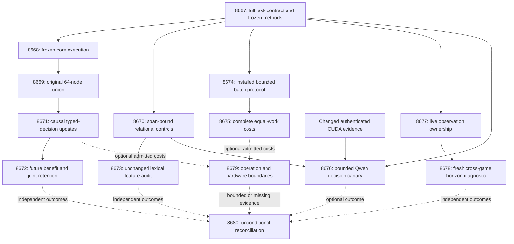

# Research Roadmap v744: Causal learning, relational evidence, and batched installed inference

**Milestone:** `2026.11.744`

**Planned:** 2026-11-01 UTC (2026-10-31 America/New_York). The sequence increments 743 → 744; CLAUDE.md requires the current UTC calendar prefix.

**State:** Proposed, staged in `research-roadmap-next.yaml`; no experiment has been run by this planning change.

**Execution contract:** Exactly **14 tasks, Exp8667 through Exp8680**, in the order below, across four phases. The full task objects, not just their IDs, are bound at the end of this document.

## Executive summary

V743 made complete-source processing and installed inference measurable. It did not qualify continuous learning, meet the complete 10× native speed target, or obtain usable ARC supervisor horizons. V744 changes the mechanisms that caused those limitations: freeze execution sources before running the original learning tests, test whether complete lexical features lose relational information, expose the existing vectorized evaluator through bounded installed batches, and repair repeated observation delivery at the live ARC boundary.

The research priorities remain the live hidden-game discovery process and its verification layer. Continuous learning and typed calibration are supporting capabilities; throughput must count all work; constructed semantic controls cannot establish a natural-language verifier moat. The optional Qwen canary is isolated behind authenticated changed runtime evidence. Its absence cannot stop CPU experiments or the closing reconciliation.

## What the previous milestone proved

The frozen V743 design is preserved at [research-roadmap-v743-preserved-20261101.md](research-roadmap-v743-preserved-20261101.md). Its methods protocol and original result bytes remain historical authority. Updating `vNEXT` does not retrospectively change V743.

| V743 evidence | Supported conclusion | Limit that V744 preserves |
|---|---|---|
| Exp8653 contract/methods | The queued V743 task objects and independent branch operands qualified. | Contract success is an execution control, not scientific benefit. CUDA repair readiness was zero. |
| Exp8654 core execution | All 39 original core nodes passed. | Driver/report/runner/test edits after measurement broke source identity; the producer is disqualified. Exp8655 was pre-gate blocked and Exp8657/8658 had no scientific producer. |
| Exp8656 and Exp8659 streaming/full-source | Chunked full-source processing qualified; 55 previously unavailable responses were recovered in a 190-response, 128-question-group exposed roster. | Coverage and source availability do not establish semantic truth. The older V733 source-information null stays closed. |
| Exp8660 installed compatibility | 122 original qualification nodes passed with installed/private parity. | Qualification applies to the measured source identity. New batch code must qualify separately. |
| Exp8661 complete installed cost | 120 cells and 53,760 request evaluations; packaging noninferiority passed. | NFR-01 failed. The L16 native/Python throughput interval was about 1.197–1.225×, below 10×. `binding_residual` is not isolated spline arithmetic. |
| Exp8662 Qwen canary | The unchanged-runtime gate correctly prevented a call. | No Qwen scientific result exists. Other GPU activity is not causal runtime evidence. |
| Exp8663 and Exp8664 ARC | Real SDK reset causes became observable; Exp8664 recorded 236 causes, zero recorder exceptions and eight action-parity pairs. | Exp8664 remains `flagged_adversarial=true` and disqualified: repeated callbacks yielded 1,022 duplicate-observation issues per episode, 16 censored redirects and no complete horizon. Those counts are diagnosis, not admissible efficacy. |
| Exp8665 hardware and Exp8666 capstone | Missing costs, physical support and upstream qualification were explicitly recorded. | Hardware reader also mishandled a map-shaped acceptance gate. Mapping readiness cannot imply acceleration; capstone is terminal blocked for external science. |

The recent conductor ledger and primary artifacts take precedence over milestone scheduling completion. V735 cold-cost and V737 supervisor nulls also remain closed; V744 does not rerun them unchanged.

## The three biggest gaps to the PRD vision

1. **General verification and calibrated continuous self-learning remain unproved.** The complete-source path is still lexical, and the causal learner has no qualified current execution. FR-11 and the calibrated typed-decision training floor require updates after sealed predictions, measurable future benefit, retained old decisions and real cost. Exp8668/8669 finish the original qualification; Exp8671/8672 test Brier updates with independent question units. Exp8670/8673 test relational feature collisions without fitting against exposed labels. These are bounded steps toward oracle-distinct verification, not a claim to close `GAP-ORACLE-DISTINCT`.
2. **Efficient deployable inference has not met NFR-01 or the hardware vision.** Installed parity is established, but complete batch-one costs show only modest native benefit. Exp8674/8675 change transport granularity while preserving numerical work and measure contemporaneous Python/native controls at each batch size. Exp8679 maps only authenticated operation costs to compatible devices. A transport gain is neither 10× Rust arithmetic nor physical hardware acceleration.
3. **The live agent lacks trustworthy cross-game outcomes for learning which verifier action helps.** The ARC destination is runtime discovery in unseen games. Repeated observation delivery currently prevents an honest horizon assessment. Exp8677 fixes ownership without changing policy or weakening conflict checks; Exp8678 performs a fresh bounded cross-game diagnostic through the actual wrapper. It claims no hidden-game solve or supervisor benefit from four games, and uses no game-specific adapter or offline solver.

## Research incorporated before experiment design

The dated V744 scan was appended to [research-references.md](../../research-references.md) before constructing this task list. It records primary sources, evidence limits and access failures across all requested topic and secondary-source categories.

| Source and date | Useful idea | V744 use and boundary |
|---|---|---|
| [Energy-Based Transformers](https://arxiv.org/abs/2507.02092), July 2025; [ARM-EBM](https://arxiv.org/abs/2512.15605), December 2025 / May 2026 revision | Energy-guided refinement and reasoning interfaces | Architecture context. Training a new generator is outside this milestone and the fixed-generator directive. |
| [RT4CHART](https://arxiv.org/abs/2603.27752), March 2026 / July revision | Claim decomposition and local/global source verification | Exp8670/8673 bind claims to source spans, then test what lexical aggregation cannot represent. No claim to reproduce the paper with eight lexical features. |
| [CCHD](https://arxiv.org/abs/2606.08158), June 2026 | Consistency under meaning-preserving transformations | Distinguish equivalent-wording invariance from truth-changing relational controls. Consistency alone is not factuality. |
| [What Hallucinations Have We Measured?](https://arxiv.org/abs/2610.38520), October 28, 2026 | Separate expressed uncertainty from errors and operational recovery across prompts | Exp8676 records correctness, abstention, uncertainty and finite observed recovery separately. Four supplied-context cases cannot classify intrinsic model knowledge or certify knowledge absence. |
| [Calibeating](https://arxiv.org/abs/2603.22167), March 2026; [capacity-limited delayed online optimization](https://arxiv.org/abs/2606.11711), June 2026 | Proper-loss adaptation under delayed, bounded feedback | Exp8671/8672 preserve the registered Brier/log-loss comparison, causal reveal order, capacity eight and retention gates. No theorem is assumed to apply automatically to the spline learner. |
| [Local spline KAN work](https://arxiv.org/abs/2602.02056), February 2026 / June revision | Local support and sparse updates | Use the existing 109-coefficient numerical head; expose actual update costs before proposing hardware kernels. |
| [Neural constraint routing](https://arxiv.org/abs/2602.16012), February 2026; [Ising review](https://arxiv.org/abs/2610.03972), October 2026 | Operation-specific constraints and hardware mapping | Preserve existing Ising support boundaries; do not relabel a general spline objective as a quadratic Ising workload. |
| [Energy-based decoding](https://arxiv.org/abs/2605.28020), May 2026 | Reward-tilted generation | Defer until a qualified oracle-distinct energy signal exists. The bounded canary is not energy-guided decoding. |
| [Extropic Z1T](https://extropic.ai/writing/z1t/), September 2026; [Kona](https://logicalintelligence.com/kona) | Sampling hardware and energy-reasoning architecture | Track as external design context. Published estimates/positioning are not local device measurements or a reproducible Carnot backend. |

OpenReview indexing and Hugging Face paper discovery cross-checked primary-paper availability. Semantic Scholar citation endpoints did not yield a reliable inventory; no citation count is asserted. GitHub trending snapshots were stale, so no current ranking or new dependency is inferred. The author EBT repository is a lead, not full replication evidence. All eight requested arXiv topics are covered; deferred topics have explicit reasons rather than speculative experiment slots.

## Architecture



Numerical learning and feature studies use CPU; only Exp8676 invokes an LLM. The ARC diagnostic disables LLM calls explicitly and exercises the live runtime process with its existing non-LLM capabilities. No learned policy, generator weights, public page or leaderboard submission is changed by planning.

## Phase 1 — Freeze methods and qualify causal execution

**Exp8667–Exp8669, 170 estimated minutes.** Exp8667 binds all fourteen complete task objects and seals scientific operands independently of optional hardware. Exp8668 completes implementation and formatting first, seals a private transitive source bundle, then executes all 39 original core nodes without later edits. Exp8669 executes the original 25-node remainder against that exact bundle and joins all 64 original nodes, all 27 causal-runner nodes and all 83 original executable runner statements.

The source-drift repair is the changed prerequisite. Historical passing tests cannot qualify changed code. Failed or timed-out children fail qualification; no weakened deadline threshold, omitted node, historical controller recursion or current recovery of old bytes is accepted. Scientific data readiness remains distinct from execution readiness, preventing circular gating of the repair itself.

## Phase 2 — Test causal learning and relational evidence

**Exp8670–Exp8673, 165 estimated minutes.** Exp8670 creates 120 structured worlds, 40 each for directed roles, negation attachment and temporal order, with four views apiece. Truth comes from a separate structured-world evaluator, not the lexical extractor or a duplicated expected-answer field. Supported/equivalent/contradicted views have different purposes; explicit uncertainty is not a false factual claim. Half the decisive evidence lies beyond sentence 65.

Exp8671 is the continuous self-learning and calibrated typed-decision slot. It runs the original nine-input, 109-coefficient learner with frozen, log-loss, Brier and shuffled-released-label Brier arms; five seeds; five blocks of twenty question groups; three siblings each. This yields 6,000 predictions, not 6,000 independent examples. Predictions precede feedback; capacity eight, learning rate 0.01 and L2 0.001 remain fixed. A genuine exit/resume control proves durable state, and fifty protected retention questions remain outside updates.

Exp8672 audits future loss on eighty later question groups, averaging siblings and seeds within each group. Brier must improve over both frozen and log-loss controls, using paired 97.5% intervals, with no increase in typed-decision loss and with the original joint five-window retention bound. Exposed data remains development evidence. A qualified null closes this protocol; absent execution is blocked, not a learning null.

Exp8673 evaluates all 480 constructed rows through the unchanged eight streaming features at chunk sizes 1/32/128. A supported/contradicted pair with different independently evaluated truth but identical feature vectors is a concrete representation counterexample. Equivalent wording measures a different property. Oracle witness and constant-feature controls show the diagnostic can detect information loss. No detector fitting, new ninth feature, natural hallucination accuracy or semantic verifier promotion occurs.

## Phase 3 — Change deployment granularity and isolate optional generation

**Exp8674–Exp8676, 150 estimated minutes.** Exp8674 adds an opt-in bounded `infer_batch` operation using the existing vectorized `resident_energy.batch`. It preserves single-request behavior, whole-envelope validation, configuration identity, deadlines, bounded frames and per-item session accounting. Real installed-wheel tests run outside the checkout with `PYTHONPATH` unset; native means the actual extension. Failed batches return no partial successful payload.

Exp8675 measures two arithmetic arms × three batch sizes (1/4/16) × ten paired repeats, with sixteen panels of sixty-four item identities per cell: **60 cells, 61,440 evaluations**. Each cell gets a fresh process. Complete cost includes startup, extraction, transport, binding, normalization, typed decisions, serialization and shutdown. Native B16/B1 batching benefit requires lower 95% throughput ratio >1.05 plus steady item p95 ≤50 ms and exact decisions. This is a preregistered research tolerance for preavailable requests, not an interactive service SLA. Same-batch native/Python lower95 ≥10 is the separate NFR-01 criterion; crossing batch sizes cannot establish Rust acceleration.

Exp8676 is optional and pre-gated on changed authenticated CUDA evidence. It uses cached `unsloth/Qwen3.8-27B-GGUF`, four constructed cases, ten equivalent prompts each, temperature zero and at most 64 output tokens per call. The correct class is `model_bounded_generation` (10-second floor); a short canary is not `model_full_generation`. It reports actual calls and finite prompt recovery without a model-wide knowledge claim. It does not download weights, substitute a legacy headline model or interrupt the running ARC generator.

## Phase 4 — Repair live observations and close the evidence boundary

**Exp8677–Exp8680, 180 estimated minutes.** Exp8677 reproduces the actual repeated-delivery failure and assigns one owner to each environment-step observation at the callback boundary. It retains conflict rejection, distinct equal-pixel observations at different actions, all original observer assertions, and policy/action parity. Positive horizon and deliberately censored controls qualify the instrumentation before field use.

Exp8678 then runs sixteen real wrapper episodes: four games × seeds 11/23 × recorder on/off, 512 actions and 120 seconds per episode, unchanged 120-action horizons. Every loop emits progress. Censored horizons remain censored; repairing duplicates does not promise that real resets will stop censoring. Eight action-parity pairs and zero observer conflicts are qualification requirements. The four-game panel is descriptive, uses only live attempts/runtime observations and offers zero headline solve credit. `solve_provenance=live_agent_self_discovery` travels with real agent actions. Registry prechecks prohibit duplicate solve work; game source, hand adapters and stored routes remain unavailable.

Exp8679 runs regardless of upstream outcomes. It fixes the local evidence-reader shape mismatch, admits valid extraction/batching/learning cost operands independently, and reports only compatible operation fractions and conditional acceleration ceilings. It cannot manufacture missing inner-spline endpoints or physical support. Exp8680 also always runs: fourteen slot outcomes, exact gate diagnostics, scientific stop decisions, literature decisions and stable publication gates G1–G4. External absence yields terminal `blocked`, never retryable `partial`.

## Dependency graph and exact gate ownership

The YAML is in conductor execution order. Every structured gate references an earlier producer in this same roadmap and an identically spelled top-level numeric 0/1 field declared in that producer's REQUIRED ARTIFACT FIELDS. No gate refers to a retired upstream experiment. Historical receipts are authenticated operands, not queued dependencies.

| Consumer | Producer fields required to equal 1 |
|---|---|
| Exp8668 | Exp8667 `methods_ready_score`, `learning_operands_ready_score` |
| Exp8669 | Exp8668 `learning_core_ready_score`; Exp8667 `learning_operands_ready_score` |
| Exp8670 | Exp8667 `methods_ready_score`, `extraction_inputs_ready_score` |
| Exp8671 | Exp8667 `learning_operands_ready_score`; Exp8669 `learning_execution_ready_score` |
| Exp8672 | Exp8671 `learning_rows_ready_score` |
| Exp8673 | Exp8670 `corpus_ready_score` |
| Exp8674 | Exp8667 `methods_ready_score`, `deployment_inputs_ready_score` |
| Exp8675 | Exp8674 `batch_service_ready_score`; Exp8667 `deployment_inputs_ready_score` |
| Exp8676 | Exp8667 `runtime_repair_ready_score`, `canary_inputs_ready_score`; Exp8670 `corpus_ready_score` |
| Exp8677 | Exp8667 `arc_inputs_ready_score` |
| Exp8678 | Exp8677 `observer_delivery_ready_score`; Exp8667 `arc_inputs_ready_score` |
| Exp8667, Exp8679, Exp8680 | No structured upstream gate |

Failures in the learning branch do not gate relational evidence, batching or ARC. Missing model runtime does not gate any CPU branch. A pre-gate skip preserves a receipt containing the exact failed check/value. Readers resolve declared producer paths first and distinguish absent file, absent field, zero and changed bytes. They may read authenticated conductor skip receipts for accounting, not convert them into scientific measurements.

## Hardware requirements and deployment limits

| Resource | Use in V744 | Access and boundary |
|---|---|---|
| Existing x86 CPU and disk-backed scratch | Frozen test cohorts, streaming features, numerical updates, installed Python/native sessions, SDK episodes | Check free RAM/disk before launch. Use bounded CPU threads and real subprocess accounting. Do not assume `/dev/shm` can hold the corpus or wheel trees. |
| Existing native extension/toolchain | Qualify and time the installed bounded batch operation | Build only the existing wheel/extension surface; measure loaded module hashes from outside the checkout. No dependency upgrade is needed by this plan. |
| Existing cached Qwen GGUF and compatible GPU runtime | Exp8676 only | Verify cache, memory, loader and actual offload evidence. Acquire the existing GPU lease. No cache/runtime/lease means explicit blocked; no CPU headline fallback. A nominal GPU capacity alone is not proof the chosen quantization/context fits. |
| KV260 | Operation mapping only | Existing qualified quadratic Ising support with `k_max<=5`. It does not establish native spline execution. A future compatible workload would use SSH/scp/xmutil, not substitute simulated results. |
| PolarFire and GateMate | Preserve existing evidence boundaries | PolarFire Linux CPU dispatch is not FPGA arithmetic. GateMate remains blocked until a dated physical change, valid IDCODE and ordered n16 smoke evidence. No bring-up attempt is scheduled. |
| NPU and thermodynamic/TSU devices | Literature and compatibility ledger | No qualified physical backend. Extropic figures and Kona architecture claims cannot fill a local timing cell. |

The program's **100× learning target** remains a target. Sparse local updates are CPU-feasible; a future fixed-point device implementation would need numerical/decision parity, update and transfer costs, a real compatible operation and full-boundary measurements. Conditional `1/(1-f)` ceilings require disjoint measured compatible work; unknown inner arithmetic means a null bound, not an inferred acceleration.

## Sample budgets, controls and stopping rules

| Study | Independent units and repetitions | Decision rule |
|---|---|---|
| Learning | 100 exposed question groups; 80 later groups for benefit; five seeds and three siblings averaged inside question; 50 retention groups over five windows | Paired 10,000-draw question bootstrap; both improvement comparisons positive under registered 97.5% intervals; no typed-loss increase; joint retention upper95 ≤0.01. No independent-generalization claim. |
| Relational diagnostic | 120 constructed parent worlds, four views and three chunk sizes | A byte-bound opposite-truth/equal-feature witness refutes representation sufficiency. No finite no-collision result proves sufficiency. Optional intervals are descriptive for this roster. |
| Batch cost | 10 paired process repeats; 60 sessions; 61,440 item evaluations | Equal-work complete-throughput B16/B1 lower95 >1.05 with exact decisions and p95 tolerance. Same-batch 10× target reported separately. Items are not independent timing replicates. |
| Qwen canary | Four cases, ten equivalent wordings, 40 bounded calls | Usable authentic outputs and per-call sensitivity only. No broad accuracy or intrinsic-knowledge claim. |
| ARC diagnostic | Four games, two seeds, eight matched pairs, 16 episodes | Live boundary qualification, parity, support and censoring; no population efficacy or credited new solve. |

Each task retains per-unit rows including intended but failed/missing/censored units. Comparison headlines must be recomputable from those rows. Readiness fields are separate from benefit fields. Exact executable controls carry `verifier_is_oracle=true` and `circular_positive` where a positive verification claim depends on that oracle. Constructed or exposed evidence keeps independent/generalized benefit scores zero.

A qualified null closes the registered scientific protocol; a technical disqualification is not that null. Each scope matching retired work declares all four `prior_failures` fields, including `retire_if_same_verdict: true`, with a concrete changed prerequisite or technique. The new relational diagnostic and first bounded batch protocol have empty lineage lists because their deliverable/technique is new; they do not borrow a retired ID. No operator override is invented. A repeated blocked eligibility verdict does not demonstrate an unexecuted scientific hypothesis is false.

## Runtime, routing and artifact discipline

The fourteen estimates total **665 minutes** if every branch runs. These are scheduling estimates, not permission to exceed per-task limits. Measurements stop by 3,600 seconds, leaving at least 900 seconds for validation inside the 4,800-second cap. Source-cohort tasks get separate budgets; neither recursively runs a whole historical controller.

Every prompt has a numbered mandatory step requiring flushed phase-boundary messages, messages before/after minute-scale operations, completed/pending counts inside loops and a parent heartbeat at least every sixty seconds. Gaps stay below 600 seconds. Tools are polled within sixty seconds. Files above about 200 lines are written through multiple calls of at most 150 lines with progress between calls. Actual duration is recorded; sleeping to satisfy a substrate floor is prohibited.

Schema/freeze coordination (Exp8667–8669), live callback coordination (Exp8677) and hardware evidence integration (Exp8679) route to Claude Opus with 100 turns. Formulaic corpus and protocol implementation (Exp8670/8674) use Codex `gpt-6.1-sol`; ordinary experiments and audits retain Claude defaults with bounded turns. No weak-model research or claims task is scheduled.

All tasks have an exact JSON deliverable plus a thin `scripts/experiments/experiment_*` runner, raw primitive directory and `docs/research-notes/v744-*` notes. All prompts declare `verdict_class`, `gate_check_summary`, substrate/model identity, source hashes, unit rows, acceptance gates and validation receipts. Exp8676 alone declares Qwen in `MODEL_SPECS`; all other tasks explicitly make zero language-model calls. Numerical head evaluation is still real computation under `no_model_load`.

## Verification and reconciliation

Planning validation checks the Roadmap schema; exclusion-manifest lineage; task count/order/table/full-object/digest equality; all gate producers and required field spellings; existing read-first paths; model/substrate declarations; progress/chunking instructions; and final run/prohibition lines. Negative mutations must reject changed IDs, order, titles, phases, paths, prompts, models, substrates, gates, priors, markers and digest.

The execution prompts require spec-first/test-first changes, focused unit tests, actual private CLI checks, Ruff/format, strict mypy, scoped spec coverage and applicable E2E-018/021 checks. Newly owned statements and real child/rejection paths require coverage receipts. Cold replay and self-consistently rehashed tampering are checked before publication, with unchanged shared validator definitions. Historical stamped quarantines stay attached even if a current scan is clean.

This planning change aligns `openspec/capabilities/research-reporting/spec.md`, `_bmad/architecture.md`, `_bmad/traceability.md`, `ops/status.md` and `ops/changelog.md` as **planned**, not implemented. It leaves `research-roadmap.yaml`, `scripts/research_conductor.py`, the exclusion manifest and operator-curated north star unchanged. Capstone retains stable `paper_ready = G1 AND G2 AND G3 AND G4` and `unmet_gates`; no new blocker-count metric replaces them.

## Exact task contract

Exactly 14 tasks, Exp8667 through Exp8680, in conductor execution order.

| Order | ID | Title | Phase | Deliverable |
|---|---|---|---|---|
| 1 | `exp8667-contract-methods` | Bind fourteen tasks and freeze independent research and execution operands | 1 | `results/experiment_8667_v744_contract_methods.json` |
| 2 | `exp8668-frozen-learning-core` | Qualify fresh learning core execution after freezing all transitive sources | 1 | `results/experiment_8668_v744_frozen_learning_core.json` |
| 3 | `exp8669-learning-union-qualification` | Qualify original deadline controls and the complete frozen learning union | 1 | `results/experiment_8669_v744_learning_union_qualification.json` |
| 4 | `exp8670-relational-evidence-controls` | Build span-bound relational worlds and independent semantic controls | 2 | `results/experiment_8670_v744_relational_evidence_controls.json` |
| 5 | `exp8671-causal-brier-stream` | Measure continuous small-head learning with sealed delayed feedback | 2 | `results/experiment_8671_v744_causal_brier_stream.json` |
| 6 | `exp8672-learning-benefit-audit` | Audit later proper-loss benefit and simultaneous retention from causal rows | 2 | `results/experiment_8672_v744_learning_benefit_audit.json` |
| 7 | `exp8673-relational-feature-audit` | Test semantic collisions and equivalent-wording invariance in complete-source features | 2 | `results/experiment_8673_v744_relational_feature_audit.json` |
| 8 | `exp8674-installed-batch-prototype` | Qualify bounded installed batches using the existing vectorized energy evaluator | 3 | `results/experiment_8674_v744_installed_batch_prototype.json` |
| 9 | `exp8675-installed-batch-cost` | Measure complete installed batching costs under equal request work | 3 | `results/experiment_8675_v744_installed_batch_cost.json` |
| 10 | `exp8676-qwen-claim-canary` | Measure bounded Qwen claim decisions and uncertainty across equivalent prompts | 3 | `results/experiment_8676_v744_qwen_claim_canary.json` |
| 11 | `exp8677-arc-observation-ownership` | Qualify single-owner ARC observation delivery while retaining conflict checks | 4 | `results/experiment_8677_v744_arc_observation_ownership.json` |
| 12 | `exp8678-arc-observer-transfer` | Measure fresh cross-game horizons through the qualified live observation path | 4 | `results/experiment_8678_v744_arc_observer_transfer.json` |
| 13 | `exp8679-hardware-operation-boundary` | Map new batch and learning costs to authenticated hardware operations | 4 | `results/experiment_8679_v744_hardware_operation_boundary.json` |
| 14 | `exp8680-capstone` | Reconcile fourteen outcomes and close exact research and deployment scopes | 4 | `results/experiment_8680_v744_capstone.json` |

`canonical_tasks_sha256`: `593b0eaf14e0d066b5eaa2d1b377983b19620d7fb78675824c9e99e56c9100e6`

The machine-readable contract below includes every YAML task field. Empty lineage lists mean a new scope, not omitted failure history.

<!-- V744_TASK_CONTRACT_START -->
```json
{
  "milestone": "2026.11.744",
  "canonical_tasks_sha256": "593b0eaf14e0d066b5eaa2d1b377983b19620d7fb78675824c9e99e56c9100e6",
  "tasks": [
    {
      "id": "exp8667-contract-methods",
      "title": "Bind fourteen tasks and freeze independent research and execution operands",
      "phase": 1,
      "track": "infrastructure",
      "priority": "high",
      "requires_gpu": false,
      "max_turns": 100,
      "estimated_wall_time_min": 40,
      "per_unit_rows": true,
      "milestone": "2026.11.744",
      "deliverable": "results/experiment_8667_v744_contract_methods.json",
      "inference_substrate_class": "no_model_load",
      "MODEL_SPECS": [],
      "gated_on": [],
      "prior_failures": [
        {
          "experiment_id": "exp7532-v659-contract-methods",
          "verdict": "complete_blocked_incomplete_v659_authorities",
          "addressed_by": "Historical authority was absent or disagreed with the queued full tasks. V744 provides its own fourteen-row table, complete objects, versioned markers and digest; test every field mutation and preserve V743 authority separately. Optional CUDA absence affects only the canary.",
          "retire_if_same_verdict": true
        },
        {
          "experiment_id": "exp7713-v672-contract-methods",
          "verdict": "complete_blocked_v672_independent_contract",
          "addressed_by": "Historical authority was absent or disagreed with the queued full tasks. V744 provides its own fourteen-row table, complete objects, versioned markers and digest; test every field mutation and preserve V743 authority separately. Optional CUDA absence affects only the canary.",
          "retire_if_same_verdict": true
        },
        {
          "experiment_id": "exp7940-v689-contract-methods",
          "verdict": "complete_blocked_authority",
          "addressed_by": "Historical authority was absent or disagreed with the queued full tasks. V744 provides its own fourteen-row table, complete objects, versioned markers and digest; test every field mutation and preserve V743 authority separately. Optional CUDA absence affects only the canary.",
          "retire_if_same_verdict": true
        },
        {
          "experiment_id": "exp7992-v693-contract-methods",
          "verdict": "complete_blocked_authority",
          "addressed_by": "Historical authority was absent or disagreed with the queued full tasks. V744 provides its own fourteen-row table, complete objects, versioned markers and digest; test every field mutation and preserve V743 authority separately. Optional CUDA absence affects only the canary.",
          "retire_if_same_verdict": true
        },
        {
          "experiment_id": "exp8018-v695-contract-methods",
          "verdict": "complete_blocked_authority",
          "addressed_by": "Historical authority was absent or disagreed with the queued full tasks. V744 provides its own fourteen-row table, complete objects, versioned markers and digest; test every field mutation and preserve V743 authority separately. Optional CUDA absence affects only the canary.",
          "retire_if_same_verdict": true
        },
        {
          "experiment_id": "exp8374-v722-contract-methods",
          "verdict": "complete_blocked_direct_contract_methods",
          "addressed_by": "Historical authority was absent or disagreed with the queued full tasks. V744 provides its own fourteen-row table, complete objects, versioned markers and digest; test every field mutation and preserve V743 authority separately. Optional CUDA absence affects only the canary.",
          "retire_if_same_verdict": true
        },
        {
          "experiment_id": "exp8388-v723-contract-methods",
          "verdict": "complete_blocked_v723_contract_methods",
          "addressed_by": "Historical authority was absent or disagreed with the queued full tasks. V744 provides its own fourteen-row table, complete objects, versioned markers and digest; test every field mutation and preserve V743 authority separately. Optional CUDA absence affects only the canary.",
          "retire_if_same_verdict": true
        },
        {
          "experiment_id": "exp8416-v725-contract-methods",
          "verdict": "complete_blocked_v725_contract_methods",
          "addressed_by": "Historical authority was absent or disagreed with the queued full tasks. V744 provides its own fourteen-row table, complete objects, versioned markers and digest; test every field mutation and preserve V743 authority separately. Optional CUDA absence affects only the canary.",
          "retire_if_same_verdict": true
        },
        {
          "experiment_id": "exp8443-v727-contract-methods",
          "verdict": "complete_blocked_v727_contract_methods",
          "addressed_by": "Historical authority was absent or disagreed with the queued full tasks. V744 provides its own fourteen-row table, complete objects, versioned markers and digest; test every field mutation and preserve V743 authority separately. Optional CUDA absence affects only the canary.",
          "retire_if_same_verdict": true
        },
        {
          "experiment_id": "exp8471-v729-contract-methods",
          "verdict": "complete_blocked_v729_contract_methods",
          "addressed_by": "Historical authority was absent or disagreed with the queued full tasks. V744 provides its own fourteen-row table, complete objects, versioned markers and digest; test every field mutation and preserve V743 authority separately. Optional CUDA absence affects only the canary.",
          "retire_if_same_verdict": true
        },
        {
          "experiment_id": "exp8499-v731-contract-methods",
          "verdict": "complete_blocked_v731_contract_methods",
          "addressed_by": "Historical authority was absent or disagreed with the queued full tasks. V744 provides its own fourteen-row table, complete objects, versioned markers and digest; test every field mutation and preserve V743 authority separately. Optional CUDA absence affects only the canary.",
          "retire_if_same_verdict": true
        },
        {
          "experiment_id": "exp8565-v736-contract-methods",
          "verdict": "complete_blocked_v736_contract_methods",
          "addressed_by": "Historical authority was absent or disagreed with the queued full tasks. V744 provides its own fourteen-row table, complete objects, versioned markers and digest; test every field mutation and preserve V743 authority separately. Optional CUDA absence affects only the canary.",
          "retire_if_same_verdict": true
        },
        {
          "experiment_id": "exp8602-v739-contract-methods",
          "verdict": "complete_blocked_v739_contract_methods",
          "addressed_by": "Historical authority was absent or disagreed with the queued full tasks. V744 provides its own fourteen-row table, complete objects, versioned markers and digest; test every field mutation and preserve V743 authority separately. Optional CUDA absence affects only the canary.",
          "retire_if_same_verdict": true
        }
      ],
      "agent_type": "claude",
      "model": "opus",
      "prompt": "CONTEXT:\nWork in {project_root} on {date}. V743 ended fourteen scheduling slots. Exp8654 passed 39 core nodes but changed its own sources after measurement, so core readiness stayed zero; the 25-node deadline remainder and actual learning never ran. Exp8656/8659 qualified full-source processing and recovered 55 of 190 responses in 128 exposed groups. Exp8660 qualified installed compatibility; Exp8661 passed packaging noninferiority but failed the complete 10x native/Python gate. Exp8663 repaired SDK reset payloads; Exp8664 remained flagged and disqualified because repeated observation callbacks violated the original observer checks. Preserve those findings and all earlier quarantines. V744 contains exactly fourteen tasks, Exp8667 through Exp8680.\n\nEXISTING CODE TO READ FIRST:\nCLAUDE.md; CODEX.md; ops/e2e-test-plan.md; ops/exclusion_manifest.yaml; openspec/capabilities/research-reporting/spec.md; openspec/capabilities/verification/spec.md; scripts/experiment_template.py; python/carnot/reporting/primary_publication.py; openspec/change-proposals/research-roadmap-vNEXT.md; openspec/change-proposals/research-roadmap-v743-preserved-20261101.md; openspec/change-proposals/v743-methods-protocol.json; research-references.md; python/carnot/reporting/v743_contract_methods.py; python/carnot/reporting/roadmap_contract.py; python/carnot/reporting/current_work_receipt.py; python/carnot/verify/cuda_reader_8410.py; results/experiment_8653_v743_contract_methods.json; results/experiment_8666_v743_capstone.json; research-studying.md\n\nTASK:\nBind fourteen tasks and freeze independent research and execution operands. Deliver results/experiment_8667_v744_contract_methods.json. Create thin runner scripts/experiments/experiment_8667_v744_contract_methods.py, immutable primitives in results/raw/experiment_8667_v744_contract_methods/ and notes docs/research-notes/v744-contract-methods.md. Same-roadmap outputs are future dependencies.\n\nCONCRETE STEPS:\n1. PRECONDITIONS: Print a flushed start line. Authenticate input paths and hashes, tools, free memory and writable disk-backed scratch. Check the declared gate fields before expensive work. In gate_check_summary distinguish missing file, missing field, observed zero and changed bytes. Optional hardware absence cannot block independent CPU work.\n\n2. Print a flushed progress line at each phase boundary and before and after every model load, generation, benchmark and subprocess that can take minutes. Use unbuffered output and print completed/pending counts inside long loops. Supervise children with a flushed parent heartbeat at least every 60 seconds; keep every silence gap under 600 seconds. Write any file over about 200 lines in several tool calls of at most 150 lines, with a progress message between calls. Poll with tool calls of at most 60 seconds. Stop measurements by 3600 seconds and reserve at least 900 seconds for validation within the 4800-second hard cap. Never pad duration.\n\n3. Spec first: confirm relevant REQ-* and SCENARIO-* before implementation, then add focused failing tests. Preserve original assertions, scientific thresholds and historical evidence. Accept --date {date}. Put runners in scripts/experiments/, tests in tests/python/ and scratch in /var/tmp. Do not change research-roadmap.yaml, scripts/research_conductor.py, shared validators, generator weights or external services.\n\n4. Declare inference_substrate_class=no_model_load, MODEL_SPECS=[] and zero current language-model calls. Declare the actual inference_substrate: aggregation_from_upstream_artifacts for readers, deterministic_verifier for constructed checks, verifier_ensemble_against_cached_candidates for numerical head scoring, or offline_arcade_live_agent_runtime_self_discovery_no_llm for real ARC stepping. Authenticate numerical checkpoints separately; no_model_load does not mean no numerical inference.\n\n5. Independently parse the visible table, full JSON, canonical_tasks_sha256 and V744 end marker. Require exact fourteen-object equality with the staged YAML, Exp8667 through Exp8680 in order. Test staged V744 beside active V743 and genuine V744 activation. Reject count, order, ID, title, phase, path, prompt, model, substrate, gate and prior-failure mutations. Preserve historical V743 bytes and original readers; never use mutable vNEXT as old authority.\n\n6. Create openspec/change-proposals/v744-methods-protocol.json before measurements. Inherit objective_updates and objective_audit by value/hash from sealed V743. Freeze the exact original 64-node partition (39 core, 25 deadline, containing all 27 original runner nodes), source inputs, original checkpoint, labels, seeds and count-validator receipt. Register current execution independently of failed Exp8654; emit learning_operands_ready_score from scientific operands only.\n\n7. Register the relational evidence study before seeing extractor outputs: 120 distinct constructed worlds, 40 each for directed role, negation attachment and temporal order. Four views per world are supported, equivalent wording, contradicted role/order assignment and explicit uncertainty. Freeze integer truth tables, grammar, split-free evaluation, seeds 7448670/7448673, exact claim/source byte spans and independent evaluator. This is a representation diagnostic, with no natural-truth labels or fitting. Authenticate qualified Exp8656/8659 separately for extraction_inputs_ready_score.\n\n8. Register installed batching: existing 109-coefficient head and 64 original request identities, Python/native arms, batch sizes 1/4/16, 16 panels per session, ten paired repeats (60 cells, 61440 item evaluations). Freeze seed 7448675, 10000 paired-repeat draws, primary native B16/B1 lower95>1.05 and measured p95 item completion<=50ms as a research tolerance. Include launch-through-exit costs; all items are already available at batch submission, so no interactive queueing claim. The same-batch native/Python lower95>=10 is a separate NFR-01 gate. Authenticate Exp8660/8661 for deployment_inputs_ready_score.\n\n9. Freeze the ARC observation-ownership protocol from actual Exp8664 callback evidence, with source-level diagnosis before edits. Preserve four games, seeds 11/23, 512 actions and 120 seconds per episode, unchanged 120-action redirect horizons and equal on/off policy actions. Registry-precheck and prohibit stored routes, per-game adapters, source inspection and offline solvers. Separately freeze four constructed Qwen questions with ten meaning-preserving prompts each, 40 calls, temperature 0 and <=64 output tokens.\n\n10. Ingest the dated reference scan before execution: RT4CHART claim binding, CCHD label-preserving invariance, the October 28 uncertainty taxonomy, proper-loss online learning, sparse KAN and operation-specific Ising support. Record adopt/defer decisions in research-studying.md. Reuse the existing CUDA reader once on supplied changed library/environment and real context/copy evidence, without device probes. runtime_repair_ready_score=0 pre-skips only Exp8676; validate canary_inputs_ready_score independently. Emit all branch gates with exact producer paths and failure diagnostics.\n\n11. Run focused unit tests, actual private CLI paths, Ruff check/format, strict mypy and scripts/check_spec_coverage.py --files <owned-test-files>. Run applicable ops/e2e-test-plan.md checks, including private E2E-018/021. Require 100 percent newly owned statement coverage including real child and rejection paths. Collect once; execute bounded disjoint children with -n 0 -o addopts= --no-cov. Retain each raw SQLite, source hash, JUnit, command, exit and duration before combining copies. Instrument consumers for the code they execute; consumer coverage cannot certify a producer. Preserve original node IDs and independently sealed historical authority. A killed child fails qualification. Do not run the whole repository suite or recursive historical controllers.\n\n12. Cold-replay immutable primitives in a fresh bounded process. Reject missing operands and self-consistently rehashed tampering. Run primary_publication, scripts/adversarial_verify.py --json <private-candidate> and scripts/verdict_row_consistency_lint.py --strict <private-candidate>. Preserve actual severity and stamped quarantines even if a later scan is clean. Validate final bytes before atomic publication. Failed owned checks disqualify. Unchanged external incompleteness is blocked, never partial. Reconcile openspec/, _bmad/traceability.md, ops/status.md and ops/changelog.md without rewriting historical outcomes.\n\nREQUIRED ARTIFACT FIELDS:\nexperiment_id, task_id, milestone, run_date: principle: Bind every claim to this invocation.\nhonest_verdict, verdict_class: principle: Use complete_ terminal prefixes. verdict_class is exactly positive | circular_positive | null | blocked | disqualified | partial. Partial is incomplete owned work that another attempt can finish; unchanged external failure is blocked.\ngate_check_summary: principle: Every blocked_* or complete_blocked_* records upstream, check, path/hash, field, operator, expected and observed; missing differs from zero.\ninference_substrate, inference_substrate_class, MODEL_SPECS, model_invocation_counts, historical_model_provenance, target_model: principle: Separate current model calls, numerical checkpoint identity and historical generators.\nrows, intended_count, completed_count, failed_count, censored_count, excluded_count, independent_count, sample_size_budget: principle: Retain a metric/status row per intended unit and arm, including missing reasons. Seeds, siblings, views and timing repeats do not multiply independent N.\nverifier_is_oracle, exposure_scope, independent_generalization_score, generalized_learning_benefit_score: principle: Oracle-dependent wins use circular_positive. Constructed or exposed data cannot establish independent generalization.\nrequired_checks_passed, flagged_adversarial, acceptance_gates, validation_receipts, terminal_validation_sidecar_path, adversarial_findings: principle: Failed acceptance gates forbid positive classes; readiness is separate from benefit.\npreconditions_checked, duration_s, phase_spans, random_seed, reproducibility_checksum, source_artifact_hashes, code_config_hashes, raw_shard_hashes: principle: Record real clocks and immutable inputs.\ncited_upstream_artifacts, field_principles: principle: Name original producers and explain each metric.\nbranch_gate_values: principle: All readiness scores are top-level numeric 0/1, with exactly the spelling consumed by downstream gated_on.\nmethods_ready_score, current_contract_ready_score, learning_operands_ready_score, extraction_inputs_ready_score, deployment_inputs_ready_score, arc_inputs_ready_score, runtime_repair_ready_score, canary_inputs_ready_score: principle: Separate authentic operands from execution qualification and optional model access.\nmethods_protocol_reference, cohort_partition_reference, gate_field_map, inherited_operand_checks, canonical_tasks_sha256, authority_mutation_rows, literature_method_rows: principle: Bind scientific choices before outcomes and preserve exact authority.\n\nRun command: cd {project_root} && JAX_PLATFORMS=cpu PYTHONPATH=python:. PYTHONUNBUFFERED=1 .venv/bin/python -u scripts/experiments/experiment_8667_v744_contract_methods.py --date {date}\n\nDo NOT push. Do NOT modify scripts/research_conductor.py.\n"
    },
    {
      "id": "exp8668-frozen-learning-core",
      "title": "Qualify fresh learning core execution after freezing all transitive sources",
      "phase": 1,
      "track": "infrastructure",
      "priority": "high",
      "requires_gpu": false,
      "max_turns": 100,
      "estimated_wall_time_min": 65,
      "per_unit_rows": true,
      "milestone": "2026.11.744",
      "deliverable": "results/experiment_8668_v744_frozen_learning_core.json",
      "inference_substrate_class": "no_model_load",
      "MODEL_SPECS": [],
      "gated_on": [
        {
          "upstream": "exp8667-contract-methods",
          "artifact_field": "methods_ready_score",
          "op": "==",
          "value": 1
        },
        {
          "upstream": "exp8667-contract-methods",
          "artifact_field": "learning_operands_ready_score",
          "op": "==",
          "value": 1
        }
      ],
      "prior_failures": [
        {
          "experiment_id": "exp8654-learning-core-execution",
          "verdict": "complete_disqualified_v743_learning_core_execution",
          "addressed_by": "All 39 nodes passed but later driver/report/test edits invalidated custody. Finish implementation first, seal a private transitive checkout, then run fresh core execution and replay without edits; reject all historical recovery reuse.",
          "retire_if_same_verdict": true
        },
        {
          "experiment_id": "exp8641-learning-execution-custody",
          "verdict": "complete_disqualified_v742_learning_execution_custody",
          "addressed_by": "The single run spent its3600-second measurement budget before original25, killed it with about62 seconds left, and left11 nodes pending. Separate core and deadline cohorts with module-fixture reuse and exact source-bound receipts; no timeout or assertion is relaxed.",
          "retire_if_same_verdict": true
        }
      ],
      "agent_type": "claude",
      "model": "opus",
      "prompt": "CONTEXT:\nWork in {project_root} on {date}. V743 ended fourteen scheduling slots. Exp8654 passed 39 core nodes but changed its own sources after measurement, so core readiness stayed zero; the 25-node deadline remainder and actual learning never ran. Exp8656/8659 qualified full-source processing and recovered 55 of 190 responses in 128 exposed groups. Exp8660 qualified installed compatibility; Exp8661 passed packaging noninferiority but failed the complete 10x native/Python gate. Exp8663 repaired SDK reset payloads; Exp8664 remained flagged and disqualified because repeated observation callbacks violated the original observer checks. Preserve those findings and all earlier quarantines. V744 contains exactly fourteen tasks, Exp8667 through Exp8680.\n\nEXISTING CODE TO READ FIRST:\nCLAUDE.md; CODEX.md; ops/e2e-test-plan.md; ops/exclusion_manifest.yaml; openspec/capabilities/research-reporting/spec.md; openspec/capabilities/verification/spec.md; scripts/experiment_template.py; python/carnot/reporting/primary_publication.py; openspec/change-proposals/research-roadmap-vNEXT.md; openspec/change-proposals/research-roadmap-v743-preserved-20261101.md; openspec/change-proposals/v743-methods-protocol.json; research-references.md; python/carnot/reporting/learning_core_8654.py; python/carnot/reporting/learning_core_runner_8654.py; python/carnot/reporting/learning_core_report_8654.py; python/carnot/reporting/learning_clock_8592.py; tests/python/test_learning_core_8654.py; tests/python/test_learning_core_runner_8654.py; results/experiment_8654_v743_learning_core_execution.json\n\nTASK:\nQualify fresh learning core execution after freezing all transitive sources. Deliver results/experiment_8668_v744_frozen_learning_core.json. Create thin runner scripts/experiments/experiment_8668_v744_frozen_learning_core.py, immutable primitives in results/raw/experiment_8668_v744_frozen_learning_core/ and notes docs/research-notes/v744-frozen-learning-core.md. Same-roadmap outputs are future dependencies.\n\nCONCRETE STEPS:\n1. PRECONDITIONS: Print a flushed start line. Authenticate input paths and hashes, tools, free memory and writable disk-backed scratch. Check the declared gate fields before expensive work. In gate_check_summary distinguish missing file, missing field, observed zero and changed bytes. Optional hardware absence cannot block independent CPU work.\n\n2. Print a flushed progress line at each phase boundary and before and after every model load, generation, benchmark and subprocess that can take minutes. Use unbuffered output and print completed/pending counts inside long loops. Supervise children with a flushed parent heartbeat at least every 60 seconds; keep every silence gap under 600 seconds. Write any file over about 200 lines in several tool calls of at most 150 lines, with a progress message between calls. Poll with tool calls of at most 60 seconds. Stop measurements by 3600 seconds and reserve at least 900 seconds for validation within the 4800-second hard cap. Never pad duration.\n\n3. Spec first: confirm relevant REQ-* and SCENARIO-* before implementation, then add focused failing tests. Preserve original assertions, scientific thresholds and historical evidence. Accept --date {date}. Put runners in scripts/experiments/, tests in tests/python/ and scratch in /var/tmp. Do not change research-roadmap.yaml, scripts/research_conductor.py, shared validators, generator weights or external services.\n\n4. Declare inference_substrate_class=no_model_load, MODEL_SPECS=[] and zero current language-model calls. Declare the actual inference_substrate: aggregation_from_upstream_artifacts for readers, deterministic_verifier for constructed checks, verifier_ensemble_against_cached_candidates for numerical head scoring, or offline_arcade_live_agent_runtime_self_discovery_no_llm for real ARC stepping. Authenticate numerical checkpoints separately; no_model_load does not mean no numerical inference.\n\n5. Reproduce the source-drift rejection using a private copy of the Exp8654 receipt. Finish the current adapter, its tests and formatting before any qualifying measurements. The observed failure was post-measurement edits to driver/report/runner/tests, not a failure of the 39 original core nodes. Retained recovery observations cannot qualify repaired source.\n\n6. Seal all transitive driver, reporting, numerical, test, configuration and scientific input bytes into a private disk-backed checkout. Execute this fixed checkout with private materialized result inputs and independently sealed original family authority. Do not alias cleanup paths into shared results. Keep validators and assertions unchanged. An edit after seal invalidates the entire affected invocation; restart under a new directory and never combine evidence across identities.\n\n7. Collect cohort A once and execute all 39 original core nodes in module/fixture-aware groups. Keep all original learning-clock, causal-runner and objective-checkpoint obligations. Reuse setup only when fixture and source identities match. Use measured launch admission, per-child deadlines and parent heartbeats; leave at least 900 seconds for final validation. Retain raw coverage SQLite and JUnit immediately per child.\n\n8. Require all 39 original nodes, original runner subset, actual owned coverage, successful raw replay and identical source hashes before and after validation. Emit learning_core_ready_score=1 only then. Publish the exact 25-node remainder and frozen transitive source bundle for Exp8669. Cohort A alone cannot authorize training, and the planned separate cohort is not incomplete owned work.\n\n9. Run focused unit tests, actual private CLI paths, Ruff check/format, strict mypy and scripts/check_spec_coverage.py --files <owned-test-files>. Run applicable ops/e2e-test-plan.md checks, including private E2E-018/021. Require 100 percent newly owned statement coverage including real child and rejection paths. Collect once; execute bounded disjoint children with -n 0 -o addopts= --no-cov. Retain each raw SQLite, source hash, JUnit, command, exit and duration before combining copies. Instrument consumers for the code they execute; consumer coverage cannot certify a producer. Preserve original node IDs and independently sealed historical authority. A killed child fails qualification. Do not run the whole repository suite or recursive historical controllers.\n\n10. Cold-replay immutable primitives in a fresh bounded process. Reject missing operands and self-consistently rehashed tampering. Run primary_publication, scripts/adversarial_verify.py --json <private-candidate> and scripts/verdict_row_consistency_lint.py --strict <private-candidate>. Preserve actual severity and stamped quarantines even if a later scan is clean. Validate final bytes before atomic publication. Failed owned checks disqualify. Unchanged external incompleteness is blocked, never partial. Reconcile openspec/, _bmad/traceability.md, ops/status.md and ops/changelog.md without rewriting historical outcomes.\n\nREQUIRED ARTIFACT FIELDS:\nexperiment_id, task_id, milestone, run_date: principle: Bind every claim to this invocation.\nhonest_verdict, verdict_class: principle: Use complete_ terminal prefixes. verdict_class is exactly positive | circular_positive | null | blocked | disqualified | partial. Partial is incomplete owned work that another attempt can finish; unchanged external failure is blocked.\ngate_check_summary: principle: Every blocked_* or complete_blocked_* records upstream, check, path/hash, field, operator, expected and observed; missing differs from zero.\ninference_substrate, inference_substrate_class, MODEL_SPECS, model_invocation_counts, historical_model_provenance, target_model: principle: Separate current model calls, numerical checkpoint identity and historical generators.\nrows, intended_count, completed_count, failed_count, censored_count, excluded_count, independent_count, sample_size_budget: principle: Retain a metric/status row per intended unit and arm, including missing reasons. Seeds, siblings, views and timing repeats do not multiply independent N.\nverifier_is_oracle, exposure_scope, independent_generalization_score, generalized_learning_benefit_score: principle: Oracle-dependent wins use circular_positive. Constructed or exposed data cannot establish independent generalization.\nrequired_checks_passed, flagged_adversarial, acceptance_gates, validation_receipts, terminal_validation_sidecar_path, adversarial_findings: principle: Failed acceptance gates forbid positive classes; readiness is separate from benefit.\npreconditions_checked, duration_s, phase_spans, random_seed, reproducibility_checksum, source_artifact_hashes, code_config_hashes, raw_shard_hashes: principle: Record real clocks and immutable inputs.\ncited_upstream_artifacts, field_principles: principle: Name original producers and explain each metric.\nbranch_gate_values: principle: All readiness scores are top-level numeric 0/1, with exactly the spelling consumed by downstream gated_on.\nlearning_core_ready_score, source_bundle_reference, cohort_a_rows, remaining_node_ids, source_identity_rows, original_runner_node_ids, original_partition_reference, launch_budget_rows: principle: Fresh immutable core receipts establish only the explicitly assigned cohort.\n\nRun command: cd {project_root} && JAX_PLATFORMS=cpu PYTHONPATH=python:. PYTHONUNBUFFERED=1 .venv/bin/python -u scripts/experiments/experiment_8668_v744_frozen_learning_core.py --date {date}\n\nDo NOT push. Do NOT modify scripts/research_conductor.py.\n"
    },
    {
      "id": "exp8669-learning-union-qualification",
      "title": "Qualify original deadline controls and the complete frozen learning union",
      "phase": 1,
      "track": "infrastructure",
      "priority": "high",
      "requires_gpu": false,
      "max_turns": 100,
      "estimated_wall_time_min": 65,
      "per_unit_rows": true,
      "milestone": "2026.11.744",
      "deliverable": "results/experiment_8669_v744_learning_union_qualification.json",
      "inference_substrate_class": "no_model_load",
      "MODEL_SPECS": [],
      "gated_on": [
        {
          "upstream": "exp8668-frozen-learning-core",
          "artifact_field": "learning_core_ready_score",
          "op": "==",
          "value": 1
        },
        {
          "upstream": "exp8667-contract-methods",
          "artifact_field": "learning_operands_ready_score",
          "op": "==",
          "value": 1
        }
      ],
      "prior_failures": [
        {
          "experiment_id": "exp8655-learning-execution-qualification",
          "verdict": "blocked_gate_check_failed",
          "addressed_by": "The previous core gate was zero after source drift. Exp8668 now executes fresh sealed source; this task runs the untouched deadline remainder under a separate budget and checks the complete original union.",
          "retire_if_same_verdict": true
        },
        {
          "experiment_id": "exp8641-learning-execution-custody",
          "verdict": "complete_disqualified_v742_learning_execution_custody",
          "addressed_by": "The deadline and mutation tail was starved by earlier children. It now has a separate task budget, combining authenticated core receipts with freshly executed original tail nodes and identical semantic gates.",
          "retire_if_same_verdict": true
        }
      ],
      "agent_type": "claude",
      "model": "opus",
      "prompt": "CONTEXT:\nWork in {project_root} on {date}. V743 ended fourteen scheduling slots. Exp8654 passed 39 core nodes but changed its own sources after measurement, so core readiness stayed zero; the 25-node deadline remainder and actual learning never ran. Exp8656/8659 qualified full-source processing and recovered 55 of 190 responses in 128 exposed groups. Exp8660 qualified installed compatibility; Exp8661 passed packaging noninferiority but failed the complete 10x native/Python gate. Exp8663 repaired SDK reset payloads; Exp8664 remained flagged and disqualified because repeated observation callbacks violated the original observer checks. Preserve those findings and all earlier quarantines. V744 contains exactly fourteen tasks, Exp8667 through Exp8680.\n\nEXISTING CODE TO READ FIRST:\nCLAUDE.md; CODEX.md; ops/e2e-test-plan.md; ops/exclusion_manifest.yaml; openspec/capabilities/research-reporting/spec.md; openspec/capabilities/verification/spec.md; scripts/experiment_template.py; python/carnot/reporting/primary_publication.py; openspec/change-proposals/research-roadmap-vNEXT.md; openspec/change-proposals/research-roadmap-v743-preserved-20261101.md; openspec/change-proposals/v743-methods-protocol.json; research-references.md; python/carnot/reporting/deadline_edge_8603.py; python/carnot/reporting/deadline_statement_8616.py; python/carnot/reporting/deadline_statement_validation_8616.py; tests/python/test_deadline_edge_8603.py; tests/python/test_deadline_statement_8616.py; tests/python/test_causal_brier_stream_8582.py; results/experiment_8655_learning_execution_qualification.json\n\nTASK:\nQualify original deadline controls and the complete frozen learning union. Deliver results/experiment_8669_v744_learning_union_qualification.json. Create thin runner scripts/experiments/experiment_8669_v744_learning_union_qualification.py, immutable primitives in results/raw/experiment_8669_v744_learning_union_qualification/ and notes docs/research-notes/v744-learning-union-qualification.md. Same-roadmap outputs are future dependencies.\n\nCONCRETE STEPS:\n1. PRECONDITIONS: Print a flushed start line. Authenticate input paths and hashes, tools, free memory and writable disk-backed scratch. Check the declared gate fields before expensive work. In gate_check_summary distinguish missing file, missing field, observed zero and changed bytes. Optional hardware absence cannot block independent CPU work.\n\n2. Print a flushed progress line at each phase boundary and before and after every model load, generation, benchmark and subprocess that can take minutes. Use unbuffered output and print completed/pending counts inside long loops. Supervise children with a flushed parent heartbeat at least every 60 seconds; keep every silence gap under 600 seconds. Write any file over about 200 lines in several tool calls of at most 150 lines, with a progress message between calls. Poll with tool calls of at most 60 seconds. Stop measurements by 3600 seconds and reserve at least 900 seconds for validation within the 4800-second hard cap. Never pad duration.\n\n3. Spec first: confirm relevant REQ-* and SCENARIO-* before implementation, then add focused failing tests. Preserve original assertions, scientific thresholds and historical evidence. Accept --date {date}. Put runners in scripts/experiments/, tests in tests/python/ and scratch in /var/tmp. Do not change research-roadmap.yaml, scripts/research_conductor.py, shared validators, generator weights or external services.\n\n4. Declare inference_substrate_class=no_model_load, MODEL_SPECS=[] and zero current language-model calls. Declare the actual inference_substrate: aggregation_from_upstream_artifacts for readers, deterministic_verifier for constructed checks, verifier_ensemble_against_cached_candidates for numerical head scoring, or offline_arcade_live_agent_runtime_self_discovery_no_llm for real ARC stepping. Authenticate numerical checkpoints separately; no_model_load does not mean no numerical inference.\n\n5. Read the new Exp8668 source bundle and exact original partition. Authenticate cohort A source/config/input identity without requiring any disqualified historical producer. Build the cohort-B adapter and tests first; pin its own bytes separately. Any changed A transitive file invalidates A and blocks the union.\n\n6. Execute all 25 original cohort-B nodes: deadline-edge, deadline-statement and the two original private E2E nodes. Require actual deadline mutations, nominal behavior and timeout exits under original timing thresholds. Use bounded fixture-aware children and preserve raw per-child measurements; do not call historical controllers recursively.\n\n7. Independently join full node IDs and hashes with Exp8668. Require exactly the original 64-node union with no duplicates or waivers, all 27 original causal-runner nodes, all 83 original executable runner statements, original semantic mutation rejection and 100 percent newly owned coverage. Line normalization cannot replace executing a missing statement.\n\n8. Expose learning_execution_ready_score=1 only after complete original qualification, fresh cold replay and unchanged transitive source identity. Keep the scientific objective, training data and original thresholds fixed. Retain per-node missing/error states if a child fails; no learned benefit or null is inferred.\n\n9. Run focused unit tests, actual private CLI paths, Ruff check/format, strict mypy and scripts/check_spec_coverage.py --files <owned-test-files>. Run applicable ops/e2e-test-plan.md checks, including private E2E-018/021. Require 100 percent newly owned statement coverage including real child and rejection paths. Collect once; execute bounded disjoint children with -n 0 -o addopts= --no-cov. Retain each raw SQLite, source hash, JUnit, command, exit and duration before combining copies. Instrument consumers for the code they execute; consumer coverage cannot certify a producer. Preserve original node IDs and independently sealed historical authority. A killed child fails qualification. Do not run the whole repository suite or recursive historical controllers.\n\n10. Cold-replay immutable primitives in a fresh bounded process. Reject missing operands and self-consistently rehashed tampering. Run primary_publication, scripts/adversarial_verify.py --json <private-candidate> and scripts/verdict_row_consistency_lint.py --strict <private-candidate>. Preserve actual severity and stamped quarantines even if a later scan is clean. Validate final bytes before atomic publication. Failed owned checks disqualify. Unchanged external incompleteness is blocked, never partial. Reconcile openspec/, _bmad/traceability.md, ops/status.md and ops/changelog.md without rewriting historical outcomes.\n\nREQUIRED ARTIFACT FIELDS:\nexperiment_id, task_id, milestone, run_date: principle: Bind every claim to this invocation.\nhonest_verdict, verdict_class: principle: Use complete_ terminal prefixes. verdict_class is exactly positive | circular_positive | null | blocked | disqualified | partial. Partial is incomplete owned work that another attempt can finish; unchanged external failure is blocked.\ngate_check_summary: principle: Every blocked_* or complete_blocked_* records upstream, check, path/hash, field, operator, expected and observed; missing differs from zero.\ninference_substrate, inference_substrate_class, MODEL_SPECS, model_invocation_counts, historical_model_provenance, target_model: principle: Separate current model calls, numerical checkpoint identity and historical generators.\nrows, intended_count, completed_count, failed_count, censored_count, excluded_count, independent_count, sample_size_budget: principle: Retain a metric/status row per intended unit and arm, including missing reasons. Seeds, siblings, views and timing repeats do not multiply independent N.\nverifier_is_oracle, exposure_scope, independent_generalization_score, generalized_learning_benefit_score: principle: Oracle-dependent wins use circular_positive. Constructed or exposed data cannot establish independent generalization.\nrequired_checks_passed, flagged_adversarial, acceptance_gates, validation_receipts, terminal_validation_sidecar_path, adversarial_findings: principle: Failed acceptance gates forbid positive classes; readiness is separate from benefit.\npreconditions_checked, duration_s, phase_spans, random_seed, reproducibility_checksum, source_artifact_hashes, code_config_hashes, raw_shard_hashes: principle: Record real clocks and immutable inputs.\ncited_upstream_artifacts, field_principles: principle: Name original producers and explain each metric.\nbranch_gate_values: principle: All readiness scores are top-level numeric 0/1, with exactly the spelling consumed by downstream gated_on.\nlearning_execution_ready_score, source_bundle_reference, exact_union_receipt, original_node_rows, original_runner_statement_rows, deadline_mutation_rows, transitive_identity_rows: principle: Only the complete original frozen union authorizes delayed updates.\n\nRun command: cd {project_root} && JAX_PLATFORMS=cpu PYTHONPATH=python:. PYTHONUNBUFFERED=1 .venv/bin/python -u scripts/experiments/experiment_8669_v744_learning_union_qualification.py --date {date}\n\nDo NOT push. Do NOT modify scripts/research_conductor.py.\n"
    },
    {
      "id": "exp8670-relational-evidence-controls",
      "title": "Build span-bound relational worlds and independent semantic controls",
      "phase": 2,
      "track": "verification",
      "priority": "high",
      "requires_gpu": false,
      "max_turns": 50,
      "estimated_wall_time_min": 40,
      "per_unit_rows": true,
      "milestone": "2026.11.744",
      "deliverable": "results/experiment_8670_v744_relational_evidence_controls.json",
      "inference_substrate_class": "no_model_load",
      "MODEL_SPECS": [],
      "gated_on": [
        {
          "upstream": "exp8667-contract-methods",
          "artifact_field": "methods_ready_score",
          "op": "==",
          "value": 1
        },
        {
          "upstream": "exp8667-contract-methods",
          "artifact_field": "extraction_inputs_ready_score",
          "op": "==",
          "value": 1
        }
      ],
      "prior_failures": [],
      "agent_type": "codex",
      "model": "gpt-6.1-sol",
      "prompt": "CONTEXT:\nWork in {project_root} on {date}. V743 ended fourteen scheduling slots. Exp8654 passed 39 core nodes but changed its own sources after measurement, so core readiness stayed zero; the 25-node deadline remainder and actual learning never ran. Exp8656/8659 qualified full-source processing and recovered 55 of 190 responses in 128 exposed groups. Exp8660 qualified installed compatibility; Exp8661 passed packaging noninferiority but failed the complete 10x native/Python gate. Exp8663 repaired SDK reset payloads; Exp8664 remained flagged and disqualified because repeated observation callbacks violated the original observer checks. Preserve those findings and all earlier quarantines. V744 contains exactly fourteen tasks, Exp8667 through Exp8680.\n\nEXISTING CODE TO READ FIRST:\nCLAUDE.md; CODEX.md; ops/e2e-test-plan.md; ops/exclusion_manifest.yaml; openspec/capabilities/research-reporting/spec.md; openspec/capabilities/verification/spec.md; scripts/experiment_template.py; python/carnot/reporting/primary_publication.py; openspec/change-proposals/research-roadmap-vNEXT.md; openspec/change-proposals/research-roadmap-v743-preserved-20261101.md; openspec/change-proposals/v743-methods-protocol.json; research-references.md; python/carnot/verify/streaming_evidence.py; python/carnot/verify/source_alignment.py; python/carnot/reporting/streaming_source_8629.py; python/carnot/reporting/complete_source_8659.py; tests/python/test_streaming_evidence_8629.py; results/experiment_8656_v743_streaming_execution_custody.json; results/experiment_8659_v743_complete_source_comparison.json\n\nTASK:\nBuild span-bound relational worlds and independent semantic controls. Deliver results/experiment_8670_v744_relational_evidence_controls.json. Create thin runner scripts/experiments/experiment_8670_v744_relational_evidence_controls.py, immutable primitives in results/raw/experiment_8670_v744_relational_evidence_controls/ and notes docs/research-notes/v744-relational-evidence-controls.md. Same-roadmap outputs are future dependencies.\n\nCONCRETE STEPS:\n1. PRECONDITIONS: Print a flushed start line. Authenticate input paths and hashes, tools, free memory and writable disk-backed scratch. Check the declared gate fields before expensive work. In gate_check_summary distinguish missing file, missing field, observed zero and changed bytes. Optional hardware absence cannot block independent CPU work.\n\n2. Print a flushed progress line at each phase boundary and before and after every model load, generation, benchmark and subprocess that can take minutes. Use unbuffered output and print completed/pending counts inside long loops. Supervise children with a flushed parent heartbeat at least every 60 seconds; keep every silence gap under 600 seconds. Write any file over about 200 lines in several tool calls of at most 150 lines, with a progress message between calls. Poll with tool calls of at most 60 seconds. Stop measurements by 3600 seconds and reserve at least 900 seconds for validation within the 4800-second hard cap. Never pad duration.\n\n3. Spec first: confirm relevant REQ-* and SCENARIO-* before implementation, then add focused failing tests. Preserve original assertions, scientific thresholds and historical evidence. Accept --date {date}. Put runners in scripts/experiments/, tests in tests/python/ and scratch in /var/tmp. Do not change research-roadmap.yaml, scripts/research_conductor.py, shared validators, generator weights or external services.\n\n4. Declare inference_substrate_class=no_model_load, MODEL_SPECS=[] and zero current language-model calls. Declare the actual inference_substrate: aggregation_from_upstream_artifacts for readers, deterministic_verifier for constructed checks, verifier_ensemble_against_cached_candidates for numerical head scoring, or offline_arcade_live_agent_runtime_self_discovery_no_llm for real ARC stepping. Authenticate numerical checkpoints separately; no_model_load does not mean no numerical inference.\n\n5. Instantiate the registered 120 structured worlds with unique entities/values and 40 instances per relation family. Serialize four answer views: true relation, equivalent wording, false role/negation/order relation, and an explicit uncertain answer. Retain world truth, source bytes, claim bytes, exact UTF-8 spans, relation family and parent identity. Make the relation-changing view preserve token inventory where the grammar allows. Do not change natural Trivia+ labels or fit a detector.\n\n6. Place the decisive evidence after sentence 65 in half of each family and near the start in the other half. Keep source bytes <=512KiB, answer <=64KiB and <=16 answer units, with bounded filler. Freeze the complete 480-row roster before running streaming features. Keep equivalent and changed-meaning transformations distinct; arbitrary word permutation is not a valid paraphrase.\n\n7. Build a test-only independent evaluator of the structured world using a truth-table or relation lookup that does not read the serialized expected label. Check contradictions, swapped arguments, negation scope and temporal direction with mutation tests. Uncertain wording receives a separate expressed_uncertainty status, not a fabricated binary factual label. Include an intentionally constant-feature control and an exact relational witness control.\n\n8. Require unique parent IDs, valid offsets, independent evaluator agreement for all decidable rows, valid uncertainty separation, and expected rejection of wrong labels/spans. Publish corpus_ready_score and the immutable corpus manifest. This is a constructed diagnostic and qualification only; no natural-language extraction accuracy, learned detector gain or independent generalization follows. Reuse the existing lexical extractor unchanged.\n\n9. Run focused unit tests, actual private CLI paths, Ruff check/format, strict mypy and scripts/check_spec_coverage.py --files <owned-test-files>. Run applicable ops/e2e-test-plan.md checks, including private E2E-018/021. Require 100 percent newly owned statement coverage including real child and rejection paths. Collect once; execute bounded disjoint children with -n 0 -o addopts= --no-cov. Retain each raw SQLite, source hash, JUnit, command, exit and duration before combining copies. Instrument consumers for the code they execute; consumer coverage cannot certify a producer. Preserve original node IDs and independently sealed historical authority. A killed child fails qualification. Do not run the whole repository suite or recursive historical controllers.\n\n10. Cold-replay immutable primitives in a fresh bounded process. Reject missing operands and self-consistently rehashed tampering. Run primary_publication, scripts/adversarial_verify.py --json <private-candidate> and scripts/verdict_row_consistency_lint.py --strict <private-candidate>. Preserve actual severity and stamped quarantines even if a later scan is clean. Validate final bytes before atomic publication. Failed owned checks disqualify. Unchanged external incompleteness is blocked, never partial. Reconcile openspec/, _bmad/traceability.md, ops/status.md and ops/changelog.md without rewriting historical outcomes.\n\nREQUIRED ARTIFACT FIELDS:\nexperiment_id, task_id, milestone, run_date: principle: Bind every claim to this invocation.\nhonest_verdict, verdict_class: principle: Use complete_ terminal prefixes. verdict_class is exactly positive | circular_positive | null | blocked | disqualified | partial. Partial is incomplete owned work that another attempt can finish; unchanged external failure is blocked.\ngate_check_summary: principle: Every blocked_* or complete_blocked_* records upstream, check, path/hash, field, operator, expected and observed; missing differs from zero.\ninference_substrate, inference_substrate_class, MODEL_SPECS, model_invocation_counts, historical_model_provenance, target_model: principle: Separate current model calls, numerical checkpoint identity and historical generators.\nrows, intended_count, completed_count, failed_count, censored_count, excluded_count, independent_count, sample_size_budget: principle: Retain a metric/status row per intended unit and arm, including missing reasons. Seeds, siblings, views and timing repeats do not multiply independent N.\nverifier_is_oracle, exposure_scope, independent_generalization_score, generalized_learning_benefit_score: principle: Oracle-dependent wins use circular_positive. Constructed or exposed data cannot establish independent generalization.\nrequired_checks_passed, flagged_adversarial, acceptance_gates, validation_receipts, terminal_validation_sidecar_path, adversarial_findings: principle: Failed acceptance gates forbid positive classes; readiness is separate from benefit.\npreconditions_checked, duration_s, phase_spans, random_seed, reproducibility_checksum, source_artifact_hashes, code_config_hashes, raw_shard_hashes: principle: Record real clocks and immutable inputs.\ncited_upstream_artifacts, field_principles: principle: Name original producers and explain each metric.\nbranch_gate_values: principle: All readiness scores are top-level numeric 0/1, with exactly the spelling consumed by downstream gated_on.\ncorpus_ready_score, corpus_reference, world_rows, transformation_rows, evidence_offsets, expected_truth, expressed_uncertainty, independent_evaluator_rows, positive_control_rows, protocol_reference: principle: Ground truth comes from independently checked constructed worlds; semantic labels and uncertainty remain distinct.\n\nRun command: cd {project_root} && JAX_PLATFORMS=cpu PYTHONPATH=python:. PYTHONUNBUFFERED=1 .venv/bin/python -u scripts/experiments/experiment_8670_v744_relational_evidence_controls.py --date {date}\n\nDo NOT push. Do NOT modify scripts/research_conductor.py.\n"
    },
    {
      "id": "exp8671-causal-brier-stream",
      "title": "Measure continuous small-head learning with sealed delayed feedback",
      "phase": 2,
      "track": "self_learning",
      "priority": "high",
      "requires_gpu": false,
      "max_turns": 50,
      "estimated_wall_time_min": 60,
      "per_unit_rows": true,
      "milestone": "2026.11.744",
      "deliverable": "results/experiment_8671_v744_causal_brier_stream.json",
      "inference_substrate_class": "no_model_load",
      "MODEL_SPECS": [],
      "gated_on": [
        {
          "upstream": "exp8667-contract-methods",
          "artifact_field": "learning_operands_ready_score",
          "op": "==",
          "value": 1
        },
        {
          "upstream": "exp8669-learning-union-qualification",
          "artifact_field": "learning_execution_ready_score",
          "op": "==",
          "value": 1
        }
      ],
      "prior_failures": [
        {
          "experiment_id": "exp8657-causal-brier-stream",
          "verdict": "no producer honest_verdict; conductor cascade-skip: upstream retired exp8655-learning-execution-qualification",
          "addressed_by": "The scientific run never started. New immutable core and complete original deadline-union receipts replace the failed execution prerequisite without changing the registered learning hypothesis.",
          "retire_if_same_verdict": true
        },
        {
          "experiment_id": "exp8643-causal-brier-stream",
          "verdict": "blocked_gate_check_failed",
          "addressed_by": "Training never ran because execution readiness was zero. Exp8654/8655 split and qualify the complete original union before this fixed scientific protocol may run.",
          "retire_if_same_verdict": true
        }
      ],
      "prompt": "CONTEXT:\nWork in {project_root} on {date}. V743 ended fourteen scheduling slots. Exp8654 passed 39 core nodes but changed its own sources after measurement, so core readiness stayed zero; the 25-node deadline remainder and actual learning never ran. Exp8656/8659 qualified full-source processing and recovered 55 of 190 responses in 128 exposed groups. Exp8660 qualified installed compatibility; Exp8661 passed packaging noninferiority but failed the complete 10x native/Python gate. Exp8663 repaired SDK reset payloads; Exp8664 remained flagged and disqualified because repeated observation callbacks violated the original observer checks. Preserve those findings and all earlier quarantines. V744 contains exactly fourteen tasks, Exp8667 through Exp8680.\n\nEXISTING CODE TO READ FIRST:\nCLAUDE.md; CODEX.md; ops/e2e-test-plan.md; ops/exclusion_manifest.yaml; openspec/capabilities/research-reporting/spec.md; openspec/capabilities/verification/spec.md; scripts/experiment_template.py; python/carnot/reporting/primary_publication.py; openspec/change-proposals/research-roadmap-vNEXT.md; openspec/change-proposals/research-roadmap-v743-preserved-20261101.md; openspec/change-proposals/v743-methods-protocol.json; research-references.md; python/carnot/reporting/causal_brier_runner_8582.py; python/carnot/reporting/causal_brier_stream_8582.py; python/carnot/reporting/learning_clock_8592.py; python/carnot/verify/objective_checkpoint_8461.py; python/carnot/verify/sparse_energy_7996.py; tests/python/test_causal_brier_stream_8582.py; tests/python/test_objective_checkpoint_8461.py\n\nTASK:\nMeasure continuous small-head learning with sealed delayed feedback. Deliver results/experiment_8671_v744_causal_brier_stream.json. Create thin runner scripts/experiments/experiment_8671_v744_causal_brier_stream.py, immutable primitives in results/raw/experiment_8671_v744_causal_brier_stream/ and notes docs/research-notes/v744-causal-brier-stream.md. Same-roadmap outputs are future dependencies.\n\nCONCRETE STEPS:\n1. PRECONDITIONS: Print a flushed start line. Authenticate input paths and hashes, tools, free memory and writable disk-backed scratch. Check the declared gate fields before expensive work. In gate_check_summary distinguish missing file, missing field, observed zero and changed bytes. Optional hardware absence cannot block independent CPU work.\n\n2. Print a flushed progress line at each phase boundary and before and after every model load, generation, benchmark and subprocess that can take minutes. Use unbuffered output and print completed/pending counts inside long loops. Supervise children with a flushed parent heartbeat at least every 60 seconds; keep every silence gap under 600 seconds. Write any file over about 200 lines in several tool calls of at most 150 lines, with a progress message between calls. Poll with tool calls of at most 60 seconds. Stop measurements by 3600 seconds and reserve at least 900 seconds for validation within the 4800-second hard cap. Never pad duration.\n\n3. Spec first: confirm relevant REQ-* and SCENARIO-* before implementation, then add focused failing tests. Preserve original assertions, scientific thresholds and historical evidence. Accept --date {date}. Put runners in scripts/experiments/, tests in tests/python/ and scratch in /var/tmp. Do not change research-roadmap.yaml, scripts/research_conductor.py, shared validators, generator weights or external services.\n\n4. Declare inference_substrate_class=no_model_load, MODEL_SPECS=[] and zero current language-model calls. Declare the actual inference_substrate: aggregation_from_upstream_artifacts for readers, deterministic_verifier for constructed checks, verifier_ensemble_against_cached_candidates for numerical head scoring, or offline_arcade_live_agent_runtime_self_discovery_no_llm for real ARC stepping. Authenticate numerical checkpoints separately; no_model_load does not mean no numerical inference.\n\n5. Require the new complete execution gate and original numerical/data/count-validator operands. Authenticate the existing nine-input 109-coefficient energy head and scalar controls. Preserve all V743 objective_updates settings by value/hash. No representation from Exp8670 or streaming extractor enters this historical learning protocol.\n\n6. Run frozen, log-loss, Brier and shuffled released-label Brier arms, seeds 17/29/43/71/101, five blocks of 20 questions and three siblings: 6000 predictions. Capacity stays eight questions per block, learning rate 0.01 and L2 0.001. Minimize the registered proper loss. Seal each block prediction before delayed labels arrive; shuffled controls may use only labels already released, never future-origin labels.\n\n7. Record actual sparse coefficient writes, prior/posterior state hashes, energy logits, probabilities and accept/reject/escalate decisions. Preserve pending, admitted, rejected and lost feedback, stable acknowledgment IDs, atomic commits and complete update/storage costs. Run the original seed-17 block-two real exit/resume controls and require exact state and acknowledgment equivalence to uninterrupted execution.\n\n8. Evaluate 50 original retention questions at five windows, sealing predictions before evaluation and keeping retention labels out of updates. Retain every question/arm/seed/window row and failed or censored slot. A positive mechanical gate requires actual updates and a working label-sensitive control; no scientific benefit is claimed here. Emit learning_rows_ready_score and learning_cost_ready_score independently from the recorded causal and cost operands.\n\n9. Keep CPU sparse updates as the immediate acceleration path; count changed coordinates and separate inference, update and durable-storage spans. Future FPGA fixed-point work needs a compatible kernel and measured transfer cost. Do not interpret a lower training loss or more updates as future benefit; Exp8672 is the independent question-cluster audit.\n\n10. Run focused unit tests, actual private CLI paths, Ruff check/format, strict mypy and scripts/check_spec_coverage.py --files <owned-test-files>. Run applicable ops/e2e-test-plan.md checks, including private E2E-018/021. Require 100 percent newly owned statement coverage including real child and rejection paths. Collect once; execute bounded disjoint children with -n 0 -o addopts= --no-cov. Retain each raw SQLite, source hash, JUnit, command, exit and duration before combining copies. Instrument consumers for the code they execute; consumer coverage cannot certify a producer. Preserve original node IDs and independently sealed historical authority. A killed child fails qualification. Do not run the whole repository suite or recursive historical controllers.\n\n11. Cold-replay immutable primitives in a fresh bounded process. Reject missing operands and self-consistently rehashed tampering. Run primary_publication, scripts/adversarial_verify.py --json <private-candidate> and scripts/verdict_row_consistency_lint.py --strict <private-candidate>. Preserve actual severity and stamped quarantines even if a later scan is clean. Validate final bytes before atomic publication. Failed owned checks disqualify. Unchanged external incompleteness is blocked, never partial. Reconcile openspec/, _bmad/traceability.md, ops/status.md and ops/changelog.md without rewriting historical outcomes.\n\nREQUIRED ARTIFACT FIELDS:\nexperiment_id, task_id, milestone, run_date: principle: Bind every claim to this invocation.\nhonest_verdict, verdict_class: principle: Use complete_ terminal prefixes. verdict_class is exactly positive | circular_positive | null | blocked | disqualified | partial. Partial is incomplete owned work that another attempt can finish; unchanged external failure is blocked.\ngate_check_summary: principle: Every blocked_* or complete_blocked_* records upstream, check, path/hash, field, operator, expected and observed; missing differs from zero.\ninference_substrate, inference_substrate_class, MODEL_SPECS, model_invocation_counts, historical_model_provenance, target_model: principle: Separate current model calls, numerical checkpoint identity and historical generators.\nrows, intended_count, completed_count, failed_count, censored_count, excluded_count, independent_count, sample_size_budget: principle: Retain a metric/status row per intended unit and arm, including missing reasons. Seeds, siblings, views and timing repeats do not multiply independent N.\nverifier_is_oracle, exposure_scope, independent_generalization_score, generalized_learning_benefit_score: principle: Oracle-dependent wins use circular_positive. Constructed or exposed data cannot establish independent generalization.\nrequired_checks_passed, flagged_adversarial, acceptance_gates, validation_receipts, terminal_validation_sidecar_path, adversarial_findings: principle: Failed acceptance gates forbid positive classes; readiness is separate from benefit.\npreconditions_checked, duration_s, phase_spans, random_seed, reproducibility_checksum, source_artifact_hashes, code_config_hashes, raw_shard_hashes: principle: Record real clocks and immutable inputs.\ncited_upstream_artifacts, field_principles: principle: Name original producers and explain each metric.\nbranch_gate_values: principle: All readiness scores are top-level numeric 0/1, with exactly the spelling consumed by downstream gated_on.\nlearning_rows_ready_score, learning_cost_ready_score, prequential_rows, retention_rows, feedback_rows, update_rows, checkpoint_hashes, changed_coordinate_count, state_equivalence_rows, complete_operation_spans, positive_control_rows: principle: Actual causal updates and durable costs precede any claim of useful learning.\n\nRun command: cd {project_root} && JAX_PLATFORMS=cpu PYTHONPATH=python:. PYTHONUNBUFFERED=1 .venv/bin/python -u scripts/experiments/experiment_8671_v744_causal_brier_stream.py --date {date}\n\nDo NOT push. Do NOT modify scripts/research_conductor.py.\n"
    },
    {
      "id": "exp8672-learning-benefit-audit",
      "title": "Audit later proper-loss benefit and simultaneous retention from causal rows",
      "phase": 2,
      "track": "self_learning",
      "priority": "high",
      "requires_gpu": false,
      "max_turns": 30,
      "estimated_wall_time_min": 30,
      "per_unit_rows": true,
      "milestone": "2026.11.744",
      "deliverable": "results/experiment_8672_v744_learning_benefit_audit.json",
      "inference_substrate_class": "no_model_load",
      "MODEL_SPECS": [],
      "gated_on": [
        {
          "upstream": "exp8671-causal-brier-stream",
          "artifact_field": "learning_rows_ready_score",
          "op": "==",
          "value": 1
        }
      ],
      "prior_failures": [
        {
          "experiment_id": "exp8658-learning-benefit-audit",
          "verdict": "no producer honest_verdict; conductor cascade-skip: upstream retired exp8657-causal-brier-stream",
          "addressed_by": "New Exp8671 causal histories are required; this audit cannot reuse absent or disqualified histories. The original proper-loss and joint-retention thresholds stay fixed.",
          "retire_if_same_verdict": true
        },
        {
          "experiment_id": "exp8644-learning-benefit-audit",
          "verdict": "no producer honest_verdict; conductor cascade-skip: upstream retired exp8643-causal-brier-stream",
          "addressed_by": "The unchanged question is eligible only after new source-bound execution and qualified Exp8657 rows. No missing audit is relabeled a measured null.",
          "retire_if_same_verdict": true
        }
      ],
      "prompt": "CONTEXT:\nWork in {project_root} on {date}. V743 ended fourteen scheduling slots. Exp8654 passed 39 core nodes but changed its own sources after measurement, so core readiness stayed zero; the 25-node deadline remainder and actual learning never ran. Exp8656/8659 qualified full-source processing and recovered 55 of 190 responses in 128 exposed groups. Exp8660 qualified installed compatibility; Exp8661 passed packaging noninferiority but failed the complete 10x native/Python gate. Exp8663 repaired SDK reset payloads; Exp8664 remained flagged and disqualified because repeated observation callbacks violated the original observer checks. Preserve those findings and all earlier quarantines. V744 contains exactly fourteen tasks, Exp8667 through Exp8680.\n\nEXISTING CODE TO READ FIRST:\nCLAUDE.md; CODEX.md; ops/e2e-test-plan.md; ops/exclusion_manifest.yaml; openspec/capabilities/research-reporting/spec.md; openspec/capabilities/verification/spec.md; scripts/experiment_template.py; python/carnot/reporting/primary_publication.py; openspec/change-proposals/research-roadmap-vNEXT.md; openspec/change-proposals/research-roadmap-v743-preserved-20261101.md; openspec/change-proposals/v743-methods-protocol.json; research-references.md; python/carnot/reporting/v743_capstone.py; python/carnot/reporting/learning_retention_audit_8351.py; results/experiment_8666_v743_capstone.json\n\nTASK:\nAudit later proper-loss benefit and simultaneous retention from causal rows. Deliver results/experiment_8672_v744_learning_benefit_audit.json. Create thin runner scripts/experiments/experiment_8672_v744_learning_benefit_audit.py, immutable primitives in results/raw/experiment_8672_v744_learning_benefit_audit/ and notes docs/research-notes/v744-learning-benefit-audit.md. Same-roadmap outputs are future dependencies.\n\nCONCRETE STEPS:\n1. PRECONDITIONS: Print a flushed start line. Authenticate input paths and hashes, tools, free memory and writable disk-backed scratch. Check the declared gate fields before expensive work. In gate_check_summary distinguish missing file, missing field, observed zero and changed bytes. Optional hardware absence cannot block independent CPU work.\n\n2. Print a flushed progress line at each phase boundary and before and after every model load, generation, benchmark and subprocess that can take minutes. Use unbuffered output and print completed/pending counts inside long loops. Supervise children with a flushed parent heartbeat at least every 60 seconds; keep every silence gap under 600 seconds. Write any file over about 200 lines in several tool calls of at most 150 lines, with a progress message between calls. Poll with tool calls of at most 60 seconds. Stop measurements by 3600 seconds and reserve at least 900 seconds for validation within the 4800-second hard cap. Never pad duration.\n\n3. Spec first: confirm relevant REQ-* and SCENARIO-* before implementation, then add focused failing tests. Preserve original assertions, scientific thresholds and historical evidence. Accept --date {date}. Put runners in scripts/experiments/, tests in tests/python/ and scratch in /var/tmp. Do not change research-roadmap.yaml, scripts/research_conductor.py, shared validators, generator weights or external services.\n\n4. Declare inference_substrate_class=no_model_load, MODEL_SPECS=[] and zero current language-model calls. Declare the actual inference_substrate: aggregation_from_upstream_artifacts for readers, deterministic_verifier for constructed checks, verifier_ensemble_against_cached_candidates for numerical head scoring, or offline_arcade_live_agent_runtime_self_discovery_no_llm for real ARC stepping. Authenticate numerical checkpoints separately; no_model_load does not mean no numerical inference.\n\n5. Authenticate every Exp8671 primitive and its complete execution gate before reading aggregate claims. Require all 6000 prediction rows, original causal feedback accounting and retention windows. Recompute probabilities, losses and typed decisions from sealed predictions, independently of producer headlines.\n\n6. Aggregate siblings and seeds within each of the 80 later-block question units. Compute benefit as comparator Brier minus updated Brier. Use 10000 paired question-cluster draws, seed 7278448 and two-sided 97.5 percent intervals for Brier versus frozen and versus log-loss. Both lower bounds must exceed zero with no higher registered typed-decision loss. Report shuffled-control results and whether updates changed predictions.\n\n7. Resample the 50 retention questions jointly across five windows with seed 7258421. The upper 95 percent bound on the maximum-window Brier increase must be <=0.01. No per-window cherry-picking. Retain individual question losses, aggregate denominators and the bootstrap index hash so another reader can reproduce the headline.\n\n8. Set learning_benefit_score only when future-loss and retention gates both pass and the control has measurable headroom. A qualified null closes this exact registered protocol. Exposed data remains retrospective development evidence; independent_generalization_score and generalized_learning_benefit_score stay zero. Missing upstream work is blocked, not partial or a scientific null.\n\n9. Run focused unit tests, actual private CLI paths, Ruff check/format, strict mypy and scripts/check_spec_coverage.py --files <owned-test-files>. Run applicable ops/e2e-test-plan.md checks, including private E2E-018/021. Require 100 percent newly owned statement coverage including real child and rejection paths. Collect once; execute bounded disjoint children with -n 0 -o addopts= --no-cov. Retain each raw SQLite, source hash, JUnit, command, exit and duration before combining copies. Instrument consumers for the code they execute; consumer coverage cannot certify a producer. Preserve original node IDs and independently sealed historical authority. A killed child fails qualification. Do not run the whole repository suite or recursive historical controllers.\n\n10. Cold-replay immutable primitives in a fresh bounded process. Reject missing operands and self-consistently rehashed tampering. Run primary_publication, scripts/adversarial_verify.py --json <private-candidate> and scripts/verdict_row_consistency_lint.py --strict <private-candidate>. Preserve actual severity and stamped quarantines even if a later scan is clean. Validate final bytes before atomic publication. Failed owned checks disqualify. Unchanged external incompleteness is blocked, never partial. Reconcile openspec/, _bmad/traceability.md, ops/status.md and ops/changelog.md without rewriting historical outcomes.\n\nREQUIRED ARTIFACT FIELDS:\nexperiment_id, task_id, milestone, run_date: principle: Bind every claim to this invocation.\nhonest_verdict, verdict_class: principle: Use complete_ terminal prefixes. verdict_class is exactly positive | circular_positive | null | blocked | disqualified | partial. Partial is incomplete owned work that another attempt can finish; unchanged external failure is blocked.\ngate_check_summary: principle: Every blocked_* or complete_blocked_* records upstream, check, path/hash, field, operator, expected and observed; missing differs from zero.\ninference_substrate, inference_substrate_class, MODEL_SPECS, model_invocation_counts, historical_model_provenance, target_model: principle: Separate current model calls, numerical checkpoint identity and historical generators.\nrows, intended_count, completed_count, failed_count, censored_count, excluded_count, independent_count, sample_size_budget: principle: Retain a metric/status row per intended unit and arm, including missing reasons. Seeds, siblings, views and timing repeats do not multiply independent N.\nverifier_is_oracle, exposure_scope, independent_generalization_score, generalized_learning_benefit_score: principle: Oracle-dependent wins use circular_positive. Constructed or exposed data cannot establish independent generalization.\nrequired_checks_passed, flagged_adversarial, acceptance_gates, validation_receipts, terminal_validation_sidecar_path, adversarial_findings: principle: Failed acceptance gates forbid positive classes; readiness is separate from benefit.\npreconditions_checked, duration_s, phase_spans, random_seed, reproducibility_checksum, source_artifact_hashes, code_config_hashes, raw_shard_hashes: principle: Record real clocks and immutable inputs.\ncited_upstream_artifacts, field_principles: principle: Name original producers and explain each metric.\nbranch_gate_values: principle: All readiness scores are top-level numeric 0/1, with exactly the spelling consumed by downstream gated_on.\naudit_ready_score, learning_benefit_score, retention_passed_score, per_question_loss_rows, retention_window_rows, paired_intervals, simultaneous_retention_bound, bootstrap_index_hash, positive_control_rows, stop_decisions: principle: Grouped future outcomes and simultaneous retention determine benefit; execution alone cannot.\n\nRun command: cd {project_root} && JAX_PLATFORMS=cpu PYTHONPATH=python:. PYTHONUNBUFFERED=1 .venv/bin/python -u scripts/experiments/experiment_8672_v744_learning_benefit_audit.py --date {date}\n\nDo NOT push. Do NOT modify scripts/research_conductor.py.\n"
    },
    {
      "id": "exp8673-relational-feature-audit",
      "title": "Test semantic collisions and equivalent-wording invariance in complete-source features",
      "phase": 2,
      "track": "verification",
      "priority": "high",
      "requires_gpu": false,
      "max_turns": 50,
      "estimated_wall_time_min": 35,
      "per_unit_rows": true,
      "milestone": "2026.11.744",
      "deliverable": "results/experiment_8673_v744_relational_feature_audit.json",
      "inference_substrate_class": "no_model_load",
      "MODEL_SPECS": [],
      "gated_on": [
        {
          "upstream": "exp8670-relational-evidence-controls",
          "artifact_field": "corpus_ready_score",
          "op": "==",
          "value": 1
        }
      ],
      "prior_failures": [],
      "prompt": "CONTEXT:\nWork in {project_root} on {date}. V743 ended fourteen scheduling slots. Exp8654 passed 39 core nodes but changed its own sources after measurement, so core readiness stayed zero; the 25-node deadline remainder and actual learning never ran. Exp8656/8659 qualified full-source processing and recovered 55 of 190 responses in 128 exposed groups. Exp8660 qualified installed compatibility; Exp8661 passed packaging noninferiority but failed the complete 10x native/Python gate. Exp8663 repaired SDK reset payloads; Exp8664 remained flagged and disqualified because repeated observation callbacks violated the original observer checks. Preserve those findings and all earlier quarantines. V744 contains exactly fourteen tasks, Exp8667 through Exp8680.\n\nEXISTING CODE TO READ FIRST:\nCLAUDE.md; CODEX.md; ops/e2e-test-plan.md; ops/exclusion_manifest.yaml; openspec/capabilities/research-reporting/spec.md; openspec/capabilities/verification/spec.md; scripts/experiment_template.py; python/carnot/reporting/primary_publication.py; openspec/change-proposals/research-roadmap-vNEXT.md; openspec/change-proposals/research-roadmap-v743-preserved-20261101.md; openspec/change-proposals/v743-methods-protocol.json; research-references.md; python/carnot/verify/streaming_evidence.py; python/carnot/reporting/complete_source_8659.py; results/experiment_8659_v743_complete_source_comparison.json; python/carnot/verify/source_alignment.py\n\nTASK:\nTest semantic collisions and equivalent-wording invariance in complete-source features. Deliver results/experiment_8673_v744_relational_feature_audit.json. Create thin runner scripts/experiments/experiment_8673_v744_relational_feature_audit.py, immutable primitives in results/raw/experiment_8673_v744_relational_feature_audit/ and notes docs/research-notes/v744-relational-feature-audit.md. Same-roadmap outputs are future dependencies.\n\nCONCRETE STEPS:\n1. PRECONDITIONS: Print a flushed start line. Authenticate input paths and hashes, tools, free memory and writable disk-backed scratch. Check the declared gate fields before expensive work. In gate_check_summary distinguish missing file, missing field, observed zero and changed bytes. Optional hardware absence cannot block independent CPU work.\n\n2. Print a flushed progress line at each phase boundary and before and after every model load, generation, benchmark and subprocess that can take minutes. Use unbuffered output and print completed/pending counts inside long loops. Supervise children with a flushed parent heartbeat at least every 60 seconds; keep every silence gap under 600 seconds. Write any file over about 200 lines in several tool calls of at most 150 lines, with a progress message between calls. Poll with tool calls of at most 60 seconds. Stop measurements by 3600 seconds and reserve at least 900 seconds for validation within the 4800-second hard cap. Never pad duration.\n\n3. Spec first: confirm relevant REQ-* and SCENARIO-* before implementation, then add focused failing tests. Preserve original assertions, scientific thresholds and historical evidence. Accept --date {date}. Put runners in scripts/experiments/, tests in tests/python/ and scratch in /var/tmp. Do not change research-roadmap.yaml, scripts/research_conductor.py, shared validators, generator weights or external services.\n\n4. Declare inference_substrate_class=no_model_load, MODEL_SPECS=[] and zero current language-model calls. Declare the actual inference_substrate: aggregation_from_upstream_artifacts for readers, deterministic_verifier for constructed checks, verifier_ensemble_against_cached_candidates for numerical head scoring, or offline_arcade_live_agent_runtime_self_discovery_no_llm for real ARC stepping. Authenticate numerical checkpoints separately; no_model_load does not mean no numerical inference.\n\n5. Read the sealed Exp8670 corpus and evaluate all 480 rows with the unchanged eight streaming lexical features. Use chunk sizes 1/32/128 to check feature invariance; the primary is chunk 32. Do not feed eight features into a nine-input trained head, fit a new detector, or reuse exposed source-information significance as semantic evidence.\n\n6. For each of 120 parent worlds compare supported versus equivalent wording and supported versus contradicted roles. Emit both vectors, exact byte equality and numerical distances, truth/control states, evidence offsets and resource abstentions. Separate near/far evidence placement. Expressed-uncertainty rows are a separate diagnostic, not false statements.\n\n7. Run the independent relational witness and constant-feature controls on the same roster. The witness must distinguish the constructed true/false pair; the constant control must expose the expected collision. A valid pair with different independently established truth and identical complete feature vectors is a counterexample to semantic sufficiency of this representation. Set semantic_collision_witness_score=1 only with original byte-bound proof. No collision is not proof of sufficiency.\n\n8. Report collision/invariance counts with all 120 parent rows and no population claim. If summarizing variability, use 10000 parent-cluster draws with seed 7448673 and label intervals descriptive for the constructed roster. Make no natural hallucination percentage-point claim. Exact witness success is circular_positive if used as a positive verification claim. Record the smallest missing relation information needed for a future extractor, without implementing or promoting that extractor.\n\n9. Close this exact constructed diagnostic after a qualified result. The new scope is relational information loss after complete-source processing, not a repeat fit of the closed V733 source-information model or the V743 coverage comparison. Retain both historical results unchanged.\n\n10. Run focused unit tests, actual private CLI paths, Ruff check/format, strict mypy and scripts/check_spec_coverage.py --files <owned-test-files>. Run applicable ops/e2e-test-plan.md checks, including private E2E-018/021. Require 100 percent newly owned statement coverage including real child and rejection paths. Collect once; execute bounded disjoint children with -n 0 -o addopts= --no-cov. Retain each raw SQLite, source hash, JUnit, command, exit and duration before combining copies. Instrument consumers for the code they execute; consumer coverage cannot certify a producer. Preserve original node IDs and independently sealed historical authority. A killed child fails qualification. Do not run the whole repository suite or recursive historical controllers.\n\n11. Cold-replay immutable primitives in a fresh bounded process. Reject missing operands and self-consistently rehashed tampering. Run primary_publication, scripts/adversarial_verify.py --json <private-candidate> and scripts/verdict_row_consistency_lint.py --strict <private-candidate>. Preserve actual severity and stamped quarantines even if a later scan is clean. Validate final bytes before atomic publication. Failed owned checks disqualify. Unchanged external incompleteness is blocked, never partial. Reconcile openspec/, _bmad/traceability.md, ops/status.md and ops/changelog.md without rewriting historical outcomes.\n\nREQUIRED ARTIFACT FIELDS:\nexperiment_id, task_id, milestone, run_date: principle: Bind every claim to this invocation.\nhonest_verdict, verdict_class: principle: Use complete_ terminal prefixes. verdict_class is exactly positive | circular_positive | null | blocked | disqualified | partial. Partial is incomplete owned work that another attempt can finish; unchanged external failure is blocked.\ngate_check_summary: principle: Every blocked_* or complete_blocked_* records upstream, check, path/hash, field, operator, expected and observed; missing differs from zero.\ninference_substrate, inference_substrate_class, MODEL_SPECS, model_invocation_counts, historical_model_provenance, target_model: principle: Separate current model calls, numerical checkpoint identity and historical generators.\nrows, intended_count, completed_count, failed_count, censored_count, excluded_count, independent_count, sample_size_budget: principle: Retain a metric/status row per intended unit and arm, including missing reasons. Seeds, siblings, views and timing repeats do not multiply independent N.\nverifier_is_oracle, exposure_scope, independent_generalization_score, generalized_learning_benefit_score: principle: Oracle-dependent wins use circular_positive. Constructed or exposed data cannot establish independent generalization.\nrequired_checks_passed, flagged_adversarial, acceptance_gates, validation_receipts, terminal_validation_sidecar_path, adversarial_findings: principle: Failed acceptance gates forbid positive classes; readiness is separate from benefit.\npreconditions_checked, duration_s, phase_spans, random_seed, reproducibility_checksum, source_artifact_hashes, code_config_hashes, raw_shard_hashes: principle: Record real clocks and immutable inputs.\ncited_upstream_artifacts, field_principles: principle: Name original producers and explain each metric.\nbranch_gate_values: principle: All readiness scores are top-level numeric 0/1, with exactly the spelling consumed by downstream gated_on.\nfeature_audit_ready_score, semantic_collision_witness_score, paired_feature_rows, relation_family_rows, invariant_view_rows, uncertainty_rows, witness_references, positive_control_rows, descriptive_intervals, next_mechanism_requirements: principle: A finite representation counterexample cannot establish natural detector accuracy or a learned semantic verifier.\n\nRun command: cd {project_root} && JAX_PLATFORMS=cpu PYTHONPATH=python:. PYTHONUNBUFFERED=1 .venv/bin/python -u scripts/experiments/experiment_8673_v744_relational_feature_audit.py --date {date}\n\nDo NOT push. Do NOT modify scripts/research_conductor.py.\n"
    },
    {
      "id": "exp8674-installed-batch-prototype",
      "title": "Qualify bounded installed batches using the existing vectorized energy evaluator",
      "phase": 3,
      "track": "deployment",
      "priority": "high",
      "requires_gpu": false,
      "max_turns": 50,
      "estimated_wall_time_min": 50,
      "per_unit_rows": true,
      "milestone": "2026.11.744",
      "deliverable": "results/experiment_8674_v744_installed_batch_prototype.json",
      "inference_substrate_class": "no_model_load",
      "MODEL_SPECS": [],
      "gated_on": [
        {
          "upstream": "exp8667-contract-methods",
          "artifact_field": "methods_ready_score",
          "op": "==",
          "value": 1
        },
        {
          "upstream": "exp8667-contract-methods",
          "artifact_field": "deployment_inputs_ready_score",
          "op": "==",
          "value": 1
        }
      ],
      "prior_failures": [],
      "agent_type": "codex",
      "model": "gpt-6.1-sol",
      "prompt": "CONTEXT:\nWork in {project_root} on {date}. V743 ended fourteen scheduling slots. Exp8654 passed 39 core nodes but changed its own sources after measurement, so core readiness stayed zero; the 25-node deadline remainder and actual learning never ran. Exp8656/8659 qualified full-source processing and recovered 55 of 190 responses in 128 exposed groups. Exp8660 qualified installed compatibility; Exp8661 passed packaging noninferiority but failed the complete 10x native/Python gate. Exp8663 repaired SDK reset payloads; Exp8664 remained flagged and disqualified because repeated observation callbacks violated the original observer checks. Preserve those findings and all earlier quarantines. V744 contains exactly fourteen tasks, Exp8667 through Exp8680.\n\nEXISTING CODE TO READ FIRST:\nCLAUDE.md; CODEX.md; ops/e2e-test-plan.md; ops/exclusion_manifest.yaml; openspec/capabilities/research-reporting/spec.md; openspec/capabilities/verification/spec.md; scripts/experiment_template.py; python/carnot/reporting/primary_publication.py; openspec/change-proposals/research-roadmap-vNEXT.md; openspec/change-proposals/research-roadmap-v743-preserved-20261101.md; openspec/change-proposals/v743-methods-protocol.json; research-references.md; python/carnot/inference/resident_protocol.py; python/carnot/inference/resident_energy.py; python/carnot/reporting/installed_cost_session_8661.py; python/carnot/reporting/installed_checkout_8660.py; tests/python/test_installed_lean_8633.py; tests/python/test_lean_resident_8608.py; results/experiment_8660_v743_installed_compatibility.json; results/experiment_8661_v743_installed_complete_cost.json; pyproject.toml\n\nTASK:\nQualify bounded installed batches using the existing vectorized energy evaluator. Deliver results/experiment_8674_v744_installed_batch_prototype.json. Create thin runner scripts/experiments/experiment_8674_v744_installed_batch_prototype.py, immutable primitives in results/raw/experiment_8674_v744_installed_batch_prototype/ and notes docs/research-notes/v744-installed-batch-prototype.md. Same-roadmap outputs are future dependencies.\n\nCONCRETE STEPS:\n1. PRECONDITIONS: Print a flushed start line. Authenticate input paths and hashes, tools, free memory and writable disk-backed scratch. Check the declared gate fields before expensive work. In gate_check_summary distinguish missing file, missing field, observed zero and changed bytes. Optional hardware absence cannot block independent CPU work.\n\n2. Print a flushed progress line at each phase boundary and before and after every model load, generation, benchmark and subprocess that can take minutes. Use unbuffered output and print completed/pending counts inside long loops. Supervise children with a flushed parent heartbeat at least every 60 seconds; keep every silence gap under 600 seconds. Write any file over about 200 lines in several tool calls of at most 150 lines, with a progress message between calls. Poll with tool calls of at most 60 seconds. Stop measurements by 3600 seconds and reserve at least 900 seconds for validation within the 4800-second hard cap. Never pad duration.\n\n3. Spec first: confirm relevant REQ-* and SCENARIO-* before implementation, then add focused failing tests. Preserve original assertions, scientific thresholds and historical evidence. Accept --date {date}. Put runners in scripts/experiments/, tests in tests/python/ and scratch in /var/tmp. Do not change research-roadmap.yaml, scripts/research_conductor.py, shared validators, generator weights or external services.\n\n4. Declare inference_substrate_class=no_model_load, MODEL_SPECS=[] and zero current language-model calls. Declare the actual inference_substrate: aggregation_from_upstream_artifacts for readers, deterministic_verifier for constructed checks, verifier_ensemble_against_cached_candidates for numerical head scoring, or offline_arcade_live_agent_runtime_self_discovery_no_llm for real ARC stepping. Authenticate numerical checkpoints separately; no_model_load does not mean no numerical inference.\n\n5. Retain installed qualification and the closed batch-one cost result. The changed mechanism is bounded transport batches calling resident_energy.batch, which already supports vectorized Python/native residuals; the public protocol currently calls it with one item. Reuse that numerical function and the existing entry point, with no new server or numerical algorithm.\n\n6. Specify and test an opt-in infer_batch operation with 1..16 items and unique item identities, keeping single infer behavior unchanged. Preserve the 65536-byte frame ceiling, configuration hash checks, request/deadline limits and bounded output. Count the session budget in evaluated items, not envelopes. Validate the whole envelope and all item identities before evaluation; any failure returns an error without partial successful payload. Define duplicate-ID consumption and deadline behavior explicitly and test mixed valid/invalid items.\n\n7. Implement the smallest protocol extension and use the installed wheel from a private working directory with PYTHONPATH unset. Exercise Python and the actual native extension, lengths 1/4/16, near-threshold fallbacks, ordering, empty/oversized batches, malformed items, duplicate IDs across and within batches, config drift, expired deadlines, truncation, timeout and shutdown. Recompute full text features for every item; forbid feature/response memoization.\n\n8. Require exact typed-decision and original probability-tolerance parity with individual requests over the original 64 requests plus boundary controls. Run all affected existing import/protocol tests with private owned inputs; retain original Exp8660 qualification without claiming it covers newly edited code. Freeze final protocol, wheel and extension identities and pass real child/rejection coverage before batch_service_ready_score=1. No speed claim belongs to this task.\n\n9. Run focused unit tests, actual private CLI paths, Ruff check/format, strict mypy and scripts/check_spec_coverage.py --files <owned-test-files>. Run applicable ops/e2e-test-plan.md checks, including private E2E-018/021. Require 100 percent newly owned statement coverage including real child and rejection paths. Collect once; execute bounded disjoint children with -n 0 -o addopts= --no-cov. Retain each raw SQLite, source hash, JUnit, command, exit and duration before combining copies. Instrument consumers for the code they execute; consumer coverage cannot certify a producer. Preserve original node IDs and independently sealed historical authority. A killed child fails qualification. Do not run the whole repository suite or recursive historical controllers.\n\n10. Cold-replay immutable primitives in a fresh bounded process. Reject missing operands and self-consistently rehashed tampering. Run primary_publication, scripts/adversarial_verify.py --json <private-candidate> and scripts/verdict_row_consistency_lint.py --strict <private-candidate>. Preserve actual severity and stamped quarantines even if a later scan is clean. Validate final bytes before atomic publication. Failed owned checks disqualify. Unchanged external incompleteness is blocked, never partial. Reconcile openspec/, _bmad/traceability.md, ops/status.md and ops/changelog.md without rewriting historical outcomes.\n\nREQUIRED ARTIFACT FIELDS:\nexperiment_id, task_id, milestone, run_date: principle: Bind every claim to this invocation.\nhonest_verdict, verdict_class: principle: Use complete_ terminal prefixes. verdict_class is exactly positive | circular_positive | null | blocked | disqualified | partial. Partial is incomplete owned work that another attempt can finish; unchanged external failure is blocked.\ngate_check_summary: principle: Every blocked_* or complete_blocked_* records upstream, check, path/hash, field, operator, expected and observed; missing differs from zero.\ninference_substrate, inference_substrate_class, MODEL_SPECS, model_invocation_counts, historical_model_provenance, target_model: principle: Separate current model calls, numerical checkpoint identity and historical generators.\nrows, intended_count, completed_count, failed_count, censored_count, excluded_count, independent_count, sample_size_budget: principle: Retain a metric/status row per intended unit and arm, including missing reasons. Seeds, siblings, views and timing repeats do not multiply independent N.\nverifier_is_oracle, exposure_scope, independent_generalization_score, generalized_learning_benefit_score: principle: Oracle-dependent wins use circular_positive. Constructed or exposed data cannot establish independent generalization.\nrequired_checks_passed, flagged_adversarial, acceptance_gates, validation_receipts, terminal_validation_sidecar_path, adversarial_findings: principle: Failed acceptance gates forbid positive classes; readiness is separate from benefit.\npreconditions_checked, duration_s, phase_spans, random_seed, reproducibility_checksum, source_artifact_hashes, code_config_hashes, raw_shard_hashes: principle: Record real clocks and immutable inputs.\ncited_upstream_artifacts, field_principles: principle: Name original producers and explain each metric.\nbranch_gate_values: principle: All readiness scores are top-level numeric 0/1, with exactly the spelling consumed by downstream gated_on.\nbatch_service_ready_score, protocol_reference, installed_wheel_reference, loaded_module_hashes, per_item_parity_rows, boundary_control_rows, rejection_rows, validation_source_bundle: principle: Qualify installed batch semantics and exact numerical work before timing.\n\nRun command: cd {project_root} && JAX_PLATFORMS=cpu PYTHONPATH=python:. PYTHONUNBUFFERED=1 .venv/bin/python -u scripts/experiments/experiment_8674_v744_installed_batch_prototype.py --date {date}\n\nDo NOT push. Do NOT modify scripts/research_conductor.py.\n"
    },
    {
      "id": "exp8675-installed-batch-cost",
      "title": "Measure complete installed batching costs under equal request work",
      "phase": 3,
      "track": "deployment",
      "priority": "high",
      "requires_gpu": false,
      "max_turns": 50,
      "estimated_wall_time_min": 45,
      "per_unit_rows": true,
      "milestone": "2026.11.744",
      "deliverable": "results/experiment_8675_v744_installed_batch_cost.json",
      "inference_substrate_class": "no_model_load",
      "MODEL_SPECS": [],
      "gated_on": [
        {
          "upstream": "exp8674-installed-batch-prototype",
          "artifact_field": "batch_service_ready_score",
          "op": "==",
          "value": 1
        },
        {
          "upstream": "exp8667-contract-methods",
          "artifact_field": "deployment_inputs_ready_score",
          "op": "==",
          "value": 1
        }
      ],
      "prior_failures": [
        {
          "experiment_id": "exp8661-installed-complete-cost",
          "verdict": "complete_null_v743_installed_complete_cost",
          "addressed_by": "Batch-one packaging qualified but native arithmetic reached only about 1.2x at L16. Test the new bounded vectorized transport batch mechanism with contemporaneous B1 controls; retain the old null and keep same-batch NFR-01 separate.",
          "retire_if_same_verdict": true
        }
      ],
      "prompt": "CONTEXT:\nWork in {project_root} on {date}. V743 ended fourteen scheduling slots. Exp8654 passed 39 core nodes but changed its own sources after measurement, so core readiness stayed zero; the 25-node deadline remainder and actual learning never ran. Exp8656/8659 qualified full-source processing and recovered 55 of 190 responses in 128 exposed groups. Exp8660 qualified installed compatibility; Exp8661 passed packaging noninferiority but failed the complete 10x native/Python gate. Exp8663 repaired SDK reset payloads; Exp8664 remained flagged and disqualified because repeated observation callbacks violated the original observer checks. Preserve those findings and all earlier quarantines. V744 contains exactly fourteen tasks, Exp8667 through Exp8680.\n\nEXISTING CODE TO READ FIRST:\nCLAUDE.md; CODEX.md; ops/e2e-test-plan.md; ops/exclusion_manifest.yaml; openspec/capabilities/research-reporting/spec.md; openspec/capabilities/verification/spec.md; scripts/experiment_template.py; python/carnot/reporting/primary_publication.py; openspec/change-proposals/research-roadmap-vNEXT.md; openspec/change-proposals/research-roadmap-v743-preserved-20261101.md; openspec/change-proposals/v743-methods-protocol.json; research-references.md; python/carnot/reporting/installed_cost_8661.py; python/carnot/reporting/installed_cost_session_8661.py; python/carnot/reporting/installed_cost_runner_8661.py; python/carnot/inference/resident_energy.py; python/carnot/inference/resident_protocol.py; results/experiment_8661_v743_installed_complete_cost.json\n\nTASK:\nMeasure complete installed batching costs under equal request work. Deliver results/experiment_8675_v744_installed_batch_cost.json. Create thin runner scripts/experiments/experiment_8675_v744_installed_batch_cost.py, immutable primitives in results/raw/experiment_8675_v744_installed_batch_cost/ and notes docs/research-notes/v744-installed-batch-cost.md. Same-roadmap outputs are future dependencies.\n\nCONCRETE STEPS:\n1. PRECONDITIONS: Print a flushed start line. Authenticate input paths and hashes, tools, free memory and writable disk-backed scratch. Check the declared gate fields before expensive work. In gate_check_summary distinguish missing file, missing field, observed zero and changed bytes. Optional hardware absence cannot block independent CPU work.\n\n2. Print a flushed progress line at each phase boundary and before and after every model load, generation, benchmark and subprocess that can take minutes. Use unbuffered output and print completed/pending counts inside long loops. Supervise children with a flushed parent heartbeat at least every 60 seconds; keep every silence gap under 600 seconds. Write any file over about 200 lines in several tool calls of at most 150 lines, with a progress message between calls. Poll with tool calls of at most 60 seconds. Stop measurements by 3600 seconds and reserve at least 900 seconds for validation within the 4800-second hard cap. Never pad duration.\n\n3. Spec first: confirm relevant REQ-* and SCENARIO-* before implementation, then add focused failing tests. Preserve original assertions, scientific thresholds and historical evidence. Accept --date {date}. Put runners in scripts/experiments/, tests in tests/python/ and scratch in /var/tmp. Do not change research-roadmap.yaml, scripts/research_conductor.py, shared validators, generator weights or external services.\n\n4. Declare inference_substrate_class=no_model_load, MODEL_SPECS=[] and zero current language-model calls. Declare the actual inference_substrate: aggregation_from_upstream_artifacts for readers, deterministic_verifier for constructed checks, verifier_ensemble_against_cached_candidates for numerical head scoring, or offline_arcade_live_agent_runtime_self_discovery_no_llm for real ARC stepping. Authenticate numerical checkpoints separately; no_model_load does not mean no numerical inference.\n\n5. Require Exp8674 qualified wheel/protocol and original Exp8667 deployment operands. Freeze loaded source/config/extension hashes. Run the registered 60-cell matrix: two arithmetic arms, batch sizes 1/4/16, 16 panels of the same 64 item identities per session and ten paired repeats. Every cell has 1024 actual evaluations; total 61440. Retain all cells and stop with explicit missing rows if the budget expires.\n\n6. Use fresh processes for every timed cell, interleave arm/batch order with seed 7448675 and retain host load. An untimed import identity probe is separate; no timed session is discarded as warmup. Measure launch through clean exit, full source extraction, transport/framing, scaling, offset, binding/residual, normalization/fallback, typed decisions, serialization and shutdown. Retain item submission/response completion and batch membership. Batch spans are counted once, not once per item.\n\n7. Inputs are preavailable; measure completion from each item entering its batch to its returned response. Report startup-inclusive first-response latency and steady item p95 separately. Primary batch gain is installed-native B16/B1 complete throughput with 10000 paired-repeat bootstrap draws and lower95>1.05, plus steady p95<=50ms and exact decisions. The 50ms bound is a preregistered research tolerance, not a deployed SLA. Queueing under online arrivals is unmeasured.\n\n8. Report B4 descriptively. At each fixed batch size compare installed-native to installed-Python; only a lower95>=10 meets NFR-01 for that batch workload. Never compare native B16 with Python B1 as a Rust speedup. Positive latency/throughput claims require all numerical, complete-boundary and validation gates. A qualified null retires this exact batching mechanism/workload; no widening after results.\n\n9. Publish raw per-item/per-session rows and complete disjoint spans. Keep binding_residual opaque unless real inner endpoints exist; do not subtract noisy Python/native times to invent isolated spline arithmetic. No physical hardware or calibration benefit follows from faster transport.\n\n10. Run focused unit tests, actual private CLI paths, Ruff check/format, strict mypy and scripts/check_spec_coverage.py --files <owned-test-files>. Run applicable ops/e2e-test-plan.md checks, including private E2E-018/021. Require 100 percent newly owned statement coverage including real child and rejection paths. Collect once; execute bounded disjoint children with -n 0 -o addopts= --no-cov. Retain each raw SQLite, source hash, JUnit, command, exit and duration before combining copies. Instrument consumers for the code they execute; consumer coverage cannot certify a producer. Preserve original node IDs and independently sealed historical authority. A killed child fails qualification. Do not run the whole repository suite or recursive historical controllers.\n\n11. Cold-replay immutable primitives in a fresh bounded process. Reject missing operands and self-consistently rehashed tampering. Run primary_publication, scripts/adversarial_verify.py --json <private-candidate> and scripts/verdict_row_consistency_lint.py --strict <private-candidate>. Preserve actual severity and stamped quarantines even if a later scan is clean. Validate final bytes before atomic publication. Failed owned checks disqualify. Unchanged external incompleteness is blocked, never partial. Reconcile openspec/, _bmad/traceability.md, ops/status.md and ops/changelog.md without rewriting historical outcomes.\n\nREQUIRED ARTIFACT FIELDS:\nexperiment_id, task_id, milestone, run_date: principle: Bind every claim to this invocation.\nhonest_verdict, verdict_class: principle: Use complete_ terminal prefixes. verdict_class is exactly positive | circular_positive | null | blocked | disqualified | partial. Partial is incomplete owned work that another attempt can finish; unchanged external failure is blocked.\ngate_check_summary: principle: Every blocked_* or complete_blocked_* records upstream, check, path/hash, field, operator, expected and observed; missing differs from zero.\ninference_substrate, inference_substrate_class, MODEL_SPECS, model_invocation_counts, historical_model_provenance, target_model: principle: Separate current model calls, numerical checkpoint identity and historical generators.\nrows, intended_count, completed_count, failed_count, censored_count, excluded_count, independent_count, sample_size_budget: principle: Retain a metric/status row per intended unit and arm, including missing reasons. Seeds, siblings, views and timing repeats do not multiply independent N.\nverifier_is_oracle, exposure_scope, independent_generalization_score, generalized_learning_benefit_score: principle: Oracle-dependent wins use circular_positive. Constructed or exposed data cannot establish independent generalization.\nrequired_checks_passed, flagged_adversarial, acceptance_gates, validation_receipts, terminal_validation_sidecar_path, adversarial_findings: principle: Failed acceptance gates forbid positive classes; readiness is separate from benefit.\npreconditions_checked, duration_s, phase_spans, random_seed, reproducibility_checksum, source_artifact_hashes, code_config_hashes, raw_shard_hashes: principle: Record real clocks and immutable inputs.\ncited_upstream_artifacts, field_principles: principle: Name original producers and explain each metric.\nbranch_gate_values: principle: All readiness scores are top-level numeric 0/1, with exactly the spelling consumed by downstream gated_on.\nbatch_cost_ready_score, batch_benefit_score, nfr01_score, per_item_rows, per_session_rows, paired_throughput_intervals, p95_completion_rows, complete_operation_spans, equal_work_rows, source_identity_rows: principle: Equal item work and complete clocks distinguish batching benefit from native arithmetic speed.\n\nRun command: cd {project_root} && JAX_PLATFORMS=cpu PYTHONPATH=python:. PYTHONUNBUFFERED=1 .venv/bin/python -u scripts/experiments/experiment_8675_v744_installed_batch_cost.py --date {date}\n\nDo NOT push. Do NOT modify scripts/research_conductor.py.\n"
    },
    {
      "id": "exp8676-qwen-claim-canary",
      "title": "Measure bounded Qwen claim decisions and uncertainty across equivalent prompts",
      "phase": 3,
      "track": "verification",
      "priority": "high",
      "requires_gpu": true,
      "max_turns": 50,
      "estimated_wall_time_min": 55,
      "per_unit_rows": true,
      "milestone": "2026.11.744",
      "deliverable": "results/experiment_8676_v744_qwen_claim_canary.json",
      "inference_substrate_class": "model_bounded_generation",
      "MODEL_SPECS": [
        "unsloth/Qwen3.8-27B-GGUF"
      ],
      "gated_on": [
        {
          "upstream": "exp8667-contract-methods",
          "artifact_field": "runtime_repair_ready_score",
          "op": "==",
          "value": 1
        },
        {
          "upstream": "exp8667-contract-methods",
          "artifact_field": "canary_inputs_ready_score",
          "op": "==",
          "value": 1
        },
        {
          "upstream": "exp8670-relational-evidence-controls",
          "artifact_field": "corpus_ready_score",
          "op": "==",
          "value": 1
        }
      ],
      "prior_failures": [
        {
          "experiment_id": "exp8662-qwen-evidence-canary",
          "verdict": "blocked_gate_check_failed",
          "addressed_by": "No causal CUDA repair was available. The new structured gate requires changed authenticated runtime evidence before any model call, and the changed scientific scope separates uncertainty and finite equivalent-prompt recovery.",
          "retire_if_same_verdict": true
        },
        {
          "experiment_id": "exp8648-qwen-evidence-canary",
          "verdict": "blocked_gate_check_failed",
          "addressed_by": "No generation is rerun on unchanged CUDA. The structured gate requires a newly supplied causal runtime repair and actual context/copy receipt; otherwise the conductor pre-skips this conditional slot.",
          "retire_if_same_verdict": true
        }
      ],
      "prompt": "CONTEXT:\nWork in {project_root} on {date}. V743 ended fourteen scheduling slots. Exp8654 passed 39 core nodes but changed its own sources after measurement, so core readiness stayed zero; the 25-node deadline remainder and actual learning never ran. Exp8656/8659 qualified full-source processing and recovered 55 of 190 responses in 128 exposed groups. Exp8660 qualified installed compatibility; Exp8661 passed packaging noninferiority but failed the complete 10x native/Python gate. Exp8663 repaired SDK reset payloads; Exp8664 remained flagged and disqualified because repeated observation callbacks violated the original observer checks. Preserve those findings and all earlier quarantines. V744 contains exactly fourteen tasks, Exp8667 through Exp8680.\n\nEXISTING CODE TO READ FIRST:\nCLAUDE.md; CODEX.md; ops/e2e-test-plan.md; ops/exclusion_manifest.yaml; openspec/capabilities/research-reporting/spec.md; openspec/capabilities/verification/spec.md; scripts/experiment_template.py; python/carnot/reporting/primary_publication.py; openspec/change-proposals/research-roadmap-vNEXT.md; openspec/change-proposals/research-roadmap-v743-preserved-20261101.md; openspec/change-proposals/v743-methods-protocol.json; research-references.md; python/carnot/verify/cuda_reader_8410.py; results/experiment_8662_qwen_evidence_canary.json; python/carnot/reporting/current_work_receipt.py\n\nTASK:\nMeasure bounded Qwen claim decisions and uncertainty across equivalent prompts. Deliver results/experiment_8676_v744_qwen_claim_canary.json. Create thin runner scripts/experiments/experiment_8676_v744_qwen_claim_canary.py, immutable primitives in results/raw/experiment_8676_v744_qwen_claim_canary/ and notes docs/research-notes/v744-qwen-claim-canary.md. Same-roadmap outputs are future dependencies.\n\nCONCRETE STEPS:\n1. PRECONDITIONS: Print a flushed start line. Authenticate input paths and hashes, tools, free memory and writable disk-backed scratch. Check the declared gate fields before expensive work. In gate_check_summary distinguish missing file, missing field, observed zero and changed bytes. Optional hardware absence cannot block independent CPU work.\n\n2. Print a flushed progress line at each phase boundary and before and after every model load, generation, benchmark and subprocess that can take minutes. Use unbuffered output and print completed/pending counts inside long loops. Supervise children with a flushed parent heartbeat at least every 60 seconds; keep every silence gap under 600 seconds. Write any file over about 200 lines in several tool calls of at most 150 lines, with a progress message between calls. Poll with tool calls of at most 60 seconds. Stop measurements by 3600 seconds and reserve at least 900 seconds for validation within the 4800-second hard cap. Never pad duration.\n\n3. Spec first: confirm relevant REQ-* and SCENARIO-* before implementation, then add focused failing tests. Preserve original assertions, scientific thresholds and historical evidence. Accept --date {date}. Put runners in scripts/experiments/, tests in tests/python/ and scratch in /var/tmp. Do not change research-roadmap.yaml, scripts/research_conductor.py, shared validators, generator weights or external services.\n\n4. Declare inference_substrate_class=model_bounded_generation and MODEL_SPECS=[\"unsloth/Qwen3.8-27B-GGUF\"]. This fixed-budget canary uses the 10-second floor. model_full_generation has a 60-second floor and model_load_no_generation a 2-second floor; neither describes this task. Record actual duration without padding; legacy small models are CPU smoke tests only.\n\n5. Require Exp8667 runtime_repair_ready_score=1 and canary_inputs_ready_score=1 plus Exp8670 corpus_ready_score=1 before model access. Authenticate a supplied changed causal library/environment receipt with real context/copy success. The conductor skips absent repair; do not repeat unchanged GPU probes. Other background GPU jobs do not establish this runtime.\n\n6. Resolve cached unsloth/Qwen3.8-27B-GGUF, bind GGUF/tokenizer/loader hashes and actual GPU offload identity, and acquire the existing GPU lease. Do not disturb active ARC runs. No new model download, CPU headline fallback or generator weight change. Bound model load to 600 seconds with parent heartbeats, each call to 45 seconds and the measurement phase to 2400 seconds.\n\n7. Use four registered constructed source/claim cases with ten grammar-checked equivalent prompts each, 40 fixed calls, temperature 0 and at most 64 output tokens per call. Ask for accept/reject/escalate, with explicit uncertainty allowed; preserve the same facts and source text in each wording. Capture genuine requests, responses, truncation, token counts and GPU activity. Keep all failed/unstarted slots and seal responses before evaluator access.\n\n8. Adjudicate decidable answers against the independent structured-world evaluator. Report correctness, explicit abstention, expressed uncertainty, parse validity and observed recovery separately per case and prompt. The October 28 taxonomy motivates this separation, but supplied-context toy cases and ten variants cannot certify parametric knowledge or intrinsic SI/CF classes. An all-wrong finite set is no_recovery_observed, not knowledge_absent.\n\n9. This is a bounded usability and prompt-sensitivity canary with four independent constructed cases, not a benchmark percentage-point or natural hallucination claim. Keep oracle-dependent wins circular_positive. Record actual duration, including honest sub-floor runs for review; never sleep to satisfy a floor. Release the GPU lease and retain cleanup receipts.\n\n10. Run focused unit tests, actual private CLI paths, Ruff check/format, strict mypy and scripts/check_spec_coverage.py --files <owned-test-files>. Run applicable ops/e2e-test-plan.md checks, including private E2E-018/021. Require 100 percent newly owned statement coverage including real child and rejection paths. Collect once; execute bounded disjoint children with -n 0 -o addopts= --no-cov. Retain each raw SQLite, source hash, JUnit, command, exit and duration before combining copies. Instrument consumers for the code they execute; consumer coverage cannot certify a producer. Preserve original node IDs and independently sealed historical authority. A killed child fails qualification. Do not run the whole repository suite or recursive historical controllers.\n\n11. Cold-replay immutable primitives in a fresh bounded process. Reject missing operands and self-consistently rehashed tampering. Run primary_publication, scripts/adversarial_verify.py --json <private-candidate> and scripts/verdict_row_consistency_lint.py --strict <private-candidate>. Preserve actual severity and stamped quarantines even if a later scan is clean. Validate final bytes before atomic publication. Failed owned checks disqualify. Unchanged external incompleteness is blocked, never partial. Reconcile openspec/, _bmad/traceability.md, ops/status.md and ops/changelog.md without rewriting historical outcomes.\n\nREQUIRED ARTIFACT FIELDS:\nexperiment_id, task_id, milestone, run_date: principle: Bind every claim to this invocation.\nhonest_verdict, verdict_class: principle: Use complete_ terminal prefixes. verdict_class is exactly positive | circular_positive | null | blocked | disqualified | partial. Partial is incomplete owned work that another attempt can finish; unchanged external failure is blocked.\ngate_check_summary: principle: Every blocked_* or complete_blocked_* records upstream, check, path/hash, field, operator, expected and observed; missing differs from zero.\ninference_substrate, inference_substrate_class, MODEL_SPECS, model_invocation_counts, historical_model_provenance, target_model: principle: Separate current model calls, numerical checkpoint identity and historical generators.\nrows, intended_count, completed_count, failed_count, censored_count, excluded_count, independent_count, sample_size_budget: principle: Retain a metric/status row per intended unit and arm, including missing reasons. Seeds, siblings, views and timing repeats do not multiply independent N.\nverifier_is_oracle, exposure_scope, independent_generalization_score, generalized_learning_benefit_score: principle: Oracle-dependent wins use circular_positive. Constructed or exposed data cannot establish independent generalization.\nrequired_checks_passed, flagged_adversarial, acceptance_gates, validation_receipts, terminal_validation_sidecar_path, adversarial_findings: principle: Failed acceptance gates forbid positive classes; readiness is separate from benefit.\npreconditions_checked, duration_s, phase_spans, random_seed, reproducibility_checksum, source_artifact_hashes, code_config_hashes, raw_shard_hashes: principle: Record real clocks and immutable inputs.\ncited_upstream_artifacts, field_principles: principle: Name original producers and explain each metric.\nbranch_gate_values: principle: All readiness scores are top-level numeric 0/1, with exactly the spelling consumed by downstream gated_on.\ncanary_rows_ready_score, usable_response_score, per_call_rows, correctness_status, abstention_status, expressed_uncertainty, observed_recovery_rows, runtime_repair_reference, cache_identity, tokenizer_hash, loader_library_hash, gpu_offload_receipt, token_counts, model_load_spans, cleanup_receipts: principle: Bounded real generation and finite prompt recovery do not establish broad factuality or absent knowledge.\n\nRun command: cd {project_root} && JAX_PLATFORMS=cpu PYTHONPATH=python:. PYTHONUNBUFFERED=1 CARNOT_FORCE_LIVE=1 .venv/bin/python -u scripts/experiments/experiment_8676_v744_qwen_claim_canary.py --date {date}\n\nDo NOT push. Do NOT modify scripts/research_conductor.py.\n"
    },
    {
      "id": "exp8677-arc-observation-ownership",
      "title": "Qualify single-owner ARC observation delivery while retaining conflict checks",
      "phase": 4,
      "track": "arc",
      "priority": "high",
      "requires_gpu": false,
      "max_turns": 100,
      "estimated_wall_time_min": 55,
      "per_unit_rows": true,
      "milestone": "2026.11.744",
      "deliverable": "results/experiment_8677_v744_arc_observation_ownership.json",
      "inference_substrate_class": "no_model_load",
      "MODEL_SPECS": [],
      "gated_on": [
        {
          "upstream": "exp8667-contract-methods",
          "artifact_field": "arc_inputs_ready_score",
          "op": "==",
          "value": 1
        }
      ],
      "prior_failures": [
        {
          "experiment_id": "exp8664-arc-reset-transfer",
          "verdict": "complete_disqualified_arc_reset_transfer",
          "addressed_by": "Reset causes now authenticate, but repeated live callbacks send the same action observation multiple times. Reproduce and fix delivery ownership at the actual callback boundary while keeping original observer rejection tests; fresh panel waits for that qualification.",
          "retire_if_same_verdict": true
        },
        {
          "experiment_id": "exp8650-arc-reset-transfer",
          "verdict": "complete_disqualified_arc_reset_transfer",
          "addressed_by": "A new payload/context correction must first pass actual SDK witnesses in Exp8663. The same16-cell transfer protocol then tests changed recorder behavior, preserving fixed actions/horizons and all prior failure bytes.",
          "retire_if_same_verdict": true
        }
      ],
      "agent_type": "claude",
      "model": "opus",
      "prompt": "CONTEXT:\nWork in {project_root} on {date}. V743 ended fourteen scheduling slots. Exp8654 passed 39 core nodes but changed its own sources after measurement, so core readiness stayed zero; the 25-node deadline remainder and actual learning never ran. Exp8656/8659 qualified full-source processing and recovered 55 of 190 responses in 128 exposed groups. Exp8660 qualified installed compatibility; Exp8661 passed packaging noninferiority but failed the complete 10x native/Python gate. Exp8663 repaired SDK reset payloads; Exp8664 remained flagged and disqualified because repeated observation callbacks violated the original observer checks. Preserve those findings and all earlier quarantines. V744 contains exactly fourteen tasks, Exp8667 through Exp8680.\n\nEXISTING CODE TO READ FIRST:\nCLAUDE.md; CODEX.md; ops/e2e-test-plan.md; ops/exclusion_manifest.yaml; openspec/capabilities/research-reporting/spec.md; openspec/capabilities/verification/spec.md; scripts/experiment_template.py; python/carnot/reporting/primary_publication.py; openspec/change-proposals/research-roadmap-vNEXT.md; openspec/change-proposals/research-roadmap-v743-preserved-20261101.md; openspec/change-proposals/v743-methods-protocol.json; research-references.md; python/carnot/agentic/arc_outcome_observer.py; python/carnot/agentic/arc_competition_agent.py; python/carnot/reporting/arc_reset_transfer_8664.py; python/carnot/reporting/arc_reset_transfer_8650.py; tests/python/test_arc_outcome_observer_8624.py; tests/python/test_arc_reset_transfer_8664.py; results/experiment_8664_v743_arc_reset_transfer.json; ops/arc_solve_registry.yaml; ops/north-star.md\n\nTASK:\nQualify single-owner ARC observation delivery while retaining conflict checks. Deliver results/experiment_8677_v744_arc_observation_ownership.json. Create thin runner scripts/experiments/experiment_8677_v744_arc_observation_ownership.py, immutable primitives in results/raw/experiment_8677_v744_arc_observation_ownership/ and notes docs/research-notes/v744-arc-observation-ownership.md. Same-roadmap outputs are future dependencies.\n\nCONCRETE STEPS:\n1. PRECONDITIONS: Print a flushed start line. Authenticate input paths and hashes, tools, free memory and writable disk-backed scratch. Check the declared gate fields before expensive work. In gate_check_summary distinguish missing file, missing field, observed zero and changed bytes. Optional hardware absence cannot block independent CPU work.\n\n2. Print a flushed progress line at each phase boundary and before and after every model load, generation, benchmark and subprocess that can take minutes. Use unbuffered output and print completed/pending counts inside long loops. Supervise children with a flushed parent heartbeat at least every 60 seconds; keep every silence gap under 600 seconds. Write any file over about 200 lines in several tool calls of at most 150 lines, with a progress message between calls. Poll with tool calls of at most 60 seconds. Stop measurements by 3600 seconds and reserve at least 900 seconds for validation within the 4800-second hard cap. Never pad duration.\n\n3. Spec first: confirm relevant REQ-* and SCENARIO-* before implementation, then add focused failing tests. Preserve original assertions, scientific thresholds and historical evidence. Accept --date {date}. Put runners in scripts/experiments/, tests in tests/python/ and scratch in /var/tmp. Do not change research-roadmap.yaml, scripts/research_conductor.py, shared validators, generator weights or external services.\n\n4. Declare inference_substrate_class=no_model_load, MODEL_SPECS=[] and zero current language-model calls. Declare the actual inference_substrate: aggregation_from_upstream_artifacts for readers, deterministic_verifier for constructed checks, verifier_ensemble_against_cached_candidates for numerical head scoring, or offline_arcade_live_agent_runtime_self_discovery_no_llm for real ARC stepping. Authenticate numerical checkpoints separately; no_model_load does not mean no numerical inference.\n\n5. Registry-precheck the frozen four-game panel and record existing reproduced levels. Reproduce the 1022 duplicate_observation issues per Exp8664 episode from actual choose_action/is_done/reset callback order. Locate every live observation notification and record action identity, callback owner and digest. If the original issue cannot be reproduced, stop with an explicit diagnosis gap; do not relax the observer assertion.\n\n6. Give each actual environment step one canonical observation-delivery owner at the live callback boundary. Preserve duplicate/conflicting-payload validation at ingress: identical repeated deliveries may be recorded as duplicate callbacks but must not advance horizons twice; conflicting bytes for one action remain a failure. Equal pixels from different actions remain distinct. Keep original ArcOutcomeObserver duplicate and conflicting_duplicate tests and historical failed receipts unchanged.\n\n7. Add regression fixtures from real SDK frame shapes and callback traces, covering repeated is_done, choose_action, reset, terminal transitions, identical pixels at successive actions and conflicting repeat bytes. Test a positive control with a genuinely completed 120-action horizon and a deliberately censored reset. The repair may change observation routing only; not actions, quotas, horizon, supervisor priorities, generator configuration or game-specific knowledge.\n\n8. Run matched enabled/disabled recorder episodes through the submitted make_carnot_agent/E3AgentPolicy wrapper and actual SDK fixture. Require exact actions, state transitions, reset causes and final states. Withhold adapters/stored routes and prohibit game source inspection or offline search. Freeze final source and publish observer_delivery_ready_score only after original assertion families, real child coverage and cold replay pass. Synthetic horizon qualification is no natural supervisor-benefit or solve credit.\n\n9. Run focused unit tests, actual private CLI paths, Ruff check/format, strict mypy and scripts/check_spec_coverage.py --files <owned-test-files>. Run applicable ops/e2e-test-plan.md checks, including private E2E-018/021. Require 100 percent newly owned statement coverage including real child and rejection paths. Collect once; execute bounded disjoint children with -n 0 -o addopts= --no-cov. Retain each raw SQLite, source hash, JUnit, command, exit and duration before combining copies. Instrument consumers for the code they execute; consumer coverage cannot certify a producer. Preserve original node IDs and independently sealed historical authority. A killed child fails qualification. Do not run the whole repository suite or recursive historical controllers.\n\n10. Cold-replay immutable primitives in a fresh bounded process. Reject missing operands and self-consistently rehashed tampering. Run primary_publication, scripts/adversarial_verify.py --json <private-candidate> and scripts/verdict_row_consistency_lint.py --strict <private-candidate>. Preserve actual severity and stamped quarantines even if a later scan is clean. Validate final bytes before atomic publication. Failed owned checks disqualify. Unchanged external incompleteness is blocked, never partial. Reconcile openspec/, _bmad/traceability.md, ops/status.md and ops/changelog.md without rewriting historical outcomes.\n\nREQUIRED ARTIFACT FIELDS:\nexperiment_id, task_id, milestone, run_date: principle: Bind every claim to this invocation.\nhonest_verdict, verdict_class: principle: Use complete_ terminal prefixes. verdict_class is exactly positive | circular_positive | null | blocked | disqualified | partial. Partial is incomplete owned work that another attempt can finish; unchanged external failure is blocked.\ngate_check_summary: principle: Every blocked_* or complete_blocked_* records upstream, check, path/hash, field, operator, expected and observed; missing differs from zero.\ninference_substrate, inference_substrate_class, MODEL_SPECS, model_invocation_counts, historical_model_provenance, target_model: principle: Separate current model calls, numerical checkpoint identity and historical generators.\nrows, intended_count, completed_count, failed_count, censored_count, excluded_count, independent_count, sample_size_budget: principle: Retain a metric/status row per intended unit and arm, including missing reasons. Seeds, siblings, views and timing repeats do not multiply independent N.\nverifier_is_oracle, exposure_scope, independent_generalization_score, generalized_learning_benefit_score: principle: Oracle-dependent wins use circular_positive. Constructed or exposed data cannot establish independent generalization.\nrequired_checks_passed, flagged_adversarial, acceptance_gates, validation_receipts, terminal_validation_sidecar_path, adversarial_findings: principle: Failed acceptance gates forbid positive classes; readiness is separate from benefit.\npreconditions_checked, duration_s, phase_spans, random_seed, reproducibility_checksum, source_artifact_hashes, code_config_hashes, raw_shard_hashes: principle: Record real clocks and immutable inputs.\ncited_upstream_artifacts, field_principles: principle: Name original producers and explain each metric.\nbranch_gate_values: principle: All readiness scores are top-level numeric 0/1, with exactly the spelling consumed by downstream gated_on.\nobserver_delivery_ready_score, callback_ownership_rows, repeated_delivery_rows, conflict_rejection_rows, per_game_results, action_parity_rows, horizon_control_rows, registry_precheck, solve_provenance, headline_solve_credit: principle: solve_provenance=live_agent_self_discovery for real agent actions, with zero headline solve credit; observation routing must preserve conflict detection and policy behavior.\n\nRun command: cd {project_root} && JAX_PLATFORMS=cpu PYTHONPATH=python:. PYTHONUNBUFFERED=1 .venv/bin/python -u scripts/experiments/experiment_8677_v744_arc_observation_ownership.py --date {date}\n\nDo NOT push. Do NOT modify scripts/research_conductor.py.\n"
    },
    {
      "id": "exp8678-arc-observer-transfer",
      "title": "Measure fresh cross-game horizons through the qualified live observation path",
      "phase": 4,
      "track": "arc",
      "priority": "high",
      "requires_gpu": false,
      "max_turns": 50,
      "estimated_wall_time_min": 55,
      "per_unit_rows": true,
      "milestone": "2026.11.744",
      "deliverable": "results/experiment_8678_v744_arc_observer_transfer.json",
      "inference_substrate_class": "no_model_load",
      "MODEL_SPECS": [],
      "gated_on": [
        {
          "upstream": "exp8677-arc-observation-ownership",
          "artifact_field": "observer_delivery_ready_score",
          "op": "==",
          "value": 1
        },
        {
          "upstream": "exp8667-contract-methods",
          "artifact_field": "arc_inputs_ready_score",
          "op": "==",
          "value": 1
        }
      ],
      "prior_failures": [
        {
          "experiment_id": "exp8664-arc-reset-transfer",
          "verdict": "complete_disqualified_arc_reset_transfer",
          "addressed_by": "The fixed panel is reopened only by Exp8677 repaired and qualified single-owner callback delivery. Preserve horizons and actions, run fresh episodes, and retire this diagnostic if the same qualified outcome recurs.",
          "retire_if_same_verdict": true
        },
        {
          "experiment_id": "exp8650-arc-reset-transfer",
          "verdict": "complete_disqualified_arc_reset_transfer",
          "addressed_by": "A new payload/context correction must first pass actual SDK witnesses in Exp8663. The same16-cell transfer protocol then tests changed recorder behavior, preserving fixed actions/horizons and all prior failure bytes.",
          "retire_if_same_verdict": true
        }
      ],
      "prompt": "CONTEXT:\nWork in {project_root} on {date}. V743 ended fourteen scheduling slots. Exp8654 passed 39 core nodes but changed its own sources after measurement, so core readiness stayed zero; the 25-node deadline remainder and actual learning never ran. Exp8656/8659 qualified full-source processing and recovered 55 of 190 responses in 128 exposed groups. Exp8660 qualified installed compatibility; Exp8661 passed packaging noninferiority but failed the complete 10x native/Python gate. Exp8663 repaired SDK reset payloads; Exp8664 remained flagged and disqualified because repeated observation callbacks violated the original observer checks. Preserve those findings and all earlier quarantines. V744 contains exactly fourteen tasks, Exp8667 through Exp8680.\n\nEXISTING CODE TO READ FIRST:\nCLAUDE.md; CODEX.md; ops/e2e-test-plan.md; ops/exclusion_manifest.yaml; openspec/capabilities/research-reporting/spec.md; openspec/capabilities/verification/spec.md; scripts/experiment_template.py; python/carnot/reporting/primary_publication.py; openspec/change-proposals/research-roadmap-vNEXT.md; openspec/change-proposals/research-roadmap-v743-preserved-20261101.md; openspec/change-proposals/v743-methods-protocol.json; research-references.md; python/carnot/reporting/arc_reset_transfer_8664.py; python/carnot/reporting/arc_reset_transfer_8650.py; python/carnot/agentic/arc_outcome_observer.py; python/carnot/agentic/arc_competition_agent.py; ops/arc_solve_registry.yaml; results/experiment_8664_v743_arc_reset_transfer.json\n\nTASK:\nMeasure fresh cross-game horizons through the qualified live observation path. Deliver results/experiment_8678_v744_arc_observer_transfer.json. Create thin runner scripts/experiments/experiment_8678_v744_arc_observer_transfer.py, immutable primitives in results/raw/experiment_8678_v744_arc_observer_transfer/ and notes docs/research-notes/v744-arc-observer-transfer.md. Same-roadmap outputs are future dependencies.\n\nCONCRETE STEPS:\n1. PRECONDITIONS: Print a flushed start line. Authenticate input paths and hashes, tools, free memory and writable disk-backed scratch. Check the declared gate fields before expensive work. In gate_check_summary distinguish missing file, missing field, observed zero and changed bytes. Optional hardware absence cannot block independent CPU work.\n\n2. Print a flushed progress line at each phase boundary and before and after every model load, generation, benchmark and subprocess that can take minutes. Use unbuffered output and print completed/pending counts inside long loops. Supervise children with a flushed parent heartbeat at least every 60 seconds; keep every silence gap under 600 seconds. Write any file over about 200 lines in several tool calls of at most 150 lines, with a progress message between calls. Poll with tool calls of at most 60 seconds. Stop measurements by 3600 seconds and reserve at least 900 seconds for validation within the 4800-second hard cap. Never pad duration.\n\n3. Spec first: confirm relevant REQ-* and SCENARIO-* before implementation, then add focused failing tests. Preserve original assertions, scientific thresholds and historical evidence. Accept --date {date}. Put runners in scripts/experiments/, tests in tests/python/ and scratch in /var/tmp. Do not change research-roadmap.yaml, scripts/research_conductor.py, shared validators, generator weights or external services.\n\n4. Declare inference_substrate_class=no_model_load, MODEL_SPECS=[] and zero current language-model calls. Declare the actual inference_substrate: aggregation_from_upstream_artifacts for readers, deterministic_verifier for constructed checks, verifier_ensemble_against_cached_candidates for numerical head scoring, or offline_arcade_live_agent_runtime_self_discovery_no_llm for real ARC stepping. Authenticate numerical checkpoints separately; no_model_load does not mean no numerical inference.\n\n5. Authenticate Exp8677 qualification and unchanged source identity before fresh live execution. Registry-precheck again. Use the same four games and seeds 11/23, eight on/off pairs, 16 total episodes, 512 actions and 120 seconds each. Enable the qualified observer and compare reset-recording on/off exactly as registered. Bound cumulative episode work to 2400 seconds with a flushed line inside each action loop.\n\n6. Enter the actual submitted wrapper with adapters, stored routes and per-game models withheld and LLM calls explicitly disabled. Preserve the registered AVO supervisor and capability mask. Only own attempts and runtime observations may inform the agent. Do not inspect game source, build a hand adapter, run ground-truth search or target a previously registered level solve.\n\n7. Emit per-action observations, callback ownership, reset causes, redirects, horizon status, overlap and censoring reason. Require all eight action-parity pairs and zero observer errors/conflicts on this qualified boundary. Deduplicate repeated delivery by action identity, not by pixels. Censored horizons are not no-progress outcomes. A real reset can legitimately prevent a complete horizon after the instrumentation repair.\n\n8. Report cross-game support for each existing supervisor arm with each game as an independent unit. Four games cannot support a population efficacy claim. Retain official progress and action/compute cost as descriptive live-path metrics, with solve_provenance=live_agent_self_discovery and headline_solve_credit=0. No arm promotion or policy refinement follows unless the separately registered original support and outcome criteria are met; this task does not change the policy.\n\n9. Close the exact diagnostic if qualified horizons remain censored under the unchanged protocol; do not grow the horizon, repeat public solves or requeue the same panel without a new mechanism. Preserve Exp8664 flagged_adversarial=true even if its current scanner is clean. New row readiness cannot clear an old quarantine.\n\n10. Run focused unit tests, actual private CLI paths, Ruff check/format, strict mypy and scripts/check_spec_coverage.py --files <owned-test-files>. Run applicable ops/e2e-test-plan.md checks, including private E2E-018/021. Require 100 percent newly owned statement coverage including real child and rejection paths. Collect once; execute bounded disjoint children with -n 0 -o addopts= --no-cov. Retain each raw SQLite, source hash, JUnit, command, exit and duration before combining copies. Instrument consumers for the code they execute; consumer coverage cannot certify a producer. Preserve original node IDs and independently sealed historical authority. A killed child fails qualification. Do not run the whole repository suite or recursive historical controllers.\n\n11. Cold-replay immutable primitives in a fresh bounded process. Reject missing operands and self-consistently rehashed tampering. Run primary_publication, scripts/adversarial_verify.py --json <private-candidate> and scripts/verdict_row_consistency_lint.py --strict <private-candidate>. Preserve actual severity and stamped quarantines even if a later scan is clean. Validate final bytes before atomic publication. Failed owned checks disqualify. Unchanged external incompleteness is blocked, never partial. Reconcile openspec/, _bmad/traceability.md, ops/status.md and ops/changelog.md without rewriting historical outcomes.\n\nREQUIRED ARTIFACT FIELDS:\nexperiment_id, task_id, milestone, run_date: principle: Bind every claim to this invocation.\nhonest_verdict, verdict_class: principle: Use complete_ terminal prefixes. verdict_class is exactly positive | circular_positive | null | blocked | disqualified | partial. Partial is incomplete owned work that another attempt can finish; unchanged external failure is blocked.\ngate_check_summary: principle: Every blocked_* or complete_blocked_* records upstream, check, path/hash, field, operator, expected and observed; missing differs from zero.\ninference_substrate, inference_substrate_class, MODEL_SPECS, model_invocation_counts, historical_model_provenance, target_model: principle: Separate current model calls, numerical checkpoint identity and historical generators.\nrows, intended_count, completed_count, failed_count, censored_count, excluded_count, independent_count, sample_size_budget: principle: Retain a metric/status row per intended unit and arm, including missing reasons. Seeds, siblings, views and timing repeats do not multiply independent N.\nverifier_is_oracle, exposure_scope, independent_generalization_score, generalized_learning_benefit_score: principle: Oracle-dependent wins use circular_positive. Constructed or exposed data cannot establish independent generalization.\nrequired_checks_passed, flagged_adversarial, acceptance_gates, validation_receipts, terminal_validation_sidecar_path, adversarial_findings: principle: Failed acceptance gates forbid positive classes; readiness is separate from benefit.\npreconditions_checked, duration_s, phase_spans, random_seed, reproducibility_checksum, source_artifact_hashes, code_config_hashes, raw_shard_hashes: principle: Record real clocks and immutable inputs.\ncited_upstream_artifacts, field_principles: principle: Name original producers and explain each metric.\nbranch_gate_values: principle: All readiness scores are top-level numeric 0/1, with exactly the spelling consumed by downstream gated_on.\narc_rows_ready_score, per_game_results, action_parity_rows, callback_sequence_rows, reset_cause_rows, horizon_rows, complete_horizon_count, censored_reason_rows, cross_game_support_rows, registry_precheck, solve_provenance, headline_solve_credit, promotion_ready_score: principle: Live runtime observations support diagnostic transfer only; censorship and four-game support do not establish hidden-game benefit.\n\nRun command: cd {project_root} && JAX_PLATFORMS=cpu PYTHONPATH=python:. PYTHONUNBUFFERED=1 .venv/bin/python -u scripts/experiments/experiment_8678_v744_arc_observer_transfer.py --date {date}\n\nDo NOT push. Do NOT modify scripts/research_conductor.py.\n"
    },
    {
      "id": "exp8679-hardware-operation-boundary",
      "title": "Map new batch and learning costs to authenticated hardware operations",
      "phase": 4,
      "track": "hardware",
      "priority": "high",
      "requires_gpu": false,
      "max_turns": 100,
      "estimated_wall_time_min": 35,
      "per_unit_rows": true,
      "milestone": "2026.11.744",
      "deliverable": "results/experiment_8679_v744_hardware_operation_boundary.json",
      "inference_substrate_class": "no_model_load",
      "MODEL_SPECS": [],
      "gated_on": [],
      "prior_failures": [
        {
          "experiment_id": "exp8665-hardware-operation-evidence",
          "verdict": "complete_blocked_v743_hardware_operation_evidence",
          "addressed_by": "The old reader rejected a qualified map-shaped extraction gate and lacked compatible learning/inner-spline operands. Add a local producer-shape adapter, admit new batch/learning costs independently, and preserve missing arithmetic/physical support as blocked rather than fabricate it.",
          "retire_if_same_verdict": true
        },
        {
          "experiment_id": "exp8651-hardware-operation-evidence",
          "verdict": "complete_blocked_hardware_operation_evidence",
          "addressed_by": "New separately qualified learning/source/installed costs may change the operation boundary. Consume each independently; unchanged missing producers remain blocked once, with no repeated board or CUDA probe.",
          "retire_if_same_verdict": true
        }
      ],
      "agent_type": "claude",
      "model": "opus",
      "prompt": "CONTEXT:\nWork in {project_root} on {date}. V743 ended fourteen scheduling slots. Exp8654 passed 39 core nodes but changed its own sources after measurement, so core readiness stayed zero; the 25-node deadline remainder and actual learning never ran. Exp8656/8659 qualified full-source processing and recovered 55 of 190 responses in 128 exposed groups. Exp8660 qualified installed compatibility; Exp8661 passed packaging noninferiority but failed the complete 10x native/Python gate. Exp8663 repaired SDK reset payloads; Exp8664 remained flagged and disqualified because repeated observation callbacks violated the original observer checks. Preserve those findings and all earlier quarantines. V744 contains exactly fourteen tasks, Exp8667 through Exp8680.\n\nEXISTING CODE TO READ FIRST:\nCLAUDE.md; CODEX.md; ops/e2e-test-plan.md; ops/exclusion_manifest.yaml; openspec/capabilities/research-reporting/spec.md; openspec/capabilities/verification/spec.md; scripts/experiment_template.py; python/carnot/reporting/primary_publication.py; openspec/change-proposals/research-roadmap-vNEXT.md; openspec/change-proposals/research-roadmap-v743-preserved-20261101.md; openspec/change-proposals/v743-methods-protocol.json; research-references.md; python/carnot/reporting/hardware_operation_evidence_8665.py; results/experiment_8665_v743_hardware_operation_evidence.json; results/experiment_8661_v743_installed_complete_cost.json; results/experiment_8659_v743_complete_source_comparison.json; research-hardware-wishlist.md; ops/north-star.md\n\nTASK:\nMap new batch and learning costs to authenticated hardware operations. Deliver results/experiment_8679_v744_hardware_operation_boundary.json. Create thin runner scripts/experiments/experiment_8679_v744_hardware_operation_boundary.py, immutable primitives in results/raw/experiment_8679_v744_hardware_operation_boundary/ and notes docs/research-notes/v744-hardware-operation-boundary.md. Same-roadmap outputs are future dependencies.\n\nCONCRETE STEPS:\n1. PRECONDITIONS: Print a flushed start line. Authenticate input paths and hashes, tools, free memory and writable disk-backed scratch. Check the declared gate fields before expensive work. In gate_check_summary distinguish missing file, missing field, observed zero and changed bytes. Optional hardware absence cannot block independent CPU work.\n\n2. Print a flushed progress line at each phase boundary and before and after every model load, generation, benchmark and subprocess that can take minutes. Use unbuffered output and print completed/pending counts inside long loops. Supervise children with a flushed parent heartbeat at least every 60 seconds; keep every silence gap under 600 seconds. Write any file over about 200 lines in several tool calls of at most 150 lines, with a progress message between calls. Poll with tool calls of at most 60 seconds. Stop measurements by 3600 seconds and reserve at least 900 seconds for validation within the 4800-second hard cap. Never pad duration.\n\n3. Spec first: confirm relevant REQ-* and SCENARIO-* before implementation, then add focused failing tests. Preserve original assertions, scientific thresholds and historical evidence. Accept --date {date}. Put runners in scripts/experiments/, tests in tests/python/ and scratch in /var/tmp. Do not change research-roadmap.yaml, scripts/research_conductor.py, shared validators, generator weights or external services.\n\n4. Declare inference_substrate_class=no_model_load, MODEL_SPECS=[] and zero current language-model calls. Declare the actual inference_substrate: aggregation_from_upstream_artifacts for readers, deterministic_verifier for constructed checks, verifier_ensemble_against_cached_candidates for numerical head scoring, or offline_arcade_live_agent_runtime_self_discovery_no_llm for real ARC stepping. Authenticate numerical checkpoints separately; no_model_load does not mean no numerical inference.\n\n5. Run unconditionally as a bounded reader. Reproduce the Exp8665 extraction-admission TypeError with private real-shaped fixtures: one producer uses a boolean map for acceptance_gates while another uses named list entries. Add an explicit local shape adapter covering the actual original producer forms, without changing shared validators or their severity. Reject unknown or ambiguous shapes and preserve each acceptance failure.\n\n6. Admit original qualified Exp8659 source costs, new Exp8671 learning costs and Exp8675 batch costs independently through exact producer paths and terminal readers. Missing learning cannot veto valid batching evidence. Preserve failed NFR-01 as a scientific null rather than rejecting a complete cost measurement. Failed owned checks or stamped critical flags still exclude claim use.\n\n7. Reduce disjoint measured spans per workload and arm. Do not turn binding_residual into isolated 109-coefficient spline time. For a compatible operation fraction f report only the conditional bound 1/(1-f), plus required transfer/update/store costs and uncertainty. If inner endpoints or an operation implementation are absent, leave the compatible bound null and name the missing operand. Batch transport gain is not device arithmetic acceleration.\n\n8. Preserve authenticated board history: KV260 supports its qualified quadratic Ising operation with k_max<=5; PolarFire evidence is Linux CPU dispatch, not FPGA spline execution; GateMate stays physically blocked until dated operator change, valid IDCODE and ordered n16 smoke evidence. NPU/TSU remain unqualified. No board probe, firmware change, installation or purchase occurs. Hardware work would use SSH/scp/xmutil on KV260 after an actual compatible workload exists.\n\n9. Map the sparse online learner to CPU now and potential fixed-point FPGA later. Explain what would have to change for the program's 100x learning target; do not assert that a transport optimization or literature number meets it. Update the wishlist only for a new evidence-backed prerequisite, preserving prior entries. Report mapping readiness separately from physical readiness.\n\n10. Run focused unit tests, actual private CLI paths, Ruff check/format, strict mypy and scripts/check_spec_coverage.py --files <owned-test-files>. Run applicable ops/e2e-test-plan.md checks, including private E2E-018/021. Require 100 percent newly owned statement coverage including real child and rejection paths. Collect once; execute bounded disjoint children with -n 0 -o addopts= --no-cov. Retain each raw SQLite, source hash, JUnit, command, exit and duration before combining copies. Instrument consumers for the code they execute; consumer coverage cannot certify a producer. Preserve original node IDs and independently sealed historical authority. A killed child fails qualification. Do not run the whole repository suite or recursive historical controllers.\n\n11. Cold-replay immutable primitives in a fresh bounded process. Reject missing operands and self-consistently rehashed tampering. Run primary_publication, scripts/adversarial_verify.py --json <private-candidate> and scripts/verdict_row_consistency_lint.py --strict <private-candidate>. Preserve actual severity and stamped quarantines even if a later scan is clean. Validate final bytes before atomic publication. Failed owned checks disqualify. Unchanged external incompleteness is blocked, never partial. Reconcile openspec/, _bmad/traceability.md, ops/status.md and ops/changelog.md without rewriting historical outcomes.\n\nREQUIRED ARTIFACT FIELDS:\nexperiment_id, task_id, milestone, run_date: principle: Bind every claim to this invocation.\nhonest_verdict, verdict_class: principle: Use complete_ terminal prefixes. verdict_class is exactly positive | circular_positive | null | blocked | disqualified | partial. Partial is incomplete owned work that another attempt can finish; unchanged external failure is blocked.\ngate_check_summary: principle: Every blocked_* or complete_blocked_* records upstream, check, path/hash, field, operator, expected and observed; missing differs from zero.\ninference_substrate, inference_substrate_class, MODEL_SPECS, model_invocation_counts, historical_model_provenance, target_model: principle: Separate current model calls, numerical checkpoint identity and historical generators.\nrows, intended_count, completed_count, failed_count, censored_count, excluded_count, independent_count, sample_size_budget: principle: Retain a metric/status row per intended unit and arm, including missing reasons. Seeds, siblings, views and timing repeats do not multiply independent N.\nverifier_is_oracle, exposure_scope, independent_generalization_score, generalized_learning_benefit_score: principle: Oracle-dependent wins use circular_positive. Constructed or exposed data cannot establish independent generalization.\nrequired_checks_passed, flagged_adversarial, acceptance_gates, validation_receipts, terminal_validation_sidecar_path, adversarial_findings: principle: Failed acceptance gates forbid positive classes; readiness is separate from benefit.\npreconditions_checked, duration_s, phase_spans, random_seed, reproducibility_checksum, source_artifact_hashes, code_config_hashes, raw_shard_hashes: principle: Record real clocks and immutable inputs.\ncited_upstream_artifacts, field_principles: principle: Name original producers and explain each metric.\nbranch_gate_values: principle: All readiness scores are top-level numeric 0/1, with exactly the spelling consumed by downstream gated_on.\nhardware_mapping_ready_score, physical_hardware_ready_score, source_admission_rows, acceptance_shape_rows, complete_boundary_rows, missing_cost_rows, conditional_acceleration_bounds, hardware_100x_requirements, per_board_results, operation_support_rows, device_commands_executed: principle: A valid cost reader and conditional ceiling are not physical acceleration.\n\nRun command: cd {project_root} && JAX_PLATFORMS=cpu PYTHONPATH=python:. PYTHONUNBUFFERED=1 .venv/bin/python -u scripts/experiments/experiment_8679_v744_hardware_operation_boundary.py --date {date}\n\nDo NOT push. Do NOT modify scripts/research_conductor.py.\n"
    },
    {
      "id": "exp8680-capstone",
      "title": "Reconcile fourteen outcomes and close exact research and deployment scopes",
      "phase": 4,
      "track": "synthesis",
      "priority": "high",
      "requires_gpu": false,
      "max_turns": 30,
      "estimated_wall_time_min": 35,
      "per_unit_rows": true,
      "milestone": "2026.11.744",
      "deliverable": "results/experiment_8680_v744_capstone.json",
      "inference_substrate_class": "no_model_load",
      "MODEL_SPECS": [],
      "gated_on": [],
      "prior_failures": [
        {
          "experiment_id": "exp8666-capstone",
          "verdict": "complete_blocked_v743_capstone",
          "addressed_by": "V743 reconciliation succeeded while learning and ARC qualification stayed blocked. Read newly qualified V744 causal, relational and batch evidence if present; unchanged external absence remains terminal blocked, never retryable partial.",
          "retire_if_same_verdict": true
        },
        {
          "experiment_id": "exp8652-capstone",
          "verdict": "complete_blocked_v742_capstone",
          "addressed_by": "Routine reconciliation of a different fourteen-task authority and new cohort/driver/cleanup/SDK evidence. External blocks stay terminal blocked; failed qualification never becomes a scientific null.",
          "retire_if_same_verdict": true
        }
      ],
      "prompt": "CONTEXT:\nWork in {project_root} on {date}. V743 ended fourteen scheduling slots. Exp8654 passed 39 core nodes but changed its own sources after measurement, so core readiness stayed zero; the 25-node deadline remainder and actual learning never ran. Exp8656/8659 qualified full-source processing and recovered 55 of 190 responses in 128 exposed groups. Exp8660 qualified installed compatibility; Exp8661 passed packaging noninferiority but failed the complete 10x native/Python gate. Exp8663 repaired SDK reset payloads; Exp8664 remained flagged and disqualified because repeated observation callbacks violated the original observer checks. Preserve those findings and all earlier quarantines. V744 contains exactly fourteen tasks, Exp8667 through Exp8680.\n\nEXISTING CODE TO READ FIRST:\nCLAUDE.md; CODEX.md; ops/e2e-test-plan.md; ops/exclusion_manifest.yaml; openspec/capabilities/research-reporting/spec.md; openspec/capabilities/verification/spec.md; scripts/experiment_template.py; python/carnot/reporting/primary_publication.py; openspec/change-proposals/research-roadmap-vNEXT.md; openspec/change-proposals/research-roadmap-v743-preserved-20261101.md; openspec/change-proposals/v743-methods-protocol.json; research-references.md; python/carnot/reporting/v743_capstone.py; results/experiment_8666_v743_capstone.json; scripts/publication_gate.py; scripts/summarize_artifact.py; ops/verifier_gaps.md; ops/conductor-log.md; research-studying.md\n\nTASK:\nReconcile fourteen outcomes and close exact research and deployment scopes. Deliver results/experiment_8680_v744_capstone.json. Create thin runner scripts/experiments/experiment_8680_v744_capstone.py, immutable primitives in results/raw/experiment_8680_v744_capstone/ and notes docs/research-notes/v744-capstone.md. Same-roadmap outputs are future dependencies.\n\nCONCRETE STEPS:\n1. PRECONDITIONS: Print a flushed start line. Authenticate input paths and hashes, tools, free memory and writable disk-backed scratch. Check the declared gate fields before expensive work. In gate_check_summary distinguish missing file, missing field, observed zero and changed bytes. Optional hardware absence cannot block independent CPU work.\n\n2. Print a flushed progress line at each phase boundary and before and after every model load, generation, benchmark and subprocess that can take minutes. Use unbuffered output and print completed/pending counts inside long loops. Supervise children with a flushed parent heartbeat at least every 60 seconds; keep every silence gap under 600 seconds. Write any file over about 200 lines in several tool calls of at most 150 lines, with a progress message between calls. Poll with tool calls of at most 60 seconds. Stop measurements by 3600 seconds and reserve at least 900 seconds for validation within the 4800-second hard cap. Never pad duration.\n\n3. Spec first: confirm relevant REQ-* and SCENARIO-* before implementation, then add focused failing tests. Preserve original assertions, scientific thresholds and historical evidence. Accept --date {date}. Put runners in scripts/experiments/, tests in tests/python/ and scratch in /var/tmp. Do not change research-roadmap.yaml, scripts/research_conductor.py, shared validators, generator weights or external services.\n\n4. Declare inference_substrate_class=no_model_load, MODEL_SPECS=[] and zero current language-model calls. Declare the actual inference_substrate: aggregation_from_upstream_artifacts for readers, deterministic_verifier for constructed checks, verifier_ensemble_against_cached_candidates for numerical head scoring, or offline_arcade_live_agent_runtime_self_discovery_no_llm for real ARC stepping. Authenticate numerical checkpoints separately; no_model_load does not mean no numerical inference.\n\n5. Run unconditionally. Bind all fourteen full task objects and sealed V744 authority. Resolve exact declared deliverable paths first; then authenticated conductor pre-gate receipts or cascade records. Record every slot, including this capstone, with literal verdict_class, flags and failed/missing gate operands. A completed scheduling slot is not a scientific result.\n\n6. Recompute learning union eligibility, causal updates and question-cluster future/retention outcomes from admitted primitives. Recheck relational collision witnesses against original source/claim bytes and the independent constructed evaluator. Keep constructed semantics, exposed learning, natural source coverage and independent generalization separate. Do not clear GAP-ORACLE-DISTINCT from controls or exposed data.\n\n7. Recompute batch equal-work comparisons and same-batch NFR-01 separately. Reconcile optional Qwen calls from real token/device receipts, preserving missing runtime as blocked. Compare ARC ownership/parity/horizon rows, retaining censored outcomes and stamped historical quarantines. No unqualified result, historical replay or current clean scanner promotes an old flagged claim.\n\n8. Emit a per-task continuation/stop decision with exact changed operands needed to reopen. Preserve the V733 source-information, V735 cold-cost, V737 supervisor and V743 batch-one nulls. Retire only scopes whose authenticated exact prior verdict repeats under retire_if_same_verdict=true; do not retire an unexecuted scientific hypothesis. New relational/batching diagnostics close after their registered result.\n\n9. Run scripts/publication_gate.py --json without modifying its stable G1-G4 definitions. Retain unmet_gates and paper_ready=G1 AND G2 AND G3 AND G4. Reconcile the three PRD gaps, calibration/self-learning floor, ARC standing floor, hardware evidence and literature adopt/defer ledger. Successful owned reconciliation with externally blocked essential science uses complete_blocked and verdict_class=blocked, never partial.\n\n10. Run focused unit tests, actual private CLI paths, Ruff check/format, strict mypy and scripts/check_spec_coverage.py --files <owned-test-files>. Run applicable ops/e2e-test-plan.md checks, including private E2E-018/021. Require 100 percent newly owned statement coverage including real child and rejection paths. Collect once; execute bounded disjoint children with -n 0 -o addopts= --no-cov. Retain each raw SQLite, source hash, JUnit, command, exit and duration before combining copies. Instrument consumers for the code they execute; consumer coverage cannot certify a producer. Preserve original node IDs and independently sealed historical authority. A killed child fails qualification. Do not run the whole repository suite or recursive historical controllers.\n\n11. Cold-replay immutable primitives in a fresh bounded process. Reject missing operands and self-consistently rehashed tampering. Run primary_publication, scripts/adversarial_verify.py --json <private-candidate> and scripts/verdict_row_consistency_lint.py --strict <private-candidate>. Preserve actual severity and stamped quarantines even if a later scan is clean. Validate final bytes before atomic publication. Failed owned checks disqualify. Unchanged external incompleteness is blocked, never partial. Reconcile openspec/, _bmad/traceability.md, ops/status.md and ops/changelog.md without rewriting historical outcomes.\n\nREQUIRED ARTIFACT FIELDS:\nexperiment_id, task_id, milestone, run_date: principle: Bind every claim to this invocation.\nhonest_verdict, verdict_class: principle: Use complete_ terminal prefixes. verdict_class is exactly positive | circular_positive | null | blocked | disqualified | partial. Partial is incomplete owned work that another attempt can finish; unchanged external failure is blocked.\ngate_check_summary: principle: Every blocked_* or complete_blocked_* records upstream, check, path/hash, field, operator, expected and observed; missing differs from zero.\ninference_substrate, inference_substrate_class, MODEL_SPECS, model_invocation_counts, historical_model_provenance, target_model: principle: Separate current model calls, numerical checkpoint identity and historical generators.\nrows, intended_count, completed_count, failed_count, censored_count, excluded_count, independent_count, sample_size_budget: principle: Retain a metric/status row per intended unit and arm, including missing reasons. Seeds, siblings, views and timing repeats do not multiply independent N.\nverifier_is_oracle, exposure_scope, independent_generalization_score, generalized_learning_benefit_score: principle: Oracle-dependent wins use circular_positive. Constructed or exposed data cannot establish independent generalization.\nrequired_checks_passed, flagged_adversarial, acceptance_gates, validation_receipts, terminal_validation_sidecar_path, adversarial_findings: principle: Failed acceptance gates forbid positive classes; readiness is separate from benefit.\npreconditions_checked, duration_s, phase_spans, random_seed, reproducibility_checksum, source_artifact_hashes, code_config_hashes, raw_shard_hashes: principle: Record real clocks and immutable inputs.\ncited_upstream_artifacts, field_principles: principle: Name original producers and explain each metric.\nbranch_gate_values: principle: All readiness scores are top-level numeric 0/1, with exactly the spelling consumed by downstream gated_on.\nreconciliation_ready_score, task_outcome_rows, gate_edge_rows, prd_gap_rows, learning_decision_rows, semantic_witness_rows, deployment_decision_rows, arc_decision_rows, hardware_decision_rows, retirement_decisions, reopening_operands, G1, G2, G3, G4, unmet_gates, paper_ready: principle: Reconciliation preserves evidence limits and terminal external blocks without manufacturing scientific completion.\n\nRun command: cd {project_root} && JAX_PLATFORMS=cpu PYTHONPATH=python:. PYTHONUNBUFFERED=1 .venv/bin/python -u scripts/experiments/experiment_8680_v744_capstone.py --date {date}\n\nDo NOT push. Do NOT modify scripts/research_conductor.py.\n"
    }
  ]
}
```
<!-- V744_TASK_CONTRACT_END -->
