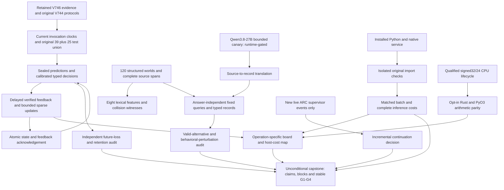
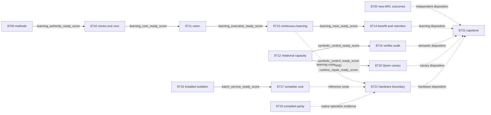

# Carnot Research Roadmap V747: Causal learning, complete relational verification, and portable sparse updates

**Created:** 2026-11-02 UTC (November 1 local)
**Milestone:** 2026.11.747
**Status:** Planned; no experiment executed or milestone activated by this document
**Supersedes:** V746's next-plan slot, after all fourteen V746 scheduling slots ended
**Historical authority:** [Preserved V746 design](research-roadmap-v746-preserved-20261102.md)
**Execution queue:** [research-roadmap-next.yaml](../../research-roadmap-next.yaml)
**Contract:** Exactly 14 tasks, Exp8709 through Exp8722, in four phases

## What V746 proved

Completed scheduling does not mean fourteen successful experiments. Ten producers
ran; four downstream studies were skipped. `research-complete.yaml` still ends
with V745 at planning time. V746 evidence comes from its active YAML, conductor
records and actual producer artifacts; no missing archive entries are invented.

| Evidence | Established result | Remaining boundary |
|---|---|---|
| Exp8695/8696 | Qualified retained authority and the original 39-node learning core | Execution eligibility is not useful learning; a producer change requires a new common seal |
| Exp8697 | Original deadline-publication cases rejected candidates; the complete original union did not qualify | A retained start clock and current end clock produced negative invocation durations; later remainder work was killed |
| Exp8698 | Qualified 120 structured worlds, 40 per role/negation/time family, with 480 views | Constructed evidence and independently supplied records do not establish natural extraction |
| Exp8701 | Exact symbolic capacity controls passed | All 480 `p2_hallucination_probability` operands were missing; the nine-input head comparison remains blocked |
| Exp8702 | Installed parity and compatibility assertions ran | An original legacy-export test failed teardown with +553MB retained memory; producer was disqualified |
| Exp8705 | Qualified `no_supported_policy_change` for the closed four-game, eight-pair, sixteen-episode ARC panel | The 120-action panel is fully censored and stays closed |
| Exp8706 | Signed32/24 CPU lifecycle checks qualified: 81920 updates, 320 boundary controls and restart after committed update2048 | Numerical fidelity is not useful learning, native execution or FPGA acceleration |
| Exp8707/8708 | Operation mapping and terminal accounting retained missing-cost and physical-execution boundaries | Learning benefit, complete batching speed and physical acceleration remain unmeasured |

Exp8699/8700 learning studies, Exp8703 cost and Exp8704 canary did not acquire
scientific evidence. A conductor skip is not a scientific null. Preserve the
qualified V733 source-information, V735 cold-cost, V737 supervisor and V743
batch-one nulls, plus all historical flags. New source cannot repair old results.

The concrete learning defect is observable: one retained fixture starts at
497771539033492 monotonic nanoseconds but the new process ends at
232478218800900, yielding -265293.320232592 seconds. Current execution must use
current start/end clocks; old measured clocks remain source provenance. Never
clamp the duration, sleep to meet a floor or weaken the shared substrate check.

## Three biggest gaps against the PRD

1. **FR-11 continuous self-learning lacks a qualified future-benefit result.**
   The causal protocol, durable feedback and sparse head exist, but publication
   failures prevented the complete 64-node qualification and delayed study.
   Repair invocation ownership once, qualify the original disjoint union, then
   measure future proper loss, typed decisions and simultaneous retention.
2. **FR-12 verifiable reasoning lacks a demonstrated semantic-information path.**
   Lexical summaries can discard relations; missing numerical inputs blocked the
   old head comparison. Measure eight-feature collisions independently, then
   test verifier completeness with valid alternatives and faulty relations.
   A small gated Qwen canary measures source-to-record fidelity separately.
3. **FR-05/FR-08 and NFR-01 lack complete-cost, portable execution evidence.**
   Installed batching needs a qualified original import boundary. Lifecycle
   arithmetic has no compiled parity evidence. Measure matched batching and
   same-batch Python/native costs, port the fixed-point arithmetic, and map only
   demonstrated operations to hardware. Neither batching nor CPU parity proves
   the PRD's native 10x target or the program's complete-learning 100x ambition.

## Literature informing the design

The [V747 scan](../../research-references.md#v747-planning-scan--2026-11-02-utc)
was appended before this design. It covers all eight requested topics and the
six secondary discovery channels, with retrieval limits recorded explicitly.

| Finding | Adaptation | Experiment |
|---|---|---|
| [VerifierBench, October 2026](https://arxiv.org/abs/2610.28679): rejecting invalid inputs alone can conceal rejection of valid alternatives | Include reject-all, accept-all and valid-equivalent controls | Exp8715 |
| [ReLoop, 2026 revision](https://arxiv.org/html/2602.15983v3): behavioral perturbations reveal some missing constraints but miss other wrong relations | Compare existing controls with independently labeled relation perturbations; retain missed-defect witnesses | Exp8715 |
| [Verification Without Sufficiency](https://arxiv.org/abs/2608.00585): local evidence checks can miss joint sufficiency | Preserve complete-premise and unknown semantics; never convert missing evidence to false | Exp8712/8715/8718 |
| [On-chip KAN learning](https://arxiv.org/html/2602.02056v4): sparse fixed-point updates can expose local arithmetic | Exact compiled integer parity against the qualified CPU lifecycle, with host work explicit | Exp8719/8721 |
| [Capacity-constrained delayed learning](https://arxiv.org/abs/2503.19856) | Preserve the existing bounded-feedback, prediction-before-label protocol; transfer no theorem to the nonlinear head | Exp8713/8714 |
| [Ising portability review](https://arxiv.org/abs/2610.03972) and [Extropic Z1T](https://extropic.ai/writing/z1t/) | Distinguish supported operations and complete costs from device projections | Exp8721 |

EBT, ARM–EBM, distributional verification, differentiable planning and energy-guided
decoding were checked. They do not justify reopening retired external-text scorer
or repair stacks. Semantic Scholar citation endpoints were inaccessible; citation
coverage is incomplete. OpenReview's EBT PDF was available but its forum challenged
access. GitHub Trending returned older snapshots. Kona supplied product claims,
not a reproducible new architecture. No dependency or hardware purchase follows.

## Architecture: qualify evidence, then measure the missing behavior



The runtime loop uses the existing nine-input, 109-coefficient head and original
objective protocol. The model-free lexical diagnostic is a separate estimand;
it never substitutes for the missing ninth input. The Rust fixed-point port is
opt-in and does not change the floating Brier study or production defaults.

## Phase 1 — Recover the original causal execution boundary (Exp8709–8711)

**Exp8709** binds the fourteen full objects and changed methods to retained
qualified authority. Reuse identical producer receipts; do not rerun the
historical 77-node suite merely to relabel a milestone. Register the clock fix,
model-free estimand, verifier controls, import isolation and compiled arithmetic.
Exercise contract mutations, including coordinated prompt, routing and gate edits.

**Exp8710** fixes the replay producer's clock ownership, with regressions for
saved epochs later than the current epoch. Preserve numerical operands, original
deadline assertions and historical timestamps. After sealing the changed source,
execute the original 39-node core and bounded original deadline smoke controls.
Retain a persistent qualified fixture, source closure and genuine child receipts.

**Exp8711** executes the original 25-node remainder under that same seal. The
union must contain all 64 original nodes, 27 runner nodes and 83 original
executable statement anchors; line shifts require source mapping, not dropped
anchors. New clock statements need owned coverage as well. Admit children using
measured fixture costs and validation reserve. A killed child cannot qualify.
The original private E2E-020 path must pass before learning execution is released.

## Phase 2 — Measure useful learning and relational completeness (Exp8712–8715)

**Exp8712** independently authenticates Exp8698's 120 worlds and 480 views.
Extract all eight lexical features at chunk sizes 1/32/128: 1440 feature rows.
Record opposite-truth/equal-feature witnesses. Evaluate complete, deleted and
reversed records: 1440 symbolic rows. Independently supplied records and exact
world truth establish constructed capacity only. The missing ninth probability
keeps the old head study blocked. Read existing changed CUDA evidence once into
its own runtime readiness field; no model load or repeated runtime probe occurs.

**Exp8713** is the continuous self-learning experiment. Preserve the original
frozen/log-loss/Brier/shuffled arms, seeds 17/29/43/71/101, five blocks of twenty
question groups, three siblings, capacity8, learning rate0.01 and L2=0.001.
There are 6000 predictions and 100 independent question groups. Seal predictions,
confidence and accept/reject/escalate decisions before labels arrive. Apply real
updates and atomically acknowledge feedback. Retain delayed-label admission,
crash/resume and tail-drain controls. Measure dense renormalization, global decay,
host copies and fsync as well as sparse arithmetic. No generator weights change.

**Exp8714** audits future proper loss over the 80 later groups, averaging siblings
and seeds within each question. Use 10000 paired question-cluster draws and
97.5% intervals for Brier improvement versus both frozen and log-loss; both lower
bounds must exceed zero, with no typed-decision loss increase. Across fifty
retention questions and five windows, the joint upper95 bound on maximum Brier
increase must be <=0.01. Retention labels remain unavailable to training. Report
false acceptance, escalation and cost. Valid below-threshold results are null;
exposed-development improvement does not establish independent generalization.

**Exp8715** freezes six verifier variants: correct, reject-all, accept-all,
omitted predicate, reversed arguments and missing-as-false. All120 worlds yield
720 variant/world units. Every fourth world is sealed for evaluation: 30 worlds,
180 units; the other90 support implementation checks. Compare original controls
with record permutations, bijective entity renaming, irrelevant-fact insertion
and required-premise/role perturbations. Expected relations come from an
independent evaluator. Count all probes and report their unequal costs. Correct
verifiers must preserve valid equivalents and unknowns; degenerate accept/reject
controls must fail. Zero incremental detection gain is a valid null. This is a
constructed defect audit, not natural-language error prevalence or a proof.

## Phase 3 — Qualify installed costs and bounded extraction (Exp8716–8718)

**Exp8716** reproduces the +553MB legacy-export teardown failure and moves the
same heavy export identity assertions into a fresh, reaped child. Keep the memory
guard, original assertions and lean-import checks. No threshold relaxation,
parent warming or skipped test is allowed. Freeze the installed wheel and loaded
extension. Qualify original122 compatibility nodes plus batch tests, including
an actual CLI outside the checkout. Preserve batch sizes1–16, 65536-byte frames,
whole-envelope rejection, deadlines and single-item behavior.

**Exp8717** measures sixty paired cells: two backends, three batch sizes1/4/16,
ten process repeats, each processing sixteen panels of64 items: 61440 evaluations.
Recompute features and include launch, setup, transport, parsing and shutdown.
The batching criterion is native B16/B1 throughput lower95>1.05, exact typed
decisions and steady p95<=50ms. Separately, NFR-01 needs native/Python lower95>=10
at the same batch size. Use10000 paired process-level draws. Repeated items add
timing observations, not semantic independence. Inference-only costs exclude
feedback durability explicitly. Cost readiness can pass when benefit is null.

**Exp8718** runs only after current causal CUDA custody and symbolic controls
qualify. `MODEL_SPECS` contains only `unsloth/Qwen3.8-27B-GGUF`, Q4_K_M. Use the
same twelve registered worlds, four per family, for36 calls: direct decision,
source-to-record extraction and decision from those records. Temperature0;
maximum128 output tokens each,4608 total. This is `model_bounded_generation`
with a10-second duration floor, never full generation. Record actual model hash,
GPU offload, lease, prompt/output counts, truncations and latency. Execute only
fixed, answer-independent queries, never model-generated code. Missing or
contradictory evidence escalates. This canary cannot establish population gains.

## Phase 4 — Port arithmetic and close independent evidence boundaries (Exp8719–8722)

**Exp8719** ports the qualified signed32/24 arithmetic to a small opt-in Rust
module and PyO3 entry. Preserve ties-to-even, Python negative floor division,
checked signed64 intermediates, explicit saturation and the supported-domain
envelope. Cross the actual loaded extension for all81920 original updates,
320 boundary controls and real restart at update2048. Compare exact integer
states, counters, rejection behavior and serialized order. Test zero denominator,
rounding ties, NaN ingress and overflow. The supported accumulator bound is
1333066761011986432; the whole-format bound170632382681813352448 exceeds signed64.
Keep nonlinear functions, scaling, offsets, label admission and durability on the
host, counting crossings and copies. No speed or physical-execution claim follows.

**Exp8720** retains a supervisor-refinement slot without rerunning the closed
ARC panel. Authenticate Exp8705, establish its event high-water mark and inspect
only new live outcomes. An authenticated empty delta ends immediately as
`complete_null_no_new_supervisor_outcomes`. New entries preserve game, arm,
selection, application, reset cause and censoring. No new policy, model call,
game replay, source RE, offline BFS, adapter or level-solve credit is scheduled.
Any incidental solve provenance must remain `live_agent_self_discovery`.

**Exp8721** independently reads learning costs, installed costs and native parity.
Missing one operand cannot suppress the others. Map actual operations to KV260,
PolarFire and GateMate while retaining unsupported and unknown entries. A Rust
CPU port cannot establish FPGA support. A compatible measured fraction f permits
only a conditional ceiling1/(1-f); no complete cost means no numeric ceiling.
Keep the complete-learning100x ambition explicit and unproven.

**Exp8722** runs unconditionally after every scheduling slot. Recompute claims
from admitted rows, reconcile all fourteen dispositions and current gate values,
and preserve independent branch failures. Keep stable G1/G2/G3/G4, `paper_ready`
and `unmet_gates` under their existing meanings. Old publication gates cannot
certify new science. Record retirement candidates and changed-mechanism reopening
conditions; external incompleteness is terminal `blocked`, not retryable `partial`.

## Dependency graph and gate contract

Solid arrows are conductor gates; dotted arrows are evidence reads that preserve
other branches when an input is missing. All gated upstreams occur earlier in
this roadmap. Each field below is required, with identical spelling, in its
producer's REQUIRED ARTIFACT FIELDS. Gates require top-level numeric1.



Exp8712, Exp8716, Exp8719, Exp8720, Exp8721 and Exp8722 have no conductor gate.
They authenticate their own original operands. Exp8709 is an administrative
learning prerequisite, not a global prerequisite for all science. Every blocked
artifact must use `gate_check_summary` with the failed check and observed value;
missing file, missing field, changed bytes and observed zero are different cases.

## Hardware, execution budgets and agent routing

| Resource | Required use and precondition | Claim boundary |
|---|---|---|
| Existing CPU, Python venv, Rust/PyO3 toolchain | All studies except the optional live canary; one bounded worker per measurement; enough measured RAM and disk-backed private scratch for the actual child | No assumed hardware speedup |
| Persistent disk | Retain sealed fixtures, immutable primitives, SQLite coverage and child exits before scratch cleanup; reserve space before each cohort | A missing temporary fixture cannot silently change a gate |
| Dual RTX3090 inventory | Only Exp8718; current causal CUDA receipt, cached exact Qwen GGUF, actual context fit and an exclusive owned lease | Device visibility and old runtime successes do not prove current offload |
| KV260 | Existing quadratic-energy support with k_max<=5; future board work uses SSH/scp/xmutil and hash-bound images | No spline update or dense nonlinear support inferred from Ising execution |
| PolarFire | Existing Linux CPU dispatch evidence only | Linux execution is not fabric acceleration |
| GateMate | Existing0xffffffff blocker; reopen only after a dated physical change, valid0x20000001 IDCODE and ordered n16 smoke | No unchanged detection retry or flash in V747 |
| TSU, NPU, new FPGA/GPU | No access, purchase or bring-up required for this queue | Literature projections remain external claims |

Expected serial budgets are170/195/155/140 minutes by phase,660 minutes total
before gate skips (estimates, not measured durations). No task estimates more
than70 minutes. Every task reserves validation time within the4800-second cap,
uses flushed phase and before/after-call progress, polls within60 seconds and
prints counts inside long loops. Every silence gap stays under600 seconds.
Files longer than about200 lines must be written in several tool calls, with a
progress message between them. Measurement stops by3600 seconds to leave at
least900 seconds for validation; no artificial duration padding is permitted.

Exp8709/8710/8711/8716 use Claude Opus with100 turns because they coordinate
schema/authority or multi-process qualification work. Exp8715 and Exp8719 use
`agent_type: codex`, `model: gpt-6.1-sol` for formulaic verifier/native code.
Other scientific tasks use default Claude Sonnet with50 turns. Read-only
Exp8720/8721/8722 use20 turns. No Luna task is proposed. Runtime readiness is
read from authenticated evidence; there is no hidden hardware integration task
inside the canary or operation mapper.

## Scientific acceptance, validation and retirement

Every comparison carries per-unit `rows` and intended/completed/failed/censored
counts. Preserve paired arms, question/game identity, repeated-measure structure,
raw numerators/denominators, exposure, costs, sources and independent sample size.
Every task declares `verdict_class` from the closed six-member enum. Constructed
oracle-dependent positives are `circular_positive`. Readiness is distinct from
benefit. Missing external inputs are terminal `blocked`; `partial` is reserved
for incomplete owned work that another attempt could finish.

Each rerun lineage declares all four `prior_failures` fields, including
`retire_if_same_verdict: true`. Changed mechanisms are specific: fresh invocation
clocks, model-free information analysis, valid-alternative controls, isolated
imports, compiled arithmetic or new-only supervisor events. No retired ID is
reused and no gate depends on a retired task. Exact repeated verdicts trigger
retirement; a new milestone number is not a reason to retry a closed experiment.

Before implementation, extend relevant REQ/SCENARIO specs and add failing tests.
Preserve original assertions and validators. Require scoped unit/lint/type/spec
checks, genuine owned statement coverage, actual private CLI success/rejection
and applicable E2E checks. Learning additionally requires E2E-020; native port
requires E2E-003/004; publication readers require E2E-018/021. Cold-replay sealed
operands and reject missing or consistently rehashed tampering. Run unchanged
primary publication, adversarial verification and strict row-consistency checks
on final bytes. A failed owned check disqualifies the new producer.

This planning change validates the queue and contracts; it does not run the
planned experiments. Preserve the active `research-roadmap.yaml`,
`scripts/research_conductor.py`, exclusion manifest and historical result bytes.
Reconcile the planning requirements, traceability, architecture, status and
changelog, then leave activation to the conductor's separate workflow.

## Exact task contract

Exactly **14 tasks, Exp8709 through Exp8722**, execute in the following order.

| Order | Task | Title | Phase | Deliverable |
|---|---|---|---|---|
| 1 | `exp8709-contract-methods` | Bind fourteen tasks to retained authority and independent branch methods | 1 | `results/experiment_8709_v747_contract_methods.json` |
| 2 | `exp8710-invocation-clock-core` | Separate replay clocks and qualify the frozen original learning core | 1 | `results/experiment_8710_v747_invocation_clock_core.json` |
| 3 | `exp8711-learning-union` | Qualify original deadline publication and the complete causal learning union | 1 | `results/experiment_8711_v747_learning_union.json` |
| 4 | `exp8712-relational-capacity` | Measure lexical collisions and symbolic capacity without invented model probabilities | 2 | `results/experiment_8712_v747_relational_capacity.json` |
| 5 | `exp8713-causal-brier-stream` | Measure continuous typed-decision learning after sealed delayed feedback | 2 | `results/experiment_8713_v747_causal_brier_stream.json` |
| 6 | `exp8714-learning-benefit-audit` | Test future proper-loss benefit and simultaneous retention from causal rows | 2 | `results/experiment_8714_v747_learning_benefit_audit.json` |
| 7 | `exp8715-verifier-completeness` | Test valid alternatives and behavioral perturbations against relational verifier defects | 2 | `results/experiment_8715_v747_verifier_completeness.json` |
| 8 | `exp8716-installed-import-isolation` | Qualify installed batching with isolated legacy export execution | 3 | `results/experiment_8716_v747_installed_import_isolation.json` |
| 9 | `exp8717-installed-batch-cost` | Measure complete batching throughput and same-batch native speed | 3 | `results/experiment_8717_v747_installed_batch_cost.json` |
| 10 | `exp8718-qwen-symbolic-canary` | Compare bounded Qwen decisions and source-grounded relation records | 3 | `results/experiment_8718_v747_qwen_symbolic_canary.json` |
| 11 | `exp8719-compiled-sparse-update` | Qualify a compiled fixed-point sparse update against the lifecycle emulator | 4 | `results/experiment_8719_v747_compiled_sparse_update.json` |
| 12 | `exp8720-arc-supervisor-frontier` | Inspect only new cross-game supervisor outcomes after the closed horizon decision | 4 | `results/experiment_8720_v747_arc_supervisor_frontier.json` |
| 13 | `exp8721-hardware-operation-boundary` | Map new compiled operations and complete costs to actual board support | 4 | `results/experiment_8721_v747_hardware_operation_boundary.json` |
| 14 | `exp8722-capstone` | Reconcile fourteen outcomes and stop unchanged failed research scopes | 4 | `results/experiment_8722_v747_capstone.json` |

Canonical full-task SHA-256: `d0fb6404987d9825a83e7f3b910e1d9a5eaa6a9caabee9aef693faa3050e7c83`

The digest covers all full task objects, including prompts, routes, priors and gates.
The JSON below must equal `research-roadmap-next.yaml:tasks` as complete objects.
The active V746 YAML remains unchanged until a separate conductor activation.

<!-- V747_TASK_CONTRACT_START -->
```json
{
  "milestone": "2026.11.747",
  "tasks": [
    {"id": "exp8709-contract-methods", "title": "Bind fourteen tasks to retained authority and independent branch methods", "phase": 1, "track": "research", "priority": "high", "requires_gpu": false, "max_turns": 100, "estimated_wall_time_min": 35, "per_unit_rows": true, "milestone": "2026.11.747", "deliverable": "results/experiment_8709_v747_contract_methods.json", "inference_substrate_class": "no_model_load", "MODEL_SPECS": [], "gated_on": [], "prior_failures": [{"experiment_id": "exp7532-v659-contract-methods", "verdict": "complete_blocked_incomplete_v659_authorities", "addressed_by": "Exp8695 now supplies qualified immutable child authority. Reuse that evidence at its original identity and qualify only the new V747 full-object binding and explicit branch changes; do not repeat failed mutable-scratch scans.", "retire_if_same_verdict": true}, {"experiment_id": "exp7713-v672-contract-methods", "verdict": "complete_blocked_v672_independent_contract", "addressed_by": "Exp8695 now supplies qualified immutable child authority. Reuse that evidence at its original identity and qualify only the new V747 full-object binding and explicit branch changes; do not repeat failed mutable-scratch scans.", "retire_if_same_verdict": true}, {"experiment_id": "exp7940-v689-contract-methods", "verdict": "complete_blocked_authority", "addressed_by": "Exp8695 now supplies qualified immutable child authority. Reuse that evidence at its original identity and qualify only the new V747 full-object binding and explicit branch changes; do not repeat failed mutable-scratch scans.", "retire_if_same_verdict": true}, {"experiment_id": "exp7992-v693-contract-methods", "verdict": "complete_blocked_authority", "addressed_by": "Exp8695 now supplies qualified immutable child authority. Reuse that evidence at its original identity and qualify only the new V747 full-object binding and explicit branch changes; do not repeat failed mutable-scratch scans.", "retire_if_same_verdict": true}, {"experiment_id": "exp8018-v695-contract-methods", "verdict": "complete_blocked_authority", "addressed_by": "Exp8695 now supplies qualified immutable child authority. Reuse that evidence at its original identity and qualify only the new V747 full-object binding and explicit branch changes; do not repeat failed mutable-scratch scans.", "retire_if_same_verdict": true}, {"experiment_id": "exp8374-v722-contract-methods", "verdict": "complete_blocked_direct_contract_methods", "addressed_by": "Exp8695 now supplies qualified immutable child authority. Reuse that evidence at its original identity and qualify only the new V747 full-object binding and explicit branch changes; do not repeat failed mutable-scratch scans.", "retire_if_same_verdict": true}, {"experiment_id": "exp8388-v723-contract-methods", "verdict": "complete_blocked_v723_contract_methods", "addressed_by": "Exp8695 now supplies qualified immutable child authority. Reuse that evidence at its original identity and qualify only the new V747 full-object binding and explicit branch changes; do not repeat failed mutable-scratch scans.", "retire_if_same_verdict": true}, {"experiment_id": "exp8416-v725-contract-methods", "verdict": "complete_blocked_v725_contract_methods", "addressed_by": "Exp8695 now supplies qualified immutable child authority. Reuse that evidence at its original identity and qualify only the new V747 full-object binding and explicit branch changes; do not repeat failed mutable-scratch scans.", "retire_if_same_verdict": true}, {"experiment_id": "exp8443-v727-contract-methods", "verdict": "complete_blocked_v727_contract_methods", "addressed_by": "Exp8695 now supplies qualified immutable child authority. Reuse that evidence at its original identity and qualify only the new V747 full-object binding and explicit branch changes; do not repeat failed mutable-scratch scans.", "retire_if_same_verdict": true}, {"experiment_id": "exp8471-v729-contract-methods", "verdict": "complete_blocked_v729_contract_methods", "addressed_by": "Exp8695 now supplies qualified immutable child authority. Reuse that evidence at its original identity and qualify only the new V747 full-object binding and explicit branch changes; do not repeat failed mutable-scratch scans.", "retire_if_same_verdict": true}, {"experiment_id": "exp8499-v731-contract-methods", "verdict": "complete_blocked_v731_contract_methods", "addressed_by": "Exp8695 now supplies qualified immutable child authority. Reuse that evidence at its original identity and qualify only the new V747 full-object binding and explicit branch changes; do not repeat failed mutable-scratch scans.", "retire_if_same_verdict": true}, {"experiment_id": "exp8565-v736-contract-methods", "verdict": "complete_blocked_v736_contract_methods", "addressed_by": "Exp8695 now supplies qualified immutable child authority. Reuse that evidence at its original identity and qualify only the new V747 full-object binding and explicit branch changes; do not repeat failed mutable-scratch scans.", "retire_if_same_verdict": true}, {"experiment_id": "exp8602-v739-contract-methods", "verdict": "complete_blocked_v739_contract_methods", "addressed_by": "Exp8695 now supplies qualified immutable child authority. Reuse that evidence at its original identity and qualify only the new V747 full-object binding and explicit branch changes; do not repeat failed mutable-scratch scans.", "retire_if_same_verdict": true}, {"experiment_id": "exp8667-contract-methods", "verdict": "complete_disqualified_v744_contract_methods", "addressed_by": "Exp8695 now supplies qualified immutable child authority. Reuse that evidence at its original identity and qualify only the new V747 full-object binding and explicit branch changes; do not repeat failed mutable-scratch scans.", "retire_if_same_verdict": true}, {"experiment_id": "exp8681-contract-methods", "verdict": "complete_disqualified_v745_contract_methods", "addressed_by": "Exp8695 now supplies qualified immutable child authority. Reuse that evidence at its original identity and qualify only the new V747 full-object binding and explicit branch changes; do not repeat failed mutable-scratch scans.", "retire_if_same_verdict": true}], "model": "opus", "prompt": "CONTEXT:\nWork in {project_root} on {date}. V746 ended fourteen scheduling slots: ten producers ran and four studies were skipped. Exp8695/8696 qualified retained authority and the original learning core. Exp8697 failed deadline publication: retained start clocks mixed with current end clocks produced negative durations. Exp8698 qualified 480 constructed relational views. Exp8701 lacked all 480 generator probabilities; its symbolic controls passed. Exp8702 failed an original export test's +553MB teardown guard. Exp8705 qualified no_supported_policy_change on the all-censored ARC panel. Exp8706 qualified CPU fixed-point lifecycle checks. Learning benefit, batch speed and physical acceleration remain unmeasured. V747 schedules exactly fourteen tasks, Exp8709 through Exp8722. Historical quarantines and qualified scientific nulls remain authoritative.\n\nEXISTING CODE TO READ FIRST:\nCLAUDE.md; CODEX.md; ops/e2e-test-plan.md; ops/exclusion_manifest.yaml; openspec/capabilities/research-reporting/spec.md; openspec/capabilities/verification/spec.md; scripts/experiment_template.py; python/carnot/reporting/primary_publication.py; openspec/change-proposals/research-roadmap-vNEXT.md; openspec/change-proposals/research-roadmap-v746-preserved-20261102.md; openspec/change-proposals/v744-methods-protocol.json; research-references.md; openspec/change-proposals/research-roadmap-v745-preserved-20261101.md; python/carnot/reporting/v744_contract_methods.py; python/carnot/reporting/v744_contract_report.py; python/carnot/reporting/v741_contract_report.py; python/carnot/reporting/roadmap_contract.py; tests/python/test_v744_contract_methods_8667.py; tests/python/test_v744_contract_runner_8667.py; results/experiment_8667_v744_contract_methods.json; results/raw/experiment_8667_v744_contract_methods/invocations/1793500792730659524/failure_summary.json; python/carnot/verify/cuda_reader_8410.py; python/carnot/reporting/v745_contract_runner.py; python/carnot/reporting/v745_contract_report.py; python/carnot/reporting/v743_contract_runner.py; tests/python/test_v745_contract_8681.py; results/experiment_8681_v745_contract_methods.json; python/carnot/reporting/v746_contract_authority.py; results/experiment_8695_v746_retained_contract_authority.json; results/experiment_8708_v746_capstone.json\n\nTASK:\nBind fourteen tasks to retained authority and independent branch methods. Deliver results/experiment_8709_v747_contract_methods.json. Use thin runner scripts/experiments/experiment_8709_v747_contract_methods.py, raw evidence results/raw/experiment_8709_v747_contract_methods/ and notes docs/research-notes/v747-contract-methods.md.\n\nCONCRETE STEPS:\n1. PRECONDITIONS: Emit a flushed start line. Check exact inputs, hashes, tools, memory and disk-backed private scratch before measurement. Authenticate producer and terminal validation for every gate. Distinguish missing files, missing fields, changed bytes and observed zero. External absence produces complete_blocked_<reason>, verdict_class=blocked and gate_check_summary. A flagged producer cannot grant readiness.\n\n2. Print a flushed progress line at every phase boundary. Print before and after every model load, generation, benchmark and subprocess that can take minutes. Use unbuffered output and a parent heartbeat at least every 60 seconds. Print completed/pending counts inside long loops. Keep every silence gap under 600 seconds. Write files over about 200 lines in several tool calls of at most 150 lines. Send a progress message between calls. Poll within 60 seconds. Stop measurements by 3600 seconds and reserve at least 900 seconds for validation within the 4800-second cap. Never pad duration.\n\n3. Spec first: confirm relevant REQ-* and SCENARIO-* requirements. Write failing focused tests before implementation. Reuse existing components. Freeze sources, tests, configuration and inputs before measurement. Source changes invalidate affected receipts. Use scripts/experiments/ for runners and tests/python/ for tests. Accept --date {date}. Preserve historical result bytes, original test assertions, private-output guards and shared validators.\n\n4. Bind this branch to the full V747 task objects, visible table and canonical digest. Authenticate original scientific operands through their versioned authority. Independent branches perform their own contract checks; no unrelated readiness bit is a prerequisite. Read declared deliverables exactly. A conductor skip artifact is scheduling evidence only. Reuse a prior execution receipt only at identical source, input, configuration and test identity.\n\n5. Declare inference_substrate_class=no_model_load, MODEL_SPECS=[] and zero language-model calls. Use deterministic_verifier for constructed controls, aggregation_from_upstream_artifacts for readers, or verifier_ensemble_against_cached_candidates for authenticated small-head work. CPU emulation and native CPU execution are not physical FPGA execution.\n\n6. Use the qualified Exp8695 retained-child method to bind exactly fourteen full V747 tasks. Preserve V746 design bytes and the unchanged V744 objective_updates, objective_audit and installed_batching_protocol. Verify full-object equality, table order and canonical digest. Exercise count, ID, title, phase, path, routing, prompt, model, substrate, gate and prior-failure mutations. Do not rerun the historical 77-node producer merely to change a milestone label; authenticate its sealed receipt and separately test the current binding.\n\n7. Register the explicit V747 changes: current invocation clocks for resumed fixtures; a model-free eight-feature relational diagnostic; valid-alternative and perturbation controls; isolated legacy-import execution; and a compiled signed32/24 kernel. Original learning numerics and batch-cost thresholds remain fixed. Every branch authenticates its own eligible operands, independent of this administrative score.\n\n8. Seal exact historical primary paths and hashes, source closures and the original 39+25 node partition. Retained measurement clocks belong to their source invocation. Record the Exp8697 negative durations and Exp8702 +553MB failure as immutable diagnostics. New qualified evidence cannot clear historical disqualifications. Emit contract_ready_score and learning_authority_ready_score only after owned checks pass.\n\n9. Run focused unit tests, real private CLI success/rejection paths, Ruff check/format, strict mypy on owned Python modules and scripts/check_spec_coverage.py --files <owned-test-files>. Run applicable ops/e2e-test-plan.md checks, including private E2E-018/021 for publication readers. Require 100 percent newly owned statements, including subprocess and rejection paths. Collect once and run bounded disjoint children with -n 0 -o addopts= --no-cov. Retain each child SQLite, JUnit, node list, hashes, actual exit and clocks before combining copies. Killed children fail qualification. Consumer tests cannot substitute for producer execution. Do not run recursive historical controllers or the full repository suite.\n\n10. Cold-replay sealed primitives in a fresh bounded process. Reject missing operands and consistently rehashed tampering. Run unchanged primary_publication, scripts/adversarial_verify.py --json <private-candidate> and scripts/verdict_row_consistency_lint.py --strict <private-candidate>. Validate final bytes before atomic publication. Failed owned checks disqualify. Unchanged external incompleteness is blocked, never partial. Reconcile OpenSpec, _bmad/traceability.md, ops/status.md and ops/changelog.md with measured outcomes.\n\nREQUIRED ARTIFACT FIELDS:\nexperiment_id, task_id, milestone, run_date, invocation_id: principle: Bind claims to the actual task and invocation.\nhonest_verdict, verdict_class: principle: Use complete_ terminal prefixes and exactly positive | circular_positive | null | blocked | disqualified | partial. Only retryable incomplete owned work is partial.\ngate_check_summary: principle: Every blocked verdict records upstream, path/hash, check, field, operator, expected and observed values. Absence differs from zero.\ninference_substrate, inference_substrate_class, MODEL_SPECS, model_invocation_counts, target_model, historical_model_provenance: principle: Separate current model use, authenticated numerical heads and historical evidence.\nrows, intended_count, completed_count, failed_count, censored_count, excluded_count, independent_count, sample_size_budget: principle: Retain metrics and status for every intended unit and arm. Repeats do not multiply independent cases.\nverifier_is_oracle, exposure_scope, independent_generalization_score, generalized_learning_benefit_score: principle: Oracle-dependent positives are circular_positive. Constructed or exposed data cannot establish independent generalization.\nrequired_checks_passed, flagged_adversarial, acceptance_gates, validation_receipts, terminal_validation_sidecar_path, adversarial_findings: principle: Readiness and scientific benefit differ. Failed acceptance checks forbid positive classes.\npreconditions_checked, duration_s, started_at_utc, ended_at_utc, phase_spans, random_seed, reproducibility_checksum: principle: Record actual clocks and seeds. Historical monotonic epochs cannot measure current execution.\nsource_artifact_hashes, code_config_hashes, raw_shard_hashes, cited_upstream_artifacts, field_principles, branch_gate_values: principle: Authenticate exact evidence. Downstream gates use identically named top-level numeric 0/1 fields.\ncontract_ready_score, learning_authority_ready_score, methods_manifest, task_contract_rows, authority_mutation_rows: principle: Full current authority binds planned work without claiming scientific success.\n\nRun command: cd {project_root} && JAX_PLATFORMS=cpu PYTHONPATH=python:. PYTHONUNBUFFERED=1 .venv/bin/python -u scripts/experiments/experiment_8709_v747_contract_methods.py --date {date}\n\nDo NOT push. Do NOT modify scripts/research_conductor.py.\n"},
    {"id": "exp8710-invocation-clock-core", "title": "Separate replay clocks and qualify the frozen original learning core", "phase": 1, "track": "research", "priority": "high", "requires_gpu": false, "max_turns": 100, "estimated_wall_time_min": 70, "per_unit_rows": true, "milestone": "2026.11.747", "deliverable": "results/experiment_8710_v747_invocation_clock_core.json", "inference_substrate_class": "no_model_load", "MODEL_SPECS": [], "gated_on": [{"upstream": "exp8709-contract-methods", "artifact_field": "learning_authority_ready_score", "op": "==", "value": 1}], "prior_failures": [{"experiment_id": "exp8654-learning-core-execution", "verdict": "complete_disqualified_v743_learning_core_execution", "addressed_by": "Exp8697 mixed a retained start epoch with the new end clock and rejected all three deadline artifacts. Separate current replay timing from sealed source timing; freshly execute the original core after the runner changes.", "retire_if_same_verdict": true}, {"experiment_id": "exp8641-learning-execution-custody", "verdict": "complete_disqualified_v742_learning_execution_custody", "addressed_by": "Exp8697 mixed a retained start epoch with the new end clock and rejected all three deadline artifacts. Separate current replay timing from sealed source timing; freshly execute the original core after the runner changes.", "retire_if_same_verdict": true}, {"experiment_id": "exp8668-frozen-learning-core", "verdict": "blocked_gate_check_failed", "addressed_by": "Exp8697 mixed a retained start epoch with the new end clock and rejected all three deadline artifacts. Separate current replay timing from sealed source timing; freshly execute the original core after the runner changes.", "retire_if_same_verdict": true}, {"experiment_id": "exp8682-frozen-learning-core", "verdict": "blocked_gate_check_failed", "addressed_by": "Exp8697 mixed a retained start epoch with the new end clock and rejected all three deadline artifacts. Separate current replay timing from sealed source timing; freshly execute the original core after the runner changes.", "retire_if_same_verdict": true}, {"experiment_id": "exp8697-learning-union-qualification", "verdict": "complete_disqualified_v746_learning_union_qualification", "addressed_by": "Exp8697 mixed a retained start epoch with the new end clock and rejected all three deadline artifacts. Separate current replay timing from sealed source timing; freshly execute the original core after the runner changes.", "retire_if_same_verdict": true}], "model": "opus", "prompt": "CONTEXT:\nWork in {project_root} on {date}. V746 ended fourteen scheduling slots: ten producers ran and four studies were skipped. Exp8695/8696 qualified retained authority and the original learning core. Exp8697 failed deadline publication: retained start clocks mixed with current end clocks produced negative durations. Exp8698 qualified 480 constructed relational views. Exp8701 lacked all 480 generator probabilities; its symbolic controls passed. Exp8702 failed an original export test's +553MB teardown guard. Exp8705 qualified no_supported_policy_change on the all-censored ARC panel. Exp8706 qualified CPU fixed-point lifecycle checks. Learning benefit, batch speed and physical acceleration remain unmeasured. V747 schedules exactly fourteen tasks, Exp8709 through Exp8722. Historical quarantines and qualified scientific nulls remain authoritative.\n\nEXISTING CODE TO READ FIRST:\nCLAUDE.md; CODEX.md; ops/e2e-test-plan.md; ops/exclusion_manifest.yaml; openspec/capabilities/research-reporting/spec.md; openspec/capabilities/verification/spec.md; scripts/experiment_template.py; python/carnot/reporting/primary_publication.py; openspec/change-proposals/research-roadmap-vNEXT.md; openspec/change-proposals/research-roadmap-v746-preserved-20261102.md; openspec/change-proposals/v744-methods-protocol.json; research-references.md; openspec/change-proposals/research-roadmap-v745-preserved-20261101.md; python/carnot/reporting/learning_core_runner_8654.py; python/carnot/reporting/learning_core_report_8654.py; python/carnot/reporting/learning_clock_8592.py; tests/python/test_learning_core_8654.py; tests/python/test_learning_core_runner_8654.py; results/experiment_8654_v743_learning_core_execution.json; python/carnot/reporting/v745_contract_runner.py; results/experiment_8682_frozen_learning_core.json; python/carnot/reporting/learning_core_8696.py; python/carnot/reporting/learning_core_runner_8696.py; python/carnot/reporting/causal_brier_runner_8582.py; python/carnot/reporting/deadline_edge_8603.py; tests/python/test_deadline_edge_8603.py; results/experiment_8696_v746_frozen_learning_core.json; results/experiment_8697_v746_learning_union_qualification.json\n\nTASK:\nSeparate replay clocks and qualify the frozen original learning core. Deliver results/experiment_8710_v747_invocation_clock_core.json. Use thin runner scripts/experiments/experiment_8710_v747_invocation_clock_core.py, raw evidence results/raw/experiment_8710_v747_invocation_clock_core/ and notes docs/research-notes/v747-invocation-clock-core.md.\n\nCONCRETE STEPS:\n1. PRECONDITIONS: Emit a flushed start line. Check exact inputs, hashes, tools, memory and disk-backed private scratch before measurement. Authenticate producer and terminal validation for every gate. Distinguish missing files, missing fields, changed bytes and observed zero. External absence produces complete_blocked_<reason>, verdict_class=blocked and gate_check_summary. A flagged producer cannot grant readiness.\n\n2. Print a flushed progress line at every phase boundary. Print before and after every model load, generation, benchmark and subprocess that can take minutes. Use unbuffered output and a parent heartbeat at least every 60 seconds. Print completed/pending counts inside long loops. Keep every silence gap under 600 seconds. Write files over about 200 lines in several tool calls of at most 150 lines. Send a progress message between calls. Poll within 60 seconds. Stop measurements by 3600 seconds and reserve at least 900 seconds for validation within the 4800-second cap. Never pad duration.\n\n3. Spec first: confirm relevant REQ-* and SCENARIO-* requirements. Write failing focused tests before implementation. Reuse existing components. Freeze sources, tests, configuration and inputs before measurement. Source changes invalidate affected receipts. Use scripts/experiments/ for runners and tests/python/ for tests. Accept --date {date}. Preserve historical result bytes, original test assertions, private-output guards and shared validators.\n\n4. Bind this branch to the full V747 task objects, visible table and canonical digest. Authenticate original scientific operands through their versioned authority. Independent branches perform their own contract checks; no unrelated readiness bit is a prerequisite. Read declared deliverables exactly. A conductor skip artifact is scheduling evidence only. Reuse a prior execution receipt only at identical source, input, configuration and test identity.\n\n5. Declare inference_substrate_class=no_model_load, MODEL_SPECS=[] and zero language-model calls. Use deterministic_verifier for constructed controls, aggregation_from_upstream_artifacts for readers, or verifier_ensemble_against_cached_candidates for authenticated small-head work. CPU emulation and native CPU execution are not physical FPGA execution.\n\n6. Reproduce the retained-fixture timing defect privately. The saved start is 497771539033492ns; the case-3599 current end was 232478218800900ns. Their subtraction produced duration_s=-265293.320232592. Keep historical measurement timing as provenance. Measure the current replay/publication interval with a fresh real monotonic pair and wall timestamps. Never clamp, invent elapsed time, replace the numerical clock, or weaken the duration validator.\n\n7. Add a regression using retained fixtures from a different monotonic epoch, including an old start larger than the current end. Require correct current elapsed time and unchanged source measurement hashes. Preserve deadline_clock reads at 3599/3600/3601, private disqualified verdicts, publication rejection and numerical results. Diagnose actual terminal findings before any expensive cohort. A changed private replay is not fresh scientific measurement.\n\n8. Finish the minimal producer clock fix, adapters, tests and formatting before sealing a transitive checkout. Run all original 39 core nodes against that seal. Do not reuse Exp8696 execution across changed runner source. Keep original checkpoint, data and causal assertions. Retain immutable producer coverage before scratch cleanup. Reserve the exact 25 remaining original nodes for Exp8711.\n\n9. Run one bounded smoke of each original deadline edge before publishing the seal. Record these smoke receipts separately; Exp8711 executes its own complete remainder. Set learning_core_ready_score only for all 39 nodes, clock regressions, original runner subset, real owned coverage and matching source hashes. Failed smoke leaves readiness zero. Supply the persistent frozen bundle and private fixture to the next task, with no temporary-directory dependency.\n\n10. Run focused unit tests, real private CLI success/rejection paths, Ruff check/format, strict mypy on owned Python modules and scripts/check_spec_coverage.py --files <owned-test-files>. Run applicable ops/e2e-test-plan.md checks, including private E2E-018/021 for publication readers. Require 100 percent newly owned statements, including subprocess and rejection paths. Collect once and run bounded disjoint children with -n 0 -o addopts= --no-cov. Retain each child SQLite, JUnit, node list, hashes, actual exit and clocks before combining copies. Killed children fail qualification. Consumer tests cannot substitute for producer execution. Do not run recursive historical controllers or the full repository suite.\n\n11. Cold-replay sealed primitives in a fresh bounded process. Reject missing operands and consistently rehashed tampering. Run unchanged primary_publication, scripts/adversarial_verify.py --json <private-candidate> and scripts/verdict_row_consistency_lint.py --strict <private-candidate>. Validate final bytes before atomic publication. Failed owned checks disqualify. Unchanged external incompleteness is blocked, never partial. Reconcile OpenSpec, _bmad/traceability.md, ops/status.md and ops/changelog.md with measured outcomes.\n\nREQUIRED ARTIFACT FIELDS:\nexperiment_id, task_id, milestone, run_date, invocation_id: principle: Bind claims to the actual task and invocation.\nhonest_verdict, verdict_class: principle: Use complete_ terminal prefixes and exactly positive | circular_positive | null | blocked | disqualified | partial. Only retryable incomplete owned work is partial.\ngate_check_summary: principle: Every blocked verdict records upstream, path/hash, check, field, operator, expected and observed values. Absence differs from zero.\ninference_substrate, inference_substrate_class, MODEL_SPECS, model_invocation_counts, target_model, historical_model_provenance: principle: Separate current model use, authenticated numerical heads and historical evidence.\nrows, intended_count, completed_count, failed_count, censored_count, excluded_count, independent_count, sample_size_budget: principle: Retain metrics and status for every intended unit and arm. Repeats do not multiply independent cases.\nverifier_is_oracle, exposure_scope, independent_generalization_score, generalized_learning_benefit_score: principle: Oracle-dependent positives are circular_positive. Constructed or exposed data cannot establish independent generalization.\nrequired_checks_passed, flagged_adversarial, acceptance_gates, validation_receipts, terminal_validation_sidecar_path, adversarial_findings: principle: Readiness and scientific benefit differ. Failed acceptance checks forbid positive classes.\npreconditions_checked, duration_s, started_at_utc, ended_at_utc, phase_spans, random_seed, reproducibility_checksum: principle: Record actual clocks and seeds. Historical monotonic epochs cannot measure current execution.\nsource_artifact_hashes, code_config_hashes, raw_shard_hashes, cited_upstream_artifacts, field_principles, branch_gate_values: principle: Authenticate exact evidence. Downstream gates use identically named top-level numeric 0/1 fields.\nlearning_core_ready_score, replay_clock_rows, historical_timing_reference, current_invocation_timing, original_core_node_rows, frozen_source_bundle, remainder_node_ids, producer_coverage_union: principle: Fresh execution and same-invocation clocks qualify the original core without reclassifying cached science.\n\nRun command: cd {project_root} && JAX_PLATFORMS=cpu PYTHONPATH=python:. PYTHONUNBUFFERED=1 .venv/bin/python -u scripts/experiments/experiment_8710_v747_invocation_clock_core.py --date {date}\n\nDo NOT push. Do NOT modify scripts/research_conductor.py.\n"},
    {"id": "exp8711-learning-union", "title": "Qualify original deadline publication and the complete causal learning union", "phase": 1, "track": "research", "priority": "high", "requires_gpu": false, "max_turns": 100, "estimated_wall_time_min": 65, "per_unit_rows": true, "milestone": "2026.11.747", "deliverable": "results/experiment_8711_v747_learning_union.json", "inference_substrate_class": "no_model_load", "MODEL_SPECS": [], "gated_on": [{"upstream": "exp8710-invocation-clock-core", "artifact_field": "learning_core_ready_score", "op": "==", "value": 1}], "prior_failures": [{"experiment_id": "exp8655-learning-execution-qualification", "verdict": "blocked_gate_check_failed", "addressed_by": "Exp8710 fixes the diagnosed cross-invocation duration defect and freezes fresh core execution. Run the same deadline assertions with planned child budgets instead of exhausting the remainder budget after three rejected publications.", "retire_if_same_verdict": true}, {"experiment_id": "exp8641-learning-execution-custody", "verdict": "complete_disqualified_v742_learning_execution_custody", "addressed_by": "Exp8710 fixes the diagnosed cross-invocation duration defect and freezes fresh core execution. Run the same deadline assertions with planned child budgets instead of exhausting the remainder budget after three rejected publications.", "retire_if_same_verdict": true}, {"experiment_id": "exp8669-learning-union-qualification", "verdict": "GATE_BLOCK", "addressed_by": "Exp8710 fixes the diagnosed cross-invocation duration defect and freezes fresh core execution. Run the same deadline assertions with planned child budgets instead of exhausting the remainder budget after three rejected publications.", "retire_if_same_verdict": true}, {"experiment_id": "exp8683-learning-union-qualification", "verdict": "GATE_BLOCK: Pre-emptive skip: upstream retired (exp8682-frozen-learning-core)", "addressed_by": "Exp8710 fixes the diagnosed cross-invocation duration defect and freezes fresh core execution. Run the same deadline assertions with planned child budgets instead of exhausting the remainder budget after three rejected publications.", "retire_if_same_verdict": true}, {"experiment_id": "exp8697-learning-union-qualification", "verdict": "complete_disqualified_v746_learning_union_qualification", "addressed_by": "Exp8710 fixes the diagnosed cross-invocation duration defect and freezes fresh core execution. Run the same deadline assertions with planned child budgets instead of exhausting the remainder budget after three rejected publications.", "retire_if_same_verdict": true}], "model": "opus", "prompt": "CONTEXT:\nWork in {project_root} on {date}. V746 ended fourteen scheduling slots: ten producers ran and four studies were skipped. Exp8695/8696 qualified retained authority and the original learning core. Exp8697 failed deadline publication: retained start clocks mixed with current end clocks produced negative durations. Exp8698 qualified 480 constructed relational views. Exp8701 lacked all 480 generator probabilities; its symbolic controls passed. Exp8702 failed an original export test's +553MB teardown guard. Exp8705 qualified no_supported_policy_change on the all-censored ARC panel. Exp8706 qualified CPU fixed-point lifecycle checks. Learning benefit, batch speed and physical acceleration remain unmeasured. V747 schedules exactly fourteen tasks, Exp8709 through Exp8722. Historical quarantines and qualified scientific nulls remain authoritative.\n\nEXISTING CODE TO READ FIRST:\nCLAUDE.md; CODEX.md; ops/e2e-test-plan.md; ops/exclusion_manifest.yaml; openspec/capabilities/research-reporting/spec.md; openspec/capabilities/verification/spec.md; scripts/experiment_template.py; python/carnot/reporting/primary_publication.py; openspec/change-proposals/research-roadmap-vNEXT.md; openspec/change-proposals/research-roadmap-v746-preserved-20261102.md; openspec/change-proposals/v744-methods-protocol.json; research-references.md; openspec/change-proposals/research-roadmap-v745-preserved-20261101.md; python/carnot/reporting/deadline_statement_8616.py; python/carnot/reporting/deadline_statement_validation_8616.py; tests/python/test_deadline_edge_8603.py; tests/python/test_deadline_statement_8616.py; tests/python/test_causal_brier_stream_8582.py; results/experiment_8655_learning_execution_qualification.json; results/experiment_8681_v745_contract_methods.json; python/carnot/reporting/learning_union_8697.py; tests/python/test_learning_union_8697.py; results/experiment_8697_v746_learning_union_qualification.json\n\nTASK:\nQualify original deadline publication and the complete causal learning union. Deliver results/experiment_8711_v747_learning_union.json. Use thin runner scripts/experiments/experiment_8711_v747_learning_union.py, raw evidence results/raw/experiment_8711_v747_learning_union/ and notes docs/research-notes/v747-learning-union.md.\n\nCONCRETE STEPS:\n1. PRECONDITIONS: Emit a flushed start line. Check exact inputs, hashes, tools, memory and disk-backed private scratch before measurement. Authenticate producer and terminal validation for every gate. Distinguish missing files, missing fields, changed bytes and observed zero. External absence produces complete_blocked_<reason>, verdict_class=blocked and gate_check_summary. A flagged producer cannot grant readiness.\n\n2. Print a flushed progress line at every phase boundary. Print before and after every model load, generation, benchmark and subprocess that can take minutes. Use unbuffered output and a parent heartbeat at least every 60 seconds. Print completed/pending counts inside long loops. Keep every silence gap under 600 seconds. Write files over about 200 lines in several tool calls of at most 150 lines. Send a progress message between calls. Poll within 60 seconds. Stop measurements by 3600 seconds and reserve at least 900 seconds for validation within the 4800-second cap. Never pad duration.\n\n3. Spec first: confirm relevant REQ-* and SCENARIO-* requirements. Write failing focused tests before implementation. Reuse existing components. Freeze sources, tests, configuration and inputs before measurement. Source changes invalidate affected receipts. Use scripts/experiments/ for runners and tests/python/ for tests. Accept --date {date}. Preserve historical result bytes, original test assertions, private-output guards and shared validators.\n\n4. Bind this branch to the full V747 task objects, visible table and canonical digest. Authenticate original scientific operands through their versioned authority. Independent branches perform their own contract checks; no unrelated readiness bit is a prerequisite. Read declared deliverables exactly. A conductor skip artifact is scheduling evidence only. Reuse a prior execution receipt only at identical source, input, configuration and test identity.\n\n5. Declare inference_substrate_class=no_model_load, MODEL_SPECS=[] and zero language-model calls. Use deterministic_verifier for constructed controls, aggregation_from_upstream_artifacts for readers, or verifier_ensemble_against_cached_candidates for authenticated small-head work. CPU emulation and native CPU execution are not physical FPGA execution.\n\n6. Authenticate the Exp8710 final source seal and persistent private fixture. Run the unchanged 25-node remainder against exactly that identity. Preserve original deadline diagnostics, hard exits, resume behavior and assertions. Exp8697 remainder0 had three candidate_rejected failures in 1116 seconds; remainder1 was killed after 206 seconds of remaining budget. The repaired clock removes the observed rejection, not the need for complete qualification.\n\n7. Collect once and split remainder children by measured fixture cost, with admission for the complete child plus validation reserve. Execute the three real deadline publication cases once per required original test; do not recursively launch old qualification controllers. Retain genuine SQLite and actual exits. Stop with explicit incomplete owned evidence if a child cannot finish; never count a killed child as passed.\n\n8. Join the fresh 39+25 disjoint original nodes, 27 required runner nodes and original 83 executable statement anchors. Match original statements to the sealed source where line numbers shifted; retain added clock statements as separate owned coverage. Require private E2E-020 and source identity before/after both cohorts. If the seal changes, invalidate and repeat affected cohorts under a common new seal.\n\n9. Set learning_execution_ready_score=1 only after the exact union, all producer statement anchors, original causal controls and owned checks pass. Publish original checkpoint/data/protocol references for Exp8713. This gate releases execution eligibility, not learning benefit.\n\n10. Run focused unit tests, real private CLI success/rejection paths, Ruff check/format, strict mypy on owned Python modules and scripts/check_spec_coverage.py --files <owned-test-files>. Run applicable ops/e2e-test-plan.md checks, including private E2E-018/021 for publication readers. Require 100 percent newly owned statements, including subprocess and rejection paths. Collect once and run bounded disjoint children with -n 0 -o addopts= --no-cov. Retain each child SQLite, JUnit, node list, hashes, actual exit and clocks before combining copies. Killed children fail qualification. Consumer tests cannot substitute for producer execution. Do not run recursive historical controllers or the full repository suite.\n\n11. Cold-replay sealed primitives in a fresh bounded process. Reject missing operands and consistently rehashed tampering. Run unchanged primary_publication, scripts/adversarial_verify.py --json <private-candidate> and scripts/verdict_row_consistency_lint.py --strict <private-candidate>. Validate final bytes before atomic publication. Failed owned checks disqualify. Unchanged external incompleteness is blocked, never partial. Reconcile OpenSpec, _bmad/traceability.md, ops/status.md and ops/changelog.md with measured outcomes.\n\nREQUIRED ARTIFACT FIELDS:\nexperiment_id, task_id, milestone, run_date, invocation_id: principle: Bind claims to the actual task and invocation.\nhonest_verdict, verdict_class: principle: Use complete_ terminal prefixes and exactly positive | circular_positive | null | blocked | disqualified | partial. Only retryable incomplete owned work is partial.\ngate_check_summary: principle: Every blocked verdict records upstream, path/hash, check, field, operator, expected and observed values. Absence differs from zero.\ninference_substrate, inference_substrate_class, MODEL_SPECS, model_invocation_counts, target_model, historical_model_provenance: principle: Separate current model use, authenticated numerical heads and historical evidence.\nrows, intended_count, completed_count, failed_count, censored_count, excluded_count, independent_count, sample_size_budget: principle: Retain metrics and status for every intended unit and arm. Repeats do not multiply independent cases.\nverifier_is_oracle, exposure_scope, independent_generalization_score, generalized_learning_benefit_score: principle: Oracle-dependent positives are circular_positive. Constructed or exposed data cannot establish independent generalization.\nrequired_checks_passed, flagged_adversarial, acceptance_gates, validation_receipts, terminal_validation_sidecar_path, adversarial_findings: principle: Readiness and scientific benefit differ. Failed acceptance checks forbid positive classes.\npreconditions_checked, duration_s, started_at_utc, ended_at_utc, phase_spans, random_seed, reproducibility_checksum: principle: Record actual clocks and seeds. Historical monotonic epochs cannot measure current execution.\nsource_artifact_hashes, code_config_hashes, raw_shard_hashes, cited_upstream_artifacts, field_principles, branch_gate_values: principle: Authenticate exact evidence. Downstream gates use identically named top-level numeric 0/1 fields.\nlearning_execution_ready_score, original_node_rows, original_runner_node_rows, original_statement_coverage, retained_child_rows, frozen_source_bundle: principle: Only the complete original execution union can authorize the causal study.\n\nRun command: cd {project_root} && JAX_PLATFORMS=cpu PYTHONPATH=python:. PYTHONUNBUFFERED=1 .venv/bin/python -u scripts/experiments/experiment_8711_v747_learning_union.py --date {date}\n\nDo NOT push. Do NOT modify scripts/research_conductor.py.\n"},
    {"id": "exp8712-relational-capacity", "title": "Measure lexical collisions and symbolic capacity without invented model probabilities", "phase": 2, "track": "research", "priority": "high", "requires_gpu": false, "max_turns": 50, "estimated_wall_time_min": 45, "per_unit_rows": true, "milestone": "2026.11.747", "deliverable": "results/experiment_8712_v747_relational_capacity.json", "inference_substrate_class": "no_model_load", "MODEL_SPECS": [], "gated_on": [], "prior_failures": [{"experiment_id": "exp8673-relational-feature-audit", "verdict": "GATE_BLOCK", "addressed_by": "Exp8701 symbolic controls passed but all 480 p2 probabilities were absent. This separate model-free diagnostic evaluates eight lexical features and independent SQL controls; it does not impute the ninth input or claim the old learned-head study completed.", "retire_if_same_verdict": true}, {"experiment_id": "exp8687-relational-feature-audit", "verdict": "GATE_BLOCK: Pre-emptive skip: upstream retired (exp8684-relational-evidence-controls)", "addressed_by": "Exp8701 symbolic controls passed but all 480 p2 probabilities were absent. This separate model-free diagnostic evaluates eight lexical features and independent SQL controls; it does not impute the ninth input or claim the old learned-head study completed.", "retire_if_same_verdict": true}, {"experiment_id": "exp8701-relational-feature-audit", "verdict": "complete_blocked_missing_numerical_head_operand", "addressed_by": "Exp8701 symbolic controls passed but all 480 p2 probabilities were absent. This separate model-free diagnostic evaluates eight lexical features and independent SQL controls; it does not impute the ninth input or claim the old learned-head study completed.", "retire_if_same_verdict": true}], "prompt": "CONTEXT:\nWork in {project_root} on {date}. V746 ended fourteen scheduling slots: ten producers ran and four studies were skipped. Exp8695/8696 qualified retained authority and the original learning core. Exp8697 failed deadline publication: retained start clocks mixed with current end clocks produced negative durations. Exp8698 qualified 480 constructed relational views. Exp8701 lacked all 480 generator probabilities; its symbolic controls passed. Exp8702 failed an original export test's +553MB teardown guard. Exp8705 qualified no_supported_policy_change on the all-censored ARC panel. Exp8706 qualified CPU fixed-point lifecycle checks. Learning benefit, batch speed and physical acceleration remain unmeasured. V747 schedules exactly fourteen tasks, Exp8709 through Exp8722. Historical quarantines and qualified scientific nulls remain authoritative.\n\nEXISTING CODE TO READ FIRST:\nCLAUDE.md; CODEX.md; ops/e2e-test-plan.md; ops/exclusion_manifest.yaml; openspec/capabilities/research-reporting/spec.md; openspec/capabilities/verification/spec.md; scripts/experiment_template.py; python/carnot/reporting/primary_publication.py; openspec/change-proposals/research-roadmap-vNEXT.md; openspec/change-proposals/research-roadmap-v746-preserved-20261102.md; openspec/change-proposals/v744-methods-protocol.json; research-references.md; openspec/change-proposals/research-roadmap-v745-preserved-20261101.md; python/carnot/reporting/complete_source_8659.py; results/experiment_8659_v743_complete_source_comparison.json; python/carnot/verify/source_alignment.py; results/experiment_8698_v746_relational_evidence_controls.json; results/experiment_8701_v746_relational_feature_audit.json; python/carnot/reporting/relational_feature_8701.py; python/carnot/reporting/relational_evidence_8698.py; python/carnot/verify/cuda_reader_8410.py\n\nTASK:\nMeasure lexical collisions and symbolic capacity without invented model probabilities. Deliver results/experiment_8712_v747_relational_capacity.json. Use thin runner scripts/experiments/experiment_8712_v747_relational_capacity.py, raw evidence results/raw/experiment_8712_v747_relational_capacity/ and notes docs/research-notes/v747-relational-capacity.md.\n\nCONCRETE STEPS:\n1. PRECONDITIONS: Emit a flushed start line. Check exact inputs, hashes, tools, memory and disk-backed private scratch before measurement. Authenticate producer and terminal validation for every gate. Distinguish missing files, missing fields, changed bytes and observed zero. External absence produces complete_blocked_<reason>, verdict_class=blocked and gate_check_summary. A flagged producer cannot grant readiness.\n\n2. Print a flushed progress line at every phase boundary. Print before and after every model load, generation, benchmark and subprocess that can take minutes. Use unbuffered output and a parent heartbeat at least every 60 seconds. Print completed/pending counts inside long loops. Keep every silence gap under 600 seconds. Write files over about 200 lines in several tool calls of at most 150 lines. Send a progress message between calls. Poll within 60 seconds. Stop measurements by 3600 seconds and reserve at least 900 seconds for validation within the 4800-second cap. Never pad duration.\n\n3. Spec first: confirm relevant REQ-* and SCENARIO-* requirements. Write failing focused tests before implementation. Reuse existing components. Freeze sources, tests, configuration and inputs before measurement. Source changes invalidate affected receipts. Use scripts/experiments/ for runners and tests/python/ for tests. Accept --date {date}. Preserve historical result bytes, original test assertions, private-output guards and shared validators.\n\n4. Bind this branch to the full V747 task objects, visible table and canonical digest. Authenticate original scientific operands through their versioned authority. Independent branches perform their own contract checks; no unrelated readiness bit is a prerequisite. Read declared deliverables exactly. A conductor skip artifact is scheduling evidence only. Reuse a prior execution receipt only at identical source, input, configuration and test identity.\n\n5. Declare inference_substrate_class=no_model_load, MODEL_SPECS=[] and zero language-model calls. Use deterministic_verifier for constructed controls, aggregation_from_upstream_artifacts for readers, or verifier_ensemble_against_cached_candidates for authenticated small-head work. CPU emulation and native CPU execution are not physical FPGA execution.\n\n6. Authenticate the qualified Exp8698 corpus and its original 120 worlds with 480 views. Preserve role, negation and temporal families, source spans and late evidence. Register a separate model-free estimand: information retained by the eight complete-source lexical features and exact symbolic capacity. Do not call the nine-input learned head; p2_hallucination_probability is absent on all views. Keep the old learned-head comparison blocked. Never fill the missing ninth input with a constant, label or fitted proxy.\n\n7. Run unchanged streaming lexical extraction at chunk sizes 1/32/128 on all 480 views: 1440 feature rows. Record exact opposite-truth/equal-feature witnesses and same-truth/equivalent-wording changes, grouped by world. A collision refutes sufficiency of this representation; it is not a population accuracy estimate.\n\n8. Run fixed parameterized SQL against independently supplied complete records, deleted required records and reversed relations for every view: 1440 symbolic rows. Derive queries before candidate answers. Evaluate expected truth and unknown outcomes with the independent world evaluator. Require all complete-record controls and intended unknown behavior; an incorrect control disqualifies capacity readiness. Set relational_rows_ready_score and symbolic_control_ready_score separately. Oracle controls are circular_positive; no natural extraction claim follows.\n\n9. Read changed causal CUDA evidence once through cuda_reader_8410, including its current validator custody. Emit runtime_repair_ready_score independently of relational readiness. Missing receipt sets zero without loading a model or repeating unchanged probes. Exp8718 alone consumes this runtime gate.\n\n10. Run focused unit tests, real private CLI success/rejection paths, Ruff check/format, strict mypy on owned Python modules and scripts/check_spec_coverage.py --files <owned-test-files>. Run applicable ops/e2e-test-plan.md checks, including private E2E-018/021 for publication readers. Require 100 percent newly owned statements, including subprocess and rejection paths. Collect once and run bounded disjoint children with -n 0 -o addopts= --no-cov. Retain each child SQLite, JUnit, node list, hashes, actual exit and clocks before combining copies. Killed children fail qualification. Consumer tests cannot substitute for producer execution. Do not run recursive historical controllers or the full repository suite.\n\n11. Cold-replay sealed primitives in a fresh bounded process. Reject missing operands and consistently rehashed tampering. Run unchanged primary_publication, scripts/adversarial_verify.py --json <private-candidate> and scripts/verdict_row_consistency_lint.py --strict <private-candidate>. Validate final bytes before atomic publication. Failed owned checks disqualify. Unchanged external incompleteness is blocked, never partial. Reconcile OpenSpec, _bmad/traceability.md, ops/status.md and ops/changelog.md with measured outcomes.\n\nREQUIRED ARTIFACT FIELDS:\nexperiment_id, task_id, milestone, run_date, invocation_id: principle: Bind claims to the actual task and invocation.\nhonest_verdict, verdict_class: principle: Use complete_ terminal prefixes and exactly positive | circular_positive | null | blocked | disqualified | partial. Only retryable incomplete owned work is partial.\ngate_check_summary: principle: Every blocked verdict records upstream, path/hash, check, field, operator, expected and observed values. Absence differs from zero.\ninference_substrate, inference_substrate_class, MODEL_SPECS, model_invocation_counts, target_model, historical_model_provenance: principle: Separate current model use, authenticated numerical heads and historical evidence.\nrows, intended_count, completed_count, failed_count, censored_count, excluded_count, independent_count, sample_size_budget: principle: Retain metrics and status for every intended unit and arm. Repeats do not multiply independent cases.\nverifier_is_oracle, exposure_scope, independent_generalization_score, generalized_learning_benefit_score: principle: Oracle-dependent positives are circular_positive. Constructed or exposed data cannot establish independent generalization.\nrequired_checks_passed, flagged_adversarial, acceptance_gates, validation_receipts, terminal_validation_sidecar_path, adversarial_findings: principle: Readiness and scientific benefit differ. Failed acceptance checks forbid positive classes.\npreconditions_checked, duration_s, started_at_utc, ended_at_utc, phase_spans, random_seed, reproducibility_checksum: principle: Record actual clocks and seeds. Historical monotonic epochs cannot measure current execution.\nsource_artifact_hashes, code_config_hashes, raw_shard_hashes, cited_upstream_artifacts, field_principles, branch_gate_values: principle: Authenticate exact evidence. Downstream gates use identically named top-level numeric 0/1 fields.\nrelational_rows_ready_score, symbolic_control_ready_score, runtime_repair_ready_score, lexical_rows, symbolic_rows, collision_witnesses, missing_probability_count, numerical_head_comparison_status: principle: Model-free evidence can qualify while the absent learned-head operand remains explicitly blocked.\n\nRun command: cd {project_root} && JAX_PLATFORMS=cpu PYTHONPATH=python:. PYTHONUNBUFFERED=1 .venv/bin/python -u scripts/experiments/experiment_8712_v747_relational_capacity.py --date {date}\n\nDo NOT push. Do NOT modify scripts/research_conductor.py.\n"},
    {"id": "exp8713-causal-brier-stream", "title": "Measure continuous typed-decision learning after sealed delayed feedback", "phase": 2, "track": "research", "priority": "high", "requires_gpu": false, "max_turns": 50, "estimated_wall_time_min": 65, "per_unit_rows": true, "milestone": "2026.11.747", "deliverable": "results/experiment_8713_v747_causal_brier_stream.json", "inference_substrate_class": "no_model_load", "MODEL_SPECS": [], "gated_on": [{"upstream": "exp8711-learning-union", "artifact_field": "learning_execution_ready_score", "op": "==", "value": 1}], "prior_failures": [{"experiment_id": "exp8657-causal-brier-stream", "verdict": "no producer honest_verdict; conductor cascade-skip: upstream retired exp8655-learning-execution-qualification", "addressed_by": "Exp8699 was skipped because Exp8697 failed original deadline publication. Fresh clock repair plus the complete Exp8711 union is the changed prerequisite; the original scientific protocol and thresholds remain fixed.", "retire_if_same_verdict": true}, {"experiment_id": "exp8643-causal-brier-stream", "verdict": "blocked_gate_check_failed", "addressed_by": "Exp8699 was skipped because Exp8697 failed original deadline publication. Fresh clock repair plus the complete Exp8711 union is the changed prerequisite; the original scientific protocol and thresholds remain fixed.", "retire_if_same_verdict": true}, {"experiment_id": "exp8671-causal-brier-stream", "verdict": "GATE_BLOCK", "addressed_by": "Exp8699 was skipped because Exp8697 failed original deadline publication. Fresh clock repair plus the complete Exp8711 union is the changed prerequisite; the original scientific protocol and thresholds remain fixed.", "retire_if_same_verdict": true}, {"experiment_id": "exp8685-causal-brier-stream", "verdict": "GATE_BLOCK: Pre-emptive skip: upstream retired (exp8683-learning-union-qualification)", "addressed_by": "Exp8699 was skipped because Exp8697 failed original deadline publication. Fresh clock repair plus the complete Exp8711 union is the changed prerequisite; the original scientific protocol and thresholds remain fixed.", "retire_if_same_verdict": true}, {"experiment_id": "exp8699-causal-brier-stream", "verdict": "blocked_gate_check_failed", "addressed_by": "Exp8699 was skipped because Exp8697 failed original deadline publication. Fresh clock repair plus the complete Exp8711 union is the changed prerequisite; the original scientific protocol and thresholds remain fixed.", "retire_if_same_verdict": true}], "prompt": "CONTEXT:\nWork in {project_root} on {date}. V746 ended fourteen scheduling slots: ten producers ran and four studies were skipped. Exp8695/8696 qualified retained authority and the original learning core. Exp8697 failed deadline publication: retained start clocks mixed with current end clocks produced negative durations. Exp8698 qualified 480 constructed relational views. Exp8701 lacked all 480 generator probabilities; its symbolic controls passed. Exp8702 failed an original export test's +553MB teardown guard. Exp8705 qualified no_supported_policy_change on the all-censored ARC panel. Exp8706 qualified CPU fixed-point lifecycle checks. Learning benefit, batch speed and physical acceleration remain unmeasured. V747 schedules exactly fourteen tasks, Exp8709 through Exp8722. Historical quarantines and qualified scientific nulls remain authoritative.\n\nEXISTING CODE TO READ FIRST:\nCLAUDE.md; CODEX.md; ops/e2e-test-plan.md; ops/exclusion_manifest.yaml; openspec/capabilities/research-reporting/spec.md; openspec/capabilities/verification/spec.md; scripts/experiment_template.py; python/carnot/reporting/primary_publication.py; openspec/change-proposals/research-roadmap-vNEXT.md; openspec/change-proposals/research-roadmap-v746-preserved-20261102.md; openspec/change-proposals/v744-methods-protocol.json; research-references.md; openspec/change-proposals/research-roadmap-v745-preserved-20261101.md; python/carnot/reporting/causal_brier_stream_8582.py; python/carnot/reporting/learning_clock_8592.py; python/carnot/verify/objective_checkpoint_8461.py; python/carnot/verify/sparse_energy_7996.py; tests/python/test_causal_brier_stream_8582.py; tests/python/test_objective_checkpoint_8461.py; python/carnot/reporting/causal_brier_evidence_8582.py; python/carnot/reporting/causal_brier_runner_8582.py; results/experiment_8697_v746_learning_union_qualification.json\n\nTASK:\nMeasure continuous typed-decision learning after sealed delayed feedback. Deliver results/experiment_8713_v747_causal_brier_stream.json. Use thin runner scripts/experiments/experiment_8713_v747_causal_brier_stream.py, raw evidence results/raw/experiment_8713_v747_causal_brier_stream/ and notes docs/research-notes/v747-causal-brier-stream.md.\n\nCONCRETE STEPS:\n1. PRECONDITIONS: Emit a flushed start line. Check exact inputs, hashes, tools, memory and disk-backed private scratch before measurement. Authenticate producer and terminal validation for every gate. Distinguish missing files, missing fields, changed bytes and observed zero. External absence produces complete_blocked_<reason>, verdict_class=blocked and gate_check_summary. A flagged producer cannot grant readiness.\n\n2. Print a flushed progress line at every phase boundary. Print before and after every model load, generation, benchmark and subprocess that can take minutes. Use unbuffered output and a parent heartbeat at least every 60 seconds. Print completed/pending counts inside long loops. Keep every silence gap under 600 seconds. Write files over about 200 lines in several tool calls of at most 150 lines. Send a progress message between calls. Poll within 60 seconds. Stop measurements by 3600 seconds and reserve at least 900 seconds for validation within the 4800-second cap. Never pad duration.\n\n3. Spec first: confirm relevant REQ-* and SCENARIO-* requirements. Write failing focused tests before implementation. Reuse existing components. Freeze sources, tests, configuration and inputs before measurement. Source changes invalidate affected receipts. Use scripts/experiments/ for runners and tests/python/ for tests. Accept --date {date}. Preserve historical result bytes, original test assertions, private-output guards and shared validators.\n\n4. Bind this branch to the full V747 task objects, visible table and canonical digest. Authenticate original scientific operands through their versioned authority. Independent branches perform their own contract checks; no unrelated readiness bit is a prerequisite. Read declared deliverables exactly. A conductor skip artifact is scheduling evidence only. Reuse a prior execution receipt only at identical source, input, configuration and test identity.\n\n5. Declare inference_substrate_class=no_model_load, MODEL_SPECS=[] and zero language-model calls. Use deterministic_verifier for constructed controls, aggregation_from_upstream_artifacts for readers, or verifier_ensemble_against_cached_candidates for authenticated small-head work. CPU emulation and native CPU execution are not physical FPGA execution.\n\n6. Authenticate Exp8711 execution eligibility and the original nine-input, 109-coefficient head and exposed question groups. Preserve objective_updates from v744-methods-protocol.json: frozen/log-loss/Brier/shuffled arms, seeds 17/29/43/71/101, five blocks of 20 groups, three siblings, capacity 8, learning rate 0.01 and L2 0.001. There are 6000 predictions over 100 independent question groups. Do not tune after inspection.\n\n7. Seal each prediction, confidence, accept/reject/escalate decision and state before delayed labels become available. Apply actual sparse parameter updates. Atomically commit state with feedback acknowledgement. Keep retention labels unavailable to training. The shuffled control preserves arrival times and capacity and uses only already released labels. Count pending, rejected, duplicate and applied feedback separately.\n\n8. Execute original real crash/resume boundaries and terminal tail drain. Compare exact final durable states against uninterrupted states. Record feature, update, serialization, file/directory fsync and acknowledgement clocks, including dense renormalization, global decay and snapshot copies. Current clocks measure this new run; cached rows cannot count as current learning.\n\n9. Set learning_rows_ready_score and learning_cost_ready_score only for complete intended rows, nonconstant real updates, zero future-label access and qualified replay. This satisfies continuous self-learning and calibrated typed-decision training. Generator weights and ARC stay unchanged. The hardware path is local arithmetic and bounded memory; complete 100x acceleration remains a target, not a measured result.\n\n10. Run focused unit tests, real private CLI success/rejection paths, Ruff check/format, strict mypy on owned Python modules and scripts/check_spec_coverage.py --files <owned-test-files>. Run applicable ops/e2e-test-plan.md checks, including private E2E-018/021 for publication readers. Require 100 percent newly owned statements, including subprocess and rejection paths. Collect once and run bounded disjoint children with -n 0 -o addopts= --no-cov. Retain each child SQLite, JUnit, node list, hashes, actual exit and clocks before combining copies. Killed children fail qualification. Consumer tests cannot substitute for producer execution. Do not run recursive historical controllers or the full repository suite.\n\n11. Cold-replay sealed primitives in a fresh bounded process. Reject missing operands and consistently rehashed tampering. Run unchanged primary_publication, scripts/adversarial_verify.py --json <private-candidate> and scripts/verdict_row_consistency_lint.py --strict <private-candidate>. Validate final bytes before atomic publication. Failed owned checks disqualify. Unchanged external incompleteness is blocked, never partial. Reconcile OpenSpec, _bmad/traceability.md, ops/status.md and ops/changelog.md with measured outcomes.\n\nREQUIRED ARTIFACT FIELDS:\nexperiment_id, task_id, milestone, run_date, invocation_id: principle: Bind claims to the actual task and invocation.\nhonest_verdict, verdict_class: principle: Use complete_ terminal prefixes and exactly positive | circular_positive | null | blocked | disqualified | partial. Only retryable incomplete owned work is partial.\ngate_check_summary: principle: Every blocked verdict records upstream, path/hash, check, field, operator, expected and observed values. Absence differs from zero.\ninference_substrate, inference_substrate_class, MODEL_SPECS, model_invocation_counts, target_model, historical_model_provenance: principle: Separate current model use, authenticated numerical heads and historical evidence.\nrows, intended_count, completed_count, failed_count, censored_count, excluded_count, independent_count, sample_size_budget: principle: Retain metrics and status for every intended unit and arm. Repeats do not multiply independent cases.\nverifier_is_oracle, exposure_scope, independent_generalization_score, generalized_learning_benefit_score: principle: Oracle-dependent positives are circular_positive. Constructed or exposed data cannot establish independent generalization.\nrequired_checks_passed, flagged_adversarial, acceptance_gates, validation_receipts, terminal_validation_sidecar_path, adversarial_findings: principle: Readiness and scientific benefit differ. Failed acceptance checks forbid positive classes.\npreconditions_checked, duration_s, started_at_utc, ended_at_utc, phase_spans, random_seed, reproducibility_checksum: principle: Record actual clocks and seeds. Historical monotonic epochs cannot measure current execution.\nsource_artifact_hashes, code_config_hashes, raw_shard_hashes, cited_upstream_artifacts, field_principles, branch_gate_values: principle: Authenticate exact evidence. Downstream gates use identically named top-level numeric 0/1 fields.\nlearning_rows_ready_score, learning_cost_ready_score, prediction_rows, feedback_rows, retention_rows, parameter_transition_rows, restart_rows, complete_cost_rows, continuous_self_learning_task: principle: Learning requires causal real state changes and later outcomes, not lower training loss alone.\n\nRun command: cd {project_root} && JAX_PLATFORMS=cpu PYTHONPATH=python:. PYTHONUNBUFFERED=1 .venv/bin/python -u scripts/experiments/experiment_8713_v747_causal_brier_stream.py --date {date}\n\nDo NOT push. Do NOT modify scripts/research_conductor.py.\n"},
    {"id": "exp8714-learning-benefit-audit", "title": "Test future proper-loss benefit and simultaneous retention from causal rows", "phase": 2, "track": "research", "priority": "high", "requires_gpu": false, "max_turns": 50, "estimated_wall_time_min": 35, "per_unit_rows": true, "milestone": "2026.11.747", "deliverable": "results/experiment_8714_v747_learning_benefit_audit.json", "inference_substrate_class": "no_model_load", "MODEL_SPECS": [], "gated_on": [{"upstream": "exp8713-causal-brier-stream", "artifact_field": "learning_rows_ready_score", "op": "==", "value": 1}], "prior_failures": [{"experiment_id": "exp8658-learning-benefit-audit", "verdict": "no producer honest_verdict; conductor cascade-skip: upstream retired exp8657-causal-brier-stream", "addressed_by": "Exp8700 was cascade-skipped after absent causal rows. Exp8713 supplies a new fully gated causal capture; audit only its qualified rows and preserve the original simultaneous-retention criteria.", "retire_if_same_verdict": true}, {"experiment_id": "exp8644-learning-benefit-audit", "verdict": "no producer honest_verdict; conductor cascade-skip: upstream retired exp8643-causal-brier-stream", "addressed_by": "Exp8700 was cascade-skipped after absent causal rows. Exp8713 supplies a new fully gated causal capture; audit only its qualified rows and preserve the original simultaneous-retention criteria.", "retire_if_same_verdict": true}, {"experiment_id": "exp8672-learning-benefit-audit", "verdict": "GATE_BLOCK", "addressed_by": "Exp8700 was cascade-skipped after absent causal rows. Exp8713 supplies a new fully gated causal capture; audit only its qualified rows and preserve the original simultaneous-retention criteria.", "retire_if_same_verdict": true}, {"experiment_id": "exp8686-learning-benefit-audit", "verdict": "GATE_BLOCK: Pre-emptive skip: upstream retired (exp8685-causal-brier-stream)", "addressed_by": "Exp8700 was cascade-skipped after absent causal rows. Exp8713 supplies a new fully gated causal capture; audit only its qualified rows and preserve the original simultaneous-retention criteria.", "retire_if_same_verdict": true}, {"experiment_id": "exp8700-learning-benefit-audit", "verdict": "no producer honest_verdict; conductor cascade-skip: upstream retired exp8699-causal-brier-stream", "addressed_by": "Exp8700 was cascade-skipped after absent causal rows. Exp8713 supplies a new fully gated causal capture; audit only its qualified rows and preserve the original simultaneous-retention criteria.", "retire_if_same_verdict": true}], "prompt": "CONTEXT:\nWork in {project_root} on {date}. V746 ended fourteen scheduling slots: ten producers ran and four studies were skipped. Exp8695/8696 qualified retained authority and the original learning core. Exp8697 failed deadline publication: retained start clocks mixed with current end clocks produced negative durations. Exp8698 qualified 480 constructed relational views. Exp8701 lacked all 480 generator probabilities; its symbolic controls passed. Exp8702 failed an original export test's +553MB teardown guard. Exp8705 qualified no_supported_policy_change on the all-censored ARC panel. Exp8706 qualified CPU fixed-point lifecycle checks. Learning benefit, batch speed and physical acceleration remain unmeasured. V747 schedules exactly fourteen tasks, Exp8709 through Exp8722. Historical quarantines and qualified scientific nulls remain authoritative.\n\nEXISTING CODE TO READ FIRST:\nCLAUDE.md; CODEX.md; ops/e2e-test-plan.md; ops/exclusion_manifest.yaml; openspec/capabilities/research-reporting/spec.md; openspec/capabilities/verification/spec.md; scripts/experiment_template.py; python/carnot/reporting/primary_publication.py; openspec/change-proposals/research-roadmap-vNEXT.md; openspec/change-proposals/research-roadmap-v746-preserved-20261102.md; openspec/change-proposals/v744-methods-protocol.json; research-references.md; openspec/change-proposals/research-roadmap-v745-preserved-20261101.md; python/carnot/reporting/learning_retention_audit_8351.py; results/experiment_8666_v743_capstone.json; python/carnot/reporting/causal_brier_evidence_8582.py\n\nTASK:\nTest future proper-loss benefit and simultaneous retention from causal rows. Deliver results/experiment_8714_v747_learning_benefit_audit.json. Use thin runner scripts/experiments/experiment_8714_v747_learning_benefit_audit.py, raw evidence results/raw/experiment_8714_v747_learning_benefit_audit/ and notes docs/research-notes/v747-learning-benefit-audit.md.\n\nCONCRETE STEPS:\n1. PRECONDITIONS: Emit a flushed start line. Check exact inputs, hashes, tools, memory and disk-backed private scratch before measurement. Authenticate producer and terminal validation for every gate. Distinguish missing files, missing fields, changed bytes and observed zero. External absence produces complete_blocked_<reason>, verdict_class=blocked and gate_check_summary. A flagged producer cannot grant readiness.\n\n2. Print a flushed progress line at every phase boundary. Print before and after every model load, generation, benchmark and subprocess that can take minutes. Use unbuffered output and a parent heartbeat at least every 60 seconds. Print completed/pending counts inside long loops. Keep every silence gap under 600 seconds. Write files over about 200 lines in several tool calls of at most 150 lines. Send a progress message between calls. Poll within 60 seconds. Stop measurements by 3600 seconds and reserve at least 900 seconds for validation within the 4800-second cap. Never pad duration.\n\n3. Spec first: confirm relevant REQ-* and SCENARIO-* requirements. Write failing focused tests before implementation. Reuse existing components. Freeze sources, tests, configuration and inputs before measurement. Source changes invalidate affected receipts. Use scripts/experiments/ for runners and tests/python/ for tests. Accept --date {date}. Preserve historical result bytes, original test assertions, private-output guards and shared validators.\n\n4. Bind this branch to the full V747 task objects, visible table and canonical digest. Authenticate original scientific operands through their versioned authority. Independent branches perform their own contract checks; no unrelated readiness bit is a prerequisite. Read declared deliverables exactly. A conductor skip artifact is scheduling evidence only. Reuse a prior execution receipt only at identical source, input, configuration and test identity.\n\n5. Declare inference_substrate_class=no_model_load, MODEL_SPECS=[] and zero language-model calls. Use deterministic_verifier for constructed controls, aggregation_from_upstream_artifacts for readers, or verifier_ensemble_against_cached_candidates for authenticated small-head work. CPU emulation and native CPU execution are not physical FPGA execution.\n\n6. Recompute objective_audit from authenticated Exp8713 predictions, labels and state transitions. Preserve 100 question groups, 80 later groups and 50 retention questions. Average siblings and seeds within question before inference. Keep exposure and original source roles explicit.\n\n7. Use 10000 paired question-cluster draws. Compute 97.5 percent intervals for Brier improvement versus frozen and versus log-loss. Both lower bounds must exceed zero with no increase in typed-decision loss. Jointly resample 50 retention questions across five windows: the upper95 bound on maximum Brier increase must be <=0.01. Report false acceptances, escalation, confidence and costs per question and arm.\n\n8. Run helpful/no-op/harmful, shuffled-label, future-label and duplicate-group controls. A valid below-threshold study is null. Failed reduction checks disqualify. Missing upstream is blocked, never partial. Emit promotion_ready_score only when all registered benefit and retention criteria pass. Exposed-development benefit cannot establish independent generalization or authorize deployment.\n\n9. Run focused unit tests, real private CLI success/rejection paths, Ruff check/format, strict mypy on owned Python modules and scripts/check_spec_coverage.py --files <owned-test-files>. Run applicable ops/e2e-test-plan.md checks, including private E2E-018/021 for publication readers. Require 100 percent newly owned statements, including subprocess and rejection paths. Collect once and run bounded disjoint children with -n 0 -o addopts= --no-cov. Retain each child SQLite, JUnit, node list, hashes, actual exit and clocks before combining copies. Killed children fail qualification. Consumer tests cannot substitute for producer execution. Do not run recursive historical controllers or the full repository suite.\n\n10. Cold-replay sealed primitives in a fresh bounded process. Reject missing operands and consistently rehashed tampering. Run unchanged primary_publication, scripts/adversarial_verify.py --json <private-candidate> and scripts/verdict_row_consistency_lint.py --strict <private-candidate>. Validate final bytes before atomic publication. Failed owned checks disqualify. Unchanged external incompleteness is blocked, never partial. Reconcile OpenSpec, _bmad/traceability.md, ops/status.md and ops/changelog.md with measured outcomes.\n\nREQUIRED ARTIFACT FIELDS:\nexperiment_id, task_id, milestone, run_date, invocation_id: principle: Bind claims to the actual task and invocation.\nhonest_verdict, verdict_class: principle: Use complete_ terminal prefixes and exactly positive | circular_positive | null | blocked | disqualified | partial. Only retryable incomplete owned work is partial.\ngate_check_summary: principle: Every blocked verdict records upstream, path/hash, check, field, operator, expected and observed values. Absence differs from zero.\ninference_substrate, inference_substrate_class, MODEL_SPECS, model_invocation_counts, target_model, historical_model_provenance: principle: Separate current model use, authenticated numerical heads and historical evidence.\nrows, intended_count, completed_count, failed_count, censored_count, excluded_count, independent_count, sample_size_budget: principle: Retain metrics and status for every intended unit and arm. Repeats do not multiply independent cases.\nverifier_is_oracle, exposure_scope, independent_generalization_score, generalized_learning_benefit_score: principle: Oracle-dependent positives are circular_positive. Constructed or exposed data cannot establish independent generalization.\nrequired_checks_passed, flagged_adversarial, acceptance_gates, validation_receipts, terminal_validation_sidecar_path, adversarial_findings: principle: Readiness and scientific benefit differ. Failed acceptance checks forbid positive classes.\npreconditions_checked, duration_s, started_at_utc, ended_at_utc, phase_spans, random_seed, reproducibility_checksum: principle: Record actual clocks and seeds. Historical monotonic epochs cannot measure current execution.\nsource_artifact_hashes, code_config_hashes, raw_shard_hashes, cited_upstream_artifacts, field_principles, branch_gate_values: principle: Authenticate exact evidence. Downstream gates use identically named top-level numeric 0/1 fields.\npromotion_ready_score, future_loss_rows, retention_window_rows, clustered_intervals, negative_control_rows, typed_decision_loss_rows: principle: Independent reductions and simultaneous retention prevent a training-only improvement claim.\n\nRun command: cd {project_root} && JAX_PLATFORMS=cpu PYTHONPATH=python:. PYTHONUNBUFFERED=1 .venv/bin/python -u scripts/experiments/experiment_8714_v747_learning_benefit_audit.py --date {date}\n\nDo NOT push. Do NOT modify scripts/research_conductor.py.\n"},
    {"id": "exp8715-verifier-completeness", "title": "Test valid alternatives and behavioral perturbations against relational verifier defects", "phase": 2, "track": "research", "priority": "high", "requires_gpu": false, "max_turns": 50, "estimated_wall_time_min": 50, "per_unit_rows": true, "milestone": "2026.11.747", "deliverable": "results/experiment_8715_v747_verifier_completeness.json", "inference_substrate_class": "no_model_load", "MODEL_SPECS": [], "gated_on": [{"upstream": "exp8712-relational-capacity", "artifact_field": "symbolic_control_ready_score", "op": "==", "value": 1}], "prior_failures": [{"experiment_id": "exp8673-relational-feature-audit", "verdict": "GATE_BLOCK", "addressed_by": "Exp8701 stopped at missing generator probabilities. This is a distinct constructed-verifier fault study with no learned-head predictions; new valid-alternative and perturbation probes test acceptance completeness rather than rerunning the blocked head comparison.", "retire_if_same_verdict": true}, {"experiment_id": "exp8687-relational-feature-audit", "verdict": "GATE_BLOCK: Pre-emptive skip: upstream retired (exp8684-relational-evidence-controls)", "addressed_by": "Exp8701 stopped at missing generator probabilities. This is a distinct constructed-verifier fault study with no learned-head predictions; new valid-alternative and perturbation probes test acceptance completeness rather than rerunning the blocked head comparison.", "retire_if_same_verdict": true}, {"experiment_id": "exp8701-relational-feature-audit", "verdict": "complete_blocked_missing_numerical_head_operand", "addressed_by": "Exp8701 stopped at missing generator probabilities. This is a distinct constructed-verifier fault study with no learned-head predictions; new valid-alternative and perturbation probes test acceptance completeness rather than rerunning the blocked head comparison.", "retire_if_same_verdict": true}], "agent_type": "codex", "model": "gpt-6.1-sol", "prompt": "CONTEXT:\nWork in {project_root} on {date}. V746 ended fourteen scheduling slots: ten producers ran and four studies were skipped. Exp8695/8696 qualified retained authority and the original learning core. Exp8697 failed deadline publication: retained start clocks mixed with current end clocks produced negative durations. Exp8698 qualified 480 constructed relational views. Exp8701 lacked all 480 generator probabilities; its symbolic controls passed. Exp8702 failed an original export test's +553MB teardown guard. Exp8705 qualified no_supported_policy_change on the all-censored ARC panel. Exp8706 qualified CPU fixed-point lifecycle checks. Learning benefit, batch speed and physical acceleration remain unmeasured. V747 schedules exactly fourteen tasks, Exp8709 through Exp8722. Historical quarantines and qualified scientific nulls remain authoritative.\n\nEXISTING CODE TO READ FIRST:\nCLAUDE.md; CODEX.md; ops/e2e-test-plan.md; ops/exclusion_manifest.yaml; openspec/capabilities/research-reporting/spec.md; openspec/capabilities/verification/spec.md; scripts/experiment_template.py; python/carnot/reporting/primary_publication.py; openspec/change-proposals/research-roadmap-vNEXT.md; openspec/change-proposals/research-roadmap-v746-preserved-20261102.md; openspec/change-proposals/v744-methods-protocol.json; research-references.md; python/carnot/reporting/relational_feature_8701.py; python/carnot/reporting/relational_evidence_8698.py; tests/python/test_relational_feature_8701.py; results/experiment_8701_v746_relational_feature_audit.json\n\nTASK:\nTest valid alternatives and behavioral perturbations against relational verifier defects. Deliver results/experiment_8715_v747_verifier_completeness.json. Use thin runner scripts/experiments/experiment_8715_v747_verifier_completeness.py, raw evidence results/raw/experiment_8715_v747_verifier_completeness/ and notes docs/research-notes/v747-verifier-completeness.md.\n\nCONCRETE STEPS:\n1. PRECONDITIONS: Emit a flushed start line. Check exact inputs, hashes, tools, memory and disk-backed private scratch before measurement. Authenticate producer and terminal validation for every gate. Distinguish missing files, missing fields, changed bytes and observed zero. External absence produces complete_blocked_<reason>, verdict_class=blocked and gate_check_summary. A flagged producer cannot grant readiness.\n\n2. Print a flushed progress line at every phase boundary. Print before and after every model load, generation, benchmark and subprocess that can take minutes. Use unbuffered output and a parent heartbeat at least every 60 seconds. Print completed/pending counts inside long loops. Keep every silence gap under 600 seconds. Write files over about 200 lines in several tool calls of at most 150 lines. Send a progress message between calls. Poll within 60 seconds. Stop measurements by 3600 seconds and reserve at least 900 seconds for validation within the 4800-second cap. Never pad duration.\n\n3. Spec first: confirm relevant REQ-* and SCENARIO-* requirements. Write failing focused tests before implementation. Reuse existing components. Freeze sources, tests, configuration and inputs before measurement. Source changes invalidate affected receipts. Use scripts/experiments/ for runners and tests/python/ for tests. Accept --date {date}. Preserve historical result bytes, original test assertions, private-output guards and shared validators.\n\n4. Bind this branch to the full V747 task objects, visible table and canonical digest. Authenticate original scientific operands through their versioned authority. Independent branches perform their own contract checks; no unrelated readiness bit is a prerequisite. Read declared deliverables exactly. A conductor skip artifact is scheduling evidence only. Reuse a prior execution receipt only at identical source, input, configuration and test identity.\n\n5. Declare inference_substrate_class=no_model_load, MODEL_SPECS=[] and zero language-model calls. Use deterministic_verifier for constructed controls, aggregation_from_upstream_artifacts for readers, or verifier_ensemble_against_cached_candidates for authenticated small-head work. CPU emulation and native CPU execution are not physical FPGA execution.\n\n6. Adapt VerifierBench arXiv:2610.28679 and ReLoop arXiv:2602.15983. Freeze six verifier variants before evaluation: correct, reject-all, accept-all, omitted required predicate, reversed arguments and missing-as-false. Freeze 120 world IDs and independent semantic labels. These 720 variant/world units are constructed faults, not LLM-produced error frequencies. Reserve every fourth world ID for a 30-world untouched evaluation partition; use the other 90 only for implementation checks.\n\n7. Compare the existing truth/equivalence/deleted-record controls with an extended suite that adds record-order permutation, bijective entity renaming, irrelevant fact insertion and required-premise/role perturbations. Each transform has an independently computed expected relation. Valid equivalents must remain valid; missing premises must remain unknown. Keep question-derived queries independent of answers. Never use the tested verifier to label its own variants.\n\n8. Record every executed probe, both suite decisions and probe costs per world/variant. Report valid-alternative acceptance, invalid rejection, unknown handling and defect detection on the 30 sealed worlds: 180 variant/world units. The extended suite costs more probes; report that cost and make no equal-budget superiority claim. Publish missed-defect witnesses, including semantics-preserving-looking wrong relations. Passing perturbations is not a proof of complete natural-language correctness.\n\n9. Require the correct variant to pass every valid/equivalent/unknown control, with all 720 intended units accounted for. Reject-all and accept-all must fail their respective positive/negative controls. Set verifier_audit_ready_score for complete qualified evidence, independent of defect-detection gains. A valid zero incremental gain is null; oracle-dependent positive results are circular_positive. Do not expand the canary or change production verification from this audit alone.\n\n10. Run focused unit tests, real private CLI success/rejection paths, Ruff check/format, strict mypy on owned Python modules and scripts/check_spec_coverage.py --files <owned-test-files>. Run applicable ops/e2e-test-plan.md checks, including private E2E-018/021 for publication readers. Require 100 percent newly owned statements, including subprocess and rejection paths. Collect once and run bounded disjoint children with -n 0 -o addopts= --no-cov. Retain each child SQLite, JUnit, node list, hashes, actual exit and clocks before combining copies. Killed children fail qualification. Consumer tests cannot substitute for producer execution. Do not run recursive historical controllers or the full repository suite.\n\n11. Cold-replay sealed primitives in a fresh bounded process. Reject missing operands and consistently rehashed tampering. Run unchanged primary_publication, scripts/adversarial_verify.py --json <private-candidate> and scripts/verdict_row_consistency_lint.py --strict <private-candidate>. Validate final bytes before atomic publication. Failed owned checks disqualify. Unchanged external incompleteness is blocked, never partial. Reconcile OpenSpec, _bmad/traceability.md, ops/status.md and ops/changelog.md with measured outcomes.\n\nREQUIRED ARTIFACT FIELDS:\nexperiment_id, task_id, milestone, run_date, invocation_id: principle: Bind claims to the actual task and invocation.\nhonest_verdict, verdict_class: principle: Use complete_ terminal prefixes and exactly positive | circular_positive | null | blocked | disqualified | partial. Only retryable incomplete owned work is partial.\ngate_check_summary: principle: Every blocked verdict records upstream, path/hash, check, field, operator, expected and observed values. Absence differs from zero.\ninference_substrate, inference_substrate_class, MODEL_SPECS, model_invocation_counts, target_model, historical_model_provenance: principle: Separate current model use, authenticated numerical heads and historical evidence.\nrows, intended_count, completed_count, failed_count, censored_count, excluded_count, independent_count, sample_size_budget: principle: Retain metrics and status for every intended unit and arm. Repeats do not multiply independent cases.\nverifier_is_oracle, exposure_scope, independent_generalization_score, generalized_learning_benefit_score: principle: Oracle-dependent positives are circular_positive. Constructed or exposed data cannot establish independent generalization.\nrequired_checks_passed, flagged_adversarial, acceptance_gates, validation_receipts, terminal_validation_sidecar_path, adversarial_findings: principle: Readiness and scientific benefit differ. Failed acceptance checks forbid positive classes.\npreconditions_checked, duration_s, started_at_utc, ended_at_utc, phase_spans, random_seed, reproducibility_checksum: principle: Record actual clocks and seeds. Historical monotonic epochs cannot measure current execution.\nsource_artifact_hashes, code_config_hashes, raw_shard_hashes, cited_upstream_artifacts, field_principles, branch_gate_values: principle: Authenticate exact evidence. Downstream gates use identically named top-level numeric 0/1 fields.\nverifier_audit_ready_score, variant_world_rows, probe_rows, heldout_world_ids, defect_detection_rows, valid_alternative_rows, unresolved_defect_witnesses, probe_cost_rows: principle: A useful verifier must accept permitted alternatives and expose its own blind spots.\n\nRun command: cd {project_root} && JAX_PLATFORMS=cpu PYTHONPATH=python:. PYTHONUNBUFFERED=1 .venv/bin/python -u scripts/experiments/experiment_8715_v747_verifier_completeness.py --date {date}\n\nDo NOT push. Do NOT modify scripts/research_conductor.py.\n"},
    {"id": "exp8716-installed-import-isolation", "title": "Qualify installed batching with isolated legacy export execution", "phase": 3, "track": "research", "priority": "high", "requires_gpu": false, "max_turns": 100, "estimated_wall_time_min": 65, "per_unit_rows": true, "milestone": "2026.11.747", "deliverable": "results/experiment_8716_v747_installed_import_isolation.json", "inference_substrate_class": "no_model_load", "MODEL_SPECS": [], "gated_on": [], "prior_failures": [{"experiment_id": "exp8674-installed-batch-prototype", "verdict": "blocked_gate_check_failed", "addressed_by": "Exp8702 failed only its original export-test teardown with +553MB after heavy imports. Isolate that exact assertion block in a measured fresh child and verify cleanup; preserve memory thresholds, original assertions and installed parity.", "retire_if_same_verdict": true}, {"experiment_id": "exp8688-installed-batch-prototype", "verdict": "blocked_gate_check_failed", "addressed_by": "Exp8702 failed only its original export-test teardown with +553MB after heavy imports. Isolate that exact assertion block in a measured fresh child and verify cleanup; preserve memory thresholds, original assertions and installed parity.", "retire_if_same_verdict": true}, {"experiment_id": "exp8702-installed-batch-prototype", "verdict": "complete_disqualified_v746_installed_batch_prototype", "addressed_by": "Exp8702 failed only its original export-test teardown with +553MB after heavy imports. Isolate that exact assertion block in a measured fresh child and verify cleanup; preserve memory thresholds, original assertions and installed parity.", "retire_if_same_verdict": true}], "model": "opus", "prompt": "CONTEXT:\nWork in {project_root} on {date}. V746 ended fourteen scheduling slots: ten producers ran and four studies were skipped. Exp8695/8696 qualified retained authority and the original learning core. Exp8697 failed deadline publication: retained start clocks mixed with current end clocks produced negative durations. Exp8698 qualified 480 constructed relational views. Exp8701 lacked all 480 generator probabilities; its symbolic controls passed. Exp8702 failed an original export test's +553MB teardown guard. Exp8705 qualified no_supported_policy_change on the all-censored ARC panel. Exp8706 qualified CPU fixed-point lifecycle checks. Learning benefit, batch speed and physical acceleration remain unmeasured. V747 schedules exactly fourteen tasks, Exp8709 through Exp8722. Historical quarantines and qualified scientific nulls remain authoritative.\n\nEXISTING CODE TO READ FIRST:\nCLAUDE.md; CODEX.md; ops/e2e-test-plan.md; ops/exclusion_manifest.yaml; openspec/capabilities/research-reporting/spec.md; openspec/capabilities/verification/spec.md; scripts/experiment_template.py; python/carnot/reporting/primary_publication.py; openspec/change-proposals/research-roadmap-vNEXT.md; openspec/change-proposals/research-roadmap-v746-preserved-20261102.md; openspec/change-proposals/v744-methods-protocol.json; research-references.md; openspec/change-proposals/research-roadmap-v745-preserved-20261101.md; python/carnot/inference/resident_energy.py; python/carnot/reporting/installed_cost_session_8661.py; python/carnot/reporting/installed_checkout_8660.py; tests/python/test_installed_lean_8633.py; tests/python/test_lean_resident_8608.py; results/experiment_8660_v743_installed_compatibility.json; results/experiment_8661_v743_installed_complete_cost.json; pyproject.toml; python/carnot/reporting/installed_report_8660.py; python/carnot/reporting/installed_cost_8661.py; results/experiment_8688_installed_batch_prototype.json; python/carnot/reporting/installed_batch_8702.py; python/carnot/reporting/installed_batch_runner_8702.py; results/experiment_8702_v746_installed_batch_prototype.json\n\nTASK:\nQualify installed batching with isolated legacy export execution. Deliver results/experiment_8716_v747_installed_import_isolation.json. Use thin runner scripts/experiments/experiment_8716_v747_installed_import_isolation.py, raw evidence results/raw/experiment_8716_v747_installed_import_isolation/ and notes docs/research-notes/v747-installed-import-isolation.md.\n\nCONCRETE STEPS:\n1. PRECONDITIONS: Emit a flushed start line. Check exact inputs, hashes, tools, memory and disk-backed private scratch before measurement. Authenticate producer and terminal validation for every gate. Distinguish missing files, missing fields, changed bytes and observed zero. External absence produces complete_blocked_<reason>, verdict_class=blocked and gate_check_summary. A flagged producer cannot grant readiness.\n\n2. Print a flushed progress line at every phase boundary. Print before and after every model load, generation, benchmark and subprocess that can take minutes. Use unbuffered output and a parent heartbeat at least every 60 seconds. Print completed/pending counts inside long loops. Keep every silence gap under 600 seconds. Write files over about 200 lines in several tool calls of at most 150 lines. Send a progress message between calls. Poll within 60 seconds. Stop measurements by 3600 seconds and reserve at least 900 seconds for validation within the 4800-second cap. Never pad duration.\n\n3. Spec first: confirm relevant REQ-* and SCENARIO-* requirements. Write failing focused tests before implementation. Reuse existing components. Freeze sources, tests, configuration and inputs before measurement. Source changes invalidate affected receipts. Use scripts/experiments/ for runners and tests/python/ for tests. Accept --date {date}. Preserve historical result bytes, original test assertions, private-output guards and shared validators.\n\n4. Bind this branch to the full V747 task objects, visible table and canonical digest. Authenticate original scientific operands through their versioned authority. Independent branches perform their own contract checks; no unrelated readiness bit is a prerequisite. Read declared deliverables exactly. A conductor skip artifact is scheduling evidence only. Reuse a prior execution receipt only at identical source, input, configuration and test identity.\n\n5. Declare inference_substrate_class=no_model_load, MODEL_SPECS=[] and zero language-model calls. Use deterministic_verifier for constructed controls, aggregation_from_upstream_artifacts for readers, or verifier_ensemble_against_cached_candidates for authenticated small-head work. CPU emulation and native CPU execution are not physical FPGA execution.\n\n6. Reproduce the actual Exp8702 tests-10 teardown error: five assertions passed, then the original legacy export test retained +553MB. Trace imports and process ownership. Preserve the memory guard and every original assertion. Move heavy legacy-export identity checks into a fresh child that executes those exact checks and exits, while keeping lean-import checks in their original clean processes. Add a regression for child cleanup and memory retention. Do not disable the guard, warm the parent to hide its baseline, mark the test skipped or loosen its threshold.\n\n7. Keep the already implemented resident_energy.batch operation, batch sizes 1-16, 65536-byte frames, whole-envelope rejection, identity checks, deadlines and single-item compatibility. Freeze source, wheel and extension after the isolation fix. Qualify the actual installed entry from outside the checkout; preserve all original122 compatibility nodes and new batch tests, with genuine subprocess coverage.\n\n8. Test malformed/empty/oversized batches, wrong IDs, truncated frames, resets and state isolation. Require Python/native feature, probability and typed-decision parity on the original numerical roster. The actual loaded extension path and build hash must match. Record parent and child peak RSS and child exit/reaping.\n\n9. Set batch_service_ready_score only after exact disjoint test completion, retained producer coverage, outside-checkout CLI, original import contracts and all owned checks pass. Supply the frozen installed workload for Exp8717. No speed claim follows from successful installation.\n\n10. Run focused unit tests, real private CLI success/rejection paths, Ruff check/format, strict mypy on owned Python modules and scripts/check_spec_coverage.py --files <owned-test-files>. Run applicable ops/e2e-test-plan.md checks, including private E2E-018/021 for publication readers. Require 100 percent newly owned statements, including subprocess and rejection paths. Collect once and run bounded disjoint children with -n 0 -o addopts= --no-cov. Retain each child SQLite, JUnit, node list, hashes, actual exit and clocks before combining copies. Killed children fail qualification. Consumer tests cannot substitute for producer execution. Do not run recursive historical controllers or the full repository suite.\n\n11. Cold-replay sealed primitives in a fresh bounded process. Reject missing operands and consistently rehashed tampering. Run unchanged primary_publication, scripts/adversarial_verify.py --json <private-candidate> and scripts/verdict_row_consistency_lint.py --strict <private-candidate>. Validate final bytes before atomic publication. Failed owned checks disqualify. Unchanged external incompleteness is blocked, never partial. Reconcile OpenSpec, _bmad/traceability.md, ops/status.md and ops/changelog.md with measured outcomes.\n\nREQUIRED ARTIFACT FIELDS:\nexperiment_id, task_id, milestone, run_date, invocation_id: principle: Bind claims to the actual task and invocation.\nhonest_verdict, verdict_class: principle: Use complete_ terminal prefixes and exactly positive | circular_positive | null | blocked | disqualified | partial. Only retryable incomplete owned work is partial.\ngate_check_summary: principle: Every blocked verdict records upstream, path/hash, check, field, operator, expected and observed values. Absence differs from zero.\ninference_substrate, inference_substrate_class, MODEL_SPECS, model_invocation_counts, target_model, historical_model_provenance: principle: Separate current model use, authenticated numerical heads and historical evidence.\nrows, intended_count, completed_count, failed_count, censored_count, excluded_count, independent_count, sample_size_budget: principle: Retain metrics and status for every intended unit and arm. Repeats do not multiply independent cases.\nverifier_is_oracle, exposure_scope, independent_generalization_score, generalized_learning_benefit_score: principle: Oracle-dependent positives are circular_positive. Constructed or exposed data cannot establish independent generalization.\nrequired_checks_passed, flagged_adversarial, acceptance_gates, validation_receipts, terminal_validation_sidecar_path, adversarial_findings: principle: Readiness and scientific benefit differ. Failed acceptance checks forbid positive classes.\npreconditions_checked, duration_s, started_at_utc, ended_at_utc, phase_spans, random_seed, reproducibility_checksum: principle: Record actual clocks and seeds. Historical monotonic epochs cannot measure current execution.\nsource_artifact_hashes, code_config_hashes, raw_shard_hashes, cited_upstream_artifacts, field_principles, branch_gate_values: principle: Authenticate exact evidence. Downstream gates use identically named top-level numeric 0/1 fields.\nbatch_service_ready_score, installed_identity_rows, parity_rows, original_node_rows, memory_lifecycle_rows, worker_exit_rows, complete_cost_protocol: principle: Preserve public compatibility and resource guards while proving actual installed execution.\n\nRun command: cd {project_root} && JAX_PLATFORMS=cpu PYTHONPATH=python:. PYTHONUNBUFFERED=1 .venv/bin/python -u scripts/experiments/experiment_8716_v747_installed_import_isolation.py --date {date}\n\nDo NOT push. Do NOT modify scripts/research_conductor.py.\n"},
    {"id": "exp8717-installed-batch-cost", "title": "Measure complete batching throughput and same-batch native speed", "phase": 3, "track": "research", "priority": "high", "requires_gpu": false, "max_turns": 50, "estimated_wall_time_min": 55, "per_unit_rows": true, "milestone": "2026.11.747", "deliverable": "results/experiment_8717_v747_installed_batch_cost.json", "inference_substrate_class": "no_model_load", "MODEL_SPECS": [], "gated_on": [{"upstream": "exp8716-installed-import-isolation", "artifact_field": "batch_service_ready_score", "op": "==", "value": 1}], "prior_failures": [{"experiment_id": "exp8661-installed-complete-cost", "verdict": "complete_null_v743_installed_complete_cost", "addressed_by": "Exp8703 was skipped after the original export-test memory guard failed. Exp8716 isolates and freshly qualifies that exact execution boundary; run the unchanged cost protocol only after its service gate passes.", "retire_if_same_verdict": true}, {"experiment_id": "exp8675-installed-batch-cost", "verdict": "GATE_BLOCK", "addressed_by": "Exp8703 was skipped after the original export-test memory guard failed. Exp8716 isolates and freshly qualifies that exact execution boundary; run the unchanged cost protocol only after its service gate passes.", "retire_if_same_verdict": true}, {"experiment_id": "exp8689-installed-batch-cost", "verdict": "GATE_BLOCK: Pre-emptive skip: upstream retired (exp8688-installed-batch-prototype)", "addressed_by": "Exp8703 was skipped after the original export-test memory guard failed. Exp8716 isolates and freshly qualifies that exact execution boundary; run the unchanged cost protocol only after its service gate passes.", "retire_if_same_verdict": true}, {"experiment_id": "exp8703-installed-batch-cost", "verdict": "blocked_gate_check_failed", "addressed_by": "Exp8703 was skipped after the original export-test memory guard failed. Exp8716 isolates and freshly qualifies that exact execution boundary; run the unchanged cost protocol only after its service gate passes.", "retire_if_same_verdict": true}], "prompt": "CONTEXT:\nWork in {project_root} on {date}. V746 ended fourteen scheduling slots: ten producers ran and four studies were skipped. Exp8695/8696 qualified retained authority and the original learning core. Exp8697 failed deadline publication: retained start clocks mixed with current end clocks produced negative durations. Exp8698 qualified 480 constructed relational views. Exp8701 lacked all 480 generator probabilities; its symbolic controls passed. Exp8702 failed an original export test's +553MB teardown guard. Exp8705 qualified no_supported_policy_change on the all-censored ARC panel. Exp8706 qualified CPU fixed-point lifecycle checks. Learning benefit, batch speed and physical acceleration remain unmeasured. V747 schedules exactly fourteen tasks, Exp8709 through Exp8722. Historical quarantines and qualified scientific nulls remain authoritative.\n\nEXISTING CODE TO READ FIRST:\nCLAUDE.md; CODEX.md; ops/e2e-test-plan.md; ops/exclusion_manifest.yaml; openspec/capabilities/research-reporting/spec.md; openspec/capabilities/verification/spec.md; scripts/experiment_template.py; python/carnot/reporting/primary_publication.py; openspec/change-proposals/research-roadmap-vNEXT.md; openspec/change-proposals/research-roadmap-v746-preserved-20261102.md; openspec/change-proposals/v744-methods-protocol.json; research-references.md; openspec/change-proposals/research-roadmap-v745-preserved-20261101.md; python/carnot/reporting/installed_cost_session_8661.py; python/carnot/reporting/installed_cost_runner_8661.py; python/carnot/inference/resident_energy.py; python/carnot/inference/resident_protocol.py; results/experiment_8661_v743_installed_complete_cost.json; python/carnot/reporting/installed_batch_measure_8702.py; results/experiment_8702_v746_installed_batch_prototype.json\n\nTASK:\nMeasure complete batching throughput and same-batch native speed. Deliver results/experiment_8717_v747_installed_batch_cost.json. Use thin runner scripts/experiments/experiment_8717_v747_installed_batch_cost.py, raw evidence results/raw/experiment_8717_v747_installed_batch_cost/ and notes docs/research-notes/v747-installed-batch-cost.md.\n\nCONCRETE STEPS:\n1. PRECONDITIONS: Emit a flushed start line. Check exact inputs, hashes, tools, memory and disk-backed private scratch before measurement. Authenticate producer and terminal validation for every gate. Distinguish missing files, missing fields, changed bytes and observed zero. External absence produces complete_blocked_<reason>, verdict_class=blocked and gate_check_summary. A flagged producer cannot grant readiness.\n\n2. Print a flushed progress line at every phase boundary. Print before and after every model load, generation, benchmark and subprocess that can take minutes. Use unbuffered output and a parent heartbeat at least every 60 seconds. Print completed/pending counts inside long loops. Keep every silence gap under 600 seconds. Write files over about 200 lines in several tool calls of at most 150 lines. Send a progress message between calls. Poll within 60 seconds. Stop measurements by 3600 seconds and reserve at least 900 seconds for validation within the 4800-second cap. Never pad duration.\n\n3. Spec first: confirm relevant REQ-* and SCENARIO-* requirements. Write failing focused tests before implementation. Reuse existing components. Freeze sources, tests, configuration and inputs before measurement. Source changes invalidate affected receipts. Use scripts/experiments/ for runners and tests/python/ for tests. Accept --date {date}. Preserve historical result bytes, original test assertions, private-output guards and shared validators.\n\n4. Bind this branch to the full V747 task objects, visible table and canonical digest. Authenticate original scientific operands through their versioned authority. Independent branches perform their own contract checks; no unrelated readiness bit is a prerequisite. Read declared deliverables exactly. A conductor skip artifact is scheduling evidence only. Reuse a prior execution receipt only at identical source, input, configuration and test identity.\n\n5. Declare inference_substrate_class=no_model_load, MODEL_SPECS=[] and zero language-model calls. Use deterministic_verifier for constructed controls, aggregation_from_upstream_artifacts for readers, or verifier_ensemble_against_cached_candidates for authenticated small-head work. CPU emulation and native CPU execution are not physical FPGA execution.\n\n6. Authenticate Exp8716 wheel, extension, configuration and installed_batching_protocol. Preserve 60 cells: two arithmetic backends, batch sizes 1/4/16 and ten paired process repeats. Each cell processes 16 panels of 64 items, totaling 61440 evaluations. Recompute every feature. Pair and randomize condition order using the original seed and roster.\n\n7. Record per-item parity plus launch-through-shutdown clocks, startup, feature extraction, packing, transport, scoring and response parsing. Complete inference totals include setup. Feedback updates and durability are outside this inference-only boundary and must remain explicit. Keep process repeats as timing units; repeated items do not create independent semantic questions.\n\n8. Test the registered batching gate: native B16/B1 throughput lower95 >1.05, exact typed decisions and steady p95 <=50ms. Separately test NFR-01: native/Python throughput lower95 >=10 at the same batch size. Use 10000 paired process-level bootstrap draws. Do not describe batching benefit as a Rust benefit.\n\n9. Emit batch_cost_ready_score for qualified complete measurements even when either benefit is null. Emit batching_benefit_score and same_batch_10x_score separately. Include all failed or censored cells. Parity or validation failures disqualify; complete below-threshold measurements are null.\n\n10. Run focused unit tests, real private CLI success/rejection paths, Ruff check/format, strict mypy on owned Python modules and scripts/check_spec_coverage.py --files <owned-test-files>. Run applicable ops/e2e-test-plan.md checks, including private E2E-018/021 for publication readers. Require 100 percent newly owned statements, including subprocess and rejection paths. Collect once and run bounded disjoint children with -n 0 -o addopts= --no-cov. Retain each child SQLite, JUnit, node list, hashes, actual exit and clocks before combining copies. Killed children fail qualification. Consumer tests cannot substitute for producer execution. Do not run recursive historical controllers or the full repository suite.\n\n11. Cold-replay sealed primitives in a fresh bounded process. Reject missing operands and consistently rehashed tampering. Run unchanged primary_publication, scripts/adversarial_verify.py --json <private-candidate> and scripts/verdict_row_consistency_lint.py --strict <private-candidate>. Validate final bytes before atomic publication. Failed owned checks disqualify. Unchanged external incompleteness is blocked, never partial. Reconcile OpenSpec, _bmad/traceability.md, ops/status.md and ops/changelog.md with measured outcomes.\n\nREQUIRED ARTIFACT FIELDS:\nexperiment_id, task_id, milestone, run_date, invocation_id: principle: Bind claims to the actual task and invocation.\nhonest_verdict, verdict_class: principle: Use complete_ terminal prefixes and exactly positive | circular_positive | null | blocked | disqualified | partial. Only retryable incomplete owned work is partial.\ngate_check_summary: principle: Every blocked verdict records upstream, path/hash, check, field, operator, expected and observed values. Absence differs from zero.\ninference_substrate, inference_substrate_class, MODEL_SPECS, model_invocation_counts, target_model, historical_model_provenance: principle: Separate current model use, authenticated numerical heads and historical evidence.\nrows, intended_count, completed_count, failed_count, censored_count, excluded_count, independent_count, sample_size_budget: principle: Retain metrics and status for every intended unit and arm. Repeats do not multiply independent cases.\nverifier_is_oracle, exposure_scope, independent_generalization_score, generalized_learning_benefit_score: principle: Oracle-dependent positives are circular_positive. Constructed or exposed data cannot establish independent generalization.\nrequired_checks_passed, flagged_adversarial, acceptance_gates, validation_receipts, terminal_validation_sidecar_path, adversarial_findings: principle: Readiness and scientific benefit differ. Failed acceptance checks forbid positive classes.\npreconditions_checked, duration_s, started_at_utc, ended_at_utc, phase_spans, random_seed, reproducibility_checksum: principle: Record actual clocks and seeds. Historical monotonic epochs cannot measure current execution.\nsource_artifact_hashes, code_config_hashes, raw_shard_hashes, cited_upstream_artifacts, field_principles, branch_gate_values: principle: Authenticate exact evidence. Downstream gates use identically named top-level numeric 0/1 fields.\nbatch_cost_ready_score, batching_benefit_score, same_batch_10x_score, process_rows, request_rows, parity_rows, complete_cost_rows, paired_intervals: principle: Equal numerical work and complete clocks distinguish batching effects from native arithmetic speed.\n\nRun command: cd {project_root} && JAX_PLATFORMS=cpu PYTHONPATH=python:. PYTHONUNBUFFERED=1 .venv/bin/python -u scripts/experiments/experiment_8717_v747_installed_batch_cost.py --date {date}\n\nDo NOT push. Do NOT modify scripts/research_conductor.py.\n"},
    {"id": "exp8718-qwen-symbolic-canary", "title": "Compare bounded Qwen decisions and source-grounded relation records", "phase": 3, "track": "research", "priority": "high", "requires_gpu": true, "max_turns": 50, "estimated_wall_time_min": 35, "per_unit_rows": true, "milestone": "2026.11.747", "deliverable": "results/experiment_8718_v747_qwen_symbolic_canary.json", "inference_substrate_class": "model_bounded_generation", "MODEL_SPECS": [{"hf_id": "unsloth/Qwen3.8-27B-GGUF", "quantization": "Q4_K_M"}], "gated_on": [{"upstream": "exp8712-relational-capacity", "artifact_field": "runtime_repair_ready_score", "op": "==", "value": 1}, {"upstream": "exp8712-relational-capacity", "artifact_field": "symbolic_control_ready_score", "op": "==", "value": 1}], "prior_failures": [{"experiment_id": "exp8662-qwen-evidence-canary", "verdict": "blocked_gate_check_failed", "addressed_by": "Exp8704 was blocked by absent causal CUDA evidence and the missing-probability symbolic gate. Exp8712 separately qualifies model-free symbolic controls; generation still requires a genuinely changed authenticated CUDA receipt before dispatch.", "retire_if_same_verdict": true}, {"experiment_id": "exp8648-qwen-evidence-canary", "verdict": "blocked_gate_check_failed", "addressed_by": "Exp8704 was blocked by absent causal CUDA evidence and the missing-probability symbolic gate. Exp8712 separately qualifies model-free symbolic controls; generation still requires a genuinely changed authenticated CUDA receipt before dispatch.", "retire_if_same_verdict": true}, {"experiment_id": "exp8676-qwen-claim-canary", "verdict": "GATE_BLOCK", "addressed_by": "Exp8704 was blocked by absent causal CUDA evidence and the missing-probability symbolic gate. Exp8712 separately qualifies model-free symbolic controls; generation still requires a genuinely changed authenticated CUDA receipt before dispatch.", "retire_if_same_verdict": true}, {"experiment_id": "exp8690-qwen-symbolic-canary", "verdict": "GATE_BLOCK: Pre-emptive skip: upstream retired (exp8687-relational-feature-audit)", "addressed_by": "Exp8704 was blocked by absent causal CUDA evidence and the missing-probability symbolic gate. Exp8712 separately qualifies model-free symbolic controls; generation still requires a genuinely changed authenticated CUDA receipt before dispatch.", "retire_if_same_verdict": true}, {"experiment_id": "exp8704-qwen-symbolic-canary", "verdict": "blocked_gate_check_failed", "addressed_by": "Exp8704 was blocked by absent causal CUDA evidence and the missing-probability symbolic gate. Exp8712 separately qualifies model-free symbolic controls; generation still requires a genuinely changed authenticated CUDA receipt before dispatch.", "retire_if_same_verdict": true}], "prompt": "CONTEXT:\nWork in {project_root} on {date}. V746 ended fourteen scheduling slots: ten producers ran and four studies were skipped. Exp8695/8696 qualified retained authority and the original learning core. Exp8697 failed deadline publication: retained start clocks mixed with current end clocks produced negative durations. Exp8698 qualified 480 constructed relational views. Exp8701 lacked all 480 generator probabilities; its symbolic controls passed. Exp8702 failed an original export test's +553MB teardown guard. Exp8705 qualified no_supported_policy_change on the all-censored ARC panel. Exp8706 qualified CPU fixed-point lifecycle checks. Learning benefit, batch speed and physical acceleration remain unmeasured. V747 schedules exactly fourteen tasks, Exp8709 through Exp8722. Historical quarantines and qualified scientific nulls remain authoritative.\n\nEXISTING CODE TO READ FIRST:\nCLAUDE.md; CODEX.md; ops/e2e-test-plan.md; ops/exclusion_manifest.yaml; openspec/capabilities/research-reporting/spec.md; openspec/capabilities/verification/spec.md; scripts/experiment_template.py; python/carnot/reporting/primary_publication.py; openspec/change-proposals/research-roadmap-vNEXT.md; openspec/change-proposals/research-roadmap-v746-preserved-20261102.md; openspec/change-proposals/v744-methods-protocol.json; research-references.md; openspec/change-proposals/research-roadmap-v745-preserved-20261101.md; results/experiment_8662_qwen_evidence_canary.json; python/carnot/reporting/current_work_receipt.py; python/carnot/verify/streaming_evidence.py; python/carnot/verify/cuda_reader_8410.py; python/carnot/inference/sota_models.py; results/experiment_8698_v746_relational_evidence_controls.json; results/experiment_8701_v746_relational_feature_audit.json\n\nTASK:\nCompare bounded Qwen decisions and source-grounded relation records. Deliver results/experiment_8718_v747_qwen_symbolic_canary.json. Use thin runner scripts/experiments/experiment_8718_v747_qwen_symbolic_canary.py, raw evidence results/raw/experiment_8718_v747_qwen_symbolic_canary/ and notes docs/research-notes/v747-qwen-symbolic-canary.md.\n\nCONCRETE STEPS:\n1. PRECONDITIONS: Emit a flushed start line. Check exact inputs, hashes, tools, memory and disk-backed private scratch before measurement. Authenticate producer and terminal validation for every gate. Distinguish missing files, missing fields, changed bytes and observed zero. External absence produces complete_blocked_<reason>, verdict_class=blocked and gate_check_summary. A flagged producer cannot grant readiness.\n\n2. Print a flushed progress line at every phase boundary. Print before and after every model load, generation, benchmark and subprocess that can take minutes. Use unbuffered output and a parent heartbeat at least every 60 seconds. Print completed/pending counts inside long loops. Keep every silence gap under 600 seconds. Write files over about 200 lines in several tool calls of at most 150 lines. Send a progress message between calls. Poll within 60 seconds. Stop measurements by 3600 seconds and reserve at least 900 seconds for validation within the 4800-second cap. Never pad duration.\n\n3. Spec first: confirm relevant REQ-* and SCENARIO-* requirements. Write failing focused tests before implementation. Reuse existing components. Freeze sources, tests, configuration and inputs before measurement. Source changes invalidate affected receipts. Use scripts/experiments/ for runners and tests/python/ for tests. Accept --date {date}. Preserve historical result bytes, original test assertions, private-output guards and shared validators.\n\n4. Bind this branch to the full V747 task objects, visible table and canonical digest. Authenticate original scientific operands through their versioned authority. Independent branches perform their own contract checks; no unrelated readiness bit is a prerequisite. Read declared deliverables exactly. A conductor skip artifact is scheduling evidence only. Reuse a prior execution receipt only at identical source, input, configuration and test identity.\n\n5. Use only unsloth/Qwen3.8-27B-GGUF in MODEL_SPECS. Declare model_bounded_generation with the 10-second floor. Use cached_current_model() and the GGUF tokenizer/template. No substitute model or simulation fallback. Record actual live_gpu offload evidence.\n\n6. Before loading, authenticate changed causal runtime evidence and current validator custody, cached Q4_K_M GGUF hash, tokenizer/template, context fit and owned GPU lease. Visibility alone is not readiness. Do not download a substitute, evict unrelated work or repeat an unchanged CUDA probe. If the receipt is absent or invalid, block with zero calls.\n\n7. Use the same preregistered 12 worlds, four per relation family, from the original V744 canary roster. Run 36 calls: direct decision, source-to-record extraction, and decision from extracted records. Use temperature 0, at most 128 output tokens per call and 4608 total. Retain exact input-token budgets, output counts, truncations, offload proof and clocks. This remains model_bounded_generation, never model_full_generation.\n\n8. Extract typed records with source spans. Parse data only; never execute generated SQL or code. Execute the fixed answer-independent queries qualified in Exp8712. Evaluate translation omissions, wrong relations, wrong query and wrong decision against independent world truth. Unknown, contradictory or truncated evidence must escalate and remain in the denominator.\n\n9. Report paired direct-versus-grounded errors and latency per world with uncertainty. Set canary_rows_ready_score only for real, authenticated, complete intended calls and valid reduction. Oracle-supplied record controls are circular_positive. Twelve constructed worlds cannot establish a population hallucination gain. No weight training, guided decoding or automatic benchmark expansion follows.\n\n10. Run focused unit tests, real private CLI success/rejection paths, Ruff check/format, strict mypy on owned Python modules and scripts/check_spec_coverage.py --files <owned-test-files>. Run applicable ops/e2e-test-plan.md checks, including private E2E-018/021 for publication readers. Require 100 percent newly owned statements, including subprocess and rejection paths. Collect once and run bounded disjoint children with -n 0 -o addopts= --no-cov. Retain each child SQLite, JUnit, node list, hashes, actual exit and clocks before combining copies. Killed children fail qualification. Consumer tests cannot substitute for producer execution. Do not run recursive historical controllers or the full repository suite.\n\n11. Cold-replay sealed primitives in a fresh bounded process. Reject missing operands and consistently rehashed tampering. Run unchanged primary_publication, scripts/adversarial_verify.py --json <private-candidate> and scripts/verdict_row_consistency_lint.py --strict <private-candidate>. Validate final bytes before atomic publication. Failed owned checks disqualify. Unchanged external incompleteness is blocked, never partial. Reconcile OpenSpec, _bmad/traceability.md, ops/status.md and ops/changelog.md with measured outcomes.\n\nREQUIRED ARTIFACT FIELDS:\nexperiment_id, task_id, milestone, run_date, invocation_id: principle: Bind claims to the actual task and invocation.\nhonest_verdict, verdict_class: principle: Use complete_ terminal prefixes and exactly positive | circular_positive | null | blocked | disqualified | partial. Only retryable incomplete owned work is partial.\ngate_check_summary: principle: Every blocked verdict records upstream, path/hash, check, field, operator, expected and observed values. Absence differs from zero.\ninference_substrate, inference_substrate_class, MODEL_SPECS, model_invocation_counts, target_model, historical_model_provenance: principle: Separate current model use, authenticated numerical heads and historical evidence.\nrows, intended_count, completed_count, failed_count, censored_count, excluded_count, independent_count, sample_size_budget: principle: Retain metrics and status for every intended unit and arm. Repeats do not multiply independent cases.\nverifier_is_oracle, exposure_scope, independent_generalization_score, generalized_learning_benefit_score: principle: Oracle-dependent positives are circular_positive. Constructed or exposed data cannot establish independent generalization.\nrequired_checks_passed, flagged_adversarial, acceptance_gates, validation_receipts, terminal_validation_sidecar_path, adversarial_findings: principle: Readiness and scientific benefit differ. Failed acceptance checks forbid positive classes.\npreconditions_checked, duration_s, started_at_utc, ended_at_utc, phase_spans, random_seed, reproducibility_checksum: principle: Record actual clocks and seeds. Historical monotonic epochs cannot measure current execution.\nsource_artifact_hashes, code_config_hashes, raw_shard_hashes, cited_upstream_artifacts, field_principles, branch_gate_values: principle: Authenticate exact evidence. Downstream gates use identically named top-level numeric 0/1 fields.\ncanary_rows_ready_score, call_rows, source_record_rows, paired_world_rows, extraction_error_rows, truncation_rows, gpu_offload_receipts: principle: Real model execution and independent record fidelity are prerequisites for even a bounded canary claim.\n\nRun command: cd {project_root} && CARNOT_FORCE_LIVE=1 PYTHONPATH=python:. PYTHONUNBUFFERED=1 .venv/bin/python -u scripts/experiments/experiment_8718_v747_qwen_symbolic_canary.py --date {date}\n\nDo NOT push. Do NOT modify scripts/research_conductor.py.\n"},
    {"id": "exp8719-compiled-sparse-update", "title": "Qualify a compiled fixed-point sparse update against the lifecycle emulator", "phase": 4, "track": "research", "priority": "high", "requires_gpu": false, "max_turns": 50, "estimated_wall_time_min": 70, "per_unit_rows": true, "milestone": "2026.11.747", "deliverable": "results/experiment_8719_v747_compiled_sparse_update.json", "inference_substrate_class": "no_model_load", "MODEL_SPECS": [], "gated_on": [], "prior_failures": [{"experiment_id": "exp8679-hardware-operation-boundary", "verdict": "complete_blocked_v744_hardware_operation_boundary", "addressed_by": "The qualified Exp8706 long-run emulator now provides reference states and an explicit supported-domain envelope. This new compiled arithmetic port tests language and machine-integer semantics; it does not repeat the short precision or long-run numerical sweep as a new scientific result.", "retire_if_same_verdict": true}], "agent_type": "codex", "model": "gpt-6.1-sol", "prompt": "CONTEXT:\nWork in {project_root} on {date}. V746 ended fourteen scheduling slots: ten producers ran and four studies were skipped. Exp8695/8696 qualified retained authority and the original learning core. Exp8697 failed deadline publication: retained start clocks mixed with current end clocks produced negative durations. Exp8698 qualified 480 constructed relational views. Exp8701 lacked all 480 generator probabilities; its symbolic controls passed. Exp8702 failed an original export test's +553MB teardown guard. Exp8705 qualified no_supported_policy_change on the all-censored ARC panel. Exp8706 qualified CPU fixed-point lifecycle checks. Learning benefit, batch speed and physical acceleration remain unmeasured. V747 schedules exactly fourteen tasks, Exp8709 through Exp8722. Historical quarantines and qualified scientific nulls remain authoritative.\n\nEXISTING CODE TO READ FIRST:\nCLAUDE.md; CODEX.md; ops/e2e-test-plan.md; ops/exclusion_manifest.yaml; openspec/capabilities/research-reporting/spec.md; openspec/capabilities/verification/spec.md; scripts/experiment_template.py; python/carnot/reporting/primary_publication.py; openspec/change-proposals/research-roadmap-vNEXT.md; openspec/change-proposals/research-roadmap-v746-preserved-20261102.md; openspec/change-proposals/v744-methods-protocol.json; research-references.md; python/carnot/verify/spline_precision_8692.py; python/carnot/verify/spline_lifecycle_8706.py; python/carnot/reporting/spline_lifecycle_study_8706.py; results/experiment_8692_v745_spline_precision_feasibility.json; results/experiment_8706_v746_spline_lifecycle_stress.json; crates/carnot-python/src/direct_spline_8379.rs; crates/carnot-python/src/lib.rs; tests/python/test_spline_lifecycle_8706.py\n\nTASK:\nQualify a compiled fixed-point sparse update against the lifecycle emulator. Deliver results/experiment_8719_v747_compiled_sparse_update.json. Use thin runner scripts/experiments/experiment_8719_v747_compiled_sparse_update.py, raw evidence results/raw/experiment_8719_v747_compiled_sparse_update/ and notes docs/research-notes/v747-compiled-sparse-update.md.\n\nCONCRETE STEPS:\n1. PRECONDITIONS: Emit a flushed start line. Check exact inputs, hashes, tools, memory and disk-backed private scratch before measurement. Authenticate producer and terminal validation for every gate. Distinguish missing files, missing fields, changed bytes and observed zero. External absence produces complete_blocked_<reason>, verdict_class=blocked and gate_check_summary. A flagged producer cannot grant readiness.\n\n2. Print a flushed progress line at every phase boundary. Print before and after every model load, generation, benchmark and subprocess that can take minutes. Use unbuffered output and a parent heartbeat at least every 60 seconds. Print completed/pending counts inside long loops. Keep every silence gap under 600 seconds. Write files over about 200 lines in several tool calls of at most 150 lines. Send a progress message between calls. Poll within 60 seconds. Stop measurements by 3600 seconds and reserve at least 900 seconds for validation within the 4800-second cap. Never pad duration.\n\n3. Spec first: confirm relevant REQ-* and SCENARIO-* requirements. Write failing focused tests before implementation. Reuse existing components. Freeze sources, tests, configuration and inputs before measurement. Source changes invalidate affected receipts. Use scripts/experiments/ for runners and tests/python/ for tests. Accept --date {date}. Preserve historical result bytes, original test assertions, private-output guards and shared validators.\n\n4. Bind this branch to the full V747 task objects, visible table and canonical digest. Authenticate original scientific operands through their versioned authority. Independent branches perform their own contract checks; no unrelated readiness bit is a prerequisite. Read declared deliverables exactly. A conductor skip artifact is scheduling evidence only. Reuse a prior execution receipt only at identical source, input, configuration and test identity.\n\n5. Declare inference_substrate_class=no_model_load, MODEL_SPECS=[] and zero language-model calls. Use deterministic_verifier for constructed controls, aggregation_from_upstream_artifacts for readers, or verifier_ensemble_against_cached_candidates for authenticated small-head work. CPU emulation and native CPU execution are not physical FPGA execution.\n\n6. Authenticate Exp8706 qualified producer and primitive operands. Freeze signed32 total/24 fractional bits, ties-to-even, explicit saturation, checked signed64 intermediates and the supported-domain accumulator envelope. Use the on-chip KAN paper only as locality motivation. Its hardware gain is not a local target result. Keep the original floating Brier study untouched.\n\n7. Add a small opt-in Rust arithmetic module crates/carnot-python/src/spline_fixed_8719.rs and thin PyO3 binding. Port local basis recursion, checked residual arithmetic, sparse coefficient updates and dense renormalization from the current emulator. Preserve Python floor-division behavior for negative ties explicitly. Keep scaling, offsets, sigmoid, label admission and durable persistence on the host. Record every host call and coefficient copy. Do not replace production defaults.\n\n8. Cross the actual built extension. Compare exact integer states, operation counters, saturation/overflow rejection and serialized coefficient order against Python on all original five-head/four-sequence/4096-update jobs and 320 boundary controls. Replay the same original inputs; this is a language-port parity test, not new independent learning evidence. Execute the native path through a real process restart at update2048 and compare state/acknowledgement identity. Count replay work separately.\n\n9. Add signed rounding ties, zero denominator, overflow boundary, NaN ingress and out-of-domain rejection controls. Outside supported bounds, reject before any native wraparound. Require zero integer-state mismatches, matching rejection semantics and original probability/decision tolerances. Validate E2E-003/004, cargo test for the owned module, cargo fmt and scoped clippy, plus Python/subprocess coverage. A compiler build alone does not qualify parity.\n\n10. Publish native_update_ready_score only after exact parity, real loaded-extension identity and all owned checks. Record build, host, extension and CPU architecture. Measure execution duration only as an operational fact; defer comparative speed to a separate registered study. This establishes a portable arithmetic implementation, not hardware execution, semantic utility or 10x throughput.\n\n11. Run focused unit tests, real private CLI success/rejection paths, Ruff check/format, strict mypy on owned Python modules and scripts/check_spec_coverage.py --files <owned-test-files>. Run applicable ops/e2e-test-plan.md checks, including private E2E-018/021 for publication readers. Require 100 percent newly owned statements, including subprocess and rejection paths. Collect once and run bounded disjoint children with -n 0 -o addopts= --no-cov. Retain each child SQLite, JUnit, node list, hashes, actual exit and clocks before combining copies. Killed children fail qualification. Consumer tests cannot substitute for producer execution. Do not run recursive historical controllers or the full repository suite.\n\n12. Cold-replay sealed primitives in a fresh bounded process. Reject missing operands and consistently rehashed tampering. Run unchanged primary_publication, scripts/adversarial_verify.py --json <private-candidate> and scripts/verdict_row_consistency_lint.py --strict <private-candidate>. Validate final bytes before atomic publication. Failed owned checks disqualify. Unchanged external incompleteness is blocked, never partial. Reconcile OpenSpec, _bmad/traceability.md, ops/status.md and ops/changelog.md with measured outcomes.\n\nREQUIRED ARTIFACT FIELDS:\nexperiment_id, task_id, milestone, run_date, invocation_id: principle: Bind claims to the actual task and invocation.\nhonest_verdict, verdict_class: principle: Use complete_ terminal prefixes and exactly positive | circular_positive | null | blocked | disqualified | partial. Only retryable incomplete owned work is partial.\ngate_check_summary: principle: Every blocked verdict records upstream, path/hash, check, field, operator, expected and observed values. Absence differs from zero.\ninference_substrate, inference_substrate_class, MODEL_SPECS, model_invocation_counts, target_model, historical_model_provenance: principle: Separate current model use, authenticated numerical heads and historical evidence.\nrows, intended_count, completed_count, failed_count, censored_count, excluded_count, independent_count, sample_size_budget: principle: Retain metrics and status for every intended unit and arm. Repeats do not multiply independent cases.\nverifier_is_oracle, exposure_scope, independent_generalization_score, generalized_learning_benefit_score: principle: Oracle-dependent positives are circular_positive. Constructed or exposed data cannot establish independent generalization.\nrequired_checks_passed, flagged_adversarial, acceptance_gates, validation_receipts, terminal_validation_sidecar_path, adversarial_findings: principle: Readiness and scientific benefit differ. Failed acceptance checks forbid positive classes.\npreconditions_checked, duration_s, started_at_utc, ended_at_utc, phase_spans, random_seed, reproducibility_checksum: principle: Record actual clocks and seeds. Historical monotonic epochs cannot measure current execution.\nsource_artifact_hashes, code_config_hashes, raw_shard_hashes, cited_upstream_artifacts, field_principles, branch_gate_values: principle: Authenticate exact evidence. Downstream gates use identically named top-level numeric 0/1 fields.\nnative_update_ready_score, native_parity_rows, boundary_rows, rejection_rows, restart_rows, loaded_extension_reference, supported_domain, operation_partition_rows: principle: Exact compiled arithmetic and real process recovery must qualify before performance claims.\n\nRun command: cd {project_root} && JAX_PLATFORMS=cpu PYTHONPATH=python:. PYTHONUNBUFFERED=1 .venv/bin/python -u scripts/experiments/experiment_8719_v747_compiled_sparse_update.py --date {date}\n\nDo NOT push. Do NOT modify scripts/research_conductor.py.\n"},
    {"id": "exp8720-arc-supervisor-frontier", "title": "Inspect only new cross-game supervisor outcomes after the closed horizon decision", "phase": 4, "track": "research", "priority": "high", "requires_gpu": false, "max_turns": 20, "estimated_wall_time_min": 15, "per_unit_rows": true, "milestone": "2026.11.747", "deliverable": "results/experiment_8720_v747_arc_supervisor_frontier.json", "inference_substrate_class": "no_model_load", "MODEL_SPECS": [], "gated_on": [], "prior_failures": [{"experiment_id": "exp8678-arc-observer-transfer", "verdict": "complete_null_arc_observer_transfer", "addressed_by": "Exp8705 now qualifies the closed all-censored decision. Inspect only event identities beyond its authenticated frontier and stop on an empty delta; do not repeat Exp8691 qualification or the old panel.", "retire_if_same_verdict": true}, {"experiment_id": "exp8691-arc-censoring-decision", "verdict": "complete_disqualified_arc_censoring_decision", "addressed_by": "Exp8705 now qualifies the closed all-censored decision. Inspect only event identities beyond its authenticated frontier and stop on an empty delta; do not repeat Exp8691 qualification or the old panel.", "retire_if_same_verdict": true}], "prompt": "CONTEXT:\nWork in {project_root} on {date}. V746 ended fourteen scheduling slots: ten producers ran and four studies were skipped. Exp8695/8696 qualified retained authority and the original learning core. Exp8697 failed deadline publication: retained start clocks mixed with current end clocks produced negative durations. Exp8698 qualified 480 constructed relational views. Exp8701 lacked all 480 generator probabilities; its symbolic controls passed. Exp8702 failed an original export test's +553MB teardown guard. Exp8705 qualified no_supported_policy_change on the all-censored ARC panel. Exp8706 qualified CPU fixed-point lifecycle checks. Learning benefit, batch speed and physical acceleration remain unmeasured. V747 schedules exactly fourteen tasks, Exp8709 through Exp8722. Historical quarantines and qualified scientific nulls remain authoritative.\n\nEXISTING CODE TO READ FIRST:\nCLAUDE.md; CODEX.md; ops/e2e-test-plan.md; ops/exclusion_manifest.yaml; openspec/capabilities/research-reporting/spec.md; openspec/capabilities/verification/spec.md; scripts/experiment_template.py; python/carnot/reporting/primary_publication.py; openspec/change-proposals/research-roadmap-vNEXT.md; openspec/change-proposals/research-roadmap-v746-preserved-20261102.md; openspec/change-proposals/v744-methods-protocol.json; research-references.md; openspec/change-proposals/research-roadmap-v745-preserved-20261101.md; python/carnot/agentic/arc_competition_agent.py; python/carnot/agentic/arc_solver_kit.py; ops/arc_solve_registry.yaml; results/experiment_8677_v744_arc_observation_ownership.json; results/experiment_8678_v744_arc_observer_transfer.json; python/carnot/reporting/v744_capstone.py; docs/research-notes/v745-arc-censoring-decision.md; results/experiment_8691_v745_arc_censoring_decision.json; tests/python/test_arc_censoring_decision_8691.py; results/experiment_8705_v746_arc_decision_qualification.json; python/carnot/reporting/arc_decision_qualification_8705.py; ops/north-star.md\n\nTASK:\nInspect only new cross-game supervisor outcomes after the closed horizon decision. Deliver results/experiment_8720_v747_arc_supervisor_frontier.json. Use thin runner scripts/experiments/experiment_8720_v747_arc_supervisor_frontier.py, raw evidence results/raw/experiment_8720_v747_arc_supervisor_frontier/ and notes docs/research-notes/v747-arc-supervisor-frontier.md.\n\nCONCRETE STEPS:\n1. PRECONDITIONS: Emit a flushed start line. Check exact inputs, hashes, tools, memory and disk-backed private scratch before measurement. Authenticate producer and terminal validation for every gate. Distinguish missing files, missing fields, changed bytes and observed zero. External absence produces complete_blocked_<reason>, verdict_class=blocked and gate_check_summary. A flagged producer cannot grant readiness.\n\n2. Print a flushed progress line at every phase boundary. Print before and after every model load, generation, benchmark and subprocess that can take minutes. Use unbuffered output and a parent heartbeat at least every 60 seconds. Print completed/pending counts inside long loops. Keep every silence gap under 600 seconds. Write files over about 200 lines in several tool calls of at most 150 lines. Send a progress message between calls. Poll within 60 seconds. Stop measurements by 3600 seconds and reserve at least 900 seconds for validation within the 4800-second cap. Never pad duration.\n\n3. Spec first: confirm relevant REQ-* and SCENARIO-* requirements. Write failing focused tests before implementation. Reuse existing components. Freeze sources, tests, configuration and inputs before measurement. Source changes invalidate affected receipts. Use scripts/experiments/ for runners and tests/python/ for tests. Accept --date {date}. Preserve historical result bytes, original test assertions, private-output guards and shared validators.\n\n4. Bind this branch to the full V747 task objects, visible table and canonical digest. Authenticate original scientific operands through their versioned authority. Independent branches perform their own contract checks; no unrelated readiness bit is a prerequisite. Read declared deliverables exactly. A conductor skip artifact is scheduling evidence only. Reuse a prior execution receipt only at identical source, input, configuration and test identity.\n\n5. Declare inference_substrate_class=no_model_load, MODEL_SPECS=[] and zero language-model calls. Use deterministic_verifier for constructed controls, aggregation_from_upstream_artifacts for readers, or verifier_ensemble_against_cached_candidates for authenticated small-head work. CPU emulation and native CPU execution are not physical FPGA execution.\n\n6. Authenticate Exp8705 and its event identities once. That artifact qualified no_supported_policy_change on the closed four-game, eight-pair, sixteen-episode ledger. Registry-precheck confirms no solve task. Establish a high-water mark from exact event identities and inspect only new live redirect-ledger entries beyond it. Do not rerun, extend or requalify the closed 120-action panel.\n\n7. If no new authenticated outcomes exist, emit complete_null_no_new_supervisor_outcomes immediately with the observed frontier. This anti-churn branch satisfies the supervisor-refinement slot. Do not build a new policy, new measurement harness or a recursive historical audit. Missing ledger authority is blocked; an authenticated empty delta is null.\n\n8. For any new entries, retain per-game/per-arm selected, applied, reset-cause and completion/censoring fields. Deduplicate run/event identities. Separate missing, censored and completed-no-progress outcomes. Describe which curated arm has usable cross-game support without changing arm definitions or selection order. No model call, source RE, offline BFS, per-game adapter, game replay or leaderboard submission occurs.\n\n9. Emit a decision ledger with concrete reopening prerequisites: distinct intervention, separated reset causes and uncensored cross-game support. Keep the live policy unchanged unless a separately authorized future experiment tests that intervention. Retain solve_provenance=live_agent_self_discovery only for incidental original runtime evidence, with zero new level credit. Do not manufacture a positive class from a completed reader.\n\n10. Run focused unit tests, real private CLI success/rejection paths, Ruff check/format, strict mypy on owned Python modules and scripts/check_spec_coverage.py --files <owned-test-files>. Run applicable ops/e2e-test-plan.md checks, including private E2E-018/021 for publication readers. Require 100 percent newly owned statements, including subprocess and rejection paths. Collect once and run bounded disjoint children with -n 0 -o addopts= --no-cov. Retain each child SQLite, JUnit, node list, hashes, actual exit and clocks before combining copies. Killed children fail qualification. Consumer tests cannot substitute for producer execution. Do not run recursive historical controllers or the full repository suite.\n\n11. Cold-replay sealed primitives in a fresh bounded process. Reject missing operands and consistently rehashed tampering. Run unchanged primary_publication, scripts/adversarial_verify.py --json <private-candidate> and scripts/verdict_row_consistency_lint.py --strict <private-candidate>. Validate final bytes before atomic publication. Failed owned checks disqualify. Unchanged external incompleteness is blocked, never partial. Reconcile OpenSpec, _bmad/traceability.md, ops/status.md and ops/changelog.md with measured outcomes.\n\nREQUIRED ARTIFACT FIELDS:\nexperiment_id, task_id, milestone, run_date, invocation_id: principle: Bind claims to the actual task and invocation.\nhonest_verdict, verdict_class: principle: Use complete_ terminal prefixes and exactly positive | circular_positive | null | blocked | disqualified | partial. Only retryable incomplete owned work is partial.\ngate_check_summary: principle: Every blocked verdict records upstream, path/hash, check, field, operator, expected and observed values. Absence differs from zero.\ninference_substrate, inference_substrate_class, MODEL_SPECS, model_invocation_counts, target_model, historical_model_provenance: principle: Separate current model use, authenticated numerical heads and historical evidence.\nrows, intended_count, completed_count, failed_count, censored_count, excluded_count, independent_count, sample_size_budget: principle: Retain metrics and status for every intended unit and arm. Repeats do not multiply independent cases.\nverifier_is_oracle, exposure_scope, independent_generalization_score, generalized_learning_benefit_score: principle: Oracle-dependent positives are circular_positive. Constructed or exposed data cannot establish independent generalization.\nrequired_checks_passed, flagged_adversarial, acceptance_gates, validation_receipts, terminal_validation_sidecar_path, adversarial_findings: principle: Readiness and scientific benefit differ. Failed acceptance checks forbid positive classes.\npreconditions_checked, duration_s, started_at_utc, ended_at_utc, phase_spans, random_seed, reproducibility_checksum: principle: Record actual clocks and seeds. Historical monotonic epochs cannot measure current execution.\nsource_artifact_hashes, code_config_hashes, raw_shard_hashes, cited_upstream_artifacts, field_principles, branch_gate_values: principle: Authenticate exact evidence. Downstream gates use identically named top-level numeric 0/1 fields.\narc_frontier_ready_score, frontier_before, frontier_after, new_event_rows, decision_rows, no_policy_change, solve_provenance, new_level_credit: principle: Only genuinely new outcomes can inform supervisor refinement; censoring or an empty delta cannot justify policy churn.\n\nRun command: cd {project_root} && JAX_PLATFORMS=cpu PYTHONPATH=python:. PYTHONUNBUFFERED=1 .venv/bin/python -u scripts/experiments/experiment_8720_v747_arc_supervisor_frontier.py --date {date}\n\nDo NOT push. Do NOT modify scripts/research_conductor.py.\n"},
    {"id": "exp8721-hardware-operation-boundary", "title": "Map new compiled operations and complete costs to actual board support", "phase": 4, "track": "research", "priority": "high", "requires_gpu": false, "max_turns": 20, "estimated_wall_time_min": 25, "per_unit_rows": true, "milestone": "2026.11.747", "deliverable": "results/experiment_8721_v747_hardware_operation_boundary.json", "inference_substrate_class": "no_model_load", "MODEL_SPECS": [], "gated_on": [], "prior_failures": [{"experiment_id": "exp8665-hardware-operation-evidence", "verdict": "complete_blocked_v743_hardware_operation_evidence", "addressed_by": "Exp8707 lacked complete learning/batch costs and any compatible physical execution. Admit independently qualified V747 costs and the new compiled operation boundary when present; preserve physical blocks instead of reprobing devices.", "retire_if_same_verdict": true}, {"experiment_id": "exp8651-hardware-operation-evidence", "verdict": "complete_blocked_hardware_operation_evidence", "addressed_by": "Exp8707 lacked complete learning/batch costs and any compatible physical execution. Admit independently qualified V747 costs and the new compiled operation boundary when present; preserve physical blocks instead of reprobing devices.", "retire_if_same_verdict": true}, {"experiment_id": "exp8679-hardware-operation-boundary", "verdict": "complete_blocked_v744_hardware_operation_boundary", "addressed_by": "Exp8707 lacked complete learning/batch costs and any compatible physical execution. Admit independently qualified V747 costs and the new compiled operation boundary when present; preserve physical blocks instead of reprobing devices.", "retire_if_same_verdict": true}, {"experiment_id": "exp8693-hardware-operation-boundary", "verdict": "complete_blocked_v745_hardware_operation_boundary", "addressed_by": "Exp8707 lacked complete learning/batch costs and any compatible physical execution. Admit independently qualified V747 costs and the new compiled operation boundary when present; preserve physical blocks instead of reprobing devices.", "retire_if_same_verdict": true}, {"experiment_id": "exp8707-hardware-operation-boundary", "verdict": "complete_blocked_missing_complete_cost_or_physical_execution", "addressed_by": "Exp8707 lacked complete learning/batch costs and any compatible physical execution. Admit independently qualified V747 costs and the new compiled operation boundary when present; preserve physical blocks instead of reprobing devices.", "retire_if_same_verdict": true}], "prompt": "CONTEXT:\nWork in {project_root} on {date}. V746 ended fourteen scheduling slots: ten producers ran and four studies were skipped. Exp8695/8696 qualified retained authority and the original learning core. Exp8697 failed deadline publication: retained start clocks mixed with current end clocks produced negative durations. Exp8698 qualified 480 constructed relational views. Exp8701 lacked all 480 generator probabilities; its symbolic controls passed. Exp8702 failed an original export test's +553MB teardown guard. Exp8705 qualified no_supported_policy_change on the all-censored ARC panel. Exp8706 qualified CPU fixed-point lifecycle checks. Learning benefit, batch speed and physical acceleration remain unmeasured. V747 schedules exactly fourteen tasks, Exp8709 through Exp8722. Historical quarantines and qualified scientific nulls remain authoritative.\n\nEXISTING CODE TO READ FIRST:\nCLAUDE.md; CODEX.md; ops/e2e-test-plan.md; ops/exclusion_manifest.yaml; openspec/capabilities/research-reporting/spec.md; openspec/capabilities/verification/spec.md; scripts/experiment_template.py; python/carnot/reporting/primary_publication.py; openspec/change-proposals/research-roadmap-vNEXT.md; openspec/change-proposals/research-roadmap-v746-preserved-20261102.md; openspec/change-proposals/v744-methods-protocol.json; research-references.md; openspec/change-proposals/research-roadmap-v745-preserved-20261101.md; results/experiment_8665_v743_hardware_operation_evidence.json; results/experiment_8661_v743_installed_complete_cost.json; results/experiment_8659_v743_complete_source_comparison.json; research-hardware-wishlist.md; ops/north-star.md; python/carnot/reporting/hardware_operation_boundary_8679.py; results/experiment_8679_v744_hardware_operation_boundary.json; results/experiment_8693_v745_hardware_operation_boundary.json; python/carnot/reporting/spline_precision_study_8692.py; results/experiment_8706_v746_spline_lifecycle_stress.json; results/experiment_8707_v746_hardware_operation_boundary.json\n\nTASK:\nMap new compiled operations and complete costs to actual board support. Deliver results/experiment_8721_v747_hardware_operation_boundary.json. Use thin runner scripts/experiments/experiment_8721_v747_hardware_operation_boundary.py, raw evidence results/raw/experiment_8721_v747_hardware_operation_boundary/ and notes docs/research-notes/v747-hardware-operation-boundary.md.\n\nCONCRETE STEPS:\n1. PRECONDITIONS: Emit a flushed start line. Check exact inputs, hashes, tools, memory and disk-backed private scratch before measurement. Authenticate producer and terminal validation for every gate. Distinguish missing files, missing fields, changed bytes and observed zero. External absence produces complete_blocked_<reason>, verdict_class=blocked and gate_check_summary. A flagged producer cannot grant readiness.\n\n2. Print a flushed progress line at every phase boundary. Print before and after every model load, generation, benchmark and subprocess that can take minutes. Use unbuffered output and a parent heartbeat at least every 60 seconds. Print completed/pending counts inside long loops. Keep every silence gap under 600 seconds. Write files over about 200 lines in several tool calls of at most 150 lines. Send a progress message between calls. Poll within 60 seconds. Stop measurements by 3600 seconds and reserve at least 900 seconds for validation within the 4800-second cap. Never pad duration.\n\n3. Spec first: confirm relevant REQ-* and SCENARIO-* requirements. Write failing focused tests before implementation. Reuse existing components. Freeze sources, tests, configuration and inputs before measurement. Source changes invalidate affected receipts. Use scripts/experiments/ for runners and tests/python/ for tests. Accept --date {date}. Preserve historical result bytes, original test assertions, private-output guards and shared validators.\n\n4. Bind this branch to the full V747 task objects, visible table and canonical digest. Authenticate original scientific operands through their versioned authority. Independent branches perform their own contract checks; no unrelated readiness bit is a prerequisite. Read declared deliverables exactly. A conductor skip artifact is scheduling evidence only. Reuse a prior execution receipt only at identical source, input, configuration and test identity.\n\n5. Declare inference_substrate_class=no_model_load, MODEL_SPECS=[] and zero language-model calls. Use deterministic_verifier for constructed controls, aggregation_from_upstream_artifacts for readers, or verifier_ensemble_against_cached_candidates for authenticated small-head work. CPU emulation and native CPU execution are not physical FPGA execution.\n\n6. Authenticate each current operand independently: Exp8713 learning_cost_ready_score, Exp8717 batch_cost_ready_score and Exp8719 native_update_ready_score. Missing one branch cannot suppress the others. Read exact declared deliverables, terminal validation and source hashes. A conductor skip disposition supplies no numerical operand.\n\n7. Extend the original operation matrix with compiled signed32/24 arithmetic, native-host crossings, dense renormalization, sigmoid/scaling, features, transfer, serialization/fsync and recovery. Match precision and workload to actual board operations. A Rust CPU port is not an FPGA implementation. If complete measured costs support a compatible fraction f, report only conditional 1/(1-f) acceleration ceilings; keep unknown costs unknown.\n\n8. Preserve KV260 quadratic energy support and k_max<=5. Future authorized board work uses SSH/scp/xmutil and hash-bound images. PolarFire remains Linux CPU dispatch, not fabric acceleration. GateMate remains blocked at 0xffffffff until a dated physical change, valid IDCODE0x20000001 and ordered n16 smoke. Do not probe unchanged devices, flash hardware or infer spline support from Ising smoke. NPU/TSU remain unqualified.\n\n9. Produce a row per operation per KV260/PolarFire/GateMate board, with supported, unsupported or missing-evidence status. State which host costs prevent complete 100x learning and what measurement would change that conclusion. Update the wishlist only for a new evidence-backed need. hardware_mapping_ready_score may qualify even when physical_hardware_ready_score=0 and the overall scientific verdict stays blocked.\n\n10. Run focused unit tests, real private CLI success/rejection paths, Ruff check/format, strict mypy on owned Python modules and scripts/check_spec_coverage.py --files <owned-test-files>. Run applicable ops/e2e-test-plan.md checks, including private E2E-018/021 for publication readers. Require 100 percent newly owned statements, including subprocess and rejection paths. Collect once and run bounded disjoint children with -n 0 -o addopts= --no-cov. Retain each child SQLite, JUnit, node list, hashes, actual exit and clocks before combining copies. Killed children fail qualification. Consumer tests cannot substitute for producer execution. Do not run recursive historical controllers or the full repository suite.\n\n11. Cold-replay sealed primitives in a fresh bounded process. Reject missing operands and consistently rehashed tampering. Run unchanged primary_publication, scripts/adversarial_verify.py --json <private-candidate> and scripts/verdict_row_consistency_lint.py --strict <private-candidate>. Validate final bytes before atomic publication. Failed owned checks disqualify. Unchanged external incompleteness is blocked, never partial. Reconcile OpenSpec, _bmad/traceability.md, ops/status.md and ops/changelog.md with measured outcomes.\n\nREQUIRED ARTIFACT FIELDS:\nexperiment_id, task_id, milestone, run_date, invocation_id: principle: Bind claims to the actual task and invocation.\nhonest_verdict, verdict_class: principle: Use complete_ terminal prefixes and exactly positive | circular_positive | null | blocked | disqualified | partial. Only retryable incomplete owned work is partial.\ngate_check_summary: principle: Every blocked verdict records upstream, path/hash, check, field, operator, expected and observed values. Absence differs from zero.\ninference_substrate, inference_substrate_class, MODEL_SPECS, model_invocation_counts, target_model, historical_model_provenance: principle: Separate current model use, authenticated numerical heads and historical evidence.\nrows, intended_count, completed_count, failed_count, censored_count, excluded_count, independent_count, sample_size_budget: principle: Retain metrics and status for every intended unit and arm. Repeats do not multiply independent cases.\nverifier_is_oracle, exposure_scope, independent_generalization_score, generalized_learning_benefit_score: principle: Oracle-dependent positives are circular_positive. Constructed or exposed data cannot establish independent generalization.\nrequired_checks_passed, flagged_adversarial, acceptance_gates, validation_receipts, terminal_validation_sidecar_path, adversarial_findings: principle: Readiness and scientific benefit differ. Failed acceptance checks forbid positive classes.\npreconditions_checked, duration_s, started_at_utc, ended_at_utc, phase_spans, random_seed, reproducibility_checksum: principle: Record actual clocks and seeds. Historical monotonic epochs cannot measure current execution.\nsource_artifact_hashes, code_config_hashes, raw_shard_hashes, cited_upstream_artifacts, field_principles, branch_gate_values: principle: Authenticate exact evidence. Downstream gates use identically named top-level numeric 0/1 fields.\nhardware_mapping_ready_score, physical_hardware_ready_score, board_status_rows, operation_support_rows, complete_cost_rows, conditional_acceleration_bounds, acquisition_prerequisites: principle: Numerical portability, available hardware and measured complete acceleration are different claims.\n\nRun command: cd {project_root} && JAX_PLATFORMS=cpu PYTHONPATH=python:. PYTHONUNBUFFERED=1 .venv/bin/python -u scripts/experiments/experiment_8721_v747_hardware_operation_boundary.py --date {date}\n\nDo NOT push. Do NOT modify scripts/research_conductor.py.\n"},
    {"id": "exp8722-capstone", "title": "Reconcile fourteen outcomes and stop unchanged failed research scopes", "phase": 4, "track": "research", "priority": "high", "requires_gpu": false, "max_turns": 20, "estimated_wall_time_min": 30, "per_unit_rows": true, "milestone": "2026.11.747", "deliverable": "results/experiment_8722_v747_capstone.json", "inference_substrate_class": "no_model_load", "MODEL_SPECS": [], "gated_on": [], "prior_failures": [{"experiment_id": "exp8666-capstone", "verdict": "complete_blocked_v743_capstone", "addressed_by": "Exp8708 completed accounting but had blocked science. V747 supplies different clock, representation, import and compiled-kernel boundaries; reconcile only their new outcomes and keep external incompleteness terminal.", "retire_if_same_verdict": true}, {"experiment_id": "exp8652-capstone", "verdict": "complete_blocked_v742_capstone", "addressed_by": "Exp8708 completed accounting but had blocked science. V747 supplies different clock, representation, import and compiled-kernel boundaries; reconcile only their new outcomes and keep external incompleteness terminal.", "retire_if_same_verdict": true}, {"experiment_id": "exp8680-capstone", "verdict": "complete_blocked_v744_capstone", "addressed_by": "Exp8708 completed accounting but had blocked science. V747 supplies different clock, representation, import and compiled-kernel boundaries; reconcile only their new outcomes and keep external incompleteness terminal.", "retire_if_same_verdict": true}, {"experiment_id": "exp8694-capstone", "verdict": "complete_blocked_v745_capstone", "addressed_by": "Exp8708 completed accounting but had blocked science. V747 supplies different clock, representation, import and compiled-kernel boundaries; reconcile only their new outcomes and keep external incompleteness terminal.", "retire_if_same_verdict": true}, {"experiment_id": "exp8708-capstone", "verdict": "complete_blocked_v746_capstone", "addressed_by": "Exp8708 completed accounting but had blocked science. V747 supplies different clock, representation, import and compiled-kernel boundaries; reconcile only their new outcomes and keep external incompleteness terminal.", "retire_if_same_verdict": true}], "prompt": "CONTEXT:\nWork in {project_root} on {date}. V746 ended fourteen scheduling slots: ten producers ran and four studies were skipped. Exp8695/8696 qualified retained authority and the original learning core. Exp8697 failed deadline publication: retained start clocks mixed with current end clocks produced negative durations. Exp8698 qualified 480 constructed relational views. Exp8701 lacked all 480 generator probabilities; its symbolic controls passed. Exp8702 failed an original export test's +553MB teardown guard. Exp8705 qualified no_supported_policy_change on the all-censored ARC panel. Exp8706 qualified CPU fixed-point lifecycle checks. Learning benefit, batch speed and physical acceleration remain unmeasured. V747 schedules exactly fourteen tasks, Exp8709 through Exp8722. Historical quarantines and qualified scientific nulls remain authoritative.\n\nEXISTING CODE TO READ FIRST:\nCLAUDE.md; CODEX.md; ops/e2e-test-plan.md; ops/exclusion_manifest.yaml; openspec/capabilities/research-reporting/spec.md; openspec/capabilities/verification/spec.md; scripts/experiment_template.py; python/carnot/reporting/primary_publication.py; openspec/change-proposals/research-roadmap-vNEXT.md; openspec/change-proposals/research-roadmap-v746-preserved-20261102.md; openspec/change-proposals/v744-methods-protocol.json; research-references.md; openspec/change-proposals/research-roadmap-v745-preserved-20261101.md; results/experiment_8666_v743_capstone.json; scripts/publication_gate.py; scripts/summarize_artifact.py; ops/verifier_gaps.md; ops/conductor-log.md; research-studying.md; results/experiment_8680_v744_capstone.json; python/carnot/reporting/v744_capstone.py; python/carnot/reporting/v745_capstone.py; python/carnot/reporting/v745_capstone_reduce.py; python/carnot/reporting/v745_capstone_report.py; results/experiment_8694_v745_capstone.json; results/experiment_8708_v746_capstone.json\n\nTASK:\nReconcile fourteen outcomes and stop unchanged failed research scopes. Deliver results/experiment_8722_v747_capstone.json. Use thin runner scripts/experiments/experiment_8722_v747_capstone.py, raw evidence results/raw/experiment_8722_v747_capstone/ and notes docs/research-notes/v747-capstone.md.\n\nCONCRETE STEPS:\n1. PRECONDITIONS: Emit a flushed start line. Check exact inputs, hashes, tools, memory and disk-backed private scratch before measurement. Authenticate producer and terminal validation for every gate. Distinguish missing files, missing fields, changed bytes and observed zero. External absence produces complete_blocked_<reason>, verdict_class=blocked and gate_check_summary. A flagged producer cannot grant readiness.\n\n2. Print a flushed progress line at every phase boundary. Print before and after every model load, generation, benchmark and subprocess that can take minutes. Use unbuffered output and a parent heartbeat at least every 60 seconds. Print completed/pending counts inside long loops. Keep every silence gap under 600 seconds. Write files over about 200 lines in several tool calls of at most 150 lines. Send a progress message between calls. Poll within 60 seconds. Stop measurements by 3600 seconds and reserve at least 900 seconds for validation within the 4800-second cap. Never pad duration.\n\n3. Spec first: confirm relevant REQ-* and SCENARIO-* requirements. Write failing focused tests before implementation. Reuse existing components. Freeze sources, tests, configuration and inputs before measurement. Source changes invalidate affected receipts. Use scripts/experiments/ for runners and tests/python/ for tests. Accept --date {date}. Preserve historical result bytes, original test assertions, private-output guards and shared validators.\n\n4. Bind this branch to the full V747 task objects, visible table and canonical digest. Authenticate original scientific operands through their versioned authority. Independent branches perform their own contract checks; no unrelated readiness bit is a prerequisite. Read declared deliverables exactly. A conductor skip artifact is scheduling evidence only. Reuse a prior execution receipt only at identical source, input, configuration and test identity.\n\n5. Declare inference_substrate_class=no_model_load, MODEL_SPECS=[] and zero language-model calls. Use deterministic_verifier for constructed controls, aggregation_from_upstream_artifacts for readers, or verifier_ensemble_against_cached_candidates for authenticated small-head work. CPU emulation and native CPU execution are not physical FPGA execution.\n\n6. Run unconditionally after all fourteen scheduling slots. Reconcile full V747 objects, visible task table, digest, exact deliverables and structured gates. Distinguish producer execution from conductor skip records and artifact presence from qualification. Include all fourteen dispositions, including this task with its own measured checks.\n\n7. Independently reconstruct each scientific conclusion from admitted rows and original thresholds: future learning/retention, lexical collisions, verifier completeness, same-batch speed versus batching, bounded Qwen extraction and compiled integer parity. Preserve missing probabilities, historical quarantines, oracle circularity and exposed-data limits. Source fixes cannot rewrite old verdicts.\n\n8. Keep the ARC closed-panel decision separate from genuinely new outcome entries. Keep CPU arithmetic and each actual board operation separate. Run scripts/publication_gate.py --json and emit G1, G2, G3, G4, paper_ready and unmet_gates under their existing meanings. Passing older publication gates cannot certify new V747 scientific claims.\n\n9. Compare each prior_failures entry with the authenticated terminal verdict and scope. Record exact-repeat retirement candidates and explicit changed-mechanism reopening conditions. Do not modify shared validators or the exclusion manifest. An unchanged external block is terminal blocked, never partial. Close valid nulls instead of scheduling identical studies.\n\n10. Reconcile architecture, OpenSpec, traceability, status and changelog. Supply a concise next-decision ledger that prioritizes qualified scientific measurements over new administrative wrappers. Planning, deployment and external publication remain separate. No push or milestone activation occurs inside this experiment.\n\n11. Run focused unit tests, real private CLI success/rejection paths, Ruff check/format, strict mypy on owned Python modules and scripts/check_spec_coverage.py --files <owned-test-files>. Run applicable ops/e2e-test-plan.md checks, including private E2E-018/021 for publication readers. Require 100 percent newly owned statements, including subprocess and rejection paths. Collect once and run bounded disjoint children with -n 0 -o addopts= --no-cov. Retain each child SQLite, JUnit, node list, hashes, actual exit and clocks before combining copies. Killed children fail qualification. Consumer tests cannot substitute for producer execution. Do not run recursive historical controllers or the full repository suite.\n\n12. Cold-replay sealed primitives in a fresh bounded process. Reject missing operands and consistently rehashed tampering. Run unchanged primary_publication, scripts/adversarial_verify.py --json <private-candidate> and scripts/verdict_row_consistency_lint.py --strict <private-candidate>. Validate final bytes before atomic publication. Failed owned checks disqualify. Unchanged external incompleteness is blocked, never partial. Reconcile OpenSpec, _bmad/traceability.md, ops/status.md and ops/changelog.md with measured outcomes.\n\nREQUIRED ARTIFACT FIELDS:\nexperiment_id, task_id, milestone, run_date, invocation_id: principle: Bind claims to the actual task and invocation.\nhonest_verdict, verdict_class: principle: Use complete_ terminal prefixes and exactly positive | circular_positive | null | blocked | disqualified | partial. Only retryable incomplete owned work is partial.\ngate_check_summary: principle: Every blocked verdict records upstream, path/hash, check, field, operator, expected and observed values. Absence differs from zero.\ninference_substrate, inference_substrate_class, MODEL_SPECS, model_invocation_counts, target_model, historical_model_provenance: principle: Separate current model use, authenticated numerical heads and historical evidence.\nrows, intended_count, completed_count, failed_count, censored_count, excluded_count, independent_count, sample_size_budget: principle: Retain metrics and status for every intended unit and arm. Repeats do not multiply independent cases.\nverifier_is_oracle, exposure_scope, independent_generalization_score, generalized_learning_benefit_score: principle: Oracle-dependent positives are circular_positive. Constructed or exposed data cannot establish independent generalization.\nrequired_checks_passed, flagged_adversarial, acceptance_gates, validation_receipts, terminal_validation_sidecar_path, adversarial_findings: principle: Readiness and scientific benefit differ. Failed acceptance checks forbid positive classes.\npreconditions_checked, duration_s, started_at_utc, ended_at_utc, phase_spans, random_seed, reproducibility_checksum: principle: Record actual clocks and seeds. Historical monotonic epochs cannot measure current execution.\nsource_artifact_hashes, code_config_hashes, raw_shard_hashes, cited_upstream_artifacts, field_principles, branch_gate_values: principle: Authenticate exact evidence. Downstream gates use identically named top-level numeric 0/1 fields.\nreconciliation_ready_score, task_outcome_rows, gate_edge_rows, retirement_candidate_rows, next_decision_rows, G1, G2, G3, G4, paper_ready, unmet_gates: principle: Complete accounting preserves scientific gaps and stable publication conditions.\n\nRun command: cd {project_root} && JAX_PLATFORMS=cpu PYTHONPATH=python:. PYTHONUNBUFFERED=1 .venv/bin/python -u scripts/experiments/experiment_8722_v747_capstone.py --date {date}\n\nDo NOT push. Do NOT modify scripts/research_conductor.py.\n"}
  ]
}
```
<!-- V747_TASK_CONTRACT_END -->
