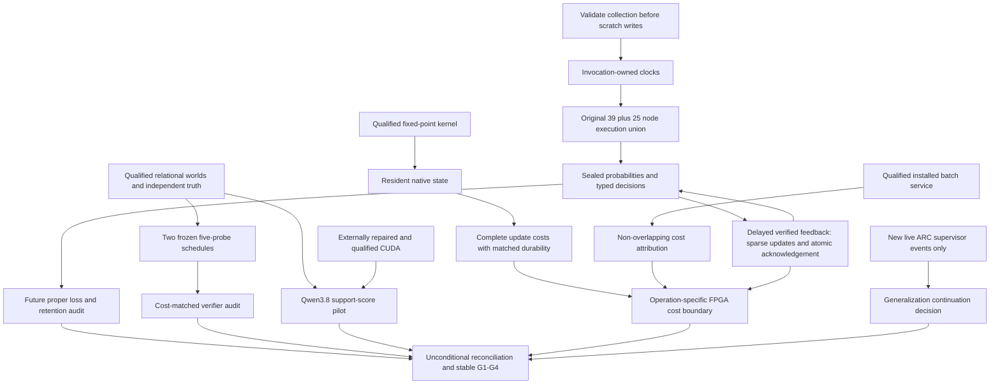
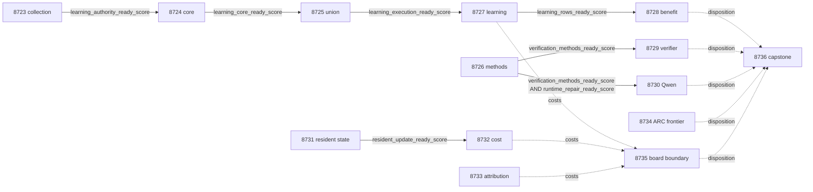

# Carnot Research Roadmap V748: Qualified continuous learning, cost-matched verification, and resident sparse updates

**Created:** 2026-11-02
**Milestone:** 2026.11.748
**Status:** Planned; activation and execution remain separate
**Supersedes:** V747's next-plan slot after all fourteen scheduling slots ended
**Historical authority:** [Preserved V747 design](research-roadmap-v747-preserved-20261102.md)
**Execution queue:** [research-roadmap-next.yaml](../../research-roadmap-next.yaml)
**Contract:** Exactly 14 tasks, Exp8723 through Exp8736, in four phases

## What V747 proved

Nine producers ran; five downstream studies were skipped. At planning time,
`research-complete.yaml` ends with V746. V747 evidence therefore comes from the
active task list, conductor log, primary artifacts and Exp8722's reconciliation.
Completed scheduling is not evidence of fourteen scientific successes.

| Evidence | Result | Boundary |
|---|---|---|
| Exp8709 | Full task objects and retained authority were read, but current validation failed | `test_collection_and_full_path` raised `FileExistsError` at `private/0` before the intended missing-node rejection; learning authority stayed zero |
| Exp8710/8711/8713/8714 | Four learning slots skipped | Clock repair, complete union, continuous learning and benefit remain unmeasured |
| Exp8712 | Eight lexical features collide for opposite-truth relational views; symbolic controls qualify | Constructed capacity does not prove extraction; all 480 historical head probabilities remain missing |
| Exp8715 | Baseline found 120 defects; extended suite found 130 | Extended checks cost more; equal-budget superiority remains unknown |
| Exp8716 | Original import assertions passed after child isolation | Compatibility is not throughput or learning quality |
| Exp8717 | Native B16/B1 complete throughput ratio 1.1382, CI95 [1.1218, 1.1601]; native B16 steady p95 18.4202ms | Same-batch B16 native/Python ratio 1.0054, CI95 [0.9981, 1.0139]; NFR-01 10x remains unmet; feedback durability excluded |
| Exp8719 | Actual compiled signed32/24 operations match the lifecycle emulator | Numerical parity does not establish speed; the interface still serializes state through JSON |
| Exp8720 | No new supervisor outcomes beyond the qualified frontier | Closed, fully censored ARC panel stays closed |
| Exp8718/8721/8722 | Qwen canary skipped; operation mapping and accounting completed | No causal CUDA repair, useful learning, or physical FPGA acceleration established |

Preserve historical quarantines, the exposed-corpus limits, and all qualified
nulls. New source cannot rehabilitate old result bytes. In particular, do not
rerun the installed batching comparison simply to obtain a different verdict.

## Three biggest gaps against the PRD

1. **FR-11: useful continuous self-learning.** The original causal protocol has
   not reached a qualified execution. Repair the observed scratch ownership
   defect, then current clock ownership, and qualify the unchanged original
   union. Measure sealed prediction-before-feedback updates, future Brier loss
   and joint retention. A valid null closes this protocol.
2. **FR-12: trustworthy evidence and verifier value.** Constructed exact checking
   works, but lexical information loss, source translation and oracle-distinct
   utility remain open. First ask whether stronger verifier tests help at equal
   cost. A small conditional Qwen self-score comparator tests a current external
   method on explicit source evidence; it cannot certify natural extraction.
3. **FR-05/FR-08/NFR-01: complete portable costs.** Native arithmetic now works,
   while installed inference misses the 10x target. Retain native update state
   across calls and measure the full lifecycle at equal durability. Separately
   attribute installed inference costs. Use those measurements to bound hardware
   opportunity; no CPU result counts as FPGA execution.

## Literature and method selection

The [V748 scan](../../research-references.md#v748-planning-scan--2026-11-02)
was appended before this design. All eight primary topics and six secondary
channels were checked. The EBT Semantic Scholar endpoint yielded its first 20
citations; ARM–EBM was rate-limited. Trending snapshots were stale, OpenReview's
forum challenged access, and the Extropic index timed out while Z1T was readable.

| Source | Method used or decision | Task |
|---|---|---|
| [P(Yes), 2610.25474](https://arxiv.org/abs/2610.25474), October 18 | Frozen candidate support scores; matched fixed call budget, real logits and high-confidence-error rows | Exp8726/8730 |
| [VerifierBench, 2610.28679](https://arxiv.org/abs/2610.28679), October 19 | Correct alternatives and invalid cases at equal probe counts | Exp8726/8729 |
| [Verification Without Sufficiency, 2608.00585](https://arxiv.org/abs/2608.00585) | Preserve all required premises and distinguish unknown from false | Exp8726/8729/8730 |
| [On-chip KAN locality, 2602.02056v4](https://arxiv.org/html/2602.02056v4) | Local sparse arithmetic with resident state; measure host work and persistence too | Exp8731/8732 |
| [Delayed capacity learning, 2503.19856](https://arxiv.org/abs/2503.19856) | Explicit pending-feedback admission and prediction-before-label chronology | Exp8727/8728 |
| [Ising portability review, 2610.03972](https://arxiv.org/abs/2610.03972); [Extropic Z1T](https://extropic.ai/writing/z1t/) | Operation-specific support and complete-cost limits; external estimates remain external | Exp8735 |

EBT and ARM–EBM remain background. Convex-SKM-Net, Certified Access, ADAPT-Z and
VLM energy-guided decoding require different assumptions or architectures; file
those leads without reopening closed scorer, repair or generator lineages.
Exp8726 is the focused SOTA-ingestion slot. It converts the new P(Yes) lead into
an executable protocol and updates the study ledger without a large fan-out.

## Architecture



The nine-input109-coefficient learner, its data and objective stay fixed.
The resident integer path is opt-in and separate from the floating Brier study.
No generator weights, ARC policy, shared validator, or conductor code change.
Independent branches authenticate their own operands instead of waiting for a
single global administrative readiness flag.

## Phase 1 — Qualify execution and freeze comparisons (Exp8723–8726)

### Exp8723: Collection ownership and full task binding

Reproduce the exact FileExistsError. Validate the complete collection before any
scratch mutation, then create invocation-owned child roots. Preserve rejection
assertions and sentinel data. Test missing/duplicate inventory, repeat collection
and partial failure. Reuse unchanged historical producer authority, execute the
current owned checks, and bind all fourteen full task objects. This task releases
only learning authority; it does not re-run the learning cohort.

### Exp8724: Current invocation clocks and original core

Retained clocks stay provenance. Current execution owns both start and end clocks.
Test the observed cross-epoch negative-duration case without clamping or sleeping.
Freeze transitive sources and run the original39 core nodes plus bounded original
deadline smoke controls. Persist real child coverage and a reusable fixture.

### Exp8725: Complete causal union

Run the original25-node remainder under the same seal. Require all64 original
nodes,27 runner nodes and83 executable statement anchors, plus coverage of new
repair statements. Preserve original deadline-publication rejection and E2E-020
hard-exit/resume. Consumer coverage and killed children cannot qualify producers.

### Exp8726: SOTA ingestion and frozen comparison methods

Authenticate the original120 worlds and six verifier variants. Freeze baseline
`truth/equivalent/invalid/unknown/deleted_records` and targeted
`truth/invalid/entity_bijection/required_premise/required_role`: five calls each,
no early exit. Preserve the90/30 partition as exposed-development data.
Freeze a48-prompt Qwen pilot from12 worlds and four evidence views. Read supplied
causal CUDA repair evidence once; missing runtime keeps its independent readiness
field zero without blocking the CPU protocol. No device probe occurs here.

## Phase 2 — Measure learning and verifier utility (Exp8727–8730)

### Exp8727: Continuous causal learning

Execute the frozen/log-loss/Brier/shuffled-feedback arms, five seeds
17/29/43/71/101, five20-group blocks and three siblings:6000 predictions over100
independent groups. Keep capacity8, learning rate0.01, L2=0.001 and original
release/admission rules. Seal predictions before labels, update real parameters,
and atomically acknowledge feedback. Measure host work, dense renormalization,
serialization and fsync as well as local arithmetic. This is the FR-11 and
calibrated typed-decision training slot; no generator training is authorized.

### Exp8728: Future benefit and retention

Average siblings and seeds within each independent question. On80 later groups,
use10000 paired question-cluster draws and97.5% intervals for Brier improvement
versus frozen and versus log-loss; both lower bounds must exceed zero without
increased typed-decision loss. Across50 retention questions and five windows,
the joint upper95 bound on maximum Brier increase must be<=0.01. Retention labels
never train the head. Report false acceptance, escalation and cost. Valid nulls
close the question; missing external rows are terminal blocked.

### Exp8729: Equal-budget verifier audit

Execute120 worlds × six variants × two arms × five probes:7200 invocations,
1440 world/variant/arm rows. Report the30 exposed evaluation worlds separately,
with150 defective world/variant units per arm. Cluster10000 bootstrap draws by
world. A detection benefit requires lower95>0 and no new false rejection by the
correct verifier. Record actual time and predicate work; equal calls are not
equal wall time. Missing premises stay unknown. All oracle-dependent positives
remain circular and cannot establish natural-language or learned-verifier value.

### Exp8730: Mandated Qwen self-score pilot

Only a causal CUDA repair and qualified methods permit this task. Use
`MODEL_SPECS: unsloth/Qwen3.8-27B-GGUF`, Q4_K_M, with exact model bytes and offload
receipts. Twelve worlds × four views yield48 calls, temperature0, max8 output
tokens each (384-token total cap). Normalize actual first-token Yes/No logits;
unavailable logits block the experiment. Compare support Brier score, false
support, equivalence and high-confidence errors against structured checking.
Unknown truth remains separate from the binary evidence-support question.

This is `model_bounded_generation` (10-second floor). A load-only/embedding task
would use `model_load_no_generation` (2 seconds); actual full generation would
use `model_full_generation` (60 seconds). Neither is scheduled here. No artificial
sleep, fallback model, search optimization or generalization headline is allowed.
A blocked preflight records zero calls and actual `no_model_load` substrate.

## Phase 3 — Measure portable costs (Exp8731–8733)

### Exp8731: Resident sparse state prototype

Keep coefficients, decay and counters in an opt-in PyO3 object over the existing
checked integer kernel. Typed inputs replace repeated full-state JSON transport.
Keep host scaling, nonlinear functions and feedback admission. Preserve exact
sequential updates, signed32/24 bounds, dense renormalization and serialization.
Qualify81920 original updates,320 boundary cases and real restart at update2048.
No stale-gradient batching or default-path change. E2E-003/004 cross the actual
loaded extension. Exact parity releases timing, not a speed claim.

### Exp8732: Full update lifecycle costs

Compare Python integer, original JSON native and resident native on the same4096
update prefix, ten paired process repeats and identical per-feedback durability:
30 process rows,122880 updates. Include launch, host features/nonlinear work,
copies, sparse/dense operations, checkpoint, fsync, acknowledgement and shutdown.
Use10000 paired process bootstrap draws. Resident benefit needs lower95>1.05 over
original native and no p95 regression; native/Python10x needs lower95>=10 at the
same boundary. Report constructed cost separately from useful causal learning.

### Exp8733: Installed inference cost attribution

Retain the qualified batching result. Instrument the unresolved transport,
feature-digest, validation and serialization costs, with non-overlapping spans.
At B16 compare Python/native, instrumented/uninstrumented and ten repeats:
40 process cells, each16 panels of64 items. Require exact output parity, valid
local span sums and overhead upper95<=5% before treating fractions as production
costs. Record unexplained residual. This chooses the next optimization; it does
not claim a new speedup or change the public interface.

## Phase 4 — Preserve live and hardware boundaries (Exp8734–8736)

### Exp8734: Live ARC frontier

Reuse the qualified reader and high-water mark. Inspect only new reachable live
supervisor events; an authenticated empty delta ends immediately. Preserve game,
arm, selected/applied state, reset cause, horizon and censoring. No replay of the
closed120-action panel, per-game solving, source RE or policy change. Registry
precheck prevents duplicate solve credit. Any imported credited solve must carry
`live_agent_self_discovery`; this reader earns zero new level credit.

### Exp8735: Hardware cost boundary

Admit new learning, update and attribution costs independently. Map supported,
unsupported and unknown operations to KV260, PolarFire and GateMate. Only measured
complete costs and compatible operations permit a conditional ceiling1/(1-f).
An ideal10x needs fraction>=0.9;100x needs>=0.99 before transfer costs. Numerical
Rust parity is not fabric support. Missing physical evidence stays explicit.

### Exp8736: Unconditional reconciliation

Account for all fourteen slots, recompute claims from rows, preserve actual gate
values and distinguish skips from scientific nulls. Run stable G1–G4 publication
gates without redefining them or letting old gates certify new science. Record
exact-repeat retirement candidates and specific changed-mechanism reopening
conditions. Reconcile specs and ops docs. External incompleteness is blocked,
not partial. No activation, deployment, publication or push occurs here.

## Dependencies and gate contract



All eight solid edges are structured YAML gates requiring numeric1; their fields
are spelled identically in upstream REQUIRED ARTIFACT FIELDS. Every upstream is
an earlier task in this queue. Dotted edges are independent evidence reads.
Exp8726/8731/8733/8734/8735/8736 have no conductor gate. A missing file, missing
field, changed hash, disqualified producer and observed zero remain distinct in
`gate_check_summary`.

## Hardware requirements, budgets and routing

| Resource | Use and prerequisites | Limit |
|---|---|---|
| CPU, Python venv, Rust/PyO3 toolchain | All independent studies; actual loaded native binary for resident work | No inferred GPU or board performance |
| Persistent disk and RAM | Measured fixture size, private scratch, retained child coverage and durable checkpoints | Never discard evidence before qualification; keep memory guards |
| Two RTX3090s in inventory | Exp8730 only: exact cached Qwen GGUF, causal runtime-repair receipt, context fit, owned exclusive lease | The pilot needs one available24GB device if its measured context fits; no forced dual-GPU work |
| KV260 | Existing quadratic-energy operation evidence, k_max<=5 | Future device work uses SSH/scp/xmutil; no spline support inferred |
| PolarFire | Existing Linux CPU dispatch | No fabric acceleration claim |
| GateMate | Existing physical/JTAG blocker0xffffffff | No probe without a dated physical change and valid IDCODE0x20000001 |
| TSU, NPU, new accelerator purchases | Literature and wishlist only | No access or acquisition assumed |

The CPU prototype and measurement close an immediate hardware-design question:
what fraction of complete learning cost is actually eligible for acceleration?
They cannot meet the program's100x ambition by relabeling kernel speed. No new
hardware is needed to execute the CPU branches. Exp8735 records evidence-backed
acquisition prerequisites if new cost evidence justifies them.

Serial task estimates total635 minutes:205/195/175/60 by phase, before gate skips.
No task exceeds65 estimated minutes. These are planning budgets, not measurements.
Every prompt has a numbered flushed-progress step, before/after long calls,
60-second heartbeats and inner-loop counts, with silence below600 seconds.
Every file above about200 lines is written across several calls with progress
between calls. Measurement stops by3600 seconds to reserve validation time.

Per the user's routing directive, Exp8723/8724/8725 use Claude Opus and100 turns
for multi-step execution infrastructure. Exp8729 and Exp8731 use Codex
`gpt-6.1-sol` for verifier and native code. Routine studies use default Claude
Sonnet, at most50 turns; simple readers use20 and focused diagnostics30. No Luna
or Gemini task is planned. These are execution-queue settings, not subagents
spawned by this planning session.

## Acceptance, retirement and verification

Every comparative task sets `per_unit_rows: true` and records all intended units,
failures, censoring, raw metrics and independent sample size. Every prompt declares
`verdict_class` from the six-member closed enum and principle-annotated required
fields. Correctness-oracle wins are circular; execution eligibility and scientific
benefit are different gates. A valid below-threshold result is null. External
absence is blocked; only incomplete owned work can be partial.

Prior-failure entries carry all four required fields, including the mechanical
retirement flag. The scratch/clock repair is causal and testable. Cost studies
change either the native boundary or measurement question. Budget-scope matches
against older candidate-allocation work are documented explicitly. No retired ID
is reused or referenced as a current dependency. The standing2026-05-29 lineage
exception is cited only where a concrete difference exists. Exact unchanged
failures stop; new milestone numbering alone cannot reopen a scope.

Before implementation: requirements, then failing tests, then the smallest code
change. Scoped unit/lint/type/spec checks and actual owned statement coverage must
pass. Learning requires the original E2E-020; native work crosses E2E-003/004;
readers/publication use applicable private E2E-018/021 checks. Preserve original
assertions and shared validators. All final artifacts pass cold replay,
adversarial verification and strict row consistency on their actual final bytes.
Reconcile OpenSpec, architecture, traceability, status and changelog after runs.

Planning validation checks schema, full-object/document equality, all gate names
and ordering, failure lineage, progress clauses, substrate/model declarations,
read paths and unchanged protected files. It runs relevant existing planning
unit tests and lint/spec checks. Runtime E2E-001–021 are not applicable to this
documentation-only planning change; they are scheduled in the task prompts.
No planned experiment has run. The active roadmap, conductor, exclusion manifest
and historical primary artifacts remain unchanged. The old V747 design is
preserved byte-for-byte before replacing this document.

## Exact task contract

Exactly **14 tasks, Exp8723 through Exp8736**, execute in the following order.

| Order | Task | Title | Phase | Deliverable |
|---|---|---|---|---|
| 1 | `exp8723-collection-contract` | Repair collection scratch ownership and bind fourteen branch methods | 1 | `results/experiment_8723_v748_collection_contract.json` |
| 2 | `exp8724-invocation-clock-core` | Qualify current invocation clocks and the original learning core | 1 | `results/experiment_8724_v748_invocation_clock_core.json` |
| 3 | `exp8725-learning-union` | Qualify original deadline controls and the complete causal execution union | 1 | `results/experiment_8725_v748_learning_union.json` |
| 4 | `exp8726-verification-methods` | Freeze equal-budget verifier probes and the Qwen self-score comparator | 1 | `results/experiment_8726_v748_verification_methods.json` |
| 5 | `exp8727-causal-brier-stream` | Measure continuous typed-decision learning from delayed verified feedback | 2 | `results/experiment_8727_v748_causal_brier_stream.json` |
| 6 | `exp8728-learning-benefit-audit` | Test future proper-loss benefit and simultaneous retention | 2 | `results/experiment_8728_v748_learning_benefit_audit.json` |
| 7 | `exp8729-equal-budget-verifier` | Measure relational defect detection at equal probe budgets | 2 | `results/experiment_8729_v748_equal_budget_verifier.json` |
| 8 | `exp8730-qwen-self-score-canary` | Compare bounded Qwen self-scores with source-grounded support decisions | 2 | `results/experiment_8730_v748_qwen_self_score_canary.json` |
| 9 | `exp8731-resident-sparse-prototype` | Keep fixed-point update state resident across the native boundary | 3 | `results/experiment_8731_v748_resident_sparse_prototype.json` |
| 10 | `exp8732-resident-update-cost` | Measure complete resident sparse-update costs against matched native and Python paths | 3 | `results/experiment_8732_v748_resident_update_cost.json` |
| 11 | `exp8733-installed-cost-attribution` | Locate the installed inference cost that limits same-batch native throughput | 3 | `results/experiment_8733_v748_installed_cost_attribution.json` |
| 12 | `exp8734-arc-outcome-frontier` | Read new live cross-game supervisor outcomes without reopening the closed panel | 4 | `results/experiment_8734_v748_arc_outcome_frontier.json` |
| 13 | `exp8735-hardware-cost-boundary` | Map measured resident costs to supported FPGA operations | 4 | `results/experiment_8735_v748_hardware_cost_boundary.json` |
| 14 | `exp8736-capstone` | Reconcile fourteen outcomes and close unchanged scientific questions | 4 | `results/experiment_8736_v748_capstone.json` |

Canonical full-task SHA-256: `88a6e9a1c4822285e86c9b089047d4383f6e34d63430bdaff72c33beb979a07a`

Canonicalization: UTF-8 JSON of the complete tasks list, sorted keys, compact
separators, ensure_ascii=false. All prompt and routing bytes are included.

<!-- V748_TASK_CONTRACT_START -->
```json
{
  "milestone": "2026.11.748",
  "tasks": [
    {"id": "exp8723-collection-contract", "title": "Repair collection scratch ownership and bind fourteen branch methods", "phase": 1, "track": "infrastructure", "priority": "high", "requires_gpu": false, "max_turns": 100, "estimated_wall_time_min": 45, "per_unit_rows": true, "milestone": "2026.11.748", "deliverable": "results/experiment_8723_v748_collection_contract.json", "inference_substrate_class": "no_model_load", "MODEL_SPECS": [], "gated_on": [], "prior_failures": [{"experiment_id": "exp7532-v659-contract-methods", "verdict": "complete_blocked_incomplete_v659_authorities", "addressed_by": "Observed FileExistsError in collect(private/0) precedes the intended missing-node rejection. Validate the complete inventory before writes and use invocation-owned scratch; retain original assertions and prove the failure path before releasing the learning branch.", "retire_if_same_verdict": true}, {"experiment_id": "exp7713-v672-contract-methods", "verdict": "complete_blocked_v672_independent_contract", "addressed_by": "Observed FileExistsError in collect(private/0) precedes the intended missing-node rejection. Validate the complete inventory before writes and use invocation-owned scratch; retain original assertions and prove the failure path before releasing the learning branch.", "retire_if_same_verdict": true}, {"experiment_id": "exp7940-v689-contract-methods", "verdict": "complete_blocked_authority", "addressed_by": "Observed FileExistsError in collect(private/0) precedes the intended missing-node rejection. Validate the complete inventory before writes and use invocation-owned scratch; retain original assertions and prove the failure path before releasing the learning branch.", "retire_if_same_verdict": true}, {"experiment_id": "exp7992-v693-contract-methods", "verdict": "complete_blocked_authority", "addressed_by": "Observed FileExistsError in collect(private/0) precedes the intended missing-node rejection. Validate the complete inventory before writes and use invocation-owned scratch; retain original assertions and prove the failure path before releasing the learning branch.", "retire_if_same_verdict": true}, {"experiment_id": "exp8018-v695-contract-methods", "verdict": "complete_blocked_authority", "addressed_by": "Observed FileExistsError in collect(private/0) precedes the intended missing-node rejection. Validate the complete inventory before writes and use invocation-owned scratch; retain original assertions and prove the failure path before releasing the learning branch.", "retire_if_same_verdict": true}, {"experiment_id": "exp8374-v722-contract-methods", "verdict": "complete_blocked_direct_contract_methods", "addressed_by": "Observed FileExistsError in collect(private/0) precedes the intended missing-node rejection. Validate the complete inventory before writes and use invocation-owned scratch; retain original assertions and prove the failure path before releasing the learning branch.", "retire_if_same_verdict": true}, {"experiment_id": "exp8388-v723-contract-methods", "verdict": "complete_blocked_v723_contract_methods", "addressed_by": "Observed FileExistsError in collect(private/0) precedes the intended missing-node rejection. Validate the complete inventory before writes and use invocation-owned scratch; retain original assertions and prove the failure path before releasing the learning branch.", "retire_if_same_verdict": true}, {"experiment_id": "exp8416-v725-contract-methods", "verdict": "complete_blocked_v725_contract_methods", "addressed_by": "Observed FileExistsError in collect(private/0) precedes the intended missing-node rejection. Validate the complete inventory before writes and use invocation-owned scratch; retain original assertions and prove the failure path before releasing the learning branch.", "retire_if_same_verdict": true}, {"experiment_id": "exp8443-v727-contract-methods", "verdict": "complete_blocked_v727_contract_methods", "addressed_by": "Observed FileExistsError in collect(private/0) precedes the intended missing-node rejection. Validate the complete inventory before writes and use invocation-owned scratch; retain original assertions and prove the failure path before releasing the learning branch.", "retire_if_same_verdict": true}, {"experiment_id": "exp8471-v729-contract-methods", "verdict": "complete_blocked_v729_contract_methods", "addressed_by": "Observed FileExistsError in collect(private/0) precedes the intended missing-node rejection. Validate the complete inventory before writes and use invocation-owned scratch; retain original assertions and prove the failure path before releasing the learning branch.", "retire_if_same_verdict": true}, {"experiment_id": "exp8499-v731-contract-methods", "verdict": "complete_blocked_v731_contract_methods", "addressed_by": "Observed FileExistsError in collect(private/0) precedes the intended missing-node rejection. Validate the complete inventory before writes and use invocation-owned scratch; retain original assertions and prove the failure path before releasing the learning branch.", "retire_if_same_verdict": true}, {"experiment_id": "exp8565-v736-contract-methods", "verdict": "complete_blocked_v736_contract_methods", "addressed_by": "Observed FileExistsError in collect(private/0) precedes the intended missing-node rejection. Validate the complete inventory before writes and use invocation-owned scratch; retain original assertions and prove the failure path before releasing the learning branch.", "retire_if_same_verdict": true}, {"experiment_id": "exp8602-v739-contract-methods", "verdict": "complete_blocked_v739_contract_methods", "addressed_by": "Observed FileExistsError in collect(private/0) precedes the intended missing-node rejection. Validate the complete inventory before writes and use invocation-owned scratch; retain original assertions and prove the failure path before releasing the learning branch.", "retire_if_same_verdict": true}, {"experiment_id": "exp8667-contract-methods", "verdict": "complete_disqualified_v744_contract_methods", "addressed_by": "Observed FileExistsError in collect(private/0) precedes the intended missing-node rejection. Validate the complete inventory before writes and use invocation-owned scratch; retain original assertions and prove the failure path before releasing the learning branch.", "retire_if_same_verdict": true}, {"experiment_id": "exp8681-contract-methods", "verdict": "complete_disqualified_v745_contract_methods", "addressed_by": "Observed FileExistsError in collect(private/0) precedes the intended missing-node rejection. Validate the complete inventory before writes and use invocation-owned scratch; retain original assertions and prove the failure path before releasing the learning branch.", "retire_if_same_verdict": true}, {"experiment_id": "exp8709-contract-methods", "verdict": "complete_disqualified_v747_contract_methods", "addressed_by": "Observed FileExistsError in collect(private/0) precedes the intended missing-node rejection. Validate the complete inventory before writes and use invocation-owned scratch; retain original assertions and prove the failure path before releasing the learning branch.", "retire_if_same_verdict": true}], "agent_type": "claude", "model": "opus", "prompt": "CONTEXT:\nWork in {project_root} on {date}. V747 ran nine producers and skipped five studies. Exp8709 failed with FileExistsError while collection reused private/0; no qualified learning union followed. Exp8712 proved lexical collisions on constructed worlds, not natural extraction. Exp8715 found 120 versus 130 defects using unequal probe counts. Exp8717 measured batching gain 1.138x, but same-batch B16 native/Python was 1.005x, not 10x. Exp8719 established exact compiled signed32/24 parity, not speed. CUDA repair is absent; no new ARC outcomes or physical acceleration were proved. Preserve historical results and qualifiers. V748 has exactly fourteen tasks, Exp8723 through Exp8736.\n\nEXISTING CODE TO READ FIRST:\nCLAUDE.md; CODEX.md; ops/e2e-test-plan.md; ops/exclusion_manifest.yaml; openspec/capabilities/research-reporting/spec.md; openspec/capabilities/verification/spec.md; scripts/experiment_template.py; python/carnot/reporting/primary_publication.py; openspec/change-proposals/research-roadmap-vNEXT.md; openspec/change-proposals/research-roadmap-v747-preserved-20261102.md; research-references.md; python/carnot/reporting/v747_contract_runner.py; python/carnot/reporting/v747_contract_methods.py; python/carnot/reporting/roadmap_contract.py; tests/python/test_v747_contract_8709.py; python/carnot/reporting/v746_contract_authority.py; results/experiment_8709_v747_contract_methods.json; results/experiment_8695_v746_retained_contract_authority.json; openspec/change-proposals/v744-methods-protocol.json\n\nTASK:\nRepair collection scratch ownership and bind fourteen branch methods. Deliver results/experiment_8723_v748_collection_contract.json. Use thin runner scripts/experiments/experiment_8723_v748_collection_contract.py, raw evidence results/raw/experiment_8723_v748_collection_contract/ and notes docs/research-notes/v748-collection-contract.md.\n\nCONCRETE STEPS:\n1. PRECONDITIONS: Print a flushed start line. Check exact input paths, source hashes, qualified producer receipts, tools, RAM and disk-backed private scratch before dependent work. A missing or disqualified external operand yields complete_blocked_<reason>, verdict_class=blocked and gate_check_summary with its path, hash, check, field and observed value. Missing differs from zero. Never fabricate a substitute or run a retired upstream.\n\n2. Print a flushed progress line at EVERY phase boundary, before and after EVERY model load, generation, benchmark and subprocess that can take minutes. Use python -u or PYTHONUNBUFFERED=1, a parent heartbeat at least every 60 seconds while a child runs, and completed/pending lines INSIDE long loops. Keep every silence gap under 600 seconds; poll within 60 seconds. Write any file over about 200 lines in several tool calls of at most 150 lines, with a progress message between calls. No single tool call may contain a huge file. Stop measurement by 3600 seconds and reserve at least 900 seconds for checks within the 4800-second cap. Never pad duration.\n\n3. Spec first: confirm relevant REQ-* requirements; extend specs and add failing focused tests before behavior changes. Reuse current helpers with a thin version binding instead of copying historical validation controllers. Freeze sources, tests, inputs and methods before execution. Keep original assertions, publication validators and historical result bytes intact. Put runners in scripts/experiments/, tests in tests/python/, scratch outside the repo; accept --date {date}.\n\n4. Bind all fourteen complete task objects, visible table and canonical digest from the V748 design and staged/activated YAML as appropriate. Use the V748 table and original scientific methods as separate operands. Independently authenticate this branch; unrelated contract, CUDA or board readiness does not gate it. Reuse execution evidence only when its source, input, configuration and test identities are unchanged. A skip receipt is scheduling evidence, never a scientific measurement.\n\n5. Declare inference_substrate_class=no_model_load; MODEL_SPECS=[]. Use aggregation_from_upstream_artifacts for readers, deterministic_verifier for constructed controls, or verifier_ensemble_against_cached_candidates for real small-head scoring. No LLM load or generation occurs.\n\n6. Reproduce Exp8709 test_collection_and_full_path: its second collect writes private/0 before the incomplete suite inventory is rejected. Validate the whole collection before filesystem mutation, then allocate invocation-owned scratch with collision detection. Preserve the expected missing_collection_nodes error. Do not hide the defect with exist_ok=True, delete another invocation, skip the assertion or relax coverage.\n\n7. Add regressions for repeated collection, a pre-existing sentinel directory, missing/duplicate nodes and malformed inventories. Prove failed collection has no partial filesystem effects and cannot consume stale coverage. Reuse the original retained Exp8695 authority without re-executing its historical producer suite. Run the current owned contract/consumer suite in bounded children; qualify all newly owned statements before issuing learning_authority_ready_score=1.\n\n8. Bind full prompts, routing, deliverables and gates, plus independent learning, verifier and native methods. Mutate each contract dimension and require rejection. The contract grants execution eligibility only. Do not run the learning core here; Exp8724 owns that budget. Read-only branches check their own contract and need no gate from this task.\n\n9. Run focused unit tests, Ruff check/format, strict mypy on owned Python modules, scripts/check_spec_coverage.py --files <owned-test-files>, and the applicable private-output checks in ops/e2e-test-plan.md. New owned statements require 100 percent coverage including errors and subprocess paths. Retain actual child exits, node IDs, SQLite coverage, JUnit, source hashes and invocation clocks before scratch cleanup. Use bounded disjoint children with -n 0 -o addopts= --no-cov; killed children do not qualify. Do not run recursive historical controllers or the full repository test suite. A read-only task reuses existing tests and adds none for copied data.\n\n10. Cold-replay final results from sealed primitives. Run unchanged primary publication validation, scripts/adversarial_verify.py --json <private-candidate> and scripts/verdict_row_consistency_lint.py --strict <private-candidate> before atomic publication. Reject consistently rehashed tampering and missing operands. Failed owned checks disqualify; unchanged external incompleteness is terminal blocked, never partial. Reconcile OpenSpec, _bmad/traceability.md, ops/status.md and ops/changelog.md with measured outcomes.\n\nREQUIRED ARTIFACT FIELDS:\nexperiment_id, task_id, milestone, run_date, invocation_id: principle: Identify the actual task and run.\nhonest_verdict, verdict_class: principle: Start verdicts with complete_; use positive | circular_positive | null | blocked | disqualified | partial. Only incomplete owned work that a retry can finish is partial.\ngate_check_summary: principle: Every blocked outcome records upstream, path/hash, check, field, operator, expected and observed values; external absence is not a measured zero.\ninference_substrate, inference_substrate_class, MODEL_SPECS, model_invocation_counts: principle: Declare actual compute, including zero calls on blocked or model-free paths; no stale model names imply generation.\nrows, intended_count, completed_count, failed_count, censored_count, excluded_count, independent_count: principle: Retain each intended unit and arm, numerator, denominator, status and cost so aggregates can be recomputed; seeds and repeats do not multiply independent cases.\nverifier_is_oracle, exposure_scope, independent_generalization_score: principle: Constructed oracle-dependent positives are circular_positive; exposed data cannot establish independent generalization.\nacceptance_gates, required_checks_passed, flagged_adversarial, validation_receipts, terminal_validation_sidecar_path: principle: Execution readiness differs from scientific benefit; failed acceptance gates forbid a positive class.\npreconditions_checked, duration_s, started_at_utc, ended_at_utc, phase_spans, random_seed, reproducibility_checksum: principle: Retain real clocks and seeds; old monotonic epochs cannot measure a current invocation.\nsource_artifact_hashes, code_config_hashes, raw_shard_hashes, cited_upstream_artifacts, field_principles: principle: Bind imported fields and conclusions to exact evidence bytes, not mutable paths.\ncontract_ready_score, learning_authority_ready_score, collection_effect_rows, contract_mutation_rows, retained_authority: principle: Top-level numeric 0/1 gates require exact current owned checks and unchanged retained authority; filesystem reuse must not masquerade as successful validation.\n\nRun command: cd {project_root} && JAX_PLATFORMS=cpu PYTHONPATH=python:. PYTHONUNBUFFERED=1 .venv/bin/python -u scripts/experiments/experiment_8723_v748_collection_contract.py --date {date}\n\nDo NOT push. Do NOT modify scripts/research_conductor.py.\n"},
    {"id": "exp8724-invocation-clock-core", "title": "Qualify current invocation clocks and the original learning core", "phase": 1, "track": "infrastructure", "priority": "high", "requires_gpu": false, "max_turns": 100, "estimated_wall_time_min": 65, "per_unit_rows": true, "milestone": "2026.11.748", "deliverable": "results/experiment_8724_v748_invocation_clock_core.json", "inference_substrate_class": "no_model_load", "MODEL_SPECS": [], "gated_on": [{"upstream": "exp8723-collection-contract", "artifact_field": "learning_authority_ready_score", "op": "==", "value": 1}], "prior_failures": [{"experiment_id": "exp8654-learning-core-execution", "verdict": "complete_disqualified_v743_learning_core_execution", "addressed_by": "Exp8710 was skipped after the now-diagnosed collection scratch defect; Exp8723 repairs that cause. This attempt implements the still-unexecuted invocation-clock fix and retains original core assertions under one source seal.", "retire_if_same_verdict": true}, {"experiment_id": "exp8641-learning-execution-custody", "verdict": "complete_disqualified_v742_learning_execution_custody", "addressed_by": "Exp8710 was skipped after the now-diagnosed collection scratch defect; Exp8723 repairs that cause. This attempt implements the still-unexecuted invocation-clock fix and retains original core assertions under one source seal.", "retire_if_same_verdict": true}, {"experiment_id": "exp8668-frozen-learning-core", "verdict": "blocked_gate_check_failed", "addressed_by": "Exp8710 was skipped after the now-diagnosed collection scratch defect; Exp8723 repairs that cause. This attempt implements the still-unexecuted invocation-clock fix and retains original core assertions under one source seal.", "retire_if_same_verdict": true}, {"experiment_id": "exp8682-frozen-learning-core", "verdict": "blocked_gate_check_failed", "addressed_by": "Exp8710 was skipped after the now-diagnosed collection scratch defect; Exp8723 repairs that cause. This attempt implements the still-unexecuted invocation-clock fix and retains original core assertions under one source seal.", "retire_if_same_verdict": true}, {"experiment_id": "exp8697-learning-union-qualification", "verdict": "complete_disqualified_v746_learning_union_qualification", "addressed_by": "Exp8710 was skipped after the now-diagnosed collection scratch defect; Exp8723 repairs that cause. This attempt implements the still-unexecuted invocation-clock fix and retains original core assertions under one source seal.", "retire_if_same_verdict": true}, {"experiment_id": "exp8710-invocation-clock-core", "verdict": "blocked_gate_check_failed", "addressed_by": "Exp8710 was skipped after the now-diagnosed collection scratch defect; Exp8723 repairs that cause. This attempt implements the still-unexecuted invocation-clock fix and retains original core assertions under one source seal.", "retire_if_same_verdict": true}], "agent_type": "claude", "model": "opus", "prompt": "CONTEXT:\nWork in {project_root} on {date}. V747 ran nine producers and skipped five studies. Exp8709 failed with FileExistsError while collection reused private/0; no qualified learning union followed. Exp8712 proved lexical collisions on constructed worlds, not natural extraction. Exp8715 found 120 versus 130 defects using unequal probe counts. Exp8717 measured batching gain 1.138x, but same-batch B16 native/Python was 1.005x, not 10x. Exp8719 established exact compiled signed32/24 parity, not speed. CUDA repair is absent; no new ARC outcomes or physical acceleration were proved. Preserve historical results and qualifiers. V748 has exactly fourteen tasks, Exp8723 through Exp8736.\n\nEXISTING CODE TO READ FIRST:\nCLAUDE.md; CODEX.md; ops/e2e-test-plan.md; ops/exclusion_manifest.yaml; openspec/capabilities/research-reporting/spec.md; openspec/capabilities/verification/spec.md; scripts/experiment_template.py; python/carnot/reporting/primary_publication.py; openspec/change-proposals/research-roadmap-vNEXT.md; openspec/change-proposals/research-roadmap-v747-preserved-20261102.md; research-references.md; python/carnot/reporting/learning_core_8696.py; python/carnot/reporting/learning_core_runner_8696.py; python/carnot/reporting/learning_clock_8592.py; python/carnot/reporting/causal_brier_runner_8582.py; python/carnot/reporting/deadline_edge_8603.py; tests/python/test_learning_core_8654.py; tests/python/test_deadline_edge_8603.py; results/experiment_8697_v746_learning_union_qualification.json; openspec/change-proposals/v744-methods-protocol.json\n\nTASK:\nQualify current invocation clocks and the original learning core. Deliver results/experiment_8724_v748_invocation_clock_core.json. Use thin runner scripts/experiments/experiment_8724_v748_invocation_clock_core.py, raw evidence results/raw/experiment_8724_v748_invocation_clock_core/ and notes docs/research-notes/v748-invocation-clock-core.md.\n\nCONCRETE STEPS:\n1. PRECONDITIONS: Print a flushed start line. Check exact input paths, source hashes, qualified producer receipts, tools, RAM and disk-backed private scratch before dependent work. A missing or disqualified external operand yields complete_blocked_<reason>, verdict_class=blocked and gate_check_summary with its path, hash, check, field and observed value. Missing differs from zero. Never fabricate a substitute or run a retired upstream.\n\n2. Print a flushed progress line at EVERY phase boundary, before and after EVERY model load, generation, benchmark and subprocess that can take minutes. Use python -u or PYTHONUNBUFFERED=1, a parent heartbeat at least every 60 seconds while a child runs, and completed/pending lines INSIDE long loops. Keep every silence gap under 600 seconds; poll within 60 seconds. Write any file over about 200 lines in several tool calls of at most 150 lines, with a progress message between calls. No single tool call may contain a huge file. Stop measurement by 3600 seconds and reserve at least 900 seconds for checks within the 4800-second cap. Never pad duration.\n\n3. Spec first: confirm relevant REQ-* requirements; extend specs and add failing focused tests before behavior changes. Reuse current helpers with a thin version binding instead of copying historical validation controllers. Freeze sources, tests, inputs and methods before execution. Keep original assertions, publication validators and historical result bytes intact. Put runners in scripts/experiments/, tests in tests/python/, scratch outside the repo; accept --date {date}.\n\n4. Bind all fourteen complete task objects, visible table and canonical digest from the V748 design and staged/activated YAML as appropriate. Use the V748 table and original scientific methods as separate operands. Independently authenticate this branch; unrelated contract, CUDA or board readiness does not gate it. Reuse execution evidence only when its source, input, configuration and test identities are unchanged. A skip receipt is scheduling evidence, never a scientific measurement.\n\n5. Declare inference_substrate_class=no_model_load; MODEL_SPECS=[]. Use aggregation_from_upstream_artifacts for readers, deterministic_verifier for constructed controls, or verifier_ensemble_against_cached_candidates for real small-head scoring. No LLM load or generation occurs.\n\n6. Repair the diagnosed clock boundary in the actual causal runner: retained fixture clocks stay historical provenance; current start/end monotonic clocks measure this invocation. Reproduce the saved start 497771539033492 versus current end 232478218800900 case. Require positive measured duration from real current work; do not clamp, sleep, change duration floors or rewrite old results.\n\n7. Freeze the transitive source closure after the scratch and clock fixes. Execute all 39 ORIGINAL learning core nodes with their original assertions and small original deadline smoke controls. Preserve independent label-release, atomic state/acknowledgement and private-output guards. New clock regressions supplement, never replace, the original tests.\n\n8. Retain source bundle, collected node IDs, real SQLite coverage, JUnit and each child exit in persistent raw evidence. Use measured fixture cost to admit disjoint cohorts with validation reserve. Publish the same source seal and reusable persistent fixture for Exp8725. A killed child or lost scratch evidence sets learning_core_ready_score=0. Do not run the remaining25 nodes here.\n\n9. Run focused unit tests, Ruff check/format, strict mypy on owned Python modules, scripts/check_spec_coverage.py --files <owned-test-files>, and the applicable private-output checks in ops/e2e-test-plan.md. New owned statements require 100 percent coverage including errors and subprocess paths. Retain actual child exits, node IDs, SQLite coverage, JUnit, source hashes and invocation clocks before scratch cleanup. Use bounded disjoint children with -n 0 -o addopts= --no-cov; killed children do not qualify. Do not run recursive historical controllers or the full repository test suite. A read-only task reuses existing tests and adds none for copied data.\n\n10. Cold-replay final results from sealed primitives. Run unchanged primary publication validation, scripts/adversarial_verify.py --json <private-candidate> and scripts/verdict_row_consistency_lint.py --strict <private-candidate> before atomic publication. Reject consistently rehashed tampering and missing operands. Failed owned checks disqualify; unchanged external incompleteness is terminal blocked, never partial. Reconcile OpenSpec, _bmad/traceability.md, ops/status.md and ops/changelog.md with measured outcomes.\n\nREQUIRED ARTIFACT FIELDS:\nexperiment_id, task_id, milestone, run_date, invocation_id: principle: Identify the actual task and run.\nhonest_verdict, verdict_class: principle: Start verdicts with complete_; use positive | circular_positive | null | blocked | disqualified | partial. Only incomplete owned work that a retry can finish is partial.\ngate_check_summary: principle: Every blocked outcome records upstream, path/hash, check, field, operator, expected and observed values; external absence is not a measured zero.\ninference_substrate, inference_substrate_class, MODEL_SPECS, model_invocation_counts: principle: Declare actual compute, including zero calls on blocked or model-free paths; no stale model names imply generation.\nrows, intended_count, completed_count, failed_count, censored_count, excluded_count, independent_count: principle: Retain each intended unit and arm, numerator, denominator, status and cost so aggregates can be recomputed; seeds and repeats do not multiply independent cases.\nverifier_is_oracle, exposure_scope, independent_generalization_score: principle: Constructed oracle-dependent positives are circular_positive; exposed data cannot establish independent generalization.\nacceptance_gates, required_checks_passed, flagged_adversarial, validation_receipts, terminal_validation_sidecar_path: principle: Execution readiness differs from scientific benefit; failed acceptance gates forbid a positive class.\npreconditions_checked, duration_s, started_at_utc, ended_at_utc, phase_spans, random_seed, reproducibility_checksum: principle: Retain real clocks and seeds; old monotonic epochs cannot measure a current invocation.\nsource_artifact_hashes, code_config_hashes, raw_shard_hashes, cited_upstream_artifacts, field_principles: principle: Bind imported fields and conclusions to exact evidence bytes, not mutable paths.\nlearning_core_ready_score, source_seal, core_node_rows, current_clock_rows, original_clock_provenance, retained_child_rows: principle: Exact 39-node execution under a stable seal and invocation-owned clocks is required before the remaining qualification cohort.\n\nRun command: cd {project_root} && JAX_PLATFORMS=cpu PYTHONPATH=python:. PYTHONUNBUFFERED=1 .venv/bin/python -u scripts/experiments/experiment_8724_v748_invocation_clock_core.py --date {date}\n\nDo NOT push. Do NOT modify scripts/research_conductor.py.\n"},
    {"id": "exp8725-learning-union", "title": "Qualify original deadline controls and the complete causal execution union", "phase": 1, "track": "infrastructure", "priority": "high", "requires_gpu": false, "max_turns": 100, "estimated_wall_time_min": 65, "per_unit_rows": true, "milestone": "2026.11.748", "deliverable": "results/experiment_8725_v748_learning_union.json", "inference_substrate_class": "no_model_load", "MODEL_SPECS": [], "gated_on": [{"upstream": "exp8724-invocation-clock-core", "artifact_field": "learning_core_ready_score", "op": "==", "value": 1}], "prior_failures": [{"experiment_id": "exp8655-learning-execution-qualification", "verdict": "blocked_gate_check_failed", "addressed_by": "Exp8711 was cascade-skipped after Exp8709, while Exp8697 mixed historical and current clocks. Exp8723 repairs scratch ownership and Exp8724 qualifies current clocks and retained39-node execution; this task completes the original remainder without changing assertions.", "retire_if_same_verdict": true}, {"experiment_id": "exp8641-learning-execution-custody", "verdict": "complete_disqualified_v742_learning_execution_custody", "addressed_by": "Exp8711 was cascade-skipped after Exp8709, while Exp8697 mixed historical and current clocks. Exp8723 repairs scratch ownership and Exp8724 qualifies current clocks and retained39-node execution; this task completes the original remainder without changing assertions.", "retire_if_same_verdict": true}, {"experiment_id": "exp8669-learning-union-qualification", "verdict": "GATE_BLOCK", "addressed_by": "Exp8711 was cascade-skipped after Exp8709, while Exp8697 mixed historical and current clocks. Exp8723 repairs scratch ownership and Exp8724 qualifies current clocks and retained39-node execution; this task completes the original remainder without changing assertions.", "retire_if_same_verdict": true}, {"experiment_id": "exp8683-learning-union-qualification", "verdict": "GATE_BLOCK: Pre-emptive skip: upstream retired (exp8682-frozen-learning-core)", "addressed_by": "Exp8711 was cascade-skipped after Exp8709, while Exp8697 mixed historical and current clocks. Exp8723 repairs scratch ownership and Exp8724 qualifies current clocks and retained39-node execution; this task completes the original remainder without changing assertions.", "retire_if_same_verdict": true}, {"experiment_id": "exp8697-learning-union-qualification", "verdict": "complete_disqualified_v746_learning_union_qualification", "addressed_by": "Exp8711 was cascade-skipped after Exp8709, while Exp8697 mixed historical and current clocks. Exp8723 repairs scratch ownership and Exp8724 qualifies current clocks and retained39-node execution; this task completes the original remainder without changing assertions.", "retire_if_same_verdict": true}], "agent_type": "claude", "model": "opus", "prompt": "CONTEXT:\nWork in {project_root} on {date}. V747 ran nine producers and skipped five studies. Exp8709 failed with FileExistsError while collection reused private/0; no qualified learning union followed. Exp8712 proved lexical collisions on constructed worlds, not natural extraction. Exp8715 found 120 versus 130 defects using unequal probe counts. Exp8717 measured batching gain 1.138x, but same-batch B16 native/Python was 1.005x, not 10x. Exp8719 established exact compiled signed32/24 parity, not speed. CUDA repair is absent; no new ARC outcomes or physical acceleration were proved. Preserve historical results and qualifiers. V748 has exactly fourteen tasks, Exp8723 through Exp8736.\n\nEXISTING CODE TO READ FIRST:\nCLAUDE.md; CODEX.md; ops/e2e-test-plan.md; ops/exclusion_manifest.yaml; openspec/capabilities/research-reporting/spec.md; openspec/capabilities/verification/spec.md; scripts/experiment_template.py; python/carnot/reporting/primary_publication.py; openspec/change-proposals/research-roadmap-vNEXT.md; openspec/change-proposals/research-roadmap-v747-preserved-20261102.md; research-references.md; python/carnot/reporting/learning_union_8697.py; python/carnot/reporting/deadline_statement_8616.py; python/carnot/reporting/deadline_statement_validation_8616.py; tests/python/test_learning_union_8697.py; tests/python/test_deadline_edge_8603.py; tests/python/test_causal_brier_stream_8582.py; results/experiment_8697_v746_learning_union_qualification.json; openspec/change-proposals/v744-methods-protocol.json\n\nTASK:\nQualify original deadline controls and the complete causal execution union. Deliver results/experiment_8725_v748_learning_union.json. Use thin runner scripts/experiments/experiment_8725_v748_learning_union.py, raw evidence results/raw/experiment_8725_v748_learning_union/ and notes docs/research-notes/v748-learning-union.md.\n\nCONCRETE STEPS:\n1. PRECONDITIONS: Print a flushed start line. Check exact input paths, source hashes, qualified producer receipts, tools, RAM and disk-backed private scratch before dependent work. A missing or disqualified external operand yields complete_blocked_<reason>, verdict_class=blocked and gate_check_summary with its path, hash, check, field and observed value. Missing differs from zero. Never fabricate a substitute or run a retired upstream.\n\n2. Print a flushed progress line at EVERY phase boundary, before and after EVERY model load, generation, benchmark and subprocess that can take minutes. Use python -u or PYTHONUNBUFFERED=1, a parent heartbeat at least every 60 seconds while a child runs, and completed/pending lines INSIDE long loops. Keep every silence gap under 600 seconds; poll within 60 seconds. Write any file over about 200 lines in several tool calls of at most 150 lines, with a progress message between calls. No single tool call may contain a huge file. Stop measurement by 3600 seconds and reserve at least 900 seconds for checks within the 4800-second cap. Never pad duration.\n\n3. Spec first: confirm relevant REQ-* requirements; extend specs and add failing focused tests before behavior changes. Reuse current helpers with a thin version binding instead of copying historical validation controllers. Freeze sources, tests, inputs and methods before execution. Keep original assertions, publication validators and historical result bytes intact. Put runners in scripts/experiments/, tests in tests/python/, scratch outside the repo; accept --date {date}.\n\n4. Bind all fourteen complete task objects, visible table and canonical digest from the V748 design and staged/activated YAML as appropriate. Use the V748 table and original scientific methods as separate operands. Independently authenticate this branch; unrelated contract, CUDA or board readiness does not gate it. Reuse execution evidence only when its source, input, configuration and test identities are unchanged. A skip receipt is scheduling evidence, never a scientific measurement.\n\n5. Declare inference_substrate_class=no_model_load; MODEL_SPECS=[]. Use aggregation_from_upstream_artifacts for readers, deterministic_verifier for constructed controls, or verifier_ensemble_against_cached_candidates for real small-head scoring. No LLM load or generation occurs.\n\n6. Authenticate Exp8724 source seal and persistent original39-node coverage. Execute the original25-node remainder and original deadline-publication failures without new scientific operands. Keep current clock ownership; independently capture original rejection statement execution and genuine child status.\n\n7. Combine copied child coverage only after checking source, input and configuration identity. Require the complete64 original nodes,27 runner nodes and83 executable statement anchors from the original protocol. Map shifted source lines; never drop missing anchors, substitute consumer coverage or silently reduce the roster. Additional repair statements also need owned coverage.\n\n8. Exercise the real private E2E-020 hard-exit/resume path and original mutation controls. Publish learning_execution_ready_score=1 only when the full original union, complete owned coverage and deadline behavior pass. If measured remaining costs exceed the task budget, retain the failed qualification honestly; never report a small cohort as the full union.\n\n9. Run focused unit tests, Ruff check/format, strict mypy on owned Python modules, scripts/check_spec_coverage.py --files <owned-test-files>, and the applicable private-output checks in ops/e2e-test-plan.md. New owned statements require 100 percent coverage including errors and subprocess paths. Retain actual child exits, node IDs, SQLite coverage, JUnit, source hashes and invocation clocks before scratch cleanup. Use bounded disjoint children with -n 0 -o addopts= --no-cov; killed children do not qualify. Do not run recursive historical controllers or the full repository test suite. A read-only task reuses existing tests and adds none for copied data.\n\n10. Cold-replay final results from sealed primitives. Run unchanged primary publication validation, scripts/adversarial_verify.py --json <private-candidate> and scripts/verdict_row_consistency_lint.py --strict <private-candidate> before atomic publication. Reject consistently rehashed tampering and missing operands. Failed owned checks disqualify; unchanged external incompleteness is terminal blocked, never partial. Reconcile OpenSpec, _bmad/traceability.md, ops/status.md and ops/changelog.md with measured outcomes.\n\nREQUIRED ARTIFACT FIELDS:\nexperiment_id, task_id, milestone, run_date, invocation_id: principle: Identify the actual task and run.\nhonest_verdict, verdict_class: principle: Start verdicts with complete_; use positive | circular_positive | null | blocked | disqualified | partial. Only incomplete owned work that a retry can finish is partial.\ngate_check_summary: principle: Every blocked outcome records upstream, path/hash, check, field, operator, expected and observed values; external absence is not a measured zero.\ninference_substrate, inference_substrate_class, MODEL_SPECS, model_invocation_counts: principle: Declare actual compute, including zero calls on blocked or model-free paths; no stale model names imply generation.\nrows, intended_count, completed_count, failed_count, censored_count, excluded_count, independent_count: principle: Retain each intended unit and arm, numerator, denominator, status and cost so aggregates can be recomputed; seeds and repeats do not multiply independent cases.\nverifier_is_oracle, exposure_scope, independent_generalization_score: principle: Constructed oracle-dependent positives are circular_positive; exposed data cannot establish independent generalization.\nacceptance_gates, required_checks_passed, flagged_adversarial, validation_receipts, terminal_validation_sidecar_path: principle: Execution readiness differs from scientific benefit; failed acceptance gates forbid a positive class.\npreconditions_checked, duration_s, started_at_utc, ended_at_utc, phase_spans, random_seed, reproducibility_checksum: principle: Retain real clocks and seeds; old monotonic epochs cannot measure a current invocation.\nsource_artifact_hashes, code_config_hashes, raw_shard_hashes, cited_upstream_artifacts, field_principles: principle: Bind imported fields and conclusions to exact evidence bytes, not mutable paths.\nlearning_execution_ready_score, source_seal, original_node_rows, original_statement_rows, deadline_control_rows, union_coverage: principle: A preserved original union and real deadline behavior qualify execution; they establish no learning benefit.\n\nRun command: cd {project_root} && JAX_PLATFORMS=cpu PYTHONPATH=python:. PYTHONUNBUFFERED=1 .venv/bin/python -u scripts/experiments/experiment_8725_v748_learning_union.py --date {date}\n\nDo NOT push. Do NOT modify scripts/research_conductor.py.\n"},
    {"id": "exp8726-verification-methods", "title": "Freeze equal-budget verifier probes and the Qwen self-score comparator", "phase": 1, "track": "research", "priority": "high", "requires_gpu": false, "max_turns": 30, "estimated_wall_time_min": 30, "per_unit_rows": true, "milestone": "2026.11.748", "deliverable": "results/experiment_8726_v748_verification_methods.json", "inference_substrate_class": "no_model_load", "MODEL_SPECS": [], "gated_on": [], "prompt": "CONTEXT:\nWork in {project_root} on {date}. V747 ran nine producers and skipped five studies. Exp8709 failed with FileExistsError while collection reused private/0; no qualified learning union followed. Exp8712 proved lexical collisions on constructed worlds, not natural extraction. Exp8715 found 120 versus 130 defects using unequal probe counts. Exp8717 measured batching gain 1.138x, but same-batch B16 native/Python was 1.005x, not 10x. Exp8719 established exact compiled signed32/24 parity, not speed. CUDA repair is absent; no new ARC outcomes or physical acceleration were proved. Preserve historical results and qualifiers. V748 has exactly fourteen tasks, Exp8723 through Exp8736.\n\nEXISTING CODE TO READ FIRST:\nCLAUDE.md; CODEX.md; ops/e2e-test-plan.md; ops/exclusion_manifest.yaml; openspec/capabilities/research-reporting/spec.md; openspec/capabilities/verification/spec.md; scripts/experiment_template.py; python/carnot/reporting/primary_publication.py; openspec/change-proposals/research-roadmap-vNEXT.md; openspec/change-proposals/research-roadmap-v747-preserved-20261102.md; research-references.md; python/carnot/reporting/verifier_completeness_8715.py; python/carnot/reporting/relational_evidence_8698.py; results/experiment_8715_v747_verifier_completeness.json; results/experiment_8712_v747_relational_capacity.json; python/carnot/verify/cuda_reader_8410.py; research-studying.md; scripts/sweep_semscholar.py\n\nTASK:\nFreeze equal-budget verifier probes and the Qwen self-score comparator. Deliver results/experiment_8726_v748_verification_methods.json. Use thin runner scripts/experiments/experiment_8726_v748_verification_methods.py, raw evidence results/raw/experiment_8726_v748_verification_methods/ and notes docs/research-notes/v748-verification-methods.md.\n\nCONCRETE STEPS:\n1. PRECONDITIONS: Print a flushed start line. Check exact input paths, source hashes, qualified producer receipts, tools, RAM and disk-backed private scratch before dependent work. A missing or disqualified external operand yields complete_blocked_<reason>, verdict_class=blocked and gate_check_summary with its path, hash, check, field and observed value. Missing differs from zero. Never fabricate a substitute or run a retired upstream.\n\n2. Print a flushed progress line at EVERY phase boundary, before and after EVERY model load, generation, benchmark and subprocess that can take minutes. Use python -u or PYTHONUNBUFFERED=1, a parent heartbeat at least every 60 seconds while a child runs, and completed/pending lines INSIDE long loops. Keep every silence gap under 600 seconds; poll within 60 seconds. Write any file over about 200 lines in several tool calls of at most 150 lines, with a progress message between calls. No single tool call may contain a huge file. Stop measurement by 3600 seconds and reserve at least 900 seconds for checks within the 4800-second cap. Never pad duration.\n\n3. Spec first: confirm relevant REQ-* requirements; extend specs and add failing focused tests before behavior changes. Reuse current helpers with a thin version binding instead of copying historical validation controllers. Freeze sources, tests, inputs and methods before execution. Keep original assertions, publication validators and historical result bytes intact. Put runners in scripts/experiments/, tests in tests/python/, scratch outside the repo; accept --date {date}.\n\n4. Bind all fourteen complete task objects, visible table and canonical digest from the V748 design and staged/activated YAML as appropriate. Use the V748 table and original scientific methods as separate operands. Independently authenticate this branch; unrelated contract, CUDA or board readiness does not gate it. Reuse execution evidence only when its source, input, configuration and test identities are unchanged. A skip receipt is scheduling evidence, never a scientific measurement.\n\n5. Declare inference_substrate_class=no_model_load; MODEL_SPECS=[]. Use aggregation_from_upstream_artifacts for readers, deterministic_verifier for constructed controls, or verifier_ensemble_against_cached_candidates for real small-head scoring. No LLM load or generation occurs.\n\n6. Ingest the primary P(Yes)2610.25474, VerifierBench2610.28679, sufficiency2608.00585 and KAN2602.02056 methods into a short method-to-test table. Recheck linked author code where available using sequential requests. Record retrieval failures. Mark the existing research-studying entries ingested or append a dated entry. No large research fan-out or new dependency is needed.\n\n7. Authenticate Exp8715 original120 worlds, six variants and eleven probe transforms. Freeze two budget-five schedules: baseline truth/equivalent/invalid/unknown/deleted_records; targeted truth/invalid/entity_bijection/required_premise/required_role. Order within each is fixed before results. Both perform all five probes without short circuit. Keep the original90 development/30 evaluation IDs and label them exposed-development, since V747 already evaluated them. Count five variant invocations per arm; record actual time and predicate work separately. Equal calls do not imply equal wall time.\n\n8. Freeze the independent Exp8730 pilot: first four world IDs per family (12 worlds), each with supported, contradicted, equivalent and missing-premise views:48 prompts. Fixed source-bound typed questions ask whether evidence SUFFICIENTLY SUPPORTS the proposed answer. P(Yes) is normalized from the first-token Yes/No log probabilities, never a guessed confidence. Unknown evidence remains unknown for correctness; the yes/no comparator measures support, not full truth.\n\n9. Read an externally supplied causal CUDA repair receipt through the existing qualified cached reader. Require a dated library/environment change and qualified offload/context/copy evidence matching the runtime; old device visibility or a changed path is insufficient. No model load, CUDA call or repeated unchanged device probe occurs here. Missing evidence sets runtime_repair_ready_score=0 but cannot fail verification_methods_ready_score. Write exact gate diagnostics. The GPU task skips without this prerequisite.\n\n10. Run focused unit tests, Ruff check/format, strict mypy on owned Python modules, scripts/check_spec_coverage.py --files <owned-test-files>, and the applicable private-output checks in ops/e2e-test-plan.md. New owned statements require 100 percent coverage including errors and subprocess paths. Retain actual child exits, node IDs, SQLite coverage, JUnit, source hashes and invocation clocks before scratch cleanup. Use bounded disjoint children with -n 0 -o addopts= --no-cov; killed children do not qualify. Do not run recursive historical controllers or the full repository test suite. A read-only task reuses existing tests and adds none for copied data.\n\n11. Cold-replay final results from sealed primitives. Run unchanged primary publication validation, scripts/adversarial_verify.py --json <private-candidate> and scripts/verdict_row_consistency_lint.py --strict <private-candidate> before atomic publication. Reject consistently rehashed tampering and missing operands. Failed owned checks disqualify; unchanged external incompleteness is terminal blocked, never partial. Reconcile OpenSpec, _bmad/traceability.md, ops/status.md and ops/changelog.md with measured outcomes.\n\nREQUIRED ARTIFACT FIELDS:\nexperiment_id, task_id, milestone, run_date, invocation_id: principle: Identify the actual task and run.\nhonest_verdict, verdict_class: principle: Start verdicts with complete_; use positive | circular_positive | null | blocked | disqualified | partial. Only incomplete owned work that a retry can finish is partial.\ngate_check_summary: principle: Every blocked outcome records upstream, path/hash, check, field, operator, expected and observed values; external absence is not a measured zero.\ninference_substrate, inference_substrate_class, MODEL_SPECS, model_invocation_counts: principle: Declare actual compute, including zero calls on blocked or model-free paths; no stale model names imply generation.\nrows, intended_count, completed_count, failed_count, censored_count, excluded_count, independent_count: principle: Retain each intended unit and arm, numerator, denominator, status and cost so aggregates can be recomputed; seeds and repeats do not multiply independent cases.\nverifier_is_oracle, exposure_scope, independent_generalization_score: principle: Constructed oracle-dependent positives are circular_positive; exposed data cannot establish independent generalization.\nacceptance_gates, required_checks_passed, flagged_adversarial, validation_receipts, terminal_validation_sidecar_path: principle: Execution readiness differs from scientific benefit; failed acceptance gates forbid a positive class.\npreconditions_checked, duration_s, started_at_utc, ended_at_utc, phase_spans, random_seed, reproducibility_checksum: principle: Retain real clocks and seeds; old monotonic epochs cannot measure a current invocation.\nsource_artifact_hashes, code_config_hashes, raw_shard_hashes, cited_upstream_artifacts, field_principles: principle: Bind imported fields and conclusions to exact evidence bytes, not mutable paths.\nverification_methods_ready_score, runtime_repair_ready_score, probe_schedule_rows, qwen_pilot_roster, literature_method_rows, runtime_gate_check_summary: principle: Freeze cost and candidate units before evaluation and separate a missing runtime prerequisite from a valid CPU protocol.\n\nRun command: cd {project_root} && JAX_PLATFORMS=cpu PYTHONPATH=python:. PYTHONUNBUFFERED=1 .venv/bin/python -u scripts/experiments/experiment_8726_v748_verification_methods.py --date {date}\n\nDo NOT push. Do NOT modify scripts/research_conductor.py.\n"},
    {"id": "exp8727-causal-brier-stream", "title": "Measure continuous typed-decision learning from delayed verified feedback", "phase": 2, "track": "research", "priority": "high", "requires_gpu": false, "max_turns": 50, "estimated_wall_time_min": 65, "per_unit_rows": true, "milestone": "2026.11.748", "deliverable": "results/experiment_8727_v748_causal_brier_stream.json", "inference_substrate_class": "no_model_load", "MODEL_SPECS": [], "gated_on": [{"upstream": "exp8725-learning-union", "artifact_field": "learning_execution_ready_score", "op": "==", "value": 1}], "prior_failures": [{"experiment_id": "exp8657-causal-brier-stream", "verdict": "no producer honest_verdict; conductor cascade-skip: upstream retired exp8655-learning-execution-qualification", "addressed_by": "The V747 learning study never ran because its authority failed on scratch-directory reuse. Exp8723 repairs that observed defect and Exp8724/8725 qualify invocation clocks and the original union; preserve the original scientific protocol rather than replace it.", "retire_if_same_verdict": true}, {"experiment_id": "exp8643-causal-brier-stream", "verdict": "blocked_gate_check_failed", "addressed_by": "The V747 learning study never ran because its authority failed on scratch-directory reuse. Exp8723 repairs that observed defect and Exp8724/8725 qualify invocation clocks and the original union; preserve the original scientific protocol rather than replace it.", "retire_if_same_verdict": true}, {"experiment_id": "exp8671-causal-brier-stream", "verdict": "GATE_BLOCK", "addressed_by": "The V747 learning study never ran because its authority failed on scratch-directory reuse. Exp8723 repairs that observed defect and Exp8724/8725 qualify invocation clocks and the original union; preserve the original scientific protocol rather than replace it.", "retire_if_same_verdict": true}, {"experiment_id": "exp8685-causal-brier-stream", "verdict": "GATE_BLOCK: Pre-emptive skip: upstream retired (exp8683-learning-union-qualification)", "addressed_by": "The V747 learning study never ran because its authority failed on scratch-directory reuse. Exp8723 repairs that observed defect and Exp8724/8725 qualify invocation clocks and the original union; preserve the original scientific protocol rather than replace it.", "retire_if_same_verdict": true}, {"experiment_id": "exp8699-causal-brier-stream", "verdict": "blocked_gate_check_failed", "addressed_by": "The V747 learning study never ran because its authority failed on scratch-directory reuse. Exp8723 repairs that observed defect and Exp8724/8725 qualify invocation clocks and the original union; preserve the original scientific protocol rather than replace it.", "retire_if_same_verdict": true}], "prompt": "CONTEXT:\nWork in {project_root} on {date}. V747 ran nine producers and skipped five studies. Exp8709 failed with FileExistsError while collection reused private/0; no qualified learning union followed. Exp8712 proved lexical collisions on constructed worlds, not natural extraction. Exp8715 found 120 versus 130 defects using unequal probe counts. Exp8717 measured batching gain 1.138x, but same-batch B16 native/Python was 1.005x, not 10x. Exp8719 established exact compiled signed32/24 parity, not speed. CUDA repair is absent; no new ARC outcomes or physical acceleration were proved. Preserve historical results and qualifiers. V748 has exactly fourteen tasks, Exp8723 through Exp8736.\n\nEXISTING CODE TO READ FIRST:\nCLAUDE.md; CODEX.md; ops/e2e-test-plan.md; ops/exclusion_manifest.yaml; openspec/capabilities/research-reporting/spec.md; openspec/capabilities/verification/spec.md; scripts/experiment_template.py; python/carnot/reporting/primary_publication.py; openspec/change-proposals/research-roadmap-vNEXT.md; openspec/change-proposals/research-roadmap-v747-preserved-20261102.md; research-references.md; python/carnot/reporting/causal_brier_stream_8582.py; python/carnot/reporting/causal_brier_runner_8582.py; python/carnot/reporting/causal_brier_evidence_8582.py; python/carnot/verify/objective_checkpoint_8461.py; python/carnot/verify/sparse_energy_7996.py; tests/python/test_causal_brier_stream_8582.py; openspec/change-proposals/v744-methods-protocol.json\n\nTASK:\nMeasure continuous typed-decision learning from delayed verified feedback. Deliver results/experiment_8727_v748_causal_brier_stream.json. Use thin runner scripts/experiments/experiment_8727_v748_causal_brier_stream.py, raw evidence results/raw/experiment_8727_v748_causal_brier_stream/ and notes docs/research-notes/v748-causal-brier-stream.md.\n\nCONCRETE STEPS:\n1. PRECONDITIONS: Print a flushed start line. Check exact input paths, source hashes, qualified producer receipts, tools, RAM and disk-backed private scratch before dependent work. A missing or disqualified external operand yields complete_blocked_<reason>, verdict_class=blocked and gate_check_summary with its path, hash, check, field and observed value. Missing differs from zero. Never fabricate a substitute or run a retired upstream.\n\n2. Print a flushed progress line at EVERY phase boundary, before and after EVERY model load, generation, benchmark and subprocess that can take minutes. Use python -u or PYTHONUNBUFFERED=1, a parent heartbeat at least every 60 seconds while a child runs, and completed/pending lines INSIDE long loops. Keep every silence gap under 600 seconds; poll within 60 seconds. Write any file over about 200 lines in several tool calls of at most 150 lines, with a progress message between calls. No single tool call may contain a huge file. Stop measurement by 3600 seconds and reserve at least 900 seconds for checks within the 4800-second cap. Never pad duration.\n\n3. Spec first: confirm relevant REQ-* requirements; extend specs and add failing focused tests before behavior changes. Reuse current helpers with a thin version binding instead of copying historical validation controllers. Freeze sources, tests, inputs and methods before execution. Keep original assertions, publication validators and historical result bytes intact. Put runners in scripts/experiments/, tests in tests/python/, scratch outside the repo; accept --date {date}.\n\n4. Bind all fourteen complete task objects, visible table and canonical digest from the V748 design and staged/activated YAML as appropriate. Use the V748 table and original scientific methods as separate operands. Independently authenticate this branch; unrelated contract, CUDA or board readiness does not gate it. Reuse execution evidence only when its source, input, configuration and test identities are unchanged. A skip receipt is scheduling evidence, never a scientific measurement.\n\n5. Declare inference_substrate_class=no_model_load; MODEL_SPECS=[]. Use aggregation_from_upstream_artifacts for readers, deterministic_verifier for constructed controls, or verifier_ensemble_against_cached_candidates for real small-head scoring. No LLM load or generation occurs.\n\n6. Run the unchanged nine-input109-coefficient head with frozen, log-loss, Brier and shuffled-feedback arms; seeds17/29/43/71/101; five blocks of20 independent question groups and three siblings per group. Preserve capacity8, learning rate0.01, L2=0.001 and original label delay/admission rules. This yields6000 predictions across100 independent groups. Verify all numerical operands including generator probabilities; no zero filling or symbolic replacement.\n\n7. Seal probability, accept/reject/escalate decision and confidence BEFORE feedback release. Apply actual sparse updates and atomically commit state plus feedback acknowledgement. Check delayed-label admission, queue overflow, crash/resume, exactly-once application and tail drain. Keep retention labels unavailable to training. A shuffled arm only permutes already-released labels. No generator weights or ARC policy change.\n\n8. Record per-prediction probability, label-release time, loss, decision cost, state hashes and update identity. Measure feature extraction, forward evaluation, sparse and dense update work, renormalization, serialization, fsync and acknowledgement separately with a complete wall clock. Report p50/p95 update time and amortized cost; test the Tier1<1us ambition without claiming it. Hardware path is CPU counters plus sparse native/FPGA-compatible operations, with nonlinear and durable work explicit.\n\n9. Publish learning_rows_ready_score=1 only for the full causal roster and valid controls. Publish learning_cost_ready_score independently when the complete measured cost boundary is present. Readiness does not require a favorable learning delta; Exp8728 determines benefit. Exposed-development improvements cannot establish independent generalization.\n\n10. Run focused unit tests, Ruff check/format, strict mypy on owned Python modules, scripts/check_spec_coverage.py --files <owned-test-files>, and the applicable private-output checks in ops/e2e-test-plan.md. New owned statements require 100 percent coverage including errors and subprocess paths. Retain actual child exits, node IDs, SQLite coverage, JUnit, source hashes and invocation clocks before scratch cleanup. Use bounded disjoint children with -n 0 -o addopts= --no-cov; killed children do not qualify. Do not run recursive historical controllers or the full repository test suite. A read-only task reuses existing tests and adds none for copied data.\n\n11. Cold-replay final results from sealed primitives. Run unchanged primary publication validation, scripts/adversarial_verify.py --json <private-candidate> and scripts/verdict_row_consistency_lint.py --strict <private-candidate> before atomic publication. Reject consistently rehashed tampering and missing operands. Failed owned checks disqualify; unchanged external incompleteness is terminal blocked, never partial. Reconcile OpenSpec, _bmad/traceability.md, ops/status.md and ops/changelog.md with measured outcomes.\n\nREQUIRED ARTIFACT FIELDS:\nexperiment_id, task_id, milestone, run_date, invocation_id: principle: Identify the actual task and run.\nhonest_verdict, verdict_class: principle: Start verdicts with complete_; use positive | circular_positive | null | blocked | disqualified | partial. Only incomplete owned work that a retry can finish is partial.\ngate_check_summary: principle: Every blocked outcome records upstream, path/hash, check, field, operator, expected and observed values; external absence is not a measured zero.\ninference_substrate, inference_substrate_class, MODEL_SPECS, model_invocation_counts: principle: Declare actual compute, including zero calls on blocked or model-free paths; no stale model names imply generation.\nrows, intended_count, completed_count, failed_count, censored_count, excluded_count, independent_count: principle: Retain each intended unit and arm, numerator, denominator, status and cost so aggregates can be recomputed; seeds and repeats do not multiply independent cases.\nverifier_is_oracle, exposure_scope, independent_generalization_score: principle: Constructed oracle-dependent positives are circular_positive; exposed data cannot establish independent generalization.\nacceptance_gates, required_checks_passed, flagged_adversarial, validation_receipts, terminal_validation_sidecar_path: principle: Execution readiness differs from scientific benefit; failed acceptance gates forbid a positive class.\npreconditions_checked, duration_s, started_at_utc, ended_at_utc, phase_spans, random_seed, reproducibility_checksum: principle: Retain real clocks and seeds; old monotonic epochs cannot measure a current invocation.\nsource_artifact_hashes, code_config_hashes, raw_shard_hashes, cited_upstream_artifacts, field_principles: principle: Bind imported fields and conclusions to exact evidence bytes, not mutable paths.\nlearning_rows_ready_score, learning_cost_ready_score, prediction_rows, feedback_rows, state_transition_rows, complete_cost_rows, pending_feedback_rows: principle: Causal ordering and complete per-query costs make continuous learning recheckable without confusing future benefit with execution.\n\nRun command: cd {project_root} && JAX_PLATFORMS=cpu PYTHONPATH=python:. PYTHONUNBUFFERED=1 .venv/bin/python -u scripts/experiments/experiment_8727_v748_causal_brier_stream.py --date {date}\n\nDo NOT push. Do NOT modify scripts/research_conductor.py.\n"},
    {"id": "exp8728-learning-benefit-audit", "title": "Test future proper-loss benefit and simultaneous retention", "phase": 2, "track": "research", "priority": "high", "requires_gpu": false, "max_turns": 30, "estimated_wall_time_min": 35, "per_unit_rows": true, "milestone": "2026.11.748", "deliverable": "results/experiment_8728_v748_learning_benefit_audit.json", "inference_substrate_class": "no_model_load", "MODEL_SPECS": [], "gated_on": [{"upstream": "exp8727-causal-brier-stream", "artifact_field": "learning_rows_ready_score", "op": "==", "value": 1}], "prior_failures": [{"experiment_id": "exp8658-learning-benefit-audit", "verdict": "no producer honest_verdict; conductor cascade-skip: upstream retired exp8657-causal-brier-stream", "addressed_by": "The V747 benefit audit had no measured learning rows after the collection failure. Only the newly qualified Exp8727 causal rows can reopen this unchanged audit; no proxy scores or relaxed retention criterion are allowed.", "retire_if_same_verdict": true}, {"experiment_id": "exp8644-learning-benefit-audit", "verdict": "no producer honest_verdict; conductor cascade-skip: upstream retired exp8643-causal-brier-stream", "addressed_by": "The V747 benefit audit had no measured learning rows after the collection failure. Only the newly qualified Exp8727 causal rows can reopen this unchanged audit; no proxy scores or relaxed retention criterion are allowed.", "retire_if_same_verdict": true}, {"experiment_id": "exp8672-learning-benefit-audit", "verdict": "GATE_BLOCK", "addressed_by": "The V747 benefit audit had no measured learning rows after the collection failure. Only the newly qualified Exp8727 causal rows can reopen this unchanged audit; no proxy scores or relaxed retention criterion are allowed.", "retire_if_same_verdict": true}, {"experiment_id": "exp8686-learning-benefit-audit", "verdict": "GATE_BLOCK: Pre-emptive skip: upstream retired (exp8685-causal-brier-stream)", "addressed_by": "The V747 benefit audit had no measured learning rows after the collection failure. Only the newly qualified Exp8727 causal rows can reopen this unchanged audit; no proxy scores or relaxed retention criterion are allowed.", "retire_if_same_verdict": true}, {"experiment_id": "exp8700-learning-benefit-audit", "verdict": "no producer honest_verdict; conductor cascade-skip: upstream retired exp8699-causal-brier-stream", "addressed_by": "The V747 benefit audit had no measured learning rows after the collection failure. Only the newly qualified Exp8727 causal rows can reopen this unchanged audit; no proxy scores or relaxed retention criterion are allowed.", "retire_if_same_verdict": true}], "prompt": "CONTEXT:\nWork in {project_root} on {date}. V747 ran nine producers and skipped five studies. Exp8709 failed with FileExistsError while collection reused private/0; no qualified learning union followed. Exp8712 proved lexical collisions on constructed worlds, not natural extraction. Exp8715 found 120 versus 130 defects using unequal probe counts. Exp8717 measured batching gain 1.138x, but same-batch B16 native/Python was 1.005x, not 10x. Exp8719 established exact compiled signed32/24 parity, not speed. CUDA repair is absent; no new ARC outcomes or physical acceleration were proved. Preserve historical results and qualifiers. V748 has exactly fourteen tasks, Exp8723 through Exp8736.\n\nEXISTING CODE TO READ FIRST:\nCLAUDE.md; CODEX.md; ops/e2e-test-plan.md; ops/exclusion_manifest.yaml; openspec/capabilities/research-reporting/spec.md; openspec/capabilities/verification/spec.md; scripts/experiment_template.py; python/carnot/reporting/primary_publication.py; openspec/change-proposals/research-roadmap-vNEXT.md; openspec/change-proposals/research-roadmap-v747-preserved-20261102.md; research-references.md; python/carnot/reporting/learning_retention_audit_8351.py; python/carnot/reporting/causal_brier_evidence_8582.py; openspec/change-proposals/v744-methods-protocol.json; results/experiment_8722_v747_capstone.json\n\nTASK:\nTest future proper-loss benefit and simultaneous retention. Deliver results/experiment_8728_v748_learning_benefit_audit.json. Use thin runner scripts/experiments/experiment_8728_v748_learning_benefit_audit.py, raw evidence results/raw/experiment_8728_v748_learning_benefit_audit/ and notes docs/research-notes/v748-learning-benefit-audit.md.\n\nCONCRETE STEPS:\n1. PRECONDITIONS: Print a flushed start line. Check exact input paths, source hashes, qualified producer receipts, tools, RAM and disk-backed private scratch before dependent work. A missing or disqualified external operand yields complete_blocked_<reason>, verdict_class=blocked and gate_check_summary with its path, hash, check, field and observed value. Missing differs from zero. Never fabricate a substitute or run a retired upstream.\n\n2. Print a flushed progress line at EVERY phase boundary, before and after EVERY model load, generation, benchmark and subprocess that can take minutes. Use python -u or PYTHONUNBUFFERED=1, a parent heartbeat at least every 60 seconds while a child runs, and completed/pending lines INSIDE long loops. Keep every silence gap under 600 seconds; poll within 60 seconds. Write any file over about 200 lines in several tool calls of at most 150 lines, with a progress message between calls. No single tool call may contain a huge file. Stop measurement by 3600 seconds and reserve at least 900 seconds for checks within the 4800-second cap. Never pad duration.\n\n3. Spec first: confirm relevant REQ-* requirements; extend specs and add failing focused tests before behavior changes. Reuse current helpers with a thin version binding instead of copying historical validation controllers. Freeze sources, tests, inputs and methods before execution. Keep original assertions, publication validators and historical result bytes intact. Put runners in scripts/experiments/, tests in tests/python/, scratch outside the repo; accept --date {date}.\n\n4. Bind all fourteen complete task objects, visible table and canonical digest from the V748 design and staged/activated YAML as appropriate. Use the V748 table and original scientific methods as separate operands. Independently authenticate this branch; unrelated contract, CUDA or board readiness does not gate it. Reuse execution evidence only when its source, input, configuration and test identities are unchanged. A skip receipt is scheduling evidence, never a scientific measurement.\n\n5. Declare inference_substrate_class=no_model_load; MODEL_SPECS=[]. Use aggregation_from_upstream_artifacts for readers, deterministic_verifier for constructed controls, or verifier_ensemble_against_cached_candidates for real small-head scoring. No LLM load or generation occurs.\n\n6. Independently read Exp8727 sealed predictions and reconstruct every loss, feedback boundary and typed decision. Average siblings and seeds within each independent question. The80 later groups are the primary future-loss sample; seeds and siblings are repeated observations, not extra subjects. A mismatched label join or absent arm disqualifies the benefit claim.\n\n7. Use10000 paired question-cluster bootstrap draws. For Brier versus frozen and Brier versus log-loss, require BOTH97.5 percent improvement interval lower bounds>0 and no typed-decision loss increase. Report false acceptance and escalation, and the shuffled-feedback contrast as a diagnostic. Preserve original decision costs and thresholds; do not tune them after seeing results.\n\n8. Across50 retention questions and five windows, compute the joint upper95 bound on the maximum Brier increase; require<=0.01. Verify no retention feedback reached training. Report future_brier_benefit_score and retention_ready_score separately, and learning_benefit_ready_score only if both original criteria pass. Valid below-threshold results are null. Missing external predictions are blocked, never partial.\n\n9. Run applicable E2E-021 private replay and tamper-rejection checks. Include full per-question paired rows and retained source references; the complete-cost rows from Exp8727 remain separate from calibration efficacy. No new model fitting or generation is permitted.\n\n10. Run focused unit tests, Ruff check/format, strict mypy on owned Python modules, scripts/check_spec_coverage.py --files <owned-test-files>, and the applicable private-output checks in ops/e2e-test-plan.md. New owned statements require 100 percent coverage including errors and subprocess paths. Retain actual child exits, node IDs, SQLite coverage, JUnit, source hashes and invocation clocks before scratch cleanup. Use bounded disjoint children with -n 0 -o addopts= --no-cov; killed children do not qualify. Do not run recursive historical controllers or the full repository test suite. A read-only task reuses existing tests and adds none for copied data.\n\n11. Cold-replay final results from sealed primitives. Run unchanged primary publication validation, scripts/adversarial_verify.py --json <private-candidate> and scripts/verdict_row_consistency_lint.py --strict <private-candidate> before atomic publication. Reject consistently rehashed tampering and missing operands. Failed owned checks disqualify; unchanged external incompleteness is terminal blocked, never partial. Reconcile OpenSpec, _bmad/traceability.md, ops/status.md and ops/changelog.md with measured outcomes.\n\nREQUIRED ARTIFACT FIELDS:\nexperiment_id, task_id, milestone, run_date, invocation_id: principle: Identify the actual task and run.\nhonest_verdict, verdict_class: principle: Start verdicts with complete_; use positive | circular_positive | null | blocked | disqualified | partial. Only incomplete owned work that a retry can finish is partial.\ngate_check_summary: principle: Every blocked outcome records upstream, path/hash, check, field, operator, expected and observed values; external absence is not a measured zero.\ninference_substrate, inference_substrate_class, MODEL_SPECS, model_invocation_counts: principle: Declare actual compute, including zero calls on blocked or model-free paths; no stale model names imply generation.\nrows, intended_count, completed_count, failed_count, censored_count, excluded_count, independent_count: principle: Retain each intended unit and arm, numerator, denominator, status and cost so aggregates can be recomputed; seeds and repeats do not multiply independent cases.\nverifier_is_oracle, exposure_scope, independent_generalization_score: principle: Constructed oracle-dependent positives are circular_positive; exposed data cannot establish independent generalization.\nacceptance_gates, required_checks_passed, flagged_adversarial, validation_receipts, terminal_validation_sidecar_path: principle: Execution readiness differs from scientific benefit; failed acceptance gates forbid a positive class.\npreconditions_checked, duration_s, started_at_utc, ended_at_utc, phase_spans, random_seed, reproducibility_checksum: principle: Retain real clocks and seeds; old monotonic epochs cannot measure a current invocation.\nsource_artifact_hashes, code_config_hashes, raw_shard_hashes, cited_upstream_artifacts, field_principles: principle: Bind imported fields and conclusions to exact evidence bytes, not mutable paths.\nfuture_brier_benefit_score, retention_ready_score, learning_benefit_ready_score, paired_question_rows, retention_question_rows, bootstrap_intervals: principle: Multiplicity-aware future loss and simultaneous retention prevent an exposed training improvement from becoming an unsupported learning claim.\n\nRun command: cd {project_root} && JAX_PLATFORMS=cpu PYTHONPATH=python:. PYTHONUNBUFFERED=1 .venv/bin/python -u scripts/experiments/experiment_8728_v748_learning_benefit_audit.py --date {date}\n\nDo NOT push. Do NOT modify scripts/research_conductor.py.\n"},
    {"id": "exp8729-equal-budget-verifier", "title": "Measure relational defect detection at equal probe budgets", "phase": 2, "track": "research", "priority": "high", "requires_gpu": false, "max_turns": 50, "estimated_wall_time_min": 45, "per_unit_rows": true, "milestone": "2026.11.748", "deliverable": "results/experiment_8729_v748_equal_budget_verifier.json", "inference_substrate_class": "no_model_load", "MODEL_SPECS": [], "gated_on": [{"upstream": "exp8726-verification-methods", "artifact_field": "verification_methods_ready_score", "op": "==", "value": 1}], "agent_type": "codex", "model": "gpt-6.1-sol", "prompt": "CONTEXT:\nWork in {project_root} on {date}. V747 ran nine producers and skipped five studies. Exp8709 failed with FileExistsError while collection reused private/0; no qualified learning union followed. Exp8712 proved lexical collisions on constructed worlds, not natural extraction. Exp8715 found 120 versus 130 defects using unequal probe counts. Exp8717 measured batching gain 1.138x, but same-batch B16 native/Python was 1.005x, not 10x. Exp8719 established exact compiled signed32/24 parity, not speed. CUDA repair is absent; no new ARC outcomes or physical acceleration were proved. Preserve historical results and qualifiers. V748 has exactly fourteen tasks, Exp8723 through Exp8736.\n\nEXISTING CODE TO READ FIRST:\nCLAUDE.md; CODEX.md; ops/e2e-test-plan.md; ops/exclusion_manifest.yaml; openspec/capabilities/research-reporting/spec.md; openspec/capabilities/verification/spec.md; scripts/experiment_template.py; python/carnot/reporting/primary_publication.py; openspec/change-proposals/research-roadmap-vNEXT.md; openspec/change-proposals/research-roadmap-v747-preserved-20261102.md; research-references.md; python/carnot/reporting/verifier_completeness_8715.py; python/carnot/reporting/verifier_completeness_runner_8715.py; python/carnot/reporting/relational_evidence_8698.py; results/experiment_8715_v747_verifier_completeness.json; tests/python/test_verifier_completeness_8715.py\n\nTASK:\nMeasure relational defect detection at equal probe budgets. Deliver results/experiment_8729_v748_equal_budget_verifier.json. Use thin runner scripts/experiments/experiment_8729_v748_equal_budget_verifier.py, raw evidence results/raw/experiment_8729_v748_equal_budget_verifier/ and notes docs/research-notes/v748-equal-budget-verifier.md.\n\nCONCRETE STEPS:\n1. PRECONDITIONS: Print a flushed start line. Check exact input paths, source hashes, qualified producer receipts, tools, RAM and disk-backed private scratch before dependent work. A missing or disqualified external operand yields complete_blocked_<reason>, verdict_class=blocked and gate_check_summary with its path, hash, check, field and observed value. Missing differs from zero. Never fabricate a substitute or run a retired upstream.\n\n2. Print a flushed progress line at EVERY phase boundary, before and after EVERY model load, generation, benchmark and subprocess that can take minutes. Use python -u or PYTHONUNBUFFERED=1, a parent heartbeat at least every 60 seconds while a child runs, and completed/pending lines INSIDE long loops. Keep every silence gap under 600 seconds; poll within 60 seconds. Write any file over about 200 lines in several tool calls of at most 150 lines, with a progress message between calls. No single tool call may contain a huge file. Stop measurement by 3600 seconds and reserve at least 900 seconds for checks within the 4800-second cap. Never pad duration.\n\n3. Spec first: confirm relevant REQ-* requirements; extend specs and add failing focused tests before behavior changes. Reuse current helpers with a thin version binding instead of copying historical validation controllers. Freeze sources, tests, inputs and methods before execution. Keep original assertions, publication validators and historical result bytes intact. Put runners in scripts/experiments/, tests in tests/python/, scratch outside the repo; accept --date {date}.\n\n4. Bind all fourteen complete task objects, visible table and canonical digest from the V748 design and staged/activated YAML as appropriate. Use the V748 table and original scientific methods as separate operands. Independently authenticate this branch; unrelated contract, CUDA or board readiness does not gate it. Reuse execution evidence only when its source, input, configuration and test identities are unchanged. A skip receipt is scheduling evidence, never a scientific measurement.\n\n5. Declare inference_substrate_class=no_model_load; MODEL_SPECS=[]. Use aggregation_from_upstream_artifacts for readers, deterministic_verifier for constructed controls, or verifier_ensemble_against_cached_candidates for real small-head scoring. No LLM load or generation occurs.\n\n6. Execute the two frozen five-probe schedules from Exp8726 for all120 worlds and six variants:1440 world/variant/arm rows and7200 probe invocations. Retain the original90/30 partition. This answers whether the extra defect detection survives an equal-call budget; it does not repeat the prior five-versus-eleven comparison or claim independent held-out data.\n\n7. Expected labels come from the independent explicit-membership evaluator, with complete-premise and unknown semantics. Test correct, reject-all, accept-all, omitted-required-predicate, reversed-arguments and missing-as-false variants. Require the correct verifier to preserve valid alternatives and unknowns, and both degenerate verifiers to fail. Preserve missed-defect witnesses rather than hand-tune schedules.\n\n8. For the30 exposed evaluation worlds, report detection over150 defective world/variant units in each arm, valid-alternative rejection, unknown-to-false errors, invocation counts, predicate work and wall time. Cluster10000 bootstrap draws by world. A matched-call detection advantage requires lower95>0 and zero increased false rejection on the correct verifier; equal-wall-time advantage is not claimed unless the measured costs also support it. Null and tradeoff results close the question.\n\n9. Emit verifier_audit_ready_score for valid complete measurements even if cost_matched_detection_gain_score=0. All oracle-defined constructed wins are circular_positive, with verifier_is_oracle=true. No natural-language extractor, learned energy moat, game solve or generation improvement is established.\n\n10. Run focused unit tests, Ruff check/format, strict mypy on owned Python modules, scripts/check_spec_coverage.py --files <owned-test-files>, and the applicable private-output checks in ops/e2e-test-plan.md. New owned statements require 100 percent coverage including errors and subprocess paths. Retain actual child exits, node IDs, SQLite coverage, JUnit, source hashes and invocation clocks before scratch cleanup. Use bounded disjoint children with -n 0 -o addopts= --no-cov; killed children do not qualify. Do not run recursive historical controllers or the full repository test suite. A read-only task reuses existing tests and adds none for copied data.\n\n11. Cold-replay final results from sealed primitives. Run unchanged primary publication validation, scripts/adversarial_verify.py --json <private-candidate> and scripts/verdict_row_consistency_lint.py --strict <private-candidate> before atomic publication. Reject consistently rehashed tampering and missing operands. Failed owned checks disqualify; unchanged external incompleteness is terminal blocked, never partial. Reconcile OpenSpec, _bmad/traceability.md, ops/status.md and ops/changelog.md with measured outcomes.\n\nREQUIRED ARTIFACT FIELDS:\nexperiment_id, task_id, milestone, run_date, invocation_id: principle: Identify the actual task and run.\nhonest_verdict, verdict_class: principle: Start verdicts with complete_; use positive | circular_positive | null | blocked | disqualified | partial. Only incomplete owned work that a retry can finish is partial.\ngate_check_summary: principle: Every blocked outcome records upstream, path/hash, check, field, operator, expected and observed values; external absence is not a measured zero.\ninference_substrate, inference_substrate_class, MODEL_SPECS, model_invocation_counts: principle: Declare actual compute, including zero calls on blocked or model-free paths; no stale model names imply generation.\nrows, intended_count, completed_count, failed_count, censored_count, excluded_count, independent_count: principle: Retain each intended unit and arm, numerator, denominator, status and cost so aggregates can be recomputed; seeds and repeats do not multiply independent cases.\nverifier_is_oracle, exposure_scope, independent_generalization_score: principle: Constructed oracle-dependent positives are circular_positive; exposed data cannot establish independent generalization.\nacceptance_gates, required_checks_passed, flagged_adversarial, validation_receipts, terminal_validation_sidecar_path: principle: Execution readiness differs from scientific benefit; failed acceptance gates forbid a positive class.\npreconditions_checked, duration_s, started_at_utc, ended_at_utc, phase_spans, random_seed, reproducibility_checksum: principle: Retain real clocks and seeds; old monotonic epochs cannot measure a current invocation.\nsource_artifact_hashes, code_config_hashes, raw_shard_hashes, cited_upstream_artifacts, field_principles: principle: Bind imported fields and conclusions to exact evidence bytes, not mutable paths.\nverifier_audit_ready_score, cost_matched_detection_gain_score, probe_rows, paired_world_rows, valid_alternative_rows, missed_defect_witnesses, paired_intervals: principle: Equal invocation budgets expose whether the earlier gain was just extra probes; all cases and costs remain visible.\n\nRun command: cd {project_root} && JAX_PLATFORMS=cpu PYTHONPATH=python:. PYTHONUNBUFFERED=1 .venv/bin/python -u scripts/experiments/experiment_8729_v748_equal_budget_verifier.py --date {date}\n\nDo NOT push. Do NOT modify scripts/research_conductor.py.\n", "prior_failures": [{"experiment_id": "exp1472-online-verifier-asymmetric-mistake-budget", "verdict": "self_learning_claim_preserved_zero_soundness_mistakes", "addressed_by": "The scope matcher links older asymmetric/held candidate budget studies. This experiment uses authenticated Exp8715 constructed relation variants and two predeclared five-probe schedules, with no missing SOTA candidate-corpus dependency; its estimand is verifier-defect detection, not learned candidate allocation.", "retire_if_same_verdict": true}, {"experiment_id": "exp6453-held-verifier-budget-allocation-ab", "verdict": "blocked_gate_check_failed", "addressed_by": "The scope matcher links older asymmetric/held candidate budget studies. This experiment uses authenticated Exp8715 constructed relation variants and two predeclared five-probe schedules, with no missing SOTA candidate-corpus dependency; its estimand is verifier-defect detection, not learned candidate allocation.", "retire_if_same_verdict": true}, {"experiment_id": "exp6466-held-verifier-budget-allocation-v2", "verdict": "blocked_gate_check_failed", "addressed_by": "The scope matcher links older asymmetric/held candidate budget studies. This experiment uses authenticated Exp8715 constructed relation variants and two predeclared five-probe schedules, with no missing SOTA candidate-corpus dependency; its estimand is verifier-defect detection, not learned candidate allocation.", "retire_if_same_verdict": true}], "operator_override": "2026-05-29 operator directive (standing): versioned lineage continuation; scope matches exp1472, exp6453, exp6466. The scope matcher links older asymmetric/held candidate budget studies. This experiment uses authenticated Exp8715 constructed relation variants and two predeclared five-probe schedules, with no missing SOTA candidate-corpus dependency; its estimand is verifier-defect detection, not learned candidate allocation."},
    {"id": "exp8730-qwen-self-score-canary", "title": "Compare bounded Qwen self-scores with source-grounded support decisions", "phase": 2, "track": "research", "priority": "high", "requires_gpu": true, "max_turns": 50, "estimated_wall_time_min": 50, "per_unit_rows": true, "milestone": "2026.11.748", "deliverable": "results/experiment_8730_v748_qwen_self_score_canary.json", "inference_substrate_class": "model_bounded_generation", "MODEL_SPECS": [{"repo": "unsloth/Qwen3.8-27B-GGUF", "quantization": "Q4_K_M", "role": "mandated_local_headline_model"}], "gated_on": [{"upstream": "exp8726-verification-methods", "artifact_field": "verification_methods_ready_score", "op": "==", "value": 1}, {"upstream": "exp8726-verification-methods", "artifact_field": "runtime_repair_ready_score", "op": "==", "value": 1}], "prior_failures": [{"experiment_id": "exp8662-qwen-evidence-canary", "verdict": "blocked_gate_check_failed", "addressed_by": "V747 symbolic generation was skipped for absent causal CUDA evidence. This is a changed P(Yes) fixed-candidate scoring method with a new48-call roster; it executes ONLY if Exp8726 authenticates an external causal repair. No unchanged runtime retry is authorized.", "retire_if_same_verdict": true}, {"experiment_id": "exp8648-qwen-evidence-canary", "verdict": "blocked_gate_check_failed", "addressed_by": "V747 symbolic generation was skipped for absent causal CUDA evidence. This is a changed P(Yes) fixed-candidate scoring method with a new48-call roster; it executes ONLY if Exp8726 authenticates an external causal repair. No unchanged runtime retry is authorized.", "retire_if_same_verdict": true}, {"experiment_id": "exp8676-qwen-claim-canary", "verdict": "GATE_BLOCK", "addressed_by": "V747 symbolic generation was skipped for absent causal CUDA evidence. This is a changed P(Yes) fixed-candidate scoring method with a new48-call roster; it executes ONLY if Exp8726 authenticates an external causal repair. No unchanged runtime retry is authorized.", "retire_if_same_verdict": true}, {"experiment_id": "exp8690-qwen-symbolic-canary", "verdict": "GATE_BLOCK: Pre-emptive skip: upstream retired (exp8687-relational-feature-audit)", "addressed_by": "V747 symbolic generation was skipped for absent causal CUDA evidence. This is a changed P(Yes) fixed-candidate scoring method with a new48-call roster; it executes ONLY if Exp8726 authenticates an external causal repair. No unchanged runtime retry is authorized.", "retire_if_same_verdict": true}, {"experiment_id": "exp8704-qwen-symbolic-canary", "verdict": "blocked_gate_check_failed", "addressed_by": "V747 symbolic generation was skipped for absent causal CUDA evidence. This is a changed P(Yes) fixed-candidate scoring method with a new48-call roster; it executes ONLY if Exp8726 authenticates an external causal repair. No unchanged runtime retry is authorized.", "retire_if_same_verdict": true}, {"experiment_id": "exp8718-qwen-symbolic-canary", "verdict": "blocked_gate_check_failed", "addressed_by": "V747 symbolic generation was skipped for absent causal CUDA evidence. This is a changed P(Yes) fixed-candidate scoring method with a new48-call roster; it executes ONLY if Exp8726 authenticates an external causal repair. No unchanged runtime retry is authorized.", "retire_if_same_verdict": true}], "prompt": "CONTEXT:\nWork in {project_root} on {date}. V747 ran nine producers and skipped five studies. Exp8709 failed with FileExistsError while collection reused private/0; no qualified learning union followed. Exp8712 proved lexical collisions on constructed worlds, not natural extraction. Exp8715 found 120 versus 130 defects using unequal probe counts. Exp8717 measured batching gain 1.138x, but same-batch B16 native/Python was 1.005x, not 10x. Exp8719 established exact compiled signed32/24 parity, not speed. CUDA repair is absent; no new ARC outcomes or physical acceleration were proved. Preserve historical results and qualifiers. V748 has exactly fourteen tasks, Exp8723 through Exp8736.\n\nEXISTING CODE TO READ FIRST:\nCLAUDE.md; CODEX.md; ops/e2e-test-plan.md; ops/exclusion_manifest.yaml; openspec/capabilities/research-reporting/spec.md; openspec/capabilities/verification/spec.md; scripts/experiment_template.py; python/carnot/reporting/primary_publication.py; openspec/change-proposals/research-roadmap-vNEXT.md; openspec/change-proposals/research-roadmap-v747-preserved-20261102.md; research-references.md; python/carnot/inference/sota_models.py; python/carnot/verify/cuda_reader_8410.py; scripts/experiment_template.py; results/experiment_8712_v747_relational_capacity.json; results/experiment_8718_qwen_symbolic_canary.json; python/carnot/reporting/relational_evidence_8698.py; python/carnot/gpu_lease_phase_journal.py\n\nTASK:\nCompare bounded Qwen self-scores with source-grounded support decisions. Deliver results/experiment_8730_v748_qwen_self_score_canary.json. Use thin runner scripts/experiments/experiment_8730_v748_qwen_self_score_canary.py, raw evidence results/raw/experiment_8730_v748_qwen_self_score_canary/ and notes docs/research-notes/v748-qwen-self-score-canary.md.\n\nCONCRETE STEPS:\n1. PRECONDITIONS: Print a flushed start line. Check exact input paths, source hashes, qualified producer receipts, tools, RAM and disk-backed private scratch before dependent work. A missing or disqualified external operand yields complete_blocked_<reason>, verdict_class=blocked and gate_check_summary with its path, hash, check, field and observed value. Missing differs from zero. Never fabricate a substitute or run a retired upstream.\n\n2. Print a flushed progress line at EVERY phase boundary, before and after EVERY model load, generation, benchmark and subprocess that can take minutes. Use python -u or PYTHONUNBUFFERED=1, a parent heartbeat at least every 60 seconds while a child runs, and completed/pending lines INSIDE long loops. Keep every silence gap under 600 seconds; poll within 60 seconds. Write any file over about 200 lines in several tool calls of at most 150 lines, with a progress message between calls. No single tool call may contain a huge file. Stop measurement by 3600 seconds and reserve at least 900 seconds for checks within the 4800-second cap. Never pad duration.\n\n3. Spec first: confirm relevant REQ-* requirements; extend specs and add failing focused tests before behavior changes. Reuse current helpers with a thin version binding instead of copying historical validation controllers. Freeze sources, tests, inputs and methods before execution. Keep original assertions, publication validators and historical result bytes intact. Put runners in scripts/experiments/, tests in tests/python/, scratch outside the repo; accept --date {date}.\n\n4. Bind all fourteen complete task objects, visible table and canonical digest from the V748 design and staged/activated YAML as appropriate. Use the V748 table and original scientific methods as separate operands. Independently authenticate this branch; unrelated contract, CUDA or board readiness does not gate it. Reuse execution evidence only when its source, input, configuration and test identities are unchanged. A skip receipt is scheduling evidence, never a scientific measurement.\n\n5. Declare inference_substrate_class=model_bounded_generation; MODEL_SPECS=[{\"repo\": \"unsloth/Qwen3.8-27B-GGUF\", \"quantization\": \"Q4_K_M\", \"role\": \"mandated_local_headline_model\"}]. Use live_llm_inference only for an actual successful CUDA generation run, with bounded-generation floor 10 seconds. Blocked preflight uses no_model_load and zero model calls. Never substitute a legacy smoke model.\n\n6. Before any model call, authenticate Exp8726 verification_methods_ready_score and runtime_repair_ready_score, exact cached unsloth/Qwen3.8-27B-GGUF Q4_K_M bytes, CUDA offload, context fit and an exclusive owned GPU lease. No model download, unchanged runtime probe, CPU fallback or alternative headline model. If any dependency remains unchanged or absent, emit blocked once and stop.\n\n7. Execute exactly the48 registered source/proposal prompts at temperature0 and max8 output tokens each (384 output-token cap). This is model_bounded_generation with10-second floor, not model_full_generation. Capture actual first-token log probabilities for canonical Yes/No tokens and normalize their mass. Validate tokenizer mapping and sufficient returned logits before the roster; lack of the scoring interface is an explicit block, not permission to invent probabilities. Include all failed/truncated calls.\n\n8. Compare frozen Qwen support score and decision at p>=0.5 with the independently supplied structured-record evaluator on supported, contradicted, equivalent and missing-premise views. Gold support is1 only for supported/equivalent; missing premises retain a separate unknown truth label and require escalation in Carnot. Record Brier score for support, false support, equivalence inconsistency, high-confidence errors and total model versus deterministic costs. No search optimization or generator training is performed.\n\n9. Retain raw prompts, completions, logits, model hash, loaded backend, GPU lease/offload evidence and latency for every call. Twelve independent constructed worlds make this a pilot with descriptive intervals, not a population accuracy or moat claim. P(Yes) probabilities are uncalibrated until tested; they do not supply the480 missing historical head operands. Publish qwen_canary_ready_score only for valid full-roster evidence.\n\n10. Run focused unit tests, Ruff check/format, strict mypy on owned Python modules, scripts/check_spec_coverage.py --files <owned-test-files>, and the applicable private-output checks in ops/e2e-test-plan.md. New owned statements require 100 percent coverage including errors and subprocess paths. Retain actual child exits, node IDs, SQLite coverage, JUnit, source hashes and invocation clocks before scratch cleanup. Use bounded disjoint children with -n 0 -o addopts= --no-cov; killed children do not qualify. Do not run recursive historical controllers or the full repository test suite. A read-only task reuses existing tests and adds none for copied data.\n\n11. Cold-replay final results from sealed primitives. Run unchanged primary publication validation, scripts/adversarial_verify.py --json <private-candidate> and scripts/verdict_row_consistency_lint.py --strict <private-candidate> before atomic publication. Reject consistently rehashed tampering and missing operands. Failed owned checks disqualify; unchanged external incompleteness is terminal blocked, never partial. Reconcile OpenSpec, _bmad/traceability.md, ops/status.md and ops/changelog.md with measured outcomes.\n\nREQUIRED ARTIFACT FIELDS:\nexperiment_id, task_id, milestone, run_date, invocation_id: principle: Identify the actual task and run.\nhonest_verdict, verdict_class: principle: Start verdicts with complete_; use positive | circular_positive | null | blocked | disqualified | partial. Only incomplete owned work that a retry can finish is partial.\ngate_check_summary: principle: Every blocked outcome records upstream, path/hash, check, field, operator, expected and observed values; external absence is not a measured zero.\ninference_substrate, inference_substrate_class, MODEL_SPECS, model_invocation_counts: principle: Declare actual compute, including zero calls on blocked or model-free paths; no stale model names imply generation.\nrows, intended_count, completed_count, failed_count, censored_count, excluded_count, independent_count: principle: Retain each intended unit and arm, numerator, denominator, status and cost so aggregates can be recomputed; seeds and repeats do not multiply independent cases.\nverifier_is_oracle, exposure_scope, independent_generalization_score: principle: Constructed oracle-dependent positives are circular_positive; exposed data cannot establish independent generalization.\nacceptance_gates, required_checks_passed, flagged_adversarial, validation_receipts, terminal_validation_sidecar_path: principle: Execution readiness differs from scientific benefit; failed acceptance gates forbid a positive class.\npreconditions_checked, duration_s, started_at_utc, ended_at_utc, phase_spans, random_seed, reproducibility_checksum: principle: Retain real clocks and seeds; old monotonic epochs cannot measure a current invocation.\nsource_artifact_hashes, code_config_hashes, raw_shard_hashes, cited_upstream_artifacts, field_principles: principle: Bind imported fields and conclusions to exact evidence bytes, not mutable paths.\nqwen_canary_ready_score, model_specs, target_model, model_hash, gpu_offload_receipt, token_mapping, prompt_output_rows, support_score_rows, unknown_truth_rows, latency_rows: principle: Actual mandated-model logits and output bytes distinguish a bounded self-score experiment from simulated confidence or an extraction claim.\n\nRun command: cd {project_root} && JAX_PLATFORMS=cpu PYTHONPATH=python:. PYTHONUNBUFFERED=1 .venv/bin/python -u scripts/experiments/experiment_8730_v748_qwen_self_score_canary.py --date {date}\n\nDo NOT push. Do NOT modify scripts/research_conductor.py.\n"},
    {"id": "exp8731-resident-sparse-prototype", "title": "Keep fixed-point update state resident across the native boundary", "phase": 3, "track": "research", "priority": "high", "requires_gpu": false, "max_turns": 50, "estimated_wall_time_min": 65, "per_unit_rows": true, "milestone": "2026.11.748", "deliverable": "results/experiment_8731_v748_resident_sparse_prototype.json", "inference_substrate_class": "no_model_load", "MODEL_SPECS": [], "gated_on": [], "agent_type": "codex", "model": "gpt-6.1-sol", "prompt": "CONTEXT:\nWork in {project_root} on {date}. V747 ran nine producers and skipped five studies. Exp8709 failed with FileExistsError while collection reused private/0; no qualified learning union followed. Exp8712 proved lexical collisions on constructed worlds, not natural extraction. Exp8715 found 120 versus 130 defects using unequal probe counts. Exp8717 measured batching gain 1.138x, but same-batch B16 native/Python was 1.005x, not 10x. Exp8719 established exact compiled signed32/24 parity, not speed. CUDA repair is absent; no new ARC outcomes or physical acceleration were proved. Preserve historical results and qualifiers. V748 has exactly fourteen tasks, Exp8723 through Exp8736.\n\nEXISTING CODE TO READ FIRST:\nCLAUDE.md; CODEX.md; ops/e2e-test-plan.md; ops/exclusion_manifest.yaml; openspec/capabilities/research-reporting/spec.md; openspec/capabilities/verification/spec.md; scripts/experiment_template.py; python/carnot/reporting/primary_publication.py; openspec/change-proposals/research-roadmap-vNEXT.md; openspec/change-proposals/research-roadmap-v747-preserved-20261102.md; research-references.md; crates/carnot-python/src/spline_fixed_8719.rs; crates/carnot-python/src/spline_fixed_8719_tests.rs; crates/carnot-python/src/lib.rs; python/carnot/verify/compiled_sparse_8719.py; python/carnot/verify/spline_lifecycle_8706.py; python/carnot/reporting/compiled_sparse_study_8719.py; results/experiment_8719_v747_compiled_sparse_update.json; tests/python/test_compiled_sparse_8719.py\n\nTASK:\nKeep fixed-point update state resident across the native boundary. Deliver results/experiment_8731_v748_resident_sparse_prototype.json. Use thin runner scripts/experiments/experiment_8731_v748_resident_sparse_prototype.py, raw evidence results/raw/experiment_8731_v748_resident_sparse_prototype/ and notes docs/research-notes/v748-resident-sparse-prototype.md.\n\nCONCRETE STEPS:\n1. PRECONDITIONS: Print a flushed start line. Check exact input paths, source hashes, qualified producer receipts, tools, RAM and disk-backed private scratch before dependent work. A missing or disqualified external operand yields complete_blocked_<reason>, verdict_class=blocked and gate_check_summary with its path, hash, check, field and observed value. Missing differs from zero. Never fabricate a substitute or run a retired upstream.\n\n2. Print a flushed progress line at EVERY phase boundary, before and after EVERY model load, generation, benchmark and subprocess that can take minutes. Use python -u or PYTHONUNBUFFERED=1, a parent heartbeat at least every 60 seconds while a child runs, and completed/pending lines INSIDE long loops. Keep every silence gap under 600 seconds; poll within 60 seconds. Write any file over about 200 lines in several tool calls of at most 150 lines, with a progress message between calls. No single tool call may contain a huge file. Stop measurement by 3600 seconds and reserve at least 900 seconds for checks within the 4800-second cap. Never pad duration.\n\n3. Spec first: confirm relevant REQ-* requirements; extend specs and add failing focused tests before behavior changes. Reuse current helpers with a thin version binding instead of copying historical validation controllers. Freeze sources, tests, inputs and methods before execution. Keep original assertions, publication validators and historical result bytes intact. Put runners in scripts/experiments/, tests in tests/python/, scratch outside the repo; accept --date {date}.\n\n4. Bind all fourteen complete task objects, visible table and canonical digest from the V748 design and staged/activated YAML as appropriate. Use the V748 table and original scientific methods as separate operands. Independently authenticate this branch; unrelated contract, CUDA or board readiness does not gate it. Reuse execution evidence only when its source, input, configuration and test identities are unchanged. A skip receipt is scheduling evidence, never a scientific measurement.\n\n5. Declare inference_substrate_class=no_model_load; MODEL_SPECS=[]. Use aggregation_from_upstream_artifacts for readers, deterministic_verifier for constructed controls, or verifier_ensemble_against_cached_candidates for real small-head scoring. No LLM load or generation occurs.\n\n6. Prototype one opt-in resident PyO3 state object over the existing checked integer kernel. Exp8719 currently JSON-serializes full parameters and counters on basis/residual/update calls. Keep coefficients, decay state and counters resident; accept typed bounded inputs and return only required probability intermediates and update receipts. Preserve host scaling, log/logistic and label admission. Do not replace sequential updates with stale-gradient batching.\n\n7. Qualify exact state, counters and error behavior against both the qualified Python emulator and original native path on the original81920 updates and320 boundary controls. Preserve signed32/24, ties-to-even, negative floor division, checked signed64 intermediates, saturation and supported accumulator bound1333066761011986432. The whole-format bound170632382681813352448 remains unsupported. Keep owned regression paths for zero denominator, NaN and overflow.\n\n8. Preserve dense renormalization and serialization order. Exercise actual extension load, export/import and hard process restart after committed update2048. Include duplicate/late feedback and rejected update controls without acknowledging unapplied work. Serialization occurs at explicit checkpoints; durability remains host-owned. Do not change the default learner or service.\n\n9. Record binding crossings, transferred bytes and any extra copy at each operation. Run scoped Rust tests/fmt/clippy and Python tests plus applicable E2E-003/004. Gate resident_update_ready_score on exact parity, loaded-binary identity, restart and owned coverage. This task proves numerical and lifecycle eligibility only; Exp8732 measures performance.\n\n10. Run focused unit tests, Ruff check/format, strict mypy on owned Python modules, scripts/check_spec_coverage.py --files <owned-test-files>, and the applicable private-output checks in ops/e2e-test-plan.md. New owned statements require 100 percent coverage including errors and subprocess paths. Retain actual child exits, node IDs, SQLite coverage, JUnit, source hashes and invocation clocks before scratch cleanup. Use bounded disjoint children with -n 0 -o addopts= --no-cov; killed children do not qualify. Do not run recursive historical controllers or the full repository test suite. A read-only task reuses existing tests and adds none for copied data.\n\n11. Cold-replay final results from sealed primitives. Run unchanged primary publication validation, scripts/adversarial_verify.py --json <private-candidate> and scripts/verdict_row_consistency_lint.py --strict <private-candidate> before atomic publication. Reject consistently rehashed tampering and missing operands. Failed owned checks disqualify; unchanged external incompleteness is terminal blocked, never partial. Reconcile OpenSpec, _bmad/traceability.md, ops/status.md and ops/changelog.md with measured outcomes.\n\nREQUIRED ARTIFACT FIELDS:\nexperiment_id, task_id, milestone, run_date, invocation_id: principle: Identify the actual task and run.\nhonest_verdict, verdict_class: principle: Start verdicts with complete_; use positive | circular_positive | null | blocked | disqualified | partial. Only incomplete owned work that a retry can finish is partial.\ngate_check_summary: principle: Every blocked outcome records upstream, path/hash, check, field, operator, expected and observed values; external absence is not a measured zero.\ninference_substrate, inference_substrate_class, MODEL_SPECS, model_invocation_counts: principle: Declare actual compute, including zero calls on blocked or model-free paths; no stale model names imply generation.\nrows, intended_count, completed_count, failed_count, censored_count, excluded_count, independent_count: principle: Retain each intended unit and arm, numerator, denominator, status and cost so aggregates can be recomputed; seeds and repeats do not multiply independent cases.\nverifier_is_oracle, exposure_scope, independent_generalization_score: principle: Constructed oracle-dependent positives are circular_positive; exposed data cannot establish independent generalization.\nacceptance_gates, required_checks_passed, flagged_adversarial, validation_receipts, terminal_validation_sidecar_path: principle: Execution readiness differs from scientific benefit; failed acceptance gates forbid a positive class.\npreconditions_checked, duration_s, started_at_utc, ended_at_utc, phase_spans, random_seed, reproducibility_checksum: principle: Retain real clocks and seeds; old monotonic epochs cannot measure a current invocation.\nsource_artifact_hashes, code_config_hashes, raw_shard_hashes, cited_upstream_artifacts, field_principles: principle: Bind imported fields and conclusions to exact evidence bytes, not mutable paths.\nresident_update_ready_score, native_parity_rows, boundary_rows, restart_rows, loaded_extension_reference, binding_call_rows, transferred_byte_rows: principle: Retained state may reduce interface work only if exact sequential arithmetic, counters, errors and durable restart are preserved.\n\nRun command: cd {project_root} && JAX_PLATFORMS=cpu PYTHONPATH=python:. PYTHONUNBUFFERED=1 .venv/bin/python -u scripts/experiments/experiment_8731_v748_resident_sparse_prototype.py --date {date}\n\nDo NOT push. Do NOT modify scripts/research_conductor.py.\n"},
    {"id": "exp8732-resident-update-cost", "title": "Measure complete resident sparse-update costs against matched native and Python paths", "phase": 3, "track": "research", "priority": "high", "requires_gpu": false, "max_turns": 50, "estimated_wall_time_min": 60, "per_unit_rows": true, "milestone": "2026.11.748", "deliverable": "results/experiment_8732_v748_resident_update_cost.json", "inference_substrate_class": "no_model_load", "MODEL_SPECS": [], "gated_on": [{"upstream": "exp8731-resident-sparse-prototype", "artifact_field": "resident_update_ready_score", "op": "==", "value": 1}], "prompt": "CONTEXT:\nWork in {project_root} on {date}. V747 ran nine producers and skipped five studies. Exp8709 failed with FileExistsError while collection reused private/0; no qualified learning union followed. Exp8712 proved lexical collisions on constructed worlds, not natural extraction. Exp8715 found 120 versus 130 defects using unequal probe counts. Exp8717 measured batching gain 1.138x, but same-batch B16 native/Python was 1.005x, not 10x. Exp8719 established exact compiled signed32/24 parity, not speed. CUDA repair is absent; no new ARC outcomes or physical acceleration were proved. Preserve historical results and qualifiers. V748 has exactly fourteen tasks, Exp8723 through Exp8736.\n\nEXISTING CODE TO READ FIRST:\nCLAUDE.md; CODEX.md; ops/e2e-test-plan.md; ops/exclusion_manifest.yaml; openspec/capabilities/research-reporting/spec.md; openspec/capabilities/verification/spec.md; scripts/experiment_template.py; python/carnot/reporting/primary_publication.py; openspec/change-proposals/research-roadmap-vNEXT.md; openspec/change-proposals/research-roadmap-v747-preserved-20261102.md; research-references.md; python/carnot/verify/compiled_sparse_8719.py; python/carnot/reporting/compiled_sparse_study_8719.py; python/carnot/reporting/spline_lifecycle_study_8706.py; python/carnot/verify/spline_lifecycle_8706.py; results/experiment_8719_v747_compiled_sparse_update.json; openspec/change-proposals/v744-methods-protocol.json\n\nTASK:\nMeasure complete resident sparse-update costs against matched native and Python paths. Deliver results/experiment_8732_v748_resident_update_cost.json. Use thin runner scripts/experiments/experiment_8732_v748_resident_update_cost.py, raw evidence results/raw/experiment_8732_v748_resident_update_cost/ and notes docs/research-notes/v748-resident-update-cost.md.\n\nCONCRETE STEPS:\n1. PRECONDITIONS: Print a flushed start line. Check exact input paths, source hashes, qualified producer receipts, tools, RAM and disk-backed private scratch before dependent work. A missing or disqualified external operand yields complete_blocked_<reason>, verdict_class=blocked and gate_check_summary with its path, hash, check, field and observed value. Missing differs from zero. Never fabricate a substitute or run a retired upstream.\n\n2. Print a flushed progress line at EVERY phase boundary, before and after EVERY model load, generation, benchmark and subprocess that can take minutes. Use python -u or PYTHONUNBUFFERED=1, a parent heartbeat at least every 60 seconds while a child runs, and completed/pending lines INSIDE long loops. Keep every silence gap under 600 seconds; poll within 60 seconds. Write any file over about 200 lines in several tool calls of at most 150 lines, with a progress message between calls. No single tool call may contain a huge file. Stop measurement by 3600 seconds and reserve at least 900 seconds for checks within the 4800-second cap. Never pad duration.\n\n3. Spec first: confirm relevant REQ-* requirements; extend specs and add failing focused tests before behavior changes. Reuse current helpers with a thin version binding instead of copying historical validation controllers. Freeze sources, tests, inputs and methods before execution. Keep original assertions, publication validators and historical result bytes intact. Put runners in scripts/experiments/, tests in tests/python/, scratch outside the repo; accept --date {date}.\n\n4. Bind all fourteen complete task objects, visible table and canonical digest from the V748 design and staged/activated YAML as appropriate. Use the V748 table and original scientific methods as separate operands. Independently authenticate this branch; unrelated contract, CUDA or board readiness does not gate it. Reuse execution evidence only when its source, input, configuration and test identities are unchanged. A skip receipt is scheduling evidence, never a scientific measurement.\n\n5. Declare inference_substrate_class=no_model_load; MODEL_SPECS=[]. Use aggregation_from_upstream_artifacts for readers, deterministic_verifier for constructed controls, or verifier_ensemble_against_cached_candidates for real small-head scoring. No LLM load or generation occurs.\n\n6. Freeze a timing roster before execution: Python integer emulator, original JSON native path and resident native path; ten paired process repeats; identical original4096-update lifecycle prefix including renormalization and restart boundary2048. Rotate arm order by seed7488732. There are30 process rows and122880 update rows. Repeated constructed updates are performance workload, not independent learning cases.\n\n7. For every arm include process/extension launch, input preparation, host feature scaling, nonlinear probability transform, sparse and dense arithmetic, copies, checkpoint serialization, fsync/acknowledgement and shutdown. Use the SAME per-feedback durability boundary from the qualified learning protocol; no buffered-only fast arm. Preserve prediction-before-feedback semantics and exact final state. Report restart/replay work separately and inside total lifecycle cost.\n\n8. Use10000 paired process bootstrap draws for throughput ratios and report complete p50/p95 update latency. Resident benefit needs complete-throughput lower95>1.05 versus original native and no decision/state mismatch or p95 regression. NFR-01 needs native/Python lower95>=10 at the SAME work/durability boundary. Independently report kernel-only timing without promoting it to complete speedup. Valid nulls are terminal.\n\n9. Publish update_cost_ready_score for qualified complete timings, resident_speedup_score for benefit and complete_10x_score for the stricter target. Keep physical_fpga_execution=false. This is a constructed state-update cost experiment; it neither measures natural online accuracy nor substitutes for Exp8727 future learning results. Reuse Exp8731 numerical qualification only at identical source/binary identity.\n\n10. Run focused unit tests, Ruff check/format, strict mypy on owned Python modules, scripts/check_spec_coverage.py --files <owned-test-files>, and the applicable private-output checks in ops/e2e-test-plan.md. New owned statements require 100 percent coverage including errors and subprocess paths. Retain actual child exits, node IDs, SQLite coverage, JUnit, source hashes and invocation clocks before scratch cleanup. Use bounded disjoint children with -n 0 -o addopts= --no-cov; killed children do not qualify. Do not run recursive historical controllers or the full repository test suite. A read-only task reuses existing tests and adds none for copied data.\n\n11. Cold-replay final results from sealed primitives. Run unchanged primary publication validation, scripts/adversarial_verify.py --json <private-candidate> and scripts/verdict_row_consistency_lint.py --strict <private-candidate> before atomic publication. Reject consistently rehashed tampering and missing operands. Failed owned checks disqualify; unchanged external incompleteness is terminal blocked, never partial. Reconcile OpenSpec, _bmad/traceability.md, ops/status.md and ops/changelog.md with measured outcomes.\n\nREQUIRED ARTIFACT FIELDS:\nexperiment_id, task_id, milestone, run_date, invocation_id: principle: Identify the actual task and run.\nhonest_verdict, verdict_class: principle: Start verdicts with complete_; use positive | circular_positive | null | blocked | disqualified | partial. Only incomplete owned work that a retry can finish is partial.\ngate_check_summary: principle: Every blocked outcome records upstream, path/hash, check, field, operator, expected and observed values; external absence is not a measured zero.\ninference_substrate, inference_substrate_class, MODEL_SPECS, model_invocation_counts: principle: Declare actual compute, including zero calls on blocked or model-free paths; no stale model names imply generation.\nrows, intended_count, completed_count, failed_count, censored_count, excluded_count, independent_count: principle: Retain each intended unit and arm, numerator, denominator, status and cost so aggregates can be recomputed; seeds and repeats do not multiply independent cases.\nverifier_is_oracle, exposure_scope, independent_generalization_score: principle: Constructed oracle-dependent positives are circular_positive; exposed data cannot establish independent generalization.\nacceptance_gates, required_checks_passed, flagged_adversarial, validation_receipts, terminal_validation_sidecar_path: principle: Execution readiness differs from scientific benefit; failed acceptance gates forbid a positive class.\npreconditions_checked, duration_s, started_at_utc, ended_at_utc, phase_spans, random_seed, reproducibility_checksum: principle: Retain real clocks and seeds; old monotonic epochs cannot measure a current invocation.\nsource_artifact_hashes, code_config_hashes, raw_shard_hashes, cited_upstream_artifacts, field_principles: principle: Bind imported fields and conclusions to exact evidence bytes, not mutable paths.\nupdate_cost_ready_score, resident_speedup_score, complete_10x_score, process_rows, update_rows, complete_cost_rows, paired_intervals, durability_boundary: principle: Matching full lifecycle and persistence costs prevents an interface microbenchmark from becoming a complete-learning acceleration claim.\n\nRun command: cd {project_root} && JAX_PLATFORMS=cpu PYTHONPATH=python:. PYTHONUNBUFFERED=1 .venv/bin/python -u scripts/experiments/experiment_8732_v748_resident_update_cost.py --date {date}\n\nDo NOT push. Do NOT modify scripts/research_conductor.py.\n", "prior_failures": [{"experiment_id": "exp8573-resident-complete-cost", "verdict": "blocked_gate_check_failed", "addressed_by": "The old resident inference cost studies lacked qualified contract/lean-service inputs. This task times a newly qualified resident integer UPDATE kernel from Exp8731 against JSON native and Python with identical fsync and state-transition work; it does not rerun resident inference.", "retire_if_same_verdict": true}, {"experiment_id": "exp8610-lean-resident-cost", "verdict": "blocked_gate_check_failed", "addressed_by": "The old resident inference cost studies lacked qualified contract/lean-service inputs. This task times a newly qualified resident integer UPDATE kernel from Exp8731 against JSON native and Python with identical fsync and state-transition work; it does not rerun resident inference.", "retire_if_same_verdict": true}], "operator_override": "2026-05-29 operator directive (standing): versioned lineage continuation; scope matches exp8573, exp8610. The old resident inference cost studies lacked qualified contract/lean-service inputs. This task times a newly qualified resident integer UPDATE kernel from Exp8731 against JSON native and Python with identical fsync and state-transition work; it does not rerun resident inference."},
    {"id": "exp8733-installed-cost-attribution", "title": "Locate the installed inference cost that limits same-batch native throughput", "phase": 3, "track": "research", "priority": "high", "requires_gpu": false, "max_turns": 30, "estimated_wall_time_min": 50, "per_unit_rows": true, "milestone": "2026.11.748", "deliverable": "results/experiment_8733_v748_installed_cost_attribution.json", "inference_substrate_class": "no_model_load", "MODEL_SPECS": [], "gated_on": [], "prompt": "CONTEXT:\nWork in {project_root} on {date}. V747 ran nine producers and skipped five studies. Exp8709 failed with FileExistsError while collection reused private/0; no qualified learning union followed. Exp8712 proved lexical collisions on constructed worlds, not natural extraction. Exp8715 found 120 versus 130 defects using unequal probe counts. Exp8717 measured batching gain 1.138x, but same-batch B16 native/Python was 1.005x, not 10x. Exp8719 established exact compiled signed32/24 parity, not speed. CUDA repair is absent; no new ARC outcomes or physical acceleration were proved. Preserve historical results and qualifiers. V748 has exactly fourteen tasks, Exp8723 through Exp8736.\n\nEXISTING CODE TO READ FIRST:\nCLAUDE.md; CODEX.md; ops/e2e-test-plan.md; ops/exclusion_manifest.yaml; openspec/capabilities/research-reporting/spec.md; openspec/capabilities/verification/spec.md; scripts/experiment_template.py; python/carnot/reporting/primary_publication.py; openspec/change-proposals/research-roadmap-vNEXT.md; openspec/change-proposals/research-roadmap-v747-preserved-20261102.md; research-references.md; python/carnot/reporting/installed_batch_cost_measure_8717.py; python/carnot/reporting/installed_batch_cost_8717.py; python/carnot/inference/resident_energy.py; python/carnot/inference/resident_protocol.py; results/experiment_8716_v747_installed_import_isolation.json; results/experiment_8717_v747_installed_batch_cost.json\n\nTASK:\nLocate the installed inference cost that limits same-batch native throughput. Deliver results/experiment_8733_v748_installed_cost_attribution.json. Use thin runner scripts/experiments/experiment_8733_v748_installed_cost_attribution.py, raw evidence results/raw/experiment_8733_v748_installed_cost_attribution/ and notes docs/research-notes/v748-installed-cost-attribution.md.\n\nCONCRETE STEPS:\n1. PRECONDITIONS: Print a flushed start line. Check exact input paths, source hashes, qualified producer receipts, tools, RAM and disk-backed private scratch before dependent work. A missing or disqualified external operand yields complete_blocked_<reason>, verdict_class=blocked and gate_check_summary with its path, hash, check, field and observed value. Missing differs from zero. Never fabricate a substitute or run a retired upstream.\n\n2. Print a flushed progress line at EVERY phase boundary, before and after EVERY model load, generation, benchmark and subprocess that can take minutes. Use python -u or PYTHONUNBUFFERED=1, a parent heartbeat at least every 60 seconds while a child runs, and completed/pending lines INSIDE long loops. Keep every silence gap under 600 seconds; poll within 60 seconds. Write any file over about 200 lines in several tool calls of at most 150 lines, with a progress message between calls. No single tool call may contain a huge file. Stop measurement by 3600 seconds and reserve at least 900 seconds for checks within the 4800-second cap. Never pad duration.\n\n3. Spec first: confirm relevant REQ-* requirements; extend specs and add failing focused tests before behavior changes. Reuse current helpers with a thin version binding instead of copying historical validation controllers. Freeze sources, tests, inputs and methods before execution. Keep original assertions, publication validators and historical result bytes intact. Put runners in scripts/experiments/, tests in tests/python/, scratch outside the repo; accept --date {date}.\n\n4. Bind all fourteen complete task objects, visible table and canonical digest from the V748 design and staged/activated YAML as appropriate. Use the V748 table and original scientific methods as separate operands. Independently authenticate this branch; unrelated contract, CUDA or board readiness does not gate it. Reuse execution evidence only when its source, input, configuration and test identities are unchanged. A skip receipt is scheduling evidence, never a scientific measurement.\n\n5. Declare inference_substrate_class=no_model_load; MODEL_SPECS=[]. Use aggregation_from_upstream_artifacts for readers, deterministic_verifier for constructed controls, or verifier_ensemble_against_cached_candidates for real small-head scoring. No LLM load or generation occurs.\n\n6. Preserve Exp8717 batching gain and same-batch10x null. The unresolved cost_component_limit combines transport, duplicate feature-digest extraction, validation and serialization. Add opt-in non-overlapping timing spans for those operations plus kernel and process startup; do not optimize or change service behavior in this diagnostic.\n\n7. Use the authenticated original64-item panel, B16 and ten paired process repeats, Python and native. Pair instrumented and uninstrumented runs with the same wheel/source identity, rotated order and identical request bytes. This is40 process cells, each16 panels of64 items. Keep all success/error decisions and65536-byte envelope limits. Never subtract overlapping parent/child clocks; separately report end-to-end residual and child spans.\n\n8. Require exact request/output parity, nonnegative local spans and component sum no larger than its own measured parent. Instrumentation overhead must have paired95 percent upper bound<=5 percent to attribute production fractions; otherwise keep the attribution disqualified and report overhead. Report each component fraction with process-cluster intervals, explicit unexplained residual and evidence for the next concrete optimization. Do not infer an improvement from profiling.\n\n9. Publish installed_attribution_ready_score only for valid low-overhead attribution. No inferred durable-learning costs, future hardware speed, default API change or new batching efficacy claim. Run the private installed CLI outside the checkout and retain wheel/extension hashes; use original import guard assertions when a source change affects imports.\n\n10. Run focused unit tests, Ruff check/format, strict mypy on owned Python modules, scripts/check_spec_coverage.py --files <owned-test-files>, and the applicable private-output checks in ops/e2e-test-plan.md. New owned statements require 100 percent coverage including errors and subprocess paths. Retain actual child exits, node IDs, SQLite coverage, JUnit, source hashes and invocation clocks before scratch cleanup. Use bounded disjoint children with -n 0 -o addopts= --no-cov; killed children do not qualify. Do not run recursive historical controllers or the full repository test suite. A read-only task reuses existing tests and adds none for copied data.\n\n11. Cold-replay final results from sealed primitives. Run unchanged primary publication validation, scripts/adversarial_verify.py --json <private-candidate> and scripts/verdict_row_consistency_lint.py --strict <private-candidate> before atomic publication. Reject consistently rehashed tampering and missing operands. Failed owned checks disqualify; unchanged external incompleteness is terminal blocked, never partial. Reconcile OpenSpec, _bmad/traceability.md, ops/status.md and ops/changelog.md with measured outcomes.\n\nREQUIRED ARTIFACT FIELDS:\nexperiment_id, task_id, milestone, run_date, invocation_id: principle: Identify the actual task and run.\nhonest_verdict, verdict_class: principle: Start verdicts with complete_; use positive | circular_positive | null | blocked | disqualified | partial. Only incomplete owned work that a retry can finish is partial.\ngate_check_summary: principle: Every blocked outcome records upstream, path/hash, check, field, operator, expected and observed values; external absence is not a measured zero.\ninference_substrate, inference_substrate_class, MODEL_SPECS, model_invocation_counts: principle: Declare actual compute, including zero calls on blocked or model-free paths; no stale model names imply generation.\nrows, intended_count, completed_count, failed_count, censored_count, excluded_count, independent_count: principle: Retain each intended unit and arm, numerator, denominator, status and cost so aggregates can be recomputed; seeds and repeats do not multiply independent cases.\nverifier_is_oracle, exposure_scope, independent_generalization_score: principle: Constructed oracle-dependent positives are circular_positive; exposed data cannot establish independent generalization.\nacceptance_gates, required_checks_passed, flagged_adversarial, validation_receipts, terminal_validation_sidecar_path: principle: Execution readiness differs from scientific benefit; failed acceptance gates forbid a positive class.\npreconditions_checked, duration_s, started_at_utc, ended_at_utc, phase_spans, random_seed, reproducibility_checksum: principle: Retain real clocks and seeds; old monotonic epochs cannot measure a current invocation.\nsource_artifact_hashes, code_config_hashes, raw_shard_hashes, cited_upstream_artifacts, field_principles: principle: Bind imported fields and conclusions to exact evidence bytes, not mutable paths.\ninstalled_attribution_ready_score, process_rows, component_span_rows, instrumentation_overhead_interval, unexplained_residual, next_optimization_evidence: principle: Separate non-overlapping operation cost from profiler overhead before choosing an optimization.\n\nRun command: cd {project_root} && JAX_PLATFORMS=cpu PYTHONPATH=python:. PYTHONUNBUFFERED=1 .venv/bin/python -u scripts/experiments/experiment_8733_v748_installed_cost_attribution.py --date {date}\n\nDo NOT push. Do NOT modify scripts/research_conductor.py.\n", "prior_failures": [{"experiment_id": "exp8635-installed-complete-cost", "verdict": "blocked_gate_check_failed", "addressed_by": "Those installed cost studies were blocked on compatibility. Exp8716 now qualifies the original import/envelope boundary and Exp8717 supplies complete batching costs. This task measures previously unresolved component spans and profiler overhead, preserving the existing throughput verdict.", "retire_if_same_verdict": true}, {"experiment_id": "exp8647-installed-complete-cost", "verdict": "blocked_gate_check_failed", "addressed_by": "Those installed cost studies were blocked on compatibility. Exp8716 now qualifies the original import/envelope boundary and Exp8717 supplies complete batching costs. This task measures previously unresolved component spans and profiler overhead, preserving the existing throughput verdict.", "retire_if_same_verdict": true}, {"experiment_id": "exp8703-installed-batch-cost", "verdict": "blocked_gate_check_failed", "addressed_by": "Those installed cost studies were blocked on compatibility. Exp8716 now qualifies the original import/envelope boundary and Exp8717 supplies complete batching costs. This task measures previously unresolved component spans and profiler overhead, preserving the existing throughput verdict.", "retire_if_same_verdict": true}], "operator_override": "2026-05-29 operator directive (standing): versioned lineage continuation; scope matches exp8635, exp8647, exp8703. Those installed cost studies were blocked on compatibility. Exp8716 now qualifies the original import/envelope boundary and Exp8717 supplies complete batching costs. This task measures previously unresolved component spans and profiler overhead, preserving the existing throughput verdict."},
    {"id": "exp8734-arc-outcome-frontier", "title": "Read new live cross-game supervisor outcomes without reopening the closed panel", "phase": 4, "track": "research", "priority": "high", "requires_gpu": false, "max_turns": 20, "estimated_wall_time_min": 15, "per_unit_rows": true, "milestone": "2026.11.748", "deliverable": "results/experiment_8734_v748_arc_outcome_frontier.json", "inference_substrate_class": "no_model_load", "MODEL_SPECS": [], "gated_on": [], "prior_failures": [{"experiment_id": "exp8678-arc-observer-transfer", "verdict": "complete_null_arc_observer_transfer", "addressed_by": "Exp8720 qualified the old frontier and found no new outcomes. Reuse its reader and check only appended event identities under the standing2026-08-22 anti-churn clause; do not repeat the retired full inventory or closed panel.", "retire_if_same_verdict": true}, {"experiment_id": "exp8691-arc-censoring-decision", "verdict": "complete_disqualified_arc_censoring_decision", "addressed_by": "Exp8720 qualified the old frontier and found no new outcomes. Reuse its reader and check only appended event identities under the standing2026-08-22 anti-churn clause; do not repeat the retired full inventory or closed panel.", "retire_if_same_verdict": true}, {"experiment_id": "exp8720-arc-supervisor-frontier", "verdict": "complete_null_no_new_supervisor_outcomes", "addressed_by": "Exp8720 qualified the old frontier and found no new outcomes. Reuse its reader and check only appended event identities under the standing2026-08-22 anti-churn clause; do not repeat the retired full inventory or closed panel.", "retire_if_same_verdict": true}], "prompt": "CONTEXT:\nWork in {project_root} on {date}. V747 ran nine producers and skipped five studies. Exp8709 failed with FileExistsError while collection reused private/0; no qualified learning union followed. Exp8712 proved lexical collisions on constructed worlds, not natural extraction. Exp8715 found 120 versus 130 defects using unequal probe counts. Exp8717 measured batching gain 1.138x, but same-batch B16 native/Python was 1.005x, not 10x. Exp8719 established exact compiled signed32/24 parity, not speed. CUDA repair is absent; no new ARC outcomes or physical acceleration were proved. Preserve historical results and qualifiers. V748 has exactly fourteen tasks, Exp8723 through Exp8736.\n\nEXISTING CODE TO READ FIRST:\nCLAUDE.md; CODEX.md; ops/e2e-test-plan.md; ops/exclusion_manifest.yaml; openspec/capabilities/research-reporting/spec.md; openspec/capabilities/verification/spec.md; scripts/experiment_template.py; python/carnot/reporting/primary_publication.py; openspec/change-proposals/research-roadmap-vNEXT.md; openspec/change-proposals/research-roadmap-v747-preserved-20261102.md; research-references.md; python/carnot/reporting/arc_decision_qualification_8705.py; results/experiment_8705_v746_arc_decision_qualification.json; results/experiment_8720_v747_arc_supervisor_frontier.json; python/carnot/agentic/arc_competition_agent.py; python/carnot/agentic/arc_solver_kit.py; ops/arc_solve_registry.yaml; ops/north-star.md\n\nTASK:\nRead new live cross-game supervisor outcomes without reopening the closed panel. Deliver results/experiment_8734_v748_arc_outcome_frontier.json. Use thin runner scripts/experiments/experiment_8734_v748_arc_outcome_frontier.py, raw evidence results/raw/experiment_8734_v748_arc_outcome_frontier/ and notes docs/research-notes/v748-arc-outcome-frontier.md.\n\nCONCRETE STEPS:\n1. PRECONDITIONS: Print a flushed start line. Check exact input paths, source hashes, qualified producer receipts, tools, RAM and disk-backed private scratch before dependent work. A missing or disqualified external operand yields complete_blocked_<reason>, verdict_class=blocked and gate_check_summary with its path, hash, check, field and observed value. Missing differs from zero. Never fabricate a substitute or run a retired upstream.\n\n2. Print a flushed progress line at EVERY phase boundary, before and after EVERY model load, generation, benchmark and subprocess that can take minutes. Use python -u or PYTHONUNBUFFERED=1, a parent heartbeat at least every 60 seconds while a child runs, and completed/pending lines INSIDE long loops. Keep every silence gap under 600 seconds; poll within 60 seconds. Write any file over about 200 lines in several tool calls of at most 150 lines, with a progress message between calls. No single tool call may contain a huge file. Stop measurement by 3600 seconds and reserve at least 900 seconds for checks within the 4800-second cap. Never pad duration.\n\n3. Spec first: confirm relevant REQ-* requirements; extend specs and add failing focused tests before behavior changes. Reuse current helpers with a thin version binding instead of copying historical validation controllers. Freeze sources, tests, inputs and methods before execution. Keep original assertions, publication validators and historical result bytes intact. Put runners in scripts/experiments/, tests in tests/python/, scratch outside the repo; accept --date {date}.\n\n4. Bind all fourteen complete task objects, visible table and canonical digest from the V748 design and staged/activated YAML as appropriate. Use the V748 table and original scientific methods as separate operands. Independently authenticate this branch; unrelated contract, CUDA or board readiness does not gate it. Reuse execution evidence only when its source, input, configuration and test identities are unchanged. A skip receipt is scheduling evidence, never a scientific measurement.\n\n5. Declare inference_substrate_class=no_model_load; MODEL_SPECS=[]. Use aggregation_from_upstream_artifacts for readers, deterministic_verifier for constructed controls, or verifier_ensemble_against_cached_candidates for real small-head scoring. No LLM load or generation occurs.\n\n6. Reuse the qualified Exp8720 frontier reader and its exact event high-water mark. Check the registry first; all183 public levels were already recorded. Read only genuinely new production trajectory_supervisor receipts from the reachable live E3AgentPolicy/make_carnot_agent path. No episode replay, model call, per-game adapter, game-source reading, offline BFS or new solve is scheduled.\n\n7. An authenticated empty delta ends immediately as complete_null_no_new_supervisor_outcomes and satisfies the standing generalization floor. Do not generate another wrapper/test suite or scan the closed panel. If new receipts exist, deduplicate run/event identity and retain game, arm, selected/applied state, reset reason, horizon, resolved_by_levelup, actions_to_levelup and censoring.\n\n8. Compare only uncensored support from distinct games at matched horizons. Fully censored events cannot estimate failure rate. Report a supported next intervention or no_supported_policy_change without modifying curated arm order. Independent missing-input checks must not suppress valid new rows; no new data means no policy recommendation.\n\n9. Use the existing private reader success/rejection checks at unchanged source identity. Record solve_provenance=live_agent_self_discovery only for actual credited live outcomes and new_level_credit=0 for this reader. Existing evidence remains an exposed generalization proxy, never a hidden-game solve claim.\n\n10. Run focused unit tests, Ruff check/format, strict mypy on owned Python modules, scripts/check_spec_coverage.py --files <owned-test-files>, and the applicable private-output checks in ops/e2e-test-plan.md. New owned statements require 100 percent coverage including errors and subprocess paths. Retain actual child exits, node IDs, SQLite coverage, JUnit, source hashes and invocation clocks before scratch cleanup. Use bounded disjoint children with -n 0 -o addopts= --no-cov; killed children do not qualify. Do not run recursive historical controllers or the full repository test suite. A read-only task reuses existing tests and adds none for copied data.\n\n11. Cold-replay final results from sealed primitives. Run unchanged primary publication validation, scripts/adversarial_verify.py --json <private-candidate> and scripts/verdict_row_consistency_lint.py --strict <private-candidate> before atomic publication. Reject consistently rehashed tampering and missing operands. Failed owned checks disqualify; unchanged external incompleteness is terminal blocked, never partial. Reconcile OpenSpec, _bmad/traceability.md, ops/status.md and ops/changelog.md with measured outcomes.\n\nREQUIRED ARTIFACT FIELDS:\nexperiment_id, task_id, milestone, run_date, invocation_id: principle: Identify the actual task and run.\nhonest_verdict, verdict_class: principle: Start verdicts with complete_; use positive | circular_positive | null | blocked | disqualified | partial. Only incomplete owned work that a retry can finish is partial.\ngate_check_summary: principle: Every blocked outcome records upstream, path/hash, check, field, operator, expected and observed values; external absence is not a measured zero.\ninference_substrate, inference_substrate_class, MODEL_SPECS, model_invocation_counts: principle: Declare actual compute, including zero calls on blocked or model-free paths; no stale model names imply generation.\nrows, intended_count, completed_count, failed_count, censored_count, excluded_count, independent_count: principle: Retain each intended unit and arm, numerator, denominator, status and cost so aggregates can be recomputed; seeds and repeats do not multiply independent cases.\nverifier_is_oracle, exposure_scope, independent_generalization_score: principle: Constructed oracle-dependent positives are circular_positive; exposed data cannot establish independent generalization.\nacceptance_gates, required_checks_passed, flagged_adversarial, validation_receipts, terminal_validation_sidecar_path: principle: Execution readiness differs from scientific benefit; failed acceptance gates forbid a positive class.\npreconditions_checked, duration_s, started_at_utc, ended_at_utc, phase_spans, random_seed, reproducibility_checksum: principle: Retain real clocks and seeds; old monotonic epochs cannot measure a current invocation.\nsource_artifact_hashes, code_config_hashes, raw_shard_hashes, cited_upstream_artifacts, field_principles: principle: Bind imported fields and conclusions to exact evidence bytes, not mutable paths.\narc_frontier_ready_score, frontier_before, frontier_after, new_event_rows, decision_rows, solve_provenance, new_level_credit: principle: Only new reachable live outcomes inform supervisor generalization; empty deltas and censoring cannot manufacture progress.\n\nRun command: cd {project_root} && JAX_PLATFORMS=cpu PYTHONPATH=python:. PYTHONUNBUFFERED=1 .venv/bin/python -u scripts/experiments/experiment_8734_v748_arc_outcome_frontier.py --date {date}\n\nDo NOT push. Do NOT modify scripts/research_conductor.py.\n"},
    {"id": "exp8735-hardware-cost-boundary", "title": "Map measured resident costs to supported FPGA operations", "phase": 4, "track": "research", "priority": "high", "requires_gpu": false, "max_turns": 20, "estimated_wall_time_min": 20, "per_unit_rows": true, "milestone": "2026.11.748", "deliverable": "results/experiment_8735_v748_hardware_cost_boundary.json", "inference_substrate_class": "no_model_load", "MODEL_SPECS": [], "gated_on": [], "prior_failures": [{"experiment_id": "exp8665-hardware-operation-evidence", "verdict": "complete_blocked_v743_hardware_operation_evidence", "addressed_by": "Exp8721 lacked complete update cost and physical execution. V748 adds the resident state boundary and full matched lifecycle timing; map those new operations independently, while retaining the unchanged physical block rather than retrying boards.", "retire_if_same_verdict": true}, {"experiment_id": "exp8651-hardware-operation-evidence", "verdict": "complete_blocked_hardware_operation_evidence", "addressed_by": "Exp8721 lacked complete update cost and physical execution. V748 adds the resident state boundary and full matched lifecycle timing; map those new operations independently, while retaining the unchanged physical block rather than retrying boards.", "retire_if_same_verdict": true}, {"experiment_id": "exp8679-hardware-operation-boundary", "verdict": "complete_blocked_v744_hardware_operation_boundary", "addressed_by": "Exp8721 lacked complete update cost and physical execution. V748 adds the resident state boundary and full matched lifecycle timing; map those new operations independently, while retaining the unchanged physical block rather than retrying boards.", "retire_if_same_verdict": true}, {"experiment_id": "exp8693-hardware-operation-boundary", "verdict": "complete_blocked_v745_hardware_operation_boundary", "addressed_by": "Exp8721 lacked complete update cost and physical execution. V748 adds the resident state boundary and full matched lifecycle timing; map those new operations independently, while retaining the unchanged physical block rather than retrying boards.", "retire_if_same_verdict": true}, {"experiment_id": "exp8707-hardware-operation-boundary", "verdict": "complete_blocked_missing_complete_cost_or_physical_execution", "addressed_by": "Exp8721 lacked complete update cost and physical execution. V748 adds the resident state boundary and full matched lifecycle timing; map those new operations independently, while retaining the unchanged physical block rather than retrying boards.", "retire_if_same_verdict": true}, {"experiment_id": "exp8721-hardware-operation-boundary", "verdict": "complete_blocked_missing_complete_cost_or_physical_execution", "addressed_by": "Exp8721 lacked complete update cost and physical execution. V748 adds the resident state boundary and full matched lifecycle timing; map those new operations independently, while retaining the unchanged physical block rather than retrying boards.", "retire_if_same_verdict": true}], "prompt": "CONTEXT:\nWork in {project_root} on {date}. V747 ran nine producers and skipped five studies. Exp8709 failed with FileExistsError while collection reused private/0; no qualified learning union followed. Exp8712 proved lexical collisions on constructed worlds, not natural extraction. Exp8715 found 120 versus 130 defects using unequal probe counts. Exp8717 measured batching gain 1.138x, but same-batch B16 native/Python was 1.005x, not 10x. Exp8719 established exact compiled signed32/24 parity, not speed. CUDA repair is absent; no new ARC outcomes or physical acceleration were proved. Preserve historical results and qualifiers. V748 has exactly fourteen tasks, Exp8723 through Exp8736.\n\nEXISTING CODE TO READ FIRST:\nCLAUDE.md; CODEX.md; ops/e2e-test-plan.md; ops/exclusion_manifest.yaml; openspec/capabilities/research-reporting/spec.md; openspec/capabilities/verification/spec.md; scripts/experiment_template.py; python/carnot/reporting/primary_publication.py; openspec/change-proposals/research-roadmap-vNEXT.md; openspec/change-proposals/research-roadmap-v747-preserved-20261102.md; research-references.md; python/carnot/reporting/hardware_operation_boundary_8679.py; results/experiment_8721_v747_hardware_operation_boundary.json; results/experiment_8719_v747_compiled_sparse_update.json; results/experiment_8717_v747_installed_batch_cost.json; research-hardware-wishlist.md; ops/north-star.md\n\nTASK:\nMap measured resident costs to supported FPGA operations. Deliver results/experiment_8735_v748_hardware_cost_boundary.json. Use thin runner scripts/experiments/experiment_8735_v748_hardware_cost_boundary.py, raw evidence results/raw/experiment_8735_v748_hardware_cost_boundary/ and notes docs/research-notes/v748-hardware-cost-boundary.md.\n\nCONCRETE STEPS:\n1. PRECONDITIONS: Print a flushed start line. Check exact input paths, source hashes, qualified producer receipts, tools, RAM and disk-backed private scratch before dependent work. A missing or disqualified external operand yields complete_blocked_<reason>, verdict_class=blocked and gate_check_summary with its path, hash, check, field and observed value. Missing differs from zero. Never fabricate a substitute or run a retired upstream.\n\n2. Print a flushed progress line at EVERY phase boundary, before and after EVERY model load, generation, benchmark and subprocess that can take minutes. Use python -u or PYTHONUNBUFFERED=1, a parent heartbeat at least every 60 seconds while a child runs, and completed/pending lines INSIDE long loops. Keep every silence gap under 600 seconds; poll within 60 seconds. Write any file over about 200 lines in several tool calls of at most 150 lines, with a progress message between calls. No single tool call may contain a huge file. Stop measurement by 3600 seconds and reserve at least 900 seconds for checks within the 4800-second cap. Never pad duration.\n\n3. Spec first: confirm relevant REQ-* requirements; extend specs and add failing focused tests before behavior changes. Reuse current helpers with a thin version binding instead of copying historical validation controllers. Freeze sources, tests, inputs and methods before execution. Keep original assertions, publication validators and historical result bytes intact. Put runners in scripts/experiments/, tests in tests/python/, scratch outside the repo; accept --date {date}.\n\n4. Bind all fourteen complete task objects, visible table and canonical digest from the V748 design and staged/activated YAML as appropriate. Use the V748 table and original scientific methods as separate operands. Independently authenticate this branch; unrelated contract, CUDA or board readiness does not gate it. Reuse execution evidence only when its source, input, configuration and test identities are unchanged. A skip receipt is scheduling evidence, never a scientific measurement.\n\n5. Declare inference_substrate_class=no_model_load; MODEL_SPECS=[]. Use aggregation_from_upstream_artifacts for readers, deterministic_verifier for constructed controls, or verifier_ensemble_against_cached_candidates for real small-head scoring. No LLM load or generation occurs.\n\n6. Run unconditionally as an evidence reader. Independently admit Exp8727 complete learning costs, Exp8732 resident lifecycle costs and Exp8733 installed attribution; missing one cannot suppress the others. Keep constructed update, inference-only and real causal-learning denominators separate. Do not copy a prior missing-cost conclusion when a new qualified cost is available.\n\n7. Produce a row per measured operation per KV260, PolarFire and GateMate board. KV260 currently supports quadratic energy at k_max<=5, not arbitrary spline updates. PolarFire evidence is Linux CPU dispatch, not FPGA fabric. GateMate stays blocked on0xffffffff until a dated physical change, valid0x20000001 IDCODE and orderedn16 smoke. No unchanged hardware probes, flash, purchase, NPU or TSU execution is authorized.\n\n8. For each complete measured boundary, only a fraction f with authenticated compatible hardware operation support permits a conditional upper ceiling1/(1-f). Leave missing timing or compatibility unknown; do not use pure-Rust arithmetic as FPGA evidence. State minimum additional compatible fraction needed for10x or100x:0.9 or0.99 under an ideal accelerator, including transfer and host costs when measured.\n\n9. Publish hardware_mapping_ready_score independently of physical_hardware_ready_score. Preserve unsupported operations and absent physical measurements. Update the wishlist only for a new evidence-backed acquisition prerequisite; otherwise record unchanged prerequisites in this artifact. Future KV260 work uses SSH/scp/xmutil, never host SD-card detection.\n\n10. Run focused unit tests, Ruff check/format, strict mypy on owned Python modules, scripts/check_spec_coverage.py --files <owned-test-files>, and the applicable private-output checks in ops/e2e-test-plan.md. New owned statements require 100 percent coverage including errors and subprocess paths. Retain actual child exits, node IDs, SQLite coverage, JUnit, source hashes and invocation clocks before scratch cleanup. Use bounded disjoint children with -n 0 -o addopts= --no-cov; killed children do not qualify. Do not run recursive historical controllers or the full repository test suite. A read-only task reuses existing tests and adds none for copied data.\n\n11. Cold-replay final results from sealed primitives. Run unchanged primary publication validation, scripts/adversarial_verify.py --json <private-candidate> and scripts/verdict_row_consistency_lint.py --strict <private-candidate> before atomic publication. Reject consistently rehashed tampering and missing operands. Failed owned checks disqualify; unchanged external incompleteness is terminal blocked, never partial. Reconcile OpenSpec, _bmad/traceability.md, ops/status.md and ops/changelog.md with measured outcomes.\n\nREQUIRED ARTIFACT FIELDS:\nexperiment_id, task_id, milestone, run_date, invocation_id: principle: Identify the actual task and run.\nhonest_verdict, verdict_class: principle: Start verdicts with complete_; use positive | circular_positive | null | blocked | disqualified | partial. Only incomplete owned work that a retry can finish is partial.\ngate_check_summary: principle: Every blocked outcome records upstream, path/hash, check, field, operator, expected and observed values; external absence is not a measured zero.\ninference_substrate, inference_substrate_class, MODEL_SPECS, model_invocation_counts: principle: Declare actual compute, including zero calls on blocked or model-free paths; no stale model names imply generation.\nrows, intended_count, completed_count, failed_count, censored_count, excluded_count, independent_count: principle: Retain each intended unit and arm, numerator, denominator, status and cost so aggregates can be recomputed; seeds and repeats do not multiply independent cases.\nverifier_is_oracle, exposure_scope, independent_generalization_score: principle: Constructed oracle-dependent positives are circular_positive; exposed data cannot establish independent generalization.\nacceptance_gates, required_checks_passed, flagged_adversarial, validation_receipts, terminal_validation_sidecar_path: principle: Execution readiness differs from scientific benefit; failed acceptance gates forbid a positive class.\npreconditions_checked, duration_s, started_at_utc, ended_at_utc, phase_spans, random_seed, reproducibility_checksum: principle: Retain real clocks and seeds; old monotonic epochs cannot measure a current invocation.\nsource_artifact_hashes, code_config_hashes, raw_shard_hashes, cited_upstream_artifacts, field_principles: principle: Bind imported fields and conclusions to exact evidence bytes, not mutable paths.\nhardware_mapping_ready_score, physical_hardware_ready_score, operation_support_rows, complete_cost_rows, conditional_acceleration_bounds, limiting_host_costs, acquisition_prerequisites: principle: A measured CPU cost partition and operation-specific compatibility can bound an ideal accelerator, not establish physical speedup.\n\nRun command: cd {project_root} && JAX_PLATFORMS=cpu PYTHONPATH=python:. PYTHONUNBUFFERED=1 .venv/bin/python -u scripts/experiments/experiment_8735_v748_hardware_cost_boundary.py --date {date}\n\nDo NOT push. Do NOT modify scripts/research_conductor.py.\n"},
    {"id": "exp8736-capstone", "title": "Reconcile fourteen outcomes and close unchanged scientific questions", "phase": 4, "track": "research", "priority": "high", "requires_gpu": false, "max_turns": 20, "estimated_wall_time_min": 25, "per_unit_rows": true, "milestone": "2026.11.748", "deliverable": "results/experiment_8736_v748_capstone.json", "inference_substrate_class": "no_model_load", "MODEL_SPECS": [], "gated_on": [], "prior_failures": [{"experiment_id": "exp8666-capstone", "verdict": "complete_blocked_v743_capstone", "addressed_by": "The prior capstone correctly recorded blocked learning. This routine transition reconciles a new scratch/clock repair, equal-cost verifier test and resident-cost mechanism; preserve old verdicts and keep external incompleteness terminal.", "retire_if_same_verdict": true}, {"experiment_id": "exp8652-capstone", "verdict": "complete_blocked_v742_capstone", "addressed_by": "The prior capstone correctly recorded blocked learning. This routine transition reconciles a new scratch/clock repair, equal-cost verifier test and resident-cost mechanism; preserve old verdicts and keep external incompleteness terminal.", "retire_if_same_verdict": true}, {"experiment_id": "exp8680-capstone", "verdict": "complete_blocked_v744_capstone", "addressed_by": "The prior capstone correctly recorded blocked learning. This routine transition reconciles a new scratch/clock repair, equal-cost verifier test and resident-cost mechanism; preserve old verdicts and keep external incompleteness terminal.", "retire_if_same_verdict": true}, {"experiment_id": "exp8694-capstone", "verdict": "complete_blocked_v745_capstone", "addressed_by": "The prior capstone correctly recorded blocked learning. This routine transition reconciles a new scratch/clock repair, equal-cost verifier test and resident-cost mechanism; preserve old verdicts and keep external incompleteness terminal.", "retire_if_same_verdict": true}, {"experiment_id": "exp8708-capstone", "verdict": "complete_blocked_v746_capstone", "addressed_by": "The prior capstone correctly recorded blocked learning. This routine transition reconciles a new scratch/clock repair, equal-cost verifier test and resident-cost mechanism; preserve old verdicts and keep external incompleteness terminal.", "retire_if_same_verdict": true}, {"experiment_id": "exp8722-capstone", "verdict": "complete_blocked_v747_capstone", "addressed_by": "The prior capstone correctly recorded blocked learning. This routine transition reconciles a new scratch/clock repair, equal-cost verifier test and resident-cost mechanism; preserve old verdicts and keep external incompleteness terminal.", "retire_if_same_verdict": true}], "prompt": "CONTEXT:\nWork in {project_root} on {date}. V747 ran nine producers and skipped five studies. Exp8709 failed with FileExistsError while collection reused private/0; no qualified learning union followed. Exp8712 proved lexical collisions on constructed worlds, not natural extraction. Exp8715 found 120 versus 130 defects using unequal probe counts. Exp8717 measured batching gain 1.138x, but same-batch B16 native/Python was 1.005x, not 10x. Exp8719 established exact compiled signed32/24 parity, not speed. CUDA repair is absent; no new ARC outcomes or physical acceleration were proved. Preserve historical results and qualifiers. V748 has exactly fourteen tasks, Exp8723 through Exp8736.\n\nEXISTING CODE TO READ FIRST:\nCLAUDE.md; CODEX.md; ops/e2e-test-plan.md; ops/exclusion_manifest.yaml; openspec/capabilities/research-reporting/spec.md; openspec/capabilities/verification/spec.md; scripts/experiment_template.py; python/carnot/reporting/primary_publication.py; openspec/change-proposals/research-roadmap-vNEXT.md; openspec/change-proposals/research-roadmap-v747-preserved-20261102.md; research-references.md; python/carnot/reporting/v747_capstone.py; results/experiment_8722_v747_capstone.json; scripts/publication_gate.py; scripts/summarize_artifact.py; ops/verifier_gaps.md; research-studying.md; ops/conductor-log.md\n\nTASK:\nReconcile fourteen outcomes and close unchanged scientific questions. Deliver results/experiment_8736_v748_capstone.json. Use thin runner scripts/experiments/experiment_8736_v748_capstone.py, raw evidence results/raw/experiment_8736_v748_capstone/ and notes docs/research-notes/v748-capstone.md.\n\nCONCRETE STEPS:\n1. PRECONDITIONS: Print a flushed start line. Check exact input paths, source hashes, qualified producer receipts, tools, RAM and disk-backed private scratch before dependent work. A missing or disqualified external operand yields complete_blocked_<reason>, verdict_class=blocked and gate_check_summary with its path, hash, check, field and observed value. Missing differs from zero. Never fabricate a substitute or run a retired upstream.\n\n2. Print a flushed progress line at EVERY phase boundary, before and after EVERY model load, generation, benchmark and subprocess that can take minutes. Use python -u or PYTHONUNBUFFERED=1, a parent heartbeat at least every 60 seconds while a child runs, and completed/pending lines INSIDE long loops. Keep every silence gap under 600 seconds; poll within 60 seconds. Write any file over about 200 lines in several tool calls of at most 150 lines, with a progress message between calls. No single tool call may contain a huge file. Stop measurement by 3600 seconds and reserve at least 900 seconds for checks within the 4800-second cap. Never pad duration.\n\n3. Spec first: confirm relevant REQ-* requirements; extend specs and add failing focused tests before behavior changes. Reuse current helpers with a thin version binding instead of copying historical validation controllers. Freeze sources, tests, inputs and methods before execution. Keep original assertions, publication validators and historical result bytes intact. Put runners in scripts/experiments/, tests in tests/python/, scratch outside the repo; accept --date {date}.\n\n4. Bind all fourteen complete task objects, visible table and canonical digest from the V748 design and staged/activated YAML as appropriate. Use the V748 table and original scientific methods as separate operands. Independently authenticate this branch; unrelated contract, CUDA or board readiness does not gate it. Reuse execution evidence only when its source, input, configuration and test identities are unchanged. A skip receipt is scheduling evidence, never a scientific measurement.\n\n5. Declare inference_substrate_class=no_model_load; MODEL_SPECS=[]. Use aggregation_from_upstream_artifacts for readers, deterministic_verifier for constructed controls, or verifier_ensemble_against_cached_candidates for real small-head scoring. No LLM load or generation occurs.\n\n6. Run after every scheduling slot without conductor gates. Reconcile all fourteen complete task objects, visible table, digest and dispositions, including this task. Distinguish producer executions, failed owned validation, pre-gate skip receipts and absent scientific measurements. Check every structured upstream field against the exact declared path and qualified producer.\n\n7. Recompute continuous learning, retention, equal-budget verifier detection, Qwen support scoring, resident speed and installed attribution from admitted per-unit rows. Preserve constructed/oracle scope and exposed data, old batching gain, same-batch10x null, missing probabilities, CUDA block and physical limits. Do not let a positive readiness field imply a positive science result.\n\n8. Run scripts/publication_gate.py --json and retain stable G1/G2/G3/G4, paper_ready and unmet_gates. Older publication readiness cannot certify new science. Record exact-repeat retirement candidates only after matching actual prior scope/verdict; state a specific changed-mechanism reopening condition for each failed branch. Never edit the exclusion manifest or automatically activate a future milestone.\n\n9. Reconcile architecture, OpenSpec, traceability, status and changelog with every actual outcome. Report which next measurement can close a PRD gap and which unchanged questions should stop. External incompleteness is blocked, not partial; this reader must not consume three retries to describe the same missing input. No push, deployment or external publication.\n\n10. Run focused unit tests, Ruff check/format, strict mypy on owned Python modules, scripts/check_spec_coverage.py --files <owned-test-files>, and the applicable private-output checks in ops/e2e-test-plan.md. New owned statements require 100 percent coverage including errors and subprocess paths. Retain actual child exits, node IDs, SQLite coverage, JUnit, source hashes and invocation clocks before scratch cleanup. Use bounded disjoint children with -n 0 -o addopts= --no-cov; killed children do not qualify. Do not run recursive historical controllers or the full repository test suite. A read-only task reuses existing tests and adds none for copied data.\n\n11. Cold-replay final results from sealed primitives. Run unchanged primary publication validation, scripts/adversarial_verify.py --json <private-candidate> and scripts/verdict_row_consistency_lint.py --strict <private-candidate> before atomic publication. Reject consistently rehashed tampering and missing operands. Failed owned checks disqualify; unchanged external incompleteness is terminal blocked, never partial. Reconcile OpenSpec, _bmad/traceability.md, ops/status.md and ops/changelog.md with measured outcomes.\n\nREQUIRED ARTIFACT FIELDS:\nexperiment_id, task_id, milestone, run_date, invocation_id: principle: Identify the actual task and run.\nhonest_verdict, verdict_class: principle: Start verdicts with complete_; use positive | circular_positive | null | blocked | disqualified | partial. Only incomplete owned work that a retry can finish is partial.\ngate_check_summary: principle: Every blocked outcome records upstream, path/hash, check, field, operator, expected and observed values; external absence is not a measured zero.\ninference_substrate, inference_substrate_class, MODEL_SPECS, model_invocation_counts: principle: Declare actual compute, including zero calls on blocked or model-free paths; no stale model names imply generation.\nrows, intended_count, completed_count, failed_count, censored_count, excluded_count, independent_count: principle: Retain each intended unit and arm, numerator, denominator, status and cost so aggregates can be recomputed; seeds and repeats do not multiply independent cases.\nverifier_is_oracle, exposure_scope, independent_generalization_score: principle: Constructed oracle-dependent positives are circular_positive; exposed data cannot establish independent generalization.\nacceptance_gates, required_checks_passed, flagged_adversarial, validation_receipts, terminal_validation_sidecar_path: principle: Execution readiness differs from scientific benefit; failed acceptance gates forbid a positive class.\npreconditions_checked, duration_s, started_at_utc, ended_at_utc, phase_spans, random_seed, reproducibility_checksum: principle: Retain real clocks and seeds; old monotonic epochs cannot measure a current invocation.\nsource_artifact_hashes, code_config_hashes, raw_shard_hashes, cited_upstream_artifacts, field_principles: principle: Bind imported fields and conclusions to exact evidence bytes, not mutable paths.\nreconciliation_ready_score, task_outcome_rows, gate_edge_rows, retirement_candidate_rows, next_decision_rows, G1, G2, G3, G4, paper_ready, unmet_gates: principle: Complete terminal accounting preserves scientific gaps and fixed publication meanings.\n\nRun command: cd {project_root} && JAX_PLATFORMS=cpu PYTHONPATH=python:. PYTHONUNBUFFERED=1 .venv/bin/python -u scripts/experiments/experiment_8736_v748_capstone.py --date {date}\n\nDo NOT push. Do NOT modify scripts/research_conductor.py.\n"}
  ]
}
```
<!-- V748_TASK_CONTRACT_END -->
