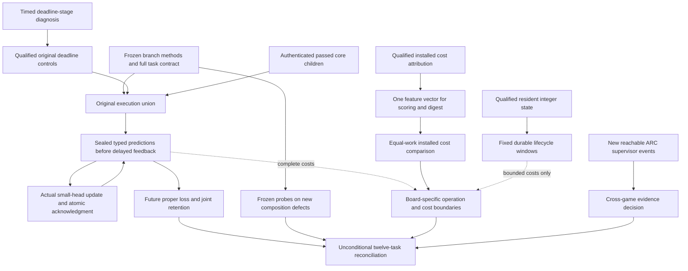
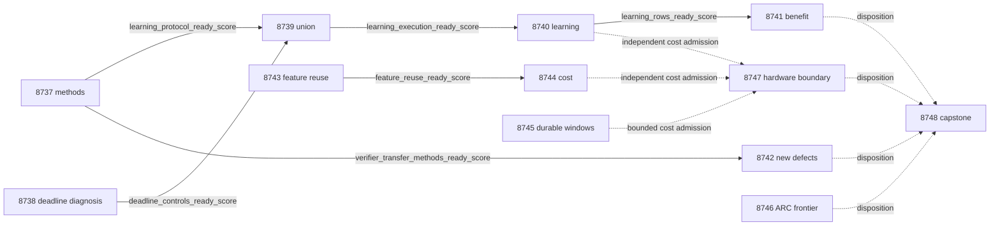

# Carnot Research Roadmap V749: Causal Learning, Verifier Transfer, and Feature Reuse

**Created:** 2026-11-02
**Milestone:** 2026.11.749
**Status:** Planned; execution and activation are separate
**Supersedes:** V748 after all fourteen scheduling slots ended
**Historical authority:** [Preserved V748 design](research-roadmap-v748-preserved-20261102.md)
**Execution queue:** [research-roadmap-next.yaml](../../research-roadmap-next.yaml)
**Contract:** Exactly 12 tasks, Exp8737 through Exp8748, in four phases

## What V748 proved

Ten producers ran and four studies were skipped. The conductor's OK status
means that a task ended, not that its scientific hypothesis succeeded.
The primary artifacts and Exp8736 reconciliation establish these boundaries:

| Evidence | Measured result | What remains open |
|---|---|---|
| Exp8723 | Collection ownership and full task binding qualified after the brace-encoding repair | Contract readiness does not prove learning |
| Exp8724 | Three core children passed all 39 original core nodes; original statement coverage was complete | The added deadline_smoke child timed out after 300 seconds with exit -9; current learning readiness stayed zero |
| Exp8725/8727/8728 | Three learning slots skipped | Full union, causal learning benefit and retention remain unmeasured |
| Exp8726/8729 | Frozen equal-call probes qualified; detection gain 0.0667, CI95 [0.0333, 0.1000], on 30 exposed evaluation worlds | Constructed oracle-dependent evidence; no equal-wall-time or natural extraction claim |
| Exp8730 | Qwen pilot skipped because the causal CUDA repair receipt was absent | No current model inference or accuracy evidence |
| Exp8731 | Resident fixed-point arithmetic and restart parity qualified | Parity is not speed, useful learning or FPGA execution |
| Exp8732 | Four durable updates took 0.582–0.608 seconds; 122880 updates projected at least 71507.5 seconds | Full durable throughput was blocked before measurement |
| Exp8733 | Duplicate feature extraction consumed 45.63% of native child-service time; instrumentation overhead upper95 was 3.57% | Removing it has not been measured; the fraction is not of total parent time |
| Exp8734/8735/8736 | No new ARC events; hardware and capstone readers completed their accounting | No new solve, physical acceleration or completed scientific learning study |

The last qualified installed batching result remains Exp8717: 1.1382x
(CI95 [1.1218, 1.1601]). Same-batch B16 native/Python was 1.0054x
(CI95 [0.9981, 1.0139]), below the PRD's 10x target. Preserve these results,
historical quarantines and the closed ARC panel.

## Three biggest gaps against the PRD

1. **FR-11: useful continuous self-learning.** Execution qualification still
   prevents the fixed causal experiment from reaching a valid answer. Diagnose
   the particular deadline-smoke timeout, preserve passed evidence where exact
   identities permit reuse, then measure future Brier loss and joint retention.
   A complete null closes the unchanged protocol.
2. **FR-12: verification that earns trust beyond its constructed controls.**
   Equal-call probes now detect more planted defects, but their assumptions may
   match the defects used to design them. Test frozen probes on new composition
   defects, correct alternatives and incomplete evidence with independent truth
   evaluation. This advances verifier validity; natural extraction and an
   oracle-distinct advantage remain open.
3. **FR-05/FR-08/NFR-01: useful complete costs across Python and native code.**
   Arithmetic is cheap relative to duplicated feature work and persistence.
   Remove the measured duplicate work, test identical installed behavior, then
   measure both language arms at the same boundary. Separately measure bounded
   durable lifecycle windows without claiming full-run throughput.

## Literature informing the design

The [V749 scan](../../research-references.md#v749-planning-scan--2026-11-02)
was written before the experiments. It covers all eight requested primary
topics and all six secondary channels, with access limitations recorded.

| Source | Adopted method or boundary | Tasks |
|---|---|---|
| [RT4CHART v2](https://arxiv.org/abs/2603.27752v2), revised July 20 | Separate entailed, contradicted and unsupported claims; preserve spans and joint premises | Exp8737/8742 |
| [VerifierBench](https://arxiv.org/abs/2610.28679), October 19 | Test alternative valid outputs and defects excluded from probe design | Exp8737/8742 |
| [Delayed capacity OCO](https://arxiv.org/abs/2606.11711), June 10 | Measure finite pending feedback and realized delays; no convex guarantee is imported | Exp8740/8741 |
| [On-chip KAN learning](https://arxiv.org/abs/2602.02056v4), revised June 19 | Sparse local arithmetic needs complete host and persistence cost accounting | Exp8745/8747 |
| [Ising portability review](https://arxiv.org/abs/2610.03972); [Extropic Z1T](https://extropic.ai/writing/z1t/) | Map actual operations and transfer overhead to each device | Exp8747 |

HSRM is a promising future representation-reuse comparator; the current
optimization follows measured local duplication and does not reproduce HSRM.
EBT, ARM–EBM and Kona remain context, not proof of semantic truth. VLM decoding
and new generative architectures are deferred. Both Semantic Scholar citation
requests returned HTTP 429, the OpenReview EBT page challenged access, and
GitHub Trending returned a stale snapshot. No unavailable inventory is inferred.

## Architecture



The numerical learner, original objective and delayed-feedback protocol stay
fixed. The feature-reuse path is opt-in and request-local. Bounded integer
windows do not replace the floating causal study. Independent branches
authenticate their own operands. No generator weights or ARC policy change.

## Phase 1 — Diagnose and qualify execution (Exp8737–8739)

### Exp8737: Full contract and independent methods

Bind twelve complete task objects and exact gate fields. Preserve the shipped
collection repair and historical authority. Freeze the original learning
protocol and a new 60-world verifier-transfer panel before evaluation.
The panel has role, temporal and two-premise families, six variants and two
five-call schedules. Thirty worlds are evaluation-only. Independent truth
evaluation and two new composition defects prevent probe-design reuse from
being mistaken for transfer. This is the focused SOTA-ingestion task.

### Exp8738: Deadline work attribution and bounded controls

The internal cause of the 300-second smoke timeout is not yet measured.
First time setup, authentication, fixture copy, each original deadline case,
publication and replay under a 420-second diagnostic. Reuse immutable setup
only if measurements identify it as the cause and all rejection checks remain.
Retain the original 3599/3600/3601 cases, assertion identities and separate
numerical clocks. Unknown causes keep readiness zero. Passed core children
are reusable only under exact relevant source, test, fixture and configuration
identity; the old disqualified primary is never promoted.

### Exp8739: Complete original union

Run the original 25-node remainder and any invalidated core cohorts. Require
all 64 original nodes, 27 runner nodes and 83 original executable anchors plus
new owned statements. Authenticate retained child coverage before combining
copies. Preserve killed-child rejection, source-drift checks and actual
E2E-020 hard-exit/resume. Only the full union releases the learning study.

## Phase 2 — Measure learning and verification (Exp8740–8742)

### Exp8740: Continuous calibrated decisions

Run the unchanged nine-input, 109-coefficient head: frozen/log-loss/Brier/
shuffled-feedback arms, seeds 17/29/43/71/101, five blocks of 20 independent
question groups and three siblings. This gives 6000 predictions over 100
independent groups. Capacity stays 8, learning rate 0.01 and L2 0.001.
Seal probabilities and accept/reject/escalate decisions before feedback.
Update actual parameters and atomically acknowledge released labels.

Record pending occupancy, admission, realized delays and lost feedback without
changing the scheduler. Measure sparse and dense work, host processing and
persistence separately. Retention labels never train the head. This satisfies
both the continuous self-learning and calibrated-decision floors. Check the
unchanged workload budget before launch; the bounded cost study cannot replace
this scientific protocol if the full learning run does not fit.

### Exp8741: Future benefit and retention

Average siblings and seeds within each question group. On the 80 later groups,
use 10000 paired cluster draws and the original simultaneous 97.5% intervals
against frozen and log-loss controls. Both Brier-improvement lower bounds must
exceed zero without increased typed-decision loss. Across 50 retention questions
and five windows, the joint upper95 bound on maximum Brier increase must be
at most 0.01. Report costs, false acceptance and escalation. Valid nulls close
the unchanged question; missing upstream data are blocked.

### Exp8742: Frozen probes on new defect families

Execute the sealed 60-world, six-variant, two-arm panel: 720 rows and 3600
unique five-call probe invocations. Ten timing repetitions do not increase
independent sample size. New defects omit a shared-variable join or confuse
a missing required premise with falsehood. Test correct alternatives too.
An independent truth enumerator cannot call the verifier under evaluation.

On 30 evaluation worlds, report 150 defective units per arm, including 60
new-family units. Primary transfer requires lower95 above zero on new-family
detection and no extra correct-verifier false rejection. Use 10000 paired
world-cluster draws. Record wall time and predicate work separately from
equal call counts. Every oracle-dependent benefit is circular; this study
does not establish natural extraction or oracle-distinct generalization.

## Phase 3 — Remove measured waste and bound durable work (Exp8743–8745)

### Exp8743: One extraction per request

Use the same validated feature vector for numerical scoring and its existing
digest. Keep request-local ownership and the baseline path. Reject mutation,
configuration drift, malformed frames and stale success payloads as before.
Qualify batch sizes 1/4/16, both language providers, original import contracts
and the actual installed extension. This is a parity prototype, not a speed claim.

### Exp8744: Complete installed cost comparison

Run Python/native by original/reuse by ten paired repeats at batch 16:
40 process cells, each 16 panels of 64 requests. Measure parent startup through
shutdown with instrumentation disabled and identical request bytes. Report
steady p95 separately. The primary native reuse gain needs lower95 above 1.05,
p95 at most 50ms and no greater than 5% p95 regression. Use 10000 paired
process-repeat draws. NFR-01 requires optimized native versus optimized
Python lower95 at least 10; mixed optimization states cannot support that claim.
Feedback durability is outside this installed inference boundary.

### Exp8745: Bounded durable lifecycle costs

The original 122880-update workload stays blocked. A new bounded estimand uses
32-update windows beginning at offsets 0, 2032 and 4064 in the original
4096-update trajectory. Three arms and ten paired repeats give 90 processes
and 2880 measured durable updates. Starting states must match the qualified
parity trace; excluded prefix construction costs remain explicit.

The middle window crosses renormalization and a real restart after update
2048. Each measured update retains file fsync, atomic replacement, directory
fsync and acknowledgment. No tmpfs or batched acknowledgment shortcut is allowed.
A four-update probe, process overhead and 25% reserve must admit the fixed
plan within 3000 seconds; otherwise stop with measured budget evidence.

Bootstrap ten paired repeat blocks with all windows and arms together.
Equal-window-weighted resident/original-native throughput lower95 must exceed
1.05 with no greater than 5% p95 regression for a bounded benefit. Report
window-specific and matched native/Python costs. These measurements cannot
establish uninterrupted long-run throughput, useful learning or FPGA speed.

## Phase 4 — Live evidence, hardware boundaries and closure (Exp8746–8748)

### Exp8746: New ARC supervisor outcomes

Use Exp8734's qualified reader and exact frontier. Registry-precheck solves
before reading new live events. Preserve selected/applied status, reset cause,
horizon, censoring and per-arm outcomes. An authenticated empty delta ends
immediately and satisfies the standing generalization floor. No closed-panel
replay, hidden-source inspection, policy change or new level credit occurs.
Any imported credited solve must be live_agent_self_discovery.

### Exp8747: All three board tracks

Independently admit new complete learning, installed inference and bounded
window costs. Do not join these different boundaries into one service.
Target KV260, PolarFire and GateMate with supported/unsupported/unknown
operations. Preserve KV260 quadratic evaluation with k_max<=5, PolarFire
Linux CPU dispatch and GateMate's unchanged 0xffffffff physical/JTAG blocker.

Conditional Amdahl bounds use compatible fractions within one clock domain.
Ideal 10x and 100x require fractions at least 0.9 and 0.99 before transfer.
Host features and durability remain host costs without contrary measurement.
This task maps evidence; it performs no board probes, flashing or purchases.

### Exp8748: Unconditional capstone

Reconcile all twelve slots and every actual gate observation. Recompute claims
from per-unit rows, preserve nulls and distinguish pre-gate skips from executed
science. Run the unchanged G1–G4 publication gate. Old FoVer publication readiness
does not certify new claims. Report exact-repeat retirement candidates and
concrete changed-mechanism reopening conditions. External absence is blocked,
not partial. Reconcile OpenSpec, BMAD and ops documentation.

## Dependency graph and gate contract



The six solid edges are structured YAML gates requiring numeric 1; every
upstream field is declared in that task's REQUIRED ARTIFACT FIELDS. All
upstreams occur earlier in this queue. Dotted edges are evidence reads, not
conjunctive conductor gates. Exp8737/8738/8743/8745/8746/8747/8748 run
independently of other task verdicts. Branch readers retain exact missing-file,
missing-field, changed-hash, disqualified-producer and observed-zero diagnoses.

## Hardware requirements, model policy and execution budget

| Resource | Planned use | Boundary |
|---|---|---|
| CPU, RAM, Python venv, Rust/PyO3 toolchain | All twelve tasks; fixed small-head training, truth evaluation, installed native path | No model or GPU result inferred |
| Persistent local filesystem | Sealed evidence, durable feedback and exact-resume tests | Measure actual fsync cost; no volatile substitute |
| Two RTX 3090s in inventory | No new GPU task in V749 | The causal CUDA repair prerequisite is unchanged; no repeat canary |
| KV260 | Operation-support mapping and future target | SSH/scp/xmutil for future qualified device work; k_max<=5 |
| PolarFire | Operation-support mapping | Linux CPU dispatch is not fabric acceleration |
| GateMate | Physical blocker and supported-work mapping | No new probe until dated physical change and valid IDCODE |
| TSU, NPU and new hardware | Literature and wishlist only | No access, acquisition or SDK readiness assumed |

Every scheduled task declares MODEL_SPECS=[] and no_model_load because its
work is numerical CPU training, native evaluation or evidence analysis.
The model mandate is unchanged: any future LLM experiment must include
unsloth/Qwen3.8-27B-GGUF in MODEL_SPECS. A bounded canary or fixed token
budget uses model_bounded_generation (10s), an embedding/load-only probe
uses model_load_no_generation (2s), and real full generation uses
model_full_generation (60s). No sleeps may pad those floors. Legacy small
models are CPU smoke tests only, never substitutes for headline results.

This omission is deliberate: V748 still had no supplied causal CUDA repair,
so another unchanged gate-blocked canary would add no evidence. Reopening
requires the changed library/environment receipt and qualified real runtime;
it is not implied by inventory or a new milestone number. HSRM, natural
extraction and the Qwen self-score comparison remain explicit future work.

| Phase | Tasks | Estimated minutes |
|---|---|---:|
| Execution qualification | Exp8737–8739 | 160 |
| Scientific measurements | Exp8740–8742 | 155 |
| Portable cost studies | Exp8743–8745 | 170 |
| Evidence and closure | Exp8746–8748 | 60 |

Serial estimate: 545 minutes before gate skips. These are planning estimates,
not measurements. No task estimate exceeds 65 minutes. Per-task measurement
deadlines reserve validation time inside the 4800-second hard cap.
Every numbered step list requires flushed phase boundaries, before/after long
calls, 60-second inner-loop/parent heartbeats and silence below 600 seconds.
Files above about 200 lines require several tool calls with progress between.

Per the user's routing instructions, the three execution infrastructure tasks
use Claude Opus with 100 turns. New verifier and feature-reuse implementation
use Codex gpt-6.1-sol. Routine measurements use default Claude Sonnet with
at most 50 turns; focused readers use 20 or 30. No Gemini or Luna is queued.
These are conductor settings, not subagents spawned during planning.

## Acceptance, retirement and verification

All comparative tasks set per_unit_rows=true and retain raw metrics, intended
units, exclusions and failures. Verdicts start with complete_; verdict_class
uses the closed six-member enum. Constructed oracle-dependent positives are
circular_positive. Execution readiness and scientific benefit remain separate.
Missing external inputs are blocked; partial is only for unfinished owned work.

Prior-failure entries preserve all four fields, including
retire_if_same_verdict=true. The deadline task diagnoses a specific killed child;
the scientific follow-ups require a newly qualified prerequisite; feature reuse
changes a measured dominant operation; bounded windows change and explicitly
narrow the cost estimand. These are stated differences, not renamed repeats.
No retired ID is reused or used as a current gate upstream. Routine readers
retain historical failures without rehabilitating their artifacts.

Implementation starts with requirements and failing tests. Run relevant unit,
lint, format, strict type and spec-coverage checks, with actual 100% coverage
of new statements. Learning retains E2E-020; installed/native paths cross
E2E-003/004; publication/readers use private E2E-018/021. Require exact final-byte
adversarial verification, strict row consistency and cold replay. Do not relax
shared validators or original assertions to get a green result.

Planning validates schema, full-object equality, gates, failure lineage,
read-first paths, progress clauses and unchanged protected files. Existing
planning unit tests cover the schema and gate machinery. No runtime experiment
E2E is claimed for this documentation-only change; applicable runtime E2Es are
explicitly scheduled above. Planning validation results are appended below.

## Exact task contract

Exactly **12 tasks, Exp8737 through Exp8748**, execute in the order below.
The full JSON contract and SHA-256 bind every task field, including prompts,
routing and prior failures. Canonicalization is UTF-8 JSON of the tasks list,
sorted keys, compact separators and ensure_ascii=false.

| Order | Task | Title | Phase | Deliverable |
|---|---|---|---|---|
| 1 | `exp8737-contract-methods` | Bind twelve tasks and freeze independent learning and verifier-transfer methods | 1 | `results/experiment_8737_v749_contract_methods.json` |
| 2 | `exp8738-deadline-cost-diagnosis` | Locate deadline-smoke work and qualify bounded original deadline controls | 1 | `results/experiment_8738_v749_deadline_cost_diagnosis.json` |
| 3 | `exp8739-learning-union` | Qualify the original causal union from authenticated core and deadline evidence | 1 | `results/experiment_8739_v749_learning_union.json` |
| 4 | `exp8740-causal-brier-stream` | Measure continuous typed-decision learning and realized delayed-feedback capacity | 2 | `results/experiment_8740_v749_causal_brier_stream.json` |
| 5 | `exp8741-learning-benefit-audit` | Test future proper-loss benefit and simultaneous retention from causal rows | 2 | `results/experiment_8741_v749_learning_benefit_audit.json` |
| 6 | `exp8742-verifier-family-transfer` | Test frozen verifier probes on composition defects excluded from probe design | 2 | `results/experiment_8742_v749_verifier_family_transfer.json` |
| 7 | `exp8743-single-extraction-prototype` | Reuse each request feature vector for scoring and its digest | 3 | `results/experiment_8743_v749_single_extraction_prototype.json` |
| 8 | `exp8744-single-extraction-cost` | Measure complete installed costs after qualified feature reuse | 3 | `results/experiment_8744_v749_single_extraction_cost.json` |
| 9 | `exp8745-bounded-durable-cost` | Measure matched durable update costs in fixed lifecycle windows | 3 | `results/experiment_8745_v749_bounded_durable_cost.json` |
| 10 | `exp8746-arc-outcome-frontier` | Read only new live supervisor outcomes for cross-game refinement | 4 | `results/experiment_8746_v749_arc_outcome_frontier.json` |
| 11 | `exp8747-hardware-cost-boundary` | Map new feature and durable-window costs to each board operation | 4 | `results/experiment_8747_v749_hardware_cost_boundary.json` |
| 12 | `exp8748-capstone` | Reconcile twelve outcomes and close exact learning verification and cost scopes | 4 | `results/experiment_8748_v749_capstone.json` |

Canonical full-task SHA-256: `4a6d677f74b3db5988f4f2dc2aee1ce023d2d132e9aac39ccd645c7fc2611787`

<!-- V749_TASK_CONTRACT_START -->
```json
{
  "milestone": "2026.11.749",
  "tasks": [
    {"id": "exp8737-contract-methods", "title": "Bind twelve tasks and freeze independent learning and verifier-transfer methods", "phase": 1, "track": "infrastructure", "priority": "high", "requires_gpu": false, "max_turns": 100, "estimated_wall_time_min": 35, "per_unit_rows": true, "milestone": "2026.11.749", "deliverable": "results/experiment_8737_v749_contract_methods.json", "inference_substrate_class": "no_model_load", "MODEL_SPECS": [], "gated_on": [], "agent_type": "claude", "model": "opus", "prior_failures": [{"experiment_id": "exp7532-v659-contract-methods", "verdict": "complete_blocked_incomplete_v659_authorities", "addressed_by": "Exp8723 now qualifies collection and literal-brace encoding. Bind the new twelve-task scope while preserving historical pins; separately freeze new composition defects and unchanged learning methods. Do not rerun the repaired collection experiment.", "retire_if_same_verdict": true}, {"experiment_id": "exp7713-v672-contract-methods", "verdict": "complete_blocked_v672_independent_contract", "addressed_by": "Exp8723 now qualifies collection and literal-brace encoding. Bind the new twelve-task scope while preserving historical pins; separately freeze new composition defects and unchanged learning methods. Do not rerun the repaired collection experiment.", "retire_if_same_verdict": true}, {"experiment_id": "exp7940-v689-contract-methods", "verdict": "complete_blocked_authority", "addressed_by": "Exp8723 now qualifies collection and literal-brace encoding. Bind the new twelve-task scope while preserving historical pins; separately freeze new composition defects and unchanged learning methods. Do not rerun the repaired collection experiment.", "retire_if_same_verdict": true}, {"experiment_id": "exp7992-v693-contract-methods", "verdict": "complete_blocked_authority", "addressed_by": "Exp8723 now qualifies collection and literal-brace encoding. Bind the new twelve-task scope while preserving historical pins; separately freeze new composition defects and unchanged learning methods. Do not rerun the repaired collection experiment.", "retire_if_same_verdict": true}, {"experiment_id": "exp8018-v695-contract-methods", "verdict": "complete_blocked_authority", "addressed_by": "Exp8723 now qualifies collection and literal-brace encoding. Bind the new twelve-task scope while preserving historical pins; separately freeze new composition defects and unchanged learning methods. Do not rerun the repaired collection experiment.", "retire_if_same_verdict": true}, {"experiment_id": "exp8374-v722-contract-methods", "verdict": "complete_blocked_direct_contract_methods", "addressed_by": "Exp8723 now qualifies collection and literal-brace encoding. Bind the new twelve-task scope while preserving historical pins; separately freeze new composition defects and unchanged learning methods. Do not rerun the repaired collection experiment.", "retire_if_same_verdict": true}, {"experiment_id": "exp8388-v723-contract-methods", "verdict": "complete_blocked_v723_contract_methods", "addressed_by": "Exp8723 now qualifies collection and literal-brace encoding. Bind the new twelve-task scope while preserving historical pins; separately freeze new composition defects and unchanged learning methods. Do not rerun the repaired collection experiment.", "retire_if_same_verdict": true}, {"experiment_id": "exp8416-v725-contract-methods", "verdict": "complete_blocked_v725_contract_methods", "addressed_by": "Exp8723 now qualifies collection and literal-brace encoding. Bind the new twelve-task scope while preserving historical pins; separately freeze new composition defects and unchanged learning methods. Do not rerun the repaired collection experiment.", "retire_if_same_verdict": true}, {"experiment_id": "exp8443-v727-contract-methods", "verdict": "complete_blocked_v727_contract_methods", "addressed_by": "Exp8723 now qualifies collection and literal-brace encoding. Bind the new twelve-task scope while preserving historical pins; separately freeze new composition defects and unchanged learning methods. Do not rerun the repaired collection experiment.", "retire_if_same_verdict": true}, {"experiment_id": "exp8471-v729-contract-methods", "verdict": "complete_blocked_v729_contract_methods", "addressed_by": "Exp8723 now qualifies collection and literal-brace encoding. Bind the new twelve-task scope while preserving historical pins; separately freeze new composition defects and unchanged learning methods. Do not rerun the repaired collection experiment.", "retire_if_same_verdict": true}, {"experiment_id": "exp8499-v731-contract-methods", "verdict": "complete_blocked_v731_contract_methods", "addressed_by": "Exp8723 now qualifies collection and literal-brace encoding. Bind the new twelve-task scope while preserving historical pins; separately freeze new composition defects and unchanged learning methods. Do not rerun the repaired collection experiment.", "retire_if_same_verdict": true}, {"experiment_id": "exp8565-v736-contract-methods", "verdict": "complete_blocked_v736_contract_methods", "addressed_by": "Exp8723 now qualifies collection and literal-brace encoding. Bind the new twelve-task scope while preserving historical pins; separately freeze new composition defects and unchanged learning methods. Do not rerun the repaired collection experiment.", "retire_if_same_verdict": true}, {"experiment_id": "exp8602-v739-contract-methods", "verdict": "complete_blocked_v739_contract_methods", "addressed_by": "Exp8723 now qualifies collection and literal-brace encoding. Bind the new twelve-task scope while preserving historical pins; separately freeze new composition defects and unchanged learning methods. Do not rerun the repaired collection experiment.", "retire_if_same_verdict": true}, {"experiment_id": "exp8667-contract-methods", "verdict": "complete_disqualified_v744_contract_methods", "addressed_by": "Exp8723 now qualifies collection and literal-brace encoding. Bind the new twelve-task scope while preserving historical pins; separately freeze new composition defects and unchanged learning methods. Do not rerun the repaired collection experiment.", "retire_if_same_verdict": true}, {"experiment_id": "exp8681-contract-methods", "verdict": "complete_disqualified_v745_contract_methods", "addressed_by": "Exp8723 now qualifies collection and literal-brace encoding. Bind the new twelve-task scope while preserving historical pins; separately freeze new composition defects and unchanged learning methods. Do not rerun the repaired collection experiment.", "retire_if_same_verdict": true}, {"experiment_id": "exp8709-contract-methods", "verdict": "complete_disqualified_v747_contract_methods", "addressed_by": "Exp8723 now qualifies collection and literal-brace encoding. Bind the new twelve-task scope while preserving historical pins; separately freeze new composition defects and unchanged learning methods. Do not rerun the repaired collection experiment.", "retire_if_same_verdict": true}], "prompt": "CONTEXT:\nWork in {project_root} on {date}. V748 ran ten producers and skipped four studies. Exp8723 qualified collection; Exp8724 passed its 39 core nodes but its deadline_smoke child timed out at 300 seconds, leaving readiness zero. Exp8729 gained 0.0667 defect detection at equal calls on exposed constructed worlds, CI95 [0.0333,0.1000]; this is circular evidence. Exp8731 qualified resident integer parity. Exp8732 projected 71507.5 seconds for 122880 durable updates and stopped. Exp8733 attributes 45.63% of native child-service time to duplicate feature extraction. No useful learning, current CUDA repair, new ARC outcome or physical acceleration was established. V749 contains exactly twelve tasks, Exp8737 through Exp8748. Preserve all historical bytes, quarantines and scientific nulls.\n\nEXISTING CODE TO READ FIRST:\nCLAUDE.md; CODEX.md; ops/e2e-test-plan.md; ops/exclusion_manifest.yaml; openspec/capabilities/research-reporting/spec.md; openspec/capabilities/verification/spec.md; scripts/experiment_template.py; python/carnot/reporting/primary_publication.py; openspec/change-proposals/research-roadmap-vNEXT.md; openspec/change-proposals/research-roadmap-v748-preserved-20261102.md; research-references.md; python/carnot/reporting/roadmap_contract.py; python/carnot/reporting/v748_collection_contract.py; python/carnot/reporting/verification_methods_8726.py; tests/python/test_v748_collection_8723.py; openspec/change-proposals/v744-methods-protocol.json; results/experiment_8723_v748_collection_contract.json; results/experiment_8729_v748_equal_budget_verifier.json; results/experiment_8736_v748_capstone.json\n\nTASK:\nBind twelve tasks and freeze independent learning and verifier-transfer methods. Deliver results/experiment_8737_v749_contract_methods.json. Use thin runner scripts/experiments/experiment_8737_v749_contract_methods.py, raw evidence results/raw/experiment_8737_v749_contract_methods/ and notes docs/research-notes/v749-contract-methods.md. No LLM is needed or authorized by this task. If a new model operation is necessary, report that changed prerequisite rather than substitute a model.\n\nCONCRETE STEPS:\n1. Print a flushed progress line at every phase boundary, before and after each model load, generation, benchmark or subprocess that can take minutes. Emit inner-loop counts and a parent heartbeat at least every 60 seconds during long calls; keep every silence gap below 600 seconds. Poll long processes in tool calls of at most 60 seconds. Write any file over about 200 lines in several tool calls, with a progress message between calls; do not compose one huge file in one tool call. A silent task can die at 1200 seconds despite the 4800-second cap.\n2. Read the listed sources, authenticate prior evidence and check the exclusion manifest. Write or extend the task REQ-* and SCENARIO-* requirements and failing tests before implementation. Reuse existing mechanisms and thin runners. Freeze methods before looking at new outcomes; distinguish old execution evidence from new science.\n3. Bind all twelve complete task objects, visible table, deliverable paths and canonical JSON digest to this design. Accept only the existing conductor literal-brace encoding of an otherwise identical task; substantive prompt, gate, routing, omission and reorder mutations must fail. Preserve V748 historical bindings. Do not activate or rewrite the active queue.\n4. Authenticate Exp8723 collection authority and Exp8724 raw successful children separately from its failed deadline smoke. The contract task does not authorize learning. Freeze the unchanged V744 nine-input, 109-coefficient causal protocol, original 64-node execution inventory, 27 runner nodes, 83 statement anchors, and current source dependencies. learning_protocol_ready_score=1 requires complete method/input custody, not successful execution.\n5. Ingest RT4CHART v2, VerifierBench and delayed OCO 2606.11711 from the V749 reference scan. Record which assumptions transfer. Freeze two existing five-call schedules without tuning them on new defects. Specify a new constructed panel: 60 worlds, 20 each for role binding, temporal order and two-premise composition; six variants per world (correct, three legacy defects, two new composition defects). Seal 30 development and 30 evaluation worlds before results; the two new defect families never select probes. Retain answer spans, all supporting premises and true/false/unknown outcomes. Implement an independent truth enumerator, not a call to the tested verifier. Correct alternatives include reordered independent records and bijective entity renaming.\n6. Freeze five-call no-early-exit execution for both schedules, ten timed repetitions per deterministic cell, and world-cluster analysis. Intended scientific units are 60 worlds, 720 world/variant/arm rows and 3600 unique probe invocations; timing repetitions do not multiply sample size. Evaluation has 150 defective units per arm across 30 worlds, including 60 new-family units. verifier_transfer_methods_ready_score=1 requires schema, truth independence and complete predeclared roster. This method field is independent of learning readiness.\n7. Authenticate the observed resident durability limit and installed profile before locking the bounded cost and feature-reuse comparisons described in Exp8743–8745. Keep branch-specific readiness fields independent. Use private E2E-018/021 contract readers, original rejection controls and fresh full-task mutations. Stop by 1800 seconds of owned work to leave validation time.\n8. Run scoped unit tests, Ruff lint/format, strict types, relevant spec coverage and the named applicable E2E checks. Require genuine 100% coverage of new executable statements and retain real child/JUnit/coverage evidence; do not weaken tests, skip original assertions, synthesize coverage or edit shared validators to pass. Use private artifact roots for tests and inspect git status afterward. Publish only terminal validated bytes; run adversarial_verify.py, verdict_row_consistency_lint.py --strict and fresh-process cold replay against those bytes. Reconcile OpenSpec, _bmad/traceability.md, ops/status.md and ops/changelog.md with measured outcomes. Do not alter active research-roadmap.yaml, the exclusion manifest, generator weights, or the ARC policy.\n\nREQUIRED ARTIFACT FIELDS:\nexperiment_id, task_id, milestone, run_date, invocation_id: principle: Bind a claim to its actual producer.\nhonest_verdict, verdict_class: principle: Start honest_verdict with complete_; verdict_class is positive | circular_positive | null | blocked | disqualified | partial. Only incomplete owned work that a retry can finish is partial; missing or retired external inputs are blocked.\ngate_check_summary: principle: Every blocked result names the upstream, path/hash, failed check, field, operator, expected and observed values; distinguish missing file, missing field and measured zero.\ninference_substrate, inference_substrate_class, MODEL_SPECS, model_invocation_counts: principle: These tasks use no_model_load, MODEL_SPECS=[], zero LLM calls. Declare cached-verifier scoring or upstream aggregation as actually performed; record numerical training separately. Never claim GPU inference from a model name.\nrows, intended_count, completed_count, failed_count, censored_count, excluded_count, independent_count: principle: Store each intended unit and arm, raw metrics, denominators and cost; repeats and siblings do not multiply independent cases.\nverifier_is_oracle, exposure_scope, independent_generalization_score: principle: Oracle-dependent positives are circular_positive; constructed or exposed data do not prove natural or hidden-game generalization.\nacceptance_gates, required_checks_passed, flagged_adversarial, validation_receipts, terminal_validation_sidecar_path: principle: Execution readiness differs from scientific benefit; a failed acceptance_gate_* cannot yield a positive verdict_class.\npreconditions_checked, started_at_utc, ended_at_utc, duration_s, phase_spans, random_seed, reproducibility_checksum: principle: Retain current invocation clocks and actual measured time, never old monotonic epochs or padding sleeps.\nsource_artifact_hashes, code_config_hashes, raw_shard_hashes, cited_upstream_artifacts, field_principles: principle: Bind imported fields to exact bytes and identify numerical kernels, source versions and raw observations.\ncontract_ready_score, learning_protocol_ready_score, verifier_transfer_methods_ready_score, full_task_objects, canonical_tasks_sha256, contract_mutation_rows, learning_protocol_reference, verifier_transfer_protocol_reference, literature_method_rows: principle: Freeze complete methods and independent branch gates; administrative success is not scientific evidence.\n\nRun command: cd {project_root} && JAX_PLATFORMS=cpu PYTHONPATH=python:. PYTHONUNBUFFERED=1 .venv/bin/python -u scripts/experiments/experiment_8737_v749_contract_methods.py --date {date}\n\nDo NOT push. Do NOT modify scripts/research_conductor.py.\n"},
    {"id": "exp8738-deadline-cost-diagnosis", "title": "Locate deadline-smoke work and qualify bounded original deadline controls", "phase": 1, "track": "infrastructure", "priority": "high", "requires_gpu": false, "max_turns": 100, "estimated_wall_time_min": 60, "per_unit_rows": true, "milestone": "2026.11.749", "deliverable": "results/experiment_8738_v749_deadline_cost_diagnosis.json", "inference_substrate_class": "no_model_load", "MODEL_SPECS": [], "gated_on": [], "agent_type": "claude", "model": "opus", "prior_failures": [{"experiment_id": "exp8654-learning-core-execution", "verdict": "complete_disqualified_v743_learning_core_execution", "addressed_by": "Exp8724 passed the core but its added deadline_smoke child timed out with no output at 300 seconds. This task first measures fixture/setup/case/publication stages under a bounded diagnostic and only qualifies a causally validated reuse repair; it does not blindly repeat core execution or assert an unobserved cause.", "retire_if_same_verdict": true}, {"experiment_id": "exp8641-learning-execution-custody", "verdict": "complete_disqualified_v742_learning_execution_custody", "addressed_by": "Exp8724 passed the core but its added deadline_smoke child timed out with no output at 300 seconds. This task first measures fixture/setup/case/publication stages under a bounded diagnostic and only qualifies a causally validated reuse repair; it does not blindly repeat core execution or assert an unobserved cause.", "retire_if_same_verdict": true}, {"experiment_id": "exp8668-frozen-learning-core", "verdict": "blocked_gate_check_failed", "addressed_by": "Exp8724 passed the core but its added deadline_smoke child timed out with no output at 300 seconds. This task first measures fixture/setup/case/publication stages under a bounded diagnostic and only qualifies a causally validated reuse repair; it does not blindly repeat core execution or assert an unobserved cause.", "retire_if_same_verdict": true}, {"experiment_id": "exp8682-frozen-learning-core", "verdict": "blocked_gate_check_failed", "addressed_by": "Exp8724 passed the core but its added deadline_smoke child timed out with no output at 300 seconds. This task first measures fixture/setup/case/publication stages under a bounded diagnostic and only qualifies a causally validated reuse repair; it does not blindly repeat core execution or assert an unobserved cause.", "retire_if_same_verdict": true}, {"experiment_id": "exp8697-learning-union-qualification", "verdict": "complete_disqualified_v746_learning_union_qualification", "addressed_by": "Exp8724 passed the core but its added deadline_smoke child timed out with no output at 300 seconds. This task first measures fixture/setup/case/publication stages under a bounded diagnostic and only qualifies a causally validated reuse repair; it does not blindly repeat core execution or assert an unobserved cause.", "retire_if_same_verdict": true}, {"experiment_id": "exp8710-invocation-clock-core", "verdict": "blocked_gate_check_failed", "addressed_by": "Exp8724 passed the core but its added deadline_smoke child timed out with no output at 300 seconds. This task first measures fixture/setup/case/publication stages under a bounded diagnostic and only qualifies a causally validated reuse repair; it does not blindly repeat core execution or assert an unobserved cause.", "retire_if_same_verdict": true}, {"experiment_id": "exp8724-invocation-clock-core", "verdict": "complete_disqualified_v748_invocation_clock_core", "addressed_by": "Exp8724 passed the core but its added deadline_smoke child timed out with no output at 300 seconds. This task first measures fixture/setup/case/publication stages under a bounded diagnostic and only qualifies a causally validated reuse repair; it does not blindly repeat core execution or assert an unobserved cause.", "retire_if_same_verdict": true}], "prompt": "CONTEXT:\nWork in {project_root} on {date}. V748 ran ten producers and skipped four studies. Exp8723 qualified collection; Exp8724 passed its 39 core nodes but its deadline_smoke child timed out at 300 seconds, leaving readiness zero. Exp8729 gained 0.0667 defect detection at equal calls on exposed constructed worlds, CI95 [0.0333,0.1000]; this is circular evidence. Exp8731 qualified resident integer parity. Exp8732 projected 71507.5 seconds for 122880 durable updates and stopped. Exp8733 attributes 45.63% of native child-service time to duplicate feature extraction. No useful learning, current CUDA repair, new ARC outcome or physical acceleration was established. V749 contains exactly twelve tasks, Exp8737 through Exp8748. Preserve all historical bytes, quarantines and scientific nulls.\n\nEXISTING CODE TO READ FIRST:\nCLAUDE.md; CODEX.md; ops/e2e-test-plan.md; ops/exclusion_manifest.yaml; openspec/capabilities/research-reporting/spec.md; openspec/capabilities/verification/spec.md; scripts/experiment_template.py; python/carnot/reporting/primary_publication.py; openspec/change-proposals/research-roadmap-vNEXT.md; openspec/change-proposals/research-roadmap-v748-preserved-20261102.md; research-references.md; python/carnot/reporting/invocation_clock_core_8724.py; python/carnot/reporting/learning_core_8696.py; python/carnot/reporting/learning_core_8654.py; python/carnot/reporting/deadline_edge_8603.py; python/carnot/reporting/learning_clock_8592.py; python/carnot/reporting/causal_brier_runner_8582.py; tests/python/test_deadline_edge_8603.py; tests/python/test_invocation_clock_8724.py; results/experiment_8724_v748_invocation_clock_core.json\n\nTASK:\nLocate deadline-smoke work and qualify bounded original deadline controls. Deliver results/experiment_8738_v749_deadline_cost_diagnosis.json. Use thin runner scripts/experiments/experiment_8738_v749_deadline_cost_diagnosis.py, raw evidence results/raw/experiment_8738_v749_deadline_cost_diagnosis/ and notes docs/research-notes/v749-deadline-cost-diagnosis.md. No LLM is needed or authorized by this task. If a new model operation is necessary, report that changed prerequisite rather than substitute a model.\n\nCONCRETE STEPS:\n1. Print a flushed progress line at every phase boundary, before and after each model load, generation, benchmark or subprocess that can take minutes. Emit inner-loop counts and a parent heartbeat at least every 60 seconds during long calls; keep every silence gap below 600 seconds. Poll long processes in tool calls of at most 60 seconds. Write any file over about 200 lines in several tool calls, with a progress message between calls; do not compose one huge file in one tool call. A silent task can die at 1200 seconds despite the 4800-second cap.\n2. Read the listed sources, authenticate prior evidence and check the exclusion manifest. Write or extend the task REQ-* and SCENARIO-* requirements and failing tests before implementation. Reuse existing mechanisms and thin runners. Freeze methods before looking at new outcomes; distinguish old execution evidence from new science.\n3. Read the exact failed deadline_smoke receipt and zero-output stdout/stderr before executing anything. Three original core children passed, original coverage was complete, and the smoke child exited -9 after 300 seconds. This proves a timeout, not its internal cause. Record that distinction. Authenticate original children and source hashes without upgrading the old disqualified primary.\n4. Instrument a task-owned diagnostic of the original test fixture setup, inspect/authentication, fixture copy, each deadline_case, publication and cold replay. Use the same original 3599/3600/3601 cases and assertions, a parent heartbeat and per-stage timing. First diagnostic cap is 420 seconds total; on timeout capture the active stage and process tree and terminate owned children. Do not start repeated full core runs or increase the global cap.\n5. Only if measured evidence locates repeated immutable setup or fixture work, prepare it once in an invocation-owned retained root and reuse it through the established fixture interface. Preserve exact original test node IDs and assertions; do not monkeypatch away inspect, replay, verification or publication. If a different cause appears, record it and keep deadline_controls_ready_score=0 until a causal bounded repair is validated. This diagnostic is terminal null if it finds no supported repair, not an automatic retry.\n6. Prove the changed path with source/fixture/hash tampering, missing SQLite, killed-child and cleanup controls. Run the original three deadline nodes under coverage with separate real numerical clocks. Retain the expected two/three deadline reads, 3600.25/3601.25 observed diagnostics and disqualified private publication. Require every owned child to exit normally. If existing 39-node evidence cannot be reused under exact relevant source identity, mark it ineligible; do not fabricate a replacement.\n7. Emit deadline_controls_ready_score=1 only for qualified original controls plus current owned validation. Emit retained_core_eligible_score separately with exact source identity. Any changed source requires affected original nodes to be rerun by Exp8739. Run private E2E-018/021; measurement stops by 2700 seconds. The full learning union remains Exp8739 responsibility.\n8. Run scoped unit tests, Ruff lint/format, strict types, relevant spec coverage and the named applicable E2E checks. Require genuine 100% coverage of new executable statements and retain real child/JUnit/coverage evidence; do not weaken tests, skip original assertions, synthesize coverage or edit shared validators to pass. Use private artifact roots for tests and inspect git status afterward. Publish only terminal validated bytes; run adversarial_verify.py, verdict_row_consistency_lint.py --strict and fresh-process cold replay against those bytes. Reconcile OpenSpec, _bmad/traceability.md, ops/status.md and ops/changelog.md with measured outcomes. Do not alter active research-roadmap.yaml, the exclusion manifest, generator weights, or the ARC policy.\n\nREQUIRED ARTIFACT FIELDS:\nexperiment_id, task_id, milestone, run_date, invocation_id: principle: Bind a claim to its actual producer.\nhonest_verdict, verdict_class: principle: Start honest_verdict with complete_; verdict_class is positive | circular_positive | null | blocked | disqualified | partial. Only incomplete owned work that a retry can finish is partial; missing or retired external inputs are blocked.\ngate_check_summary: principle: Every blocked result names the upstream, path/hash, failed check, field, operator, expected and observed values; distinguish missing file, missing field and measured zero.\ninference_substrate, inference_substrate_class, MODEL_SPECS, model_invocation_counts: principle: These tasks use no_model_load, MODEL_SPECS=[], zero LLM calls. Declare cached-verifier scoring or upstream aggregation as actually performed; record numerical training separately. Never claim GPU inference from a model name.\nrows, intended_count, completed_count, failed_count, censored_count, excluded_count, independent_count: principle: Store each intended unit and arm, raw metrics, denominators and cost; repeats and siblings do not multiply independent cases.\nverifier_is_oracle, exposure_scope, independent_generalization_score: principle: Oracle-dependent positives are circular_positive; constructed or exposed data do not prove natural or hidden-game generalization.\nacceptance_gates, required_checks_passed, flagged_adversarial, validation_receipts, terminal_validation_sidecar_path: principle: Execution readiness differs from scientific benefit; a failed acceptance_gate_* cannot yield a positive verdict_class.\npreconditions_checked, started_at_utc, ended_at_utc, duration_s, phase_spans, random_seed, reproducibility_checksum: principle: Retain current invocation clocks and actual measured time, never old monotonic epochs or padding sleeps.\nsource_artifact_hashes, code_config_hashes, raw_shard_hashes, cited_upstream_artifacts, field_principles: principle: Bind imported fields to exact bytes and identify numerical kernels, source versions and raw observations.\ndeadline_controls_ready_score, retained_core_eligible_score, diagnostic_stage_rows, observed_timeout_reference, diagnosed_cause, changed_mechanism, original_deadline_rows, retained_core_manifest, reuse_invalidations, child_cleanup_rows: principle: A measured causal repair may authorize current controls; a timed-out child and historical aggregate cannot qualify execution.\n\nRun command: cd {project_root} && JAX_PLATFORMS=cpu PYTHONPATH=python:. PYTHONUNBUFFERED=1 .venv/bin/python -u scripts/experiments/experiment_8738_v749_deadline_cost_diagnosis.py --date {date}\n\nDo NOT push. Do NOT modify scripts/research_conductor.py.\n"},
    {"id": "exp8739-learning-union", "title": "Qualify the original causal union from authenticated core and deadline evidence", "phase": 1, "track": "infrastructure", "priority": "high", "requires_gpu": false, "max_turns": 100, "estimated_wall_time_min": 65, "per_unit_rows": true, "milestone": "2026.11.749", "deliverable": "results/experiment_8739_v749_learning_union.json", "inference_substrate_class": "no_model_load", "MODEL_SPECS": [], "gated_on": [{"upstream": "exp8737-contract-methods", "artifact_field": "learning_protocol_ready_score", "op": "==", "value": 1}, {"upstream": "exp8738-deadline-cost-diagnosis", "artifact_field": "deadline_controls_ready_score", "op": "==", "value": 1}], "agent_type": "claude", "model": "opus", "prior_failures": [{"experiment_id": "exp8655-learning-execution-qualification", "verdict": "blocked_gate_check_failed", "addressed_by": "Exp8724 now supplies genuinely passed core children; Exp8738 must qualify the separately diagnosed deadline-smoke defect before this task runs. Exact source-matched reuse avoids repeating passed work; the complete original union and all rejection obligations remain mandatory.", "retire_if_same_verdict": true}, {"experiment_id": "exp8641-learning-execution-custody", "verdict": "complete_disqualified_v742_learning_execution_custody", "addressed_by": "Exp8724 now supplies genuinely passed core children; Exp8738 must qualify the separately diagnosed deadline-smoke defect before this task runs. Exact source-matched reuse avoids repeating passed work; the complete original union and all rejection obligations remain mandatory.", "retire_if_same_verdict": true}, {"experiment_id": "exp8669-learning-union-qualification", "verdict": "GATE_BLOCK", "addressed_by": "Exp8724 now supplies genuinely passed core children; Exp8738 must qualify the separately diagnosed deadline-smoke defect before this task runs. Exact source-matched reuse avoids repeating passed work; the complete original union and all rejection obligations remain mandatory.", "retire_if_same_verdict": true}, {"experiment_id": "exp8683-learning-union-qualification", "verdict": "GATE_BLOCK: Pre-emptive skip: upstream retired (exp8682-frozen-learning-core)", "addressed_by": "Exp8724 now supplies genuinely passed core children; Exp8738 must qualify the separately diagnosed deadline-smoke defect before this task runs. Exact source-matched reuse avoids repeating passed work; the complete original union and all rejection obligations remain mandatory.", "retire_if_same_verdict": true}, {"experiment_id": "exp8697-learning-union-qualification", "verdict": "complete_disqualified_v746_learning_union_qualification", "addressed_by": "Exp8724 now supplies genuinely passed core children; Exp8738 must qualify the separately diagnosed deadline-smoke defect before this task runs. Exact source-matched reuse avoids repeating passed work; the complete original union and all rejection obligations remain mandatory.", "retire_if_same_verdict": true}, {"experiment_id": "exp8725-learning-union", "verdict": "blocked_gate_check_failed", "addressed_by": "Exp8724 now supplies genuinely passed core children; Exp8738 must qualify the separately diagnosed deadline-smoke defect before this task runs. Exact source-matched reuse avoids repeating passed work; the complete original union and all rejection obligations remain mandatory.", "retire_if_same_verdict": true}], "prompt": "CONTEXT:\nWork in {project_root} on {date}. V748 ran ten producers and skipped four studies. Exp8723 qualified collection; Exp8724 passed its 39 core nodes but its deadline_smoke child timed out at 300 seconds, leaving readiness zero. Exp8729 gained 0.0667 defect detection at equal calls on exposed constructed worlds, CI95 [0.0333,0.1000]; this is circular evidence. Exp8731 qualified resident integer parity. Exp8732 projected 71507.5 seconds for 122880 durable updates and stopped. Exp8733 attributes 45.63% of native child-service time to duplicate feature extraction. No useful learning, current CUDA repair, new ARC outcome or physical acceleration was established. V749 contains exactly twelve tasks, Exp8737 through Exp8748. Preserve all historical bytes, quarantines and scientific nulls.\n\nEXISTING CODE TO READ FIRST:\nCLAUDE.md; CODEX.md; ops/e2e-test-plan.md; ops/exclusion_manifest.yaml; openspec/capabilities/research-reporting/spec.md; openspec/capabilities/verification/spec.md; scripts/experiment_template.py; python/carnot/reporting/primary_publication.py; openspec/change-proposals/research-roadmap-vNEXT.md; openspec/change-proposals/research-roadmap-v748-preserved-20261102.md; research-references.md; python/carnot/reporting/learning_union_8697.py; python/carnot/reporting/deadline_statement_8616.py; python/carnot/reporting/deadline_statement_validation_8616.py; tests/python/test_learning_union_8697.py; tests/python/test_deadline_edge_8603.py; tests/python/test_causal_brier_stream_8582.py; openspec/change-proposals/v744-methods-protocol.json; results/experiment_8697_v746_learning_union_qualification.json\n\nTASK:\nQualify the original causal union from authenticated core and deadline evidence. Deliver results/experiment_8739_v749_learning_union.json. Use thin runner scripts/experiments/experiment_8739_v749_learning_union.py, raw evidence results/raw/experiment_8739_v749_learning_union/ and notes docs/research-notes/v749-learning-union.md. No LLM is needed or authorized by this task. If a new model operation is necessary, report that changed prerequisite rather than substitute a model.\n\nCONCRETE STEPS:\n1. Print a flushed progress line at every phase boundary, before and after each model load, generation, benchmark or subprocess that can take minutes. Emit inner-loop counts and a parent heartbeat at least every 60 seconds during long calls; keep every silence gap below 600 seconds. Poll long processes in tool calls of at most 60 seconds. Write any file over about 200 lines in several tool calls, with a progress message between calls; do not compose one huge file in one tool call. A silent task can die at 1200 seconds despite the 4800-second cap.\n2. Read the listed sources, authenticate prior evidence and check the exclusion manifest. Write or extend the task REQ-* and SCENARIO-* requirements and failing tests before implementation. Reuse existing mechanisms and thin runners. Freeze methods before looking at new outcomes; distinguish old execution evidence from new science.\n3. Read Exp8737.learning_protocol_ready_score and Exp8738.deadline_controls_ready_score by their exact declared paths. Reconcile the current seal with retained 39-node child manifests; reuse only independently authenticated, normally exited children whose test, source, fixture and configuration bytes match. A prior disqualified primary is not itself qualifying evidence.\n4. Execute the original 25-node remainder in bounded module cohorts, retaining the repaired fixture and original assertion inventory. Rerun only invalidated core cohorts, but require all 64 original nodes, all 27 runner nodes and all 83 original executable anchors plus new repair statements. The original deadline diagnostic, rehashed mutations, missing nodes, duplicates and normal cleanup stay mandatory.\n5. Use actual per-child SQLite and JUnit records, original source maps and independently checked union cardinality. Combine copies, never source evidence. Reject killed children, fabricated zeros, consumer-only coverage and rehashed source drift. Budget fixture setup and case work from Exp8738 measurements before launch; stop by 3300 seconds rather than silently omit a cohort.\n6. Run the actual E2E-020 hard-exit/resume controls and private E2E-018/021 readers. learning_execution_ready_score=1 requires the entire qualified original union. Missing external operands produce blocked; owned check failures produce disqualified. Do not change loss, data, parameter count, admission policy or durability to obtain qualification.\n7. Run scoped unit tests, Ruff lint/format, strict types, relevant spec coverage and the named applicable E2E checks. Require genuine 100% coverage of new executable statements and retain real child/JUnit/coverage evidence; do not weaken tests, skip original assertions, synthesize coverage or edit shared validators to pass. Use private artifact roots for tests and inspect git status afterward. Publish only terminal validated bytes; run adversarial_verify.py, verdict_row_consistency_lint.py --strict and fresh-process cold replay against those bytes. Reconcile OpenSpec, _bmad/traceability.md, ops/status.md and ops/changelog.md with measured outcomes. Do not alter active research-roadmap.yaml, the exclusion manifest, generator weights, or the ARC policy.\n\nREQUIRED ARTIFACT FIELDS:\nexperiment_id, task_id, milestone, run_date, invocation_id: principle: Bind a claim to its actual producer.\nhonest_verdict, verdict_class: principle: Start honest_verdict with complete_; verdict_class is positive | circular_positive | null | blocked | disqualified | partial. Only incomplete owned work that a retry can finish is partial; missing or retired external inputs are blocked.\ngate_check_summary: principle: Every blocked result names the upstream, path/hash, failed check, field, operator, expected and observed values; distinguish missing file, missing field and measured zero.\ninference_substrate, inference_substrate_class, MODEL_SPECS, model_invocation_counts: principle: These tasks use no_model_load, MODEL_SPECS=[], zero LLM calls. Declare cached-verifier scoring or upstream aggregation as actually performed; record numerical training separately. Never claim GPU inference from a model name.\nrows, intended_count, completed_count, failed_count, censored_count, excluded_count, independent_count: principle: Store each intended unit and arm, raw metrics, denominators and cost; repeats and siblings do not multiply independent cases.\nverifier_is_oracle, exposure_scope, independent_generalization_score: principle: Oracle-dependent positives are circular_positive; constructed or exposed data do not prove natural or hidden-game generalization.\nacceptance_gates, required_checks_passed, flagged_adversarial, validation_receipts, terminal_validation_sidecar_path: principle: Execution readiness differs from scientific benefit; a failed acceptance_gate_* cannot yield a positive verdict_class.\npreconditions_checked, started_at_utc, ended_at_utc, duration_s, phase_spans, random_seed, reproducibility_checksum: principle: Retain current invocation clocks and actual measured time, never old monotonic epochs or padding sleeps.\nsource_artifact_hashes, code_config_hashes, raw_shard_hashes, cited_upstream_artifacts, field_principles: principle: Bind imported fields to exact bytes and identify numerical kernels, source versions and raw observations.\nlearning_execution_ready_score, core_reuse_rows, original_node_rows, original_statement_coverage, current_source_seal, complete_union_reference, child_shard_manifest, launch_budget_rows: principle: Complete actual execution of the original obligations precedes any causal learning claim.\n\nRun command: cd {project_root} && JAX_PLATFORMS=cpu PYTHONPATH=python:. PYTHONUNBUFFERED=1 .venv/bin/python -u scripts/experiments/experiment_8739_v749_learning_union.py --date {date}\n\nDo NOT push. Do NOT modify scripts/research_conductor.py.\n"},
    {"id": "exp8740-causal-brier-stream", "title": "Measure continuous typed-decision learning and realized delayed-feedback capacity", "phase": 2, "track": "research", "priority": "high", "requires_gpu": false, "max_turns": 50, "estimated_wall_time_min": 65, "per_unit_rows": true, "milestone": "2026.11.749", "deliverable": "results/experiment_8740_v749_causal_brier_stream.json", "inference_substrate_class": "no_model_load", "MODEL_SPECS": [], "gated_on": [{"upstream": "exp8739-learning-union", "artifact_field": "learning_execution_ready_score", "op": "==", "value": 1}], "prior_failures": [{"experiment_id": "exp8657-causal-brier-stream", "verdict": "no producer honest_verdict; conductor cascade-skip: upstream retired exp8655-learning-execution-qualification", "addressed_by": "The prior learning slots never executed because original deadline qualification failed. Exp8738 measures and qualifies that specific defect and Exp8739 supplies the complete current union before this unchanged scientific study runs. Add passive capacity/delay accounting, not a new learner or an invented improvement.", "retire_if_same_verdict": true}, {"experiment_id": "exp8643-causal-brier-stream", "verdict": "blocked_gate_check_failed", "addressed_by": "The prior learning slots never executed because original deadline qualification failed. Exp8738 measures and qualifies that specific defect and Exp8739 supplies the complete current union before this unchanged scientific study runs. Add passive capacity/delay accounting, not a new learner or an invented improvement.", "retire_if_same_verdict": true}, {"experiment_id": "exp8671-causal-brier-stream", "verdict": "GATE_BLOCK", "addressed_by": "The prior learning slots never executed because original deadline qualification failed. Exp8738 measures and qualifies that specific defect and Exp8739 supplies the complete current union before this unchanged scientific study runs. Add passive capacity/delay accounting, not a new learner or an invented improvement.", "retire_if_same_verdict": true}, {"experiment_id": "exp8685-causal-brier-stream", "verdict": "GATE_BLOCK: Pre-emptive skip: upstream retired (exp8683-learning-union-qualification)", "addressed_by": "The prior learning slots never executed because original deadline qualification failed. Exp8738 measures and qualifies that specific defect and Exp8739 supplies the complete current union before this unchanged scientific study runs. Add passive capacity/delay accounting, not a new learner or an invented improvement.", "retire_if_same_verdict": true}, {"experiment_id": "exp8699-causal-brier-stream", "verdict": "blocked_gate_check_failed", "addressed_by": "The prior learning slots never executed because original deadline qualification failed. Exp8738 measures and qualifies that specific defect and Exp8739 supplies the complete current union before this unchanged scientific study runs. Add passive capacity/delay accounting, not a new learner or an invented improvement.", "retire_if_same_verdict": true}, {"experiment_id": "exp8727-causal-brier-stream", "verdict": "GATE_BLOCKED", "addressed_by": "The prior learning slots never executed because original deadline qualification failed. Exp8738 measures and qualifies that specific defect and Exp8739 supplies the complete current union before this unchanged scientific study runs. Add passive capacity/delay accounting, not a new learner or an invented improvement.", "retire_if_same_verdict": true}], "prompt": "CONTEXT:\nWork in {project_root} on {date}. V748 ran ten producers and skipped four studies. Exp8723 qualified collection; Exp8724 passed its 39 core nodes but its deadline_smoke child timed out at 300 seconds, leaving readiness zero. Exp8729 gained 0.0667 defect detection at equal calls on exposed constructed worlds, CI95 [0.0333,0.1000]; this is circular evidence. Exp8731 qualified resident integer parity. Exp8732 projected 71507.5 seconds for 122880 durable updates and stopped. Exp8733 attributes 45.63% of native child-service time to duplicate feature extraction. No useful learning, current CUDA repair, new ARC outcome or physical acceleration was established. V749 contains exactly twelve tasks, Exp8737 through Exp8748. Preserve all historical bytes, quarantines and scientific nulls.\n\nEXISTING CODE TO READ FIRST:\nCLAUDE.md; CODEX.md; ops/e2e-test-plan.md; ops/exclusion_manifest.yaml; openspec/capabilities/research-reporting/spec.md; openspec/capabilities/verification/spec.md; scripts/experiment_template.py; python/carnot/reporting/primary_publication.py; openspec/change-proposals/research-roadmap-vNEXT.md; openspec/change-proposals/research-roadmap-v748-preserved-20261102.md; research-references.md; python/carnot/reporting/causal_brier_stream_8582.py; python/carnot/reporting/causal_brier_runner_8582.py; python/carnot/reporting/causal_brier_evidence_8582.py; python/carnot/verify/objective_checkpoint_8461.py; python/carnot/verify/sparse_energy_7996.py; tests/python/test_causal_brier_stream_8582.py; openspec/change-proposals/v744-methods-protocol.json\n\nTASK:\nMeasure continuous typed-decision learning and realized delayed-feedback capacity. Deliver results/experiment_8740_v749_causal_brier_stream.json. Use thin runner scripts/experiments/experiment_8740_v749_causal_brier_stream.py, raw evidence results/raw/experiment_8740_v749_causal_brier_stream/ and notes docs/research-notes/v749-causal-brier-stream.md. No LLM is needed or authorized by this task. If a new model operation is necessary, report that changed prerequisite rather than substitute a model.\n\nCONCRETE STEPS:\n1. Print a flushed progress line at every phase boundary, before and after each model load, generation, benchmark or subprocess that can take minutes. Emit inner-loop counts and a parent heartbeat at least every 60 seconds during long calls; keep every silence gap below 600 seconds. Poll long processes in tool calls of at most 60 seconds. Write any file over about 200 lines in several tool calls, with a progress message between calls; do not compose one huge file in one tool call. A silent task can die at 1200 seconds despite the 4800-second cap.\n2. Read the listed sources, authenticate prior evidence and check the exclusion manifest. Write or extend the task REQ-* and SCENARIO-* requirements and failing tests before implementation. Reuse existing mechanisms and thin runners. Freeze methods before looking at new outcomes; distinguish old execution evidence from new science.\n3. Admit only Exp8739.learning_execution_ready_score=1 and the exact frozen scientific protocol. Execute the existing nine-input, 109-coefficient head with frozen/log-loss/Brier/shuffled-feedback arms, seeds 17/29/43/71/101, five blocks of 20 question groups and three siblings: 6000 predictions over 100 independent groups. Keep capacity 8, learning rate 0.01, L2 0.001 and the original admission/release rules. Do not train the mandated generator.\n4. Seal each probability and accept/reject/escalate decision before releasing verified feedback. Update actual head parameters after delay, then atomically commit state plus acknowledgment. Retain sequence IDs, old/new coefficients, feedback identities and duplicate/drop decisions. Apply the new delayed-OCO insight only as measurement: record pending occupancy, admission, realized delay, feedback lost to capacity and time to application; do not change the fixed scheduler or claim its convex regret theorem.\n5. Keep immutable retention labels outside training and evaluate the original 50-question retention set at all five windows. Record local sparse operations, dense renormalization, feature work, serialization, file/directory fsync, acknowledgments and total service cost. Separate numerical kernel timing from end-to-end costs. CPU plus RAM is the current Tier 1/2 path; the resident fixed-point path is a separate experiment, not a silent change to this learner.\n6. Checkpoint every block using the established exact-resume protocol; prove E2E-020 hard exits before publication. Measure a small existing admission probe before the full run; if the unchanged workload cannot finish by 3300 seconds, preserve its state and report blocked_resource_budget with the actual projection. Do not replace its sample size or durability with the bounded cost study.\n7. learning_rows_ready_score=1 requires all 6000 sealed rows, feedback/transition custody and exact valid chronology, regardless of whether learning helps. learning_cost_ready_score=1 additionally requires complete phase costs. Exposed development and oracle-dependent labels remain explicit; benefit is evaluated in Exp8741.\n8. Run scoped unit tests, Ruff lint/format, strict types, relevant spec coverage and the named applicable E2E checks. Require genuine 100% coverage of new executable statements and retain real child/JUnit/coverage evidence; do not weaken tests, skip original assertions, synthesize coverage or edit shared validators to pass. Use private artifact roots for tests and inspect git status afterward. Publish only terminal validated bytes; run adversarial_verify.py, verdict_row_consistency_lint.py --strict and fresh-process cold replay against those bytes. Reconcile OpenSpec, _bmad/traceability.md, ops/status.md and ops/changelog.md with measured outcomes. Do not alter active research-roadmap.yaml, the exclusion manifest, generator weights, or the ARC policy.\n\nREQUIRED ARTIFACT FIELDS:\nexperiment_id, task_id, milestone, run_date, invocation_id: principle: Bind a claim to its actual producer.\nhonest_verdict, verdict_class: principle: Start honest_verdict with complete_; verdict_class is positive | circular_positive | null | blocked | disqualified | partial. Only incomplete owned work that a retry can finish is partial; missing or retired external inputs are blocked.\ngate_check_summary: principle: Every blocked result names the upstream, path/hash, failed check, field, operator, expected and observed values; distinguish missing file, missing field and measured zero.\ninference_substrate, inference_substrate_class, MODEL_SPECS, model_invocation_counts: principle: These tasks use no_model_load, MODEL_SPECS=[], zero LLM calls. Declare cached-verifier scoring or upstream aggregation as actually performed; record numerical training separately. Never claim GPU inference from a model name.\nrows, intended_count, completed_count, failed_count, censored_count, excluded_count, independent_count: principle: Store each intended unit and arm, raw metrics, denominators and cost; repeats and siblings do not multiply independent cases.\nverifier_is_oracle, exposure_scope, independent_generalization_score: principle: Oracle-dependent positives are circular_positive; constructed or exposed data do not prove natural or hidden-game generalization.\nacceptance_gates, required_checks_passed, flagged_adversarial, validation_receipts, terminal_validation_sidecar_path: principle: Execution readiness differs from scientific benefit; a failed acceptance_gate_* cannot yield a positive verdict_class.\npreconditions_checked, started_at_utc, ended_at_utc, duration_s, phase_spans, random_seed, reproducibility_checksum: principle: Retain current invocation clocks and actual measured time, never old monotonic epochs or padding sleeps.\nsource_artifact_hashes, code_config_hashes, raw_shard_hashes, cited_upstream_artifacts, field_principles: principle: Bind imported fields to exact bytes and identify numerical kernels, source versions and raw observations.\nlearning_rows_ready_score, learning_cost_ready_score, numerical_training, sealed_prediction_rows, feedback_rows, coefficient_transition_rows, retention_rows, pending_capacity_rows, feedback_delay_rows, lost_feedback_rows, update_cost_rows, immutable_retention_reference: principle: Measured future decisions must precede labels and actual updates; finite feedback capacity and durable costs accompany continuous learning.\n\nRun command: cd {project_root} && JAX_PLATFORMS=cpu PYTHONPATH=python:. PYTHONUNBUFFERED=1 .venv/bin/python -u scripts/experiments/experiment_8740_v749_causal_brier_stream.py --date {date}\n\nDo NOT push. Do NOT modify scripts/research_conductor.py.\n"},
    {"id": "exp8741-learning-benefit-audit", "title": "Test future proper-loss benefit and simultaneous retention from causal rows", "phase": 2, "track": "research", "priority": "high", "requires_gpu": false, "max_turns": 30, "estimated_wall_time_min": 35, "per_unit_rows": true, "milestone": "2026.11.749", "deliverable": "results/experiment_8741_v749_learning_benefit_audit.json", "inference_substrate_class": "no_model_load", "MODEL_SPECS": [], "gated_on": [{"upstream": "exp8740-causal-brier-stream", "artifact_field": "learning_rows_ready_score", "op": "==", "value": 1}], "prior_failures": [{"experiment_id": "exp8658-learning-benefit-audit", "verdict": "no producer honest_verdict; conductor cascade-skip: upstream retired exp8657-causal-brier-stream", "addressed_by": "Earlier audits had no qualified causal rows. This audit runs only after the newly qualified original union and fresh Exp8740 rows; it preserves all original thresholds and treats a complete null as closure.", "retire_if_same_verdict": true}, {"experiment_id": "exp8644-learning-benefit-audit", "verdict": "no producer honest_verdict; conductor cascade-skip: upstream retired exp8643-causal-brier-stream", "addressed_by": "Earlier audits had no qualified causal rows. This audit runs only after the newly qualified original union and fresh Exp8740 rows; it preserves all original thresholds and treats a complete null as closure.", "retire_if_same_verdict": true}, {"experiment_id": "exp8672-learning-benefit-audit", "verdict": "GATE_BLOCK", "addressed_by": "Earlier audits had no qualified causal rows. This audit runs only after the newly qualified original union and fresh Exp8740 rows; it preserves all original thresholds and treats a complete null as closure.", "retire_if_same_verdict": true}, {"experiment_id": "exp8686-learning-benefit-audit", "verdict": "GATE_BLOCK: Pre-emptive skip: upstream retired (exp8685-causal-brier-stream)", "addressed_by": "Earlier audits had no qualified causal rows. This audit runs only after the newly qualified original union and fresh Exp8740 rows; it preserves all original thresholds and treats a complete null as closure.", "retire_if_same_verdict": true}, {"experiment_id": "exp8700-learning-benefit-audit", "verdict": "no producer honest_verdict; conductor cascade-skip: upstream retired exp8699-causal-brier-stream", "addressed_by": "Earlier audits had no qualified causal rows. This audit runs only after the newly qualified original union and fresh Exp8740 rows; it preserves all original thresholds and treats a complete null as closure.", "retire_if_same_verdict": true}, {"experiment_id": "exp8728-learning-benefit-audit", "verdict": "GATE_BLOCKED", "addressed_by": "Earlier audits had no qualified causal rows. This audit runs only after the newly qualified original union and fresh Exp8740 rows; it preserves all original thresholds and treats a complete null as closure.", "retire_if_same_verdict": true}], "prompt": "CONTEXT:\nWork in {project_root} on {date}. V748 ran ten producers and skipped four studies. Exp8723 qualified collection; Exp8724 passed its 39 core nodes but its deadline_smoke child timed out at 300 seconds, leaving readiness zero. Exp8729 gained 0.0667 defect detection at equal calls on exposed constructed worlds, CI95 [0.0333,0.1000]; this is circular evidence. Exp8731 qualified resident integer parity. Exp8732 projected 71507.5 seconds for 122880 durable updates and stopped. Exp8733 attributes 45.63% of native child-service time to duplicate feature extraction. No useful learning, current CUDA repair, new ARC outcome or physical acceleration was established. V749 contains exactly twelve tasks, Exp8737 through Exp8748. Preserve all historical bytes, quarantines and scientific nulls.\n\nEXISTING CODE TO READ FIRST:\nCLAUDE.md; CODEX.md; ops/e2e-test-plan.md; ops/exclusion_manifest.yaml; openspec/capabilities/research-reporting/spec.md; openspec/capabilities/verification/spec.md; scripts/experiment_template.py; python/carnot/reporting/primary_publication.py; openspec/change-proposals/research-roadmap-vNEXT.md; openspec/change-proposals/research-roadmap-v748-preserved-20261102.md; research-references.md; python/carnot/reporting/learning_retention_audit_8351.py; python/carnot/reporting/causal_brier_evidence_8582.py; openspec/change-proposals/v744-methods-protocol.json; results/experiment_8736_v748_capstone.json\n\nTASK:\nTest future proper-loss benefit and simultaneous retention from causal rows. Deliver results/experiment_8741_v749_learning_benefit_audit.json. Use thin runner scripts/experiments/experiment_8741_v749_learning_benefit_audit.py, raw evidence results/raw/experiment_8741_v749_learning_benefit_audit/ and notes docs/research-notes/v749-learning-benefit-audit.md. No LLM is needed or authorized by this task. If a new model operation is necessary, report that changed prerequisite rather than substitute a model.\n\nCONCRETE STEPS:\n1. Print a flushed progress line at every phase boundary, before and after each model load, generation, benchmark or subprocess that can take minutes. Emit inner-loop counts and a parent heartbeat at least every 60 seconds during long calls; keep every silence gap below 600 seconds. Poll long processes in tool calls of at most 60 seconds. Write any file over about 200 lines in several tool calls, with a progress message between calls; do not compose one huge file in one tool call. A silent task can die at 1200 seconds despite the 4800-second cap.\n2. Read the listed sources, authenticate prior evidence and check the exclusion manifest. Write or extend the task REQ-* and SCENARIO-* requirements and failing tests before implementation. Reuse existing mechanisms and thin runners. Freeze methods before looking at new outcomes; distinguish old execution evidence from new science.\n3. Authenticate Exp8740.learning_rows_ready_score and all raw prediction, transition, feedback and retention shards. Recompute probability validity, Brier scores, typed-decision losses, feedback timing and update counts. Never substitute synthetic probabilities for absent data.\n4. Average siblings and seeds within each question group. On the 80 later groups, perform 10000 paired question-cluster bootstrap draws. Retain the original simultaneous 97.5% intervals for Brier improvement versus frozen and versus log-loss: both lower bounds must exceed zero and typed-decision loss must not increase. Five seeds are repeated measurements, not 500 independent questions.\n5. For the 50 immutable retention questions and five windows, recompute the joint upper 95% bound on maximum Brier increase; require it <=0.01. Keep retention labels out of updates. Report false acceptance, escalation, cost and capacity-conditioned diagnostics without replacing the preregistered primary estimand or selecting favorable subgroups.\n6. Emit separate scientific benefit and evidence-readiness fields. A complete below-threshold study is terminal null and closes this unchanged protocol. Absent external rows are blocked, not partial. State a concrete changed-method reopening condition, not another seed search. Use private E2E-021 plus E2E-018 publication and negative replay controls.\n7. Run scoped unit tests, Ruff lint/format, strict types, relevant spec coverage and the named applicable E2E checks. Require genuine 100% coverage of new executable statements and retain real child/JUnit/coverage evidence; do not weaken tests, skip original assertions, synthesize coverage or edit shared validators to pass. Use private artifact roots for tests and inspect git status afterward. Publish only terminal validated bytes; run adversarial_verify.py, verdict_row_consistency_lint.py --strict and fresh-process cold replay against those bytes. Reconcile OpenSpec, _bmad/traceability.md, ops/status.md and ops/changelog.md with measured outcomes. Do not alter active research-roadmap.yaml, the exclusion manifest, generator weights, or the ARC policy.\n\nREQUIRED ARTIFACT FIELDS:\nexperiment_id, task_id, milestone, run_date, invocation_id: principle: Bind a claim to its actual producer.\nhonest_verdict, verdict_class: principle: Start honest_verdict with complete_; verdict_class is positive | circular_positive | null | blocked | disqualified | partial. Only incomplete owned work that a retry can finish is partial; missing or retired external inputs are blocked.\ngate_check_summary: principle: Every blocked result names the upstream, path/hash, failed check, field, operator, expected and observed values; distinguish missing file, missing field and measured zero.\ninference_substrate, inference_substrate_class, MODEL_SPECS, model_invocation_counts: principle: These tasks use no_model_load, MODEL_SPECS=[], zero LLM calls. Declare cached-verifier scoring or upstream aggregation as actually performed; record numerical training separately. Never claim GPU inference from a model name.\nrows, intended_count, completed_count, failed_count, censored_count, excluded_count, independent_count: principle: Store each intended unit and arm, raw metrics, denominators and cost; repeats and siblings do not multiply independent cases.\nverifier_is_oracle, exposure_scope, independent_generalization_score: principle: Oracle-dependent positives are circular_positive; constructed or exposed data do not prove natural or hidden-game generalization.\nacceptance_gates, required_checks_passed, flagged_adversarial, validation_receipts, terminal_validation_sidecar_path: principle: Execution readiness differs from scientific benefit; a failed acceptance_gate_* cannot yield a positive verdict_class.\npreconditions_checked, started_at_utc, ended_at_utc, duration_s, phase_spans, random_seed, reproducibility_checksum: principle: Retain current invocation clocks and actual measured time, never old monotonic epochs or padding sleeps.\nsource_artifact_hashes, code_config_hashes, raw_shard_hashes, cited_upstream_artifacts, field_principles: principle: Bind imported fields to exact bytes and identify numerical kernels, source versions and raw observations.\nlearning_audit_ready_score, future_brier_benefit_score, joint_retention_pass_score, learning_benefit_ready_score, question_cluster_rows, paired_intervals, joint_retention_interval, typed_decision_loss_rows, closure_decision: principle: Useful learning requires future proper-loss improvement and simultaneous retention, not parameter movement or calibration on training rows.\n\nRun command: cd {project_root} && JAX_PLATFORMS=cpu PYTHONPATH=python:. PYTHONUNBUFFERED=1 .venv/bin/python -u scripts/experiments/experiment_8741_v749_learning_benefit_audit.py --date {date}\n\nDo NOT push. Do NOT modify scripts/research_conductor.py.\n"},
    {"id": "exp8742-verifier-family-transfer", "title": "Test frozen verifier probes on composition defects excluded from probe design", "phase": 2, "track": "research", "priority": "high", "requires_gpu": false, "max_turns": 50, "estimated_wall_time_min": 55, "per_unit_rows": true, "milestone": "2026.11.749", "deliverable": "results/experiment_8742_v749_verifier_family_transfer.json", "inference_substrate_class": "no_model_load", "MODEL_SPECS": [], "gated_on": [{"upstream": "exp8737-contract-methods", "artifact_field": "verifier_transfer_methods_ready_score", "op": "==", "value": 1}], "agent_type": "codex", "model": "gpt-6.1-sol", "prior_failures": [{"experiment_id": "exp1472-online-verifier-asymmetric-mistake-budget", "verdict": "self_learning_claim_preserved_zero_soundness_mistakes", "addressed_by": "Exp8729 settled equal-call detection on its original exposed defects. This tests two composition defect families absent from schedule design on a separately sealed panel with independent truth evaluation; no old detection comparison is rerun as new science.", "retire_if_same_verdict": true}, {"experiment_id": "exp6453-held-verifier-budget-allocation-ab", "verdict": "blocked_gate_check_failed", "addressed_by": "Exp8729 settled equal-call detection on its original exposed defects. This tests two composition defect families absent from schedule design on a separately sealed panel with independent truth evaluation; no old detection comparison is rerun as new science.", "retire_if_same_verdict": true}, {"experiment_id": "exp6466-held-verifier-budget-allocation-v2", "verdict": "blocked_gate_check_failed", "addressed_by": "Exp8729 settled equal-call detection on its original exposed defects. This tests two composition defect families absent from schedule design on a separately sealed panel with independent truth evaluation; no old detection comparison is rerun as new science.", "retire_if_same_verdict": true}], "prompt": "CONTEXT:\nWork in {project_root} on {date}. V748 ran ten producers and skipped four studies. Exp8723 qualified collection; Exp8724 passed its 39 core nodes but its deadline_smoke child timed out at 300 seconds, leaving readiness zero. Exp8729 gained 0.0667 defect detection at equal calls on exposed constructed worlds, CI95 [0.0333,0.1000]; this is circular evidence. Exp8731 qualified resident integer parity. Exp8732 projected 71507.5 seconds for 122880 durable updates and stopped. Exp8733 attributes 45.63% of native child-service time to duplicate feature extraction. No useful learning, current CUDA repair, new ARC outcome or physical acceleration was established. V749 contains exactly twelve tasks, Exp8737 through Exp8748. Preserve all historical bytes, quarantines and scientific nulls.\n\nEXISTING CODE TO READ FIRST:\nCLAUDE.md; CODEX.md; ops/e2e-test-plan.md; ops/exclusion_manifest.yaml; openspec/capabilities/research-reporting/spec.md; openspec/capabilities/verification/spec.md; scripts/experiment_template.py; python/carnot/reporting/primary_publication.py; openspec/change-proposals/research-roadmap-vNEXT.md; openspec/change-proposals/research-roadmap-v748-preserved-20261102.md; research-references.md; python/carnot/reporting/relational_evidence_8698.py; python/carnot/reporting/verifier_completeness_8715.py; python/carnot/reporting/verification_methods_8726.py; python/carnot/reporting/equal_budget_verifier_8729.py; tests/python/test_equal_budget_verifier_8729.py; tests/python/test_relational_evidence_8698.py; results/experiment_8729_v748_equal_budget_verifier.json\n\nTASK:\nTest frozen verifier probes on composition defects excluded from probe design. Deliver results/experiment_8742_v749_verifier_family_transfer.json. Use thin runner scripts/experiments/experiment_8742_v749_verifier_family_transfer.py, raw evidence results/raw/experiment_8742_v749_verifier_family_transfer/ and notes docs/research-notes/v749-verifier-family-transfer.md. No LLM is needed or authorized by this task. If a new model operation is necessary, report that changed prerequisite rather than substitute a model.\n\nCONCRETE STEPS:\n1. Print a flushed progress line at every phase boundary, before and after each model load, generation, benchmark or subprocess that can take minutes. Emit inner-loop counts and a parent heartbeat at least every 60 seconds during long calls; keep every silence gap below 600 seconds. Poll long processes in tool calls of at most 60 seconds. Write any file over about 200 lines in several tool calls, with a progress message between calls; do not compose one huge file in one tool call. A silent task can die at 1200 seconds despite the 4800-second cap.\n2. Read the listed sources, authenticate prior evidence and check the exclusion manifest. Write or extend the task REQ-* and SCENARIO-* requirements and failing tests before implementation. Reuse existing mechanisms and thin runners. Freeze methods before looking at new outcomes; distinguish old execution evidence from new science.\n3. Require Exp8737.verifier_transfer_methods_ready_score=1. Load its immutable 60-world roster and two unchanged five-call schedules. Generate the sealed variants only after hashing the schedule and partition. Implement the separately specified enumerating truth evaluator without importing the tested verifier; compare truth tables and use correct/always-accept/always-reject controls.\n4. Build the new defects as composed failures: one evaluator checks each premise but omits their shared-variable join; another treats absence of a required temporal/relational premise as false rather than unknown. Test role, temporal and two-premise worlds, span/evidence attribution and alternative permitted outputs. Record candidate truth, expected admissibility, every probe result and why a defect escaped. This is a constructed method-transfer test, not natural-language extraction.\n5. Execute 60 worlds x 6 variants x 2 arms =720 rows, five probes each =3600 unique invocations. Repeat timing ten times per cell with fixed rotated order and record actual wall time and predicate work; no early exit. Preserve all correct-verifier cases and the evaluation subset of 30 worlds, 150 defective units per arm and 60 new-family defective units per arm.\n6. On the frozen evaluation subset, run 10000 paired world-cluster draws. The primary transfer claim needs lower95>0 for detection on the two new defect families and no extra false rejection by the correct verifier. All-defect detection and time-per-detected-defect are secondary; equal calls do not imply equal time. No evaluator or schedule changes after evaluation exposure. A valid null closes this probe-transfer question.\n7. Emit circular_positive for any oracle-dependent benefit and independent_generalization_score=0. Readiness is separate from benefit. Run independent-evaluator mutation tests and private E2E-018/021 actual CLI/replay checks. Reconcile the new RT4CHART/VerifierBench method use in research-references.md without claiming their reported results.\n8. Run scoped unit tests, Ruff lint/format, strict types, relevant spec coverage and the named applicable E2E checks. Require genuine 100% coverage of new executable statements and retain real child/JUnit/coverage evidence; do not weaken tests, skip original assertions, synthesize coverage or edit shared validators to pass. Use private artifact roots for tests and inspect git status afterward. Publish only terminal validated bytes; run adversarial_verify.py, verdict_row_consistency_lint.py --strict and fresh-process cold replay against those bytes. Reconcile OpenSpec, _bmad/traceability.md, ops/status.md and ops/changelog.md with measured outcomes. Do not alter active research-roadmap.yaml, the exclusion manifest, generator weights, or the ARC policy.\n\nREQUIRED ARTIFACT FIELDS:\nexperiment_id, task_id, milestone, run_date, invocation_id: principle: Bind a claim to its actual producer.\nhonest_verdict, verdict_class: principle: Start honest_verdict with complete_; verdict_class is positive | circular_positive | null | blocked | disqualified | partial. Only incomplete owned work that a retry can finish is partial; missing or retired external inputs are blocked.\ngate_check_summary: principle: Every blocked result names the upstream, path/hash, failed check, field, operator, expected and observed values; distinguish missing file, missing field and measured zero.\ninference_substrate, inference_substrate_class, MODEL_SPECS, model_invocation_counts: principle: These tasks use no_model_load, MODEL_SPECS=[], zero LLM calls. Declare cached-verifier scoring or upstream aggregation as actually performed; record numerical training separately. Never claim GPU inference from a model name.\nrows, intended_count, completed_count, failed_count, censored_count, excluded_count, independent_count: principle: Store each intended unit and arm, raw metrics, denominators and cost; repeats and siblings do not multiply independent cases.\nverifier_is_oracle, exposure_scope, independent_generalization_score: principle: Oracle-dependent positives are circular_positive; constructed or exposed data do not prove natural or hidden-game generalization.\nacceptance_gates, required_checks_passed, flagged_adversarial, validation_receipts, terminal_validation_sidecar_path: principle: Execution readiness differs from scientific benefit; a failed acceptance_gate_* cannot yield a positive verdict_class.\npreconditions_checked, started_at_utc, ended_at_utc, duration_s, phase_spans, random_seed, reproducibility_checksum: principle: Retain current invocation clocks and actual measured time, never old monotonic epochs or padding sleeps.\nsource_artifact_hashes, code_config_hashes, raw_shard_hashes, cited_upstream_artifacts, field_principles: principle: Bind imported fields to exact bytes and identify numerical kernels, source versions and raw observations.\nverifier_transfer_ready_score, new_family_gain_score, panel_reference, truth_evaluator_reference, probe_schedule_hashes, world_variant_arm_rows, probe_rows, false_rejection_rows, timing_repeat_rows, family_cluster_intervals, escaped_defect_rows: principle: Freeze probes before new defect exposure; valid alternatives and missing premises prevent restrictive verification from looking successful.\n\nRun command: cd {project_root} && JAX_PLATFORMS=cpu PYTHONPATH=python:. PYTHONUNBUFFERED=1 .venv/bin/python -u scripts/experiments/experiment_8742_v749_verifier_family_transfer.py --date {date}\n\nDo NOT push. Do NOT modify scripts/research_conductor.py.\n"},
    {"id": "exp8743-single-extraction-prototype", "title": "Reuse each request feature vector for scoring and its digest", "phase": 3, "track": "infrastructure", "priority": "high", "requires_gpu": false, "max_turns": 50, "estimated_wall_time_min": 60, "per_unit_rows": true, "milestone": "2026.11.749", "deliverable": "results/experiment_8743_v749_single_extraction_prototype.json", "inference_substrate_class": "no_model_load", "MODEL_SPECS": [], "gated_on": [], "agent_type": "codex", "model": "gpt-6.1-sol", "prior_failures": [{"experiment_id": "exp8635-installed-complete-cost", "verdict": "blocked_gate_check_failed", "addressed_by": "Exp8716 qualified compatibility and Exp8733 measured duplicate feature extraction as 45.63% of native child-service time. This changes that specific redundant operation while preserving the original installed boundary, rather than repeating an unchanged throughput test.", "retire_if_same_verdict": true}, {"experiment_id": "exp8647-installed-complete-cost", "verdict": "blocked_gate_check_failed", "addressed_by": "Exp8716 qualified compatibility and Exp8733 measured duplicate feature extraction as 45.63% of native child-service time. This changes that specific redundant operation while preserving the original installed boundary, rather than repeating an unchanged throughput test.", "retire_if_same_verdict": true}, {"experiment_id": "exp8703-installed-batch-cost", "verdict": "blocked_gate_check_failed", "addressed_by": "Exp8716 qualified compatibility and Exp8733 measured duplicate feature extraction as 45.63% of native child-service time. This changes that specific redundant operation while preserving the original installed boundary, rather than repeating an unchanged throughput test.", "retire_if_same_verdict": true}], "prompt": "CONTEXT:\nWork in {project_root} on {date}. V748 ran ten producers and skipped four studies. Exp8723 qualified collection; Exp8724 passed its 39 core nodes but its deadline_smoke child timed out at 300 seconds, leaving readiness zero. Exp8729 gained 0.0667 defect detection at equal calls on exposed constructed worlds, CI95 [0.0333,0.1000]; this is circular evidence. Exp8731 qualified resident integer parity. Exp8732 projected 71507.5 seconds for 122880 durable updates and stopped. Exp8733 attributes 45.63% of native child-service time to duplicate feature extraction. No useful learning, current CUDA repair, new ARC outcome or physical acceleration was established. V749 contains exactly twelve tasks, Exp8737 through Exp8748. Preserve all historical bytes, quarantines and scientific nulls.\n\nEXISTING CODE TO READ FIRST:\nCLAUDE.md; CODEX.md; ops/e2e-test-plan.md; ops/exclusion_manifest.yaml; openspec/capabilities/research-reporting/spec.md; openspec/capabilities/verification/spec.md; scripts/experiment_template.py; python/carnot/reporting/primary_publication.py; openspec/change-proposals/research-roadmap-vNEXT.md; openspec/change-proposals/research-roadmap-v748-preserved-20261102.md; research-references.md; python/carnot/inference/resident_batch.py; python/carnot/inference/resident_energy.py; python/carnot/inference/resident_protocol.py; python/carnot/inference/installed_profile_8733.py; python/carnot/reporting/installed_batch_8702.py; tests/python/test_installed_batch_8702.py; tests/python/test_installed_cost_attribution_8733.py; results/experiment_8733_v748_installed_cost_attribution.json; results/experiment_8716_v747_installed_import_isolation.json\n\nTASK:\nReuse each request feature vector for scoring and its digest. Deliver results/experiment_8743_v749_single_extraction_prototype.json. Use thin runner scripts/experiments/experiment_8743_v749_single_extraction_prototype.py, raw evidence results/raw/experiment_8743_v749_single_extraction_prototype/ and notes docs/research-notes/v749-single-extraction-prototype.md. No LLM is needed or authorized by this task. If a new model operation is necessary, report that changed prerequisite rather than substitute a model.\n\nCONCRETE STEPS:\n1. Print a flushed progress line at every phase boundary, before and after each model load, generation, benchmark or subprocess that can take minutes. Emit inner-loop counts and a parent heartbeat at least every 60 seconds during long calls; keep every silence gap below 600 seconds. Poll long processes in tool calls of at most 60 seconds. Write any file over about 200 lines in several tool calls, with a progress message between calls; do not compose one huge file in one tool call. A silent task can die at 1200 seconds despite the 4800-second cap.\n2. Read the listed sources, authenticate prior evidence and check the exclusion manifest. Write or extend the task REQ-* and SCENARIO-* requirements and failing tests before implementation. Reuse existing mechanisms and thin runners. Freeze methods before looking at new outcomes; distinguish old execution evidence from new science.\n3. Authenticate Exp8733 installed_attribution_ready_score and the measured duplicate_feature_digest_extraction span (native child-service fraction 0.4562842). Reproduce the duplicate extraction call count through the installed B16 path. Do not attribute its fraction to total parent time or infer speedup.\n4. Implement the smallest opt-in internal path that extracts and validates each request feature vector once, then uses that identical vector for numerical scoring and the existing feature digest. Keep immutable per-request ownership; no cross-request cache, stale vector reuse, dropped validation, format change, or altered arithmetic. Preserve baseline execution for matched comparison and do not switch the production default.\n5. Test batch sizes 1/4/16, the original 64-item panel and malformed/truncated/oversized frames, duplicate IDs, mixed valid/invalid batches, nonfinite features, changed head/extension/config hashes and feature mutation between preparation and use. Assert byte-identical same-arm wire decisions and digests, identical error paths and exactly one successful extraction per request. No failure may inherit a previous success payload.\n6. Build the actual wheel/extension, run from an isolated installed root and retain the original historical import compatibility assertions. Cover both Python and native providers. Run E2E-003/004 across the loaded extension and private E2E-018/021 for the study. feature_reuse_ready_score=1 requires original compatibility plus parity and new mutation controls; timing claims belong to Exp8744.\n7. Freeze the qualified wheel, source, extension and head identities for Exp8744. Capture all owned coverage and parser boundaries. Stop prototype work by 3000 seconds, with validation time reserved; preserve a terminal null if behavior cannot be preserved.\n8. Run scoped unit tests, Ruff lint/format, strict types, relevant spec coverage and the named applicable E2E checks. Require genuine 100% coverage of new executable statements and retain real child/JUnit/coverage evidence; do not weaken tests, skip original assertions, synthesize coverage or edit shared validators to pass. Use private artifact roots for tests and inspect git status afterward. Publish only terminal validated bytes; run adversarial_verify.py, verdict_row_consistency_lint.py --strict and fresh-process cold replay against those bytes. Reconcile OpenSpec, _bmad/traceability.md, ops/status.md and ops/changelog.md with measured outcomes. Do not alter active research-roadmap.yaml, the exclusion manifest, generator weights, or the ARC policy.\n\nREQUIRED ARTIFACT FIELDS:\nexperiment_id, task_id, milestone, run_date, invocation_id: principle: Bind a claim to its actual producer.\nhonest_verdict, verdict_class: principle: Start honest_verdict with complete_; verdict_class is positive | circular_positive | null | blocked | disqualified | partial. Only incomplete owned work that a retry can finish is partial; missing or retired external inputs are blocked.\ngate_check_summary: principle: Every blocked result names the upstream, path/hash, failed check, field, operator, expected and observed values; distinguish missing file, missing field and measured zero.\ninference_substrate, inference_substrate_class, MODEL_SPECS, model_invocation_counts: principle: These tasks use no_model_load, MODEL_SPECS=[], zero LLM calls. Declare cached-verifier scoring or upstream aggregation as actually performed; record numerical training separately. Never claim GPU inference from a model name.\nrows, intended_count, completed_count, failed_count, censored_count, excluded_count, independent_count: principle: Store each intended unit and arm, raw metrics, denominators and cost; repeats and siblings do not multiply independent cases.\nverifier_is_oracle, exposure_scope, independent_generalization_score: principle: Oracle-dependent positives are circular_positive; constructed or exposed data do not prove natural or hidden-game generalization.\nacceptance_gates, required_checks_passed, flagged_adversarial, validation_receipts, terminal_validation_sidecar_path: principle: Execution readiness differs from scientific benefit; a failed acceptance_gate_* cannot yield a positive verdict_class.\npreconditions_checked, started_at_utc, ended_at_utc, duration_s, phase_spans, random_seed, reproducibility_checksum: principle: Retain current invocation clocks and actual measured time, never old monotonic epochs or padding sleeps.\nsource_artifact_hashes, code_config_hashes, raw_shard_hashes, cited_upstream_artifacts, field_principles: principle: Bind imported fields to exact bytes and identify numerical kernels, source versions and raw observations.\nfeature_reuse_ready_score, installed_wheel_reference, loaded_extension_reference, feature_extraction_count_rows, wire_parity_rows, invalid_input_rows, ownership_mutation_rows, original_import_contract_rows: principle: Reusing already computed features is valid only when decisions, evidence digests and rejection behavior retain their original meaning.\n\nRun command: cd {project_root} && JAX_PLATFORMS=cpu PYTHONPATH=python:. PYTHONUNBUFFERED=1 .venv/bin/python -u scripts/experiments/experiment_8743_v749_single_extraction_prototype.py --date {date}\n\nDo NOT push. Do NOT modify scripts/research_conductor.py.\n"},
    {"id": "exp8744-single-extraction-cost", "title": "Measure complete installed costs after qualified feature reuse", "phase": 3, "track": "research", "priority": "high", "requires_gpu": false, "max_turns": 30, "estimated_wall_time_min": 45, "per_unit_rows": true, "milestone": "2026.11.749", "deliverable": "results/experiment_8744_v749_single_extraction_cost.json", "inference_substrate_class": "no_model_load", "MODEL_SPECS": [], "gated_on": [{"upstream": "exp8743-single-extraction-prototype", "artifact_field": "feature_reuse_ready_score", "op": "==", "value": 1}], "prior_failures": [{"experiment_id": "exp8635-installed-complete-cost", "verdict": "blocked_gate_check_failed", "addressed_by": "This comparison follows the new qualified single-extraction mechanism in Exp8743. It changes the measured dominant duplicate work from Exp8733 while matching both language arms; historical no-10x results remain intact.", "retire_if_same_verdict": true}, {"experiment_id": "exp8647-installed-complete-cost", "verdict": "blocked_gate_check_failed", "addressed_by": "This comparison follows the new qualified single-extraction mechanism in Exp8743. It changes the measured dominant duplicate work from Exp8733 while matching both language arms; historical no-10x results remain intact.", "retire_if_same_verdict": true}, {"experiment_id": "exp8703-installed-batch-cost", "verdict": "blocked_gate_check_failed", "addressed_by": "This comparison follows the new qualified single-extraction mechanism in Exp8743. It changes the measured dominant duplicate work from Exp8733 while matching both language arms; historical no-10x results remain intact.", "retire_if_same_verdict": true}], "prompt": "CONTEXT:\nWork in {project_root} on {date}. V748 ran ten producers and skipped four studies. Exp8723 qualified collection; Exp8724 passed its 39 core nodes but its deadline_smoke child timed out at 300 seconds, leaving readiness zero. Exp8729 gained 0.0667 defect detection at equal calls on exposed constructed worlds, CI95 [0.0333,0.1000]; this is circular evidence. Exp8731 qualified resident integer parity. Exp8732 projected 71507.5 seconds for 122880 durable updates and stopped. Exp8733 attributes 45.63% of native child-service time to duplicate feature extraction. No useful learning, current CUDA repair, new ARC outcome or physical acceleration was established. V749 contains exactly twelve tasks, Exp8737 through Exp8748. Preserve all historical bytes, quarantines and scientific nulls.\n\nEXISTING CODE TO READ FIRST:\nCLAUDE.md; CODEX.md; ops/e2e-test-plan.md; ops/exclusion_manifest.yaml; openspec/capabilities/research-reporting/spec.md; openspec/capabilities/verification/spec.md; scripts/experiment_template.py; python/carnot/reporting/primary_publication.py; openspec/change-proposals/research-roadmap-vNEXT.md; openspec/change-proposals/research-roadmap-v748-preserved-20261102.md; research-references.md; python/carnot/reporting/installed_batch_cost_8717.py; python/carnot/reporting/installed_batch_cost_measure_8717.py; python/carnot/reporting/installed_cost_attribution_8733.py; python/carnot/inference/resident_batch.py; tests/python/test_installed_batch_cost_8717.py; results/experiment_8717_v747_installed_batch_cost.json; results/experiment_8733_v748_installed_cost_attribution.json\n\nTASK:\nMeasure complete installed costs after qualified feature reuse. Deliver results/experiment_8744_v749_single_extraction_cost.json. Use thin runner scripts/experiments/experiment_8744_v749_single_extraction_cost.py, raw evidence results/raw/experiment_8744_v749_single_extraction_cost/ and notes docs/research-notes/v749-single-extraction-cost.md. No LLM is needed or authorized by this task. If a new model operation is necessary, report that changed prerequisite rather than substitute a model.\n\nCONCRETE STEPS:\n1. Print a flushed progress line at every phase boundary, before and after each model load, generation, benchmark or subprocess that can take minutes. Emit inner-loop counts and a parent heartbeat at least every 60 seconds during long calls; keep every silence gap below 600 seconds. Poll long processes in tool calls of at most 60 seconds. Write any file over about 200 lines in several tool calls, with a progress message between calls; do not compose one huge file in one tool call. A silent task can die at 1200 seconds despite the 4800-second cap.\n2. Read the listed sources, authenticate prior evidence and check the exclusion manifest. Write or extend the task REQ-* and SCENARIO-* requirements and failing tests before implementation. Reuse existing mechanisms and thin runners. Freeze methods before looking at new outcomes; distinguish old execution evidence from new science.\n3. Require Exp8743.feature_reuse_ready_score=1 and its actual installed binary identities. Before timing, verify equal request bytes, numerical work, batch 16, full response digests and exact same-arm parity with baseline. Freeze ten paired repeats, Python/native providers and original/reuse paths: 40 process cells, each 16 panels of the original 64 items (1024 requests). Rotate the four-arm order deterministically within each repeat.\n4. Measure complete parent startup, configuration, requests, shutdown and failures with the profiler disabled. Keep steady-state p50/p95 as separate metrics. Include feature extraction, digest construction, validation, transport and serialization. Feedback storage is outside this inference boundary and must be stated. Retain each process and request row; correctness or early-exit failures cannot count as fast observations.\n5. Use 10000 paired process-repeat bootstrap draws. Primary feature-reuse benefit is native original/reuse complete throughput ratio lower95>1.05 with steady native B16 p95<=50ms and no >5% p95 regression versus baseline. Report Python benefit separately. Report optimized native/Python same-batch ratio with its CI; only lower95>=10 meets NFR-01. Do not compare optimized native to unoptimized Python for the 10x claim.\n6. Retain Exp8717 original batching result and same-batch null as historical facts. A complete null here closes feature-reuse performance under this workload. No fresh scientific learner, GPU or FPGA result is implied. Run private E2E-018/021 and the installed E2E-003/004 parity smoke before timing, then stop measurements by 3000 seconds.\n7. Run scoped unit tests, Ruff lint/format, strict types, relevant spec coverage and the named applicable E2E checks. Require genuine 100% coverage of new executable statements and retain real child/JUnit/coverage evidence; do not weaken tests, skip original assertions, synthesize coverage or edit shared validators to pass. Use private artifact roots for tests and inspect git status afterward. Publish only terminal validated bytes; run adversarial_verify.py, verdict_row_consistency_lint.py --strict and fresh-process cold replay against those bytes. Reconcile OpenSpec, _bmad/traceability.md, ops/status.md and ops/changelog.md with measured outcomes. Do not alter active research-roadmap.yaml, the exclusion manifest, generator weights, or the ARC policy.\n\nREQUIRED ARTIFACT FIELDS:\nexperiment_id, task_id, milestone, run_date, invocation_id: principle: Bind a claim to its actual producer.\nhonest_verdict, verdict_class: principle: Start honest_verdict with complete_; verdict_class is positive | circular_positive | null | blocked | disqualified | partial. Only incomplete owned work that a retry can finish is partial; missing or retired external inputs are blocked.\ngate_check_summary: principle: Every blocked result names the upstream, path/hash, failed check, field, operator, expected and observed values; distinguish missing file, missing field and measured zero.\ninference_substrate, inference_substrate_class, MODEL_SPECS, model_invocation_counts: principle: These tasks use no_model_load, MODEL_SPECS=[], zero LLM calls. Declare cached-verifier scoring or upstream aggregation as actually performed; record numerical training separately. Never claim GPU inference from a model name.\nrows, intended_count, completed_count, failed_count, censored_count, excluded_count, independent_count: principle: Store each intended unit and arm, raw metrics, denominators and cost; repeats and siblings do not multiply independent cases.\nverifier_is_oracle, exposure_scope, independent_generalization_score: principle: Oracle-dependent positives are circular_positive; constructed or exposed data do not prove natural or hidden-game generalization.\nacceptance_gates, required_checks_passed, flagged_adversarial, validation_receipts, terminal_validation_sidecar_path: principle: Execution readiness differs from scientific benefit; a failed acceptance_gate_* cannot yield a positive verdict_class.\npreconditions_checked, started_at_utc, ended_at_utc, duration_s, phase_spans, random_seed, reproducibility_checksum: principle: Retain current invocation clocks and actual measured time, never old monotonic epochs or padding sleeps.\nsource_artifact_hashes, code_config_hashes, raw_shard_hashes, cited_upstream_artifacts, field_principles: principle: Bind imported fields to exact bytes and identify numerical kernels, source versions and raw observations.\ninstalled_cost_ready_score, feature_reuse_benefit_score, optimized_same_batch_10x_score, process_rows, request_rows, paired_intervals, startup_shutdown_rows, steady_latency_rows, correctness_failures, cost_boundary: principle: A speed claim needs equal installed work and complete parent time; optimized native and Python arms must share the same optimization.\n\nRun command: cd {project_root} && JAX_PLATFORMS=cpu PYTHONPATH=python:. PYTHONUNBUFFERED=1 .venv/bin/python -u scripts/experiments/experiment_8744_v749_single_extraction_cost.py --date {date}\n\nDo NOT push. Do NOT modify scripts/research_conductor.py.\n"},
    {"id": "exp8745-bounded-durable-cost", "title": "Measure matched durable update costs in fixed lifecycle windows", "phase": 3, "track": "research", "priority": "high", "requires_gpu": false, "max_turns": 50, "estimated_wall_time_min": 65, "per_unit_rows": true, "milestone": "2026.11.749", "deliverable": "results/experiment_8745_v749_bounded_durable_cost.json", "inference_substrate_class": "no_model_load", "MODEL_SPECS": [], "gated_on": [], "prior_failures": [{"experiment_id": "exp8573-resident-complete-cost", "verdict": "blocked_gate_check_failed", "addressed_by": "Exp8732 measured a 71507.5-second lower bound for the full durable workload. This preregisters a separate 2880-update, three-window estimand with the same per-feedback durability, parity, renormalization and restart, plus a measured admission bound. It cannot close the original long-run throughput claim.", "retire_if_same_verdict": true}, {"experiment_id": "exp8610-lean-resident-cost", "verdict": "blocked_gate_check_failed", "addressed_by": "Exp8732 measured a 71507.5-second lower bound for the full durable workload. This preregisters a separate 2880-update, three-window estimand with the same per-feedback durability, parity, renormalization and restart, plus a measured admission bound. It cannot close the original long-run throughput claim.", "retire_if_same_verdict": true}, {"experiment_id": "exp8732-resident-update-cost", "verdict": "complete_blocked_durability_budget", "addressed_by": "Exp8732 measured a 71507.5-second lower bound for the full durable workload. This preregisters a separate 2880-update, three-window estimand with the same per-feedback durability, parity, renormalization and restart, plus a measured admission bound. It cannot close the original long-run throughput claim.", "retire_if_same_verdict": true}], "prompt": "CONTEXT:\nWork in {project_root} on {date}. V748 ran ten producers and skipped four studies. Exp8723 qualified collection; Exp8724 passed its 39 core nodes but its deadline_smoke child timed out at 300 seconds, leaving readiness zero. Exp8729 gained 0.0667 defect detection at equal calls on exposed constructed worlds, CI95 [0.0333,0.1000]; this is circular evidence. Exp8731 qualified resident integer parity. Exp8732 projected 71507.5 seconds for 122880 durable updates and stopped. Exp8733 attributes 45.63% of native child-service time to duplicate feature extraction. No useful learning, current CUDA repair, new ARC outcome or physical acceleration was established. V749 contains exactly twelve tasks, Exp8737 through Exp8748. Preserve all historical bytes, quarantines and scientific nulls.\n\nEXISTING CODE TO READ FIRST:\nCLAUDE.md; CODEX.md; ops/e2e-test-plan.md; ops/exclusion_manifest.yaml; openspec/capabilities/research-reporting/spec.md; openspec/capabilities/verification/spec.md; scripts/experiment_template.py; python/carnot/reporting/primary_publication.py; openspec/change-proposals/research-roadmap-vNEXT.md; openspec/change-proposals/research-roadmap-v748-preserved-20261102.md; research-references.md; python/carnot/verify/resident_sparse_8731.py; python/carnot/verify/resident_update_cost_8732.py; python/carnot/reporting/resident_update_cost_8732.py; python/carnot/reporting/resident_update_runner_8732.py; python/carnot/verify/spline_lifecycle_8706.py; tests/python/test_resident_update_cost_8732.py; results/experiment_8731_v748_resident_sparse_prototype.json; results/experiment_8732_v748_resident_update_cost.json\n\nTASK:\nMeasure matched durable update costs in fixed lifecycle windows. Deliver results/experiment_8745_v749_bounded_durable_cost.json. Use thin runner scripts/experiments/experiment_8745_v749_bounded_durable_cost.py, raw evidence results/raw/experiment_8745_v749_bounded_durable_cost/ and notes docs/research-notes/v749-bounded-durable-cost.md. No LLM is needed or authorized by this task. If a new model operation is necessary, report that changed prerequisite rather than substitute a model.\n\nCONCRETE STEPS:\n1. Print a flushed progress line at every phase boundary, before and after each model load, generation, benchmark or subprocess that can take minutes. Emit inner-loop counts and a parent heartbeat at least every 60 seconds during long calls; keep every silence gap below 600 seconds. Poll long processes in tool calls of at most 60 seconds. Write any file over about 200 lines in several tool calls, with a progress message between calls; do not compose one huge file in one tool call. A silent task can die at 1200 seconds despite the 4800-second cap.\n2. Read the listed sources, authenticate prior evidence and check the exclusion manifest. Write or extend the task REQ-* and SCENARIO-* requirements and failing tests before implementation. Reuse existing mechanisms and thin runners. Freeze methods before looking at new outcomes; distinguish old execution evidence from new science.\n3. Authenticate Exp8731 resident_update_ready_score and exact loaded native binary plus Exp8732 durability probe. Preserve its full-workload blocked verdict: four observed durable updates took 0.582–0.608 seconds and the 122880-update design projected at least 71507.5 seconds. Do not rerun that design, disable fsync, use tmpfs, batch acknowledgments or silently reduce its claim.\n4. Freeze a different bounded estimand: three 32-update windows beginning at update offsets 0, 2032 and 4064 of the original 4096-update trajectory; ten paired repeats of Python integer/original JSON native/resident native per window. This is 90 process rows and 2880 measured durable updates. Authenticate each starting state against the original parity trace; build any arithmetic-only prefix outside the window, report its cost and forbid whole-service extrapolation from a prewarmed state.\n5. The middle window must cross actual renormalization and a real process restart after update 2048. Each measured feedback update retains full state serialization, file fsync, atomic replace, directory fsync and acknowledgment. Include host feature/nonlinear work, copies, dense and sparse arithmetic, launch, init, shutdown and restart. Verify coefficients, counters and acknowledgment identities against the matched Python path for every update.\n6. Before all windows, run one four-update durability probe on the actual filesystem. Use its maximum observed latency plus measured process overhead with a 25% reserve to admit the fixed 90-cell plan within 3000 seconds. If it does not fit, block with the actual value and retain the probe; do not choose an easier window or shrink n after outcomes. Emit progress within update loops and heartbeat across fsync/subprocess waits.\n7. Compute 10000 bootstrap draws resampling the ten matched repeat blocks with all arms and windows kept together. Primary result is equal-window-weighted resident/original-native complete throughput ratio; benefit needs lower95>1.05 and <=5% p95 regression. Report each window separately and matched native/Python ratios. Claims cover these windows only, not uninterrupted long-run throughput, useful learning or physical hardware. Run E2E-003/004 and the existing actual hard-exit/resume durability controls; never invent a new weaker persistence protocol.\n8. Run scoped unit tests, Ruff lint/format, strict types, relevant spec coverage and the named applicable E2E checks. Require genuine 100% coverage of new executable statements and retain real child/JUnit/coverage evidence; do not weaken tests, skip original assertions, synthesize coverage or edit shared validators to pass. Use private artifact roots for tests and inspect git status afterward. Publish only terminal validated bytes; run adversarial_verify.py, verdict_row_consistency_lint.py --strict and fresh-process cold replay against those bytes. Reconcile OpenSpec, _bmad/traceability.md, ops/status.md and ops/changelog.md with measured outcomes. Do not alter active research-roadmap.yaml, the exclusion manifest, generator weights, or the ARC policy.\n\nREQUIRED ARTIFACT FIELDS:\nexperiment_id, task_id, milestone, run_date, invocation_id: principle: Bind a claim to its actual producer.\nhonest_verdict, verdict_class: principle: Start honest_verdict with complete_; verdict_class is positive | circular_positive | null | blocked | disqualified | partial. Only incomplete owned work that a retry can finish is partial; missing or retired external inputs are blocked.\ngate_check_summary: principle: Every blocked result names the upstream, path/hash, failed check, field, operator, expected and observed values; distinguish missing file, missing field and measured zero.\ninference_substrate, inference_substrate_class, MODEL_SPECS, model_invocation_counts: principle: These tasks use no_model_load, MODEL_SPECS=[], zero LLM calls. Declare cached-verifier scoring or upstream aggregation as actually performed; record numerical training separately. Never claim GPU inference from a model name.\nrows, intended_count, completed_count, failed_count, censored_count, excluded_count, independent_count: principle: Store each intended unit and arm, raw metrics, denominators and cost; repeats and siblings do not multiply independent cases.\nverifier_is_oracle, exposure_scope, independent_generalization_score: principle: Oracle-dependent positives are circular_positive; constructed or exposed data do not prove natural or hidden-game generalization.\nacceptance_gates, required_checks_passed, flagged_adversarial, validation_receipts, terminal_validation_sidecar_path: principle: Execution readiness differs from scientific benefit; a failed acceptance_gate_* cannot yield a positive verdict_class.\npreconditions_checked, started_at_utc, ended_at_utc, duration_s, phase_spans, random_seed, reproducibility_checksum: principle: Retain current invocation clocks and actual measured time, never old monotonic epochs or padding sleeps.\nsource_artifact_hashes, code_config_hashes, raw_shard_hashes, cited_upstream_artifacts, field_principles: principle: Bind imported fields to exact bytes and identify numerical kernels, source versions and raw observations.\nbounded_update_cost_ready_score, bounded_resident_benefit_score, starting_state_rows, window_process_rows, durable_update_rows, durability_probe, resource_projection, restart_rows, paired_window_intervals, excluded_prefix_cost_rows, long_run_claim_allowed: principle: Bounded matched lifecycle measurements preserve durability and scope; omitted durable prefixes forbid full-trajectory claims.\n\nRun command: cd {project_root} && JAX_PLATFORMS=cpu PYTHONPATH=python:. PYTHONUNBUFFERED=1 .venv/bin/python -u scripts/experiments/experiment_8745_v749_bounded_durable_cost.py --date {date}\n\nDo NOT push. Do NOT modify scripts/research_conductor.py.\n"},
    {"id": "exp8746-arc-outcome-frontier", "title": "Read only new live supervisor outcomes for cross-game refinement", "phase": 4, "track": "research", "priority": "high", "requires_gpu": false, "max_turns": 20, "estimated_wall_time_min": 15, "per_unit_rows": true, "milestone": "2026.11.749", "deliverable": "results/experiment_8746_v749_arc_outcome_frontier.json", "inference_substrate_class": "no_model_load", "MODEL_SPECS": [], "gated_on": [], "prior_failures": [{"experiment_id": "exp8678-arc-observer-transfer", "verdict": "complete_null_arc_observer_transfer", "addressed_by": "Use the qualified Exp8734 frontier and inspect only subsequently arrived live outcomes. This is the standing new-event generalization reader, not a rerun of the closed panel or unqualified old inventory; an empty delta ends immediately.", "retire_if_same_verdict": true}, {"experiment_id": "exp8691-arc-censoring-decision", "verdict": "complete_disqualified_arc_censoring_decision", "addressed_by": "Use the qualified Exp8734 frontier and inspect only subsequently arrived live outcomes. This is the standing new-event generalization reader, not a rerun of the closed panel or unqualified old inventory; an empty delta ends immediately.", "retire_if_same_verdict": true}, {"experiment_id": "exp8720-arc-supervisor-frontier", "verdict": "complete_null_no_new_supervisor_outcomes", "addressed_by": "Use the qualified Exp8734 frontier and inspect only subsequently arrived live outcomes. This is the standing new-event generalization reader, not a rerun of the closed panel or unqualified old inventory; an empty delta ends immediately.", "retire_if_same_verdict": true}], "prompt": "CONTEXT:\nWork in {project_root} on {date}. V748 ran ten producers and skipped four studies. Exp8723 qualified collection; Exp8724 passed its 39 core nodes but its deadline_smoke child timed out at 300 seconds, leaving readiness zero. Exp8729 gained 0.0667 defect detection at equal calls on exposed constructed worlds, CI95 [0.0333,0.1000]; this is circular evidence. Exp8731 qualified resident integer parity. Exp8732 projected 71507.5 seconds for 122880 durable updates and stopped. Exp8733 attributes 45.63% of native child-service time to duplicate feature extraction. No useful learning, current CUDA repair, new ARC outcome or physical acceleration was established. V749 contains exactly twelve tasks, Exp8737 through Exp8748. Preserve all historical bytes, quarantines and scientific nulls.\n\nEXISTING CODE TO READ FIRST:\nCLAUDE.md; CODEX.md; ops/e2e-test-plan.md; ops/exclusion_manifest.yaml; openspec/capabilities/research-reporting/spec.md; openspec/capabilities/verification/spec.md; scripts/experiment_template.py; python/carnot/reporting/primary_publication.py; openspec/change-proposals/research-roadmap-vNEXT.md; openspec/change-proposals/research-roadmap-v748-preserved-20261102.md; research-references.md; python/carnot/reporting/arc_outcome_frontier_8734.py; python/carnot/reporting/arc_decision_qualification_8705.py; tests/python/test_arc_outcome_frontier_8734.py; results/experiment_8734_v748_arc_outcome_frontier.json; python/carnot/agentic/arc_competition_agent.py; python/carnot/agentic/arc_solver_kit.py; ops/arc_solve_registry.yaml; ops/north-star.md\n\nTASK:\nRead only new live supervisor outcomes for cross-game refinement. Deliver results/experiment_8746_v749_arc_outcome_frontier.json. Use thin runner scripts/experiments/experiment_8746_v749_arc_outcome_frontier.py, raw evidence results/raw/experiment_8746_v749_arc_outcome_frontier/ and notes docs/research-notes/v749-arc-outcome-frontier.md. No LLM is needed or authorized by this task. If a new model operation is necessary, report that changed prerequisite rather than substitute a model.\n\nCONCRETE STEPS:\n1. Print a flushed progress line at every phase boundary, before and after each model load, generation, benchmark or subprocess that can take minutes. Emit inner-loop counts and a parent heartbeat at least every 60 seconds during long calls; keep every silence gap below 600 seconds. Poll long processes in tool calls of at most 60 seconds. Write any file over about 200 lines in several tool calls, with a progress message between calls; do not compose one huge file in one tool call. A silent task can die at 1200 seconds despite the 4800-second cap.\n2. Read the listed sources, authenticate prior evidence and check the exclusion manifest. Write or extend the task REQ-* and SCENARIO-* requirements and failing tests before implementation. Reuse existing mechanisms and thin runners. Freeze methods before looking at new outcomes; distinguish old execution evidence from new science.\n3. Authenticate the qualified Exp8734 reader and its exact high-water mark independently of other branches. Registry-precheck existing levels_reproduced and arc_loop_solve before interpreting receipts; no already-solved public level may earn duplicate credit. Read only new live-agent trajectory_supervisor outcome receipts beyond that frontier.\n4. Preserve each new event game/arm identity, selected versus applied status, reset cause, horizon, censoring, resolved_by_levelup and actions_to_levelup. Reject source/adapter-derived solves or off-path evidence as live credit. If the authenticated delta is empty, emit complete_null_no_new_supervisor_outcomes immediately; this satisfies the standing generalization slot and authorizes no policy change.\n5. For a nonempty qualified delta, use the existing decision rules to identify a supported arm retirement/priority recommendation or an unresolved lack of exposure. Record censored and unresolved outcomes separately from failures; observational redirects do not prove causal benefit. Do not reopen the closed 120-action panel, run a game, read hidden game source or modify the policy. Future method changes require that new evidence.\n6. Run the existing private E2E-018/021 reader path and source/frontier/duplicate mutations only as needed for current bindings. No model load, new solve or new level credit. Imported credited level solves must have solve_provenance=live_agent_self_discovery; development_proxy and outer_loop_re never enter a headline.\n7. Run scoped unit tests, Ruff lint/format, strict types, relevant spec coverage and the named applicable E2E checks. Require genuine 100% coverage of new executable statements and retain real child/JUnit/coverage evidence; do not weaken tests, skip original assertions, synthesize coverage or edit shared validators to pass. Use private artifact roots for tests and inspect git status afterward. Publish only terminal validated bytes; run adversarial_verify.py, verdict_row_consistency_lint.py --strict and fresh-process cold replay against those bytes. Reconcile OpenSpec, _bmad/traceability.md, ops/status.md and ops/changelog.md with measured outcomes. Do not alter active research-roadmap.yaml, the exclusion manifest, generator weights, or the ARC policy.\n\nREQUIRED ARTIFACT FIELDS:\nexperiment_id, task_id, milestone, run_date, invocation_id: principle: Bind a claim to its actual producer.\nhonest_verdict, verdict_class: principle: Start honest_verdict with complete_; verdict_class is positive | circular_positive | null | blocked | disqualified | partial. Only incomplete owned work that a retry can finish is partial; missing or retired external inputs are blocked.\ngate_check_summary: principle: Every blocked result names the upstream, path/hash, failed check, field, operator, expected and observed values; distinguish missing file, missing field and measured zero.\ninference_substrate, inference_substrate_class, MODEL_SPECS, model_invocation_counts: principle: These tasks use no_model_load, MODEL_SPECS=[], zero LLM calls. Declare cached-verifier scoring or upstream aggregation as actually performed; record numerical training separately. Never claim GPU inference from a model name.\nrows, intended_count, completed_count, failed_count, censored_count, excluded_count, independent_count: principle: Store each intended unit and arm, raw metrics, denominators and cost; repeats and siblings do not multiply independent cases.\nverifier_is_oracle, exposure_scope, independent_generalization_score: principle: Oracle-dependent positives are circular_positive; constructed or exposed data do not prove natural or hidden-game generalization.\nacceptance_gates, required_checks_passed, flagged_adversarial, validation_receipts, terminal_validation_sidecar_path: principle: Execution readiness differs from scientific benefit; a failed acceptance_gate_* cannot yield a positive verdict_class.\npreconditions_checked, started_at_utc, ended_at_utc, duration_s, phase_spans, random_seed, reproducibility_checksum: principle: Retain current invocation clocks and actual measured time, never old monotonic epochs or padding sleeps.\nsource_artifact_hashes, code_config_hashes, raw_shard_hashes, cited_upstream_artifacts, field_principles: principle: Bind imported fields to exact bytes and identify numerical kernels, source versions and raw observations.\narc_frontier_ready_score, frontier_before, frontier_after, new_event_rows, policy_decision_rows, registry_precheck, solve_provenance, solve_provenance_scope, new_level_credit: principle: Only reachable live self-discovery earns solve credit; this reader earns zero and an empty new frontier requires no experiment replay.\n\nRun command: cd {project_root} && JAX_PLATFORMS=cpu PYTHONPATH=python:. PYTHONUNBUFFERED=1 .venv/bin/python -u scripts/experiments/experiment_8746_v749_arc_outcome_frontier.py --date {date}\n\nDo NOT push. Do NOT modify scripts/research_conductor.py.\n"},
    {"id": "exp8747-hardware-cost-boundary", "title": "Map new feature and durable-window costs to each board operation", "phase": 4, "track": "hardware", "priority": "high", "requires_gpu": false, "max_turns": 20, "estimated_wall_time_min": 20, "per_unit_rows": true, "milestone": "2026.11.749", "deliverable": "results/experiment_8747_v749_hardware_cost_boundary.json", "inference_substrate_class": "no_model_load", "MODEL_SPECS": [], "gated_on": [], "prior_failures": [{"experiment_id": "exp8665-hardware-operation-evidence", "verdict": "complete_blocked_v743_hardware_operation_evidence", "addressed_by": "Exp8735 had no qualified learning or durable cost operand. This mapping admits new optimized installed costs and separately labeled bounded durable-window costs from this queue, without promoting them to full-service or physical evidence. Each board remains visible with its unchanged physical boundary.", "retire_if_same_verdict": true}, {"experiment_id": "exp8651-hardware-operation-evidence", "verdict": "complete_blocked_hardware_operation_evidence", "addressed_by": "Exp8735 had no qualified learning or durable cost operand. This mapping admits new optimized installed costs and separately labeled bounded durable-window costs from this queue, without promoting them to full-service or physical evidence. Each board remains visible with its unchanged physical boundary.", "retire_if_same_verdict": true}, {"experiment_id": "exp8679-hardware-operation-boundary", "verdict": "complete_blocked_v744_hardware_operation_boundary", "addressed_by": "Exp8735 had no qualified learning or durable cost operand. This mapping admits new optimized installed costs and separately labeled bounded durable-window costs from this queue, without promoting them to full-service or physical evidence. Each board remains visible with its unchanged physical boundary.", "retire_if_same_verdict": true}, {"experiment_id": "exp8693-hardware-operation-boundary", "verdict": "complete_blocked_v745_hardware_operation_boundary", "addressed_by": "Exp8735 had no qualified learning or durable cost operand. This mapping admits new optimized installed costs and separately labeled bounded durable-window costs from this queue, without promoting them to full-service or physical evidence. Each board remains visible with its unchanged physical boundary.", "retire_if_same_verdict": true}, {"experiment_id": "exp8707-hardware-operation-boundary", "verdict": "complete_blocked_missing_complete_cost_or_physical_execution", "addressed_by": "Exp8735 had no qualified learning or durable cost operand. This mapping admits new optimized installed costs and separately labeled bounded durable-window costs from this queue, without promoting them to full-service or physical evidence. Each board remains visible with its unchanged physical boundary.", "retire_if_same_verdict": true}, {"experiment_id": "exp8721-hardware-operation-boundary", "verdict": "complete_blocked_missing_complete_cost_or_physical_execution", "addressed_by": "Exp8735 had no qualified learning or durable cost operand. This mapping admits new optimized installed costs and separately labeled bounded durable-window costs from this queue, without promoting them to full-service or physical evidence. Each board remains visible with its unchanged physical boundary.", "retire_if_same_verdict": true}, {"experiment_id": "exp8735-hardware-cost-boundary", "verdict": "complete_blocked_hardware_cost_or_physical_execution", "addressed_by": "Exp8735 had no qualified learning or durable cost operand. This mapping admits new optimized installed costs and separately labeled bounded durable-window costs from this queue, without promoting them to full-service or physical evidence. Each board remains visible with its unchanged physical boundary.", "retire_if_same_verdict": true}], "prompt": "CONTEXT:\nWork in {project_root} on {date}. V748 ran ten producers and skipped four studies. Exp8723 qualified collection; Exp8724 passed its 39 core nodes but its deadline_smoke child timed out at 300 seconds, leaving readiness zero. Exp8729 gained 0.0667 defect detection at equal calls on exposed constructed worlds, CI95 [0.0333,0.1000]; this is circular evidence. Exp8731 qualified resident integer parity. Exp8732 projected 71507.5 seconds for 122880 durable updates and stopped. Exp8733 attributes 45.63% of native child-service time to duplicate feature extraction. No useful learning, current CUDA repair, new ARC outcome or physical acceleration was established. V749 contains exactly twelve tasks, Exp8737 through Exp8748. Preserve all historical bytes, quarantines and scientific nulls.\n\nEXISTING CODE TO READ FIRST:\nCLAUDE.md; CODEX.md; ops/e2e-test-plan.md; ops/exclusion_manifest.yaml; openspec/capabilities/research-reporting/spec.md; openspec/capabilities/verification/spec.md; scripts/experiment_template.py; python/carnot/reporting/primary_publication.py; openspec/change-proposals/research-roadmap-vNEXT.md; openspec/change-proposals/research-roadmap-v748-preserved-20261102.md; research-references.md; python/carnot/reporting/hardware_cost_boundary_8735.py; python/carnot/reporting/hardware_cost_rows_8735.py; tests/python/test_hardware_cost_boundary_8735.py; results/experiment_8735_v748_hardware_cost_boundary.json; research-hardware-wishlist.md; ops/north-star.md\n\nTASK:\nMap new feature and durable-window costs to each board operation. Deliver results/experiment_8747_v749_hardware_cost_boundary.json. Use thin runner scripts/experiments/experiment_8747_v749_hardware_cost_boundary.py, raw evidence results/raw/experiment_8747_v749_hardware_cost_boundary/ and notes docs/research-notes/v749-hardware-cost-boundary.md. No LLM is needed or authorized by this task. If a new model operation is necessary, report that changed prerequisite rather than substitute a model.\n\nCONCRETE STEPS:\n1. Print a flushed progress line at every phase boundary, before and after each model load, generation, benchmark or subprocess that can take minutes. Emit inner-loop counts and a parent heartbeat at least every 60 seconds during long calls; keep every silence gap below 600 seconds. Poll long processes in tool calls of at most 60 seconds. Write any file over about 200 lines in several tool calls, with a progress message between calls; do not compose one huge file in one tool call. A silent task can die at 1200 seconds despite the 4800-second cap.\n2. Read the listed sources, authenticate prior evidence and check the exclusion manifest. Write or extend the task REQ-* and SCENARIO-* requirements and failing tests before implementation. Reuse existing mechanisms and thin runners. Freeze methods before looking at new outcomes; distinguish old execution evidence from new science.\n3. Run without a conjunctive upstream gate. Independently authenticate new Exp8740 complete learning costs, Exp8744 installed inference costs and Exp8745 bounded durable-window costs using their own readiness fields. Missing one branch must not suppress another. Preserve exact boundary labels; bounded windows cannot fill a missing complete learning/service cost.\n4. Target all three attached-board tracks explicitly. For KV260 retain qualified quadratic-energy operations and k_max<=5; for PolarFire retain Linux CPU dispatch only; for GateMate retain unchanged physical/JTAG 0xffffffff until a dated physical change and valid IDCODE 0x20000001 exist. Map supported, unsupported and unknown operations; Rust integer parity does not establish fabric support. No board probe or flash is authorized by this evidence-mapping task.\n5. Compute conditional Amdahl ceilings only from measured, compatible fractions within one clock domain and one named boundary. Do not add nested parent/child spans. Include host extraction, transfer and per-feedback persistence as unaccelerated costs unless separately measured support exists. Ideal 10x requires f>=0.9; ideal 100x requires f>=0.99 before overhead. Map any new feature-reuse gain without attributing it to a device.\n6. Record acquisition prerequisites for a hardware speed claim: supported operation, complete relevant workload, measured transfer and actual device execution. TSU/NPU remain literature/wishlist paths. Update only evidence-backed wishlist notes; do not purchase, install a new SDK or assert hardware access. If no new cost is admitted, publish the exact per-branch blockers once.\n7. Emit hardware_mapping_ready_score separately from physical_hardware_ready_score and complete_100x_learning_ready_score. Missing physical execution stays blocked for acceleration claims. Use private E2E-018/021 reader controls. Preserve all prior physical and complete-cost limits.\n8. Run scoped unit tests, Ruff lint/format, strict types, relevant spec coverage and the named applicable E2E checks. Require genuine 100% coverage of new executable statements and retain real child/JUnit/coverage evidence; do not weaken tests, skip original assertions, synthesize coverage or edit shared validators to pass. Use private artifact roots for tests and inspect git status afterward. Publish only terminal validated bytes; run adversarial_verify.py, verdict_row_consistency_lint.py --strict and fresh-process cold replay against those bytes. Reconcile OpenSpec, _bmad/traceability.md, ops/status.md and ops/changelog.md with measured outcomes. Do not alter active research-roadmap.yaml, the exclusion manifest, generator weights, or the ARC policy.\n\nREQUIRED ARTIFACT FIELDS:\nexperiment_id, task_id, milestone, run_date, invocation_id: principle: Bind a claim to its actual producer.\nhonest_verdict, verdict_class: principle: Start honest_verdict with complete_; verdict_class is positive | circular_positive | null | blocked | disqualified | partial. Only incomplete owned work that a retry can finish is partial; missing or retired external inputs are blocked.\ngate_check_summary: principle: Every blocked result names the upstream, path/hash, failed check, field, operator, expected and observed values; distinguish missing file, missing field and measured zero.\ninference_substrate, inference_substrate_class, MODEL_SPECS, model_invocation_counts: principle: These tasks use no_model_load, MODEL_SPECS=[], zero LLM calls. Declare cached-verifier scoring or upstream aggregation as actually performed; record numerical training separately. Never claim GPU inference from a model name.\nrows, intended_count, completed_count, failed_count, censored_count, excluded_count, independent_count: principle: Store each intended unit and arm, raw metrics, denominators and cost; repeats and siblings do not multiply independent cases.\nverifier_is_oracle, exposure_scope, independent_generalization_score: principle: Oracle-dependent positives are circular_positive; constructed or exposed data do not prove natural or hidden-game generalization.\nacceptance_gates, required_checks_passed, flagged_adversarial, validation_receipts, terminal_validation_sidecar_path: principle: Execution readiness differs from scientific benefit; a failed acceptance_gate_* cannot yield a positive verdict_class.\npreconditions_checked, started_at_utc, ended_at_utc, duration_s, phase_spans, random_seed, reproducibility_checksum: principle: Retain current invocation clocks and actual measured time, never old monotonic epochs or padding sleeps.\nsource_artifact_hashes, code_config_hashes, raw_shard_hashes, cited_upstream_artifacts, field_principles: principle: Bind imported fields to exact bytes and identify numerical kernels, source versions and raw observations.\nhardware_mapping_ready_score, physical_hardware_ready_score, complete_100x_learning_ready_score, source_admission_rows, boundary_cost_rows, board_status_rows, operation_support_rows, conditional_acceleration_bounds, acquisition_prerequisites, device_commands_executed: principle: Board-specific operation support and complete costs determine hardware opportunity; CPU gains and window costs cannot certify physical acceleration.\n\nRun command: cd {project_root} && JAX_PLATFORMS=cpu PYTHONPATH=python:. PYTHONUNBUFFERED=1 .venv/bin/python -u scripts/experiments/experiment_8747_v749_hardware_cost_boundary.py --date {date}\n\nDo NOT push. Do NOT modify scripts/research_conductor.py.\n"},
    {"id": "exp8748-capstone", "title": "Reconcile twelve outcomes and close exact learning verification and cost scopes", "phase": 4, "track": "research", "priority": "high", "requires_gpu": false, "max_turns": 20, "estimated_wall_time_min": 25, "per_unit_rows": true, "milestone": "2026.11.749", "deliverable": "results/experiment_8748_v749_capstone.json", "inference_substrate_class": "no_model_load", "MODEL_SPECS": [], "gated_on": [], "prior_failures": [{"experiment_id": "exp8666-capstone", "verdict": "complete_blocked_v743_capstone", "addressed_by": "Routine milestone transition: reconcile twelve new scheduling outcomes, the new deadline-stage diagnostic, feature-reuse optimization and bounded lifecycle scope. Preserve V748 blocked science and close exact unchanged repeats rather than invent successful measurements.", "retire_if_same_verdict": true}, {"experiment_id": "exp8652-capstone", "verdict": "complete_blocked_v742_capstone", "addressed_by": "Routine milestone transition: reconcile twelve new scheduling outcomes, the new deadline-stage diagnostic, feature-reuse optimization and bounded lifecycle scope. Preserve V748 blocked science and close exact unchanged repeats rather than invent successful measurements.", "retire_if_same_verdict": true}, {"experiment_id": "exp8680-capstone", "verdict": "complete_blocked_v744_capstone", "addressed_by": "Routine milestone transition: reconcile twelve new scheduling outcomes, the new deadline-stage diagnostic, feature-reuse optimization and bounded lifecycle scope. Preserve V748 blocked science and close exact unchanged repeats rather than invent successful measurements.", "retire_if_same_verdict": true}, {"experiment_id": "exp8694-capstone", "verdict": "complete_blocked_v745_capstone", "addressed_by": "Routine milestone transition: reconcile twelve new scheduling outcomes, the new deadline-stage diagnostic, feature-reuse optimization and bounded lifecycle scope. Preserve V748 blocked science and close exact unchanged repeats rather than invent successful measurements.", "retire_if_same_verdict": true}, {"experiment_id": "exp8708-capstone", "verdict": "complete_blocked_v746_capstone", "addressed_by": "Routine milestone transition: reconcile twelve new scheduling outcomes, the new deadline-stage diagnostic, feature-reuse optimization and bounded lifecycle scope. Preserve V748 blocked science and close exact unchanged repeats rather than invent successful measurements.", "retire_if_same_verdict": true}, {"experiment_id": "exp8722-capstone", "verdict": "complete_blocked_v747_capstone", "addressed_by": "Routine milestone transition: reconcile twelve new scheduling outcomes, the new deadline-stage diagnostic, feature-reuse optimization and bounded lifecycle scope. Preserve V748 blocked science and close exact unchanged repeats rather than invent successful measurements.", "retire_if_same_verdict": true}, {"experiment_id": "exp8736-capstone", "verdict": "complete_blocked_v748_capstone", "addressed_by": "Routine milestone transition: reconcile twelve new scheduling outcomes, the new deadline-stage diagnostic, feature-reuse optimization and bounded lifecycle scope. Preserve V748 blocked science and close exact unchanged repeats rather than invent successful measurements.", "retire_if_same_verdict": true}], "prompt": "CONTEXT:\nWork in {project_root} on {date}. V748 ran ten producers and skipped four studies. Exp8723 qualified collection; Exp8724 passed its 39 core nodes but its deadline_smoke child timed out at 300 seconds, leaving readiness zero. Exp8729 gained 0.0667 defect detection at equal calls on exposed constructed worlds, CI95 [0.0333,0.1000]; this is circular evidence. Exp8731 qualified resident integer parity. Exp8732 projected 71507.5 seconds for 122880 durable updates and stopped. Exp8733 attributes 45.63% of native child-service time to duplicate feature extraction. No useful learning, current CUDA repair, new ARC outcome or physical acceleration was established. V749 contains exactly twelve tasks, Exp8737 through Exp8748. Preserve all historical bytes, quarantines and scientific nulls.\n\nEXISTING CODE TO READ FIRST:\nCLAUDE.md; CODEX.md; ops/e2e-test-plan.md; ops/exclusion_manifest.yaml; openspec/capabilities/research-reporting/spec.md; openspec/capabilities/verification/spec.md; scripts/experiment_template.py; python/carnot/reporting/primary_publication.py; openspec/change-proposals/research-roadmap-vNEXT.md; openspec/change-proposals/research-roadmap-v748-preserved-20261102.md; research-references.md; python/carnot/reporting/v748_capstone.py; python/carnot/reporting/roadmap_contract.py; scripts/publication_gate.py; scripts/verdict_row_consistency_lint.py; results/experiment_8736_v748_capstone.json; _bmad/traceability.md; ops/status.md; ops/changelog.md\n\nTASK:\nReconcile twelve outcomes and close exact learning verification and cost scopes. Deliver results/experiment_8748_v749_capstone.json. Use thin runner scripts/experiments/experiment_8748_v749_capstone.py, raw evidence results/raw/experiment_8748_v749_capstone/ and notes docs/research-notes/v749-capstone.md. No LLM is needed or authorized by this task. If a new model operation is necessary, report that changed prerequisite rather than substitute a model.\n\nCONCRETE STEPS:\n1. Print a flushed progress line at every phase boundary, before and after each model load, generation, benchmark or subprocess that can take minutes. Emit inner-loop counts and a parent heartbeat at least every 60 seconds during long calls; keep every silence gap below 600 seconds. Poll long processes in tool calls of at most 60 seconds. Write any file over about 200 lines in several tool calls, with a progress message between calls; do not compose one huge file in one tool call. A silent task can die at 1200 seconds despite the 4800-second cap.\n2. Read the listed sources, authenticate prior evidence and check the exclusion manifest. Write or extend the task REQ-* and SCENARIO-* requirements and failing tests before implementation. Reuse existing mechanisms and thin runners. Freeze methods before looking at new outcomes; distinguish old execution evidence from new science.\n3. Run unconditionally and bind all twelve full task objects, table order and canonical digest. Produce twelve disposition rows including this capstone. Read actual primary or conductor pre-gate records and distinguish absent artifacts, missing fields, observed zero, disqualified execution and scientific null. Never count a skipped producer as an executed experiment.\n4. Recompute each admitted comparison from per-unit rows: future Brier and joint retention, frozen-probe new-family detection, complete feature-reuse throughput, and bounded durable-window costs. Preserve V748 equal-call circular result and historical same-batch 10x null. Track exposure, oracle dependence, actual model calls and physical execution with every claim.\n5. Run scripts/publication_gate.py --json and retain stable G1/G2/G3/G4, paper_ready and unmet_gates without changing definitions. Historical FoVer publication readiness does not certify new learning, model accuracy or acceleration. Run private E2E-018/021 plus full-object mutation controls and exact-byte terminal replay.\n6. For each registered prior failure compare the actual authenticated verdict and scope. Emit exact-repeat retirement candidates with retire_if_same_verdict=true and a concrete changed-mechanism reopening condition; do not modify the exclusion manifest from this task. A valid scientific null closes its unchanged question. A missing upstream is terminal blocked, never partial. Do not relabel inconclusive confidence intervals as positive.\n7. Reconcile the twelve tasks with OpenSpec, BMAD architecture/traceability, ops/status.md and ops/changelog.md. Record whether continuous learning, calibrated decisions, ARC generalization and all three hardware tracks were measured or blocked. Preserve the V748 design archive. No next activation, deployment, publication, external message or push.\n8. Run scoped unit tests, Ruff lint/format, strict types, relevant spec coverage and the named applicable E2E checks. Require genuine 100% coverage of new executable statements and retain real child/JUnit/coverage evidence; do not weaken tests, skip original assertions, synthesize coverage or edit shared validators to pass. Use private artifact roots for tests and inspect git status afterward. Publish only terminal validated bytes; run adversarial_verify.py, verdict_row_consistency_lint.py --strict and fresh-process cold replay against those bytes. Reconcile OpenSpec, _bmad/traceability.md, ops/status.md and ops/changelog.md with measured outcomes. Do not alter active research-roadmap.yaml, the exclusion manifest, generator weights, or the ARC policy.\n\nREQUIRED ARTIFACT FIELDS:\nexperiment_id, task_id, milestone, run_date, invocation_id: principle: Bind a claim to its actual producer.\nhonest_verdict, verdict_class: principle: Start honest_verdict with complete_; verdict_class is positive | circular_positive | null | blocked | disqualified | partial. Only incomplete owned work that a retry can finish is partial; missing or retired external inputs are blocked.\ngate_check_summary: principle: Every blocked result names the upstream, path/hash, failed check, field, operator, expected and observed values; distinguish missing file, missing field and measured zero.\ninference_substrate, inference_substrate_class, MODEL_SPECS, model_invocation_counts: principle: These tasks use no_model_load, MODEL_SPECS=[], zero LLM calls. Declare cached-verifier scoring or upstream aggregation as actually performed; record numerical training separately. Never claim GPU inference from a model name.\nrows, intended_count, completed_count, failed_count, censored_count, excluded_count, independent_count: principle: Store each intended unit and arm, raw metrics, denominators and cost; repeats and siblings do not multiply independent cases.\nverifier_is_oracle, exposure_scope, independent_generalization_score: principle: Oracle-dependent positives are circular_positive; constructed or exposed data do not prove natural or hidden-game generalization.\nacceptance_gates, required_checks_passed, flagged_adversarial, validation_receipts, terminal_validation_sidecar_path: principle: Execution readiness differs from scientific benefit; a failed acceptance_gate_* cannot yield a positive verdict_class.\npreconditions_checked, started_at_utc, ended_at_utc, duration_s, phase_spans, random_seed, reproducibility_checksum: principle: Retain current invocation clocks and actual measured time, never old monotonic epochs or padding sleeps.\nsource_artifact_hashes, code_config_hashes, raw_shard_hashes, cited_upstream_artifacts, field_principles: principle: Bind imported fields to exact bytes and identify numerical kernels, source versions and raw observations.\nreconciliation_ready_score, task_outcome_rows, gate_edge_rows, scientific_reconstruction, retirement_candidate_rows, next_decision_rows, G1, G2, G3, G4, paper_ready, unmet_gates: principle: Complete accounting preserves missing science and fixed publication meanings; closure is not a new research success.\n\nRun command: cd {project_root} && JAX_PLATFORMS=cpu PYTHONPATH=python:. PYTHONUNBUFFERED=1 .venv/bin/python -u scripts/experiments/experiment_8748_v749_capstone.py --date {date}\n\nDo NOT push. Do NOT modify scripts/research_conductor.py.\n"}
  ]
}
```
<!-- V749_TASK_CONTRACT_END -->
