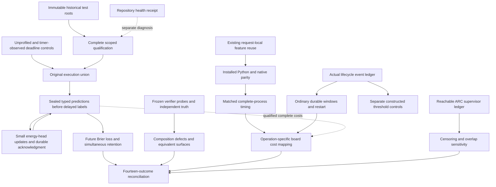
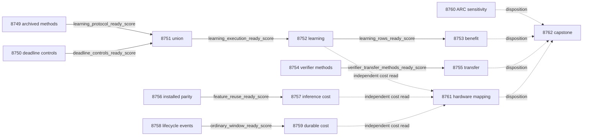

# Carnot Research Roadmap V750: Qualified Learning, Verifier Representation, and Durable Costs

**Created:** 2026-11-02
**Milestone:** 2026.11.750
**Status:** Staged plan; execution and activation are separate
**Supersedes:** V749 after all twelve scheduling slots ended
**Historical authority:** [Complete V749 design](research-roadmap-v749-preserved-20261102.md)
**Execution queue:** [research-roadmap-next.yaml](../../research-roadmap-next.yaml)
**Contract:** Exactly 14 tasks, Exp8749 through Exp8762, in four phases

## What V749 proved

Seven producers ran. Five studies were skipped. A conductor OK records task
completion; it does not certify the scientific result. The completed-history
YAML currently ends at V748. V749's primary artifacts, raw logs and conductor
entries establish its dispositions without inventing an archive entry.

| Evidence | Observation | Consequence |
|---|---|---|
| Exp8737 | Contract, exclusion and method-input checks passed; owned validation failed | Its learning and verifier method gates are zero |
| Exp8737 child 5 | Twenty historical V748 tests failed with `V748 JSON contract missing` after reading mutable vNEXT | Isolate historical test authority from the current milestone |
| Exp8738 | An instrumented child died with signal 11 during authentication; original deadline controls did not finish | The original 300-second timeout cause remains unknown |
| Exp8739–8742 | Execution union, causal learning, benefit audit and verifier transfer skipped | None supplies a scientific null or positive result |
| Exp8743 | Original122-node union, feature ownership and installed parity passed; short full-suite diagnostic failed | Implementation exists, but the primary remains disqualified |
| Exp8744 | Feature-reuse timing skipped | The optimization has no qualified speed result |
| Exp8745 | Authenticated original middle window contained zero dense renormalization writes | The proposed event was absent; its cost study did not run |
| Exp8746 | Qualified reader found zero new supervisor events | No new ARC efficacy or level credit |
| Exp8747/8748 | Cost mapping and accounting retained missing science and failed owned qualification | No new physical acceleration or scientific learning result |

The last qualified batching result remains Exp8717: **1.1382x**, CI95
[1.1218,1.1601]. Same-batch B16 native/Python remains **1.0054x**, CI95
[0.9981,1.0139]. Exp8729's equal-call constructed verifier gain remains0.0667,
CI95 [0.0333,0.1000], with oracle dependence. These are historical results.
V750 does not rehabilitate disqualified primaries or relabel skipped studies.

## Three biggest gaps against the PRD

1. **FR-11: useful continuous self-learning.** The fixed causal study still
   lacks qualified execution. Isolate historical authority, diagnose the
   deadline observer independently, then measure future proper loss and
   retention. Parameter updates alone cannot establish benefit.
2. **FR-12: trustworthy verification beyond its design assumptions.** Planted
   defect detection can share the verifier's assumptions. Test new composition
   defects, valid alternatives, and equivalent entity/premise representations.
   Natural extraction and oracle-distinct generalization remain open.
3. **FR-05/FR-08/NFR-01: useful complete costs.** Numerical parity is ahead of
   complete-service speed. Qualify the existing feature-reuse implementation.
   Measure matched installed inference and ordinary durable windows. Keep
   constructed renormalization tests separate from natural trajectories.

## Research informing the milestone

The [V750 scan](../../research-references.md#v750-planning-scan--2026-11-02)
was filed before this design. It covers all eight primary topics and all six
secondary channels. New source methods are adapted, not claimed as reproduced.

| Source | Adopted test or boundary | Tasks |
|---|---|---|
| [Verify to Amplify v5](https://arxiv.org/abs/2603.03538v5), September 9 | Preserve false acceptance, false rejection and abstention under delayed feedback | Exp8752/8753 |
| [Solver-Hard Is Not Model-Hard](https://arxiv.org/abs/2607.17047), July 19 | Pair the same relational world with truth-preserving renaming and premise order | Exp8754/8755 |
| [VerifierBench](https://arxiv.org/abs/2610.28679), October 19 | Test correct alternatives and restrictive all-reject verifiers | Exp8754/8755 |
| [KAN sample efficiency](https://arxiv.org/abs/2610.10627), October 7 | Report loss versus released labels as a secondary learning curve | Exp8752/8753 |
| [On-chip KAN learning v4](https://arxiv.org/abs/2602.02056v4), June 19 | Qualify actual sparse, restart and dense-update events before complete cost claims | Exp8758/8759/8761 |
| [Ising portability review](https://arxiv.org/abs/2610.03972); [Extropic Z1T](https://extropic.ai/writing/z1t) | Separate supported device operations from host work and complete cost | Exp8761 |

Semantic Scholar returned 20 EBT citations with another page available and10
ARM–EBM citations without another page. Primary papers were checked for the
selected leads. This improves retrieval coverage, not Carnot's measured results.
The OpenReview recurrent-EBM page challenged access. GitHub Trending supplied
an old snapshot; its ranks are not current evidence. The KAN author repository
was checked directly. Kona's page supplied no reproducible new local mechanism.

A matched-prompt constrained-decoding study and distributional learned verifier
remain filed alternatives. The former needs changed CUDA evidence; the latter
would open a new encoder-training branch while the fixed small-head question
remains unresolved. No new generator, GPU canary or hardware purchase is queued.

## Architecture



V750 changes validation ownership and evidence boundaries before more execution.
It preserves the numerical learner, delayed-label protocol, installed public
behavior and live ARC policy. Each branch authenticates its own inputs. A
failed original scoped assertion blocks that branch. Unrelated repository
health stays visible and red where measured; it is not a scientific gate.

## Phase 1 — Qualify execution without mutable historical inputs

### Exp8749: Archive-bound contract and historical validation

Bind all fourteen full task objects and the exact digest below. Reproduce
Exp8737 child 5, then supply historical V748 test dependencies from a private,
immutable archived root. Preserve assertions, fixed digests, mutation rejection
and original production readers. Prove V750 in vNEXT cannot change V748 tests.

New V750 wrappers require all scoped tests, consumer checks, real coverage and
E2Es. They record the failed global health diagnostic separately, as existing
specifications require. Do not modify shared validators or old primaries. A
negative owned-test control must still zero readiness. This is a correction
of validation scope, not a claim that the whole repository passes.

### Exp8750: Observer-controlled deadline diagnosis

Run the same original fixture and controls in unprofiled and timer-observed
children, at most420 seconds each. Use faulthandler and parent observations,
not recursive profile callbacks inside authentication. Retain signal, setup,
authentication, case and publication evidence. The shipped PYTHONPATH repair
is reused. One local correction is allowed only after a measured cause.

The original 3599/3600/3601 numerical-deadline checks must finish normally.
Unknown cause is a terminal diagnostic null with readiness0. No repeated
blind timeout is authorized. Diagnostic work plus one correction is bounded
at 1800 seconds, leaving time for original tests and E2E-020.

### Exp8751: Complete original execution union

After both method and deadline gates pass, require 64 original nodes,27 runner
nodes and83 executable anchors, plus all new statements. Reuse passed core
children only under exact source/test/fixture/configuration identity. Rerun
invalidated cohorts. Preserve killed-child rejection and real hard-exit/resume.
Fixture-aware partitions bound work without weakening the required union.

## Phase 2 — Measure causal learning and representation-sensitive verification

### Exp8752: Continuous typed-decision learning

Run the unchanged nine-input 109-coefficient head. Four arms are frozen,
log-loss, Brier and shuffled feedback. Five seeds are17/29/43/71/101. Five
blocks contain20 question groups with three siblings each:6000 predictions
from 100 independent question groups. Capacity8, rate0.01 and L2=0.001 stay fixed.

Seal probabilities and decisions before feedback. Apply real updates with
atomic acknowledgment. Shuffling uses only released feedback; retention labels
never train. Record complete costs, capacity, admission, realized delay and
both error types. Report released-label learning curves as secondary results.
A fixed-workload budget projection plus25 percent reserve must fit 3000 seconds.
This advances the continuous self-learning and calibrated-decision floors.

### Exp8753: Future benefit and simultaneous retention

Average siblings and seeds within question groups. Use the original 10000
paired cluster draws on80 later groups. Both simultaneous97.5 percent Brier
improvement lower bounds must exceed zero against frozen and log-loss controls.
Typed-decision loss must not increase. Across50 retention questions and five
windows, the joint upper95 bound on maximum Brier increase must be at most0.01.
A valid null closes the unchanged study; missing rows are blocked.

### Exp8754: Independent verifier methods and surface controls

Qualify retained V749 methods independently of its failed contract primary.
Keep 60 worlds, six verifier variants, two five-call schedules and30 evaluation
worlds. Independently enumerate truth. Freeze the shared-variable-join and
missing-premise defect families outside probe design. Preserve any prior data
exposure; a new method receipt cannot make inspected data blind again.

Add one fixed bijective entity renaming and premise-order permutation per
world. Truth must stay identical. Freeze720 canonical rows/3600 calls and a
separate 720 transformed rows/3600 calls. Transforms do not increase independent
sample size. This is the focused SOTA method-ingestion experiment.

### Exp8755: Composition transfer and equivalent representations

Execute both panels. Primary transfer uses only canonical evaluation worlds:
150 defective units per arm, including60 new-family units. The new-family
paired world-cluster lower95 detection-gain bound must exceed zero, with no
extra false rejection of correct verifiers. Use 10000 cluster draws.

Report transformed/canonical disagreements separately. Representation invariance
requires unchanged truth and zero decision changes on correct-verifier controls.
Do not select a favorable spelling or alter the primary estimand. Timing
repeats do not increase N. Equal calls do not establish equal wall time.
Oracle-dependent gains remain circular; this is not natural LLM extraction.

## Phase 3 — Qualify existing optimizations and measure honest cost boundaries

### Exp8756: Installed feature-reuse qualification

Reuse the shipped request-local feature vector implementation. Build and load
an actual private wheel/extension. Require every original 122 node, all new
statements, original rejection controls and installed Python/native parity at
batch sizes 1/4/16. Test one extraction for both scoring and digesting.

The old primary stays disqualified. A new scoped qualification records the
failed short full-suite diagnostic separately. Deliberately failing an owned
node must still block readiness. Preserve defaults and historical import tests.

### Exp8757: Complete installed feature-reuse costs

Keep B16 and Python/native by original/reuse by ten paired repeats:40 process
cells, each 16 panels of64 requests. Measure parent startup through shutdown;
report steady p95 separately. Instrumentation is disabled in primary timing.

Native reuse/original throughput lower95 must exceed1.05, with p95 at most50 ms
and no greater than 5 percent p95 regression. NFR-01 compares optimized native
against optimized Python: lower95 must reach10 for a10x claim. Bootstrap10000
paired process-repeat blocks. Durability is outside this inference boundary.
The fixed workload plus reserve must fit 2700 seconds before launch.

### Exp8758: Actual lifecycle events and distinct threshold controls

Recompute dense-write events and fixed-point decay from the original 4096-update
trace. Qualify32-update windows at offsets 0/2032/4064. Keep restart after 2048.
A window without renormalization is named ordinary/restart-only;2048 is not an
implicit dense-update trigger.

Separately test below/at/above threshold states using the existing numerical
controls. These are explicitly constructed boundary fixtures. They cannot
supply natural event frequency or enter ordinary-window timing. Qualify actual
installed Python, stateless native and resident native states before costs.

### Exp8759: Ordinary durable windows and restart costs

After ordinary-window qualification, run three windows by three arms by ten
paired repeats:90 processes and2880 durable updates. Keep file fsync, atomic
replacement, directory fsync and acknowledgment on a persistent filesystem.
Show prefix/state preparation costs. Complete window totals include setup,
state import, restart where applicable and shutdown; update-only timing is
separate. The fixed panel plus25 percent reserve must fit 3000 seconds.

Use 10000 paired repeat-block draws across all windows and arms. Bounded benefit
requires resident/stateless-native throughput lower95 above 1.05 and no greater
than 5 percent p95 regression. This cannot establish uninterrupted full-run
throughput, natural renormalization cost, useful learning or FPGA acceleration.
The old122880-update budget failure stays intact.

## Phase 4 — Test evidence limits and reconcile outcomes

### Exp8760: Cross-game censoring and overlap sensitivity

Use Exp8746's qualified frontier reader. Read new live evidence once, without
replaying closed games. The new task is an independent sensitivity test on
private ledger copies: remove games, censor at 30/60/90 actions, or remove an
arm's outcome. Retain selected/applied events, reset causes and unknown results.

Keep the full intended roster when outcomes are masked. Bound each missing
binary progress outcome in [0,1]; never drop it from the denominator. Compare
the frozen reducer to this independent interval reconstruction. Deleting
support must not manufacture an identifiable benefit. Fewer than three shared
games or five firings per shared arm cell suppresses a generalization claim.
These floors are admission conditions, not a broad-transfer certificate.
No new action, policy change, hidden-source access or solve is authorized.
This qualifies a generalization method and satisfies the standing ARC floor.

### Exp8761: Operation-specific costs for all three boards

Independently admit causal learning, installed inference and ordinary-window
costs. Map operations to KV260, PolarFire and GateMate without mixing clock
boundaries. Keep mapping readiness separate from actual physical execution.

KV260 retains quadratic evaluation with k_max<=5. PolarFire retains Linux CPU
dispatch. GateMate retains the0xffffffff physical/JTAG blocker until a dated
physical change and valid IDCODE. Host features, durability and unknown transfers
stay outside fabric speed claims. Ideal10x/100x require compatible fractions
at least 0.9/0.99 before transfer overhead. No board probe or purchase is queued.

### Exp8762: Unconditional capstone

Account for all fourteen slots, including skips and the capstone. Recompute
admitted scientific and cost claims from rows. Preserve old results and
quarantines. Compare exact prior scopes/verdicts before recommending retirement.
Missing external evidence is blocked, not partial. Emit unchanged G1–G4,
paper_ready and unmet_gates; historical FoVer readiness does not certify V750.

## Dependency graph and exact gate fields



Seven solid edges are structured YAML gates requiring numeric 1. Each field is
spelled identically in the upstream REQUIRED ARTIFACT FIELDS. All gate producers
occur earlier in this roadmap. Dotted lines are independent evidence reads,
not conjunctive conductor gates. Method, installed, lifecycle and ARC branches
do not wait for learning success. The capstone always runs.

## Hardware requirements and model policy

| Resource | Use | Evidence boundary |
|---|---|---|
| CPU, RAM, Python venv, Rust/PyO3 | All fourteen tasks, numerical training, installed extension and readers | CPU experiments are declared accurately |
| Persistent local filesystem | Sealed evidence, per-feedback durability and restart | No volatile substitute or batched acknowledgment |
| Two RTX 3090 GPUs in inventory | No V750 model task | No current causal CUDA-repair receipt was supplied |
| KV260 | Operation mapping; future quadratic acceleration | SSH/scp/xmutil; k_max<=5; no new device measurement |
| PolarFire | Operation mapping | Linux CPU dispatch is not fabric execution |
| GateMate | Operation mapping and physical blocker | Require dated physical change and valid IDCODE before another probe |
| TSU/NPU/large FPGA wishlist | Future interface and acquisition decisions | No purchase, availability or SDK readiness assumed |

All queued tasks declare `MODEL_SPECS=[]` and `no_model_load`. They perform
numerical training, cached-verifier tests or evidence reduction. An agent
backend used to implement a task is not its experimental inference substrate.
The user's model mandate remains **unsloth/Qwen3.8-27B-GGUF** for every future
LLM experiment. Model load with small fixed output uses
`model_bounded_generation` (10s); load/embedding-only uses
`model_load_no_generation` (2s); real full generation uses
`model_full_generation` (60s). Never pad durations. Legacy small models may
serve CPU smoke tests only. No headline model substitution is authorized.

Another unchanged CUDA canary would repeat a retired prerequisite inspection.
Reopening requires a causal, hash-bound library/environment change and actual
runtime qualification. Inventory and paper publication are insufficient.

## Execution budget and routing

| Phase | Tasks | Estimated minutes |
|---|---|---:|
| Execution qualification | Exp8749–8751 | 150 |
| Learning and verifier measurements | Exp8752–8755 | 180 |
| Installed and durable costs | Exp8756–8759 | 195 |
| Evidence limits and reconciliation | Exp8760–8762 | 90 |

Serial estimate:615 minutes before gate skips. These are planning estimates,
not measurements. No task exceeds60 estimated minutes. Fixed measurement
budgets reserve validation time within the4800-second hard cap.

Every prompt has a numbered progress step: flushed phase boundaries, before
and after long calls, inner-loop and parent heartbeats at most60 seconds apart,
and gaps below 600 seconds. Poll tools within 60 seconds. Files over about200
lines must be written across multiple calls with progress between them.

Four qualification/infrastructure tasks use Claude Opus with 100 turns:
Exp8749/8750/8751/8756. Formulaic verifier/lifecycle implementation uses Codex
gpt-6.1-sol in Exp8754/8758. Other tasks use default Claude Sonnet, at most50
turns; bounded readers use 20–30. This follows the user's routing policy.
No Luna or Gemini task is queued. No planning subagent is required to execute
these future conductor settings.

## Acceptance, retirement and verification

Each phase uses an existing prototype, explicit empirical criteria and
adversarial checks before any scaling. New code starts with REQ-* requirements
and failing tests. Require all scoped nodes, real100 percent new-statement
coverage, lint, strict types, spec tracing and the named E2Es. Keep shared
validators and original assertions intact. Preserve red repository diagnostics
separately; a passing scoped receipt is not a full-suite pass.

All comparative tasks set `per_unit_rows: true`. Each prompt declares the
closed verdict class, exact blocked-gate diagnostics, oracle status, source
hashes and real invocation clocks. Failed owned execution disqualifies;
missing external inputs block. Scientific nulls are terminal. `partial` is
reserved for unfinished owned work a retry can actually complete.

Prior-failure entries contain all four required fields, including
`retire_if_same_verdict: true`. Changed mechanisms are concrete: immutable
historical fixtures, non-invasive observer controls, independently qualified
methods, equivalent surfaces, and correctly named ordinary windows. No retired
ID or retired gate upstream is reused. The ARC task tests censoring sensitivity;
it does not repeat the retired empty-frontier experiment as its deliverable.
Hardware mapping does not repeat unchanged physical probes.

Relevant runtime E2Es are E2E-020 for learning; E2E-003/004 for native and
lifecycle work; E2E-017/023 for ARC readers; and private E2E-018/021 for authority
and replay. Planning runs existing schema/gate/retirement unit tests and private
E2E-018/021. No research execution or physical/model measurement is claimed by
this documentation change. Validation outcomes are recorded below.

## Exact task contract

Exactly **14 tasks, Exp8749 through Exp8762**, execute in this order.
The complete JSON contract below binds every task field, including prompts,
routing and failure lineage. Canonicalization is UTF-8 JSON of the tasks list,
sorted keys, compact separators and ensure_ascii=false.

| Order | Task | Title | Phase | Deliverable |
|---|---|---|---|---|
| 1 | `exp8749-archive-bound-contract` | Bind fourteen tasks and isolate historical authority from the moving roadmap | 1 | `results/experiment_8749_v750_archive_bound_contract.json` |
| 2 | `exp8750-deadline-observer-control` | Separate observer failure from original deadline work with bounded controls | 1 | `results/experiment_8750_v750_deadline_observer_control.json` |
| 3 | `exp8751-learning-union` | Qualify the complete original learning union under archived authority | 1 | `results/experiment_8751_v750_learning_union.json` |
| 4 | `exp8752-causal-brier-stream` | Measure continuous typed-decision learning with sealed delayed feedback | 2 | `results/experiment_8752_v750_causal_brier_stream.json` |
| 5 | `exp8753-learning-benefit-audit` | Audit future proper loss asymmetric errors and simultaneous retention | 2 | `results/experiment_8753_v750_learning_benefit_audit.json` |
| 6 | `exp8754-verifier-surface-methods` | Qualify frozen verifier transfer methods and truth-preserving surface controls | 2 | `results/experiment_8754_v750_verifier_surface_methods.json` |
| 7 | `exp8755-verifier-family-surface` | Measure composition-defect transfer and equivalent-surface robustness at equal probe budgets | 2 | `results/experiment_8755_v750_verifier_family_surface.json` |
| 8 | `exp8756-feature-reuse-qualification` | Qualify installed request-local feature reuse with complete scoped evidence | 3 | `results/experiment_8756_v750_feature_reuse_qualification.json` |
| 9 | `exp8757-feature-reuse-cost` | Measure matched complete installed costs after feature reuse qualification | 3 | `results/experiment_8757_v750_feature_reuse_cost.json` |
| 10 | `exp8758-lifecycle-event-qualification` | Qualify actual sparse lifecycle events before durable timing | 3 | `results/experiment_8758_v750_lifecycle_event_qualification.json` |
| 11 | `exp8759-ordinary-durable-cost` | Measure ordinary durable windows and restart at matched complete costs | 3 | `results/experiment_8759_v750_ordinary_durable_cost.json` |
| 12 | `exp8760-arc-horizon-sensitivity` | Test cross-game supervisor conclusions against censoring and incomplete overlap | 4 | `results/experiment_8760_v750_arc_horizon_sensitivity.json` |
| 13 | `exp8761-hardware-cost-boundaries` | Map qualified learning and ordinary-window costs to each FPGA operation | 4 | `results/experiment_8761_v750_hardware_cost_boundaries.json` |
| 14 | `exp8762-capstone` | Reconcile fourteen outcomes and close unchanged scientific and execution scopes | 4 | `results/experiment_8762_v750_capstone.json` |

Canonical full-task SHA-256: `9630ae14f5291cd2fc7a09f110e823b473cdbaf10ead05148f9ea1fb0d0372b6`

<!-- V750_TASK_CONTRACT_START -->
```json
{
  "milestone": "2026.11.750",
  "tasks": [
    {"id": "exp8749-archive-bound-contract", "title": "Bind fourteen tasks and isolate historical authority from the moving roadmap", "phase": 1, "track": "infrastructure", "priority": "high", "requires_gpu": false, "max_turns": 100, "estimated_wall_time_min": 45, "per_unit_rows": true, "milestone": "2026.11.750", "deliverable": "results/experiment_8749_v750_archive_bound_contract.json", "inference_substrate_class": "no_model_load", "MODEL_SPECS": [], "gated_on": [], "agent_type": "claude", "model": "opus", "prior_failures": [{"experiment_id": "exp7532-v659-contract-methods", "verdict": "complete_blocked_incomplete_v659_authorities", "addressed_by": "Exp8737 child5 identifies mutable vNEXT as the concrete historical-fixture defect. Use immutable V748 fixture roots and current V750 wrappers with complete scoped validation; retain separate red repository-health evidence and old disqualified primaries.", "retire_if_same_verdict": true}, {"experiment_id": "exp7713-v672-contract-methods", "verdict": "complete_blocked_v672_independent_contract", "addressed_by": "Exp8737 child5 identifies mutable vNEXT as the concrete historical-fixture defect. Use immutable V748 fixture roots and current V750 wrappers with complete scoped validation; retain separate red repository-health evidence and old disqualified primaries.", "retire_if_same_verdict": true}, {"experiment_id": "exp7940-v689-contract-methods", "verdict": "complete_blocked_authority", "addressed_by": "Exp8737 child5 identifies mutable vNEXT as the concrete historical-fixture defect. Use immutable V748 fixture roots and current V750 wrappers with complete scoped validation; retain separate red repository-health evidence and old disqualified primaries.", "retire_if_same_verdict": true}, {"experiment_id": "exp7992-v693-contract-methods", "verdict": "complete_blocked_authority", "addressed_by": "Exp8737 child5 identifies mutable vNEXT as the concrete historical-fixture defect. Use immutable V748 fixture roots and current V750 wrappers with complete scoped validation; retain separate red repository-health evidence and old disqualified primaries.", "retire_if_same_verdict": true}, {"experiment_id": "exp8018-v695-contract-methods", "verdict": "complete_blocked_authority", "addressed_by": "Exp8737 child5 identifies mutable vNEXT as the concrete historical-fixture defect. Use immutable V748 fixture roots and current V750 wrappers with complete scoped validation; retain separate red repository-health evidence and old disqualified primaries.", "retire_if_same_verdict": true}, {"experiment_id": "exp8374-v722-contract-methods", "verdict": "complete_blocked_direct_contract_methods", "addressed_by": "Exp8737 child5 identifies mutable vNEXT as the concrete historical-fixture defect. Use immutable V748 fixture roots and current V750 wrappers with complete scoped validation; retain separate red repository-health evidence and old disqualified primaries.", "retire_if_same_verdict": true}, {"experiment_id": "exp8388-v723-contract-methods", "verdict": "complete_blocked_v723_contract_methods", "addressed_by": "Exp8737 child5 identifies mutable vNEXT as the concrete historical-fixture defect. Use immutable V748 fixture roots and current V750 wrappers with complete scoped validation; retain separate red repository-health evidence and old disqualified primaries.", "retire_if_same_verdict": true}, {"experiment_id": "exp8416-v725-contract-methods", "verdict": "complete_blocked_v725_contract_methods", "addressed_by": "Exp8737 child5 identifies mutable vNEXT as the concrete historical-fixture defect. Use immutable V748 fixture roots and current V750 wrappers with complete scoped validation; retain separate red repository-health evidence and old disqualified primaries.", "retire_if_same_verdict": true}, {"experiment_id": "exp8443-v727-contract-methods", "verdict": "complete_blocked_v727_contract_methods", "addressed_by": "Exp8737 child5 identifies mutable vNEXT as the concrete historical-fixture defect. Use immutable V748 fixture roots and current V750 wrappers with complete scoped validation; retain separate red repository-health evidence and old disqualified primaries.", "retire_if_same_verdict": true}, {"experiment_id": "exp8471-v729-contract-methods", "verdict": "complete_blocked_v729_contract_methods", "addressed_by": "Exp8737 child5 identifies mutable vNEXT as the concrete historical-fixture defect. Use immutable V748 fixture roots and current V750 wrappers with complete scoped validation; retain separate red repository-health evidence and old disqualified primaries.", "retire_if_same_verdict": true}, {"experiment_id": "exp8499-v731-contract-methods", "verdict": "complete_blocked_v731_contract_methods", "addressed_by": "Exp8737 child5 identifies mutable vNEXT as the concrete historical-fixture defect. Use immutable V748 fixture roots and current V750 wrappers with complete scoped validation; retain separate red repository-health evidence and old disqualified primaries.", "retire_if_same_verdict": true}, {"experiment_id": "exp8565-v736-contract-methods", "verdict": "complete_blocked_v736_contract_methods", "addressed_by": "Exp8737 child5 identifies mutable vNEXT as the concrete historical-fixture defect. Use immutable V748 fixture roots and current V750 wrappers with complete scoped validation; retain separate red repository-health evidence and old disqualified primaries.", "retire_if_same_verdict": true}, {"experiment_id": "exp8602-v739-contract-methods", "verdict": "complete_blocked_v739_contract_methods", "addressed_by": "Exp8737 child5 identifies mutable vNEXT as the concrete historical-fixture defect. Use immutable V748 fixture roots and current V750 wrappers with complete scoped validation; retain separate red repository-health evidence and old disqualified primaries.", "retire_if_same_verdict": true}, {"experiment_id": "exp8667-contract-methods", "verdict": "complete_disqualified_v744_contract_methods", "addressed_by": "Exp8737 child5 identifies mutable vNEXT as the concrete historical-fixture defect. Use immutable V748 fixture roots and current V750 wrappers with complete scoped validation; retain separate red repository-health evidence and old disqualified primaries.", "retire_if_same_verdict": true}, {"experiment_id": "exp8681-contract-methods", "verdict": "complete_disqualified_v745_contract_methods", "addressed_by": "Exp8737 child5 identifies mutable vNEXT as the concrete historical-fixture defect. Use immutable V748 fixture roots and current V750 wrappers with complete scoped validation; retain separate red repository-health evidence and old disqualified primaries.", "retire_if_same_verdict": true}, {"experiment_id": "exp8709-contract-methods", "verdict": "complete_disqualified_v747_contract_methods", "addressed_by": "Exp8737 child5 identifies mutable vNEXT as the concrete historical-fixture defect. Use immutable V748 fixture roots and current V750 wrappers with complete scoped validation; retain separate red repository-health evidence and old disqualified primaries.", "retire_if_same_verdict": true}, {"experiment_id": "exp8737-contract-methods", "verdict": "complete_disqualified_v749_contract_methods", "addressed_by": "Exp8737 child5 identifies mutable vNEXT as the concrete historical-fixture defect. Use immutable V748 fixture roots and current V750 wrappers with complete scoped validation; retain separate red repository-health evidence and old disqualified primaries.", "retire_if_same_verdict": true}], "prompt": "CONTEXT:\nWork in {project_root} on {date}. V749 ended seven producers and five skipped studies. No new scientific learning, verifier-transfer or cost result qualified. Exp8737 child 5 failed because historical V748 tests read mutable vNEXT. Several producers incorrectly required a short, incomplete full-suite diagnostic to pass. Exp8738 signal 11 occurred under profiling; the original timeout cause is unresolved. Exp8743 passed scoped parity but is disqualified. Exp8745 found zero dense writes in its assumed renormalization window. Keep those primary bytes and quarantines unchanged. V750 has exactly fourteen tasks, Exp8749 through Exp8762.\n\nEXISTING CODE TO READ FIRST:\nCLAUDE.md; CODEX.md; ops/e2e-test-plan.md; ops/exclusion_manifest.yaml; openspec/capabilities/research-reporting/spec.md; openspec/capabilities/verification/spec.md; scripts/experiment_template.py; python/carnot/reporting/primary_publication.py; openspec/change-proposals/research-roadmap-vNEXT.md; openspec/change-proposals/research-roadmap-v749-preserved-20261102.md; research-references.md; python/carnot/reporting/roadmap_contract.py; python/carnot/reporting/v748_collection_contract.py; python/carnot/reporting/v749_contract_runner.py; tests/python/test_v748_contract_8723.py; tests/python/test_v749_contract_methods_8737.py; results/experiment_8737_v749_contract_methods.json; openspec/change-proposals/research-roadmap-v748-preserved-20261102.md; openspec/change-proposals/v744-methods-protocol.json\n\nTASK:\nBind fourteen tasks and isolate historical authority from the moving roadmap. Deliver results/experiment_8749_v750_archive_bound_contract.json. Use thin runner scripts/experiments/experiment_8749_v750_archive_bound_contract.py, raw evidence results/raw/experiment_8749_v750_archive_bound_contract/ and notes docs/research-notes/v750-archive-bound-contract.md. This task needs no LLM. A new model need is a changed prerequisite, not permission to substitute a model.\n\nCONCRETE STEPS:\n1. Print a flushed progress line at each phase boundary and before and after every model load, generation, benchmark or subprocess that can take minutes. Print inner-loop counts and a parent heartbeat at least every 60 seconds during long calls. Keep every silence gap below 600 seconds. Poll long processes in tool calls of at most 60 seconds. Write any file over about 200 lines in several tool calls, with a progress message between calls. Do not compose a huge file in one tool call. Silence can end a task at 1200 seconds despite the 4800-second hard cap.\n2. Read the listed sources and check failure lineage. Confirm the task REQ-* and SCENARIO-* requirements before implementation. Write failing tests first. Freeze source, method, test-node and input hashes before measurement. Reuse existing numerical code and thin runners. Check writable private scratch, required input hashes and local tool availability before launching. External absence is blocked; owned validation failure is disqualified.\n3. Bind the visible fourteen-task table, complete JSON task objects, YAML and independent canonical SHA-256. Compare every task field, including prompts, routing, prior failures and gates. Bind each branch separately; contract readiness is administrative. Preserve V749 and V748 archives byte-for-byte.\n4. Reproduce the Exp8737 child 5 failure using private V748 fixtures and the actual original tests. Supply historical DESIGN/ACTIVE/STAGED dependencies through an isolated archived-root fixture. Keep all original assertions and the fixed V748 digest. Do not point old production readers at V750 or edit historical artifact pins. Prove tests pass with vNEXT containing V750 and reject V748 prompt, gate, route, path and hash mutations.\n5. Use the already specified distinction between scoped qualification and bounded repository health. New V750 wrappers must require all original branch test nodes, real coverage, consumer tests and E2Es. They must not inherit an all(receipts) dependency on an unrelated timed-out full-suite run. Keep its exact failure receipt under repository_health_reference. Preserve shared publishers, validators and old verdicts. Test that a failing OWNED node still zeros readiness while unrelated global health stays separately red.\n6. Freeze unchanged learning methods, partitions and statistical criteria from v744-methods-protocol.json. Freeze a reusable archived-root validation recipe. Release learning_protocol_ready_score only for complete method/source custody. Return per-branch failures separately; verifier and cost tasks authenticate their own inputs. Run private E2E-018/021 and full-object mutation controls.\n7. Run scoped unit and consumer tests, Ruff lint/format, strict mypy, explicit spec coverage and the named applicable E2E checks. Require actual 100 percent coverage of new executable statements, including real CLI children. Preserve original assertions, negative controls and shared validators. Keep tests in private artifact roots. Retain actual argv, exit codes, JUnit, coverage and full log hashes. Record existing repository-wide health separately; do not promote a failed old producer or fabricate a full-suite pass. Publish only terminal bytes after unchanged adversarial_verify.py, verdict_row_consistency_lint.py --strict and fresh-process cold replay. Reconcile OpenSpec, _bmad/traceability.md, ops/status.md and ops/changelog.md. Do not edit active research-roadmap.yaml, ops/exclusion_manifest.yaml, generator weights or the ARC policy.\n\nREQUIRED ARTIFACT FIELDS:\nexperiment_id, task_id, milestone, run_date, invocation_id: principle: Bind evidence to one actual producer.\nhonest_verdict, verdict_class: principle: Use complete_ as the terminal verdict prefix. The closed class is positive | circular_positive | null | blocked | disqualified | partial. Only unfinished owned work that a retry can finish is partial. Missing or retired external inputs are blocked.\ngate_check_summary: principle: Every blocked result names upstream, path/hash, failed check, field, operator, expected and observed value. Distinguish missing file, missing field, observed zero and rejected producer.\ninference_substrate, inference_substrate_class, MODEL_SPECS, model_invocation_counts: principle: These tasks use no_model_load, MODEL_SPECS=[] and zero LLM calls. Use aggregation_from_upstream_artifacts or verifier_ensemble_against_cached_candidates as actually performed. Record numerical training separately.\nrows, intended_count, completed_count, failed_count, censored_count, excluded_count, independent_count: principle: Keep every intended unit, arm, raw metric and denominator. Seeds, siblings, representations and timing repeats do not multiply independent cases.\nverifier_is_oracle, exposure_scope, independent_generalization_score: principle: Oracle-dependent positives are circular_positive. Constructed or exposed data do not establish natural or hidden-game generalization.\nacceptance_gates, required_checks_passed, flagged_adversarial, validation_receipts, terminal_validation_sidecar_path: principle: Failed execution checks suppress readiness. A scientific null can be a completed valid measurement. Keep scientific promotion criteria separate from execution acceptance.\npreconditions_checked, started_at_utc, ended_at_utc, duration_s, phase_spans, random_seed, reproducibility_checksum: principle: Record resources, real current-invocation clocks and reproducible inputs. Do not reuse old monotonic epochs or pad duration floors.\nsource_artifact_hashes, code_config_hashes, raw_shard_hashes, cited_upstream_artifacts, field_principles: principle: Bind imported fields and derived results to exact source bytes.\nrepository_health_reference, scoped_validation_scope: principle: A separate historical bounded health diagnostic neither proves a full-suite pass nor overrides complete required scoped tests.\ncontract_ready_score, learning_protocol_ready_score, archived_authority_ready_score, full_task_objects, canonical_tasks_sha256, historical_fixture_rows, owned_failure_controls, branch_method_references: principle: Versioned authority must survive a new roadmap without weakening any original check.\n\nRun command: cd {project_root} && JAX_PLATFORMS=cpu PYTHONPATH=python:. PYTHONUNBUFFERED=1 .venv/bin/python -u scripts/experiments/experiment_8749_v750_archive_bound_contract.py --date {date}\n\nDo NOT push. Do NOT modify scripts/research_conductor.py.\n"},
    {"id": "exp8750-deadline-observer-control", "title": "Separate observer failure from original deadline work with bounded controls", "phase": 1, "track": "infrastructure", "priority": "high", "requires_gpu": false, "max_turns": 100, "estimated_wall_time_min": 50, "per_unit_rows": true, "milestone": "2026.11.750", "deliverable": "results/experiment_8750_v750_deadline_observer_control.json", "inference_substrate_class": "no_model_load", "MODEL_SPECS": [], "gated_on": [], "agent_type": "claude", "model": "opus", "prior_failures": [{"experiment_id": "exp8654-learning-core-execution", "verdict": "complete_disqualified_v743_learning_core_execution", "addressed_by": "Replace the signal11 profile observer with an unprofiled control and timer-based stack observations. Preserve the original timeout as unresolved; one measured-cause correction is allowed, and no further repeat occurs without normal original deadline controls.", "retire_if_same_verdict": true}, {"experiment_id": "exp8641-learning-execution-custody", "verdict": "complete_disqualified_v742_learning_execution_custody", "addressed_by": "Replace the signal11 profile observer with an unprofiled control and timer-based stack observations. Preserve the original timeout as unresolved; one measured-cause correction is allowed, and no further repeat occurs without normal original deadline controls.", "retire_if_same_verdict": true}, {"experiment_id": "exp8668-frozen-learning-core", "verdict": "blocked_gate_check_failed", "addressed_by": "Replace the signal11 profile observer with an unprofiled control and timer-based stack observations. Preserve the original timeout as unresolved; one measured-cause correction is allowed, and no further repeat occurs without normal original deadline controls.", "retire_if_same_verdict": true}, {"experiment_id": "exp8682-frozen-learning-core", "verdict": "blocked_gate_check_failed", "addressed_by": "Replace the signal11 profile observer with an unprofiled control and timer-based stack observations. Preserve the original timeout as unresolved; one measured-cause correction is allowed, and no further repeat occurs without normal original deadline controls.", "retire_if_same_verdict": true}, {"experiment_id": "exp8697-learning-union-qualification", "verdict": "complete_disqualified_v746_learning_union_qualification", "addressed_by": "Replace the signal11 profile observer with an unprofiled control and timer-based stack observations. Preserve the original timeout as unresolved; one measured-cause correction is allowed, and no further repeat occurs without normal original deadline controls.", "retire_if_same_verdict": true}, {"experiment_id": "exp8710-invocation-clock-core", "verdict": "blocked_gate_check_failed", "addressed_by": "Replace the signal11 profile observer with an unprofiled control and timer-based stack observations. Preserve the original timeout as unresolved; one measured-cause correction is allowed, and no further repeat occurs without normal original deadline controls.", "retire_if_same_verdict": true}, {"experiment_id": "exp8724-invocation-clock-core", "verdict": "complete_disqualified_v748_invocation_clock_core", "addressed_by": "Replace the signal11 profile observer with an unprofiled control and timer-based stack observations. Preserve the original timeout as unresolved; one measured-cause correction is allowed, and no further repeat occurs without normal original deadline controls.", "retire_if_same_verdict": true}, {"experiment_id": "exp8738-deadline-cost-diagnosis", "verdict": "complete_disqualified_v749_deadline_cost_diagnosis", "addressed_by": "Replace the signal11 profile observer with an unprofiled control and timer-based stack observations. Preserve the original timeout as unresolved; one measured-cause correction is allowed, and no further repeat occurs without normal original deadline controls.", "retire_if_same_verdict": true}], "prompt": "CONTEXT:\nWork in {project_root} on {date}. V749 ended seven producers and five skipped studies. No new scientific learning, verifier-transfer or cost result qualified. Exp8737 child 5 failed because historical V748 tests read mutable vNEXT. Several producers incorrectly required a short, incomplete full-suite diagnostic to pass. Exp8738 signal 11 occurred under profiling; the original timeout cause is unresolved. Exp8743 passed scoped parity but is disqualified. Exp8745 found zero dense writes in its assumed renormalization window. Keep those primary bytes and quarantines unchanged. V750 has exactly fourteen tasks, Exp8749 through Exp8762.\n\nEXISTING CODE TO READ FIRST:\nCLAUDE.md; CODEX.md; ops/e2e-test-plan.md; ops/exclusion_manifest.yaml; openspec/capabilities/research-reporting/spec.md; openspec/capabilities/verification/spec.md; scripts/experiment_template.py; python/carnot/reporting/primary_publication.py; openspec/change-proposals/research-roadmap-vNEXT.md; openspec/change-proposals/research-roadmap-v749-preserved-20261102.md; research-references.md; python/carnot/reporting/deadline_cost_8738.py; python/carnot/reporting/deadline_edge_8603.py; python/carnot/reporting/deadline_edge_validation_8603.py; python/carnot/reporting/invocation_clock_core_8724.py; tests/python/test_deadline_cost_8738.py; tests/python/test_deadline_edge_8603.py; results/experiment_8738_v749_deadline_cost_diagnosis.json; results/experiment_8724_v748_invocation_clock_core.json\n\nTASK:\nSeparate observer failure from original deadline work with bounded controls. Deliver results/experiment_8750_v750_deadline_observer_control.json. Use thin runner scripts/experiments/experiment_8750_v750_deadline_observer_control.py, raw evidence results/raw/experiment_8750_v750_deadline_observer_control/ and notes docs/research-notes/v750-deadline-observer-control.md. This task needs no LLM. A new model need is a changed prerequisite, not permission to substitute a model.\n\nCONCRETE STEPS:\n1. Print a flushed progress line at each phase boundary and before and after every model load, generation, benchmark or subprocess that can take minutes. Print inner-loop counts and a parent heartbeat at least every 60 seconds during long calls. Keep every silence gap below 600 seconds. Poll long processes in tool calls of at most 60 seconds. Write any file over about 200 lines in several tool calls, with a progress message between calls. Do not compose a huge file in one tool call. Silence can end a task at 1200 seconds despite the 4800-second hard cap.\n2. Read the listed sources and check failure lineage. Confirm the task REQ-* and SCENARIO-* requirements before implementation. Write failing tests first. Freeze source, method, test-node and input hashes before measurement. Reuse existing numerical code and thin runners. Check writable private scratch, required input hashes and local tool availability before launching. External absence is blocked; owned validation failure is disqualified.\n3. Preserve the original 300-second timeout and the later signal 11 as different observations. Do not assert that profiling caused the old timeout. Read the saved signal traceback and current source imports before another run. Verify the shipped external-PYTHONPATH repair rather than recreating it.\n4. Run a matched bounded diagnostic using the same original fixture, nodes and configuration: unprofiled child versus a child with faulthandler timer dumps and parent stage observations. Do not use sys.setprofile, recursive introspection or callbacks inside authentication. Limit each arm to420 seconds, save both streams and sample parent process/resource state every60 seconds. Label fixture setup, source authentication, copy, case execution, publication and replay where observable; unknown spans remain unknown.\n5. If a measured stage identifies repeatable waste, make at most one local fixture/observer correction. Cache only immutable authentication or copies under exact source/configuration identity. Preserve all tamper and killed-child rejection controls. If the original cause is still unresolved, return a terminal null diagnostic with deadline_controls_ready_score=0 and do not rerun the same timeout again.\n6. After a justified correction, require all unchanged3599/3600/3601 numerical-deadline cases and normal process exits. Do not wait for real one-hour sleeps or alter numerical deadlines. Run actual E2E-020, private E2E-018/021 and current clock tests. Publish new scoped qualification only; do not rehabilitate Exp8738. Cap diagnostics plus one correction run at 1800 seconds, reserving time for validation.\n7. Run scoped unit and consumer tests, Ruff lint/format, strict mypy, explicit spec coverage and the named applicable E2E checks. Require actual 100 percent coverage of new executable statements, including real CLI children. Preserve original assertions, negative controls and shared validators. Keep tests in private artifact roots. Retain actual argv, exit codes, JUnit, coverage and full log hashes. Record existing repository-wide health separately; do not promote a failed old producer or fabricate a full-suite pass. Publish only terminal bytes after unchanged adversarial_verify.py, verdict_row_consistency_lint.py --strict and fresh-process cold replay. Reconcile OpenSpec, _bmad/traceability.md, ops/status.md and ops/changelog.md. Do not edit active research-roadmap.yaml, ops/exclusion_manifest.yaml, generator weights or the ARC policy.\n\nREQUIRED ARTIFACT FIELDS:\nexperiment_id, task_id, milestone, run_date, invocation_id: principle: Bind evidence to one actual producer.\nhonest_verdict, verdict_class: principle: Use complete_ as the terminal verdict prefix. The closed class is positive | circular_positive | null | blocked | disqualified | partial. Only unfinished owned work that a retry can finish is partial. Missing or retired external inputs are blocked.\ngate_check_summary: principle: Every blocked result names upstream, path/hash, failed check, field, operator, expected and observed value. Distinguish missing file, missing field, observed zero and rejected producer.\ninference_substrate, inference_substrate_class, MODEL_SPECS, model_invocation_counts: principle: These tasks use no_model_load, MODEL_SPECS=[] and zero LLM calls. Use aggregation_from_upstream_artifacts or verifier_ensemble_against_cached_candidates as actually performed. Record numerical training separately.\nrows, intended_count, completed_count, failed_count, censored_count, excluded_count, independent_count: principle: Keep every intended unit, arm, raw metric and denominator. Seeds, siblings, representations and timing repeats do not multiply independent cases.\nverifier_is_oracle, exposure_scope, independent_generalization_score: principle: Oracle-dependent positives are circular_positive. Constructed or exposed data do not establish natural or hidden-game generalization.\nacceptance_gates, required_checks_passed, flagged_adversarial, validation_receipts, terminal_validation_sidecar_path: principle: Failed execution checks suppress readiness. A scientific null can be a completed valid measurement. Keep scientific promotion criteria separate from execution acceptance.\npreconditions_checked, started_at_utc, ended_at_utc, duration_s, phase_spans, random_seed, reproducibility_checksum: principle: Record resources, real current-invocation clocks and reproducible inputs. Do not reuse old monotonic epochs or pad duration floors.\nsource_artifact_hashes, code_config_hashes, raw_shard_hashes, cited_upstream_artifacts, field_principles: principle: Bind imported fields and derived results to exact source bytes.\nrepository_health_reference, scoped_validation_scope: principle: A separate historical bounded health diagnostic neither proves a full-suite pass nor overrides complete required scoped tests.\ndeadline_controls_ready_score, diagnosed_cause, observer_comparison_rows, original_deadline_rows, child_cleanup_rows, retained_core_manifest, reuse_invalidations: principle: A diagnostic signal is not a causal explanation; only normally completed unchanged controls release learning.\n\nRun command: cd {project_root} && JAX_PLATFORMS=cpu PYTHONPATH=python:. PYTHONUNBUFFERED=1 .venv/bin/python -u scripts/experiments/experiment_8750_v750_deadline_observer_control.py --date {date}\n\nDo NOT push. Do NOT modify scripts/research_conductor.py.\n"},
    {"id": "exp8751-learning-union", "title": "Qualify the complete original learning union under archived authority", "phase": 1, "track": "infrastructure", "priority": "high", "requires_gpu": false, "max_turns": 100, "estimated_wall_time_min": 55, "per_unit_rows": true, "milestone": "2026.11.750", "deliverable": "results/experiment_8751_v750_learning_union.json", "inference_substrate_class": "no_model_load", "MODEL_SPECS": [], "gated_on": [{"upstream": "exp8749-archive-bound-contract", "artifact_field": "learning_protocol_ready_score", "op": "==", "value": 1}, {"upstream": "exp8750-deadline-observer-control", "artifact_field": "deadline_controls_ready_score", "op": "==", "value": 1}], "agent_type": "claude", "model": "opus", "prior_failures": [{"experiment_id": "exp8655-learning-execution-qualification", "verdict": "blocked_gate_check_failed", "addressed_by": "New current prerequisites repair archived test authority and separately qualify the original deadline controls. Preserve64 original nodes,27 runner nodes and83 anchors; run only after those changed prerequisites are ready.", "retire_if_same_verdict": true}, {"experiment_id": "exp8641-learning-execution-custody", "verdict": "complete_disqualified_v742_learning_execution_custody", "addressed_by": "New current prerequisites repair archived test authority and separately qualify the original deadline controls. Preserve64 original nodes,27 runner nodes and83 anchors; run only after those changed prerequisites are ready.", "retire_if_same_verdict": true}, {"experiment_id": "exp8669-learning-union-qualification", "verdict": "GATE_BLOCK", "addressed_by": "New current prerequisites repair archived test authority and separately qualify the original deadline controls. Preserve64 original nodes,27 runner nodes and83 anchors; run only after those changed prerequisites are ready.", "retire_if_same_verdict": true}, {"experiment_id": "exp8683-learning-union-qualification", "verdict": "GATE_BLOCK: Pre-emptive skip: upstream retired (exp8682-frozen-learning-core)", "addressed_by": "New current prerequisites repair archived test authority and separately qualify the original deadline controls. Preserve64 original nodes,27 runner nodes and83 anchors; run only after those changed prerequisites are ready.", "retire_if_same_verdict": true}, {"experiment_id": "exp8697-learning-union-qualification", "verdict": "complete_disqualified_v746_learning_union_qualification", "addressed_by": "New current prerequisites repair archived test authority and separately qualify the original deadline controls. Preserve64 original nodes,27 runner nodes and83 anchors; run only after those changed prerequisites are ready.", "retire_if_same_verdict": true}, {"experiment_id": "exp8725-learning-union", "verdict": "blocked_gate_check_failed", "addressed_by": "New current prerequisites repair archived test authority and separately qualify the original deadline controls. Preserve64 original nodes,27 runner nodes and83 anchors; run only after those changed prerequisites are ready.", "retire_if_same_verdict": true}, {"experiment_id": "exp8739-learning-union", "verdict": "blocked_gate_check_failed", "addressed_by": "New current prerequisites repair archived test authority and separately qualify the original deadline controls. Preserve64 original nodes,27 runner nodes and83 anchors; run only after those changed prerequisites are ready.", "retire_if_same_verdict": true}], "prompt": "CONTEXT:\nWork in {project_root} on {date}. V749 ended seven producers and five skipped studies. No new scientific learning, verifier-transfer or cost result qualified. Exp8737 child 5 failed because historical V748 tests read mutable vNEXT. Several producers incorrectly required a short, incomplete full-suite diagnostic to pass. Exp8738 signal 11 occurred under profiling; the original timeout cause is unresolved. Exp8743 passed scoped parity but is disqualified. Exp8745 found zero dense writes in its assumed renormalization window. Keep those primary bytes and quarantines unchanged. V750 has exactly fourteen tasks, Exp8749 through Exp8762.\n\nEXISTING CODE TO READ FIRST:\nCLAUDE.md; CODEX.md; ops/e2e-test-plan.md; ops/exclusion_manifest.yaml; openspec/capabilities/research-reporting/spec.md; openspec/capabilities/verification/spec.md; scripts/experiment_template.py; python/carnot/reporting/primary_publication.py; openspec/change-proposals/research-roadmap-vNEXT.md; openspec/change-proposals/research-roadmap-v749-preserved-20261102.md; research-references.md; python/carnot/reporting/learning_union_8697.py; python/carnot/reporting/invocation_clock_core_8724.py; python/carnot/reporting/learning_custody_8641.py; openspec/change-proposals/v744-methods-protocol.json; results/experiment_8724_v748_invocation_clock_core.json\n\nTASK:\nQualify the complete original learning union under archived authority. Deliver results/experiment_8751_v750_learning_union.json. Use thin runner scripts/experiments/experiment_8751_v750_learning_union.py, raw evidence results/raw/experiment_8751_v750_learning_union/ and notes docs/research-notes/v750-learning-union.md. This task needs no LLM. A new model need is a changed prerequisite, not permission to substitute a model.\n\nCONCRETE STEPS:\n1. Print a flushed progress line at each phase boundary and before and after every model load, generation, benchmark or subprocess that can take minutes. Print inner-loop counts and a parent heartbeat at least every 60 seconds during long calls. Keep every silence gap below 600 seconds. Poll long processes in tool calls of at most 60 seconds. Write any file over about 200 lines in several tool calls, with a progress message between calls. Do not compose a huge file in one tool call. Silence can end a task at 1200 seconds despite the 4800-second hard cap.\n2. Read the listed sources and check failure lineage. Confirm the task REQ-* and SCENARIO-* requirements before implementation. Write failing tests first. Freeze source, method, test-node and input hashes before measurement. Reuse existing numerical code and thin runners. Check writable private scratch, required input hashes and local tool availability before launching. External absence is blocked; owned validation failure is disqualified.\n3. Admit Exp8749.learning_protocol_ready_score and Exp8750.deadline_controls_ready_score, both exactly 1, with terminal hashes and required scoped qualification. Missing or failed inputs are blocked. Use current invocation clocks; do not import the prior deadline clock origin.\n4. Authenticate the three passed historical core children individually. Reuse only exact source/test/fixture/configuration and coverage identities. Rerun invalidated cohorts. Execute the original 25-node remainder and required27 runner nodes. Require all 64 original nodes and83 original executable anchors plus100 percent of newly owned statements. No primary readiness override follows from a child passing.\n5. Use fixture-aware bounded cohorts and disjoint node lists from the existing collector. Retain original SQLite/JUnit bytes before aggregating copies. Reject missing, duplicate, foreign-source and killed-child shards. Run actual hard exits and resume through E2E-020 plus private E2E-018/021. Freeze the complete qualified runner before learning; stop with exact failed-node evidence if the required union cannot fit within 2400 seconds.\n6. Run scoped unit and consumer tests, Ruff lint/format, strict mypy, explicit spec coverage and the named applicable E2E checks. Require actual 100 percent coverage of new executable statements, including real CLI children. Preserve original assertions, negative controls and shared validators. Keep tests in private artifact roots. Retain actual argv, exit codes, JUnit, coverage and full log hashes. Record existing repository-wide health separately; do not promote a failed old producer or fabricate a full-suite pass. Publish only terminal bytes after unchanged adversarial_verify.py, verdict_row_consistency_lint.py --strict and fresh-process cold replay. Reconcile OpenSpec, _bmad/traceability.md, ops/status.md and ops/changelog.md. Do not edit active research-roadmap.yaml, ops/exclusion_manifest.yaml, generator weights or the ARC policy.\n\nREQUIRED ARTIFACT FIELDS:\nexperiment_id, task_id, milestone, run_date, invocation_id: principle: Bind evidence to one actual producer.\nhonest_verdict, verdict_class: principle: Use complete_ as the terminal verdict prefix. The closed class is positive | circular_positive | null | blocked | disqualified | partial. Only unfinished owned work that a retry can finish is partial. Missing or retired external inputs are blocked.\ngate_check_summary: principle: Every blocked result names upstream, path/hash, failed check, field, operator, expected and observed value. Distinguish missing file, missing field, observed zero and rejected producer.\ninference_substrate, inference_substrate_class, MODEL_SPECS, model_invocation_counts: principle: These tasks use no_model_load, MODEL_SPECS=[] and zero LLM calls. Use aggregation_from_upstream_artifacts or verifier_ensemble_against_cached_candidates as actually performed. Record numerical training separately.\nrows, intended_count, completed_count, failed_count, censored_count, excluded_count, independent_count: principle: Keep every intended unit, arm, raw metric and denominator. Seeds, siblings, representations and timing repeats do not multiply independent cases.\nverifier_is_oracle, exposure_scope, independent_generalization_score: principle: Oracle-dependent positives are circular_positive. Constructed or exposed data do not establish natural or hidden-game generalization.\nacceptance_gates, required_checks_passed, flagged_adversarial, validation_receipts, terminal_validation_sidecar_path: principle: Failed execution checks suppress readiness. A scientific null can be a completed valid measurement. Keep scientific promotion criteria separate from execution acceptance.\npreconditions_checked, started_at_utc, ended_at_utc, duration_s, phase_spans, random_seed, reproducibility_checksum: principle: Record resources, real current-invocation clocks and reproducible inputs. Do not reuse old monotonic epochs or pad duration floors.\nsource_artifact_hashes, code_config_hashes, raw_shard_hashes, cited_upstream_artifacts, field_principles: principle: Bind imported fields and derived results to exact source bytes.\nrepository_health_reference, scoped_validation_scope: principle: A separate historical bounded health diagnostic neither proves a full-suite pass nor overrides complete required scoped tests.\nlearning_execution_ready_score, original_node_union, runner_node_union, original_statement_anchors, retained_child_rows, coverage_union, invocation_clock_rows: principle: A complete causal execution union is required before measuring learning, independent of administrative readiness.\n\nRun command: cd {project_root} && JAX_PLATFORMS=cpu PYTHONPATH=python:. PYTHONUNBUFFERED=1 .venv/bin/python -u scripts/experiments/experiment_8751_v750_learning_union.py --date {date}\n\nDo NOT push. Do NOT modify scripts/research_conductor.py.\n"},
    {"id": "exp8752-causal-brier-stream", "title": "Measure continuous typed-decision learning with sealed delayed feedback", "phase": 2, "track": "self-learning", "priority": "high", "requires_gpu": false, "max_turns": 50, "estimated_wall_time_min": 60, "per_unit_rows": true, "milestone": "2026.11.750", "deliverable": "results/experiment_8752_v750_causal_brier_stream.json", "inference_substrate_class": "no_model_load", "MODEL_SPECS": [], "gated_on": [{"upstream": "exp8751-learning-union", "artifact_field": "learning_execution_ready_score", "op": "==", "value": 1}], "prior_failures": [{"experiment_id": "exp8657-causal-brier-stream", "verdict": "no producer honest_verdict; conductor cascade-skip: upstream retired exp8655-learning-execution-qualification", "addressed_by": "The fixed study was cascade-skipped. A new fully qualified execution union is the required change; no objective, sample-size or evidence threshold is relaxed. Missing union blocks once.", "retire_if_same_verdict": true}, {"experiment_id": "exp8643-causal-brier-stream", "verdict": "blocked_gate_check_failed", "addressed_by": "The fixed study was cascade-skipped. A new fully qualified execution union is the required change; no objective, sample-size or evidence threshold is relaxed. Missing union blocks once.", "retire_if_same_verdict": true}, {"experiment_id": "exp8671-causal-brier-stream", "verdict": "GATE_BLOCK", "addressed_by": "The fixed study was cascade-skipped. A new fully qualified execution union is the required change; no objective, sample-size or evidence threshold is relaxed. Missing union blocks once.", "retire_if_same_verdict": true}, {"experiment_id": "exp8685-causal-brier-stream", "verdict": "GATE_BLOCK: Pre-emptive skip: upstream retired (exp8683-learning-union-qualification)", "addressed_by": "The fixed study was cascade-skipped. A new fully qualified execution union is the required change; no objective, sample-size or evidence threshold is relaxed. Missing union blocks once.", "retire_if_same_verdict": true}, {"experiment_id": "exp8699-causal-brier-stream", "verdict": "blocked_gate_check_failed", "addressed_by": "The fixed study was cascade-skipped. A new fully qualified execution union is the required change; no objective, sample-size or evidence threshold is relaxed. Missing union blocks once.", "retire_if_same_verdict": true}, {"experiment_id": "exp8727-causal-brier-stream", "verdict": "GATE_BLOCKED", "addressed_by": "The fixed study was cascade-skipped. A new fully qualified execution union is the required change; no objective, sample-size or evidence threshold is relaxed. Missing union blocks once.", "retire_if_same_verdict": true}, {"experiment_id": "exp8740-causal-brier-stream", "verdict": "blocked_gate_check_failed", "addressed_by": "The fixed study was cascade-skipped. A new fully qualified execution union is the required change; no objective, sample-size or evidence threshold is relaxed. Missing union blocks once.", "retire_if_same_verdict": true}], "prompt": "CONTEXT:\nWork in {project_root} on {date}. V749 ended seven producers and five skipped studies. No new scientific learning, verifier-transfer or cost result qualified. Exp8737 child 5 failed because historical V748 tests read mutable vNEXT. Several producers incorrectly required a short, incomplete full-suite diagnostic to pass. Exp8738 signal 11 occurred under profiling; the original timeout cause is unresolved. Exp8743 passed scoped parity but is disqualified. Exp8745 found zero dense writes in its assumed renormalization window. Keep those primary bytes and quarantines unchanged. V750 has exactly fourteen tasks, Exp8749 through Exp8762.\n\nEXISTING CODE TO READ FIRST:\nCLAUDE.md; CODEX.md; ops/e2e-test-plan.md; ops/exclusion_manifest.yaml; openspec/capabilities/research-reporting/spec.md; openspec/capabilities/verification/spec.md; scripts/experiment_template.py; python/carnot/reporting/primary_publication.py; openspec/change-proposals/research-roadmap-vNEXT.md; openspec/change-proposals/research-roadmap-v749-preserved-20261102.md; research-references.md; python/carnot/reporting/causal_brier_stream_8582.py; python/carnot/verify/sparse_energy_7996.py; python/carnot/verify/learning_benefit_audit_8172.py; openspec/change-proposals/v744-methods-protocol.json\n\nTASK:\nMeasure continuous typed-decision learning with sealed delayed feedback. Deliver results/experiment_8752_v750_causal_brier_stream.json. Use thin runner scripts/experiments/experiment_8752_v750_causal_brier_stream.py, raw evidence results/raw/experiment_8752_v750_causal_brier_stream/ and notes docs/research-notes/v750-causal-brier-stream.md. This task needs no LLM. A new model need is a changed prerequisite, not permission to substitute a model.\n\nCONCRETE STEPS:\n1. Print a flushed progress line at each phase boundary and before and after every model load, generation, benchmark or subprocess that can take minutes. Print inner-loop counts and a parent heartbeat at least every 60 seconds during long calls. Keep every silence gap below 600 seconds. Poll long processes in tool calls of at most 60 seconds. Write any file over about 200 lines in several tool calls, with a progress message between calls. Do not compose a huge file in one tool call. Silence can end a task at 1200 seconds despite the 4800-second hard cap.\n2. Read the listed sources and check failure lineage. Confirm the task REQ-* and SCENARIO-* requirements before implementation. Write failing tests first. Freeze source, method, test-node and input hashes before measurement. Reuse existing numerical code and thin runners. Check writable private scratch, required input hashes and local tool availability before launching. External absence is blocked; owned validation failure is disqualified.\n3. Admit Exp8751.learning_execution_ready_score=1 and exact frozen scientific methods. Preserve the nine-input 109-coefficient head; arms frozen, log-loss, Brier and shuffled feedback; seeds17/29/43/71/101; five blocks of20 question groups with three siblings. Preserve capacity8, rate0.01 and L2=0.001. This is6000 predictions over 100 independent question groups, not6000 independent examples.\n4. Use the existing causal runner to seal probabilities, accept/reject/escalate decisions and state hashes BEFORE label release. Apply real parameter updates and atomically acknowledge released labels. The shuffled control uses only already released feedback; retention labels never train the head. Record pending occupancy, admission, realized delay, lost labels and tail-drain work.\n5. Run the frozen workload without changing scientific thresholds or dropping failed units. Record per-unit Brier, log loss, false acceptance, false rejection, escalation and parameter/state changes. Report learning curves against released-label count, as motivated by KAN sample-efficiency work and Verify to Amplify. These are descriptive secondary curves; no extra tuning or theorem transfer.\n6. Measure complete wall time including features, sparse/dense arithmetic, persistence, acknowledgment and drain. Admit only if a measured fixed-workload projection plus25 percent reserve fits3000 seconds. Otherwise report blocked_budget with observed costs and leave the original question unmeasured. Resume only exact checkpoints. Run E2E-020 and private E2E-018/021. The hardware path is CPU counter/state work plus sparse fixed-point candidates; do not claim100x or useful learning from parameter changes.\n7. Run scoped unit and consumer tests, Ruff lint/format, strict mypy, explicit spec coverage and the named applicable E2E checks. Require actual 100 percent coverage of new executable statements, including real CLI children. Preserve original assertions, negative controls and shared validators. Keep tests in private artifact roots. Retain actual argv, exit codes, JUnit, coverage and full log hashes. Record existing repository-wide health separately; do not promote a failed old producer or fabricate a full-suite pass. Publish only terminal bytes after unchanged adversarial_verify.py, verdict_row_consistency_lint.py --strict and fresh-process cold replay. Reconcile OpenSpec, _bmad/traceability.md, ops/status.md and ops/changelog.md. Do not edit active research-roadmap.yaml, ops/exclusion_manifest.yaml, generator weights or the ARC policy.\n\nREQUIRED ARTIFACT FIELDS:\nexperiment_id, task_id, milestone, run_date, invocation_id: principle: Bind evidence to one actual producer.\nhonest_verdict, verdict_class: principle: Use complete_ as the terminal verdict prefix. The closed class is positive | circular_positive | null | blocked | disqualified | partial. Only unfinished owned work that a retry can finish is partial. Missing or retired external inputs are blocked.\ngate_check_summary: principle: Every blocked result names upstream, path/hash, failed check, field, operator, expected and observed value. Distinguish missing file, missing field, observed zero and rejected producer.\ninference_substrate, inference_substrate_class, MODEL_SPECS, model_invocation_counts: principle: These tasks use no_model_load, MODEL_SPECS=[] and zero LLM calls. Use aggregation_from_upstream_artifacts or verifier_ensemble_against_cached_candidates as actually performed. Record numerical training separately.\nrows, intended_count, completed_count, failed_count, censored_count, excluded_count, independent_count: principle: Keep every intended unit, arm, raw metric and denominator. Seeds, siblings, representations and timing repeats do not multiply independent cases.\nverifier_is_oracle, exposure_scope, independent_generalization_score: principle: Oracle-dependent positives are circular_positive. Constructed or exposed data do not establish natural or hidden-game generalization.\nacceptance_gates, required_checks_passed, flagged_adversarial, validation_receipts, terminal_validation_sidecar_path: principle: Failed execution checks suppress readiness. A scientific null can be a completed valid measurement. Keep scientific promotion criteria separate from execution acceptance.\npreconditions_checked, started_at_utc, ended_at_utc, duration_s, phase_spans, random_seed, reproducibility_checksum: principle: Record resources, real current-invocation clocks and reproducible inputs. Do not reuse old monotonic epochs or pad duration floors.\nsource_artifact_hashes, code_config_hashes, raw_shard_hashes, cited_upstream_artifacts, field_principles: principle: Bind imported fields and derived results to exact source bytes.\nrepository_health_reference, scoped_validation_scope: principle: A separate historical bounded health diagnostic neither proves a full-suite pass nor overrides complete required scoped tests.\ncontinuous_self_learning_task, calibrated_decision_training_task, learning_rows_ready_score, learning_cost_ready_score, numerical_training, prediction_rows, update_rows, delayed_feedback_rows, learning_curve_rows, complete_cost_rows, retention_rows: principle: Real causal updates must improve future predictions before FR-11 benefit can be claimed.\n\nRun command: cd {project_root} && JAX_PLATFORMS=cpu PYTHONPATH=python:. PYTHONUNBUFFERED=1 .venv/bin/python -u scripts/experiments/experiment_8752_v750_causal_brier_stream.py --date {date}\n\nDo NOT push. Do NOT modify scripts/research_conductor.py.\n"},
    {"id": "exp8753-learning-benefit-audit", "title": "Audit future proper loss asymmetric errors and simultaneous retention", "phase": 2, "track": "self-learning", "priority": "high", "requires_gpu": false, "max_turns": 30, "estimated_wall_time_min": 35, "per_unit_rows": true, "milestone": "2026.11.750", "deliverable": "results/experiment_8753_v750_learning_benefit_audit.json", "inference_substrate_class": "no_model_load", "MODEL_SPECS": [], "gated_on": [{"upstream": "exp8752-causal-brier-stream", "artifact_field": "learning_rows_ready_score", "op": "==", "value": 1}], "prior_failures": [{"experiment_id": "exp8658-learning-benefit-audit", "verdict": "no producer honest_verdict; conductor cascade-skip: upstream retired exp8657-causal-brier-stream", "addressed_by": "The prior audit had no producer rows. Admit newly qualified causal rows from this roadmap; preserve original cluster units, simultaneous intervals and retention threshold.", "retire_if_same_verdict": true}, {"experiment_id": "exp8644-learning-benefit-audit", "verdict": "no producer honest_verdict; conductor cascade-skip: upstream retired exp8643-causal-brier-stream", "addressed_by": "The prior audit had no producer rows. Admit newly qualified causal rows from this roadmap; preserve original cluster units, simultaneous intervals and retention threshold.", "retire_if_same_verdict": true}, {"experiment_id": "exp8672-learning-benefit-audit", "verdict": "GATE_BLOCK", "addressed_by": "The prior audit had no producer rows. Admit newly qualified causal rows from this roadmap; preserve original cluster units, simultaneous intervals and retention threshold.", "retire_if_same_verdict": true}, {"experiment_id": "exp8686-learning-benefit-audit", "verdict": "GATE_BLOCK: Pre-emptive skip: upstream retired (exp8685-causal-brier-stream)", "addressed_by": "The prior audit had no producer rows. Admit newly qualified causal rows from this roadmap; preserve original cluster units, simultaneous intervals and retention threshold.", "retire_if_same_verdict": true}, {"experiment_id": "exp8700-learning-benefit-audit", "verdict": "no producer honest_verdict; conductor cascade-skip: upstream retired exp8699-causal-brier-stream", "addressed_by": "The prior audit had no producer rows. Admit newly qualified causal rows from this roadmap; preserve original cluster units, simultaneous intervals and retention threshold.", "retire_if_same_verdict": true}, {"experiment_id": "exp8728-learning-benefit-audit", "verdict": "GATE_BLOCKED", "addressed_by": "The prior audit had no producer rows. Admit newly qualified causal rows from this roadmap; preserve original cluster units, simultaneous intervals and retention threshold.", "retire_if_same_verdict": true}, {"experiment_id": "exp8741-learning-benefit-audit", "verdict": "blocked_gate_check_failed", "addressed_by": "The prior audit had no producer rows. Admit newly qualified causal rows from this roadmap; preserve original cluster units, simultaneous intervals and retention threshold.", "retire_if_same_verdict": true}], "prompt": "CONTEXT:\nWork in {project_root} on {date}. V749 ended seven producers and five skipped studies. No new scientific learning, verifier-transfer or cost result qualified. Exp8737 child 5 failed because historical V748 tests read mutable vNEXT. Several producers incorrectly required a short, incomplete full-suite diagnostic to pass. Exp8738 signal 11 occurred under profiling; the original timeout cause is unresolved. Exp8743 passed scoped parity but is disqualified. Exp8745 found zero dense writes in its assumed renormalization window. Keep those primary bytes and quarantines unchanged. V750 has exactly fourteen tasks, Exp8749 through Exp8762.\n\nEXISTING CODE TO READ FIRST:\nCLAUDE.md; CODEX.md; ops/e2e-test-plan.md; ops/exclusion_manifest.yaml; openspec/capabilities/research-reporting/spec.md; openspec/capabilities/verification/spec.md; scripts/experiment_template.py; python/carnot/reporting/primary_publication.py; openspec/change-proposals/research-roadmap-vNEXT.md; openspec/change-proposals/research-roadmap-v749-preserved-20261102.md; research-references.md; python/carnot/verify/learning_benefit_audit_8172.py; python/carnot/verify/learning_retention_audit_8351.py; python/carnot/reporting/learning_retention_audit_8351.py; openspec/change-proposals/v744-methods-protocol.json\n\nTASK:\nAudit future proper loss asymmetric errors and simultaneous retention. Deliver results/experiment_8753_v750_learning_benefit_audit.json. Use thin runner scripts/experiments/experiment_8753_v750_learning_benefit_audit.py, raw evidence results/raw/experiment_8753_v750_learning_benefit_audit/ and notes docs/research-notes/v750-learning-benefit-audit.md. This task needs no LLM. A new model need is a changed prerequisite, not permission to substitute a model.\n\nCONCRETE STEPS:\n1. Print a flushed progress line at each phase boundary and before and after every model load, generation, benchmark or subprocess that can take minutes. Print inner-loop counts and a parent heartbeat at least every 60 seconds during long calls. Keep every silence gap below 600 seconds. Poll long processes in tool calls of at most 60 seconds. Write any file over about 200 lines in several tool calls, with a progress message between calls. Do not compose a huge file in one tool call. Silence can end a task at 1200 seconds despite the 4800-second hard cap.\n2. Read the listed sources and check failure lineage. Confirm the task REQ-* and SCENARIO-* requirements before implementation. Write failing tests first. Freeze source, method, test-node and input hashes before measurement. Reuse existing numerical code and thin runners. Check writable private scratch, required input hashes and local tool availability before launching. External absence is blocked; owned validation failure is disqualified.\n3. Admit Exp8752.learning_rows_ready_score=1. Recompute probabilities, label release order and losses from sealed primitive rows. Reject future-label leakage, duplicated groups or unacknowledged updates. Aggregate siblings and seeds inside each question group;80 later groups are the primary independent sample.\n4. Use the frozen10000 paired cluster draws and simultaneous97.5 percent intervals for Brier improvement over frozen and log-loss controls. Both lower bounds must exceed zero and typed-decision loss must not increase. Across50 retention questions and five windows, require the joint upper95 bound on maximum Brier increase at most0.01. Keep both soundness and completeness errors plus abstention visible.\n5. Recompute released-label learning curves and full costs as secondary diagnostics. Test rehashed row tampering and a future-feedback attack. Run private E2E-021 and actual cold replay. Valid nulls close the unchanged learning question. Missing external rows are blocked, not partial. Preserve oracle dependence and exposed-development scope; no natural-data or generator improvement claim.\n6. Run scoped unit and consumer tests, Ruff lint/format, strict mypy, explicit spec coverage and the named applicable E2E checks. Require actual 100 percent coverage of new executable statements, including real CLI children. Preserve original assertions, negative controls and shared validators. Keep tests in private artifact roots. Retain actual argv, exit codes, JUnit, coverage and full log hashes. Record existing repository-wide health separately; do not promote a failed old producer or fabricate a full-suite pass. Publish only terminal bytes after unchanged adversarial_verify.py, verdict_row_consistency_lint.py --strict and fresh-process cold replay. Reconcile OpenSpec, _bmad/traceability.md, ops/status.md and ops/changelog.md. Do not edit active research-roadmap.yaml, ops/exclusion_manifest.yaml, generator weights or the ARC policy.\n\nREQUIRED ARTIFACT FIELDS:\nexperiment_id, task_id, milestone, run_date, invocation_id: principle: Bind evidence to one actual producer.\nhonest_verdict, verdict_class: principle: Use complete_ as the terminal verdict prefix. The closed class is positive | circular_positive | null | blocked | disqualified | partial. Only unfinished owned work that a retry can finish is partial. Missing or retired external inputs are blocked.\ngate_check_summary: principle: Every blocked result names upstream, path/hash, failed check, field, operator, expected and observed value. Distinguish missing file, missing field, observed zero and rejected producer.\ninference_substrate, inference_substrate_class, MODEL_SPECS, model_invocation_counts: principle: These tasks use no_model_load, MODEL_SPECS=[] and zero LLM calls. Use aggregation_from_upstream_artifacts or verifier_ensemble_against_cached_candidates as actually performed. Record numerical training separately.\nrows, intended_count, completed_count, failed_count, censored_count, excluded_count, independent_count: principle: Keep every intended unit, arm, raw metric and denominator. Seeds, siblings, representations and timing repeats do not multiply independent cases.\nverifier_is_oracle, exposure_scope, independent_generalization_score: principle: Oracle-dependent positives are circular_positive. Constructed or exposed data do not establish natural or hidden-game generalization.\nacceptance_gates, required_checks_passed, flagged_adversarial, validation_receipts, terminal_validation_sidecar_path: principle: Failed execution checks suppress readiness. A scientific null can be a completed valid measurement. Keep scientific promotion criteria separate from execution acceptance.\npreconditions_checked, started_at_utc, ended_at_utc, duration_s, phase_spans, random_seed, reproducibility_checksum: principle: Record resources, real current-invocation clocks and reproducible inputs. Do not reuse old monotonic epochs or pad duration floors.\nsource_artifact_hashes, code_config_hashes, raw_shard_hashes, cited_upstream_artifacts, field_principles: principle: Bind imported fields and derived results to exact source bytes.\nrepository_health_reference, scoped_validation_scope: principle: A separate historical bounded health diagnostic neither proves a full-suite pass nor overrides complete required scoped tests.\nlearning_benefit_ready_score, generalized_learning_benefit_score, paired_cluster_intervals, simultaneous_retention_bound, error_tradeoff_rows, complete_cost_rows, scientific_promotion_gates: principle: Joint future benefit and retention, not aggregate training fit, determine useful learning.\n\nRun command: cd {project_root} && JAX_PLATFORMS=cpu PYTHONPATH=python:. PYTHONUNBUFFERED=1 .venv/bin/python -u scripts/experiments/experiment_8753_v750_learning_benefit_audit.py --date {date}\n\nDo NOT push. Do NOT modify scripts/research_conductor.py.\n"},
    {"id": "exp8754-verifier-surface-methods", "title": "Qualify frozen verifier transfer methods and truth-preserving surface controls", "phase": 2, "track": "verification", "priority": "high", "requires_gpu": false, "max_turns": 50, "estimated_wall_time_min": 35, "per_unit_rows": true, "milestone": "2026.11.750", "deliverable": "results/experiment_8754_v750_verifier_surface_methods.json", "inference_substrate_class": "no_model_load", "MODEL_SPECS": [], "gated_on": [], "agent_type": "codex", "model": "gpt-6.1-sol", "prior_failures": [{"experiment_id": "exp7532-v659-contract-methods", "verdict": "complete_blocked_incomplete_v659_authorities", "addressed_by": "Extract only the retained verifier protocol into an independently qualified branch with immutable historical fixtures. Add truth-preserving paired surface controls from2607.17047; retain complete scoped tests and separate global-health failures.", "retire_if_same_verdict": true}, {"experiment_id": "exp7713-v672-contract-methods", "verdict": "complete_blocked_v672_independent_contract", "addressed_by": "Extract only the retained verifier protocol into an independently qualified branch with immutable historical fixtures. Add truth-preserving paired surface controls from2607.17047; retain complete scoped tests and separate global-health failures.", "retire_if_same_verdict": true}, {"experiment_id": "exp7940-v689-contract-methods", "verdict": "complete_blocked_authority", "addressed_by": "Extract only the retained verifier protocol into an independently qualified branch with immutable historical fixtures. Add truth-preserving paired surface controls from2607.17047; retain complete scoped tests and separate global-health failures.", "retire_if_same_verdict": true}, {"experiment_id": "exp7992-v693-contract-methods", "verdict": "complete_blocked_authority", "addressed_by": "Extract only the retained verifier protocol into an independently qualified branch with immutable historical fixtures. Add truth-preserving paired surface controls from2607.17047; retain complete scoped tests and separate global-health failures.", "retire_if_same_verdict": true}, {"experiment_id": "exp8018-v695-contract-methods", "verdict": "complete_blocked_authority", "addressed_by": "Extract only the retained verifier protocol into an independently qualified branch with immutable historical fixtures. Add truth-preserving paired surface controls from2607.17047; retain complete scoped tests and separate global-health failures.", "retire_if_same_verdict": true}, {"experiment_id": "exp8374-v722-contract-methods", "verdict": "complete_blocked_direct_contract_methods", "addressed_by": "Extract only the retained verifier protocol into an independently qualified branch with immutable historical fixtures. Add truth-preserving paired surface controls from2607.17047; retain complete scoped tests and separate global-health failures.", "retire_if_same_verdict": true}, {"experiment_id": "exp8388-v723-contract-methods", "verdict": "complete_blocked_v723_contract_methods", "addressed_by": "Extract only the retained verifier protocol into an independently qualified branch with immutable historical fixtures. Add truth-preserving paired surface controls from2607.17047; retain complete scoped tests and separate global-health failures.", "retire_if_same_verdict": true}, {"experiment_id": "exp8416-v725-contract-methods", "verdict": "complete_blocked_v725_contract_methods", "addressed_by": "Extract only the retained verifier protocol into an independently qualified branch with immutable historical fixtures. Add truth-preserving paired surface controls from2607.17047; retain complete scoped tests and separate global-health failures.", "retire_if_same_verdict": true}, {"experiment_id": "exp8443-v727-contract-methods", "verdict": "complete_blocked_v727_contract_methods", "addressed_by": "Extract only the retained verifier protocol into an independently qualified branch with immutable historical fixtures. Add truth-preserving paired surface controls from2607.17047; retain complete scoped tests and separate global-health failures.", "retire_if_same_verdict": true}, {"experiment_id": "exp8471-v729-contract-methods", "verdict": "complete_blocked_v729_contract_methods", "addressed_by": "Extract only the retained verifier protocol into an independently qualified branch with immutable historical fixtures. Add truth-preserving paired surface controls from2607.17047; retain complete scoped tests and separate global-health failures.", "retire_if_same_verdict": true}, {"experiment_id": "exp8499-v731-contract-methods", "verdict": "complete_blocked_v731_contract_methods", "addressed_by": "Extract only the retained verifier protocol into an independently qualified branch with immutable historical fixtures. Add truth-preserving paired surface controls from2607.17047; retain complete scoped tests and separate global-health failures.", "retire_if_same_verdict": true}, {"experiment_id": "exp8565-v736-contract-methods", "verdict": "complete_blocked_v736_contract_methods", "addressed_by": "Extract only the retained verifier protocol into an independently qualified branch with immutable historical fixtures. Add truth-preserving paired surface controls from2607.17047; retain complete scoped tests and separate global-health failures.", "retire_if_same_verdict": true}, {"experiment_id": "exp8602-v739-contract-methods", "verdict": "complete_blocked_v739_contract_methods", "addressed_by": "Extract only the retained verifier protocol into an independently qualified branch with immutable historical fixtures. Add truth-preserving paired surface controls from2607.17047; retain complete scoped tests and separate global-health failures.", "retire_if_same_verdict": true}, {"experiment_id": "exp8667-contract-methods", "verdict": "complete_disqualified_v744_contract_methods", "addressed_by": "Extract only the retained verifier protocol into an independently qualified branch with immutable historical fixtures. Add truth-preserving paired surface controls from2607.17047; retain complete scoped tests and separate global-health failures.", "retire_if_same_verdict": true}, {"experiment_id": "exp8681-contract-methods", "verdict": "complete_disqualified_v745_contract_methods", "addressed_by": "Extract only the retained verifier protocol into an independently qualified branch with immutable historical fixtures. Add truth-preserving paired surface controls from2607.17047; retain complete scoped tests and separate global-health failures.", "retire_if_same_verdict": true}, {"experiment_id": "exp8709-contract-methods", "verdict": "complete_disqualified_v747_contract_methods", "addressed_by": "Extract only the retained verifier protocol into an independently qualified branch with immutable historical fixtures. Add truth-preserving paired surface controls from2607.17047; retain complete scoped tests and separate global-health failures.", "retire_if_same_verdict": true}, {"experiment_id": "exp8737-contract-methods", "verdict": "complete_disqualified_v749_contract_methods", "addressed_by": "Extract only the retained verifier protocol into an independently qualified branch with immutable historical fixtures. Add truth-preserving paired surface controls from2607.17047; retain complete scoped tests and separate global-health failures.", "retire_if_same_verdict": true}], "prompt": "CONTEXT:\nWork in {project_root} on {date}. V749 ended seven producers and five skipped studies. No new scientific learning, verifier-transfer or cost result qualified. Exp8737 child 5 failed because historical V748 tests read mutable vNEXT. Several producers incorrectly required a short, incomplete full-suite diagnostic to pass. Exp8738 signal 11 occurred under profiling; the original timeout cause is unresolved. Exp8743 passed scoped parity but is disqualified. Exp8745 found zero dense writes in its assumed renormalization window. Keep those primary bytes and quarantines unchanged. V750 has exactly fourteen tasks, Exp8749 through Exp8762.\n\nEXISTING CODE TO READ FIRST:\nCLAUDE.md; CODEX.md; ops/e2e-test-plan.md; ops/exclusion_manifest.yaml; openspec/capabilities/research-reporting/spec.md; openspec/capabilities/verification/spec.md; scripts/experiment_template.py; python/carnot/reporting/primary_publication.py; openspec/change-proposals/research-roadmap-vNEXT.md; openspec/change-proposals/research-roadmap-v749-preserved-20261102.md; research-references.md; python/carnot/reporting/v749_verifier_protocol.py; python/carnot/reporting/v749_contract_methods.py; python/carnot/reporting/verification_methods_8726.py; python/carnot/reporting/equal_budget_verifier_8729.py; results/experiment_8729_v748_equal_budget_verifier.json; results/experiment_8737_v749_contract_methods.json\n\nTASK:\nQualify frozen verifier transfer methods and truth-preserving surface controls. Deliver results/experiment_8754_v750_verifier_surface_methods.json. Use thin runner scripts/experiments/experiment_8754_v750_verifier_surface_methods.py, raw evidence results/raw/experiment_8754_v750_verifier_surface_methods/ and notes docs/research-notes/v750-verifier-surface-methods.md. This task needs no LLM. A new model need is a changed prerequisite, not permission to substitute a model.\n\nCONCRETE STEPS:\n1. Print a flushed progress line at each phase boundary and before and after every model load, generation, benchmark or subprocess that can take minutes. Print inner-loop counts and a parent heartbeat at least every 60 seconds during long calls. Keep every silence gap below 600 seconds. Poll long processes in tool calls of at most 60 seconds. Write any file over about 200 lines in several tool calls, with a progress message between calls. Do not compose a huge file in one tool call. Silence can end a task at 1200 seconds despite the 4800-second hard cap.\n2. Read the listed sources and check failure lineage. Confirm the task REQ-* and SCENARIO-* requirements before implementation. Write failing tests first. Freeze source, method, test-node and input hashes before measurement. Reuse existing numerical code and thin runners. Check writable private scratch, required input hashes and local tool availability before launching. External absence is blocked; owned validation failure is disqualified.\n3. Independently authenticate the retained V749 protocol as an input, not a qualified producer result. Use immutable historical task roots and complete relevant original tests. No learning or global report verdict gates this branch. Preserve the60-world role, temporal and two-premise panel, six verifier variants, two fixed five-call schedules and30 evaluation worlds.\n4. Implement a separately written truth enumerator that never calls the tested verifier. Verify valid alternatives, contradiction and unknown/missing premises. Keep the shared-variable-join and missing-premise defect families excluded from probe design. Freeze probes before evaluation. If evaluation data were already inspected during V749, record exposure and do not call them blind held-out data.\n5. Before scoring, freeze one bijective entity renaming and premise-order permutation per world using a published fixed seed. Truth, difficulty-defining relations and probe-call budget must be unchanged. This control follows Solver-Hard, not an assumption that solver effort predicts verifier quality. Keep canonical and transformed variants paired;30 evaluation worlds stay30 independent units.\n6. Freeze original 720 rows/3600 calls and a separate transformed 720 rows/3600 calls. Reject any transformation that changes truth. Freeze correctness, transfer, invariance, cluster reduction and timing protocols. Run private E2E-018/021, method mutation tests and scoped coverage. Set verifier_transfer_methods_ready_score only on complete qualification; no current model inference or generated verifier is involved.\n7. Run scoped unit and consumer tests, Ruff lint/format, strict mypy, explicit spec coverage and the named applicable E2E checks. Require actual 100 percent coverage of new executable statements, including real CLI children. Preserve original assertions, negative controls and shared validators. Keep tests in private artifact roots. Retain actual argv, exit codes, JUnit, coverage and full log hashes. Record existing repository-wide health separately; do not promote a failed old producer or fabricate a full-suite pass. Publish only terminal bytes after unchanged adversarial_verify.py, verdict_row_consistency_lint.py --strict and fresh-process cold replay. Reconcile OpenSpec, _bmad/traceability.md, ops/status.md and ops/changelog.md. Do not edit active research-roadmap.yaml, ops/exclusion_manifest.yaml, generator weights or the ARC policy.\n\nREQUIRED ARTIFACT FIELDS:\nexperiment_id, task_id, milestone, run_date, invocation_id: principle: Bind evidence to one actual producer.\nhonest_verdict, verdict_class: principle: Use complete_ as the terminal verdict prefix. The closed class is positive | circular_positive | null | blocked | disqualified | partial. Only unfinished owned work that a retry can finish is partial. Missing or retired external inputs are blocked.\ngate_check_summary: principle: Every blocked result names upstream, path/hash, failed check, field, operator, expected and observed value. Distinguish missing file, missing field, observed zero and rejected producer.\ninference_substrate, inference_substrate_class, MODEL_SPECS, model_invocation_counts: principle: These tasks use no_model_load, MODEL_SPECS=[] and zero LLM calls. Use aggregation_from_upstream_artifacts or verifier_ensemble_against_cached_candidates as actually performed. Record numerical training separately.\nrows, intended_count, completed_count, failed_count, censored_count, excluded_count, independent_count: principle: Keep every intended unit, arm, raw metric and denominator. Seeds, siblings, representations and timing repeats do not multiply independent cases.\nverifier_is_oracle, exposure_scope, independent_generalization_score: principle: Oracle-dependent positives are circular_positive. Constructed or exposed data do not establish natural or hidden-game generalization.\nacceptance_gates, required_checks_passed, flagged_adversarial, validation_receipts, terminal_validation_sidecar_path: principle: Failed execution checks suppress readiness. A scientific null can be a completed valid measurement. Keep scientific promotion criteria separate from execution acceptance.\npreconditions_checked, started_at_utc, ended_at_utc, duration_s, phase_spans, random_seed, reproducibility_checksum: principle: Record resources, real current-invocation clocks and reproducible inputs. Do not reuse old monotonic epochs or pad duration floors.\nsource_artifact_hashes, code_config_hashes, raw_shard_hashes, cited_upstream_artifacts, field_principles: principle: Bind imported fields and derived results to exact source bytes.\nrepository_health_reference, scoped_validation_scope: principle: A separate historical bounded health diagnostic neither proves a full-suite pass nor overrides complete required scoped tests.\nverifier_transfer_methods_ready_score, verifier_protocol_reference, surface_transform_reference, truth_equivalence_rows, method_mutation_rows, canonical_workload, transformed_workload: principle: New representation controls must preserve truth and sample identity before a comparative claim.\n\nRun command: cd {project_root} && JAX_PLATFORMS=cpu PYTHONPATH=python:. PYTHONUNBUFFERED=1 .venv/bin/python -u scripts/experiments/experiment_8754_v750_verifier_surface_methods.py --date {date}\n\nDo NOT push. Do NOT modify scripts/research_conductor.py.\n"},
    {"id": "exp8755-verifier-family-surface", "title": "Measure composition-defect transfer and equivalent-surface robustness at equal probe budgets", "phase": 2, "track": "verification", "priority": "high", "requires_gpu": false, "max_turns": 50, "estimated_wall_time_min": 50, "per_unit_rows": true, "milestone": "2026.11.750", "deliverable": "results/experiment_8755_v750_verifier_family_surface.json", "inference_substrate_class": "no_model_load", "MODEL_SPECS": [], "gated_on": [{"upstream": "exp8754-verifier-surface-methods", "artifact_field": "verifier_transfer_methods_ready_score", "op": "==", "value": 1}], "prior_failures": [{"experiment_id": "exp1472-online-verifier-asymmetric-mistake-budget", "verdict": "self_learning_claim_preserved_zero_soundness_mistakes", "addressed_by": "V749 transfer never ran because a global contract producer was disqualified. A new independent method producer qualifies its own inputs and adds paired semantics-preserving surface controls without altering the original primary transfer estimand.", "retire_if_same_verdict": true}, {"experiment_id": "exp6453-held-verifier-budget-allocation-ab", "verdict": "blocked_gate_check_failed", "addressed_by": "V749 transfer never ran because a global contract producer was disqualified. A new independent method producer qualifies its own inputs and adds paired semantics-preserving surface controls without altering the original primary transfer estimand.", "retire_if_same_verdict": true}, {"experiment_id": "exp6466-held-verifier-budget-allocation-v2", "verdict": "blocked_gate_check_failed", "addressed_by": "V749 transfer never ran because a global contract producer was disqualified. A new independent method producer qualifies its own inputs and adds paired semantics-preserving surface controls without altering the original primary transfer estimand.", "retire_if_same_verdict": true}, {"experiment_id": "exp8742-verifier-family-transfer", "verdict": "blocked_gate_check_failed", "addressed_by": "V749 transfer never ran because a global contract producer was disqualified. A new independent method producer qualifies its own inputs and adds paired semantics-preserving surface controls without altering the original primary transfer estimand.", "retire_if_same_verdict": true}], "prompt": "CONTEXT:\nWork in {project_root} on {date}. V749 ended seven producers and five skipped studies. No new scientific learning, verifier-transfer or cost result qualified. Exp8737 child 5 failed because historical V748 tests read mutable vNEXT. Several producers incorrectly required a short, incomplete full-suite diagnostic to pass. Exp8738 signal 11 occurred under profiling; the original timeout cause is unresolved. Exp8743 passed scoped parity but is disqualified. Exp8745 found zero dense writes in its assumed renormalization window. Keep those primary bytes and quarantines unchanged. V750 has exactly fourteen tasks, Exp8749 through Exp8762.\n\nEXISTING CODE TO READ FIRST:\nCLAUDE.md; CODEX.md; ops/e2e-test-plan.md; ops/exclusion_manifest.yaml; openspec/capabilities/research-reporting/spec.md; openspec/capabilities/verification/spec.md; scripts/experiment_template.py; python/carnot/reporting/primary_publication.py; openspec/change-proposals/research-roadmap-vNEXT.md; openspec/change-proposals/research-roadmap-v749-preserved-20261102.md; research-references.md; python/carnot/reporting/equal_budget_verifier_8729.py; python/carnot/reporting/equal_budget_verifier_runner_8729.py; python/carnot/reporting/v749_verifier_protocol.py; results/experiment_8729_v748_equal_budget_verifier.json\n\nTASK:\nMeasure composition-defect transfer and equivalent-surface robustness at equal probe budgets. Deliver results/experiment_8755_v750_verifier_family_surface.json. Use thin runner scripts/experiments/experiment_8755_v750_verifier_family_surface.py, raw evidence results/raw/experiment_8755_v750_verifier_family_surface/ and notes docs/research-notes/v750-verifier-family-surface.md. This task needs no LLM. A new model need is a changed prerequisite, not permission to substitute a model.\n\nCONCRETE STEPS:\n1. Print a flushed progress line at each phase boundary and before and after every model load, generation, benchmark or subprocess that can take minutes. Print inner-loop counts and a parent heartbeat at least every 60 seconds during long calls. Keep every silence gap below 600 seconds. Poll long processes in tool calls of at most 60 seconds. Write any file over about 200 lines in several tool calls, with a progress message between calls. Do not compose a huge file in one tool call. Silence can end a task at 1200 seconds despite the 4800-second hard cap.\n2. Read the listed sources and check failure lineage. Confirm the task REQ-* and SCENARIO-* requirements before implementation. Write failing tests first. Freeze source, method, test-node and input hashes before measurement. Reuse existing numerical code and thin runners. Check writable private scratch, required input hashes and local tool availability before launching. External absence is blocked; owned validation failure is disqualified.\n3. Admit Exp8754.verifier_transfer_methods_ready_score=1 and both sealed workloads. Execute all 1440 unit-arm-surface rows with 7200 distinct five-call probe invocations. Record every input, query, predicate-work count, result and elapsed span. Ten timing repeats remain cost observations, not independent science units.\n4. Primary transfer analysis uses the original canonical 30 evaluation worlds:150 defective units per arm, including60 new-family units. Use 10000 paired world-cluster draws. Require the new-family detection-gain lower95 bound above zero and no extra false rejection of correct verifiers. Keep old-family and new-family results separate; fixed call counts do not prove equal time.\n5. Secondary surface analysis pairs each world with its fixed transformation. Report decision disagreements and detection/error deltas by defect family. Require zero truth discrepancies and zero changes on correct-verifier controls for representation invariance. Do not choose a better spelling, tune probes or replace the primary result. A transfer gain with surface failures is reported with those failures.\n6. Run independent truth checks, a deliberately restrictive all-reject verifier, missing-premise versus falsehood checks and rehashed-row attacks. End numerical work by 2400 seconds and reserve validation. Run private E2E-021 and cold replay. Any oracle-dependent benefit remains circular_positive. A completed null closes the fixed study; it does not establish LLM extraction quality.\n7. Run scoped unit and consumer tests, Ruff lint/format, strict mypy, explicit spec coverage and the named applicable E2E checks. Require actual 100 percent coverage of new executable statements, including real CLI children. Preserve original assertions, negative controls and shared validators. Keep tests in private artifact roots. Retain actual argv, exit codes, JUnit, coverage and full log hashes. Record existing repository-wide health separately; do not promote a failed old producer or fabricate a full-suite pass. Publish only terminal bytes after unchanged adversarial_verify.py, verdict_row_consistency_lint.py --strict and fresh-process cold replay. Reconcile OpenSpec, _bmad/traceability.md, ops/status.md and ops/changelog.md. Do not edit active research-roadmap.yaml, ops/exclusion_manifest.yaml, generator weights or the ARC policy.\n\nREQUIRED ARTIFACT FIELDS:\nexperiment_id, task_id, milestone, run_date, invocation_id: principle: Bind evidence to one actual producer.\nhonest_verdict, verdict_class: principle: Use complete_ as the terminal verdict prefix. The closed class is positive | circular_positive | null | blocked | disqualified | partial. Only unfinished owned work that a retry can finish is partial. Missing or retired external inputs are blocked.\ngate_check_summary: principle: Every blocked result names upstream, path/hash, failed check, field, operator, expected and observed value. Distinguish missing file, missing field, observed zero and rejected producer.\ninference_substrate, inference_substrate_class, MODEL_SPECS, model_invocation_counts: principle: These tasks use no_model_load, MODEL_SPECS=[] and zero LLM calls. Use aggregation_from_upstream_artifacts or verifier_ensemble_against_cached_candidates as actually performed. Record numerical training separately.\nrows, intended_count, completed_count, failed_count, censored_count, excluded_count, independent_count: principle: Keep every intended unit, arm, raw metric and denominator. Seeds, siblings, representations and timing repeats do not multiply independent cases.\nverifier_is_oracle, exposure_scope, independent_generalization_score: principle: Oracle-dependent positives are circular_positive. Constructed or exposed data do not establish natural or hidden-game generalization.\nacceptance_gates, required_checks_passed, flagged_adversarial, validation_receipts, terminal_validation_sidecar_path: principle: Failed execution checks suppress readiness. A scientific null can be a completed valid measurement. Keep scientific promotion criteria separate from execution acceptance.\npreconditions_checked, started_at_utc, ended_at_utc, duration_s, phase_spans, random_seed, reproducibility_checksum: principle: Record resources, real current-invocation clocks and reproducible inputs. Do not reuse old monotonic epochs or pad duration floors.\nsource_artifact_hashes, code_config_hashes, raw_shard_hashes, cited_upstream_artifacts, field_principles: principle: Bind imported fields and derived results to exact source bytes.\nrepository_health_reference, scoped_validation_scope: principle: A separate historical bounded health diagnostic neither proves a full-suite pass nor overrides complete required scoped tests.\nverifier_transfer_rows_ready_score, family_detection_rows, valid_alternative_rows, surface_pair_rows, paired_world_intervals, call_cost_rows, scientific_promotion_gates: principle: Equivalent representations and valid alternatives expose shortcuts that aggregate planted-defect detection can hide.\n\nRun command: cd {project_root} && JAX_PLATFORMS=cpu PYTHONPATH=python:. PYTHONUNBUFFERED=1 .venv/bin/python -u scripts/experiments/experiment_8755_v750_verifier_family_surface.py --date {date}\n\nDo NOT push. Do NOT modify scripts/research_conductor.py.\n"},
    {"id": "exp8756-feature-reuse-qualification", "title": "Qualify installed request-local feature reuse with complete scoped evidence", "phase": 3, "track": "performance", "priority": "high", "requires_gpu": false, "max_turns": 100, "estimated_wall_time_min": 45, "per_unit_rows": true, "milestone": "2026.11.750", "deliverable": "results/experiment_8756_v750_feature_reuse_qualification.json", "inference_substrate_class": "no_model_load", "MODEL_SPECS": [], "gated_on": [], "agent_type": "claude", "model": "opus", "prior_failures": [{"experiment_id": "exp8635-installed-complete-cost", "verdict": "blocked_gate_check_failed", "addressed_by": "Keep the shipped feature reuse and its122-node scope. Replace only the new wrapper dependency on the failed180-second full-suite diagnostic with complete scoped qualification and explicit separate global health; preserve old disqualification.", "retire_if_same_verdict": true}, {"experiment_id": "exp8647-installed-complete-cost", "verdict": "blocked_gate_check_failed", "addressed_by": "Keep the shipped feature reuse and its122-node scope. Replace only the new wrapper dependency on the failed180-second full-suite diagnostic with complete scoped qualification and explicit separate global health; preserve old disqualification.", "retire_if_same_verdict": true}, {"experiment_id": "exp8703-installed-batch-cost", "verdict": "blocked_gate_check_failed", "addressed_by": "Keep the shipped feature reuse and its122-node scope. Replace only the new wrapper dependency on the failed180-second full-suite diagnostic with complete scoped qualification and explicit separate global health; preserve old disqualification.", "retire_if_same_verdict": true}, {"experiment_id": "exp8743-single-extraction-prototype", "verdict": "complete_disqualified_single_extraction_prototype", "addressed_by": "Keep the shipped feature reuse and its122-node scope. Replace only the new wrapper dependency on the failed180-second full-suite diagnostic with complete scoped qualification and explicit separate global health; preserve old disqualification.", "retire_if_same_verdict": true}], "prompt": "CONTEXT:\nWork in {project_root} on {date}. V749 ended seven producers and five skipped studies. No new scientific learning, verifier-transfer or cost result qualified. Exp8737 child 5 failed because historical V748 tests read mutable vNEXT. Several producers incorrectly required a short, incomplete full-suite diagnostic to pass. Exp8738 signal 11 occurred under profiling; the original timeout cause is unresolved. Exp8743 passed scoped parity but is disqualified. Exp8745 found zero dense writes in its assumed renormalization window. Keep those primary bytes and quarantines unchanged. V750 has exactly fourteen tasks, Exp8749 through Exp8762.\n\nEXISTING CODE TO READ FIRST:\nCLAUDE.md; CODEX.md; ops/e2e-test-plan.md; ops/exclusion_manifest.yaml; openspec/capabilities/research-reporting/spec.md; openspec/capabilities/verification/spec.md; scripts/experiment_template.py; python/carnot/reporting/primary_publication.py; openspec/change-proposals/research-roadmap-vNEXT.md; openspec/change-proposals/research-roadmap-v749-preserved-20261102.md; research-references.md; python/carnot/reporting/single_extraction_8743.py; python/carnot/reporting/single_extraction_measure_8743.py; python/carnot/reporting/single_extraction_runner_8743.py; results/experiment_8743_v749_single_extraction_prototype.json; python/carnot/reporting/installed_cost_attribution_8733.py\n\nTASK:\nQualify installed request-local feature reuse with complete scoped evidence. Deliver results/experiment_8756_v750_feature_reuse_qualification.json. Use thin runner scripts/experiments/experiment_8756_v750_feature_reuse_qualification.py, raw evidence results/raw/experiment_8756_v750_feature_reuse_qualification/ and notes docs/research-notes/v750-feature-reuse-qualification.md. This task needs no LLM. A new model need is a changed prerequisite, not permission to substitute a model.\n\nCONCRETE STEPS:\n1. Print a flushed progress line at each phase boundary and before and after every model load, generation, benchmark or subprocess that can take minutes. Print inner-loop counts and a parent heartbeat at least every 60 seconds during long calls. Keep every silence gap below 600 seconds. Poll long processes in tool calls of at most 60 seconds. Write any file over about 200 lines in several tool calls, with a progress message between calls. Do not compose a huge file in one tool call. Silence can end a task at 1200 seconds despite the 4800-second hard cap.\n2. Read the listed sources and check failure lineage. Confirm the task REQ-* and SCENARIO-* requirements before implementation. Write failing tests first. Freeze source, method, test-node and input hashes before measurement. Reuse existing numerical code and thin runners. Check writable private scratch, required input hashes and local tool availability before launching. External absence is blocked; owned validation failure is disqualified.\n3. Preserve Exp8743 as disqualified. Reuse its implementation without another feature-reuse rewrite. Build a fresh wheel and authenticate the actual installed extension under private package roots. The cause of zero readiness was the full-suite gate despite complete scoped parity; a new V750 wrapper uses all original scoped checks and records global health separately.\n4. Freeze the exact original 122-node union and every feature-ownership, import, malformed-frame, source-seal and rejection check. Require all original nodes, all new statements and E2E-003/004 across actual installed Python/native providers at batch sizes 1/4/16. Test one extraction per request and identical score/digest bytes. Mutation, cross-request reuse and stale output must still fail.\n5. Use archived historical fixtures where required. Prove a failing owned node keeps feature_reuse_ready_score=0. Do not alter shared validators or historical results. Preserve opt-in defaults and request-local lifetime. Freeze Exp8744 original timing workload for the new cost task. Run private E2E-018/021 and publish new parity qualification, not a speed claim.\n6. Run scoped unit and consumer tests, Ruff lint/format, strict mypy, explicit spec coverage and the named applicable E2E checks. Require actual 100 percent coverage of new executable statements, including real CLI children. Preserve original assertions, negative controls and shared validators. Keep tests in private artifact roots. Retain actual argv, exit codes, JUnit, coverage and full log hashes. Record existing repository-wide health separately; do not promote a failed old producer or fabricate a full-suite pass. Publish only terminal bytes after unchanged adversarial_verify.py, verdict_row_consistency_lint.py --strict and fresh-process cold replay. Reconcile OpenSpec, _bmad/traceability.md, ops/status.md and ops/changelog.md. Do not edit active research-roadmap.yaml, ops/exclusion_manifest.yaml, generator weights or the ARC policy.\n\nREQUIRED ARTIFACT FIELDS:\nexperiment_id, task_id, milestone, run_date, invocation_id: principle: Bind evidence to one actual producer.\nhonest_verdict, verdict_class: principle: Use complete_ as the terminal verdict prefix. The closed class is positive | circular_positive | null | blocked | disqualified | partial. Only unfinished owned work that a retry can finish is partial. Missing or retired external inputs are blocked.\ngate_check_summary: principle: Every blocked result names upstream, path/hash, failed check, field, operator, expected and observed value. Distinguish missing file, missing field, observed zero and rejected producer.\ninference_substrate, inference_substrate_class, MODEL_SPECS, model_invocation_counts: principle: These tasks use no_model_load, MODEL_SPECS=[] and zero LLM calls. Use aggregation_from_upstream_artifacts or verifier_ensemble_against_cached_candidates as actually performed. Record numerical training separately.\nrows, intended_count, completed_count, failed_count, censored_count, excluded_count, independent_count: principle: Keep every intended unit, arm, raw metric and denominator. Seeds, siblings, representations and timing repeats do not multiply independent cases.\nverifier_is_oracle, exposure_scope, independent_generalization_score: principle: Oracle-dependent positives are circular_positive. Constructed or exposed data do not establish natural or hidden-game generalization.\nacceptance_gates, required_checks_passed, flagged_adversarial, validation_receipts, terminal_validation_sidecar_path: principle: Failed execution checks suppress readiness. A scientific null can be a completed valid measurement. Keep scientific promotion criteria separate from execution acceptance.\npreconditions_checked, started_at_utc, ended_at_utc, duration_s, phase_spans, random_seed, reproducibility_checksum: principle: Record resources, real current-invocation clocks and reproducible inputs. Do not reuse old monotonic epochs or pad duration floors.\nsource_artifact_hashes, code_config_hashes, raw_shard_hashes, cited_upstream_artifacts, field_principles: principle: Bind imported fields and derived results to exact source bytes.\nrepository_health_reference, scoped_validation_scope: principle: A separate historical bounded health diagnostic neither proves a full-suite pass nor overrides complete required scoped tests.\nfeature_reuse_ready_score, original_node_union, feature_extraction_count_rows, wire_parity_rows, ownership_mutation_rows, invalid_input_rows, installed_wheel_reference, loaded_extension_reference, cost_protocol_reference: principle: Requalification needs actual installed parity and every original check; unrelated repository health cannot manufacture or erase that evidence.\n\nRun command: cd {project_root} && JAX_PLATFORMS=cpu PYTHONPATH=python:. PYTHONUNBUFFERED=1 .venv/bin/python -u scripts/experiments/experiment_8756_v750_feature_reuse_qualification.py --date {date}\n\nDo NOT push. Do NOT modify scripts/research_conductor.py.\n"},
    {"id": "exp8757-feature-reuse-cost", "title": "Measure matched complete installed costs after feature reuse qualification", "phase": 3, "track": "performance", "priority": "high", "requires_gpu": false, "max_turns": 50, "estimated_wall_time_min": 55, "per_unit_rows": true, "milestone": "2026.11.750", "deliverable": "results/experiment_8757_v750_feature_reuse_cost.json", "inference_substrate_class": "no_model_load", "MODEL_SPECS": [], "gated_on": [{"upstream": "exp8756-feature-reuse-qualification", "artifact_field": "feature_reuse_ready_score", "op": "==", "value": 1}], "prior_failures": [{"experiment_id": "exp8635-installed-complete-cost", "verdict": "blocked_gate_check_failed", "addressed_by": "The previous timing slot was skipped solely because feature-reuse qualification stayed zero. Require a new complete installed qualification from Exp8756 before the unchanged paired cost protocol.", "retire_if_same_verdict": true}, {"experiment_id": "exp8647-installed-complete-cost", "verdict": "blocked_gate_check_failed", "addressed_by": "The previous timing slot was skipped solely because feature-reuse qualification stayed zero. Require a new complete installed qualification from Exp8756 before the unchanged paired cost protocol.", "retire_if_same_verdict": true}, {"experiment_id": "exp8703-installed-batch-cost", "verdict": "blocked_gate_check_failed", "addressed_by": "The previous timing slot was skipped solely because feature-reuse qualification stayed zero. Require a new complete installed qualification from Exp8756 before the unchanged paired cost protocol.", "retire_if_same_verdict": true}, {"experiment_id": "exp8744-single-extraction-cost", "verdict": "blocked_gate_check_failed", "addressed_by": "The previous timing slot was skipped solely because feature-reuse qualification stayed zero. Require a new complete installed qualification from Exp8756 before the unchanged paired cost protocol.", "retire_if_same_verdict": true}], "prompt": "CONTEXT:\nWork in {project_root} on {date}. V749 ended seven producers and five skipped studies. No new scientific learning, verifier-transfer or cost result qualified. Exp8737 child 5 failed because historical V748 tests read mutable vNEXT. Several producers incorrectly required a short, incomplete full-suite diagnostic to pass. Exp8738 signal 11 occurred under profiling; the original timeout cause is unresolved. Exp8743 passed scoped parity but is disqualified. Exp8745 found zero dense writes in its assumed renormalization window. Keep those primary bytes and quarantines unchanged. V750 has exactly fourteen tasks, Exp8749 through Exp8762.\n\nEXISTING CODE TO READ FIRST:\nCLAUDE.md; CODEX.md; ops/e2e-test-plan.md; ops/exclusion_manifest.yaml; openspec/capabilities/research-reporting/spec.md; openspec/capabilities/verification/spec.md; scripts/experiment_template.py; python/carnot/reporting/primary_publication.py; openspec/change-proposals/research-roadmap-vNEXT.md; openspec/change-proposals/research-roadmap-v749-preserved-20261102.md; research-references.md; python/carnot/reporting/installed_cost_attribution_measure_8733.py; python/carnot/reporting/single_extraction_measure_8743.py; results/experiment_8733_v748_installed_cost_attribution.json; results/experiment_8717_v747_installed_batch_cost.json; results/experiment_8743_v749_single_extraction_prototype.json\n\nTASK:\nMeasure matched complete installed costs after feature reuse qualification. Deliver results/experiment_8757_v750_feature_reuse_cost.json. Use thin runner scripts/experiments/experiment_8757_v750_feature_reuse_cost.py, raw evidence results/raw/experiment_8757_v750_feature_reuse_cost/ and notes docs/research-notes/v750-feature-reuse-cost.md. This task needs no LLM. A new model need is a changed prerequisite, not permission to substitute a model.\n\nCONCRETE STEPS:\n1. Print a flushed progress line at each phase boundary and before and after every model load, generation, benchmark or subprocess that can take minutes. Print inner-loop counts and a parent heartbeat at least every 60 seconds during long calls. Keep every silence gap below 600 seconds. Poll long processes in tool calls of at most 60 seconds. Write any file over about 200 lines in several tool calls, with a progress message between calls. Do not compose a huge file in one tool call. Silence can end a task at 1200 seconds despite the 4800-second hard cap.\n2. Read the listed sources and check failure lineage. Confirm the task REQ-* and SCENARIO-* requirements before implementation. Write failing tests first. Freeze source, method, test-node and input hashes before measurement. Reuse existing numerical code and thin runners. Check writable private scratch, required input hashes and local tool availability before launching. External absence is blocked; owned validation failure is disqualified.\n3. Admit Exp8756.feature_reuse_ready_score=1 with exact wheel/extension and workload hashes. Keep batch16, Python/native by original/reuse by ten paired repeats:40 process cells, each 16 panels of64 requests. Use identical request bytes and counterbalanced process order. No instrumentation is enabled in primary timing.\n4. Measure parent startup through shutdown and report steady p95 separately. Retain per-process totals and per-request latency. Use 10000 paired process-repeat draws; requests within a process do not multiply independent repeats. Feature-reuse benefit requires native reuse/original throughput lower95 above 1.05, p95 at most50 ms and no greater than 5 percent p95 regression.\n5. NFR-01 compares optimized native against optimized Python at the same workload and process boundary. Its lower95 must reach10 for a10x claim. Do not compare different optimization states or apply the old45.63 percent child fraction to parent time. Durability remains outside this inference-only boundary.\n6. Admit the fixed workload with one bounded cost probe plus25 percent reserve inside 2700 seconds. Preserve all intended cells if blocked or censored; no reduced panel becomes the primary. Run E2E-003, private E2E-021 and row-based cold replay. A valid null remains useful and terminal.\n7. Run scoped unit and consumer tests, Ruff lint/format, strict mypy, explicit spec coverage and the named applicable E2E checks. Require actual 100 percent coverage of new executable statements, including real CLI children. Preserve original assertions, negative controls and shared validators. Keep tests in private artifact roots. Retain actual argv, exit codes, JUnit, coverage and full log hashes. Record existing repository-wide health separately; do not promote a failed old producer or fabricate a full-suite pass. Publish only terminal bytes after unchanged adversarial_verify.py, verdict_row_consistency_lint.py --strict and fresh-process cold replay. Reconcile OpenSpec, _bmad/traceability.md, ops/status.md and ops/changelog.md. Do not edit active research-roadmap.yaml, ops/exclusion_manifest.yaml, generator weights or the ARC policy.\n\nREQUIRED ARTIFACT FIELDS:\nexperiment_id, task_id, milestone, run_date, invocation_id: principle: Bind evidence to one actual producer.\nhonest_verdict, verdict_class: principle: Use complete_ as the terminal verdict prefix. The closed class is positive | circular_positive | null | blocked | disqualified | partial. Only unfinished owned work that a retry can finish is partial. Missing or retired external inputs are blocked.\ngate_check_summary: principle: Every blocked result names upstream, path/hash, failed check, field, operator, expected and observed value. Distinguish missing file, missing field, observed zero and rejected producer.\ninference_substrate, inference_substrate_class, MODEL_SPECS, model_invocation_counts: principle: These tasks use no_model_load, MODEL_SPECS=[] and zero LLM calls. Use aggregation_from_upstream_artifacts or verifier_ensemble_against_cached_candidates as actually performed. Record numerical training separately.\nrows, intended_count, completed_count, failed_count, censored_count, excluded_count, independent_count: principle: Keep every intended unit, arm, raw metric and denominator. Seeds, siblings, representations and timing repeats do not multiply independent cases.\nverifier_is_oracle, exposure_scope, independent_generalization_score: principle: Oracle-dependent positives are circular_positive. Constructed or exposed data do not establish natural or hidden-game generalization.\nacceptance_gates, required_checks_passed, flagged_adversarial, validation_receipts, terminal_validation_sidecar_path: principle: Failed execution checks suppress readiness. A scientific null can be a completed valid measurement. Keep scientific promotion criteria separate from execution acceptance.\npreconditions_checked, started_at_utc, ended_at_utc, duration_s, phase_spans, random_seed, reproducibility_checksum: principle: Record resources, real current-invocation clocks and reproducible inputs. Do not reuse old monotonic epochs or pad duration floors.\nsource_artifact_hashes, code_config_hashes, raw_shard_hashes, cited_upstream_artifacts, field_principles: principle: Bind imported fields and derived results to exact source bytes.\nrepository_health_reference, scoped_validation_scope: principle: A separate historical bounded health diagnostic neither proves a full-suite pass nor overrides complete required scoped tests.\ninstalled_cost_ready_score, feature_reuse_benefit_score, same_batch_10x_score, process_cost_rows, request_latency_rows, paired_process_intervals, scientific_promotion_gates: principle: Only equal-work complete-process measurements support throughput or the PRD performance target.\n\nRun command: cd {project_root} && JAX_PLATFORMS=cpu PYTHONPATH=python:. PYTHONUNBUFFERED=1 .venv/bin/python -u scripts/experiments/experiment_8757_v750_feature_reuse_cost.py --date {date}\n\nDo NOT push. Do NOT modify scripts/research_conductor.py.\n"},
    {"id": "exp8758-lifecycle-event-qualification", "title": "Qualify actual sparse lifecycle events before durable timing", "phase": 3, "track": "self-learning", "priority": "high", "requires_gpu": false, "max_turns": 50, "estimated_wall_time_min": 40, "per_unit_rows": true, "milestone": "2026.11.750", "deliverable": "results/experiment_8758_v750_lifecycle_event_qualification.json", "inference_substrate_class": "no_model_load", "MODEL_SPECS": [], "gated_on": [], "agent_type": "codex", "model": "gpt-6.1-sol", "prior_failures": [{"experiment_id": "exp8573-resident-complete-cost", "verdict": "blocked_gate_check_failed", "addressed_by": "Exp8745 measured zero dense writes in the assumed middle window. Correct the estimand to ordinary sparse windows plus a real restart, and test renormalization separately using explicit constructed threshold states. Never relabel these as natural full-lifecycle throughput.", "retire_if_same_verdict": true}, {"experiment_id": "exp8610-lean-resident-cost", "verdict": "blocked_gate_check_failed", "addressed_by": "Exp8745 measured zero dense writes in the assumed middle window. Correct the estimand to ordinary sparse windows plus a real restart, and test renormalization separately using explicit constructed threshold states. Never relabel these as natural full-lifecycle throughput.", "retire_if_same_verdict": true}, {"experiment_id": "exp8732-resident-update-cost", "verdict": "complete_blocked_durability_budget", "addressed_by": "Exp8745 measured zero dense writes in the assumed middle window. Correct the estimand to ordinary sparse windows plus a real restart, and test renormalization separately using explicit constructed threshold states. Never relabel these as natural full-lifecycle throughput.", "retire_if_same_verdict": true}, {"experiment_id": "exp8745-bounded-durable-cost", "verdict": "complete_disqualified_original_window_prerequisite", "addressed_by": "Exp8745 measured zero dense writes in the assumed middle window. Correct the estimand to ordinary sparse windows plus a real restart, and test renormalization separately using explicit constructed threshold states. Never relabel these as natural full-lifecycle throughput.", "retire_if_same_verdict": true}], "prompt": "CONTEXT:\nWork in {project_root} on {date}. V749 ended seven producers and five skipped studies. No new scientific learning, verifier-transfer or cost result qualified. Exp8737 child 5 failed because historical V748 tests read mutable vNEXT. Several producers incorrectly required a short, incomplete full-suite diagnostic to pass. Exp8738 signal 11 occurred under profiling; the original timeout cause is unresolved. Exp8743 passed scoped parity but is disqualified. Exp8745 found zero dense writes in its assumed renormalization window. Keep those primary bytes and quarantines unchanged. V750 has exactly fourteen tasks, Exp8749 through Exp8762.\n\nEXISTING CODE TO READ FIRST:\nCLAUDE.md; CODEX.md; ops/e2e-test-plan.md; ops/exclusion_manifest.yaml; openspec/capabilities/research-reporting/spec.md; openspec/capabilities/verification/spec.md; scripts/experiment_template.py; python/carnot/reporting/primary_publication.py; openspec/change-proposals/research-roadmap-vNEXT.md; openspec/change-proposals/research-roadmap-v749-preserved-20261102.md; research-references.md; python/carnot/verify/spline_lifecycle_8706.py; python/carnot/verify/compiled_sparse_8719.py; python/carnot/verify/resident_sparse_8731.py; python/carnot/reporting/resident_sparse_study_8731.py; python/carnot/reporting/bounded_durable_cost_8745.py; results/experiment_8731_v748_resident_sparse_prototype.json; results/experiment_8745_v749_bounded_durable_cost.json\n\nTASK:\nQualify actual sparse lifecycle events before durable timing. Deliver results/experiment_8758_v750_lifecycle_event_qualification.json. Use thin runner scripts/experiments/experiment_8758_v750_lifecycle_event_qualification.py, raw evidence results/raw/experiment_8758_v750_lifecycle_event_qualification/ and notes docs/research-notes/v750-lifecycle-event-qualification.md. This task needs no LLM. A new model need is a changed prerequisite, not permission to substitute a model.\n\nCONCRETE STEPS:\n1. Print a flushed progress line at each phase boundary and before and after every model load, generation, benchmark or subprocess that can take minutes. Print inner-loop counts and a parent heartbeat at least every 60 seconds during long calls. Keep every silence gap below 600 seconds. Poll long processes in tool calls of at most 60 seconds. Write any file over about 200 lines in several tool calls, with a progress message between calls. Do not compose a huge file in one tool call. Silence can end a task at 1200 seconds despite the 4800-second hard cap.\n2. Read the listed sources and check failure lineage. Confirm the task REQ-* and SCENARIO-* requirements before implementation. Write failing tests first. Freeze source, method, test-node and input hashes before measurement. Reuse existing numerical code and thin runners. Check writable private scratch, required input hashes and local tool availability before launching. External absence is blocked; owned validation failure is disqualified.\n3. Authenticate the original 4096-update trace and reduce actual dense_writes, decay_scale and restart events. Recompute the fixed-point scalar decay recurrence and threshold predicate separately from timing. Report whether renormalization occurs naturally; never substitute the ordinal2048 for a measured dense update.\n4. Qualify the fixed ordinary32-update windows at offsets 0/2032/4064 for all three arms: Python fixed-point, stateless native and resident native. Preserve the actual restart after 2048. Label the middle window as restart-only if dense writes remain zero. Require identical complete states, probabilities, touched coefficients and acknowledgment behavior at every boundary.\n5. Exercise renormalization only in a SEPARATE constructed threshold-state fixture using the already qualified below/at/above threshold controls. Require Python/native/resident parity and an actual dense-write event when the predicate demands it. Mark synthetic_boundary=true; never merge it into natural trajectory costs or estimate a natural event frequency from it.\n6. Freeze ordinary-window timing methods with explicit no-renormalization scope. ordinary_window_ready_score requires all ordinary/restart qualification checks; threshold_fixture_ready_score is separate. No natural renormalization requirement can block honest ordinary-window timing. If native state import cannot reproduce an original window, block that timing branch with its exact state mismatch. Run E2E-003/004, hard-exit resume controls and private E2E-021.\n7. Run scoped unit and consumer tests, Ruff lint/format, strict mypy, explicit spec coverage and the named applicable E2E checks. Require actual 100 percent coverage of new executable statements, including real CLI children. Preserve original assertions, negative controls and shared validators. Keep tests in private artifact roots. Retain actual argv, exit codes, JUnit, coverage and full log hashes. Record existing repository-wide health separately; do not promote a failed old producer or fabricate a full-suite pass. Publish only terminal bytes after unchanged adversarial_verify.py, verdict_row_consistency_lint.py --strict and fresh-process cold replay. Reconcile OpenSpec, _bmad/traceability.md, ops/status.md and ops/changelog.md. Do not edit active research-roadmap.yaml, ops/exclusion_manifest.yaml, generator weights or the ARC policy.\n\nREQUIRED ARTIFACT FIELDS:\nexperiment_id, task_id, milestone, run_date, invocation_id: principle: Bind evidence to one actual producer.\nhonest_verdict, verdict_class: principle: Use complete_ as the terminal verdict prefix. The closed class is positive | circular_positive | null | blocked | disqualified | partial. Only unfinished owned work that a retry can finish is partial. Missing or retired external inputs are blocked.\ngate_check_summary: principle: Every blocked result names upstream, path/hash, failed check, field, operator, expected and observed value. Distinguish missing file, missing field, observed zero and rejected producer.\ninference_substrate, inference_substrate_class, MODEL_SPECS, model_invocation_counts: principle: These tasks use no_model_load, MODEL_SPECS=[] and zero LLM calls. Use aggregation_from_upstream_artifacts or verifier_ensemble_against_cached_candidates as actually performed. Record numerical training separately.\nrows, intended_count, completed_count, failed_count, censored_count, excluded_count, independent_count: principle: Keep every intended unit, arm, raw metric and denominator. Seeds, siblings, representations and timing repeats do not multiply independent cases.\nverifier_is_oracle, exposure_scope, independent_generalization_score: principle: Oracle-dependent positives are circular_positive. Constructed or exposed data do not establish natural or hidden-game generalization.\nacceptance_gates, required_checks_passed, flagged_adversarial, validation_receipts, terminal_validation_sidecar_path: principle: Failed execution checks suppress readiness. A scientific null can be a completed valid measurement. Keep scientific promotion criteria separate from execution acceptance.\npreconditions_checked, started_at_utc, ended_at_utc, duration_s, phase_spans, random_seed, reproducibility_checksum: principle: Record resources, real current-invocation clocks and reproducible inputs. Do not reuse old monotonic epochs or pad duration floors.\nsource_artifact_hashes, code_config_hashes, raw_shard_hashes, cited_upstream_artifacts, field_principles: principle: Bind imported fields and derived results to exact source bytes.\nrepository_health_reference, scoped_validation_scope: principle: A separate historical bounded health diagnostic neither proves a full-suite pass nor overrides complete required scoped tests.\nordinary_window_ready_score, threshold_fixture_ready_score, natural_event_rows, scalar_decay_rows, ordinary_starting_state_rows, restart_rows, threshold_control_rows, cost_protocol_reference: principle: Ordinary updates, restart and constructed threshold crossings are different evidence classes.\n\nRun command: cd {project_root} && JAX_PLATFORMS=cpu PYTHONPATH=python:. PYTHONUNBUFFERED=1 .venv/bin/python -u scripts/experiments/experiment_8758_v750_lifecycle_event_qualification.py --date {date}\n\nDo NOT push. Do NOT modify scripts/research_conductor.py.\n"},
    {"id": "exp8759-ordinary-durable-cost", "title": "Measure ordinary durable windows and restart at matched complete costs", "phase": 3, "track": "performance", "priority": "high", "requires_gpu": false, "max_turns": 50, "estimated_wall_time_min": 55, "per_unit_rows": true, "milestone": "2026.11.750", "deliverable": "results/experiment_8759_v750_ordinary_durable_cost.json", "inference_substrate_class": "no_model_load", "MODEL_SPECS": [], "gated_on": [{"upstream": "exp8758-lifecycle-event-qualification", "artifact_field": "ordinary_window_ready_score", "op": "==", "value": 1}], "prior_failures": [{"experiment_id": "exp8573-resident-complete-cost", "verdict": "blocked_gate_check_failed", "addressed_by": "The original natural-renormalization prerequisite was false. Exp8758 separately qualifies ordinary/restart windows and constructed threshold tests. Measure only the accurately named ordinary-window estimand; preserve the old full-workload budget block.", "retire_if_same_verdict": true}, {"experiment_id": "exp8610-lean-resident-cost", "verdict": "blocked_gate_check_failed", "addressed_by": "The original natural-renormalization prerequisite was false. Exp8758 separately qualifies ordinary/restart windows and constructed threshold tests. Measure only the accurately named ordinary-window estimand; preserve the old full-workload budget block.", "retire_if_same_verdict": true}, {"experiment_id": "exp8732-resident-update-cost", "verdict": "complete_blocked_durability_budget", "addressed_by": "The original natural-renormalization prerequisite was false. Exp8758 separately qualifies ordinary/restart windows and constructed threshold tests. Measure only the accurately named ordinary-window estimand; preserve the old full-workload budget block.", "retire_if_same_verdict": true}, {"experiment_id": "exp8745-bounded-durable-cost", "verdict": "complete_disqualified_original_window_prerequisite", "addressed_by": "The original natural-renormalization prerequisite was false. Exp8758 separately qualifies ordinary/restart windows and constructed threshold tests. Measure only the accurately named ordinary-window estimand; preserve the old full-workload budget block.", "retire_if_same_verdict": true}], "prompt": "CONTEXT:\nWork in {project_root} on {date}. V749 ended seven producers and five skipped studies. No new scientific learning, verifier-transfer or cost result qualified. Exp8737 child 5 failed because historical V748 tests read mutable vNEXT. Several producers incorrectly required a short, incomplete full-suite diagnostic to pass. Exp8738 signal 11 occurred under profiling; the original timeout cause is unresolved. Exp8743 passed scoped parity but is disqualified. Exp8745 found zero dense writes in its assumed renormalization window. Keep those primary bytes and quarantines unchanged. V750 has exactly fourteen tasks, Exp8749 through Exp8762.\n\nEXISTING CODE TO READ FIRST:\nCLAUDE.md; CODEX.md; ops/e2e-test-plan.md; ops/exclusion_manifest.yaml; openspec/capabilities/research-reporting/spec.md; openspec/capabilities/verification/spec.md; scripts/experiment_template.py; python/carnot/reporting/primary_publication.py; openspec/change-proposals/research-roadmap-vNEXT.md; openspec/change-proposals/research-roadmap-v749-preserved-20261102.md; research-references.md; python/carnot/reporting/bounded_durable_cost_8745.py; python/carnot/reporting/bounded_durable_runner_8745.py; python/carnot/verify/resident_update_cost_8732.py; results/experiment_8732_v748_resident_update_cost.json\n\nTASK:\nMeasure ordinary durable windows and restart at matched complete costs. Deliver results/experiment_8759_v750_ordinary_durable_cost.json. Use thin runner scripts/experiments/experiment_8759_v750_ordinary_durable_cost.py, raw evidence results/raw/experiment_8759_v750_ordinary_durable_cost/ and notes docs/research-notes/v750-ordinary-durable-cost.md. This task needs no LLM. A new model need is a changed prerequisite, not permission to substitute a model.\n\nCONCRETE STEPS:\n1. Print a flushed progress line at each phase boundary and before and after every model load, generation, benchmark or subprocess that can take minutes. Print inner-loop counts and a parent heartbeat at least every 60 seconds during long calls. Keep every silence gap below 600 seconds. Poll long processes in tool calls of at most 60 seconds. Write any file over about 200 lines in several tool calls, with a progress message between calls. Do not compose a huge file in one tool call. Silence can end a task at 1200 seconds despite the 4800-second hard cap.\n2. Read the listed sources and check failure lineage. Confirm the task REQ-* and SCENARIO-* requirements before implementation. Write failing tests first. Freeze source, method, test-node and input hashes before measurement. Reuse existing numerical code and thin runners. Check writable private scratch, required input hashes and local tool availability before launching. External absence is blocked; owned validation failure is disqualified.\n3. Admit Exp8758.ordinary_window_ready_score=1 and sealed original starting states. Use three 32-update windows at offsets 0/2032/4064, three arms and ten paired repeats:90 processes and2880 measured durable updates. Restart after 2048 in the middle window. Do not gate on threshold_fixture_ready_score or require a nonexistent natural dense update.\n4. Retain file fsync, atomic replacement, directory fsync and acknowledgment for every measured update. Use a persistent local filesystem, never tmpfs or batched acknowledgments. Report excluded prefix construction and state import costs explicitly. End-to-end window totals include process setup, state import, update work, restart where applicable and shutdown; also show update-only latency.\n5. Use the four-update durability probe, measured process overhead and25 percent reserve to admit the fixed plan inside 3000 seconds. If it does not fit, stop before the panel with exact budget evidence. Never extrapolate projected122880-update throughput as a measurement. Keep all intended process rows and no reduced substitute.\n6. Use 10000 paired repeat-block draws with all windows and arms together. Equal-window-weighted resident/stateless-native throughput lower95 must exceed1.05 with no greater than 5 percent p95 regression for a bounded benefit. Report window-specific matched native/Python results. No uninterrupted long-run, renormalization-frequency, useful-learning or FPGA claim follows. Run E2E-003/004 and private E2E-021; reconstruct every total from raw rows.\n7. Run scoped unit and consumer tests, Ruff lint/format, strict mypy, explicit spec coverage and the named applicable E2E checks. Require actual 100 percent coverage of new executable statements, including real CLI children. Preserve original assertions, negative controls and shared validators. Keep tests in private artifact roots. Retain actual argv, exit codes, JUnit, coverage and full log hashes. Record existing repository-wide health separately; do not promote a failed old producer or fabricate a full-suite pass. Publish only terminal bytes after unchanged adversarial_verify.py, verdict_row_consistency_lint.py --strict and fresh-process cold replay. Reconcile OpenSpec, _bmad/traceability.md, ops/status.md and ops/changelog.md. Do not edit active research-roadmap.yaml, ops/exclusion_manifest.yaml, generator weights or the ARC policy.\n\nREQUIRED ARTIFACT FIELDS:\nexperiment_id, task_id, milestone, run_date, invocation_id: principle: Bind evidence to one actual producer.\nhonest_verdict, verdict_class: principle: Use complete_ as the terminal verdict prefix. The closed class is positive | circular_positive | null | blocked | disqualified | partial. Only unfinished owned work that a retry can finish is partial. Missing or retired external inputs are blocked.\ngate_check_summary: principle: Every blocked result names upstream, path/hash, failed check, field, operator, expected and observed value. Distinguish missing file, missing field, observed zero and rejected producer.\ninference_substrate, inference_substrate_class, MODEL_SPECS, model_invocation_counts: principle: These tasks use no_model_load, MODEL_SPECS=[] and zero LLM calls. Use aggregation_from_upstream_artifacts or verifier_ensemble_against_cached_candidates as actually performed. Record numerical training separately.\nrows, intended_count, completed_count, failed_count, censored_count, excluded_count, independent_count: principle: Keep every intended unit, arm, raw metric and denominator. Seeds, siblings, representations and timing repeats do not multiply independent cases.\nverifier_is_oracle, exposure_scope, independent_generalization_score: principle: Oracle-dependent positives are circular_positive. Constructed or exposed data do not establish natural or hidden-game generalization.\nacceptance_gates, required_checks_passed, flagged_adversarial, validation_receipts, terminal_validation_sidecar_path: principle: Failed execution checks suppress readiness. A scientific null can be a completed valid measurement. Keep scientific promotion criteria separate from execution acceptance.\npreconditions_checked, started_at_utc, ended_at_utc, duration_s, phase_spans, random_seed, reproducibility_checksum: principle: Record resources, real current-invocation clocks and reproducible inputs. Do not reuse old monotonic epochs or pad duration floors.\nsource_artifact_hashes, code_config_hashes, raw_shard_hashes, cited_upstream_artifacts, field_principles: principle: Bind imported fields and derived results to exact source bytes.\nrepository_health_reference, scoped_validation_scope: principle: A separate historical bounded health diagnostic neither proves a full-suite pass nor overrides complete required scoped tests.\nordinary_update_cost_ready_score, bounded_resident_benefit_score, durable_update_rows, window_process_rows, excluded_prefix_cost_rows, restart_rows, paired_window_intervals, renormalization_scope, long_run_claim_allowed: principle: A bounded ordinary-window result must retain full durability and its narrower cost boundary.\n\nRun command: cd {project_root} && JAX_PLATFORMS=cpu PYTHONPATH=python:. PYTHONUNBUFFERED=1 .venv/bin/python -u scripts/experiments/experiment_8759_v750_ordinary_durable_cost.py --date {date}\n\nDo NOT push. Do NOT modify scripts/research_conductor.py.\n"},
    {"id": "exp8760-arc-horizon-sensitivity", "title": "Test cross-game supervisor conclusions against censoring and incomplete overlap", "phase": 4, "track": "arc-generalization", "priority": "high", "requires_gpu": false, "max_turns": 30, "estimated_wall_time_min": 30, "per_unit_rows": true, "milestone": "2026.11.750", "deliverable": "results/experiment_8760_v750_arc_horizon_sensitivity.json", "inference_substrate_class": "no_model_load", "MODEL_SPECS": [], "gated_on": [], "prior_failures": [{"experiment_id": "exp8678-arc-observer-transfer", "verdict": "complete_null_arc_observer_transfer", "addressed_by": "The retired unchanged-frontier inspection is not the experiment. Add a new private censoring and overlap sensitivity test with an independent reducer; frontier reading is bounded provenance intake only, with no closed-panel rerun or new action.", "retire_if_same_verdict": true}, {"experiment_id": "exp8691-arc-censoring-decision", "verdict": "complete_disqualified_arc_censoring_decision", "addressed_by": "The retired unchanged-frontier inspection is not the experiment. Add a new private censoring and overlap sensitivity test with an independent reducer; frontier reading is bounded provenance intake only, with no closed-panel rerun or new action.", "retire_if_same_verdict": true}, {"experiment_id": "exp8720-arc-supervisor-frontier", "verdict": "complete_null_no_new_supervisor_outcomes", "addressed_by": "The retired unchanged-frontier inspection is not the experiment. Add a new private censoring and overlap sensitivity test with an independent reducer; frontier reading is bounded provenance intake only, with no closed-panel rerun or new action.", "retire_if_same_verdict": true}, {"experiment_id": "exp8746-arc-outcome-frontier", "verdict": "complete_null_no_new_supervisor_outcomes", "addressed_by": "The retired unchanged-frontier inspection is not the experiment. Add a new private censoring and overlap sensitivity test with an independent reducer; frontier reading is bounded provenance intake only, with no closed-panel rerun or new action.", "retire_if_same_verdict": true}], "prompt": "CONTEXT:\nWork in {project_root} on {date}. V749 ended seven producers and five skipped studies. No new scientific learning, verifier-transfer or cost result qualified. Exp8737 child 5 failed because historical V748 tests read mutable vNEXT. Several producers incorrectly required a short, incomplete full-suite diagnostic to pass. Exp8738 signal 11 occurred under profiling; the original timeout cause is unresolved. Exp8743 passed scoped parity but is disqualified. Exp8745 found zero dense writes in its assumed renormalization window. Keep those primary bytes and quarantines unchanged. V750 has exactly fourteen tasks, Exp8749 through Exp8762.\n\nEXISTING CODE TO READ FIRST:\nCLAUDE.md; CODEX.md; ops/e2e-test-plan.md; ops/exclusion_manifest.yaml; openspec/capabilities/research-reporting/spec.md; openspec/capabilities/verification/spec.md; scripts/experiment_template.py; python/carnot/reporting/primary_publication.py; openspec/change-proposals/research-roadmap-vNEXT.md; openspec/change-proposals/research-roadmap-v749-preserved-20261102.md; research-references.md; python/carnot/reporting/arc_outcome_frontier_8746.py; python/carnot/reporting/arc_outcome_frontier_8734.py; python/carnot/reporting/arc_authoritative_frontier_8215.py; results/experiment_8746_v749_arc_outcome_frontier.json; results/experiment_8705_v746_arc_decision_qualification.json; ops/arc_solve_registry.yaml\n\nTASK:\nTest cross-game supervisor conclusions against censoring and incomplete overlap. Deliver results/experiment_8760_v750_arc_horizon_sensitivity.json. Use thin runner scripts/experiments/experiment_8760_v750_arc_horizon_sensitivity.py, raw evidence results/raw/experiment_8760_v750_arc_horizon_sensitivity/ and notes docs/research-notes/v750-arc-horizon-sensitivity.md. This task needs no LLM. A new model need is a changed prerequisite, not permission to substitute a model.\n\nCONCRETE STEPS:\n1. Print a flushed progress line at each phase boundary and before and after every model load, generation, benchmark or subprocess that can take minutes. Print inner-loop counts and a parent heartbeat at least every 60 seconds during long calls. Keep every silence gap below 600 seconds. Poll long processes in tool calls of at most 60 seconds. Write any file over about 200 lines in several tool calls, with a progress message between calls. Do not compose a huge file in one tool call. Silence can end a task at 1200 seconds despite the 4800-second hard cap.\n2. Read the listed sources and check failure lineage. Confirm the task REQ-* and SCENARIO-* requirements before implementation. Write failing tests first. Freeze source, method, test-node and input hashes before measurement. Reuse existing numerical code and thin runners. Check writable private scratch, required input hashes and local tool availability before launching. External absence is blocked; owned validation failure is disqualified.\n3. Use the qualified Exp8746 reader and sealed frontier. Registry-precheck existing solve credit. Read only genuinely new reachable supervisor receipts. An empty delta takes no new live run and grants no solve or efficacy claim. Preserve the closed16-episode, four-game,120-action panel; do not replay games or inspect hidden source.\n4. The new scientific-method question is whether the cross-game conclusion survives missing follow-up and unequal arm overlap. On PRIVATE copies of the ledger, create a preregistered perturbation grid: per-game removal, right-censoring at 30/60/90 actions, and missing-arm outcomes. Never add invented successful observations. Compare the frozen reducer with a direct independent count/interval reconstruction. Retain the original intended game/episode roster when masking observations. For binary bounded-progress outcomes, assign each missing outcome its full possible interval [0,1] and compute the full-roster effect bounds. Do not drop missing episodes from denominators or assume exchangeable censoring. The bound may widen when evidence is removed; a complete-case point estimate may move and is not the claimed bound.\n5. Keep selected/applied status, reset cause, completion horizon and unresolved events separate. Assert that deleting outcome support cannot manufacture an identifiable benefit, that unknown differs from observed zero, and that fewer than 3 overlapping games or5 firings per shared arm cell suppresses a generalization claim. Record per-game/per-arm rows and identified bounds, not imputed successes. These thresholds are admission rules, not evidence that three games establish broad transfer.\n6. Run E2E-017/023 and private E2E-021. Restore original hashes after fixture tests. Report sensitivity findings as exposed-development diagnostics; they do not establish causal supervisor benefit. A new valid live solve, if imported, must have solve_provenance=live_agent_self_discovery and pass the registry; current new_level_credit remains0. This advances the standing ARC generalization floor without changing the live policy.\n7. Run scoped unit and consumer tests, Ruff lint/format, strict mypy, explicit spec coverage and the named applicable E2E checks. Require actual 100 percent coverage of new executable statements, including real CLI children. Preserve original assertions, negative controls and shared validators. Keep tests in private artifact roots. Retain actual argv, exit codes, JUnit, coverage and full log hashes. Record existing repository-wide health separately; do not promote a failed old producer or fabricate a full-suite pass. Publish only terminal bytes after unchanged adversarial_verify.py, verdict_row_consistency_lint.py --strict and fresh-process cold replay. Reconcile OpenSpec, _bmad/traceability.md, ops/status.md and ops/changelog.md. Do not edit active research-roadmap.yaml, ops/exclusion_manifest.yaml, generator weights or the ARC policy.\n\nREQUIRED ARTIFACT FIELDS:\nexperiment_id, task_id, milestone, run_date, invocation_id: principle: Bind evidence to one actual producer.\nhonest_verdict, verdict_class: principle: Use complete_ as the terminal verdict prefix. The closed class is positive | circular_positive | null | blocked | disqualified | partial. Only unfinished owned work that a retry can finish is partial. Missing or retired external inputs are blocked.\ngate_check_summary: principle: Every blocked result names upstream, path/hash, failed check, field, operator, expected and observed value. Distinguish missing file, missing field, observed zero and rejected producer.\ninference_substrate, inference_substrate_class, MODEL_SPECS, model_invocation_counts: principle: These tasks use no_model_load, MODEL_SPECS=[] and zero LLM calls. Use aggregation_from_upstream_artifacts or verifier_ensemble_against_cached_candidates as actually performed. Record numerical training separately.\nrows, intended_count, completed_count, failed_count, censored_count, excluded_count, independent_count: principle: Keep every intended unit, arm, raw metric and denominator. Seeds, siblings, representations and timing repeats do not multiply independent cases.\nverifier_is_oracle, exposure_scope, independent_generalization_score: principle: Oracle-dependent positives are circular_positive. Constructed or exposed data do not establish natural or hidden-game generalization.\nacceptance_gates, required_checks_passed, flagged_adversarial, validation_receipts, terminal_validation_sidecar_path: principle: Failed execution checks suppress readiness. A scientific null can be a completed valid measurement. Keep scientific promotion criteria separate from execution acceptance.\npreconditions_checked, started_at_utc, ended_at_utc, duration_s, phase_spans, random_seed, reproducibility_checksum: principle: Record resources, real current-invocation clocks and reproducible inputs. Do not reuse old monotonic epochs or pad duration floors.\nsource_artifact_hashes, code_config_hashes, raw_shard_hashes, cited_upstream_artifacts, field_principles: principle: Bind imported fields and derived results to exact source bytes.\nrepository_health_reference, scoped_validation_scope: principle: A separate historical bounded health diagnostic neither proves a full-suite pass nor overrides complete required scoped tests.\narc_sensitivity_ready_score, standing_generalization_floor_satisfied, frontier_before, frontier_after, new_event_rows, censoring_sensitivity_rows, overlap_rows, independent_reduction_rows, registry_precheck, new_level_credit, solve_provenance: principle: Missing follow-up or arm support cannot turn an unidentifiable cross-game effect into a credited solve or positive transfer result.\n\nRun command: cd {project_root} && JAX_PLATFORMS=cpu PYTHONPATH=python:. PYTHONUNBUFFERED=1 .venv/bin/python -u scripts/experiments/experiment_8760_v750_arc_horizon_sensitivity.py --date {date}\n\nDo NOT push. Do NOT modify scripts/research_conductor.py.\n"},
    {"id": "exp8761-hardware-cost-boundaries", "title": "Map qualified learning and ordinary-window costs to each FPGA operation", "phase": 4, "track": "hardware", "priority": "high", "requires_gpu": false, "max_turns": 20, "estimated_wall_time_min": 25, "per_unit_rows": true, "milestone": "2026.11.750", "deliverable": "results/experiment_8761_v750_hardware_cost_boundaries.json", "inference_substrate_class": "no_model_load", "MODEL_SPECS": [], "gated_on": [], "prior_failures": [{"experiment_id": "exp8665-hardware-operation-evidence", "verdict": "complete_blocked_v743_hardware_operation_evidence", "addressed_by": "New V750 scoped readers separate mapping qualification from actual device execution and global health. Admit new feature-reuse and correctly scoped ordinary-window costs independently; do not repeat unsupported physical probes.", "retire_if_same_verdict": true}, {"experiment_id": "exp8651-hardware-operation-evidence", "verdict": "complete_blocked_hardware_operation_evidence", "addressed_by": "New V750 scoped readers separate mapping qualification from actual device execution and global health. Admit new feature-reuse and correctly scoped ordinary-window costs independently; do not repeat unsupported physical probes.", "retire_if_same_verdict": true}, {"experiment_id": "exp8679-hardware-operation-boundary", "verdict": "complete_blocked_v744_hardware_operation_boundary", "addressed_by": "New V750 scoped readers separate mapping qualification from actual device execution and global health. Admit new feature-reuse and correctly scoped ordinary-window costs independently; do not repeat unsupported physical probes.", "retire_if_same_verdict": true}, {"experiment_id": "exp8693-hardware-operation-boundary", "verdict": "complete_blocked_v745_hardware_operation_boundary", "addressed_by": "New V750 scoped readers separate mapping qualification from actual device execution and global health. Admit new feature-reuse and correctly scoped ordinary-window costs independently; do not repeat unsupported physical probes.", "retire_if_same_verdict": true}, {"experiment_id": "exp8707-hardware-operation-boundary", "verdict": "complete_blocked_missing_complete_cost_or_physical_execution", "addressed_by": "New V750 scoped readers separate mapping qualification from actual device execution and global health. Admit new feature-reuse and correctly scoped ordinary-window costs independently; do not repeat unsupported physical probes.", "retire_if_same_verdict": true}, {"experiment_id": "exp8721-hardware-operation-boundary", "verdict": "complete_blocked_missing_complete_cost_or_physical_execution", "addressed_by": "New V750 scoped readers separate mapping qualification from actual device execution and global health. Admit new feature-reuse and correctly scoped ordinary-window costs independently; do not repeat unsupported physical probes.", "retire_if_same_verdict": true}, {"experiment_id": "exp8735-hardware-cost-boundary", "verdict": "complete_blocked_hardware_cost_or_physical_execution", "addressed_by": "New V750 scoped readers separate mapping qualification from actual device execution and global health. Admit new feature-reuse and correctly scoped ordinary-window costs independently; do not repeat unsupported physical probes.", "retire_if_same_verdict": true}, {"experiment_id": "exp8747-hardware-cost-boundary", "verdict": "complete_disqualified_hardware_cost_or_physical_execution", "addressed_by": "New V750 scoped readers separate mapping qualification from actual device execution and global health. Admit new feature-reuse and correctly scoped ordinary-window costs independently; do not repeat unsupported physical probes.", "retire_if_same_verdict": true}], "prompt": "CONTEXT:\nWork in {project_root} on {date}. V749 ended seven producers and five skipped studies. No new scientific learning, verifier-transfer or cost result qualified. Exp8737 child 5 failed because historical V748 tests read mutable vNEXT. Several producers incorrectly required a short, incomplete full-suite diagnostic to pass. Exp8738 signal 11 occurred under profiling; the original timeout cause is unresolved. Exp8743 passed scoped parity but is disqualified. Exp8745 found zero dense writes in its assumed renormalization window. Keep those primary bytes and quarantines unchanged. V750 has exactly fourteen tasks, Exp8749 through Exp8762.\n\nEXISTING CODE TO READ FIRST:\nCLAUDE.md; CODEX.md; ops/e2e-test-plan.md; ops/exclusion_manifest.yaml; openspec/capabilities/research-reporting/spec.md; openspec/capabilities/verification/spec.md; scripts/experiment_template.py; python/carnot/reporting/primary_publication.py; openspec/change-proposals/research-roadmap-vNEXT.md; openspec/change-proposals/research-roadmap-v749-preserved-20261102.md; research-references.md; python/carnot/reporting/hardware_cost_boundary_8747.py; python/carnot/reporting/hardware_cost_inputs_8747.py; results/experiment_8747_v749_hardware_cost_boundary.json; results/experiment_8735_v748_hardware_cost_boundary.json; research-hardware-wishlist.md; _bmad/architecture.md\n\nTASK:\nMap qualified learning and ordinary-window costs to each FPGA operation. Deliver results/experiment_8761_v750_hardware_cost_boundaries.json. Use thin runner scripts/experiments/experiment_8761_v750_hardware_cost_boundaries.py, raw evidence results/raw/experiment_8761_v750_hardware_cost_boundaries/ and notes docs/research-notes/v750-hardware-cost-boundaries.md. This task needs no LLM. A new model need is a changed prerequisite, not permission to substitute a model.\n\nCONCRETE STEPS:\n1. Print a flushed progress line at each phase boundary and before and after every model load, generation, benchmark or subprocess that can take minutes. Print inner-loop counts and a parent heartbeat at least every 60 seconds during long calls. Keep every silence gap below 600 seconds. Poll long processes in tool calls of at most 60 seconds. Write any file over about 200 lines in several tool calls, with a progress message between calls. Do not compose a huge file in one tool call. Silence can end a task at 1200 seconds despite the 4800-second hard cap.\n2. Read the listed sources and check failure lineage. Confirm the task REQ-* and SCENARIO-* requirements before implementation. Write failing tests first. Freeze source, method, test-node and input hashes before measurement. Reuse existing numerical code and thin runners. Check writable private scratch, required input hashes and local tool availability before launching. External absence is blocked; owned validation failure is disqualified.\n3. Independently authenticate Exp8752.learning_cost_ready_score, Exp8757.installed_cost_ready_score and Exp8759.ordinary_update_cost_ready_score. A missing branch cannot hide another qualified branch. Use a new wrapper with complete scoped reader tests and separate repository health; preserve Exp8747 disqualification. Do not require physical execution for the administrative mapping to complete.\n4. Map every new measured operation to KV260, PolarFire and GateMate as supported, unsupported or unknown. Preserve KV260 quadratic evaluation with k_max<=5 and SSH/scp/xmutil deployment; PolarFire Linux CPU dispatch; GateMate physical/JTAG 0xffffffff pending dated physical change and valid IDCODE 0x20000001. No current board probes or flashing are part of this task.\n5. Keep causal learning, installed inference-only and ordinary durable-window clocks separate. Use disjoint compatible fractions within a single measured parent boundary for Amdahl bounds. Ideal10x and100x need fractions at least 0.9 and0.99 before transfer cost. Features, host nonlinear operations, durability and unknown transfer stay outside claimed fabric speedups. Ordinary windows cannot estimate natural renormalization frequency.\n6. Use the on-chip KAN paper and Extropic Torx/Z1T only for operation-interface hypotheses. State the exact supported workload and measurement needed before a purchase or TSU/NPU experiment. No inventory entry establishes present reachability. Run private E2E-018/021 with missing-field, mixed-clock and unsupported-operation controls. Physical_hardware_ready_score stays0 without new compatible device evidence; mapping may complete without a hardware benefit.\n7. Run scoped unit and consumer tests, Ruff lint/format, strict mypy, explicit spec coverage and the named applicable E2E checks. Require actual 100 percent coverage of new executable statements, including real CLI children. Preserve original assertions, negative controls and shared validators. Keep tests in private artifact roots. Retain actual argv, exit codes, JUnit, coverage and full log hashes. Record existing repository-wide health separately; do not promote a failed old producer or fabricate a full-suite pass. Publish only terminal bytes after unchanged adversarial_verify.py, verdict_row_consistency_lint.py --strict and fresh-process cold replay. Reconcile OpenSpec, _bmad/traceability.md, ops/status.md and ops/changelog.md. Do not edit active research-roadmap.yaml, ops/exclusion_manifest.yaml, generator weights or the ARC policy.\n\nREQUIRED ARTIFACT FIELDS:\nexperiment_id, task_id, milestone, run_date, invocation_id: principle: Bind evidence to one actual producer.\nhonest_verdict, verdict_class: principle: Use complete_ as the terminal verdict prefix. The closed class is positive | circular_positive | null | blocked | disqualified | partial. Only unfinished owned work that a retry can finish is partial. Missing or retired external inputs are blocked.\ngate_check_summary: principle: Every blocked result names upstream, path/hash, failed check, field, operator, expected and observed value. Distinguish missing file, missing field, observed zero and rejected producer.\ninference_substrate, inference_substrate_class, MODEL_SPECS, model_invocation_counts: principle: These tasks use no_model_load, MODEL_SPECS=[] and zero LLM calls. Use aggregation_from_upstream_artifacts or verifier_ensemble_against_cached_candidates as actually performed. Record numerical training separately.\nrows, intended_count, completed_count, failed_count, censored_count, excluded_count, independent_count: principle: Keep every intended unit, arm, raw metric and denominator. Seeds, siblings, representations and timing repeats do not multiply independent cases.\nverifier_is_oracle, exposure_scope, independent_generalization_score: principle: Oracle-dependent positives are circular_positive. Constructed or exposed data do not establish natural or hidden-game generalization.\nacceptance_gates, required_checks_passed, flagged_adversarial, validation_receipts, terminal_validation_sidecar_path: principle: Failed execution checks suppress readiness. A scientific null can be a completed valid measurement. Keep scientific promotion criteria separate from execution acceptance.\npreconditions_checked, started_at_utc, ended_at_utc, duration_s, phase_spans, random_seed, reproducibility_checksum: principle: Record resources, real current-invocation clocks and reproducible inputs. Do not reuse old monotonic epochs or pad duration floors.\nsource_artifact_hashes, code_config_hashes, raw_shard_hashes, cited_upstream_artifacts, field_principles: principle: Bind imported fields and derived results to exact source bytes.\nrepository_health_reference, scoped_validation_scope: principle: A separate historical bounded health diagnostic neither proves a full-suite pass nor overrides complete required scoped tests.\nhardware_mapping_ready_score, physical_hardware_ready_score, complete_100x_learning_ready_score, source_admission_rows, operation_support_rows, boundary_cost_rows, conditional_acceleration_bounds, acquisition_priority_delta: principle: Device operation support and whole-service costs must agree before an acceleration claim.\n\nRun command: cd {project_root} && JAX_PLATFORMS=cpu PYTHONPATH=python:. PYTHONUNBUFFERED=1 .venv/bin/python -u scripts/experiments/experiment_8761_v750_hardware_cost_boundaries.py --date {date}\n\nDo NOT push. Do NOT modify scripts/research_conductor.py.\n"},
    {"id": "exp8762-capstone", "title": "Reconcile fourteen outcomes and close unchanged scientific and execution scopes", "phase": 4, "track": "reconciliation", "priority": "high", "requires_gpu": false, "max_turns": 30, "estimated_wall_time_min": 35, "per_unit_rows": true, "milestone": "2026.11.750", "deliverable": "results/experiment_8762_v750_capstone.json", "inference_substrate_class": "no_model_load", "MODEL_SPECS": [], "gated_on": [], "prior_failures": [{"experiment_id": "exp8666-capstone", "verdict": "complete_blocked_v743_capstone", "addressed_by": "Reconcile fourteen new outcomes and new archive, observer, representation and lifecycle mechanisms. Use current scoped qualification and separate global health; keep all V749 failed primaries and scientific skips unchanged.", "retire_if_same_verdict": true}, {"experiment_id": "exp8652-capstone", "verdict": "complete_blocked_v742_capstone", "addressed_by": "Reconcile fourteen new outcomes and new archive, observer, representation and lifecycle mechanisms. Use current scoped qualification and separate global health; keep all V749 failed primaries and scientific skips unchanged.", "retire_if_same_verdict": true}, {"experiment_id": "exp8680-capstone", "verdict": "complete_blocked_v744_capstone", "addressed_by": "Reconcile fourteen new outcomes and new archive, observer, representation and lifecycle mechanisms. Use current scoped qualification and separate global health; keep all V749 failed primaries and scientific skips unchanged.", "retire_if_same_verdict": true}, {"experiment_id": "exp8694-capstone", "verdict": "complete_blocked_v745_capstone", "addressed_by": "Reconcile fourteen new outcomes and new archive, observer, representation and lifecycle mechanisms. Use current scoped qualification and separate global health; keep all V749 failed primaries and scientific skips unchanged.", "retire_if_same_verdict": true}, {"experiment_id": "exp8708-capstone", "verdict": "complete_blocked_v746_capstone", "addressed_by": "Reconcile fourteen new outcomes and new archive, observer, representation and lifecycle mechanisms. Use current scoped qualification and separate global health; keep all V749 failed primaries and scientific skips unchanged.", "retire_if_same_verdict": true}, {"experiment_id": "exp8722-capstone", "verdict": "complete_blocked_v747_capstone", "addressed_by": "Reconcile fourteen new outcomes and new archive, observer, representation and lifecycle mechanisms. Use current scoped qualification and separate global health; keep all V749 failed primaries and scientific skips unchanged.", "retire_if_same_verdict": true}, {"experiment_id": "exp8736-capstone", "verdict": "complete_blocked_v748_capstone", "addressed_by": "Reconcile fourteen new outcomes and new archive, observer, representation and lifecycle mechanisms. Use current scoped qualification and separate global health; keep all V749 failed primaries and scientific skips unchanged.", "retire_if_same_verdict": true}, {"experiment_id": "exp8748-capstone", "verdict": "complete_disqualified_v749_capstone", "addressed_by": "Reconcile fourteen new outcomes and new archive, observer, representation and lifecycle mechanisms. Use current scoped qualification and separate global health; keep all V749 failed primaries and scientific skips unchanged.", "retire_if_same_verdict": true}], "prompt": "CONTEXT:\nWork in {project_root} on {date}. V749 ended seven producers and five skipped studies. No new scientific learning, verifier-transfer or cost result qualified. Exp8737 child 5 failed because historical V748 tests read mutable vNEXT. Several producers incorrectly required a short, incomplete full-suite diagnostic to pass. Exp8738 signal 11 occurred under profiling; the original timeout cause is unresolved. Exp8743 passed scoped parity but is disqualified. Exp8745 found zero dense writes in its assumed renormalization window. Keep those primary bytes and quarantines unchanged. V750 has exactly fourteen tasks, Exp8749 through Exp8762.\n\nEXISTING CODE TO READ FIRST:\nCLAUDE.md; CODEX.md; ops/e2e-test-plan.md; ops/exclusion_manifest.yaml; openspec/capabilities/research-reporting/spec.md; openspec/capabilities/verification/spec.md; scripts/experiment_template.py; python/carnot/reporting/primary_publication.py; openspec/change-proposals/research-roadmap-vNEXT.md; openspec/change-proposals/research-roadmap-v749-preserved-20261102.md; research-references.md; python/carnot/reporting/v749_capstone.py; python/carnot/reporting/v749_capstone_reduce.py; python/carnot/reporting/roadmap_contract.py; scripts/publication_gate.py; scripts/verdict_row_consistency_lint.py; results/experiment_8748_v749_capstone.json; _bmad/traceability.md; ops/status.md; ops/changelog.md\n\nTASK:\nReconcile fourteen outcomes and close unchanged scientific and execution scopes. Deliver results/experiment_8762_v750_capstone.json. Use thin runner scripts/experiments/experiment_8762_v750_capstone.py, raw evidence results/raw/experiment_8762_v750_capstone/ and notes docs/research-notes/v750-capstone.md. This task needs no LLM. A new model need is a changed prerequisite, not permission to substitute a model.\n\nCONCRETE STEPS:\n1. Print a flushed progress line at each phase boundary and before and after every model load, generation, benchmark or subprocess that can take minutes. Print inner-loop counts and a parent heartbeat at least every 60 seconds during long calls. Keep every silence gap below 600 seconds. Poll long processes in tool calls of at most 60 seconds. Write any file over about 200 lines in several tool calls, with a progress message between calls. Do not compose a huge file in one tool call. Silence can end a task at 1200 seconds despite the 4800-second hard cap.\n2. Read the listed sources and check failure lineage. Confirm the task REQ-* and SCENARIO-* requirements before implementation. Write failing tests first. Freeze source, method, test-node and input hashes before measurement. Reuse existing numerical code and thin runners. Check writable private scratch, required input hashes and local tool availability before launching. External absence is blocked; owned validation failure is disqualified.\n3. Run unconditionally. Bind all fourteen complete task objects, exact order and canonical digest. Produce fourteen outcome rows including this capstone. Read each actual primary or conductor pre-gate receipt. Separate missing files, missing fields, observed zero, disqualified producers and scientific nulls. Scheduling completion is not executed science.\n4. Recompute admitted learning benefit/retention, canonical verifier transfer, surface sensitivity, feature-reuse cost and ordinary durable-window cost from primitive rows. Keep constructed threshold controls out of natural cost claims. Preserve all historical quarantines, the1.1382x batching result and same-batch10x null. Count actual model calls and physical operations, not named models or inventory.\n5. Run scripts/publication_gate.py --json without changing G1/G2/G3/G4. Emit paper_ready and unmet_gates. Historical FoVer readiness does not certify V750 claims. Run private E2E-018/021, full-object mutation controls and final-byte cold replay. Scoped reconciliation qualification is separate from absent upstream science and repository-wide health.\n6. Compare literal scope and authenticated verdict for every prior_failure entry. Emit exact-repeat retirement candidates with retire_if_same_verdict=true and concrete changed-mechanism reopening conditions. Do not edit the exclusion manifest. A valid scientific null closes the unchanged experiment; unchanged external absence is terminal blocked, never partial.\n7. Reconcile specs, BMAD architecture/traceability and ops documents. Record each standing floor and its measured limit. Archive V750 before a future plan replaces vNEXT. No next activation, deployment, external publication or push. Do not generate another full report framework; reuse the current reducer and independently bind new operands.\n8. Run scoped unit and consumer tests, Ruff lint/format, strict mypy, explicit spec coverage and the named applicable E2E checks. Require actual 100 percent coverage of new executable statements, including real CLI children. Preserve original assertions, negative controls and shared validators. Keep tests in private artifact roots. Retain actual argv, exit codes, JUnit, coverage and full log hashes. Record existing repository-wide health separately; do not promote a failed old producer or fabricate a full-suite pass. Publish only terminal bytes after unchanged adversarial_verify.py, verdict_row_consistency_lint.py --strict and fresh-process cold replay. Reconcile OpenSpec, _bmad/traceability.md, ops/status.md and ops/changelog.md. Do not edit active research-roadmap.yaml, ops/exclusion_manifest.yaml, generator weights or the ARC policy.\n\nREQUIRED ARTIFACT FIELDS:\nexperiment_id, task_id, milestone, run_date, invocation_id: principle: Bind evidence to one actual producer.\nhonest_verdict, verdict_class: principle: Use complete_ as the terminal verdict prefix. The closed class is positive | circular_positive | null | blocked | disqualified | partial. Only unfinished owned work that a retry can finish is partial. Missing or retired external inputs are blocked.\ngate_check_summary: principle: Every blocked result names upstream, path/hash, failed check, field, operator, expected and observed value. Distinguish missing file, missing field, observed zero and rejected producer.\ninference_substrate, inference_substrate_class, MODEL_SPECS, model_invocation_counts: principle: These tasks use no_model_load, MODEL_SPECS=[] and zero LLM calls. Use aggregation_from_upstream_artifacts or verifier_ensemble_against_cached_candidates as actually performed. Record numerical training separately.\nrows, intended_count, completed_count, failed_count, censored_count, excluded_count, independent_count: principle: Keep every intended unit, arm, raw metric and denominator. Seeds, siblings, representations and timing repeats do not multiply independent cases.\nverifier_is_oracle, exposure_scope, independent_generalization_score: principle: Oracle-dependent positives are circular_positive. Constructed or exposed data do not establish natural or hidden-game generalization.\nacceptance_gates, required_checks_passed, flagged_adversarial, validation_receipts, terminal_validation_sidecar_path: principle: Failed execution checks suppress readiness. A scientific null can be a completed valid measurement. Keep scientific promotion criteria separate from execution acceptance.\npreconditions_checked, started_at_utc, ended_at_utc, duration_s, phase_spans, random_seed, reproducibility_checksum: principle: Record resources, real current-invocation clocks and reproducible inputs. Do not reuse old monotonic epochs or pad duration floors.\nsource_artifact_hashes, code_config_hashes, raw_shard_hashes, cited_upstream_artifacts, field_principles: principle: Bind imported fields and derived results to exact source bytes.\nrepository_health_reference, scoped_validation_scope: principle: A separate historical bounded health diagnostic neither proves a full-suite pass nor overrides complete required scoped tests.\nreconciliation_ready_score, task_outcome_rows, gate_edge_rows, scientific_reconstruction, retirement_candidate_rows, next_decision_rows, G1, G2, G3, G4, paper_ready, unmet_gates: principle: Complete accounting preserves scientific gaps and fixed publication meanings rather than certifying success from task completion.\n\nRun command: cd {project_root} && JAX_PLATFORMS=cpu PYTHONPATH=python:. PYTHONUNBUFFERED=1 .venv/bin/python -u scripts/experiments/experiment_8762_v750_capstone.py --date {date}\n\nDo NOT push. Do NOT modify scripts/research_conductor.py.\n"}
  ]
}
```
<!-- V750_TASK_CONTRACT_END -->
