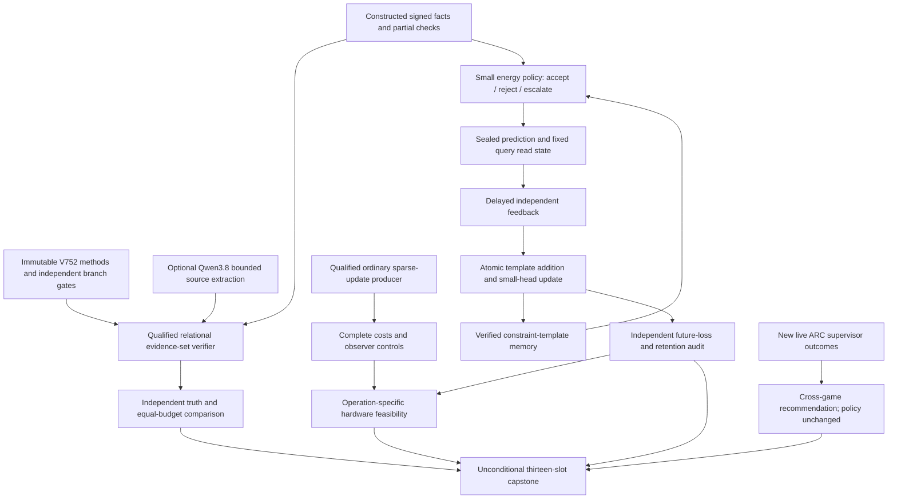
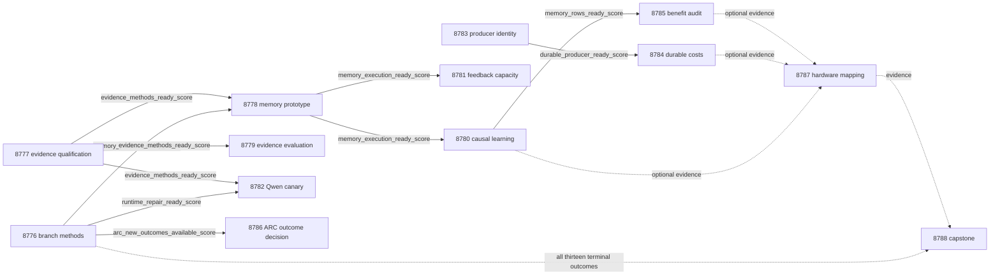

# Carnot Research Roadmap V752: Evidence Sets, Delayed Memory, and Complete Costs

**Created:** 2026-11-03
**Milestone:** 2026.11.752
**Status:** Staged research plan; no activation or deployment
**Supersedes:** V751 after all thirteen scheduling slots ended
**Historical authority:** [Preserved V751 design](research-roadmap-v751-preserved-20261103.md)
**Execution queue:** [research-roadmap-next.yaml](../../research-roadmap-next.yaml)
**Contract:** Exactly 13 tasks, Exp8776 through Exp8788, in the order below, across four phases.

## What V751 proved

Eight primary producers ran. Five studies were skipped by prerequisite gates.
The completed-history YAML still ends at V750. V751 outcomes below come from
its primary artifacts and conductor log. Scheduling completion is separate
from producer qualification and scientific benefit.

| Evidence | Finding | Consequence |
|---|---|---|
| Exp8763 branch contract | Primary remains disqualified with failed historical children and incomplete coverage. A subsequent archive repair passed204 scoped tests and276/276 owned statements. | Use that concrete repair in a new administrative contract; preserve old bytes. |
| Exp8764 publication diagnosis | Terminal stages measured; no demonstrated safe correction. Original timeout cause remains unresolved. | Do not repeat the original39+25-node learning chain. |
| Exp8765–8767 | Learning union, causal Brier stream and benefit audit skipped. | No V751 learned future-loss or retention claim exists. |
| Exp8768/8769 evidence sets | Prototype covered482/483 statements; runner line345 was absent. Comparison skipped. | Exercise the real missing path before admitting its method. |
| Exp8770 residual installed cost | Observer overhead ranges2.96–8.02 percent for Python and3.18–5.29 percent for native. No optimization target admitted. | No speculative production optimization. Test coarser clocks on a distinct durable workload. |
| Exp8771 lifecycle | Archived authority, ordinary windows and threshold fixtures qualified. | Reuse exact ordinary starting states; keep constructed events separate. |
| Exp8772 durable costs | Resident/Python ratio1.05465, CI95[0.99385,1.12933]; resident/JSON-native1.04325, CI95[0.94414,1.13860]. | No clear throughput benefit. Its task_id was exp8772-ordinary-update-cost, which the downstream reader rejected. |
| Exp8773 ARC | Skipped because no new authoritative outcomes existed. | Keep the closed panel closed. Pre-gate on actual new bytes. |
| Exp8774 hardware | Correctly retained missing learning, inadmissible residual costs, rejected producer identity and absent physical execution. | Match operations and whole costs before any acceleration claim. |
| Exp8775 capstone | Primary is disqualified after owned test and coverage failures, despite an OK scheduler line. | A new capstone must validate its own execution, not copy that status. |

Primary files are `results/experiment_8763_v751_branch_contract.json`,
`results/experiment_8764_v751_publication_cost_diagnosis.json`,
`results/experiment_8768_v751_evidence_set_methods.json`, and the matching
Exp8770–8772/8774/8775 V751 files. They retain raw receipts and hashes.
The repair is recorded in `ops/status.md` and `ops/changelog.md` on November3.
No historical primary is rewritten by this plan.

## Three biggest gaps against the PRD

1. **Faithful evidence before verified reasoning — FR-12.** Exact relational
   execution can certify encoded records. It cannot certify extraction from
   source text. Local checks also miss shared bindings and absent premises.
   Exp8777/8779 test set-level sufficiency against a strong joint solver.
   Exp8782 separately tests bounded mandated-Qwen extraction fidelity.
2. **Useful continuous self-learning — FR-06/FR-11.** The old nine-input
   delayed learner remains blocked. There is no safe timeout correction to
   justify another chain. Exp8778/8780/8781/8785 ask a distinct question:
   can delayed verified counterexamples add reusable constraints that improve
   later budgeted decisions? The policy uses partial observations, a small
   Gibbs energy head and typed decisions. It receives its own causal qualification.
   This does not relax or claim completion of the old protocol.
3. **Production benefit across the whole operation — FR-05/FR-08/NFR-01.**
   Native arithmetic has not produced a clear complete durable-window gain.
   Producer identity also prevented downstream admission. Exp8783/8784 measure
   a correctly identified producer with complete clocks and observer controls.
   Exp8787 tests whether any actual supported hardware operation can dominate
   enough of the workload to matter. NFR-01's10x target remains open.

## Research informing the milestone

The [V752 scan](../../research-references.md) was appended before task design.
It covers all eight requested topics and all six secondary channels. It records
OpenReview challenges, the ARM–EBM citation rate limit and stale discovery feeds.

| Primary source | Adaptation | Experiment |
|---|---|---|
| [SURE-RAG v2](https://arxiv.org/abs/2605.03534v2), July2026 revision | Support/refute/insufficient at evidence-set level; natural-data transfer remains separate | 8777,8779,8782 |
| [Memoir](https://arxiv.org/abs/2607.20792), July2026 | Freeze reads within a query; compare delayed writes against read-only and shuffled controls | 8778,8780,8785 |
| [Capacity-constrained OCO](https://arxiv.org/abs/2606.11711), June2026 | Finite pending labels and equal-capacity admission comparison; no imported regret guarantee | 8781 |
| [On-chip KAN](https://arxiv.org/abs/2602.02056v4), June2026 revision | Sparse local updates versus complete state-transfer and durable costs | 8784,8787 |
| [Million-p-bit computer](https://arxiv.org/abs/2606.25313), June2026; [Extropic Z1T](https://extropic.ai/writing/z1t), September2026 | Match topology, communication and host work; no vendor-to-local speed inference | 8787 |
| [P(Yes)](https://arxiv.org/abs/2610.25474), October2026 | Optional actual-logit comparator; no reconstructed probabilities | 8782 |

EBT and the ARM–EBM bijection remain architecture references. HardNet++, CAffNet,
ETS and Certified Access remain deferred. Neither feasibility theorems nor a new
paper justify reopening a retired mechanism. Kona's page supplied no reproducible
new implementation. No new package dependency or physical board experiment follows.

## Architecture



The new energy policy has six observable features and a three-way decision
encoding. Its nine numeric inputs differ from the historical nine-input,
109-coefficient spline head. It uses existing GibbsModel building blocks.
The old head and its unresolved39+25-node qualification are outside this study.

A template adds a reusable join or conflict check after feedback releases.
It never stores a held-out world answer. Template application and coefficient
updates are separate ablations. Exact oracle feedback makes this a constructed
learning study. Even a positive result cannot establish independent natural
factuality, improve the public FoVer headline by itself, or certify ARC transfer.

## Phase 1 — Qualify small, independent prerequisites

Exp8776 binds all thirteen full task objects and freezes branch protocols.
It uses the shipped private archive repair. It reads CUDA and ARC authority
once and emits separate readiness fields. Optional absence cannot block CPU work.

Exp8777 exercises the specific missed CLI path. It preserves every original
semantic control, then seals new constructed worlds. Exp8778 prototypes the
new memory policy and causal store. It trains only small qualification fixtures;
scientific measurements run later. Spec and failing tests precede implementation.

## Phase 2 — Test evidence and continuous learning

Exp8779 compares local, joint-symbolic and set-level decisions. The old120-world
set is exposed replication. Another120 six-edge worlds test a new constructed
family. World-level clustering prevents representation twins from inflating n.

Exp8780 measures the qualified memory arms on later sealed decisions. Exp8781
compares finite-capacity feedback admission from the same initial policy. It
can run even if Exp8780 finds no benefit. Exp8782 is a separately gated Qwen
canary:12 worlds, two surfaces, two arms,48 calls, at most128 tokens per call.

## Phase 3 — Audit complete costs and benefit

Exp8783 qualifies a fresh durable producer with exact identity through both
publication and consumer checks. Exp8784 measures three ordinary starts, two
process pairs per start,32 updates per window and three implementations.
Instrumentation must pass its5-percent overhead and2-percent reconciliation
limits before component attribution is admitted. Timing repeats are not new
scientific workloads. Exp8785 independently verifies later Brier benefit,
actual constraint use and retention at initial/middle/final checkpoints.

## Phase 4 — Make bounded continuation decisions

Exp8786 reads only newly admitted live supervisor outcomes. An empty frontier
causes a conductor skip. Exp8787 maps available independent branch results to
actual operations. Exp8788 always reconciles all thirteen slots, including skips
and its own validation. No reader invents science to fill a missing branch.

## Exact task contract

Exactly13 tasks: Exp8776 through Exp8788. All identifiers and ordering below are binding.

| Order | ID | Title | Phase | Deliverable |
|---|---|---|---|---|
| 1 | `exp8776-branch-methods` | Bind thirteen tasks and admit independent branch inputs | 1 | `results/experiment_8776_v752_branch_methods.json` |
| 2 | `exp8777-evidence-method-qualification` | Qualify evidence-set failure publication with original truth controls | 1 | `results/experiment_8777_v752_evidence_method_qualification.json` |
| 3 | `exp8778-delayed-memory-prototype` | Prototype delayed constraint additions and a calibrated typed energy policy | 1 | `results/experiment_8778_v752_delayed_memory_prototype.json` |
| 4 | `exp8779-evidence-set-evaluation` | Measure evidence sufficiency on exposed and unseen graph families | 2 | `results/experiment_8779_v752_evidence_set_evaluation.json` |
| 5 | `exp8780-causal-template-learning` | Measure later decisions after delayed verified template additions | 2 | `results/experiment_8780_v752_causal_template_learning.json` |
| 6 | `exp8781-feedback-capacity-study` | Compare pending-feedback admission under equal memory and query budgets | 2 | `results/experiment_8781_v752_feedback_capacity_study.json` |
| 7 | `exp8782-qwen-evidence-canary` | Measure bounded Qwen extraction fidelity before symbolic verification | 2 | `results/experiment_8782_v752_qwen_evidence_canary.json` |
| 8 | `exp8783-durable-producer-identity` | Qualify a fresh durable-window producer with exact task identity | 3 | `results/experiment_8783_v752_durable_producer_identity.json` |
| 9 | `exp8784-durable-cost-components` | Measure complete ordinary update costs with low-overhead component clocks | 3 | `results/experiment_8784_v752_durable_cost_components.json` |
| 10 | `exp8785-memory-benefit-audit` | Audit future calibration constraint additions and simultaneous retention | 3 | `results/experiment_8785_v752_memory_benefit_audit.json` |
| 11 | `exp8786-arc-new-outcome-decision` | Assess cross-game supervisor choices only from new live outcomes | 4 | `results/experiment_8786_v752_arc_new_outcome_decision.json` |
| 12 | `exp8787-hardware-operation-boundary` | Map new learning and durable costs to supported hardware operations | 4 | `results/experiment_8787_v752_hardware_operation_boundary.json` |
| 13 | `exp8788-capstone` | Reconcile thirteen outcomes and close unsupported continuations | 4 | `results/experiment_8788_v752_capstone.json` |

The embedded contract contains every YAML task field, including complete prompts,
routing, prior failures and gate expressions. Canonical tasks SHA-256 uses UTF-8
JSON with sorted keys, compact separators and ensure_ascii=False.

Canonical tasks SHA-256: `96a277806aa53175f8661b2e09da69a3c62ddab8f88d0eaaf21e6f25aadc945d`.

<!-- V752_TASK_CONTRACT_START -->
```json
{
  "milestone": "2026.11.752",
  "tasks": [
    {
      "id": "exp8776-branch-methods",
      "title": "Bind thirteen tasks and admit independent branch inputs",
      "phase": 1,
      "track": "infrastructure",
      "priority": "high",
      "requires_gpu": false,
      "max_turns": 100,
      "estimated_wall_time_min": 45,
      "per_unit_rows": true,
      "milestone": "2026.11.752",
      "deliverable": "results/experiment_8776_v752_branch_methods.json",
      "inference_substrate_class": "no_model_load",
      "MODEL_SPECS": [],
      "gated_on": [],
      "agent_type": "claude",
      "model": "opus",
      "prior_failures": [
        {
          "experiment_id": "exp7532-v659-contract-methods",
          "verdict": "complete_blocked_incomplete_v659_authorities",
          "addressed_by": "The shipped Exp8763 private archive repair is new evidence. Bind current branch methods separately; do not reissue the unresolved original-learning execution claim.",
          "retire_if_same_verdict": true
        },
        {
          "experiment_id": "exp7713-v672-contract-methods",
          "verdict": "complete_blocked_v672_independent_contract",
          "addressed_by": "The shipped Exp8763 private archive repair is new evidence. Bind current branch methods separately; do not reissue the unresolved original-learning execution claim.",
          "retire_if_same_verdict": true
        },
        {
          "experiment_id": "exp7940-v689-contract-methods",
          "verdict": "complete_blocked_authority",
          "addressed_by": "The shipped Exp8763 private archive repair is new evidence. Bind current branch methods separately; do not reissue the unresolved original-learning execution claim.",
          "retire_if_same_verdict": true
        },
        {
          "experiment_id": "exp7992-v693-contract-methods",
          "verdict": "complete_blocked_authority",
          "addressed_by": "The shipped Exp8763 private archive repair is new evidence. Bind current branch methods separately; do not reissue the unresolved original-learning execution claim.",
          "retire_if_same_verdict": true
        },
        {
          "experiment_id": "exp8018-v695-contract-methods",
          "verdict": "complete_blocked_authority",
          "addressed_by": "The shipped Exp8763 private archive repair is new evidence. Bind current branch methods separately; do not reissue the unresolved original-learning execution claim.",
          "retire_if_same_verdict": true
        },
        {
          "experiment_id": "exp8374-v722-contract-methods",
          "verdict": "complete_blocked_direct_contract_methods",
          "addressed_by": "The shipped Exp8763 private archive repair is new evidence. Bind current branch methods separately; do not reissue the unresolved original-learning execution claim.",
          "retire_if_same_verdict": true
        },
        {
          "experiment_id": "exp8388-v723-contract-methods",
          "verdict": "complete_blocked_v723_contract_methods",
          "addressed_by": "The shipped Exp8763 private archive repair is new evidence. Bind current branch methods separately; do not reissue the unresolved original-learning execution claim.",
          "retire_if_same_verdict": true
        },
        {
          "experiment_id": "exp8416-v725-contract-methods",
          "verdict": "complete_blocked_v725_contract_methods",
          "addressed_by": "The shipped Exp8763 private archive repair is new evidence. Bind current branch methods separately; do not reissue the unresolved original-learning execution claim.",
          "retire_if_same_verdict": true
        },
        {
          "experiment_id": "exp8443-v727-contract-methods",
          "verdict": "complete_blocked_v727_contract_methods",
          "addressed_by": "The shipped Exp8763 private archive repair is new evidence. Bind current branch methods separately; do not reissue the unresolved original-learning execution claim.",
          "retire_if_same_verdict": true
        },
        {
          "experiment_id": "exp8471-v729-contract-methods",
          "verdict": "complete_blocked_v729_contract_methods",
          "addressed_by": "The shipped Exp8763 private archive repair is new evidence. Bind current branch methods separately; do not reissue the unresolved original-learning execution claim.",
          "retire_if_same_verdict": true
        },
        {
          "experiment_id": "exp8499-v731-contract-methods",
          "verdict": "complete_blocked_v731_contract_methods",
          "addressed_by": "The shipped Exp8763 private archive repair is new evidence. Bind current branch methods separately; do not reissue the unresolved original-learning execution claim.",
          "retire_if_same_verdict": true
        },
        {
          "experiment_id": "exp8565-v736-contract-methods",
          "verdict": "complete_blocked_v736_contract_methods",
          "addressed_by": "The shipped Exp8763 private archive repair is new evidence. Bind current branch methods separately; do not reissue the unresolved original-learning execution claim.",
          "retire_if_same_verdict": true
        },
        {
          "experiment_id": "exp8602-v739-contract-methods",
          "verdict": "complete_blocked_v739_contract_methods",
          "addressed_by": "The shipped Exp8763 private archive repair is new evidence. Bind current branch methods separately; do not reissue the unresolved original-learning execution claim.",
          "retire_if_same_verdict": true
        },
        {
          "experiment_id": "exp8667-contract-methods",
          "verdict": "complete_disqualified_v744_contract_methods",
          "addressed_by": "The shipped Exp8763 private archive repair is new evidence. Bind current branch methods separately; do not reissue the unresolved original-learning execution claim.",
          "retire_if_same_verdict": true
        },
        {
          "experiment_id": "exp8681-contract-methods",
          "verdict": "complete_disqualified_v745_contract_methods",
          "addressed_by": "The shipped Exp8763 private archive repair is new evidence. Bind current branch methods separately; do not reissue the unresolved original-learning execution claim.",
          "retire_if_same_verdict": true
        },
        {
          "experiment_id": "exp8709-contract-methods",
          "verdict": "complete_disqualified_v747_contract_methods",
          "addressed_by": "The shipped Exp8763 private archive repair is new evidence. Bind current branch methods separately; do not reissue the unresolved original-learning execution claim.",
          "retire_if_same_verdict": true
        },
        {
          "experiment_id": "exp8737-contract-methods",
          "verdict": "complete_disqualified_v749_contract_methods",
          "addressed_by": "The shipped Exp8763 private archive repair is new evidence. Bind current branch methods separately; do not reissue the unresolved original-learning execution claim.",
          "retire_if_same_verdict": true
        },
        {
          "experiment_id": "exp8749-archive-bound-contract",
          "verdict": "complete_disqualified_v750_archive_bound_contract",
          "addressed_by": "The shipped Exp8763 private archive repair is new evidence. Bind current branch methods separately; do not reissue the unresolved original-learning execution claim.",
          "retire_if_same_verdict": true
        },
        {
          "experiment_id": "exp8763-branch-contract",
          "verdict": "complete_disqualified_v751_branch_contract",
          "addressed_by": "The shipped Exp8763 private archive repair is new evidence. Bind current branch methods separately; do not reissue the unresolved original-learning execution claim.",
          "retire_if_same_verdict": true
        }
      ],
      "prompt": "CONTEXT:\nWork in {project_root} on {date}. V751 finished thirteen slots but produced eight primary files. Exp8763 remained disqualified; a later private archive repair passed 204 scoped tests. Exp8764 found no safe deadline correction. Preserve both historical verdicts. V752 keeps that nine-input learning chain closed.\n\nEXISTING CODE TO READ FIRST:\nCLAUDE.md; CODEX.md; ops/e2e-test-plan.md; ops/exclusion_manifest.yaml; scripts/experiment_template.py; openspec/capabilities/research-reporting/spec.md; openspec/capabilities/verification/spec.md; python/carnot/reporting/primary_publication.py; python/carnot/reporting/roadmap_contract.py; python/carnot/reporting/v751_branch_contract.py; python/carnot/reporting/v751_branch_evidence.py; tests/python/test_v751_branch_contract_8763.py; results/experiment_8763_v751_branch_contract.json; results/experiment_8764_v751_publication_cost_diagnosis.json; python/carnot/reporting/arc_authoritative_frontier_8215.py; python/carnot/reporting/v744_contract_methods.py; openspec/change-proposals/research-roadmap-v751-preserved-20261103.md\n\nTASK:\nBind thirteen tasks and admit independent branch inputs. Deliver results/experiment_8776_v752_branch_methods.json. Use scripts/experiments/experiment_8776_v752_branch_methods.py as a thin CLI. Store raw evidence in results/raw/experiment_8776_v752_branch_methods/ and notes in docs/research-notes/v752-branch-methods.md. No LLM is needed: MODEL_SPECS=[], inference_substrate_class=no_model_load, zero LLM calls. Any later LLM scope requires the mandated unsloth/Qwen3.8-27B-GGUF and a revised contract.\n\nCONCRETE STEPS:\n1. Print a flushed progress line at each phase boundary. Print before and after every model load, generation, benchmark, or subprocess that can take minutes. Print counts inside long loops. Emit a parent heartbeat at least every 60 seconds during long calls. Keep every silence gap under 600 seconds. Poll child processes in tool calls of at most 60 seconds. Write any file over about 200 lines in several tool calls, with a progress message between them. Do not compose a huge file in one call. Silence can end work at 1200 seconds despite the 4800-second hard cap. Reserve 900 seconds for validation and terminal publication.\n2. Read the listed sources and prior failures. Check the task-specific REQ-* and SCENARIO-* before code changes. Write failing tests first. Check private scratch, dependency availability, frozen input hashes, and the resource projection before execution. Reuse existing modules and thin runners. Isolate historical test authority from moving roadmap paths. Preserve original assertions. Never run tests against production result files.\n3. Bind the exact ordered table, full task JSON and YAML for Exp8776 through Exp8788. Pin canonical tasks SHA-256 separately. Accept only the established literal-brace activation encoding. Mutate prompt, gate, routing, prior and deliverable fields to prove rejection.\n4. Use the shipped private archive repair with real result directories. Revalidate its original archive and output-guard assertions. Emit contract_ready_score for current administrative custody only. Do not run or certify the old 39+25 learning execution union.\n5. Freeze separate evidence, memory, capacity and cost protocols before their evaluation. New memory studies use partial symbolic observations and delayed constraint-template additions, not the old nine-input head. Emit memory_protocol_ready_score only when the new protocol has explicit inputs, split isolation and causal gates. This does not certify implementation.\n6. Read the current CUDA repair authority once through the existing v744_contract_methods.runtime reader. Emit runtime_repair_ready_score=1 only for authenticated changed runtime evidence and usable mandated-model provenance; otherwise record exact absence. Do not load a model, rebuild CUDA, poll, or infer readiness from nvidia-smi alone.\n7. Read the authoritative ARC frontier once beyond Exp8760. Emit arc_new_outcomes_available_score=1 only for new real selected/applied-arm outcomes. Empty evidence keeps that score zero without zeroing independent CPU branches.\n8. Run scoped unit and consumer tests with genuine unit/CLI-child coverage of every owned executable statement. Use bounded serial children with exact node inventories. Run Ruff check/format, strict mypy, explicit spec coverage, and private E2E-018/021. Record argv, normal exits, node outcomes, JUnit, coverage SQLite, and log hashes. Keep repository health separate from scoped acceptance. Validate terminal bytes with unchanged adversarial_verify.py and verdict_row_consistency_lint.py --strict, then cold-replay from sealed primitives. Failed owned validation is disqualified. Unchanged external absence is terminal blocked, never partial. Reconcile OpenSpec, _bmad/traceability.md, ops/status.md and ops/changelog.md. Preserve historical primaries, shared validators, generator weights, ARC policy defaults, the active roadmap and the exclusion manifest.\n\nREQUIRED ARTIFACT FIELDS:\nexperiment_id, task_id, milestone, run_date, invocation_id: principle: Bind the exact task identifier and current invocation; aliases are invalid.\nhonest_verdict, verdict_class: principle: Use a complete_ terminal prefix and positive | circular_positive | null | blocked | disqualified | partial. Only unfinished owned work that another attempt can finish is partial.\ngate_check_summary: principle: Every blocked_* or complete_blocked_* verdict names upstream, path/hash, check, field, operator, expected and observed value. Distinguish missing file, missing field, observed zero and rejected producer.\ninference_substrate, inference_substrate_class, MODEL_SPECS, model_invocation_counts, numerical_training_calls: principle: Declare actual computation. Small energy-head training is separate from LLM loading. A blocked model path records zero calls and its actual substrate.\nrows, intended_count, completed_count, failed_count, censored_count, excluded_count, independent_count: principle: Preserve each intended unit and arm with its raw metric, denominator, missingness and cost. Seeds, surfaces, siblings and repetitions do not create independent worlds.\nverifier_is_oracle, exposure_scope, independent_generalization_score: principle: Oracle-dependent positives are circular_positive. Constructed-world learning does not establish natural factuality or hidden-game transfer.\nacceptance_gates, required_checks_passed, flagged_adversarial, validation_receipts, terminal_validation_sidecar_path: principle: Readiness means complete execution, not scientific improvement. Failed acceptance gates forbid a positive verdict class.\npreconditions_checked, duration_s, started_at_utc, ended_at_utc, phase_spans, random_seed, reproducibility_checksum: principle: Retain actual clocks and seeds. Never pad duration floors or import old monotonic epochs.\nsource_artifact_hashes, code_config_hashes, raw_shard_hashes, cited_upstream_artifacts, field_principles: principle: Bind every result and imported field to immutable source bytes.\nrepository_health_reference, scoped_validation_scope: principle: A scoped pass is not a full-repository pass.\ncontract_ready_score, memory_protocol_ready_score, runtime_repair_ready_score, arc_new_outcomes_available_score, full_task_objects, canonical_tasks_sha256, branch_protocol_refs, runtime_authority, arc_frontier_reference: principle: Emit these exact fields from sealed task operands; downstream gates read these spellings.\n\nRun command: cd {project_root} && JAX_PLATFORMS=cpu PYTHONPATH=python:. PYTHONUNBUFFERED=1 .venv/bin/python -u scripts/experiments/experiment_8776_v752_branch_methods.py --date {date}\n\nDo NOT push. Do NOT modify scripts/research_conductor.py.\n"
    },
    {
      "id": "exp8777-evidence-method-qualification",
      "title": "Qualify evidence-set failure publication with original truth controls",
      "phase": 1,
      "track": "verification",
      "priority": "high",
      "requires_gpu": false,
      "max_turns": 100,
      "estimated_wall_time_min": 45,
      "per_unit_rows": true,
      "milestone": "2026.11.752",
      "deliverable": "results/experiment_8777_v752_evidence_method_qualification.json",
      "inference_substrate_class": "no_model_load",
      "MODEL_SPECS": [],
      "gated_on": [],
      "agent_type": "claude",
      "model": "opus",
      "prior_failures": [
        {
          "experiment_id": "exp7532-v659-contract-methods",
          "verdict": "complete_blocked_incomplete_v659_authorities",
          "addressed_by": "Execute the specific missing real CLI branch and use archived original authority; new six-edge worlds provide an explicit unseen constructed family without promoting old results.",
          "retire_if_same_verdict": true
        },
        {
          "experiment_id": "exp7713-v672-contract-methods",
          "verdict": "complete_blocked_v672_independent_contract",
          "addressed_by": "Execute the specific missing real CLI branch and use archived original authority; new six-edge worlds provide an explicit unseen constructed family without promoting old results.",
          "retire_if_same_verdict": true
        },
        {
          "experiment_id": "exp7940-v689-contract-methods",
          "verdict": "complete_blocked_authority",
          "addressed_by": "Execute the specific missing real CLI branch and use archived original authority; new six-edge worlds provide an explicit unseen constructed family without promoting old results.",
          "retire_if_same_verdict": true
        },
        {
          "experiment_id": "exp7992-v693-contract-methods",
          "verdict": "complete_blocked_authority",
          "addressed_by": "Execute the specific missing real CLI branch and use archived original authority; new six-edge worlds provide an explicit unseen constructed family without promoting old results.",
          "retire_if_same_verdict": true
        },
        {
          "experiment_id": "exp8018-v695-contract-methods",
          "verdict": "complete_blocked_authority",
          "addressed_by": "Execute the specific missing real CLI branch and use archived original authority; new six-edge worlds provide an explicit unseen constructed family without promoting old results.",
          "retire_if_same_verdict": true
        },
        {
          "experiment_id": "exp8374-v722-contract-methods",
          "verdict": "complete_blocked_direct_contract_methods",
          "addressed_by": "Execute the specific missing real CLI branch and use archived original authority; new six-edge worlds provide an explicit unseen constructed family without promoting old results.",
          "retire_if_same_verdict": true
        },
        {
          "experiment_id": "exp8388-v723-contract-methods",
          "verdict": "complete_blocked_v723_contract_methods",
          "addressed_by": "Execute the specific missing real CLI branch and use archived original authority; new six-edge worlds provide an explicit unseen constructed family without promoting old results.",
          "retire_if_same_verdict": true
        },
        {
          "experiment_id": "exp8416-v725-contract-methods",
          "verdict": "complete_blocked_v725_contract_methods",
          "addressed_by": "Execute the specific missing real CLI branch and use archived original authority; new six-edge worlds provide an explicit unseen constructed family without promoting old results.",
          "retire_if_same_verdict": true
        },
        {
          "experiment_id": "exp8443-v727-contract-methods",
          "verdict": "complete_blocked_v727_contract_methods",
          "addressed_by": "Execute the specific missing real CLI branch and use archived original authority; new six-edge worlds provide an explicit unseen constructed family without promoting old results.",
          "retire_if_same_verdict": true
        },
        {
          "experiment_id": "exp8471-v729-contract-methods",
          "verdict": "complete_blocked_v729_contract_methods",
          "addressed_by": "Execute the specific missing real CLI branch and use archived original authority; new six-edge worlds provide an explicit unseen constructed family without promoting old results.",
          "retire_if_same_verdict": true
        },
        {
          "experiment_id": "exp8499-v731-contract-methods",
          "verdict": "complete_blocked_v731_contract_methods",
          "addressed_by": "Execute the specific missing real CLI branch and use archived original authority; new six-edge worlds provide an explicit unseen constructed family without promoting old results.",
          "retire_if_same_verdict": true
        },
        {
          "experiment_id": "exp8565-v736-contract-methods",
          "verdict": "complete_blocked_v736_contract_methods",
          "addressed_by": "Execute the specific missing real CLI branch and use archived original authority; new six-edge worlds provide an explicit unseen constructed family without promoting old results.",
          "retire_if_same_verdict": true
        },
        {
          "experiment_id": "exp8602-v739-contract-methods",
          "verdict": "complete_blocked_v739_contract_methods",
          "addressed_by": "Execute the specific missing real CLI branch and use archived original authority; new six-edge worlds provide an explicit unseen constructed family without promoting old results.",
          "retire_if_same_verdict": true
        },
        {
          "experiment_id": "exp8667-contract-methods",
          "verdict": "complete_disqualified_v744_contract_methods",
          "addressed_by": "Execute the specific missing real CLI branch and use archived original authority; new six-edge worlds provide an explicit unseen constructed family without promoting old results.",
          "retire_if_same_verdict": true
        },
        {
          "experiment_id": "exp8681-contract-methods",
          "verdict": "complete_disqualified_v745_contract_methods",
          "addressed_by": "Execute the specific missing real CLI branch and use archived original authority; new six-edge worlds provide an explicit unseen constructed family without promoting old results.",
          "retire_if_same_verdict": true
        },
        {
          "experiment_id": "exp8709-contract-methods",
          "verdict": "complete_disqualified_v747_contract_methods",
          "addressed_by": "Execute the specific missing real CLI branch and use archived original authority; new six-edge worlds provide an explicit unseen constructed family without promoting old results.",
          "retire_if_same_verdict": true
        },
        {
          "experiment_id": "exp8737-contract-methods",
          "verdict": "complete_disqualified_v749_contract_methods",
          "addressed_by": "Execute the specific missing real CLI branch and use archived original authority; new six-edge worlds provide an explicit unseen constructed family without promoting old results.",
          "retire_if_same_verdict": true
        },
        {
          "experiment_id": "exp8755-verifier-family-surface",
          "verdict": "complete_null_v750_verifier_family_surface",
          "addressed_by": "Execute the specific missing real CLI branch and use archived original authority; new six-edge worlds provide an explicit unseen constructed family without promoting old results.",
          "retire_if_same_verdict": true
        },
        {
          "experiment_id": "exp8768-evidence-set-methods",
          "verdict": "complete_disqualified_v751_evidence_set_methods",
          "addressed_by": "Execute the specific missing real CLI branch and use archived original authority; new six-edge worlds provide an explicit unseen constructed family without promoting old results.",
          "retire_if_same_verdict": true
        },
        {
          "experiment_id": "exp5839-v519-evidence-qualification",
          "verdict": "mixed: constraint_stream_and_structural_qualified_lifecycle_and_replay_disqualified",
          "addressed_by": "Execute the specific missing real CLI branch and use archived original authority; new six-edge worlds provide an explicit unseen constructed family without promoting old results.",
          "retire_if_same_verdict": true
        },
        {
          "experiment_id": "exp8319-local-evidence-qualification",
          "verdict": "blocked_gate_check_failed",
          "addressed_by": "Execute the specific missing real CLI branch and use archived original authority; new six-edge worlds provide an explicit unseen constructed family without promoting old results.",
          "retire_if_same_verdict": true
        }
      ],
      "prompt": "CONTEXT:\nWork in {project_root} on {date}. Exp8768 covered 482 of 483 owned statements. Runner line345 was not executed. Its semantic comparisons remain disqualified. SURE-RAG motivates set-level sufficiency, but independent truth and valid alternatives remain mandatory.\n\nEXISTING CODE TO READ FIRST:\nCLAUDE.md; CODEX.md; ops/e2e-test-plan.md; ops/exclusion_manifest.yaml; scripts/experiment_template.py; openspec/capabilities/research-reporting/spec.md; openspec/capabilities/verification/spec.md; python/carnot/reporting/primary_publication.py; python/carnot/reporting/evidence_set_methods_8768.py; python/carnot/reporting/evidence_set_corpus_8768.py; python/carnot/reporting/evidence_set_runner_8768.py; tests/python/test_evidence_set_methods_8768.py; results/experiment_8768_v751_evidence_set_methods.json\n\nTASK:\nQualify evidence-set failure publication with original truth controls. Deliver results/experiment_8777_v752_evidence_method_qualification.json. Use scripts/experiments/experiment_8777_v752_evidence_method_qualification.py as a thin CLI. Store raw evidence in results/raw/experiment_8777_v752_evidence_method_qualification/ and notes in docs/research-notes/v752-evidence-method-qualification.md. No LLM is needed: MODEL_SPECS=[], inference_substrate_class=no_model_load, zero LLM calls. Any later LLM scope requires the mandated unsloth/Qwen3.8-27B-GGUF and a revised contract.\n\nCONCRETE STEPS:\n1. Print a flushed progress line at each phase boundary. Print before and after every model load, generation, benchmark, or subprocess that can take minutes. Print counts inside long loops. Emit a parent heartbeat at least every 60 seconds during long calls. Keep every silence gap under 600 seconds. Poll child processes in tool calls of at most 60 seconds. Write any file over about 200 lines in several tool calls, with a progress message between them. Do not compose a huge file in one call. Silence can end work at 1200 seconds despite the 4800-second hard cap. Reserve 900 seconds for validation and terminal publication.\n2. Read the listed sources and prior failures. Check the task-specific REQ-* and SCENARIO-* before code changes. Write failing tests first. Check private scratch, dependency availability, frozen input hashes, and the resource projection before execution. Reuse existing modules and thin runners. Isolate historical test authority from moving roadmap paths. Preserve original assertions. Never run tests against production result files.\n3. Exercise the actual missing line345 failure-publication path through the real CLI under coverage. Use private archived V751 authority. Preserve the original tests and all semantic assertions. Do not edit shared coverage rules or rehabilitate Exp8768.\n4. Authenticate the frozen three-way semantics and independent Boolean-completion oracle. Retain the 60 development and 120 evaluation graph classes, six conditions and surface pairs. Treat all already inspected V751 evaluation graphs as exposed replication data.\n5. Freeze an additional set of 120 canonical six-edge worlds, disjoint from all V751 graph classes. Independently check labels using Boolean completions; arms cannot import labels, condition names or graph split IDs. Also freeze12 separate canary worlds and120 seven-edge retention worlds. Reject graph-isomorphism overlap across all rosters. Freeze the equal five-call ceiling and count actual wall time for each arm.\n6. Execute original negative controls, conflict escalation, missing-hop unknowns, valid alternatives and truth-preserving renamings. Set evidence_methods_ready_score=1 only after complete owned checks and genuine statement coverage. A semantic null may still release complete rows.\n7. Run scoped unit and consumer tests with genuine unit/CLI-child coverage of every owned executable statement. Use bounded serial children with exact node inventories. Run Ruff check/format, strict mypy, explicit spec coverage, and private E2E-018/021. Record argv, normal exits, node outcomes, JUnit, coverage SQLite, and log hashes. Keep repository health separate from scoped acceptance. Validate terminal bytes with unchanged adversarial_verify.py and verdict_row_consistency_lint.py --strict, then cold-replay from sealed primitives. Failed owned validation is disqualified. Unchanged external absence is terminal blocked, never partial. Reconcile OpenSpec, _bmad/traceability.md, ops/status.md and ops/changelog.md. Preserve historical primaries, shared validators, generator weights, ARC policy defaults, the active roadmap and the exclusion manifest.\n\nREQUIRED ARTIFACT FIELDS:\nexperiment_id, task_id, milestone, run_date, invocation_id: principle: Bind the exact task identifier and current invocation; aliases are invalid.\nhonest_verdict, verdict_class: principle: Use a complete_ terminal prefix and positive | circular_positive | null | blocked | disqualified | partial. Only unfinished owned work that another attempt can finish is partial.\ngate_check_summary: principle: Every blocked_* or complete_blocked_* verdict names upstream, path/hash, check, field, operator, expected and observed value. Distinguish missing file, missing field, observed zero and rejected producer.\ninference_substrate, inference_substrate_class, MODEL_SPECS, model_invocation_counts, numerical_training_calls: principle: Declare actual computation. Small energy-head training is separate from LLM loading. A blocked model path records zero calls and its actual substrate.\nrows, intended_count, completed_count, failed_count, censored_count, excluded_count, independent_count: principle: Preserve each intended unit and arm with its raw metric, denominator, missingness and cost. Seeds, surfaces, siblings and repetitions do not create independent worlds.\nverifier_is_oracle, exposure_scope, independent_generalization_score: principle: Oracle-dependent positives are circular_positive. Constructed-world learning does not establish natural factuality or hidden-game transfer.\nacceptance_gates, required_checks_passed, flagged_adversarial, validation_receipts, terminal_validation_sidecar_path: principle: Readiness means complete execution, not scientific improvement. Failed acceptance gates forbid a positive verdict class.\npreconditions_checked, duration_s, started_at_utc, ended_at_utc, phase_spans, random_seed, reproducibility_checksum: principle: Retain actual clocks and seeds. Never pad duration floors or import old monotonic epochs.\nsource_artifact_hashes, code_config_hashes, raw_shard_hashes, cited_upstream_artifacts, field_principles: principle: Bind every result and imported field to immutable source bytes.\nrepository_health_reference, scoped_validation_scope: principle: A scoped pass is not a full-repository pass.\nevidence_methods_ready_score, frozen_method_reference, new_world_manifest, original_node_union, owned_statement_coverage, truth_control_rows, oracle_access_rows: principle: Emit these exact fields from sealed task operands; downstream gates read these spellings.\n\nRun command: cd {project_root} && JAX_PLATFORMS=cpu PYTHONPATH=python:. PYTHONUNBUFFERED=1 .venv/bin/python -u scripts/experiments/experiment_8777_v752_evidence_method_qualification.py --date {date}\n\nDo NOT push. Do NOT modify scripts/research_conductor.py.\n"
    },
    {
      "id": "exp8778-delayed-memory-prototype",
      "title": "Prototype delayed constraint additions and a calibrated typed energy policy",
      "phase": 1,
      "track": "self_learning",
      "priority": "high",
      "requires_gpu": false,
      "max_turns": 50,
      "estimated_wall_time_min": 60,
      "per_unit_rows": true,
      "milestone": "2026.11.752",
      "deliverable": "results/experiment_8778_v752_delayed_memory_prototype.json",
      "inference_substrate_class": "no_model_load",
      "MODEL_SPECS": [],
      "gated_on": [
        {
          "upstream": "exp8776-branch-methods",
          "artifact_field": "memory_protocol_ready_score",
          "op": "==",
          "value": 1
        },
        {
          "upstream": "exp8777-evidence-method-qualification",
          "artifact_field": "evidence_methods_ready_score",
          "op": "==",
          "value": 1
        }
      ],
      "prior_failures": [
        {
          "experiment_id": "exp8116-independent-online-memory",
          "verdict": "complete_disqualified_owned_validation",
          "addressed_by": "Replace the failed old-feature memory question with information-adding relational templates and a new small typed energy policy; independently qualify its causal state machine and retain all old failures.",
          "retire_if_same_verdict": true
        },
        {
          "experiment_id": "exp8766-causal-brier-stream",
          "verdict": "blocked_gate_check_failed",
          "addressed_by": "Replace the failed old-feature memory question with information-adding relational templates and a new small typed energy policy; independently qualify its causal state machine and retain all old failures.",
          "retire_if_same_verdict": true
        }
      ],
      "prompt": "CONTEXT:\nWork in {project_root} on {date}. The program requires constraint addition, not another precision reweighting run. Memoir motivates fixed memory during each decision. This new research-only policy asks whether delayed exact counterexamples improve later budgeted checks. It grants no qualification to the blocked historical head.\n\nEXISTING CODE TO READ FIRST:\nCLAUDE.md; CODEX.md; ops/e2e-test-plan.md; ops/exclusion_manifest.yaml; scripts/experiment_template.py; openspec/capabilities/research-reporting/spec.md; openspec/capabilities/verification/spec.md; python/carnot/reporting/primary_publication.py; python/carnot/learn/constraint_memory.py; python/carnot/pipeline/constraint_template_library.py; python/carnot/learning/continual_constraint_memory.py; python/carnot/memory/transactional_constraint_memory.py; python/carnot/autoresearch/calibrated_decision_benchmark.py; python/carnot/models/gibbs/__init__.py; python/carnot/reporting/evidence_set_methods_8768.py; results/experiment_8116_v702_independent_online_memory.json\n\nTASK:\nPrototype delayed constraint additions and a calibrated typed energy policy. Deliver results/experiment_8778_v752_delayed_memory_prototype.json. Use scripts/experiments/experiment_8778_v752_delayed_memory_prototype.py as a thin CLI. Store raw evidence in results/raw/experiment_8778_v752_delayed_memory_prototype/ and notes in docs/research-notes/v752-delayed-memory-prototype.md. No LLM is needed: MODEL_SPECS=[], inference_substrate_class=no_model_load, zero LLM calls. Any later LLM scope requires the mandated unsloth/Qwen3.8-27B-GGUF and a revised contract.\n\nCONCRETE STEPS:\n1. Print a flushed progress line at each phase boundary. Print before and after every model load, generation, benchmark, or subprocess that can take minutes. Print counts inside long loops. Emit a parent heartbeat at least every 60 seconds during long calls. Keep every silence gap under 600 seconds. Poll child processes in tool calls of at most 60 seconds. Write any file over about 200 lines in several tool calls, with a progress message between them. Do not compose a huge file in one call. Silence can end work at 1200 seconds despite the 4800-second hard cap. Reserve 900 seconds for validation and terminal publication.\n2. Read the listed sources and prior failures. Check the task-specific REQ-* and SCENARIO-* before code changes. Write failing tests first. Check private scratch, dependency availability, frozen input hashes, and the resource projection before execution. Reuse existing modules and thin runners. Isolate historical test authority from moving roadmap paths. Preserve original assertions. Never run tests against production result files.\n3. Specify an opt-in policy over six observable counts: checked predicates, satisfied local predicates, missing predicates, shared variables, observed sign conflicts and current successful bindings. The policy sees only performed checks. Prohibit final full-verifier decisions, truth labels, world IDs and condition tags as inputs.\n4. Reuse GibbsModel with input_dim=9 and hidden_dims=[4]: six observations plus a three-way decision one-hot. Normalize exp(-energy) over support/refute/insufficient. Fit a multiclass Brier objective with fixed bounded SGD, using JAX autodiff and fixed seeds. Tune learning rate and accept/reject thresholds only on development worlds. Map support to accept, refute to reject, and insufficient or low confidence to escalate.\n5. Reuse constraint-template storage for certified missing-join or conflict-check templates. After feedback releases, add an alpha-normalized rule template rather than a world answer. Freeze memory throughout each query. Commit template, coefficient state, pending IDs and feedback acknowledgment atomically between queries. Cap templates at32 and verifier calls at5 per query. Each template check consumes one call. No free full-verifier result may enter the features.\n6. Build frozen-policy, read-only-memory, additions-only, calibration-only and additions-plus-calibration arms with equal initial state and call ceilings. Include shuffled-feedback and label-injection rejection controls. Write failing restart, duplicate-release, delayed-release and read-during-query mutation tests first.\n7. Seal 40 development graphs for fitting and20 for tuning from the exposed development roster. Use Exp8777 new120 six-edge worlds as the stream and its120 seven-edge retention worlds. Keep all rosters disjoint in canonical structure. Freeze the small-model architecture, learning-rate grid, clipping, epochs and decision thresholds before tuning; tune only on the20 development worlds. Run only tiny qualification fixtures here. Set memory_execution_ready_score after independent replay, actual parameter changes, template admission and all causal tests pass.\n8. Run scoped unit and consumer tests with genuine unit/CLI-child coverage of every owned executable statement. Use bounded serial children with exact node inventories. Run Ruff check/format, strict mypy, explicit spec coverage, and private E2E-018/021. Record argv, normal exits, node outcomes, JUnit, coverage SQLite, and log hashes. Keep repository health separate from scoped acceptance. Validate terminal bytes with unchanged adversarial_verify.py and verdict_row_consistency_lint.py --strict, then cold-replay from sealed primitives. Failed owned validation is disqualified. Unchanged external absence is terminal blocked, never partial. Reconcile OpenSpec, _bmad/traceability.md, ops/status.md and ops/changelog.md. Preserve historical primaries, shared validators, generator weights, ARC policy defaults, the active roadmap and the exclusion manifest.\n\nREQUIRED ARTIFACT FIELDS:\nexperiment_id, task_id, milestone, run_date, invocation_id: principle: Bind the exact task identifier and current invocation; aliases are invalid.\nhonest_verdict, verdict_class: principle: Use a complete_ terminal prefix and positive | circular_positive | null | blocked | disqualified | partial. Only unfinished owned work that another attempt can finish is partial.\ngate_check_summary: principle: Every blocked_* or complete_blocked_* verdict names upstream, path/hash, check, field, operator, expected and observed value. Distinguish missing file, missing field, observed zero and rejected producer.\ninference_substrate, inference_substrate_class, MODEL_SPECS, model_invocation_counts, numerical_training_calls: principle: Declare actual computation. Small energy-head training is separate from LLM loading. A blocked model path records zero calls and its actual substrate.\nrows, intended_count, completed_count, failed_count, censored_count, excluded_count, independent_count: principle: Preserve each intended unit and arm with its raw metric, denominator, missingness and cost. Seeds, surfaces, siblings and repetitions do not create independent worlds.\nverifier_is_oracle, exposure_scope, independent_generalization_score: principle: Oracle-dependent positives are circular_positive. Constructed-world learning does not establish natural factuality or hidden-game transfer.\nacceptance_gates, required_checks_passed, flagged_adversarial, validation_receipts, terminal_validation_sidecar_path: principle: Readiness means complete execution, not scientific improvement. Failed acceptance gates forbid a positive verdict class.\npreconditions_checked, duration_s, started_at_utc, ended_at_utc, phase_spans, random_seed, reproducibility_checksum: principle: Retain actual clocks and seeds. Never pad duration floors or import old monotonic epochs.\nsource_artifact_hashes, code_config_hashes, raw_shard_hashes, cited_upstream_artifacts, field_principles: principle: Bind every result and imported field to immutable source bytes.\nrepository_health_reference, scoped_validation_scope: principle: A scoped pass is not a full-repository pass.\nmemory_execution_ready_score, memory_schema, policy_checkpoint, feature_allowlist, memory_template_rows, release_schedule, split_manifest, checkpoint_replay_rows, hardware_operation_counts: principle: Emit these exact fields from sealed task operands; downstream gates read these spellings.\n\nRun command: cd {project_root} && JAX_PLATFORMS=cpu PYTHONPATH=python:. PYTHONUNBUFFERED=1 .venv/bin/python -u scripts/experiments/experiment_8778_v752_delayed_memory_prototype.py --date {date}\n\nDo NOT push. Do NOT modify scripts/research_conductor.py.\n"
    },
    {
      "id": "exp8779-evidence-set-evaluation",
      "title": "Measure evidence sufficiency on exposed and unseen graph families",
      "phase": 2,
      "track": "verification",
      "priority": "high",
      "requires_gpu": false,
      "max_turns": 50,
      "estimated_wall_time_min": 45,
      "per_unit_rows": true,
      "milestone": "2026.11.752",
      "deliverable": "results/experiment_8779_v752_evidence_set_evaluation.json",
      "inference_substrate_class": "no_model_load",
      "MODEL_SPECS": [],
      "gated_on": [
        {
          "upstream": "exp8777-evidence-method-qualification",
          "artifact_field": "evidence_methods_ready_score",
          "op": "==",
          "value": 1
        }
      ],
      "prior_failures": [
        {
          "experiment_id": "exp1472-online-verifier-asymmetric-mistake-budget",
          "verdict": "self_learning_claim_preserved_zero_soundness_mistakes",
          "addressed_by": "The old study was gate-blocked by a single unexecuted CLI branch. New qualification and a disjoint six-edge family change the prerequisite and evaluation support.",
          "retire_if_same_verdict": true
        },
        {
          "experiment_id": "exp6453-held-verifier-budget-allocation-ab",
          "verdict": "blocked_gate_check_failed",
          "addressed_by": "The old study was gate-blocked by a single unexecuted CLI branch. New qualification and a disjoint six-edge family change the prerequisite and evaluation support.",
          "retire_if_same_verdict": true
        },
        {
          "experiment_id": "exp6466-held-verifier-budget-allocation-v2",
          "verdict": "blocked_gate_check_failed",
          "addressed_by": "The old study was gate-blocked by a single unexecuted CLI branch. New qualification and a disjoint six-edge family change the prerequisite and evaluation support.",
          "retire_if_same_verdict": true
        },
        {
          "experiment_id": "exp8742-verifier-family-transfer",
          "verdict": "blocked_gate_check_failed",
          "addressed_by": "The old study was gate-blocked by a single unexecuted CLI branch. New qualification and a disjoint six-edge family change the prerequisite and evaluation support.",
          "retire_if_same_verdict": true
        },
        {
          "experiment_id": "exp8755-verifier-family-surface",
          "verdict": "complete_null_v750_verifier_family_surface",
          "addressed_by": "The old study was gate-blocked by a single unexecuted CLI branch. New qualification and a disjoint six-edge family change the prerequisite and evaluation support.",
          "retire_if_same_verdict": true
        },
        {
          "experiment_id": "exp8769-evidence-set-transfer",
          "verdict": "blocked_gate_check_failed",
          "addressed_by": "The old study was gate-blocked by a single unexecuted CLI branch. New qualification and a disjoint six-edge family change the prerequisite and evaluation support.",
          "retire_if_same_verdict": true
        },
        {
          "experiment_id": "exp7620-evaluation-evidence",
          "verdict": "blocked_gate_check_failed",
          "addressed_by": "The old study was gate-blocked by a single unexecuted CLI branch. New qualification and a disjoint six-edge family change the prerequisite and evaluation support.",
          "retire_if_same_verdict": true
        },
        {
          "experiment_id": "exp7634-evaluation-evidence",
          "verdict": "blocked_gate_check_failed",
          "addressed_by": "The old study was gate-blocked by a single unexecuted CLI branch. New qualification and a disjoint six-edge family change the prerequisite and evaluation support.",
          "retire_if_same_verdict": true
        }
      ],
      "prompt": "CONTEXT:\nWork in {project_root} on {date}. Local records can miss joint evidence. Exp8755 found no transfer advantage for its frozen probe schedule. Exp8777 qualifies a different set-level rule and a fresh constructed six-edge family. An exact symbolic comparator may match it; that null is useful.\n\nEXISTING CODE TO READ FIRST:\nCLAUDE.md; CODEX.md; ops/e2e-test-plan.md; ops/exclusion_manifest.yaml; scripts/experiment_template.py; openspec/capabilities/research-reporting/spec.md; openspec/capabilities/verification/spec.md; python/carnot/reporting/primary_publication.py; python/carnot/reporting/evidence_set_analysis_8768.py; python/carnot/reporting/evidence_set_corpus_8768.py; python/carnot/reporting/evidence_set_methods_8768.py; results/experiment_8755_v750_verifier_family_surface.json; results/experiment_8768_v751_evidence_set_methods.json\n\nTASK:\nMeasure evidence sufficiency on exposed and unseen graph families. Deliver results/experiment_8779_v752_evidence_set_evaluation.json. Use scripts/experiments/experiment_8779_v752_evidence_set_evaluation.py as a thin CLI. Store raw evidence in results/raw/experiment_8779_v752_evidence_set_evaluation/ and notes in docs/research-notes/v752-evidence-set-evaluation.md. No LLM is needed: MODEL_SPECS=[], inference_substrate_class=no_model_load, zero LLM calls. Any later LLM scope requires the mandated unsloth/Qwen3.8-27B-GGUF and a revised contract.\n\nCONCRETE STEPS:\n1. Print a flushed progress line at each phase boundary. Print before and after every model load, generation, benchmark, or subprocess that can take minutes. Print counts inside long loops. Emit a parent heartbeat at least every 60 seconds during long calls. Keep every silence gap under 600 seconds. Poll child processes in tool calls of at most 60 seconds. Write any file over about 200 lines in several tool calls, with a progress message between them. Do not compose a huge file in one call. Silence can end work at 1200 seconds despite the 4800-second hard cap. Reserve 900 seconds for validation and terminal publication.\n2. Read the listed sources and prior failures. Check the task-specific REQ-* and SCENARIO-* before code changes. Write failing tests first. Check private scratch, dependency availability, frozen input hashes, and the resource projection before execution. Reuse existing modules and thin runners. Isolate historical test authority from moving roadmap paths. Preserve original assertions. Never run tests against production result files.\n3. Run the frozen local_record, joint_symbolic and evidence_set arms on the exposed120 V751 worlds and the new120-world family. Keep strata separate. Compare identical inputs under the declared five-call ceiling; also report actual calls, CPU time and input size.\n4. Emit a row per world, condition, surface and arm. Retain support/refute/insufficient decisions, independent truth, valid-alternative rejection, false acceptance, missing-hop and conflict errors. Renamings remain paired observations within one world.\n5. Recompute macro three-class error and paired improvements against both controls. Use10000 world-cluster bootstrap draws and simultaneous intervals with Bonferroni control across the two primary contrasts. Report no benefit if either interval includes zero or a safety metric worsens. A perfect exact comparator is a ceiling, not a reason to remove it.\n6. Set evidence_rows_ready_score only for complete authenticated rows and reductions. Keep exposure_scope explicit. Constructed correctness alone is not natural hallucination detection; any oracle-dependent positive is circular_positive.\n7. Run scoped unit and consumer tests with genuine unit/CLI-child coverage of every owned executable statement. Use bounded serial children with exact node inventories. Run Ruff check/format, strict mypy, explicit spec coverage, and private E2E-018/021. Record argv, normal exits, node outcomes, JUnit, coverage SQLite, and log hashes. Keep repository health separate from scoped acceptance. Validate terminal bytes with unchanged adversarial_verify.py and verdict_row_consistency_lint.py --strict, then cold-replay from sealed primitives. Failed owned validation is disqualified. Unchanged external absence is terminal blocked, never partial. Reconcile OpenSpec, _bmad/traceability.md, ops/status.md and ops/changelog.md. Preserve historical primaries, shared validators, generator weights, ARC policy defaults, the active roadmap and the exclusion manifest.\n\nREQUIRED ARTIFACT FIELDS:\nexperiment_id, task_id, milestone, run_date, invocation_id: principle: Bind the exact task identifier and current invocation; aliases are invalid.\nhonest_verdict, verdict_class: principle: Use a complete_ terminal prefix and positive | circular_positive | null | blocked | disqualified | partial. Only unfinished owned work that another attempt can finish is partial.\ngate_check_summary: principle: Every blocked_* or complete_blocked_* verdict names upstream, path/hash, check, field, operator, expected and observed value. Distinguish missing file, missing field, observed zero and rejected producer.\ninference_substrate, inference_substrate_class, MODEL_SPECS, model_invocation_counts, numerical_training_calls: principle: Declare actual computation. Small energy-head training is separate from LLM loading. A blocked model path records zero calls and its actual substrate.\nrows, intended_count, completed_count, failed_count, censored_count, excluded_count, independent_count: principle: Preserve each intended unit and arm with its raw metric, denominator, missingness and cost. Seeds, surfaces, siblings and repetitions do not create independent worlds.\nverifier_is_oracle, exposure_scope, independent_generalization_score: principle: Oracle-dependent positives are circular_positive. Constructed-world learning does not establish natural factuality or hidden-game transfer.\nacceptance_gates, required_checks_passed, flagged_adversarial, validation_receipts, terminal_validation_sidecar_path: principle: Readiness means complete execution, not scientific improvement. Failed acceptance gates forbid a positive verdict class.\npreconditions_checked, duration_s, started_at_utc, ended_at_utc, phase_spans, random_seed, reproducibility_checksum: principle: Retain actual clocks and seeds. Never pad duration floors or import old monotonic epochs.\nsource_artifact_hashes, code_config_hashes, raw_shard_hashes, cited_upstream_artifacts, field_principles: principle: Bind every result and imported field to immutable source bytes.\nrepository_health_reference, scoped_validation_scope: principle: A scoped pass is not a full-repository pass.\nevidence_rows_ready_score, paired_world_rows, confusion_rows, valid_alternative_rows, paired_intervals, cost_rows, exposed_replication_metrics, new_family_metrics: principle: Emit these exact fields from sealed task operands; downstream gates read these spellings.\n\nRun command: cd {project_root} && JAX_PLATFORMS=cpu PYTHONPATH=python:. PYTHONUNBUFFERED=1 .venv/bin/python -u scripts/experiments/experiment_8779_v752_evidence_set_evaluation.py --date {date}\n\nDo NOT push. Do NOT modify scripts/research_conductor.py.\n"
    },
    {
      "id": "exp8780-causal-template-learning",
      "title": "Measure later decisions after delayed verified template additions",
      "phase": 2,
      "track": "self_learning",
      "priority": "high",
      "requires_gpu": false,
      "max_turns": 50,
      "estimated_wall_time_min": 60,
      "per_unit_rows": true,
      "milestone": "2026.11.752",
      "deliverable": "results/experiment_8780_v752_causal_template_learning.json",
      "inference_substrate_class": "no_model_load",
      "MODEL_SPECS": [],
      "gated_on": [
        {
          "upstream": "exp8778-delayed-memory-prototype",
          "artifact_field": "memory_execution_ready_score",
          "op": "==",
          "value": 1
        }
      ],
      "prior_failures": [
        {
          "experiment_id": "exp8116-independent-online-memory",
          "verdict": "complete_disqualified_owned_validation",
          "addressed_by": "The new mechanism adds certified relational checks from delayed feedback, with read-only and calibration-only ablations. It does not rerun or bypass the blocked old nine-input training chain.",
          "retire_if_same_verdict": true
        },
        {
          "experiment_id": "exp8766-causal-brier-stream",
          "verdict": "blocked_gate_check_failed",
          "addressed_by": "The new mechanism adds certified relational checks from delayed feedback, with read-only and calibration-only ablations. It does not rerun or bypass the blocked old nine-input training chain.",
          "retire_if_same_verdict": true
        },
        {
          "experiment_id": "exp8531-causal-brier-learning",
          "verdict": "blocked_gate_check_failed",
          "addressed_by": "The new mechanism adds certified relational checks from delayed feedback, with read-only and calibration-only ablations. It does not rerun or bypass the blocked old nine-input training chain.",
          "retire_if_same_verdict": true
        }
      ],
      "prompt": "CONTEXT:\nWork in {project_root} on {date}. Exp8778 qualifies a new six-observation energy policy and causal template store. The primary question is later-query benefit from adding verified checks, not whether weights move. Existing nine-input Brier results and qualification remain untouched.\n\nEXISTING CODE TO READ FIRST:\nCLAUDE.md; CODEX.md; ops/e2e-test-plan.md; ops/exclusion_manifest.yaml; scripts/experiment_template.py; openspec/capabilities/research-reporting/spec.md; openspec/capabilities/verification/spec.md; python/carnot/reporting/primary_publication.py; python/carnot/learning/continual_constraint_memory.py; python/carnot/pipeline/constraint_template_library.py; python/carnot/autoresearch/calibrated_decision_benchmark.py; python/carnot/reporting/evidence_set_methods_8768.py; openspec/change-proposals/research-roadmap-vNEXT.md\n\nTASK:\nMeasure later decisions after delayed verified template additions. Deliver results/experiment_8780_v752_causal_template_learning.json. Use scripts/experiments/experiment_8780_v752_causal_template_learning.py as a thin CLI. Store raw evidence in results/raw/experiment_8780_v752_causal_template_learning/ and notes in docs/research-notes/v752-causal-template-learning.md. No LLM is needed: MODEL_SPECS=[], inference_substrate_class=no_model_load, zero LLM calls. Any later LLM scope requires the mandated unsloth/Qwen3.8-27B-GGUF and a revised contract.\n\nCONCRETE STEPS:\n1. Print a flushed progress line at each phase boundary. Print before and after every model load, generation, benchmark, or subprocess that can take minutes. Print counts inside long loops. Emit a parent heartbeat at least every 60 seconds during long calls. Keep every silence gap under 600 seconds. Poll child processes in tool calls of at most 60 seconds. Write any file over about 200 lines in several tool calls, with a progress message between them. Do not compose a huge file in one call. Silence can end work at 1200 seconds despite the 4800-second hard cap. Reserve 900 seconds for validation and terminal publication.\n2. Read the listed sources and prior failures. Check the task-specific REQ-* and SCENARIO-* before code changes. Write failing tests first. Check private scratch, dependency availability, frozen input hashes, and the resource projection before execution. Reuse existing modules and thin runners. Isolate historical test authority from moving roadmap paths. Preserve original assertions. Never run tests against production result files.\n3. Read the sealed Exp8778 protocol, checkpoint and split manifests. Freeze five seeds and the120-world stream before any label release. Use six conditions per world; surface twins share a cluster. Freeze five query orders by seed; labels remain exposed constructed supervision, not prospective natural feedback. Use a fixed release delay of8 queries and pending capacity32. Keep every read state fixed within its query.\n4. Execute frozen, read_only, additions_only, calibration_only, combined and shuffled_feedback arms from the same initial checkpoint. Budget at most5 checks each. Keep a full joint-symbolic solver as a separately costed reference on the same visible evidence. It is not an excluded inconvenient ceiling. Count templates admitted, actual added constraints fired, coefficient changes and exact decisions changed. The same independent oracle supplies feedback after the release boundary for every arm.\n5. Seal probabilities and typed decisions before feedback. Log input/state hashes, check trace, prediction time, release time and acknowledgment ID. Never read stream labels to select templates or hyperparameters. Drain the feedback tail explicitly; include drain costs and outstanding labels in the denominator.\n6. Checkpoint between bounded blocks. Compare restart with uninterrupted execution on a prespecified small slice. Measure complete decision-plus-delayed-update time, memory lookup, exact checks, feature construction, training, serialization and durable commits.\n7. Emit all per-query Brier values and asymmetric errors, including the shuffled control. Set memory_rows_ready_score for complete causal rows independent of improvement. Scientific acceptance is delegated to Exp8785. A construction-dependent gain must remain circular_positive.\n8. Run scoped unit and consumer tests with genuine unit/CLI-child coverage of every owned executable statement. Use bounded serial children with exact node inventories. Run Ruff check/format, strict mypy, explicit spec coverage, and private E2E-018/021. Record argv, normal exits, node outcomes, JUnit, coverage SQLite, and log hashes. Keep repository health separate from scoped acceptance. Validate terminal bytes with unchanged adversarial_verify.py and verdict_row_consistency_lint.py --strict, then cold-replay from sealed primitives. Failed owned validation is disqualified. Unchanged external absence is terminal blocked, never partial. Reconcile OpenSpec, _bmad/traceability.md, ops/status.md and ops/changelog.md. Preserve historical primaries, shared validators, generator weights, ARC policy defaults, the active roadmap and the exclusion manifest.\n\nREQUIRED ARTIFACT FIELDS:\nexperiment_id, task_id, milestone, run_date, invocation_id: principle: Bind the exact task identifier and current invocation; aliases are invalid.\nhonest_verdict, verdict_class: principle: Use a complete_ terminal prefix and positive | circular_positive | null | blocked | disqualified | partial. Only unfinished owned work that another attempt can finish is partial.\ngate_check_summary: principle: Every blocked_* or complete_blocked_* verdict names upstream, path/hash, check, field, operator, expected and observed value. Distinguish missing file, missing field, observed zero and rejected producer.\ninference_substrate, inference_substrate_class, MODEL_SPECS, model_invocation_counts, numerical_training_calls: principle: Declare actual computation. Small energy-head training is separate from LLM loading. A blocked model path records zero calls and its actual substrate.\nrows, intended_count, completed_count, failed_count, censored_count, excluded_count, independent_count: principle: Preserve each intended unit and arm with its raw metric, denominator, missingness and cost. Seeds, surfaces, siblings and repetitions do not create independent worlds.\nverifier_is_oracle, exposure_scope, independent_generalization_score: principle: Oracle-dependent positives are circular_positive. Constructed-world learning does not establish natural factuality or hidden-game transfer.\nacceptance_gates, required_checks_passed, flagged_adversarial, validation_receipts, terminal_validation_sidecar_path: principle: Readiness means complete execution, not scientific improvement. Failed acceptance gates forbid a positive verdict class.\npreconditions_checked, duration_s, started_at_utc, ended_at_utc, phase_spans, random_seed, reproducibility_checksum: principle: Retain actual clocks and seeds. Never pad duration floors or import old monotonic epochs.\nsource_artifact_hashes, code_config_hashes, raw_shard_hashes, cited_upstream_artifacts, field_principles: principle: Bind every result and imported field to immutable source bytes.\nrepository_health_reference, scoped_validation_scope: principle: A scoped pass is not a full-repository pass.\nmemory_rows_ready_score, learning_cost_ready_score, prequential_rows, memory_admission_rows, parameter_update_rows, constraint_application_rows, retention_checkpoint_refs, pending_feedback_rows, complete_cost_rows, restart_rows: principle: Emit these exact fields from sealed task operands; downstream gates read these spellings.\n\nRun command: cd {project_root} && JAX_PLATFORMS=cpu PYTHONPATH=python:. PYTHONUNBUFFERED=1 .venv/bin/python -u scripts/experiments/experiment_8780_v752_causal_template_learning.py --date {date}\n\nDo NOT push. Do NOT modify scripts/research_conductor.py.\n"
    },
    {
      "id": "exp8781-feedback-capacity-study",
      "title": "Compare pending-feedback admission under equal memory and query budgets",
      "phase": 2,
      "track": "self_learning",
      "priority": "high",
      "requires_gpu": false,
      "max_turns": 50,
      "estimated_wall_time_min": 55,
      "per_unit_rows": true,
      "milestone": "2026.11.752",
      "deliverable": "results/experiment_8781_v752_feedback_capacity_study.json",
      "inference_substrate_class": "no_model_load",
      "MODEL_SPECS": [],
      "gated_on": [
        {
          "upstream": "exp8778-delayed-memory-prototype",
          "artifact_field": "memory_execution_ready_score",
          "op": "==",
          "value": 1
        }
      ],
      "prior_failures": [
        {
          "experiment_id": "exp8116-independent-online-memory",
          "verdict": "complete_disqualified_owned_validation",
          "addressed_by": "This changes the pending-feedback schedule on an information-adding template learner; it is not another old-head block-size or fixed scalar reweighting study.",
          "retire_if_same_verdict": true
        },
        {
          "experiment_id": "exp8337-bounded-feedback-capacity",
          "verdict": "blocked_gate_check_failed",
          "addressed_by": "This changes the pending-feedback schedule on an information-adding template learner; it is not another old-head block-size or fixed scalar reweighting study.",
          "retire_if_same_verdict": true
        }
      ],
      "prompt": "CONTEXT:\nWork in {project_root} on {date}. Capacity-constrained OCO identifies feedback admission as a separate decision. V752 tests it on the new template learner without importing convex regret claims. Exp8780 need not improve before this independently gated comparison runs.\n\nEXISTING CODE TO READ FIRST:\nCLAUDE.md; CODEX.md; ops/e2e-test-plan.md; ops/exclusion_manifest.yaml; scripts/experiment_template.py; openspec/capabilities/research-reporting/spec.md; openspec/capabilities/verification/spec.md; python/carnot/reporting/primary_publication.py; python/carnot/reporting/bounded_feedback_capacity_8349.py; python/carnot/reporting/capacity_learning_report_8434.py; python/carnot/learning/continual_constraint_memory.py; research-references.md\n\nTASK:\nCompare pending-feedback admission under equal memory and query budgets. Deliver results/experiment_8781_v752_feedback_capacity_study.json. Use scripts/experiments/experiment_8781_v752_feedback_capacity_study.py as a thin CLI. Store raw evidence in results/raw/experiment_8781_v752_feedback_capacity_study/ and notes in docs/research-notes/v752-feedback-capacity-study.md. No LLM is needed: MODEL_SPECS=[], inference_substrate_class=no_model_load, zero LLM calls. Any later LLM scope requires the mandated unsloth/Qwen3.8-27B-GGUF and a revised contract.\n\nCONCRETE STEPS:\n1. Print a flushed progress line at each phase boundary. Print before and after every model load, generation, benchmark, or subprocess that can take minutes. Print counts inside long loops. Emit a parent heartbeat at least every 60 seconds during long calls. Keep every silence gap under 600 seconds. Poll child processes in tool calls of at most 60 seconds. Write any file over about 200 lines in several tool calls, with a progress message between them. Do not compose a huge file in one call. Silence can end work at 1200 seconds despite the 4800-second hard cap. Reserve 900 seconds for validation and terminal publication.\n2. Read the listed sources and prior failures. Check the task-specific REQ-* and SCENARIO-* before code changes. Write failing tests first. Check private scratch, dependency availability, frozen input hashes, and the resource projection before execution. Reuse existing modules and thin runners. Isolate historical test authority from moving roadmap paths. Preserve original assertions. Never run tests against production result files.\n3. Use Exp8778 fixed initial policy, input order, labels, release schedule and checkpoints. Compare FIFO with randomized admission at capacities8 and32. Keep the32-template limit and five-check ceiling fixed. Use five paired seeds and no schedule tuning on the stream.\n4. Predeclare randomized admission before execution: sample one of the C+1 pending-plus-arriving records uniformly when full, discard that record, and store the probability. Use unweighted updates in both arms. This is a tested scheduling heuristic, not a reproduction of the OCO theorem.\n5. Separate tracked, dropped, released, duplicate and still-pending labels. Dropped feedback cannot silently enter training later. Seal every prediction before its eligible update. Report future Brier, typed error, total CPU time and pending-state bytes at each capacity.\n6. Emit paired contrasts clustered by whole world using10000 bootstrap draws, with four prespecified contrasts and Bonferroni familywise control for every prespecified arm, including nulls. Retain the unbounded-history counter only as a diagnostic, never as a free comparator. Set capacity_rows_ready_score only for complete causal accounting; block if projection cannot fit within the task budget.\n7. Run scoped unit and consumer tests with genuine unit/CLI-child coverage of every owned executable statement. Use bounded serial children with exact node inventories. Run Ruff check/format, strict mypy, explicit spec coverage, and private E2E-018/021. Record argv, normal exits, node outcomes, JUnit, coverage SQLite, and log hashes. Keep repository health separate from scoped acceptance. Validate terminal bytes with unchanged adversarial_verify.py and verdict_row_consistency_lint.py --strict, then cold-replay from sealed primitives. Failed owned validation is disqualified. Unchanged external absence is terminal blocked, never partial. Reconcile OpenSpec, _bmad/traceability.md, ops/status.md and ops/changelog.md. Preserve historical primaries, shared validators, generator weights, ARC policy defaults, the active roadmap and the exclusion manifest.\n\nREQUIRED ARTIFACT FIELDS:\nexperiment_id, task_id, milestone, run_date, invocation_id: principle: Bind the exact task identifier and current invocation; aliases are invalid.\nhonest_verdict, verdict_class: principle: Use a complete_ terminal prefix and positive | circular_positive | null | blocked | disqualified | partial. Only unfinished owned work that another attempt can finish is partial.\ngate_check_summary: principle: Every blocked_* or complete_blocked_* verdict names upstream, path/hash, check, field, operator, expected and observed value. Distinguish missing file, missing field, observed zero and rejected producer.\ninference_substrate, inference_substrate_class, MODEL_SPECS, model_invocation_counts, numerical_training_calls: principle: Declare actual computation. Small energy-head training is separate from LLM loading. A blocked model path records zero calls and its actual substrate.\nrows, intended_count, completed_count, failed_count, censored_count, excluded_count, independent_count: principle: Preserve each intended unit and arm with its raw metric, denominator, missingness and cost. Seeds, surfaces, siblings and repetitions do not create independent worlds.\nverifier_is_oracle, exposure_scope, independent_generalization_score: principle: Oracle-dependent positives are circular_positive. Constructed-world learning does not establish natural factuality or hidden-game transfer.\nacceptance_gates, required_checks_passed, flagged_adversarial, validation_receipts, terminal_validation_sidecar_path: principle: Readiness means complete execution, not scientific improvement. Failed acceptance gates forbid a positive verdict class.\npreconditions_checked, duration_s, started_at_utc, ended_at_utc, phase_spans, random_seed, reproducibility_checksum: principle: Retain actual clocks and seeds. Never pad duration floors or import old monotonic epochs.\nsource_artifact_hashes, code_config_hashes, raw_shard_hashes, cited_upstream_artifacts, field_principles: principle: Bind every result and imported field to immutable source bytes.\nrepository_health_reference, scoped_validation_scope: principle: A scoped pass is not a full-repository pass.\ncapacity_rows_ready_score, admission_rows, admission_probabilities, dropped_feedback_rows, pending_rows, paired_world_rows, paired_intervals, capacity_cost_rows: principle: Emit these exact fields from sealed task operands; downstream gates read these spellings.\n\nRun command: cd {project_root} && JAX_PLATFORMS=cpu PYTHONPATH=python:. PYTHONUNBUFFERED=1 .venv/bin/python -u scripts/experiments/experiment_8781_v752_feedback_capacity_study.py --date {date}\n\nDo NOT push. Do NOT modify scripts/research_conductor.py.\n"
    },
    {
      "id": "exp8782-qwen-evidence-canary",
      "title": "Measure bounded Qwen extraction fidelity before symbolic verification",
      "phase": 2,
      "track": "live_model",
      "priority": "high",
      "requires_gpu": true,
      "max_turns": 50,
      "estimated_wall_time_min": 45,
      "per_unit_rows": true,
      "milestone": "2026.11.752",
      "deliverable": "results/experiment_8782_v752_qwen_evidence_canary.json",
      "inference_substrate_class": "model_bounded_generation",
      "MODEL_SPECS": [
        {
          "name": "Qwen3.8-27B",
          "hf_id": "unsloth/Qwen3.8-27B-GGUF",
          "quantization": "cached GGUF; resolve and hash exact file",
          "gpu": 0
        }
      ],
      "gated_on": [
        {
          "upstream": "exp8776-branch-methods",
          "artifact_field": "runtime_repair_ready_score",
          "op": "==",
          "value": 1
        },
        {
          "upstream": "exp8777-evidence-method-qualification",
          "artifact_field": "evidence_methods_ready_score",
          "op": "==",
          "value": 1
        }
      ],
      "prior_failures": [
        {
          "experiment_id": "exp8718-prior",
          "verdict": "blocked_gate_check_failed",
          "addressed_by": "Earlier canaries lacked CUDA authority. This task is pre-gated on changed authenticated runtime evidence and measures bounded source-to-record fidelity, not generator correctness from its own score.",
          "retire_if_same_verdict": true
        },
        {
          "experiment_id": "exp8730-prior",
          "verdict": "blocked_gate_check_failed",
          "addressed_by": "Earlier canaries lacked CUDA authority. This task is pre-gated on changed authenticated runtime evidence and measures bounded source-to-record fidelity, not generator correctness from its own score.",
          "retire_if_same_verdict": true
        },
        {
          "experiment_id": "exp7801-qwen-counter-evidence",
          "verdict": "blocked_gate_check_failed",
          "addressed_by": "Earlier canaries lacked CUDA authority. This task is pre-gated on changed authenticated runtime evidence and measures bounded source-to-record fidelity, not generator correctness from its own score.",
          "retire_if_same_verdict": true
        },
        {
          "experiment_id": "exp7815-qwen-counter-evidence",
          "verdict": "blocked_gate_check_failed",
          "addressed_by": "Earlier canaries lacked CUDA authority. This task is pre-gated on changed authenticated runtime evidence and measures bounded source-to-record fidelity, not generator correctness from its own score.",
          "retire_if_same_verdict": true
        },
        {
          "experiment_id": "exp7829-qwen-counter-evidence",
          "verdict": "blocked_gate_check_failed",
          "addressed_by": "Earlier canaries lacked CUDA authority. This task is pre-gated on changed authenticated runtime evidence and measures bounded source-to-record fidelity, not generator correctness from its own score.",
          "retire_if_same_verdict": true
        },
        {
          "experiment_id": "exp7842-qwen-counter-evidence",
          "verdict": "blocked_gate_check_failed",
          "addressed_by": "Earlier canaries lacked CUDA authority. This task is pre-gated on changed authenticated runtime evidence and measures bounded source-to-record fidelity, not generator correctness from its own score.",
          "retire_if_same_verdict": true
        },
        {
          "experiment_id": "exp8250-evidence-view-canary",
          "verdict": "blocked_gate_check_failed",
          "addressed_by": "Earlier canaries lacked CUDA authority. This task is pre-gated on changed authenticated runtime evidence and measures bounded source-to-record fidelity, not generator correctness from its own score.",
          "retire_if_same_verdict": true
        },
        {
          "experiment_id": "exp8264-v714-evidence-view-canary",
          "verdict": "complete_blocked_CUDA_runtime_available",
          "addressed_by": "Earlier canaries lacked CUDA authority. This task is pre-gated on changed authenticated runtime evidence and measures bounded source-to-record fidelity, not generator correctness from its own score.",
          "retire_if_same_verdict": true
        },
        {
          "experiment_id": "exp8278-evidence-view-canary",
          "verdict": "blocked_gate_check_failed",
          "addressed_by": "Earlier canaries lacked CUDA authority. This task is pre-gated on changed authenticated runtime evidence and measures bounded source-to-record fidelity, not generator correctness from its own score.",
          "retire_if_same_verdict": true
        },
        {
          "experiment_id": "exp8292-evidence-view-canary",
          "verdict": "blocked_gate_check_failed",
          "addressed_by": "Earlier canaries lacked CUDA authority. This task is pre-gated on changed authenticated runtime evidence and measures bounded source-to-record fidelity, not generator correctness from its own score.",
          "retire_if_same_verdict": true
        },
        {
          "experiment_id": "exp8438-bounded-qwen-evidence",
          "verdict": "blocked_gate_check_failed",
          "addressed_by": "Earlier canaries lacked CUDA authority. This task is pre-gated on changed authenticated runtime evidence and measures bounded source-to-record fidelity, not generator correctness from its own score.",
          "retire_if_same_verdict": true
        },
        {
          "experiment_id": "exp8467-bounded-qwen-evidence",
          "verdict": "blocked_gate_check_failed",
          "addressed_by": "Earlier canaries lacked CUDA authority. This task is pre-gated on changed authenticated runtime evidence and measures bounded source-to-record fidelity, not generator correctness from its own score.",
          "retire_if_same_verdict": true
        },
        {
          "experiment_id": "exp8495-bounded-qwen-evidence",
          "verdict": "blocked_gate_check_failed",
          "addressed_by": "Earlier canaries lacked CUDA authority. This task is pre-gated on changed authenticated runtime evidence and measures bounded source-to-record fidelity, not generator correctness from its own score.",
          "retire_if_same_verdict": true
        },
        {
          "experiment_id": "exp8521-bounded-qwen-evidence",
          "verdict": "blocked_gate_check_failed",
          "addressed_by": "Earlier canaries lacked CUDA authority. This task is pre-gated on changed authenticated runtime evidence and measures bounded source-to-record fidelity, not generator correctness from its own score.",
          "retire_if_same_verdict": true
        },
        {
          "experiment_id": "exp8535-bounded-qwen-evidence",
          "verdict": "blocked_gate_check_failed",
          "addressed_by": "Earlier canaries lacked CUDA authority. This task is pre-gated on changed authenticated runtime evidence and measures bounded source-to-record fidelity, not generator correctness from its own score.",
          "retire_if_same_verdict": true
        },
        {
          "experiment_id": "exp8547-qwen-evidence-canary",
          "verdict": "blocked_gate_check_failed",
          "addressed_by": "Earlier canaries lacked CUDA authority. This task is pre-gated on changed authenticated runtime evidence and measures bounded source-to-record fidelity, not generator correctness from its own score.",
          "retire_if_same_verdict": true
        },
        {
          "experiment_id": "exp8560-qwen-evidence-canary",
          "verdict": "blocked_gate_check_failed",
          "addressed_by": "Earlier canaries lacked CUDA authority. This task is pre-gated on changed authenticated runtime evidence and measures bounded source-to-record fidelity, not generator correctness from its own score.",
          "retire_if_same_verdict": true
        },
        {
          "experiment_id": "exp8574-qwen-evidence-canary",
          "verdict": "blocked_gate_check_failed",
          "addressed_by": "Earlier canaries lacked CUDA authority. This task is pre-gated on changed authenticated runtime evidence and measures bounded source-to-record fidelity, not generator correctness from its own score.",
          "retire_if_same_verdict": true
        },
        {
          "experiment_id": "exp8586-qwen-evidence-canary",
          "verdict": "blocked_gate_check_failed",
          "addressed_by": "Earlier canaries lacked CUDA authority. This task is pre-gated on changed authenticated runtime evidence and measures bounded source-to-record fidelity, not generator correctness from its own score.",
          "retire_if_same_verdict": true
        },
        {
          "experiment_id": "exp8598-qwen-evidence-canary",
          "verdict": "blocked_gate_check_failed",
          "addressed_by": "Earlier canaries lacked CUDA authority. This task is pre-gated on changed authenticated runtime evidence and measures bounded source-to-record fidelity, not generator correctness from its own score.",
          "retire_if_same_verdict": true
        },
        {
          "experiment_id": "exp8611-qwen-evidence-canary",
          "verdict": "blocked_gate_check_failed",
          "addressed_by": "Earlier canaries lacked CUDA authority. This task is pre-gated on changed authenticated runtime evidence and measures bounded source-to-record fidelity, not generator correctness from its own score.",
          "retire_if_same_verdict": true
        },
        {
          "experiment_id": "exp8623-qwen-evidence-canary",
          "verdict": "blocked_gate_check_failed",
          "addressed_by": "Earlier canaries lacked CUDA authority. This task is pre-gated on changed authenticated runtime evidence and measures bounded source-to-record fidelity, not generator correctness from its own score.",
          "retire_if_same_verdict": true
        },
        {
          "experiment_id": "exp8636-qwen-evidence-canary",
          "verdict": "blocked_gate_check_failed",
          "addressed_by": "Earlier canaries lacked CUDA authority. This task is pre-gated on changed authenticated runtime evidence and measures bounded source-to-record fidelity, not generator correctness from its own score.",
          "retire_if_same_verdict": true
        },
        {
          "experiment_id": "exp8648-qwen-evidence-canary",
          "verdict": "blocked_gate_check_failed",
          "addressed_by": "Earlier canaries lacked CUDA authority. This task is pre-gated on changed authenticated runtime evidence and measures bounded source-to-record fidelity, not generator correctness from its own score.",
          "retire_if_same_verdict": true
        },
        {
          "experiment_id": "exp8662-qwen-evidence-canary",
          "verdict": "blocked_gate_check_failed",
          "addressed_by": "Earlier canaries lacked CUDA authority. This task is pre-gated on changed authenticated runtime evidence and measures bounded source-to-record fidelity, not generator correctness from its own score.",
          "retire_if_same_verdict": true
        }
      ],
      "prompt": "CONTEXT:\nWork in {project_root} on {date}. Symbolic correctness cannot prove that source text was extracted faithfully. This small canary is conditional on changed authenticated CUDA evidence. It uses the sole mandated local GGUF and measures extraction separately from verifier decisions.\n\nEXISTING CODE TO READ FIRST:\nCLAUDE.md; CODEX.md; ops/e2e-test-plan.md; ops/exclusion_manifest.yaml; scripts/experiment_template.py; openspec/capabilities/research-reporting/spec.md; openspec/capabilities/verification/spec.md; python/carnot/reporting/primary_publication.py; scripts/experiment_template.py; python/carnot/reporting/sota_gguf_preflight.py; python/carnot/reporting/live_sota_logprob_telemetry_preflight.py; python/carnot/reporting/evidence_set_methods_8768.py; python/carnot/reporting/v744_contract_methods.py\n\nTASK:\nMeasure bounded Qwen extraction fidelity before symbolic verification. Deliver results/experiment_8782_v752_qwen_evidence_canary.json. Use scripts/experiments/experiment_8782_v752_qwen_evidence_canary.py as a thin CLI. Store raw evidence in results/raw/experiment_8782_v752_qwen_evidence_canary/ and notes in docs/research-notes/v752-qwen-evidence-canary.md. Use unsloth/Qwen3.8-27B-GGUF via its hashed local GGUF path. This fixed-budget canary is model_bounded_generation, with a 10-second authenticity floor. Never pad time.\n\nCONCRETE STEPS:\n1. Print a flushed progress line at each phase boundary. Print before and after every model load, generation, benchmark, or subprocess that can take minutes. Print counts inside long loops. Emit a parent heartbeat at least every 60 seconds during long calls. Keep every silence gap under 600 seconds. Poll child processes in tool calls of at most 60 seconds. Write any file over about 200 lines in several tool calls, with a progress message between them. Do not compose a huge file in one call. Silence can end work at 1200 seconds despite the 4800-second hard cap. Reserve 900 seconds for validation and terminal publication.\n2. Read the listed sources and prior failures. Check the task-specific REQ-* and SCENARIO-* before code changes. Write failing tests first. Check private scratch, dependency availability, frozen input hashes, and the resource projection before execution. Reuse existing modules and thin runners. Isolate historical test authority from moving roadmap paths. Preserve original assertions. Never run tests against production result files.\n3. Require both structured gates before loading. Resolve unsloth/Qwen3.8-27B-GGUF through cached_sota_pair() and use its exact hashed model_path with llama.cpp. Reject a different model, missing weights, CPU-only offload, or missing runtime authority. Do not use AutoTokenizer on a GGUF repository.\n4. Freeze12 constructed worlds from a dedicated canary split. Render two source forms for each. Run direct three-way decisions and record extraction for each form:48 calls total, max_new_tokens=128 each, max6144 generated tokens. Do not silently expand this canary into a benchmark or generator training.\n5. Retain raw prompts, emitted tokens, stop reason, model/cache/runtime hashes and contemporaneous GPU offload evidence. Withhold source truth and intended records from model prompts. Independently compare extracted subjects, relations, objects, signs and omitted premises with the renderer source.\n6. Run the frozen evidence-set verifier only after extraction. Report direct decision accuracy, extraction fidelity, end-to-end decisions and verifier accuracy conditional on faithful extraction separately. Count parse failures as failures. Report real Yes/No logits only if actually emitted; otherwise mark that optional P(Yes) comparator unavailable.\n7. Emit per-world/form/arm rows and descriptive uncertainty. Twelve independent worlds are a feasibility sample, not a headline or generalization gate. Preserve a terminal blocked artifact if the runtime gate fails; do not repair CUDA in this task.\n8. Run scoped unit and consumer tests with genuine unit/CLI-child coverage of every owned executable statement. Use bounded serial children with exact node inventories. Run Ruff check/format, strict mypy, explicit spec coverage, and private E2E-018/021. Record argv, normal exits, node outcomes, JUnit, coverage SQLite, and log hashes. Keep repository health separate from scoped acceptance. Validate terminal bytes with unchanged adversarial_verify.py and verdict_row_consistency_lint.py --strict, then cold-replay from sealed primitives. Failed owned validation is disqualified. Unchanged external absence is terminal blocked, never partial. Reconcile OpenSpec, _bmad/traceability.md, ops/status.md and ops/changelog.md. Preserve historical primaries, shared validators, generator weights, ARC policy defaults, the active roadmap and the exclusion manifest.\n\nREQUIRED ARTIFACT FIELDS:\nexperiment_id, task_id, milestone, run_date, invocation_id: principle: Bind the exact task identifier and current invocation; aliases are invalid.\nhonest_verdict, verdict_class: principle: Use a complete_ terminal prefix and positive | circular_positive | null | blocked | disqualified | partial. Only unfinished owned work that another attempt can finish is partial.\ngate_check_summary: principle: Every blocked_* or complete_blocked_* verdict names upstream, path/hash, check, field, operator, expected and observed value. Distinguish missing file, missing field, observed zero and rejected producer.\ninference_substrate, inference_substrate_class, MODEL_SPECS, model_invocation_counts, numerical_training_calls: principle: Declare actual computation. Small energy-head training is separate from LLM loading. A blocked model path records zero calls and its actual substrate.\nrows, intended_count, completed_count, failed_count, censored_count, excluded_count, independent_count: principle: Preserve each intended unit and arm with its raw metric, denominator, missingness and cost. Seeds, surfaces, siblings and repetitions do not create independent worlds.\nverifier_is_oracle, exposure_scope, independent_generalization_score: principle: Oracle-dependent positives are circular_positive. Constructed-world learning does not establish natural factuality or hidden-game transfer.\nacceptance_gates, required_checks_passed, flagged_adversarial, validation_receipts, terminal_validation_sidecar_path: principle: Readiness means complete execution, not scientific improvement. Failed acceptance gates forbid a positive verdict class.\npreconditions_checked, duration_s, started_at_utc, ended_at_utc, phase_spans, random_seed, reproducibility_checksum: principle: Retain actual clocks and seeds. Never pad duration floors or import old monotonic epochs.\nsource_artifact_hashes, code_config_hashes, raw_shard_hashes, cited_upstream_artifacts, field_principles: principle: Bind every result and imported field to immutable source bytes.\nrepository_health_reference, scoped_validation_scope: principle: A scoped pass is not a full-repository pass.\ncanary_rows_ready_score, gguf_path, gguf_sha256, runtime_hashes, gpu_offload_evidence, generated_token_count, generation_rows, extraction_rows, direct_decision_rows, conditional_verifier_rows, actual_logit_availability: principle: Emit these exact fields from sealed task operands; downstream gates read these spellings.\n\nRun command: cd {project_root} && JAX_PLATFORMS=cpu PYTHONPATH=python:. PYTHONUNBUFFERED=1 CARNOT_FORCE_LIVE=1 .venv/bin/python -u scripts/experiments/experiment_8782_v752_qwen_evidence_canary.py --date {date}\n\nDo NOT push. Do NOT modify scripts/research_conductor.py.\n"
    },
    {
      "id": "exp8783-durable-producer-identity",
      "title": "Qualify a fresh durable-window producer with exact task identity",
      "phase": 3,
      "track": "deployment",
      "priority": "high",
      "requires_gpu": false,
      "max_turns": 100,
      "estimated_wall_time_min": 45,
      "per_unit_rows": true,
      "milestone": "2026.11.752",
      "deliverable": "results/experiment_8783_v752_durable_producer_identity.json",
      "inference_substrate_class": "no_model_load",
      "MODEL_SPECS": [],
      "gated_on": [],
      "agent_type": "claude",
      "model": "opus",
      "prior_failures": [
        {
          "experiment_id": "exp8573-resident-complete-cost",
          "verdict": "blocked_gate_check_failed",
          "addressed_by": "A concrete producer/consumer task-id mismatch is now known. Bind one exact new descriptor and test both sides without accepting the old alias.",
          "retire_if_same_verdict": true
        },
        {
          "experiment_id": "exp8610-lean-resident-cost",
          "verdict": "blocked_gate_check_failed",
          "addressed_by": "A concrete producer/consumer task-id mismatch is now known. Bind one exact new descriptor and test both sides without accepting the old alias.",
          "retire_if_same_verdict": true
        },
        {
          "experiment_id": "exp8732-resident-update-cost",
          "verdict": "complete_blocked_durability_budget",
          "addressed_by": "A concrete producer/consumer task-id mismatch is now known. Bind one exact new descriptor and test both sides without accepting the old alias.",
          "retire_if_same_verdict": true
        },
        {
          "experiment_id": "exp8745-bounded-durable-cost",
          "verdict": "complete_disqualified_original_window_prerequisite",
          "addressed_by": "A concrete producer/consumer task-id mismatch is now known. Bind one exact new descriptor and test both sides without accepting the old alias.",
          "retire_if_same_verdict": true
        },
        {
          "experiment_id": "exp8759-ordinary-durable-cost",
          "verdict": "blocked_gate_check_failed",
          "addressed_by": "A concrete producer/consumer task-id mismatch is now known. Bind one exact new descriptor and test both sides without accepting the old alias.",
          "retire_if_same_verdict": true
        },
        {
          "experiment_id": "exp8772-ordinary-durable-cost",
          "verdict": "complete_null_ordinary_durable_cost",
          "addressed_by": "A concrete producer/consumer task-id mismatch is now known. Bind one exact new descriptor and test both sides without accepting the old alias.",
          "retire_if_same_verdict": true
        }
      ],
      "prompt": "CONTEXT:\nWork in {project_root} on {date}. Exp8772 emitted exp8772-ordinary-update-cost although the roadmap required exp8772-ordinary-durable-cost. Its own checks accepted costs; Exp8774 rejected producer identity. Those historical bytes stay unchanged. The new task must prove publication and downstream consumption agree.\n\nEXISTING CODE TO READ FIRST:\nCLAUDE.md; CODEX.md; ops/e2e-test-plan.md; ops/exclusion_manifest.yaml; scripts/experiment_template.py; openspec/capabilities/research-reporting/spec.md; openspec/capabilities/verification/spec.md; python/carnot/reporting/primary_publication.py; python/carnot/reporting/ordinary_durable_cost_8772.py; python/carnot/reporting/ordinary_durable_runner_8772.py; python/carnot/reporting/lifecycle_archive_8771.py; python/carnot/reporting/hardware_operation_inputs_8774.py; results/experiment_8771_v751_lifecycle_archive_qualification.json; results/experiment_8772_v751_ordinary_durable_cost.json; results/experiment_8774_v751_hardware_operation_decision.json\n\nTASK:\nQualify a fresh durable-window producer with exact task identity. Deliver results/experiment_8783_v752_durable_producer_identity.json. Use scripts/experiments/experiment_8783_v752_durable_producer_identity.py as a thin CLI. Store raw evidence in results/raw/experiment_8783_v752_durable_producer_identity/ and notes in docs/research-notes/v752-durable-producer-identity.md. No LLM is needed: MODEL_SPECS=[], inference_substrate_class=no_model_load, zero LLM calls. Any later LLM scope requires the mandated unsloth/Qwen3.8-27B-GGUF and a revised contract.\n\nCONCRETE STEPS:\n1. Print a flushed progress line at each phase boundary. Print before and after every model load, generation, benchmark, or subprocess that can take minutes. Print counts inside long loops. Emit a parent heartbeat at least every 60 seconds during long calls. Keep every silence gap under 600 seconds. Poll child processes in tool calls of at most 60 seconds. Write any file over about 200 lines in several tool calls, with a progress message between them. Do not compose a huge file in one call. Silence can end work at 1200 seconds despite the 4800-second hard cap. Reserve 900 seconds for validation and terminal publication.\n2. Read the listed sources and prior failures. Check the task-specific REQ-* and SCENARIO-* before code changes. Write failing tests first. Check private scratch, dependency availability, frozen input hashes, and the resource projection before execution. Reuse existing modules and thin runners. Isolate historical test authority from moving roadmap paths. Preserve original assertions. Never run tests against production result files.\n3. Write a regression that fails when the published task_id differs from the exact current task contract. Bind the new producer descriptor once and pass it through measurement, cold replay and consumer authentication. Do not whitelist the historical alias or rewrite Exp8772.\n4. Reuse Exp8771 authenticated ordinary starting states and archived V747 authority. Retain all old parity, durable-ack, restart and synthetic-threshold controls. Validate the exact source/extension identities before using any retained receipt.\n5. Execute a small fresh matched ordinary window through Python, JSON-native and resident-native paths. Confirm that current primary readers accept the exact new task ID and reject the old alias even after rehashing. This is qualification only, not a new throughput study.\n6. Set durable_producer_ready_score only after genuine statement coverage, full consumer checks and exact restart parity. Explicitly keep the old task-id mismatch and old cost intervals outside admitted current hardware evidence.\n7. Run scoped unit and consumer tests with genuine unit/CLI-child coverage of every owned executable statement. Use bounded serial children with exact node inventories. Run Ruff check/format, strict mypy, explicit spec coverage, and private E2E-018/021. Record argv, normal exits, node outcomes, JUnit, coverage SQLite, and log hashes. Keep repository health separate from scoped acceptance. Validate terminal bytes with unchanged adversarial_verify.py and verdict_row_consistency_lint.py --strict, then cold-replay from sealed primitives. Failed owned validation is disqualified. Unchanged external absence is terminal blocked, never partial. Reconcile OpenSpec, _bmad/traceability.md, ops/status.md and ops/changelog.md. Preserve historical primaries, shared validators, generator weights, ARC policy defaults, the active roadmap and the exclusion manifest.\n\nREQUIRED ARTIFACT FIELDS:\nexperiment_id, task_id, milestone, run_date, invocation_id: principle: Bind the exact task identifier and current invocation; aliases are invalid.\nhonest_verdict, verdict_class: principle: Use a complete_ terminal prefix and positive | circular_positive | null | blocked | disqualified | partial. Only unfinished owned work that another attempt can finish is partial.\ngate_check_summary: principle: Every blocked_* or complete_blocked_* verdict names upstream, path/hash, check, field, operator, expected and observed value. Distinguish missing file, missing field, observed zero and rejected producer.\ninference_substrate, inference_substrate_class, MODEL_SPECS, model_invocation_counts, numerical_training_calls: principle: Declare actual computation. Small energy-head training is separate from LLM loading. A blocked model path records zero calls and its actual substrate.\nrows, intended_count, completed_count, failed_count, censored_count, excluded_count, independent_count: principle: Preserve each intended unit and arm with its raw metric, denominator, missingness and cost. Seeds, surfaces, siblings and repetitions do not create independent worlds.\nverifier_is_oracle, exposure_scope, independent_generalization_score: principle: Oracle-dependent positives are circular_positive. Constructed-world learning does not establish natural factuality or hidden-game transfer.\nacceptance_gates, required_checks_passed, flagged_adversarial, validation_receipts, terminal_validation_sidecar_path: principle: Readiness means complete execution, not scientific improvement. Failed acceptance gates forbid a positive verdict class.\npreconditions_checked, duration_s, started_at_utc, ended_at_utc, phase_spans, random_seed, reproducibility_checksum: principle: Retain actual clocks and seeds. Never pad duration floors or import old monotonic epochs.\nsource_artifact_hashes, code_config_hashes, raw_shard_hashes, cited_upstream_artifacts, field_principles: principle: Bind every result and imported field to immutable source bytes.\nrepository_health_reference, scoped_validation_scope: principle: A scoped pass is not a full-repository pass.\ndurable_producer_ready_score, producer_descriptor, producer_identity_rows, original_authority_rows, ordinary_starting_state_rows, parity_rows, restart_rows, consumer_admission_rows: principle: Emit these exact fields from sealed task operands; downstream gates read these spellings.\n\nRun command: cd {project_root} && JAX_PLATFORMS=cpu PYTHONPATH=python:. PYTHONUNBUFFERED=1 .venv/bin/python -u scripts/experiments/experiment_8783_v752_durable_producer_identity.py --date {date}\n\nDo NOT push. Do NOT modify scripts/research_conductor.py.\n"
    },
    {
      "id": "exp8784-durable-cost-components",
      "title": "Measure complete ordinary update costs with low-overhead component clocks",
      "phase": 3,
      "track": "deployment",
      "priority": "high",
      "requires_gpu": false,
      "max_turns": 50,
      "estimated_wall_time_min": 55,
      "per_unit_rows": true,
      "milestone": "2026.11.752",
      "deliverable": "results/experiment_8784_v752_durable_cost_components.json",
      "inference_substrate_class": "no_model_load",
      "MODEL_SPECS": [],
      "gated_on": [
        {
          "upstream": "exp8783-durable-producer-identity",
          "artifact_field": "durable_producer_ready_score",
          "op": "==",
          "value": 1
        }
      ],
      "prior_failures": [
        {
          "experiment_id": "exp8573-resident-complete-cost",
          "verdict": "blocked_gate_check_failed",
          "addressed_by": "Fresh producer identity and coarse clock placement address the rejected producer and observer overhead. This measures cost composition on six bounded windows, not another long-run speedup attempt.",
          "retire_if_same_verdict": true
        },
        {
          "experiment_id": "exp8610-lean-resident-cost",
          "verdict": "blocked_gate_check_failed",
          "addressed_by": "Fresh producer identity and coarse clock placement address the rejected producer and observer overhead. This measures cost composition on six bounded windows, not another long-run speedup attempt.",
          "retire_if_same_verdict": true
        },
        {
          "experiment_id": "exp8732-resident-update-cost",
          "verdict": "complete_blocked_durability_budget",
          "addressed_by": "Fresh producer identity and coarse clock placement address the rejected producer and observer overhead. This measures cost composition on six bounded windows, not another long-run speedup attempt.",
          "retire_if_same_verdict": true
        },
        {
          "experiment_id": "exp8745-bounded-durable-cost",
          "verdict": "complete_disqualified_original_window_prerequisite",
          "addressed_by": "Fresh producer identity and coarse clock placement address the rejected producer and observer overhead. This measures cost composition on six bounded windows, not another long-run speedup attempt.",
          "retire_if_same_verdict": true
        },
        {
          "experiment_id": "exp8759-ordinary-durable-cost",
          "verdict": "blocked_gate_check_failed",
          "addressed_by": "Fresh producer identity and coarse clock placement address the rejected producer and observer overhead. This measures cost composition on six bounded windows, not another long-run speedup attempt.",
          "retire_if_same_verdict": true
        },
        {
          "experiment_id": "exp8772-ordinary-durable-cost",
          "verdict": "complete_null_ordinary_durable_cost",
          "addressed_by": "Fresh producer identity and coarse clock placement address the rejected producer and observer overhead. This measures cost composition on six bounded windows, not another long-run speedup attempt.",
          "retire_if_same_verdict": true
        },
        {
          "experiment_id": "exp8635-installed-complete-cost",
          "verdict": "blocked_gate_check_failed",
          "addressed_by": "Fresh producer identity and coarse clock placement address the rejected producer and observer overhead. This measures cost composition on six bounded windows, not another long-run speedup attempt.",
          "retire_if_same_verdict": true
        },
        {
          "experiment_id": "exp8647-installed-complete-cost",
          "verdict": "blocked_gate_check_failed",
          "addressed_by": "Fresh producer identity and coarse clock placement address the rejected producer and observer overhead. This measures cost composition on six bounded windows, not another long-run speedup attempt.",
          "retire_if_same_verdict": true
        },
        {
          "experiment_id": "exp8703-installed-batch-cost",
          "verdict": "blocked_gate_check_failed",
          "addressed_by": "Fresh producer identity and coarse clock placement address the rejected producer and observer overhead. This measures cost composition on six bounded windows, not another long-run speedup attempt.",
          "retire_if_same_verdict": true
        },
        {
          "experiment_id": "exp8744-single-extraction-cost",
          "verdict": "blocked_gate_check_failed",
          "addressed_by": "Fresh producer identity and coarse clock placement address the rejected producer and observer overhead. This measures cost composition on six bounded windows, not another long-run speedup attempt.",
          "retire_if_same_verdict": true
        },
        {
          "experiment_id": "exp8757-feature-reuse-cost",
          "verdict": "complete_positive_feature_reuse_cost",
          "addressed_by": "Fresh producer identity and coarse clock placement address the rejected producer and observer overhead. This measures cost composition on six bounded windows, not another long-run speedup attempt.",
          "retire_if_same_verdict": true
        },
        {
          "experiment_id": "exp8770-optimized-cost-attribution",
          "verdict": "complete_null_optimized_cost_attribution",
          "addressed_by": "Fresh producer identity and coarse clock placement address the rejected producer and observer overhead. This measures cost composition on six bounded windows, not another long-run speedup attempt.",
          "retire_if_same_verdict": true
        }
      ],
      "prompt": "CONTEXT:\nWork in {project_root} on {date}. V751 ordinary-window resident/Python throughput was1.05465 with CI95[0.99385,1.12933]. V751 installed observer overhead reached8.02 percent and selected no target. New identity qualification allows a bounded component study, not a repeated long-workload speed claim.\n\nEXISTING CODE TO READ FIRST:\nCLAUDE.md; CODEX.md; ops/e2e-test-plan.md; ops/exclusion_manifest.yaml; scripts/experiment_template.py; openspec/capabilities/research-reporting/spec.md; openspec/capabilities/verification/spec.md; python/carnot/reporting/primary_publication.py; python/carnot/reporting/ordinary_durable_cost_8772.py; python/carnot/reporting/ordinary_durable_runner_8772.py; python/carnot/reporting/optimized_cost_attribution_measure_8770.py; results/experiment_8772_v751_ordinary_durable_cost.json; results/experiment_8770_v751_optimized_cost_attribution.json\n\nTASK:\nMeasure complete ordinary update costs with low-overhead component clocks. Deliver results/experiment_8784_v752_durable_cost_components.json. Use scripts/experiments/experiment_8784_v752_durable_cost_components.py as a thin CLI. Store raw evidence in results/raw/experiment_8784_v752_durable_cost_components/ and notes in docs/research-notes/v752-durable-cost-components.md. No LLM is needed: MODEL_SPECS=[], inference_substrate_class=no_model_load, zero LLM calls. Any later LLM scope requires the mandated unsloth/Qwen3.8-27B-GGUF and a revised contract.\n\nCONCRETE STEPS:\n1. Print a flushed progress line at each phase boundary. Print before and after every model load, generation, benchmark, or subprocess that can take minutes. Print counts inside long loops. Emit a parent heartbeat at least every 60 seconds during long calls. Keep every silence gap under 600 seconds. Poll child processes in tool calls of at most 60 seconds. Write any file over about 200 lines in several tool calls, with a progress message between them. Do not compose a huge file in one call. Silence can end work at 1200 seconds despite the 4800-second hard cap. Reserve 900 seconds for validation and terminal publication.\n2. Read the listed sources and prior failures. Check the task-specific REQ-* and SCENARIO-* before code changes. Write failing tests first. Check private scratch, dependency availability, frozen input hashes, and the resource projection before execution. Reuse existing modules and thin runners. Isolate historical test authority from moving roadmap paths. Preserve original assertions. Never run tests against production result files.\n3. Freeze three ordinary starting states from Exp8771 and two paired process repeats for each. Run32 updates per window in Python, JSON-native and resident-native arms. Randomize arm order per repeat. Preserve per-feedback durability, real restart and the same numerical sequence.\n4. Measure non-overlapping spans for feature/constraint work, update arithmetic, boundary transfer, serialization, file sync, directory sync and acknowledgment. Parent clocks cover startup and shutdown. Record unassigned time rather than forcing components to sum.\n5. Pair each instrumented run with an uninstrumented same-work run. Use coarse per-block timers rather than per-operation Python wrappers. Admit attribution only if worst paired overhead is at most5 percent and non-overlapping spans reconcile within2 percent of parent elapsed. Otherwise keep raw complete timings and set component_cost_ready_score=0.\n6. Report prefix preparation separately. Include restart and post-restart verification within each complete window. Do not estimate natural dense-event frequency from constructed threshold states. Do not extrapolate omitted prefixes to whole-service throughput.\n7. Emit all per-update and per-process costs with world/workload count1. Compute descriptive paired ratios and observed ranges; six process pairs do not establish population speedup. Set durable_cost_rows_ready_score for complete admitted costs independent of any advantage.\n8. Run scoped unit and consumer tests with genuine unit/CLI-child coverage of every owned executable statement. Use bounded serial children with exact node inventories. Run Ruff check/format, strict mypy, explicit spec coverage, and private E2E-018/021. Record argv, normal exits, node outcomes, JUnit, coverage SQLite, and log hashes. Keep repository health separate from scoped acceptance. Validate terminal bytes with unchanged adversarial_verify.py and verdict_row_consistency_lint.py --strict, then cold-replay from sealed primitives. Failed owned validation is disqualified. Unchanged external absence is terminal blocked, never partial. Reconcile OpenSpec, _bmad/traceability.md, ops/status.md and ops/changelog.md. Preserve historical primaries, shared validators, generator weights, ARC policy defaults, the active roadmap and the exclusion manifest.\n\nREQUIRED ARTIFACT FIELDS:\nexperiment_id, task_id, milestone, run_date, invocation_id: principle: Bind the exact task identifier and current invocation; aliases are invalid.\nhonest_verdict, verdict_class: principle: Use a complete_ terminal prefix and positive | circular_positive | null | blocked | disqualified | partial. Only unfinished owned work that another attempt can finish is partial.\ngate_check_summary: principle: Every blocked_* or complete_blocked_* verdict names upstream, path/hash, check, field, operator, expected and observed value. Distinguish missing file, missing field, observed zero and rejected producer.\ninference_substrate, inference_substrate_class, MODEL_SPECS, model_invocation_counts, numerical_training_calls: principle: Declare actual computation. Small energy-head training is separate from LLM loading. A blocked model path records zero calls and its actual substrate.\nrows, intended_count, completed_count, failed_count, censored_count, excluded_count, independent_count: principle: Preserve each intended unit and arm with its raw metric, denominator, missingness and cost. Seeds, surfaces, siblings and repetitions do not create independent worlds.\nverifier_is_oracle, exposure_scope, independent_generalization_score: principle: Oracle-dependent positives are circular_positive. Constructed-world learning does not establish natural factuality or hidden-game transfer.\nacceptance_gates, required_checks_passed, flagged_adversarial, validation_receipts, terminal_validation_sidecar_path: principle: Readiness means complete execution, not scientific improvement. Failed acceptance gates forbid a positive verdict class.\npreconditions_checked, duration_s, started_at_utc, ended_at_utc, phase_spans, random_seed, reproducibility_checksum: principle: Retain actual clocks and seeds. Never pad duration floors or import old monotonic epochs.\nsource_artifact_hashes, code_config_hashes, raw_shard_hashes, cited_upstream_artifacts, field_principles: principle: Bind every result and imported field to immutable source bytes.\nrepository_health_reference, scoped_validation_scope: principle: A scoped pass is not a full-repository pass.\ndurable_cost_rows_ready_score, component_cost_ready_score, per_update_rows, per_window_rows, process_pair_rows, component_cost_rows, observer_overhead_rows, unassigned_cost_rows, prefix_preparation_cost_rows, restart_rows: principle: Emit these exact fields from sealed task operands; downstream gates read these spellings.\n\nRun command: cd {project_root} && JAX_PLATFORMS=cpu PYTHONPATH=python:. PYTHONUNBUFFERED=1 .venv/bin/python -u scripts/experiments/experiment_8784_v752_durable_cost_components.py --date {date}\n\nDo NOT push. Do NOT modify scripts/research_conductor.py.\n"
    },
    {
      "id": "exp8785-memory-benefit-audit",
      "title": "Audit future calibration constraint additions and simultaneous retention",
      "phase": 3,
      "track": "self_learning",
      "priority": "high",
      "requires_gpu": false,
      "max_turns": 50,
      "estimated_wall_time_min": 45,
      "per_unit_rows": true,
      "milestone": "2026.11.752",
      "deliverable": "results/experiment_8785_v752_memory_benefit_audit.json",
      "inference_substrate_class": "no_model_load",
      "MODEL_SPECS": [],
      "gated_on": [
        {
          "upstream": "exp8780-causal-template-learning",
          "artifact_field": "memory_rows_ready_score",
          "op": "==",
          "value": 1
        }
      ],
      "prior_failures": [
        {
          "experiment_id": "exp8658-learning-benefit-audit",
          "verdict": "no producer honest_verdict; conductor cascade-skip: upstream retired exp8657-causal-brier-stream",
          "addressed_by": "Prior audits had no eligible causal rows. This audit is explicitly gated on new information-adding memory rows and independently checks its new retention roster; it cannot clear old blocked studies.",
          "retire_if_same_verdict": true
        },
        {
          "experiment_id": "exp8644-learning-benefit-audit",
          "verdict": "no producer honest_verdict; conductor cascade-skip: upstream retired exp8643-causal-brier-stream",
          "addressed_by": "Prior audits had no eligible causal rows. This audit is explicitly gated on new information-adding memory rows and independently checks its new retention roster; it cannot clear old blocked studies.",
          "retire_if_same_verdict": true
        },
        {
          "experiment_id": "exp8672-learning-benefit-audit",
          "verdict": "GATE_BLOCK",
          "addressed_by": "Prior audits had no eligible causal rows. This audit is explicitly gated on new information-adding memory rows and independently checks its new retention roster; it cannot clear old blocked studies.",
          "retire_if_same_verdict": true
        },
        {
          "experiment_id": "exp8686-learning-benefit-audit",
          "verdict": "GATE_BLOCK: Pre-emptive skip: upstream retired (exp8685-causal-brier-stream)",
          "addressed_by": "Prior audits had no eligible causal rows. This audit is explicitly gated on new information-adding memory rows and independently checks its new retention roster; it cannot clear old blocked studies.",
          "retire_if_same_verdict": true
        },
        {
          "experiment_id": "exp8700-learning-benefit-audit",
          "verdict": "no producer honest_verdict; conductor cascade-skip: upstream retired exp8699-causal-brier-stream",
          "addressed_by": "Prior audits had no eligible causal rows. This audit is explicitly gated on new information-adding memory rows and independently checks its new retention roster; it cannot clear old blocked studies.",
          "retire_if_same_verdict": true
        },
        {
          "experiment_id": "exp8728-learning-benefit-audit",
          "verdict": "GATE_BLOCKED",
          "addressed_by": "Prior audits had no eligible causal rows. This audit is explicitly gated on new information-adding memory rows and independently checks its new retention roster; it cannot clear old blocked studies.",
          "retire_if_same_verdict": true
        },
        {
          "experiment_id": "exp8741-learning-benefit-audit",
          "verdict": "blocked_gate_check_failed",
          "addressed_by": "Prior audits had no eligible causal rows. This audit is explicitly gated on new information-adding memory rows and independently checks its new retention roster; it cannot clear old blocked studies.",
          "retire_if_same_verdict": true
        },
        {
          "experiment_id": "exp8753-learning-benefit-audit",
          "verdict": "blocked_gate_check_failed",
          "addressed_by": "Prior audits had no eligible causal rows. This audit is explicitly gated on new information-adding memory rows and independently checks its new retention roster; it cannot clear old blocked studies.",
          "retire_if_same_verdict": true
        },
        {
          "experiment_id": "exp8767-learning-benefit-audit",
          "verdict": "blocked_gate_check_failed",
          "addressed_by": "Prior audits had no eligible causal rows. This audit is explicitly gated on new information-adding memory rows and independently checks its new retention roster; it cannot clear old blocked studies.",
          "retire_if_same_verdict": true
        }
      ],
      "prompt": "CONTEXT:\nWork in {project_root} on {date}. A changed template or coefficient is not improved learning. This independent reducer tests whether later sealed decisions improve, whether added checks actually fired, and whether old capabilities survive. It does not inherit the old-head scientific claim.\n\nEXISTING CODE TO READ FIRST:\nCLAUDE.md; CODEX.md; ops/e2e-test-plan.md; ops/exclusion_manifest.yaml; scripts/experiment_template.py; openspec/capabilities/research-reporting/spec.md; openspec/capabilities/verification/spec.md; python/carnot/reporting/primary_publication.py; python/carnot/reporting/memory_benefit_execution_8212.py; python/carnot/verify/restricted_decision_audit_8210.py; python/carnot/learning/continual_constraint_memory.py; results/experiment_8116_v702_independent_online_memory.json\n\nTASK:\nAudit future calibration constraint additions and simultaneous retention. Deliver results/experiment_8785_v752_memory_benefit_audit.json. Use scripts/experiments/experiment_8785_v752_memory_benefit_audit.py as a thin CLI. Store raw evidence in results/raw/experiment_8785_v752_memory_benefit_audit/ and notes in docs/research-notes/v752-memory-benefit-audit.md. No LLM is needed: MODEL_SPECS=[], inference_substrate_class=no_model_load, zero LLM calls. Any later LLM scope requires the mandated unsloth/Qwen3.8-27B-GGUF and a revised contract.\n\nCONCRETE STEPS:\n1. Print a flushed progress line at each phase boundary. Print before and after every model load, generation, benchmark, or subprocess that can take minutes. Print counts inside long loops. Emit a parent heartbeat at least every 60 seconds during long calls. Keep every silence gap under 600 seconds. Poll child processes in tool calls of at most 60 seconds. Write any file over about 200 lines in several tool calls, with a progress message between them. Do not compose a huge file in one call. Silence can end work at 1200 seconds despite the 4800-second hard cap. Reserve 900 seconds for validation and terminal publication.\n2. Read the listed sources and prior failures. Check the task-specific REQ-* and SCENARIO-* before code changes. Write failing tests first. Check private scratch, dependency availability, frozen input hashes, and the resource projection before execution. Reuse existing modules and thin runners. Isolate historical test authority from moving roadmap paths. Preserve original assertions. Never run tests against production result files.\n3. Cold-reduce Exp8780 prediction, feedback and state rows without trusting its headline. Recompute each Brier value from three-class probabilities and independent labels. Reject label-before-prediction, within-query writes, duplicate acknowledgment, absent constraints and aggregate tampering.\n4. Evaluate the frozen120-world retention roster from Exp8778 at initial, middle and final checkpoints without any training on those worlds. Keep canonical graph classes and all siblings disjoint from training and stream data. Pair all arms on identical cases.\n5. Primary benefit requires combined-arm Brier improvement over both frozen and read_only controls. Use10000 paired world-cluster bootstrap draws. Prespecify four primary checks: two Brier contrasts, false-acceptance harm versus frozen, and retention harm versus frozen across all three checkpoints. Use98.75-percent intervals for each check (familywise alpha0.05/4); use each draw's maximum checkpoint harm for the retention check. Require both lower bounds above0 and upper confidence bounds on false-acceptance and retention degradation at most0.01. Report each family separately as a diagnostic; do not select a favorable family after seeing the stream.\n6. Report additions_only and calibration_only ablations, shuffled-feedback sensitivity and actual constraint-use counts. If added information never changes later checks, the information-addition hypothesis is null even if calibration alone improves.\n7. Set learning_audit_ready_score for a complete independent reduction and learning_benefit_ready_score only for every prespecified benefit/safety condition. Use circular_positive for oracle-dependent constructed gains. Missing external rows are blocked, not partial; failed owned reduction is disqualified.\n8. Run scoped unit and consumer tests with genuine unit/CLI-child coverage of every owned executable statement. Use bounded serial children with exact node inventories. Run Ruff check/format, strict mypy, explicit spec coverage, and private E2E-018/021. Record argv, normal exits, node outcomes, JUnit, coverage SQLite, and log hashes. Keep repository health separate from scoped acceptance. Validate terminal bytes with unchanged adversarial_verify.py and verdict_row_consistency_lint.py --strict, then cold-replay from sealed primitives. Failed owned validation is disqualified. Unchanged external absence is terminal blocked, never partial. Reconcile OpenSpec, _bmad/traceability.md, ops/status.md and ops/changelog.md. Preserve historical primaries, shared validators, generator weights, ARC policy defaults, the active roadmap and the exclusion manifest.\n\nREQUIRED ARTIFACT FIELDS:\nexperiment_id, task_id, milestone, run_date, invocation_id: principle: Bind the exact task identifier and current invocation; aliases are invalid.\nhonest_verdict, verdict_class: principle: Use a complete_ terminal prefix and positive | circular_positive | null | blocked | disqualified | partial. Only unfinished owned work that another attempt can finish is partial.\ngate_check_summary: principle: Every blocked_* or complete_blocked_* verdict names upstream, path/hash, check, field, operator, expected and observed value. Distinguish missing file, missing field, observed zero and rejected producer.\ninference_substrate, inference_substrate_class, MODEL_SPECS, model_invocation_counts, numerical_training_calls: principle: Declare actual computation. Small energy-head training is separate from LLM loading. A blocked model path records zero calls and its actual substrate.\nrows, intended_count, completed_count, failed_count, censored_count, excluded_count, independent_count: principle: Preserve each intended unit and arm with its raw metric, denominator, missingness and cost. Seeds, surfaces, siblings and repetitions do not create independent worlds.\nverifier_is_oracle, exposure_scope, independent_generalization_score: principle: Oracle-dependent positives are circular_positive. Constructed-world learning does not establish natural factuality or hidden-game transfer.\nacceptance_gates, required_checks_passed, flagged_adversarial, validation_receipts, terminal_validation_sidecar_path: principle: Readiness means complete execution, not scientific improvement. Failed acceptance gates forbid a positive verdict class.\npreconditions_checked, duration_s, started_at_utc, ended_at_utc, phase_spans, random_seed, reproducibility_checksum: principle: Retain actual clocks and seeds. Never pad duration floors or import old monotonic epochs.\nsource_artifact_hashes, code_config_hashes, raw_shard_hashes, cited_upstream_artifacts, field_principles: principle: Bind every result and imported field to immutable source bytes.\nrepository_health_reference, scoped_validation_scope: principle: A scoped pass is not a full-repository pass.\nlearning_audit_ready_score, learning_benefit_ready_score, paired_world_rows, brier_recomputation_rows, retention_rows, simultaneous_intervals, leakage_rows, added_constraint_effect_rows, null_explanations: principle: Emit these exact fields from sealed task operands; downstream gates read these spellings.\n\nRun command: cd {project_root} && JAX_PLATFORMS=cpu PYTHONPATH=python:. PYTHONUNBUFFERED=1 .venv/bin/python -u scripts/experiments/experiment_8785_v752_memory_benefit_audit.py --date {date}\n\nDo NOT push. Do NOT modify scripts/research_conductor.py.\n"
    },
    {
      "id": "exp8786-arc-new-outcome-decision",
      "title": "Assess cross-game supervisor choices only from new live outcomes",
      "phase": 4,
      "track": "arc",
      "priority": "high",
      "requires_gpu": false,
      "max_turns": 20,
      "estimated_wall_time_min": 20,
      "per_unit_rows": true,
      "milestone": "2026.11.752",
      "deliverable": "results/experiment_8786_v752_arc_new_outcome_decision.json",
      "inference_substrate_class": "no_model_load",
      "MODEL_SPECS": [],
      "gated_on": [
        {
          "upstream": "exp8776-branch-methods",
          "artifact_field": "arc_new_outcomes_available_score",
          "op": "==",
          "value": 1
        }
      ],
      "prior_failures": [
        {
          "experiment_id": "exp8678-arc-observer-transfer",
          "verdict": "complete_null_arc_observer_transfer",
          "addressed_by": "Only authenticated events beyond the previous closed frontier release this continuation. No new evidence means no agent call and no repeated panel.",
          "retire_if_same_verdict": true
        },
        {
          "experiment_id": "exp8691-arc-censoring-decision",
          "verdict": "complete_disqualified_arc_censoring_decision",
          "addressed_by": "Only authenticated events beyond the previous closed frontier release this continuation. No new evidence means no agent call and no repeated panel.",
          "retire_if_same_verdict": true
        },
        {
          "experiment_id": "exp8720-arc-supervisor-frontier",
          "verdict": "complete_null_no_new_supervisor_outcomes",
          "addressed_by": "Only authenticated events beyond the previous closed frontier release this continuation. No new evidence means no agent call and no repeated panel.",
          "retire_if_same_verdict": true
        },
        {
          "experiment_id": "exp8746-arc-outcome-frontier",
          "verdict": "complete_null_no_new_supervisor_outcomes",
          "addressed_by": "Only authenticated events beyond the previous closed frontier release this continuation. No new evidence means no agent call and no repeated panel.",
          "retire_if_same_verdict": true
        },
        {
          "experiment_id": "exp8760-arc-horizon-sensitivity",
          "verdict": "complete_null_arc_horizon_sensitivity",
          "addressed_by": "Only authenticated events beyond the previous closed frontier release this continuation. No new evidence means no agent call and no repeated panel.",
          "retire_if_same_verdict": true
        },
        {
          "experiment_id": "exp8773-arc-outcome-frontier",
          "verdict": "blocked_gate_check_failed",
          "addressed_by": "Only authenticated events beyond the previous closed frontier release this continuation. No new evidence means no agent call and no repeated panel.",
          "retire_if_same_verdict": true
        },
        {
          "experiment_id": "exp8612-arc-outcome-observer",
          "verdict": "blocked_gate_check_failed",
          "addressed_by": "Only authenticated events beyond the previous closed frontier release this continuation. No new evidence means no agent call and no repeated panel.",
          "retire_if_same_verdict": true
        }
      ],
      "prompt": "CONTEXT:\nWork in {project_root} on {date}. The closed panel has no new resolved outcomes. The ARC generalization floor permits an empty-input terminal result. A structured same-roadmap gate skips this task until the authority locator finds actual new outcomes.\n\nEXISTING CODE TO READ FIRST:\nCLAUDE.md; CODEX.md; ops/e2e-test-plan.md; ops/exclusion_manifest.yaml; scripts/experiment_template.py; openspec/capabilities/research-reporting/spec.md; openspec/capabilities/verification/spec.md; python/carnot/reporting/primary_publication.py; python/carnot/reporting/arc_authoritative_frontier_8215.py; python/carnot/agentic/arc_competition_agent.py; ops/arc_solve_registry.yaml; results/experiment_8760_v750_arc_horizon_sensitivity.json; ops/north-star.md\n\nTASK:\nAssess cross-game supervisor choices only from new live outcomes. Deliver results/experiment_8786_v752_arc_new_outcome_decision.json. Use scripts/experiments/experiment_8786_v752_arc_new_outcome_decision.py as a thin CLI. Store raw evidence in results/raw/experiment_8786_v752_arc_new_outcome_decision/ and notes in docs/research-notes/v752-arc-new-outcome-decision.md. No LLM is needed: MODEL_SPECS=[], inference_substrate_class=no_model_load, zero LLM calls. Any later LLM scope requires the mandated unsloth/Qwen3.8-27B-GGUF and a revised contract.\n\nCONCRETE STEPS:\n1. Print a flushed progress line at each phase boundary. Print before and after every model load, generation, benchmark, or subprocess that can take minutes. Print counts inside long loops. Emit a parent heartbeat at least every 60 seconds during long calls. Keep every silence gap under 600 seconds. Poll child processes in tool calls of at most 60 seconds. Write any file over about 200 lines in several tool calls, with a progress message between them. Do not compose a huge file in one call. Silence can end work at 1200 seconds despite the 4800-second hard cap. Reserve 900 seconds for validation and terminal publication.\n2. Read the listed sources and prior failures. Check the task-specific REQ-* and SCENARIO-* before code changes. Write failing tests first. Check private scratch, dependency availability, frozen input hashes, and the resource projection before execution. Reuse existing modules and thin runners. Isolate historical test authority from moving roadmap paths. Preserve original assertions. Never run tests against production result files.\n3. Authenticate Exp8776 new outcome references against the live supervisor authority. Inspect only events beyond the pinned frontier. Reject copied timestamps, source-inspected solves, per-game adapters and synthetic redirects as evidence.\n4. For each curated arm, report fired, applied, resolved_by_levelup, actions_to_levelup, censoring and remaining horizon. Compare only overlapping eligible games and horizons. Repeats do not increase independent game count.\n5. Recommend retain, deprioritize or insufficient evidence for existing arms from observed outcomes. Keep a missing outcome distinct from a zero success. If the locator has no admissible delta on recheck, emit terminal blocked with the exact field value; do not poll or re-run the closed panel.\n6. Do not change live policy defaults or add an arm. This task claims no game or level solve. Any incidental level observation requires solve_provenance=live_agent_self_discovery and registry precheck before credit; duplicate levels receive no new credit.\n7. Run scoped unit and consumer tests with genuine unit/CLI-child coverage of every owned executable statement. Use bounded serial children with exact node inventories. Run Ruff check/format, strict mypy, explicit spec coverage, and private E2E-018/021. Record argv, normal exits, node outcomes, JUnit, coverage SQLite, and log hashes. Keep repository health separate from scoped acceptance. Validate terminal bytes with unchanged adversarial_verify.py and verdict_row_consistency_lint.py --strict, then cold-replay from sealed primitives. Failed owned validation is disqualified. Unchanged external absence is terminal blocked, never partial. Reconcile OpenSpec, _bmad/traceability.md, ops/status.md and ops/changelog.md. Preserve historical primaries, shared validators, generator weights, ARC policy defaults, the active roadmap and the exclusion manifest.\n\nREQUIRED ARTIFACT FIELDS:\nexperiment_id, task_id, milestone, run_date, invocation_id: principle: Bind the exact task identifier and current invocation; aliases are invalid.\nhonest_verdict, verdict_class: principle: Use a complete_ terminal prefix and positive | circular_positive | null | blocked | disqualified | partial. Only unfinished owned work that another attempt can finish is partial.\ngate_check_summary: principle: Every blocked_* or complete_blocked_* verdict names upstream, path/hash, check, field, operator, expected and observed value. Distinguish missing file, missing field, observed zero and rejected producer.\ninference_substrate, inference_substrate_class, MODEL_SPECS, model_invocation_counts, numerical_training_calls: principle: Declare actual computation. Small energy-head training is separate from LLM loading. A blocked model path records zero calls and its actual substrate.\nrows, intended_count, completed_count, failed_count, censored_count, excluded_count, independent_count: principle: Preserve each intended unit and arm with its raw metric, denominator, missingness and cost. Seeds, surfaces, siblings and repetitions do not create independent worlds.\nverifier_is_oracle, exposure_scope, independent_generalization_score: principle: Oracle-dependent positives are circular_positive. Constructed-world learning does not establish natural factuality or hidden-game transfer.\nacceptance_gates, required_checks_passed, flagged_adversarial, validation_receipts, terminal_validation_sidecar_path: principle: Readiness means complete execution, not scientific improvement. Failed acceptance gates forbid a positive verdict class.\npreconditions_checked, duration_s, started_at_utc, ended_at_utc, phase_spans, random_seed, reproducibility_checksum: principle: Retain actual clocks and seeds. Never pad duration floors or import old monotonic epochs.\nsource_artifact_hashes, code_config_hashes, raw_shard_hashes, cited_upstream_artifacts, field_principles: principle: Bind every result and imported field to immutable source bytes.\nrepository_health_reference, scoped_validation_scope: principle: A scoped pass is not a full-repository pass.\narc_decision_ready_score, new_event_rows, per_game_results, arm_overlap_rows, censoring_rows, supervisor_recommendations, solve_provenance, registry_precheck, live_policy_changed: principle: Emit these exact fields from sealed task operands; downstream gates read these spellings.\n\nRun command: cd {project_root} && JAX_PLATFORMS=cpu PYTHONPATH=python:. PYTHONUNBUFFERED=1 .venv/bin/python -u scripts/experiments/experiment_8786_v752_arc_new_outcome_decision.py --date {date}\n\nDo NOT push. Do NOT modify scripts/research_conductor.py.\n"
    },
    {
      "id": "exp8787-hardware-operation-boundary",
      "title": "Map new learning and durable costs to supported hardware operations",
      "phase": 4,
      "track": "hardware",
      "priority": "high",
      "requires_gpu": false,
      "max_turns": 20,
      "estimated_wall_time_min": 20,
      "per_unit_rows": true,
      "milestone": "2026.11.752",
      "deliverable": "results/experiment_8787_v752_hardware_operation_boundary.json",
      "inference_substrate_class": "no_model_load",
      "MODEL_SPECS": [],
      "gated_on": [],
      "prior_failures": [
        {
          "experiment_id": "exp8665-hardware-operation-evidence",
          "verdict": "complete_blocked_v743_hardware_operation_evidence",
          "addressed_by": "The new relational-memory workload and fresh exact producer identity change the inputs. Read branches separately and retain rejected old identity and missing physical-operation support.",
          "retire_if_same_verdict": true
        },
        {
          "experiment_id": "exp8651-hardware-operation-evidence",
          "verdict": "complete_blocked_hardware_operation_evidence",
          "addressed_by": "The new relational-memory workload and fresh exact producer identity change the inputs. Read branches separately and retain rejected old identity and missing physical-operation support.",
          "retire_if_same_verdict": true
        },
        {
          "experiment_id": "exp8679-hardware-operation-boundary",
          "verdict": "complete_blocked_v744_hardware_operation_boundary",
          "addressed_by": "The new relational-memory workload and fresh exact producer identity change the inputs. Read branches separately and retain rejected old identity and missing physical-operation support.",
          "retire_if_same_verdict": true
        },
        {
          "experiment_id": "exp8693-hardware-operation-boundary",
          "verdict": "complete_blocked_v745_hardware_operation_boundary",
          "addressed_by": "The new relational-memory workload and fresh exact producer identity change the inputs. Read branches separately and retain rejected old identity and missing physical-operation support.",
          "retire_if_same_verdict": true
        },
        {
          "experiment_id": "exp8707-hardware-operation-boundary",
          "verdict": "complete_blocked_missing_complete_cost_or_physical_execution",
          "addressed_by": "The new relational-memory workload and fresh exact producer identity change the inputs. Read branches separately and retain rejected old identity and missing physical-operation support.",
          "retire_if_same_verdict": true
        },
        {
          "experiment_id": "exp8721-hardware-operation-boundary",
          "verdict": "complete_blocked_missing_complete_cost_or_physical_execution",
          "addressed_by": "The new relational-memory workload and fresh exact producer identity change the inputs. Read branches separately and retain rejected old identity and missing physical-operation support.",
          "retire_if_same_verdict": true
        },
        {
          "experiment_id": "exp8735-hardware-cost-boundary",
          "verdict": "complete_blocked_hardware_cost_or_physical_execution",
          "addressed_by": "The new relational-memory workload and fresh exact producer identity change the inputs. Read branches separately and retain rejected old identity and missing physical-operation support.",
          "retire_if_same_verdict": true
        },
        {
          "experiment_id": "exp8747-hardware-cost-boundary",
          "verdict": "complete_disqualified_hardware_cost_or_physical_execution",
          "addressed_by": "The new relational-memory workload and fresh exact producer identity change the inputs. Read branches separately and retain rejected old identity and missing physical-operation support.",
          "retire_if_same_verdict": true
        },
        {
          "experiment_id": "exp8761-hardware-cost-boundaries",
          "verdict": "complete_blocked_hardware_cost_boundaries",
          "addressed_by": "The new relational-memory workload and fresh exact producer identity change the inputs. Read branches separately and retain rejected old identity and missing physical-operation support.",
          "retire_if_same_verdict": true
        },
        {
          "experiment_id": "exp8774-hardware-operation-decision",
          "verdict": "complete_blocked_hardware_operation_decision",
          "addressed_by": "The new relational-memory workload and fresh exact producer identity change the inputs. Read branches separately and retain rejected old identity and missing physical-operation support.",
          "retire_if_same_verdict": true
        },
        {
          "experiment_id": "exp3160-hardware-sampler-evidence-boundary-v7",
          "verdict": "complete: hardware_sampler_evidence_boundary_v7_ready=true; authenticated_speedup_claim_allowed=false; no_hardware_commands_run=true; cuda_status=runtime_ready_no_sampler_speedup_claim_flagged_adversarial; gatemate_status=blocked_operator_evidence_incomplete_no_speedup_claim; extropic_thrml_status=architecture_bounded; kona_status=architecture_bounded",
          "addressed_by": "The new relational-memory workload and fresh exact producer identity change the inputs. Read branches separately and retain rejected old identity and missing physical-operation support.",
          "retire_if_same_verdict": true
        },
        {
          "experiment_id": "exp5231-hardware-continuity-pbit-boundary-v478",
          "verdict": "complete_hardware_continuity_pbit_boundary_v478_kv260:reachable_polarfire:reachable_gatemate:blocked_physical_jtag_no_speedup",
          "addressed_by": "The new relational-memory workload and fresh exact producer identity change the inputs. Read branches separately and retain rejected old identity and missing physical-operation support.",
          "retire_if_same_verdict": true
        },
        {
          "experiment_id": "exp8016-v694-hardware-update-boundary",
          "verdict": "complete_blocked_no_qualified_update_trajectory_or_board_custody",
          "addressed_by": "The new relational-memory workload and fresh exact producer identity change the inputs. Read branches separately and retain rejected old identity and missing physical-operation support.",
          "retire_if_same_verdict": true
        },
        {
          "experiment_id": "exp8068-v698-hardware-feature-boundary",
          "verdict": "complete_blocked_new_workload_bound",
          "addressed_by": "The new relational-memory workload and fresh exact producer identity change the inputs. Read branches separately and retain rejected old identity and missing physical-operation support.",
          "retire_if_same_verdict": true
        },
        {
          "experiment_id": "exp8134-v703-hardware-service-boundary",
          "verdict": "complete_blocked_complete_service_ready_score",
          "addressed_by": "The new relational-memory workload and fresh exact producer identity change the inputs. Read branches separately and retain rejected old identity and missing physical-operation support.",
          "retire_if_same_verdict": true
        },
        {
          "experiment_id": "exp8148-v704-hardware-workload-boundary",
          "verdict": "complete_blocked_complete_service_ready_score",
          "addressed_by": "The new relational-memory workload and fresh exact producer identity change the inputs. Read branches separately and retain rejected old identity and missing physical-operation support.",
          "retire_if_same_verdict": true
        },
        {
          "experiment_id": "exp8162-v705-hardware-workload-boundary",
          "verdict": "complete_blocked_acquisition_composition_ready_score",
          "addressed_by": "The new relational-memory workload and fresh exact producer identity change the inputs. Read branches separately and retain rejected old identity and missing physical-operation support.",
          "retire_if_same_verdict": true
        },
        {
          "experiment_id": "exp8176-v706-hardware-workload-boundary",
          "verdict": "complete_blocked_composition_replay_ready_score",
          "addressed_by": "The new relational-memory workload and fresh exact producer identity change the inputs. Read branches separately and retain rejected old identity and missing physical-operation support.",
          "retire_if_same_verdict": true
        },
        {
          "experiment_id": "exp8203-v708-hardware-decision-boundary",
          "verdict": "complete_blocked_exists",
          "addressed_by": "The new relational-memory workload and fresh exact producer identity change the inputs. Read branches separately and retain rejected old identity and missing physical-operation support.",
          "retire_if_same_verdict": true
        },
        {
          "experiment_id": "exp8399-v723-board-operation-boundary",
          "verdict": "complete_blocked_board_operation_boundary",
          "addressed_by": "The new relational-memory workload and fresh exact producer identity change the inputs. Read branches separately and retain rejected old identity and missing physical-operation support.",
          "retire_if_same_verdict": true
        },
        {
          "experiment_id": "exp8454-v727-board-operation-boundary",
          "verdict": "complete_blocked_v727_board_operation_boundary",
          "addressed_by": "The new relational-memory workload and fresh exact producer identity change the inputs. Read branches separately and retain rejected old identity and missing physical-operation support.",
          "retire_if_same_verdict": true
        },
        {
          "experiment_id": "exp8469-v728-board-operation-boundary",
          "verdict": "complete_blocked_v728_board_operation_boundary",
          "addressed_by": "The new relational-memory workload and fresh exact producer identity change the inputs. Read branches separately and retain rejected old identity and missing physical-operation support.",
          "retire_if_same_verdict": true
        },
        {
          "experiment_id": "exp8483-v729-board-operation-boundary",
          "verdict": "complete_blocked_v729_board_operation_boundary",
          "addressed_by": "The new relational-memory workload and fresh exact producer identity change the inputs. Read branches separately and retain rejected old identity and missing physical-operation support.",
          "retire_if_same_verdict": true
        },
        {
          "experiment_id": "exp8497-v730-board-operation-boundary",
          "verdict": "complete_blocked_v730_board_operation_boundary",
          "addressed_by": "The new relational-memory workload and fresh exact producer identity change the inputs. Read branches separately and retain rejected old identity and missing physical-operation support.",
          "retire_if_same_verdict": true
        },
        {
          "experiment_id": "exp8550-v734-hardware-operation-boundary",
          "verdict": "complete_blocked_v734_hardware_operation_boundary",
          "addressed_by": "The new relational-memory workload and fresh exact producer identity change the inputs. Read branches separately and retain rejected old identity and missing physical-operation support.",
          "retire_if_same_verdict": true
        },
        {
          "experiment_id": "exp8563-v735-hardware-operation-boundary",
          "verdict": "complete_blocked_v735_hardware_operation_boundary",
          "addressed_by": "The new relational-memory workload and fresh exact producer identity change the inputs. Read branches separately and retain rejected old identity and missing physical-operation support.",
          "retire_if_same_verdict": true
        },
        {
          "experiment_id": "exp8577-v736-resident-hardware-boundary",
          "verdict": "complete_blocked_v736_resident_hardware_boundary",
          "addressed_by": "The new relational-memory workload and fresh exact producer identity change the inputs. Read branches separately and retain rejected old identity and missing physical-operation support.",
          "retire_if_same_verdict": true
        },
        {
          "experiment_id": "exp8589-v737-resident-hardware-boundary",
          "verdict": "complete_blocked_v737_resident_hardware_boundary",
          "addressed_by": "The new relational-memory workload and fresh exact producer identity change the inputs. Read branches separately and retain rejected old identity and missing physical-operation support.",
          "retire_if_same_verdict": true
        },
        {
          "experiment_id": "exp8600-v738-resident-hardware-boundary",
          "verdict": "complete_blocked_v738_resident_hardware_boundary",
          "addressed_by": "The new relational-memory workload and fresh exact producer identity change the inputs. Read branches separately and retain rejected old identity and missing physical-operation support.",
          "retire_if_same_verdict": true
        },
        {
          "experiment_id": "exp8613-v739-hardware-operation-boundary",
          "verdict": "complete_blocked_v739_hardware_operation_boundary",
          "addressed_by": "The new relational-memory workload and fresh exact producer identity change the inputs. Read branches separately and retain rejected old identity and missing physical-operation support.",
          "retire_if_same_verdict": true
        },
        {
          "experiment_id": "exp8625-v740-hardware-operation-boundary",
          "verdict": "complete_blocked_v740_hardware_operation_boundary",
          "addressed_by": "The new relational-memory workload and fresh exact producer identity change the inputs. Read branches separately and retain rejected old identity and missing physical-operation support.",
          "retire_if_same_verdict": true
        }
      ],
      "prompt": "CONTEXT:\nWork in {project_root} on {date}. Complete sparse-update benefit and physical acceleration remain unproved. The new small head adds constraint lookup and calibration work. Hardware mapping must name those operations rather than multiplying a kernel speed by the whole service.\n\nEXISTING CODE TO READ FIRST:\nCLAUDE.md; CODEX.md; ops/e2e-test-plan.md; ops/exclusion_manifest.yaml; scripts/experiment_template.py; openspec/capabilities/research-reporting/spec.md; openspec/capabilities/verification/spec.md; python/carnot/reporting/primary_publication.py; python/carnot/reporting/hardware_operation_decision_8774.py; python/carnot/reporting/hardware_operation_inputs_8774.py; research-hardware-wishlist.md; results/experiment_8774_v751_hardware_operation_decision.json; results/experiment_8707_v746_hardware_operation_boundary.json\n\nTASK:\nMap new learning and durable costs to supported hardware operations. Deliver results/experiment_8787_v752_hardware_operation_boundary.json. Use scripts/experiments/experiment_8787_v752_hardware_operation_boundary.py as a thin CLI. Store raw evidence in results/raw/experiment_8787_v752_hardware_operation_boundary/ and notes in docs/research-notes/v752-hardware-operation-boundary.md. No LLM is needed: MODEL_SPECS=[], inference_substrate_class=no_model_load, zero LLM calls. Any later LLM scope requires the mandated unsloth/Qwen3.8-27B-GGUF and a revised contract.\n\nCONCRETE STEPS:\n1. Print a flushed progress line at each phase boundary. Print before and after every model load, generation, benchmark, or subprocess that can take minutes. Print counts inside long loops. Emit a parent heartbeat at least every 60 seconds during long calls. Keep every silence gap under 600 seconds. Poll child processes in tool calls of at most 60 seconds. Write any file over about 200 lines in several tool calls, with a progress message between them. Do not compose a huge file in one call. Silence can end work at 1200 seconds despite the 4800-second hard cap. Reserve 900 seconds for validation and terminal publication.\n2. Read the listed sources and prior failures. Check the task-specific REQ-* and SCENARIO-* before code changes. Write failing tests first. Check private scratch, dependency availability, frozen input hashes, and the resource projection before execution. Reuse existing modules and thin runners. Isolate historical test authority from moving roadmap paths. Preserve original assertions. Never run tests against production result files.\n3. Run unconditionally as an evidence reader. Independently authenticate Exp8780, Exp8784 and Exp8785 if present. Distinguish absent primary, missing field, zero readiness, valid null and rejected producer. A failed branch cannot erase qualified evidence from another.\n4. Map exact operations to CPU, CUDA, KV260, PolarFire and GateMate. KV260 qualified pairwise fabric retains k_max<=5; it does not imply spline training or general relational joins. PolarFire evidence remains Linux CPU dispatch. Preserve GateMate physical/JTAG blockage. No board command or purchase runs.\n5. Compute Amdahl bounds only from complete, admitted, non-overlapping costs. To support100x end-to-end, compatible accelerated work must exceed99 percent even at infinite kernel speed. Keep unknown and host/durable work in the denominator. Return a failed feasibility target if that condition fails.\n6. Record the redesign needed for100x as a conditional architectural question, never a measured gain. Compare sparse KAN locality, distributed Ising communication and Extropic Z1T topology without transferring vendor numbers. List device access, SDK and operation support as explicit acquisition prerequisites.\n7. Emit hardware_mapping_ready_score for a complete mapping. Keep physical_hardware_ready_score=0 without authenticated physical workload evidence. Preserve separate inference, new template learning, old sparse arithmetic and durable-window boundaries.\n8. Run scoped unit and consumer tests with genuine unit/CLI-child coverage of every owned executable statement. Use bounded serial children with exact node inventories. Run Ruff check/format, strict mypy, explicit spec coverage, and private E2E-018/021. Record argv, normal exits, node outcomes, JUnit, coverage SQLite, and log hashes. Keep repository health separate from scoped acceptance. Validate terminal bytes with unchanged adversarial_verify.py and verdict_row_consistency_lint.py --strict, then cold-replay from sealed primitives. Failed owned validation is disqualified. Unchanged external absence is terminal blocked, never partial. Reconcile OpenSpec, _bmad/traceability.md, ops/status.md and ops/changelog.md. Preserve historical primaries, shared validators, generator weights, ARC policy defaults, the active roadmap and the exclusion manifest.\n\nREQUIRED ARTIFACT FIELDS:\nexperiment_id, task_id, milestone, run_date, invocation_id: principle: Bind the exact task identifier and current invocation; aliases are invalid.\nhonest_verdict, verdict_class: principle: Use a complete_ terminal prefix and positive | circular_positive | null | blocked | disqualified | partial. Only unfinished owned work that another attempt can finish is partial.\ngate_check_summary: principle: Every blocked_* or complete_blocked_* verdict names upstream, path/hash, check, field, operator, expected and observed value. Distinguish missing file, missing field, observed zero and rejected producer.\ninference_substrate, inference_substrate_class, MODEL_SPECS, model_invocation_counts, numerical_training_calls: principle: Declare actual computation. Small energy-head training is separate from LLM loading. A blocked model path records zero calls and its actual substrate.\nrows, intended_count, completed_count, failed_count, censored_count, excluded_count, independent_count: principle: Preserve each intended unit and arm with its raw metric, denominator, missingness and cost. Seeds, surfaces, siblings and repetitions do not create independent worlds.\nverifier_is_oracle, exposure_scope, independent_generalization_score: principle: Oracle-dependent positives are circular_positive. Constructed-world learning does not establish natural factuality or hidden-game transfer.\nacceptance_gates, required_checks_passed, flagged_adversarial, validation_receipts, terminal_validation_sidecar_path: principle: Readiness means complete execution, not scientific improvement. Failed acceptance gates forbid a positive verdict class.\npreconditions_checked, duration_s, started_at_utc, ended_at_utc, phase_spans, random_seed, reproducibility_checksum: principle: Retain actual clocks and seeds. Never pad duration floors or import old monotonic epochs.\nsource_artifact_hashes, code_config_hashes, raw_shard_hashes, cited_upstream_artifacts, field_principles: principle: Bind every result and imported field to immutable source bytes.\nrepository_health_reference, scoped_validation_scope: principle: A scoped pass is not a full-repository pass.\nhardware_mapping_ready_score, physical_hardware_ready_score, operation_support_rows, branch_admission_rows, conditional_acceleration_bounds, compatible_fraction_rows, acquisition_prerequisites, complete_100x_learning_ready_score: principle: Emit these exact fields from sealed task operands; downstream gates read these spellings.\n\nRun command: cd {project_root} && JAX_PLATFORMS=cpu PYTHONPATH=python:. PYTHONUNBUFFERED=1 .venv/bin/python -u scripts/experiments/experiment_8787_v752_hardware_operation_boundary.py --date {date}\n\nDo NOT push. Do NOT modify scripts/research_conductor.py.\n"
    },
    {
      "id": "exp8788-capstone",
      "title": "Reconcile thirteen outcomes and close unsupported continuations",
      "phase": 4,
      "track": "synthesis",
      "priority": "high",
      "requires_gpu": false,
      "max_turns": 100,
      "estimated_wall_time_min": 45,
      "per_unit_rows": true,
      "milestone": "2026.11.752",
      "deliverable": "results/experiment_8788_v752_capstone.json",
      "inference_substrate_class": "no_model_load",
      "MODEL_SPECS": [],
      "gated_on": [],
      "agent_type": "claude",
      "model": "opus",
      "prior_failures": [
        {
          "experiment_id": "exp8666-capstone",
          "verdict": "complete_blocked_v743_capstone",
          "addressed_by": "V751 capstone test custody failed. Use immutable fixtures and validate exact node execution; do not invoke recursive historical controllers or promote external absence to a retryable partial.",
          "retire_if_same_verdict": true
        },
        {
          "experiment_id": "exp8652-capstone",
          "verdict": "complete_blocked_v742_capstone",
          "addressed_by": "V751 capstone test custody failed. Use immutable fixtures and validate exact node execution; do not invoke recursive historical controllers or promote external absence to a retryable partial.",
          "retire_if_same_verdict": true
        },
        {
          "experiment_id": "exp8680-capstone",
          "verdict": "complete_blocked_v744_capstone",
          "addressed_by": "V751 capstone test custody failed. Use immutable fixtures and validate exact node execution; do not invoke recursive historical controllers or promote external absence to a retryable partial.",
          "retire_if_same_verdict": true
        },
        {
          "experiment_id": "exp8694-capstone",
          "verdict": "complete_blocked_v745_capstone",
          "addressed_by": "V751 capstone test custody failed. Use immutable fixtures and validate exact node execution; do not invoke recursive historical controllers or promote external absence to a retryable partial.",
          "retire_if_same_verdict": true
        },
        {
          "experiment_id": "exp8708-capstone",
          "verdict": "complete_blocked_v746_capstone",
          "addressed_by": "V751 capstone test custody failed. Use immutable fixtures and validate exact node execution; do not invoke recursive historical controllers or promote external absence to a retryable partial.",
          "retire_if_same_verdict": true
        },
        {
          "experiment_id": "exp8722-capstone",
          "verdict": "complete_blocked_v747_capstone",
          "addressed_by": "V751 capstone test custody failed. Use immutable fixtures and validate exact node execution; do not invoke recursive historical controllers or promote external absence to a retryable partial.",
          "retire_if_same_verdict": true
        },
        {
          "experiment_id": "exp8736-capstone",
          "verdict": "complete_blocked_v748_capstone",
          "addressed_by": "V751 capstone test custody failed. Use immutable fixtures and validate exact node execution; do not invoke recursive historical controllers or promote external absence to a retryable partial.",
          "retire_if_same_verdict": true
        },
        {
          "experiment_id": "exp8748-capstone",
          "verdict": "complete_disqualified_v749_capstone",
          "addressed_by": "V751 capstone test custody failed. Use immutable fixtures and validate exact node execution; do not invoke recursive historical controllers or promote external absence to a retryable partial.",
          "retire_if_same_verdict": true
        },
        {
          "experiment_id": "exp8762-capstone",
          "verdict": "complete_blocked_v750_capstone",
          "addressed_by": "V751 capstone test custody failed. Use immutable fixtures and validate exact node execution; do not invoke recursive historical controllers or promote external absence to a retryable partial.",
          "retire_if_same_verdict": true
        },
        {
          "experiment_id": "exp8775-capstone",
          "verdict": "complete_disqualified_v751_capstone",
          "addressed_by": "V751 capstone test custody failed. Use immutable fixtures and validate exact node execution; do not invoke recursive historical controllers or promote external absence to a retryable partial.",
          "retire_if_same_verdict": true
        }
      ],
      "prompt": "CONTEXT:\nWork in {project_root} on {date}. V751 scheduling was complete but its capstone had owned validation failures. V752 must preserve exact task custody, absent inputs and honest nulls without recursively invoking past capstone controllers.\n\nEXISTING CODE TO READ FIRST:\nCLAUDE.md; CODEX.md; ops/e2e-test-plan.md; ops/exclusion_manifest.yaml; scripts/experiment_template.py; openspec/capabilities/research-reporting/spec.md; openspec/capabilities/verification/spec.md; python/carnot/reporting/primary_publication.py; python/carnot/reporting/v751_capstone.py; python/carnot/reporting/v751_capstone_reduce.py; python/carnot/reporting/roadmap_contract.py; scripts/publication_gate.py; results/experiment_8775_v751_capstone.json; ops/north-star.md\n\nTASK:\nReconcile thirteen outcomes and close unsupported continuations. Deliver results/experiment_8788_v752_capstone.json. Use scripts/experiments/experiment_8788_v752_capstone.py as a thin CLI. Store raw evidence in results/raw/experiment_8788_v752_capstone/ and notes in docs/research-notes/v752-capstone.md. No LLM is needed: MODEL_SPECS=[], inference_substrate_class=no_model_load, zero LLM calls. Any later LLM scope requires the mandated unsloth/Qwen3.8-27B-GGUF and a revised contract.\n\nCONCRETE STEPS:\n1. Print a flushed progress line at each phase boundary. Print before and after every model load, generation, benchmark, or subprocess that can take minutes. Print counts inside long loops. Emit a parent heartbeat at least every 60 seconds during long calls. Keep every silence gap under 600 seconds. Poll child processes in tool calls of at most 60 seconds. Write any file over about 200 lines in several tool calls, with a progress message between them. Do not compose a huge file in one call. Silence can end work at 1200 seconds despite the 4800-second hard cap. Reserve 900 seconds for validation and terminal publication.\n2. Read the listed sources and prior failures. Check the task-specific REQ-* and SCENARIO-* before code changes. Write failing tests first. Check private scratch, dependency availability, frozen input hashes, and the resource projection before execution. Reuse existing modules and thin runners. Isolate historical test authority from moving roadmap paths. Preserve original assertions. Never run tests against production result files.\n3. Run unconditionally after all thirteen slots. Bind this V752 table, full JSON and YAML to the canonical hash. Use private immutable V751 fixtures for retained reader tests. Exercise the original failing capstone test family rather than copying its previous readiness.\n4. Produce one terminal row for each exact task ID, including self and conductor-skipped tasks. Join actual conductor gate receipts when no primary exists. Never invent a primary honest_verdict; store the scheduler outcome separately. Authenticate every upstream path, field and hash.\n5. Reduce evidence transfer, faithful extraction, later memory benefit, finite-capacity sensitivity, durable costs and ARC deltas separately. Keep constructed/circular results out of independent natural-model headlines. Preserve all V751 quarantines and the unresolved original deadline-learning chain.\n6. Call scripts/publication_gate.py --json and carry its stable G1,G2,G3,G4, paper_ready and unmet_gates without redefining them. Do not publish, activate, deploy or modify operator-curated public claims.\n7. For each null or blocked branch, record a concrete changed-operand reopening condition or close it. Compare repeat outcomes with every prior_failures entry; emit retirement recommendations for the conductor without editing ops/exclusion_manifest.yaml. External blocks require verdict_class=blocked, not partial; owned failures require disqualified.\n8. Run scoped unit and consumer tests with genuine unit/CLI-child coverage of every owned executable statement. Use bounded serial children with exact node inventories. Run Ruff check/format, strict mypy, explicit spec coverage, and private E2E-018/021. Record argv, normal exits, node outcomes, JUnit, coverage SQLite, and log hashes. Keep repository health separate from scoped acceptance. Validate terminal bytes with unchanged adversarial_verify.py and verdict_row_consistency_lint.py --strict, then cold-replay from sealed primitives. Failed owned validation is disqualified. Unchanged external absence is terminal blocked, never partial. Reconcile OpenSpec, _bmad/traceability.md, ops/status.md and ops/changelog.md. Preserve historical primaries, shared validators, generator weights, ARC policy defaults, the active roadmap and the exclusion manifest.\n\nREQUIRED ARTIFACT FIELDS:\nexperiment_id, task_id, milestone, run_date, invocation_id: principle: Bind the exact task identifier and current invocation; aliases are invalid.\nhonest_verdict, verdict_class: principle: Use a complete_ terminal prefix and positive | circular_positive | null | blocked | disqualified | partial. Only unfinished owned work that another attempt can finish is partial.\ngate_check_summary: principle: Every blocked_* or complete_blocked_* verdict names upstream, path/hash, check, field, operator, expected and observed value. Distinguish missing file, missing field, observed zero and rejected producer.\ninference_substrate, inference_substrate_class, MODEL_SPECS, model_invocation_counts, numerical_training_calls: principle: Declare actual computation. Small energy-head training is separate from LLM loading. A blocked model path records zero calls and its actual substrate.\nrows, intended_count, completed_count, failed_count, censored_count, excluded_count, independent_count: principle: Preserve each intended unit and arm with its raw metric, denominator, missingness and cost. Seeds, surfaces, siblings and repetitions do not create independent worlds.\nverifier_is_oracle, exposure_scope, independent_generalization_score: principle: Oracle-dependent positives are circular_positive. Constructed-world learning does not establish natural factuality or hidden-game transfer.\nacceptance_gates, required_checks_passed, flagged_adversarial, validation_receipts, terminal_validation_sidecar_path: principle: Readiness means complete execution, not scientific improvement. Failed acceptance gates forbid a positive verdict class.\npreconditions_checked, duration_s, started_at_utc, ended_at_utc, phase_spans, random_seed, reproducibility_checksum: principle: Retain actual clocks and seeds. Never pad duration floors or import old monotonic epochs.\nsource_artifact_hashes, code_config_hashes, raw_shard_hashes, cited_upstream_artifacts, field_principles: principle: Bind every result and imported field to immutable source bytes.\nrepository_health_reference, scoped_validation_scope: principle: A scoped pass is not a full-repository pass.\nreconciliation_ready_score, task_outcome_rows, gate_edge_rows, full_task_objects, canonical_tasks_sha256, source_admission_rows, retirement_recommendations, next_measurement_priorities, G1, G2, G3, G4, paper_ready, unmet_gates, activation_authorized, publication_authorized: principle: Emit these exact fields from sealed task operands; downstream gates read these spellings.\n\nRun command: cd {project_root} && JAX_PLATFORMS=cpu PYTHONPATH=python:. PYTHONUNBUFFERED=1 .venv/bin/python -u scripts/experiments/experiment_8788_v752_capstone.py --date {date}\n\nDo NOT push. Do NOT modify scripts/research_conductor.py.\n"
    }
  ]
}
```
<!-- V752_TASK_CONTRACT_END -->

## Dependency graph and gate fields



Solid edges are `gated_on` predicates with `op: '=='` and `value: 1`.
Dotted edges are optional reader inputs. They cannot prevent the reader from
running. Exp8776,8777,8783,8787 and8788 have no structured prerequisite gates.
No task requires a retired experiment ID. Historical results are read-only
operands, with qualifications specific to their declared use.

| Producer | Required field | Consumer |
|---|---|---|
| exp8776-branch-methods | memory_protocol_ready_score | exp8778-delayed-memory-prototype |
| exp8776-branch-methods | runtime_repair_ready_score | exp8782-qwen-evidence-canary |
| exp8776-branch-methods | arc_new_outcomes_available_score | exp8786-arc-new-outcome-decision |
| exp8777-evidence-method-qualification | evidence_methods_ready_score | exp8778,exp8779,exp8782 |
| exp8778-delayed-memory-prototype | memory_execution_ready_score | exp8780,exp8781 |
| exp8780-causal-template-learning | memory_rows_ready_score | exp8785-memory-benefit-audit |
| exp8783-durable-producer-identity | durable_producer_ready_score | exp8784-durable-cost-components |

Execution readiness is separate from benefit. Valid null comparisons still
release complete rows. Any owned qualification failure zeros dependent readiness.
`gate_check_summary` distinguishes missing files, missing fields, rejected
producers and observed zero. A terminal external block uses `blocked`, not
`partial`. Every new artifact declares the closed `verdict_class` enum.

## Scientific acceptance and stop rules

- **Verification:** Retain local and full joint-symbolic comparators. Use paired
  world clusters, valid alternatives, conflict controls and surface twins.
  A zero-gain result against the exact comparator stays null. The exposed V751
  set cannot be presented as unseen evidence. New six-edge results remain
  constructed-family evidence even when held out from method design.
- **Learning:** Fit/tune on40/20 exposed development graphs. Use120 disjoint
  six-edge worlds for the delayed stream,120 seven-edge worlds for retention,
  and12 separate worlds for the Qwen canary. Freeze all manifests before runs.
  Five seeds and six conditions do not multiply the independent-world count.
  Read-only, additions-only, calibration-only, combined, frozen and shuffled
  arms separate new information from calibration and leakage. A full symbolic
  solver remains a separately costed reference.
- **Primary learning gate:** Use10000 paired world-cluster bootstrap draws.
  Four checks use98.75-percent intervals: Brier gains over frozen and read-only,
  false-acceptance harm versus frozen, and maximum retention harm across initial,
  middle and final checkpoints. Both gain lower bounds must exceed0. Both harm
  upper bounds must be at most0.01. Templates must actually affect later checks.
  No gain from additions means that hypothesis is null, even if calibration helps.
- **Finite capacity:** FIFO and randomized admission use identical pending and
  template budgets. Randomized eviction is a tested heuristic with logged
  probabilities. No convex regret theorem is claimed for the nonlinear head.
  Labels dropped by the scheduler never enter a later update.
- **Costs:** Complete elapsed time includes setup, feature work, transport,
  updates, serialization, durable acknowledgment and shutdown. Prefix preparation
  stays explicit. Ordinary windows do not imply a natural long-run event rate.
  Attribution requires worst paired observer overhead<=5 percent and clock
  reconciliation error<=2 percent. Failed attribution does not erase raw costs.
- **ARC:** New authenticated supervisor outcomes are the only input. No game
  execution or live policy change occurs. No public-level solve is scheduled.
  If an incidental level observation is discussed, registry precheck and
  `solve_provenance=live_agent_self_discovery` govern credit.
- **Runtime:** A missing CUDA repair receipt skips the canary. It does not
  authorize another identical repair attempt, a small headline model, CPU
  substitution, fabricated logits or simulated generation.
- **Retirement:** Each matching failed scope carries all four `prior_failures`
  fields, including `retire_if_same_verdict: true`. The capstone recommends
  retirement on an unchanged verdict. The planner edits no exclusion entry.

## Hardware and resources

| Resource | Requirement | Boundary |
|---|---|---|
| CPU and RAM | All symbolic, small-head, replay and cost work; bounded child processes and private scratch | Measure peak memory and preflight storage. No new hardware purchase. |
| Two RTX3090 GPUs,24GB each | Only Exp8782 conditionally needs a GPU for the mandated cached~16GB GGUF | Use a free device after authenticated offload checks. Do not disturb an active ARC process. |
| Local GGUF | unsloth/Qwen3.8-27B-GGUF via hashed cached file and embedded tokenizer | Fixed48-call budget is model_bounded_generation,10s authenticity floor. |
| KV260 | Existing pairwise evaluator evidence at k_max<=5 | No new RTL or board run; general joins and spline training are unsupported until proven. |
| PolarFire | Existing Linux CPU dispatch evidence | No FPGA-fabric acceleration inferred. |
| GateMate | Existing physical/JTAG blocker | No repeated detect loop without changed physical evidence. |
| NPU, TSU, larger FPGA | Deferred wishlist items | Need SDK/access, supported operations and an admitted complete workload first. |

No new task uses `model_full_generation`. That class has a60-second floor
and is reserved for genuine full generation. A future load-only/embedding
probe would use `model_load_no_generation` with a2-second floor. All twelve
model-free tasks declare `no_model_load`, empty MODEL_SPECS and zero LLM calls.
Small energy-head numerical training is recorded separately. Floors are
integrity checks, not delays to satisfy by sleeping.

The100x continuous-learning target is a feasibility question. Even an infinitely
fast kernel requires more than99 percent compatible work to reach100x overall.
Template matching has a bounded sparse CPU/FPGA path; small-head gradients can
batch on CPU/GPU. Durable storage, nonlinear policy work and host orchestration
remain in the measured denominator. An impossible bound requires a future
architectural change; it is not evidence for buying a larger board.

## Execution, routing and validation

Each prompt requires flushed phase and long-call messages, inner-loop counts,
and60-second parent heartbeats. Every silence gap must stay under600 seconds.
Large files are written in several tool calls with progress between them.
Reserve900 seconds for validation within the4800-second hard cap. A preflight
projection that cannot fit the declared work ends in a terminal resource block;
it does not reduce the registered denominator after seeing outcomes.

The estimated serial task budgets sum to585 minutes; independent-gate skips
reduce actual work. These are upper planning allocations, not promised durations.
Exp8776/8777/8783/8788 request Claude Opus and100 turns for contract or publication
infrastructure, per this planning request. Routine science keeps the conductor's
default synthesis backend and50 turns. The two read-only outcome/mapping tasks
use20 turns. Runtime backend coercion remains the conductor's responsibility;
this plan adds no operator-only backend override and changes no conductor code.

For each implementation: spec first, failing tests first, implementation,
scoped validation, then reconciliation. Run affected unit/consumer tests,
Ruff, strict mypy, spec tracing and applicable private E2E-018/021. Extend
causal-store validation with actual process-exit/restart cases. Retain every
original rejection assertion. Use actual unit and subprocess coverage with
no fabricated statements or exclusions. Check unchanged adversarial and strict
row validators, then fresh-process cold replay before terminal publication.
Do not recursively invoke historical experiment controllers or treat a short
full-suite attempt as scoped qualification. Global health is reported separately.

Planning validation checks exact table/JSON/YAML equality, canonical digest,
unique ordered IDs, gates, prompts, source paths, four-field prior entries,
substrates, required artifact fields and mandatory progress instructions.
It runs exclusion and ARC planning lints plus their relevant unit checks,
spec tracing and the private authority/replay E2E tests. No research experiment
or model generation is performed by the planner.

**Decentralization implications:** Local CPU mechanisms and the mandated open
GGUF preserve independent execution. No closed service enters the core.
Existing API surfaces remain unchanged. Publication and distribution changes
require a separate operator action.
