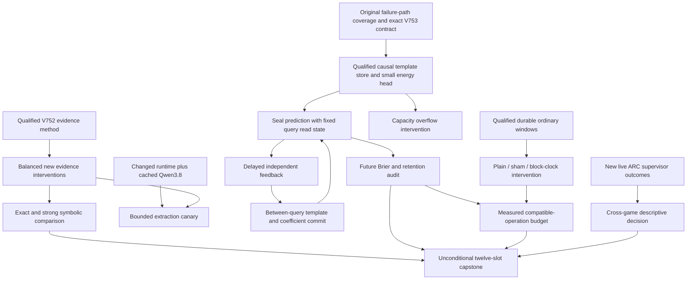

# Carnot Research Roadmap V753: Causal Additions, Evidence Robustness, and Honest Costs

**Created:** 2026-11-04 (research scan began November 3)
**Milestone:** 2026.11.753
**Status:** Staged plan; experiments are not executed or activated by this change
**Execution queue:** [research-roadmap-next.yaml](../../research-roadmap-next.yaml)
**Previous authority:** [Preserved V752 design](research-roadmap-v752-preserved-20261103.md)
**Contract:** Exactly 12 tasks, Exp8789 through Exp8800, in the order below, across four phases.

## What V752 proved

All thirteen scheduling slots ended. Seven primary artifacts exist; six tasks
were skipped. The completed-history file ends at V750, so V752 conclusions use
the primary artifacts and conductor receipts, not a guessed history entry.
The artifact summary's live adversarial check found no critical flags in those
seven primaries. A clean check does not override a failed acceptance gate.

| Artifact | Finding | Next consequence |
|---|---|---|
| Exp8776 branch methods | `complete_disqualified_v752_branch_methods`; method checks passed, but four original runner statements (88–90, 107) were unmeasured. | Exercise original private failure publication with real child coverage before admitting memory work. |
| Exp8777 evidence qualification | `complete_circular_positive_v752_evidence_method_qualification`; original failure publication and truth controls qualified. | Reuse the frozen method; do not repeat qualification without a new question. |
| Exp8779 evidence evaluation | `complete_circular_positive_v752_evidence_set_evaluation`; constructed evidence rows qualified. | The comparison is closed. Test balanced evidence interventions on new structures, with a stronger sufficiency-aware reference. |
| Exp8778/8780/8781/8785 | Prototype, learning, capacity comparison and benefit audit were skipped. | No useful-learning conclusion exists. A new prerequisite must address the exact failure. |
| Exp8782/8786 | Qwen and ARC analyses were skipped for absent changed runtime/new outcomes. | Preserve structured pre-gates; absence does not authorize another probe. |
| Exp8783 producer identity | `complete_circular_positive_durable_producer_identity`; identity, ordinary windows, parity and restart qualified. | Reuse exact starting states and producer custody. |
| Exp8784 costs | `complete_null_durable_cost_components`; total windows qualified, component attribution did not. | Test observer disturbance using sham dispatch and buffered block clocks; retain complete durable work. |
| Exp8787/8788 | Hardware claim and capstone scientific conclusion remained blocked. Reconciliation itself qualified. | Separate complete accounting from missing scientific or physical evidence. |

Primary paths are the corresponding `results/experiment_8776_v752_branch_methods.json`,
`experiment_8777_v752_evidence_method_qualification.json`,
`experiment_8779_v752_evidence_set_evaluation.json`,
`experiment_8783_v752_durable_producer_identity.json`,
`experiment_8784_v752_durable_cost_components.json`,
`experiment_8787_v752_hardware_operation_boundary.json`, and
`experiment_8788_v752_capstone.json`. Their raw references retain the evidence.

## Three biggest gaps against the PRD

1. **Faithful, robust verification — FR-12.** Exact checks certify encoded
   facts. They do not certify extraction or general factuality. Exp8791/8794
   separate irrelevant length/order changes from missing premises, conflicts,
   binding errors and valid alternatives. Exp8795 separately checks bounded
   mandated-Qwen extraction if the runtime changes.
2. **Useful continuous self-learning — FR-06/FR-11.** The proposed template
   learner has not run. Exp8789 repairs its concrete qualification blocker;
   Exp8790/8792/8793/8797 test actual additions, delayed updates, calibration
   and retention. This advances Tier 1/2 learning and the calibrated-decision
   floor without training the large generator or claiming the old learner works.
3. **Complete deployment benefit — FR-05/FR-08/NFR-01.** Arithmetic speed
   does not establish durable-service speed. Exp8796 measures how clocks
   disturb an unchanged workload; Exp8799 maps actual new learning costs to
   supported hardware operations. The PRD's 10x throughput target and the
   program's 100x learning aspiration remain unproved.

The ARC generalization floor remains reserved in Exp8798. It consumes only
new live supervisor outcomes. Learned cross-game value transfer, offline
per-game solving, unchanged empty inventories and generator budget inflation
are outside this plan.

## Research informing the milestone

The [V753 scan](../../research-references.md) was appended before task design.
It covers all eight requested topics and six secondary channels, with access
limits recorded. The scan supports controlled questions, not imported wins.

| Primary source | Adaptation | Tasks |
|---|---|---|
| [Type-aware hallucination analysis](https://arxiv.org/abs/2611.02258), November 2026 | Match length and label; preserve error-type results and semantic interventions | 8791, 8794, 8795 |
| [Memoir](https://arxiv.org/abs/2607.20792), July 2026 | Freeze query reads; compare delayed additions and coefficient updates | 8790, 8792, 8797 |
| [Capacity-constrained OCO](https://arxiv.org/abs/2606.11711), June 2026 | Demonstrate queue overflow before comparing admission; no imported regret bound | 8793 |
| [Distributional EBM reasoning](https://arxiv.org/abs/2605.18871), May 2026 | Audit shortcuts and compare against an explicit strong symbolic reference | 8790, 8794, 8797 |
| [On-chip KAN](https://arxiv.org/abs/2602.02056v4), June 2026; [million-p-bit hardware](https://arxiv.org/abs/2606.25313), June 2026; [Z1T](https://extropic.ai/writing/z1t), September 2026 | Separate sparse arithmetic, sampling topology, transfer and durable host costs | 8796, 8799 |

EBT and ARM–EBM remain architectural references. ETS and neural projection
methods stay deferred until their prerequisites justify an experiment. The
temporal robot-verifier paper is a future lead, not authorization to reopen
retired ARC value transfer. Semantic Scholar returned HTTP 429 for both citation
queries. OpenReview forums returned browser challenges; GitHub/HF feeds include
stale discovery content. Kona supplied no reproducible new implementation.

## Architecture



The policy reuses `GibbsModel(input_dim=9, hidden_dims=[4])`: six observed
counts plus three decision bits. Its inputs exclude truth, final solver output,
world IDs and condition tags. It emits support/refute/insufficient probabilities
and accept/reject/escalate decisions. Each query gets five paid checks. Memory
holds at most 32 alpha-normalized reusable templates. CPU counters and lookups
provide the immediate hardware path; small gradient work can later batch on GPU.
This policy is not the older nine-input, 109-coefficient spline learner.

## Phase 1 — Qualify the exact missing work (Exp8789–Exp8791)

Exp8789 measures the original intentional failed-child path, retains all original
assertions and binds the full twelve-task contract. It freezes independent CPU,
runtime and ARC readiness fields. Exp8790 builds the new causal memory policy
and runs tiny positive, negative, label-leakage and restart controls. Exp8791
freezes a separate intervention corpus and a strong sufficiency-aware reference.
Every prototype requires specs first, failing tests, measured validation and
adversarial controls. Failure in the contract must not be relabeled success.

## Phase 2 — Measure learning and evidence (Exp8792–Exp8795)

Exp8792 runs 30 independent reset streams, 32 queries each, three nested seeds
and five arms: read-only, additions-only, calibration-only, combined, shuffled
feedback. This is 14,400 online rows. Twelve disjoint retention worlds per stream
are scored at steps 0/16/32 without training on them. Feedback delay is eight;
tail drain costs remain explicit. A stream, not a query or seed, is independent.

Exp8793 uses delays 4/16/32 and capacities 4/8, proving overflow and divergent
admissions before comparing FIFO against uniform eviction. It uses unweighted
updates and claims no OCO theorem. Exp8794 runs 120 new worlds, six conditions,
two orderings, two length bins and three methods: 8,640 rows, 120 independent
worlds. Exp8795 is an optional 48-call, 128-token-per-call extraction pilot on
12 separate worlds. It reports counts; it cannot support benchmark delta claims.

## Phase 3 — Check measurement and benefit (Exp8796–Exp8797)

Exp8796 counterbalances plain, sham and buffered block clocks across Python
and resident-native implementations, three ordinary starts and two repeats:
36 windows, each 32 updates with a restart after 16. Complete operation and
prefix costs remain visible. Every absolute observer disturbance must be at
most 5 percent and independent clock-accounting discrepancy at most 2 percent
before component attribution is admitted. A large negative difference fails too.

Exp8797 recomputes all learning metrics from sealed predictions. Its ten
registered comparisons use 99.5-percent Bonferroni intervals from 10,000 whole
stream bootstrap draws. Both combined-minus-read-only and combined-minus-
calibration Brier upper bounds must be below -0.01. Six adaptive-arm retention
upper bounds and two combined error upper bounds must be at most +0.02.
Nulls need actual changed-check and headroom controls; otherwise they are
uninformative. Any constructed gain remains `circular_positive`.

## Phase 4 — Make bounded continuation decisions (Exp8798–Exp8800)

Exp8798 analyzes only new live ARC outcomes and preserves policy defaults.
It needs at least 30 eligible independent episodes and arm overlap for a
comparative interval; smaller data are descriptive. Exp8799 waits for new
complete learning costs and reports operation-compatible Amdahl bounds.
Exp8800 always accounts for all twelve slots, exact gate operands, rejected
evidence and retirement conditions. External blocks are terminal `blocked`.
Publication uses the existing stable G1–G4 gate; no external action is authorized.

## Dependency graph and gate contract

```text
8789 original-path qualification -> 8790 memory prototype -> 8792 causal learning -> 8797 audit
                                                        -> 8793 overflow study
8791 evidence methods -> 8794 evidence evaluation
8789 runtime evidence + 8791 methods -> 8795 Qwen canary
8783 retained durable producer -> 8796 observer intervention
8789 new ARC outcomes -> 8798 ARC decision
8792 complete learning costs -> 8799 hardware budget (8796/8797 are optional admitted inputs)
all twelve scheduling slots -> 8800 unconditional capstone
```

| Producer | Exact field | Consumer |
|---|---|---|
| exp8789-branch-qualification | memory_protocol_ready_score | exp8790-delayed-memory-prototype |
| exp8790-delayed-memory-prototype | memory_execution_ready_score | exp8792-causal-template-learning; exp8793-feedback-overflow-study |
| exp8791-evidence-intervention-methods | evidence_interventions_ready_score | exp8794-evidence-intervention-evaluation; exp8795-qwen-evidence-canary |
| exp8789-branch-qualification | runtime_repair_ready_score | exp8795-qwen-evidence-canary |
| exp8792-causal-template-learning | memory_rows_ready_score | exp8797-learning-benefit-audit |
| exp8789-branch-qualification | arc_new_outcomes_available_score | exp8798-arc-new-outcome-decision |
| exp8792-causal-template-learning | learning_cost_ready_score | exp8799-learning-hardware-budget |

Every structured gate uses `== 1`. Every field is declared in its producer's
REQUIRED ARTIFACT FIELDS. Historical references are immutable evidence, not
`requires` edges to retired tasks. Readiness means qualified execution; benefit
fields remain separate. Skips retain `gate_check_summary` and exact observed
operands. No optional GPU or ARC absence zeros a valid CPU branch.

## Hardware requirements and resource bounds

| Tasks | Compute and memory | Budget and boundary |
|---|---|---|
| 8789, 8791, 8794, 8797 | Existing CPU and private disk; 4–8 GB estimated working memory | 45–50 minutes each, including validation; no LLM |
| 8790, 8792, 8793 | CPU/JAX small-head training; 4–8 GB estimated working memory | 55–60 minutes; measured one-stream projection before full execution |
| 8795 | One available RTX 3090, 24 GB VRAM, cached Qwen3.8 Q4_K_M about 16 GB | 45 minutes; one load, 48 calls capped at 128 tokens; runtime/offload proof required |
| 8796 | CPU, installed native extension, private durable storage | 60 minutes; project 36 windows before execution; no physical FPGA |
| 8798, 8799 | CPU artifact readers | 20 minutes each; no new game, model, or board execution |
| 8800 | CPU readers and private validation | 45 minutes; unconditional accounting |

All memory figures are planning estimates, not measured availability. Every
task checks resources, projects work, reserves 900 seconds for validation and
remains below the conductor's 4,800-second hard cap. Heartbeats report real work
at least every 60 seconds, with flushed phase boundaries and before/after long
calls. Long loops report counts. No silence gap may reach 600 seconds. Files
over about 200 lines are written in several tool calls with progress between.

Qwen tasks declare `model_bounded_generation` (10-second floor). Only an actual
full generative study would declare `model_full_generation` (60 seconds), and
only an embedding/load-only study would declare `model_load_no_generation`
(2 seconds). The current plan has neither. All other tasks declare
`no_model_load` with `MODEL_SPECS: []`; small energy training is explicit.
The mandated model is `unsloth/Qwen3.8-27B-GGUF`. Legacy small models are CPU
smoke-only and cannot substitute for a failed headline-model precondition.

The wishlist keeps KV260 as the focus board, with qualified scope `k_max<=5`
and SSH/xmutil access. PolarFire remains CPU-only for admitted dispatch.
GateMate's unchanged `0xffffffff` blocker, NPU qualification and TSU access
remain open. No acquisition or integration experiment is justified until
Exp8799 finds compatible operations and sufficient complete-cost headroom.
Do not infer a 100x full-service gain from a KAN kernel or vendor energy estimate.

## Evidence, retirement and verification rules

All scoped continuations name actual prior verdicts, a changed mechanism or
prerequisite, and `retire_if_same_verdict: true`. No retired ID is reused and
no operator override is fabricated. An unchanged CUDA or ARC absence skips
the gated task before synthesis. The old failed learning union stays closed.

The planner validates full task-object equality, gate order/field spelling,
prior-failure fields, routing, progress requirements and model/substrate rules.
Relevant gate/schema unit tests, exclusion lint, spec coverage and private
E2E-018/021 exercise existing planning and authority paths. Implementation
tasks must extend REQ/SCENARIO specs before code, preserve every assertion,
record real child coverage, and pass adversarial and strict row checks.
Scoped checks do not imply a clean full repository. No benchmark is executed
or scientific gate advanced by creating this plan.

## Exact task contract

Exactly 12 tasks: Exp8789 through Exp8800. Count, full IDs, order, titles,
phases, deliverables and every embedded task field are binding. The machine
contract below contains the exact objects in `research-roadmap-next.yaml`.
Canonical tasks SHA-256 is SHA-256 over UTF-8 JSON with sorted keys,
compact separators and `ensure_ascii=False`.

| Order | ID | Title | Phase | Deliverable |
|---|---|---|---|---|
| 1 | `exp8789-branch-qualification` | Qualify original failure publication and bind twelve independent task slots | 1 | `results/experiment_8789_v753_branch_qualification.json` |
| 2 | `exp8790-delayed-memory-prototype` | Build a causal template store and small calibrated energy policy | 1 | `results/experiment_8790_v753_delayed_memory_prototype.json` |
| 3 | `exp8791-evidence-intervention-methods` | Seal length-balanced evidence interventions and strong solver controls | 1 | `results/experiment_8791_v753_evidence_intervention_methods.json` |
| 4 | `exp8792-causal-template-learning` | Measure future calibrated decisions after delayed constraint additions | 2 | `results/experiment_8792_v753_causal_template_learning.json` |
| 5 | `exp8793-feedback-overflow-study` | Compare feedback admission only when the pending queue actually overflows | 2 | `results/experiment_8793_v753_feedback_overflow_study.json` |
| 6 | `exp8794-evidence-intervention-evaluation` | Measure evidence invariance and semantic sensitivity by defect type | 2 | `results/experiment_8794_v753_evidence_intervention_evaluation.json` |
| 7 | `exp8795-qwen-evidence-canary` | Probe mandated Qwen extraction under paired irrelevant evidence | 2 | `results/experiment_8795_v753_qwen_evidence_canary.json` |
| 8 | `exp8796-observer-intervention` | Separate timer overhead from process variation on durable update windows | 3 | `results/experiment_8796_v753_observer_intervention.json` |
| 9 | `exp8797-learning-benefit-audit` | Audit later Brier benefit and retention across independent streams | 3 | `results/experiment_8797_v753_learning_benefit_audit.json` |
| 10 | `exp8798-arc-new-outcome-decision` | Assess cross-game supervisor choices from newly admitted live outcomes | 4 | `results/experiment_8798_v753_arc_new_outcome_decision.json` |
| 11 | `exp8799-learning-hardware-budget` | Bound hardware benefit from newly measured complete learning operations | 4 | `results/experiment_8799_v753_learning_hardware_budget.json` |
| 12 | `exp8800-capstone` | Reconcile twelve outcomes and close unchanged research continuations | 4 | `results/experiment_8800_v753_capstone.json` |

Canonical tasks SHA-256: `472ded8826d2026a662403a8908a9c6fb1a9ef90c3d52b5d3547a65b05b1432b`.

<!-- V753_TASK_CONTRACT_START -->
```json
{
  "milestone": "2026.11.753",
  "tasks": [
    {
      "id": "exp8789-branch-qualification",
      "title": "Qualify original failure publication and bind twelve independent task slots",
      "phase": 1,
      "track": "infrastructure",
      "priority": "high",
      "requires_gpu": false,
      "max_turns": 100,
      "estimated_wall_time_min": 50,
      "per_unit_rows": true,
      "milestone": "2026.11.753",
      "deliverable": "results/experiment_8789_v753_branch_qualification.json",
      "inference_substrate_class": "no_model_load",
      "MODEL_SPECS": [],
      "gated_on": [],
      "agent_type": "claude",
      "model": "opus",
      "prior_failures": [
        {"experiment_id": "exp7532-v659-contract-methods", "verdict": "complete_blocked_incomplete_v659_authorities", "addressed_by": "Exp8776 identifies four unmeasured private failure-publication statements. Exercise that original child path with unchanged assertions and real coverage, then qualify current independent protocols; no original-learning claim is reopened.", "retire_if_same_verdict": true},
        {"experiment_id": "exp7713-v672-contract-methods", "verdict": "complete_blocked_v672_independent_contract", "addressed_by": "Exp8776 identifies four unmeasured private failure-publication statements. Exercise that original child path with unchanged assertions and real coverage, then qualify current independent protocols; no original-learning claim is reopened.", "retire_if_same_verdict": true},
        {"experiment_id": "exp7940-v689-contract-methods", "verdict": "complete_blocked_authority", "addressed_by": "Exp8776 identifies four unmeasured private failure-publication statements. Exercise that original child path with unchanged assertions and real coverage, then qualify current independent protocols; no original-learning claim is reopened.", "retire_if_same_verdict": true},
        {"experiment_id": "exp7992-v693-contract-methods", "verdict": "complete_blocked_authority", "addressed_by": "Exp8776 identifies four unmeasured private failure-publication statements. Exercise that original child path with unchanged assertions and real coverage, then qualify current independent protocols; no original-learning claim is reopened.", "retire_if_same_verdict": true},
        {"experiment_id": "exp8018-v695-contract-methods", "verdict": "complete_blocked_authority", "addressed_by": "Exp8776 identifies four unmeasured private failure-publication statements. Exercise that original child path with unchanged assertions and real coverage, then qualify current independent protocols; no original-learning claim is reopened.", "retire_if_same_verdict": true},
        {"experiment_id": "exp8374-v722-contract-methods", "verdict": "complete_blocked_direct_contract_methods", "addressed_by": "Exp8776 identifies four unmeasured private failure-publication statements. Exercise that original child path with unchanged assertions and real coverage, then qualify current independent protocols; no original-learning claim is reopened.", "retire_if_same_verdict": true},
        {"experiment_id": "exp8388-v723-contract-methods", "verdict": "complete_blocked_v723_contract_methods", "addressed_by": "Exp8776 identifies four unmeasured private failure-publication statements. Exercise that original child path with unchanged assertions and real coverage, then qualify current independent protocols; no original-learning claim is reopened.", "retire_if_same_verdict": true},
        {"experiment_id": "exp8416-v725-contract-methods", "verdict": "complete_blocked_v725_contract_methods", "addressed_by": "Exp8776 identifies four unmeasured private failure-publication statements. Exercise that original child path with unchanged assertions and real coverage, then qualify current independent protocols; no original-learning claim is reopened.", "retire_if_same_verdict": true},
        {"experiment_id": "exp8443-v727-contract-methods", "verdict": "complete_blocked_v727_contract_methods", "addressed_by": "Exp8776 identifies four unmeasured private failure-publication statements. Exercise that original child path with unchanged assertions and real coverage, then qualify current independent protocols; no original-learning claim is reopened.", "retire_if_same_verdict": true},
        {"experiment_id": "exp8471-v729-contract-methods", "verdict": "complete_blocked_v729_contract_methods", "addressed_by": "Exp8776 identifies four unmeasured private failure-publication statements. Exercise that original child path with unchanged assertions and real coverage, then qualify current independent protocols; no original-learning claim is reopened.", "retire_if_same_verdict": true},
        {"experiment_id": "exp8499-v731-contract-methods", "verdict": "complete_blocked_v731_contract_methods", "addressed_by": "Exp8776 identifies four unmeasured private failure-publication statements. Exercise that original child path with unchanged assertions and real coverage, then qualify current independent protocols; no original-learning claim is reopened.", "retire_if_same_verdict": true},
        {"experiment_id": "exp8565-v736-contract-methods", "verdict": "complete_blocked_v736_contract_methods", "addressed_by": "Exp8776 identifies four unmeasured private failure-publication statements. Exercise that original child path with unchanged assertions and real coverage, then qualify current independent protocols; no original-learning claim is reopened.", "retire_if_same_verdict": true},
        {"experiment_id": "exp8602-v739-contract-methods", "verdict": "complete_blocked_v739_contract_methods", "addressed_by": "Exp8776 identifies four unmeasured private failure-publication statements. Exercise that original child path with unchanged assertions and real coverage, then qualify current independent protocols; no original-learning claim is reopened.", "retire_if_same_verdict": true},
        {"experiment_id": "exp8667-contract-methods", "verdict": "complete_disqualified_v744_contract_methods", "addressed_by": "Exp8776 identifies four unmeasured private failure-publication statements. Exercise that original child path with unchanged assertions and real coverage, then qualify current independent protocols; no original-learning claim is reopened.", "retire_if_same_verdict": true},
        {"experiment_id": "exp8681-contract-methods", "verdict": "complete_disqualified_v745_contract_methods", "addressed_by": "Exp8776 identifies four unmeasured private failure-publication statements. Exercise that original child path with unchanged assertions and real coverage, then qualify current independent protocols; no original-learning claim is reopened.", "retire_if_same_verdict": true},
        {"experiment_id": "exp8709-contract-methods", "verdict": "complete_disqualified_v747_contract_methods", "addressed_by": "Exp8776 identifies four unmeasured private failure-publication statements. Exercise that original child path with unchanged assertions and real coverage, then qualify current independent protocols; no original-learning claim is reopened.", "retire_if_same_verdict": true},
        {"experiment_id": "exp8737-contract-methods", "verdict": "complete_disqualified_v749_contract_methods", "addressed_by": "Exp8776 identifies four unmeasured private failure-publication statements. Exercise that original child path with unchanged assertions and real coverage, then qualify current independent protocols; no original-learning claim is reopened.", "retire_if_same_verdict": true},
        {"experiment_id": "exp8749-archive-bound-contract", "verdict": "complete_disqualified_v750_archive_bound_contract", "addressed_by": "Exp8776 identifies four unmeasured private failure-publication statements. Exercise that original child path with unchanged assertions and real coverage, then qualify current independent protocols; no original-learning claim is reopened.", "retire_if_same_verdict": true},
        {"experiment_id": "exp8763-branch-contract", "verdict": "complete_disqualified_v751_branch_contract", "addressed_by": "Exp8776 identifies four unmeasured private failure-publication statements. Exercise that original child path with unchanged assertions and real coverage, then qualify current independent protocols; no original-learning claim is reopened.", "retire_if_same_verdict": true},
        {"experiment_id": "exp8776-branch-methods", "verdict": "complete_disqualified_v752_branch_methods", "addressed_by": "Exp8776 identifies four unmeasured private failure-publication statements. Exercise that original child path with unchanged assertions and real coverage, then qualify current independent protocols; no original-learning claim is reopened.", "retire_if_same_verdict": true}
      ],
      "prompt": "CONTEXT:\nWork in {project_root} on {date}. V752 ran seven producers and skipped six tasks. Exp8776 passed its method checks but missed real runner statements 88-90 and 107. Four missing private-failure-path statements, not an unknown training failure, blocked the memory branch. Preserve the disqualified primary and all original assertions.\n\nEXISTING CODE TO READ FIRST:\nCLAUDE.md; CODEX.md; ops/e2e-test-plan.md; ops/exclusion_manifest.yaml; scripts/experiment_template.py; openspec/capabilities/research-reporting/spec.md; openspec/capabilities/verification/spec.md; python/carnot/reporting/primary_publication.py; python/carnot/reporting/v752_branch_methods.py; python/carnot/reporting/v752_branch_runner.py; python/carnot/reporting/v752_branch_report.py; python/carnot/reporting/roadmap_contract.py; tests/python/test_v752_branch_methods_8776.py; tests/python/test_v752_archive_8776.py; results/experiment_8776_v752_branch_methods.json; results/experiment_8788_v752_capstone.json; openspec/change-proposals/research-roadmap-v752-preserved-20261103.md; python/carnot/reporting/v744_contract_methods.py\n\nTASK:\nQualify original failure publication and bind twelve independent task slots. Deliver results/experiment_8789_v753_branch_qualification.json. Use scripts/experiments/experiment_8789_v753_branch_qualification.py as a thin CLI. Store raw evidence in results/raw/experiment_8789_v753_branch_qualification/. No LLM is needed: MODEL_SPECS=[], inference_substrate_class=no_model_load, zero LLM calls. Record deterministic_verifier, cpu_energy_training, or aggregation_from_upstream_artifacts according to actual work; no large model is loaded.\n\nCONCRETE STEPS:\n0. PRECONDITIONS (before execution): Check private scratch, dependency imports, exact upstream identity, source hashes, and a measured time/memory projection. Missing required resources produce complete_blocked_<resource> with gate_check_summary and no measurement.\n1. Print a flushed progress line at each phase boundary and before and after every model load, generation, benchmark, or subprocess that can take minutes. Print completed and pending counts inside long loops. Emit a parent heartbeat every 60 seconds during long calls; keep every silence gap under 600 seconds. Poll children through tool calls of at most 60 seconds. Write any file over about 200 lines in several tool calls, with a progress message between them; keep every write call small. Silence can end a task at 1200 seconds despite its 4800-second hard cap. Reserve 900 seconds for validation and terminal publication.\n2. Read the listed sources and prior failures. Add task-specific REQ-* and SCENARIO-* to the relevant existing capability spec before implementation, then write failing tests. Reuse existing modules and thin CLIs. Preserve original assertions and historical input hashes. Use private scratch for tests and CLI children. Do not weaken validation to admit a result. Freeze methods before evaluation; keep resource projections separate from scientific acceptance.\n3. Exercise the ORIGINAL Exp8776 --private-control path in private scratch through a real child. Measure its intentional failed pytest child and validation object construction, including original lines 88-90 and 107. Preserve failure propagation and output guards. Add a regression that the child exits normally with a failed assertion and cannot publish readiness. Do not exclude or manually credit these lines. Combine real original unit and child coverage, requiring 100 percent of all original owned statements before repair qualification.\n4. Bind exactly twelve full task objects Exp8789 through Exp8800 across the visible design table, embedded JSON and activated YAML. Compare every field and the canonical tasks hash. Snapshot original V752 authority and existing retained inputs into private trees. Accept only the established literal-brace activation transformation. Reject mutations of prompt, gate, model, routing, prior, count, order and deliverable. Do not certify the old 39+25-node learning union.\n5. Freeze the NEW memory estimand before its prototype: 30 independent streams of 32 new canonical worlds, three nested training seeds, five arms and a fixed delay of eight decisions. Reset learned state between streams. Reserve 12 disjoint retention worlds per stream. Development is 40 fit plus 20 tuning worlds from exposed material. Require disjoint structural hashes and no label access before prediction sealing. Freeze six observable features, three typed decisions, call budget five, template capacity32 and all acceptance thresholds from this design.\n6. Read changed CUDA authority once using the existing runtime reader. runtime_repair_ready_score=1 requires authenticated causal runtime/library changes and mandated-model custody; missing ops/cuda-runtime-repair-receipt.json keeps only this score zero. Read the ARC authority frontier once beyond Exp8760, admitting only new selected/applied live outcomes. Emit arc_new_outcomes_available_score independently; neither absence blocks the CPU memory protocol.\n7. Set contract_ready_score and memory_protocol_ready_score only after original failure publication, exact authority mutation controls, and current owned validation pass. Record the changed coverage mechanism and evidence. Keep failed original numerical-learning execution closed. A second unchanged qualification verdict closes this continuation.\n8. Run scoped unit and consumer tests with real unit/CLI-child coverage of every owned executable statement, exact collected-node inventories, normal child exits, JUnit and coverage SQLite receipts. Run Ruff check/format, strict mypy on owned Python modules, explicit spec coverage, and private E2E-018/021 where authority/publication paths apply; use E2E-003/004 for native round trips. Preserve all original negative controls. Validate terminal bytes with unchanged adversarial_verify.py and verdict_row_consistency_lint.py --strict, then cold-replay sealed primitives and reject rehashed tampering. Failed owned validation is disqualified. Unchanged external absence is terminal blocked, never partial. Reconcile OpenSpec, _bmad/traceability.md, ops/status.md and ops/changelog.md. Preserve historical primary artifacts, shared validators, generator weights, ARC policy defaults, active roadmap and exclusion manifest. Record scoped validation separately from whole-repository health.\n\nREQUIRED ARTIFACT FIELDS:\nexperiment_id, task_id, milestone, run_date, invocation_id: principle: Bind exact task identity and this invocation; aliases cannot authenticate a producer.\nhonest_verdict, verdict_class: principle: Use a complete_ terminal prefix and exactly one of positive | circular_positive | null | blocked | disqualified | partial. Only retryable unfinished owned work is partial; unchanged external absence is blocked.\ngate_check_summary: principle: Every blocked_* or complete_blocked_* verdict records upstream, path/hash, check, field, operator, expected and observed value; distinguish missing file, missing field, zero and rejected producer.\ninference_substrate, inference_substrate_class, MODEL_SPECS, model_invocation_counts, numerical_training_calls: principle: Describe actual compute; small energy-policy training is separate from LLM loading. A skipped model path records zero calls and no_model_load.\nrows, intended_count, completed_count, failed_count, censored_count, excluded_count, independent_count, n_samples: principle: Retain every intended unit and arm with raw metric, numerator, denominator, missingness and cost; seeds, surfaces and repeated timings do not create independent units.\nverifier_is_oracle, exposure_scope, independent_generalization_score: principle: Execution-grounded positives are circular_positive; constructed feedback cannot establish natural factuality or hidden-game transfer.\nacceptance_gates, required_checks_passed, flagged_adversarial, validation_receipts, terminal_validation_sidecar_path: principle: Separate execution readiness from benefit; failed acceptance gates forbid positive classes and quarantined artifacts cannot supply headlines.\npreconditions_checked, duration_s, started_at_utc, ended_at_utc, phase_spans, random_seed, reproducibility_checksum: principle: Preserve real clocks, resources and seeds; never pad a duration floor or reuse another process's clock epoch.\nsource_artifact_hashes, code_config_hashes, raw_shard_hashes, cited_upstream_artifacts, field_principles: principle: Bind each imported field and result to immutable operands and explain its evidence boundary.\nrepository_health_reference, scoped_validation_scope: principle: A scoped pass is not a full-repository pass.\ncontract_ready_score, memory_protocol_ready_score, runtime_repair_ready_score, arc_new_outcomes_available_score: principle: Exact independent producer fields prevent optional-resource failures from cascading into CPU science.\nfull_task_objects, canonical_tasks_sha256, original_missing_statement_rows, original_node_inventory, owned_statement_coverage, branch_protocol_refs, runtime_authority, arc_frontier_reference: principle: Actual original child execution and sealed protocols establish the changed prerequisite; a renamed runner cannot qualify it.\n\nRun command: cd {project_root} && JAX_PLATFORMS=cpu PYTHONPATH=python:. PYTHONUNBUFFERED=1 .venv/bin/python -u scripts/experiments/experiment_8789_v753_branch_qualification.py --date {date}\n\nDo NOT push. Do NOT modify scripts/research_conductor.py.\n"
    },
    {
      "id": "exp8790-delayed-memory-prototype",
      "title": "Build a causal template store and small calibrated energy policy",
      "phase": 1,
      "track": "self_learning",
      "priority": "high",
      "requires_gpu": false,
      "max_turns": 50,
      "estimated_wall_time_min": 60,
      "per_unit_rows": true,
      "milestone": "2026.11.753",
      "deliverable": "results/experiment_8790_v753_delayed_memory_prototype.json",
      "inference_substrate_class": "no_model_load",
      "MODEL_SPECS": [],
      "gated_on": [{"upstream": "exp8789-branch-qualification", "artifact_field": "memory_protocol_ready_score", "op": "==", "value": 1}],
      "prior_failures": [
        {"experiment_id": "exp8116-independent-online-memory", "verdict": "complete_disqualified_owned_validation", "addressed_by": "Gate on Exp8789 original private-failure coverage correction; use new disjoint streams and distinct memory/calibration arms. The previous prototype did not execute.", "retire_if_same_verdict": true},
        {"experiment_id": "exp8766-causal-brier-stream", "verdict": "blocked_gate_check_failed", "addressed_by": "Gate on Exp8789 original private-failure coverage correction; use new disjoint streams and distinct memory/calibration arms. The previous prototype did not execute.", "retire_if_same_verdict": true},
        {"experiment_id": "exp8778-delayed-memory-prototype", "verdict": "blocked_gate_check_failed", "addressed_by": "Gate on Exp8789 original private-failure coverage correction; use new disjoint streams and distinct memory/calibration arms. The previous prototype did not execute.", "retire_if_same_verdict": true}
      ],
      "prompt": "CONTEXT:\nWork in {project_root} on {date}. Exp8778 was never executed because exp8776.memory_protocol_ready_score was zero. This attempt requires the measured original failure-path correction in Exp8789. Memoir motivates fixed reads within a query. No large generator weights change.\n\nEXISTING CODE TO READ FIRST:\nCLAUDE.md; CODEX.md; ops/e2e-test-plan.md; ops/exclusion_manifest.yaml; scripts/experiment_template.py; openspec/capabilities/research-reporting/spec.md; openspec/capabilities/verification/spec.md; python/carnot/reporting/primary_publication.py; python/carnot/learn/constraint_memory.py; python/carnot/pipeline/constraint_template_library.py; python/carnot/learning/continual_constraint_memory.py; python/carnot/memory/transactional_constraint_memory.py; python/carnot/autoresearch/calibrated_decision_benchmark.py; python/carnot/models/gibbs/__init__.py; python/carnot/reporting/evidence_set_methods_8768.py; python/carnot/reporting/evidence_qualification_8777.py\n\nTASK:\nBuild a causal template store and small calibrated energy policy. Deliver results/experiment_8790_v753_delayed_memory_prototype.json. Use scripts/experiments/experiment_8790_v753_delayed_memory_prototype.py as a thin CLI. Store raw evidence in results/raw/experiment_8790_v753_delayed_memory_prototype/. No LLM is needed: MODEL_SPECS=[], inference_substrate_class=no_model_load, zero LLM calls. Record deterministic_verifier, cpu_energy_training, or aggregation_from_upstream_artifacts according to actual work; no large model is loaded.\n\nCONCRETE STEPS:\n0. PRECONDITIONS (before execution): Check private scratch, dependency imports, exact upstream identity, source hashes, and a measured time/memory projection. Missing required resources produce complete_blocked_<resource> with gate_check_summary and no measurement.\n1. Print a flushed progress line at each phase boundary and before and after every model load, generation, benchmark, or subprocess that can take minutes. Print completed and pending counts inside long loops. Emit a parent heartbeat every 60 seconds during long calls; keep every silence gap under 600 seconds. Poll children through tool calls of at most 60 seconds. Write any file over about 200 lines in several tool calls, with a progress message between them; keep every write call small. Silence can end a task at 1200 seconds despite its 4800-second hard cap. Reserve 900 seconds for validation and terminal publication.\n2. Read the listed sources and prior failures. Add task-specific REQ-* and SCENARIO-* to the relevant existing capability spec before implementation, then write failing tests. Reuse existing modules and thin CLIs. Preserve original assertions and historical input hashes. Use private scratch for tests and CLI children. Do not weaken validation to admit a result. Freeze methods before evaluation; keep resource projections separate from scientific acceptance.\n3. Authenticate Exp8789 memory_protocol_ready_score=1 and its frozen protocol, plus the qualified Exp8777 evidence-method reference. Reuse GibbsModel with input_dim=9 and hidden_dims=[4]: six observed counts plus three decision bits. Features are performed-check count, satisfied local count, missing count, shared-variable count, observed sign conflicts, and successful bindings. Count global information gathering against the same budget. Exclude truth, final full-verifier output, world IDs, condition tags and unavailable checks.\n4. Normalize exp(-energy) over support/refute/insufficient and minimize multiclass Brier loss with bounded SGD and JAX autodiff. Map support/refute to accept/reject only above frozen thresholds, otherwise escalate. Fit on40 exposed development worlds and tune on20 only; freeze learning-rate grid, clipping, steps, seed list and thresholds before tuning. This is small-policy training, not LLM loading.\n5. Implement five nonidentical arms with equal initial head and development template library: read_only, additions_only, calibration_only, combined, shuffled_feedback. Read_only updates neither component; additions_only updates templates; calibration_only updates coefficients; combined updates both; shuffled_feedback permutes released labels within the available released buffer, never future labels. Templates add alpha-normalized join/conflict checks, not cached world answers. Each check costs one of five calls; cap templates at32.\n6. Freeze memory throughout a query, seal probabilities before any release, and commit templates, coefficients, pending prediction IDs and acknowledgments atomically between queries. Test delayed and duplicate release, label injection, unauthorized reads, query-time write rejection, hard exit and exact resume. Use independent truth only as delayed supervision. A constructed gain remains circular_positive.\n7. Generate and seal30 disjoint32-query streams and12 retention worlds per stream with new8-10-edge structures, separate from all exposed V751/V752 graphs and development. Reject isomorphic renamings as new worlds. Three model seeds are nested repeats, not independent samples. Store labels outside policy input. Run only tiny qualification fixtures here, including a positive control where an added general rule changes a later decision and an unrelated-rule negative control.\n8. Emit memory_execution_ready_score only after actual coefficient changes, useful template application on the qualification control, causal ordering and restart parity all pass. Log CPU counter/lookup/check/training/durable operations for later hardware mapping. Do not tune on evaluation or retention worlds.\n9. Run scoped unit and consumer tests with real unit/CLI-child coverage of every owned executable statement, exact collected-node inventories, normal child exits, JUnit and coverage SQLite receipts. Run Ruff check/format, strict mypy on owned Python modules, explicit spec coverage, and private E2E-018/021 where authority/publication paths apply; use E2E-003/004 for native round trips. Preserve all original negative controls. Validate terminal bytes with unchanged adversarial_verify.py and verdict_row_consistency_lint.py --strict, then cold-replay sealed primitives and reject rehashed tampering. Failed owned validation is disqualified. Unchanged external absence is terminal blocked, never partial. Reconcile OpenSpec, _bmad/traceability.md, ops/status.md and ops/changelog.md. Preserve historical primary artifacts, shared validators, generator weights, ARC policy defaults, active roadmap and exclusion manifest. Record scoped validation separately from whole-repository health.\n\nREQUIRED ARTIFACT FIELDS:\nexperiment_id, task_id, milestone, run_date, invocation_id: principle: Bind exact task identity and this invocation; aliases cannot authenticate a producer.\nhonest_verdict, verdict_class: principle: Use a complete_ terminal prefix and exactly one of positive | circular_positive | null | blocked | disqualified | partial. Only retryable unfinished owned work is partial; unchanged external absence is blocked.\ngate_check_summary: principle: Every blocked_* or complete_blocked_* verdict records upstream, path/hash, check, field, operator, expected and observed value; distinguish missing file, missing field, zero and rejected producer.\ninference_substrate, inference_substrate_class, MODEL_SPECS, model_invocation_counts, numerical_training_calls: principle: Describe actual compute; small energy-policy training is separate from LLM loading. A skipped model path records zero calls and no_model_load.\nrows, intended_count, completed_count, failed_count, censored_count, excluded_count, independent_count, n_samples: principle: Retain every intended unit and arm with raw metric, numerator, denominator, missingness and cost; seeds, surfaces and repeated timings do not create independent units.\nverifier_is_oracle, exposure_scope, independent_generalization_score: principle: Execution-grounded positives are circular_positive; constructed feedback cannot establish natural factuality or hidden-game transfer.\nacceptance_gates, required_checks_passed, flagged_adversarial, validation_receipts, terminal_validation_sidecar_path: principle: Separate execution readiness from benefit; failed acceptance gates forbid positive classes and quarantined artifacts cannot supply headlines.\npreconditions_checked, duration_s, started_at_utc, ended_at_utc, phase_spans, random_seed, reproducibility_checksum: principle: Preserve real clocks, resources and seeds; never pad a duration floor or reuse another process's clock epoch.\nsource_artifact_hashes, code_config_hashes, raw_shard_hashes, cited_upstream_artifacts, field_principles: principle: Bind each imported field and result to immutable operands and explain its evidence boundary.\nrepository_health_reference, scoped_validation_scope: principle: A scoped pass is not a full-repository pass.\nmemory_execution_ready_score, policy_checkpoint, feature_allowlist, memory_schema, memory_template_rows, release_schedule, split_manifest, checkpoint_replay_rows, hardware_operation_counts: principle: Implementation readiness requires a real trained small head, information-adding templates and causal state, independent of eventual benchmark benefit.\n\nRun command: cd {project_root} && JAX_PLATFORMS=cpu PYTHONPATH=python:. PYTHONUNBUFFERED=1 .venv/bin/python -u scripts/experiments/experiment_8790_v753_delayed_memory_prototype.py --date {date}\n\nDo NOT push. Do NOT modify scripts/research_conductor.py.\n"
    },
    {
      "id": "exp8791-evidence-intervention-methods",
      "title": "Seal length-balanced evidence interventions and strong solver controls",
      "phase": 1,
      "track": "verification",
      "priority": "high",
      "requires_gpu": false,
      "max_turns": 50,
      "estimated_wall_time_min": 45,
      "per_unit_rows": true,
      "milestone": "2026.11.753",
      "deliverable": "results/experiment_8791_v753_evidence_intervention_methods.json",
      "inference_substrate_class": "no_model_load",
      "MODEL_SPECS": [],
      "gated_on": [],
      "agent_type": "codex",
      "model": "gpt-6.1-sol",
      "prior_failures": [
        {"experiment_id": "exp7532-v659-contract-methods", "verdict": "complete_blocked_incomplete_v659_authorities", "addressed_by": "The original failure path is now qualified. Freeze a new length/order intervention estimand, disjoint worlds and a sufficiency-aware joint baseline; do not repeat the closed V752 comparison.", "retire_if_same_verdict": true},
        {"experiment_id": "exp7713-v672-contract-methods", "verdict": "complete_blocked_v672_independent_contract", "addressed_by": "The original failure path is now qualified. Freeze a new length/order intervention estimand, disjoint worlds and a sufficiency-aware joint baseline; do not repeat the closed V752 comparison.", "retire_if_same_verdict": true},
        {"experiment_id": "exp7940-v689-contract-methods", "verdict": "complete_blocked_authority", "addressed_by": "The original failure path is now qualified. Freeze a new length/order intervention estimand, disjoint worlds and a sufficiency-aware joint baseline; do not repeat the closed V752 comparison.", "retire_if_same_verdict": true},
        {"experiment_id": "exp7992-v693-contract-methods", "verdict": "complete_blocked_authority", "addressed_by": "The original failure path is now qualified. Freeze a new length/order intervention estimand, disjoint worlds and a sufficiency-aware joint baseline; do not repeat the closed V752 comparison.", "retire_if_same_verdict": true},
        {"experiment_id": "exp8018-v695-contract-methods", "verdict": "complete_blocked_authority", "addressed_by": "The original failure path is now qualified. Freeze a new length/order intervention estimand, disjoint worlds and a sufficiency-aware joint baseline; do not repeat the closed V752 comparison.", "retire_if_same_verdict": true},
        {"experiment_id": "exp8374-v722-contract-methods", "verdict": "complete_blocked_direct_contract_methods", "addressed_by": "The original failure path is now qualified. Freeze a new length/order intervention estimand, disjoint worlds and a sufficiency-aware joint baseline; do not repeat the closed V752 comparison.", "retire_if_same_verdict": true},
        {"experiment_id": "exp8388-v723-contract-methods", "verdict": "complete_blocked_v723_contract_methods", "addressed_by": "The original failure path is now qualified. Freeze a new length/order intervention estimand, disjoint worlds and a sufficiency-aware joint baseline; do not repeat the closed V752 comparison.", "retire_if_same_verdict": true},
        {"experiment_id": "exp8416-v725-contract-methods", "verdict": "complete_blocked_v725_contract_methods", "addressed_by": "The original failure path is now qualified. Freeze a new length/order intervention estimand, disjoint worlds and a sufficiency-aware joint baseline; do not repeat the closed V752 comparison.", "retire_if_same_verdict": true},
        {"experiment_id": "exp8443-v727-contract-methods", "verdict": "complete_blocked_v727_contract_methods", "addressed_by": "The original failure path is now qualified. Freeze a new length/order intervention estimand, disjoint worlds and a sufficiency-aware joint baseline; do not repeat the closed V752 comparison.", "retire_if_same_verdict": true},
        {"experiment_id": "exp8471-v729-contract-methods", "verdict": "complete_blocked_v729_contract_methods", "addressed_by": "The original failure path is now qualified. Freeze a new length/order intervention estimand, disjoint worlds and a sufficiency-aware joint baseline; do not repeat the closed V752 comparison.", "retire_if_same_verdict": true},
        {"experiment_id": "exp8499-v731-contract-methods", "verdict": "complete_blocked_v731_contract_methods", "addressed_by": "The original failure path is now qualified. Freeze a new length/order intervention estimand, disjoint worlds and a sufficiency-aware joint baseline; do not repeat the closed V752 comparison.", "retire_if_same_verdict": true},
        {"experiment_id": "exp8565-v736-contract-methods", "verdict": "complete_blocked_v736_contract_methods", "addressed_by": "The original failure path is now qualified. Freeze a new length/order intervention estimand, disjoint worlds and a sufficiency-aware joint baseline; do not repeat the closed V752 comparison.", "retire_if_same_verdict": true},
        {"experiment_id": "exp8602-v739-contract-methods", "verdict": "complete_blocked_v739_contract_methods", "addressed_by": "The original failure path is now qualified. Freeze a new length/order intervention estimand, disjoint worlds and a sufficiency-aware joint baseline; do not repeat the closed V752 comparison.", "retire_if_same_verdict": true},
        {"experiment_id": "exp8667-contract-methods", "verdict": "complete_disqualified_v744_contract_methods", "addressed_by": "The original failure path is now qualified. Freeze a new length/order intervention estimand, disjoint worlds and a sufficiency-aware joint baseline; do not repeat the closed V752 comparison.", "retire_if_same_verdict": true},
        {"experiment_id": "exp8681-contract-methods", "verdict": "complete_disqualified_v745_contract_methods", "addressed_by": "The original failure path is now qualified. Freeze a new length/order intervention estimand, disjoint worlds and a sufficiency-aware joint baseline; do not repeat the closed V752 comparison.", "retire_if_same_verdict": true},
        {"experiment_id": "exp8709-contract-methods", "verdict": "complete_disqualified_v747_contract_methods", "addressed_by": "The original failure path is now qualified. Freeze a new length/order intervention estimand, disjoint worlds and a sufficiency-aware joint baseline; do not repeat the closed V752 comparison.", "retire_if_same_verdict": true},
        {"experiment_id": "exp8737-contract-methods", "verdict": "complete_disqualified_v749_contract_methods", "addressed_by": "The original failure path is now qualified. Freeze a new length/order intervention estimand, disjoint worlds and a sufficiency-aware joint baseline; do not repeat the closed V752 comparison.", "retire_if_same_verdict": true},
        {"experiment_id": "exp8755-verifier-family-surface", "verdict": "complete_null_v750_verifier_family_surface", "addressed_by": "The original failure path is now qualified. Freeze a new length/order intervention estimand, disjoint worlds and a sufficiency-aware joint baseline; do not repeat the closed V752 comparison.", "retire_if_same_verdict": true},
        {"experiment_id": "exp8768-evidence-set-methods", "verdict": "complete_disqualified_v751_evidence_set_methods", "addressed_by": "The original failure path is now qualified. Freeze a new length/order intervention estimand, disjoint worlds and a sufficiency-aware joint baseline; do not repeat the closed V752 comparison.", "retire_if_same_verdict": true},
        {"experiment_id": "exp5839-v519-evidence-qualification", "verdict": "mixed: constraint_stream_and_structural_qualified_lifecycle_and_replay_disqualified", "addressed_by": "The original failure path is now qualified. Freeze a new length/order intervention estimand, disjoint worlds and a sufficiency-aware joint baseline; do not repeat the closed V752 comparison.", "retire_if_same_verdict": true},
        {"experiment_id": "exp8319-local-evidence-qualification", "verdict": "blocked_gate_check_failed", "addressed_by": "The original failure path is now qualified. Freeze a new length/order intervention estimand, disjoint worlds and a sufficiency-aware joint baseline; do not repeat the closed V752 comparison.", "retire_if_same_verdict": true},
        {"experiment_id": "exp8777-evidence-method-qualification", "verdict": "complete_circular_positive_v752_evidence_method_qualification", "addressed_by": "The original failure path is now qualified. Freeze a new length/order intervention estimand, disjoint worlds and a sufficiency-aware joint baseline; do not repeat the closed V752 comparison.", "retire_if_same_verdict": true}
      ],
      "prompt": "CONTEXT:\nWork in {project_root} on {date}. Exp8777/8779 qualified constructed evidence-set verification. Their exposed comparison is closed. The November2026 type-aware hallucination paper motivates a new estimand: robustness to irrelevant length and order versus sensitivity to actual evidence changes. Exact proof of encoded facts does not prove faithful extraction.\n\nEXISTING CODE TO READ FIRST:\nCLAUDE.md; CODEX.md; ops/e2e-test-plan.md; ops/exclusion_manifest.yaml; scripts/experiment_template.py; openspec/capabilities/research-reporting/spec.md; openspec/capabilities/verification/spec.md; python/carnot/reporting/primary_publication.py; python/carnot/reporting/evidence_set_methods_8768.py; python/carnot/reporting/evidence_set_corpus_8768.py; python/carnot/reporting/evidence_set_analysis_8768.py; python/carnot/reporting/evidence_qualification_8777.py; python/carnot/reporting/evidence_set_evaluation_8779.py; tests/python/test_evidence_set_evaluation_8779.py; results/experiment_8777_v752_evidence_method_qualification.json; results/experiment_8779_v752_evidence_set_evaluation.json; research-references.md\n\nTASK:\nSeal length-balanced evidence interventions and strong solver controls. Deliver results/experiment_8791_v753_evidence_intervention_methods.json. Use scripts/experiments/experiment_8791_v753_evidence_intervention_methods.py as a thin CLI. Store raw evidence in results/raw/experiment_8791_v753_evidence_intervention_methods/. No LLM is needed: MODEL_SPECS=[], inference_substrate_class=no_model_load, zero LLM calls. Record deterministic_verifier, cpu_energy_training, or aggregation_from_upstream_artifacts according to actual work; no large model is loaded.\n\nCONCRETE STEPS:\n0. PRECONDITIONS (before execution): Check private scratch, dependency imports, exact upstream identity, source hashes, and a measured time/memory projection. Missing required resources produce complete_blocked_<resource> with gate_check_summary and no measurement.\n1. Print a flushed progress line at each phase boundary and before and after every model load, generation, benchmark, or subprocess that can take minutes. Print completed and pending counts inside long loops. Emit a parent heartbeat every 60 seconds during long calls; keep every silence gap under 600 seconds. Poll children through tool calls of at most 60 seconds. Write any file over about 200 lines in several tool calls, with a progress message between them; keep every write call small. Silence can end a task at 1200 seconds despite its 4800-second hard cap. Reserve 900 seconds for validation and terminal publication.\n2. Read the listed sources and prior failures. Add task-specific REQ-* and SCENARIO-* to the relevant existing capability spec before implementation, then write failing tests. Reuse existing modules and thin CLIs. Preserve original assertions and historical input hashes. Use private scratch for tests and CLI children. Do not weaken validation to admit a result. Freeze methods before evaluation; keep resource projections separate from scientific acceptance.\n3. Authenticate the admitted Exp8777 method and Exp8779 raw rows. Preserve both as exposed history. Freeze a new120-world11-13-edge graph roster. The edge-count family is disjoint from the learning roster's8-10-edge structures, even when that branch is unavailable; also reject overlap with all V751/V752 structures. Keep labels and condition tags in evaluator-only records. All representation variants share a world cluster.\n4. Define six paired evidence conditions: clean support, omitted required premise, shared-variable mismatch, signed contradiction, redundant irrelevant facts, and valid alternative proof. For each use two orderings and two exact matched token-length bins. Balance length and label within each bin; pad only with semantically irrelevant records. Use independent truth tables, including a hand-inspected tiny counterexample set, to determine when a condition preserves truth or changes it.\n5. Compare local_record, the original evidence_set method, and a strong joint_symbolic reference that explicitly handles open-world insufficiency, shared bindings, conflicts and valid alternative proofs. Do not handicap the reference by dropping sufficiency checks. Freeze method semantics before seeing evaluation results. Cost all predicate inspections and evaluator invocations; distinguish a five-call interface limit from real primitive operations.\n6. Implement metamorphic assertions: renaming/order/irrelevant-padding invariance; omission or contradiction sensitivity when truth changes; no rejection of a valid alternative. Test absent premises and conflicting assertions without mapping absence directly to false. Include corrupt-label and hidden-condition-field rejection controls. Keep this task to method qualification and tiny fixtures; execute the120-world comparison later.\n7. Set evidence_interventions_ready_score only if the original method is authenticated, intervention truth is independently checked, length balance holds, and the strong solver agrees with the independent tiny oracle on all semantic controls. If the existing method violates invariance, preserve the observed failure and freeze it as an evaluated arm; do not patch it on held-out outcomes.\n8. Run scoped unit and consumer tests with real unit/CLI-child coverage of every owned executable statement, exact collected-node inventories, normal child exits, JUnit and coverage SQLite receipts. Run Ruff check/format, strict mypy on owned Python modules, explicit spec coverage, and private E2E-018/021 where authority/publication paths apply; use E2E-003/004 for native round trips. Preserve all original negative controls. Validate terminal bytes with unchanged adversarial_verify.py and verdict_row_consistency_lint.py --strict, then cold-replay sealed primitives and reject rehashed tampering. Failed owned validation is disqualified. Unchanged external absence is terminal blocked, never partial. Reconcile OpenSpec, _bmad/traceability.md, ops/status.md and ops/changelog.md. Preserve historical primary artifacts, shared validators, generator weights, ARC policy defaults, active roadmap and exclusion manifest. Record scoped validation separately from whole-repository health.\n\nREQUIRED ARTIFACT FIELDS:\nexperiment_id, task_id, milestone, run_date, invocation_id: principle: Bind exact task identity and this invocation; aliases cannot authenticate a producer.\nhonest_verdict, verdict_class: principle: Use a complete_ terminal prefix and exactly one of positive | circular_positive | null | blocked | disqualified | partial. Only retryable unfinished owned work is partial; unchanged external absence is blocked.\ngate_check_summary: principle: Every blocked_* or complete_blocked_* verdict records upstream, path/hash, check, field, operator, expected and observed value; distinguish missing file, missing field, zero and rejected producer.\ninference_substrate, inference_substrate_class, MODEL_SPECS, model_invocation_counts, numerical_training_calls: principle: Describe actual compute; small energy-policy training is separate from LLM loading. A skipped model path records zero calls and no_model_load.\nrows, intended_count, completed_count, failed_count, censored_count, excluded_count, independent_count, n_samples: principle: Retain every intended unit and arm with raw metric, numerator, denominator, missingness and cost; seeds, surfaces and repeated timings do not create independent units.\nverifier_is_oracle, exposure_scope, independent_generalization_score: principle: Execution-grounded positives are circular_positive; constructed feedback cannot establish natural factuality or hidden-game transfer.\nacceptance_gates, required_checks_passed, flagged_adversarial, validation_receipts, terminal_validation_sidecar_path: principle: Separate execution readiness from benefit; failed acceptance gates forbid positive classes and quarantined artifacts cannot supply headlines.\npreconditions_checked, duration_s, started_at_utc, ended_at_utc, phase_spans, random_seed, reproducibility_checksum: principle: Preserve real clocks, resources and seeds; never pad a duration floor or reuse another process's clock epoch.\nsource_artifact_hashes, code_config_hashes, raw_shard_hashes, cited_upstream_artifacts, field_principles: principle: Bind each imported field and result to immutable operands and explain its evidence boundary.\nrepository_health_reference, scoped_validation_scope: principle: A scoped pass is not a full-repository pass.\nevidence_interventions_ready_score, frozen_method_reference, intervention_manifest, split_manifest, truth_control_rows, length_balance_rows, primitive_budget_definition: principle: New semantics and balanced covariates make this a different falsifiable comparison; exact solvers remain circular evidence.\n\nRun command: cd {project_root} && JAX_PLATFORMS=cpu PYTHONPATH=python:. PYTHONUNBUFFERED=1 .venv/bin/python -u scripts/experiments/experiment_8791_v753_evidence_intervention_methods.py --date {date}\n\nDo NOT push. Do NOT modify scripts/research_conductor.py.\n"
    },
    {
      "id": "exp8792-causal-template-learning",
      "title": "Measure future calibrated decisions after delayed constraint additions",
      "phase": 2,
      "track": "self_learning",
      "priority": "high",
      "requires_gpu": false,
      "max_turns": 50,
      "estimated_wall_time_min": 60,
      "per_unit_rows": true,
      "milestone": "2026.11.753",
      "deliverable": "results/experiment_8792_v753_causal_template_learning.json",
      "inference_substrate_class": "no_model_load",
      "MODEL_SPECS": [],
      "gated_on": [{"upstream": "exp8790-delayed-memory-prototype", "artifact_field": "memory_execution_ready_score", "op": "==", "value": 1}],
      "prior_failures": [
        {"experiment_id": "exp8116-independent-online-memory", "verdict": "complete_disqualified_owned_validation", "addressed_by": "Exp8790 qualifies the newly runnable prototype after original failure-path coverage is fixed. Reset streams replace invalid independence assumptions across causally linked queries; current same-roadmap gates replace the skipped chain.", "retire_if_same_verdict": true},
        {"experiment_id": "exp8766-causal-brier-stream", "verdict": "blocked_gate_check_failed", "addressed_by": "Exp8790 qualifies the newly runnable prototype after original failure-path coverage is fixed. Reset streams replace invalid independence assumptions across causally linked queries; current same-roadmap gates replace the skipped chain.", "retire_if_same_verdict": true},
        {"experiment_id": "exp8531-causal-brier-learning", "verdict": "blocked_gate_check_failed", "addressed_by": "Exp8790 qualifies the newly runnable prototype after original failure-path coverage is fixed. Reset streams replace invalid independence assumptions across causally linked queries; current same-roadmap gates replace the skipped chain.", "retire_if_same_verdict": true},
        {"experiment_id": "exp8780-causal-template-learning", "verdict": "blocked_gate_check_failed", "addressed_by": "Exp8790 qualifies the newly runnable prototype after original failure-path coverage is fixed. Reset streams replace invalid independence assumptions across causally linked queries; current same-roadmap gates replace the skipped chain.", "retire_if_same_verdict": true}
      ],
      "prompt": "CONTEXT:\nWork in {project_root} on {date}. Exp8780 was cascade-skipped after the prototype gate failed. Exp8790 now supplies a separately qualified small policy and causal store. The unit of statistical independence is a reset stream, since earlier feedback changes later decisions.\n\nEXISTING CODE TO READ FIRST:\nCLAUDE.md; CODEX.md; ops/e2e-test-plan.md; ops/exclusion_manifest.yaml; scripts/experiment_template.py; openspec/capabilities/research-reporting/spec.md; openspec/capabilities/verification/spec.md; python/carnot/reporting/primary_publication.py; python/carnot/learning/continual_constraint_memory.py; python/carnot/pipeline/constraint_template_library.py; python/carnot/autoresearch/calibrated_decision_benchmark.py; scripts/experiments/experiment_8790_v753_delayed_memory_prototype.py; results/experiment_8790_v753_delayed_memory_prototype.json; openspec/change-proposals/research-roadmap-vNEXT.md\n\nTASK:\nMeasure future calibrated decisions after delayed constraint additions. Deliver results/experiment_8792_v753_causal_template_learning.json. Use scripts/experiments/experiment_8792_v753_causal_template_learning.py as a thin CLI. Store raw evidence in results/raw/experiment_8792_v753_causal_template_learning/. No LLM is needed: MODEL_SPECS=[], inference_substrate_class=no_model_load, zero LLM calls. Record deterministic_verifier, cpu_energy_training, or aggregation_from_upstream_artifacts according to actual work; no large model is loaded.\n\nCONCRETE STEPS:\n0. PRECONDITIONS (before execution): Check private scratch, dependency imports, exact upstream identity, source hashes, and a measured time/memory projection. Missing required resources produce complete_blocked_<resource> with gate_check_summary and no measurement.\n1. Print a flushed progress line at each phase boundary and before and after every model load, generation, benchmark, or subprocess that can take minutes. Print completed and pending counts inside long loops. Emit a parent heartbeat every 60 seconds during long calls; keep every silence gap under 600 seconds. Poll children through tool calls of at most 60 seconds. Write any file over about 200 lines in several tool calls, with a progress message between them; keep every write call small. Silence can end a task at 1200 seconds despite its 4800-second hard cap. Reserve 900 seconds for validation and terminal publication.\n2. Read the listed sources and prior failures. Add task-specific REQ-* and SCENARIO-* to the relevant existing capability spec before implementation, then write failing tests. Reuse existing modules and thin CLIs. Preserve original assertions and historical input hashes. Use private scratch for tests and CLI children. Do not weaken validation to admit a result. Freeze methods before evaluation; keep resource projections separate from scientific acceptance.\n3. Authenticate memory_execution_ready_score, split hashes and checkpoint from Exp8790. Run30 independent32-query streams, each from a reset common initial state, with three nested training seeds. Run read_only, additions_only, calibration_only, combined and shuffled_feedback on the same inputs, order and label release. Total planned online rows=14400. No stream or retention label may tune a hyperparameter.\n4. Use fixed delay8, pending capacity32, template capacity32 and at most five paid checks per query. Seal probabilities, typed action, input hash, read-state hash and check trace before releasing eligible feedback. Write memory only between queries. Record constraints newly admitted and applied, parameter deltas, and decisions changed. A full sufficiency-aware symbolic solver runs separately as a costed reference, never as a free policy feature.\n5. At steps0,16,32 evaluate12 held-out retention worlds assigned to each stream without updates. Retention does not release training labels. Drain pending feedback after the final measured prediction and account for drain work separately and in total cost. Never score post-drain predictions as if they were issued before feedback.\n6. Measure full read/check/feature/decision/update/serialization/fsync costs and bytes. Batch JAX evaluation where semantics allow, with compilation timed separately and included in amortized cost. Before scaling, time one full stream including retention; if projected execution exceeds3000 seconds, emit blocked_resource_projection with all intended counts rather than silently shortening the panel.\n7. Use checkpoints between streams. Prove exact restart equivalence on a fixed qualification slice. Publish complete per-query Brier and false-accept/false-reject/escalation rows plus stream aggregates, pending labels and failure rows. Set memory_rows_ready_score and learning_cost_ready_score for complete causal data regardless of benefit. Do not claim improvement before Exp8797 audits the registered contrasts.\n8. Run scoped unit and consumer tests with real unit/CLI-child coverage of every owned executable statement, exact collected-node inventories, normal child exits, JUnit and coverage SQLite receipts. Run Ruff check/format, strict mypy on owned Python modules, explicit spec coverage, and private E2E-018/021 where authority/publication paths apply; use E2E-003/004 for native round trips. Preserve all original negative controls. Validate terminal bytes with unchanged adversarial_verify.py and verdict_row_consistency_lint.py --strict, then cold-replay sealed primitives and reject rehashed tampering. Failed owned validation is disqualified. Unchanged external absence is terminal blocked, never partial. Reconcile OpenSpec, _bmad/traceability.md, ops/status.md and ops/changelog.md. Preserve historical primary artifacts, shared validators, generator weights, ARC policy defaults, active roadmap and exclusion manifest. Record scoped validation separately from whole-repository health.\n\nREQUIRED ARTIFACT FIELDS:\nexperiment_id, task_id, milestone, run_date, invocation_id: principle: Bind exact task identity and this invocation; aliases cannot authenticate a producer.\nhonest_verdict, verdict_class: principle: Use a complete_ terminal prefix and exactly one of positive | circular_positive | null | blocked | disqualified | partial. Only retryable unfinished owned work is partial; unchanged external absence is blocked.\ngate_check_summary: principle: Every blocked_* or complete_blocked_* verdict records upstream, path/hash, check, field, operator, expected and observed value; distinguish missing file, missing field, zero and rejected producer.\ninference_substrate, inference_substrate_class, MODEL_SPECS, model_invocation_counts, numerical_training_calls: principle: Describe actual compute; small energy-policy training is separate from LLM loading. A skipped model path records zero calls and no_model_load.\nrows, intended_count, completed_count, failed_count, censored_count, excluded_count, independent_count, n_samples: principle: Retain every intended unit and arm with raw metric, numerator, denominator, missingness and cost; seeds, surfaces and repeated timings do not create independent units.\nverifier_is_oracle, exposure_scope, independent_generalization_score: principle: Execution-grounded positives are circular_positive; constructed feedback cannot establish natural factuality or hidden-game transfer.\nacceptance_gates, required_checks_passed, flagged_adversarial, validation_receipts, terminal_validation_sidecar_path: principle: Separate execution readiness from benefit; failed acceptance gates forbid positive classes and quarantined artifacts cannot supply headlines.\npreconditions_checked, duration_s, started_at_utc, ended_at_utc, phase_spans, random_seed, reproducibility_checksum: principle: Preserve real clocks, resources and seeds; never pad a duration floor or reuse another process's clock epoch.\nsource_artifact_hashes, code_config_hashes, raw_shard_hashes, cited_upstream_artifacts, field_principles: principle: Bind each imported field and result to immutable operands and explain its evidence boundary.\nrepository_health_reference, scoped_validation_scope: principle: A scoped pass is not a full-repository pass.\nmemory_rows_ready_score, learning_cost_ready_score, prequential_rows, per_stream_results, memory_admission_rows, parameter_update_rows, constraint_application_rows, retention_rows, pending_feedback_rows, complete_cost_rows, restart_rows: principle: Later decisions and complete costs, with prediction-before-release custody, measure learning rather than movement of weights.\n\nRun command: cd {project_root} && JAX_PLATFORMS=cpu PYTHONPATH=python:. PYTHONUNBUFFERED=1 .venv/bin/python -u scripts/experiments/experiment_8792_v753_causal_template_learning.py --date {date}\n\nDo NOT push. Do NOT modify scripts/research_conductor.py.\n"
    },
    {
      "id": "exp8793-feedback-overflow-study",
      "title": "Compare feedback admission only when the pending queue actually overflows",
      "phase": 2,
      "track": "self_learning",
      "priority": "high",
      "requires_gpu": false,
      "max_turns": 50,
      "estimated_wall_time_min": 55,
      "per_unit_rows": true,
      "milestone": "2026.11.753",
      "deliverable": "results/experiment_8793_v753_feedback_overflow_study.json",
      "inference_substrate_class": "no_model_load",
      "MODEL_SPECS": [],
      "gated_on": [{"upstream": "exp8790-delayed-memory-prototype", "artifact_field": "memory_execution_ready_score", "op": "==", "value": 1}],
      "prior_failures": [
        {"experiment_id": "exp8116-independent-online-memory", "verdict": "complete_disqualified_owned_validation", "addressed_by": "Gate on qualified Exp8790 and change the intervention to capacities4/8 with delays4/16/32. Require measured overflow and different retained IDs before comparing policies; the old delay8 schedule did not guarantee headroom.", "retire_if_same_verdict": true},
        {"experiment_id": "exp8337-bounded-feedback-capacity", "verdict": "blocked_gate_check_failed", "addressed_by": "Gate on qualified Exp8790 and change the intervention to capacities4/8 with delays4/16/32. Require measured overflow and different retained IDs before comparing policies; the old delay8 schedule did not guarantee headroom.", "retire_if_same_verdict": true},
        {"experiment_id": "exp8781-feedback-capacity-study", "verdict": "blocked_gate_check_failed", "addressed_by": "Gate on qualified Exp8790 and change the intervention to capacities4/8 with delays4/16/32. Require measured overflow and different retained IDs before comparing policies; the old delay8 schedule did not guarantee headroom.", "retire_if_same_verdict": true}
      ],
      "prompt": "CONTEXT:\nWork in {project_root} on {date}. Exp8781 did not execute. Its proposed delay8 with capacities8/32 could avoid the very conflict it meant to study. Capacity-constrained OCO motivates an explicit overflow intervention; no convex regret guarantee is claimed for this neural policy.\n\nEXISTING CODE TO READ FIRST:\nCLAUDE.md; CODEX.md; ops/e2e-test-plan.md; ops/exclusion_manifest.yaml; scripts/experiment_template.py; openspec/capabilities/research-reporting/spec.md; openspec/capabilities/verification/spec.md; python/carnot/reporting/primary_publication.py; python/carnot/reporting/bounded_feedback_capacity_8349.py; python/carnot/reporting/capacity_learning_report_8434.py; python/carnot/learning/continual_constraint_memory.py; results/experiment_8790_v753_delayed_memory_prototype.json; research-references.md\n\nTASK:\nCompare feedback admission only when the pending queue actually overflows. Deliver results/experiment_8793_v753_feedback_overflow_study.json. Use scripts/experiments/experiment_8793_v753_feedback_overflow_study.py as a thin CLI. Store raw evidence in results/raw/experiment_8793_v753_feedback_overflow_study/. No LLM is needed: MODEL_SPECS=[], inference_substrate_class=no_model_load, zero LLM calls. Record deterministic_verifier, cpu_energy_training, or aggregation_from_upstream_artifacts according to actual work; no large model is loaded.\n\nCONCRETE STEPS:\n0. PRECONDITIONS (before execution): Check private scratch, dependency imports, exact upstream identity, source hashes, and a measured time/memory projection. Missing required resources produce complete_blocked_<resource> with gate_check_summary and no measurement.\n1. Print a flushed progress line at each phase boundary and before and after every model load, generation, benchmark, or subprocess that can take minutes. Print completed and pending counts inside long loops. Emit a parent heartbeat every 60 seconds during long calls; keep every silence gap under 600 seconds. Poll children through tool calls of at most 60 seconds. Write any file over about 200 lines in several tool calls, with a progress message between them; keep every write call small. Silence can end a task at 1200 seconds despite its 4800-second hard cap. Reserve 900 seconds for validation and terminal publication.\n2. Read the listed sources and prior failures. Add task-specific REQ-* and SCENARIO-* to the relevant existing capability spec before implementation, then write failing tests. Reuse existing modules and thin CLIs. Preserve original assertions and historical input hashes. Use private scratch for tests and CLI children. Do not weaken validation to admit a result. Freeze methods before evaluation; keep resource projections separate from scientific acceptance.\n3. Authenticate Exp8790 memory_execution_ready_score and frozen initial state. Use the same30 reset32-query streams and three nested seeds. Independently freeze a label-blind repeating delay schedule4/16/32 and capacities4/8 before evaluation. Keep the head, template capacity32, query budgets and initial states identical. Project total work before launching.\n4. First run an arrival/release-only positive control with no learner. Require overflow_count>0 at both capacities, at least one different retained feedback ID between policies, and a no-overflow control with identical retained IDs. A failed control is disqualified for a comparative conclusion, not evidence that scheduling has no effect.\n5. Compare FIFO eviction of the oldest pending record against uniform random eviction among the C existing records plus the new arrival. Use unweighted updates in both arms. Log each conditional eviction probability and the exact surviving/dropped IDs. This is a scheduler heuristic, not the paper's importance-weighted FTRL algorithm. Never restore dropped labels during a tail drain.\n6. Seal all predictions before labels release. Compare complete per-query Brier, typed errors, admitted labels, CPU costs and pending bytes. Retain missing and failed units. Run both capacities from common initial state, not from the terminal state of another capacity. Count only30 streams as independent; training seeds and capacities are paired nested conditions.\n7. Compute the two prespecified random-minus-FIFO Brier contrasts with10000 bootstrap resamples of entire streams, preserving all seeds/arms within each sample; use97.5-percent intervals for two-comparison familywise control. Readiness capacity_rows_ready_score requires causal accounting and the overflow controls, not a favorable sign. Declare benefit only when the corresponding interval upper bound is below zero; otherwise retain a null or inconclusive result with achieved interval width.\n8. Run scoped unit and consumer tests with real unit/CLI-child coverage of every owned executable statement, exact collected-node inventories, normal child exits, JUnit and coverage SQLite receipts. Run Ruff check/format, strict mypy on owned Python modules, explicit spec coverage, and private E2E-018/021 where authority/publication paths apply; use E2E-003/004 for native round trips. Preserve all original negative controls. Validate terminal bytes with unchanged adversarial_verify.py and verdict_row_consistency_lint.py --strict, then cold-replay sealed primitives and reject rehashed tampering. Failed owned validation is disqualified. Unchanged external absence is terminal blocked, never partial. Reconcile OpenSpec, _bmad/traceability.md, ops/status.md and ops/changelog.md. Preserve historical primary artifacts, shared validators, generator weights, ARC policy defaults, active roadmap and exclusion manifest. Record scoped validation separately from whole-repository health.\n\nREQUIRED ARTIFACT FIELDS:\nexperiment_id, task_id, milestone, run_date, invocation_id: principle: Bind exact task identity and this invocation; aliases cannot authenticate a producer.\nhonest_verdict, verdict_class: principle: Use a complete_ terminal prefix and exactly one of positive | circular_positive | null | blocked | disqualified | partial. Only retryable unfinished owned work is partial; unchanged external absence is blocked.\ngate_check_summary: principle: Every blocked_* or complete_blocked_* verdict records upstream, path/hash, check, field, operator, expected and observed value; distinguish missing file, missing field, zero and rejected producer.\ninference_substrate, inference_substrate_class, MODEL_SPECS, model_invocation_counts, numerical_training_calls: principle: Describe actual compute; small energy-policy training is separate from LLM loading. A skipped model path records zero calls and no_model_load.\nrows, intended_count, completed_count, failed_count, censored_count, excluded_count, independent_count, n_samples: principle: Retain every intended unit and arm with raw metric, numerator, denominator, missingness and cost; seeds, surfaces and repeated timings do not create independent units.\nverifier_is_oracle, exposure_scope, independent_generalization_score: principle: Execution-grounded positives are circular_positive; constructed feedback cannot establish natural factuality or hidden-game transfer.\nacceptance_gates, required_checks_passed, flagged_adversarial, validation_receipts, terminal_validation_sidecar_path: principle: Separate execution readiness from benefit; failed acceptance gates forbid positive classes and quarantined artifacts cannot supply headlines.\npreconditions_checked, duration_s, started_at_utc, ended_at_utc, phase_spans, random_seed, reproducibility_checksum: principle: Preserve real clocks, resources and seeds; never pad a duration floor or reuse another process's clock epoch.\nsource_artifact_hashes, code_config_hashes, raw_shard_hashes, cited_upstream_artifacts, field_principles: principle: Bind each imported field and result to immutable operands and explain its evidence boundary.\nrepository_health_reference, scoped_validation_scope: principle: A scoped pass is not a full-repository pass.\ncapacity_rows_ready_score, overflow_control_rows, overflow_count, admission_rows, conditional_eviction_probabilities, dropped_feedback_rows, pending_rows, per_stream_results, paired_intervals, capacity_cost_rows: principle: An admission policy can be tested only when capacity binds, and a dropped label cannot silently re-enter training.\n\nRun command: cd {project_root} && JAX_PLATFORMS=cpu PYTHONPATH=python:. PYTHONUNBUFFERED=1 .venv/bin/python -u scripts/experiments/experiment_8793_v753_feedback_overflow_study.py --date {date}\n\nDo NOT push. Do NOT modify scripts/research_conductor.py.\n"
    },
    {
      "id": "exp8794-evidence-intervention-evaluation",
      "title": "Measure evidence invariance and semantic sensitivity by defect type",
      "phase": 2,
      "track": "verification",
      "priority": "high",
      "requires_gpu": false,
      "max_turns": 50,
      "estimated_wall_time_min": 45,
      "per_unit_rows": true,
      "milestone": "2026.11.753",
      "deliverable": "results/experiment_8794_v753_evidence_intervention_evaluation.json",
      "inference_substrate_class": "no_model_load",
      "MODEL_SPECS": [],
      "gated_on": [{"upstream": "exp8791-evidence-intervention-methods", "artifact_field": "evidence_interventions_ready_score", "op": "==", "value": 1}],
      "prior_failures": [
        {"experiment_id": "exp1472-online-verifier-asymmetric-mistake-budget", "verdict": "self_learning_claim_preserved_zero_soundness_mistakes", "addressed_by": "The previous constructed comparison is closed. Evaluate new disjoint graphs, balanced length/order interventions and a sufficiency-aware joint reference using the separately frozen Exp8791 protocol.", "retire_if_same_verdict": true},
        {"experiment_id": "exp6453-held-verifier-budget-allocation-ab", "verdict": "blocked_gate_check_failed", "addressed_by": "The previous constructed comparison is closed. Evaluate new disjoint graphs, balanced length/order interventions and a sufficiency-aware joint reference using the separately frozen Exp8791 protocol.", "retire_if_same_verdict": true},
        {"experiment_id": "exp6466-held-verifier-budget-allocation-v2", "verdict": "blocked_gate_check_failed", "addressed_by": "The previous constructed comparison is closed. Evaluate new disjoint graphs, balanced length/order interventions and a sufficiency-aware joint reference using the separately frozen Exp8791 protocol.", "retire_if_same_verdict": true},
        {"experiment_id": "exp8742-verifier-family-transfer", "verdict": "blocked_gate_check_failed", "addressed_by": "The previous constructed comparison is closed. Evaluate new disjoint graphs, balanced length/order interventions and a sufficiency-aware joint reference using the separately frozen Exp8791 protocol.", "retire_if_same_verdict": true},
        {"experiment_id": "exp8755-verifier-family-surface", "verdict": "complete_null_v750_verifier_family_surface", "addressed_by": "The previous constructed comparison is closed. Evaluate new disjoint graphs, balanced length/order interventions and a sufficiency-aware joint reference using the separately frozen Exp8791 protocol.", "retire_if_same_verdict": true},
        {"experiment_id": "exp8769-evidence-set-transfer", "verdict": "blocked_gate_check_failed", "addressed_by": "The previous constructed comparison is closed. Evaluate new disjoint graphs, balanced length/order interventions and a sufficiency-aware joint reference using the separately frozen Exp8791 protocol.", "retire_if_same_verdict": true},
        {"experiment_id": "exp7620-evaluation-evidence", "verdict": "blocked_gate_check_failed", "addressed_by": "The previous constructed comparison is closed. Evaluate new disjoint graphs, balanced length/order interventions and a sufficiency-aware joint reference using the separately frozen Exp8791 protocol.", "retire_if_same_verdict": true},
        {"experiment_id": "exp7634-evaluation-evidence", "verdict": "blocked_gate_check_failed", "addressed_by": "The previous constructed comparison is closed. Evaluate new disjoint graphs, balanced length/order interventions and a sufficiency-aware joint reference using the separately frozen Exp8791 protocol.", "retire_if_same_verdict": true},
        {"experiment_id": "exp8779-evidence-set-evaluation", "verdict": "complete_circular_positive_v752_evidence_set_evaluation", "addressed_by": "The previous constructed comparison is closed. Evaluate new disjoint graphs, balanced length/order interventions and a sufficiency-aware joint reference using the separately frozen Exp8791 protocol.", "retire_if_same_verdict": true}
      ],
      "prompt": "CONTEXT:\nWork in {project_root} on {date}. The V752 evidence-set result is constructed and execution-grounded. This new comparison asks whether irrelevant length and ordering change decisions, and whether omitted premises, binding errors and contradictions are detected without rejecting valid alternative proofs.\n\nEXISTING CODE TO READ FIRST:\nCLAUDE.md; CODEX.md; ops/e2e-test-plan.md; ops/exclusion_manifest.yaml; scripts/experiment_template.py; openspec/capabilities/research-reporting/spec.md; openspec/capabilities/verification/spec.md; python/carnot/reporting/primary_publication.py; python/carnot/reporting/evidence_set_evaluation_8779.py; python/carnot/reporting/evidence_set_analysis_8768.py; results/experiment_8791_v753_evidence_intervention_methods.json; scripts/experiments/experiment_8791_v753_evidence_intervention_methods.py; research-references.md\n\nTASK:\nMeasure evidence invariance and semantic sensitivity by defect type. Deliver results/experiment_8794_v753_evidence_intervention_evaluation.json. Use scripts/experiments/experiment_8794_v753_evidence_intervention_evaluation.py as a thin CLI. Store raw evidence in results/raw/experiment_8794_v753_evidence_intervention_evaluation/. No LLM is needed: MODEL_SPECS=[], inference_substrate_class=no_model_load, zero LLM calls. Record deterministic_verifier, cpu_energy_training, or aggregation_from_upstream_artifacts according to actual work; no large model is loaded.\n\nCONCRETE STEPS:\n0. PRECONDITIONS (before execution): Check private scratch, dependency imports, exact upstream identity, source hashes, and a measured time/memory projection. Missing required resources produce complete_blocked_<resource> with gate_check_summary and no measurement.\n1. Print a flushed progress line at each phase boundary and before and after every model load, generation, benchmark, or subprocess that can take minutes. Print completed and pending counts inside long loops. Emit a parent heartbeat every 60 seconds during long calls; keep every silence gap under 600 seconds. Poll children through tool calls of at most 60 seconds. Write any file over about 200 lines in several tool calls, with a progress message between them; keep every write call small. Silence can end a task at 1200 seconds despite its 4800-second hard cap. Reserve 900 seconds for validation and terminal publication.\n2. Read the listed sources and prior failures. Add task-specific REQ-* and SCENARIO-* to the relevant existing capability spec before implementation, then write failing tests. Reuse existing modules and thin CLIs. Preserve original assertions and historical input hashes. Use private scratch for tests and CLI children. Do not weaken validation to admit a result. Freeze methods before evaluation; keep resource projections separate from scientific acceptance.\n3. Authenticate evidence_interventions_ready_score and freeze all method/corpus hashes. Execute exactly120 worlds by six conditions by two orderings by two length bins by three methods:8640 paired rows. A world is one independent unit; every rendering remains in its cluster. Run tiny known-truth positive and negative controls first.\n4. Measure local_record, evidence_set and the strong sufficiency-aware joint_symbolic reference on identical visible evidence. Record labels, predictions, truth-preserving flags, raw confusion counts, primitive inspections, five-call budget use and complete cost. Do not refit any method after reading the evaluation outcomes.\n5. Recompute padding/order invariance, sensitivity to actual changes, and false rejection of valid alternatives for each method and defect. Report outcomes separately by length and truth label. Do not hide a short-circuit full-solver call within a single cheap check. An oracle-equivalent tie is a legitimate boundary result, not a learned-verifier win.\n6. Use10000 paired world-cluster bootstrap draws for six registered method-by-defect contrasts, with99.1667-percent intervals for familywise control. Report absolute counts and interval widths; make no sub-percentage-point generalization claim. All constructed positives remain circular_positive and independent_generalization_score=0.\n7. Set evidence_rows_ready_score for complete qualified rows even if invariance fails. Acceptance of robustness requires zero truth-preserving decision flips and zero false rejections in the prespecified exact-control subset; any error remains visible. Log a concrete counterexample for every failed metamorphic property. Keep natural extraction as a separate canary.\n8. Run scoped unit and consumer tests with real unit/CLI-child coverage of every owned executable statement, exact collected-node inventories, normal child exits, JUnit and coverage SQLite receipts. Run Ruff check/format, strict mypy on owned Python modules, explicit spec coverage, and private E2E-018/021 where authority/publication paths apply; use E2E-003/004 for native round trips. Preserve all original negative controls. Validate terminal bytes with unchanged adversarial_verify.py and verdict_row_consistency_lint.py --strict, then cold-replay sealed primitives and reject rehashed tampering. Failed owned validation is disqualified. Unchanged external absence is terminal blocked, never partial. Reconcile OpenSpec, _bmad/traceability.md, ops/status.md and ops/changelog.md. Preserve historical primary artifacts, shared validators, generator weights, ARC policy defaults, active roadmap and exclusion manifest. Record scoped validation separately from whole-repository health.\n\nREQUIRED ARTIFACT FIELDS:\nexperiment_id, task_id, milestone, run_date, invocation_id: principle: Bind exact task identity and this invocation; aliases cannot authenticate a producer.\nhonest_verdict, verdict_class: principle: Use a complete_ terminal prefix and exactly one of positive | circular_positive | null | blocked | disqualified | partial. Only retryable unfinished owned work is partial; unchanged external absence is blocked.\ngate_check_summary: principle: Every blocked_* or complete_blocked_* verdict records upstream, path/hash, check, field, operator, expected and observed value; distinguish missing file, missing field, zero and rejected producer.\ninference_substrate, inference_substrate_class, MODEL_SPECS, model_invocation_counts, numerical_training_calls: principle: Describe actual compute; small energy-policy training is separate from LLM loading. A skipped model path records zero calls and no_model_load.\nrows, intended_count, completed_count, failed_count, censored_count, excluded_count, independent_count, n_samples: principle: Retain every intended unit and arm with raw metric, numerator, denominator, missingness and cost; seeds, surfaces and repeated timings do not create independent units.\nverifier_is_oracle, exposure_scope, independent_generalization_score: principle: Execution-grounded positives are circular_positive; constructed feedback cannot establish natural factuality or hidden-game transfer.\nacceptance_gates, required_checks_passed, flagged_adversarial, validation_receipts, terminal_validation_sidecar_path: principle: Separate execution readiness from benefit; failed acceptance gates forbid positive classes and quarantined artifacts cannot supply headlines.\npreconditions_checked, duration_s, started_at_utc, ended_at_utc, phase_spans, random_seed, reproducibility_checksum: principle: Preserve real clocks, resources and seeds; never pad a duration floor or reuse another process's clock epoch.\nsource_artifact_hashes, code_config_hashes, raw_shard_hashes, cited_upstream_artifacts, field_principles: principle: Bind each imported field and result to immutable operands and explain its evidence boundary.\nrepository_health_reference, scoped_validation_scope: principle: A scoped pass is not a full-repository pass.\nevidence_rows_ready_score, paired_world_rows, defect_type_rows, invariance_rows, confusion_rows, length_balance_rows, paired_intervals, cost_rows, counterexamples: principle: Per-defect evidence and a strong symbolic reference prevent aggregate accuracy from hiding shortcuts or manufacturing headroom.\n\nRun command: cd {project_root} && JAX_PLATFORMS=cpu PYTHONPATH=python:. PYTHONUNBUFFERED=1 .venv/bin/python -u scripts/experiments/experiment_8794_v753_evidence_intervention_evaluation.py --date {date}\n\nDo NOT push. Do NOT modify scripts/research_conductor.py.\n"
    },
    {
      "id": "exp8795-qwen-evidence-canary",
      "title": "Probe mandated Qwen extraction under paired irrelevant evidence",
      "phase": 2,
      "track": "live_model",
      "priority": "high",
      "requires_gpu": true,
      "max_turns": 50,
      "estimated_wall_time_min": 45,
      "per_unit_rows": true,
      "milestone": "2026.11.753",
      "deliverable": "results/experiment_8795_v753_qwen_evidence_canary.json",
      "inference_substrate_class": "model_bounded_generation",
      "MODEL_SPECS": [{"name": "Qwen3.8-27B", "hf_id": "unsloth/Qwen3.8-27B-GGUF", "gpu": 0, "quantization": "cached Q4_K_M GGUF; resolve and hash exact file"}],
      "gated_on": [{"upstream": "exp8789-branch-qualification", "artifact_field": "runtime_repair_ready_score", "op": "==", "value": 1}, {"upstream": "exp8791-evidence-intervention-methods", "artifact_field": "evidence_interventions_ready_score", "op": "==", "value": 1}],
      "prior_failures": [
        {"experiment_id": "exp8718-prior", "verdict": "blocked_gate_check_failed", "addressed_by": "Only authenticated changed CUDA/model custody from Exp8789 can reopen generation. Pair irrelevant evidence using Exp8791 methods, record full claim spans, and pre-skip unchanged runtime absence.", "retire_if_same_verdict": true},
        {"experiment_id": "exp8730-prior", "verdict": "blocked_gate_check_failed", "addressed_by": "Only authenticated changed CUDA/model custody from Exp8789 can reopen generation. Pair irrelevant evidence using Exp8791 methods, record full claim spans, and pre-skip unchanged runtime absence.", "retire_if_same_verdict": true},
        {"experiment_id": "exp7801-qwen-counter-evidence", "verdict": "blocked_gate_check_failed", "addressed_by": "Only authenticated changed CUDA/model custody from Exp8789 can reopen generation. Pair irrelevant evidence using Exp8791 methods, record full claim spans, and pre-skip unchanged runtime absence.", "retire_if_same_verdict": true},
        {"experiment_id": "exp7815-qwen-counter-evidence", "verdict": "blocked_gate_check_failed", "addressed_by": "Only authenticated changed CUDA/model custody from Exp8789 can reopen generation. Pair irrelevant evidence using Exp8791 methods, record full claim spans, and pre-skip unchanged runtime absence.", "retire_if_same_verdict": true},
        {"experiment_id": "exp7829-qwen-counter-evidence", "verdict": "blocked_gate_check_failed", "addressed_by": "Only authenticated changed CUDA/model custody from Exp8789 can reopen generation. Pair irrelevant evidence using Exp8791 methods, record full claim spans, and pre-skip unchanged runtime absence.", "retire_if_same_verdict": true},
        {"experiment_id": "exp7842-qwen-counter-evidence", "verdict": "blocked_gate_check_failed", "addressed_by": "Only authenticated changed CUDA/model custody from Exp8789 can reopen generation. Pair irrelevant evidence using Exp8791 methods, record full claim spans, and pre-skip unchanged runtime absence.", "retire_if_same_verdict": true},
        {"experiment_id": "exp8250-evidence-view-canary", "verdict": "blocked_gate_check_failed", "addressed_by": "Only authenticated changed CUDA/model custody from Exp8789 can reopen generation. Pair irrelevant evidence using Exp8791 methods, record full claim spans, and pre-skip unchanged runtime absence.", "retire_if_same_verdict": true},
        {"experiment_id": "exp8264-v714-evidence-view-canary", "verdict": "complete_blocked_CUDA_runtime_available", "addressed_by": "Only authenticated changed CUDA/model custody from Exp8789 can reopen generation. Pair irrelevant evidence using Exp8791 methods, record full claim spans, and pre-skip unchanged runtime absence.", "retire_if_same_verdict": true},
        {"experiment_id": "exp8278-evidence-view-canary", "verdict": "blocked_gate_check_failed", "addressed_by": "Only authenticated changed CUDA/model custody from Exp8789 can reopen generation. Pair irrelevant evidence using Exp8791 methods, record full claim spans, and pre-skip unchanged runtime absence.", "retire_if_same_verdict": true},
        {"experiment_id": "exp8292-evidence-view-canary", "verdict": "blocked_gate_check_failed", "addressed_by": "Only authenticated changed CUDA/model custody from Exp8789 can reopen generation. Pair irrelevant evidence using Exp8791 methods, record full claim spans, and pre-skip unchanged runtime absence.", "retire_if_same_verdict": true},
        {"experiment_id": "exp8438-bounded-qwen-evidence", "verdict": "blocked_gate_check_failed", "addressed_by": "Only authenticated changed CUDA/model custody from Exp8789 can reopen generation. Pair irrelevant evidence using Exp8791 methods, record full claim spans, and pre-skip unchanged runtime absence.", "retire_if_same_verdict": true},
        {"experiment_id": "exp8467-bounded-qwen-evidence", "verdict": "blocked_gate_check_failed", "addressed_by": "Only authenticated changed CUDA/model custody from Exp8789 can reopen generation. Pair irrelevant evidence using Exp8791 methods, record full claim spans, and pre-skip unchanged runtime absence.", "retire_if_same_verdict": true},
        {"experiment_id": "exp8495-bounded-qwen-evidence", "verdict": "blocked_gate_check_failed", "addressed_by": "Only authenticated changed CUDA/model custody from Exp8789 can reopen generation. Pair irrelevant evidence using Exp8791 methods, record full claim spans, and pre-skip unchanged runtime absence.", "retire_if_same_verdict": true},
        {"experiment_id": "exp8521-bounded-qwen-evidence", "verdict": "blocked_gate_check_failed", "addressed_by": "Only authenticated changed CUDA/model custody from Exp8789 can reopen generation. Pair irrelevant evidence using Exp8791 methods, record full claim spans, and pre-skip unchanged runtime absence.", "retire_if_same_verdict": true},
        {"experiment_id": "exp8535-bounded-qwen-evidence", "verdict": "blocked_gate_check_failed", "addressed_by": "Only authenticated changed CUDA/model custody from Exp8789 can reopen generation. Pair irrelevant evidence using Exp8791 methods, record full claim spans, and pre-skip unchanged runtime absence.", "retire_if_same_verdict": true},
        {"experiment_id": "exp8547-qwen-evidence-canary", "verdict": "blocked_gate_check_failed", "addressed_by": "Only authenticated changed CUDA/model custody from Exp8789 can reopen generation. Pair irrelevant evidence using Exp8791 methods, record full claim spans, and pre-skip unchanged runtime absence.", "retire_if_same_verdict": true},
        {"experiment_id": "exp8560-qwen-evidence-canary", "verdict": "blocked_gate_check_failed", "addressed_by": "Only authenticated changed CUDA/model custody from Exp8789 can reopen generation. Pair irrelevant evidence using Exp8791 methods, record full claim spans, and pre-skip unchanged runtime absence.", "retire_if_same_verdict": true},
        {"experiment_id": "exp8574-qwen-evidence-canary", "verdict": "blocked_gate_check_failed", "addressed_by": "Only authenticated changed CUDA/model custody from Exp8789 can reopen generation. Pair irrelevant evidence using Exp8791 methods, record full claim spans, and pre-skip unchanged runtime absence.", "retire_if_same_verdict": true},
        {"experiment_id": "exp8586-qwen-evidence-canary", "verdict": "blocked_gate_check_failed", "addressed_by": "Only authenticated changed CUDA/model custody from Exp8789 can reopen generation. Pair irrelevant evidence using Exp8791 methods, record full claim spans, and pre-skip unchanged runtime absence.", "retire_if_same_verdict": true},
        {"experiment_id": "exp8598-qwen-evidence-canary", "verdict": "blocked_gate_check_failed", "addressed_by": "Only authenticated changed CUDA/model custody from Exp8789 can reopen generation. Pair irrelevant evidence using Exp8791 methods, record full claim spans, and pre-skip unchanged runtime absence.", "retire_if_same_verdict": true},
        {"experiment_id": "exp8611-qwen-evidence-canary", "verdict": "blocked_gate_check_failed", "addressed_by": "Only authenticated changed CUDA/model custody from Exp8789 can reopen generation. Pair irrelevant evidence using Exp8791 methods, record full claim spans, and pre-skip unchanged runtime absence.", "retire_if_same_verdict": true},
        {"experiment_id": "exp8623-qwen-evidence-canary", "verdict": "blocked_gate_check_failed", "addressed_by": "Only authenticated changed CUDA/model custody from Exp8789 can reopen generation. Pair irrelevant evidence using Exp8791 methods, record full claim spans, and pre-skip unchanged runtime absence.", "retire_if_same_verdict": true},
        {"experiment_id": "exp8636-qwen-evidence-canary", "verdict": "blocked_gate_check_failed", "addressed_by": "Only authenticated changed CUDA/model custody from Exp8789 can reopen generation. Pair irrelevant evidence using Exp8791 methods, record full claim spans, and pre-skip unchanged runtime absence.", "retire_if_same_verdict": true},
        {"experiment_id": "exp8648-qwen-evidence-canary", "verdict": "blocked_gate_check_failed", "addressed_by": "Only authenticated changed CUDA/model custody from Exp8789 can reopen generation. Pair irrelevant evidence using Exp8791 methods, record full claim spans, and pre-skip unchanged runtime absence.", "retire_if_same_verdict": true},
        {"experiment_id": "exp8662-qwen-evidence-canary", "verdict": "blocked_gate_check_failed", "addressed_by": "Only authenticated changed CUDA/model custody from Exp8789 can reopen generation. Pair irrelevant evidence using Exp8791 methods, record full claim spans, and pre-skip unchanged runtime absence.", "retire_if_same_verdict": true},
        {"experiment_id": "exp8782-qwen-evidence-canary", "verdict": "blocked_gate_check_failed", "addressed_by": "Only authenticated changed CUDA/model custody from Exp8789 can reopen generation. Pair irrelevant evidence using Exp8791 methods, record full claim spans, and pre-skip unchanged runtime absence.", "retire_if_same_verdict": true}
      ],
      "prompt": "CONTEXT:\nWork in {project_root} on {date}. Exp8782 was skipped because authenticated runtime repair evidence was absent. This small pilot runs only after a causal runtime change and the new evidence protocol are admitted. Its bounded generations cannot support a benchmark improvement claim.\n\nEXISTING CODE TO READ FIRST:\nCLAUDE.md; CODEX.md; ops/e2e-test-plan.md; ops/exclusion_manifest.yaml; scripts/experiment_template.py; openspec/capabilities/research-reporting/spec.md; openspec/capabilities/verification/spec.md; python/carnot/reporting/primary_publication.py; python/carnot/inference/sota_models.py; python/carnot/reporting/v744_contract_methods.py; python/carnot/reporting/evidence_set_methods_8768.py; results/experiment_8789_v753_branch_qualification.json; results/experiment_8791_v753_evidence_intervention_methods.json; scripts/experiment_template.py; research-references.md\n\nTASK:\nProbe mandated Qwen extraction under paired irrelevant evidence. Deliver results/experiment_8795_v753_qwen_evidence_canary.json. Use scripts/experiments/experiment_8795_v753_qwen_evidence_canary.py as a thin CLI. Store raw evidence in results/raw/experiment_8795_v753_qwen_evidence_canary/. Use MODEL_SPECS with unsloth/Qwen3.8-27B-GGUF. This is model_bounded_generation (10-second floor), not a full-generation benchmark. Record actual tokens, offload and live_gpu provenance; no simulated fallback.\n\nCONCRETE STEPS:\n0. PRECONDITIONS (before execution): Print a flushed start line. Authenticate both structured upstream gates, the changed CUDA repair receipt, cached unsloth/Qwen3.8-27B-GGUF identity, free VRAM and executable llama.cpp GPU-offload support BEFORE model loading. Resolve with cached_current_model; do not use a Transformers tokenizer for GGUF. Missing or unchanged resources produce complete_blocked_<resource>, gate_check_summary and zero calls. No model download, CPU fallback, or timeout padding.\n1. Print a flushed progress line at each phase boundary and before and after every model load, generation, benchmark, or subprocess that can take minutes. Print completed and pending counts inside long loops. Emit a parent heartbeat every 60 seconds during long calls; keep every silence gap under 600 seconds. Poll children through tool calls of at most 60 seconds. Write any file over about 200 lines in several tool calls, with a progress message between them; keep every write call small. Silence can end a task at 1200 seconds despite its 4800-second hard cap. Reserve 900 seconds for validation and terminal publication.\n2. Read the listed sources and prior failures. Add task-specific REQ-* and SCENARIO-* to the relevant existing capability spec before implementation, then write failing tests. Reuse existing modules and thin CLIs. Preserve original assertions and historical input hashes. Use private scratch for tests and CLI children. Do not weaken validation to admit a result. Freeze methods before evaluation; keep resource projections separate from scientific acceptance.\n3. Resolve only cached_current_model(gpu_index=0) for unsloth/Qwen3.8-27B-GGUF. Hash the exact Q4_K_M GGUF, chat template, runtime libraries and changed repair receipt. Verify real GPU-offload support and memory/offload evidence; nvidia-smi visibility alone is insufficient. Missing custody or unsupported offload produces terminal blocked with no small-model substitution and no CUDA rebuild in this task.\n4. Select12 canary worlds disjoint from development and held-out evaluation. Freeze clean and irrelevant-padded complete source texts. Compare direct typed decision with full-claim extraction followed by the frozen evidence verifier. Use48 total calls, at most128 generated tokens per call, one cached model load, fixed decoding and no adaptive retries. Preserve raw complete source and output; truncation, parse errors and missing qualifiers are failures, never reconstructed facts.\n5. Request explicit entity/relation/polarity and supporting source spans, not selected finite answer IDs. Do not shorten sentences or drop natural qualifiers to fit the budget. Match predicted facts against independent source truth for exact semantics and qualifier retention. Score conditional verification separately from extraction fidelity and end-to-end decisions.\n6. Record prompt/completion tokens, stop reasons, generation clocks, GPU telemetry and each of48 intended rows. No logits are invented when unavailable. Declare model_bounded_generation with the10-second plausibility floor; never sleep to satisfy it. Record inference_mode=live_gpu only if actual offload ran. Report canary counts and failures only, not percentage-point headline deltas from12 worlds.\n7. Set canary_rows_ready_score only for a complete honest pilot with all live provenance and controls. Any extraction failure remains a failed row even if the downstream solver is correct on its encoded facts. Generator weights and ARC serving defaults stay fixed.\n8. Run scoped unit and consumer tests with real unit/CLI-child coverage of every owned executable statement, exact collected-node inventories, normal child exits, JUnit and coverage SQLite receipts. Run Ruff check/format, strict mypy on owned Python modules, explicit spec coverage, and private E2E-018/021 where authority/publication paths apply; use E2E-003/004 for native round trips. Preserve all original negative controls. Validate terminal bytes with unchanged adversarial_verify.py and verdict_row_consistency_lint.py --strict, then cold-replay sealed primitives and reject rehashed tampering. Failed owned validation is disqualified. Unchanged external absence is terminal blocked, never partial. Reconcile OpenSpec, _bmad/traceability.md, ops/status.md and ops/changelog.md. Preserve historical primary artifacts, shared validators, generator weights, ARC policy defaults, active roadmap and exclusion manifest. Record scoped validation separately from whole-repository health.\n\nREQUIRED ARTIFACT FIELDS:\nexperiment_id, task_id, milestone, run_date, invocation_id: principle: Bind exact task identity and this invocation; aliases cannot authenticate a producer.\nhonest_verdict, verdict_class: principle: Use a complete_ terminal prefix and exactly one of positive | circular_positive | null | blocked | disqualified | partial. Only retryable unfinished owned work is partial; unchanged external absence is blocked.\ngate_check_summary: principle: Every blocked_* or complete_blocked_* verdict records upstream, path/hash, check, field, operator, expected and observed value; distinguish missing file, missing field, zero and rejected producer.\ninference_substrate, inference_substrate_class, MODEL_SPECS, model_invocation_counts, numerical_training_calls: principle: Describe actual compute; small energy-policy training is separate from LLM loading. A skipped model path records zero calls and no_model_load.\nrows, intended_count, completed_count, failed_count, censored_count, excluded_count, independent_count, n_samples: principle: Retain every intended unit and arm with raw metric, numerator, denominator, missingness and cost; seeds, surfaces and repeated timings do not create independent units.\nverifier_is_oracle, exposure_scope, independent_generalization_score: principle: Execution-grounded positives are circular_positive; constructed feedback cannot establish natural factuality or hidden-game transfer.\nacceptance_gates, required_checks_passed, flagged_adversarial, validation_receipts, terminal_validation_sidecar_path: principle: Separate execution readiness from benefit; failed acceptance gates forbid positive classes and quarantined artifacts cannot supply headlines.\npreconditions_checked, duration_s, started_at_utc, ended_at_utc, phase_spans, random_seed, reproducibility_checksum: principle: Preserve real clocks, resources and seeds; never pad a duration floor or reuse another process's clock epoch.\nsource_artifact_hashes, code_config_hashes, raw_shard_hashes, cited_upstream_artifacts, field_principles: principle: Bind each imported field and result to immutable operands and explain its evidence boundary.\nrepository_health_reference, scoped_validation_scope: principle: A scoped pass is not a full-repository pass.\ncanary_rows_ready_score, gguf_path, gguf_sha256, runtime_hashes, gpu_offload_evidence, inference_mode, generated_token_count, generation_rows, extraction_rows, direct_decision_rows, conditional_verifier_rows, actual_logit_availability: principle: Real mandated-model bytes and complete outputs distinguish extraction fidelity from solver correctness and cached-model mention from execution.\n\nRun command: cd {project_root} && JAX_PLATFORMS=cpu PYTHONPATH=python:. PYTHONUNBUFFERED=1 CARNOT_FORCE_LIVE=1 .venv/bin/python -u scripts/experiments/experiment_8795_v753_qwen_evidence_canary.py --date {date}\n\nDo NOT push. Do NOT modify scripts/research_conductor.py.\n"
    },
    {
      "id": "exp8796-observer-intervention",
      "title": "Separate timer overhead from process variation on durable update windows",
      "phase": 3,
      "track": "deployment",
      "priority": "high",
      "requires_gpu": false,
      "max_turns": 50,
      "estimated_wall_time_min": 60,
      "per_unit_rows": true,
      "milestone": "2026.11.753",
      "deliverable": "results/experiment_8796_v753_observer_intervention.json",
      "inference_substrate_class": "no_model_load",
      "MODEL_SPECS": [],
      "gated_on": [],
      "prior_failures": [
        {"experiment_id": "exp8573-resident-complete-cost", "verdict": "blocked_gate_check_failed", "addressed_by": "Replace per-update observer work with buffered block clocks and a sham-dispatch condition. Diagnose process variation using counterbalanced triples; require absolute disturbance <=5 percent and independent accounting <=2 percent before attribution.", "retire_if_same_verdict": true},
        {"experiment_id": "exp8610-lean-resident-cost", "verdict": "blocked_gate_check_failed", "addressed_by": "Replace per-update observer work with buffered block clocks and a sham-dispatch condition. Diagnose process variation using counterbalanced triples; require absolute disturbance <=5 percent and independent accounting <=2 percent before attribution.", "retire_if_same_verdict": true},
        {"experiment_id": "exp8732-resident-update-cost", "verdict": "complete_blocked_durability_budget", "addressed_by": "Replace per-update observer work with buffered block clocks and a sham-dispatch condition. Diagnose process variation using counterbalanced triples; require absolute disturbance <=5 percent and independent accounting <=2 percent before attribution.", "retire_if_same_verdict": true},
        {"experiment_id": "exp8745-bounded-durable-cost", "verdict": "complete_disqualified_original_window_prerequisite", "addressed_by": "Replace per-update observer work with buffered block clocks and a sham-dispatch condition. Diagnose process variation using counterbalanced triples; require absolute disturbance <=5 percent and independent accounting <=2 percent before attribution.", "retire_if_same_verdict": true},
        {"experiment_id": "exp8759-ordinary-durable-cost", "verdict": "blocked_gate_check_failed", "addressed_by": "Replace per-update observer work with buffered block clocks and a sham-dispatch condition. Diagnose process variation using counterbalanced triples; require absolute disturbance <=5 percent and independent accounting <=2 percent before attribution.", "retire_if_same_verdict": true},
        {"experiment_id": "exp8772-ordinary-durable-cost", "verdict": "complete_null_ordinary_durable_cost", "addressed_by": "Replace per-update observer work with buffered block clocks and a sham-dispatch condition. Diagnose process variation using counterbalanced triples; require absolute disturbance <=5 percent and independent accounting <=2 percent before attribution.", "retire_if_same_verdict": true},
        {"experiment_id": "exp8635-installed-complete-cost", "verdict": "blocked_gate_check_failed", "addressed_by": "Replace per-update observer work with buffered block clocks and a sham-dispatch condition. Diagnose process variation using counterbalanced triples; require absolute disturbance <=5 percent and independent accounting <=2 percent before attribution.", "retire_if_same_verdict": true},
        {"experiment_id": "exp8647-installed-complete-cost", "verdict": "blocked_gate_check_failed", "addressed_by": "Replace per-update observer work with buffered block clocks and a sham-dispatch condition. Diagnose process variation using counterbalanced triples; require absolute disturbance <=5 percent and independent accounting <=2 percent before attribution.", "retire_if_same_verdict": true},
        {"experiment_id": "exp8703-installed-batch-cost", "verdict": "blocked_gate_check_failed", "addressed_by": "Replace per-update observer work with buffered block clocks and a sham-dispatch condition. Diagnose process variation using counterbalanced triples; require absolute disturbance <=5 percent and independent accounting <=2 percent before attribution.", "retire_if_same_verdict": true},
        {"experiment_id": "exp8744-single-extraction-cost", "verdict": "blocked_gate_check_failed", "addressed_by": "Replace per-update observer work with buffered block clocks and a sham-dispatch condition. Diagnose process variation using counterbalanced triples; require absolute disturbance <=5 percent and independent accounting <=2 percent before attribution.", "retire_if_same_verdict": true},
        {"experiment_id": "exp8757-feature-reuse-cost", "verdict": "complete_positive_feature_reuse_cost", "addressed_by": "Replace per-update observer work with buffered block clocks and a sham-dispatch condition. Diagnose process variation using counterbalanced triples; require absolute disturbance <=5 percent and independent accounting <=2 percent before attribution.", "retire_if_same_verdict": true},
        {"experiment_id": "exp8770-optimized-cost-attribution", "verdict": "complete_null_optimized_cost_attribution", "addressed_by": "Replace per-update observer work with buffered block clocks and a sham-dispatch condition. Diagnose process variation using counterbalanced triples; require absolute disturbance <=5 percent and independent accounting <=2 percent before attribution.", "retire_if_same_verdict": true},
        {"experiment_id": "exp8784-durable-cost-components", "verdict": "complete_null_durable_cost_components", "addressed_by": "Replace per-update observer work with buffered block clocks and a sham-dispatch condition. Diagnose process variation using counterbalanced triples; require absolute disturbance <=5 percent and independent accounting <=2 percent before attribution.", "retire_if_same_verdict": true}
      ],
      "prompt": "CONTEXT:\nWork in {project_root} on {date}. Exp8783 qualified durable producer identity. Exp8784 completed ordinary windows but component_cost_ready_score=0 because paired observer overhead failed. Some apparent negative overhead was large; it must not automatically count as low disturbance. The causal question is observer disturbance, not an unearned native speedup.\n\nEXISTING CODE TO READ FIRST:\nCLAUDE.md; CODEX.md; ops/e2e-test-plan.md; ops/exclusion_manifest.yaml; scripts/experiment_template.py; openspec/capabilities/research-reporting/spec.md; openspec/capabilities/verification/spec.md; python/carnot/reporting/primary_publication.py; python/carnot/reporting/durable_cost_components_8784.py; python/carnot/reporting/durable_component_clocks_8784.py; python/carnot/reporting/durable_component_runner_8784.py; tests/python/test_durable_cost_components_8784.py; results/experiment_8783_v752_durable_producer_identity.json; results/experiment_8784_v752_durable_cost_components.json\n\nTASK:\nSeparate timer overhead from process variation on durable update windows. Deliver results/experiment_8796_v753_observer_intervention.json. Use scripts/experiments/experiment_8796_v753_observer_intervention.py as a thin CLI. Store raw evidence in results/raw/experiment_8796_v753_observer_intervention/. No LLM is needed: MODEL_SPECS=[], inference_substrate_class=no_model_load, zero LLM calls. Record deterministic_verifier, cpu_energy_training, or aggregation_from_upstream_artifacts according to actual work; no large model is loaded.\n\nCONCRETE STEPS:\n0. PRECONDITIONS (before execution): Check private scratch, dependency imports, exact upstream identity, source hashes, and a measured time/memory projection. Missing required resources produce complete_blocked_<resource> with gate_check_summary and no measurement.\n1. Print a flushed progress line at each phase boundary and before and after every model load, generation, benchmark, or subprocess that can take minutes. Print completed and pending counts inside long loops. Emit a parent heartbeat every 60 seconds during long calls; keep every silence gap under 600 seconds. Poll children through tool calls of at most 60 seconds. Write any file over about 200 lines in several tool calls, with a progress message between them; keep every write call small. Silence can end a task at 1200 seconds despite its 4800-second hard cap. Reserve 900 seconds for validation and terminal publication.\n2. Read the listed sources and prior failures. Add task-specific REQ-* and SCENARIO-* to the relevant existing capability spec before implementation, then write failing tests. Reuse existing modules and thin CLIs. Preserve original assertions and historical input hashes. Use private scratch for tests and CLI children. Do not weaken validation to admit a result. Freeze methods before evaluation; keep resource projections separate from scientific acceptance.\n3. Authenticate Exp8783 producer and ordinary starts, plus original Exp8784 timing rows. Keep original durable operations and consumer checks. Freeze three conditions: plain, sham instrumentation with the same dispatch/buffers but no timestamp reads, and block-boundary timestamps stored in preallocated buffers. Format and publish only after the timed window. Never remove fsync, tail drain, restart or output validation to improve a clock.\n4. Use Python and resident-native implementations, three ordinary start offsets0/2032/4064, two paired process repeats, and32 updates per window with a restart after16. Total36 windows. Counterbalance the three observer orders across starts/repeats before measuring, preserve order in rows, and use private fresh processes. Use current loaded-extension hash and identical starting state for all three conditions. Prefix construction and startup costs remain explicit.\n5. Before the full run, execute a tiny instrumentation control that adds a known count of real operations; require timers to register the extra work and state parity to remain exact. Time one complete triple to project the36-window budget. Block when projected execution exceeds2400 seconds. Do not alter repeat counts or thresholds after seeing noisy pairs.\n6. Measure parent-clock complete windows and nonoverlapping read/check/update/serialization/fsync/restart blocks. Keep unassigned and observer costs explicit; do not set reconciliation to zero by allocating every unexplained remainder to a named operation. Verify exact durable state and acknowledged-event parity after restart.\n7. For each matched pair report signed and absolute clock/plain and sham/plain differences. Component attribution is admissible only if every absolute disturbance is at most0.05, parent/block accounting discrepancy is at most0.02, and all parity/controls pass. A negative41-percent difference is instability, not a passing cheap observer. Set observer_rows_ready_score for honest complete timing rows and component_cost_ready_score separately. If the observer still fails, close attribution and keep total costs; do not propose a production optimization from the rejected breakdown.\n8. Report all36 window rows,12 paired triples, process order, complete raw times, observer perturbation and confidence limits described only for this one constructed workload. No population throughput or100x hardware claim follows from repeated timings. Distinguish stage-local arithmetic gains from complete service costs.\n9. Run scoped unit and consumer tests with real unit/CLI-child coverage of every owned executable statement, exact collected-node inventories, normal child exits, JUnit and coverage SQLite receipts. Run Ruff check/format, strict mypy on owned Python modules, explicit spec coverage, and private E2E-018/021 where authority/publication paths apply; use E2E-003/004 for native round trips. Preserve all original negative controls. Validate terminal bytes with unchanged adversarial_verify.py and verdict_row_consistency_lint.py --strict, then cold-replay sealed primitives and reject rehashed tampering. Failed owned validation is disqualified. Unchanged external absence is terminal blocked, never partial. Reconcile OpenSpec, _bmad/traceability.md, ops/status.md and ops/changelog.md. Preserve historical primary artifacts, shared validators, generator weights, ARC policy defaults, active roadmap and exclusion manifest. Record scoped validation separately from whole-repository health.\n\nREQUIRED ARTIFACT FIELDS:\nexperiment_id, task_id, milestone, run_date, invocation_id: principle: Bind exact task identity and this invocation; aliases cannot authenticate a producer.\nhonest_verdict, verdict_class: principle: Use a complete_ terminal prefix and exactly one of positive | circular_positive | null | blocked | disqualified | partial. Only retryable unfinished owned work is partial; unchanged external absence is blocked.\ngate_check_summary: principle: Every blocked_* or complete_blocked_* verdict records upstream, path/hash, check, field, operator, expected and observed value; distinguish missing file, missing field, zero and rejected producer.\ninference_substrate, inference_substrate_class, MODEL_SPECS, model_invocation_counts, numerical_training_calls: principle: Describe actual compute; small energy-policy training is separate from LLM loading. A skipped model path records zero calls and no_model_load.\nrows, intended_count, completed_count, failed_count, censored_count, excluded_count, independent_count, n_samples: principle: Retain every intended unit and arm with raw metric, numerator, denominator, missingness and cost; seeds, surfaces and repeated timings do not create independent units.\nverifier_is_oracle, exposure_scope, independent_generalization_score: principle: Execution-grounded positives are circular_positive; constructed feedback cannot establish natural factuality or hidden-game transfer.\nacceptance_gates, required_checks_passed, flagged_adversarial, validation_receipts, terminal_validation_sidecar_path: principle: Separate execution readiness from benefit; failed acceptance gates forbid positive classes and quarantined artifacts cannot supply headlines.\npreconditions_checked, duration_s, started_at_utc, ended_at_utc, phase_spans, random_seed, reproducibility_checksum: principle: Preserve real clocks, resources and seeds; never pad a duration floor or reuse another process's clock epoch.\nsource_artifact_hashes, code_config_hashes, raw_shard_hashes, cited_upstream_artifacts, field_principles: principle: Bind each imported field and result to immutable operands and explain its evidence boundary.\nrepository_health_reference, scoped_validation_scope: principle: A scoped pass is not a full-repository pass.\nobserver_rows_ready_score, component_cost_ready_score, per_window_rows, process_order_rows, paired_observer_rows, positive_control_rows, component_cost_rows, unassigned_cost_rows, parent_clock_reconciliation_rows, restart_rows: principle: Sham controls and absolute disturbance reject both slow observers and spuriously faster instrumented runs without dropping durability work.\n\nRun command: cd {project_root} && JAX_PLATFORMS=cpu PYTHONPATH=python:. PYTHONUNBUFFERED=1 .venv/bin/python -u scripts/experiments/experiment_8796_v753_observer_intervention.py --date {date}\n\nDo NOT push. Do NOT modify scripts/research_conductor.py.\n"
    },
    {
      "id": "exp8797-learning-benefit-audit",
      "title": "Audit later Brier benefit and retention across independent streams",
      "phase": 3,
      "track": "self_learning",
      "priority": "high",
      "requires_gpu": false,
      "max_turns": 50,
      "estimated_wall_time_min": 45,
      "per_unit_rows": true,
      "milestone": "2026.11.753",
      "deliverable": "results/experiment_8797_v753_learning_benefit_audit.json",
      "inference_substrate_class": "no_model_load",
      "MODEL_SPECS": [],
      "gated_on": [{"upstream": "exp8792-causal-template-learning", "artifact_field": "memory_rows_ready_score", "op": "==", "value": 1}],
      "prior_failures": [
        {"experiment_id": "exp8658-learning-benefit-audit", "verdict": "no producer honest_verdict; conductor cascade-skip: upstream retired exp8657-causal-brier-stream", "addressed_by": "Read newly qualified Exp8792 causal primitives after Exp8789/8790 repair. Audit independent reset streams with nested seeds and a fixed10-contrast family rather than treating linked queries as independent samples.", "retire_if_same_verdict": true},
        {"experiment_id": "exp8644-learning-benefit-audit", "verdict": "no producer honest_verdict; conductor cascade-skip: upstream retired exp8643-causal-brier-stream", "addressed_by": "Read newly qualified Exp8792 causal primitives after Exp8789/8790 repair. Audit independent reset streams with nested seeds and a fixed10-contrast family rather than treating linked queries as independent samples.", "retire_if_same_verdict": true},
        {"experiment_id": "exp8672-learning-benefit-audit", "verdict": "GATE_BLOCK", "addressed_by": "Read newly qualified Exp8792 causal primitives after Exp8789/8790 repair. Audit independent reset streams with nested seeds and a fixed10-contrast family rather than treating linked queries as independent samples.", "retire_if_same_verdict": true},
        {"experiment_id": "exp8686-learning-benefit-audit", "verdict": "GATE_BLOCK: Pre-emptive skip: upstream retired (exp8685-causal-brier-stream)", "addressed_by": "Read newly qualified Exp8792 causal primitives after Exp8789/8790 repair. Audit independent reset streams with nested seeds and a fixed10-contrast family rather than treating linked queries as independent samples.", "retire_if_same_verdict": true},
        {"experiment_id": "exp8700-learning-benefit-audit", "verdict": "no producer honest_verdict; conductor cascade-skip: upstream retired exp8699-causal-brier-stream", "addressed_by": "Read newly qualified Exp8792 causal primitives after Exp8789/8790 repair. Audit independent reset streams with nested seeds and a fixed10-contrast family rather than treating linked queries as independent samples.", "retire_if_same_verdict": true},
        {"experiment_id": "exp8728-learning-benefit-audit", "verdict": "GATE_BLOCKED", "addressed_by": "Read newly qualified Exp8792 causal primitives after Exp8789/8790 repair. Audit independent reset streams with nested seeds and a fixed10-contrast family rather than treating linked queries as independent samples.", "retire_if_same_verdict": true},
        {"experiment_id": "exp8741-learning-benefit-audit", "verdict": "blocked_gate_check_failed", "addressed_by": "Read newly qualified Exp8792 causal primitives after Exp8789/8790 repair. Audit independent reset streams with nested seeds and a fixed10-contrast family rather than treating linked queries as independent samples.", "retire_if_same_verdict": true},
        {"experiment_id": "exp8753-learning-benefit-audit", "verdict": "blocked_gate_check_failed", "addressed_by": "Read newly qualified Exp8792 causal primitives after Exp8789/8790 repair. Audit independent reset streams with nested seeds and a fixed10-contrast family rather than treating linked queries as independent samples.", "retire_if_same_verdict": true},
        {"experiment_id": "exp8767-learning-benefit-audit", "verdict": "blocked_gate_check_failed", "addressed_by": "Read newly qualified Exp8792 causal primitives after Exp8789/8790 repair. Audit independent reset streams with nested seeds and a fixed10-contrast family rather than treating linked queries as independent samples.", "retire_if_same_verdict": true},
        {"experiment_id": "exp8785-memory-benefit-audit", "verdict": "blocked_gate_check_failed", "addressed_by": "Read newly qualified Exp8792 causal primitives after Exp8789/8790 repair. Audit independent reset streams with nested seeds and a fixed10-contrast family rather than treating linked queries as independent samples.", "retire_if_same_verdict": true}
      ],
      "prompt": "CONTEXT:\nWork in {project_root} on {date}. Exp8785 never ran because no qualified learning producer existed. Exp8792 supplies sealed predictions and delayed updates from reset streams. The question is whether reusable constraint additions help later decisions beyond coefficient calibration alone.\n\nEXISTING CODE TO READ FIRST:\nCLAUDE.md; CODEX.md; ops/e2e-test-plan.md; ops/exclusion_manifest.yaml; scripts/experiment_template.py; openspec/capabilities/research-reporting/spec.md; openspec/capabilities/verification/spec.md; python/carnot/reporting/primary_publication.py; python/carnot/verify/restricted_decision_audit_8210.py; python/carnot/reporting/evidence_set_analysis_8768.py; results/experiment_8790_v753_delayed_memory_prototype.json; results/experiment_8792_v753_causal_template_learning.json; openspec/change-proposals/research-roadmap-vNEXT.md\n\nTASK:\nAudit later Brier benefit and retention across independent streams. Deliver results/experiment_8797_v753_learning_benefit_audit.json. Use scripts/experiments/experiment_8797_v753_learning_benefit_audit.py as a thin CLI. Store raw evidence in results/raw/experiment_8797_v753_learning_benefit_audit/. No LLM is needed: MODEL_SPECS=[], inference_substrate_class=no_model_load, zero LLM calls. Record deterministic_verifier, cpu_energy_training, or aggregation_from_upstream_artifacts according to actual work; no large model is loaded.\n\nCONCRETE STEPS:\n0. PRECONDITIONS (before execution): Check private scratch, dependency imports, exact upstream identity, source hashes, and a measured time/memory projection. Missing required resources produce complete_blocked_<resource> with gate_check_summary and no measurement.\n1. Print a flushed progress line at each phase boundary and before and after every model load, generation, benchmark, or subprocess that can take minutes. Print completed and pending counts inside long loops. Emit a parent heartbeat every 60 seconds during long calls; keep every silence gap under 600 seconds. Poll children through tool calls of at most 60 seconds. Write any file over about 200 lines in several tool calls, with a progress message between them; keep every write call small. Silence can end a task at 1200 seconds despite its 4800-second hard cap. Reserve 900 seconds for validation and terminal publication.\n2. Read the listed sources and prior failures. Add task-specific REQ-* and SCENARIO-* to the relevant existing capability spec before implementation, then write failing tests. Reuse existing modules and thin CLIs. Preserve original assertions and historical input hashes. Use private scratch for tests and CLI children. Do not weaken validation to admit a result. Freeze methods before evaluation; keep resource projections separate from scientific acceptance.\n3. Authenticate memory_rows_ready_score and all Exp8792 primitives. Recompute probabilities-to-Brier, typed confusion counts and all denominators without importing aggregate metrics as truth. Require30 independent stream resets,32 issued decisions, three nested seeds and all five arms; missing rows cannot be silently dropped.\n4. Audit every prediction/read-state/release/acknowledgment ordering and feature trace. Detect world-ID or condition leakage, truth-bearing features, held-out label reads, future-label permutation and templates that store answers. Replay actual added constraints on later queries. Prove that claimed additions changed performed checks and at least one later decision on a positive-control slice.\n5. Freeze the primary comparisons as combined minus read_only and combined minus calibration_only for future mean Brier. Use10000 bootstrap draws of whole streams, retaining all seeds and chronological rows within a draw. Require both simultaneous interval upper bounds below -0.01 to claim addition benefit. A loss increase is a negative finding, never a sign-flipped success.\n6. Use a10-comparison Bonferroni family: two primary Brier contrasts; six retention contrasts for additions_only/calibration_only/combined versus read_only at steps16/32; two combined-minus-read_only error contrasts for false accept and false reject. Use99.5-percent intervals for each. Require every retention and error upper bound <=0.02. Report achievable precision and no natural-data or sub-percentage-point claim.\n7. Report shuffled-feedback results, headroom and the costed full solver. If a null occurs without changed checks or oracle headroom, label it uninformative and name the failed positive control. Set learning_audit_ready_score after complete independent recomputation, but learning_benefit_ready_score only when all registered benefit/safety gates pass. Construction-dependent gains remain circular_positive. Never declare partial because an upstream artifact is absent.\n8. Run scoped unit and consumer tests with real unit/CLI-child coverage of every owned executable statement, exact collected-node inventories, normal child exits, JUnit and coverage SQLite receipts. Run Ruff check/format, strict mypy on owned Python modules, explicit spec coverage, and private E2E-018/021 where authority/publication paths apply; use E2E-003/004 for native round trips. Preserve all original negative controls. Validate terminal bytes with unchanged adversarial_verify.py and verdict_row_consistency_lint.py --strict, then cold-replay sealed primitives and reject rehashed tampering. Failed owned validation is disqualified. Unchanged external absence is terminal blocked, never partial. Reconcile OpenSpec, _bmad/traceability.md, ops/status.md and ops/changelog.md. Preserve historical primary artifacts, shared validators, generator weights, ARC policy defaults, active roadmap and exclusion manifest. Record scoped validation separately from whole-repository health.\n\nREQUIRED ARTIFACT FIELDS:\nexperiment_id, task_id, milestone, run_date, invocation_id: principle: Bind exact task identity and this invocation; aliases cannot authenticate a producer.\nhonest_verdict, verdict_class: principle: Use a complete_ terminal prefix and exactly one of positive | circular_positive | null | blocked | disqualified | partial. Only retryable unfinished owned work is partial; unchanged external absence is blocked.\ngate_check_summary: principle: Every blocked_* or complete_blocked_* verdict records upstream, path/hash, check, field, operator, expected and observed value; distinguish missing file, missing field, zero and rejected producer.\ninference_substrate, inference_substrate_class, MODEL_SPECS, model_invocation_counts, numerical_training_calls: principle: Describe actual compute; small energy-policy training is separate from LLM loading. A skipped model path records zero calls and no_model_load.\nrows, intended_count, completed_count, failed_count, censored_count, excluded_count, independent_count, n_samples: principle: Retain every intended unit and arm with raw metric, numerator, denominator, missingness and cost; seeds, surfaces and repeated timings do not create independent units.\nverifier_is_oracle, exposure_scope, independent_generalization_score: principle: Execution-grounded positives are circular_positive; constructed feedback cannot establish natural factuality or hidden-game transfer.\nacceptance_gates, required_checks_passed, flagged_adversarial, validation_receipts, terminal_validation_sidecar_path: principle: Separate execution readiness from benefit; failed acceptance gates forbid positive classes and quarantined artifacts cannot supply headlines.\npreconditions_checked, duration_s, started_at_utc, ended_at_utc, phase_spans, random_seed, reproducibility_checksum: principle: Preserve real clocks, resources and seeds; never pad a duration floor or reuse another process's clock epoch.\nsource_artifact_hashes, code_config_hashes, raw_shard_hashes, cited_upstream_artifacts, field_principles: principle: Bind each imported field and result to immutable operands and explain its evidence boundary.\nrepository_health_reference, scoped_validation_scope: principle: A scoped pass is not a full-repository pass.\nlearning_audit_ready_score, learning_benefit_ready_score, per_stream_results, brier_recomputation_rows, retention_rows, simultaneous_intervals, leakage_rows, added_constraint_effect_rows, null_explanations: principle: Proper future loss, retained prior performance and actual new checks distinguish useful learning from parameter motion or leaked feedback.\n\nRun command: cd {project_root} && JAX_PLATFORMS=cpu PYTHONPATH=python:. PYTHONUNBUFFERED=1 .venv/bin/python -u scripts/experiments/experiment_8797_v753_learning_benefit_audit.py --date {date}\n\nDo NOT push. Do NOT modify scripts/research_conductor.py.\n"
    },
    {
      "id": "exp8798-arc-new-outcome-decision",
      "title": "Assess cross-game supervisor choices from newly admitted live outcomes",
      "phase": 4,
      "track": "arc",
      "priority": "high",
      "requires_gpu": false,
      "max_turns": 20,
      "estimated_wall_time_min": 20,
      "per_unit_rows": true,
      "milestone": "2026.11.753",
      "deliverable": "results/experiment_8798_v753_arc_new_outcome_decision.json",
      "inference_substrate_class": "no_model_load",
      "MODEL_SPECS": [],
      "gated_on": [{"upstream": "exp8789-branch-qualification", "artifact_field": "arc_new_outcomes_available_score", "op": "==", "value": 1}],
      "prior_failures": [
        {"experiment_id": "exp8678-arc-observer-transfer", "verdict": "complete_null_arc_observer_transfer", "addressed_by": "Run only when Exp8789 authenticates genuinely new live selected/applied outcomes beyond Exp8760. Structured pre-gating skips unchanged absence; no retired empty-frontier inspection is repeated.", "retire_if_same_verdict": true},
        {"experiment_id": "exp8691-arc-censoring-decision", "verdict": "complete_disqualified_arc_censoring_decision", "addressed_by": "Run only when Exp8789 authenticates genuinely new live selected/applied outcomes beyond Exp8760. Structured pre-gating skips unchanged absence; no retired empty-frontier inspection is repeated.", "retire_if_same_verdict": true},
        {"experiment_id": "exp8720-arc-supervisor-frontier", "verdict": "complete_null_no_new_supervisor_outcomes", "addressed_by": "Run only when Exp8789 authenticates genuinely new live selected/applied outcomes beyond Exp8760. Structured pre-gating skips unchanged absence; no retired empty-frontier inspection is repeated.", "retire_if_same_verdict": true},
        {"experiment_id": "exp8746-arc-outcome-frontier", "verdict": "complete_null_no_new_supervisor_outcomes", "addressed_by": "Run only when Exp8789 authenticates genuinely new live selected/applied outcomes beyond Exp8760. Structured pre-gating skips unchanged absence; no retired empty-frontier inspection is repeated.", "retire_if_same_verdict": true},
        {"experiment_id": "exp8760-arc-horizon-sensitivity", "verdict": "complete_null_arc_horizon_sensitivity", "addressed_by": "Run only when Exp8789 authenticates genuinely new live selected/applied outcomes beyond Exp8760. Structured pre-gating skips unchanged absence; no retired empty-frontier inspection is repeated.", "retire_if_same_verdict": true},
        {"experiment_id": "exp8773-arc-outcome-frontier", "verdict": "blocked_gate_check_failed", "addressed_by": "Run only when Exp8789 authenticates genuinely new live selected/applied outcomes beyond Exp8760. Structured pre-gating skips unchanged absence; no retired empty-frontier inspection is repeated.", "retire_if_same_verdict": true},
        {"experiment_id": "exp8612-arc-outcome-observer", "verdict": "blocked_gate_check_failed", "addressed_by": "Run only when Exp8789 authenticates genuinely new live selected/applied outcomes beyond Exp8760. Structured pre-gating skips unchanged absence; no retired empty-frontier inspection is repeated.", "retire_if_same_verdict": true},
        {"experiment_id": "exp8786-arc-new-outcome-decision", "verdict": "blocked_gate_check_failed", "addressed_by": "Run only when Exp8789 authenticates genuinely new live selected/applied outcomes beyond Exp8760. Structured pre-gating skips unchanged absence; no retired empty-frontier inspection is repeated.", "retire_if_same_verdict": true}
      ],
      "prompt": "CONTEXT:\nWork in {project_root} on {date}. Exp8786 was correctly skipped because the authoritative frontier had no new selected/applied outcomes. The standing ARC generalization floor remains. A fresh task may run only on new authenticated live evidence; repeated empty inventory and public-game re-solving remain closed.\n\nEXISTING CODE TO READ FIRST:\nCLAUDE.md; CODEX.md; ops/e2e-test-plan.md; ops/exclusion_manifest.yaml; scripts/experiment_template.py; openspec/capabilities/research-reporting/spec.md; openspec/capabilities/verification/spec.md; python/carnot/reporting/primary_publication.py; python/carnot/reporting/arc_authoritative_frontier_8215.py; python/carnot/reporting/v751_branch_evidence.py; ops/arc_supervisor_refinement_ledger.json; ops/arc_solve_registry.yaml; python/carnot/agentic/arc_competition_agent.py; results/experiment_8760_v750_arc_horizon_sensitivity.json; results/experiment_8789_v753_branch_qualification.json\n\nTASK:\nAssess cross-game supervisor choices from newly admitted live outcomes. Deliver results/experiment_8798_v753_arc_new_outcome_decision.json. Use scripts/experiments/experiment_8798_v753_arc_new_outcome_decision.py as a thin CLI. Store raw evidence in results/raw/experiment_8798_v753_arc_new_outcome_decision/. No LLM is needed: MODEL_SPECS=[], inference_substrate_class=no_model_load, zero LLM calls. Record deterministic_verifier, cpu_energy_training, or aggregation_from_upstream_artifacts according to actual work; no large model is loaded.\n\nCONCRETE STEPS:\n0. PRECONDITIONS (before execution): Check private scratch, dependency imports, exact upstream identity, source hashes, and a measured time/memory projection. Missing required resources produce complete_blocked_<resource> with gate_check_summary and no measurement.\n1. Print a flushed progress line at each phase boundary and before and after every model load, generation, benchmark, or subprocess that can take minutes. Print completed and pending counts inside long loops. Emit a parent heartbeat every 60 seconds during long calls; keep every silence gap under 600 seconds. Poll children through tool calls of at most 60 seconds. Write any file over about 200 lines in several tool calls, with a progress message between them; keep every write call small. Silence can end a task at 1200 seconds despite its 4800-second hard cap. Reserve 900 seconds for validation and terminal publication.\n2. Read the listed sources and prior failures. Add task-specific REQ-* and SCENARIO-* to the relevant existing capability spec before implementation, then write failing tests. Reuse existing modules and thin CLIs. Preserve original assertions and historical input hashes. Use private scratch for tests and CLI children. Do not weaken validation to admit a result. Freeze methods before evaluation; keep resource projections separate from scientific acceptance.\n3. Authenticate arc_new_outcomes_available_score=1 and the new frontier hash from Exp8789. Require new real selected/applied arm events beyond the frozen Exp8760 boundary, with owning live run receipts. Do not turn proposed arms, replayed fixtures or file modification time into applied outcomes. No model or game is launched in this analysis.\n4. Recompute per-game and per-arm fired/helped counts, actions to progress, unresolved stagnations and censoring for the predeclared horizon. Match availability/selection context and preserve denominator differences. Separate newly seen game families from exposed games. At least one new event is enough for descriptive reporting, not for a cross-game causal improvement claim.\n5. Require at least30 independent eligible game episodes and actual arm overlap before any comparative interval or recommendation to change priorities. Cluster by game and disclose observational selection confounding; otherwise emit descriptive rows and no causal claim. Identify at most one general arm-selection hypothesis from observed evidence, with the exact data needed to falsify it.\n6. Read the solve registry before any level count. No new level solve is claimed in this task. Retain provenance on imported outcomes: solve_provenance=live_agent_self_discovery only for the live agent's own attempts; exclude development_proxy and outer_loop_re from headlines. Do not read game source, build per-game adapters, perform offline ground-truth search or change live policy defaults.\n7. Set arc_decision_ready_score for complete authenticated analysis. An empty or rejected new frontier is complete_blocked_<check> with gate_check_summary, not partial or a fresh no-new-data null. Write a recommendation only; arm-table growth and external leaderboard submission remain operator actions.\n8. Run scoped unit and consumer tests with real unit/CLI-child coverage of every owned executable statement, exact collected-node inventories, normal child exits, JUnit and coverage SQLite receipts. Run Ruff check/format, strict mypy on owned Python modules, explicit spec coverage, and private E2E-018/021 where authority/publication paths apply; use E2E-003/004 for native round trips. Preserve all original negative controls. Validate terminal bytes with unchanged adversarial_verify.py and verdict_row_consistency_lint.py --strict, then cold-replay sealed primitives and reject rehashed tampering. Failed owned validation is disqualified. Unchanged external absence is terminal blocked, never partial. Reconcile OpenSpec, _bmad/traceability.md, ops/status.md and ops/changelog.md. Preserve historical primary artifacts, shared validators, generator weights, ARC policy defaults, active roadmap and exclusion manifest. Record scoped validation separately from whole-repository health.\n\nREQUIRED ARTIFACT FIELDS:\nexperiment_id, task_id, milestone, run_date, invocation_id: principle: Bind exact task identity and this invocation; aliases cannot authenticate a producer.\nhonest_verdict, verdict_class: principle: Use a complete_ terminal prefix and exactly one of positive | circular_positive | null | blocked | disqualified | partial. Only retryable unfinished owned work is partial; unchanged external absence is blocked.\ngate_check_summary: principle: Every blocked_* or complete_blocked_* verdict records upstream, path/hash, check, field, operator, expected and observed value; distinguish missing file, missing field, zero and rejected producer.\ninference_substrate, inference_substrate_class, MODEL_SPECS, model_invocation_counts, numerical_training_calls: principle: Describe actual compute; small energy-policy training is separate from LLM loading. A skipped model path records zero calls and no_model_load.\nrows, intended_count, completed_count, failed_count, censored_count, excluded_count, independent_count, n_samples: principle: Retain every intended unit and arm with raw metric, numerator, denominator, missingness and cost; seeds, surfaces and repeated timings do not create independent units.\nverifier_is_oracle, exposure_scope, independent_generalization_score: principle: Execution-grounded positives are circular_positive; constructed feedback cannot establish natural factuality or hidden-game transfer.\nacceptance_gates, required_checks_passed, flagged_adversarial, validation_receipts, terminal_validation_sidecar_path: principle: Separate execution readiness from benefit; failed acceptance gates forbid positive classes and quarantined artifacts cannot supply headlines.\npreconditions_checked, duration_s, started_at_utc, ended_at_utc, phase_spans, random_seed, reproducibility_checksum: principle: Preserve real clocks, resources and seeds; never pad a duration floor or reuse another process's clock epoch.\nsource_artifact_hashes, code_config_hashes, raw_shard_hashes, cited_upstream_artifacts, field_principles: principle: Bind each imported field and result to immutable operands and explain its evidence boundary.\nrepository_health_reference, scoped_validation_scope: principle: A scoped pass is not a full-repository pass.\narc_decision_ready_score, new_event_rows, per_game_results, arm_overlap_rows, censoring_rows, supervisor_recommendations, solve_provenance, registry_precheck, live_policy_changed: principle: Only new reachable live outcomes inform generalization; descriptive associations and prior solves cannot become a new hidden-game success.\n\nRun command: cd {project_root} && JAX_PLATFORMS=cpu PYTHONPATH=python:. PYTHONUNBUFFERED=1 .venv/bin/python -u scripts/experiments/experiment_8798_v753_arc_new_outcome_decision.py --date {date}\n\nDo NOT push. Do NOT modify scripts/research_conductor.py.\n"
    },
    {
      "id": "exp8799-learning-hardware-budget",
      "title": "Bound hardware benefit from newly measured complete learning operations",
      "phase": 4,
      "track": "hardware",
      "priority": "high",
      "requires_gpu": false,
      "max_turns": 20,
      "estimated_wall_time_min": 20,
      "per_unit_rows": true,
      "milestone": "2026.11.753",
      "deliverable": "results/experiment_8799_v753_learning_hardware_budget.json",
      "inference_substrate_class": "no_model_load",
      "MODEL_SPECS": [],
      "gated_on": [{"upstream": "exp8792-causal-template-learning", "artifact_field": "learning_cost_ready_score", "op": "==", "value": 1}],
      "prior_failures": [
        {"experiment_id": "exp8665-hardware-operation-evidence", "verdict": "complete_blocked_v743_hardware_operation_evidence", "addressed_by": "Pre-gate on new complete learning-cost rows from Exp8792. Map the actual template/energy update operations and admit only observer-qualified component times; no repeat board probe or unchanged cost inventory.", "retire_if_same_verdict": true},
        {"experiment_id": "exp8651-hardware-operation-evidence", "verdict": "complete_blocked_hardware_operation_evidence", "addressed_by": "Pre-gate on new complete learning-cost rows from Exp8792. Map the actual template/energy update operations and admit only observer-qualified component times; no repeat board probe or unchanged cost inventory.", "retire_if_same_verdict": true},
        {"experiment_id": "exp8679-hardware-operation-boundary", "verdict": "complete_blocked_v744_hardware_operation_boundary", "addressed_by": "Pre-gate on new complete learning-cost rows from Exp8792. Map the actual template/energy update operations and admit only observer-qualified component times; no repeat board probe or unchanged cost inventory.", "retire_if_same_verdict": true},
        {"experiment_id": "exp8693-hardware-operation-boundary", "verdict": "complete_blocked_v745_hardware_operation_boundary", "addressed_by": "Pre-gate on new complete learning-cost rows from Exp8792. Map the actual template/energy update operations and admit only observer-qualified component times; no repeat board probe or unchanged cost inventory.", "retire_if_same_verdict": true},
        {"experiment_id": "exp8707-hardware-operation-boundary", "verdict": "complete_blocked_missing_complete_cost_or_physical_execution", "addressed_by": "Pre-gate on new complete learning-cost rows from Exp8792. Map the actual template/energy update operations and admit only observer-qualified component times; no repeat board probe or unchanged cost inventory.", "retire_if_same_verdict": true},
        {"experiment_id": "exp8721-hardware-operation-boundary", "verdict": "complete_blocked_missing_complete_cost_or_physical_execution", "addressed_by": "Pre-gate on new complete learning-cost rows from Exp8792. Map the actual template/energy update operations and admit only observer-qualified component times; no repeat board probe or unchanged cost inventory.", "retire_if_same_verdict": true},
        {"experiment_id": "exp8735-hardware-cost-boundary", "verdict": "complete_blocked_hardware_cost_or_physical_execution", "addressed_by": "Pre-gate on new complete learning-cost rows from Exp8792. Map the actual template/energy update operations and admit only observer-qualified component times; no repeat board probe or unchanged cost inventory.", "retire_if_same_verdict": true},
        {"experiment_id": "exp8747-hardware-cost-boundary", "verdict": "complete_disqualified_hardware_cost_or_physical_execution", "addressed_by": "Pre-gate on new complete learning-cost rows from Exp8792. Map the actual template/energy update operations and admit only observer-qualified component times; no repeat board probe or unchanged cost inventory.", "retire_if_same_verdict": true},
        {"experiment_id": "exp8761-hardware-cost-boundaries", "verdict": "complete_blocked_hardware_cost_boundaries", "addressed_by": "Pre-gate on new complete learning-cost rows from Exp8792. Map the actual template/energy update operations and admit only observer-qualified component times; no repeat board probe or unchanged cost inventory.", "retire_if_same_verdict": true},
        {"experiment_id": "exp8774-hardware-operation-decision", "verdict": "complete_blocked_hardware_operation_decision", "addressed_by": "Pre-gate on new complete learning-cost rows from Exp8792. Map the actual template/energy update operations and admit only observer-qualified component times; no repeat board probe or unchanged cost inventory.", "retire_if_same_verdict": true},
        {"experiment_id": "exp3160-hardware-sampler-evidence-boundary-v7", "verdict": "complete: hardware_sampler_evidence_boundary_v7_ready=true; authenticated_speedup_claim_allowed=false; no_hardware_commands_run=true; cuda_status=runtime_ready_no_sampler_speedup_claim_flagged_adversarial; gatemate_status=blocked_operator_evidence_incomplete_no_speedup_claim; extropic_thrml_status=architecture_bounded; kona_status=architecture_bounded", "addressed_by": "Pre-gate on new complete learning-cost rows from Exp8792. Map the actual template/energy update operations and admit only observer-qualified component times; no repeat board probe or unchanged cost inventory.", "retire_if_same_verdict": true},
        {"experiment_id": "exp5231-hardware-continuity-pbit-boundary-v478", "verdict": "complete_hardware_continuity_pbit_boundary_v478_kv260:reachable_polarfire:reachable_gatemate:blocked_physical_jtag_no_speedup", "addressed_by": "Pre-gate on new complete learning-cost rows from Exp8792. Map the actual template/energy update operations and admit only observer-qualified component times; no repeat board probe or unchanged cost inventory.", "retire_if_same_verdict": true},
        {"experiment_id": "exp8016-v694-hardware-update-boundary", "verdict": "complete_blocked_no_qualified_update_trajectory_or_board_custody", "addressed_by": "Pre-gate on new complete learning-cost rows from Exp8792. Map the actual template/energy update operations and admit only observer-qualified component times; no repeat board probe or unchanged cost inventory.", "retire_if_same_verdict": true},
        {"experiment_id": "exp8068-v698-hardware-feature-boundary", "verdict": "complete_blocked_new_workload_bound", "addressed_by": "Pre-gate on new complete learning-cost rows from Exp8792. Map the actual template/energy update operations and admit only observer-qualified component times; no repeat board probe or unchanged cost inventory.", "retire_if_same_verdict": true},
        {"experiment_id": "exp8134-v703-hardware-service-boundary", "verdict": "complete_blocked_complete_service_ready_score", "addressed_by": "Pre-gate on new complete learning-cost rows from Exp8792. Map the actual template/energy update operations and admit only observer-qualified component times; no repeat board probe or unchanged cost inventory.", "retire_if_same_verdict": true},
        {"experiment_id": "exp8148-v704-hardware-workload-boundary", "verdict": "complete_blocked_complete_service_ready_score", "addressed_by": "Pre-gate on new complete learning-cost rows from Exp8792. Map the actual template/energy update operations and admit only observer-qualified component times; no repeat board probe or unchanged cost inventory.", "retire_if_same_verdict": true},
        {"experiment_id": "exp8162-v705-hardware-workload-boundary", "verdict": "complete_blocked_acquisition_composition_ready_score", "addressed_by": "Pre-gate on new complete learning-cost rows from Exp8792. Map the actual template/energy update operations and admit only observer-qualified component times; no repeat board probe or unchanged cost inventory.", "retire_if_same_verdict": true},
        {"experiment_id": "exp8176-v706-hardware-workload-boundary", "verdict": "complete_blocked_composition_replay_ready_score", "addressed_by": "Pre-gate on new complete learning-cost rows from Exp8792. Map the actual template/energy update operations and admit only observer-qualified component times; no repeat board probe or unchanged cost inventory.", "retire_if_same_verdict": true},
        {"experiment_id": "exp8203-v708-hardware-decision-boundary", "verdict": "complete_blocked_exists", "addressed_by": "Pre-gate on new complete learning-cost rows from Exp8792. Map the actual template/energy update operations and admit only observer-qualified component times; no repeat board probe or unchanged cost inventory.", "retire_if_same_verdict": true},
        {"experiment_id": "exp8399-v723-board-operation-boundary", "verdict": "complete_blocked_board_operation_boundary", "addressed_by": "Pre-gate on new complete learning-cost rows from Exp8792. Map the actual template/energy update operations and admit only observer-qualified component times; no repeat board probe or unchanged cost inventory.", "retire_if_same_verdict": true},
        {"experiment_id": "exp8454-v727-board-operation-boundary", "verdict": "complete_blocked_v727_board_operation_boundary", "addressed_by": "Pre-gate on new complete learning-cost rows from Exp8792. Map the actual template/energy update operations and admit only observer-qualified component times; no repeat board probe or unchanged cost inventory.", "retire_if_same_verdict": true},
        {"experiment_id": "exp8469-v728-board-operation-boundary", "verdict": "complete_blocked_v728_board_operation_boundary", "addressed_by": "Pre-gate on new complete learning-cost rows from Exp8792. Map the actual template/energy update operations and admit only observer-qualified component times; no repeat board probe or unchanged cost inventory.", "retire_if_same_verdict": true},
        {"experiment_id": "exp8483-v729-board-operation-boundary", "verdict": "complete_blocked_v729_board_operation_boundary", "addressed_by": "Pre-gate on new complete learning-cost rows from Exp8792. Map the actual template/energy update operations and admit only observer-qualified component times; no repeat board probe or unchanged cost inventory.", "retire_if_same_verdict": true},
        {"experiment_id": "exp8497-v730-board-operation-boundary", "verdict": "complete_blocked_v730_board_operation_boundary", "addressed_by": "Pre-gate on new complete learning-cost rows from Exp8792. Map the actual template/energy update operations and admit only observer-qualified component times; no repeat board probe or unchanged cost inventory.", "retire_if_same_verdict": true},
        {"experiment_id": "exp8550-v734-hardware-operation-boundary", "verdict": "complete_blocked_v734_hardware_operation_boundary", "addressed_by": "Pre-gate on new complete learning-cost rows from Exp8792. Map the actual template/energy update operations and admit only observer-qualified component times; no repeat board probe or unchanged cost inventory.", "retire_if_same_verdict": true},
        {"experiment_id": "exp8563-v735-hardware-operation-boundary", "verdict": "complete_blocked_v735_hardware_operation_boundary", "addressed_by": "Pre-gate on new complete learning-cost rows from Exp8792. Map the actual template/energy update operations and admit only observer-qualified component times; no repeat board probe or unchanged cost inventory.", "retire_if_same_verdict": true},
        {"experiment_id": "exp8577-v736-resident-hardware-boundary", "verdict": "complete_blocked_v736_resident_hardware_boundary", "addressed_by": "Pre-gate on new complete learning-cost rows from Exp8792. Map the actual template/energy update operations and admit only observer-qualified component times; no repeat board probe or unchanged cost inventory.", "retire_if_same_verdict": true},
        {"experiment_id": "exp8589-v737-resident-hardware-boundary", "verdict": "complete_blocked_v737_resident_hardware_boundary", "addressed_by": "Pre-gate on new complete learning-cost rows from Exp8792. Map the actual template/energy update operations and admit only observer-qualified component times; no repeat board probe or unchanged cost inventory.", "retire_if_same_verdict": true},
        {"experiment_id": "exp8600-v738-resident-hardware-boundary", "verdict": "complete_blocked_v738_resident_hardware_boundary", "addressed_by": "Pre-gate on new complete learning-cost rows from Exp8792. Map the actual template/energy update operations and admit only observer-qualified component times; no repeat board probe or unchanged cost inventory.", "retire_if_same_verdict": true},
        {"experiment_id": "exp8613-v739-hardware-operation-boundary", "verdict": "complete_blocked_v739_hardware_operation_boundary", "addressed_by": "Pre-gate on new complete learning-cost rows from Exp8792. Map the actual template/energy update operations and admit only observer-qualified component times; no repeat board probe or unchanged cost inventory.", "retire_if_same_verdict": true},
        {"experiment_id": "exp8625-v740-hardware-operation-boundary", "verdict": "complete_blocked_v740_hardware_operation_boundary", "addressed_by": "Pre-gate on new complete learning-cost rows from Exp8792. Map the actual template/energy update operations and admit only observer-qualified component times; no repeat board probe or unchanged cost inventory.", "retire_if_same_verdict": true},
        {"experiment_id": "exp8787-hardware-operation-boundary", "verdict": "complete_blocked_hardware_operation_boundary", "addressed_by": "Pre-gate on new complete learning-cost rows from Exp8792. Map the actual template/energy update operations and admit only observer-qualified component times; no repeat board probe or unchanged cost inventory.", "retire_if_same_verdict": true}
      ],
      "prompt": "CONTEXT:\nWork in {project_root} on {date}. Exp8787 could map interfaces but lacked complete learning costs and physical-operation evidence. This task waits for actual new learning costs. KAN locality and sparse p-bit hardware motivate compatible-operation accounting, not a board availability loop.\n\nEXISTING CODE TO READ FIRST:\nCLAUDE.md; CODEX.md; ops/e2e-test-plan.md; ops/exclusion_manifest.yaml; scripts/experiment_template.py; openspec/capabilities/research-reporting/spec.md; openspec/capabilities/verification/spec.md; python/carnot/reporting/primary_publication.py; results/experiment_8792_v753_causal_template_learning.json; results/experiment_8796_v753_observer_intervention.json; results/experiment_8797_v753_learning_benefit_audit.json; results/experiment_8787_v752_hardware_operation_boundary.json; python/carnot/samplers/backend.py; research-hardware-wishlist.md; research-references.md\n\nTASK:\nBound hardware benefit from newly measured complete learning operations. Deliver results/experiment_8799_v753_learning_hardware_budget.json. Use scripts/experiments/experiment_8799_v753_learning_hardware_budget.py as a thin CLI. Store raw evidence in results/raw/experiment_8799_v753_learning_hardware_budget/. No LLM is needed: MODEL_SPECS=[], inference_substrate_class=no_model_load, zero LLM calls. Record deterministic_verifier, cpu_energy_training, or aggregation_from_upstream_artifacts according to actual work; no large model is loaded.\n\nCONCRETE STEPS:\n0. PRECONDITIONS (before execution): Check private scratch, dependency imports, exact upstream identity, source hashes, and a measured time/memory projection. Missing required resources produce complete_blocked_<resource> with gate_check_summary and no measurement.\n1. Print a flushed progress line at each phase boundary and before and after every model load, generation, benchmark, or subprocess that can take minutes. Print completed and pending counts inside long loops. Emit a parent heartbeat every 60 seconds during long calls; keep every silence gap under 600 seconds. Poll children through tool calls of at most 60 seconds. Write any file over about 200 lines in several tool calls, with a progress message between them; keep every write call small. Silence can end a task at 1200 seconds despite its 4800-second hard cap. Reserve 900 seconds for validation and terminal publication.\n2. Read the listed sources and prior failures. Add task-specific REQ-* and SCENARIO-* to the relevant existing capability spec before implementation, then write failing tests. Reuse existing modules and thin CLIs. Preserve original assertions and historical input hashes. Use private scratch for tests and CLI children. Do not weaken validation to admit a result. Freeze methods before evaluation; keep resource projections separate from scientific acceptance.\n3. Authenticate learning_cost_ready_score=1 from Exp8792. Read Exp8796 component rows only if component_cost_ready_score=1 and its observer controls qualify. Treat missing or rejected timing components as unknown; they cannot grant an acceleration fraction. Learning quality and timing readiness are separate axes.\n4. Map measured operations to CPU counters/memory, GPU batch gradients, fixed-point sparse FPGA arithmetic, or genuine Ising sampling. List required precision, coefficients, topology, pending-state bytes and transfer sizes. A three-action GibbsModel energy evaluation is not automatically an Ising sampling workload. Do not invent a TSU-compatible kernel to satisfy the100x aspiration.\n5. Compute conditional Amdahl bounds S<=1/((1-f)+f/s+h), with f the measured compatible fraction and h the measured or explicitly unknown transfer/control fraction. Report s=10,100,infinity as hypothetical scenarios; unknown f or h means no numeric complete-service bound. State that a100x total gain requires compatible coverage near99 percent even with ideal infinite acceleration and zero extra overhead.\n6. Preserve current board limits: KV260 qualified scope k_max<=5 through SSH/xmutil; PolarFire dispatch is Linux CPU-only unless fabric evidence says otherwise; GateMate retains the unchanged0xffffffff JTAG blocker; NPU/TSU remain unqualified. Run no physical probe or toolchain installation. List concrete new evidence that would justify a board experiment or acquisition.\n7. Emit hardware_mapping_ready_score for valid new operation accounting and complete_100x_learning_ready_score only if measured full-workload hardware evidence plus learning benefit actually support it; otherwise zero. If all component timings are inadmissible, produce an explicit bounded mapping and blocked claim rather than reusing old vendor speedups. Include the acquisition prerequisites in the artifact for future wishlist reconciliation.\n8. Run scoped unit and consumer tests with real unit/CLI-child coverage of every owned executable statement, exact collected-node inventories, normal child exits, JUnit and coverage SQLite receipts. Run Ruff check/format, strict mypy on owned Python modules, explicit spec coverage, and private E2E-018/021 where authority/publication paths apply; use E2E-003/004 for native round trips. Preserve all original negative controls. Validate terminal bytes with unchanged adversarial_verify.py and verdict_row_consistency_lint.py --strict, then cold-replay sealed primitives and reject rehashed tampering. Failed owned validation is disqualified. Unchanged external absence is terminal blocked, never partial. Reconcile OpenSpec, _bmad/traceability.md, ops/status.md and ops/changelog.md. Preserve historical primary artifacts, shared validators, generator weights, ARC policy defaults, active roadmap and exclusion manifest. Record scoped validation separately from whole-repository health.\n\nREQUIRED ARTIFACT FIELDS:\nexperiment_id, task_id, milestone, run_date, invocation_id: principle: Bind exact task identity and this invocation; aliases cannot authenticate a producer.\nhonest_verdict, verdict_class: principle: Use a complete_ terminal prefix and exactly one of positive | circular_positive | null | blocked | disqualified | partial. Only retryable unfinished owned work is partial; unchanged external absence is blocked.\ngate_check_summary: principle: Every blocked_* or complete_blocked_* verdict records upstream, path/hash, check, field, operator, expected and observed value; distinguish missing file, missing field, zero and rejected producer.\ninference_substrate, inference_substrate_class, MODEL_SPECS, model_invocation_counts, numerical_training_calls: principle: Describe actual compute; small energy-policy training is separate from LLM loading. A skipped model path records zero calls and no_model_load.\nrows, intended_count, completed_count, failed_count, censored_count, excluded_count, independent_count, n_samples: principle: Retain every intended unit and arm with raw metric, numerator, denominator, missingness and cost; seeds, surfaces and repeated timings do not create independent units.\nverifier_is_oracle, exposure_scope, independent_generalization_score: principle: Execution-grounded positives are circular_positive; constructed feedback cannot establish natural factuality or hidden-game transfer.\nacceptance_gates, required_checks_passed, flagged_adversarial, validation_receipts, terminal_validation_sidecar_path: principle: Separate execution readiness from benefit; failed acceptance gates forbid positive classes and quarantined artifacts cannot supply headlines.\npreconditions_checked, duration_s, started_at_utc, ended_at_utc, phase_spans, random_seed, reproducibility_checksum: principle: Preserve real clocks, resources and seeds; never pad a duration floor or reuse another process's clock epoch.\nsource_artifact_hashes, code_config_hashes, raw_shard_hashes, cited_upstream_artifacts, field_principles: principle: Bind each imported field and result to immutable operands and explain its evidence boundary.\nrepository_health_reference, scoped_validation_scope: principle: A scoped pass is not a full-repository pass.\nhardware_mapping_ready_score, physical_hardware_ready_score, complete_100x_learning_ready_score, operation_support_rows, branch_admission_rows, conditional_acceleration_bounds, compatible_fraction_rows, acquisition_prerequisites: principle: Supported arithmetic and whole-service time, rather than vendor core speed, determine whether hardware can improve online learning.\n\nRun command: cd {project_root} && JAX_PLATFORMS=cpu PYTHONPATH=python:. PYTHONUNBUFFERED=1 .venv/bin/python -u scripts/experiments/experiment_8799_v753_learning_hardware_budget.py --date {date}\n\nDo NOT push. Do NOT modify scripts/research_conductor.py.\n"
    },
    {
      "id": "exp8800-capstone",
      "title": "Reconcile twelve outcomes and close unchanged research continuations",
      "phase": 4,
      "track": "synthesis",
      "priority": "high",
      "requires_gpu": false,
      "max_turns": 100,
      "estimated_wall_time_min": 45,
      "per_unit_rows": true,
      "milestone": "2026.11.753",
      "deliverable": "results/experiment_8800_v753_capstone.json",
      "inference_substrate_class": "no_model_load",
      "MODEL_SPECS": [],
      "gated_on": [],
      "agent_type": "claude",
      "model": "opus",
      "prior_failures": [
        {"experiment_id": "exp8666-capstone", "verdict": "complete_blocked_v743_capstone", "addressed_by": "Reconcile the new12-task authority and changed original failure-path qualification, causal streams, perturbation comparisons and observer intervention. Run unconditionally; unchanged external blockers are terminal blocked and never retryable partial.", "retire_if_same_verdict": true},
        {"experiment_id": "exp8652-capstone", "verdict": "complete_blocked_v742_capstone", "addressed_by": "Reconcile the new12-task authority and changed original failure-path qualification, causal streams, perturbation comparisons and observer intervention. Run unconditionally; unchanged external blockers are terminal blocked and never retryable partial.", "retire_if_same_verdict": true},
        {"experiment_id": "exp8680-capstone", "verdict": "complete_blocked_v744_capstone", "addressed_by": "Reconcile the new12-task authority and changed original failure-path qualification, causal streams, perturbation comparisons and observer intervention. Run unconditionally; unchanged external blockers are terminal blocked and never retryable partial.", "retire_if_same_verdict": true},
        {"experiment_id": "exp8694-capstone", "verdict": "complete_blocked_v745_capstone", "addressed_by": "Reconcile the new12-task authority and changed original failure-path qualification, causal streams, perturbation comparisons and observer intervention. Run unconditionally; unchanged external blockers are terminal blocked and never retryable partial.", "retire_if_same_verdict": true},
        {"experiment_id": "exp8708-capstone", "verdict": "complete_blocked_v746_capstone", "addressed_by": "Reconcile the new12-task authority and changed original failure-path qualification, causal streams, perturbation comparisons and observer intervention. Run unconditionally; unchanged external blockers are terminal blocked and never retryable partial.", "retire_if_same_verdict": true},
        {"experiment_id": "exp8722-capstone", "verdict": "complete_blocked_v747_capstone", "addressed_by": "Reconcile the new12-task authority and changed original failure-path qualification, causal streams, perturbation comparisons and observer intervention. Run unconditionally; unchanged external blockers are terminal blocked and never retryable partial.", "retire_if_same_verdict": true},
        {"experiment_id": "exp8736-capstone", "verdict": "complete_blocked_v748_capstone", "addressed_by": "Reconcile the new12-task authority and changed original failure-path qualification, causal streams, perturbation comparisons and observer intervention. Run unconditionally; unchanged external blockers are terminal blocked and never retryable partial.", "retire_if_same_verdict": true},
        {"experiment_id": "exp8748-capstone", "verdict": "complete_disqualified_v749_capstone", "addressed_by": "Reconcile the new12-task authority and changed original failure-path qualification, causal streams, perturbation comparisons and observer intervention. Run unconditionally; unchanged external blockers are terminal blocked and never retryable partial.", "retire_if_same_verdict": true},
        {"experiment_id": "exp8762-capstone", "verdict": "complete_blocked_v750_capstone", "addressed_by": "Reconcile the new12-task authority and changed original failure-path qualification, causal streams, perturbation comparisons and observer intervention. Run unconditionally; unchanged external blockers are terminal blocked and never retryable partial.", "retire_if_same_verdict": true},
        {"experiment_id": "exp8775-capstone", "verdict": "complete_disqualified_v751_capstone", "addressed_by": "Reconcile the new12-task authority and changed original failure-path qualification, causal streams, perturbation comparisons and observer intervention. Run unconditionally; unchanged external blockers are terminal blocked and never retryable partial.", "retire_if_same_verdict": true},
        {"experiment_id": "exp8788-capstone", "verdict": "complete_blocked_v752_capstone", "addressed_by": "Reconcile the new12-task authority and changed original failure-path qualification, causal streams, perturbation comparisons and observer intervention. Run unconditionally; unchanged external blockers are terminal blocked and never retryable partial.", "retire_if_same_verdict": true}
      ],
      "prompt": "CONTEXT:\nWork in {project_root} on {date}. V752 ended with three execution-grounded positives, one timing null, one disqualified contract, six skips and a blocked hardware/capstone claim. A terminal scheduling slot is not a qualified scientific result. V753 must reconcile every slot, including this one, without promoting old artifacts.\n\nEXISTING CODE TO READ FIRST:\nCLAUDE.md; CODEX.md; ops/e2e-test-plan.md; ops/exclusion_manifest.yaml; scripts/experiment_template.py; openspec/capabilities/research-reporting/spec.md; openspec/capabilities/verification/spec.md; python/carnot/reporting/primary_publication.py; python/carnot/reporting/v752_capstone.py; python/carnot/reporting/v752_capstone_report.py; python/carnot/reporting/roadmap_contract.py; scripts/publication_gate.py; scripts/summarize_artifact.py; scripts/recurring_blocker_ledger.py; results/experiment_8788_v752_capstone.json; ops/conductor-log.md; ops/exclusion_manifest.yaml; openspec/change-proposals/research-roadmap-vNEXT.md\n\nTASK:\nReconcile twelve outcomes and close unchanged research continuations. Deliver results/experiment_8800_v753_capstone.json. Use scripts/experiments/experiment_8800_v753_capstone.py as a thin CLI. Store raw evidence in results/raw/experiment_8800_v753_capstone/. No LLM is needed: MODEL_SPECS=[], inference_substrate_class=no_model_load, zero LLM calls. Record deterministic_verifier, cpu_energy_training, or aggregation_from_upstream_artifacts according to actual work; no large model is loaded.\n\nCONCRETE STEPS:\n0. PRECONDITIONS (before execution): Check private scratch, dependency imports, exact upstream identity, source hashes, and a measured time/memory projection. Missing required resources produce complete_blocked_<resource> with gate_check_summary and no measurement.\n1. Print a flushed progress line at each phase boundary and before and after every model load, generation, benchmark, or subprocess that can take minutes. Print completed and pending counts inside long loops. Emit a parent heartbeat every 60 seconds during long calls; keep every silence gap under 600 seconds. Poll children through tool calls of at most 60 seconds. Write any file over about 200 lines in several tool calls, with a progress message between them; keep every write call small. Silence can end a task at 1200 seconds despite its 4800-second hard cap. Reserve 900 seconds for validation and terminal publication.\n2. Read the listed sources and prior failures. Add task-specific REQ-* and SCENARIO-* to the relevant existing capability spec before implementation, then write failing tests. Reuse existing modules and thin CLIs. Preserve original assertions and historical input hashes. Use private scratch for tests and CLI children. Do not weaken validation to admit a result. Freeze methods before evaluation; keep resource projections separate from scientific acceptance.\n3. Always run this task, regardless of branch gates. Bind the exact ordered12-task table, full JSON objects, YAML and canonical hash for Exp8789-Exp8800. Preserve complete task objects and the established activation encoding. Read each artifact through summarize_artifact.py before interpreting numbers, then authenticate primary identity, raw evidence, validator receipts and every imported field.\n4. Produce one outcome row per slot, including missing files, conductor pre-gate skips, retired dependencies and this capstone's own validated result. Record the exact upstream check and observed value for each failed gate. Distinguish passed execution, circular constructed result, null/inconclusive science, blocked resource, disqualified owned work and quarantined evidence. Never fill missing scientific rows from fixtures.\n5. Recompute all gate edges against their exact producer fields. Preserve component_cost_ready_score=0 even if total windows completed, and learning_benefit_ready_score=0 even if parameters moved. Report literature-inspired comparisons by their actual held-out scope. Exclude flagged_adversarial artifacts from headline aggregation, while retaining their disposition rows.\n6. Evaluate retire_if_same_verdict using exact primary verdicts or explicit conductor skip receipts, not guessed aliases. Recommend closure for unchanged recurrence; do not edit the exclusion manifest in this task. Name a concrete changed operand and falsifiable gate for each proposed continuation. Do not count the new pending-feedback comparison as useful if its overflow control failed.\n7. Run scripts/publication_gate.py --json and retain stable G1/G2/G3/G4, paper_ready and unmet_gates with source hashes. Do not redefine publication readiness or infer independent reproduction from local replay. Keep activation_authorized=false and publication_authorized=false. The research plan does not publish a paper or leaderboard entry.\n8. Freeze candidate bytes, validate and cold-replay them, then publish once under the existing primary-publication mechanism. External blocked branches make the milestone scientific verdict blocked where required, never partial; the completed reconciliation can still have reconciliation_ready_score=1. Update the next-measurement ledger and ops/spec traceability without changing prior evidence.\n9. Run scoped unit and consumer tests with real unit/CLI-child coverage of every owned executable statement, exact collected-node inventories, normal child exits, JUnit and coverage SQLite receipts. Run Ruff check/format, strict mypy on owned Python modules, explicit spec coverage, and private E2E-018/021 where authority/publication paths apply; use E2E-003/004 for native round trips. Preserve all original negative controls. Validate terminal bytes with unchanged adversarial_verify.py and verdict_row_consistency_lint.py --strict, then cold-replay sealed primitives and reject rehashed tampering. Failed owned validation is disqualified. Unchanged external absence is terminal blocked, never partial. Reconcile OpenSpec, _bmad/traceability.md, ops/status.md and ops/changelog.md. Preserve historical primary artifacts, shared validators, generator weights, ARC policy defaults, active roadmap and exclusion manifest. Record scoped validation separately from whole-repository health.\n\nREQUIRED ARTIFACT FIELDS:\nexperiment_id, task_id, milestone, run_date, invocation_id: principle: Bind exact task identity and this invocation; aliases cannot authenticate a producer.\nhonest_verdict, verdict_class: principle: Use a complete_ terminal prefix and exactly one of positive | circular_positive | null | blocked | disqualified | partial. Only retryable unfinished owned work is partial; unchanged external absence is blocked.\ngate_check_summary: principle: Every blocked_* or complete_blocked_* verdict records upstream, path/hash, check, field, operator, expected and observed value; distinguish missing file, missing field, zero and rejected producer.\ninference_substrate, inference_substrate_class, MODEL_SPECS, model_invocation_counts, numerical_training_calls: principle: Describe actual compute; small energy-policy training is separate from LLM loading. A skipped model path records zero calls and no_model_load.\nrows, intended_count, completed_count, failed_count, censored_count, excluded_count, independent_count, n_samples: principle: Retain every intended unit and arm with raw metric, numerator, denominator, missingness and cost; seeds, surfaces and repeated timings do not create independent units.\nverifier_is_oracle, exposure_scope, independent_generalization_score: principle: Execution-grounded positives are circular_positive; constructed feedback cannot establish natural factuality or hidden-game transfer.\nacceptance_gates, required_checks_passed, flagged_adversarial, validation_receipts, terminal_validation_sidecar_path: principle: Separate execution readiness from benefit; failed acceptance gates forbid positive classes and quarantined artifacts cannot supply headlines.\npreconditions_checked, duration_s, started_at_utc, ended_at_utc, phase_spans, random_seed, reproducibility_checksum: principle: Preserve real clocks, resources and seeds; never pad a duration floor or reuse another process's clock epoch.\nsource_artifact_hashes, code_config_hashes, raw_shard_hashes, cited_upstream_artifacts, field_principles: principle: Bind each imported field and result to immutable operands and explain its evidence boundary.\nrepository_health_reference, scoped_validation_scope: principle: A scoped pass is not a full-repository pass.\nreconciliation_ready_score, task_outcome_rows, gate_edge_rows, full_task_objects, canonical_tasks_sha256, source_admission_rows, retirement_recommendations, next_measurement_priorities: principle: All twelve scheduled outcomes must be accountable, including skip reasons and the capstone itself.\nG1, G2, G3, G4, paper_ready, unmet_gates, activation_authorized, publication_authorized: principle: Stable publication gates and explicit scope prevent an internal planning result from becoming external authorization.\n\nRun command: cd {project_root} && JAX_PLATFORMS=cpu PYTHONPATH=python:. PYTHONUNBUFFERED=1 .venv/bin/python -u scripts/experiments/experiment_8800_v753_capstone.py --date {date}\n\nDo NOT push. Do NOT modify scripts/research_conductor.py.\n"
    }
  ]
}
```
<!-- V753_TASK_CONTRACT_END -->
