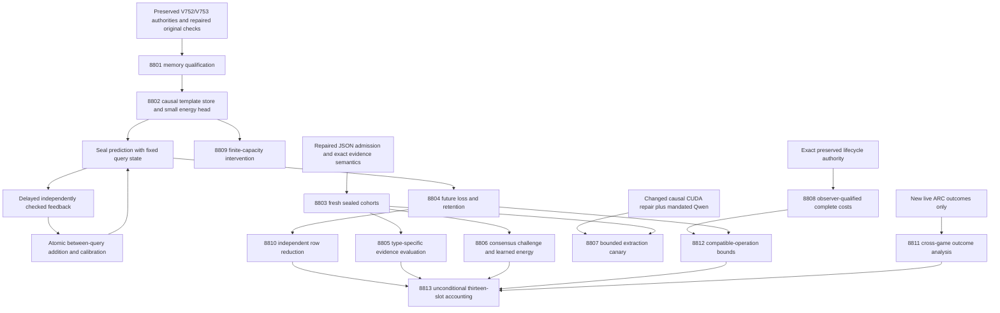

# Carnot Research Roadmap V754: Qualified Learning and Evidence That Challenges Consensus

**Created:** 2026-11-04
**Milestone:** 2026.11.754
**Status:** Proposed; no activation or experiment execution in this planning change
**Execution queue:** [research-roadmap-next.yaml](../../research-roadmap-next.yaml)
**Previous authority:** [Preserved V753 design](research-roadmap-v753-preserved-20261104.md)
**Contract:** Exactly 13 tasks, Exp8801 through Exp8813, in conductor order, across four phases.

## What V753 proved

V753 completed its scheduling lifecycle. It did not establish the proposed
learning, evidence, extraction or acceleration claims. Four primary producers
ran and eight slots were skipped. The capstone admits **zero scientific
measurements**. The completed-history file ends at V752; V753 conclusions below
come from its actual primaries and the capstone's conductor receipts.

| Evidence | Actual finding | Consequence for V754 |
|---|---|---|
| [Exp8789](../../results/experiment_8789_v753_branch_qualification.json) | `complete_disqualified_v753_branch_qualification`; original-child tests and Ruff failed; memory readiness stayed zero. | Reproduce the subsequent repair before permitting the template prototype. |
| [Exp8791](../../results/experiment_8791_v753_evidence_intervention_methods.json) | `complete_disqualified_v753_evidence_intervention_methods`; truth and balance controls passed, owned tests/types failed; evidence was quarantined. | Revalidate repaired JSON admission, then seal new disjoint worlds. The exposed pilot is not held-out science. |
| Exp8790/8792/8793/8794/8795/8797/8798/8799 | Four primary pre-gate skips and four cascade skips. Cascade skips have no primary honest verdict. | Preserve scheduler dispositions explicitly; no synthetic result or copied historical measurement. |
| [Exp8796](../../results/experiment_8796_v753_observer_intervention.json) | `complete_blocked_upstream_contract`; a retained reader sought V752 JSON in mutable vNEXT. Zero windows ran. | Bind exact preserved historical authorities before timing the unchanged workload. |
| [Exp8800](../../results/experiment_8800_v753_capstone.json) | `complete_blocked_v753_capstone`; twelve-slot reconciliation qualified; scientific claims remained blocked. | Keep administrative completeness separate from science and publication. |

November 4 repair entries in [ops/status.md](../../ops/status.md) report the
changed prerequisites: setup cost charged once; original private-child paths
measured with 622/622 statements; JSON object checks before coercion with
377/377 statements; and capstone imports anchored to their own checkout.
These are private validation receipts. V754 must authenticate and replay them
under preserved authority. They do not rewrite or promote the V753 primaries.

## Three biggest gaps against the PRD

1. **Useful continuous learning — FR-06 and FR-11.** The new template learner
   never ran. More parameters or moving weights are not improvement. Exp8802,
   Exp8804, Exp8809 and Exp8810 test actual added checks, delayed labels,
   future Brier loss and disjoint retention. Exp8806 separately trains a small
   calibrated energy policy, satisfying the typed-decision training floor.
2. **Faithful verification beyond encoded truth — FR-12.** Strong symbolic
   checks can certify a graph while extraction and shared wrong answers remain
   unresolved. Exp8803/8805 measure semantic defects under balanced nuisance
   changes. Exp8806 tests errors hidden by agreement. Exp8807 is a separate,
   conditional live extraction canary; synthetic wins do not imply natural-text gains.
3. **Complete deployment benefit — FR-05, FR-08 and NFR-01.** Kernel speed
   cannot establish predict-to-durable-ack speed. Exp8808 tests the observer
   itself; Exp8812 maps new complete learning costs to compatible hardware.
   The 10x production target and 100x learning aspiration remain hypotheses.

The ARC generalization floor is reserved in Exp8811. It consumes only genuinely
new selected/applied live-supervisor outcomes. A structured skip on the unchanged
empty frontier is preferable to another inventory run. No public level is re-solved.

## Research basis and decisions

The V754 scan was recorded in [research-references.md](../../research-references.md)
**before** task design. It covers all eight requested topics and all secondary
channels. Literature claims are not Carnot measurements.

| Source | Testable adaptation | Tasks |
|---|---|---|
| [VeriHarness, October 2026](https://arxiv.org/abs/2610.00972) | Hold agreement fixed while evidence makes a shared answer wrong; train and test an evidence-based policy. | 8803, 8806 |
| [Distributional EBM, May 2026](https://arxiv.org/abs/2605.18871) | Separate learned quality, explicit constraints and shortcut controls. | 8802, 8806 |
| [Type-aware detection, November 2026](https://arxiv.org/abs/2611.02258) | Match length/order and report error types instead of a single binary headline. | 8803, 8805, 8807 |
| [Memoir, July 2026](https://arxiv.org/abs/2607.20792) | Freeze within-query reads; update between queries after released feedback. | 8802, 8804, 8810 |
| [Capacity-constrained delayed OCO, June 2026](https://arxiv.org/abs/2606.11711) | Demonstrate actual overflow and lost labels; do not borrow convex regret guarantees for a neural heuristic. | 8809 |
| [Online KAN, 2026](https://arxiv.org/abs/2602.02056), [million-p-bit computer, 2026](https://arxiv.org/abs/2606.25313), [Z1T, September 2026](https://extropic.ai/writing/z1t) | Account for supported operations, boundary exchange, transfer and durable host work. | 8808, 8812 |

EBT and ARM–EBM inform compatibility scoring, not a revival of the closed
energy-descent generation claim. CAffNet's guarantees concern encoded affine
constraints. ETS remains deferred until runtime and extraction qualify. KAC
is a retention lead, not justification for changing the basis before measurement.
The energy-conformal OpenReview lead remains deferred because full access failed.
Semantic Scholar returned HTTP429 for both requested citation queries. GitHub's
retrieved trending page did not expose a usable ranking. Author repositories
were checked separately. Kona supplied vendor framing, not a reproducible new method.

## Architecture



Exp8801 gates only memory work and optional external-evidence branches. Exp8803
and Exp8808 are independent roots. No CUDA, ARC or physical-board absence blocks
CPU learning or evidence methods. Contract equality is also checked at planning
time; it is not itself a scientific result.

The memory policy reuses `GibbsModel(input_dim=9, hidden_dims=[4])`, with six
serving-visible counts and three decision bits. It returns support/refute/
insufficient probabilities and accept/reject/escalate decisions. Five paid
checks per query and at most 32 normalized reusable templates bound the work.
The full solver labels examples after prediction; it is not a policy input.
The older nine-input spline learning union remains closed. Generator weights
are never trained. GPU batching and CPU counters provide the near-term learning
path; FPGA/TSU mapping requires compatible operations rather than a model name.

## Phase 1 — Reproduce concrete repairs and qualify methods (8801–8803)

Exp8801 authenticates the repaired original child, retained assertions and
historical authority. It freezes three separate readiness fields for memory,
changed runtime and new ARC outcomes. Original private failure controls must
still fail and publish zero readiness.

Exp8802 builds only the causal template/energy prototype and tiny positive,
negative, causal-release and restart controls. It must demonstrate a later
predicate change caused by a learned reusable template. Validation readiness
cannot establish a learning gain.

Exp8803 independently validates the repaired JSON admission and exact evidence
semantics. It seals 120 new intervention worlds, a separate 60-development/
120-test consensus cohort, and 12 separate Qwen canary worlds. V751–V753
structures and alpha-isomorphic duplicates are excluded. Token bins, ordering,
labels, solver budgets and negative controls are frozen before test labels open.

## Phase 2 — Measure causal learning and verification (8804–8807)

Exp8804 runs 30 reset streams x 32 queries x 3 nested seeds x 5 arms: 14,400 online
rows. The arms are read-only, additions-only, calibration-only, combined and
shuffled released feedback. Twelve disjoint retention worlds per stream at
steps 0/16/32 yield 16,200 retention rows. Feedback delay is 8. Entire streams,
not queries or seeds, are independent. Complete learning and tail-drain costs
are retained even when learning has no benefit.

Exp8805 runs 120 worlds x 6 interventions x 2 orders x 2 token bins x 3 methods:
8,640 rows. Four prespecified metric families use 98.75-percent intervals from
whole-world resampling. Strong exact references have separate cost and claim
boundaries; both false accepts and false rejects matter.

Exp8806 adds a new scientific question: can a trained small energy policy
reject a shared wrong answer? Use 40 training and 20 calibration worlds, then
120 held-out worlds x 3 candidate-agreement groups x 3 evidence conditions:
1,080 groups, each containing 3 candidates. Compare agreement-only, a fixed
evidence-count rule, learned energy and a separately costed exact oracle.
Five learned-arm seeds remain nested. The two primary contrasts are unanimous-
wrong false acceptance and Brier loss, with 97.5-percent intervals. This is a
constructed-domain study; no candidate is mislabeled as a live LLM output.

Exp8807 runs only after a changed runtime receipt and qualified evidence method.
Use the mandated `unsloth/Qwen3.8-27B-GGUF`, one load, 48 calls at most,128 output
tokens each, 12 worlds. It reports descriptive extraction counts. Its class is
`model_bounded_generation` with a 10-second floor, not full generation. The
current missing runtime receipt is an expected skip, not an invitation to probe
unchanged CUDA again or substitute a CPU smoke model.

## Phase 3 — Test observers, capacity and claimed benefit (8808–8810)

Exp8808 first binds exact historical lifecycle contracts. It then measures
36 durable windows: three observer settings x two implementations x three
starting states x two repeats, 32 updates each and restart after 16. Plain,
sham and buffered clocks use balanced process order. Component attribution
requires absolute observer disturbance <=5 percent and accounting discrepancy
<=2 percent for every registered pair, with complete state parity. Large
negative overhead fails too. These are descriptive process/state comparisons,
not population throughput evidence.

Exp8809 uses 30 new 64-query streams, three seeds, delays 4/16/32, capacities 4/8,
FIFO and uniform random eviction plus an unlimited reference. This yields
69,120 bounded-arm and 17,280 reference predictions. Measured overflow and
different admissions are mandatory. Delay 4/capacity 8 is a non-overflow control.
Six Brier comparisons use 99.1667-percent intervals; no OCO regret theorem is
claimed. Retention and tail-drain cost remain visible.

Exp8810 independently reduces the sealed learning rows. Ten registered
comparisons use 99.5-percent whole-stream intervals. Combined-minus-read-only
and combined-minus-calibration Brier upper bounds must both be below -0.01;
six retention and two error upper bounds must be <=+0.02. Genuine template
use, causal release and shuffled controls must also qualify. A failed benefit
gate is a scientific null, not a reason to rewrite the metric or rerun unchanged.

## Phase 4 — Bound transfer, hardware and conclusions (8811–8813)

Exp8811 qualifies new live supervisor outcomes beyond the frozen Exp8760
frontier. At least 30 independent episodes, three overlapping games and five
firings per shared arm cell are needed for comparative intervals. It preserves
censoring and checks 32/64/128-action horizons. It gives descriptive cross-game
recommendations, not causal gains or live-policy modifications. No new outcomes
means a pre-gate skip. Any credited level outcome needs live-agent provenance.

Exp8812 requires new complete learning costs and observer-qualified components.
It computes compatible-operation fractions and Amdahl bounds for kernel factors
1/10/100/infinity. Missing transfer cost is unknown, not zero; a zero-transfer
curve is explicitly optimistic. No sampling calls means no sampler-eligible
fraction. Benefit and speed remain separate.

Exp8813 always accounts for all 13 slots, rejected evidence and exact observed
gates. External absence is terminal `blocked`, never retryable `partial`.
The existing G1–G4 publication gate retains its historical scope; `paper_ready`
is not authorization to publish or evidence for this milestone's new hypotheses.

## Dependency and gate contract

```text
8801 memory qualification -> 8802 prototype -> 8804 streams -> 8810 benefit audit
                                           -> 8809 capacity
8803 evidence methods -> 8805 interventions
                     -> 8806 consensus challenge
8801 changed runtime + 8803 evidence methods -> 8807 Qwen canary
preserved lifecycle authorities -> 8808 observer costs
8801 new ARC outcomes -> 8811 ARC analysis
8804 complete learning costs + 8808 component costs -> 8812 hardware bounds
all thirteen scheduled slots -> 8813 unconditional capstone
```

All structured gates use `== 1`. Each field is declared verbatim in the
producer prompt's REQUIRED ARTIFACT FIELDS. All gate producers are earlier
tasks in this roadmap. Historical files are evidence, never dependencies on
retired experiment execution. Readiness fields certify usable measurements;
benefit fields use separate acceptance criteria. Exact gate rows are in the
machine contract below and are checked before staging.

## Hardware, duration and scope

| Work | Hardware and planned memory | Time budget including validation |
|---|---|---|
| Repaired methods, graph comparisons, audits | Existing CPU, private disk; 4–8 GB estimate |25–50 min/task |
| Small energy training, memory and capacity | CPU/JAX; 4–8 GB estimate; GPU batching is a future option |55–60 min/task |
| Optional Qwen canary | One available RTX 3090, 24 GB VRAM; cached Q4_K_M about 16 GB |45 min, one load, 48 bounded calls |
| Durable observer study | CPU and existing loaded native extension; private durable storage |60 min |
| ARC/hardware readers | CPU artifact reduction; no game, board or model execution |25 min/task |

Total planning allowance is 610 minutes across 13 serial tasks; this is not a
runtime measurement. Each task must project its actual workload, reserve 900
seconds for validation and fit below 4800 seconds. Reduce a prospective roster
only before labels open and document reduced power; never silently censor a
slow arm or fill a missing run. A resource-limited task reports blocked.

Every task requires flushed phase progress and before/after long-call lines,
a real-work heartbeat at most 60 seconds apart, counts inside loops, and no
600-second silence gap. Tools are polled at most 60 seconds per call. Files
over about 200 lines are written in multiple tool calls with progress between.
Actual durations are never padded to satisfy floors.

All CPU tasks declare `no_model_load` and `MODEL_SPECS: []`; numerical training
is explicit. Only Exp8807 needs an LLM. Full generative runs would require
`model_full_generation` (60 seconds); load-only/embedding work would require
`model_load_no_generation` (2 seconds). Neither is scheduled. Legacy small
models are CPU smoke-only. Qwen3.6 and Gemma variants cannot replace the
mandatory Qwen3.8 canary.

The wishlist contains older inventory entries; CLAUDE.md's dual RTX 3090 CUDA
rig is the intended inference host, subject to live availability and runtime
qualification. Radeon 890M is not a JAX headline fallback. KV260 is a limited
existing POC at `k_max<=5`; future board access uses SSH/xmutil. GateMate,
PolarFire physical execution, NPU and TSU/Z1T remain unqualified for this
workload. No new FPGA design, hardware purchase or external access request is
included. Exp8812 can justify a future acquisition with actual compatible work.

## Verification and retirement

The original V753 design is preserved byte-for-byte. The active roadmap and
conductor remain unchanged. Every continuation carries prior failure ID,
actual verdict where available, diagnosed change and `retire_if_same_verdict`.
For four cascade skips with no primary, the field explicitly records the
capstone's `conductor_cascade_skip` disposition rather than inventing an honest
verdict. No retired ID is reused. Runtime and ARC work require genuinely new
operands, not a new task number. The capstone records precise retirement and
reopening conditions; it never relaxes existing guards to claim success.

Planning validation checks exact full task-object equality, visible order,
count 13, IDs 8801–8813, gate field spelling/order, required prompt sections,
progress/write limits, priors, model routing and substrate. Relevant existing
conductor/exclusion unit tests, exclusion lint, spec coverage and private
E2E-018/021 exercise the planning interfaces. Scoped checks are distinct from
a complete repository suite; global debt is recorded without suppressing it.
Implementation tasks require specs, tests first, actual coverage and terminal
replay. This document grants no scientific promotion or external publication.

## Exact task contract

Exactly 13 tasks: Exp8801 through Exp8813, in the order below. Full IDs, titles,
phases, deliverables and all embedded task fields match the staged YAML.
The canonical hash is SHA-256 of UTF-8 JSON of the tasks with sorted keys,
compact separators and `ensure_ascii=False`.


| Order | ID | Title | Phase | Deliverable |
|---|---|---|---|---|
| 1 | `exp8801-repaired-memory-qualification` | Qualify repaired original memory controls under preserved authorities | 1 | `results/experiment_8801_v754_repaired_memory_qualification.json` |
| 2 | `exp8802-causal-memory-prototype` | Build and validate causal template additions with a calibrated energy head | 1 | `results/experiment_8802_v754_causal_memory_prototype.json` |
| 3 | `exp8803-repaired-evidence-methods` | Qualify repaired evidence controls and seal new intervention and consensus cohorts | 1 | `results/experiment_8803_v754_repaired_evidence_methods.json` |
| 4 | `exp8804-causal-template-streams` | Measure future Brier loss after delayed constraint additions | 2 | `results/experiment_8804_v754_causal_template_streams.json` |
| 5 | `exp8805-evidence-intervention-study` | Measure semantic sensitivity and harmless-evidence invariance | 2 | `results/experiment_8805_v754_evidence_intervention_study.json` |
| 6 | `exp8806-consensus-challenge-energy` | Test whether a small energy policy detects shared wrong answers | 2 | `results/experiment_8806_v754_consensus_challenge_energy.json` |
| 7 | `exp8807-qwen-evidence-canary` | Run a bounded mandated-Qwen evidence extraction canary | 2 | `results/experiment_8807_v754_qwen_evidence_canary.json` |
| 8 | `exp8808-archived-observer-costs` | Measure observer disturbance using immutable durable-work authorities | 3 | `results/experiment_8808_v754_archived_observer_costs.json` |
| 9 | `exp8809-delayed-feedback-capacity` | Measure finite feedback capacity under real queue overflow | 3 | `results/experiment_8809_v754_delayed_feedback_capacity.json` |
| 10 | `exp8810-causal-learning-audit` | Audit future learning benefit and retention from sealed stream rows | 3 | `results/experiment_8810_v754_causal_learning_audit.json` |
| 11 | `exp8811-new-arc-outcome-analysis` | Assess cross-game supervisor generalization from new live outcomes | 4 | `results/experiment_8811_v754_new_arc_outcome_analysis.json` |
| 12 | `exp8812-learning-operation-budget` | Bound acceleration from complete measured learning operations | 4 | `results/experiment_8812_v754_learning_operation_budget.json` |
| 13 | `exp8813-capstone` | Reconcile thirteen outcomes and retire unchanged failed continuations | 4 | `results/experiment_8813_v754_capstone.json` |

Canonical tasks SHA-256: `0b68a8e4c6204741488e67c13ef1c95cfac160316e3fb67ac95d8106033b57cf`.

<!-- V754_TASK_CONTRACT_START -->
```json
{
  "milestone": "2026.11.754",
  "tasks": [
    {
      "id": "exp8801-repaired-memory-qualification",
      "title": "Qualify repaired original memory controls under preserved authorities",
      "phase": 1,
      "track": "research",
      "priority": "high",
      "requires_gpu": false,
      "max_turns": 100,
      "estimated_wall_time_min": 45,
      "per_unit_rows": true,
      "milestone": "2026.11.754",
      "deliverable": "results/experiment_8801_v754_repaired_memory_qualification.json",
      "inference_substrate_class": "no_model_load",
      "MODEL_SPECS": [],
      "gated_on": [],
      "agent_type": "claude",
      "model": "opus",
      "prior_failures": [
        {
          "experiment_id": "exp7532-v659-contract-methods",
          "verdict": "complete_blocked_incomplete_v659_authorities",
          "addressed_by": "November 4 repairs charge setup once, restore original private-child authority, preserve canonical Ruff path policy and measure 622/622 statements. Revalidate these changed source bytes against preserved V753/V752 authorities; old primaries remain disqualified. Independent evidence and cost branches do not depend on this receipt.",
          "retire_if_same_verdict": true
        },
        {
          "experiment_id": "exp7713-v672-contract-methods",
          "verdict": "complete_blocked_v672_independent_contract",
          "addressed_by": "November 4 repairs charge setup once, restore original private-child authority, preserve canonical Ruff path policy and measure 622/622 statements. Revalidate these changed source bytes against preserved V753/V752 authorities; old primaries remain disqualified. Independent evidence and cost branches do not depend on this receipt.",
          "retire_if_same_verdict": true
        },
        {
          "experiment_id": "exp7940-v689-contract-methods",
          "verdict": "complete_blocked_authority",
          "addressed_by": "November 4 repairs charge setup once, restore original private-child authority, preserve canonical Ruff path policy and measure 622/622 statements. Revalidate these changed source bytes against preserved V753/V752 authorities; old primaries remain disqualified. Independent evidence and cost branches do not depend on this receipt.",
          "retire_if_same_verdict": true
        },
        {
          "experiment_id": "exp7992-v693-contract-methods",
          "verdict": "complete_blocked_authority",
          "addressed_by": "November 4 repairs charge setup once, restore original private-child authority, preserve canonical Ruff path policy and measure 622/622 statements. Revalidate these changed source bytes against preserved V753/V752 authorities; old primaries remain disqualified. Independent evidence and cost branches do not depend on this receipt.",
          "retire_if_same_verdict": true
        },
        {
          "experiment_id": "exp8018-v695-contract-methods",
          "verdict": "complete_blocked_authority",
          "addressed_by": "November 4 repairs charge setup once, restore original private-child authority, preserve canonical Ruff path policy and measure 622/622 statements. Revalidate these changed source bytes against preserved V753/V752 authorities; old primaries remain disqualified. Independent evidence and cost branches do not depend on this receipt.",
          "retire_if_same_verdict": true
        },
        {
          "experiment_id": "exp8374-v722-contract-methods",
          "verdict": "complete_blocked_direct_contract_methods",
          "addressed_by": "November 4 repairs charge setup once, restore original private-child authority, preserve canonical Ruff path policy and measure 622/622 statements. Revalidate these changed source bytes against preserved V753/V752 authorities; old primaries remain disqualified. Independent evidence and cost branches do not depend on this receipt.",
          "retire_if_same_verdict": true
        },
        {
          "experiment_id": "exp8388-v723-contract-methods",
          "verdict": "complete_blocked_v723_contract_methods",
          "addressed_by": "November 4 repairs charge setup once, restore original private-child authority, preserve canonical Ruff path policy and measure 622/622 statements. Revalidate these changed source bytes against preserved V753/V752 authorities; old primaries remain disqualified. Independent evidence and cost branches do not depend on this receipt.",
          "retire_if_same_verdict": true
        },
        {
          "experiment_id": "exp8416-v725-contract-methods",
          "verdict": "complete_blocked_v725_contract_methods",
          "addressed_by": "November 4 repairs charge setup once, restore original private-child authority, preserve canonical Ruff path policy and measure 622/622 statements. Revalidate these changed source bytes against preserved V753/V752 authorities; old primaries remain disqualified. Independent evidence and cost branches do not depend on this receipt.",
          "retire_if_same_verdict": true
        },
        {
          "experiment_id": "exp8443-v727-contract-methods",
          "verdict": "complete_blocked_v727_contract_methods",
          "addressed_by": "November 4 repairs charge setup once, restore original private-child authority, preserve canonical Ruff path policy and measure 622/622 statements. Revalidate these changed source bytes against preserved V753/V752 authorities; old primaries remain disqualified. Independent evidence and cost branches do not depend on this receipt.",
          "retire_if_same_verdict": true
        },
        {
          "experiment_id": "exp8471-v729-contract-methods",
          "verdict": "complete_blocked_v729_contract_methods",
          "addressed_by": "November 4 repairs charge setup once, restore original private-child authority, preserve canonical Ruff path policy and measure 622/622 statements. Revalidate these changed source bytes against preserved V753/V752 authorities; old primaries remain disqualified. Independent evidence and cost branches do not depend on this receipt.",
          "retire_if_same_verdict": true
        },
        {
          "experiment_id": "exp8499-v731-contract-methods",
          "verdict": "complete_blocked_v731_contract_methods",
          "addressed_by": "November 4 repairs charge setup once, restore original private-child authority, preserve canonical Ruff path policy and measure 622/622 statements. Revalidate these changed source bytes against preserved V753/V752 authorities; old primaries remain disqualified. Independent evidence and cost branches do not depend on this receipt.",
          "retire_if_same_verdict": true
        },
        {
          "experiment_id": "exp8565-v736-contract-methods",
          "verdict": "complete_blocked_v736_contract_methods",
          "addressed_by": "November 4 repairs charge setup once, restore original private-child authority, preserve canonical Ruff path policy and measure 622/622 statements. Revalidate these changed source bytes against preserved V753/V752 authorities; old primaries remain disqualified. Independent evidence and cost branches do not depend on this receipt.",
          "retire_if_same_verdict": true
        },
        {
          "experiment_id": "exp8602-v739-contract-methods",
          "verdict": "complete_blocked_v739_contract_methods",
          "addressed_by": "November 4 repairs charge setup once, restore original private-child authority, preserve canonical Ruff path policy and measure 622/622 statements. Revalidate these changed source bytes against preserved V753/V752 authorities; old primaries remain disqualified. Independent evidence and cost branches do not depend on this receipt.",
          "retire_if_same_verdict": true
        },
        {
          "experiment_id": "exp8667-contract-methods",
          "verdict": "complete_disqualified_v744_contract_methods",
          "addressed_by": "November 4 repairs charge setup once, restore original private-child authority, preserve canonical Ruff path policy and measure 622/622 statements. Revalidate these changed source bytes against preserved V753/V752 authorities; old primaries remain disqualified. Independent evidence and cost branches do not depend on this receipt.",
          "retire_if_same_verdict": true
        },
        {
          "experiment_id": "exp8681-contract-methods",
          "verdict": "complete_disqualified_v745_contract_methods",
          "addressed_by": "November 4 repairs charge setup once, restore original private-child authority, preserve canonical Ruff path policy and measure 622/622 statements. Revalidate these changed source bytes against preserved V753/V752 authorities; old primaries remain disqualified. Independent evidence and cost branches do not depend on this receipt.",
          "retire_if_same_verdict": true
        },
        {
          "experiment_id": "exp8709-contract-methods",
          "verdict": "complete_disqualified_v747_contract_methods",
          "addressed_by": "November 4 repairs charge setup once, restore original private-child authority, preserve canonical Ruff path policy and measure 622/622 statements. Revalidate these changed source bytes against preserved V753/V752 authorities; old primaries remain disqualified. Independent evidence and cost branches do not depend on this receipt.",
          "retire_if_same_verdict": true
        },
        {
          "experiment_id": "exp8737-contract-methods",
          "verdict": "complete_disqualified_v749_contract_methods",
          "addressed_by": "November 4 repairs charge setup once, restore original private-child authority, preserve canonical Ruff path policy and measure 622/622 statements. Revalidate these changed source bytes against preserved V753/V752 authorities; old primaries remain disqualified. Independent evidence and cost branches do not depend on this receipt.",
          "retire_if_same_verdict": true
        },
        {
          "experiment_id": "exp8749-archive-bound-contract",
          "verdict": "complete_disqualified_v750_archive_bound_contract",
          "addressed_by": "November 4 repairs charge setup once, restore original private-child authority, preserve canonical Ruff path policy and measure 622/622 statements. Revalidate these changed source bytes against preserved V753/V752 authorities; old primaries remain disqualified. Independent evidence and cost branches do not depend on this receipt.",
          "retire_if_same_verdict": true
        },
        {
          "experiment_id": "exp8763-branch-contract",
          "verdict": "complete_disqualified_v751_branch_contract",
          "addressed_by": "November 4 repairs charge setup once, restore original private-child authority, preserve canonical Ruff path policy and measure 622/622 statements. Revalidate these changed source bytes against preserved V753/V752 authorities; old primaries remain disqualified. Independent evidence and cost branches do not depend on this receipt.",
          "retire_if_same_verdict": true
        },
        {
          "experiment_id": "exp8776-branch-methods",
          "verdict": "complete_disqualified_v752_branch_methods",
          "addressed_by": "November 4 repairs charge setup once, restore original private-child authority, preserve canonical Ruff path policy and measure 622/622 statements. Revalidate these changed source bytes against preserved V753/V752 authorities; old primaries remain disqualified. Independent evidence and cost branches do not depend on this receipt.",
          "retire_if_same_verdict": true
        },
        {
          "experiment_id": "exp8789-branch-qualification",
          "verdict": "complete_disqualified_v753_branch_qualification",
          "addressed_by": "November 4 repairs charge setup once, restore original private-child authority, preserve canonical Ruff path policy and measure 622/622 statements. Revalidate these changed source bytes against preserved V753/V752 authorities; old primaries remain disqualified. Independent evidence and cost branches do not depend on this receipt.",
          "retire_if_same_verdict": true
        }
      ],
      "prompt": "CONTEXT:\nWork in {project_root} on {date}. V753 admitted no science. Exp8789 failed original child and lint checks. ops/status.md records a subsequent repair and private 622/622 statement coverage; that receipt is a hypothesis to reproduce, not a promoted primary.\n\nEXISTING CODE TO READ FIRST:\nCLAUDE.md; CODEX.md; ops/e2e-test-plan.md; ops/exclusion_manifest.yaml; scripts/experiment_template.py; openspec/capabilities/research-reporting/spec.md; openspec/capabilities/verification/spec.md; python/carnot/reporting/primary_publication.py; python/carnot/reporting/v753_branch_qualification.py; python/carnot/reporting/v752_branch_methods.py; python/carnot/reporting/roadmap_contract.py; python/carnot/reporting/v744_contract_methods.py; tests/python/test_v753_branch_qualification_8789.py; tests/python/test_v752_archive_8776.py; results/experiment_8789_v753_branch_qualification.json; results/experiment_8800_v753_capstone.json; openspec/change-proposals/research-roadmap-v753-preserved-20261104.md; openspec/change-proposals/research-roadmap-v752-preserved-20261103.md\n\nTASK:\nQualify repaired original memory controls under preserved authorities. Deliver results/experiment_8801_v754_repaired_memory_qualification.json. Implement scripts/experiments/experiment_8801_v754_repaired_memory_qualification.py as a thin CLI and keep raw receipts under results/raw/experiment_8801_v754_repaired_memory_qualification/. MODEL_SPECS=[]; inference_substrate_class=no_model_load; inference_substrate=aggregation_from_upstream_artifacts. No LLM load or generation; numerical energy training, if specified below, is explicit.\n\nCONCRETE STEPS:\n1. Print a flushed progress line at each phase boundary and before and after every model load, generation, benchmark, or subprocess that can take minutes. Print completed/pending counts inside long loops; emit a real-work parent heartbeat every 60 seconds during long child calls and poll through tool calls of at most 60 seconds. Keep every silence gap under 600 seconds: silence can kill a task at 1200 seconds despite the 4800-second hard cap. Write any file over about 200 lines in several tool calls, with a progress message between them. Keep individual writes and tool calls small. Reserve 900 seconds for validation and terminal publication.\n2. PRECONDITIONS: Check imports, private scratch, exact historical/current authority, source hashes and available resources. Measure one cheap unit and project work plus the validation reserve before the full run. Charge imports/custody once, not once per unit. Missing resources produce a terminal blocked artifact with gate_check_summary and no measurement. Never resolve a historical contract through mutable vNEXT.\n3. Before implementation, extend REQ-REPORT-8801 and REQ-VERIFY-8801 with falsifiable SCENARIO items, then write failing tests. Preserve original assertions and historical source/primary bytes. Reuse existing helpers; do not replace the shared validators. Keep private fixtures in tmp_path and raw output in the task directory. Combine actual unit and child SQLite coverage before requiring 100 percent newly owned executable statements, with zero exclusions. Run scoped pytest, Ruff check/format, strict mypy, scripts/check_spec_coverage.py on owned tests, and applicable private E2E-018/021; record global reconciliation debt separately. For any native change also run E2E-003/004 and scoped cargo test/fmt/clippy. Run scripts/adversarial_verify.py and scripts/verdict_row_consistency_lint.py --strict on the terminal candidate, then cold-replay from outside the checkout without PYTHONPATH. Failed owned validation gives disqualified with readiness zero; an unchanged external prerequisite gives terminal blocked, never partial. Retain rejected candidates and failures without overwriting primaries. Update relevant specs, _bmad/traceability.md, ops/status.md and ops/changelog.md with measured results.\n4. Authenticate the November 4 repaired source and retained original assertions. Re-execute the original intentional failing child under its original V752 archive. Require the child failure to publish zero readiness and actual coverage of runner lines 88-90 and 107; include all owned and original executable statements, not a copied coverage summary. Reproduce the private failure and success controls before exposing a memory gate.\n5. Bind exactly 13 tasks Exp8801-Exp8813 from the V754 visible table, full embedded JSON and staged YAML; compare active YAML only when it actually names V754. Before activation, record active .753 as expected, not a mismatch. Snapshot preserved V753 and V752 designs by hash. Record any original family lookup that still reaches mutable vNEXT as a failed contract. Emit memory_protocol_ready_score=1 only when repaired original validation and the new protocol both qualify.\n6. Freeze the new memory protocol: 30 reset streams of 32 queries, three nested seeds, five arms and delayed release eight; store at most 32 alpha-normalized templates. Freeze all decisions and thresholds before running. Original nine-input spline union remains closed. Read the causal CUDA repair receipt and ARC ledger once through existing readers. Emit runtime_repair_ready_score and arc_new_outcomes_available_score independently; absent changed evidence means zero, no GPU probe or game run. Their zeros must not zero a qualified memory protocol.\n7. Execute negative mutations for missing files/fields, retired dependencies, malformed JSON, gate-name drift and altered task order. Preserve V753 primaries and quarantine states. A qualified administrative receipt is null with no scientific benefit; original failing controls cannot become evidence of learning.\n\nREQUIRED ARTIFACT FIELDS:\nexperiment_id, task_id, milestone, run_date, honest_verdict; verdict_class: positive | circular_positive | null | blocked | disqualified | partial (principle: partial retries only incomplete own work, never external absence); inference_substrate, inference_substrate_class, MODEL_SPECS, model_invocation_counts, numerical_training_calls (principle: declare actual work; no model work may masquerade as live inference); verifier_is_oracle (principle: exact-label verification gains are circular_positive, never positive); duration_s, random_seed, reproducibility_checksum, source_artifact_hashes, code_config_hashes, raw_shard_hashes, preconditions_checked, phase_spans (principle: measured provenance, no synthetic time padding); rows with unit_id, cluster_id, arm, seed, metric, denominator, status and missing_reason; intended_count, completed_count, censored_count, failed_count, excluded_count, independent_count (principle: preserve every scheduled unit; seeds and sibling conditions are not independent units); gate_check_summary containing check, upstream, artifact_field, expected, observed and path/hash whenever blocked (principle: distinguish missing_file, missing_field, rejected_producer and observed zero); acceptance_gates, required_checks_passed, owned_statement_coverage, validation_receipts, exposure_scope, independent_generalization_score, field_principles, cited_upstream_artifacts as experiment_id/fields_imported/sha256 (principle: reproduce claims from exact operands; annotate every extra field through field_principles).\nmemory_protocol_ready_score, runtime_repair_ready_score, arc_new_outcomes_available_score: integers 0/1; original_failure_publication, original_owned_statement_coverage, full_task_objects, canonical_tasks_sha256, preserved_authority_refs, branch_protocol_refs, runtime_authority, arc_new_outcome_refs (principle: three separate gates and exact historical custody).\n\nRun command: cd {project_root} && JAX_PLATFORMS=cpu .venv/bin/python -u scripts/experiments/experiment_8801_v754_repaired_memory_qualification.py --date {date}\nDo NOT push. Do NOT modify scripts/research_conductor.py."
    },
    {
      "id": "exp8802-causal-memory-prototype",
      "title": "Build and validate causal template additions with a calibrated energy head",
      "phase": 1,
      "track": "research",
      "priority": "high",
      "requires_gpu": false,
      "max_turns": 50,
      "estimated_wall_time_min": 55,
      "per_unit_rows": true,
      "milestone": "2026.11.754",
      "deliverable": "results/experiment_8802_v754_causal_memory_prototype.json",
      "inference_substrate_class": "no_model_load",
      "MODEL_SPECS": [],
      "gated_on": [
        {
          "upstream": "exp8801-repaired-memory-qualification",
          "artifact_field": "memory_protocol_ready_score",
          "op": "==",
          "value": 1
        }
      ],
      "prior_failures": [
        {
          "experiment_id": "exp8116-independent-online-memory",
          "verdict": "complete_disqualified_owned_validation",
          "addressed_by": "Replace the skipped Exp8790/Exp8778 prototype admission with fresh Exp8801 qualification of the repaired original-child path. Keep its scientific question, but implement and test only the small causal template policy; no old blocked spline union or global runtime dependency.",
          "retire_if_same_verdict": true
        },
        {
          "experiment_id": "exp8766-causal-brier-stream",
          "verdict": "blocked_gate_check_failed",
          "addressed_by": "Replace the skipped Exp8790/Exp8778 prototype admission with fresh Exp8801 qualification of the repaired original-child path. Keep its scientific question, but implement and test only the small causal template policy; no old blocked spline union or global runtime dependency.",
          "retire_if_same_verdict": true
        },
        {
          "experiment_id": "exp8778-delayed-memory-prototype",
          "verdict": "blocked_gate_check_failed",
          "addressed_by": "Replace the skipped Exp8790/Exp8778 prototype admission with fresh Exp8801 qualification of the repaired original-child path. Keep its scientific question, but implement and test only the small causal template policy; no old blocked spline union or global runtime dependency.",
          "retire_if_same_verdict": true
        },
        {
          "experiment_id": "exp8790-delayed-memory-prototype",
          "verdict": "blocked_gate_check_failed",
          "addressed_by": "Replace the skipped Exp8790/Exp8778 prototype admission with fresh Exp8801 qualification of the repaired original-child path. Keep its scientific question, but implement and test only the small causal template policy; no old blocked spline union or global runtime dependency.",
          "retire_if_same_verdict": true
        }
      ],
      "prompt": "CONTEXT:\nWork in {project_root} on {date}. Actual constraint additions remain unmeasured; coefficient motion alone cannot satisfy FR-11. Memoir motivates frozen within-query reads and changes only after released feedback.\n\nEXISTING CODE TO READ FIRST:\nCLAUDE.md; CODEX.md; ops/e2e-test-plan.md; ops/exclusion_manifest.yaml; scripts/experiment_template.py; openspec/capabilities/research-reporting/spec.md; openspec/capabilities/verification/spec.md; python/carnot/reporting/primary_publication.py; python/carnot/learn/constraint_memory.py; python/carnot/pipeline/constraint_template_library.py; python/carnot/learning/continual_constraint_memory.py; python/carnot/memory/transactional_constraint_memory.py; python/carnot/autoresearch/calibrated_decision_benchmark.py; python/carnot/models/gibbs/__init__.py; python/carnot/reporting/evidence_set_methods_8768.py; results/experiment_8801_v754_repaired_memory_qualification.json\n\nTASK:\nBuild and validate causal template additions with a calibrated energy head. Deliver results/experiment_8802_v754_causal_memory_prototype.json. Implement scripts/experiments/experiment_8802_v754_causal_memory_prototype.py as a thin CLI and keep raw receipts under results/raw/experiment_8802_v754_causal_memory_prototype/. MODEL_SPECS=[]; inference_substrate_class=no_model_load; inference_substrate=deterministic_verifier. No LLM load or generation; numerical energy training, if specified below, is explicit.\n\nCONCRETE STEPS:\n1. Print a flushed progress line at each phase boundary and before and after every model load, generation, benchmark, or subprocess that can take minutes. Print completed/pending counts inside long loops; emit a real-work parent heartbeat every 60 seconds during long child calls and poll through tool calls of at most 60 seconds. Keep every silence gap under 600 seconds: silence can kill a task at 1200 seconds despite the 4800-second hard cap. Write any file over about 200 lines in several tool calls, with a progress message between them. Keep individual writes and tool calls small. Reserve 900 seconds for validation and terminal publication.\n2. PRECONDITIONS: Check imports, private scratch, exact historical/current authority, source hashes and available resources. Measure one cheap unit and project work plus the validation reserve before the full run. Charge imports/custody once, not once per unit. Missing resources produce a terminal blocked artifact with gate_check_summary and no measurement. Never resolve a historical contract through mutable vNEXT.\n3. Before implementation, extend REQ-REPORT-8802 and REQ-VERIFY-8802 with falsifiable SCENARIO items, then write failing tests. Preserve original assertions and historical source/primary bytes. Reuse existing helpers; do not replace the shared validators. Keep private fixtures in tmp_path and raw output in the task directory. Combine actual unit and child SQLite coverage before requiring 100 percent newly owned executable statements, with zero exclusions. Run scoped pytest, Ruff check/format, strict mypy, scripts/check_spec_coverage.py on owned tests, and applicable private E2E-018/021; record global reconciliation debt separately. For any native change also run E2E-003/004 and scoped cargo test/fmt/clippy. Run scripts/adversarial_verify.py and scripts/verdict_row_consistency_lint.py --strict on the terminal candidate, then cold-replay from outside the checkout without PYTHONPATH. Failed owned validation gives disqualified with readiness zero; an unchanged external prerequisite gives terminal blocked, never partial. Retain rejected candidates and failures without overwriting primaries. Update relevant specs, _bmad/traceability.md, ops/status.md and ops/changelog.md with measured results.\n4. Implement only the qualified new template store and GibbsModel(input_dim=9, hidden_dims=[4]): six serving-visible counts plus three decision bits. Use the existing calibrated-decision/NCE training pattern. Train support/refute/insufficient probabilities and map to accept/reject/escalate with thresholds frozen on development data. Exclude final labels, solver answers, condition/world IDs and future labels from features.\n5. Give every arm five primitive checks per query and the same optimizer/update budget. Normalize reusable templates by role renaming; add a template only from independently verified feedback after release. Do not insert exact answer caches. Seal query prediction and state hash before feedback; commit template, coefficient, pending-event and acknowledgement state atomically between queries.\n6. Use tiny positive controls where an added constraint changes the later checked predicate, plus useless-template, shuffled-released-feedback, label-leakage, duplicate-feedback and restart controls. The shuffle may draw only from labels already released at that time. Prove restart equality of full pending state and unchanged within-query reads. Report genuine update/check counts and checkpoint hashes.\n7. Freeze seed roster, learning rate, feature schema, 30 streams and retention worlds before downstream execution. Emit memory_execution_ready_score=1 only for working update semantics, numerical gradients, qualified controls and validation; template novelty and parameter motion cannot set a benefit field.\n\nREQUIRED ARTIFACT FIELDS:\nexperiment_id, task_id, milestone, run_date, honest_verdict; verdict_class: positive | circular_positive | null | blocked | disqualified | partial (principle: partial retries only incomplete own work, never external absence); inference_substrate, inference_substrate_class, MODEL_SPECS, model_invocation_counts, numerical_training_calls (principle: declare actual work; no model work may masquerade as live inference); verifier_is_oracle (principle: exact-label verification gains are circular_positive, never positive); duration_s, random_seed, reproducibility_checksum, source_artifact_hashes, code_config_hashes, raw_shard_hashes, preconditions_checked, phase_spans (principle: measured provenance, no synthetic time padding); rows with unit_id, cluster_id, arm, seed, metric, denominator, status and missing_reason; intended_count, completed_count, censored_count, failed_count, excluded_count, independent_count (principle: preserve every scheduled unit; seeds and sibling conditions are not independent units); gate_check_summary containing check, upstream, artifact_field, expected, observed and path/hash whenever blocked (principle: distinguish missing_file, missing_field, rejected_producer and observed zero); acceptance_gates, required_checks_passed, owned_statement_coverage, validation_receipts, exposure_scope, independent_generalization_score, field_principles, cited_upstream_artifacts as experiment_id/fields_imported/sha256 (principle: reproduce claims from exact operands; annotate every extra field through field_principles).\nmemory_execution_ready_score: integer 0/1; frozen_memory_protocol, template_addition_rows, calibrated_head_parameters, gradient_update_rows, leakage_controls, restart_rows, feature_schema, complete_operation_boundary (principle: executable causal learning readiness is distinct from benefit).\n\nRun command: cd {project_root} && JAX_PLATFORMS=cpu .venv/bin/python -u scripts/experiments/experiment_8802_v754_causal_memory_prototype.py --date {date}\nDo NOT push. Do NOT modify scripts/research_conductor.py."
    },
    {
      "id": "exp8803-repaired-evidence-methods",
      "title": "Qualify repaired evidence controls and seal new intervention and consensus cohorts",
      "phase": 1,
      "track": "research",
      "priority": "high",
      "requires_gpu": false,
      "max_turns": 100,
      "estimated_wall_time_min": 50,
      "per_unit_rows": true,
      "milestone": "2026.11.754",
      "deliverable": "results/experiment_8803_v754_repaired_evidence_methods.json",
      "inference_substrate_class": "no_model_load",
      "MODEL_SPECS": [],
      "gated_on": [],
      "agent_type": "claude",
      "model": "opus",
      "prior_failures": [
        {
          "experiment_id": "exp7532-v659-contract-methods",
          "verdict": "complete_blocked_incomplete_v659_authorities",
          "addressed_by": "November 4 producer JSON repair rejects arrays/scalars before dictionary conversion and reports 377/377 statement coverage plus strict types. Authenticate those changed bytes and rerun original controls with immutable authorities; separate current qualification from quarantined Exp8791.",
          "retire_if_same_verdict": true
        },
        {
          "experiment_id": "exp7713-v672-contract-methods",
          "verdict": "complete_blocked_v672_independent_contract",
          "addressed_by": "November 4 producer JSON repair rejects arrays/scalars before dictionary conversion and reports 377/377 statement coverage plus strict types. Authenticate those changed bytes and rerun original controls with immutable authorities; separate current qualification from quarantined Exp8791.",
          "retire_if_same_verdict": true
        },
        {
          "experiment_id": "exp7940-v689-contract-methods",
          "verdict": "complete_blocked_authority",
          "addressed_by": "November 4 producer JSON repair rejects arrays/scalars before dictionary conversion and reports 377/377 statement coverage plus strict types. Authenticate those changed bytes and rerun original controls with immutable authorities; separate current qualification from quarantined Exp8791.",
          "retire_if_same_verdict": true
        },
        {
          "experiment_id": "exp7992-v693-contract-methods",
          "verdict": "complete_blocked_authority",
          "addressed_by": "November 4 producer JSON repair rejects arrays/scalars before dictionary conversion and reports 377/377 statement coverage plus strict types. Authenticate those changed bytes and rerun original controls with immutable authorities; separate current qualification from quarantined Exp8791.",
          "retire_if_same_verdict": true
        },
        {
          "experiment_id": "exp8018-v695-contract-methods",
          "verdict": "complete_blocked_authority",
          "addressed_by": "November 4 producer JSON repair rejects arrays/scalars before dictionary conversion and reports 377/377 statement coverage plus strict types. Authenticate those changed bytes and rerun original controls with immutable authorities; separate current qualification from quarantined Exp8791.",
          "retire_if_same_verdict": true
        },
        {
          "experiment_id": "exp8374-v722-contract-methods",
          "verdict": "complete_blocked_direct_contract_methods",
          "addressed_by": "November 4 producer JSON repair rejects arrays/scalars before dictionary conversion and reports 377/377 statement coverage plus strict types. Authenticate those changed bytes and rerun original controls with immutable authorities; separate current qualification from quarantined Exp8791.",
          "retire_if_same_verdict": true
        },
        {
          "experiment_id": "exp8388-v723-contract-methods",
          "verdict": "complete_blocked_v723_contract_methods",
          "addressed_by": "November 4 producer JSON repair rejects arrays/scalars before dictionary conversion and reports 377/377 statement coverage plus strict types. Authenticate those changed bytes and rerun original controls with immutable authorities; separate current qualification from quarantined Exp8791.",
          "retire_if_same_verdict": true
        },
        {
          "experiment_id": "exp8416-v725-contract-methods",
          "verdict": "complete_blocked_v725_contract_methods",
          "addressed_by": "November 4 producer JSON repair rejects arrays/scalars before dictionary conversion and reports 377/377 statement coverage plus strict types. Authenticate those changed bytes and rerun original controls with immutable authorities; separate current qualification from quarantined Exp8791.",
          "retire_if_same_verdict": true
        },
        {
          "experiment_id": "exp8443-v727-contract-methods",
          "verdict": "complete_blocked_v727_contract_methods",
          "addressed_by": "November 4 producer JSON repair rejects arrays/scalars before dictionary conversion and reports 377/377 statement coverage plus strict types. Authenticate those changed bytes and rerun original controls with immutable authorities; separate current qualification from quarantined Exp8791.",
          "retire_if_same_verdict": true
        },
        {
          "experiment_id": "exp8471-v729-contract-methods",
          "verdict": "complete_blocked_v729_contract_methods",
          "addressed_by": "November 4 producer JSON repair rejects arrays/scalars before dictionary conversion and reports 377/377 statement coverage plus strict types. Authenticate those changed bytes and rerun original controls with immutable authorities; separate current qualification from quarantined Exp8791.",
          "retire_if_same_verdict": true
        },
        {
          "experiment_id": "exp8499-v731-contract-methods",
          "verdict": "complete_blocked_v731_contract_methods",
          "addressed_by": "November 4 producer JSON repair rejects arrays/scalars before dictionary conversion and reports 377/377 statement coverage plus strict types. Authenticate those changed bytes and rerun original controls with immutable authorities; separate current qualification from quarantined Exp8791.",
          "retire_if_same_verdict": true
        },
        {
          "experiment_id": "exp8565-v736-contract-methods",
          "verdict": "complete_blocked_v736_contract_methods",
          "addressed_by": "November 4 producer JSON repair rejects arrays/scalars before dictionary conversion and reports 377/377 statement coverage plus strict types. Authenticate those changed bytes and rerun original controls with immutable authorities; separate current qualification from quarantined Exp8791.",
          "retire_if_same_verdict": true
        },
        {
          "experiment_id": "exp8602-v739-contract-methods",
          "verdict": "complete_blocked_v739_contract_methods",
          "addressed_by": "November 4 producer JSON repair rejects arrays/scalars before dictionary conversion and reports 377/377 statement coverage plus strict types. Authenticate those changed bytes and rerun original controls with immutable authorities; separate current qualification from quarantined Exp8791.",
          "retire_if_same_verdict": true
        },
        {
          "experiment_id": "exp8667-contract-methods",
          "verdict": "complete_disqualified_v744_contract_methods",
          "addressed_by": "November 4 producer JSON repair rejects arrays/scalars before dictionary conversion and reports 377/377 statement coverage plus strict types. Authenticate those changed bytes and rerun original controls with immutable authorities; separate current qualification from quarantined Exp8791.",
          "retire_if_same_verdict": true
        },
        {
          "experiment_id": "exp8681-contract-methods",
          "verdict": "complete_disqualified_v745_contract_methods",
          "addressed_by": "November 4 producer JSON repair rejects arrays/scalars before dictionary conversion and reports 377/377 statement coverage plus strict types. Authenticate those changed bytes and rerun original controls with immutable authorities; separate current qualification from quarantined Exp8791.",
          "retire_if_same_verdict": true
        },
        {
          "experiment_id": "exp8709-contract-methods",
          "verdict": "complete_disqualified_v747_contract_methods",
          "addressed_by": "November 4 producer JSON repair rejects arrays/scalars before dictionary conversion and reports 377/377 statement coverage plus strict types. Authenticate those changed bytes and rerun original controls with immutable authorities; separate current qualification from quarantined Exp8791.",
          "retire_if_same_verdict": true
        },
        {
          "experiment_id": "exp8737-contract-methods",
          "verdict": "complete_disqualified_v749_contract_methods",
          "addressed_by": "November 4 producer JSON repair rejects arrays/scalars before dictionary conversion and reports 377/377 statement coverage plus strict types. Authenticate those changed bytes and rerun original controls with immutable authorities; separate current qualification from quarantined Exp8791.",
          "retire_if_same_verdict": true
        },
        {
          "experiment_id": "exp8755-verifier-family-surface",
          "verdict": "complete_null_v750_verifier_family_surface",
          "addressed_by": "November 4 producer JSON repair rejects arrays/scalars before dictionary conversion and reports 377/377 statement coverage plus strict types. Authenticate those changed bytes and rerun original controls with immutable authorities; separate current qualification from quarantined Exp8791.",
          "retire_if_same_verdict": true
        },
        {
          "experiment_id": "exp8768-evidence-set-methods",
          "verdict": "complete_disqualified_v751_evidence_set_methods",
          "addressed_by": "November 4 producer JSON repair rejects arrays/scalars before dictionary conversion and reports 377/377 statement coverage plus strict types. Authenticate those changed bytes and rerun original controls with immutable authorities; separate current qualification from quarantined Exp8791.",
          "retire_if_same_verdict": true
        },
        {
          "experiment_id": "exp5839-v519-evidence-qualification",
          "verdict": "mixed: constraint_stream_and_structural_qualified_lifecycle_and_replay_disqualified",
          "addressed_by": "November 4 producer JSON repair rejects arrays/scalars before dictionary conversion and reports 377/377 statement coverage plus strict types. Authenticate those changed bytes and rerun original controls with immutable authorities; separate current qualification from quarantined Exp8791.",
          "retire_if_same_verdict": true
        },
        {
          "experiment_id": "exp8319-local-evidence-qualification",
          "verdict": "blocked_gate_check_failed",
          "addressed_by": "November 4 producer JSON repair rejects arrays/scalars before dictionary conversion and reports 377/377 statement coverage plus strict types. Authenticate those changed bytes and rerun original controls with immutable authorities; separate current qualification from quarantined Exp8791.",
          "retire_if_same_verdict": true
        },
        {
          "experiment_id": "exp8777-evidence-method-qualification",
          "verdict": "complete_circular_positive_v752_evidence_method_qualification",
          "addressed_by": "November 4 producer JSON repair rejects arrays/scalars before dictionary conversion and reports 377/377 statement coverage plus strict types. Authenticate those changed bytes and rerun original controls with immutable authorities; separate current qualification from quarantined Exp8791.",
          "retire_if_same_verdict": true
        },
        {
          "experiment_id": "exp8791-evidence-intervention-methods",
          "verdict": "complete_disqualified_v753_evidence_intervention_methods",
          "addressed_by": "November 4 producer JSON repair rejects arrays/scalars before dictionary conversion and reports 377/377 statement coverage plus strict types. Authenticate those changed bytes and rerun original controls with immutable authorities; separate current qualification from quarantined Exp8791.",
          "retire_if_same_verdict": true
        }
      ],
      "prompt": "CONTEXT:\nWork in {project_root} on {date}. Exp8791 passed truth and length controls but failed owned tests/types and was quarantined. The later JSON-type repair is present. Its numerical pilot and exposed 120-world roster remain history, not held-out data.\n\nEXISTING CODE TO READ FIRST:\nCLAUDE.md; CODEX.md; ops/e2e-test-plan.md; ops/exclusion_manifest.yaml; scripts/experiment_template.py; openspec/capabilities/research-reporting/spec.md; openspec/capabilities/verification/spec.md; python/carnot/reporting/primary_publication.py; python/carnot/reporting/evidence_intervention_methods_8791.py; tests/python/test_evidence_intervention_methods_8791.py; python/carnot/reporting/evidence_set_methods_8768.py; python/carnot/reporting/evidence_set_corpus_8768.py; python/carnot/reporting/evidence_qualification_8777.py; results/experiment_8791_v753_evidence_intervention_methods.json; research-references.md\n\nTASK:\nQualify repaired evidence controls and seal new intervention and consensus cohorts. Deliver results/experiment_8803_v754_repaired_evidence_methods.json. Implement scripts/experiments/experiment_8803_v754_repaired_evidence_methods.py as a thin CLI and keep raw receipts under results/raw/experiment_8803_v754_repaired_evidence_methods/. MODEL_SPECS=[]; inference_substrate_class=no_model_load; inference_substrate=deterministic_verifier. No LLM load or generation; numerical energy training, if specified below, is explicit.\n\nCONCRETE STEPS:\n1. Print a flushed progress line at each phase boundary and before and after every model load, generation, benchmark, or subprocess that can take minutes. Print completed/pending counts inside long loops; emit a real-work parent heartbeat every 60 seconds during long child calls and poll through tool calls of at most 60 seconds. Keep every silence gap under 600 seconds: silence can kill a task at 1200 seconds despite the 4800-second hard cap. Write any file over about 200 lines in several tool calls, with a progress message between them. Keep individual writes and tool calls small. Reserve 900 seconds for validation and terminal publication.\n2. PRECONDITIONS: Check imports, private scratch, exact historical/current authority, source hashes and available resources. Measure one cheap unit and project work plus the validation reserve before the full run. Charge imports/custody once, not once per unit. Missing resources produce a terminal blocked artifact with gate_check_summary and no measurement. Never resolve a historical contract through mutable vNEXT.\n3. Before implementation, extend REQ-REPORT-8803 and REQ-VERIFY-8803 with falsifiable SCENARIO items, then write failing tests. Preserve original assertions and historical source/primary bytes. Reuse existing helpers; do not replace the shared validators. Keep private fixtures in tmp_path and raw output in the task directory. Combine actual unit and child SQLite coverage before requiring 100 percent newly owned executable statements, with zero exclusions. Run scoped pytest, Ruff check/format, strict mypy, scripts/check_spec_coverage.py on owned tests, and applicable private E2E-018/021; record global reconciliation debt separately. For any native change also run E2E-003/004 and scoped cargo test/fmt/clippy. Run scripts/adversarial_verify.py and scripts/verdict_row_consistency_lint.py --strict on the terminal candidate, then cold-replay from outside the checkout without PYTHONPATH. Failed owned validation gives disqualified with readiness zero; an unchanged external prerequisite gives terminal blocked, never partial. Retain rejected candidates and failures without overwriting primaries. Update relevant specs, _bmad/traceability.md, ops/status.md and ops/changelog.md with measured results.\n4. Replay unchanged original assertions under the preserved V753 authority. Include JSON null, scalar, list-of-pairs, empty-object and byte-drift controls. Require actual 377/377 historical owned statements plus all newly owned statements, strict mypy and exact task identity. Keep original truth semantics: missing premises unknown, conflicts insufficient, and alternative valid proofs supported.\n5. Seal three disjoint cohorts before opening evaluation labels: 120 new relational worlds for intervention testing; 60 development and 120 test worlds for consensus challenge; 12 separate worlds for the optional Qwen canary. Exclude all V751-V753 world hashes and alpha-isomorphic structures, report collision rejection. Worlds have 11-13 edges with supported/refuted/insufficient labels balanced inside protocol-token bins and order conditions.\n6. Freeze six conditions: intact evidence, irrelevant padding, reordered evidence, missing necessary hop, conflicting fact and role-binding swap. Add alternative-proof controls. Compare original per-chunk checks, set-level verifier and strong sufficiency-aware symbolic reference at explicitly counted equal primitive budgets; publish an unlimited exact reference separately. A Boolean-completion enumerator on tiny worlds and hand-inspected counterexamples must check the reference independently.\n7. Freeze a consensus corpus with unanimous-correct, unanimous-wrong and disagreement groups crossed with evidence sufficiency, without exposing group/label tags to scorers. All candidates are constructed, not claimed LLM generations. Emit evidence_interventions_ready_score and consensus_protocol_ready_score independently only after their controls and validation pass. Quarantined prior primary bytes remain unchanged.\n\nREQUIRED ARTIFACT FIELDS:\nexperiment_id, task_id, milestone, run_date, honest_verdict; verdict_class: positive | circular_positive | null | blocked | disqualified | partial (principle: partial retries only incomplete own work, never external absence); inference_substrate, inference_substrate_class, MODEL_SPECS, model_invocation_counts, numerical_training_calls (principle: declare actual work; no model work may masquerade as live inference); verifier_is_oracle (principle: exact-label verification gains are circular_positive, never positive); duration_s, random_seed, reproducibility_checksum, source_artifact_hashes, code_config_hashes, raw_shard_hashes, preconditions_checked, phase_spans (principle: measured provenance, no synthetic time padding); rows with unit_id, cluster_id, arm, seed, metric, denominator, status and missing_reason; intended_count, completed_count, censored_count, failed_count, excluded_count, independent_count (principle: preserve every scheduled unit; seeds and sibling conditions are not independent units); gate_check_summary containing check, upstream, artifact_field, expected, observed and path/hash whenever blocked (principle: distinguish missing_file, missing_field, rejected_producer and observed zero); acceptance_gates, required_checks_passed, owned_statement_coverage, validation_receipts, exposure_scope, independent_generalization_score, field_principles, cited_upstream_artifacts as experiment_id/fields_imported/sha256 (principle: reproduce claims from exact operands; annotate every extra field through field_principles).\nevidence_interventions_ready_score, consensus_protocol_ready_score: integers 0/1; split_manifest, truth_control_rows, length_balance_rows, strong_reference, primitive_budget_definition, consensus_protocol, original_assertion_receipts (principle: original repair and new independent cohorts must both be demonstrable).\n\nRun command: cd {project_root} && JAX_PLATFORMS=cpu .venv/bin/python -u scripts/experiments/experiment_8803_v754_repaired_evidence_methods.py --date {date}\nDo NOT push. Do NOT modify scripts/research_conductor.py."
    },
    {
      "id": "exp8804-causal-template-streams",
      "title": "Measure future Brier loss after delayed constraint additions",
      "phase": 2,
      "track": "research",
      "priority": "high",
      "requires_gpu": false,
      "max_turns": 50,
      "estimated_wall_time_min": 60,
      "per_unit_rows": true,
      "milestone": "2026.11.754",
      "deliverable": "results/experiment_8804_v754_causal_template_streams.json",
      "inference_substrate_class": "no_model_load",
      "MODEL_SPECS": [],
      "gated_on": [
        {
          "upstream": "exp8802-causal-memory-prototype",
          "artifact_field": "memory_execution_ready_score",
          "op": "==",
          "value": 1
        }
      ],
      "prior_failures": [
        {
          "experiment_id": "exp8116-independent-online-memory",
          "verdict": "complete_disqualified_owned_validation",
          "addressed_by": "Exp8792 was cascade-skipped after Exp8789 failed original-child qualification; no learning measurement exists. Exp8801 authenticates the subsequent repairs and Exp8802 supplies a new qualified template implementation. Use fresh reset streams with sealed causal predictions rather than replaying exposed old probability rows.",
          "retire_if_same_verdict": true
        },
        {
          "experiment_id": "exp8766-causal-brier-stream",
          "verdict": "blocked_gate_check_failed",
          "addressed_by": "Exp8792 was cascade-skipped after Exp8789 failed original-child qualification; no learning measurement exists. Exp8801 authenticates the subsequent repairs and Exp8802 supplies a new qualified template implementation. Use fresh reset streams with sealed causal predictions rather than replaying exposed old probability rows.",
          "retire_if_same_verdict": true
        },
        {
          "experiment_id": "exp8531-causal-brier-learning",
          "verdict": "blocked_gate_check_failed",
          "addressed_by": "Exp8792 was cascade-skipped after Exp8789 failed original-child qualification; no learning measurement exists. Exp8801 authenticates the subsequent repairs and Exp8802 supplies a new qualified template implementation. Use fresh reset streams with sealed causal predictions rather than replaying exposed old probability rows.",
          "retire_if_same_verdict": true
        },
        {
          "experiment_id": "exp8780-causal-template-learning",
          "verdict": "blocked_gate_check_failed",
          "addressed_by": "Exp8792 was cascade-skipped after Exp8789 failed original-child qualification; no learning measurement exists. Exp8801 authenticates the subsequent repairs and Exp8802 supplies a new qualified template implementation. Use fresh reset streams with sealed causal predictions rather than replaying exposed old probability rows.",
          "retire_if_same_verdict": true
        },
        {
          "experiment_id": "exp8792-causal-template-learning",
          "verdict": "conductor_cascade_skip",
          "addressed_by": "Exp8792 was cascade-skipped after Exp8789 failed original-child qualification; no learning measurement exists. Exp8801 authenticates the subsequent repairs and Exp8802 supplies a new qualified template implementation. Use fresh reset streams with sealed causal predictions rather than replaying exposed old probability rows. Prior primary is absent; conductor_cascade_skip is the Exp8800 scheduler disposition, not an invented honest_verdict.",
          "retire_if_same_verdict": true
        }
      ],
      "prompt": "CONTEXT:\nWork in {project_root} on {date}. This is the required continuous self-learning experiment and small energy calibrated-decision training study. FR-11 requires better later predictions; label reuse or validation readiness is insufficient.\n\nEXISTING CODE TO READ FIRST:\nCLAUDE.md; CODEX.md; ops/e2e-test-plan.md; ops/exclusion_manifest.yaml; scripts/experiment_template.py; openspec/capabilities/research-reporting/spec.md; openspec/capabilities/verification/spec.md; python/carnot/reporting/primary_publication.py; python/carnot/autoresearch/calibrated_decision_benchmark.py; python/carnot/learning/continual_constraint_memory.py; scripts/experiments/experiment_8802_v754_causal_memory_prototype.py; results/experiment_8802_v754_causal_memory_prototype.json\n\nTASK:\nMeasure future Brier loss after delayed constraint additions. Deliver results/experiment_8804_v754_causal_template_streams.json. Implement scripts/experiments/experiment_8804_v754_causal_template_streams.py as a thin CLI and keep raw receipts under results/raw/experiment_8804_v754_causal_template_streams/. MODEL_SPECS=[]; inference_substrate_class=no_model_load; inference_substrate=cpu_energy_training. No LLM load or generation; numerical energy training, if specified below, is explicit.\n\nCONCRETE STEPS:\n1. Print a flushed progress line at each phase boundary and before and after every model load, generation, benchmark, or subprocess that can take minutes. Print completed/pending counts inside long loops; emit a real-work parent heartbeat every 60 seconds during long child calls and poll through tool calls of at most 60 seconds. Keep every silence gap under 600 seconds: silence can kill a task at 1200 seconds despite the 4800-second hard cap. Write any file over about 200 lines in several tool calls, with a progress message between them. Keep individual writes and tool calls small. Reserve 900 seconds for validation and terminal publication.\n2. PRECONDITIONS: Check imports, private scratch, exact historical/current authority, source hashes and available resources. Measure one cheap unit and project work plus the validation reserve before the full run. Charge imports/custody once, not once per unit. Missing resources produce a terminal blocked artifact with gate_check_summary and no measurement. Never resolve a historical contract through mutable vNEXT.\n3. Before implementation, extend REQ-REPORT-8804 and REQ-VERIFY-8804 with falsifiable SCENARIO items, then write failing tests. Preserve original assertions and historical source/primary bytes. Reuse existing helpers; do not replace the shared validators. Keep private fixtures in tmp_path and raw output in the task directory. Combine actual unit and child SQLite coverage before requiring 100 percent newly owned executable statements, with zero exclusions. Run scoped pytest, Ruff check/format, strict mypy, scripts/check_spec_coverage.py on owned tests, and applicable private E2E-018/021; record global reconciliation debt separately. For any native change also run E2E-003/004 and scoped cargo test/fmt/clippy. Run scripts/adversarial_verify.py and scripts/verdict_row_consistency_lint.py --strict on the terminal candidate, then cold-replay from outside the checkout without PYTHONPATH. Failed owned validation gives disqualified with readiness zero; an unchanged external prerequisite gives terminal blocked, never partial. Retain rejected candidates and failures without overwriting primaries. Update relevant specs, _bmad/traceability.md, ops/status.md and ops/changelog.md with measured results.\n4. Run the frozen 30 independent reset streams, 32 queries, seeds 11/23/47 nested within each stream, and five arms: read-only; additions-only; calibration-only; combined; shuffled released feedback. All arms share inputs and paid-check budgets. Release labels after eight later queries, then charge the complete tail drain. No evaluation label can become a feature or choose an admission decision before release.\n5. For every query seal support/refute/insufficient probabilities, typed action, active-template IDs, paid checks and pre-update state before recording independently verified truth. Record actual novel templates and changed later predicates; a repeated exact answer lookup is not reusable constraint learning. Reset all state between streams and test cloned same-start arm state.\n6. Score 12 disjoint retention worlds per stream at steps 0/16/32 with no learning from retention labels. Emit all 14400 online rows and 16200 retention rows, including censored or failed rows. Cluster inference at stream level; the three seeds and the paired arms do not increase independent_count beyond 30.\n7. Measure complete predict-to-durable-ack windows and tail drains with low-overhead parent clocks, including feature extraction, lookup, verification, gradient update, commit, fsync and restart. Cost readiness requires complete boundaries and parity, independent of whether learning improves. Emit memory_rows_ready_score and learning_cost_ready_score separately; benefit decisions belong to Exp8810. Constructed-label improvements are circular_positive at most.\n\nREQUIRED ARTIFACT FIELDS:\nexperiment_id, task_id, milestone, run_date, honest_verdict; verdict_class: positive | circular_positive | null | blocked | disqualified | partial (principle: partial retries only incomplete own work, never external absence); inference_substrate, inference_substrate_class, MODEL_SPECS, model_invocation_counts, numerical_training_calls (principle: declare actual work; no model work may masquerade as live inference); verifier_is_oracle (principle: exact-label verification gains are circular_positive, never positive); duration_s, random_seed, reproducibility_checksum, source_artifact_hashes, code_config_hashes, raw_shard_hashes, preconditions_checked, phase_spans (principle: measured provenance, no synthetic time padding); rows with unit_id, cluster_id, arm, seed, metric, denominator, status and missing_reason; intended_count, completed_count, censored_count, failed_count, excluded_count, independent_count (principle: preserve every scheduled unit; seeds and sibling conditions are not independent units); gate_check_summary containing check, upstream, artifact_field, expected, observed and path/hash whenever blocked (principle: distinguish missing_file, missing_field, rejected_producer and observed zero); acceptance_gates, required_checks_passed, owned_statement_coverage, validation_receipts, exposure_scope, independent_generalization_score, field_principles, cited_upstream_artifacts as experiment_id/fields_imported/sha256 (principle: reproduce claims from exact operands; annotate every extra field through field_principles).\nmemory_rows_ready_score, learning_cost_ready_score: integers 0/1; per_query_rows, retention_rows, template_addition_rows, prediction_seal_refs, release_order_rows, complete_learning_cost_rows, tail_drain_cost_s (principle: future loss and total cost remain reconstructible from pre-feedback predictions).\n\nRun command: cd {project_root} && JAX_PLATFORMS=cpu .venv/bin/python -u scripts/experiments/experiment_8804_v754_causal_template_streams.py --date {date}\nDo NOT push. Do NOT modify scripts/research_conductor.py."
    },
    {
      "id": "exp8805-evidence-intervention-study",
      "title": "Measure semantic sensitivity and harmless-evidence invariance",
      "phase": 2,
      "track": "research",
      "priority": "high",
      "requires_gpu": false,
      "max_turns": 50,
      "estimated_wall_time_min": 50,
      "per_unit_rows": true,
      "milestone": "2026.11.754",
      "deliverable": "results/experiment_8805_v754_evidence_intervention_study.json",
      "inference_substrate_class": "no_model_load",
      "MODEL_SPECS": [],
      "gated_on": [
        {
          "upstream": "exp8803-repaired-evidence-methods",
          "artifact_field": "evidence_interventions_ready_score",
          "op": "==",
          "value": 1
        }
      ],
      "prior_failures": [
        {
          "experiment_id": "exp1472-online-verifier-asymmetric-mistake-budget",
          "verdict": "self_learning_claim_preserved_zero_soundness_mistakes",
          "addressed_by": "Exp8794 skipped on disqualified intervention methods. Exp8803 validates the concrete JSON-type/strict-type repair and seals new world structures, so this is the first admitted held-out execution, not a claim from the exposed V753 pilot.",
          "retire_if_same_verdict": true
        },
        {
          "experiment_id": "exp6453-held-verifier-budget-allocation-ab",
          "verdict": "blocked_gate_check_failed",
          "addressed_by": "Exp8794 skipped on disqualified intervention methods. Exp8803 validates the concrete JSON-type/strict-type repair and seals new world structures, so this is the first admitted held-out execution, not a claim from the exposed V753 pilot.",
          "retire_if_same_verdict": true
        },
        {
          "experiment_id": "exp6466-held-verifier-budget-allocation-v2",
          "verdict": "blocked_gate_check_failed",
          "addressed_by": "Exp8794 skipped on disqualified intervention methods. Exp8803 validates the concrete JSON-type/strict-type repair and seals new world structures, so this is the first admitted held-out execution, not a claim from the exposed V753 pilot.",
          "retire_if_same_verdict": true
        },
        {
          "experiment_id": "exp8742-verifier-family-transfer",
          "verdict": "blocked_gate_check_failed",
          "addressed_by": "Exp8794 skipped on disqualified intervention methods. Exp8803 validates the concrete JSON-type/strict-type repair and seals new world structures, so this is the first admitted held-out execution, not a claim from the exposed V753 pilot.",
          "retire_if_same_verdict": true
        },
        {
          "experiment_id": "exp8755-verifier-family-surface",
          "verdict": "complete_null_v750_verifier_family_surface",
          "addressed_by": "Exp8794 skipped on disqualified intervention methods. Exp8803 validates the concrete JSON-type/strict-type repair and seals new world structures, so this is the first admitted held-out execution, not a claim from the exposed V753 pilot.",
          "retire_if_same_verdict": true
        },
        {
          "experiment_id": "exp8769-evidence-set-transfer",
          "verdict": "blocked_gate_check_failed",
          "addressed_by": "Exp8794 skipped on disqualified intervention methods. Exp8803 validates the concrete JSON-type/strict-type repair and seals new world structures, so this is the first admitted held-out execution, not a claim from the exposed V753 pilot.",
          "retire_if_same_verdict": true
        },
        {
          "experiment_id": "exp7620-evaluation-evidence",
          "verdict": "blocked_gate_check_failed",
          "addressed_by": "Exp8794 skipped on disqualified intervention methods. Exp8803 validates the concrete JSON-type/strict-type repair and seals new world structures, so this is the first admitted held-out execution, not a claim from the exposed V753 pilot.",
          "retire_if_same_verdict": true
        },
        {
          "experiment_id": "exp7634-evaluation-evidence",
          "verdict": "blocked_gate_check_failed",
          "addressed_by": "Exp8794 skipped on disqualified intervention methods. Exp8803 validates the concrete JSON-type/strict-type repair and seals new world structures, so this is the first admitted held-out execution, not a claim from the exposed V753 pilot.",
          "retire_if_same_verdict": true
        },
        {
          "experiment_id": "exp8779-evidence-set-evaluation",
          "verdict": "complete_circular_positive_v752_evidence_set_evaluation",
          "addressed_by": "Exp8794 skipped on disqualified intervention methods. Exp8803 validates the concrete JSON-type/strict-type repair and seals new world structures, so this is the first admitted held-out execution, not a claim from the exposed V753 pilot.",
          "retire_if_same_verdict": true
        },
        {
          "experiment_id": "exp8794-evidence-intervention-evaluation",
          "verdict": "blocked_gate_check_failed",
          "addressed_by": "Exp8794 skipped on disqualified intervention methods. Exp8803 validates the concrete JSON-type/strict-type repair and seals new world structures, so this is the first admitted held-out execution, not a claim from the exposed V753 pilot.",
          "retire_if_same_verdict": true
        }
      ],
      "prompt": "CONTEXT:\nWork in {project_root} on {date}. FR-12 correctness on an encoded graph does not certify natural extraction. Type-aware analysis motivates reporting each semantic defect under balanced nuisance changes.\n\nEXISTING CODE TO READ FIRST:\nCLAUDE.md; CODEX.md; ops/e2e-test-plan.md; ops/exclusion_manifest.yaml; scripts/experiment_template.py; openspec/capabilities/research-reporting/spec.md; openspec/capabilities/verification/spec.md; python/carnot/reporting/primary_publication.py; python/carnot/reporting/evidence_set_evaluation_8779.py; python/carnot/reporting/evidence_set_analysis_8768.py; results/experiment_8803_v754_repaired_evidence_methods.json\n\nTASK:\nMeasure semantic sensitivity and harmless-evidence invariance. Deliver results/experiment_8805_v754_evidence_intervention_study.json. Implement scripts/experiments/experiment_8805_v754_evidence_intervention_study.py as a thin CLI and keep raw receipts under results/raw/experiment_8805_v754_evidence_intervention_study/. MODEL_SPECS=[]; inference_substrate_class=no_model_load; inference_substrate=deterministic_verifier. No LLM load or generation; numerical energy training, if specified below, is explicit.\n\nCONCRETE STEPS:\n1. Print a flushed progress line at each phase boundary and before and after every model load, generation, benchmark, or subprocess that can take minutes. Print completed/pending counts inside long loops; emit a real-work parent heartbeat every 60 seconds during long child calls and poll through tool calls of at most 60 seconds. Keep every silence gap under 600 seconds: silence can kill a task at 1200 seconds despite the 4800-second hard cap. Write any file over about 200 lines in several tool calls, with a progress message between them. Keep individual writes and tool calls small. Reserve 900 seconds for validation and terminal publication.\n2. PRECONDITIONS: Check imports, private scratch, exact historical/current authority, source hashes and available resources. Measure one cheap unit and project work plus the validation reserve before the full run. Charge imports/custody once, not once per unit. Missing resources produce a terminal blocked artifact with gate_check_summary and no measurement. Never resolve a historical contract through mutable vNEXT.\n3. Before implementation, extend REQ-REPORT-8805 and REQ-VERIFY-8805 with falsifiable SCENARIO items, then write failing tests. Preserve original assertions and historical source/primary bytes. Reuse existing helpers; do not replace the shared validators. Keep private fixtures in tmp_path and raw output in the task directory. Combine actual unit and child SQLite coverage before requiring 100 percent newly owned executable statements, with zero exclusions. Run scoped pytest, Ruff check/format, strict mypy, scripts/check_spec_coverage.py on owned tests, and applicable private E2E-018/021; record global reconciliation debt separately. For any native change also run E2E-003/004 and scoped cargo test/fmt/clippy. Run scripts/adversarial_verify.py and scripts/verdict_row_consistency_lint.py --strict on the terminal candidate, then cold-replay from outside the checkout without PYTHONPATH. Failed owned validation gives disqualified with readiness zero; an unchanged external prerequisite gives terminal blocked, never partial. Retain rejected candidates and failures without overwriting primaries. Update relevant specs, _bmad/traceability.md, ops/status.md and ops/changelog.md with measured results.\n4. Run the sealed 120 worlds x six conditions x two orderings x two length bins x three budget-matched methods: 8640 rows, 120 independent clusters. Keep unlimited exact solver rows separate and charge primitive checks rather than calling a stronger solver free. Do not fit thresholds on test worlds.\n5. Report false accepts, insufficient-evidence recall, valid-alternative false rejects, nuisance-invariance violations, abstention coverage and latency/check cost for each method and defect. Missing evidence remains unknown, not automatically false. Recompute all aggregates from rows and retain failures in denominators.\n6. Use 10000 whole-world bootstrap draws. Predeclare four primary families: semantic false-accept difference, valid-alternative false-reject difference, nuisance invariance and insufficient recall. Use 98.75-percent simultaneous Bonferroni intervals. Method benefit requires upper bound on false-accept difference <=-0.05 versus per-chunk, false-reject upper bound <=0.02, at least 0.95 nuisance invariance and no higher paid-check budget. Otherwise publish a measured null with defect breakdown.\n7. Report headroom and exact strong-reference ceiling separately. Any winning exact verifier is execution-grounded and circular_positive. Set evidence_rows_ready_score=1 for complete validated measurements even if benefit is null; no hallucination or hidden-game transfer claim.\n\nREQUIRED ARTIFACT FIELDS:\nexperiment_id, task_id, milestone, run_date, honest_verdict; verdict_class: positive | circular_positive | null | blocked | disqualified | partial (principle: partial retries only incomplete own work, never external absence); inference_substrate, inference_substrate_class, MODEL_SPECS, model_invocation_counts, numerical_training_calls (principle: declare actual work; no model work may masquerade as live inference); verifier_is_oracle (principle: exact-label verification gains are circular_positive, never positive); duration_s, random_seed, reproducibility_checksum, source_artifact_hashes, code_config_hashes, raw_shard_hashes, preconditions_checked, phase_spans (principle: measured provenance, no synthetic time padding); rows with unit_id, cluster_id, arm, seed, metric, denominator, status and missing_reason; intended_count, completed_count, censored_count, failed_count, excluded_count, independent_count (principle: preserve every scheduled unit; seeds and sibling conditions are not independent units); gate_check_summary containing check, upstream, artifact_field, expected, observed and path/hash whenever blocked (principle: distinguish missing_file, missing_field, rejected_producer and observed zero); acceptance_gates, required_checks_passed, owned_statement_coverage, validation_receipts, exposure_scope, independent_generalization_score, field_principles, cited_upstream_artifacts as experiment_id/fields_imported/sha256 (principle: reproduce claims from exact operands; annotate every extra field through field_principles).\nevidence_rows_ready_score: integer 0/1; per_defect_rows, paired_deltas, simultaneous_intervals, strong_solver_cost_rows, headroom_controls, constructed_evidence_only (principle: stronger encoded checks are not independent evidence of semantic grounding).\n\nRun command: cd {project_root} && JAX_PLATFORMS=cpu .venv/bin/python -u scripts/experiments/experiment_8805_v754_evidence_intervention_study.py --date {date}\nDo NOT push. Do NOT modify scripts/research_conductor.py."
    },
    {
      "id": "exp8806-consensus-challenge-energy",
      "title": "Test whether a small energy policy detects shared wrong answers",
      "phase": 2,
      "track": "research",
      "priority": "high",
      "requires_gpu": false,
      "max_turns": 50,
      "estimated_wall_time_min": 55,
      "per_unit_rows": true,
      "milestone": "2026.11.754",
      "deliverable": "results/experiment_8806_v754_consensus_challenge_energy.json",
      "inference_substrate_class": "no_model_load",
      "MODEL_SPECS": [],
      "gated_on": [
        {
          "upstream": "exp8803-repaired-evidence-methods",
          "artifact_field": "consensus_protocol_ready_score",
          "op": "==",
          "value": 1
        }
      ],
      "prior_failures": [
        {
          "experiment_id": "exp1472-online-verifier-asymmetric-mistake-budget",
          "verdict": "self_learning_claim_preserved_zero_soundness_mistakes",
          "addressed_by": "Exp8794 never measured held-out evidence and Exp8791 was quarantined. The new qualified Exp8803 cohort introduces candidate-consensus interventions and a separately trained small energy scorer, a different estimand from exact graph-method accuracy; it keeps the solver as a separately costed oracle.",
          "retire_if_same_verdict": true
        },
        {
          "experiment_id": "exp6453-held-verifier-budget-allocation-ab",
          "verdict": "blocked_gate_check_failed",
          "addressed_by": "Exp8794 never measured held-out evidence and Exp8791 was quarantined. The new qualified Exp8803 cohort introduces candidate-consensus interventions and a separately trained small energy scorer, a different estimand from exact graph-method accuracy; it keeps the solver as a separately costed oracle.",
          "retire_if_same_verdict": true
        },
        {
          "experiment_id": "exp6466-held-verifier-budget-allocation-v2",
          "verdict": "blocked_gate_check_failed",
          "addressed_by": "Exp8794 never measured held-out evidence and Exp8791 was quarantined. The new qualified Exp8803 cohort introduces candidate-consensus interventions and a separately trained small energy scorer, a different estimand from exact graph-method accuracy; it keeps the solver as a separately costed oracle.",
          "retire_if_same_verdict": true
        },
        {
          "experiment_id": "exp8742-verifier-family-transfer",
          "verdict": "blocked_gate_check_failed",
          "addressed_by": "Exp8794 never measured held-out evidence and Exp8791 was quarantined. The new qualified Exp8803 cohort introduces candidate-consensus interventions and a separately trained small energy scorer, a different estimand from exact graph-method accuracy; it keeps the solver as a separately costed oracle.",
          "retire_if_same_verdict": true
        },
        {
          "experiment_id": "exp8755-verifier-family-surface",
          "verdict": "complete_null_v750_verifier_family_surface",
          "addressed_by": "Exp8794 never measured held-out evidence and Exp8791 was quarantined. The new qualified Exp8803 cohort introduces candidate-consensus interventions and a separately trained small energy scorer, a different estimand from exact graph-method accuracy; it keeps the solver as a separately costed oracle.",
          "retire_if_same_verdict": true
        },
        {
          "experiment_id": "exp8769-evidence-set-transfer",
          "verdict": "blocked_gate_check_failed",
          "addressed_by": "Exp8794 never measured held-out evidence and Exp8791 was quarantined. The new qualified Exp8803 cohort introduces candidate-consensus interventions and a separately trained small energy scorer, a different estimand from exact graph-method accuracy; it keeps the solver as a separately costed oracle.",
          "retire_if_same_verdict": true
        },
        {
          "experiment_id": "exp7620-evaluation-evidence",
          "verdict": "blocked_gate_check_failed",
          "addressed_by": "Exp8794 never measured held-out evidence and Exp8791 was quarantined. The new qualified Exp8803 cohort introduces candidate-consensus interventions and a separately trained small energy scorer, a different estimand from exact graph-method accuracy; it keeps the solver as a separately costed oracle.",
          "retire_if_same_verdict": true
        },
        {
          "experiment_id": "exp7634-evaluation-evidence",
          "verdict": "blocked_gate_check_failed",
          "addressed_by": "Exp8794 never measured held-out evidence and Exp8791 was quarantined. The new qualified Exp8803 cohort introduces candidate-consensus interventions and a separately trained small energy scorer, a different estimand from exact graph-method accuracy; it keeps the solver as a separately costed oracle.",
          "retire_if_same_verdict": true
        },
        {
          "experiment_id": "exp8779-evidence-set-evaluation",
          "verdict": "complete_circular_positive_v752_evidence_set_evaluation",
          "addressed_by": "Exp8794 never measured held-out evidence and Exp8791 was quarantined. The new qualified Exp8803 cohort introduces candidate-consensus interventions and a separately trained small energy scorer, a different estimand from exact graph-method accuracy; it keeps the solver as a separately costed oracle.",
          "retire_if_same_verdict": true
        },
        {
          "experiment_id": "exp8794-evidence-intervention-evaluation",
          "verdict": "blocked_gate_check_failed",
          "addressed_by": "Exp8794 never measured held-out evidence and Exp8791 was quarantined. The new qualified Exp8803 cohort introduces candidate-consensus interventions and a separately trained small energy scorer, a different estimand from exact graph-method accuracy; it keeps the solver as a separately costed oracle.",
          "retire_if_same_verdict": true
        }
      ],
      "prompt": "CONTEXT:\nWork in {project_root} on {date}. VeriHarness reports that consensus can hide errors. Distributional EBM work motivates separating quality evidence from model identity. This experiment tests that idea on constructed candidates, not claimed live-model outputs.\n\nEXISTING CODE TO READ FIRST:\nCLAUDE.md; CODEX.md; ops/e2e-test-plan.md; ops/exclusion_manifest.yaml; scripts/experiment_template.py; openspec/capabilities/research-reporting/spec.md; openspec/capabilities/verification/spec.md; python/carnot/reporting/primary_publication.py; python/carnot/autoresearch/calibrated_decision_benchmark.py; python/carnot/models/gibbs/__init__.py; python/carnot/reporting/evidence_set_analysis_8768.py; results/experiment_8803_v754_repaired_evidence_methods.json; research-references.md\n\nTASK:\nTest whether a small energy policy detects shared wrong answers. Deliver results/experiment_8806_v754_consensus_challenge_energy.json. Implement scripts/experiments/experiment_8806_v754_consensus_challenge_energy.py as a thin CLI and keep raw receipts under results/raw/experiment_8806_v754_consensus_challenge_energy/. MODEL_SPECS=[]; inference_substrate_class=no_model_load; inference_substrate=cpu_energy_training. No LLM load or generation; numerical energy training, if specified below, is explicit.\n\nCONCRETE STEPS:\n1. Print a flushed progress line at each phase boundary and before and after every model load, generation, benchmark, or subprocess that can take minutes. Print completed/pending counts inside long loops; emit a real-work parent heartbeat every 60 seconds during long child calls and poll through tool calls of at most 60 seconds. Keep every silence gap under 600 seconds: silence can kill a task at 1200 seconds despite the 4800-second hard cap. Write any file over about 200 lines in several tool calls, with a progress message between them. Keep individual writes and tool calls small. Reserve 900 seconds for validation and terminal publication.\n2. PRECONDITIONS: Check imports, private scratch, exact historical/current authority, source hashes and available resources. Measure one cheap unit and project work plus the validation reserve before the full run. Charge imports/custody once, not once per unit. Missing resources produce a terminal blocked artifact with gate_check_summary and no measurement. Never resolve a historical contract through mutable vNEXT.\n3. Before implementation, extend REQ-REPORT-8806 and REQ-VERIFY-8806 with falsifiable SCENARIO items, then write failing tests. Preserve original assertions and historical source/primary bytes. Reuse existing helpers; do not replace the shared validators. Keep private fixtures in tmp_path and raw output in the task directory. Combine actual unit and child SQLite coverage before requiring 100 percent newly owned executable statements, with zero exclusions. Run scoped pytest, Ruff check/format, strict mypy, scripts/check_spec_coverage.py on owned tests, and applicable private E2E-018/021; record global reconciliation debt separately. For any native change also run E2E-003/004 and scoped cargo test/fmt/clippy. Run scripts/adversarial_verify.py and scripts/verdict_row_consistency_lint.py --strict on the terminal candidate, then cold-replay from outside the checkout without PYTHONPATH. Failed owned validation gives disqualified with readiness zero; an unchanged external prerequisite gives terminal blocked, never partial. Retain rejected candidates and failures without overwriting primaries. Update relevant specs, _bmad/traceability.md, ops/status.md and ops/changelog.md with measured results.\n4. Use the separate sealed 60 development/120 held-out world cohort. Split development into 40 training and 20 calibration worlds before labels. Construct three candidate configurations per world: unanimous correct, unanimous wrong, disagreement; cross these with intact, missing-hop and binding-swap evidence. Within each case use three candidates. Keep answer identity and agreement frequency balanced by label where feasible and publish the contingency table.\n5. Train a small GibbsModel scorer on serving-visible verifier signals with the established NCE/gradient pipeline. Give it counts of supported, conflicted, missing and unchecked constraints, and paid-check coverage; never feed final exact-solver output, generator identity, world ID, condition ID or agreement class. Fit the accept/reject/escalate threshold on calibration worlds only. Compare agreement-only, fixed evidence-count rule, learned energy and an explicit exact oracle; record five nested seeds for the learned arm.\n6. Evaluate 1080 world-condition groups (120 x three agreement conditions x three evidence conditions), preserving per-candidate/per-arm rows. Test unanimous-wrong false accepts and three-way Brier loss; use 97.5-percent intervals for these two prespecified comparisons, resampling whole worlds. A useful learned policy must beat agreement-only by at least 0.05 false-accept fraction and the fixed evidence rule by at least 0.01 Brier, with no more than 0.02 loss of coverage; report bounds and every arm. Training and threshold-selection costs count.\n7. Run permuted released-label and feature-ablation controls on development only. An exact oracle win is circular_positive; the learned scorer may set verifier_is_oracle=false, but any gain remains constructed-domain only and independent_generalization_score=0. A failed shortcut control disqualifies the benefit. Do not tune on the held-out set or invoke an LLM.\n\nREQUIRED ARTIFACT FIELDS:\nexperiment_id, task_id, milestone, run_date, honest_verdict; verdict_class: positive | circular_positive | null | blocked | disqualified | partial (principle: partial retries only incomplete own work, never external absence); inference_substrate, inference_substrate_class, MODEL_SPECS, model_invocation_counts, numerical_training_calls (principle: declare actual work; no model work may masquerade as live inference); verifier_is_oracle (principle: exact-label verification gains are circular_positive, never positive); duration_s, random_seed, reproducibility_checksum, source_artifact_hashes, code_config_hashes, raw_shard_hashes, preconditions_checked, phase_spans (principle: measured provenance, no synthetic time padding); rows with unit_id, cluster_id, arm, seed, metric, denominator, status and missing_reason; intended_count, completed_count, censored_count, failed_count, excluded_count, independent_count (principle: preserve every scheduled unit; seeds and sibling conditions are not independent units); gate_check_summary containing check, upstream, artifact_field, expected, observed and path/hash whenever blocked (principle: distinguish missing_file, missing_field, rejected_producer and observed zero); acceptance_gates, required_checks_passed, owned_statement_coverage, validation_receipts, exposure_scope, independent_generalization_score, field_principles, cited_upstream_artifacts as experiment_id/fields_imported/sha256 (principle: reproduce claims from exact operands; annotate every extra field through field_principles).\nconsensus_rows_ready_score: integer 0/1; learned_energy_parameters, training_and_calibration_worlds, per_candidate_rows, unanimous_wrong_false_accepts, brier_rows, coverage_rows, cost_rows, shortcut_controls, oracle_reference_rows (principle: shared agreement, learned evidence use and oracle correctness are separate claims).\n\nRun command: cd {project_root} && JAX_PLATFORMS=cpu .venv/bin/python -u scripts/experiments/experiment_8806_v754_consensus_challenge_energy.py --date {date}\nDo NOT push. Do NOT modify scripts/research_conductor.py."
    },
    {
      "id": "exp8807-qwen-evidence-canary",
      "title": "Run a bounded mandated-Qwen evidence extraction canary",
      "phase": 2,
      "track": "research",
      "priority": "high",
      "requires_gpu": true,
      "max_turns": 50,
      "estimated_wall_time_min": 45,
      "per_unit_rows": true,
      "milestone": "2026.11.754",
      "deliverable": "results/experiment_8807_v754_qwen_evidence_canary.json",
      "inference_substrate_class": "model_bounded_generation",
      "MODEL_SPECS": [
        {
          "name": "Qwen3.8-27B",
          "hf_id": "unsloth/Qwen3.8-27B-GGUF",
          "gpu": 0
        }
      ],
      "gated_on": [
        {
          "upstream": "exp8801-repaired-memory-qualification",
          "artifact_field": "runtime_repair_ready_score",
          "op": "==",
          "value": 1
        },
        {
          "upstream": "exp8803-repaired-evidence-methods",
          "artifact_field": "evidence_interventions_ready_score",
          "op": "==",
          "value": 1
        }
      ],
      "prior_failures": [
        {
          "experiment_id": "exp8718-prior",
          "verdict": "blocked_gate_check_failed",
          "addressed_by": "Exp8795 skipped on unchanged CUDA evidence and disqualified evidence methods. Exp8801 admits only a hash-bound causal runtime repair; Exp8803 qualifies the JSON-type fix and new disjoint evidence. Without both changed operands the structured pre-gate skips this task, with no repeated GPU probe.",
          "retire_if_same_verdict": true
        },
        {
          "experiment_id": "exp8730-prior",
          "verdict": "blocked_gate_check_failed",
          "addressed_by": "Exp8795 skipped on unchanged CUDA evidence and disqualified evidence methods. Exp8801 admits only a hash-bound causal runtime repair; Exp8803 qualifies the JSON-type fix and new disjoint evidence. Without both changed operands the structured pre-gate skips this task, with no repeated GPU probe.",
          "retire_if_same_verdict": true
        },
        {
          "experiment_id": "exp7801-qwen-counter-evidence",
          "verdict": "blocked_gate_check_failed",
          "addressed_by": "Exp8795 skipped on unchanged CUDA evidence and disqualified evidence methods. Exp8801 admits only a hash-bound causal runtime repair; Exp8803 qualifies the JSON-type fix and new disjoint evidence. Without both changed operands the structured pre-gate skips this task, with no repeated GPU probe.",
          "retire_if_same_verdict": true
        },
        {
          "experiment_id": "exp7815-qwen-counter-evidence",
          "verdict": "blocked_gate_check_failed",
          "addressed_by": "Exp8795 skipped on unchanged CUDA evidence and disqualified evidence methods. Exp8801 admits only a hash-bound causal runtime repair; Exp8803 qualifies the JSON-type fix and new disjoint evidence. Without both changed operands the structured pre-gate skips this task, with no repeated GPU probe.",
          "retire_if_same_verdict": true
        },
        {
          "experiment_id": "exp7829-qwen-counter-evidence",
          "verdict": "blocked_gate_check_failed",
          "addressed_by": "Exp8795 skipped on unchanged CUDA evidence and disqualified evidence methods. Exp8801 admits only a hash-bound causal runtime repair; Exp8803 qualifies the JSON-type fix and new disjoint evidence. Without both changed operands the structured pre-gate skips this task, with no repeated GPU probe.",
          "retire_if_same_verdict": true
        },
        {
          "experiment_id": "exp7842-qwen-counter-evidence",
          "verdict": "blocked_gate_check_failed",
          "addressed_by": "Exp8795 skipped on unchanged CUDA evidence and disqualified evidence methods. Exp8801 admits only a hash-bound causal runtime repair; Exp8803 qualifies the JSON-type fix and new disjoint evidence. Without both changed operands the structured pre-gate skips this task, with no repeated GPU probe.",
          "retire_if_same_verdict": true
        },
        {
          "experiment_id": "exp8250-evidence-view-canary",
          "verdict": "blocked_gate_check_failed",
          "addressed_by": "Exp8795 skipped on unchanged CUDA evidence and disqualified evidence methods. Exp8801 admits only a hash-bound causal runtime repair; Exp8803 qualifies the JSON-type fix and new disjoint evidence. Without both changed operands the structured pre-gate skips this task, with no repeated GPU probe.",
          "retire_if_same_verdict": true
        },
        {
          "experiment_id": "exp8264-v714-evidence-view-canary",
          "verdict": "complete_blocked_CUDA_runtime_available",
          "addressed_by": "Exp8795 skipped on unchanged CUDA evidence and disqualified evidence methods. Exp8801 admits only a hash-bound causal runtime repair; Exp8803 qualifies the JSON-type fix and new disjoint evidence. Without both changed operands the structured pre-gate skips this task, with no repeated GPU probe.",
          "retire_if_same_verdict": true
        },
        {
          "experiment_id": "exp8278-evidence-view-canary",
          "verdict": "blocked_gate_check_failed",
          "addressed_by": "Exp8795 skipped on unchanged CUDA evidence and disqualified evidence methods. Exp8801 admits only a hash-bound causal runtime repair; Exp8803 qualifies the JSON-type fix and new disjoint evidence. Without both changed operands the structured pre-gate skips this task, with no repeated GPU probe.",
          "retire_if_same_verdict": true
        },
        {
          "experiment_id": "exp8292-evidence-view-canary",
          "verdict": "blocked_gate_check_failed",
          "addressed_by": "Exp8795 skipped on unchanged CUDA evidence and disqualified evidence methods. Exp8801 admits only a hash-bound causal runtime repair; Exp8803 qualifies the JSON-type fix and new disjoint evidence. Without both changed operands the structured pre-gate skips this task, with no repeated GPU probe.",
          "retire_if_same_verdict": true
        },
        {
          "experiment_id": "exp8438-bounded-qwen-evidence",
          "verdict": "blocked_gate_check_failed",
          "addressed_by": "Exp8795 skipped on unchanged CUDA evidence and disqualified evidence methods. Exp8801 admits only a hash-bound causal runtime repair; Exp8803 qualifies the JSON-type fix and new disjoint evidence. Without both changed operands the structured pre-gate skips this task, with no repeated GPU probe.",
          "retire_if_same_verdict": true
        },
        {
          "experiment_id": "exp8467-bounded-qwen-evidence",
          "verdict": "blocked_gate_check_failed",
          "addressed_by": "Exp8795 skipped on unchanged CUDA evidence and disqualified evidence methods. Exp8801 admits only a hash-bound causal runtime repair; Exp8803 qualifies the JSON-type fix and new disjoint evidence. Without both changed operands the structured pre-gate skips this task, with no repeated GPU probe.",
          "retire_if_same_verdict": true
        },
        {
          "experiment_id": "exp8495-bounded-qwen-evidence",
          "verdict": "blocked_gate_check_failed",
          "addressed_by": "Exp8795 skipped on unchanged CUDA evidence and disqualified evidence methods. Exp8801 admits only a hash-bound causal runtime repair; Exp8803 qualifies the JSON-type fix and new disjoint evidence. Without both changed operands the structured pre-gate skips this task, with no repeated GPU probe.",
          "retire_if_same_verdict": true
        },
        {
          "experiment_id": "exp8521-bounded-qwen-evidence",
          "verdict": "blocked_gate_check_failed",
          "addressed_by": "Exp8795 skipped on unchanged CUDA evidence and disqualified evidence methods. Exp8801 admits only a hash-bound causal runtime repair; Exp8803 qualifies the JSON-type fix and new disjoint evidence. Without both changed operands the structured pre-gate skips this task, with no repeated GPU probe.",
          "retire_if_same_verdict": true
        },
        {
          "experiment_id": "exp8535-bounded-qwen-evidence",
          "verdict": "blocked_gate_check_failed",
          "addressed_by": "Exp8795 skipped on unchanged CUDA evidence and disqualified evidence methods. Exp8801 admits only a hash-bound causal runtime repair; Exp8803 qualifies the JSON-type fix and new disjoint evidence. Without both changed operands the structured pre-gate skips this task, with no repeated GPU probe.",
          "retire_if_same_verdict": true
        },
        {
          "experiment_id": "exp8547-qwen-evidence-canary",
          "verdict": "blocked_gate_check_failed",
          "addressed_by": "Exp8795 skipped on unchanged CUDA evidence and disqualified evidence methods. Exp8801 admits only a hash-bound causal runtime repair; Exp8803 qualifies the JSON-type fix and new disjoint evidence. Without both changed operands the structured pre-gate skips this task, with no repeated GPU probe.",
          "retire_if_same_verdict": true
        },
        {
          "experiment_id": "exp8560-qwen-evidence-canary",
          "verdict": "blocked_gate_check_failed",
          "addressed_by": "Exp8795 skipped on unchanged CUDA evidence and disqualified evidence methods. Exp8801 admits only a hash-bound causal runtime repair; Exp8803 qualifies the JSON-type fix and new disjoint evidence. Without both changed operands the structured pre-gate skips this task, with no repeated GPU probe.",
          "retire_if_same_verdict": true
        },
        {
          "experiment_id": "exp8574-qwen-evidence-canary",
          "verdict": "blocked_gate_check_failed",
          "addressed_by": "Exp8795 skipped on unchanged CUDA evidence and disqualified evidence methods. Exp8801 admits only a hash-bound causal runtime repair; Exp8803 qualifies the JSON-type fix and new disjoint evidence. Without both changed operands the structured pre-gate skips this task, with no repeated GPU probe.",
          "retire_if_same_verdict": true
        },
        {
          "experiment_id": "exp8586-qwen-evidence-canary",
          "verdict": "blocked_gate_check_failed",
          "addressed_by": "Exp8795 skipped on unchanged CUDA evidence and disqualified evidence methods. Exp8801 admits only a hash-bound causal runtime repair; Exp8803 qualifies the JSON-type fix and new disjoint evidence. Without both changed operands the structured pre-gate skips this task, with no repeated GPU probe.",
          "retire_if_same_verdict": true
        },
        {
          "experiment_id": "exp8598-qwen-evidence-canary",
          "verdict": "blocked_gate_check_failed",
          "addressed_by": "Exp8795 skipped on unchanged CUDA evidence and disqualified evidence methods. Exp8801 admits only a hash-bound causal runtime repair; Exp8803 qualifies the JSON-type fix and new disjoint evidence. Without both changed operands the structured pre-gate skips this task, with no repeated GPU probe.",
          "retire_if_same_verdict": true
        },
        {
          "experiment_id": "exp8611-qwen-evidence-canary",
          "verdict": "blocked_gate_check_failed",
          "addressed_by": "Exp8795 skipped on unchanged CUDA evidence and disqualified evidence methods. Exp8801 admits only a hash-bound causal runtime repair; Exp8803 qualifies the JSON-type fix and new disjoint evidence. Without both changed operands the structured pre-gate skips this task, with no repeated GPU probe.",
          "retire_if_same_verdict": true
        },
        {
          "experiment_id": "exp8623-qwen-evidence-canary",
          "verdict": "blocked_gate_check_failed",
          "addressed_by": "Exp8795 skipped on unchanged CUDA evidence and disqualified evidence methods. Exp8801 admits only a hash-bound causal runtime repair; Exp8803 qualifies the JSON-type fix and new disjoint evidence. Without both changed operands the structured pre-gate skips this task, with no repeated GPU probe.",
          "retire_if_same_verdict": true
        },
        {
          "experiment_id": "exp8636-qwen-evidence-canary",
          "verdict": "blocked_gate_check_failed",
          "addressed_by": "Exp8795 skipped on unchanged CUDA evidence and disqualified evidence methods. Exp8801 admits only a hash-bound causal runtime repair; Exp8803 qualifies the JSON-type fix and new disjoint evidence. Without both changed operands the structured pre-gate skips this task, with no repeated GPU probe.",
          "retire_if_same_verdict": true
        },
        {
          "experiment_id": "exp8648-qwen-evidence-canary",
          "verdict": "blocked_gate_check_failed",
          "addressed_by": "Exp8795 skipped on unchanged CUDA evidence and disqualified evidence methods. Exp8801 admits only a hash-bound causal runtime repair; Exp8803 qualifies the JSON-type fix and new disjoint evidence. Without both changed operands the structured pre-gate skips this task, with no repeated GPU probe.",
          "retire_if_same_verdict": true
        },
        {
          "experiment_id": "exp8662-qwen-evidence-canary",
          "verdict": "blocked_gate_check_failed",
          "addressed_by": "Exp8795 skipped on unchanged CUDA evidence and disqualified evidence methods. Exp8801 admits only a hash-bound causal runtime repair; Exp8803 qualifies the JSON-type fix and new disjoint evidence. Without both changed operands the structured pre-gate skips this task, with no repeated GPU probe.",
          "retire_if_same_verdict": true
        },
        {
          "experiment_id": "exp8782-qwen-evidence-canary",
          "verdict": "blocked_gate_check_failed",
          "addressed_by": "Exp8795 skipped on unchanged CUDA evidence and disqualified evidence methods. Exp8801 admits only a hash-bound causal runtime repair; Exp8803 qualifies the JSON-type fix and new disjoint evidence. Without both changed operands the structured pre-gate skips this task, with no repeated GPU probe.",
          "retire_if_same_verdict": true
        },
        {
          "experiment_id": "exp8795-qwen-evidence-canary",
          "verdict": "blocked_gate_check_failed",
          "addressed_by": "Exp8795 skipped on unchanged CUDA evidence and disqualified evidence methods. Exp8801 admits only a hash-bound causal runtime repair; Exp8803 qualifies the JSON-type fix and new disjoint evidence. Without both changed operands the structured pre-gate skips this task, with no repeated GPU probe.",
          "retire_if_same_verdict": true
        }
      ],
      "prompt": "CONTEXT:\nWork in {project_root} on {date}. The required generator is unsloth/Qwen3.8-27B-GGUF. Runtime repair is absent in the planning snapshot, so this optional branch is expected to skip until genuine new evidence arrives. No CPU or legacy-model substitution can establish a headline.\n\nEXISTING CODE TO READ FIRST:\nCLAUDE.md; CODEX.md; ops/e2e-test-plan.md; ops/exclusion_manifest.yaml; scripts/experiment_template.py; openspec/capabilities/research-reporting/spec.md; openspec/capabilities/verification/spec.md; python/carnot/reporting/primary_publication.py; python/carnot/inference/sota_models.py; python/carnot/reporting/v744_contract_methods.py; scripts/experiment_template.py; results/experiment_8801_v754_repaired_memory_qualification.json; results/experiment_8803_v754_repaired_evidence_methods.json\n\nTASK:\nRun a bounded mandated-Qwen evidence extraction canary. Deliver results/experiment_8807_v754_qwen_evidence_canary.json. Implement scripts/experiments/experiment_8807_v754_qwen_evidence_canary.py as a thin CLI and keep raw receipts under results/raw/experiment_8807_v754_qwen_evidence_canary/. MODEL_SPECS=[{\"name\": \"Qwen3.8-27B\", \"hf_id\": \"unsloth/Qwen3.8-27B-GGUF\", \"gpu\": 0}]; inference_substrate_class=model_bounded_generation; inference_substrate=live_llm_inference. Use only the mandated local GGUF for measured LLM work.\n\nCONCRETE STEPS:\n1. Print a flushed progress line at each phase boundary and before and after every model load, generation, benchmark, or subprocess that can take minutes. Print completed/pending counts inside long loops; emit a real-work parent heartbeat every 60 seconds during long child calls and poll through tool calls of at most 60 seconds. Keep every silence gap under 600 seconds: silence can kill a task at 1200 seconds despite the 4800-second hard cap. Write any file over about 200 lines in several tool calls, with a progress message between them. Keep individual writes and tool calls small. Reserve 900 seconds for validation and terminal publication.\n2. PRECONDITIONS: Check imports, private scratch, exact historical/current authority, source hashes and available resources. Measure one cheap unit and project work plus the validation reserve before the full run. Charge imports/custody once, not once per unit. Missing resources produce a terminal blocked artifact with gate_check_summary and no measurement. Never resolve a historical contract through mutable vNEXT.\n3. Before implementation, extend REQ-REPORT-8807 and REQ-VERIFY-8807 with falsifiable SCENARIO items, then write failing tests. Preserve original assertions and historical source/primary bytes. Reuse existing helpers; do not replace the shared validators. Keep private fixtures in tmp_path and raw output in the task directory. Combine actual unit and child SQLite coverage before requiring 100 percent newly owned executable statements, with zero exclusions. Run scoped pytest, Ruff check/format, strict mypy, scripts/check_spec_coverage.py on owned tests, and applicable private E2E-018/021; record global reconciliation debt separately. For any native change also run E2E-003/004 and scoped cargo test/fmt/clippy. Run scripts/adversarial_verify.py and scripts/verdict_row_consistency_lint.py --strict on the terminal candidate, then cold-replay from outside the checkout without PYTHONPATH. Failed owned validation gives disqualified with readiness zero; an unchanged external prerequisite gives terminal blocked, never partial. Retain rejected candidates and failures without overwriting primaries. Update relevant specs, _bmad/traceability.md, ops/status.md and ops/changelog.md with measured results.\n4. Authenticate both producer receipts and the causal CUDA change before the first load. Resolve the mandated local GGUF using cached_current_model or the current-only cached_sota_pair pattern; load its model_path with llama.cpp and embedded tokenizer, never AutoTokenizer on a GGUF repository. Record exact model hash, runtime build, GPU lease, offload capability and measured GPU memory rise. Call setup_gpu before timed inference. If the unchanged runtime is still blocked, record blocked once.\n5. Use the 12 held-out canary worlds in four evidence views, at most 48 calls and 128 generated tokens per call, one model load. Generate typed extracted claims from complete source sentences; keep source qualifiers, binding and missing information. Do not increase token budgets after failures. Use a single-turn CLI if applicable. Save raw prompts, responses, token counts, errors and timings privately with hashes.\n6. Compare extraction to the independently sealed graph mapping per world/view: claim coverage, binding fidelity, unsupported additions and truncation. Include harmless-padding pairs. All results are descriptive counts over 12 independent worlds; no benchmark improvement or generic factuality claim. This is model_bounded_generation with a 10-second floor, never model_full_generation; record actual timing without padding.\n7. Keep exact verification downstream of extraction and mark circular checks honestly. Preserve every attempted call and publish canary_rows_ready_score independently of apparent quality, only after evidence and validation qualify.\n\nREQUIRED ARTIFACT FIELDS:\nexperiment_id, task_id, milestone, run_date, honest_verdict; verdict_class: positive | circular_positive | null | blocked | disqualified | partial (principle: partial retries only incomplete own work, never external absence); inference_substrate, inference_substrate_class, MODEL_SPECS, model_invocation_counts, numerical_training_calls (principle: declare actual work; no model work may masquerade as live inference); verifier_is_oracle (principle: exact-label verification gains are circular_positive, never positive); duration_s, random_seed, reproducibility_checksum, source_artifact_hashes, code_config_hashes, raw_shard_hashes, preconditions_checked, phase_spans (principle: measured provenance, no synthetic time padding); rows with unit_id, cluster_id, arm, seed, metric, denominator, status and missing_reason; intended_count, completed_count, censored_count, failed_count, excluded_count, independent_count (principle: preserve every scheduled unit; seeds and sibling conditions are not independent units); gate_check_summary containing check, upstream, artifact_field, expected, observed and path/hash whenever blocked (principle: distinguish missing_file, missing_field, rejected_producer and observed zero); acceptance_gates, required_checks_passed, owned_statement_coverage, validation_receipts, exposure_scope, independent_generalization_score, field_principles, cited_upstream_artifacts as experiment_id/fields_imported/sha256 (principle: reproduce claims from exact operands; annotate every extra field through field_principles).\ncanary_rows_ready_score: integer 0/1; model_path_hash, runtime_build_hash, gpu_offload_evidence, gpu_lease, per_call_rows, per_world_extraction_rows, complete_source_hashes, token_counts (principle: bounded real generation and faithful extraction are measured separately).\n\nRun command: cd {project_root} && JAX_PLATFORMS=cpu CARNOT_FORCE_LIVE=1 .venv/bin/python -u scripts/experiments/experiment_8807_v754_qwen_evidence_canary.py --date {date}\nDo NOT push. Do NOT modify scripts/research_conductor.py."
    },
    {
      "id": "exp8808-archived-observer-costs",
      "title": "Measure observer disturbance using immutable durable-work authorities",
      "phase": 3,
      "track": "research",
      "priority": "high",
      "requires_gpu": false,
      "max_turns": 100,
      "estimated_wall_time_min": 60,
      "per_unit_rows": true,
      "milestone": "2026.11.754",
      "deliverable": "results/experiment_8808_v754_archived_observer_costs.json",
      "inference_substrate_class": "no_model_load",
      "MODEL_SPECS": [],
      "gated_on": [],
      "agent_type": "claude",
      "model": "opus",
      "prior_failures": [
        {
          "experiment_id": "exp8573-resident-complete-cost",
          "verdict": "blocked_gate_check_failed",
          "addressed_by": "Exp8796 blocked because its retained lifecycle consumer looked for V752 JSON in mutable vNEXT. Preserve and hash the exact historical V752/V753 authorities and bind the reader explicitly in a new task-local adapter. Then execute the previously unrun randomized observer intervention with original numerical checks unchanged.",
          "retire_if_same_verdict": true
        },
        {
          "experiment_id": "exp8610-lean-resident-cost",
          "verdict": "blocked_gate_check_failed",
          "addressed_by": "Exp8796 blocked because its retained lifecycle consumer looked for V752 JSON in mutable vNEXT. Preserve and hash the exact historical V752/V753 authorities and bind the reader explicitly in a new task-local adapter. Then execute the previously unrun randomized observer intervention with original numerical checks unchanged.",
          "retire_if_same_verdict": true
        },
        {
          "experiment_id": "exp8732-resident-update-cost",
          "verdict": "complete_blocked_durability_budget",
          "addressed_by": "Exp8796 blocked because its retained lifecycle consumer looked for V752 JSON in mutable vNEXT. Preserve and hash the exact historical V752/V753 authorities and bind the reader explicitly in a new task-local adapter. Then execute the previously unrun randomized observer intervention with original numerical checks unchanged.",
          "retire_if_same_verdict": true
        },
        {
          "experiment_id": "exp8745-bounded-durable-cost",
          "verdict": "complete_disqualified_original_window_prerequisite",
          "addressed_by": "Exp8796 blocked because its retained lifecycle consumer looked for V752 JSON in mutable vNEXT. Preserve and hash the exact historical V752/V753 authorities and bind the reader explicitly in a new task-local adapter. Then execute the previously unrun randomized observer intervention with original numerical checks unchanged.",
          "retire_if_same_verdict": true
        },
        {
          "experiment_id": "exp8759-ordinary-durable-cost",
          "verdict": "blocked_gate_check_failed",
          "addressed_by": "Exp8796 blocked because its retained lifecycle consumer looked for V752 JSON in mutable vNEXT. Preserve and hash the exact historical V752/V753 authorities and bind the reader explicitly in a new task-local adapter. Then execute the previously unrun randomized observer intervention with original numerical checks unchanged.",
          "retire_if_same_verdict": true
        },
        {
          "experiment_id": "exp8772-ordinary-durable-cost",
          "verdict": "complete_null_ordinary_durable_cost",
          "addressed_by": "Exp8796 blocked because its retained lifecycle consumer looked for V752 JSON in mutable vNEXT. Preserve and hash the exact historical V752/V753 authorities and bind the reader explicitly in a new task-local adapter. Then execute the previously unrun randomized observer intervention with original numerical checks unchanged.",
          "retire_if_same_verdict": true
        },
        {
          "experiment_id": "exp8635-installed-complete-cost",
          "verdict": "blocked_gate_check_failed",
          "addressed_by": "Exp8796 blocked because its retained lifecycle consumer looked for V752 JSON in mutable vNEXT. Preserve and hash the exact historical V752/V753 authorities and bind the reader explicitly in a new task-local adapter. Then execute the previously unrun randomized observer intervention with original numerical checks unchanged.",
          "retire_if_same_verdict": true
        },
        {
          "experiment_id": "exp8647-installed-complete-cost",
          "verdict": "blocked_gate_check_failed",
          "addressed_by": "Exp8796 blocked because its retained lifecycle consumer looked for V752 JSON in mutable vNEXT. Preserve and hash the exact historical V752/V753 authorities and bind the reader explicitly in a new task-local adapter. Then execute the previously unrun randomized observer intervention with original numerical checks unchanged.",
          "retire_if_same_verdict": true
        },
        {
          "experiment_id": "exp8703-installed-batch-cost",
          "verdict": "blocked_gate_check_failed",
          "addressed_by": "Exp8796 blocked because its retained lifecycle consumer looked for V752 JSON in mutable vNEXT. Preserve and hash the exact historical V752/V753 authorities and bind the reader explicitly in a new task-local adapter. Then execute the previously unrun randomized observer intervention with original numerical checks unchanged.",
          "retire_if_same_verdict": true
        },
        {
          "experiment_id": "exp8744-single-extraction-cost",
          "verdict": "blocked_gate_check_failed",
          "addressed_by": "Exp8796 blocked because its retained lifecycle consumer looked for V752 JSON in mutable vNEXT. Preserve and hash the exact historical V752/V753 authorities and bind the reader explicitly in a new task-local adapter. Then execute the previously unrun randomized observer intervention with original numerical checks unchanged.",
          "retire_if_same_verdict": true
        },
        {
          "experiment_id": "exp8757-feature-reuse-cost",
          "verdict": "complete_positive_feature_reuse_cost",
          "addressed_by": "Exp8796 blocked because its retained lifecycle consumer looked for V752 JSON in mutable vNEXT. Preserve and hash the exact historical V752/V753 authorities and bind the reader explicitly in a new task-local adapter. Then execute the previously unrun randomized observer intervention with original numerical checks unchanged.",
          "retire_if_same_verdict": true
        },
        {
          "experiment_id": "exp8770-optimized-cost-attribution",
          "verdict": "complete_null_optimized_cost_attribution",
          "addressed_by": "Exp8796 blocked because its retained lifecycle consumer looked for V752 JSON in mutable vNEXT. Preserve and hash the exact historical V752/V753 authorities and bind the reader explicitly in a new task-local adapter. Then execute the previously unrun randomized observer intervention with original numerical checks unchanged.",
          "retire_if_same_verdict": true
        },
        {
          "experiment_id": "exp8784-durable-cost-components",
          "verdict": "complete_null_durable_cost_components",
          "addressed_by": "Exp8796 blocked because its retained lifecycle consumer looked for V752 JSON in mutable vNEXT. Preserve and hash the exact historical V752/V753 authorities and bind the reader explicitly in a new task-local adapter. Then execute the previously unrun randomized observer intervention with original numerical checks unchanged.",
          "retire_if_same_verdict": true
        },
        {
          "experiment_id": "exp8796-observer-intervention",
          "verdict": "complete_blocked_upstream_contract",
          "addressed_by": "Exp8796 blocked because its retained lifecycle consumer looked for V752 JSON in mutable vNEXT. Preserve and hash the exact historical V752/V753 authorities and bind the reader explicitly in a new task-local adapter. Then execute the previously unrun randomized observer intervention with original numerical checks unchanged.",
          "retire_if_same_verdict": true
        }
      ],
      "prompt": "CONTEXT:\nWork in {project_root} on {date}. Exp8796 measured no durable windows because the historical contract lookup failed. This task changes only authority resolution before the registered observer study; negative clock overhead remains instability rather than speedup.\n\nEXISTING CODE TO READ FIRST:\nCLAUDE.md; CODEX.md; ops/e2e-test-plan.md; ops/exclusion_manifest.yaml; scripts/experiment_template.py; openspec/capabilities/research-reporting/spec.md; openspec/capabilities/verification/spec.md; python/carnot/reporting/primary_publication.py; python/carnot/reporting/observer_intervention_8796.py; tests/python/test_observer_intervention_8796.py; python/carnot/reporting/durable_cost_components_8784.py; python/carnot/reporting/durable_component_clocks_8784.py; python/carnot/reporting/durable_component_runner_8784.py; results/experiment_8783_v752_durable_producer_identity.json; results/experiment_8784_v752_durable_cost_components.json; results/experiment_8796_v753_observer_intervention.json; openspec/change-proposals/research-roadmap-v752-preserved-20261103.md; openspec/change-proposals/research-roadmap-v753-preserved-20261104.md\n\nTASK:\nMeasure observer disturbance using immutable durable-work authorities. Deliver results/experiment_8808_v754_archived_observer_costs.json. Implement scripts/experiments/experiment_8808_v754_archived_observer_costs.py as a thin CLI and keep raw receipts under results/raw/experiment_8808_v754_archived_observer_costs/. MODEL_SPECS=[]; inference_substrate_class=no_model_load; inference_substrate=deterministic_verifier. No LLM load or generation; numerical energy training, if specified below, is explicit.\n\nCONCRETE STEPS:\n1. Print a flushed progress line at each phase boundary and before and after every model load, generation, benchmark, or subprocess that can take minutes. Print completed/pending counts inside long loops; emit a real-work parent heartbeat every 60 seconds during long child calls and poll through tool calls of at most 60 seconds. Keep every silence gap under 600 seconds: silence can kill a task at 1200 seconds despite the 4800-second hard cap. Write any file over about 200 lines in several tool calls, with a progress message between them. Keep individual writes and tool calls small. Reserve 900 seconds for validation and terminal publication.\n2. PRECONDITIONS: Check imports, private scratch, exact historical/current authority, source hashes and available resources. Measure one cheap unit and project work plus the validation reserve before the full run. Charge imports/custody once, not once per unit. Missing resources produce a terminal blocked artifact with gate_check_summary and no measurement. Never resolve a historical contract through mutable vNEXT.\n3. Before implementation, extend REQ-REPORT-8808 and REQ-VERIFY-8808 with falsifiable SCENARIO items, then write failing tests. Preserve original assertions and historical source/primary bytes. Reuse existing helpers; do not replace the shared validators. Keep private fixtures in tmp_path and raw output in the task directory. Combine actual unit and child SQLite coverage before requiring 100 percent newly owned executable statements, with zero exclusions. Run scoped pytest, Ruff check/format, strict mypy, scripts/check_spec_coverage.py on owned tests, and applicable private E2E-018/021; record global reconciliation debt separately. For any native change also run E2E-003/004 and scoped cargo test/fmt/clippy. Run scripts/adversarial_verify.py and scripts/verdict_row_consistency_lint.py --strict on the terminal candidate, then cold-replay from outside the checkout without PYTHONPATH. Failed owned validation gives disqualified with readiness zero; an unchanged external prerequisite gives terminal blocked, never partial. Retain rejected candidates and failures without overwriting primaries. Update relevant specs, _bmad/traceability.md, ops/status.md and ops/changelog.md with measured results.\n4. Locate the original producer-required V751/V752 contracts by their recorded hashes. Use preserved design bytes, not the current vNEXT alias. Verify exact producer identity and original assertions; if any required byte is unavailable, publish blocked rather than reconstructing a passing authority. Add a task-local authority adapter and a regression that fails if vNEXT is used. Keep shared validators and old primary bytes intact.\n5. After original ordinary-window and lifecycle controls qualify, counterbalance plain parent timing, sham clock dispatch and buffered block timing across Python and resident native implementations, three ordinary starting states and two repeats: 36 windows of 32 updates, restart after 16. Randomize process order by a frozen seed and use the same inputs and complete durable state in every arm.\n6. Include feature construction, prediction, feedback release, update, serialize, fsync, restart and acknowledgement in full-operation timing. Record startup/one-time validation separately; do not multiply them by the number of updates. Require equal full states and outputs before comparing cost. Inject one known positive delay outside score logic to show the timer can resolve a slowdown.\n7. Only admit component_cost_ready_score=1 when every registered observer pair has absolute disturbance <=0.05, parent/accounted discrepancy <=0.02, and all full-operation/state controls qualify. Large negative overhead fails as well as positive. At most six independent process/state groups exist; report descriptive paired ratios and raw windows without a population speedup claim. No physical device is run.\n\nREQUIRED ARTIFACT FIELDS:\nexperiment_id, task_id, milestone, run_date, honest_verdict; verdict_class: positive | circular_positive | null | blocked | disqualified | partial (principle: partial retries only incomplete own work, never external absence); inference_substrate, inference_substrate_class, MODEL_SPECS, model_invocation_counts, numerical_training_calls (principle: declare actual work; no model work may masquerade as live inference); verifier_is_oracle (principle: exact-label verification gains are circular_positive, never positive); duration_s, random_seed, reproducibility_checksum, source_artifact_hashes, code_config_hashes, raw_shard_hashes, preconditions_checked, phase_spans (principle: measured provenance, no synthetic time padding); rows with unit_id, cluster_id, arm, seed, metric, denominator, status and missing_reason; intended_count, completed_count, censored_count, failed_count, excluded_count, independent_count (principle: preserve every scheduled unit; seeds and sibling conditions are not independent units); gate_check_summary containing check, upstream, artifact_field, expected, observed and path/hash whenever blocked (principle: distinguish missing_file, missing_field, rejected_producer and observed zero); acceptance_gates, required_checks_passed, owned_statement_coverage, validation_receipts, exposure_scope, independent_generalization_score, field_principles, cited_upstream_artifacts as experiment_id/fields_imported/sha256 (principle: reproduce claims from exact operands; annotate every extra field through field_principles).\nobserver_rows_ready_score, component_cost_ready_score: integers 0/1; immutable_authority_refs, per_window_rows, state_parity_rows, paired_observer_rows, parent_clock_reconciliation_rows, positive_control_rows, unassigned_cost_rows (principle: complete boundaries and measured disturbance precede stage attribution).\n\nRun command: cd {project_root} && JAX_PLATFORMS=cpu .venv/bin/python -u scripts/experiments/experiment_8808_v754_archived_observer_costs.py --date {date}\nDo NOT push. Do NOT modify scripts/research_conductor.py."
    },
    {
      "id": "exp8809-delayed-feedback-capacity",
      "title": "Measure finite feedback capacity under real queue overflow",
      "phase": 3,
      "track": "research",
      "priority": "high",
      "requires_gpu": false,
      "max_turns": 50,
      "estimated_wall_time_min": 60,
      "per_unit_rows": true,
      "milestone": "2026.11.754",
      "deliverable": "results/experiment_8809_v754_delayed_feedback_capacity.json",
      "inference_substrate_class": "no_model_load",
      "MODEL_SPECS": [],
      "gated_on": [
        {
          "upstream": "exp8802-causal-memory-prototype",
          "artifact_field": "memory_execution_ready_score",
          "op": "==",
          "value": 1
        }
      ],
      "prior_failures": [
        {
          "experiment_id": "exp8116-independent-online-memory",
          "verdict": "complete_disqualified_owned_validation",
          "addressed_by": "Exp8793 was cascade-skipped; the capacity question was never measured. The repaired Exp8801 and qualified Exp8802 now gate execution. Require demonstrated capacity conflict and different admissions under identical delays; unweighted random eviction is only a heuristic, not the paper algorithm.",
          "retire_if_same_verdict": true
        },
        {
          "experiment_id": "exp8337-bounded-feedback-capacity",
          "verdict": "blocked_gate_check_failed",
          "addressed_by": "Exp8793 was cascade-skipped; the capacity question was never measured. The repaired Exp8801 and qualified Exp8802 now gate execution. Require demonstrated capacity conflict and different admissions under identical delays; unweighted random eviction is only a heuristic, not the paper algorithm.",
          "retire_if_same_verdict": true
        },
        {
          "experiment_id": "exp8781-feedback-capacity-study",
          "verdict": "blocked_gate_check_failed",
          "addressed_by": "Exp8793 was cascade-skipped; the capacity question was never measured. The repaired Exp8801 and qualified Exp8802 now gate execution. Require demonstrated capacity conflict and different admissions under identical delays; unweighted random eviction is only a heuristic, not the paper algorithm.",
          "retire_if_same_verdict": true
        },
        {
          "experiment_id": "exp8793-feedback-overflow-study",
          "verdict": "conductor_cascade_skip",
          "addressed_by": "Exp8793 was cascade-skipped; the capacity question was never measured. The repaired Exp8801 and qualified Exp8802 now gate execution. Require demonstrated capacity conflict and different admissions under identical delays; unweighted random eviction is only a heuristic, not the paper algorithm. Prior primary is absent; conductor_cascade_skip is the Exp8800 scheduler disposition, not an invented honest_verdict.",
          "retire_if_same_verdict": true
        }
      ],
      "prompt": "CONTEXT:\nWork in {project_root} on {date}. Capacity-constrained OCO motivates accounting for lost labels. Delay eight with capacity eight cannot by itself demonstrate overflow. This study tests finite memory in the newly qualified causal learner.\n\nEXISTING CODE TO READ FIRST:\nCLAUDE.md; CODEX.md; ops/e2e-test-plan.md; ops/exclusion_manifest.yaml; scripts/experiment_template.py; openspec/capabilities/research-reporting/spec.md; openspec/capabilities/verification/spec.md; python/carnot/reporting/primary_publication.py; python/carnot/reporting/bounded_feedback_capacity_8349.py; python/carnot/reporting/capacity_learning_report_8434.py; python/carnot/learning/continual_constraint_memory.py; results/experiment_8802_v754_causal_memory_prototype.json; research-references.md\n\nTASK:\nMeasure finite feedback capacity under real queue overflow. Deliver results/experiment_8809_v754_delayed_feedback_capacity.json. Implement scripts/experiments/experiment_8809_v754_delayed_feedback_capacity.py as a thin CLI and keep raw receipts under results/raw/experiment_8809_v754_delayed_feedback_capacity/. MODEL_SPECS=[]; inference_substrate_class=no_model_load; inference_substrate=cpu_energy_training. No LLM load or generation; numerical energy training, if specified below, is explicit.\n\nCONCRETE STEPS:\n1. Print a flushed progress line at each phase boundary and before and after every model load, generation, benchmark, or subprocess that can take minutes. Print completed/pending counts inside long loops; emit a real-work parent heartbeat every 60 seconds during long child calls and poll through tool calls of at most 60 seconds. Keep every silence gap under 600 seconds: silence can kill a task at 1200 seconds despite the 4800-second hard cap. Write any file over about 200 lines in several tool calls, with a progress message between them. Keep individual writes and tool calls small. Reserve 900 seconds for validation and terminal publication.\n2. PRECONDITIONS: Check imports, private scratch, exact historical/current authority, source hashes and available resources. Measure one cheap unit and project work plus the validation reserve before the full run. Charge imports/custody once, not once per unit. Missing resources produce a terminal blocked artifact with gate_check_summary and no measurement. Never resolve a historical contract through mutable vNEXT.\n3. Before implementation, extend REQ-REPORT-8809 and REQ-VERIFY-8809 with falsifiable SCENARIO items, then write failing tests. Preserve original assertions and historical source/primary bytes. Reuse existing helpers; do not replace the shared validators. Keep private fixtures in tmp_path and raw output in the task directory. Combine actual unit and child SQLite coverage before requiring 100 percent newly owned executable statements, with zero exclusions. Run scoped pytest, Ruff check/format, strict mypy, scripts/check_spec_coverage.py on owned tests, and applicable private E2E-018/021; record global reconciliation debt separately. For any native change also run E2E-003/004 and scoped cargo test/fmt/clippy. Run scripts/adversarial_verify.py and scripts/verdict_row_consistency_lint.py --strict on the terminal candidate, then cold-replay from outside the checkout without PYTHONPATH. Failed owned validation gives disqualified with readiness zero; an unchanged external prerequisite gives terminal blocked, never partial. Retain rejected candidates and failures without overwriting primaries. Update relevant specs, _bmad/traceability.md, ops/status.md and ops/changelog.md with measured results.\n4. Use 30 fresh reset streams of 64 queries with three nested seeds. Cross fixed delays 4/16/32 with capacities 4/8 and FIFO versus uniform random eviction; include unlimited-capacity reference. Freeze whether simultaneous release precedes arrival, and keep that event order identical in all arms. Count 86400 rows: 69120 bounded-arm predictions and 17280 unlimited-arm predictions shared across capacities.\n5. Before interpreting any arm effect require an overflow-positive control, observed peak pending_count > capacity in overloaded cells, and at least one differing admitted event between FIFO and random eviction. Delay4/capacity8 is a non-overflow negative control and must reproduce unlimited updates. Record every admitted, dropped, released and applied event with its causal time.\n6. Use unweighted updates in both finite-memory policies and say these are heuristic comparators. Never read delay expirations or labels before available. Keep budgets, template bound32, five paid checks and numerical update rule identical. Measure queue cost and feedback tail drain as well as Brier and retention.\n7. Report per-delay/capacity effects with stream-cluster intervals. Make the six FIFO-versus-random Brier comparisons a single family with 99.1667-percent Bonferroni intervals. Evidence of useful pending-feedback policy requires at least one corrected upper bound <-0.01 with no >0.02 retention degradation, measured differing admissions and positive control. Empty overflow gives null_uninformative_capacity, not a useful-memory conclusion.\n\nREQUIRED ARTIFACT FIELDS:\nexperiment_id, task_id, milestone, run_date, honest_verdict; verdict_class: positive | circular_positive | null | blocked | disqualified | partial (principle: partial retries only incomplete own work, never external absence); inference_substrate, inference_substrate_class, MODEL_SPECS, model_invocation_counts, numerical_training_calls (principle: declare actual work; no model work may masquerade as live inference); verifier_is_oracle (principle: exact-label verification gains are circular_positive, never positive); duration_s, random_seed, reproducibility_checksum, source_artifact_hashes, code_config_hashes, raw_shard_hashes, preconditions_checked, phase_spans (principle: measured provenance, no synthetic time padding); rows with unit_id, cluster_id, arm, seed, metric, denominator, status and missing_reason; intended_count, completed_count, censored_count, failed_count, excluded_count, independent_count (principle: preserve every scheduled unit; seeds and sibling conditions are not independent units); gate_check_summary containing check, upstream, artifact_field, expected, observed and path/hash whenever blocked (principle: distinguish missing_file, missing_field, rejected_producer and observed zero); acceptance_gates, required_checks_passed, owned_statement_coverage, validation_receipts, exposure_scope, independent_generalization_score, field_principles, cited_upstream_artifacts as experiment_id/fields_imported/sha256 (principle: reproduce claims from exact operands; annotate every extra field through field_principles).\ncapacity_rows_ready_score: integer 0/1; overflow_event_rows, admission_rows, feedback_loss_rows, per_query_rows, retention_rows, queue_cost_rows, simultaneous_intervals, theorem_scope=\"heuristic comparison; no OCO regret guarantee\" (principle: a real capacity intervention must precede benefit claims).\n\nRun command: cd {project_root} && JAX_PLATFORMS=cpu .venv/bin/python -u scripts/experiments/experiment_8809_v754_delayed_feedback_capacity.py --date {date}\nDo NOT push. Do NOT modify scripts/research_conductor.py."
    },
    {
      "id": "exp8810-causal-learning-audit",
      "title": "Audit future learning benefit and retention from sealed stream rows",
      "phase": 3,
      "track": "research",
      "priority": "high",
      "requires_gpu": false,
      "max_turns": 30,
      "estimated_wall_time_min": 35,
      "per_unit_rows": true,
      "milestone": "2026.11.754",
      "deliverable": "results/experiment_8810_v754_causal_learning_audit.json",
      "inference_substrate_class": "no_model_load",
      "MODEL_SPECS": [],
      "gated_on": [
        {
          "upstream": "exp8804-causal-template-streams",
          "artifact_field": "memory_rows_ready_score",
          "op": "==",
          "value": 1
        }
      ],
      "prior_failures": [
        {
          "experiment_id": "exp8658-learning-benefit-audit",
          "verdict": "no producer honest_verdict; conductor cascade-skip: upstream retired exp8657-causal-brier-stream",
          "addressed_by": "Exp8797 was cascade-skipped with no admitted memory rows. Exp8804 supplies fresh sealed predictions from the newly qualified template mechanism; this audit independently recomputes those rows and never substitutes old exposed probability captures.",
          "retire_if_same_verdict": true
        },
        {
          "experiment_id": "exp8644-learning-benefit-audit",
          "verdict": "no producer honest_verdict; conductor cascade-skip: upstream retired exp8643-causal-brier-stream",
          "addressed_by": "Exp8797 was cascade-skipped with no admitted memory rows. Exp8804 supplies fresh sealed predictions from the newly qualified template mechanism; this audit independently recomputes those rows and never substitutes old exposed probability captures.",
          "retire_if_same_verdict": true
        },
        {
          "experiment_id": "exp8672-learning-benefit-audit",
          "verdict": "GATE_BLOCK",
          "addressed_by": "Exp8797 was cascade-skipped with no admitted memory rows. Exp8804 supplies fresh sealed predictions from the newly qualified template mechanism; this audit independently recomputes those rows and never substitutes old exposed probability captures.",
          "retire_if_same_verdict": true
        },
        {
          "experiment_id": "exp8686-learning-benefit-audit",
          "verdict": "GATE_BLOCK: Pre-emptive skip: upstream retired (exp8685-causal-brier-stream)",
          "addressed_by": "Exp8797 was cascade-skipped with no admitted memory rows. Exp8804 supplies fresh sealed predictions from the newly qualified template mechanism; this audit independently recomputes those rows and never substitutes old exposed probability captures.",
          "retire_if_same_verdict": true
        },
        {
          "experiment_id": "exp8700-learning-benefit-audit",
          "verdict": "no producer honest_verdict; conductor cascade-skip: upstream retired exp8699-causal-brier-stream",
          "addressed_by": "Exp8797 was cascade-skipped with no admitted memory rows. Exp8804 supplies fresh sealed predictions from the newly qualified template mechanism; this audit independently recomputes those rows and never substitutes old exposed probability captures.",
          "retire_if_same_verdict": true
        },
        {
          "experiment_id": "exp8728-learning-benefit-audit",
          "verdict": "GATE_BLOCKED",
          "addressed_by": "Exp8797 was cascade-skipped with no admitted memory rows. Exp8804 supplies fresh sealed predictions from the newly qualified template mechanism; this audit independently recomputes those rows and never substitutes old exposed probability captures.",
          "retire_if_same_verdict": true
        },
        {
          "experiment_id": "exp8741-learning-benefit-audit",
          "verdict": "blocked_gate_check_failed",
          "addressed_by": "Exp8797 was cascade-skipped with no admitted memory rows. Exp8804 supplies fresh sealed predictions from the newly qualified template mechanism; this audit independently recomputes those rows and never substitutes old exposed probability captures.",
          "retire_if_same_verdict": true
        },
        {
          "experiment_id": "exp8753-learning-benefit-audit",
          "verdict": "blocked_gate_check_failed",
          "addressed_by": "Exp8797 was cascade-skipped with no admitted memory rows. Exp8804 supplies fresh sealed predictions from the newly qualified template mechanism; this audit independently recomputes those rows and never substitutes old exposed probability captures.",
          "retire_if_same_verdict": true
        },
        {
          "experiment_id": "exp8767-learning-benefit-audit",
          "verdict": "blocked_gate_check_failed",
          "addressed_by": "Exp8797 was cascade-skipped with no admitted memory rows. Exp8804 supplies fresh sealed predictions from the newly qualified template mechanism; this audit independently recomputes those rows and never substitutes old exposed probability captures.",
          "retire_if_same_verdict": true
        },
        {
          "experiment_id": "exp8785-memory-benefit-audit",
          "verdict": "blocked_gate_check_failed",
          "addressed_by": "Exp8797 was cascade-skipped with no admitted memory rows. Exp8804 supplies fresh sealed predictions from the newly qualified template mechanism; this audit independently recomputes those rows and never substitutes old exposed probability captures.",
          "retire_if_same_verdict": true
        },
        {
          "experiment_id": "exp8797-learning-benefit-audit",
          "verdict": "conductor_cascade_skip",
          "addressed_by": "Exp8797 was cascade-skipped with no admitted memory rows. Exp8804 supplies fresh sealed predictions from the newly qualified template mechanism; this audit independently recomputes those rows and never substitutes old exposed probability captures. Prior primary is absent; conductor_cascade_skip is the Exp8800 scheduler disposition, not an invented honest_verdict.",
          "retire_if_same_verdict": true
        }
      ],
      "prompt": "CONTEXT:\nWork in {project_root} on {date}. Useful FR-11 learning requires a causal improvement with uncertainty and no retention regression. This audit is independent of the producer reduction, not an independent external reproduction.\n\nEXISTING CODE TO READ FIRST:\nCLAUDE.md; CODEX.md; ops/e2e-test-plan.md; ops/exclusion_manifest.yaml; scripts/experiment_template.py; openspec/capabilities/research-reporting/spec.md; openspec/capabilities/verification/spec.md; python/carnot/reporting/primary_publication.py; python/carnot/verify/restricted_decision_audit_8210.py; python/carnot/reporting/evidence_set_analysis_8768.py; results/experiment_8804_v754_causal_template_streams.json; results/experiment_8802_v754_causal_memory_prototype.json\n\nTASK:\nAudit future learning benefit and retention from sealed stream rows. Deliver results/experiment_8810_v754_causal_learning_audit.json. Implement scripts/experiments/experiment_8810_v754_causal_learning_audit.py as a thin CLI and keep raw receipts under results/raw/experiment_8810_v754_causal_learning_audit/. MODEL_SPECS=[]; inference_substrate_class=no_model_load; inference_substrate=aggregation_from_upstream_artifacts. No LLM load or generation; numerical energy training, if specified below, is explicit.\n\nCONCRETE STEPS:\n1. Print a flushed progress line at each phase boundary and before and after every model load, generation, benchmark, or subprocess that can take minutes. Print completed/pending counts inside long loops; emit a real-work parent heartbeat every 60 seconds during long child calls and poll through tool calls of at most 60 seconds. Keep every silence gap under 600 seconds: silence can kill a task at 1200 seconds despite the 4800-second hard cap. Write any file over about 200 lines in several tool calls, with a progress message between them. Keep individual writes and tool calls small. Reserve 900 seconds for validation and terminal publication.\n2. PRECONDITIONS: Check imports, private scratch, exact historical/current authority, source hashes and available resources. Measure one cheap unit and project work plus the validation reserve before the full run. Charge imports/custody once, not once per unit. Missing resources produce a terminal blocked artifact with gate_check_summary and no measurement. Never resolve a historical contract through mutable vNEXT.\n3. Before implementation, extend REQ-REPORT-8810 and REQ-VERIFY-8810 with falsifiable SCENARIO items, then write failing tests. Preserve original assertions and historical source/primary bytes. Reuse existing helpers; do not replace the shared validators. Keep private fixtures in tmp_path and raw output in the task directory. Combine actual unit and child SQLite coverage before requiring 100 percent newly owned executable statements, with zero exclusions. Run scoped pytest, Ruff check/format, strict mypy, scripts/check_spec_coverage.py on owned tests, and applicable private E2E-018/021; record global reconciliation debt separately. For any native change also run E2E-003/004 and scoped cargo test/fmt/clippy. Run scripts/adversarial_verify.py and scripts/verdict_row_consistency_lint.py --strict on the terminal candidate, then cold-replay from outside the checkout without PYTHONPATH. Failed owned validation gives disqualified with readiness zero; an unchanged external prerequisite gives terminal blocked, never partial. Retain rejected candidates and failures without overwriting primaries. Update relevant specs, _bmad/traceability.md, ops/status.md and ops/changelog.md with measured results.\n4. Authenticate all 14400 online and 16200 retention slots including missing rows. Rebuild three-way Brier loss, false accepts, coverage and retention directly from sealed probabilities and labels; verify every prediction predates its label release. Recompute complete state identities and changed-predicate checks. Do not call the producer aggregation functions.\n5. Use 10000 whole-stream bootstrap draws with nested seeds averaged inside each stream. Freeze ten comparisons: combined-minus-read-only and combined-minus-calibration future Brier; additions/calibration/combined retention at steps16/32 relative to step0 (six); combined false-accept and false-reject changes versus read-only (two). Report simultaneous 99.5-percent intervals.\n6. learning_benefit_ready_score=1 requires both Brier upper bounds <-0.01, all six retention upper bounds <=0.02, both error upper bounds <=0.02, actual future changed-check use, valid shuffled control and complete denominators. If any condition fails, publish a terminal measured null or blocked if input is externally absent. No benefit from mere gradient motion, more labels, extra checks or duplicated questions.\n7. Report coverage and exact-oracle ceiling separately. Constructed feedback gains are circular_positive, with independent_generalization_score=0. Do not alter historical primaries, claim live hallucination reduction or reopen the old spline union. State precise conditions for any future natural-data test.\n\nREQUIRED ARTIFACT FIELDS:\nexperiment_id, task_id, milestone, run_date, honest_verdict; verdict_class: positive | circular_positive | null | blocked | disqualified | partial (principle: partial retries only incomplete own work, never external absence); inference_substrate, inference_substrate_class, MODEL_SPECS, model_invocation_counts, numerical_training_calls (principle: declare actual work; no model work may masquerade as live inference); verifier_is_oracle (principle: exact-label verification gains are circular_positive, never positive); duration_s, random_seed, reproducibility_checksum, source_artifact_hashes, code_config_hashes, raw_shard_hashes, preconditions_checked, phase_spans (principle: measured provenance, no synthetic time padding); rows with unit_id, cluster_id, arm, seed, metric, denominator, status and missing_reason; intended_count, completed_count, censored_count, failed_count, excluded_count, independent_count (principle: preserve every scheduled unit; seeds and sibling conditions are not independent units); gate_check_summary containing check, upstream, artifact_field, expected, observed and path/hash whenever blocked (principle: distinguish missing_file, missing_field, rejected_producer and observed zero); acceptance_gates, required_checks_passed, owned_statement_coverage, validation_receipts, exposure_scope, independent_generalization_score, field_principles, cited_upstream_artifacts as experiment_id/fields_imported/sha256 (principle: reproduce claims from exact operands; annotate every extra field through field_principles).\nlearning_benefit_ready_score: integer 0/1; independently_recomputed_rows, familywise_intervals, leakage_checks, headroom_checks, retention_checks, claim_limits (principle: execution readiness and causal benefit cannot share one gate).\n\nRun command: cd {project_root} && JAX_PLATFORMS=cpu .venv/bin/python -u scripts/experiments/experiment_8810_v754_causal_learning_audit.py --date {date}\nDo NOT push. Do NOT modify scripts/research_conductor.py."
    },
    {
      "id": "exp8811-new-arc-outcome-analysis",
      "title": "Assess cross-game supervisor generalization from new live outcomes",
      "phase": 4,
      "track": "research",
      "priority": "high",
      "requires_gpu": false,
      "max_turns": 20,
      "estimated_wall_time_min": 25,
      "per_unit_rows": true,
      "milestone": "2026.11.754",
      "deliverable": "results/experiment_8811_v754_new_arc_outcome_analysis.json",
      "inference_substrate_class": "no_model_load",
      "MODEL_SPECS": [],
      "gated_on": [
        {
          "upstream": "exp8801-repaired-memory-qualification",
          "artifact_field": "arc_new_outcomes_available_score",
          "op": "==",
          "value": 1
        }
      ],
      "prior_failures": [
        {
          "experiment_id": "exp8678-arc-observer-transfer",
          "verdict": "complete_null_arc_observer_transfer",
          "addressed_by": "Exp8798 skipped on an unchanged empty outcome frontier. Only newly authenticated selected/applied supervisor outcomes beyond Exp8760, admitted by Exp8801, permit this task. It adds conditional outcome/censoring analysis; an unchanged ledger triggers a cheap pre-gate skip, not another inventory experiment.",
          "retire_if_same_verdict": true
        },
        {
          "experiment_id": "exp8691-arc-censoring-decision",
          "verdict": "complete_disqualified_arc_censoring_decision",
          "addressed_by": "Exp8798 skipped on an unchanged empty outcome frontier. Only newly authenticated selected/applied supervisor outcomes beyond Exp8760, admitted by Exp8801, permit this task. It adds conditional outcome/censoring analysis; an unchanged ledger triggers a cheap pre-gate skip, not another inventory experiment.",
          "retire_if_same_verdict": true
        },
        {
          "experiment_id": "exp8720-arc-supervisor-frontier",
          "verdict": "complete_null_no_new_supervisor_outcomes",
          "addressed_by": "Exp8798 skipped on an unchanged empty outcome frontier. Only newly authenticated selected/applied supervisor outcomes beyond Exp8760, admitted by Exp8801, permit this task. It adds conditional outcome/censoring analysis; an unchanged ledger triggers a cheap pre-gate skip, not another inventory experiment.",
          "retire_if_same_verdict": true
        },
        {
          "experiment_id": "exp8746-arc-outcome-frontier",
          "verdict": "complete_null_no_new_supervisor_outcomes",
          "addressed_by": "Exp8798 skipped on an unchanged empty outcome frontier. Only newly authenticated selected/applied supervisor outcomes beyond Exp8760, admitted by Exp8801, permit this task. It adds conditional outcome/censoring analysis; an unchanged ledger triggers a cheap pre-gate skip, not another inventory experiment.",
          "retire_if_same_verdict": true
        },
        {
          "experiment_id": "exp8760-arc-horizon-sensitivity",
          "verdict": "complete_null_arc_horizon_sensitivity",
          "addressed_by": "Exp8798 skipped on an unchanged empty outcome frontier. Only newly authenticated selected/applied supervisor outcomes beyond Exp8760, admitted by Exp8801, permit this task. It adds conditional outcome/censoring analysis; an unchanged ledger triggers a cheap pre-gate skip, not another inventory experiment.",
          "retire_if_same_verdict": true
        },
        {
          "experiment_id": "exp8773-arc-outcome-frontier",
          "verdict": "blocked_gate_check_failed",
          "addressed_by": "Exp8798 skipped on an unchanged empty outcome frontier. Only newly authenticated selected/applied supervisor outcomes beyond Exp8760, admitted by Exp8801, permit this task. It adds conditional outcome/censoring analysis; an unchanged ledger triggers a cheap pre-gate skip, not another inventory experiment.",
          "retire_if_same_verdict": true
        },
        {
          "experiment_id": "exp8612-arc-outcome-observer",
          "verdict": "blocked_gate_check_failed",
          "addressed_by": "Exp8798 skipped on an unchanged empty outcome frontier. Only newly authenticated selected/applied supervisor outcomes beyond Exp8760, admitted by Exp8801, permit this task. It adds conditional outcome/censoring analysis; an unchanged ledger triggers a cheap pre-gate skip, not another inventory experiment.",
          "retire_if_same_verdict": true
        },
        {
          "experiment_id": "exp8786-arc-new-outcome-decision",
          "verdict": "blocked_gate_check_failed",
          "addressed_by": "Exp8798 skipped on an unchanged empty outcome frontier. Only newly authenticated selected/applied supervisor outcomes beyond Exp8760, admitted by Exp8801, permit this task. It adds conditional outcome/censoring analysis; an unchanged ledger triggers a cheap pre-gate skip, not another inventory experiment.",
          "retire_if_same_verdict": true
        },
        {
          "experiment_id": "exp8798-arc-new-outcome-decision",
          "verdict": "blocked_gate_check_failed",
          "addressed_by": "Exp8798 skipped on an unchanged empty outcome frontier. Only newly authenticated selected/applied supervisor outcomes beyond Exp8760, admitted by Exp8801, permit this task. It adds conditional outcome/censoring analysis; an unchanged ledger triggers a cheap pre-gate skip, not another inventory experiment.",
          "retire_if_same_verdict": true
        }
      ],
      "prompt": "CONTEXT:\nWork in {project_root} on {date}. The ARC generalization slot uses only the live trajectory supervisor outcome ledger. The planning snapshot has no new eligible outcomes. Structured gating avoids resampling an unchanged empty frontier.\n\nEXISTING CODE TO READ FIRST:\nCLAUDE.md; CODEX.md; ops/e2e-test-plan.md; ops/exclusion_manifest.yaml; scripts/experiment_template.py; openspec/capabilities/research-reporting/spec.md; openspec/capabilities/verification/spec.md; python/carnot/reporting/primary_publication.py; python/carnot/reporting/arc_authoritative_frontier_8215.py; python/carnot/reporting/v751_branch_evidence.py; ops/arc_supervisor_refinement_ledger.json; ops/arc_solve_registry.yaml; python/carnot/agentic/arc_competition_agent.py; results/experiment_8760_v750_arc_horizon_sensitivity.json; results/experiment_8801_v754_repaired_memory_qualification.json\n\nTASK:\nAssess cross-game supervisor generalization from new live outcomes. Deliver results/experiment_8811_v754_new_arc_outcome_analysis.json. Implement scripts/experiments/experiment_8811_v754_new_arc_outcome_analysis.py as a thin CLI and keep raw receipts under results/raw/experiment_8811_v754_new_arc_outcome_analysis/. MODEL_SPECS=[]; inference_substrate_class=no_model_load; inference_substrate=aggregation_from_upstream_artifacts. No LLM load or generation; numerical energy training, if specified below, is explicit.\n\nCONCRETE STEPS:\n1. Print a flushed progress line at each phase boundary and before and after every model load, generation, benchmark, or subprocess that can take minutes. Print completed/pending counts inside long loops; emit a real-work parent heartbeat every 60 seconds during long child calls and poll through tool calls of at most 60 seconds. Keep every silence gap under 600 seconds: silence can kill a task at 1200 seconds despite the 4800-second hard cap. Write any file over about 200 lines in several tool calls, with a progress message between them. Keep individual writes and tool calls small. Reserve 900 seconds for validation and terminal publication.\n2. PRECONDITIONS: Check imports, private scratch, exact historical/current authority, source hashes and available resources. Measure one cheap unit and project work plus the validation reserve before the full run. Charge imports/custody once, not once per unit. Missing resources produce a terminal blocked artifact with gate_check_summary and no measurement. Never resolve a historical contract through mutable vNEXT.\n3. Before implementation, extend REQ-REPORT-8811 and REQ-VERIFY-8811 with falsifiable SCENARIO items, then write failing tests. Preserve original assertions and historical source/primary bytes. Reuse existing helpers; do not replace the shared validators. Keep private fixtures in tmp_path and raw output in the task directory. Combine actual unit and child SQLite coverage before requiring 100 percent newly owned executable statements, with zero exclusions. Run scoped pytest, Ruff check/format, strict mypy, scripts/check_spec_coverage.py on owned tests, and applicable private E2E-018/021; record global reconciliation debt separately. For any native change also run E2E-003/004 and scoped cargo test/fmt/clippy. Run scripts/adversarial_verify.py and scripts/verdict_row_consistency_lint.py --strict on the terminal candidate, then cold-replay from outside the checkout without PYTHONPATH. Failed owned validation gives disqualified with readiness zero; an unchanged external prerequisite gives terminal blocked, never partial. Retain rejected candidates and failures without overwriting primaries. Update relevant specs, _bmad/traceability.md, ops/status.md and ops/changelog.md with measured results.\n4. Authenticate exact current producer hashes and compare event IDs against Exp8760 frozen frontier. Keep only new selected-and-applied arm outcomes, with source episode hashes and resolved_by_levelup/actions_to_levelup fields. Exclude proposal-only events. Missing authority blocks; genuinely no changed eligible events yields no data and no policy recommendation.\n5. Precheck ops/arc_solve_registry.yaml before any level attribution. This task performs no game execution and no solve attempt; it analyzes the live-agent path only. Any reported level outcome must carry solve_provenance=live_agent_self_discovery plus episode evidence. Development_proxy or outer_loop_re evidence cannot headline or enter credited outcome counts.\n6. Report per-game/per-arm new events, unfinished follow-up, competing level-up events and fixed action horizons32/64/128. Preserve right censoring rather than turning unfinished episodes into failures. Comparative intervals require >=30 independent episodes, >=3 overlapping games and >=5 firings per shared arm cell; bootstrap whole episodes clustered within game and state the small-game limitation.\n7. Produce a descriptive leave-one-game-out arm-selection recommendation only if overlap and follow-up qualify. Observational association is not a causal supervisor benefit. Keep live policy defaults unchanged; no per-game adapter, offline oracle solve, token-budget increase, external submission or model call. If evidence remains insufficient, terminal blocked or null with exact gate operands.\n\nREQUIRED ARTIFACT FIELDS:\nexperiment_id, task_id, milestone, run_date, honest_verdict; verdict_class: positive | circular_positive | null | blocked | disqualified | partial (principle: partial retries only incomplete own work, never external absence); inference_substrate, inference_substrate_class, MODEL_SPECS, model_invocation_counts, numerical_training_calls (principle: declare actual work; no model work may masquerade as live inference); verifier_is_oracle (principle: exact-label verification gains are circular_positive, never positive); duration_s, random_seed, reproducibility_checksum, source_artifact_hashes, code_config_hashes, raw_shard_hashes, preconditions_checked, phase_spans (principle: measured provenance, no synthetic time padding); rows with unit_id, cluster_id, arm, seed, metric, denominator, status and missing_reason; intended_count, completed_count, censored_count, failed_count, excluded_count, independent_count (principle: preserve every scheduled unit; seeds and sibling conditions are not independent units); gate_check_summary containing check, upstream, artifact_field, expected, observed and path/hash whenever blocked (principle: distinguish missing_file, missing_field, rejected_producer and observed zero); acceptance_gates, required_checks_passed, owned_statement_coverage, validation_receipts, exposure_scope, independent_generalization_score, field_principles, cited_upstream_artifacts as experiment_id/fields_imported/sha256 (principle: reproduce claims from exact operands; annotate every extra field through field_principles).\narc_rows_ready_score: integer 0/1; new_event_frontier, per_game_results, per_arm_rows, censoring_rows, overlap_counts, solve_provenance, registry_precheck, policy_recommendation_only (principle: live outcome provenance and support bound any transfer claim).\n\nRun command: cd {project_root} && JAX_PLATFORMS=cpu .venv/bin/python -u scripts/experiments/experiment_8811_v754_new_arc_outcome_analysis.py --date {date}\nDo NOT push. Do NOT modify scripts/research_conductor.py."
    },
    {
      "id": "exp8812-learning-operation-budget",
      "title": "Bound acceleration from complete measured learning operations",
      "phase": 4,
      "track": "research",
      "priority": "high",
      "requires_gpu": false,
      "max_turns": 20,
      "estimated_wall_time_min": 25,
      "per_unit_rows": true,
      "milestone": "2026.11.754",
      "deliverable": "results/experiment_8812_v754_learning_operation_budget.json",
      "inference_substrate_class": "no_model_load",
      "MODEL_SPECS": [],
      "gated_on": [
        {
          "upstream": "exp8804-causal-template-streams",
          "artifact_field": "learning_cost_ready_score",
          "op": "==",
          "value": 1
        },
        {
          "upstream": "exp8808-archived-observer-costs",
          "artifact_field": "component_cost_ready_score",
          "op": "==",
          "value": 1
        }
      ],
      "prior_failures": [
        {
          "experiment_id": "exp8665-hardware-operation-evidence",
          "verdict": "complete_blocked_v743_hardware_operation_evidence",
          "addressed_by": "Exp8799 skipped because no learning cost producer ran. Exp8804 supplies complete new template-learning windows and Exp8808 addresses the mutable-authority blocker before measuring observer-qualified components. Hardware bounds use these exact new operations, never old kernel timings as full-service benefit.",
          "retire_if_same_verdict": true
        },
        {
          "experiment_id": "exp8651-hardware-operation-evidence",
          "verdict": "complete_blocked_hardware_operation_evidence",
          "addressed_by": "Exp8799 skipped because no learning cost producer ran. Exp8804 supplies complete new template-learning windows and Exp8808 addresses the mutable-authority blocker before measuring observer-qualified components. Hardware bounds use these exact new operations, never old kernel timings as full-service benefit.",
          "retire_if_same_verdict": true
        },
        {
          "experiment_id": "exp8679-hardware-operation-boundary",
          "verdict": "complete_blocked_v744_hardware_operation_boundary",
          "addressed_by": "Exp8799 skipped because no learning cost producer ran. Exp8804 supplies complete new template-learning windows and Exp8808 addresses the mutable-authority blocker before measuring observer-qualified components. Hardware bounds use these exact new operations, never old kernel timings as full-service benefit.",
          "retire_if_same_verdict": true
        },
        {
          "experiment_id": "exp8693-hardware-operation-boundary",
          "verdict": "complete_blocked_v745_hardware_operation_boundary",
          "addressed_by": "Exp8799 skipped because no learning cost producer ran. Exp8804 supplies complete new template-learning windows and Exp8808 addresses the mutable-authority blocker before measuring observer-qualified components. Hardware bounds use these exact new operations, never old kernel timings as full-service benefit.",
          "retire_if_same_verdict": true
        },
        {
          "experiment_id": "exp8707-hardware-operation-boundary",
          "verdict": "complete_blocked_missing_complete_cost_or_physical_execution",
          "addressed_by": "Exp8799 skipped because no learning cost producer ran. Exp8804 supplies complete new template-learning windows and Exp8808 addresses the mutable-authority blocker before measuring observer-qualified components. Hardware bounds use these exact new operations, never old kernel timings as full-service benefit.",
          "retire_if_same_verdict": true
        },
        {
          "experiment_id": "exp8721-hardware-operation-boundary",
          "verdict": "complete_blocked_missing_complete_cost_or_physical_execution",
          "addressed_by": "Exp8799 skipped because no learning cost producer ran. Exp8804 supplies complete new template-learning windows and Exp8808 addresses the mutable-authority blocker before measuring observer-qualified components. Hardware bounds use these exact new operations, never old kernel timings as full-service benefit.",
          "retire_if_same_verdict": true
        },
        {
          "experiment_id": "exp8735-hardware-cost-boundary",
          "verdict": "complete_blocked_hardware_cost_or_physical_execution",
          "addressed_by": "Exp8799 skipped because no learning cost producer ran. Exp8804 supplies complete new template-learning windows and Exp8808 addresses the mutable-authority blocker before measuring observer-qualified components. Hardware bounds use these exact new operations, never old kernel timings as full-service benefit.",
          "retire_if_same_verdict": true
        },
        {
          "experiment_id": "exp8747-hardware-cost-boundary",
          "verdict": "complete_disqualified_hardware_cost_or_physical_execution",
          "addressed_by": "Exp8799 skipped because no learning cost producer ran. Exp8804 supplies complete new template-learning windows and Exp8808 addresses the mutable-authority blocker before measuring observer-qualified components. Hardware bounds use these exact new operations, never old kernel timings as full-service benefit.",
          "retire_if_same_verdict": true
        },
        {
          "experiment_id": "exp8761-hardware-cost-boundaries",
          "verdict": "complete_blocked_hardware_cost_boundaries",
          "addressed_by": "Exp8799 skipped because no learning cost producer ran. Exp8804 supplies complete new template-learning windows and Exp8808 addresses the mutable-authority blocker before measuring observer-qualified components. Hardware bounds use these exact new operations, never old kernel timings as full-service benefit.",
          "retire_if_same_verdict": true
        },
        {
          "experiment_id": "exp8774-hardware-operation-decision",
          "verdict": "complete_blocked_hardware_operation_decision",
          "addressed_by": "Exp8799 skipped because no learning cost producer ran. Exp8804 supplies complete new template-learning windows and Exp8808 addresses the mutable-authority blocker before measuring observer-qualified components. Hardware bounds use these exact new operations, never old kernel timings as full-service benefit.",
          "retire_if_same_verdict": true
        },
        {
          "experiment_id": "exp3160-hardware-sampler-evidence-boundary-v7",
          "verdict": "complete: hardware_sampler_evidence_boundary_v7_ready=true; authenticated_speedup_claim_allowed=false; no_hardware_commands_run=true; cuda_status=runtime_ready_no_sampler_speedup_claim_flagged_adversarial; gatemate_status=blocked_operator_evidence_incomplete_no_speedup_claim; extropic_thrml_status=architecture_bounded; kona_status=architecture_bounded",
          "addressed_by": "Exp8799 skipped because no learning cost producer ran. Exp8804 supplies complete new template-learning windows and Exp8808 addresses the mutable-authority blocker before measuring observer-qualified components. Hardware bounds use these exact new operations, never old kernel timings as full-service benefit.",
          "retire_if_same_verdict": true
        },
        {
          "experiment_id": "exp5231-hardware-continuity-pbit-boundary-v478",
          "verdict": "complete_hardware_continuity_pbit_boundary_v478_kv260:reachable_polarfire:reachable_gatemate:blocked_physical_jtag_no_speedup",
          "addressed_by": "Exp8799 skipped because no learning cost producer ran. Exp8804 supplies complete new template-learning windows and Exp8808 addresses the mutable-authority blocker before measuring observer-qualified components. Hardware bounds use these exact new operations, never old kernel timings as full-service benefit.",
          "retire_if_same_verdict": true
        },
        {
          "experiment_id": "exp8016-v694-hardware-update-boundary",
          "verdict": "complete_blocked_no_qualified_update_trajectory_or_board_custody",
          "addressed_by": "Exp8799 skipped because no learning cost producer ran. Exp8804 supplies complete new template-learning windows and Exp8808 addresses the mutable-authority blocker before measuring observer-qualified components. Hardware bounds use these exact new operations, never old kernel timings as full-service benefit.",
          "retire_if_same_verdict": true
        },
        {
          "experiment_id": "exp8068-v698-hardware-feature-boundary",
          "verdict": "complete_blocked_new_workload_bound",
          "addressed_by": "Exp8799 skipped because no learning cost producer ran. Exp8804 supplies complete new template-learning windows and Exp8808 addresses the mutable-authority blocker before measuring observer-qualified components. Hardware bounds use these exact new operations, never old kernel timings as full-service benefit.",
          "retire_if_same_verdict": true
        },
        {
          "experiment_id": "exp8134-v703-hardware-service-boundary",
          "verdict": "complete_blocked_complete_service_ready_score",
          "addressed_by": "Exp8799 skipped because no learning cost producer ran. Exp8804 supplies complete new template-learning windows and Exp8808 addresses the mutable-authority blocker before measuring observer-qualified components. Hardware bounds use these exact new operations, never old kernel timings as full-service benefit.",
          "retire_if_same_verdict": true
        },
        {
          "experiment_id": "exp8148-v704-hardware-workload-boundary",
          "verdict": "complete_blocked_complete_service_ready_score",
          "addressed_by": "Exp8799 skipped because no learning cost producer ran. Exp8804 supplies complete new template-learning windows and Exp8808 addresses the mutable-authority blocker before measuring observer-qualified components. Hardware bounds use these exact new operations, never old kernel timings as full-service benefit.",
          "retire_if_same_verdict": true
        },
        {
          "experiment_id": "exp8162-v705-hardware-workload-boundary",
          "verdict": "complete_blocked_acquisition_composition_ready_score",
          "addressed_by": "Exp8799 skipped because no learning cost producer ran. Exp8804 supplies complete new template-learning windows and Exp8808 addresses the mutable-authority blocker before measuring observer-qualified components. Hardware bounds use these exact new operations, never old kernel timings as full-service benefit.",
          "retire_if_same_verdict": true
        },
        {
          "experiment_id": "exp8176-v706-hardware-workload-boundary",
          "verdict": "complete_blocked_composition_replay_ready_score",
          "addressed_by": "Exp8799 skipped because no learning cost producer ran. Exp8804 supplies complete new template-learning windows and Exp8808 addresses the mutable-authority blocker before measuring observer-qualified components. Hardware bounds use these exact new operations, never old kernel timings as full-service benefit.",
          "retire_if_same_verdict": true
        },
        {
          "experiment_id": "exp8203-v708-hardware-decision-boundary",
          "verdict": "complete_blocked_exists",
          "addressed_by": "Exp8799 skipped because no learning cost producer ran. Exp8804 supplies complete new template-learning windows and Exp8808 addresses the mutable-authority blocker before measuring observer-qualified components. Hardware bounds use these exact new operations, never old kernel timings as full-service benefit.",
          "retire_if_same_verdict": true
        },
        {
          "experiment_id": "exp8399-v723-board-operation-boundary",
          "verdict": "complete_blocked_board_operation_boundary",
          "addressed_by": "Exp8799 skipped because no learning cost producer ran. Exp8804 supplies complete new template-learning windows and Exp8808 addresses the mutable-authority blocker before measuring observer-qualified components. Hardware bounds use these exact new operations, never old kernel timings as full-service benefit.",
          "retire_if_same_verdict": true
        },
        {
          "experiment_id": "exp8454-v727-board-operation-boundary",
          "verdict": "complete_blocked_v727_board_operation_boundary",
          "addressed_by": "Exp8799 skipped because no learning cost producer ran. Exp8804 supplies complete new template-learning windows and Exp8808 addresses the mutable-authority blocker before measuring observer-qualified components. Hardware bounds use these exact new operations, never old kernel timings as full-service benefit.",
          "retire_if_same_verdict": true
        },
        {
          "experiment_id": "exp8469-v728-board-operation-boundary",
          "verdict": "complete_blocked_v728_board_operation_boundary",
          "addressed_by": "Exp8799 skipped because no learning cost producer ran. Exp8804 supplies complete new template-learning windows and Exp8808 addresses the mutable-authority blocker before measuring observer-qualified components. Hardware bounds use these exact new operations, never old kernel timings as full-service benefit.",
          "retire_if_same_verdict": true
        },
        {
          "experiment_id": "exp8483-v729-board-operation-boundary",
          "verdict": "complete_blocked_v729_board_operation_boundary",
          "addressed_by": "Exp8799 skipped because no learning cost producer ran. Exp8804 supplies complete new template-learning windows and Exp8808 addresses the mutable-authority blocker before measuring observer-qualified components. Hardware bounds use these exact new operations, never old kernel timings as full-service benefit.",
          "retire_if_same_verdict": true
        },
        {
          "experiment_id": "exp8497-v730-board-operation-boundary",
          "verdict": "complete_blocked_v730_board_operation_boundary",
          "addressed_by": "Exp8799 skipped because no learning cost producer ran. Exp8804 supplies complete new template-learning windows and Exp8808 addresses the mutable-authority blocker before measuring observer-qualified components. Hardware bounds use these exact new operations, never old kernel timings as full-service benefit.",
          "retire_if_same_verdict": true
        },
        {
          "experiment_id": "exp8550-v734-hardware-operation-boundary",
          "verdict": "complete_blocked_v734_hardware_operation_boundary",
          "addressed_by": "Exp8799 skipped because no learning cost producer ran. Exp8804 supplies complete new template-learning windows and Exp8808 addresses the mutable-authority blocker before measuring observer-qualified components. Hardware bounds use these exact new operations, never old kernel timings as full-service benefit.",
          "retire_if_same_verdict": true
        },
        {
          "experiment_id": "exp8563-v735-hardware-operation-boundary",
          "verdict": "complete_blocked_v735_hardware_operation_boundary",
          "addressed_by": "Exp8799 skipped because no learning cost producer ran. Exp8804 supplies complete new template-learning windows and Exp8808 addresses the mutable-authority blocker before measuring observer-qualified components. Hardware bounds use these exact new operations, never old kernel timings as full-service benefit.",
          "retire_if_same_verdict": true
        },
        {
          "experiment_id": "exp8577-v736-resident-hardware-boundary",
          "verdict": "complete_blocked_v736_resident_hardware_boundary",
          "addressed_by": "Exp8799 skipped because no learning cost producer ran. Exp8804 supplies complete new template-learning windows and Exp8808 addresses the mutable-authority blocker before measuring observer-qualified components. Hardware bounds use these exact new operations, never old kernel timings as full-service benefit.",
          "retire_if_same_verdict": true
        },
        {
          "experiment_id": "exp8589-v737-resident-hardware-boundary",
          "verdict": "complete_blocked_v737_resident_hardware_boundary",
          "addressed_by": "Exp8799 skipped because no learning cost producer ran. Exp8804 supplies complete new template-learning windows and Exp8808 addresses the mutable-authority blocker before measuring observer-qualified components. Hardware bounds use these exact new operations, never old kernel timings as full-service benefit.",
          "retire_if_same_verdict": true
        },
        {
          "experiment_id": "exp8600-v738-resident-hardware-boundary",
          "verdict": "complete_blocked_v738_resident_hardware_boundary",
          "addressed_by": "Exp8799 skipped because no learning cost producer ran. Exp8804 supplies complete new template-learning windows and Exp8808 addresses the mutable-authority blocker before measuring observer-qualified components. Hardware bounds use these exact new operations, never old kernel timings as full-service benefit.",
          "retire_if_same_verdict": true
        },
        {
          "experiment_id": "exp8613-v739-hardware-operation-boundary",
          "verdict": "complete_blocked_v739_hardware_operation_boundary",
          "addressed_by": "Exp8799 skipped because no learning cost producer ran. Exp8804 supplies complete new template-learning windows and Exp8808 addresses the mutable-authority blocker before measuring observer-qualified components. Hardware bounds use these exact new operations, never old kernel timings as full-service benefit.",
          "retire_if_same_verdict": true
        },
        {
          "experiment_id": "exp8625-v740-hardware-operation-boundary",
          "verdict": "complete_blocked_v740_hardware_operation_boundary",
          "addressed_by": "Exp8799 skipped because no learning cost producer ran. Exp8804 supplies complete new template-learning windows and Exp8808 addresses the mutable-authority blocker before measuring observer-qualified components. Hardware bounds use these exact new operations, never old kernel timings as full-service benefit.",
          "retire_if_same_verdict": true
        },
        {
          "experiment_id": "exp8787-hardware-operation-boundary",
          "verdict": "complete_blocked_hardware_operation_boundary",
          "addressed_by": "Exp8799 skipped because no learning cost producer ran. Exp8804 supplies complete new template-learning windows and Exp8808 addresses the mutable-authority blocker before measuring observer-qualified components. Hardware bounds use these exact new operations, never old kernel timings as full-service benefit.",
          "retire_if_same_verdict": true
        },
        {
          "experiment_id": "exp8799-learning-hardware-budget",
          "verdict": "conductor_cascade_skip",
          "addressed_by": "Exp8799 skipped because no learning cost producer ran. Exp8804 supplies complete new template-learning windows and Exp8808 addresses the mutable-authority blocker before measuring observer-qualified components. Hardware bounds use these exact new operations, never old kernel timings as full-service benefit. Prior primary is absent; conductor_cascade_skip is the Exp8800 scheduler disposition, not an invented honest_verdict.",
          "retire_if_same_verdict": true
        }
      ],
      "prompt": "CONTEXT:\nWork in {project_root} on {date}. The PRD seeks production throughput and the program seeks learning near inference speed. Hardware benefit must follow compatible measured operations. Vendor KAN, p-bit and Z1T results do not establish a local service speedup.\n\nEXISTING CODE TO READ FIRST:\nCLAUDE.md; CODEX.md; ops/e2e-test-plan.md; ops/exclusion_manifest.yaml; scripts/experiment_template.py; openspec/capabilities/research-reporting/spec.md; openspec/capabilities/verification/spec.md; python/carnot/reporting/primary_publication.py; python/carnot/samplers/backend.py; research-hardware-wishlist.md; results/experiment_8804_v754_causal_template_streams.json; results/experiment_8808_v754_archived_observer_costs.json; results/experiment_8810_v754_causal_learning_audit.json; results/experiment_8787_v752_hardware_operation_boundary.json; research-references.md\n\nTASK:\nBound acceleration from complete measured learning operations. Deliver results/experiment_8812_v754_learning_operation_budget.json. Implement scripts/experiments/experiment_8812_v754_learning_operation_budget.py as a thin CLI and keep raw receipts under results/raw/experiment_8812_v754_learning_operation_budget/. MODEL_SPECS=[]; inference_substrate_class=no_model_load; inference_substrate=aggregation_from_upstream_artifacts. No LLM load or generation; numerical energy training, if specified below, is explicit.\n\nCONCRETE STEPS:\n1. Print a flushed progress line at each phase boundary and before and after every model load, generation, benchmark, or subprocess that can take minutes. Print completed/pending counts inside long loops; emit a real-work parent heartbeat every 60 seconds during long child calls and poll through tool calls of at most 60 seconds. Keep every silence gap under 600 seconds: silence can kill a task at 1200 seconds despite the 4800-second hard cap. Write any file over about 200 lines in several tool calls, with a progress message between them. Keep individual writes and tool calls small. Reserve 900 seconds for validation and terminal publication.\n2. PRECONDITIONS: Check imports, private scratch, exact historical/current authority, source hashes and available resources. Measure one cheap unit and project work plus the validation reserve before the full run. Charge imports/custody once, not once per unit. Missing resources produce a terminal blocked artifact with gate_check_summary and no measurement. Never resolve a historical contract through mutable vNEXT.\n3. Before implementation, extend REQ-REPORT-8812 and REQ-VERIFY-8812 with falsifiable SCENARIO items, then write failing tests. Preserve original assertions and historical source/primary bytes. Reuse existing helpers; do not replace the shared validators. Keep private fixtures in tmp_path and raw output in the task directory. Combine actual unit and child SQLite coverage before requiring 100 percent newly owned executable statements, with zero exclusions. Run scoped pytest, Ruff check/format, strict mypy, scripts/check_spec_coverage.py on owned tests, and applicable private E2E-018/021; record global reconciliation debt separately. For any native change also run E2E-003/004 and scoped cargo test/fmt/clippy. Run scripts/adversarial_verify.py and scripts/verdict_row_consistency_lint.py --strict on the terminal candidate, then cold-replay from outside the checkout without PYTHONPATH. Failed owned validation gives disqualified with readiness zero; an unchanged external prerequisite gives terminal blocked, never partial. Retain rejected candidates and failures without overwriting primaries. Update relevant specs, _bmad/traceability.md, ops/status.md and ops/changelog.md with measured results.\n4. Authenticate newly measured complete prediction/update/commit/tail windows and observer acceptance. Read benefit audit if present, but keep useful learning and operation compatibility separate. Missing optional benefit evidence cannot manufacture benefit or zero qualified timing. If required component attribution fails, report blocked with observed field values.\n5. Partition actual costs into CPU counters/lookup, dense small-head arithmetic, sparse compatible arithmetic, sampling if present, transfer, verification, serialization and durable storage. Count parameters, bytes, update sparsity and real sampling calls; zero sampling calls means zero TSU sampler-eligible fraction. Do not equate a GibbsModel neural forward pass with physical Gibbs sampling.\n6. For each genuinely compatible operation compute Amdahl total-speedup bounds at kernel factors1/10/100 and infinity, retaining host and transfer costs. Mark missing transfer measurements unknown instead of zero; the zero-transfer result is only an optimistic ceiling. Report the fraction needed for 10x and100x full-operation targets and whether the measured fraction reaches it.\n7. Map CPU now, GPU for small batch training, NPU as unqualified, KV260 limited existing k_max<=5 POC, and TSU/Z1T as access- and topology-dependent. No bitstream redesign, purchase or benchmark is authorized. Recommend hardware acquisition only when compatible workload and complete-cost headroom justify it; otherwise retain the wishlist with explicit missing evidence. No physical acceleration claim.\n\nREQUIRED ARTIFACT FIELDS:\nexperiment_id, task_id, milestone, run_date, honest_verdict; verdict_class: positive | circular_positive | null | blocked | disqualified | partial (principle: partial retries only incomplete own work, never external absence); inference_substrate, inference_substrate_class, MODEL_SPECS, model_invocation_counts, numerical_training_calls (principle: declare actual work; no model work may masquerade as live inference); verifier_is_oracle (principle: exact-label verification gains are circular_positive, never positive); duration_s, random_seed, reproducibility_checksum, source_artifact_hashes, code_config_hashes, raw_shard_hashes, preconditions_checked, phase_spans (principle: measured provenance, no synthetic time padding); rows with unit_id, cluster_id, arm, seed, metric, denominator, status and missing_reason; intended_count, completed_count, censored_count, failed_count, excluded_count, independent_count (principle: preserve every scheduled unit; seeds and sibling conditions are not independent units); gate_check_summary containing check, upstream, artifact_field, expected, observed and path/hash whenever blocked (principle: distinguish missing_file, missing_field, rejected_producer and observed zero); acceptance_gates, required_checks_passed, owned_statement_coverage, validation_receipts, exposure_scope, independent_generalization_score, field_principles, cited_upstream_artifacts as experiment_id/fields_imported/sha256 (principle: reproduce claims from exact operands; annotate every extra field through field_principles).\noperation_budget_ready_score: integer 0/1; per_operation_rows, compatible_fraction_rows, total_cost_boundaries, transfer_unknowns, amdahl_bounds, hardware_acquisition_rationale, physical_hardware_executed=false (principle: operations, latency and energy have distinct evidence).\n\nRun command: cd {project_root} && JAX_PLATFORMS=cpu .venv/bin/python -u scripts/experiments/experiment_8812_v754_learning_operation_budget.py --date {date}\nDo NOT push. Do NOT modify scripts/research_conductor.py."
    },
    {
      "id": "exp8813-capstone",
      "title": "Reconcile thirteen outcomes and retire unchanged failed continuations",
      "phase": 4,
      "track": "research",
      "priority": "high",
      "requires_gpu": false,
      "max_turns": 50,
      "estimated_wall_time_min": 45,
      "per_unit_rows": true,
      "milestone": "2026.11.754",
      "deliverable": "results/experiment_8813_v754_capstone.json",
      "inference_substrate_class": "no_model_load",
      "MODEL_SPECS": [],
      "gated_on": [],
      "prior_failures": [
        {
          "experiment_id": "exp8666-capstone",
          "verdict": "complete_blocked_v743_capstone",
          "addressed_by": "Exp8800 correctly reported external scientific absence but its standalone import path later needed repair. Reuse the November4 fixed own-checkout imports and account for thirteen new slots, including new consensus evidence; keep original blocked science and stable publication gates unchanged.",
          "retire_if_same_verdict": true
        },
        {
          "experiment_id": "exp8652-capstone",
          "verdict": "complete_blocked_v742_capstone",
          "addressed_by": "Exp8800 correctly reported external scientific absence but its standalone import path later needed repair. Reuse the November4 fixed own-checkout imports and account for thirteen new slots, including new consensus evidence; keep original blocked science and stable publication gates unchanged.",
          "retire_if_same_verdict": true
        },
        {
          "experiment_id": "exp8680-capstone",
          "verdict": "complete_blocked_v744_capstone",
          "addressed_by": "Exp8800 correctly reported external scientific absence but its standalone import path later needed repair. Reuse the November4 fixed own-checkout imports and account for thirteen new slots, including new consensus evidence; keep original blocked science and stable publication gates unchanged.",
          "retire_if_same_verdict": true
        },
        {
          "experiment_id": "exp8694-capstone",
          "verdict": "complete_blocked_v745_capstone",
          "addressed_by": "Exp8800 correctly reported external scientific absence but its standalone import path later needed repair. Reuse the November4 fixed own-checkout imports and account for thirteen new slots, including new consensus evidence; keep original blocked science and stable publication gates unchanged.",
          "retire_if_same_verdict": true
        },
        {
          "experiment_id": "exp8708-capstone",
          "verdict": "complete_blocked_v746_capstone",
          "addressed_by": "Exp8800 correctly reported external scientific absence but its standalone import path later needed repair. Reuse the November4 fixed own-checkout imports and account for thirteen new slots, including new consensus evidence; keep original blocked science and stable publication gates unchanged.",
          "retire_if_same_verdict": true
        },
        {
          "experiment_id": "exp8722-capstone",
          "verdict": "complete_blocked_v747_capstone",
          "addressed_by": "Exp8800 correctly reported external scientific absence but its standalone import path later needed repair. Reuse the November4 fixed own-checkout imports and account for thirteen new slots, including new consensus evidence; keep original blocked science and stable publication gates unchanged.",
          "retire_if_same_verdict": true
        },
        {
          "experiment_id": "exp8736-capstone",
          "verdict": "complete_blocked_v748_capstone",
          "addressed_by": "Exp8800 correctly reported external scientific absence but its standalone import path later needed repair. Reuse the November4 fixed own-checkout imports and account for thirteen new slots, including new consensus evidence; keep original blocked science and stable publication gates unchanged.",
          "retire_if_same_verdict": true
        },
        {
          "experiment_id": "exp8748-capstone",
          "verdict": "complete_disqualified_v749_capstone",
          "addressed_by": "Exp8800 correctly reported external scientific absence but its standalone import path later needed repair. Reuse the November4 fixed own-checkout imports and account for thirteen new slots, including new consensus evidence; keep original blocked science and stable publication gates unchanged.",
          "retire_if_same_verdict": true
        },
        {
          "experiment_id": "exp8762-capstone",
          "verdict": "complete_blocked_v750_capstone",
          "addressed_by": "Exp8800 correctly reported external scientific absence but its standalone import path later needed repair. Reuse the November4 fixed own-checkout imports and account for thirteen new slots, including new consensus evidence; keep original blocked science and stable publication gates unchanged.",
          "retire_if_same_verdict": true
        },
        {
          "experiment_id": "exp8775-capstone",
          "verdict": "complete_disqualified_v751_capstone",
          "addressed_by": "Exp8800 correctly reported external scientific absence but its standalone import path later needed repair. Reuse the November4 fixed own-checkout imports and account for thirteen new slots, including new consensus evidence; keep original blocked science and stable publication gates unchanged.",
          "retire_if_same_verdict": true
        },
        {
          "experiment_id": "exp8788-capstone",
          "verdict": "complete_blocked_v752_capstone",
          "addressed_by": "Exp8800 correctly reported external scientific absence but its standalone import path later needed repair. Reuse the November4 fixed own-checkout imports and account for thirteen new slots, including new consensus evidence; keep original blocked science and stable publication gates unchanged.",
          "retire_if_same_verdict": true
        },
        {
          "experiment_id": "exp8800-capstone",
          "verdict": "complete_blocked_v753_capstone",
          "addressed_by": "Exp8800 correctly reported external scientific absence but its standalone import path later needed repair. Reuse the November4 fixed own-checkout imports and account for thirteen new slots, including new consensus evidence; keep original blocked science and stable publication gates unchanged.",
          "retire_if_same_verdict": true
        }
      ],
      "prompt": "CONTEXT:\nWork in {project_root} on {date}. All task slots must be accounted for even when pre-gates skip producers. A complete accounting result can coexist with an overall blocked scientific claim. Publication readiness for the historical paper does not prove these new hypotheses.\n\nEXISTING CODE TO READ FIRST:\nCLAUDE.md; CODEX.md; ops/e2e-test-plan.md; ops/exclusion_manifest.yaml; scripts/experiment_template.py; openspec/capabilities/research-reporting/spec.md; openspec/capabilities/verification/spec.md; python/carnot/reporting/primary_publication.py; python/carnot/reporting/v753_capstone.py; python/carnot/reporting/roadmap_contract.py; scripts/publication_gate.py; scripts/summarize_artifact.py; scripts/recurring_blocker_ledger.py; results/experiment_8800_v753_capstone.json; ops/conductor-log.md; research-roadmap-next.yaml; openspec/change-proposals/research-roadmap-vNEXT.md\n\nTASK:\nReconcile thirteen outcomes and retire unchanged failed continuations. Deliver results/experiment_8813_v754_capstone.json. Implement scripts/experiments/experiment_8813_v754_capstone.py as a thin CLI and keep raw receipts under results/raw/experiment_8813_v754_capstone/. MODEL_SPECS=[]; inference_substrate_class=no_model_load; inference_substrate=aggregation_from_upstream_artifacts. No LLM load or generation; numerical energy training, if specified below, is explicit.\n\nCONCRETE STEPS:\n1. Print a flushed progress line at each phase boundary and before and after every model load, generation, benchmark, or subprocess that can take minutes. Print completed/pending counts inside long loops; emit a real-work parent heartbeat every 60 seconds during long child calls and poll through tool calls of at most 60 seconds. Keep every silence gap under 600 seconds: silence can kill a task at 1200 seconds despite the 4800-second hard cap. Write any file over about 200 lines in several tool calls, with a progress message between them. Keep individual writes and tool calls small. Reserve 900 seconds for validation and terminal publication.\n2. PRECONDITIONS: Check imports, private scratch, exact historical/current authority, source hashes and available resources. Measure one cheap unit and project work plus the validation reserve before the full run. Charge imports/custody once, not once per unit. Missing resources produce a terminal blocked artifact with gate_check_summary and no measurement. Never resolve a historical contract through mutable vNEXT.\n3. Before implementation, extend REQ-REPORT-8813 and REQ-VERIFY-8813 with falsifiable SCENARIO items, then write failing tests. Preserve original assertions and historical source/primary bytes. Reuse existing helpers; do not replace the shared validators. Keep private fixtures in tmp_path and raw output in the task directory. Combine actual unit and child SQLite coverage before requiring 100 percent newly owned executable statements, with zero exclusions. Run scoped pytest, Ruff check/format, strict mypy, scripts/check_spec_coverage.py on owned tests, and applicable private E2E-018/021; record global reconciliation debt separately. For any native change also run E2E-003/004 and scoped cargo test/fmt/clippy. Run scripts/adversarial_verify.py and scripts/verdict_row_consistency_lint.py --strict on the terminal candidate, then cold-replay from outside the checkout without PYTHONPATH. Failed owned validation gives disqualified with readiness zero; an unchanged external prerequisite gives terminal blocked, never partial. Retain rejected candidates and failures without overwriting primaries. Update relevant specs, _bmad/traceability.md, ops/status.md and ops/changelog.md with measured results.\n4. Run unconditionally after all twelve preceding slots. Match the 13 visible tasks, full embedded JSON and actual staged/activated YAML by exact object equality and hash. Before activation the active .753 authority is history; never rewrite it. For each slot locate declared deliverable or authenticated conductor pre-gate/cascade receipt and retain its exact path, field values and status. Do not substitute similarly named fallback files without proving identity.\n5. Independently reduce admitted primary rows, retain quarantined/disqualified evidence separately, and report each branch: memory execution, future benefit, evidence robustness, consensus errors, natural extraction, cost attribution, ARC outcomes and hardware bounds. Exact checks remain circular, constructed learned results remain constructed, and small Qwen counts remain descriptive.\n6. Compare named prior failures and unchanged verdicts using the complete prior_failures records; recommend retirement when retire_if_same_verdict fires, with changed-input conditions for any future reopening. Do not rewrite historical verdicts, remove assertions or repair the conductor. Missing external producers give verdict_class=blocked, never partial; reconciliation_ready_score may still be1 when complete administrative accounting passes.\n7. Run scripts/publication_gate.py --json and emit unchanged G1/G2/G3/G4, paper_ready and unmet_gates for the historical publication scope only. Keep publication_authorized=false and activation_authorized=false. Reconcile planned versus completed REQs and operations docs, record scientific denominators and global health debt, and make a concrete next-measurement decision for each branch.\n\nREQUIRED ARTIFACT FIELDS:\nexperiment_id, task_id, milestone, run_date, honest_verdict; verdict_class: positive | circular_positive | null | blocked | disqualified | partial (principle: partial retries only incomplete own work, never external absence); inference_substrate, inference_substrate_class, MODEL_SPECS, model_invocation_counts, numerical_training_calls (principle: declare actual work; no model work may masquerade as live inference); verifier_is_oracle (principle: exact-label verification gains are circular_positive, never positive); duration_s, random_seed, reproducibility_checksum, source_artifact_hashes, code_config_hashes, raw_shard_hashes, preconditions_checked, phase_spans (principle: measured provenance, no synthetic time padding); rows with unit_id, cluster_id, arm, seed, metric, denominator, status and missing_reason; intended_count, completed_count, censored_count, failed_count, excluded_count, independent_count (principle: preserve every scheduled unit; seeds and sibling conditions are not independent units); gate_check_summary containing check, upstream, artifact_field, expected, observed and path/hash whenever blocked (principle: distinguish missing_file, missing_field, rejected_producer and observed zero); acceptance_gates, required_checks_passed, owned_statement_coverage, validation_receipts, exposure_scope, independent_generalization_score, field_principles, cited_upstream_artifacts as experiment_id/fields_imported/sha256 (principle: reproduce claims from exact operands; annotate every extra field through field_principles).\nreconciliation_ready_score: integer 0/1; task_outcome_rows, gate_edge_rows, retirement_recommendations, next_measurement_priorities, scientific_measurement_count, full_task_objects, canonical_tasks_sha256, G1, G2, G3, G4, paper_ready, unmet_gates, publication_authorized=false, activation_authorized=false (principle: administrative completeness, historical publication and current science are separate).\n\nRun command: cd {project_root} && JAX_PLATFORMS=cpu .venv/bin/python -u scripts/experiments/experiment_8813_v754_capstone.py --date {date}\nDo NOT push. Do NOT modify scripts/research_conductor.py."
    }
  ]
}
```
<!-- V754_TASK_CONTRACT_END -->
