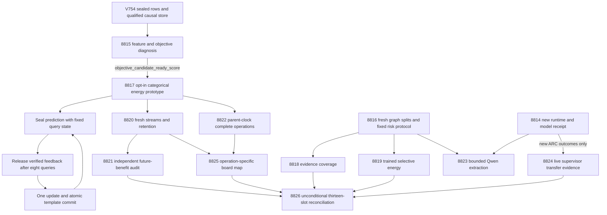

# Carnot Research Roadmap V755: Useful Decisions and Learning That Changes Future Loss

**Created:** 2026-11-04
**Milestone:** 2026.11.755
**Status:** Proposed; planning only, not activated
**Queue:** [research-roadmap-next.yaml](../../research-roadmap-next.yaml)
**Previous authority:** [Preserved V754 design](research-roadmap-v754-preserved-20261104.md)
**Contract:** Exactly 13 tasks, Exp8814 through Exp8826, in conductor order, across four phases.

## What V754 proved

The milestone finished scheduling ten producers and three pre-gated skips.
`research-complete.yaml` currently ends at V753; V754 findings below use actual
primary artifacts and the conductor log, rather than inferring science from
an administrative completion marker.

| Evidence | Measured finding | Consequence |
|---|---|---|
| Exp8801/8802 | Original controls and causal template execution qualified. Model and ARC prerequisites remained zero. | Reuse the qualified mechanism; keep optional branches separate. |
| [Exp8810](../../results/experiment_8810_v754_causal_learning_audit.json) | Across 30 streams, future combined-minus-read-only Brier was +0.00081223, CI99.5 [0.00033481, 0.00143418]. Combined-minus-calibration was +0.00008670. Retention passed; useful future learning failed. | Diagnose feature information and objective optimization before another full stream. |
| [Exp8805](../../results/experiment_8805_v754_evidence_intervention_study.json) | 8,640 rows; both tested methods had zero false-accept delta against local-record. Valid-alternative false rejects fell, but the registered conjunctive benefit gate failed. | Test useful decisive coverage prospectively; preserve the old null. |
| [Exp8806](../../results/experiment_8806_v754_consensus_challenge_energy.json) | 1,080 groups over 120 worlds. Fixed-evidence Brier 0.38494; learned mean about 0.27881. Coverage difference -0.11358 failed the requirement. | Freeze safe thresholds and matched abstention controls before fresh evaluation. |
| [Exp8809](../../results/experiment_8809_v754_delayed_feedback_capacity.json) | Actual overflow and 86,400 predictions, but no corrected useful capacity-policy effect. | Close the unchanged FIFO/uniform comparison. |
| [Exp8808](../../results/experiment_8808_v754_archived_observer_costs.json) | 36 windows with valid state and parent accounting; absolute observer disturbance failed. | Preserve complete timing, reject component attribution, change measurement mechanism. |
| Exp8807/8811/8812 | Skipped on runtime=0, new ARC outcomes=0, and component-cost readiness=0 respectively. | No unchanged GPU probe; no manufactured ARC data; hardware mapping must not need rejected fractions. |
| [Exp8813](../../results/experiment_8813_v754_capstone.json) | Complete 13-slot reconciliation; overall science blocked. Its zero scientific-measurement counter excludes constructed work. | Report constructed measurements and natural generalization separately. |

Exact encoded checks are circular evidence. Learned constructed results do not
establish natural-language verification. No V754 outcome is rewritten by this plan.

## Three biggest gaps against the PRD

1. **FR-06/FR-11: continuous learning that helps future queries.** Real additions
   and numerical updates now execute, but the new learner slightly harmed future
   loss. Exp8815 distinguishes feature ambiguity from optimization; only a measured
   objective improvement opens Exp8817/8820/8821. The stream retains actual template
   additions, causal labels, held-out retention and a shuffled-feedback control.
2. **FR-12: useful, faithful verification.** Abstaining on everything avoids false
   accepts, while a selector can lower Brier by sacrificing useful decisions.
   Exp8816/8818/8819 freeze coverage and risk jointly on new structures. Optional
   Exp8823 measures source-anchored extraction with the mandated Qwen. Constructed
   graphs remain a prerequisite study, not closure of the natural-text gap.
3. **FR-05/FR-08/NFR-01: complete deployment benefit.** Qualified kernels and
   feature reuse do not establish the PRD's 10x Python/Rust service target.
   Exp8822 measures the whole new adaptation operation without rejected internal
   clocks; Exp8825 maps actual operations to hardware. This milestone does not
   promise to close 10x native inference or the aspirational 100x learning target.

## Research basis

The [V755 research scan](../../research-references.md) was appended before task
design. It covers arXiv's eight requested topics and every secondary channel.
The following are adaptations to test, not replications or inherited guarantees.

| Source | Adaptation and limits | Tasks |
|---|---|---|
| [Price of Choice, October 2026](https://arxiv.org/abs/2610.29067) | Fix the threshold family and separate calibration from evaluation. Correlated variants do not inherit distribution-free bounds. | 8816, 8819 |
| [Audit-First VAPO, September/October 2026](https://arxiv.org/abs/2609.33662) | Compare useful coverage and risk at matched verification cost; freeze admission before labels. No generator training. | 8816, 8819 |
| [Distributional EBM, May 2026](https://arxiv.org/abs/2605.18871) | Separate energy normalization, exact evidence and shortcut controls. Compare objectives at fixed features and updates. | 8815, 8817 |
| [VeriHarness, October 2026](https://arxiv.org/abs/2610.00972) | Keep shared-wrong-answer challenges and demand evidence. | 8818, 8819, 8823 |
| [Hierarchical online feedback, March 2026](https://arxiv.org/abs/2603.04247) | Record release/selection provenance; defer policy-dependent label selection until fully observed learning works. | 8814, 8820 |
| [Online KAN, February/June 2026](https://arxiv.org/abs/2602.02056), [million p-bits, June 2026](https://arxiv.org/abs/2606.25313), [Z1T, September 2026](https://extropic.ai/writing/z1t) | Sparse arithmetic and sampling are distinct from dense training and durable storage. | 8822, 8825 |

EBT and ARM–EBM remain conceptual references. ETS decoder integration, PAL/T-SKM
constraint layers and KAN architecture replacement are deferred until current
bottlenecks qualify. The Semantic Scholar EBT request returned429; ARM–EBM
returned200 with ten citing entries. OpenReview had access limits; GitHub
Trending exposed no usable ranking. Kona supplied vendor framing, not a
reproducible new method. These limits are documented in the scan.

## Architecture



Exp8814 and Exp8816 are the two infrastructure slots. Exp8814 also owns focused
SOTA ingestion. CPU method producers independently admit their own inputs; the
administrative root is not a global gate. Exp8825 and Exp8826 always run and
retain missing operands as blocked subclaims. No shared validator is weakened.

## Phase 1 — Diagnose and freeze methods (8814–8816)

Exp8814 binds the exact task contract, ingests the new literature and records
optional artifact-only runtime/ARC admission. It performs no activation or probe.
Exp8815 computes empirical feature collisions and compares the original mixed
Brier/NCE loss, exactly normalized categorical energy, and a linear-energy
reference at matched features and training updates. Sixty development worlds,
five seeds, three learning rates and at most400 steps bound the diagnostic.
The new objective qualifies only with >=0.01 validation Brier improvement in
at least four of five seeds plus correct gradients and controls. Failure closes
this continuation without a full-stream rerun.

Exp8816 seals60 fit/60 calibration/240 evaluation graph worlds plus12 canary
worlds. Canonical topology/query overlap, not entity spelling, determines splits.
It freezes six cutoffs and all primary endpoints. A lack of genuinely disjoint
structures blocks with measured counts. Old evaluation worlds stay exposed.

## Phase 2 — Qualify learning and measure selective verification (8817–8819)

Exp8817 changes only the qualified objective and development initialization in
an opt-in causal store. Query state stays fixed; verified labels arrive after
8 queries; at most32 reusable templates commit atomically with energy weights.
The original default remains a control. Three-label normalization is exact:
`loss = E(x,y) + logsumexp(-E(x,c))`. No generator weights change.

Exp8818 runs240 worlds x6 evidence variants x3 methods, yielding4,320 rows.
Its200,000-operation ceiling counts actual fact comparisons and binding work.
Four98.75-percent whole-world interval families test coverage gain, false-accept
noninferiority, nuisance invariance and insufficient-evidence behavior. An exact
solver win remains circular. The previous zero-error gate is not retroactively changed.

Exp8819 trains the existing small Gibbs heads, chooses cutoffs only on calibration,
and evaluates2,160 candidate groups over240 worlds. Agreement-only, fixed evidence,
matched random abstention and exact-oracle references remain visible. Five99-percent
primary intervals require risk<=0.05, coverage>=0.30, useful-coverage gain>=0.05,
Brier gain>=0.01 and insufficient-to-decision<=0.05. Seeds and sibling candidates
are nested, not independent observations. No qualifying calibration cutoff means
no candidate, not a test-set threshold search.

## Phase 3 — Measure future benefit and complete costs (8820–8822)

Exp8820 uses30 fresh64-query streams, three seeds and five arms: original cold
combined, pretrained frozen, pretrained calibration-only, pretrained combined
and pretrained shuffled-feedback combined. It produces28,800 online rows plus
16,200 retention rows (12 held-out worlds at steps0/32/64), totaling45,000.
Capacity>=16 and delay8 prevent queue-policy effects from confounding this study.
Real template additions, future use, full tail drain and durable restart remain
required. The unchanged FIFO/uniform comparison is closed after Exp8809.

Exp8821 tests queries33–64 and averages within30 streams before resampling.
Ten99.5-percent simultaneous intervals require future combined Brier gains
>0.01 over both frozen and calibration-only controls, retention regression<=0.02,
error regression<=0.02, better loss than shuffled feedback and no useful-coverage
loss. It independently reduces raw rows; counts and updates alone cannot pass.

Exp8822 uses30 randomized AB/BA process blocks for old/new objectives,64 queries
per child, restart after32 and tail drain. Parent clocks surround complete work;
component clocks are disabled. Identical heartbeats are charged in both arms.
A pilot projects the full schedule and validation against4200 seconds. Complete
cost readiness can pass with no speed gain. It supplies no native10x claim and
no component fractions for hardware extrapolation.

## Phase 4 — External evidence, hardware and reconciliation (8823–8826)

Exp8823 is a conditional12-world/48-call source-span extraction canary. It uses
`unsloth/Qwen3.8-27B-GGUF`, one load, at most128 output tokens per call, verified
revision/build hashes and actual GPU offload. `model_bounded_generation` has a
10-second floor. Full generation uses60 seconds; load/embedding-only uses2 seconds.
Elapsed time is measured, never padded. Legacy small models are CPU smoke tests
only and cannot replace the mandated result. No runtime repair receipt means a
structured pre-gate skip, not another unchanged CUDA probe.

Exp8824 satisfies the ARC generalization floor using only new authenticated
selected/applied supervisor outcomes. Comparison requires30 episodes, three
overlapping games and five firings per shared arm cell; fixed horizons preserve
right censoring. No new frontier means a pre-gate skip. No game source, offline
BFS, per-game adapter or re-solve is authorized. Credited levels require
`solve_provenance=live_agent_self_discovery` and a registry precheck.

Exp8825 unconditionally maps operations to all three boards. It can document
unsupported operations even when another branch is absent. It does not turn
whole-operation times into unmeasured component fractions. A total/100 target is
a future latency requirement, not an Amdahl bound or a measured acceleration.
Exp8826 unconditionally accounts for all13 slots and distinguishes constructed
measurements from independent natural generalization. External absence is
terminal blocked; partial is reserved for retryable incomplete own work.

## Dependency graph and exact gate fields

```text
8815.objective_candidate_ready_score -> 8817
8817.memory_execution_ready_score -> 8820, 8822
8820.memory_rows_ready_score -> 8821
8816.evidence_protocol_ready_score -> 8818
8816.consensus_protocol_ready_score -> 8819
8814.runtime_repair_ready_score AND 8816.canary_protocol_ready_score -> 8823
8814.arc_new_outcomes_available_score -> 8824
8825 reads available 8820/8822 evidence independently (no conductor gate)
8826 reads all scheduled slots (no conductor gate)
```

All structured gates compare `== 1`, refer to earlier tasks in this roadmap and
are declared verbatim in the upstream REQUIRED ARTIFACT FIELDS. Benefit fields
are separate from row readiness. Historical artifacts are immutable evidence,
never a request to rerun a retired upstream task. The full contract below is
identical to the YAML, including prompts, lineage, models and gates.

## Hardware requirements and budgets

| Work | Required substrate | Planned task allowance |
|---|---|---|
| Diagnosis, small Gibbs training, graph studies | Existing CPU/JAX and local disk, estimated4–8GB RAM |40–65 minutes |
| Protocol and contract infrastructure | Existing CPU, private scratch, no model |30–45 minutes |
| Complete adaptation timing | CPU and durable local filesystem; no device changes |60 minutes |
| Conditional Qwen canary | One RTX3090 with24GB VRAM and cached roughly16GB quantization; second board optional |40 minutes |
| ARC reader, hardware map, capstone | CPU artifact reduction |25–35 minutes |

The serial planning allowance is535 minutes, not a throughput prediction.
Every task has a numbered flushed-progress requirement at phase boundaries and
before/after loads, generation, benchmarks and subprocesses. Long loops and child
waits emit real progress/heartbeats every60 seconds so no output gap reaches600
seconds. Files over about200 lines are written in150–200-line tool calls with
progress between calls. Runtime projection includes validation and uses4200
seconds as a ceiling inside the4800-second hard cap; no automatic task enlargement.

KV260 supports only qualified fabric operations with `k_max<=5`; access is SSH.
PolarFire's supported Linux CPU dispatch is distinct from fabric acceleration.
GateMate's unchanged `0xffffffff` observation requires a dated physical change
before another probe. NPU/TSU access remains unqualified. No board purchase,
flashing, driver change, device probe or paid cloud computation is scheduled.
Small categorical-energy training has a CPU and potential GPU batch path;
there is no established dense-Gibbs-to-spline-FPGA equivalence.

## Exclusions and overdue-priority decisions

The full exclusion manifest and historical proposals were read. Every task
names matching prior scope, its disposition, the actual forward difference and
`retire_if_same_verdict: true`. Missing prior primaries use an explicitly labeled
scheduler disposition. Standing2026-05-29 authority is used only for routine
reconciliation, changed lineage and board continuity, never an unchanged rerun.
Fresh IDs8814–8826 replace all retired execution dependencies.

The active priorities are FR-11 additions, the small calibrated decision floor,
Phase-D verification, SOTA ingestion, two infrastructure slots, ARC generalization
and visibility for KV260/PolarFire/GateMate. Older publication requests remain
operator-only. Legacy small-model baseline mandates are superseded by Qwen3.8.
Repeated JEPA geometry, projection-repair, off-path ARC solving, generator training,
unchanged CUDA probes, and FPGA timing without changed evidence remain closed.
A natural-text benchmark is still blocked on runtime and faithful extraction;
constructed wins cannot silently satisfy that priority. A new native performance
rewrite is deferred until the cost and learning mechanism are useful and measured.

## Validation and reconciliation

Planning validation checks YAML/schema, exact document/table/task-object equality,
all gate names and order, failure lineage, source paths, substrate/model declarations,
ARC floor and protected-file hashes. Relevant gate/manifest unit checks and private
E2E-018/021 exercise the existing planning/replay tooling without running research
producers. Whole-repository spec debt is reported separately. The planned OpenSpec
requirements and BMAD traceability are marked planned, not implemented.

No experiment, activation, deployment, external publication or push is part of
this change. `research-roadmap.yaml`, `scripts/research_conductor.py` and
`ops/exclusion_manifest.yaml` remain unchanged. V754 design bytes are archived.

## Exact task contract

| Order | Task ID | Title | Phase | Deliverable |
|---|---|---|---|---|
| 1 | exp8814-branch-contract | Bind thirteen tasks and ingest selective-decision methods without a global science gate | 1 | results/experiment_8814_v755_branch_contract.json |
| 2 | exp8815-learning-signal-diagnosis | Separate feature ambiguity from optimization failure in the causal energy head | 1 | results/experiment_8815_v755_learning_signal_diagnosis.json |
| 3 | exp8816-selective-evidence-methods | Seal fresh evidence worlds and a fixed risk-coverage decision protocol | 1 | results/experiment_8816_v755_selective_evidence_methods.json |
| 4 | exp8817-categorical-memory-prototype | Qualify a normalized categorical energy objective in the causal template store | 2 | results/experiment_8817_v755_categorical_memory_prototype.json |
| 5 | exp8818-evidence-decisive-coverage | Measure useful evidence decisions under equal computational budgets | 2 | results/experiment_8818_v755_evidence_decisive_coverage.json |
| 6 | exp8819-consensus-selective-energy | Test calibrated consensus energy at frozen risk and coverage targets | 2 | results/experiment_8819_v755_consensus_selective_energy.json |
| 7 | exp8820-causal-objective-streams | Measure future decisions after normalized energy updates and delayed template additions | 3 | results/experiment_8820_v755_causal_objective_streams.json |
| 8 | exp8821-future-benefit-audit | Audit causal future benefit and retention without mixing training and evaluation rows | 3 | results/experiment_8821_v755_future_benefit_audit.json |
| 9 | exp8822-parent-window-cost | Measure complete adaptation cost with parent clocks and unchanged durability | 3 | results/experiment_8822_v755_parent_window_cost.json |
| 10 | exp8823-qwen-witness-canary | Probe source-anchored extraction with mandated Qwen after authenticated runtime repair | 4 | results/experiment_8823_v755_qwen_witness_canary.json |
| 11 | exp8824-arc-outcome-transfer | Assess live supervisor generalization only from newly admitted outcomes | 4 | results/experiment_8824_v755_arc_outcome_transfer.json |
| 12 | exp8825-hardware-operation-map | Map the new learner operations to KV260 PolarFire and GateMate boundaries | 4 | results/experiment_8825_v755_hardware_operation_map.json |
| 13 | exp8826-capstone | Reconcile thirteen outcomes and distinguish constructed measurements from generalization | 4 | results/experiment_8826_v755_capstone.json |

Canonical task SHA-256: `12f51392c099f3ae4f18a879428d7512b6ac0e5fa231cea0321033859d9463f7`.

<!-- V755_TASK_CONTRACT_START -->
```json
{
  "milestone": "2026.11.755",
  "task_count": 13,
  "first_experiment": 8814,
  "last_experiment": 8826,
  "canonical_tasks_sha256": "12f51392c099f3ae4f18a879428d7512b6ac0e5fa231cea0321033859d9463f7",
  "tasks": [
    {
      "id": "exp8814-branch-contract",
      "title": "Bind thirteen tasks and ingest selective-decision methods without a global science gate",
      "phase": 1,
      "track": "infrastructure",
      "priority": "high",
      "requires_gpu": false,
      "max_turns": 100,
      "estimated_wall_time_min": 30,
      "per_unit_rows": true,
      "milestone": "2026.11.755",
      "deliverable": "results/experiment_8814_v755_branch_contract.json",
      "inference_substrate_class": "no_model_load",
      "MODEL_SPECS": [],
      "gated_on": [],
      "prior_failures": [
        {
          "experiment_id": "exp8801-repaired-memory-qualification",
          "verdict": "complete_null_v754_repaired_memory_qualification",
          "addressed_by": "Use the shipped V754 original-child qualification and thirteen new task objects; add selective-risk method ingestion and keep optional runtime/ARC admission separate from CPU science.",
          "retire_if_same_verdict": true
        },
        {
          "experiment_id": "exp8813-capstone",
          "verdict": "complete_blocked_v754_capstone",
          "addressed_by": "Use the shipped V754 original-child qualification and thirteen new task objects; add selective-risk method ingestion and keep optional runtime/ARC admission separate from CPU science.",
          "retire_if_same_verdict": true
        }
      ],
      "agent_type": "claude",
      "model": "opus",
      "prompt": "CONTEXT:\nWork in {project_root} on {date}. Milestone 2026.11.755, exp8814-branch-contract. V754 has ten primaries and three structured skips. The completed-history YAML currently ends at V753; use actual V754 primaries and conductor receipts. A qualified causal implementation did not show benefit. This is the administrative and SOTA-ingestion slot, not an experiment activation.\nChanged scope: Use the shipped V754 original-child qualification and thirteen new task objects; add selective-risk method ingestion and keep optional runtime/ARC admission separate from CPU science.\n\nEXISTING CODE TO READ FIRST:\n- python/carnot/reporting/roadmap_contract.py\n- python/carnot/reporting/v754_repaired_memory.py\n- python/carnot/reporting/v754_capstone.py\n- results/experiment_8813_v754_capstone.json\n- ops/exclusion_manifest.yaml\n- ops/known-issues.md\n- research-references.md\n- openspec/capabilities/research-reporting/spec.md (REQ-REPORT-8814)\n- scripts/experiment_template.py; python/carnot/reporting/current_work_receipt.py; python/carnot/reporting/primary_publication.py\n\nTASK:\nBind thirteen tasks and ingest selective-decision methods without a global science gate. Deliver results/experiment_8814_v755_branch_contract.json and private hash-bound raw evidence under results/raw/experiment_8814_v755_branch_contract/. Implement scripts/experiments/experiment_8814_v755_branch_contract.py with --date and private-output/replay options; keep science independent of optional branches.\n\nCONCRETE STEPS:\n1. Emit a flushed progress line at every phase boundary and before and after every model load, generation call, benchmark and subprocess that can take minutes. During long loops emit completed/pending counts at least every 60 seconds; while a child runs, forward its output and emit elapsed/phase heartbeats every 60 seconds. Keep every output gap below 600 seconds, including tool-free reasoning. Use python -u and print(..., flush=True); heartbeat does not extend a measured deadline.\n2. Keep tool calls bounded. Write any file over about 200 lines in several tool calls of at most 150-200 lines, with a progress message between calls. Use scripts/experiments/ for experiment entrypoints, tests/python/ for tests and /tmp for throwaway probes. Never write scratch scripts at the repository root.\n3. Compare the visible 13-row table, complete JSON task objects and staged YAML; after activation compare active task semantics as well, accepting only the existing exact conductor brace encoding. Record canonical hashes. Preserve V754 design bytes and all primaries. Do not activate, edit research-roadmap.yaml, modify the conductor or rerun historical experiments.\n4. Ingest the V755 scan using the existing low-concurrency sweep helpers and primary sources. Map Price of Choice, Audit-First VAPO and distributional energy to frozen-rule testing, matched coverage/cost controls and objective diagnostics. Record source dates, inaccessible sources and untested assumptions in docs/research-notes/v755-methods.md; mark actually ingested entries in research-studying.md. No broad agent fan-out.\n5. Run one bounded artifact-only admission pass for ops/cuda-runtime-repair-receipt.json and ops/arc_supervisor_refinement_ledger.json, using the current qualified validators and Exp8760 frontier. runtime_repair_ready_score=1 requires authenticated causal library/environment change, exact mandated revision and current offload evidence; arc_new_outcomes_available_score=1 requires authenticated new selected/applied outcomes. No CUDA, game or device probes. These fields gate only their own optional tasks.\n6. Qualify exact field spelling and ordering for every structured edge. Freeze branch-local input manifests; independent CPU producers perform their own small contract admission and do not depend on this task. A missing optional receipt records its observed value without failing unrelated contract readiness.\n7. Before implementation, read CODEX.md and CLAUDE.md and extend the named REQ/SCENARIO in openspec/capabilities/research-reporting/spec.md (plus the relevant learning/verification capability); write failing tests first. Reuse current_work_receipt, primary_publication and existing scoped validation rather than copying an old milestone runner. Bind immutable historical authorities, never mutable vNEXT as an old fixture. Validate owned code with scoped pytest and actual unit/child coverage at 100 percent with zero exclusions, Ruff check/format, strict mypy, and scripts/check_spec_coverage.py with owned test paths as positional arguments. Run applicable private E2E-018/021, and E2E-003/004 plus cargo test/fmt/clippy only for native changes. Cold-replay the terminal artifact outside the checkout without PYTHONPATH. Run adversarial_verify.py and verdict_row_consistency_lint.py --strict on the candidate before publishing. Retain rejected evidence; a failed owned check means disqualified and readiness zero. Record global test/spec debt separately, never silently waive an owned failure. Reconcile specs, _bmad/traceability.md, ops/status.md and ops/changelog.md.\n\nREQUIRED ARTIFACT FIELDS:\nexperiment_id, task_id, milestone, run_date, honest_verdict (terminal complete_ prefix); verdict_class: positive | circular_positive | null | blocked | disqualified | partial. Partial is only unfinished own work that another attempt can complete; unchanged external absence is blocked. inference_substrate, inference_substrate_class, MODEL_SPECS, model_invocation_counts, numerical_training_calls, verifier_is_oracle, duration_s, random_seed, reproducibility_checksum, source_artifact_hashes, code_config_hashes, raw_shard_hashes, phase_spans, preconditions_checked. rows: per-unit records with unit_id, cluster_id, arm, seed, metric, denominator, status, missing_reason; intended_count, completed_count, failed_count, censored_count, excluded_count, independent_count. gate_check_summary: check, upstream, artifact_field, expected, observed, path and hash for every blocked result, distinguishing missing_file, missing_field, rejected_producer and observed zero. acceptance_gates, required_checks_passed, validation_receipts, owned_statement_coverage, exposure_scope, independent_generalization_score, cited_upstream_artifacts, field_principles. Annotate all extra fields with their evidence principle. Exact-oracle success is circular_positive, never positive; constructed evidence never establishes natural-text or hidden-game generalization. Readiness means valid evidence, not benefit. Do not pad elapsed time to meet substrate floors.\ncontract_ready_score, runtime_repair_ready_score, arc_new_outcomes_available_score: integer 0/1; full_task_objects, canonical_tasks_sha256, gate_edge_rows, source_method_rows, branch_admission_rows, preserved_v754_reference. Principle: administrative custody is separate from scientific evidence.\n\nRun command: cd {project_root} && JAX_PLATFORMS=cpu .venv/bin/python -u scripts/experiments/experiment_8814_v755_branch_contract.py --date {date}\nDo NOT push. Do NOT modify scripts/research_conductor.py.",
      "operator_override": "2026-05-29 operator directive (standing): routine milestone reconciliation; scope matches historical exp8801-repaired-memory-qualification, exp8813-capstone; Use the shipped V754 original-child qualification and thirteen new task objects; add selective-risk method ingestion and keep optional runtime/ARC admission separate from CPU science."
    },
    {
      "id": "exp8815-learning-signal-diagnosis",
      "title": "Separate feature ambiguity from optimization failure in the causal energy head",
      "phase": 1,
      "track": "research",
      "priority": "high",
      "requires_gpu": false,
      "max_turns": 50,
      "estimated_wall_time_min": 40,
      "per_unit_rows": true,
      "milestone": "2026.11.755",
      "deliverable": "results/experiment_8815_v755_learning_signal_diagnosis.json",
      "inference_substrate_class": "no_model_load",
      "MODEL_SPECS": [],
      "gated_on": [],
      "prior_failures": [
        {
          "experiment_id": "exp8802-causal-memory-prototype",
          "verdict": "complete_null_causal_execution_qualified_no_benefit_claim",
          "addressed_by": "The full stream exposed a small harmful effect; replace unchanged execution reruns with a finite feature-identifiability and same-budget objective intervention before any new stream.",
          "retire_if_same_verdict": true
        },
        {
          "experiment_id": "exp8804-causal-template-streams",
          "verdict": "complete_null_measurements_ready_benefit_reserved_for_exp8810",
          "addressed_by": "The full stream exposed a small harmful effect; replace unchanged execution reruns with a finite feature-identifiability and same-budget objective intervention before any new stream.",
          "retire_if_same_verdict": true
        },
        {
          "experiment_id": "exp8810-causal-learning-audit",
          "verdict": "complete_null_causal_learning_audit",
          "addressed_by": "The full stream exposed a small harmful effect; replace unchanged execution reruns with a finite feature-identifiability and same-budget objective intervention before any new stream.",
          "retire_if_same_verdict": true
        }
      ],
      "prompt": "CONTEXT:\nWork in {project_root} on {date}. Milestone 2026.11.755, exp8815-learning-signal-diagnosis. Exp8810 measured future combined-minus-read-only Brier +0.00081223 and combined-minus-calibration +0.00008670; retention passed. Exp8804 probabilities remain near one third. Nonzero gradients alone do not establish useful learning. Diagnose before another full stream.\nChanged scope: The full stream exposed a small harmful effect; replace unchanged execution reruns with a finite feature-identifiability and same-budget objective intervention before any new stream.\n\nEXISTING CODE TO READ FIRST:\n- python/carnot/memory/causal_memory_8802.py\n- python/carnot/reporting/evidence_intervention_corpus_8791.py\n- python/carnot/learning/causal_template_streams_8804.py\n- python/carnot/models/gibbs/__init__.py\n- python/carnot/training/nce.py\n- python/carnot/reporting/causal_learning_audit_8810.py\n- results/experiment_8804_v754_causal_template_streams.json\n- results/experiment_8810_v754_causal_learning_audit.json\n- openspec/capabilities/research-reporting/spec.md (REQ-REPORT-8815)\n- scripts/experiment_template.py; python/carnot/reporting/current_work_receipt.py; python/carnot/reporting/primary_publication.py\n\nTASK:\nSeparate feature ambiguity from optimization failure in the causal energy head. Deliver results/experiment_8815_v755_learning_signal_diagnosis.json and private hash-bound raw evidence under results/raw/experiment_8815_v755_learning_signal_diagnosis/. Implement scripts/experiments/experiment_8815_v755_learning_signal_diagnosis.py with --date and private-output/replay options; keep science independent of optional branches.\n\nCONCRETE STEPS:\n1. Emit a flushed progress line at every phase boundary and before and after every model load, generation call, benchmark and subprocess that can take minutes. During long loops emit completed/pending counts at least every 60 seconds; while a child runs, forward its output and emit elapsed/phase heartbeats every 60 seconds. Keep every output gap below 600 seconds, including tool-free reasoning. Use python -u and print(..., flush=True); heartbeat does not extend a measured deadline.\n2. Keep tool calls bounded. Write any file over about 200 lines in several tool calls of at most 150-200 lines, with a progress message between calls. Use scripts/experiments/ for experiment entrypoints, tests/python/ for tests and /tmp for throwaway probes. Never write scratch scripts at the repository root.\n3. Authenticate V754 sealed rows and compute feature-vector collision tables, label distributions conditional on features and the empirical finite-corpus Brier floor sum_x p(x)(1-sum_y p(y|x)^2). This uses exposed labels for diagnosis only; never call it a population Bayes bound. Report template-on/off collisions and effective distinct structures, not entity renamings as independent examples.\n4. Generate60 new development worlds using the existing evidence corpus constructor, restricted to five-query inputs. Split40 fit/20 validation by canonical graph structure, excluding all V754 evaluation structures and the prospective stream/retention structures. These worlds are exposed development data, not the sealed rows used for retrospective diagnosis. Compare the original mixed Brier/NCE loss, exact categorical negative log likelihood over the same three energies, and multinomial linear energy. Keep six visible counts, candidate bits, five primitive checks and hidden width four fixed. Use five nested seeds, at most 400 steps per fit and LR menu [0.01,0.03,0.1]; choose on development only. Save loss, gradients, probability spread and update-count curves. No expanded architecture or test-data tuning.\n5. Add separable tiny positive controls, feature-identical conflicting labels, shuffled labels, finite-difference gradient checks and serving/training parity. Emit objective_candidate_ready_score=1 only if the categorical objective improves validation Brier by >=0.01 versus original at matched updates for at least four of five seeds, train-validation identities are disjoint and all controls pass. Otherwise close this objective continuation; do not run a bigger sweep.\n6. Freeze the selected configuration and a causal mechanism report that distinguishes observed support from unresolved cause. No full stream, hindsight label in features or claimed FR-11 benefit.\n7. Before implementation, read CODEX.md and CLAUDE.md and extend the named REQ/SCENARIO in openspec/capabilities/research-reporting/spec.md (plus the relevant learning/verification capability); write failing tests first. Reuse current_work_receipt, primary_publication and existing scoped validation rather than copying an old milestone runner. Bind immutable historical authorities, never mutable vNEXT as an old fixture. Validate owned code with scoped pytest and actual unit/child coverage at 100 percent with zero exclusions, Ruff check/format, strict mypy, and scripts/check_spec_coverage.py with owned test paths as positional arguments. Run applicable private E2E-018/021, and E2E-003/004 plus cargo test/fmt/clippy only for native changes. Cold-replay the terminal artifact outside the checkout without PYTHONPATH. Run adversarial_verify.py and verdict_row_consistency_lint.py --strict on the candidate before publishing. Retain rejected evidence; a failed owned check means disqualified and readiness zero. Record global test/spec debt separately, never silently waive an owned failure. Reconcile specs, _bmad/traceability.md, ops/status.md and ops/changelog.md.\n\nREQUIRED ARTIFACT FIELDS:\nexperiment_id, task_id, milestone, run_date, honest_verdict (terminal complete_ prefix); verdict_class: positive | circular_positive | null | blocked | disqualified | partial. Partial is only unfinished own work that another attempt can complete; unchanged external absence is blocked. inference_substrate, inference_substrate_class, MODEL_SPECS, model_invocation_counts, numerical_training_calls, verifier_is_oracle, duration_s, random_seed, reproducibility_checksum, source_artifact_hashes, code_config_hashes, raw_shard_hashes, phase_spans, preconditions_checked. rows: per-unit records with unit_id, cluster_id, arm, seed, metric, denominator, status, missing_reason; intended_count, completed_count, failed_count, censored_count, excluded_count, independent_count. gate_check_summary: check, upstream, artifact_field, expected, observed, path and hash for every blocked result, distinguishing missing_file, missing_field, rejected_producer and observed zero. acceptance_gates, required_checks_passed, validation_receipts, owned_statement_coverage, exposure_scope, independent_generalization_score, cited_upstream_artifacts, field_principles. Annotate all extra fields with their evidence principle. Exact-oracle success is circular_positive, never positive; constructed evidence never establishes natural-text or hidden-game generalization. Readiness means valid evidence, not benefit. Do not pad elapsed time to meet substrate floors.\ndiagnosis_rows_ready_score, objective_candidate_ready_score: integer 0/1; collision_rows, empirical_feature_floor, per_seed_fit_rows, gradient_control_rows, objective_selection, selected_configuration_hash, mechanism_supported. Principle: development fit qualifies a changed mechanism, not future generalization.\n\nRun command: cd {project_root} && JAX_PLATFORMS=cpu .venv/bin/python -u scripts/experiments/experiment_8815_v755_learning_signal_diagnosis.py --date {date}\nDo NOT push. Do NOT modify scripts/research_conductor.py."
    },
    {
      "id": "exp8816-selective-evidence-methods",
      "title": "Seal fresh evidence worlds and a fixed risk-coverage decision protocol",
      "phase": 1,
      "track": "infrastructure",
      "priority": "high",
      "requires_gpu": false,
      "max_turns": 100,
      "estimated_wall_time_min": 45,
      "per_unit_rows": true,
      "milestone": "2026.11.755",
      "deliverable": "results/experiment_8816_v755_selective_evidence_methods.json",
      "inference_substrate_class": "no_model_load",
      "MODEL_SPECS": [],
      "gated_on": [],
      "prior_failures": [
        {
          "experiment_id": "exp8803-repaired-evidence-methods",
          "verdict": "complete_circular_positive_constructed_protocol_qualification",
          "addressed_by": "Use fresh non-isomorphic structures and prospectively frozen risk/coverage endpoints; explicitly diagnose zero headroom and abstention, leaving V754 acceptance gates and nulls intact.",
          "retire_if_same_verdict": true
        },
        {
          "experiment_id": "exp8805-evidence-intervention-study",
          "verdict": "complete_null_constructed_evidence_interventions",
          "addressed_by": "Use fresh non-isomorphic structures and prospectively frozen risk/coverage endpoints; explicitly diagnose zero headroom and abstention, leaving V754 acceptance gates and nulls intact.",
          "retire_if_same_verdict": true
        },
        {
          "experiment_id": "exp8806-consensus-challenge-energy",
          "verdict": "complete_null_constructed_consensus_energy",
          "addressed_by": "Use fresh non-isomorphic structures and prospectively frozen risk/coverage endpoints; explicitly diagnose zero headroom and abstention, leaving V754 acceptance gates and nulls intact.",
          "retire_if_same_verdict": true
        }
      ],
      "agent_type": "claude",
      "model": "opus",
      "prompt": "CONTEXT:\nWork in {project_root} on {date}. Milestone 2026.11.755, exp8816-selective-evidence-methods. Exp8805 had zero false-accept headroom against an abstaining local baseline; Exp8806 improved Brier while losing 0.11358 coverage. The previous conjunctive gates remain failed. A new prospective question must measure useful decisions at a fixed risk and name its denominator.\nChanged scope: Use fresh non-isomorphic structures and prospectively frozen risk/coverage endpoints; explicitly diagnose zero headroom and abstention, leaving V754 acceptance gates and nulls intact.\n\nEXISTING CODE TO READ FIRST:\n- python/carnot/reporting/repaired_evidence_8803.py\n- python/carnot/reporting/evidence_intervention_corpus_8791.py\n- python/carnot/reporting/evidence_intervention_analysis_8805.py\n- python/carnot/reporting/consensus_energy_8806.py\n- results/experiment_8805_v754_evidence_intervention_study.json\n- results/experiment_8806_v754_consensus_challenge_energy.json\n- research-references.md\n- openspec/capabilities/research-reporting/spec.md (REQ-REPORT-8816)\n- scripts/experiment_template.py; python/carnot/reporting/current_work_receipt.py; python/carnot/reporting/primary_publication.py\n\nTASK:\nSeal fresh evidence worlds and a fixed risk-coverage decision protocol. Deliver results/experiment_8816_v755_selective_evidence_methods.json and private hash-bound raw evidence under results/raw/experiment_8816_v755_selective_evidence_methods/. Implement scripts/experiments/experiment_8816_v755_selective_evidence_methods.py with --date and private-output/replay options; keep science independent of optional branches.\n\nCONCRETE STEPS:\n1. Emit a flushed progress line at every phase boundary and before and after every model load, generation call, benchmark and subprocess that can take minutes. During long loops emit completed/pending counts at least every 60 seconds; while a child runs, forward its output and emit elapsed/phase heartbeats every 60 seconds. Keep every output gap below 600 seconds, including tool-free reasoning. Use python -u and print(..., flush=True); heartbeat does not extend a measured deadline.\n2. Keep tool calls bounded. Write any file over about 200 lines in several tool calls of at most 150-200 lines, with a progress message between calls. Use scripts/experiments/ for experiment entrypoints, tests/python/ for tests and /tmp for throwaway probes. Never write scratch scripts at the repository root.\n3. Build immutable independently generated graph splits: 60 fit, 60 calibration and 240 evaluation worlds, plus 12 disjoint canary worlds. Split by canonical unlabeled topology and query structure; disallow V751-V754 structures and alpha-isomorphic overlap. Balance support/refute/insufficient, single/multiple-variable joins, missing evidence and conflicts. Keep truth private until prediction rows seal; use two independent exact evaluators for labels. If structural support is too small, blocked with counts rather than relabeling aliases.\n4. Freeze separate Exp8818 and Exp8819 estimands. For Exp8818: correct decisive coverage gain >=0.05 and semantic false-accept noninferiority <=0.01 against the strongest prespecified budgeted comparator. For Exp8819: unconditional Brier, wrong-decision rate among non-escalations, decisive coverage and insufficient-to-decision rate; no reward for confidently rejecting when truth is insufficient. Use threshold menu [0.5,0.6,0.7,0.8,0.9,0.95] on calibration only, one selected threshold per arm and seed; never pick the winner on evaluation.\n5. Freeze whole-world resampling, seed nesting, equal paid checks and matched-coverage controls. For consensus, risk upper bound<=0.05 and coverage lower bound>=0.30; risk-neutral useful-coverage gain lower bound>=0.05 over fixed evidence at its own frozen safe threshold. If no calibration threshold qualifies, mark no candidate before evaluation and preserve all calibration rows. Report empirical intervals as constructed-population evidence, not distribution-free certification.\n6. Publish evidence_protocol_ready_score and consensus_protocol_ready_score separately. Qualify mutation controls for label exposure, missing versus false, padding/order invariance and graph-split contamination. Keep exact-oracle reference costs separate. This infrastructure slot freezes a new question; it does not repair old outcomes.\n7. Before implementation, read CODEX.md and CLAUDE.md and extend the named REQ/SCENARIO in openspec/capabilities/research-reporting/spec.md (plus the relevant learning/verification capability); write failing tests first. Reuse current_work_receipt, primary_publication and existing scoped validation rather than copying an old milestone runner. Bind immutable historical authorities, never mutable vNEXT as an old fixture. Validate owned code with scoped pytest and actual unit/child coverage at 100 percent with zero exclusions, Ruff check/format, strict mypy, and scripts/check_spec_coverage.py with owned test paths as positional arguments. Run applicable private E2E-018/021, and E2E-003/004 plus cargo test/fmt/clippy only for native changes. Cold-replay the terminal artifact outside the checkout without PYTHONPATH. Run adversarial_verify.py and verdict_row_consistency_lint.py --strict on the candidate before publishing. Retain rejected evidence; a failed owned check means disqualified and readiness zero. Record global test/spec debt separately, never silently waive an owned failure. Reconcile specs, _bmad/traceability.md, ops/status.md and ops/changelog.md.\n\nREQUIRED ARTIFACT FIELDS:\nexperiment_id, task_id, milestone, run_date, honest_verdict (terminal complete_ prefix); verdict_class: positive | circular_positive | null | blocked | disqualified | partial. Partial is only unfinished own work that another attempt can complete; unchanged external absence is blocked. inference_substrate, inference_substrate_class, MODEL_SPECS, model_invocation_counts, numerical_training_calls, verifier_is_oracle, duration_s, random_seed, reproducibility_checksum, source_artifact_hashes, code_config_hashes, raw_shard_hashes, phase_spans, preconditions_checked. rows: per-unit records with unit_id, cluster_id, arm, seed, metric, denominator, status, missing_reason; intended_count, completed_count, failed_count, censored_count, excluded_count, independent_count. gate_check_summary: check, upstream, artifact_field, expected, observed, path and hash for every blocked result, distinguishing missing_file, missing_field, rejected_producer and observed zero. acceptance_gates, required_checks_passed, validation_receipts, owned_statement_coverage, exposure_scope, independent_generalization_score, cited_upstream_artifacts, field_principles. Annotate all extra fields with their evidence principle. Exact-oracle success is circular_positive, never positive; constructed evidence never establishes natural-text or hidden-game generalization. Readiness means valid evidence, not benefit. Do not pad elapsed time to meet substrate floors.\nevidence_protocol_ready_score, consensus_protocol_ready_score, canary_protocol_ready_score: integer 0/1; split_manifest_hash, structure_disjointness_rows, protocol_hashes, threshold_menu, estimands, multiplicity_families, label_custody, calibration_selection_rule. Principle: selection happens before untouched evaluation.\n\nRun command: cd {project_root} && JAX_PLATFORMS=cpu .venv/bin/python -u scripts/experiments/experiment_8816_v755_selective_evidence_methods.py --date {date}\nDo NOT push. Do NOT modify scripts/research_conductor.py."
    },
    {
      "id": "exp8817-categorical-memory-prototype",
      "title": "Qualify a normalized categorical energy objective in the causal template store",
      "phase": 2,
      "track": "research",
      "priority": "high",
      "requires_gpu": false,
      "max_turns": 50,
      "estimated_wall_time_min": 45,
      "per_unit_rows": true,
      "milestone": "2026.11.755",
      "deliverable": "results/experiment_8817_v755_categorical_memory_prototype.json",
      "inference_substrate_class": "no_model_load",
      "MODEL_SPECS": [],
      "gated_on": [
        {
          "upstream": "exp8815-learning-signal-diagnosis",
          "artifact_field": "objective_candidate_ready_score",
          "op": "==",
          "value": 1
        }
      ],
      "prior_failures": [
        {
          "experiment_id": "exp8802-causal-memory-prototype",
          "verdict": "complete_null_causal_execution_qualified_no_benefit_claim",
          "addressed_by": "Exp8815 must first demonstrate matched-budget development benefit of exact categorical normalization; only then introduce that objective and frozen development initialization while preserving V754 transaction semantics.",
          "retire_if_same_verdict": true
        },
        {
          "experiment_id": "exp8804-causal-template-streams",
          "verdict": "complete_null_measurements_ready_benefit_reserved_for_exp8810",
          "addressed_by": "Exp8815 must first demonstrate matched-budget development benefit of exact categorical normalization; only then introduce that objective and frozen development initialization while preserving V754 transaction semantics.",
          "retire_if_same_verdict": true
        },
        {
          "experiment_id": "exp8810-causal-learning-audit",
          "verdict": "complete_null_causal_learning_audit",
          "addressed_by": "Exp8815 must first demonstrate matched-budget development benefit of exact categorical normalization; only then introduce that objective and frozen development initialization while preserving V754 transaction semantics.",
          "retire_if_same_verdict": true
        }
      ],
      "agent_type": "codex",
      "model": "gpt-6.1-sol",
      "prompt": "CONTEXT:\nWork in {project_root} on {date}. Milestone 2026.11.755, exp8817-categorical-memory-prototype. The learning continuation is authorized only by Exp8815 showing a specific same-budget objective improvement. Reuse the V754 transactional template store and exactly the same serving features; a loss change must not hide more checks, labels or capacity.\nChanged scope: Exp8815 must first demonstrate matched-budget development benefit of exact categorical normalization; only then introduce that objective and frozen development initialization while preserving V754 transaction semantics.\n\nEXISTING CODE TO READ FIRST:\n- python/carnot/memory/causal_memory_8802.py\n- tests/python/test_causal_memory_8802.py\n- python/carnot/reporting/causal_memory_runner_8802.py\n- results/experiment_8815_v755_learning_signal_diagnosis.json\n- openspec/capabilities/research-reporting/spec.md (REQ-REPORT-8817)\n- scripts/experiment_template.py; python/carnot/reporting/current_work_receipt.py; python/carnot/reporting/primary_publication.py\n\nTASK:\nQualify a normalized categorical energy objective in the causal template store. Deliver results/experiment_8817_v755_categorical_memory_prototype.json and private hash-bound raw evidence under results/raw/experiment_8817_v755_categorical_memory_prototype/. Implement scripts/experiments/experiment_8817_v755_categorical_memory_prototype.py with --date and private-output/replay options; keep science independent of optional branches.\n\nCONCRETE STEPS:\n1. Emit a flushed progress line at every phase boundary and before and after every model load, generation call, benchmark and subprocess that can take minutes. During long loops emit completed/pending counts at least every 60 seconds; while a child runs, forward its output and emit elapsed/phase heartbeats every 60 seconds. Keep every output gap below 600 seconds, including tool-free reasoning. Use python -u and print(..., flush=True); heartbeat does not extend a measured deadline.\n2. Keep tool calls bounded. Write any file over about 200 lines in several tool calls of at most 150-200 lines, with a progress message between calls. Use scripts/experiments/ for experiment entrypoints, tests/python/ for tests and /tmp for throwaway probes. Never write scratch scripts at the repository root.\n3. Authenticate objective_candidate_ready_score=1 and its frozen configuration before changing behavior. Add an opt-in objective choice using loss E(x,y)+logsumexp(-E(x,c)) over c in support/refute/insufficient, preserving the original objective and all existing callers. Use the selected LR, hidden width and one update per released label; no extra training passes in the online arms.\n4. Fit the initialization on only the 40 development fit worlds from Exp8815; use the held-out development worlds for its predeclared selection and freeze weights, template-empty initial state and cutoff. Never initialize from V754 evaluation labels. Declare numerical_training_calls; this is small CPU energy training, no GGUF load.\n5. Qualify five-check accounting, frozen within-query state, prediction-before-label, delay-eight release, templates added only on released verifier feedback, normalized reusable identity, at most32 templates, deterministic resume, idempotent acknowledgements, atomic weights/templates/pending commit and hard-exit recovery. Original default outputs must remain unchanged. Include shuffled feedback drawn only from already released labels and an offline hindsight control excluded from science.\n6. Freeze 30 fresh 64-query reset streams with varied relation/query structures and three nested seeds [11,23,47]; reserve 12 structurally disjoint retention worlds per stream. Define five arms: original cold combined, pretrained frozen, pretrained calibration-only, pretrained combined, pretrained shuffled-feedback combined. Hold paid checks, labels, initial weights of the four pretrained arms, durability and seed schedules equal. Publish execution readiness only after private CLI replay and original regression controls pass.\n7. Before implementation, read CODEX.md and CLAUDE.md and extend the named REQ/SCENARIO in openspec/capabilities/research-reporting/spec.md (plus the relevant learning/verification capability); write failing tests first. Reuse current_work_receipt, primary_publication and existing scoped validation rather than copying an old milestone runner. Bind immutable historical authorities, never mutable vNEXT as an old fixture. Validate owned code with scoped pytest and actual unit/child coverage at 100 percent with zero exclusions, Ruff check/format, strict mypy, and scripts/check_spec_coverage.py with owned test paths as positional arguments. Run applicable private E2E-018/021, and E2E-003/004 plus cargo test/fmt/clippy only for native changes. Cold-replay the terminal artifact outside the checkout without PYTHONPATH. Run adversarial_verify.py and verdict_row_consistency_lint.py --strict on the candidate before publishing. Retain rejected evidence; a failed owned check means disqualified and readiness zero. Record global test/spec debt separately, never silently waive an owned failure. Reconcile specs, _bmad/traceability.md, ops/status.md and ops/changelog.md.\n\nREQUIRED ARTIFACT FIELDS:\nexperiment_id, task_id, milestone, run_date, honest_verdict (terminal complete_ prefix); verdict_class: positive | circular_positive | null | blocked | disqualified | partial. Partial is only unfinished own work that another attempt can complete; unchanged external absence is blocked. inference_substrate, inference_substrate_class, MODEL_SPECS, model_invocation_counts, numerical_training_calls, verifier_is_oracle, duration_s, random_seed, reproducibility_checksum, source_artifact_hashes, code_config_hashes, raw_shard_hashes, phase_spans, preconditions_checked. rows: per-unit records with unit_id, cluster_id, arm, seed, metric, denominator, status, missing_reason; intended_count, completed_count, failed_count, censored_count, excluded_count, independent_count. gate_check_summary: check, upstream, artifact_field, expected, observed, path and hash for every blocked result, distinguishing missing_file, missing_field, rejected_producer and observed zero. acceptance_gates, required_checks_passed, validation_receipts, owned_statement_coverage, exposure_scope, independent_generalization_score, cited_upstream_artifacts, field_principles. Annotate all extra fields with their evidence principle. Exact-oracle success is circular_positive, never positive; constructed evidence never establishes natural-text or hidden-game generalization. Readiness means valid evidence, not benefit. Do not pad elapsed time to meet substrate floors.\nmemory_execution_ready_score: integer 0/1; objective_config, initial_weights_hash, frozen_stream_manifest_hash, template_policy, causal_release_rows, restart_rows, parity_rows, per_update_operation_counts. Principle: prototype controls qualify execution, not beneficial learning.\n\nRun command: cd {project_root} && JAX_PLATFORMS=cpu .venv/bin/python -u scripts/experiments/experiment_8817_v755_categorical_memory_prototype.py --date {date}\nDo NOT push. Do NOT modify scripts/research_conductor.py."
    },
    {
      "id": "exp8818-evidence-decisive-coverage",
      "title": "Measure useful evidence decisions under equal computational budgets",
      "phase": 2,
      "track": "research",
      "priority": "high",
      "requires_gpu": false,
      "max_turns": 50,
      "estimated_wall_time_min": 45,
      "per_unit_rows": true,
      "milestone": "2026.11.755",
      "deliverable": "results/experiment_8818_v755_evidence_decisive_coverage.json",
      "inference_substrate_class": "no_model_load",
      "MODEL_SPECS": [],
      "gated_on": [
        {
          "upstream": "exp8816-selective-evidence-methods",
          "artifact_field": "evidence_protocol_ready_score",
          "op": "==",
          "value": 1
        }
      ],
      "prior_failures": [
        {
          "experiment_id": "exp8805-evidence-intervention-study",
          "verdict": "complete_null_constructed_evidence_interventions",
          "addressed_by": "Change the prospective estimand from reducing an already-zero error to useful decisive coverage at fixed risk and equal underlying operation budgets, on new multi-variable structures; preserve old nulls.",
          "retire_if_same_verdict": true
        }
      ],
      "agent_type": "codex",
      "model": "gpt-6.1-sol",
      "prompt": "CONTEXT:\nWork in {project_root} on {date}. Milestone 2026.11.755, exp8818-evidence-decisive-coverage. Exp8805 reported zero false-accept deltas but large valid-alternative false-reject reductions. This is a new prospective utility question on unseen multi-variable graph structures, not a reinterpretation that changes Exp8805 to positive.\nChanged scope: Change the prospective estimand from reducing an already-zero error to useful decisive coverage at fixed risk and equal underlying operation budgets, on new multi-variable structures; preserve old nulls.\n\nEXISTING CODE TO READ FIRST:\n- python/carnot/reporting/evidence_set_methods_8768.py\n- python/carnot/reporting/evidence_intervention_study_8805.py\n- python/carnot/reporting/evidence_intervention_analysis_8805.py\n- results/experiment_8816_v755_selective_evidence_methods.json\n- openspec/capabilities/research-reporting/spec.md (REQ-REPORT-8818)\n- scripts/experiment_template.py; python/carnot/reporting/current_work_receipt.py; python/carnot/reporting/primary_publication.py\n\nTASK:\nMeasure useful evidence decisions under equal computational budgets. Deliver results/experiment_8818_v755_evidence_decisive_coverage.json and private hash-bound raw evidence under results/raw/experiment_8818_v755_evidence_decisive_coverage/. Implement scripts/experiments/experiment_8818_v755_evidence_decisive_coverage.py with --date and private-output/replay options; keep science independent of optional branches.\n\nCONCRETE STEPS:\n1. Emit a flushed progress line at every phase boundary and before and after every model load, generation call, benchmark and subprocess that can take minutes. During long loops emit completed/pending counts at least every 60 seconds; while a child runs, forward its output and emit elapsed/phase heartbeats every 60 seconds. Keep every output gap below 600 seconds, including tool-free reasoning. Use python -u and print(..., flush=True); heartbeat does not extend a measured deadline.\n2. Keep tool calls bounded. Write any file over about 200 lines in several tool calls of at most 150-200 lines, with a progress message between calls. Use scripts/experiments/ for experiment entrypoints, tests/python/ for tests and /tmp for throwaway probes. Never write scratch scripts at the repository root.\n3. Authenticate evidence_protocol_ready_score and freeze local-record, evidence-set and joint-symbolic methods before opening evaluation labels. Keep all original semantics. Include a separately costed unrestricted exact reference. Do not implement a new full solver or use reference answers in scheduling.\n4. Run 240 worlds x6 fixed variants (intact, irrelevant padding, reordered facts, missing hop, conflicting fact, binding swap) x3 methods:4320 rows. Each has the same 200000 primitive-operation ceiling; explicitly count fact comparisons, candidate bindings and join attempts rather than equating a Python source line with one machine instruction. Exhaustion returns insufficient and remains in every denominator. Record actual operation and wall cost.\n5. Compare correct decisive coverage and false accepts against the strongest prespecified budgeted comparator, with valid alternatives and unknown evidence reported separately. Use four primary families with98.75-percent whole-world intervals: coverage gain, semantic false-accept difference, nuisance invariance and insufficient-to-decision rate. The coverage gain lower bound must exceed0.05, false-accept difference upper bound<=0.01 and nuisance invariance lower bound>=0.99; unknown truth cannot be counted as refute.\n6. Reduce all rows independently and preserve exhausted/censored attempts. Exact encoded reasoning gains, if any, are circular_positive with verifier_is_oracle=true. No learned-semantic, natural-text or LLM improvement claim.\n7. Before implementation, read CODEX.md and CLAUDE.md and extend the named REQ/SCENARIO in openspec/capabilities/research-reporting/spec.md (plus the relevant learning/verification capability); write failing tests first. Reuse current_work_receipt, primary_publication and existing scoped validation rather than copying an old milestone runner. Bind immutable historical authorities, never mutable vNEXT as an old fixture. Validate owned code with scoped pytest and actual unit/child coverage at 100 percent with zero exclusions, Ruff check/format, strict mypy, and scripts/check_spec_coverage.py with owned test paths as positional arguments. Run applicable private E2E-018/021, and E2E-003/004 plus cargo test/fmt/clippy only for native changes. Cold-replay the terminal artifact outside the checkout without PYTHONPATH. Run adversarial_verify.py and verdict_row_consistency_lint.py --strict on the candidate before publishing. Retain rejected evidence; a failed owned check means disqualified and readiness zero. Record global test/spec debt separately, never silently waive an owned failure. Reconcile specs, _bmad/traceability.md, ops/status.md and ops/changelog.md.\n\nREQUIRED ARTIFACT FIELDS:\nexperiment_id, task_id, milestone, run_date, honest_verdict (terminal complete_ prefix); verdict_class: positive | circular_positive | null | blocked | disqualified | partial. Partial is only unfinished own work that another attempt can complete; unchanged external absence is blocked. inference_substrate, inference_substrate_class, MODEL_SPECS, model_invocation_counts, numerical_training_calls, verifier_is_oracle, duration_s, random_seed, reproducibility_checksum, source_artifact_hashes, code_config_hashes, raw_shard_hashes, phase_spans, preconditions_checked. rows: per-unit records with unit_id, cluster_id, arm, seed, metric, denominator, status, missing_reason; intended_count, completed_count, failed_count, censored_count, excluded_count, independent_count. gate_check_summary: check, upstream, artifact_field, expected, observed, path and hash for every blocked result, distinguishing missing_file, missing_field, rejected_producer and observed zero. acceptance_gates, required_checks_passed, validation_receipts, owned_statement_coverage, exposure_scope, independent_generalization_score, cited_upstream_artifacts, field_principles. Annotate all extra fields with their evidence principle. Exact-oracle success is circular_positive, never positive; constructed evidence never establishes natural-text or hidden-game generalization. Readiness means valid evidence, not benefit. Do not pad elapsed time to meet substrate floors.\nevidence_rows_ready_score, evidence_utility_score: integer 0/1; per_world_results, per_defect_rows, operation_budget_rows, whole_world_intervals, exact_reference_rows, exhausted_count. Principle: useful decisions and errors share an explicit denominator; exact semantics remain circular.\n\nRun command: cd {project_root} && JAX_PLATFORMS=cpu .venv/bin/python -u scripts/experiments/experiment_8818_v755_evidence_decisive_coverage.py --date {date}\nDo NOT push. Do NOT modify scripts/research_conductor.py."
    },
    {
      "id": "exp8819-consensus-selective-energy",
      "title": "Test calibrated consensus energy at frozen risk and coverage targets",
      "phase": 2,
      "track": "research",
      "priority": "high",
      "requires_gpu": false,
      "max_turns": 50,
      "estimated_wall_time_min": 50,
      "per_unit_rows": true,
      "milestone": "2026.11.755",
      "deliverable": "results/experiment_8819_v755_consensus_selective_energy.json",
      "inference_substrate_class": "no_model_load",
      "MODEL_SPECS": [],
      "gated_on": [
        {
          "upstream": "exp8816-selective-evidence-methods",
          "artifact_field": "consensus_protocol_ready_score",
          "op": "==",
          "value": 1
        }
      ],
      "prior_failures": [
        {
          "experiment_id": "exp8806-consensus-challenge-energy",
          "verdict": "complete_null_constructed_consensus_energy",
          "addressed_by": "Keep the trained evidence representation fixed and introduce a prospectively registered selective-risk contract, independent calibration, safe-threshold comparators and matched random abstention on fresh structures.",
          "retire_if_same_verdict": true
        }
      ],
      "prompt": "CONTEXT:\nWork in {project_root} on {date}. Milestone 2026.11.755, exp8819-consensus-selective-energy. Exp8806 learned energy reduced Brier from fixed-evidence0.38494 to about0.27881 but failed coverage preservation. Test prospective selective utility without letting more abstention masquerade as evidence quality. This satisfies the small energy calibrated-decision training floor.\nChanged scope: Keep the trained evidence representation fixed and introduce a prospectively registered selective-risk contract, independent calibration, safe-threshold comparators and matched random abstention on fresh structures.\n\nEXISTING CODE TO READ FIRST:\n- python/carnot/reporting/consensus_energy_8806.py\n- python/carnot/reporting/consensus_energy_runner_8806.py\n- tests/python/test_consensus_energy_8806.py\n- results/experiment_8816_v755_selective_evidence_methods.json\n- openspec/capabilities/research-reporting/spec.md (REQ-REPORT-8819)\n- scripts/experiment_template.py; python/carnot/reporting/current_work_receipt.py; python/carnot/reporting/primary_publication.py\n\nTASK:\nTest calibrated consensus energy at frozen risk and coverage targets. Deliver results/experiment_8819_v755_consensus_selective_energy.json and private hash-bound raw evidence under results/raw/experiment_8819_v755_consensus_selective_energy/. Implement scripts/experiments/experiment_8819_v755_consensus_selective_energy.py with --date and private-output/replay options; keep science independent of optional branches.\n\nCONCRETE STEPS:\n1. Emit a flushed progress line at every phase boundary and before and after every model load, generation call, benchmark and subprocess that can take minutes. During long loops emit completed/pending counts at least every 60 seconds; while a child runs, forward its output and emit elapsed/phase heartbeats every 60 seconds. Keep every output gap below 600 seconds, including tool-free reasoning. Use python -u and print(..., flush=True); heartbeat does not extend a measured deadline.\n2. Keep tool calls bounded. Write any file over about 200 lines in several tool calls of at most 150-200 lines, with a progress message between calls. Use scripts/experiments/ for experiment entrypoints, tests/python/ for tests and /tmp for throwaway probes. Never write scratch scripts at the repository root.\n3. Authenticate consensus_protocol_ready_score and fit the same three small Gibbs heads on the60 fit worlds only; use60 separate calibration worlds to freeze one cutoff from the six-value menu per arm/seed. Retain five nested seeds,240 gradient steps, same visible count features and five paid atom checks. Do not change the neural architecture, feature extractor and threshold family together.\n4. Compare learned energy, agreement-only and fixed evidence with their own calibration-selected thresholds; add random abstention matched to each learned arm calibration coverage, plus a separately costed exact oracle. A random arm uses a frozen selection probability and seed, never evaluation labels or evaluation coverage. Apply intact/missing-hop/binding-swap evidence crossed with unanimous-correct/unanimous-wrong/disagreement:240x3x3=2160 held-out groups of three candidates.\n5. Before labels open, seal probabilities, typed accept/reject/escalate actions and paid-check receipts. Evaluate risk among decisive actions, unconditional Brier, correct decisive coverage, insufficient-to-decision rate and unanimous-wrong false acceptance. Average nested seeds within world; never claim2160 independent worlds. All arms retain raw rows even if no calibration cutoff qualifies.\n6. Use five primary99-percent intervals (Bonferroni0.05/5) for risk<=0.05, coverage>=0.30, useful-coverage gain>=0.05 over fixed evidence, Brier gain>=0.01 over fixed evidence, and insufficient-to-decision<=0.05. Require the appropriate upper/lower bound for each. Secondary matched-random comparisons are descriptive. A zero decisive denominator has undefined risk, never risk zero; if no fixed-evidence cutoff qualifies, report that contrast as not estimable instead of claiming a win over universal abstention. If any gate fails, terminal null; never choose a different test cutoff. Report constructed learned-policy benefit separately from exact-oracle checks.\n7. Before implementation, read CODEX.md and CLAUDE.md and extend the named REQ/SCENARIO in openspec/capabilities/research-reporting/spec.md (plus the relevant learning/verification capability); write failing tests first. Reuse current_work_receipt, primary_publication and existing scoped validation rather than copying an old milestone runner. Bind immutable historical authorities, never mutable vNEXT as an old fixture. Validate owned code with scoped pytest and actual unit/child coverage at 100 percent with zero exclusions, Ruff check/format, strict mypy, and scripts/check_spec_coverage.py with owned test paths as positional arguments. Run applicable private E2E-018/021, and E2E-003/004 plus cargo test/fmt/clippy only for native changes. Cold-replay the terminal artifact outside the checkout without PYTHONPATH. Run adversarial_verify.py and verdict_row_consistency_lint.py --strict on the candidate before publishing. Retain rejected evidence; a failed owned check means disqualified and readiness zero. Record global test/spec debt separately, never silently waive an owned failure. Reconcile specs, _bmad/traceability.md, ops/status.md and ops/changelog.md.\n\nREQUIRED ARTIFACT FIELDS:\nexperiment_id, task_id, milestone, run_date, honest_verdict (terminal complete_ prefix); verdict_class: positive | circular_positive | null | blocked | disqualified | partial. Partial is only unfinished own work that another attempt can complete; unchanged external absence is blocked. inference_substrate, inference_substrate_class, MODEL_SPECS, model_invocation_counts, numerical_training_calls, verifier_is_oracle, duration_s, random_seed, reproducibility_checksum, source_artifact_hashes, code_config_hashes, raw_shard_hashes, phase_spans, preconditions_checked. rows: per-unit records with unit_id, cluster_id, arm, seed, metric, denominator, status, missing_reason; intended_count, completed_count, failed_count, censored_count, excluded_count, independent_count. gate_check_summary: check, upstream, artifact_field, expected, observed, path and hash for every blocked result, distinguishing missing_file, missing_field, rejected_producer and observed zero. acceptance_gates, required_checks_passed, validation_receipts, owned_statement_coverage, exposure_scope, independent_generalization_score, cited_upstream_artifacts, field_principles. Annotate all extra fields with their evidence principle. Exact-oracle success is circular_positive, never positive; constructed evidence never establishes natural-text or hidden-game generalization. Readiness means valid evidence, not benefit. Do not pad elapsed time to meet substrate floors.\nconsensus_rows_ready_score, selective_benefit_score: integer 0/1; selected_threshold_rows, calibration_eligibility_rows, per_candidate_rows, risk_numerators_denominators, coverage_rows, brier_rows, simultaneous_intervals, matched_random_rows, shortcut_controls. Principle: freeze the selector before evaluation; no claims from seed pseudoreplication.\n\nRun command: cd {project_root} && JAX_PLATFORMS=cpu .venv/bin/python -u scripts/experiments/experiment_8819_v755_consensus_selective_energy.py --date {date}\nDo NOT push. Do NOT modify scripts/research_conductor.py."
    },
    {
      "id": "exp8820-causal-objective-streams",
      "title": "Measure future decisions after normalized energy updates and delayed template additions",
      "phase": 3,
      "track": "research",
      "priority": "high",
      "requires_gpu": false,
      "max_turns": 50,
      "estimated_wall_time_min": 65,
      "per_unit_rows": true,
      "milestone": "2026.11.755",
      "deliverable": "results/experiment_8820_v755_causal_objective_streams.json",
      "inference_substrate_class": "no_model_load",
      "MODEL_SPECS": [],
      "gated_on": [
        {
          "upstream": "exp8817-categorical-memory-prototype",
          "artifact_field": "memory_execution_ready_score",
          "op": "==",
          "value": 1
        }
      ],
      "prior_failures": [
        {
          "experiment_id": "exp8804-causal-template-streams",
          "verdict": "complete_null_measurements_ready_benefit_reserved_for_exp8810",
          "addressed_by": "Use only the development-qualified normalized objective and fixed pretrained start; add longer fresh structural streams to isolate future benefit from cold-start optimization. Capacity-policy tuning is closed after V754 and is not repeated.",
          "retire_if_same_verdict": true
        },
        {
          "experiment_id": "exp8809-delayed-feedback-capacity",
          "verdict": "complete_null_no_corrected_useful_policy_effect",
          "addressed_by": "Use only the development-qualified normalized objective and fixed pretrained start; add longer fresh structural streams to isolate future benefit from cold-start optimization. Capacity-policy tuning is closed after V754 and is not repeated.",
          "retire_if_same_verdict": true
        },
        {
          "experiment_id": "exp8810-causal-learning-audit",
          "verdict": "complete_null_causal_learning_audit",
          "addressed_by": "Use only the development-qualified normalized objective and fixed pretrained start; add longer fresh structural streams to isolate future benefit from cold-start optimization. Capacity-policy tuning is closed after V754 and is not repeated.",
          "retire_if_same_verdict": true
        }
      ],
      "prompt": "CONTEXT:\nWork in {project_root} on {date}. Milestone 2026.11.755, exp8820-causal-objective-streams. Execution readiness is not learning benefit. The original learner harmed future Brier while satisfying causal controls; this new study isolates pretrained normalization, online calibration and actual template additions.\nChanged scope: Use only the development-qualified normalized objective and fixed pretrained start; add longer fresh structural streams to isolate future benefit from cold-start optimization. Capacity-policy tuning is closed after V754 and is not repeated.\n\nEXISTING CODE TO READ FIRST:\n- python/carnot/learning/causal_template_streams_8804.py\n- python/carnot/reporting/causal_template_streams_8804.py\n- python/carnot/learning/delayed_feedback_capacity_8809.py\n- results/experiment_8817_v755_categorical_memory_prototype.json\n- openspec/capabilities/research-reporting/spec.md (REQ-REPORT-8820)\n- scripts/experiment_template.py; python/carnot/reporting/current_work_receipt.py; python/carnot/reporting/primary_publication.py\n\nTASK:\nMeasure future decisions after normalized energy updates and delayed template additions. Deliver results/experiment_8820_v755_causal_objective_streams.json and private hash-bound raw evidence under results/raw/experiment_8820_v755_causal_objective_streams/. Implement scripts/experiments/experiment_8820_v755_causal_objective_streams.py with --date and private-output/replay options; keep science independent of optional branches.\n\nCONCRETE STEPS:\n1. Emit a flushed progress line at every phase boundary and before and after every model load, generation call, benchmark and subprocess that can take minutes. During long loops emit completed/pending counts at least every 60 seconds; while a child runs, forward its output and emit elapsed/phase heartbeats every 60 seconds. Keep every output gap below 600 seconds, including tool-free reasoning. Use python -u and print(..., flush=True); heartbeat does not extend a measured deadline.\n2. Keep tool calls bounded. Write any file over about 200 lines in several tool calls of at most 150-200 lines, with a progress message between calls. Use scripts/experiments/ for experiment entrypoints, tests/python/ for tests and /tmp for throwaway probes. Never write scratch scripts at the repository root.\n3. Authenticate memory_execution_ready_score and every frozen source/config/input identity. Measure one complete pilot stream to project the exact registered workload, charging JAX import/compilation once. If the complete run plus validation will exceed4200 seconds, emit blocked_budget with measured projection; do not silently truncate streams, increase workers to hide oversubscription or change the sample plan.\n4. Run30 reset streams x64 queries x3 nested seeds x5 frozen arms=28800 online rows, delay8, capacity>=16 with measured no-overflow controls. At steps0/32/64 score12 disjoint retention worlds per stream/seed/arm=16200 retention rows, with updates disabled. Seal prediction and state before release; update once per eligible feedback; record actual template reuse and changed predicates. Include tail drain and exact restart parity.\n5. Use only the frozen initialization and objective. Distinguish original-cold comparison from the primary pretrained-combined versus pretrained-frozen and pretrained-calibration contrasts. The latter distinguishes template additions from calibration. Preserve shuffled-released-feedback as a causal negative control. No retrospective relabeling, template copying between streams or test-driven LR adjustment.\n6. Emit all45000 rows with task-bound raw shards, exposure scope, unit costs, applied/dropped/delayed feedback and update identities. Publish memory_rows_ready_score and learning_cost_ready_score independently of benefit. Exp8821 owns the scientific decision; this producer cannot self-certify improvement.\n7. Before implementation, read CODEX.md and CLAUDE.md and extend the named REQ/SCENARIO in openspec/capabilities/research-reporting/spec.md (plus the relevant learning/verification capability); write failing tests first. Reuse current_work_receipt, primary_publication and existing scoped validation rather than copying an old milestone runner. Bind immutable historical authorities, never mutable vNEXT as an old fixture. Validate owned code with scoped pytest and actual unit/child coverage at 100 percent with zero exclusions, Ruff check/format, strict mypy, and scripts/check_spec_coverage.py with owned test paths as positional arguments. Run applicable private E2E-018/021, and E2E-003/004 plus cargo test/fmt/clippy only for native changes. Cold-replay the terminal artifact outside the checkout without PYTHONPATH. Run adversarial_verify.py and verdict_row_consistency_lint.py --strict on the candidate before publishing. Retain rejected evidence; a failed owned check means disqualified and readiness zero. Record global test/spec debt separately, never silently waive an owned failure. Reconcile specs, _bmad/traceability.md, ops/status.md and ops/changelog.md.\n\nREQUIRED ARTIFACT FIELDS:\nexperiment_id, task_id, milestone, run_date, honest_verdict (terminal complete_ prefix); verdict_class: positive | circular_positive | null | blocked | disqualified | partial. Partial is only unfinished own work that another attempt can complete; unchanged external absence is blocked. inference_substrate, inference_substrate_class, MODEL_SPECS, model_invocation_counts, numerical_training_calls, verifier_is_oracle, duration_s, random_seed, reproducibility_checksum, source_artifact_hashes, code_config_hashes, raw_shard_hashes, phase_spans, preconditions_checked. rows: per-unit records with unit_id, cluster_id, arm, seed, metric, denominator, status, missing_reason; intended_count, completed_count, failed_count, censored_count, excluded_count, independent_count. gate_check_summary: check, upstream, artifact_field, expected, observed, path and hash for every blocked result, distinguishing missing_file, missing_field, rejected_producer and observed zero. acceptance_gates, required_checks_passed, validation_receipts, owned_statement_coverage, exposure_scope, independent_generalization_score, cited_upstream_artifacts, field_principles. Annotate all extra fields with their evidence principle. Exact-oracle success is circular_positive, never positive; constructed evidence never establishes natural-text or hidden-game generalization. Readiness means valid evidence, not benefit. Do not pad elapsed time to meet substrate floors.\nmemory_rows_ready_score, learning_cost_ready_score: integer 0/1; frozen_manifest_hash, per_query_rows, retention_rows, complete_stream_cost_rows, release_rows, template_addition_rows, state_hashes, numerical_training_calls, inference_operation_counts. Principle: one stream is one independent unit; all nested work and durable costs remain visible.\n\nRun command: cd {project_root} && JAX_PLATFORMS=cpu .venv/bin/python -u scripts/experiments/experiment_8820_v755_causal_objective_streams.py --date {date}\nDo NOT push. Do NOT modify scripts/research_conductor.py."
    },
    {
      "id": "exp8821-future-benefit-audit",
      "title": "Audit causal future benefit and retention without mixing training and evaluation rows",
      "phase": 3,
      "track": "research",
      "priority": "high",
      "requires_gpu": false,
      "max_turns": 30,
      "estimated_wall_time_min": 30,
      "per_unit_rows": true,
      "milestone": "2026.11.755",
      "deliverable": "results/experiment_8821_v755_future_benefit_audit.json",
      "inference_substrate_class": "no_model_load",
      "MODEL_SPECS": [],
      "gated_on": [
        {
          "upstream": "exp8820-causal-objective-streams",
          "artifact_field": "memory_rows_ready_score",
          "op": "==",
          "value": 1
        }
      ],
      "prior_failures": [
        {
          "experiment_id": "exp8810-causal-learning-audit",
          "verdict": "complete_null_causal_learning_audit",
          "addressed_by": "Consume a newly qualified objective and fresh sealed streams; preserve V754 nulls and correct the distinction between constructed measurements and independent natural generalization.",
          "retire_if_same_verdict": true
        }
      ],
      "prompt": "CONTEXT:\nWork in {project_root} on {date}. Milestone 2026.11.755, exp8821-future-benefit-audit. V754 already closed the unchanged learner with a null. This audit addresses only the new qualified objective and fresh structural streams. Preserve actual row denominators; the prior capstone counted zero independent-generalization science despite many constructed measurements.\nChanged scope: Consume a newly qualified objective and fresh sealed streams; preserve V754 nulls and correct the distinction between constructed measurements and independent natural generalization.\n\nEXISTING CODE TO READ FIRST:\n- python/carnot/reporting/causal_learning_audit_8810.py\n- python/carnot/reporting/causal_learning_runner_8810.py\n- results/experiment_8810_v754_causal_learning_audit.json\n- results/experiment_8820_v755_causal_objective_streams.json\n- openspec/capabilities/research-reporting/spec.md (REQ-REPORT-8821)\n- scripts/experiment_template.py; python/carnot/reporting/current_work_receipt.py; python/carnot/reporting/primary_publication.py\n\nTASK:\nAudit causal future benefit and retention without mixing training and evaluation rows. Deliver results/experiment_8821_v755_future_benefit_audit.json and private hash-bound raw evidence under results/raw/experiment_8821_v755_future_benefit_audit/. Implement scripts/experiments/experiment_8821_v755_future_benefit_audit.py with --date and private-output/replay options; keep science independent of optional branches.\n\nCONCRETE STEPS:\n1. Emit a flushed progress line at every phase boundary and before and after every model load, generation call, benchmark and subprocess that can take minutes. During long loops emit completed/pending counts at least every 60 seconds; while a child runs, forward its output and emit elapsed/phase heartbeats every 60 seconds. Keep every output gap below 600 seconds, including tool-free reasoning. Use python -u and print(..., flush=True); heartbeat does not extend a measured deadline.\n2. Keep tool calls bounded. Write any file over about 200 lines in several tool calls of at most 150-200 lines, with a progress message between calls. Use scripts/experiments/ for experiment entrypoints, tests/python/ for tests and /tmp for throwaway probes. Never write scratch scripts at the repository root.\n3. Authenticate memory_rows_ready_score and all45000 scheduled rows from immutable shards. Independently recompute each probability metric and state transition rather than importing producer summary numbers. Separate28800 online rows from16200 retention rows; tail-drain updates are not predictions. Check causal ordering, distinct streams, exact restart state, per-arm initial-state equality and effective structural independence.\n4. Freeze the primary future interval at queries33-64, averaging queries and seeds within each of30 streams. Register ten99.5-percent whole-stream intervals: combined-minus-frozen and combined-minus-calibration future Brier; two retention contrasts at32/64 for calibration and combined (four); false accept and false reject versus frozen (two); combined-minus-shuffled future Brier; combined-minus-frozen useful decisive coverage. Use10000 fixed-seed whole-stream resamples with two-sided tail probability0.0025 for each99.5-percent interval, not row resampling.\n5. Require both primary future Brier upper bounds<-0.01, all four retention upper bounds<=+0.02, both error upper bounds<=+0.02, combined-minus-shuffled upper bound<0, useful-coverage lower bound>=0, causal release, actual later template use and unchanged check budget. No calibration-only or cold-start win can substitute for added-template benefit. Preserve outcome as null if the complete valid study fails any scientific gate.\n6. Report independent constructed-stream count separately from natural-generalization count0. Attach exact fields and thresholds to each conclusion. Retire an unchanged failed objective/initialization/stream scope; do not retire the entire FR-11 problem or modify the exclusion manifest automatically.\n7. Before implementation, read CODEX.md and CLAUDE.md and extend the named REQ/SCENARIO in openspec/capabilities/research-reporting/spec.md (plus the relevant learning/verification capability); write failing tests first. Reuse current_work_receipt, primary_publication and existing scoped validation rather than copying an old milestone runner. Bind immutable historical authorities, never mutable vNEXT as an old fixture. Validate owned code with scoped pytest and actual unit/child coverage at 100 percent with zero exclusions, Ruff check/format, strict mypy, and scripts/check_spec_coverage.py with owned test paths as positional arguments. Run applicable private E2E-018/021, and E2E-003/004 plus cargo test/fmt/clippy only for native changes. Cold-replay the terminal artifact outside the checkout without PYTHONPATH. Run adversarial_verify.py and verdict_row_consistency_lint.py --strict on the candidate before publishing. Retain rejected evidence; a failed owned check means disqualified and readiness zero. Record global test/spec debt separately, never silently waive an owned failure. Reconcile specs, _bmad/traceability.md, ops/status.md and ops/changelog.md.\n\nREQUIRED ARTIFACT FIELDS:\nexperiment_id, task_id, milestone, run_date, honest_verdict (terminal complete_ prefix); verdict_class: positive | circular_positive | null | blocked | disqualified | partial. Partial is only unfinished own work that another attempt can complete; unchanged external absence is blocked. inference_substrate, inference_substrate_class, MODEL_SPECS, model_invocation_counts, numerical_training_calls, verifier_is_oracle, duration_s, random_seed, reproducibility_checksum, source_artifact_hashes, code_config_hashes, raw_shard_hashes, phase_spans, preconditions_checked. rows: per-unit records with unit_id, cluster_id, arm, seed, metric, denominator, status, missing_reason; intended_count, completed_count, failed_count, censored_count, excluded_count, independent_count. gate_check_summary: check, upstream, artifact_field, expected, observed, path and hash for every blocked result, distinguishing missing_file, missing_field, rejected_producer and observed zero. acceptance_gates, required_checks_passed, validation_receipts, owned_statement_coverage, exposure_scope, independent_generalization_score, cited_upstream_artifacts, field_principles. Annotate all extra fields with their evidence principle. Exact-oracle success is circular_positive, never positive; constructed evidence never establishes natural-text or hidden-game generalization. Readiness means valid evidence, not benefit. Do not pad elapsed time to meet substrate floors.\nlearning_audit_ready_score, future_benefit_score: integer 0/1; independent_stream_rows, familywise_intervals, causality_checks, retention_checks, coverage_checks, exact_denominator_rows, retirement_recommendations. Principle: benefit claims require future loss, retention and useful decisions together.\n\nRun command: cd {project_root} && JAX_PLATFORMS=cpu .venv/bin/python -u scripts/experiments/experiment_8821_v755_future_benefit_audit.py --date {date}\nDo NOT push. Do NOT modify scripts/research_conductor.py."
    },
    {
      "id": "exp8822-parent-window-cost",
      "title": "Measure complete adaptation cost with parent clocks and unchanged durability",
      "phase": 3,
      "track": "research",
      "priority": "high",
      "requires_gpu": false,
      "max_turns": 50,
      "estimated_wall_time_min": 60,
      "per_unit_rows": true,
      "milestone": "2026.11.755",
      "deliverable": "results/experiment_8822_v755_parent_window_cost.json",
      "inference_substrate_class": "no_model_load",
      "MODEL_SPECS": [],
      "gated_on": [
        {
          "upstream": "exp8817-categorical-memory-prototype",
          "artifact_field": "memory_execution_ready_score",
          "op": "==",
          "value": 1
        }
      ],
      "prior_failures": [
        {
          "experiment_id": "exp8808-archived-observer-costs",
          "verdict": "complete_null_archived_observer_costs",
          "addressed_by": "Remove intrusive component instrumentation and test complete new objective operations in30 randomized matched process blocks; do not rerun the unchanged observer-qualified decomposition.",
          "retire_if_same_verdict": true
        }
      ],
      "prompt": "CONTEXT:\nWork in {project_root} on {date}. Milestone 2026.11.755, exp8822-parent-window-cost. Exp8808 observer comparisons failed absolute5-percent disturbance despite correct parent accounting. Do not repeat the same component profiler or infer component fractions from rejected clocks. Measure the new learner as an indivisible service operation.\nChanged scope: Remove intrusive component instrumentation and test complete new objective operations in30 randomized matched process blocks; do not rerun the unchanged observer-qualified decomposition.\n\nEXISTING CODE TO READ FIRST:\n- python/carnot/reporting/archived_observer_costs_8808.py\n- python/carnot/memory/causal_memory_8802.py\n- python/carnot/memory/transactional_constraint_memory.py\n- results/experiment_8808_v754_archived_observer_costs.json\n- results/experiment_8817_v755_categorical_memory_prototype.json\n- openspec/capabilities/research-reporting/spec.md (REQ-REPORT-8822)\n- scripts/experiment_template.py; python/carnot/reporting/current_work_receipt.py; python/carnot/reporting/primary_publication.py\n\nTASK:\nMeasure complete adaptation cost with parent clocks and unchanged durability. Deliver results/experiment_8822_v755_parent_window_cost.json and private hash-bound raw evidence under results/raw/experiment_8822_v755_parent_window_cost/. Implement scripts/experiments/experiment_8822_v755_parent_window_cost.py with --date and private-output/replay options; keep science independent of optional branches.\n\nCONCRETE STEPS:\n1. Emit a flushed progress line at every phase boundary and before and after every model load, generation call, benchmark and subprocess that can take minutes. During long loops emit completed/pending counts at least every 60 seconds; while a child runs, forward its output and emit elapsed/phase heartbeats every 60 seconds. Keep every output gap below 600 seconds, including tool-free reasoning. Use python -u and print(..., flush=True); heartbeat does not extend a measured deadline.\n2. Keep tool calls bounded. Write any file over about 200 lines in several tool calls of at most 150-200 lines, with a progress message between calls. Use scripts/experiments/ for experiment entrypoints, tests/python/ for tests and /tmp for throwaway probes. Never write scratch scripts at the repository root.\n3. Authenticate the new prototype and exact old/new configurations. Freeze30 matched process blocks, each with original and normalized-objective arms in randomized AB/BA order,64 queries, delay8, one restart after32 and full feedback tail drain. Each pair receives identical payloads, labels, seed and initial template state; numerical outputs differ by objective, transaction semantics may not.\n4. Record only parent start/end clocks around each whole child; disable component/per-update clocks in timing children. Keep the required progress heartbeat identical across arms and charge its cost. Measure process startup/import separately once per child and report cold end-to-end and warm interval definitions without subtracting an unmeasured quantity. Pilot one pair, include validation cost and stop blocked_budget if the full plan cannot fit4200 seconds.\n5. Require complete durable prediction, atomic update, acknowledgement, file/directory fsync, restart and tail-drain parity. Compare total seconds per completed query and per applied update with paired whole-block95-percent intervals; report p50/p95 as descriptive over30 blocks. Vary no durability or batch size between arms. Record filesystem/load context; concurrent load widens uncertainty rather than authorizing selective deletion.\n6. Publish whole_cost_ready_score if measurement and lifecycle checks pass, even if the normalized method is slower. No component attribution, native10x, FPGA100x or trained-versus-untrained quality equivalence claim. Preserve the old observer null and state the update-cost/benefit tradeoff for Exp8825.\n7. Before implementation, read CODEX.md and CLAUDE.md and extend the named REQ/SCENARIO in openspec/capabilities/research-reporting/spec.md (plus the relevant learning/verification capability); write failing tests first. Reuse current_work_receipt, primary_publication and existing scoped validation rather than copying an old milestone runner. Bind immutable historical authorities, never mutable vNEXT as an old fixture. Validate owned code with scoped pytest and actual unit/child coverage at 100 percent with zero exclusions, Ruff check/format, strict mypy, and scripts/check_spec_coverage.py with owned test paths as positional arguments. Run applicable private E2E-018/021, and E2E-003/004 plus cargo test/fmt/clippy only for native changes. Cold-replay the terminal artifact outside the checkout without PYTHONPATH. Run adversarial_verify.py and verdict_row_consistency_lint.py --strict on the candidate before publishing. Retain rejected evidence; a failed owned check means disqualified and readiness zero. Record global test/spec debt separately, never silently waive an owned failure. Reconcile specs, _bmad/traceability.md, ops/status.md and ops/changelog.md.\n\nREQUIRED ARTIFACT FIELDS:\nexperiment_id, task_id, milestone, run_date, honest_verdict (terminal complete_ prefix); verdict_class: positive | circular_positive | null | blocked | disqualified | partial. Partial is only unfinished own work that another attempt can complete; unchanged external absence is blocked. inference_substrate, inference_substrate_class, MODEL_SPECS, model_invocation_counts, numerical_training_calls, verifier_is_oracle, duration_s, random_seed, reproducibility_checksum, source_artifact_hashes, code_config_hashes, raw_shard_hashes, phase_spans, preconditions_checked. rows: per-unit records with unit_id, cluster_id, arm, seed, metric, denominator, status, missing_reason; intended_count, completed_count, failed_count, censored_count, excluded_count, independent_count. gate_check_summary: check, upstream, artifact_field, expected, observed, path and hash for every blocked result, distinguishing missing_file, missing_field, rejected_producer and observed zero. acceptance_gates, required_checks_passed, validation_receipts, owned_statement_coverage, exposure_scope, independent_generalization_score, cited_upstream_artifacts, field_principles. Annotate all extra fields with their evidence principle. Exact-oracle success is circular_positive, never positive; constructed evidence never establishes natural-text or hidden-game generalization. Readiness means valid evidence, not benefit. Do not pad elapsed time to meet substrate floors.\nwhole_cost_ready_score: integer 0/1; per_window_rows, parent_clock_rows, per_block_ratios, workload_hashes, cold_costs, warm_interval_definition, restart_rows, durable_ack_rows, overhead_policy, operation_counts. Principle: whole-operation timing needs no rejected internal cost attribution.\n\nRun command: cd {project_root} && JAX_PLATFORMS=cpu .venv/bin/python -u scripts/experiments/experiment_8822_v755_parent_window_cost.py --date {date}\nDo NOT push. Do NOT modify scripts/research_conductor.py."
    },
    {
      "id": "exp8823-qwen-witness-canary",
      "title": "Probe source-anchored extraction with mandated Qwen after authenticated runtime repair",
      "phase": 4,
      "track": "research",
      "priority": "high",
      "requires_gpu": true,
      "max_turns": 50,
      "estimated_wall_time_min": 40,
      "per_unit_rows": true,
      "milestone": "2026.11.755",
      "deliverable": "results/experiment_8823_v755_qwen_witness_canary.json",
      "inference_substrate_class": "model_bounded_generation",
      "MODEL_SPECS": [
        {
          "name": "Qwen3.8-27B",
          "hf_id": "unsloth/Qwen3.8-27B-GGUF",
          "gpu": 0
        }
      ],
      "gated_on": [
        {
          "upstream": "exp8814-branch-contract",
          "artifact_field": "runtime_repair_ready_score",
          "op": "==",
          "value": 1
        },
        {
          "upstream": "exp8816-selective-evidence-methods",
          "artifact_field": "canary_protocol_ready_score",
          "op": "==",
          "value": 1
        }
      ],
      "prior_failures": [
        {
          "experiment_id": "exp8807-qwen-evidence-canary",
          "verdict": "blocked_gate_check_failed",
          "addressed_by": "Require changed runtime receipts before any call, and test explicit source-span anchoring on the new disjoint protocol. The unchanged missing-runtime path skips in the conductor; no repeated CUDA probe.",
          "retire_if_same_verdict": true
        }
      ],
      "prompt": "CONTEXT:\nWork in {project_root} on {date}. Milestone 2026.11.755, exp8823-qwen-witness-canary. The natural extraction gap remains open. V754 skipped the Qwen lane because runtime_repair_ready_score=0. A fresh source-anchored witness probe is conditional on changed causal runtime evidence, never on nvidia-smi alone.\nChanged scope: Require changed runtime receipts before any call, and test explicit source-span anchoring on the new disjoint protocol. The unchanged missing-runtime path skips in the conductor; no repeated CUDA probe.\n\nEXISTING CODE TO READ FIRST:\n- scripts/experiment_template.py\n- python/carnot/experiment_7759_v675_qwen_evidence_views.py\n- python/carnot/reporting/repaired_evidence_8803.py\n- results/experiment_8814_v755_branch_contract.json\n- results/experiment_8816_v755_selective_evidence_methods.json\n- ops/cuda-runtime-repair-receipt.json\n- openspec/capabilities/research-reporting/spec.md (REQ-REPORT-8823)\n- scripts/experiment_template.py; python/carnot/reporting/current_work_receipt.py; python/carnot/reporting/primary_publication.py\n\nTASK:\nProbe source-anchored extraction with mandated Qwen after authenticated runtime repair. Deliver results/experiment_8823_v755_qwen_witness_canary.json and private hash-bound raw evidence under results/raw/experiment_8823_v755_qwen_witness_canary/. Implement scripts/experiments/experiment_8823_v755_qwen_witness_canary.py with --date and private-output/replay options; keep science independent of optional branches.\n\nCONCRETE STEPS:\n1. Emit a flushed progress line at every phase boundary and before and after every model load, generation call, benchmark and subprocess that can take minutes. During long loops emit completed/pending counts at least every 60 seconds; while a child runs, forward its output and emit elapsed/phase heartbeats every 60 seconds. Keep every output gap below 600 seconds, including tool-free reasoning. Use python -u and print(..., flush=True); heartbeat does not extend a measured deadline.\n2. Keep tool calls bounded. Write any file over about 200 lines in several tool calls of at most 150-200 lines, with a progress message between calls. Use scripts/experiments/ for experiment entrypoints, tests/python/ for tests and /tmp for throwaway probes. Never write scratch scripts at the repository root.\n3. Before load, authenticate runtime_repair_ready_score and canary_protocol_ready_score, exact model revision/hash, current runtime build, lease and GPU offload capability. Resolve unsloth/Qwen3.8-27B-GGUF with cached_current_model/current-only cached_sota_pair, embedded GGUF tokenizer and setup_gpu. If evidence changed but load still fails, record the actual failure once; never use a small CPU model as a headline replacement.\n4. Run one model load and at most48 calls,128 generated tokens per call, across12 sealed canary worlds and four views: intact, padding, missing premise and binding substitution. Request claim plus exact source span IDs and explicit unknown status; do not require regenerating or compressing full source sentences. Keep the complete input available and validate qualifiers/negation separately. No parser retry, token-budget growth or evaluation-driven prompt changes.\n5. Seal raw prompts, responses, token counts, model/runtime hashes, offload logs, GPU memory rise and actual elapsed time. Compare extracted claims and cited spans to independently sealed mappings: recall, unsupported additions, binding fidelity, qualifier loss, truncation and unknown preservation. These are descriptive counts over12 independent constructed texts; no population or GSM8K gain.\n6. Declare inference_substrate_class=model_bounded_generation (10s floor) and actual live_llm_inference substrate. Record no-model blocked cases truthfully without timing padding. Model_full_generation (60s) is reserved for actual full generative studies; load/embedding-only work uses model_load_no_generation (2s) and is not this canary.\n7. Before implementation, read CODEX.md and CLAUDE.md and extend the named REQ/SCENARIO in openspec/capabilities/research-reporting/spec.md (plus the relevant learning/verification capability); write failing tests first. Reuse current_work_receipt, primary_publication and existing scoped validation rather than copying an old milestone runner. Bind immutable historical authorities, never mutable vNEXT as an old fixture. Validate owned code with scoped pytest and actual unit/child coverage at 100 percent with zero exclusions, Ruff check/format, strict mypy, and scripts/check_spec_coverage.py with owned test paths as positional arguments. Run applicable private E2E-018/021, and E2E-003/004 plus cargo test/fmt/clippy only for native changes. Cold-replay the terminal artifact outside the checkout without PYTHONPATH. Run adversarial_verify.py and verdict_row_consistency_lint.py --strict on the candidate before publishing. Retain rejected evidence; a failed owned check means disqualified and readiness zero. Record global test/spec debt separately, never silently waive an owned failure. Reconcile specs, _bmad/traceability.md, ops/status.md and ops/changelog.md.\n\nREQUIRED ARTIFACT FIELDS:\nexperiment_id, task_id, milestone, run_date, honest_verdict (terminal complete_ prefix); verdict_class: positive | circular_positive | null | blocked | disqualified | partial. Partial is only unfinished own work that another attempt can complete; unchanged external absence is blocked. inference_substrate, inference_substrate_class, MODEL_SPECS, model_invocation_counts, numerical_training_calls, verifier_is_oracle, duration_s, random_seed, reproducibility_checksum, source_artifact_hashes, code_config_hashes, raw_shard_hashes, phase_spans, preconditions_checked. rows: per-unit records with unit_id, cluster_id, arm, seed, metric, denominator, status, missing_reason; intended_count, completed_count, failed_count, censored_count, excluded_count, independent_count. gate_check_summary: check, upstream, artifact_field, expected, observed, path and hash for every blocked result, distinguishing missing_file, missing_field, rejected_producer and observed zero. acceptance_gates, required_checks_passed, validation_receipts, owned_statement_coverage, exposure_scope, independent_generalization_score, cited_upstream_artifacts, field_principles. Annotate all extra fields with their evidence principle. Exact-oracle success is circular_positive, never positive; constructed evidence never establishes natural-text or hidden-game generalization. Readiness means valid evidence, not benefit. Do not pad elapsed time to meet substrate floors.\ncanary_rows_ready_score: integer 0/1; MODEL_SPECS must include unsloth/Qwen3.8-27B-GGUF; per_call_rows, per_world_extraction_rows, complete_source_hashes, span_binding_rows, runtime_build_hash, model_hash, gpu_offload_evidence, token_counts. Principle: generation provenance and semantic fidelity are separate checks.\n\nRun command: cd {project_root} && JAX_PLATFORMS=cpu CARNOT_FORCE_LIVE=1 .venv/bin/python -u scripts/experiments/experiment_8823_v755_qwen_witness_canary.py --date {date}\nDo NOT push. Do NOT modify scripts/research_conductor.py."
    },
    {
      "id": "exp8824-arc-outcome-transfer",
      "title": "Assess live supervisor generalization only from newly admitted outcomes",
      "phase": 4,
      "track": "research",
      "priority": "high",
      "requires_gpu": false,
      "max_turns": 20,
      "estimated_wall_time_min": 25,
      "per_unit_rows": true,
      "milestone": "2026.11.755",
      "deliverable": "results/experiment_8824_v755_arc_outcome_transfer.json",
      "inference_substrate_class": "no_model_load",
      "MODEL_SPECS": [],
      "gated_on": [
        {
          "upstream": "exp8814-branch-contract",
          "artifact_field": "arc_new_outcomes_available_score",
          "op": "==",
          "value": 1
        }
      ],
      "prior_failures": [
        {
          "experiment_id": "exp8811-new-arc-outcome-analysis",
          "verdict": "blocked_gate_check_failed",
          "addressed_by": "Only authenticated new selected/applied outcomes reopen analysis; Exp8814 provides a cheap structured pre-gate and the unchanged empty frontier never launches this task.",
          "retire_if_same_verdict": true
        }
      ],
      "prompt": "CONTEXT:\nWork in {project_root} on {date}. Milestone 2026.11.755, exp8824-arc-outcome-transfer. The standing ARC slot is cross-game generalization. V754 had no new selected/applied outcomes beyond Exp8760 and skipped analysis. This task is pre-gated so unchanged inventory costs no agent call.\nChanged scope: Only authenticated new selected/applied outcomes reopen analysis; Exp8814 provides a cheap structured pre-gate and the unchanged empty frontier never launches this task.\n\nEXISTING CODE TO READ FIRST:\n- python/carnot/agentic/arc_competition_agent.py\n- python/carnot/agentic/arc_solver_kit.py\n- ops/arc_solve_registry.yaml\n- ops/arc_supervisor_refinement_ledger.json\n- results/experiment_8760_v750_arc_horizon_sensitivity.json\n- results/experiment_8814_v755_branch_contract.json\n- openspec/capabilities/research-reporting/spec.md (REQ-REPORT-8824)\n- scripts/experiment_template.py; python/carnot/reporting/current_work_receipt.py; python/carnot/reporting/primary_publication.py\n\nTASK:\nAssess live supervisor generalization only from newly admitted outcomes. Deliver results/experiment_8824_v755_arc_outcome_transfer.json and private hash-bound raw evidence under results/raw/experiment_8824_v755_arc_outcome_transfer/. Implement scripts/experiments/experiment_8824_v755_arc_outcome_transfer.py with --date and private-output/replay options; keep science independent of optional branches.\n\nCONCRETE STEPS:\n1. Emit a flushed progress line at every phase boundary and before and after every model load, generation call, benchmark and subprocess that can take minutes. During long loops emit completed/pending counts at least every 60 seconds; while a child runs, forward its output and emit elapsed/phase heartbeats every 60 seconds. Keep every output gap below 600 seconds, including tool-free reasoning. Use python -u and print(..., flush=True); heartbeat does not extend a measured deadline.\n2. Keep tool calls bounded. Write any file over about 200 lines in several tool calls of at most 150-200 lines, with a progress message between calls. Use scripts/experiments/ for experiment entrypoints, tests/python/ for tests and /tmp for throwaway probes. Never write scratch scripts at the repository root.\n3. Authenticate arc_new_outcomes_available_score and source hashes. Read only newly selected-and-applied trajectory_supervisor events beyond the frozen frontier; proposals and duplicate episode IDs are excluded with reasons. Missing authority blocks once. No new outcomes means no recommendation; do not rerun a public-game solve to manufacture data.\n4. Precheck arc_solve_registry before attributing any level. Every credited outcome requires solve_provenance=live_agent_self_discovery, source episode and runtime attempt evidence. Exclude development_proxy and outer_loop_re from credited results. This reader runs no game, per-game adapter, offline BFS, model or live-policy modification.\n5. Tabulate per-game/per-arm outcomes, resolved_by_levelup, actions_to_levelup, competing events and right censoring at32/64/128-action horizons. Comparative leave-one-game-out recommendations require at least30 independent episodes, three overlapping games and five firings per shared arm cell. Bootstrap whole episodes within games and state small-game uncertainty; observational association is not causal supervisor benefit.\n6. Keep arm changes as reviewable recommendations, with exact event IDs and support. Preserve AVO curated-arm selection rather than model-generated new arms. Do not change submitted generator configuration, deploy or publish.\n7. Before implementation, read CODEX.md and CLAUDE.md and extend the named REQ/SCENARIO in openspec/capabilities/research-reporting/spec.md (plus the relevant learning/verification capability); write failing tests first. Reuse current_work_receipt, primary_publication and existing scoped validation rather than copying an old milestone runner. Bind immutable historical authorities, never mutable vNEXT as an old fixture. Validate owned code with scoped pytest and actual unit/child coverage at 100 percent with zero exclusions, Ruff check/format, strict mypy, and scripts/check_spec_coverage.py with owned test paths as positional arguments. Run applicable private E2E-018/021, and E2E-003/004 plus cargo test/fmt/clippy only for native changes. Cold-replay the terminal artifact outside the checkout without PYTHONPATH. Run adversarial_verify.py and verdict_row_consistency_lint.py --strict on the candidate before publishing. Retain rejected evidence; a failed owned check means disqualified and readiness zero. Record global test/spec debt separately, never silently waive an owned failure. Reconcile specs, _bmad/traceability.md, ops/status.md and ops/changelog.md.\n\nREQUIRED ARTIFACT FIELDS:\nexperiment_id, task_id, milestone, run_date, honest_verdict (terminal complete_ prefix); verdict_class: positive | circular_positive | null | blocked | disqualified | partial. Partial is only unfinished own work that another attempt can complete; unchanged external absence is blocked. inference_substrate, inference_substrate_class, MODEL_SPECS, model_invocation_counts, numerical_training_calls, verifier_is_oracle, duration_s, random_seed, reproducibility_checksum, source_artifact_hashes, code_config_hashes, raw_shard_hashes, phase_spans, preconditions_checked. rows: per-unit records with unit_id, cluster_id, arm, seed, metric, denominator, status, missing_reason; intended_count, completed_count, failed_count, censored_count, excluded_count, independent_count. gate_check_summary: check, upstream, artifact_field, expected, observed, path and hash for every blocked result, distinguishing missing_file, missing_field, rejected_producer and observed zero. acceptance_gates, required_checks_passed, validation_receipts, owned_statement_coverage, exposure_scope, independent_generalization_score, cited_upstream_artifacts, field_principles. Annotate all extra fields with their evidence principle. Exact-oracle success is circular_positive, never positive; constructed evidence never establishes natural-text or hidden-game generalization. Readiness means valid evidence, not benefit. Do not pad elapsed time to meet substrate floors.\narc_rows_ready_score: integer 0/1; per_game_results, per_arm_rows, new_event_frontier, censoring_rows, overlap_counts, registry_precheck, solve_provenance, recommendation_only. Principle: only live reachable evidence can support a credited level outcome.\n\nRun command: cd {project_root} && JAX_PLATFORMS=cpu .venv/bin/python -u scripts/experiments/experiment_8824_v755_arc_outcome_transfer.py --date {date}\nDo NOT push. Do NOT modify scripts/research_conductor.py.",
      "operator_override": "2026-05-29 operator directive (standing): versioned lineage continuation; scope matches historical exp8811-new-arc-outcome-analysis; Only authenticated new selected/applied outcomes reopen analysis; Exp8814 provides a cheap structured pre-gate and the unchanged empty frontier never launches this task."
    },
    {
      "id": "exp8825-hardware-operation-map",
      "title": "Map the new learner operations to KV260 PolarFire and GateMate boundaries",
      "phase": 4,
      "track": "hardware",
      "priority": "high",
      "requires_gpu": false,
      "max_turns": 20,
      "estimated_wall_time_min": 25,
      "per_unit_rows": true,
      "milestone": "2026.11.755",
      "deliverable": "results/experiment_8825_v755_hardware_operation_map.json",
      "inference_substrate_class": "no_model_load",
      "MODEL_SPECS": [],
      "gated_on": [],
      "prior_failures": [
        {
          "experiment_id": "exp8812-learning-operation-budget",
          "verdict": "blocked_gate_check_failed",
          "addressed_by": "Replace component-dependent Amdahl claims with the new objective operation map and complete-cost requirements; audit all three boards independently even when learning or timing is absent.",
          "retire_if_same_verdict": true
        },
        {
          "experiment_id": "exp8808-archived-observer-costs",
          "verdict": "complete_null_archived_observer_costs",
          "addressed_by": "Replace component-dependent Amdahl claims with the new objective operation map and complete-cost requirements; audit all three boards independently even when learning or timing is absent.",
          "retire_if_same_verdict": true
        }
      ],
      "prompt": "CONTEXT:\nWork in {project_root} on {date}. Milestone 2026.11.755, exp8825-hardware-operation-map. V754 skipped hardware bounds because component_cost_ready_score=0. Board continuity must remain visible without pretending dense-head training is Ising sampling or using rejected profiler fractions.\nChanged scope: Replace component-dependent Amdahl claims with the new objective operation map and complete-cost requirements; audit all three boards independently even when learning or timing is absent.\n\nEXISTING CODE TO READ FIRST:\n- research-hardware-wishlist.md\n- ops/hardware-bringup-prep.md\n- hardware/kv260/discrete_sb_256.v\n- results/experiment_8808_v754_archived_observer_costs.json\n- results/experiment_8820_v755_causal_objective_streams.json\n- results/experiment_8822_v755_parent_window_cost.json\n- research-references.md\n- openspec/capabilities/research-reporting/spec.md (REQ-REPORT-8825)\n- scripts/experiment_template.py; python/carnot/reporting/current_work_receipt.py; python/carnot/reporting/primary_publication.py\n\nTASK:\nMap the new learner operations to KV260 PolarFire and GateMate boundaries. Deliver results/experiment_8825_v755_hardware_operation_map.json and private hash-bound raw evidence under results/raw/experiment_8825_v755_hardware_operation_map/. Implement scripts/experiments/experiment_8825_v755_hardware_operation_map.py with --date and private-output/replay options; keep science independent of optional branches.\n\nCONCRETE STEPS:\n1. Emit a flushed progress line at every phase boundary and before and after every model load, generation call, benchmark and subprocess that can take minutes. During long loops emit completed/pending counts at least every 60 seconds; while a child runs, forward its output and emit elapsed/phase heartbeats every 60 seconds. Keep every output gap below 600 seconds, including tool-free reasoning. Use python -u and print(..., flush=True); heartbeat does not extend a measured deadline.\n2. Keep tool calls bounded. Write any file over about 200 lines in several tool calls of at most 150-200 lines, with a progress message between calls. Use scripts/experiments/ for experiment entrypoints, tests/python/ for tests and /tmp for throwaway probes. Never write scratch scripts at the repository root.\n3. Run unconditionally and admit available branch evidence independently. Inventory exact categorical-energy operations, dense multiplies, three-label normalization, template joins, durable bytes and actual sampler calls. Separate static operation counts from measured whole time. Missing learning or cost producers yield named blocked subclaims, not guessed fractions.\n4. Write one row per KV260, PolarFire and GateMate operation. Preserve KV260 supported fabric k_max<=5 and SSH-only access, PolarFire authenticated Linux CPU dispatch versus unqualified fabric, and GateMate unchanged0xffffffff JTAG blocker pending dated physical change. This is an operation/design audit with no device probing, flashing or hardware_smoke claim; no physical change receipt means no retry of that probe.\n5. For each new operation mark supported, unsupported or unmeasured, with precision/state/transfer requirements. A three-candidate softmax can be exactly enumerated; no MCMC call means no sampler-eligible work. Dense Gibbs backpropagation has no established spline-local FPGA implementation. CPU counters are immediate; GPU batch training is a feasible future path; hardware100x remains an aspiration requiring a measured compatible fraction.\n6. If whole_cost_ready_score=1, report the measured complete-operation budget and total/100 as the target latency for a future100x implementation, clearly labeled a requirement rather than a speedup prediction. Without component-qualified fractions do not compute Amdahl speedup curves. Keep transfer/startup/durability unknowns visible. Write docs/research-notes/v755-hardware-operation-map.md with per-board next evidence and no purchase request unless measurements justify it.\n7. Before implementation, read CODEX.md and CLAUDE.md and extend the named REQ/SCENARIO in openspec/capabilities/research-reporting/spec.md (plus the relevant learning/verification capability); write failing tests first. Reuse current_work_receipt, primary_publication and existing scoped validation rather than copying an old milestone runner. Bind immutable historical authorities, never mutable vNEXT as an old fixture. Validate owned code with scoped pytest and actual unit/child coverage at 100 percent with zero exclusions, Ruff check/format, strict mypy, and scripts/check_spec_coverage.py with owned test paths as positional arguments. Run applicable private E2E-018/021, and E2E-003/004 plus cargo test/fmt/clippy only for native changes. Cold-replay the terminal artifact outside the checkout without PYTHONPATH. Run adversarial_verify.py and verdict_row_consistency_lint.py --strict on the candidate before publishing. Retain rejected evidence; a failed owned check means disqualified and readiness zero. Record global test/spec debt separately, never silently waive an owned failure. Reconcile specs, _bmad/traceability.md, ops/status.md and ops/changelog.md.\n\nREQUIRED ARTIFACT FIELDS:\nexperiment_id, task_id, milestone, run_date, honest_verdict (terminal complete_ prefix); verdict_class: positive | circular_positive | null | blocked | disqualified | partial. Partial is only unfinished own work that another attempt can complete; unchanged external absence is blocked. inference_substrate, inference_substrate_class, MODEL_SPECS, model_invocation_counts, numerical_training_calls, verifier_is_oracle, duration_s, random_seed, reproducibility_checksum, source_artifact_hashes, code_config_hashes, raw_shard_hashes, phase_spans, preconditions_checked. rows: per-unit records with unit_id, cluster_id, arm, seed, metric, denominator, status, missing_reason; intended_count, completed_count, failed_count, censored_count, excluded_count, independent_count. gate_check_summary: check, upstream, artifact_field, expected, observed, path and hash for every blocked result, distinguishing missing_file, missing_field, rejected_producer and observed zero. acceptance_gates, required_checks_passed, validation_receipts, owned_statement_coverage, exposure_scope, independent_generalization_score, cited_upstream_artifacts, field_principles. Annotate all extra fields with their evidence principle. Exact-oracle success is circular_positive, never positive; constructed evidence never establishes natural-text or hidden-game generalization. Readiness means valid evidence, not benefit. Do not pad elapsed time to meet substrate floors.\nhardware_map_ready_score: integer 0/1; board_operation_rows, supported_operation_counts, measured_complete_cost_refs, target_latency_requirements, unknown_costs, physical_evidence_state, sampling_call_count. Principle: all three boards retain separate boundaries; unknown is not zero.\n\nRun command: cd {project_root} && JAX_PLATFORMS=cpu .venv/bin/python -u scripts/experiments/experiment_8825_v755_hardware_operation_map.py --date {date}\nDo NOT push. Do NOT modify scripts/research_conductor.py.",
      "operator_override": "2026-05-29 operator directive (standing): active hardware-continuity; scope matches historical exp8812-learning-operation-budget, exp8808-archived-observer-costs; Replace component-dependent Amdahl claims with the new objective operation map and complete-cost requirements; audit all three boards independently even when learning or timing is absent."
    },
    {
      "id": "exp8826-capstone",
      "title": "Reconcile thirteen outcomes and distinguish constructed measurements from generalization",
      "phase": 4,
      "track": "research",
      "priority": "high",
      "requires_gpu": false,
      "max_turns": 50,
      "estimated_wall_time_min": 35,
      "per_unit_rows": true,
      "milestone": "2026.11.755",
      "deliverable": "results/experiment_8826_v755_capstone.json",
      "inference_substrate_class": "no_model_load",
      "MODEL_SPECS": [],
      "gated_on": [],
      "prior_failures": [
        {
          "experiment_id": "exp8813-capstone",
          "verdict": "complete_blocked_v754_capstone",
          "addressed_by": "Account for thirteen new scopes, use separate constructed/natural measurement denominators and preserve branch-local results instead of requiring unavailable external evidence to validate CPU science.",
          "retire_if_same_verdict": true
        }
      ],
      "prompt": "CONTEXT:\nWork in {project_root} on {date}. Milestone 2026.11.755, exp8826-capstone. The capstone runs regardless of skips. V754 counted thirteen administrative slots while natural extraction, new ARC evidence and hardware cost operands were absent. Administrative completeness is not scientific success.\nChanged scope: Account for thirteen new scopes, use separate constructed/natural measurement denominators and preserve branch-local results instead of requiring unavailable external evidence to validate CPU science.\n\nEXISTING CODE TO READ FIRST:\n- python/carnot/reporting/v754_capstone.py\n- python/carnot/reporting/v754_capstone_report.py\n- python/carnot/reporting/roadmap_contract.py\n- results/experiment_8813_v754_capstone.json\n- ops/exclusion_manifest.yaml\n- ops/conductor-log.md\n- openspec/capabilities/research-reporting/spec.md (REQ-REPORT-8826)\n- scripts/experiment_template.py; python/carnot/reporting/current_work_receipt.py; python/carnot/reporting/primary_publication.py\n\nTASK:\nReconcile thirteen outcomes and distinguish constructed measurements from generalization. Deliver results/experiment_8826_v755_capstone.json and private hash-bound raw evidence under results/raw/experiment_8826_v755_capstone/. Implement scripts/experiments/experiment_8826_v755_capstone.py with --date and private-output/replay options; keep science independent of optional branches.\n\nCONCRETE STEPS:\n1. Emit a flushed progress line at every phase boundary and before and after every model load, generation call, benchmark and subprocess that can take minutes. During long loops emit completed/pending counts at least every 60 seconds; while a child runs, forward its output and emit elapsed/phase heartbeats every 60 seconds. Keep every output gap below 600 seconds, including tool-free reasoning. Use python -u and print(..., flush=True); heartbeat does not extend a measured deadline.\n2. Keep tool calls bounded. Write any file over about 200 lines in several tool calls of at most 150-200 lines, with a progress message between calls. Use scripts/experiments/ for experiment entrypoints, tests/python/ for tests and /tmp for throwaway probes. Never write scratch scripts at the repository root.\n3. Compare all13 exact task objects and their deliverables against the V755 table/JSON/YAML contract. Account for each primary, pre-gate skip, cascade skip, quarantine and failed validation without inventing a primary honest_verdict. Use current task IDs and exact gate values; historical results remain attributed to their original experiment.\n4. Independently reduce admitted evidence and learning rows. Report constructed_measurement_count, independent_constructed_unit_count and natural_generalization_count separately; never label actual constructed measurements as zero just because they are not natural generalization. Keep exact checks circular, learned synthetic gains narrow, nulls and rejected operands visible. Reconstruct the registered estimands without adding metrics after seeing results.\n5. Produce a per-scope continuation/retirement table: prior verdict, new verdict, changed mechanism, acceptance gate, evidence needed to reopen. If the same mechanism fails again under retire_if_same_verdict, recommend exact-scope retirement and record it in the artifact; do not edit ops/exclusion_manifest.yaml or retire the broader program. Diagnose missing_field/missing_file separately from an observed zero.\n6. Reconcile planned specs and ops only with admitted results. Keep historical G1-G4 publication readiness scoped to the historical paper; no external publication, activation, model update, live ARC change or conductor change. External prerequisite absence makes overall scientific verdict blocked, not partial. Each completed CPU branch retains its own result.\n7. Before implementation, read CODEX.md and CLAUDE.md and extend the named REQ/SCENARIO in openspec/capabilities/research-reporting/spec.md (plus the relevant learning/verification capability); write failing tests first. Reuse current_work_receipt, primary_publication and existing scoped validation rather than copying an old milestone runner. Bind immutable historical authorities, never mutable vNEXT as an old fixture. Validate owned code with scoped pytest and actual unit/child coverage at 100 percent with zero exclusions, Ruff check/format, strict mypy, and scripts/check_spec_coverage.py with owned test paths as positional arguments. Run applicable private E2E-018/021, and E2E-003/004 plus cargo test/fmt/clippy only for native changes. Cold-replay the terminal artifact outside the checkout without PYTHONPATH. Run adversarial_verify.py and verdict_row_consistency_lint.py --strict on the candidate before publishing. Retain rejected evidence; a failed owned check means disqualified and readiness zero. Record global test/spec debt separately, never silently waive an owned failure. Reconcile specs, _bmad/traceability.md, ops/status.md and ops/changelog.md.\n\nREQUIRED ARTIFACT FIELDS:\nexperiment_id, task_id, milestone, run_date, honest_verdict (terminal complete_ prefix); verdict_class: positive | circular_positive | null | blocked | disqualified | partial. Partial is only unfinished own work that another attempt can complete; unchanged external absence is blocked. inference_substrate, inference_substrate_class, MODEL_SPECS, model_invocation_counts, numerical_training_calls, verifier_is_oracle, duration_s, random_seed, reproducibility_checksum, source_artifact_hashes, code_config_hashes, raw_shard_hashes, phase_spans, preconditions_checked. rows: per-unit records with unit_id, cluster_id, arm, seed, metric, denominator, status, missing_reason; intended_count, completed_count, failed_count, censored_count, excluded_count, independent_count. gate_check_summary: check, upstream, artifact_field, expected, observed, path and hash for every blocked result, distinguishing missing_file, missing_field, rejected_producer and observed zero. acceptance_gates, required_checks_passed, validation_receipts, owned_statement_coverage, exposure_scope, independent_generalization_score, cited_upstream_artifacts, field_principles. Annotate all extra fields with their evidence principle. Exact-oracle success is circular_positive, never positive; constructed evidence never establishes natural-text or hidden-game generalization. Readiness means valid evidence, not benefit. Do not pad elapsed time to meet substrate floors.\nreconciliation_ready_score: integer 0/1; rows for all13 tasks, task_outcome_rows, gate_edge_rows, constructed_measurement_count, independent_constructed_unit_count, natural_generalization_count, branch_conclusions, rejected_evidence, retirement_recommendations, publication_authorized=false, activation_authorized=false. Principle: reconcile all work without promoting administrative or circular evidence.\n\nRun command: cd {project_root} && JAX_PLATFORMS=cpu .venv/bin/python -u scripts/experiments/experiment_8826_v755_capstone.py --date {date}\nDo NOT push. Do NOT modify scripts/research_conductor.py.",
      "operator_override": "2026-05-29 operator directive (standing): routine milestone reconciliation; scope matches historical exp8813-capstone; Account for thirteen new scopes, use separate constructed/natural measurement denominators and preserve branch-local results instead of requiring unavailable external evidence to validate CPU science."
    }
  ]
}
```
<!-- V755_TASK_CONTRACT_END -->

## Planning verification receipt — 2026-11-04

- Schema and full-object contract: passed for exactly 13 tasks, Exp8814–Exp8826,
  including table order, model/substrate declarations, placeholders, source paths,
  numbered progress/chunk requirements and all mandatory artifact fields.
- `scripts/audit_roadmap_gates.py research-roadmap-next.yaml`: passed; 13 tasks,
  nine upstream checks, zero missing gate fields, zero missing failure lineage,
  zero model/backend mismatches and no Luna tasks.
- `scripts/validate_prior_failures.py research-roadmap-next.yaml`: passed.
- `scripts/exclusion_manifest_lint.py research-roadmap-next.yaml`: clean.
- ARC floor lint: soft generalization check passed; public re-solving stays retired.
- Selected schema, gate and exclusion tests plus private E2E-018/021:
  **120 passed, one existing ast.Num deprecation warning, 87.94 seconds**.
- Scoped Ruff and spec tracing: passed. Repository-wide spec tracing still
  reports **1,142 existing missing references**; no source or test code changed.
- `git diff --check`: passed. SHA-256 checks confirm the active roadmap,
  conductor and exclusion manifest are unchanged, and the preserved V754 design
  is byte-identical to the original vNEXT document.

These checks validate planning and existing replay tooling. They do not execute
or validate the proposed scientific experiments, local Qwen runtime, physical
boards or a competition submission. No full repository suite was run.
