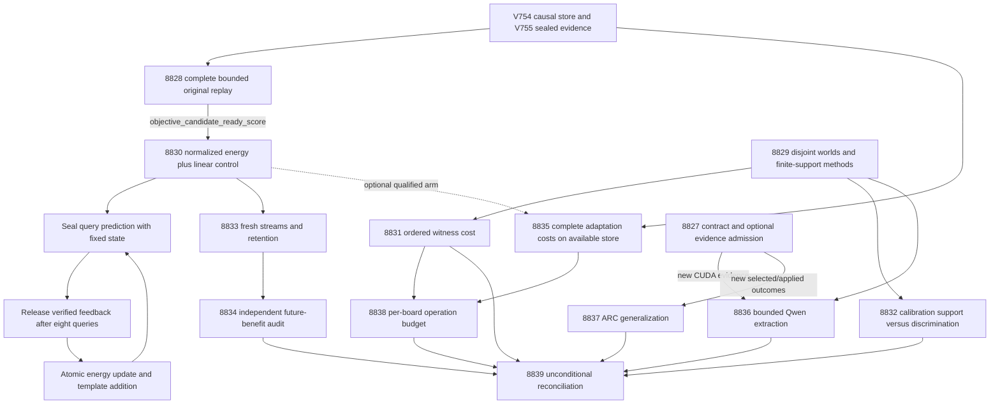

# Carnot Research Roadmap V756: Qualified Learning and Useful Verification

**Created:** 2026-11-04 (America/New_York)
**Milestone:** 2026.11.756
**Title:** Qualified causal learning, attainable selective decisions, and complete verification costs
**Status:** Proposed; planning only, not activated
**Queue:** [research-roadmap-next.yaml](../../research-roadmap-next.yaml)
**Previous authority:** [Preserved V755 design](research-roadmap-v755-preserved-20261104.md)
**Contract:** Exactly 13 tasks, Exp8827 through Exp8839, in the order below, across four phases.

## What V755 proved

All thirteen slots finished scheduling: seven primary artifacts and six gated
skips. Completion is not a positive scientific verdict. The completed-history
YAML ends at V754; this account uses V755 primaries and conductor receipts,
including November 5 UTC entries. Historical outcomes remain unchanged.

| Evidence | Observed result | Next decision |
|---|---|---|
| [Exp8814](../../results/experiment_8814_v755_branch_contract.json) | Contract matched, but owned runner coverage was 94.982%; fourteen statements were missed. Primary is disqualified. | Execute the missing original paths; keep contract administration separate from CPU science. |
| [Exp8815](../../results/experiment_8815_v755_learning_signal_diagnosis.json) | Owned coverage and scanners passed, but cold replay timed out at 600.488 seconds in historical authentication. Raw categorical fits improved development Brier in five seeds; the linear reference was stronger. All remain rejected evidence. | Qualify full replay before a new objective can run; retain the linear control. |
| [Exp8816](../../results/experiment_8816_v755_selective_evidence_methods.json) | Protocol readiness passed with circular-positive scope. | Reuse methods; new statistical questions require new sealed cohorts. |
| [Exp8818](../../results/experiment_8818_v755_evidence_decisive_coverage.json) | Coverage primary is blocked with readiness zero. The subsequent recorded repair reserves calibration invariants before evaluation generation. | Qualify that concrete repair; test cost at retained exact quality instead of assuming accuracy headroom. |
| [Exp8819](../../results/experiment_8819_v755_consensus_selective_energy.json) | Admitted null: 2,160 constructed candidate groups over 240 worlds. No learned seed had a qualifying deployment cutoff; decisive coverage was zero. | Separate inadequate independent support from score errors. Zero served answers do not have zero conditional risk. |
| Exp8817/8820/8821/8822 | Four learning/prototype/cost slots skipped after the rejected diagnosis. | New current producers only; let costs use the already qualified V754 learner independently. |
| Exp8823/8824 | Missing causal CUDA repair and no new ARC supervisor outcomes. | Cheap structured gates; no unchanged probe or ledger rerun. |
| [Exp8825](../../results/experiment_8825_v755_hardware_operation_map.json) | Board mapping qualified; complete learning/cost operands were absent. | Supply complete cost evidence without depending on learning benefit. |
| [Exp8826](../../results/experiment_8826_v755_capstone.json) | Thirteen-slot reconciliation qualified; constructed measurements and zero natural generalization stayed separate. | Preserve that accounting and reconcile every new slot unconditionally. |

V754's measured future-learning harm remains the last admitted future-loss
result. V755 neither invalidated that null nor proved a better objective.

## Three biggest gaps against the PRD

1. **FR-06/FR-11: beneficial continuous self-learning.** The causal template store
   works, but numerical writes and additions have not produced better future
   loss. Qualify the normalized objective, compare it to a simple linear-energy
   head, then measure later queries with delayed feedback and retention controls.
2. **FR-12: useful verification with faithful premises.** Exact constructed
   reasoning is circular; learned scores can abstain on everything. Test whether
   independent calibration support or discrimination limits usable decisions,
   and whether ordered checks preserve quality at lower cost. Source-faithful
   mandated-model extraction remains a conditional canary, not a natural-text claim.
3. **FR-05/FR-08/NFR-01: complete deployment benefit.** Kernel speed and sparse
   operation counts do not prove the PRD's 10x Rust service goal. Measure complete
   adaptation on an available causal store, then map supported operations to
   hardware without importing rejected profiling fractions or vendor speedups.

The ARC generalization slot remains reserved under the standing north-star
rules. A lack of new supervisor outcomes warrants a skip, not fabricated work.

## Research basis

The [V756 scan](../../research-references.md) was appended before task design.
It covers the eight requested primary topics and all six secondary channels.
These are local adaptations, not claimed replications or inherited guarantees.

| Source | Local use | Experiments |
|---|---|---|
| [Certified by Abstention, October 2026](https://arxiv.org/abs/2610.09541) and [Available Guardrails, September 2026](https://arxiv.org/abs/2609.22048) | Check independent calibration support and certificate availability separately from served error. | 8829, 8832 |
| [PriceCheck, September 2026](https://arxiv.org/abs/2609.37493) | Freeze ordered checks and charge their full work before comparing decision quality. | 8829, 8831 |
| [Error Feedback Calibration, October 2026](https://arxiv.org/abs/2610.22872) | Keep predictions sealed before delayed feedback and test later loss against frozen controls. No new forecasting mechanism. | 8830, 8833, 8834 |
| [Distributional EBM, May 2026](https://arxiv.org/abs/2605.18871) and [stepwise classification, November revision](https://arxiv.org/abs/2610.25441) | Small typed energy policies, normalization and simple baselines; generator weights remain fixed. | 8828, 8830, 8832 |
| [Specification-guided generation, October 2026](https://arxiv.org/abs/2610.41511) | Distinguish encoded feasibility from extraction fidelity. Decoder integration stays deferred. | 8836 |
| [Pipelined p-computer, July 2026](https://arxiv.org/abs/2607.21077), [KAN-CL, May 2026](https://arxiv.org/abs/2605.12306), [Extropic Z1T](https://extropic.ai/writing/z1t) | Respect arithmetic, sampling, communication and host-durability boundaries. | 8835, 8838 |

Semantic Scholar returned HTTP429 for both requested citation feeds. OpenReview
forum/PDF access was challenged. GitHub Trending yielded no established relevant
new ranked repository; PriceCheck's author repository was inspected as a method
reference. Hugging Face discovery was checked against primary sources. Kona's
vendor description supplied no reproducible new protocol. No access limit is
reported as an exhaustive negative finding.

## Architecture



Exp8827/8828 are the two infrastructure qualification slots. Exp8829 is a
runnable statistical and evidence-method prototype. The administrative root
is not a global scientific gate. No current experiment depends on rerunning a
retired upstream ID. CPU branches independently authenticate their operands.

## Phase 1 — Qualify original evidence and freeze new methods (8827–8829)

### Exp8827: Current contract and original runner coverage

Bind all thirteen full task objects and exercise the fourteen missed original
Exp8814 statements through real children under preserved historical authority.
Ingest the primary methods and record optional runtime/ARC admission. This slot
performs no activation, GPU probe or environment run. No optional failure blocks
CPU studies.

### Exp8828: Bounded complete replay of the finite learning diagnosis

Remove repeated historical authentication by admitting one immutable primitive
snapshot through the unchanged audit. Recompute all 45 original fits in bounded
children, with all 400 updates, source pins, gradients and exact reductions.
Keep the original child deadline; the change is work reuse, not a larger timeout.
A pilot must fit complete replay and validation within 4,200 seconds. Categorical
continuation retains the original >=0.01 development Brier improvement in at
least four of five seeds. Only a new qualified receipt can open the prototype.
The stronger linear reference remains visible; neither development result is a
future-learning claim.

### Exp8829: Independent-support and ordered-check prototype

Qualify the shipped Exp8818 separation repair before sealing 120 fit, 360
calibration, 240 evaluation and 12 separate canary worlds. Use eight vertices,
two or three shared variables and structural/query invariants; reserve earlier
splits first and exclude previously exposed structures. Separate exact truth
from policy inputs and require agreement between independent exact evaluators.

Freeze six cutoffs and nested calibration sizes 60/180/360. For a fixed rule,
zero errors among m independent accepted units gives upper risk
`1 - (delta/K)^(1/m)`; with delta=.01, K=6 and risk=.05, the floor is 125 accepted
units. Use exact binomial inversion when errors occur. The 60-world arm cannot
pass this zero-error floor. One candidate/variant selected by input hash per
world is the certification unit; sibling candidates and seeds are not extra
support. Certificate language is conditional on the declared iid world sampling
assumption, not valid under arbitrary drift or selection.

Freeze three check schedules and their actual operation accounting. Threshold
and schedule choices use calibration only. This phase produces methods and
mutation-tested software, not a benefit claim.

## Phase 2 — Qualify the learner and measure useful decisions (8830–8832)

### Exp8830: Categorical causal memory with a simple control

Reuse the existing store and add the qualified loss
`E(x,y) + logsumexp(-E(x,c))` over three typed decisions. Preserve the old mixed
objective and add a multinomial linear-energy control with matched features and
development budget. No generator weights change. Within-query state is fixed;
feedback arrives after eight queries. At most32 templates and one numerical
update per released event commit with state/ack atomicity. Test real restart,
invalid feedback, gradient correctness and later template use before a stream.

### Exp8831: Ordered witness cost at retained exact quality

Run three frozen schedules on240 worlds x6 variants:4,320 rows. Every request
gets the same200,000 paid-operation ceiling. Only complete witnesses or explicit
contradictions permit decisions; exhaustion and absent evidence remain
insufficient. The chosen schedule must cut paid operations by at least20 percent
while losing at most.01 correct decisive coverage, adding at most.01 semantic
false acceptance and retaining coverage>=.30. Four98.75-percent paired
whole-world intervals cover the conjunction. Exact success stays circular.
A valid null still supplies cost rows and readiness.

### Exp8832: Calibration support versus score discrimination

Fit the unchanged small Gibbs selector on120 fit worlds with five seeds and240
updates, then apply the frozen support-budget study. Retain agreement, fixed
evidence, random abstention and oracle references. Compare exact-binomial
selection with the old bootstrap rule as a descriptive control. Report which
cutoffs fail for support, observed errors, or both. Evaluate frozen rules on240
new worlds; zero decisive answers mean undefined risk. Keep the usual empirical
risk<=.05, coverage>=.30 and useful-coverage gain>=.05 goals, with stated familywise
correction for superiority claims. No eligible rule is a measured null, not a
reason to expand the threshold menu. This is not a natural-language certificate.

## Phase 3 — Future benefit and independent complete costs (8833–8835)

### Exp8833: Causal continuous self-learning streams

Run30 fresh64-query streams, three seeds and six arms: original mixed-loss
combined; categorical frozen; categorical calibration-only; categorical combined;
shuffled-feedback categorical combined; and linear combined. Delay8 and
capacity>=16 remove queue overflow as a confound. Reset across streams and
restart at query32. Twelve retention worlds at0/32/64 yield19,440 retention rows
alongside34,560 online rows:54,000 total. Freeze all configurations before labels,
record actual additions and later use, and drain the feedback tail. This is the
required continuous self-learning experiment and calibrated-decision program.

### Exp8834: Independent causal benefit audit

Independently reconstruct probabilities, labels and state transitions. Queries
33–64 are the fixed future window. Average seeds within each of30 streams before
resampling. Ten99.5-percent simultaneous intervals test gains over frozen and
calibration-only (>0.01), gain over shuffled (>0), noninferiority to linear
(<=0.01 Brier), retention Brier regression<=0.02, two decision-error regressions
<=0.02, two useful-coverage losses<=0.01, and retained error regression<=0.02.
All must pass. Template additions and later uses must be real; filtering out
unhelpful streams is forbidden. An unchanged failed mechanism closes rather
than automatically reappearing next milestone.

### Exp8835: Complete adaptation cost without a science dependency

Independently admit the already qualified V754 store. Measure read-only,
calibration-only and combined modes in30 randomized process blocks of64 queries,
including startup, features, response, delayed feedback, updates, serialization,
file/directory fsync, restart at32 and tail drain. A qualified categorical arm
can be included only if admitted before schedule sealing. It is never required
for the existing store's cost result. Whole parent clocks and identical output
policies replace rejected internal timing fractions. Report intervention cost
differences and absolute costs, not an additive component decomposition or a
10x native speedup. Two pilot windows project full work plus validation against
4,200 seconds; failed and slow windows stay in the denominator.

## Phase 4 — Conditional external evidence and reconciliation (8836–8839)

### Exp8836: Mandated Qwen source-witness canary

Only changed authenticated CUDA evidence plus the qualified canary protocol
opens this task. One load of `unsloth/Qwen3.8-27B-GGUF` runs48 calls over12 worlds,
with at most128 output tokens each. Compare original, padded, reordered and
critical-evidence-change inputs. Preserve raw text, complete source sentences,
qualifiers, bindings and failures. Syntax constraints cannot inject a correct
answer. A90-percent fidelity target is a canary target, not a model benchmark.

Declare `model_bounded_generation`, with its10-second floor. Actual full
production generation would be `model_full_generation` (60 seconds); load-only
or embeddings would be `model_load_no_generation` (2 seconds). No time padding.
Legacy small models can appear only in separately labeled CPU smoke tests.
Neither an offload request nor GPU visibility proves model execution.

### Exp8837: Live ARC outcome transfer

Require authenticated outcomes beyond Exp8760:>=30 episodes,>=3 overlapping games
and>=5 firings per shared arm cell. Evaluate fixed-horizon actions-to-progress,
right censoring and leave-one-game-out sensitivity. Recommend selection over
existing arms only. No game-specific solver, source reading, offline BFS,
production patch or submission. Credited levels require registry precheck,
reproduction and `solve_provenance=live_agent_self_discovery`. No new frontier
means a pre-gate skip that satisfies the standing floor without churn.

### Exp8838: Per-board operation budget

Always run the operation audit; admit cost and evidence rows independently.
Keep KV260 k_max<=5 sampling fabric, PolarFire Linux CPU dispatch and GateMate's
unchanged0xffffffff JTAG blocker separate. Dense gradients, relational joins and
host durability are not existing Ising kernels. Total cost/100 is a future
latency requirement, not an acceleration estimate. No board probe or purchase.

### Exp8839: Unconditional capstone

Account for every current slot, primary, skip and rejection. Recompute admitted
estimands and distinguish constructed measurements, independent constructed units
and natural generalization. Use blocked for unchanged external absence and
partial only for retryable incomplete own work. Preserve historical G1–G4 paper
gates in their original scope. Retirement recommendations name exact failed
mechanisms; no manifest change, activation or external publication occurs.

## Dependency graph and producer contract

```text
8828.objective_candidate_ready_score -> 8830
8829.evidence_protocol_ready_score -> 8831
8829.selective_protocol_ready_score -> 8832
8830.memory_execution_ready_score -> 8833
8833.stream_rows_ready_score -> 8834
8827.runtime_repair_ready_score AND 8829.canary_protocol_ready_score -> 8836
8827.arc_new_outcomes_available_score -> 8837
8835 independently admits V754; qualified 8830 is optional only
8838 independently reads available 8831/8835 (no conductor gate)
8839 accounts for every slot (no conductor gate)
```

All structured gates compare `== 1`, name earlier tasks in this roadmap and
appear verbatim in each producer's REQUIRED ARTIFACT FIELDS. In particular the
learning field is `stream_rows_ready_score` everywhere; V755's hardware reader
asked for that name while its stream prompt specified `memory_rows_ready_score`.
This plan closes that latent contract mismatch. Valid rows are distinct from
benefit. Missing files/fields, rejected producers and observed zero each have an
explicit `gate_check_summary` diagnostic. No `requires:` edge names a retired ID.

## Hardware requirements and execution budgets

| Resource | Planned work | Limit |
|---|---|---|
| Existing CPU, system RAM, SSD | Small JAX heads, exact checks, independent replay, durable costs | All core branches run without GPU; project complete execution plus validation below4,200 seconds per task. |
| Two RTX3090 inventory (verify current availability) | Optional mandated Qwen GGUF canary | One model load; enough measured free VRAM and authentic offload required. No existing process is killed for the study. |
| KV260 | Supported-operation design mapping | SSH-only if a future separately scoped board run occurs; fabric scope k_max<=5. No new latency claim. |
| PolarFire | Linux CPU versus fabric boundary | Existing CPU dispatch is not FPGA acceleration. |
| GateMate | Physical-blocker continuity | No repeated detect/flash until dated physical change and valid IDCODE evidence. |
| XDNA NPU / Extropic TSU | Future tier3 prediction / sampling paths | Unqualified access/runtime; no task depends on them. |

Tier1 counters and tier2 template storage run on CPU; GPU batching is a future
path for dense small-head updates. FPGA/TSU work must match actual sampling or
supported sparse operations. The hardware100x aspiration needs a measured
compatible workload fraction and complete transfer/durability costs. No new
purchase is justified by this plan.

Exp8827/8828 route to Claude Opus with100 turns for original-authority and replay
coordination. Exp8829 routes to Codex gpt-6.1-sol for the formulaic statistical
and corpus implementation. Routine scientific tasks keep the default Claude
backend, at most50 turns; simple audits use20–30. No Luna task is scheduled.

Every prompt has numbered progress and bounded-write steps. Emit before/after
long calls, inside loops and every60 seconds while waiting on children; keep
silence below600 seconds. Split files above about200 lines across tool calls
with progress between them. Output does not extend a measured deadline.

## Validation and reconciliation

This planning change adds no runtime implementation. Validate schema, full
JSON/table/YAML equality, gate producers and order, complete prior-failure
entries, exclusions, model routing, source paths and required prompt clauses.
Run existing roadmap/gate/exclusion unit tests, their lint and spec coverage,
and private E2E-018/021 lifecycle checks. Preserve V755's complete document before
replacing vNEXT. Reconcile planned REQ/SCENARIO items, BMAD traceability and ops.
Historical primary bytes, the active roadmap and the conductor are unchanged.
Experiment implementations must use spec-first/tests-first work, actual owned
100-percent coverage, scoped lint/types, applicable E2E, and adversarial/row
checks. Global repository debt is reported separately, not claimed fixed.

## Exact task contract

The table and embedded full objects below are generated from the same thirteen
task objects as `research-roadmap-next.yaml`. The embedded JSON includes every
prompt, gate, lineage entry, model and deliverable. No aspirational extra task
exists outside the execution YAML.

| Order | ID | Title | Phase | Deliverable |
|---|---|---|---|---|
| 1 | `exp8827-branch-contract` | Bind thirteen tasks and close original contract-runner coverage | 1 | `results/experiment_8827_v756_branch_contract.json` |
| 2 | `exp8828-signal-replay-qualification` | Qualify the finite learning diagnosis with bounded original replay | 1 | `results/experiment_8828_v756_signal_replay_qualification.json` |
| 3 | `exp8829-selective-methods` | Seal independent worlds and finite-support selective decision methods | 1 | `results/experiment_8829_v756_selective_methods.json` |
| 4 | `exp8830-categorical-memory` | Qualify normalized energy updates and a linear control in causal memory | 2 | `results/experiment_8830_v756_categorical_memory.json` |
| 5 | `exp8831-ordered-evidence-cost` | Measure ordered witness checks at matched exact decision quality | 2 | `results/experiment_8831_v756_ordered_evidence_cost.json` |
| 6 | `exp8832-selective-availability` | Separate calibration support from learned decision discrimination | 2 | `results/experiment_8832_v756_selective_availability.json` |
| 7 | `exp8833-causal-objective-streams` | Measure future loss from delayed normalized energy and constraint additions | 3 | `results/experiment_8833_v756_causal_objective_streams.json` |
| 8 | `exp8834-future-benefit-audit` | Audit causal future benefit retention and the simple energy baseline | 3 | `results/experiment_8834_v756_future_benefit_audit.json` |
| 9 | `exp8835-complete-adaptation-cost` | Measure complete adaptation costs on the already qualified causal store | 3 | `results/experiment_8835_v756_complete_adaptation_cost.json` |
| 10 | `exp8836-qwen-witness-canary` | Probe source-faithful Qwen extraction after authenticated runtime change | 4 | `results/experiment_8836_v756_qwen_witness_canary.json` |
| 11 | `exp8837-arc-outcome-transfer` | Assess cross-game supervisor selection only from new live outcomes | 4 | `results/experiment_8837_v756_arc_outcome_transfer.json` |
| 12 | `exp8838-hardware-operation-budget` | Map complete measured operations to supported board work | 4 | `results/experiment_8838_v756_hardware_operation_budget.json` |
| 13 | `exp8839-capstone` | Reconcile thirteen outcomes and retire only unchanged failed scopes | 4 | `results/experiment_8839_v756_capstone.json` |

<!-- V756_TASK_CONTRACT_START -->
```json
{
  "milestone": "2026.11.756",
  "milestone_title": "Qualified causal learning, attainable selective decisions, and complete verification costs",
  "milestone_doc": "openspec/change-proposals/research-roadmap-vNEXT.md",
  "tasks": [
    {
      "id": "exp8827-branch-contract",
      "title": "Bind thirteen tasks and close original contract-runner coverage",
      "phase": 1,
      "track": "infrastructure",
      "priority": "high",
      "requires_gpu": false,
      "max_turns": 100,
      "estimated_wall_time_min": 35,
      "per_unit_rows": true,
      "milestone": "2026.11.756",
      "deliverable": "results/experiment_8827_v756_branch_contract.json",
      "inference_substrate_class": "no_model_load",
      "MODEL_SPECS": [],
      "gated_on": [],
      "prior_failures": [
        {
          "experiment_id": "exp8814-branch-contract",
          "verdict": "complete_disqualified_v755_branch_contract",
          "addressed_by": "Cover the fourteen recorded original runner statements with real child execution and seal the new V756 authority; reuse the existing contract parser.",
          "retire_if_same_verdict": true
        }
      ],
      "agent_type": "claude",
      "model": "opus",
      "operator_override": "2026-05-29 standing operator directive in CLAUDE.md: routine milestone transition; scope matches exp8814-branch-contract; new thirteen-slot authority and measured original coverage closure.",
      "prompt": "CONTEXT:\nWork in {project_root} on {date}. Milestone 2026.11.756, exp8827-branch-contract. V755 has seven primaries and six structured skips; completed-history stops at V754. Exp8814 had fourteen missing owned statements (94.982 percent coverage). Contract administration must not become a global science prerequisite.\nChanged scope: Cover the fourteen recorded original runner statements with real child execution and seal the new V756 authority; reuse the existing contract parser.\n\nEXISTING CODE TO READ FIRST:\n- python/carnot/reporting/v755_branch_contract.py\n- python/carnot/reporting/v755_branch_runner.py\n- tests/python/test_v755_branch_contract_8814.py\n- python/carnot/reporting/roadmap_contract.py\n- results/experiment_8814_v755_branch_contract.json\n- results/experiment_8826_v755_capstone.json\n- ops/exclusion_manifest.yaml\n- research-references.md\n- openspec/capabilities/research-reporting/spec.md (REQ-REPORT-8827; SCENARIO-REPORT-8827-CONTRACT)\n- scripts/experiment_template.py; python/carnot/reporting/current_work_receipt.py; python/carnot/reporting/primary_publication.py\n\nTASK:\nBind thirteen tasks and close original contract-runner coverage. Deliver results/experiment_8827_v756_branch_contract.json with hash-bound raw operands under results/raw/experiment_8827_v756_branch_contract/. Implement scripts/experiments/experiment_8827_v756_branch_contract.py with --date and private-output/replay options. This task is research execution, not milestone activation.\n\nCONCRETE STEPS:\n0. PRECONDITIONS (before all measurement): Check readable, hash-bound required operands, the repository virtualenv, CPU numerical dependencies if used, private output space and remaining disk capacity. Missing external authority is complete_blocked_<reason> with exact gate_check_summary. Internal code/cohort/control failure is disqualified. Do not synthesize missing evidence.\n1. Emit a flushed progress line at each phase boundary and before and after every model load, generation call, benchmark and subprocess that can take minutes. Use python -u and print(..., flush=True). Inside long loops print completed/pending counts at least every 60 seconds; forward child output and emit elapsed/phase heartbeats every 60 seconds. Keep every silence gap below 600 seconds, including reasoning between tool calls. Heartbeats never extend measured deadlines.\n2. Keep every tool call bounded. Write any file over about 200 lines in several tool calls of at most 150-200 lines, with a progress message between calls. Put experiment scripts in scripts/experiments/, real tests in tests/python/, and throwaway probes in /tmp; no root scratch scripts.\n3. Bind exactly thirteen full task objects, Exp8827 through Exp8839, in visible table, embedded JSON and staged YAML. After actual activation compare the active YAML too; during private pre-activation tests use an explicit staged fixture, never claim activation. Preserve V755 bytes and retain all seven primaries plus six skip receipts without inventing missing verdicts.\n4. Exercise original v755_branch_runner.py lines 136-143,151-152,157,205-207 through unchanged original validation and real CLI children. Use immutable authority copies and measured SQLite coverage. Qualification requires every original statement and all new owned statements; no rewritten tracing reports, mocked coverage or current-vNEXT substitution.\n5. Ingest the dated V756 scan: read the full primary methods for Certified by Abstention and PriceCheck, record source/version hashes, local adaptations and assumptions. This is method ingestion, not a new literature-only task. Compute a branch-local runtime gate solely from a new causal repair receipt plus current validator custody; file existence alone cannot pass. Require the exact mandated model revision/GGUF checksum, CUDA build, actual device/context/copy/offload evidence and changed library/environment hash. No device probe or model load here.\n6. Read the current ARC ledger without rerunning environments. Set arc_new_outcomes_available_score only for authenticated selected/applied outcomes beyond Exp8760 with at least 30 episodes, three overlapping games and five firings per shared arm cell. Record zero frontier cheaply. Runtime and ARC failures cannot block CPU method producers. A calibrated-learning diagnostic and a hardware cost study admit their own operands independently.\n7. Before implementation, read CODEX.md and CLAUDE.md; extend the named REQ/SCENARIO and relevant learning or verification spec, then write failing tests. Reuse current_work_receipt, primary_publication and scoped validation; do not copy a whole historical runner. Preserve original assertions and immutable historical authorities, including the preserved V755 design; mutable vNEXT is never an old fixture. Run scoped pytest with real unit/subprocess statement coverage at 100 percent and zero exclusions, Ruff check/format, strict mypy and scripts/check_spec_coverage.py with test paths as positional arguments. Run applicable private E2E-018/021 from ops/e2e-test-plan.md; add E2E-003/004 and cargo test/fmt/clippy only for native changes. Cold-replay outside the checkout with PYTHONPATH absent; run adversarial_verify.py and verdict_row_consistency_lint.py --strict on the prospective artifact. Bind actual logs and code hashes. A failed owned check disqualifies readiness; repository health debt is separate and never silently waived. Reconcile openspec/, _bmad/traceability.md, ops/status.md and ops/changelog.md. No active-roadmap, conductor, exclusion-manifest or historical-primary rewrite.\n\nREQUIRED ARTIFACT FIELDS:\nexperiment_id, task_id, milestone, run_date: principle: bind evidence to this scheduled producer, not a predecessor.\nhonest_verdict: terminal complete_ prefix; principle: preserve the measured outcome without implying success from completion.\nverdict_class: positive | circular_positive | null | blocked | disqualified | partial; principle: partial is retryable unfinished OWN work only; unchanged external absence is blocked. Exact-oracle success is circular_positive, never positive.\ninference_substrate, inference_substrate_class, MODEL_SPECS, model_invocation_counts, numerical_training_calls: principle: distinguish CPU arithmetic and small-head training from actual LLM work; no duration padding.\nverifier_is_oracle, exposure_scope, independent_generalization_score: principle: exact encoded checks and constructed corpora do not establish natural-text or hidden-game generalization.\nduration_s, random_seed, reproducibility_checksum: principle: measured time and fixed inputs permit independent reproduction.\nsource_artifact_hashes, code_config_hashes, raw_shard_hashes: principle: bind claims to immutable operands and executed code.\nphase_spans, preconditions_checked: principle: show actual execution and resources checked before work.\nrows: principle: retain each unit, arm and seed with unit_id, cluster_id, metric, denominator, status and missing_reason; aggregates must recompute from these rows.\nintended_count, completed_count, failed_count, censored_count, excluded_count, independent_count: principle: failed attempts stay in denominators; variants and seeds do not create independent worlds.\ngate_check_summary: principle: every blocked result names check, upstream, artifact_field, expected, observed, path and hash; distinguish missing_file, missing_field, rejected_producer and observed_zero.\nacceptance_gates: principle: each frozen threshold has an explanatory principle and separates evidence readiness from scientific benefit.\nrequired_checks_passed, validation_receipts, owned_statement_coverage: principle: actual owned validation, including failure routes, controls publication.\nfield_principles: principle: every added field explains its evidentiary role; a hash or self-report is not proof of a scientific result.\ncontract_ready_score, runtime_repair_ready_score, arc_new_outcomes_available_score: integer 0/1; principle: these exact producer names control only their stated edges.\nfull_task_objects, gate_edge_rows, original_coverage_rows, source_method_rows, branch_admission_rows: principle: independent custody of the contract, repaired execution and optional evidence prevents a global cascade.\n\nRun command: cd {project_root} && JAX_PLATFORMS=cpu .venv/bin/python -u scripts/experiments/experiment_8827_v756_branch_contract.py --date {date}\nDo NOT push. Do NOT modify scripts/research_conductor.py."
    },
    {
      "id": "exp8828-signal-replay-qualification",
      "title": "Qualify the finite learning diagnosis with bounded original replay",
      "phase": 1,
      "track": "infrastructure",
      "priority": "high",
      "requires_gpu": false,
      "max_turns": 100,
      "estimated_wall_time_min": 50,
      "per_unit_rows": true,
      "milestone": "2026.11.756",
      "deliverable": "results/experiment_8828_v756_signal_replay_qualification.json",
      "inference_substrate_class": "no_model_load",
      "MODEL_SPECS": [],
      "gated_on": [],
      "prior_failures": [
        {
          "experiment_id": "exp8815-learning-signal-diagnosis",
          "verdict": "complete_disqualified_terminal_check",
          "addressed_by": "Replace repeated historical authentication with one verified immutable primitive snapshot and complete bounded per-fit replay; retain the original deadline and objective criteria.",
          "retire_if_same_verdict": true
        }
      ],
      "agent_type": "claude",
      "model": "opus",
      "operator_override": "2026-05-29 standing operator directive in CLAUDE.md: versioned lineage continuation of exp8815-learning-signal-diagnosis; diagnosed 600-second authentication timeout is addressed by verified single-admission replay, with all original numerical checks retained.",
      "prompt": "CONTEXT:\nWork in {project_root} on {date}. Milestone 2026.11.756, exp8828-signal-replay-qualification. Exp8815 passed adversarial and row scanners and owned coverage, but its cold replay timed out at 600.488 seconds inside historical row authentication. Its categorical development win in five seeds remains rejected evidence, not an approved objective. The linear reference was stronger and must stay visible.\nChanged scope: Replace repeated historical authentication with one verified immutable primitive snapshot and complete bounded per-fit replay; retain the original deadline and objective criteria.\n\nEXISTING CODE TO READ FIRST:\n- python/carnot/reporting/learning_signal_runner_8815.py\n- python/carnot/reporting/learning_signal_diagnosis_8815.py\n- python/carnot/reporting/causal_learning_audit_8810.py\n- tests/python/test_learning_signal_diagnosis_8815.py\n- results/experiment_8815_v755_learning_signal_diagnosis.json\n- results/raw/experiment_8815_v755_learning_signal_diagnosis/invocations/1793833658899077780/terminal_validation.json\n- openspec/capabilities/research-reporting/spec.md (REQ-REPORT-8828; SCENARIO-REPORT-8828-CONTRACT)\n- scripts/experiment_template.py; python/carnot/reporting/current_work_receipt.py; python/carnot/reporting/primary_publication.py\n\nTASK:\nQualify the finite learning diagnosis with bounded original replay. Deliver results/experiment_8828_v756_signal_replay_qualification.json with hash-bound raw operands under results/raw/experiment_8828_v756_signal_replay_qualification/. Implement scripts/experiments/experiment_8828_v756_signal_replay_qualification.py with --date and private-output/replay options. This task is research execution, not milestone activation.\n\nCONCRETE STEPS:\n0. PRECONDITIONS (before all measurement): Check readable, hash-bound required operands, the repository virtualenv, CPU numerical dependencies if used, private output space and remaining disk capacity. Missing external authority is complete_blocked_<reason> with exact gate_check_summary. Internal code/cohort/control failure is disqualified. Do not synthesize missing evidence.\n1. Emit a flushed progress line at each phase boundary and before and after every model load, generation call, benchmark and subprocess that can take minutes. Use python -u and print(..., flush=True). Inside long loops print completed/pending counts at least every 60 seconds; forward child output and emit elapsed/phase heartbeats every 60 seconds. Keep every silence gap below 600 seconds, including reasoning between tool calls. Heartbeats never extend measured deadlines.\n2. Keep every tool call bounded. Write any file over about 200 lines in several tool calls of at most 150-200 lines, with a progress message between calls. Put experiment scripts in scripts/experiments/, real tests in tests/python/, and throwaway probes in /tmp; no root scratch scripts.\n3. Localize repeated historical authentication in the original replay with coarse phase clocks outside scientific kernels. Reuse one immutable primitive snapshot only after the unchanged Exp8810 audit validates its complete operands. Bind that snapshot to original source/test bytes, all input hashes and exact reductions; a previous terminal JSON alone is not authority.\n4. Partition deterministic fit recomputation by the existing seed/objective/rate inventory into bounded children. Preserve all 45 fits, all 400 updates per fit, original 40/20 development split, gradients, controls and exact numerical comparisons. Do not refit on new labels or choose another learning rate. Hash drift, missing rows and changed historical evidence must fail. Preserve the original 600-second child deadline; remove repeated work, do not merely raise it.\n5. Pilot representative authentication and fit children, project full replay plus validation against 4200 seconds, and stop with measured resource diagnostics if infeasible. Cache must be invocation-owned, reject wrong-code and stale-operand mutations, and work from a fresh interpreter outside the checkout. Every original negative test remains asserted.\n6. Recompute the original feature floor and categorical continuation rule from admitted raw rows. Set objective_candidate_ready_score=1 only if the original >=0.01 development Brier gain in at least four of five seeds, gradient controls, disjointness and complete validation all pass. Diagnosis readiness can pass without objective benefit. Report the linear comparison explicitly; development selection is not future learning. Publish a new receipt; leave Exp8815 disqualified.\n7. Before implementation, read CODEX.md and CLAUDE.md; extend the named REQ/SCENARIO and relevant learning or verification spec, then write failing tests. Reuse current_work_receipt, primary_publication and scoped validation; do not copy a whole historical runner. Preserve original assertions and immutable historical authorities, including the preserved V755 design; mutable vNEXT is never an old fixture. Run scoped pytest with real unit/subprocess statement coverage at 100 percent and zero exclusions, Ruff check/format, strict mypy and scripts/check_spec_coverage.py with test paths as positional arguments. Run applicable private E2E-018/021 from ops/e2e-test-plan.md; add E2E-003/004 and cargo test/fmt/clippy only for native changes. Cold-replay outside the checkout with PYTHONPATH absent; run adversarial_verify.py and verdict_row_consistency_lint.py --strict on the prospective artifact. Bind actual logs and code hashes. A failed owned check disqualifies readiness; repository health debt is separate and never silently waived. Reconcile openspec/, _bmad/traceability.md, ops/status.md and ops/changelog.md. No active-roadmap, conductor, exclusion-manifest or historical-primary rewrite.\n\nREQUIRED ARTIFACT FIELDS:\nexperiment_id, task_id, milestone, run_date: principle: bind evidence to this scheduled producer, not a predecessor.\nhonest_verdict: terminal complete_ prefix; principle: preserve the measured outcome without implying success from completion.\nverdict_class: positive | circular_positive | null | blocked | disqualified | partial; principle: partial is retryable unfinished OWN work only; unchanged external absence is blocked. Exact-oracle success is circular_positive, never positive.\ninference_substrate, inference_substrate_class, MODEL_SPECS, model_invocation_counts, numerical_training_calls: principle: distinguish CPU arithmetic and small-head training from actual LLM work; no duration padding.\nverifier_is_oracle, exposure_scope, independent_generalization_score: principle: exact encoded checks and constructed corpora do not establish natural-text or hidden-game generalization.\nduration_s, random_seed, reproducibility_checksum: principle: measured time and fixed inputs permit independent reproduction.\nsource_artifact_hashes, code_config_hashes, raw_shard_hashes: principle: bind claims to immutable operands and executed code.\nphase_spans, preconditions_checked: principle: show actual execution and resources checked before work.\nrows: principle: retain each unit, arm and seed with unit_id, cluster_id, metric, denominator, status and missing_reason; aggregates must recompute from these rows.\nintended_count, completed_count, failed_count, censored_count, excluded_count, independent_count: principle: failed attempts stay in denominators; variants and seeds do not create independent worlds.\ngate_check_summary: principle: every blocked result names check, upstream, artifact_field, expected, observed, path and hash; distinguish missing_file, missing_field, rejected_producer and observed_zero.\nacceptance_gates: principle: each frozen threshold has an explanatory principle and separates evidence readiness from scientific benefit.\nrequired_checks_passed, validation_receipts, owned_statement_coverage: principle: actual owned validation, including failure routes, controls publication.\nfield_principles: principle: every added field explains its evidentiary role; a hash or self-report is not proof of a scientific result.\ndiagnosis_rows_ready_score, objective_candidate_ready_score: integer 0/1; principle: only a fully replayed diagnosis can license the objective.\noriginal_inventory, partition_rows, replay_projection, objective_selection, linear_comparator_rows, selected_configuration_hash: principle: preserve original numerical meaning while changing repeated validation work.\n\nRun command: cd {project_root} && JAX_PLATFORMS=cpu .venv/bin/python -u scripts/experiments/experiment_8828_v756_signal_replay_qualification.py --date {date}\nDo NOT push. Do NOT modify scripts/research_conductor.py."
    },
    {
      "id": "exp8829-selective-methods",
      "title": "Seal independent worlds and finite-support selective decision methods",
      "phase": 1,
      "track": "research",
      "priority": "high",
      "requires_gpu": false,
      "max_turns": 50,
      "estimated_wall_time_min": 45,
      "per_unit_rows": true,
      "milestone": "2026.11.756",
      "deliverable": "results/experiment_8829_v756_selective_methods.json",
      "inference_substrate_class": "no_model_load",
      "MODEL_SPECS": [],
      "gated_on": [],
      "prior_failures": [
        {
          "experiment_id": "exp8818-evidence-decisive-coverage",
          "verdict": "complete_blocked_evidence_decisive_coverage",
          "addressed_by": "Use the shipped calibration-invariant repair and qualify original controls before new cohorts; replace an accuracy-headroom assumption with a paid-check schedule question.",
          "retire_if_same_verdict": true
        },
        {
          "experiment_id": "exp8819-consensus-selective-energy",
          "verdict": "complete_null_consensus_selective_energy",
          "addressed_by": "Diagnose exact finite-support attainability at fixed risk before any new architecture or threshold search; independent world counts replace replicated candidate support.",
          "retire_if_same_verdict": true
        }
      ],
      "agent_type": "codex",
      "model": "gpt-6.1-sol",
      "operator_override": "2026-05-29 standing operator directive in CLAUDE.md: versioned lineage continuation of exp8818-evidence-decisive-coverage and exp8819-consensus-selective-energy; repaired cohort separation and new independent-support estimand.",
      "prompt": "CONTEXT:\nWork in {project_root} on {date}. Milestone 2026.11.756, exp8829-selective-methods. V755 qualified a protocol but its learned selector found no safe cutoff. Exp8818 now has a concrete calibration-collision repair in ops/status.md. Certified by Abstention and Available Guardrails motivate separating sample support from score discrimination; PriceCheck motivates a fixed ordered-check menu.\nChanged scope: Use the shipped calibration-invariant repair and qualify original controls before new cohorts; replace an accuracy-headroom assumption with a paid-check schedule question. Diagnose exact finite-support attainability at fixed risk before any new architecture or threshold search; independent world counts replace replicated candidate support.\n\nEXISTING CODE TO READ FIRST:\n- python/carnot/reporting/selective_evidence_8816.py\n- python/carnot/reporting/evidence_decisive_8818.py\n- python/carnot/reporting/evidence_decisive_runner_8818.py\n- python/carnot/reporting/evidence_operation_meter_8818.py\n- python/carnot/reporting/consensus_selective_energy_8819.py\n- tests/python/test_evidence_decisive_coverage_8818.py\n- research-references.md\n- openspec/capabilities/research-reporting/spec.md (REQ-REPORT-8829; SCENARIO-REPORT-8829-CONTRACT)\n- scripts/experiment_template.py; python/carnot/reporting/current_work_receipt.py; python/carnot/reporting/primary_publication.py\n\nTASK:\nSeal independent worlds and finite-support selective decision methods. Deliver results/experiment_8829_v756_selective_methods.json with hash-bound raw operands under results/raw/experiment_8829_v756_selective_methods/. Implement scripts/experiments/experiment_8829_v756_selective_methods.py with --date and private-output/replay options. This task is research execution, not milestone activation.\n\nCONCRETE STEPS:\n0. PRECONDITIONS (before all measurement): Check readable, hash-bound required operands, the repository virtualenv, CPU numerical dependencies if used, private output space and remaining disk capacity. Missing external authority is complete_blocked_<reason> with exact gate_check_summary. Internal code/cohort/control failure is disqualified. Do not synthesize missing evidence.\n1. Emit a flushed progress line at each phase boundary and before and after every model load, generation call, benchmark and subprocess that can take minutes. Use python -u and print(..., flush=True). Inside long loops print completed/pending counts at least every 60 seconds; forward child output and emit elapsed/phase heartbeats every 60 seconds. Keep every silence gap below 600 seconds, including reasoning between tool calls. Heartbeats never extend measured deadlines.\n2. Keep every tool call bounded. Write any file over about 200 lines in several tool calls of at most 150-200 lines, with a progress message between calls. Put experiment scripts in scripts/experiments/, real tests in tests/python/, and throwaway probes in /tmp; no root scratch scripts.\n3. Execute the repaired original calibration/evaluation separation tests with original controls and measured child coverage. Verify that reserved calibration invariants, collision operands and empty-comparator rejection survive standalone replay. An internal collision disqualifies the cohort; do not manufacture a blocked external prerequisite.\n4. Seal 120 fit, 360 calibration and 240 evaluation eight-vertex worlds plus 12 separate canary worlds. Use two or three shared variables and canonical topology/query invariants; reserve all fit and calibration invariants before generating evaluation. Exclude all prior exposed structures, not merely entity names. Keep intact, padding, reorder, missing-hop, sign-conflict and binding-swap variants. Independent exact evaluators must agree before sealing private truth. Freeze all input hashes before any policy evaluation.\n5. Implement a small finite-support diagnostic: for a fixed rule with m independent accepted worlds and zero errors, the one-sided upper risk bound is 1-(delta/K)^(1/m); m=0 gives no certificate. With risk=.05, delta=.01 and K=6 cutoffs the zero-error floor is 125 accepted independent units. For errors use exact binomial inversion. Test boundary counts 0,60,124,125 and180 against the installed statistical library and an independent numerical check. No candidate/seed replication may increase m.\n6. Freeze nested calibration budgets 60/180/360, cutoffs [.5,.6,.7,.8,.9,.95], selection on calibration only and one input-hash-selected candidate/variant per world for certification. Other rows are descriptive clustered measurements. Confidence allocation is per arm/seed family; reserve familywise correction for any cross-family superiority claim. Require iid world sampling for certificate language; otherwise report empirical bounds and assumption failure.\n7. Freeze three evidence schedules: local check then bounded joint search; bounded joint search first; always-run joint solver. Use the same verifier functions, operation accounting and 200000-operation per-request cap. No answer from partial joins or unknown truth. Choose one schedule on the first 60 calibration worlds by minimum paid work subject to risk<=.05 and coverage>=.30; freeze it before evaluation. Persist learning/calibration protocols and all comparison gates. Do not tune on downstream results.\n8. Before implementation, read CODEX.md and CLAUDE.md; extend the named REQ/SCENARIO and relevant learning or verification spec, then write failing tests. Reuse current_work_receipt, primary_publication and scoped validation; do not copy a whole historical runner. Preserve original assertions and immutable historical authorities, including the preserved V755 design; mutable vNEXT is never an old fixture. Run scoped pytest with real unit/subprocess statement coverage at 100 percent and zero exclusions, Ruff check/format, strict mypy and scripts/check_spec_coverage.py with test paths as positional arguments. Run applicable private E2E-018/021 from ops/e2e-test-plan.md; add E2E-003/004 and cargo test/fmt/clippy only for native changes. Cold-replay outside the checkout with PYTHONPATH absent; run adversarial_verify.py and verdict_row_consistency_lint.py --strict on the prospective artifact. Bind actual logs and code hashes. A failed owned check disqualifies readiness; repository health debt is separate and never silently waived. Reconcile openspec/, _bmad/traceability.md, ops/status.md and ops/changelog.md. No active-roadmap, conductor, exclusion-manifest or historical-primary rewrite.\n\nREQUIRED ARTIFACT FIELDS:\nexperiment_id, task_id, milestone, run_date: principle: bind evidence to this scheduled producer, not a predecessor.\nhonest_verdict: terminal complete_ prefix; principle: preserve the measured outcome without implying success from completion.\nverdict_class: positive | circular_positive | null | blocked | disqualified | partial; principle: partial is retryable unfinished OWN work only; unchanged external absence is blocked. Exact-oracle success is circular_positive, never positive.\ninference_substrate, inference_substrate_class, MODEL_SPECS, model_invocation_counts, numerical_training_calls: principle: distinguish CPU arithmetic and small-head training from actual LLM work; no duration padding.\nverifier_is_oracle, exposure_scope, independent_generalization_score: principle: exact encoded checks and constructed corpora do not establish natural-text or hidden-game generalization.\nduration_s, random_seed, reproducibility_checksum: principle: measured time and fixed inputs permit independent reproduction.\nsource_artifact_hashes, code_config_hashes, raw_shard_hashes: principle: bind claims to immutable operands and executed code.\nphase_spans, preconditions_checked: principle: show actual execution and resources checked before work.\nrows: principle: retain each unit, arm and seed with unit_id, cluster_id, metric, denominator, status and missing_reason; aggregates must recompute from these rows.\nintended_count, completed_count, failed_count, censored_count, excluded_count, independent_count: principle: failed attempts stay in denominators; variants and seeds do not create independent worlds.\ngate_check_summary: principle: every blocked result names check, upstream, artifact_field, expected, observed, path and hash; distinguish missing_file, missing_field, rejected_producer and observed_zero.\nacceptance_gates: principle: each frozen threshold has an explanatory principle and separates evidence readiness from scientific benefit.\nrequired_checks_passed, validation_receipts, owned_statement_coverage: principle: actual owned validation, including failure routes, controls publication.\nfield_principles: principle: every added field explains its evidentiary role; a hash or self-report is not proof of a scientific result.\nevidence_protocol_ready_score, selective_protocol_ready_score, canary_protocol_ready_score: integer 0/1; principle: independent cohort and method qualification feed exactly named downstream gates.\nsplit_manifest, structure_disjointness_rows, certificate_boundary_rows, schedule_menu, threshold_menu, protocol_hashes, label_custody: principle: fixed units, candidate families and sealed labels prevent false support and post-hoc selection.\n\nRun command: cd {project_root} && JAX_PLATFORMS=cpu .venv/bin/python -u scripts/experiments/experiment_8829_v756_selective_methods.py --date {date}\nDo NOT push. Do NOT modify scripts/research_conductor.py."
    },
    {
      "id": "exp8830-categorical-memory",
      "title": "Qualify normalized energy updates and a linear control in causal memory",
      "phase": 2,
      "track": "research",
      "priority": "high",
      "requires_gpu": false,
      "max_turns": 50,
      "estimated_wall_time_min": 45,
      "per_unit_rows": true,
      "milestone": "2026.11.756",
      "deliverable": "results/experiment_8830_v756_categorical_memory.json",
      "inference_substrate_class": "no_model_load",
      "MODEL_SPECS": [],
      "gated_on": [
        {
          "upstream": "exp8828-signal-replay-qualification",
          "artifact_field": "objective_candidate_ready_score",
          "op": "==",
          "value": 1
        }
      ],
      "prior_failures": [
        {
          "experiment_id": "exp8817-categorical-memory-prototype",
          "verdict": "blocked_gate_check_failed",
          "addressed_by": "A new qualified Exp8828 replay replaces the rejected upstream; include the stronger linear-energy control and preserve exact causal update semantics.",
          "retire_if_same_verdict": true
        }
      ],
      "operator_override": "2026-05-29 standing operator directive in CLAUDE.md: versioned lineage continuation of exp8817-categorical-memory-prototype; valid new replay gate plus explicit linear comparator, not a dependency on retired Exp8817.",
      "prompt": "CONTEXT:\nWork in {project_root} on {date}. Milestone 2026.11.756, exp8830-categorical-memory. The V755 prototype never ran because its diagnosis was rejected. This task admits only Exp8828 original replay evidence and changes the opt-in small head objective; it never updates Qwen weights or ARC behavior. This advances FR-06/FR-11 and GAP-ORACLE-DISTINCT.\nChanged scope: A new qualified Exp8828 replay replaces the rejected upstream; include the stronger linear-energy control and preserve exact causal update semantics.\n\nEXISTING CODE TO READ FIRST:\n- python/carnot/memory/causal_memory_8802.py\n- python/carnot/reporting/causal_memory_runner_8802.py\n- python/carnot/learning/causal_template_streams_8804.py\n- python/carnot/reporting/learning_signal_diagnosis_8815.py\n- results/experiment_8828_v756_signal_replay_qualification.json\n- python/carnot/autoresearch/calibrated_decision_benchmark.py\n- openspec/capabilities/research-reporting/spec.md (REQ-REPORT-8830; SCENARIO-REPORT-8830-CONTRACT)\n- scripts/experiment_template.py; python/carnot/reporting/current_work_receipt.py; python/carnot/reporting/primary_publication.py\n\nTASK:\nQualify normalized energy updates and a linear control in causal memory. Deliver results/experiment_8830_v756_categorical_memory.json with hash-bound raw operands under results/raw/experiment_8830_v756_categorical_memory/. Implement scripts/experiments/experiment_8830_v756_categorical_memory.py with --date and private-output/replay options. This task is research execution, not milestone activation.\n\nCONCRETE STEPS:\n0. PRECONDITIONS (before all measurement): Check readable, hash-bound required operands, the repository virtualenv, CPU numerical dependencies if used, private output space and remaining disk capacity. Missing external authority is complete_blocked_<reason> with exact gate_check_summary. Internal code/cohort/control failure is disqualified. Do not synthesize missing evidence.\n1. Emit a flushed progress line at each phase boundary and before and after every model load, generation call, benchmark and subprocess that can take minutes. Use python -u and print(..., flush=True). Inside long loops print completed/pending counts at least every 60 seconds; forward child output and emit elapsed/phase heartbeats every 60 seconds. Keep every silence gap below 600 seconds, including reasoning between tool calls. Heartbeats never extend measured deadlines.\n2. Keep every tool call bounded. Write any file over about 200 lines in several tool calls of at most 150-200 lines, with a progress message between calls. Put experiment scripts in scripts/experiments/, real tests in tests/python/, and throwaway probes in /tmp; no root scratch scripts.\n3. Authenticate objective_candidate_ready_score=1 and the fixed configuration from Exp8828. Add only an opt-in exactly normalized categorical loss E(x,y)+logsumexp(-E(x,c)) over the three typed decisions. Preserve the existing mixed-loss implementation and fit a multinomial linear-energy control with the same serving-visible counts and development budget. Do not select away the stronger simple baseline.\n4. Reuse the existing causal template store: freeze state within each query, seal probabilities and decision before labels, release verified feedback after eight queries, and commit at most one numerical update plus verified template additions atomically. Bound templates at32 and pending feedback at least16. Missing labels, duplicates, restarts and tail drains must not cause extra updates. Templates need predicate/binding provenance and actual later uses, not weight-only bookkeeping.\n5. Use original historical development data only to instantiate the qualified head; all future streams remain unopened. Freeze seeds, normalization, learning rate, update rule and threshold before execution. Publish checkpoints for original, categorical and linear controls with parameter hashes; exact verifier truth is available only at delayed update time.\n6. Prove prediction-before-feedback, gradient correctness, unit-sum probabilities, state/ack atomicity, fresh-process recovery and no-op behavior on invalid feedback with failing tests and real private CLI children. A shuffled-label fixture must damage learning when signal exists; do not interpret a flat fixture as benefit. memory_execution_ready_score measures execution, not improved loss.\n7. Before implementation, read CODEX.md and CLAUDE.md; extend the named REQ/SCENARIO and relevant learning or verification spec, then write failing tests. Reuse current_work_receipt, primary_publication and scoped validation; do not copy a whole historical runner. Preserve original assertions and immutable historical authorities, including the preserved V755 design; mutable vNEXT is never an old fixture. Run scoped pytest with real unit/subprocess statement coverage at 100 percent and zero exclusions, Ruff check/format, strict mypy and scripts/check_spec_coverage.py with test paths as positional arguments. Run applicable private E2E-018/021 from ops/e2e-test-plan.md; add E2E-003/004 and cargo test/fmt/clippy only for native changes. Cold-replay outside the checkout with PYTHONPATH absent; run adversarial_verify.py and verdict_row_consistency_lint.py --strict on the prospective artifact. Bind actual logs and code hashes. A failed owned check disqualifies readiness; repository health debt is separate and never silently waived. Reconcile openspec/, _bmad/traceability.md, ops/status.md and ops/changelog.md. No active-roadmap, conductor, exclusion-manifest or historical-primary rewrite.\n\nREQUIRED ARTIFACT FIELDS:\nexperiment_id, task_id, milestone, run_date: principle: bind evidence to this scheduled producer, not a predecessor.\nhonest_verdict: terminal complete_ prefix; principle: preserve the measured outcome without implying success from completion.\nverdict_class: positive | circular_positive | null | blocked | disqualified | partial; principle: partial is retryable unfinished OWN work only; unchanged external absence is blocked. Exact-oracle success is circular_positive, never positive.\ninference_substrate, inference_substrate_class, MODEL_SPECS, model_invocation_counts, numerical_training_calls: principle: distinguish CPU arithmetic and small-head training from actual LLM work; no duration padding.\nverifier_is_oracle, exposure_scope, independent_generalization_score: principle: exact encoded checks and constructed corpora do not establish natural-text or hidden-game generalization.\nduration_s, random_seed, reproducibility_checksum: principle: measured time and fixed inputs permit independent reproduction.\nsource_artifact_hashes, code_config_hashes, raw_shard_hashes: principle: bind claims to immutable operands and executed code.\nphase_spans, preconditions_checked: principle: show actual execution and resources checked before work.\nrows: principle: retain each unit, arm and seed with unit_id, cluster_id, metric, denominator, status and missing_reason; aggregates must recompute from these rows.\nintended_count, completed_count, failed_count, censored_count, excluded_count, independent_count: principle: failed attempts stay in denominators; variants and seeds do not create independent worlds.\ngate_check_summary: principle: every blocked result names check, upstream, artifact_field, expected, observed, path and hash; distinguish missing_file, missing_field, rejected_producer and observed_zero.\nacceptance_gates: principle: each frozen threshold has an explanatory principle and separates evidence readiness from scientific benefit.\nrequired_checks_passed, validation_receipts, owned_statement_coverage: principle: actual owned validation, including failure routes, controls publication.\nfield_principles: principle: every added field explains its evidentiary role; a hash or self-report is not proof of a scientific result.\nmemory_execution_ready_score: integer 0/1; principle: only qualified causal state transitions license stream execution.\ncheckpoint_refs, parameter_hashes, gradient_rows, causal_order_rows, restart_rows, template_addition_rows, linear_control_config: principle: distinguish genuine learning and constraint addition from counters or oracle output.\n\nRun command: cd {project_root} && JAX_PLATFORMS=cpu .venv/bin/python -u scripts/experiments/experiment_8830_v756_categorical_memory.py --date {date}\nDo NOT push. Do NOT modify scripts/research_conductor.py."
    },
    {
      "id": "exp8831-ordered-evidence-cost",
      "title": "Measure ordered witness checks at matched exact decision quality",
      "phase": 2,
      "track": "research",
      "priority": "high",
      "requires_gpu": false,
      "max_turns": 50,
      "estimated_wall_time_min": 35,
      "per_unit_rows": true,
      "milestone": "2026.11.756",
      "deliverable": "results/experiment_8831_v756_ordered_evidence_cost.json",
      "inference_substrate_class": "no_model_load",
      "MODEL_SPECS": [],
      "gated_on": [
        {
          "upstream": "exp8829-selective-methods",
          "artifact_field": "evidence_protocol_ready_score",
          "op": "==",
          "value": 1
        }
      ],
      "prior_failures": [
        {
          "experiment_id": "exp8818-evidence-decisive-coverage",
          "verdict": "complete_blocked_evidence_decisive_coverage",
          "addressed_by": "Fresh disjoint cohort is qualified by Exp8829; the changed hypothesis tests ordered-check cost against always-joint decisions, not an impossible accuracy gain over an identical oracle.",
          "retire_if_same_verdict": true
        }
      ],
      "operator_override": "2026-05-29 standing operator directive in CLAUDE.md: versioned lineage continuation of exp8818-evidence-decisive-coverage; repaired split qualification and matched-quality operation-cost estimand.",
      "prompt": "CONTEXT:\nWork in {project_root} on {date}. Milestone 2026.11.756, exp8831-ordered-evidence-cost. V754 evidence-set methods tied the strong symbolic comparator on false accepts. V755 coverage was blocked by internal cohort issues. More accurate exact reasoning may have no headroom; the new hypothesis is lower paid work at retained decision quality using PriceCheck-inspired ordered checks.\nChanged scope: Fresh disjoint cohort is qualified by Exp8829; the changed hypothesis tests ordered-check cost against always-joint decisions, not an impossible accuracy gain over an identical oracle.\n\nEXISTING CODE TO READ FIRST:\n- python/carnot/reporting/evidence_set_methods_8768.py\n- python/carnot/reporting/evidence_operation_meter_8818.py\n- python/carnot/reporting/evidence_decisive_8818.py\n- results/experiment_8829_v756_selective_methods.json\n- openspec/capabilities/research-reporting/spec.md (REQ-REPORT-8831; SCENARIO-REPORT-8831-CONTRACT)\n- scripts/experiment_template.py; python/carnot/reporting/current_work_receipt.py; python/carnot/reporting/primary_publication.py\n\nTASK:\nMeasure ordered witness checks at matched exact decision quality. Deliver results/experiment_8831_v756_ordered_evidence_cost.json with hash-bound raw operands under results/raw/experiment_8831_v756_ordered_evidence_cost/. Implement scripts/experiments/experiment_8831_v756_ordered_evidence_cost.py with --date and private-output/replay options. This task is research execution, not milestone activation.\n\nCONCRETE STEPS:\n0. PRECONDITIONS (before all measurement): Check readable, hash-bound required operands, the repository virtualenv, CPU numerical dependencies if used, private output space and remaining disk capacity. Missing external authority is complete_blocked_<reason> with exact gate_check_summary. Internal code/cohort/control failure is disqualified. Do not synthesize missing evidence.\n1. Emit a flushed progress line at each phase boundary and before and after every model load, generation call, benchmark and subprocess that can take minutes. Use python -u and print(..., flush=True). Inside long loops print completed/pending counts at least every 60 seconds; forward child output and emit elapsed/phase heartbeats every 60 seconds. Keep every silence gap below 600 seconds, including reasoning between tool calls. Heartbeats never extend measured deadlines.\n2. Keep every tool call bounded. Write any file over about 200 lines in several tool calls of at most 150-200 lines, with a progress message between calls. Put experiment scripts in scripts/experiments/, real tests in tests/python/, and throwaway probes in /tmp; no root scratch scripts.\n3. Authenticate evidence_protocol_ready_score=1, exact schedule selection and split hashes. Run all three frozen schedules on 240 evaluation worlds x6 variants =4320 schedule rows. Equal per-request budget is200000 actual comparisons, joins, visits, bindings and lookups. Count preprocessing and any schedule feature work; keep unrestricted reference cost separate.\n4. Stop only after a complete sufficient witness or explicit contradiction. Missing evidence is insufficient, never false; a partial search cannot prove absence. Exhaustion remains a censored attempt in the scheduled denominator. Record valid alternatives, successful bindings, stop reason, operations, decision and complete wall time per row; seal predictions before independent labels.\n5. Against always-run joint search, require a >=20 percent mean paid-operation reduction, correct decisive coverage loss<=.01, semantic false-accept increase<=.01 and coverage>=.30. Use four98.75-percent paired whole-world intervals; preserve the selected schedule from calibration even if another wins on evaluation. CPU wall time is secondary and must agree on execution boundaries. Exact success is circular_positive only.\n6. Adversarial controls remove one critical hop, swap a shared variable, introduce a conflicting sign, reorder facts, add irrelevant padding and exercise valid alternate witnesses. All no-change and no-headroom cases remain visible. A qualified null produces evidence_rows_ready_score=1 and schedule_benefit_score=0; absence of benefit is not a broken dependency.\n7. Before implementation, read CODEX.md and CLAUDE.md; extend the named REQ/SCENARIO and relevant learning or verification spec, then write failing tests. Reuse current_work_receipt, primary_publication and scoped validation; do not copy a whole historical runner. Preserve original assertions and immutable historical authorities, including the preserved V755 design; mutable vNEXT is never an old fixture. Run scoped pytest with real unit/subprocess statement coverage at 100 percent and zero exclusions, Ruff check/format, strict mypy and scripts/check_spec_coverage.py with test paths as positional arguments. Run applicable private E2E-018/021 from ops/e2e-test-plan.md; add E2E-003/004 and cargo test/fmt/clippy only for native changes. Cold-replay outside the checkout with PYTHONPATH absent; run adversarial_verify.py and verdict_row_consistency_lint.py --strict on the prospective artifact. Bind actual logs and code hashes. A failed owned check disqualifies readiness; repository health debt is separate and never silently waived. Reconcile openspec/, _bmad/traceability.md, ops/status.md and ops/changelog.md. No active-roadmap, conductor, exclusion-manifest or historical-primary rewrite.\n\nREQUIRED ARTIFACT FIELDS:\nexperiment_id, task_id, milestone, run_date: principle: bind evidence to this scheduled producer, not a predecessor.\nhonest_verdict: terminal complete_ prefix; principle: preserve the measured outcome without implying success from completion.\nverdict_class: positive | circular_positive | null | blocked | disqualified | partial; principle: partial is retryable unfinished OWN work only; unchanged external absence is blocked. Exact-oracle success is circular_positive, never positive.\ninference_substrate, inference_substrate_class, MODEL_SPECS, model_invocation_counts, numerical_training_calls: principle: distinguish CPU arithmetic and small-head training from actual LLM work; no duration padding.\nverifier_is_oracle, exposure_scope, independent_generalization_score: principle: exact encoded checks and constructed corpora do not establish natural-text or hidden-game generalization.\nduration_s, random_seed, reproducibility_checksum: principle: measured time and fixed inputs permit independent reproduction.\nsource_artifact_hashes, code_config_hashes, raw_shard_hashes: principle: bind claims to immutable operands and executed code.\nphase_spans, preconditions_checked: principle: show actual execution and resources checked before work.\nrows: principle: retain each unit, arm and seed with unit_id, cluster_id, metric, denominator, status and missing_reason; aggregates must recompute from these rows.\nintended_count, completed_count, failed_count, censored_count, excluded_count, independent_count: principle: failed attempts stay in denominators; variants and seeds do not create independent worlds.\ngate_check_summary: principle: every blocked result names check, upstream, artifact_field, expected, observed, path and hash; distinguish missing_file, missing_field, rejected_producer and observed_zero.\nacceptance_gates: principle: each frozen threshold has an explanatory principle and separates evidence readiness from scientific benefit.\nrequired_checks_passed, validation_receipts, owned_statement_coverage: principle: actual owned validation, including failure routes, controls publication.\nfield_principles: principle: every added field explains its evidentiary role; a hash or self-report is not proof of a scientific result.\nevidence_rows_ready_score, schedule_benefit_score: integer 0/1; principle: valid cost evidence is separate from a useful schedule.\nper_world_results, operation_rows, decision_rows, selected_schedule, whole_world_intervals, reference_costs: principle: a cheaper shortcut is useful only if it preserves the same exact decision quality.\n\nRun command: cd {project_root} && JAX_PLATFORMS=cpu .venv/bin/python -u scripts/experiments/experiment_8831_v756_ordered_evidence_cost.py --date {date}\nDo NOT push. Do NOT modify scripts/research_conductor.py."
    },
    {
      "id": "exp8832-selective-availability",
      "title": "Separate calibration support from learned decision discrimination",
      "phase": 2,
      "track": "research",
      "priority": "high",
      "requires_gpu": false,
      "max_turns": 50,
      "estimated_wall_time_min": 45,
      "per_unit_rows": true,
      "milestone": "2026.11.756",
      "deliverable": "results/experiment_8832_v756_selective_availability.json",
      "inference_substrate_class": "no_model_load",
      "MODEL_SPECS": [],
      "gated_on": [
        {
          "upstream": "exp8829-selective-methods",
          "artifact_field": "selective_protocol_ready_score",
          "op": "==",
          "value": 1
        }
      ],
      "prior_failures": [
        {
          "experiment_id": "exp8819-consensus-selective-energy",
          "verdict": "complete_null_consensus_selective_energy",
          "addressed_by": "Change the question from another selector sweep to a fixed independent-support budget study with exact finite-sample risk checks and the old bootstrap method as a descriptive control.",
          "retire_if_same_verdict": true
        }
      ],
      "operator_override": "2026-05-29 standing operator directive in CLAUDE.md: versioned lineage continuation of exp8819-consensus-selective-energy; new support-budget estimand and exact independent-unit risk calculation, unchanged old null.",
      "prompt": "CONTEXT:\nWork in {project_root} on {date}. Milestone 2026.11.756, exp8832-selective-availability. Exp8819 reduced unconditional Brier relative to fixed evidence but every qualified deployment cutoff abstained. Certified by Abstention shows why support and conditional served error must be separate. This is a finite-budget study on constructed worlds, not certification of natural language.\nChanged scope: Change the question from another selector sweep to a fixed independent-support budget study with exact finite-sample risk checks and the old bootstrap method as a descriptive control.\n\nEXISTING CODE TO READ FIRST:\n- python/carnot/reporting/consensus_selective_energy_8819.py\n- python/carnot/reporting/consensus_energy_8806.py\n- results/experiment_8819_v755_consensus_selective_energy.json\n- results/experiment_8829_v756_selective_methods.json\n- openspec/capabilities/research-reporting/spec.md (REQ-REPORT-8832; SCENARIO-REPORT-8832-CONTRACT)\n- scripts/experiment_template.py; python/carnot/reporting/current_work_receipt.py; python/carnot/reporting/primary_publication.py\n\nTASK:\nSeparate calibration support from learned decision discrimination. Deliver results/experiment_8832_v756_selective_availability.json with hash-bound raw operands under results/raw/experiment_8832_v756_selective_availability/. Implement scripts/experiments/experiment_8832_v756_selective_availability.py with --date and private-output/replay options. This task is research execution, not milestone activation.\n\nCONCRETE STEPS:\n0. PRECONDITIONS (before all measurement): Check readable, hash-bound required operands, the repository virtualenv, CPU numerical dependencies if used, private output space and remaining disk capacity. Missing external authority is complete_blocked_<reason> with exact gate_check_summary. Internal code/cohort/control failure is disqualified. Do not synthesize missing evidence.\n1. Emit a flushed progress line at each phase boundary and before and after every model load, generation call, benchmark and subprocess that can take minutes. Use python -u and print(..., flush=True). Inside long loops print completed/pending counts at least every 60 seconds; forward child output and emit elapsed/phase heartbeats every 60 seconds. Keep every silence gap below 600 seconds, including reasoning between tool calls. Heartbeats never extend measured deadlines.\n2. Keep every tool call bounded. Write any file over about 200 lines in several tool calls of at most 150-200 lines, with a progress message between calls. Put experiment scripts in scripts/experiments/, real tests in tests/python/, and throwaway probes in /tmp; no root scratch scripts.\n3. Authenticate selective_protocol_ready_score=1. Train the unchanged small Gibbs head on the120 fit worlds with the existing five seeds and240 updates; preserve agreement-only, fixed-evidence, matched-random-abstention and exact-oracle references. No world IDs, condition flags or private exact decisions enter learned features. Store per-candidate probabilities, gradients and hashes before opening calibration.\n4. For each nested60/180/360 calibration budget, compute the old bootstrap selector as a descriptive control and the frozen exact-binomial selector over six cutoffs. Only the single predetermined candidate/variant per independent world contributes to certificates. Emit zero-error feasibility floor, accepted support, errors, risk upper bound, coverage and reason each cutoff fails. Fix thresholds before reading any of the240 evaluation labels.\n5. Measure held-out served error and coverage on the same predetermined per-world sample; report all siblings separately with world clustering. Record certificate availability across the planned budgets/seeds without pretending nested budgets or seeds are independent trials. Zero served answers means risk=null, never zero. No eligible rule is an honest terminal null with rows ready, not blocked or a reason to expand thresholds.\n6. Classify the observed bottleneck as insufficient support, discriminative errors, both or neither using the registered cutoff rows. For empirical utility require risk upper<=.05, coverage lower>=.30 and useful-coverage gain lower>=.05 versus the strongest fixed baseline at its independently frozen rule, with familywise correction over declared comparisons. If a baseline has no safe rule, report availability differences; do not invent an estimable risk difference. Keep Brier and costs descriptive.\n7. Attack wrong-world clustering, duplicated candidates, evaluation-threshold selection, label shuffling, altered counts and a zero-acceptance certificate. Do not infer validity under drift or after best-of-n selection; clearly label exact-reference success as circular and learned constructed performance as domain-limited.\n8. Before implementation, read CODEX.md and CLAUDE.md; extend the named REQ/SCENARIO and relevant learning or verification spec, then write failing tests. Reuse current_work_receipt, primary_publication and scoped validation; do not copy a whole historical runner. Preserve original assertions and immutable historical authorities, including the preserved V755 design; mutable vNEXT is never an old fixture. Run scoped pytest with real unit/subprocess statement coverage at 100 percent and zero exclusions, Ruff check/format, strict mypy and scripts/check_spec_coverage.py with test paths as positional arguments. Run applicable private E2E-018/021 from ops/e2e-test-plan.md; add E2E-003/004 and cargo test/fmt/clippy only for native changes. Cold-replay outside the checkout with PYTHONPATH absent; run adversarial_verify.py and verdict_row_consistency_lint.py --strict on the prospective artifact. Bind actual logs and code hashes. A failed owned check disqualifies readiness; repository health debt is separate and never silently waived. Reconcile openspec/, _bmad/traceability.md, ops/status.md and ops/changelog.md. No active-roadmap, conductor, exclusion-manifest or historical-primary rewrite.\n\nREQUIRED ARTIFACT FIELDS:\nexperiment_id, task_id, milestone, run_date: principle: bind evidence to this scheduled producer, not a predecessor.\nhonest_verdict: terminal complete_ prefix; principle: preserve the measured outcome without implying success from completion.\nverdict_class: positive | circular_positive | null | blocked | disqualified | partial; principle: partial is retryable unfinished OWN work only; unchanged external absence is blocked. Exact-oracle success is circular_positive, never positive.\ninference_substrate, inference_substrate_class, MODEL_SPECS, model_invocation_counts, numerical_training_calls: principle: distinguish CPU arithmetic and small-head training from actual LLM work; no duration padding.\nverifier_is_oracle, exposure_scope, independent_generalization_score: principle: exact encoded checks and constructed corpora do not establish natural-text or hidden-game generalization.\nduration_s, random_seed, reproducibility_checksum: principle: measured time and fixed inputs permit independent reproduction.\nsource_artifact_hashes, code_config_hashes, raw_shard_hashes: principle: bind claims to immutable operands and executed code.\nphase_spans, preconditions_checked: principle: show actual execution and resources checked before work.\nrows: principle: retain each unit, arm and seed with unit_id, cluster_id, metric, denominator, status and missing_reason; aggregates must recompute from these rows.\nintended_count, completed_count, failed_count, censored_count, excluded_count, independent_count: principle: failed attempts stay in denominators; variants and seeds do not create independent worlds.\ngate_check_summary: principle: every blocked result names check, upstream, artifact_field, expected, observed, path and hash; distinguish missing_file, missing_field, rejected_producer and observed_zero.\nacceptance_gates: principle: each frozen threshold has an explanatory principle and separates evidence readiness from scientific benefit.\nrequired_checks_passed, validation_receipts, owned_statement_coverage: principle: actual owned validation, including failure routes, controls publication.\nfield_principles: principle: every added field explains its evidentiary role; a hash or self-report is not proof of a scientific result.\nselective_rows_ready_score, selective_benefit_score: integer 0/1; principle: a failed usable-coverage hypothesis still yields admitted diagnostic rows.\nper_candidate_rows, certificate_rows, support_floor_rows, failure_decomposition, risk_numerators_denominators, coverage_rows, selected_threshold_rows, iid_assumptions: principle: independent support and actual served errors prevent a vacuous safety claim.\n\nRun command: cd {project_root} && JAX_PLATFORMS=cpu .venv/bin/python -u scripts/experiments/experiment_8832_v756_selective_availability.py --date {date}\nDo NOT push. Do NOT modify scripts/research_conductor.py."
    },
    {
      "id": "exp8833-causal-objective-streams",
      "title": "Measure future loss from delayed normalized energy and constraint additions",
      "phase": 3,
      "track": "research",
      "priority": "high",
      "requires_gpu": false,
      "max_turns": 50,
      "estimated_wall_time_min": 55,
      "per_unit_rows": true,
      "milestone": "2026.11.756",
      "deliverable": "results/experiment_8833_v756_causal_objective_streams.json",
      "inference_substrate_class": "no_model_load",
      "MODEL_SPECS": [],
      "gated_on": [
        {
          "upstream": "exp8830-categorical-memory",
          "artifact_field": "memory_execution_ready_score",
          "op": "==",
          "value": 1
        }
      ],
      "prior_failures": [
        {
          "experiment_id": "exp8820-causal-objective-streams",
          "verdict": "blocked_gate_check_failed",
          "addressed_by": "Use the new Exp8830 prototype after original replay qualification and include the stronger linear control; no retired V755 producer is a dependency.",
          "retire_if_same_verdict": true
        },
        {
          "experiment_id": "exp8810-causal-learning-audit",
          "verdict": "complete_null_causal_learning_audit",
          "addressed_by": "Replace the harmful mixed objective with a qualified normalized objective, then test future loss against frozen, calibration-only, shuffled and linear controls.",
          "retire_if_same_verdict": true
        }
      ],
      "operator_override": "2026-05-29 standing operator directive in CLAUDE.md: versioned lineage continuation of exp8820-causal-objective-streams and exp8810-causal-learning-audit; new qualified objective and linear control, not unchanged reweighting.",
      "prompt": "CONTEXT:\nWork in {project_root} on {date}. Milestone 2026.11.756, exp8833-causal-objective-streams. FR-11 requires better later decisions, not just parameter writes. V754 combined learning harmed future Brier; V755 streams never ran. Use a qualified new objective, immutable predictions and a strong linear control. The EFC paper motivates temporal validation only; no forecasting claim is transferred.\nChanged scope: Use the new Exp8830 prototype after original replay qualification and include the stronger linear control; no retired V755 producer is a dependency. Replace the harmful mixed objective with a qualified normalized objective, then test future loss against frozen, calibration-only, shuffled and linear controls.\n\nEXISTING CODE TO READ FIRST:\n- python/carnot/learning/causal_template_streams_8804.py\n- python/carnot/reporting/causal_template_streams_8804.py\n- python/carnot/memory/causal_memory_8802.py\n- results/experiment_8830_v756_categorical_memory.json\n- results/experiment_8810_v754_causal_learning_audit.json\n- openspec/capabilities/research-reporting/spec.md (REQ-REPORT-8833; SCENARIO-REPORT-8833-CONTRACT)\n- scripts/experiment_template.py; python/carnot/reporting/current_work_receipt.py; python/carnot/reporting/primary_publication.py\n\nTASK:\nMeasure future loss from delayed normalized energy and constraint additions. Deliver results/experiment_8833_v756_causal_objective_streams.json with hash-bound raw operands under results/raw/experiment_8833_v756_causal_objective_streams/. Implement scripts/experiments/experiment_8833_v756_causal_objective_streams.py with --date and private-output/replay options. This task is research execution, not milestone activation.\n\nCONCRETE STEPS:\n0. PRECONDITIONS (before all measurement): Check readable, hash-bound required operands, the repository virtualenv, CPU numerical dependencies if used, private output space and remaining disk capacity. Missing external authority is complete_blocked_<reason> with exact gate_check_summary. Internal code/cohort/control failure is disqualified. Do not synthesize missing evidence.\n1. Emit a flushed progress line at each phase boundary and before and after every model load, generation call, benchmark and subprocess that can take minutes. Use python -u and print(..., flush=True). Inside long loops print completed/pending counts at least every 60 seconds; forward child output and emit elapsed/phase heartbeats every 60 seconds. Keep every silence gap below 600 seconds, including reasoning between tool calls. Heartbeats never extend measured deadlines.\n2. Keep every tool call bounded. Write any file over about 200 lines in several tool calls of at most 150-200 lines, with a progress message between calls. Put experiment scripts in scripts/experiments/, real tests in tests/python/, and throwaway probes in /tmp; no root scratch scripts.\n3. Authenticate memory_execution_ready_score=1 and fixed configurations. Before prediction seal30 fresh64-query streams and12 retention worlds per stream, with no topology/query overlap with development, calibration or prior evaluation. Reset all state between streams. Stream recipes and intended counts are immutable; private truth is released only after prediction commitments.\n4. Run six arms and three matched seeds: original cold mixed-loss combined; pretrained categorical frozen; categorical calibration-only; categorical combined; categorical combined with shuffled feedback; pretrained linear combined. Use identical observations, delay8, capacity>=16 and template cap32. Six arms x3 seeds x30 streams x64 queries gives34560 online rows. Retention at0/32/64 gives19440 rows; total54000. Variants and seeds remain nested within30 independent streams.\n5. Track sealed probabilities, typed decisions, template versions, actual template additions and later uses, gradients, feedback release, update attempts/applied events and atomic state acknowledgments. Restore each arm after query32; fully drain delayed feedback at the end. The primary future window is queries33-64; retention labels never train. Do not add extra updates because a queue is idle.\n6. Checkpoint per stream, print progress inside every loop, and project the remaining schedule plus validation against4200 seconds after two development-only timing pilots. Do not silently shorten the registered30-stream cohort to meet a deadline. Incomplete owned work is partial with exact counts; unchanged external missing authority is blocked. No scope-scale claim from pilots.\n7. Emit the full raw stream and retention rows for independent Exp8834 reduction; do not promote a headline from training loss or the number of template writes. Learned synthetic benefit, if present, is neither a live-LLM improvement nor independent natural-language generalization.\n8. Before implementation, read CODEX.md and CLAUDE.md; extend the named REQ/SCENARIO and relevant learning or verification spec, then write failing tests. Reuse current_work_receipt, primary_publication and scoped validation; do not copy a whole historical runner. Preserve original assertions and immutable historical authorities, including the preserved V755 design; mutable vNEXT is never an old fixture. Run scoped pytest with real unit/subprocess statement coverage at 100 percent and zero exclusions, Ruff check/format, strict mypy and scripts/check_spec_coverage.py with test paths as positional arguments. Run applicable private E2E-018/021 from ops/e2e-test-plan.md; add E2E-003/004 and cargo test/fmt/clippy only for native changes. Cold-replay outside the checkout with PYTHONPATH absent; run adversarial_verify.py and verdict_row_consistency_lint.py --strict on the prospective artifact. Bind actual logs and code hashes. A failed owned check disqualifies readiness; repository health debt is separate and never silently waived. Reconcile openspec/, _bmad/traceability.md, ops/status.md and ops/changelog.md. No active-roadmap, conductor, exclusion-manifest or historical-primary rewrite.\n\nREQUIRED ARTIFACT FIELDS:\nexperiment_id, task_id, milestone, run_date: principle: bind evidence to this scheduled producer, not a predecessor.\nhonest_verdict: terminal complete_ prefix; principle: preserve the measured outcome without implying success from completion.\nverdict_class: positive | circular_positive | null | blocked | disqualified | partial; principle: partial is retryable unfinished OWN work only; unchanged external absence is blocked. Exact-oracle success is circular_positive, never positive.\ninference_substrate, inference_substrate_class, MODEL_SPECS, model_invocation_counts, numerical_training_calls: principle: distinguish CPU arithmetic and small-head training from actual LLM work; no duration padding.\nverifier_is_oracle, exposure_scope, independent_generalization_score: principle: exact encoded checks and constructed corpora do not establish natural-text or hidden-game generalization.\nduration_s, random_seed, reproducibility_checksum: principle: measured time and fixed inputs permit independent reproduction.\nsource_artifact_hashes, code_config_hashes, raw_shard_hashes: principle: bind claims to immutable operands and executed code.\nphase_spans, preconditions_checked: principle: show actual execution and resources checked before work.\nrows: principle: retain each unit, arm and seed with unit_id, cluster_id, metric, denominator, status and missing_reason; aggregates must recompute from these rows.\nintended_count, completed_count, failed_count, censored_count, excluded_count, independent_count: principle: failed attempts stay in denominators; variants and seeds do not create independent worlds.\ngate_check_summary: principle: every blocked result names check, upstream, artifact_field, expected, observed, path and hash; distinguish missing_file, missing_field, rejected_producer and observed_zero.\nacceptance_gates: principle: each frozen threshold has an explanatory principle and separates evidence readiness from scientific benefit.\nrequired_checks_passed, validation_receipts, owned_statement_coverage: principle: actual owned validation, including failure routes, controls publication.\nfield_principles: principle: every added field explains its evidentiary role; a hash or self-report is not proof of a scientific result.\nstream_rows_ready_score: integer 0/1; principle: complete causal rows qualify audit independently of benefit.\ninput_refs, prediction_seals, feedback_events, parameter_deltas, template_addition_rows, later_template_use_rows, retention_rows, restart_rows: principle: genuine constraint addition must change later serving state after licensed feedback.\nregistered_counts, stream_config_hash: principle: fixed denominators and frozen configurations prevent post-hoc cohort reduction.\n\nRun command: cd {project_root} && JAX_PLATFORMS=cpu .venv/bin/python -u scripts/experiments/experiment_8833_v756_causal_objective_streams.py --date {date}\nDo NOT push. Do NOT modify scripts/research_conductor.py."
    },
    {
      "id": "exp8834-future-benefit-audit",
      "title": "Audit causal future benefit retention and the simple energy baseline",
      "phase": 3,
      "track": "research",
      "priority": "high",
      "requires_gpu": false,
      "max_turns": 30,
      "estimated_wall_time_min": 35,
      "per_unit_rows": true,
      "milestone": "2026.11.756",
      "deliverable": "results/experiment_8834_v756_future_benefit_audit.json",
      "inference_substrate_class": "no_model_load",
      "MODEL_SPECS": [],
      "gated_on": [
        {
          "upstream": "exp8833-causal-objective-streams",
          "artifact_field": "stream_rows_ready_score",
          "op": "==",
          "value": 1
        }
      ],
      "prior_failures": [
        {
          "experiment_id": "exp8821-future-benefit-audit",
          "verdict": "blocked_gate_check_failed",
          "addressed_by": "Audit the new Exp8833 stream rather than missing retired inputs and include a preregistered linear-comparator noninferiority endpoint.",
          "retire_if_same_verdict": true
        }
      ],
      "operator_override": "2026-05-29 standing operator directive in CLAUDE.md: versioned lineage continuation of exp8821-future-benefit-audit; fresh qualified stream and explicit simple-baseline endpoint.",
      "prompt": "CONTEXT:\nWork in {project_root} on {date}. Milestone 2026.11.756, exp8834-future-benefit-audit. The V754 benefit audit was a qualified negative; the V755 audit cascade-skipped. Exp8833 supplies new causal rows. Lower training loss, repeated variants and oracle-assisted template checks cannot substitute for future benefit on independent streams.\nChanged scope: Audit the new Exp8833 stream rather than missing retired inputs and include a preregistered linear-comparator noninferiority endpoint.\n\nEXISTING CODE TO READ FIRST:\n- python/carnot/reporting/causal_learning_audit_8810.py\n- python/carnot/verify/restricted_decision_audit_8210.py\n- results/experiment_8833_v756_causal_objective_streams.json\n- results/experiment_8810_v754_causal_learning_audit.json\n- openspec/capabilities/research-reporting/spec.md (REQ-REPORT-8834; SCENARIO-REPORT-8834-CONTRACT)\n- scripts/experiment_template.py; python/carnot/reporting/current_work_receipt.py; python/carnot/reporting/primary_publication.py\n\nTASK:\nAudit causal future benefit retention and the simple energy baseline. Deliver results/experiment_8834_v756_future_benefit_audit.json with hash-bound raw operands under results/raw/experiment_8834_v756_future_benefit_audit/. Implement scripts/experiments/experiment_8834_v756_future_benefit_audit.py with --date and private-output/replay options. This task is research execution, not milestone activation.\n\nCONCRETE STEPS:\n0. PRECONDITIONS (before all measurement): Check readable, hash-bound required operands, the repository virtualenv, CPU numerical dependencies if used, private output space and remaining disk capacity. Missing external authority is complete_blocked_<reason> with exact gate_check_summary. Internal code/cohort/control failure is disqualified. Do not synthesize missing evidence.\n1. Emit a flushed progress line at each phase boundary and before and after every model load, generation call, benchmark and subprocess that can take minutes. Use python -u and print(..., flush=True). Inside long loops print completed/pending counts at least every 60 seconds; forward child output and emit elapsed/phase heartbeats every 60 seconds. Keep every silence gap below 600 seconds, including reasoning between tool calls. Heartbeats never extend measured deadlines.\n2. Keep every tool call bounded. Write any file over about 200 lines in several tool calls of at most 150-200 lines, with a progress message between calls. Put experiment scripts in scripts/experiments/, real tests in tests/python/, and throwaway probes in /tmp; no root scratch scripts.\n3. Authenticate stream_rows_ready_score=1, all54000 planned rows and original frozen configurations. Recompute truth and Brier from private sealed operands, verify every prediction precedes its own label and check update/restart/tail-drain identities. Do not trust reported stream aggregates. Mark missing rows or tampering disqualified.\n4. Average seeds and queries within each of30 streams, then compute paired whole-stream intervals for the registered queries33-64 estimands. Reserve ten simultaneous99.5-percent intervals: Brier improvement over frozen and calibration-only (>0.01 each); advantage over shuffled (>0); Brier difference versus linear (<=0.01); retention Brier regression versus frozen (<=0.02); decision-error regression versus frozen and calibration-only (<=0.02 each); useful-coverage loss versus those two controls (<=0.01 each); retained decision-error regression (<=0.02). All gates are conjunctive. Report the linear contrast even if it rules out the more complex head.\n5. Verify positive numbers of real template additions and later uses in every contributing learned stream, while computing the same future estimand on all scheduled streams. Do not filter streams with weak learning. Separate normalized-objective benefit from additional template benefit and compare each to its fixed control.\n6. Publish a continuation decision for exactly this mechanism. A fully measured null is terminal null with benefit_audit_ready_score=1 and learning_benefit_score=0. An unchanged missing upstream is blocked, never partial. Do not rerun identical full streams after the same failed criterion; record the failed causal assumption and evidence needed to reopen.\n7. Before implementation, read CODEX.md and CLAUDE.md; extend the named REQ/SCENARIO and relevant learning or verification spec, then write failing tests. Reuse current_work_receipt, primary_publication and scoped validation; do not copy a whole historical runner. Preserve original assertions and immutable historical authorities, including the preserved V755 design; mutable vNEXT is never an old fixture. Run scoped pytest with real unit/subprocess statement coverage at 100 percent and zero exclusions, Ruff check/format, strict mypy and scripts/check_spec_coverage.py with test paths as positional arguments. Run applicable private E2E-018/021 from ops/e2e-test-plan.md; add E2E-003/004 and cargo test/fmt/clippy only for native changes. Cold-replay outside the checkout with PYTHONPATH absent; run adversarial_verify.py and verdict_row_consistency_lint.py --strict on the prospective artifact. Bind actual logs and code hashes. A failed owned check disqualifies readiness; repository health debt is separate and never silently waived. Reconcile openspec/, _bmad/traceability.md, ops/status.md and ops/changelog.md. No active-roadmap, conductor, exclusion-manifest or historical-primary rewrite.\n\nREQUIRED ARTIFACT FIELDS:\nexperiment_id, task_id, milestone, run_date: principle: bind evidence to this scheduled producer, not a predecessor.\nhonest_verdict: terminal complete_ prefix; principle: preserve the measured outcome without implying success from completion.\nverdict_class: positive | circular_positive | null | blocked | disqualified | partial; principle: partial is retryable unfinished OWN work only; unchanged external absence is blocked. Exact-oracle success is circular_positive, never positive.\ninference_substrate, inference_substrate_class, MODEL_SPECS, model_invocation_counts, numerical_training_calls: principle: distinguish CPU arithmetic and small-head training from actual LLM work; no duration padding.\nverifier_is_oracle, exposure_scope, independent_generalization_score: principle: exact encoded checks and constructed corpora do not establish natural-text or hidden-game generalization.\nduration_s, random_seed, reproducibility_checksum: principle: measured time and fixed inputs permit independent reproduction.\nsource_artifact_hashes, code_config_hashes, raw_shard_hashes: principle: bind claims to immutable operands and executed code.\nphase_spans, preconditions_checked: principle: show actual execution and resources checked before work.\nrows: principle: retain each unit, arm and seed with unit_id, cluster_id, metric, denominator, status and missing_reason; aggregates must recompute from these rows.\nintended_count, completed_count, failed_count, censored_count, excluded_count, independent_count: principle: failed attempts stay in denominators; variants and seeds do not create independent worlds.\ngate_check_summary: principle: every blocked result names check, upstream, artifact_field, expected, observed, path and hash; distinguish missing_file, missing_field, rejected_producer and observed_zero.\nacceptance_gates: principle: each frozen threshold has an explanatory principle and separates evidence readiness from scientific benefit.\nrequired_checks_passed, validation_receipts, owned_statement_coverage: principle: actual owned validation, including failure routes, controls publication.\nfield_principles: principle: every added field explains its evidentiary role; a hash or self-report is not proof of a scientific result.\nbenefit_audit_ready_score, learning_benefit_score: integer 0/1; principle: complete independent audit and beneficial learning are separate.\nper_stream_results, simultaneous_intervals, leakage_checks, template_use_checks, baseline_complexity_decision: principle: causal future gain must survive retention, shuffled feedback and the simpler model.\n\nRun command: cd {project_root} && JAX_PLATFORMS=cpu .venv/bin/python -u scripts/experiments/experiment_8834_v756_future_benefit_audit.py --date {date}\nDo NOT push. Do NOT modify scripts/research_conductor.py."
    },
    {
      "id": "exp8835-complete-adaptation-cost",
      "title": "Measure complete adaptation costs on the already qualified causal store",
      "phase": 3,
      "track": "research",
      "priority": "high",
      "requires_gpu": false,
      "max_turns": 50,
      "estimated_wall_time_min": 50,
      "per_unit_rows": true,
      "milestone": "2026.11.756",
      "deliverable": "results/experiment_8835_v756_complete_adaptation_cost.json",
      "inference_substrate_class": "no_model_load",
      "MODEL_SPECS": [],
      "gated_on": [],
      "prior_failures": [
        {
          "experiment_id": "exp8822-parent-window-cost",
          "verdict": "blocked_gate_check_failed",
          "addressed_by": "Remove the unavailable-new-prototype dependency by measuring the already qualified V754 causal store; admit a new objective only as an optional presealed arm.",
          "retire_if_same_verdict": true
        },
        {
          "experiment_id": "exp8808-archived-observer-costs",
          "verdict": "complete_null_archived_observer_costs",
          "addressed_by": "Use parent-only complete-operation clocks and matched mode interventions rather than rejected component attribution.",
          "retire_if_same_verdict": true
        }
      ],
      "operator_override": "2026-05-29 standing operator directive in CLAUDE.md: versioned lineage continuation of exp8822-parent-window-cost and exp8808-archived-observer-costs; available qualified store and parent-only whole-window estimand.",
      "prompt": "CONTEXT:\nWork in {project_root} on {date}. Milestone 2026.11.756, exp8835-complete-adaptation-cost. Exp8808 rejected component attribution because observer disturbance failed. Exp8822 never ran because a new learning prototype was absent. The V754 causal store already executes; measure complete operations on that qualified code without depending on a new scientific win.\nChanged scope: Remove the unavailable-new-prototype dependency by measuring the already qualified V754 causal store; admit a new objective only as an optional presealed arm. Use parent-only complete-operation clocks and matched mode interventions rather than rejected component attribution.\n\nEXISTING CODE TO READ FIRST:\n- python/carnot/memory/causal_memory_8802.py\n- python/carnot/reporting/archived_observer_costs_8808.py\n- python/carnot/reporting/observer_intervention_8796.py\n- results/experiment_8802_v754_causal_memory_prototype.json\n- results/experiment_8808_v754_archived_observer_costs.json\n- results/experiment_8830_v756_categorical_memory.json\n- openspec/capabilities/research-reporting/spec.md (REQ-REPORT-8835; SCENARIO-REPORT-8835-CONTRACT)\n- scripts/experiment_template.py; python/carnot/reporting/current_work_receipt.py; python/carnot/reporting/primary_publication.py\n\nTASK:\nMeasure complete adaptation costs on the already qualified causal store. Deliver results/experiment_8835_v756_complete_adaptation_cost.json with hash-bound raw operands under results/raw/experiment_8835_v756_complete_adaptation_cost/. Implement scripts/experiments/experiment_8835_v756_complete_adaptation_cost.py with --date and private-output/replay options. This task is research execution, not milestone activation.\n\nCONCRETE STEPS:\n0. PRECONDITIONS (before all measurement): Check readable, hash-bound required operands, the repository virtualenv, CPU numerical dependencies if used, private output space and remaining disk capacity. Missing external authority is complete_blocked_<reason> with exact gate_check_summary. Internal code/cohort/control failure is disqualified. Do not synthesize missing evidence.\n1. Emit a flushed progress line at each phase boundary and before and after every model load, generation call, benchmark and subprocess that can take minutes. Use python -u and print(..., flush=True). Inside long loops print completed/pending counts at least every 60 seconds; forward child output and emit elapsed/phase heartbeats every 60 seconds. Keep every silence gap below 600 seconds, including reasoning between tool calls. Heartbeats never extend measured deadlines.\n2. Keep every tool call bounded. Write any file over about 200 lines in several tool calls of at most 150-200 lines, with a progress message between calls. Put experiment scripts in scripts/experiments/, real tests in tests/python/, and throwaway probes in /tmp; no root scratch scripts.\n3. Independently authenticate the shipped V754 store and original lifecycle controls under immutable authorities. No gate on Exp8828 or Exp8830. Always measure read-only, calibration-only and combined-template/update modes of that exact store. If a fully qualified new prototype exists before schedule seal, add a separately labeled categorical arm with its hash; never substitute it silently or require it for historical cost evidence.\n4. Use30 randomized process blocks of64 queries per arm, restart after32 and full feedback-tail drain. Parent monotonic clocks surround process startup/imports, feature construction, normalization, typed response, delayed updates, serialization, file and directory fsync, restart and final response. Disable component timers. Every arm pays identical heartbeat/output policy; record whole operation and durable state hashes.\n5. Separate wall-clock process cost from within-process per-query service using coarse boundaries only. Report absolute cost per complete window/query and paired incremental cost of calibration and template addition. These are intervention differences, not additive component fractions. Require matching intended events, no lost/duplicated updates, correct persisted states and nonnegative independently observed spans. Speed gain is not required for readiness.\n6. Pilot two fixed windows and reserve validation time before the full schedule; keep each child deadline and total4200-second budget. Preserve slow or failed windows and execution order. Report paired world/stream-block99-percent intervals and process-order effects. No10x Rust claim follows without a separately matched native implementation. Supply measured total/100 only as a future latency requirement, never a measured100x speedup.\n7. Before implementation, read CODEX.md and CLAUDE.md; extend the named REQ/SCENARIO and relevant learning or verification spec, then write failing tests. Reuse current_work_receipt, primary_publication and scoped validation; do not copy a whole historical runner. Preserve original assertions and immutable historical authorities, including the preserved V755 design; mutable vNEXT is never an old fixture. Run scoped pytest with real unit/subprocess statement coverage at 100 percent and zero exclusions, Ruff check/format, strict mypy and scripts/check_spec_coverage.py with test paths as positional arguments. Run applicable private E2E-018/021 from ops/e2e-test-plan.md; add E2E-003/004 and cargo test/fmt/clippy only for native changes. Cold-replay outside the checkout with PYTHONPATH absent; run adversarial_verify.py and verdict_row_consistency_lint.py --strict on the prospective artifact. Bind actual logs and code hashes. A failed owned check disqualifies readiness; repository health debt is separate and never silently waived. Reconcile openspec/, _bmad/traceability.md, ops/status.md and ops/changelog.md. No active-roadmap, conductor, exclusion-manifest or historical-primary rewrite.\n\nREQUIRED ARTIFACT FIELDS:\nexperiment_id, task_id, milestone, run_date: principle: bind evidence to this scheduled producer, not a predecessor.\nhonest_verdict: terminal complete_ prefix; principle: preserve the measured outcome without implying success from completion.\nverdict_class: positive | circular_positive | null | blocked | disqualified | partial; principle: partial is retryable unfinished OWN work only; unchanged external absence is blocked. Exact-oracle success is circular_positive, never positive.\ninference_substrate, inference_substrate_class, MODEL_SPECS, model_invocation_counts, numerical_training_calls: principle: distinguish CPU arithmetic and small-head training from actual LLM work; no duration padding.\nverifier_is_oracle, exposure_scope, independent_generalization_score: principle: exact encoded checks and constructed corpora do not establish natural-text or hidden-game generalization.\nduration_s, random_seed, reproducibility_checksum: principle: measured time and fixed inputs permit independent reproduction.\nsource_artifact_hashes, code_config_hashes, raw_shard_hashes: principle: bind claims to immutable operands and executed code.\nphase_spans, preconditions_checked: principle: show actual execution and resources checked before work.\nrows: principle: retain each unit, arm and seed with unit_id, cluster_id, metric, denominator, status and missing_reason; aggregates must recompute from these rows.\nintended_count, completed_count, failed_count, censored_count, excluded_count, independent_count: principle: failed attempts stay in denominators; variants and seeds do not create independent worlds.\ngate_check_summary: principle: every blocked result names check, upstream, artifact_field, expected, observed, path and hash; distinguish missing_file, missing_field, rejected_producer and observed_zero.\nacceptance_gates: principle: each frozen threshold has an explanatory principle and separates evidence readiness from scientific benefit.\nrequired_checks_passed, validation_receipts, owned_statement_coverage: principle: actual owned validation, including failure routes, controls publication.\nfield_principles: principle: every added field explains its evidentiary role; a hash or self-report is not proof of a scientific result.\nwhole_cost_ready_score: integer 0/1; principle: complete valid timings are useful even when learning benefit or a new prototype is absent.\nwindow_rows, parent_span_rows, state_parity_rows, paired_cost_intervals, arm_admission_rows, complete_operation_boundary: principle: whole costs include durability, startup and unchanged observer work; no rejected internal fractions.\n\nRun command: cd {project_root} && JAX_PLATFORMS=cpu .venv/bin/python -u scripts/experiments/experiment_8835_v756_complete_adaptation_cost.py --date {date}\nDo NOT push. Do NOT modify scripts/research_conductor.py."
    },
    {
      "id": "exp8836-qwen-witness-canary",
      "title": "Probe source-faithful Qwen extraction after authenticated runtime change",
      "phase": 4,
      "track": "research",
      "priority": "high",
      "requires_gpu": true,
      "max_turns": 50,
      "estimated_wall_time_min": 40,
      "per_unit_rows": true,
      "milestone": "2026.11.756",
      "deliverable": "results/experiment_8836_v756_qwen_witness_canary.json",
      "inference_substrate_class": "model_bounded_generation",
      "MODEL_SPECS": [
        "unsloth/Qwen3.8-27B-GGUF"
      ],
      "gated_on": [
        {
          "upstream": "exp8827-branch-contract",
          "artifact_field": "runtime_repair_ready_score",
          "op": "==",
          "value": 1
        },
        {
          "upstream": "exp8829-selective-methods",
          "artifact_field": "canary_protocol_ready_score",
          "op": "==",
          "value": 1
        }
      ],
      "prior_failures": [
        {
          "experiment_id": "exp8823-qwen-witness-canary",
          "verdict": "blocked_gate_check_failed",
          "addressed_by": "Require a new current runtime repair admission and a new disjoint source-span protocol; unchanged runtime absence pre-gates the task without another model probe.",
          "retire_if_same_verdict": true
        },
        {
          "experiment_id": "exp8382-runtime-evidence-delta",
          "verdict": "complete_blocked_cuda_environment_unchanged",
          "addressed_by": "Only a causal hash-bound library/environment change can admit generation; this task never repeats unchanged CUDA inspection.",
          "retire_if_same_verdict": true
        }
      ],
      "operator_override": "2026-05-29 standing operator directive in CLAUDE.md: versioned lineage continuation of exp8823-qwen-witness-canary and exp8382-runtime-evidence-delta; only a new causal CUDA receipt admits the newly sealed extraction canary.",
      "prompt": "CONTEXT:\nWork in {project_root} on {date}. Milestone 2026.11.756, exp8836-qwen-witness-canary. The V755 canary skipped because no changed CUDA runtime receipt existed. This bounded canary examines extraction before exact checking, preserving the specification-versus-premise distinction in Specification-Guided Generation. It is not a general benchmark or a generator update.\nChanged scope: Require a new current runtime repair admission and a new disjoint source-span protocol; unchanged runtime absence pre-gates the task without another model probe. Only a causal hash-bound library/environment change can admit generation; this task never repeats unchanged CUDA inspection.\n\nEXISTING CODE TO READ FIRST:\n- scripts/experiment_template.py\n- python/carnot/reporting/selective_evidence_8816.py\n- results/experiment_8827_v756_branch_contract.json\n- results/experiment_8829_v756_selective_methods.json\n- ops/cuda-runtime-repair-receipt.json\n- CLAUDE.md\n- openspec/capabilities/research-reporting/spec.md (REQ-REPORT-8836; SCENARIO-REPORT-8836-CONTRACT)\n- scripts/experiment_template.py; python/carnot/reporting/current_work_receipt.py; python/carnot/reporting/primary_publication.py\n\nTASK:\nProbe source-faithful Qwen extraction after authenticated runtime change. Deliver results/experiment_8836_v756_qwen_witness_canary.json with hash-bound raw operands under results/raw/experiment_8836_v756_qwen_witness_canary/. Implement scripts/experiments/experiment_8836_v756_qwen_witness_canary.py with --date and private-output/replay options. This task is research execution, not milestone activation.\n\nCONCRETE STEPS:\n0. PRECONDITIONS (before all measurement): Check the two exact producer scores=1 and authenticate their hashes before any inference. Require the supplied causal runtime change, locally cached mandated GGUF revision/checksum, supported CUDA build, available GPU memory, proven context/copy operation and actual offload. Use the cached_sota_pair() evidence pattern in scripts/experiment_template.py without treating an old model as the mandate. Missing resources yield complete_blocked_<resource>, verdict_class=blocked and exact gate_check_summary; no fabrication, fallback or repair loop.\n1. Emit a flushed progress line at each phase boundary and before and after every model load, generation call, benchmark and subprocess that can take minutes. Use python -u and print(..., flush=True). Inside long loops print completed/pending counts at least every 60 seconds; forward child output and emit elapsed/phase heartbeats every 60 seconds. Keep every silence gap below 600 seconds, including reasoning between tool calls. Heartbeats never extend measured deadlines.\n2. Keep every tool call bounded. Write any file over about 200 lines in several tool calls of at most 150-200 lines, with a progress message between calls. Put experiment scripts in scripts/experiments/, real tests in tests/python/, and throwaway probes in /tmp; no root scratch scripts.\n3. Recheck both current gates and exact causal runtime/GGUF provenance before loading. Run one genuine load of unsloth/Qwen3.8-27B-GGUF with verified revision, quantization/file checksum, llama.cpp build and actual GPU offload evidence. Record CUDA devices, offloaded layers and attributable memory deltas. No request-only n_gpu_layers evidence, CPU substitution, synthetic fallback, generator fine-tuning or unbounded install/repair loop.\n4. Use only the12 sealed canary worlds, with four paired renderings each: original, irrelevant padding, harmless reordering and a critical-evidence change. Make48 calls, each at most128 output tokens, with a fixed prompt requesting complete source sentences, relation bindings and a typed abstention for missing evidence. Grammar may constrain syntax, never inject truth or force a correct finite answer ID. Preserve all raw prompts, responses, timings and parse failures.\n5. Separate source-span fidelity, binding fidelity, qualifier preservation, parse success and downstream exact verification. Run exact checks on extracted statements and independently on source truth, with distinct labels. Paired failures remain in all48 denominators. At least90 percent source-faithful extraction is a canary target, not a statistically established model benchmark; report world-level intervals and critical-evidence failures.\n6. Declare inference_substrate=live_llm_inference and inference_substrate_class=model_bounded_generation (10-second floor). Use model_full_generation only for a separate real generative workload (60 seconds) and model_load_no_generation for load/embedding-only work (2 seconds). Do not pad time. Legacy Qwen3.5-0.8B or gemma-4-E4B-it can be separate CPU smoke fixtures only, never headline replacements.\n7. Before implementation, read CODEX.md and CLAUDE.md; extend the named REQ/SCENARIO and relevant learning or verification spec, then write failing tests. Reuse current_work_receipt, primary_publication and scoped validation; do not copy a whole historical runner. Preserve original assertions and immutable historical authorities, including the preserved V755 design; mutable vNEXT is never an old fixture. Run scoped pytest with real unit/subprocess statement coverage at 100 percent and zero exclusions, Ruff check/format, strict mypy and scripts/check_spec_coverage.py with test paths as positional arguments. Run applicable private E2E-018/021 from ops/e2e-test-plan.md; add E2E-003/004 and cargo test/fmt/clippy only for native changes. Cold-replay outside the checkout with PYTHONPATH absent; run adversarial_verify.py and verdict_row_consistency_lint.py --strict on the prospective artifact. Bind actual logs and code hashes. A failed owned check disqualifies readiness; repository health debt is separate and never silently waived. Reconcile openspec/, _bmad/traceability.md, ops/status.md and ops/changelog.md. No active-roadmap, conductor, exclusion-manifest or historical-primary rewrite.\n\nREQUIRED ARTIFACT FIELDS:\nexperiment_id, task_id, milestone, run_date: principle: bind evidence to this scheduled producer, not a predecessor.\nhonest_verdict: terminal complete_ prefix; principle: preserve the measured outcome without implying success from completion.\nverdict_class: positive | circular_positive | null | blocked | disqualified | partial; principle: partial is retryable unfinished OWN work only; unchanged external absence is blocked. Exact-oracle success is circular_positive, never positive.\ninference_substrate, inference_substrate_class, MODEL_SPECS, model_invocation_counts, numerical_training_calls: principle: distinguish CPU arithmetic and small-head training from actual LLM work; no duration padding.\nverifier_is_oracle, exposure_scope, independent_generalization_score: principle: exact encoded checks and constructed corpora do not establish natural-text or hidden-game generalization.\nduration_s, random_seed, reproducibility_checksum: principle: measured time and fixed inputs permit independent reproduction.\nsource_artifact_hashes, code_config_hashes, raw_shard_hashes: principle: bind claims to immutable operands and executed code.\nphase_spans, preconditions_checked: principle: show actual execution and resources checked before work.\nrows: principle: retain each unit, arm and seed with unit_id, cluster_id, metric, denominator, status and missing_reason; aggregates must recompute from these rows.\nintended_count, completed_count, failed_count, censored_count, excluded_count, independent_count: principle: failed attempts stay in denominators; variants and seeds do not create independent worlds.\ngate_check_summary: principle: every blocked result names check, upstream, artifact_field, expected, observed, path and hash; distinguish missing_file, missing_field, rejected_producer and observed_zero.\nacceptance_gates: principle: each frozen threshold has an explanatory principle and separates evidence readiness from scientific benefit.\nrequired_checks_passed, validation_receipts, owned_statement_coverage: principle: actual owned validation, including failure routes, controls publication.\nfield_principles: principle: every added field explains its evidentiary role; a hash or self-report is not proof of a scientific result.\ncanary_rows_ready_score, extraction_fidelity_score: integer 0/1; principle: generated source evidence and scientific extraction quality are distinct.\nper_call_rows, raw_generation_refs, exact_model_revision, gguf_checksum, gpu_offload_evidence, model_load_count, output_token_counts, source_fidelity_rows: principle: actual bounded mandated-model generation must be auditable at each call.\n\nRun command: cd {project_root} && CARNOT_FORCE_LIVE=1 JAX_PLATFORMS=cpu .venv/bin/python -u scripts/experiments/experiment_8836_v756_qwen_witness_canary.py --date {date}\nDo NOT push. Do NOT modify scripts/research_conductor.py."
    },
    {
      "id": "exp8837-arc-outcome-transfer",
      "title": "Assess cross-game supervisor selection only from new live outcomes",
      "phase": 4,
      "track": "research",
      "priority": "high",
      "requires_gpu": false,
      "max_turns": 30,
      "estimated_wall_time_min": 30,
      "per_unit_rows": true,
      "milestone": "2026.11.756",
      "deliverable": "results/experiment_8837_v756_arc_outcome_transfer.json",
      "inference_substrate_class": "no_model_load",
      "MODEL_SPECS": [],
      "gated_on": [
        {
          "upstream": "exp8827-branch-contract",
          "artifact_field": "arc_new_outcomes_available_score",
          "op": "==",
          "value": 1
        }
      ],
      "prior_failures": [
        {
          "experiment_id": "exp8824-arc-outcome-transfer",
          "verdict": "blocked_gate_check_failed",
          "addressed_by": "New authenticated episodes beyond the frozen frontier are required by the structured pre-gate; unchanged absence never launches analysis.",
          "retire_if_same_verdict": true
        },
        {
          "experiment_id": "exp8370-arc-outcome-delta",
          "verdict": "complete_null_no_supervisor_outcomes",
          "addressed_by": "No unchanged inventory rerun: only new selected/applied outcomes with cross-game overlap can reopen the scope.",
          "retire_if_same_verdict": true
        }
      ],
      "operator_override": "2026-05-29 standing operator directive in CLAUDE.md: versioned lineage continuation of exp8824-arc-outcome-transfer and exp8370-arc-outcome-delta; standing ARC floor with a new-outcome pre-gate, no unchanged empty-ledger rerun.",
      "prompt": "CONTEXT:\nWork in {project_root} on {date}. Milestone 2026.11.756, exp8837-arc-outcome-transfer. This reserves the ARC generalization floor and follows the AVO selection-over-fixed-arms constraint. V755 had no authenticated new selected/applied outcomes. An empty unchanged frontier must cost only the structured pre-gate; it is not a reason to manufacture a new solver.\nChanged scope: New authenticated episodes beyond the frozen frontier are required by the structured pre-gate; unchanged absence never launches analysis. No unchanged inventory rerun: only new selected/applied outcomes with cross-game overlap can reopen the scope.\n\nEXISTING CODE TO READ FIRST:\n- python/carnot/reporting/arc_horizon_sensitivity_8760.py\n- python/carnot/agentic/arc_competition_agent.py\n- ops/arc_supervisor_refinement_ledger.json\n- ops/arc_solve_registry.yaml\n- results/experiment_8760_v750_arc_horizon_sensitivity.json\n- results/experiment_8827_v756_branch_contract.json\n- openspec/capabilities/research-reporting/spec.md (REQ-REPORT-8837; SCENARIO-REPORT-8837-CONTRACT)\n- scripts/experiment_template.py; python/carnot/reporting/current_work_receipt.py; python/carnot/reporting/primary_publication.py\n\nTASK:\nAssess cross-game supervisor selection only from new live outcomes. Deliver results/experiment_8837_v756_arc_outcome_transfer.json with hash-bound raw operands under results/raw/experiment_8837_v756_arc_outcome_transfer/. Implement scripts/experiments/experiment_8837_v756_arc_outcome_transfer.py with --date and private-output/replay options. This task is research execution, not milestone activation.\n\nCONCRETE STEPS:\n0. PRECONDITIONS (before all measurement): Check readable, hash-bound required operands, the repository virtualenv, CPU numerical dependencies if used, private output space and remaining disk capacity. Missing external authority is complete_blocked_<reason> with exact gate_check_summary. Internal code/cohort/control failure is disqualified. Do not synthesize missing evidence.\n1. Emit a flushed progress line at each phase boundary and before and after every model load, generation call, benchmark and subprocess that can take minutes. Use python -u and print(..., flush=True). Inside long loops print completed/pending counts at least every 60 seconds; forward child output and emit elapsed/phase heartbeats every 60 seconds. Keep every silence gap below 600 seconds, including reasoning between tool calls. Heartbeats never extend measured deadlines.\n2. Keep every tool call bounded. Write any file over about 200 lines in several tool calls of at most 150-200 lines, with a progress message between calls. Put experiment scripts in scripts/experiments/, real tests in tests/python/, and throwaway probes in /tmp; no root scratch scripts.\n3. Authenticate arc_new_outcomes_available_score=1 and the exact new frontier receipt. Require at least30 independent episodes, three overlapping games and five firings per shared arm cell beyond Exp8760. Recheck these predicates against raw selected/applied events rather than self-reported totals. Repeated old rows do not count as new evidence.\n4. Estimate actions-to-progress and resolved-by-levelup by fixed arm and game, with a frozen action horizon and explicit right censoring. Keep zero-firing cells and nonoverlap visible. Compare only arms with actual shared support; aggregate by episode/game, not individual actions. Run leave-one-game-out sensitivity and the original horizon controls before proposing a priority change.\n5. Make a recommendation over the curated arm table only if the paired interval excludes no benefit while preserving progress. No model-generated arms, production config patch, submission, game-source reading, exhaustive offline ground-truth BFS or hand GameAdapter is authorized. Registry-precheck every level mentioned; already reproduced levels cannot become new solve claims.\n6. Set solve_provenance=live_agent_self_discovery only when outcomes actually come from the live reachable path and reproduce. Otherwise mark development_proxy or outer_loop_re and exclude solve credit; outer-loop RE never supports a headline. If a newer frontier is absent or fails custody, publish blocked with exact failed field, not partial.\n7. Before implementation, read CODEX.md and CLAUDE.md; extend the named REQ/SCENARIO and relevant learning or verification spec, then write failing tests. Reuse current_work_receipt, primary_publication and scoped validation; do not copy a whole historical runner. Preserve original assertions and immutable historical authorities, including the preserved V755 design; mutable vNEXT is never an old fixture. Run scoped pytest with real unit/subprocess statement coverage at 100 percent and zero exclusions, Ruff check/format, strict mypy and scripts/check_spec_coverage.py with test paths as positional arguments. Run applicable private E2E-018/021 from ops/e2e-test-plan.md; add E2E-003/004 and cargo test/fmt/clippy only for native changes. Cold-replay outside the checkout with PYTHONPATH absent; run adversarial_verify.py and verdict_row_consistency_lint.py --strict on the prospective artifact. Bind actual logs and code hashes. A failed owned check disqualifies readiness; repository health debt is separate and never silently waived. Reconcile openspec/, _bmad/traceability.md, ops/status.md and ops/changelog.md. No active-roadmap, conductor, exclusion-manifest or historical-primary rewrite.\n\nREQUIRED ARTIFACT FIELDS:\nexperiment_id, task_id, milestone, run_date: principle: bind evidence to this scheduled producer, not a predecessor.\nhonest_verdict: terminal complete_ prefix; principle: preserve the measured outcome without implying success from completion.\nverdict_class: positive | circular_positive | null | blocked | disqualified | partial; principle: partial is retryable unfinished OWN work only; unchanged external absence is blocked. Exact-oracle success is circular_positive, never positive.\ninference_substrate, inference_substrate_class, MODEL_SPECS, model_invocation_counts, numerical_training_calls: principle: distinguish CPU arithmetic and small-head training from actual LLM work; no duration padding.\nverifier_is_oracle, exposure_scope, independent_generalization_score: principle: exact encoded checks and constructed corpora do not establish natural-text or hidden-game generalization.\nduration_s, random_seed, reproducibility_checksum: principle: measured time and fixed inputs permit independent reproduction.\nsource_artifact_hashes, code_config_hashes, raw_shard_hashes: principle: bind claims to immutable operands and executed code.\nphase_spans, preconditions_checked: principle: show actual execution and resources checked before work.\nrows: principle: retain each unit, arm and seed with unit_id, cluster_id, metric, denominator, status and missing_reason; aggregates must recompute from these rows.\nintended_count, completed_count, failed_count, censored_count, excluded_count, independent_count: principle: failed attempts stay in denominators; variants and seeds do not create independent worlds.\ngate_check_summary: principle: every blocked result names check, upstream, artifact_field, expected, observed, path and hash; distinguish missing_file, missing_field, rejected_producer and observed_zero.\nacceptance_gates: principle: each frozen threshold has an explanatory principle and separates evidence readiness from scientific benefit.\nrequired_checks_passed, validation_receipts, owned_statement_coverage: principle: actual owned validation, including failure routes, controls publication.\nfield_principles: principle: every added field explains its evidentiary role; a hash or self-report is not proof of a scientific result.\narc_rows_ready_score: integer 0/1; principle: only new live-reachable outcomes support transfer evidence.\nper_game_results, per_arm_rows, new_event_frontier, censoring_rows, overlap_counts, registry_precheck, recommendation_only: principle: preserve selection support and the existing arm policy.\nsolve_provenance: live_agent_self_discovery | development_proxy | outer_loop_re; principle: only the agent's own reachable self-discovery can earn level-solve credit.\n\nRun command: cd {project_root} && JAX_PLATFORMS=cpu .venv/bin/python -u scripts/experiments/experiment_8837_v756_arc_outcome_transfer.py --date {date}\nDo NOT push. Do NOT modify scripts/research_conductor.py."
    },
    {
      "id": "exp8838-hardware-operation-budget",
      "title": "Map complete measured operations to supported board work",
      "phase": 4,
      "track": "hardware",
      "priority": "high",
      "requires_gpu": false,
      "max_turns": 20,
      "estimated_wall_time_min": 25,
      "per_unit_rows": true,
      "milestone": "2026.11.756",
      "deliverable": "results/experiment_8838_v756_hardware_operation_budget.json",
      "inference_substrate_class": "no_model_load",
      "MODEL_SPECS": [],
      "gated_on": [],
      "prior_failures": [
        {
          "experiment_id": "exp8825-hardware-operation-map",
          "verdict": "complete_blocked_hardware_operation_map",
          "addressed_by": "Use a new independently runnable whole-cost producer and ordered-check operation counts, while retaining each board boundary and no physical-probe loop.",
          "retire_if_same_verdict": true
        }
      ],
      "operator_override": "2026-05-29 standing operator directive in CLAUDE.md: active hardware-continuity under the standing directive; scope matches exp8825-hardware-operation-map; new complete CPU cost operands replace the absent V755 operands.",
      "prompt": "CONTEXT:\nWork in {project_root} on {date}. Milestone 2026.11.756, exp8838-hardware-operation-budget. Exp8825 recorded board boundaries but lacked learning and cost operands. Exp8835 deliberately measures an available causal store independently of the new objective; ordered-check costs may also be available. This is a hardware design audit, not physical bring-up.\nChanged scope: Use a new independently runnable whole-cost producer and ordered-check operation counts, while retaining each board boundary and no physical-probe loop.\n\nEXISTING CODE TO READ FIRST:\n- research-hardware-wishlist.md\n- ops/hardware-bringup-prep.md\n- hardware/kv260/discrete_sb_256.v\n- results/experiment_8825_v755_hardware_operation_map.json\n- results/experiment_8835_v756_complete_adaptation_cost.json\n- results/experiment_8831_v756_ordered_evidence_cost.json\n- research-references.md\n- openspec/capabilities/research-reporting/spec.md (REQ-REPORT-8838; SCENARIO-REPORT-8838-CONTRACT)\n- scripts/experiment_template.py; python/carnot/reporting/current_work_receipt.py; python/carnot/reporting/primary_publication.py\n\nTASK:\nMap complete measured operations to supported board work. Deliver results/experiment_8838_v756_hardware_operation_budget.json with hash-bound raw operands under results/raw/experiment_8838_v756_hardware_operation_budget/. Implement scripts/experiments/experiment_8838_v756_hardware_operation_budget.py with --date and private-output/replay options. This task is research execution, not milestone activation.\n\nCONCRETE STEPS:\n0. PRECONDITIONS (before all measurement): Check readable, hash-bound required operands, the repository virtualenv, CPU numerical dependencies if used, private output space and remaining disk capacity. Missing external authority is complete_blocked_<reason> with exact gate_check_summary. Internal code/cohort/control failure is disqualified. Do not synthesize missing evidence.\n1. Emit a flushed progress line at each phase boundary and before and after every model load, generation call, benchmark and subprocess that can take minutes. Use python -u and print(..., flush=True). Inside long loops print completed/pending counts at least every 60 seconds; forward child output and emit elapsed/phase heartbeats every 60 seconds. Keep every silence gap below 600 seconds, including reasoning between tool calls. Heartbeats never extend measured deadlines.\n2. Keep every tool call bounded. Write any file over about 200 lines in several tool calls of at most 150-200 lines, with a progress message between calls. Put experiment scripts in scripts/experiments/, real tests in tests/python/, and throwaway probes in /tmp; no root scratch scripts.\n3. Run unconditionally, independently admitting each valid cost producer. Map actual feature counting, joins, categorical normalization, dense gradients, template writes, serialization and fsync; record any real sampler invocation count. Exact three-label enumeration does not require MCMC. Do not map a join or dense backpropagation to an Ising sampler by analogy.\n4. Emit per-operation rows for KV260, PolarFire and GateMate, including precision, memory/state traffic, host work and unknowns. Preserve KV260 k_max<=5 fabric scope and SSH-only access, PolarFire authenticated Linux CPU dispatch versus unqualified fabric, and GateMate unchanged0xffffffff JTAG block pending a dated physical change. Do not probe, flash, buy hardware or claim hardware_smoke in this no_model_load task.\n5. When whole_cost_ready_score=1, report absolute full-operation time, measured mode differences and total/100 as a future target latency. When evidence_rows_ready_score=1, map paid witness operations separately. No Amdahl curve without accepted component fractions; no10x native or100x hardware gain from vendor figures or pure operation counts. Negative or absent benefit remains visible.\n6. Write docs/research-notes/v756-hardware-operation-budget.md listing one concrete next evidence requirement per board and the CPU/GPU/NPU/FPGA/TSU route for each learning tier. The small dense head can batch on GPU but current work is CPU; sparse KAN locality is a future option, not a shipped kernel. State which prerequisite would justify wishlist investment; no acquisition recommendation without a measured compatible bottleneck.\n7. Before implementation, read CODEX.md and CLAUDE.md; extend the named REQ/SCENARIO and relevant learning or verification spec, then write failing tests. Reuse current_work_receipt, primary_publication and scoped validation; do not copy a whole historical runner. Preserve original assertions and immutable historical authorities, including the preserved V755 design; mutable vNEXT is never an old fixture. Run scoped pytest with real unit/subprocess statement coverage at 100 percent and zero exclusions, Ruff check/format, strict mypy and scripts/check_spec_coverage.py with test paths as positional arguments. Run applicable private E2E-018/021 from ops/e2e-test-plan.md; add E2E-003/004 and cargo test/fmt/clippy only for native changes. Cold-replay outside the checkout with PYTHONPATH absent; run adversarial_verify.py and verdict_row_consistency_lint.py --strict on the prospective artifact. Bind actual logs and code hashes. A failed owned check disqualifies readiness; repository health debt is separate and never silently waived. Reconcile openspec/, _bmad/traceability.md, ops/status.md and ops/changelog.md. No active-roadmap, conductor, exclusion-manifest or historical-primary rewrite.\n\nREQUIRED ARTIFACT FIELDS:\nexperiment_id, task_id, milestone, run_date: principle: bind evidence to this scheduled producer, not a predecessor.\nhonest_verdict: terminal complete_ prefix; principle: preserve the measured outcome without implying success from completion.\nverdict_class: positive | circular_positive | null | blocked | disqualified | partial; principle: partial is retryable unfinished OWN work only; unchanged external absence is blocked. Exact-oracle success is circular_positive, never positive.\ninference_substrate, inference_substrate_class, MODEL_SPECS, model_invocation_counts, numerical_training_calls: principle: distinguish CPU arithmetic and small-head training from actual LLM work; no duration padding.\nverifier_is_oracle, exposure_scope, independent_generalization_score: principle: exact encoded checks and constructed corpora do not establish natural-text or hidden-game generalization.\nduration_s, random_seed, reproducibility_checksum: principle: measured time and fixed inputs permit independent reproduction.\nsource_artifact_hashes, code_config_hashes, raw_shard_hashes: principle: bind claims to immutable operands and executed code.\nphase_spans, preconditions_checked: principle: show actual execution and resources checked before work.\nrows: principle: retain each unit, arm and seed with unit_id, cluster_id, metric, denominator, status and missing_reason; aggregates must recompute from these rows.\nintended_count, completed_count, failed_count, censored_count, excluded_count, independent_count: principle: failed attempts stay in denominators; variants and seeds do not create independent worlds.\ngate_check_summary: principle: every blocked result names check, upstream, artifact_field, expected, observed, path and hash; distinguish missing_file, missing_field, rejected_producer and observed_zero.\nacceptance_gates: principle: each frozen threshold has an explanatory principle and separates evidence readiness from scientific benefit.\nrequired_checks_passed, validation_receipts, owned_statement_coverage: principle: actual owned validation, including failure routes, controls publication.\nfield_principles: principle: every added field explains its evidentiary role; a hash or self-report is not proof of a scientific result.\nhardware_budget_ready_score: integer 0/1; principle: supported operation boundaries remain useful even if physical hardware is unavailable.\nboard_operation_rows, complete_cost_refs, target_latency_requirements, unsupported_operations, unknown_costs, physical_evidence_state, sampling_call_count: principle: different substrates cannot inherit each other's acceleration claims.\n\nRun command: cd {project_root} && JAX_PLATFORMS=cpu .venv/bin/python -u scripts/experiments/experiment_8838_v756_hardware_operation_budget.py --date {date}\nDo NOT push. Do NOT modify scripts/research_conductor.py."
    },
    {
      "id": "exp8839-capstone",
      "title": "Reconcile thirteen outcomes and retire only unchanged failed scopes",
      "phase": 4,
      "track": "research",
      "priority": "high",
      "requires_gpu": false,
      "max_turns": 30,
      "estimated_wall_time_min": 30,
      "per_unit_rows": true,
      "milestone": "2026.11.756",
      "deliverable": "results/experiment_8839_v756_capstone.json",
      "inference_substrate_class": "no_model_load",
      "MODEL_SPECS": [],
      "gated_on": [],
      "prior_failures": [
        {
          "experiment_id": "exp8826-capstone",
          "verdict": "complete_blocked_v755_capstone",
          "addressed_by": "Account for thirteen new scopes with corrected readiness contracts, new selective-support and cost estimands, and separate optional external absences from completed CPU evidence.",
          "retire_if_same_verdict": true
        }
      ],
      "operator_override": "2026-05-29 standing operator directive in CLAUDE.md: routine milestone reconciliation; scope matches exp8826-capstone; new13-task evidence and explicitly separated constructed measurement accounting.",
      "prompt": "CONTEXT:\nWork in {project_root} on {date}. Milestone 2026.11.756, exp8839-capstone. The capstone always runs, even when optional external branches or a learning dependency skip. Administrative completion and scientific benefit are separate. V755 admitted2160 constructed consensus groups over240 worlds and zero natural generalization; preserve those denominators and historical verdicts.\nChanged scope: Account for thirteen new scopes with corrected readiness contracts, new selective-support and cost estimands, and separate optional external absences from completed CPU evidence.\n\nEXISTING CODE TO READ FIRST:\n- python/carnot/reporting/v755_capstone.py\n- python/carnot/reporting/v755_capstone_report.py\n- python/carnot/reporting/roadmap_contract.py\n- results/experiment_8826_v755_capstone.json\n- ops/exclusion_manifest.yaml\n- ops/conductor-log.md\n- scripts/publication_gate.py\n- openspec/capabilities/research-reporting/spec.md (REQ-REPORT-8839; SCENARIO-REPORT-8839-CONTRACT)\n- scripts/experiment_template.py; python/carnot/reporting/current_work_receipt.py; python/carnot/reporting/primary_publication.py\n\nTASK:\nReconcile thirteen outcomes and retire only unchanged failed scopes. Deliver results/experiment_8839_v756_capstone.json with hash-bound raw operands under results/raw/experiment_8839_v756_capstone/. Implement scripts/experiments/experiment_8839_v756_capstone.py with --date and private-output/replay options. This task is research execution, not milestone activation.\n\nCONCRETE STEPS:\n0. PRECONDITIONS (before all measurement): Check readable, hash-bound required operands, the repository virtualenv, CPU numerical dependencies if used, private output space and remaining disk capacity. Missing external authority is complete_blocked_<reason> with exact gate_check_summary. Internal code/cohort/control failure is disqualified. Do not synthesize missing evidence.\n1. Emit a flushed progress line at each phase boundary and before and after every model load, generation call, benchmark and subprocess that can take minutes. Use python -u and print(..., flush=True). Inside long loops print completed/pending counts at least every 60 seconds; forward child output and emit elapsed/phase heartbeats every 60 seconds. Keep every silence gap below 600 seconds, including reasoning between tool calls. Heartbeats never extend measured deadlines.\n2. Keep every tool call bounded. Write any file over about 200 lines in several tool calls of at most 150-200 lines, with a progress message between calls. Put experiment scripts in scripts/experiments/, real tests in tests/python/, and throwaway probes in /tmp; no root scratch scripts.\n3. Compare exactly thirteen current task objects and deliverable paths, Exp8827 through Exp8839, against the visible table, embedded full JSON and execution YAML. Bind all primaries, pre-gate and cascade skip receipts, rejected producers, quarantines and own validation. Do not invent a primary honest_verdict for a skipped slot or relabel a previous task as current.\n4. Independently recompute the registered learning, support/coverage and ordered-cost estimands from admitted rows. Report constructed_measurement_count, independent_constructed_unit_count and natural_generalization_count separately. Nested seeds/variants do not multiply independence. Exact checks remain circular; admitted nulls remain measurements; rejected evidence cannot license science.\n5. For each continued scope name the prior verdict, diagnosed cause, changed mechanism, observed gate and reopening evidence. If the same scope yields the same failed verdict under retire_if_same_verdict, recommend exact-scope retirement with hashes. Preserve the broader scientific hypothesis when only an environmental prerequisite failed. Do not edit the exclusion manifest.\n6. Reconcile specs, traceability and ops using only current admitted evidence. Record stable G1-G4 publication readiness with scripts/publication_gate.py --json in its historical paper scope; it does not authorize publication. External missing science means overall blocked, not retryable partial. Independently completed branches keep their own conclusions. No push, activation, external publication, generator-weight update or live ARC policy change.\n7. Before implementation, read CODEX.md and CLAUDE.md; extend the named REQ/SCENARIO and relevant learning or verification spec, then write failing tests. Reuse current_work_receipt, primary_publication and scoped validation; do not copy a whole historical runner. Preserve original assertions and immutable historical authorities, including the preserved V755 design; mutable vNEXT is never an old fixture. Run scoped pytest with real unit/subprocess statement coverage at 100 percent and zero exclusions, Ruff check/format, strict mypy and scripts/check_spec_coverage.py with test paths as positional arguments. Run applicable private E2E-018/021 from ops/e2e-test-plan.md; add E2E-003/004 and cargo test/fmt/clippy only for native changes. Cold-replay outside the checkout with PYTHONPATH absent; run adversarial_verify.py and verdict_row_consistency_lint.py --strict on the prospective artifact. Bind actual logs and code hashes. A failed owned check disqualifies readiness; repository health debt is separate and never silently waived. Reconcile openspec/, _bmad/traceability.md, ops/status.md and ops/changelog.md. No active-roadmap, conductor, exclusion-manifest or historical-primary rewrite.\n\nREQUIRED ARTIFACT FIELDS:\nexperiment_id, task_id, milestone, run_date: principle: bind evidence to this scheduled producer, not a predecessor.\nhonest_verdict: terminal complete_ prefix; principle: preserve the measured outcome without implying success from completion.\nverdict_class: positive | circular_positive | null | blocked | disqualified | partial; principle: partial is retryable unfinished OWN work only; unchanged external absence is blocked. Exact-oracle success is circular_positive, never positive.\ninference_substrate, inference_substrate_class, MODEL_SPECS, model_invocation_counts, numerical_training_calls: principle: distinguish CPU arithmetic and small-head training from actual LLM work; no duration padding.\nverifier_is_oracle, exposure_scope, independent_generalization_score: principle: exact encoded checks and constructed corpora do not establish natural-text or hidden-game generalization.\nduration_s, random_seed, reproducibility_checksum: principle: measured time and fixed inputs permit independent reproduction.\nsource_artifact_hashes, code_config_hashes, raw_shard_hashes: principle: bind claims to immutable operands and executed code.\nphase_spans, preconditions_checked: principle: show actual execution and resources checked before work.\nrows: principle: retain each unit, arm and seed with unit_id, cluster_id, metric, denominator, status and missing_reason; aggregates must recompute from these rows.\nintended_count, completed_count, failed_count, censored_count, excluded_count, independent_count: principle: failed attempts stay in denominators; variants and seeds do not create independent worlds.\ngate_check_summary: principle: every blocked result names check, upstream, artifact_field, expected, observed, path and hash; distinguish missing_file, missing_field, rejected_producer and observed_zero.\nacceptance_gates: principle: each frozen threshold has an explanatory principle and separates evidence readiness from scientific benefit.\nrequired_checks_passed, validation_receipts, owned_statement_coverage: principle: actual owned validation, including failure routes, controls publication.\nfield_principles: principle: every added field explains its evidentiary role; a hash or self-report is not proof of a scientific result.\nreconciliation_ready_score: integer 0/1; principle: complete accounting is not a scientific success.\ntask_outcome_rows, gate_edge_rows, branch_conclusions, rejected_evidence, retirement_recommendations: principle: every scheduled slot and causal continuation is auditable.\nconstructed_measurement_count, independent_constructed_unit_count, natural_generalization_count: principle: record real constructed work without promoting it to natural generalization.\nhistorical_publication_gates, publication_authorized=false, activation_authorized=false: principle: research completion grants no external authority.\n\nRun command: cd {project_root} && JAX_PLATFORMS=cpu .venv/bin/python -u scripts/experiments/experiment_8839_v756_capstone.py --date {date}\nDo NOT push. Do NOT modify scripts/research_conductor.py."
    }
  ]
}
```
<!-- V756_TASK_CONTRACT_END -->
