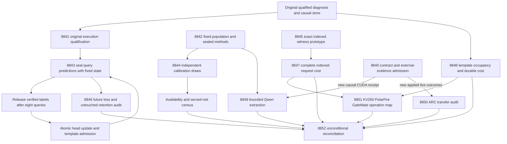

# Carnot Research Roadmap V757: Causal Learning and Indexed Verification

**Created:** 2026-11-05 (America/New_York)
**Milestone:** 2026.11.757
**Title:** Causal energy learning, valid selective decisions, and indexed verification costs
**Status:** Proposed; staged only, not activated
**Queue:** [research-roadmap-next.yaml](../../research-roadmap-next.yaml)
**Previous authority:** [Preserved V756 design](research-roadmap-v756-preserved-20261105.md)
**Contract:** Exactly 13 tasks, Exp8840 through Exp8852, in the order below, across four phases.

## What V756 proved

All thirteen slots reached terminal scheduling outcomes: nine primaries and four
skips. The capstone admitted six primaries and rejected three. The archive still
ends at V755, so this account uses V756 artifacts and conductor skip receipts.
A successful conductor invocation is not a positive scientific finding.

| Evidence | Observed result | Consequence |
|---|---|---|
| [Exp8827](../../results/experiment_8827_v756_branch_contract.json) | Full contract matched, but28 runner statements were missed; owned coverage92.689%. Disqualified. | Close actual original execution paths; reuse the runner. Contract work is not a global CPU gate. |
| [Exp8828](../../results/experiment_8828_v756_signal_replay_qualification.json) | Complete original replay qualified the categorical development improvement in5/5 seeds. Linear Brier was better in every seed. | Keep linear frozen/adaptive controls; development improvement does not prove future benefit. |
| [Exp8829](../../results/experiment_8829_v756_selective_methods.json) | Methods and disjoint structures qualified, but the topology sample did not support an i.i.d. certificate. | Freeze a finite population before independent sampling; limit the claim to that population. |
| [Exp8830](../../results/experiment_8830_v756_categorical_memory.json) | Numerical and causal controls passed; runner statements81 and290 were missed. Coverage99.388%, readiness0, disqualified. | Qualify those two real paths before executing the new streams. |
| [Exp8831](../../results/experiment_8831_v756_ordered_evidence_cost.json) | Admitted null: decisions preserved, but paid work increased23.7%; reduction interval about[-26.1%,-21.8%]. | Retire unchanged ordering as the lever; test request-local indexing. |
| [Exp8832](../../results/experiment_8832_v756_selective_availability.json) | Invalid `small_ebm_training` substrate enum caused quarantine despite complete owned coverage. | Use the actual enum and computation receipts; do not promote the old rows. |
| Exp8833/8834 | Learning stream and audit skipped after prototype rejection. | Use a new qualified producer and a bounded resident execution schedule. |
| [Exp8835](../../results/experiment_8835_v756_complete_adaptation_cost.json) |90 complete CPU windows qualified, without established speed gain or component attribution. | Measure a new axis: verified template occupancy at fixed durability. |
| Exp8836/8837 | No causal CUDA repair receipt and no new live ARC outcomes. | Structured pre-gates; no repeated unchanged runtime or ledger probe. |
| [Exp8838](../../results/experiment_8838_v756_hardware_operation_budget.json) | Operation map qualified; no physical acceleration. | Map new measured operations and preserve each board's limits. |
| [Exp8839](../../results/experiment_8839_v756_capstone.json) | All13 slots reconciled; no new natural generalization. | Keep the same unconditional accounting and stable publication gates. |

V754 remains the last admitted future-learning result, with no benefit. V756
qualified a candidate objective, not a replacement scientific conclusion.

## Three biggest gaps against the PRD

1. **FR-06/FR-11 — useful continuous self-learning.** The causal store can update
   weights and add verified templates, but future benefit is unproved. Qualify
   the existing implementation, compare frozen/adaptive linear and categorical
   heads, and audit later queries plus untouched retention. Count actual later
   template use, not only successful writes.
2. **FR-12 — useful verification with faithful premises.** Exact encoded checks
   do not establish natural-language truth. Learned selectors can abstain on
   everything or issue misleading certificates. Test availability and served
   risk under an explicit sampling model; separately measure source fidelity
   with the mandated Qwen model when runtime evidence permits it.
3. **FR-05/FR-08/NFR-01 — complete deployment benefit.** Neither kernel counts
   nor vendor benchmarks establish the PRD's10x Rust service goal. Test an
   indexed verifier at complete request cost, measure memory growth at unchanged
   durability, and map only supported operations to hardware. No speculative
   native port precedes evidence of a useful kernel.

## Research basis

The [V757 source scan](../../research-references.md) was appended before design.
It covers all eight requested topics and all six secondary channels, with
access limits. These are local adaptations, not claimed paper replications.

| Primary source | Local use | Tasks |
|---|---|---|
| [VIGIL, October2026](https://arxiv.org/abs/2610.04287) | Delayed bounded adaptation, prediction sealing and an audit outside update data. Replay approval is insufficient. | 8841,8843,8846 |
| [Certified by Abstention, October2026](https://arxiv.org/abs/2610.09541) | Measure certificate availability, conditional failure and served error separately. | 8842,8844 |
| [Distributional EBM, May2026](https://arxiv.org/abs/2605.18871) and [PAL,2025](https://arxiv.org/abs/2503.19466) | Separate learned policy, exact normalized constraints and source extraction. Retain simple controls. | 8841,8843,8845,8849 |
| [Type-aware hallucination analysis, November2026](https://arxiv.org/abs/2611.02258) | Retain sign/binding/missing-evidence and valid-alternative strata instead of only aggregate accuracy. | 8842,8844,8849 |
| [Anechoic v2, November4](https://arxiv.org/abs/2610.13368) and [Extropic's October update](https://extropic.ai/writing/baby-thermo-rsi/) | Check actual operation and sampling assumptions before hardware mapping. | 8851 |

EBT, ARM–EBM, KAN-CL/KAC, Ising learning and constrained generation remain
retained leads. A new KAN regularizer, sampler or decoder is not justified by
this milestone's local evidence. Semantic Scholar citation endpoints were
inaccessible; no new citing-paper relation was established. OpenReview supplied
EBT and an under-review reasoning PDF. Hugging Face and GitHub Trending were
checked; no newly ranked relevant repository was established. Kona's vendor
page supplied no reproducible new implementation or benchmark protocol.

## Architecture



The scored ARC agent remains the live hidden-game self-discovery path. No hidden
source inspection, offline ground-truth solver, adapter or repeated registered
level solve is proposed. The ARC task analyzes new live receipts only.

## Phase 1 — Qualify execution and define the population (8840–8842)

**8840 — Contract and external admission.** Bind all13 full task objects, close
all28 missed original runner statements through real private children, and map
the retrieved methods to tests. New CUDA and ARC receipts get independent
readiness fields. Neither field gates CPU science. This is administration and
execution qualification, with no activation or scientific benefit claim.

**8841 — Causal-store execution.** Execute original zero-readiness rejection
and relative-log replay at statements81/290. Preserve finite-difference,
shuffled-label, atomic commit, delay and restart controls. Require100 percent
original/new owned statements and unchanged numerical definitions before the
store releases the stream experiment. No new objective search is allowed.

**8842 — Sampling prototype.** Freeze120 fit worlds and a4096-world constructed
population excluding fit and historically exposed structures. Then draw
calibration/evaluation indices independently with replacement. Repeated index
values are retained; draw count and distinct-world count differ. Freeze30
replicates, calibration budgets60/180/360,240 evaluation draws, seven policies
and six cutoffs. Exact binomial boundary controls and source-span canary custody
qualify the protocol. This establishes a finite-population study, not transfer.

## Phase 2 — Execute learning and selective decisions; prototype indexing (8843–8845)

**8843 — Continuous self-learning.** Run24 independent48-query streams across
six arms: categorical frozen, calibration-only, combined, shuffled combined,
linear frozen and linear combined. Cycle five fixed model seeds across streams;
seeds do not multiply independence. Resident execution amortizes imports while
all state resets between streams. Delay8, restart24, pending cap32 and template
cap32 remain fixed. Expect6912 online rows and5184 retention rows at0/24/48.
Predictions precede feedback; untouched retention labels never train.

**8844 — Selective availability.** Fit the five small heads from scratch and
retain two fixed baselines. Select cutoffs on calibration only, with familywise
risk allocation across7 policies x3 budgets x6 cutoffs. Evaluate issued rules on
independent draws and a full population census opened after selection. Report
firing, conditional/unconditional false certification, coverage and served risk.
Thirty replicates cannot establish a1-percent failure rate precisely. Five-seed
learned superiority is a separate corrected comparison against both baselines.

**8845 — Indexed witness prototype.** Reuse a request-local predicate index
across binding joins. Preserve global contradiction checks, duplicate and
variable semantics, complete witnesses and insufficient answers. Include index
construction/disposal in paid work. Exhaustive small-domain parity and hostile
binding/sign/stale-index tests must pass before cost measurement. Production
defaults and historical evaluator bytes remain unchanged.

## Phase 3 — Independent benefit and complete cost (8846–8848)

**8846 — Future audit.** Recompute every causal and retention reduction from
sealed rows. The primary future window is queries25–48. Require at least0.01
Brier improvement versus the same frozen head,0.005 versus calibration-only
for an addition claim, and evidence above shuffled feedback. Retention loss
and decisive-error increases must stay within0.01. Use whole-stream paired
uncertainty and a0.005 categorical-versus-linear noninferiority margin. A
complete null is an informative terminal result; it does not trigger refitting.

**8847 — Indexed cost.** Compare indexed and always-joint paths at the same
200000-operation cap on240 exposed evaluation worlds and120 new constructed
stress worlds. Include parsing, index construction, joins, conflict checks and
serialization. Keep every censored request in the denominator. Benefit requires
at least20 percent paid-work reduction with no more than1 point of coverage loss
or false-accept increase under simultaneous intervals. Wall-time speed claims
need their own complete-request evidence; operation counts are not timings.

**8848 — Memory occupancy cost.** Use the already qualified V754 store, whether
or not the new learner succeeds. Compare0/8/32 initial templates in read-only
and combined modes over ten64-query blocks:60 complete windows. Create warm
states through actual verified admissions and charge preparation separately.
Preserve fsync, restart, delay and tail drain. Estimate an occupancy-cost curve;
do not treat cross-mode differences as arithmetic fractions or hardware gains.

## Phase 4 — Conditional live evidence and reconciliation (8849–8852)

**8849 — Qwen source fidelity.** Only new authenticated causal CUDA evidence
and qualified canary methods admit24 calls:12 worlds x two extraction prompts,
maximum256 generated tokens per call. Compare plain typed records with linked
source spans. Score extraction truth before downstream exact feasibility. This
is a bounded-generation canary, not a powered natural-language benchmark.

**8850 — ARC transfer.** Only new applied live outcomes beyond the frozen
frontier open the task. Link selection, actual effect and terminal/censored
outcome. Require supported leave-one-game-out folds before transfer estimates;
observational assignment cannot establish causal benefit. No policy change,
new panel or off-path solve is proposed. Level credit requires live discovery
provenance, registry novelty and the existing reproduction gate.

**8851 — Hardware map.** Independently consume qualified index and occupancy
costs. Produce rows for each attached board and separate supported operations,
new-kernel requirements and host work. Read the November4 Anechoic revision and
Extropic method update for compatibility only. No physical probe, new driver,
TSU allocation or inferred deployment speedup is part of this task.

**8852 — Capstone.** Reconcile all13 primary-or-skip outcomes unconditionally.
Count streams, worlds, population draws, distinct support, windows, actual model
calls and live games separately. Preserve disqualification and exact failure
lineage. Recompute stable G1–G4 for its historical headline; do not replace it
with a blocker count. Recommendations do not activate, deploy or publish.

## Dependency graph and exact gate fields

| Producer | Consumer | Field required to equal1 |
|---|---|---|
| exp8841-memory-execution | exp8843-causal-streams | memory_execution_ready_score |
| exp8842-selective-population | exp8844-selective-availability | selective_protocol_ready_score |
| exp8843-causal-streams | exp8846-future-benefit-audit | stream_rows_ready_score |
| exp8845-indexed-witness | exp8847-indexed-cost | indexed_witness_ready_score |
| exp8840-branch-contract | exp8849-qwen-witness-canary | runtime_repair_ready_score |
| exp8842-selective-population | exp8849-qwen-witness-canary | canary_protocol_ready_score |
| exp8840-branch-contract | exp8850-arc-outcome-transfer | arc_new_outcomes_available_score |

The two gates on8849 are conjunctive. Roots8840/8841/8842/8845/8848 have no
current-roadmap gate. Hardware mapping and capstone run unconditionally and
admit sibling evidence independently. No `requires:` chain names a retired ID.
All gated field spellings are repeated in their producer prompts below.

## Hardware requirements and time budgets

| Work | Required substrate | Budget and limitation |
|---|---|---|
| Contract and original qualification | Host CPU, repository virtualenv, private disk | Two infrastructure slots, Opus/100 turns,40–45 minutes each; original measured deadlines remain. |
| Small energy heads and statistical study | CPU JAX/NumPy/SciPy, system RAM | No generator load;45–55 minutes for execution. Preserve actual numerical-training counters. |
| Exact witness and cost studies | CPU, local durable storage |40–50 minutes; bound private children and count full work. |
| Qwen canary | Cached `unsloth/Qwen3.8-27B-GGUF`, qualified CUDA llama.cpp, exclusive GPU lease | Use available2x RTX3090 inventory subject to actual receipts; select an offload layout from measured memory. No promised fit or live runtime until verified. |
| Hardware mapping | CPU plus immutable board/cost receipts | KV260 SSH/fabric k_max<=5; PolarFire Linux CPU scope; GateMate0xffffffff block retained. No board execution. |
| ARC and capstone | CPU, authenticated current receipts |20–30 turns where appropriate; absent external evidence is terminal blocked. |

Preflight checks available memory, disk, numerical dependencies and actual
operand authority. Each execution uses a measured pilot and reserves time for
validation within4200 seconds, below the4800-second hard cap. No pilot silently
changes a registered cohort. Every prompt mandates flushed phase/call progress,
60-second loop/child heartbeats and tool writes limited to150–200 lines.

The self-learning hardware path is CPU counters, CPU/RAM template storage with
an eventual FPGA matching kernel, and small-head batch updates on CPU or a
qualified GPU/NPU. Durable writes remain host work. The program's100x ambition
and PRD's10x native-service target are goals, not inferred results. No purchase
is needed to execute the CPU branches. Alveo/TSU/NPU acquisition stays deferred
until supported measured work justifies it.

## Evidence and completion rules

Every comparison emits per-unit rows. Every external block names the exact
failed check and observed value in `gate_check_summary`. `verdict_class` uses
the closed enum; `partial` means unfinished own work that a retry can complete.
The same external absence is `blocked`. Exact-oracle success is
`circular_positive`, never an independent generalization claim.

All CPU small heads are initialized/fitted within the declared computation;
`no_model_load` is used with numerical-training receipts. A real checkpoint
load must instead declare its actual model-load class and provenance. The Qwen
canary declares `model_bounded_generation` (10-second floor); embeddings or
load-only probes use `model_load_no_generation` (2 seconds), and only actual
full generation uses `model_full_generation` (60 seconds). Blocked no-run
artifacts use `blocked_no_run`; duration is never padded.

Each phase has a runnable prototype, explicit empirical gates and adversarial
controls before downstream scaling. Task prompts require spec-first/test-first
work, actual full owned statement coverage, lint/types/spec tracing, applicable
private E2E-018/021, cold replay and terminal scanners. Native work would also
require Rust checks and E2E-003/004. This planning change adds no runtime code.

Each matched prior failure carries all four mandatory lineage fields, including
`retire_if_same_verdict: true`. Standing2026-05-29 overrides name the legitimate
forward difference. Shared validators, old primaries, active roadmap and
conductor remain outside the change. All source and manuscript publication
still require the applicable operator authorization.

## Exact task contract

The table and embedded full JSON are execution contracts. The JSON must parse
equal to research-roadmap-next.yaml, including prompts and optional fields.
There are exactly13 tasks: Exp8840 through Exp8852, in this order.

| Order | Task ID | Title | Phase | Deliverable |
|---|---|---|---|---|
| 1 | exp8840-branch-contract | Bind the V757 contract and qualify existing branch-admission execution | 1 | `results/experiment_8840_v757_branch_contract.json` |
| 2 | exp8841-memory-execution | Qualify the original causal energy store through its missing rejection paths | 1 | `results/experiment_8841_v757_memory_execution.json` |
| 3 | exp8842-selective-population | Seal a fixed population and valid calibration-draw protocol | 1 | `results/experiment_8842_v757_selective_population.json` |
| 4 | exp8843-causal-streams | Measure delayed energy learning and template additions on fresh query streams | 2 | `results/experiment_8843_v757_causal_streams.json` |
| 5 | exp8844-selective-availability | Measure certificate availability and served risk on independent population draws | 2 | `results/experiment_8844_v757_selective_availability.json` |
| 6 | exp8845-indexed-witness | Prototype an indexed exact-witness path with unchanged decision semantics | 2 | `results/experiment_8845_v757_indexed_witness.json` |
| 7 | exp8846-future-benefit-audit | Audit future loss and untouched retention against frozen and linear controls | 3 | `results/experiment_8846_v757_future_benefit_audit.json` |
| 8 | exp8847-indexed-cost | Measure indexed witness costs with construction and censoring included | 3 | `results/experiment_8847_v757_indexed_cost.json` |
| 9 | exp8848-memory-size-cost | Measure complete adaptation cost as verified template memory fills | 3 | `results/experiment_8848_v757_memory_size_cost.json` |
| 10 | exp8849-qwen-witness-canary | Test source-span extraction after new authenticated Qwen runtime evidence | 4 | `results/experiment_8849_v757_qwen_witness_canary.json` |
| 11 | exp8850-arc-outcome-transfer | Audit live supervisor transfer only when new applied outcomes arrive | 4 | `results/experiment_8850_v757_arc_outcome_transfer.json` |
| 12 | exp8851-hardware-operation-budget | Map index and memory costs to KV260 PolarFire and GateMate operations | 4 | `results/experiment_8851_v757_hardware_operation_budget.json` |
| 13 | exp8852-capstone | Reconcile all thirteen outcomes and decide which mechanisms merit continuation | 4 | `results/experiment_8852_v757_capstone.json` |

<!-- V757_TASK_CONTRACT_START -->
```json
{
  "milestone": "2026.11.757",
  "milestone_title": "Causal energy learning, valid selective decisions, and indexed verification costs",
  "milestone_doc": "openspec/change-proposals/research-roadmap-vNEXT.md",
  "tasks": [
    {
      "id": "exp8840-branch-contract",
      "title": "Bind the V757 contract and qualify existing branch-admission execution",
      "phase": 1,
      "track": "infrastructure",
      "priority": "high",
      "requires_gpu": false,
      "max_turns": 100,
      "estimated_wall_time_min": 40,
      "per_unit_rows": true,
      "milestone": "2026.11.757",
      "deliverable": "results/experiment_8840_v757_branch_contract.json",
      "inference_substrate_class": "no_model_load",
      "MODEL_SPECS": [],
      "gated_on": [],
      "prior_failures": [
        {
          "experiment_id": "exp8827-branch-contract",
          "verdict": "complete_disqualified_v756_branch_contract",
          "addressed_by": "Execute the measured28 missed V756 runner statements through private original-authority children, reuse that runner, and bind a new13-task contract.",
          "retire_if_same_verdict": true
        },
        {
          "experiment_id": "exp8814-branch-contract",
          "verdict": "complete_disqualified_v755_branch_contract",
          "addressed_by": "Execute the measured28 missed V756 runner statements through private original-authority children, reuse that runner, and bind a new13-task contract. Earlier lineage: Cover the fourteen recorded original runner statements with real child execution and seal the new V756 authority; reuse the existing contract parser.",
          "retire_if_same_verdict": true
        }
      ],
      "agent_type": "claude",
      "model": "opus",
      "operator_override": "2026-05-29 standing operator directive in CLAUDE.md: routine milestone reconciliation; scope matches exp8827-branch-contract, exp8814-branch-contract; Execute the measured28 missed V756 runner statements through private original-authority children, reuse that runner, and bind a new13-task contract.",
      "prompt": "CONTEXT:\nWork in {project_root} on {date}. Milestone 2026.11.757, exp8840-branch-contract. V756 had thirteen slots: nine primaries and four skips. Exp8827 matched its contract but missed28 owned runner statements. New scope: test the original runner paths under private frozen authority and reuse the runner instead of creating another untested administration layer. CPU research has independent roots.\n\nEXISTING CODE TO READ FIRST:\n- python/carnot/reporting/v756_branch_contract.py\n- python/carnot/reporting/v756_branch_runner.py\n- tests/python/test_v756_branch_contract_8827.py\n- results/experiment_8827_v756_branch_contract.json\n- results/experiment_8839_v756_capstone.json\n- openspec/change-proposals/research-roadmap-v756-preserved-20261105.md\n- scripts/roadmap_schema.py; scripts/audit_roadmap_gates.py; scripts/exclusion_manifest_lint.py\n- ops/arc_supervisor_refinement_ledger.json; ops/arc_solve_registry.yaml\n- research-references.md; ops/north-star.md\n- openspec/capabilities/research-reporting/spec.md (REQ-REPORT-8840; SCENARIO-REPORT-8840-CONTRACT)\n- scripts/experiment_template.py; python/carnot/reporting/current_work_receipt.py; python/carnot/reporting/primary_publication.py\n\nTASK:\nBind the V757 contract and qualify existing branch-admission execution. Deliver results/experiment_8840_v757_branch_contract.json and hash-bound operands under results/raw/experiment_8840_v757_branch_contract/. Implement scripts/experiments/experiment_8840_v757_branch_contract.py with --date and private-output/replay options. This is experiment execution, not milestone activation.\n\nCONCRETE STEPS:\n0. PRECONDITIONS: Authenticate required artifacts, raw operands, code pins and original method authorities. Check the repository virtualenv, required installed dependencies, writable private output, free disk and time budget. Missing external authority is complete_blocked_<reason>; internal control or validation failure is disqualified. Never invent a missing input.\n1. Emit a flushed progress line at every phase boundary and before and after each model load, generation call, benchmark and subprocess that can take minutes. Use python -u and print(..., flush=True). Print completed/pending counts inside long loops at least every60 seconds. Forward child output and emit elapsed/phase heartbeats every60 seconds. Keep every silence gap below600 seconds, including reasoning between tool calls; heartbeats do not extend measured deadlines.\n2. Keep every tool call bounded. Write any file over about200 lines in several tool calls of at most150-200 lines, with a progress message between calls. Put experiment scripts in scripts/experiments/, tests in tests/python/, and throwaway probes in /tmp. Do not write root scratch scripts.\n3. Parse the new design table and embedded full JSON against the staged YAML queue, allowing only the conductor's documented literal-brace encoding on activation. Require exactly13 tasks, Exp8840 through Exp8852 in order; compare full objects, unique deliverables, gates, producer fields, model specs, substrate classes and four-field failure lineage. Run existing schema, gate and exclusion checks without changing their definitions.\n4. Use the original Exp8827 coverage receipt to enumerate all28 missed statements. Execute those exact source statements in real private children with original V756 task authority and unchanged assertions. Cover valid publication, rejected authority, unavailable resource, log binding and cold replay. Reuse existing functions through a small CLI; inventory every newly owned line before tests. Do not certify coverage by marking lines executed or adding exclusions.\n5. Read only supplied CUDA repair evidence and authenticated ARC ledger deltas. Set runtime_repair_ready_score=1 only for causal environment/library change, exact Qwen3.8 GGUF revision and hash, real context/copy/offload evidence and current validator custody. Set arc_new_outcomes_available_score=1 only for new selected/applied outcomes beyond the frozen Exp8760 frontier. Missing inputs yield zero fields with exact reasons; perform no unchanged GPU or empty-ledger probe.\n6. Ingest the V757 source scan into a compact method-to-test map: VIGIL to sealed feedback and untouched retention; Certified by Abstention to population sampling and certificate availability; Anechoic/Torx to operation boundaries. Distinguish retrieved methods from unavailable citation discovery. The two optional fields do not gate the independent CPU roots. Contract readiness requires all actual owned checks; no activation or publication is authorized.\n7. Before implementation, read CLAUDE.md and CODEX.md; extend the named REQ/SCENARIO and any affected capability spec, then write failing tests. Reuse existing experiment, current_work_receipt and primary_publication helpers. Preserve original assertions, historical source bytes and quarantine decisions. Bind historical consumers to preserved original authorities, never mutable vNEXT. Run scoped pytest with actual unit and child statement coverage at100 percent and zero exclusions, Ruff check/format, strict mypy, and scripts/check_spec_coverage.py with test paths as positional arguments. Run the applicable private E2E-018/021 tests and CLI checks from ops/e2e-test-plan.md; native changes also require E2E-003/004 and cargo test/fmt/clippy. Cold-replay from outside the checkout without PYTHONPATH. Run adversarial_verify.py and verdict_row_consistency_lint.py --strict on prospective evidence. Bind actual logs and code hashes; failed owned checks disqualify readiness. Record repository-wide health separately without weakening any check. Reconcile openspec/, _bmad/traceability.md, ops/status.md and ops/changelog.md. Do not activate the roadmap, edit shared validators, rewrite historical primaries or modify the exclusion manifest.\n\nREQUIRED ARTIFACT FIELDS:\nexperiment_id, task_id, milestone, run_date: principle: bind the result to this producer.\nhonest_verdict: terminal complete_ prefix; principle: completion does not imply benefit.\nverdict_class: positive | circular_positive | null | blocked | disqualified | partial; principle: partial means retryable unfinished OWN work; unchanged external absence is blocked. Exact-oracle success uses circular_positive.\ninference_substrate, inference_substrate_class, execution_venue, MODEL_SPECS, model_invocation_counts, numerical_training_calls: principle: use the actual closed compute enum; small CPU heads initialized in this process use no_model_load with numerical training recorded, never the invalid small_ebm_training label. A loaded pretrained checkpoint requires an appropriate model class and typed provenance. No-run external blocks use blocked_no_run. Never pad duration.\nverifier_is_oracle, exposure_scope, independent_generalization_score: principle: encoded truth and constructed worlds do not establish natural-language or hidden-game generalization.\nduration_s, random_seed, reproducibility_checksum, phase_spans, preconditions_checked: principle: measured work and fixed inputs permit replay.\nsource_artifact_hashes, code_config_hashes, raw_shard_hashes: principle: bind every claim to immutable operands and executed code.\nrows: principle: retain each unit/arm/seed with unit_id, cluster_id, metric, denominator, status and missing_reason; headline reductions must be recomputable.\nintended_count, completed_count, failed_count, censored_count, excluded_count, independent_count: principle: failures remain in denominators and repeated variants do not create independent cases.\ngate_check_summary: principle: every blocked verdict names check, upstream, artifact_field, expected, observed, path and hash; distinguish missing_file, missing_field, rejected_producer and observed_zero.\nacceptance_gates, required_checks_passed, validation_receipts, owned_statement_coverage: principle: frozen thresholds and actual checks separate readiness from benefit.\nfield_principles: principle: explain each new field; a hash or self-report alone is not scientific proof.\ncontract_ready_score, runtime_repair_ready_score, arc_new_outcomes_available_score: integer0/1; principle: exact producer field names allow cheap downstream pre-gates.\ncanonical_tasks_sha256, visible_task_table, full_task_objects, original_missing_statement_rows, source_method_map, external_admission_rows: principle: retain both full-contract equality and execution evidence.\n\nRun command: cd {project_root} && JAX_PLATFORMS=cpu .venv/bin/python -u scripts/experiments/experiment_8840_v757_branch_contract.py --date {date}\nDo NOT push. Do NOT modify scripts/research_conductor.py."
    },
    {
      "id": "exp8841-memory-execution",
      "title": "Qualify the original causal energy store through its missing rejection paths",
      "phase": 1,
      "track": "infrastructure",
      "priority": "high",
      "requires_gpu": false,
      "max_turns": 100,
      "estimated_wall_time_min": 45,
      "per_unit_rows": true,
      "milestone": "2026.11.757",
      "deliverable": "results/experiment_8841_v757_memory_execution.json",
      "inference_substrate_class": "no_model_load",
      "MODEL_SPECS": [],
      "gated_on": [],
      "prior_failures": [
        {
          "experiment_id": "exp8830-categorical-memory",
          "verdict": "complete_disqualified_categorical_memory",
          "addressed_by": "Exercise original runner statements81 and290 in real private children; retain the complete admitted numerical and causal protocol before issuing new readiness.",
          "retire_if_same_verdict": true
        },
        {
          "experiment_id": "exp8817-categorical-memory-prototype",
          "verdict": "blocked_gate_check_failed",
          "addressed_by": "Exercise original runner statements81 and290 in real private children; retain the complete admitted numerical and causal protocol before issuing new readiness. Earlier lineage: A new qualified Exp8828 replay replaces the rejected upstream; include the stronger linear-energy control and preserve exact causal update semantics.",
          "retire_if_same_verdict": true
        }
      ],
      "agent_type": "claude",
      "model": "opus",
      "operator_override": "2026-05-29 standing operator directive in CLAUDE.md: versioned lineage continuation; scope matches exp8830-categorical-memory, exp8817-categorical-memory-prototype; Exercise original runner statements81 and290 in real private children; retain the complete admitted numerical and causal protocol before issuing new readiness.",
      "prompt": "CONTEXT:\nWork in {project_root} on {date}. Milestone 2026.11.757, exp8841-memory-execution. Exp8828 admitted the fixed normalized objective and stronger linear control. Exp8830 passed finite-difference, separability, shuffled-label and transaction controls, but its runner missed statements81 and290. The historical primary remains disqualified. This attempt changes execution coverage, not loss, optimizer or scientific thresholds.\n\nEXISTING CODE TO READ FIRST:\n- python/carnot/memory/categorical_memory_8830.py\n- python/carnot/reporting/categorical_memory_runner_8830.py\n- tests/python/test_categorical_memory_8830.py\n- python/carnot/memory/causal_memory_8802.py\n- results/experiment_8830_v756_categorical_memory.json\n- results/experiment_8828_v756_signal_replay_qualification.json\n- python/carnot/reporting/signal_replay_qualification_8828.py\n- openspec/capabilities/research-reporting/spec.md (REQ-REPORT-8841; SCENARIO-REPORT-8841-CONTRACT)\n- scripts/experiment_template.py; python/carnot/reporting/current_work_receipt.py; python/carnot/reporting/primary_publication.py\n\nTASK:\nQualify the original causal energy store through its missing rejection paths. Deliver results/experiment_8841_v757_memory_execution.json and hash-bound operands under results/raw/experiment_8841_v757_memory_execution/. Implement scripts/experiments/experiment_8841_v757_memory_execution.py with --date and private-output/replay options. This is experiment execution, not milestone activation.\n\nCONCRETE STEPS:\n0. PRECONDITIONS: Authenticate required artifacts, raw operands, code pins and original method authorities. Check the repository virtualenv, required installed dependencies, writable private output, free disk and time budget. Missing external authority is complete_blocked_<reason>; internal control or validation failure is disqualified. Never invent a missing input.\n1. Emit a flushed progress line at every phase boundary and before and after each model load, generation call, benchmark and subprocess that can take minutes. Use python -u and print(..., flush=True). Print completed/pending counts inside long loops at least every60 seconds. Forward child output and emit elapsed/phase heartbeats every60 seconds. Keep every silence gap below600 seconds, including reasoning between tool calls; heartbeats do not extend measured deadlines.\n2. Keep every tool call bounded. Write any file over about200 lines in several tool calls of at most150-200 lines, with a progress message between calls. Put experiment scripts in scripts/experiments/, tests in tests/python/, and throwaway probes in /tmp. Do not write root scratch scripts.\n3. Authenticate the complete admitted Exp8828 replay and original categorical/linear configurations. Execute the original zero-readiness PermissionError at runner statement81 and relative validation-log resolution at statement290 using private fixtures and real children. Assert exact rejection diagnostics and unchanged readiness; retain all original tests. No monkeypatch may bypass either statement.\n4. Run the complete original Exp8830 numerical and causal inventory: mixed-default parity, categorical and linear finite differences at tolerance1e-4, separable learning, contradictory inputs, shuffled-label damage, exact atomic state/ack transitions, rejected-label no-ops, delayed feedback and restart. Preserve the six count features, three candidate bits, width4, SGD rate0.1, delay8, pending cap32 and template cap32.\n5. Publish a new execution qualification, binding the actual source/config bytes and all numerical operands. memory_execution_ready_score=1 requires all original controls plus100 percent original and new owned statements with zero exclusions, terminal scanners and fresh outside-checkout replay. The global health receipt is retained separately; it cannot substitute for owned validation or overturn historical disqualification.\n6. Expose initialization recipes and deterministic in-process head construction for both categorical and linear arms. No generator weights change. Qualification proves correct execution only; there is no new future-loss result. Pilot complete validation and replay against4200 seconds and preserve measured child deadlines.\n7. Before implementation, read CLAUDE.md and CODEX.md; extend the named REQ/SCENARIO and any affected capability spec, then write failing tests. Reuse existing experiment, current_work_receipt and primary_publication helpers. Preserve original assertions, historical source bytes and quarantine decisions. Bind historical consumers to preserved original authorities, never mutable vNEXT. Run scoped pytest with actual unit and child statement coverage at100 percent and zero exclusions, Ruff check/format, strict mypy, and scripts/check_spec_coverage.py with test paths as positional arguments. Run the applicable private E2E-018/021 tests and CLI checks from ops/e2e-test-plan.md; native changes also require E2E-003/004 and cargo test/fmt/clippy. Cold-replay from outside the checkout without PYTHONPATH. Run adversarial_verify.py and verdict_row_consistency_lint.py --strict on prospective evidence. Bind actual logs and code hashes; failed owned checks disqualify readiness. Record repository-wide health separately without weakening any check. Reconcile openspec/, _bmad/traceability.md, ops/status.md and ops/changelog.md. Do not activate the roadmap, edit shared validators, rewrite historical primaries or modify the exclusion manifest.\n\nREQUIRED ARTIFACT FIELDS:\nexperiment_id, task_id, milestone, run_date: principle: bind the result to this producer.\nhonest_verdict: terminal complete_ prefix; principle: completion does not imply benefit.\nverdict_class: positive | circular_positive | null | blocked | disqualified | partial; principle: partial means retryable unfinished OWN work; unchanged external absence is blocked. Exact-oracle success uses circular_positive.\ninference_substrate, inference_substrate_class, execution_venue, MODEL_SPECS, model_invocation_counts, numerical_training_calls: principle: use the actual closed compute enum; small CPU heads initialized in this process use no_model_load with numerical training recorded, never the invalid small_ebm_training label. A loaded pretrained checkpoint requires an appropriate model class and typed provenance. No-run external blocks use blocked_no_run. Never pad duration.\nverifier_is_oracle, exposure_scope, independent_generalization_score: principle: encoded truth and constructed worlds do not establish natural-language or hidden-game generalization.\nduration_s, random_seed, reproducibility_checksum, phase_spans, preconditions_checked: principle: measured work and fixed inputs permit replay.\nsource_artifact_hashes, code_config_hashes, raw_shard_hashes: principle: bind every claim to immutable operands and executed code.\nrows: principle: retain each unit/arm/seed with unit_id, cluster_id, metric, denominator, status and missing_reason; headline reductions must be recomputable.\nintended_count, completed_count, failed_count, censored_count, excluded_count, independent_count: principle: failures remain in denominators and repeated variants do not create independent cases.\ngate_check_summary: principle: every blocked verdict names check, upstream, artifact_field, expected, observed, path and hash; distinguish missing_file, missing_field, rejected_producer and observed_zero.\nacceptance_gates, required_checks_passed, validation_receipts, owned_statement_coverage: principle: frozen thresholds and actual checks separate readiness from benefit.\nfield_principles: principle: explain each new field; a hash or self-report alone is not scientific proof.\nmemory_execution_ready_score: integer0/1; principle: only full original causal and execution qualification releases future studies.\noriginal_missing_statement_rows, gradient_control_rows, causal_order_rows, rejection_rows, restart_rows, configuration_hashes, initialization_recipes: principle: the changed attempt closes specific execution gaps while preserving numerical meaning.\n\nRun command: cd {project_root} && JAX_PLATFORMS=cpu .venv/bin/python -u scripts/experiments/experiment_8841_v757_memory_execution.py --date {date}\nDo NOT push. Do NOT modify scripts/research_conductor.py."
    },
    {
      "id": "exp8842-selective-population",
      "title": "Seal a fixed population and valid calibration-draw protocol",
      "phase": 1,
      "track": "research",
      "priority": "high",
      "requires_gpu": false,
      "max_turns": 50,
      "estimated_wall_time_min": 45,
      "per_unit_rows": true,
      "milestone": "2026.11.757",
      "deliverable": "results/experiment_8842_v757_selective_population.json",
      "inference_substrate_class": "no_model_load",
      "MODEL_SPECS": [],
      "gated_on": [],
      "prior_failures": [
        {
          "experiment_id": "exp8832-selective-availability",
          "verdict": "complete_disqualified_selective_availability",
          "addressed_by": "Replace the unsupported substrate enum with actual in-process compute provenance, and replace topology-dependent certification with independent draws from a frozen finite population.",
          "retire_if_same_verdict": true
        },
        {
          "experiment_id": "exp8829-selective-methods",
          "verdict": "complete_null_selective_methods",
          "addressed_by": "Freeze the population before calibration and draw indices with replacement; preserve structural exclusions from training and keep population claims separate from transfer.",
          "retire_if_same_verdict": true
        },
        {
          "experiment_id": "exp8818-evidence-decisive-coverage",
          "verdict": "complete_blocked_evidence_decisive_coverage",
          "addressed_by": "Freeze the population before calibration and draw indices with replacement; preserve structural exclusions from training and keep population claims separate from transfer. Earlier lineage: Use the shipped calibration-invariant repair and qualify original controls before new cohorts; replace an accuracy-headroom assumption with a paid-check schedule question.",
          "retire_if_same_verdict": true
        },
        {
          "experiment_id": "exp8819-consensus-selective-energy",
          "verdict": "complete_null_consensus_selective_energy",
          "addressed_by": "Freeze the population before calibration and draw indices with replacement; preserve structural exclusions from training and keep population claims separate from transfer. Earlier lineage: Diagnose exact finite-support attainability at fixed risk before any new architecture or threshold search; independent world counts replace replicated candidate support.",
          "retire_if_same_verdict": true
        }
      ],
      "agent_type": "codex",
      "model": "gpt-6.1-sol",
      "operator_override": "2026-05-29 standing operator directive in CLAUDE.md: versioned lineage continuation; scope matches exp8832-selective-availability, exp8829-selective-methods, exp8818-evidence-decisive-coverage, exp8819-consensus-selective-energy; Replace the unsupported substrate enum with actual in-process compute provenance, and replace topology-dependent certification with independent draws from a frozen finite population.",
      "prompt": "CONTEXT:\nWork in {project_root} on {date}. Milestone 2026.11.757, exp8842-selective-population. Exp8829 qualified separated structures but correctly denied an iid certificate; Exp8832 was quarantined for the invalid small_ebm_training enum. Certified by Abstention motivates distinguishing certificate availability from conditional error. New scope: fixed-population inference under independent with-replacement draws, with a frozen familywise budget and valid compute declarations.\n\nEXISTING CODE TO READ FIRST:\n- python/carnot/reporting/selective_methods_8829.py\n- python/carnot/reporting/selective_availability_8832.py\n- python/carnot/reporting/consensus_selective_energy_8819.py\n- python/carnot/reporting/evidence_decisive_8818.py\n- results/experiment_8829_v756_selective_methods.json\n- results/experiment_8832_v756_selective_availability.json\n- scripts/adversarial_verify.py; research-references.md\n- openspec/capabilities/research-reporting/spec.md (REQ-REPORT-8842; SCENARIO-REPORT-8842-CONTRACT)\n- scripts/experiment_template.py; python/carnot/reporting/current_work_receipt.py; python/carnot/reporting/primary_publication.py\n\nTASK:\nSeal a fixed population and valid calibration-draw protocol. Deliver results/experiment_8842_v757_selective_population.json and hash-bound operands under results/raw/experiment_8842_v757_selective_population/. Implement scripts/experiments/experiment_8842_v757_selective_population.py with --date and private-output/replay options. This is experiment execution, not milestone activation.\n\nCONCRETE STEPS:\n0. PRECONDITIONS: Authenticate required artifacts, raw operands, code pins and original method authorities. Check the repository virtualenv, required installed dependencies, writable private output, free disk and time budget. Missing external authority is complete_blocked_<reason>; internal control or validation failure is disqualified. Never invent a missing input.\n1. Emit a flushed progress line at every phase boundary and before and after each model load, generation call, benchmark and subprocess that can take minutes. Use python -u and print(..., flush=True). Print completed/pending counts inside long loops at least every60 seconds. Forward child output and emit elapsed/phase heartbeats every60 seconds. Keep every silence gap below600 seconds, including reasoning between tool calls; heartbeats do not extend measured deadlines.\n2. Keep every tool call bounded. Write any file over about200 lines in several tool calls of at most150-200 lines, with a progress message between calls. Put experiment scripts in scripts/experiments/, tests in tests/python/, and throwaway probes in /tmp. Do not write root scratch scripts.\n3. Freeze120 fitting worlds and a separate finite population of4096 eight-vertex worlds before drawing calibration data. Exclude fitting and all historically exposed topology/query invariants from the population. Any rejection sampling occurs only while constructing the fixed population; freeze its final inclusion rule and hash before analysis. Fail if4096 valid disjoint units cannot be constructed within a measured pilot budget; do not quietly shrink the population.\n4. Independently draw calibration and evaluation indices uniformly WITH replacement from that immutable population. Keep repeats and the exact RNG trace. Use30 independent replicate seeds, nested calibration budgets60/180/360 and240 independent evaluation draws per replicate. Each draw uses one hash-fixed query/variant per world. Repeated variants are not extra units; draw count and distinct-world count are separate. Claims are conditional on this finite population, never novel-structure or natural-text generalization.\n5. Freeze seven scored policies: the five original small-head seeds11/23/37/47/59, fixed consensus and fixed local evidence. Preserve original features, initialization and240 training steps; no fitted policy sees calibration/evaluation labels. Thresholds are0.5,0.6,0.7,0.8,0.9,0.95. Allocate familywise delta0.01 across7 policies x3 budgets x6 thresholds within each replicate. Exact one-sided binomial risk bounds select the maximum-coverage rule with upper risk<=0.05; zero accepted means no certificate. Verify the integer zero-error floor independently with SciPy and direct logarithms.\n6. Implement boundary controls for n=0, floor-1 and floor, all-error observations, duplicated deterministic rows falsely passed as independent RNG draws, label permutation and calibration/evaluation aliasing. Freeze fit, draw and reduction methods; every policy must use the same draws. For certificate-validity auditing, compare accepted-set risk to a full4096-world census after rule selection. Census labels must never enter fitting or cutoff choice.\n7. Seal12 separate source-span canary worlds with balanced sign, entity-binding, missing-evidence and valid-alternative conditions. Keep calibration and canary readiness separate. Record the retrieved source-to-method mapping, actual closed substrate vocabulary and output contracts. Use no_model_load for CPU methods and in-process small-head training; do not change shared validators.\n8. Before implementation, read CLAUDE.md and CODEX.md; extend the named REQ/SCENARIO and any affected capability spec, then write failing tests. Reuse existing experiment, current_work_receipt and primary_publication helpers. Preserve original assertions, historical source bytes and quarantine decisions. Bind historical consumers to preserved original authorities, never mutable vNEXT. Run scoped pytest with actual unit and child statement coverage at100 percent and zero exclusions, Ruff check/format, strict mypy, and scripts/check_spec_coverage.py with test paths as positional arguments. Run the applicable private E2E-018/021 tests and CLI checks from ops/e2e-test-plan.md; native changes also require E2E-003/004 and cargo test/fmt/clippy. Cold-replay from outside the checkout without PYTHONPATH. Run adversarial_verify.py and verdict_row_consistency_lint.py --strict on prospective evidence. Bind actual logs and code hashes; failed owned checks disqualify readiness. Record repository-wide health separately without weakening any check. Reconcile openspec/, _bmad/traceability.md, ops/status.md and ops/changelog.md. Do not activate the roadmap, edit shared validators, rewrite historical primaries or modify the exclusion manifest.\n\nREQUIRED ARTIFACT FIELDS:\nexperiment_id, task_id, milestone, run_date: principle: bind the result to this producer.\nhonest_verdict: terminal complete_ prefix; principle: completion does not imply benefit.\nverdict_class: positive | circular_positive | null | blocked | disqualified | partial; principle: partial means retryable unfinished OWN work; unchanged external absence is blocked. Exact-oracle success uses circular_positive.\ninference_substrate, inference_substrate_class, execution_venue, MODEL_SPECS, model_invocation_counts, numerical_training_calls: principle: use the actual closed compute enum; small CPU heads initialized in this process use no_model_load with numerical training recorded, never the invalid small_ebm_training label. A loaded pretrained checkpoint requires an appropriate model class and typed provenance. No-run external blocks use blocked_no_run. Never pad duration.\nverifier_is_oracle, exposure_scope, independent_generalization_score: principle: encoded truth and constructed worlds do not establish natural-language or hidden-game generalization.\nduration_s, random_seed, reproducibility_checksum, phase_spans, preconditions_checked: principle: measured work and fixed inputs permit replay.\nsource_artifact_hashes, code_config_hashes, raw_shard_hashes: principle: bind every claim to immutable operands and executed code.\nrows: principle: retain each unit/arm/seed with unit_id, cluster_id, metric, denominator, status and missing_reason; headline reductions must be recomputable.\nintended_count, completed_count, failed_count, censored_count, excluded_count, independent_count: principle: failures remain in denominators and repeated variants do not create independent cases.\ngate_check_summary: principle: every blocked verdict names check, upstream, artifact_field, expected, observed, path and hash; distinguish missing_file, missing_field, rejected_producer and observed_zero.\nacceptance_gates, required_checks_passed, validation_receipts, owned_statement_coverage: principle: frozen thresholds and actual checks separate readiness from benefit.\nfield_principles: principle: explain each new field; a hash or self-report alone is not scientific proof.\nselective_protocol_ready_score, canary_protocol_ready_score: integer0/1; principle: exact methods and separate canary custody gate only their own consumers.\npopulation_manifest, fit_manifest, draw_manifest, independent_draw_count, distinct_world_count, familywise_allocation, binomial_boundary_rows, policy_menu, threshold_menu, source_method_map: principle: a frozen finite population and true independent index draws define the limited certificate claim.\n\nRun command: cd {project_root} && JAX_PLATFORMS=cpu .venv/bin/python -u scripts/experiments/experiment_8842_v757_selective_population.py --date {date}\nDo NOT push. Do NOT modify scripts/research_conductor.py."
    },
    {
      "id": "exp8843-causal-streams",
      "title": "Measure delayed energy learning and template additions on fresh query streams",
      "phase": 2,
      "track": "research",
      "priority": "high",
      "requires_gpu": false,
      "max_turns": 50,
      "estimated_wall_time_min": 55,
      "per_unit_rows": true,
      "milestone": "2026.11.757",
      "deliverable": "results/experiment_8843_v757_causal_streams.json",
      "inference_substrate_class": "no_model_load",
      "MODEL_SPECS": [],
      "gated_on": [
        {
          "upstream": "exp8841-memory-execution",
          "artifact_field": "memory_execution_ready_score",
          "op": "==",
          "value": 1
        }
      ],
      "prior_failures": [
        {
          "experiment_id": "exp8833-causal-objective-streams",
          "verdict": "blocked_gate_check_failed",
          "addressed_by": "Use a newly qualified original store,24 independent streams with resident execution, and matched frozen/adaptive linear controls; the unavailable V756 stream is not an input.",
          "retire_if_same_verdict": true
        },
        {
          "experiment_id": "exp8820-causal-objective-streams",
          "verdict": "blocked_gate_check_failed",
          "addressed_by": "Use a newly qualified original store,24 independent streams with resident execution, and matched frozen/adaptive linear controls; the unavailable V756 stream is not an input. Earlier lineage: Use the new Exp8830 prototype after original replay qualification and include the stronger linear control; no retired V755 producer is a dependency.",
          "retire_if_same_verdict": true
        },
        {
          "experiment_id": "exp8810-causal-learning-audit",
          "verdict": "complete_null_causal_learning_audit",
          "addressed_by": "Use a newly qualified original store,24 independent streams with resident execution, and matched frozen/adaptive linear controls; the unavailable V756 stream is not an input. Earlier lineage: Replace the harmful mixed objective with a qualified normalized objective, then test future loss against frozen, calibration-only, shuffled and linear controls.",
          "retire_if_same_verdict": true
        }
      ],
      "operator_override": "2026-05-29 standing operator directive in CLAUDE.md: versioned lineage continuation; scope matches exp8833-causal-objective-streams, exp8820-causal-objective-streams, exp8810-causal-learning-audit; Use a newly qualified original store,24 independent streams with resident execution, and matched frozen/adaptive linear controls; the unavailable V756 stream is not an input.",
      "prompt": "CONTEXT:\nWork in {project_root} on {date}. Milestone 2026.11.757, exp8843-causal-streams. V754 showed no future benefit. V756 admitted a development objective, but Exp8833 never ran because store qualification failed. VIGIL shows why accepted updates need future and untouched retention measurements. This study trains only small energy heads and verified template memory; it does not train Qwen.\n\nEXISTING CODE TO READ FIRST:\n- python/carnot/memory/categorical_memory_8830.py\n- python/carnot/memory/causal_memory_8802.py\n- python/carnot/reporting/causal_learning_audit_8810.py\n- python/carnot/reporting/signal_replay_qualification_8828.py\n- results/experiment_8828_v756_signal_replay_qualification.json\n- results/experiment_8841_v757_memory_execution.json\n- openspec/capabilities/research-reporting/spec.md (REQ-REPORT-8843; SCENARIO-REPORT-8843-CONTRACT)\n- scripts/experiment_template.py; python/carnot/reporting/current_work_receipt.py; python/carnot/reporting/primary_publication.py\n\nTASK:\nMeasure delayed energy learning and template additions on fresh query streams. Deliver results/experiment_8843_v757_causal_streams.json and hash-bound operands under results/raw/experiment_8843_v757_causal_streams/. Implement scripts/experiments/experiment_8843_v757_causal_streams.py with --date and private-output/replay options. This is experiment execution, not milestone activation.\n\nCONCRETE STEPS:\n0. PRECONDITIONS: Authenticate required artifacts, raw operands, code pins and original method authorities. Check the repository virtualenv, required installed dependencies, writable private output, free disk and time budget. Missing external authority is complete_blocked_<reason>; internal control or validation failure is disqualified. Never invent a missing input.\n1. Emit a flushed progress line at every phase boundary and before and after each model load, generation call, benchmark and subprocess that can take minutes. Use python -u and print(..., flush=True). Print completed/pending counts inside long loops at least every60 seconds. Forward child output and emit elapsed/phase heartbeats every60 seconds. Keep every silence gap below600 seconds, including reasoning between tool calls; heartbeats do not extend measured deadlines.\n2. Keep every tool call bounded. Write any file over about200 lines in several tool calls of at most150-200 lines, with a progress message between calls. Put experiment scripts in scripts/experiments/, tests in tests/python/, and throwaway probes in /tmp. Do not write root scratch scripts.\n3. Authenticate memory_execution_ready_score=1. Freeze24 fresh48-query streams and12 untouched retention worlds per stream, structurally disjoint from every exposed fit/calibration/evaluation corpus. Assign model seeds11/23/37/47/59 cyclically across the24 streams before labels open; use the same seed for all arms within a stream. Reset all state across streams. No repeated seed is counted as another independent stream.\n4. Reconstruct the admitted categorical and linear initialization recipes in process on their original fitting inputs. Run six fixed arms: categorical frozen, categorical calibration-only, categorical combined, categorical combined with prefix-only shuffled feedback, linear frozen, linear combined. Keep the exact objective, SGD rate0.1, observation features, delay8, pending cap32 and template cap32. Freeze all within-query state and seal probabilities before labels are released.\n5. Use one resident CPU process to amortize imports/JIT while resetting complete per-stream state. Persist separate stores per arm, restart them at query24 and drain all delayed feedback after query48. Only verified released labels may cause additions or updates. Shuffling draws solely from labels already released at that event; no future labels enter the negative control.\n6. Emit6912 online rows and5184 retention rows at checkpoints0/24/48, totaling12096 rows. The primary future window is queries25-48. Retention labels never train or select updates. Record actual gradients, coefficient movement, template additions and later uses, state hashes, prediction seals and feedback acknowledgments. Separately identify stream recipe and error type.\n7. Use two disjoint development-only timing pilots and checkpoint each stream. Project the full registered workload plus validation against4200 seconds; no silent cohort reduction. Emit complete raw evidence and stream_rows_ready_score based on integrity, not gain. Exp8846 alone performs the independent benefit reduction. Incomplete own execution is partial with exact counts; missing external authority is blocked.\n8. Before implementation, read CLAUDE.md and CODEX.md; extend the named REQ/SCENARIO and any affected capability spec, then write failing tests. Reuse existing experiment, current_work_receipt and primary_publication helpers. Preserve original assertions, historical source bytes and quarantine decisions. Bind historical consumers to preserved original authorities, never mutable vNEXT. Run scoped pytest with actual unit and child statement coverage at100 percent and zero exclusions, Ruff check/format, strict mypy, and scripts/check_spec_coverage.py with test paths as positional arguments. Run the applicable private E2E-018/021 tests and CLI checks from ops/e2e-test-plan.md; native changes also require E2E-003/004 and cargo test/fmt/clippy. Cold-replay from outside the checkout without PYTHONPATH. Run adversarial_verify.py and verdict_row_consistency_lint.py --strict on prospective evidence. Bind actual logs and code hashes; failed owned checks disqualify readiness. Record repository-wide health separately without weakening any check. Reconcile openspec/, _bmad/traceability.md, ops/status.md and ops/changelog.md. Do not activate the roadmap, edit shared validators, rewrite historical primaries or modify the exclusion manifest.\n\nREQUIRED ARTIFACT FIELDS:\nexperiment_id, task_id, milestone, run_date: principle: bind the result to this producer.\nhonest_verdict: terminal complete_ prefix; principle: completion does not imply benefit.\nverdict_class: positive | circular_positive | null | blocked | disqualified | partial; principle: partial means retryable unfinished OWN work; unchanged external absence is blocked. Exact-oracle success uses circular_positive.\ninference_substrate, inference_substrate_class, execution_venue, MODEL_SPECS, model_invocation_counts, numerical_training_calls: principle: use the actual closed compute enum; small CPU heads initialized in this process use no_model_load with numerical training recorded, never the invalid small_ebm_training label. A loaded pretrained checkpoint requires an appropriate model class and typed provenance. No-run external blocks use blocked_no_run. Never pad duration.\nverifier_is_oracle, exposure_scope, independent_generalization_score: principle: encoded truth and constructed worlds do not establish natural-language or hidden-game generalization.\nduration_s, random_seed, reproducibility_checksum, phase_spans, preconditions_checked: principle: measured work and fixed inputs permit replay.\nsource_artifact_hashes, code_config_hashes, raw_shard_hashes: principle: bind every claim to immutable operands and executed code.\nrows: principle: retain each unit/arm/seed with unit_id, cluster_id, metric, denominator, status and missing_reason; headline reductions must be recomputable.\nintended_count, completed_count, failed_count, censored_count, excluded_count, independent_count: principle: failures remain in denominators and repeated variants do not create independent cases.\ngate_check_summary: principle: every blocked verdict names check, upstream, artifact_field, expected, observed, path and hash; distinguish missing_file, missing_field, rejected_producer and observed_zero.\nacceptance_gates, required_checks_passed, validation_receipts, owned_statement_coverage: principle: frozen thresholds and actual checks separate readiness from benefit.\nfield_principles: principle: explain each new field; a hash or self-report alone is not scientific proof.\nstream_rows_ready_score: integer0/1; principle: complete causal evidence can be ready even when learning harms decisions.\nstream_manifest, per_event_results, retention_rows, initialization_rows, state_transition_rows, label_release_rows, template_use_rows, gradient_rows, resource_projection: principle: distinguish actual learning from counters and test loss from training loss.\n\nRun command: cd {project_root} && JAX_PLATFORMS=cpu .venv/bin/python -u scripts/experiments/experiment_8843_v757_causal_streams.py --date {date}\nDo NOT push. Do NOT modify scripts/research_conductor.py."
    },
    {
      "id": "exp8844-selective-availability",
      "title": "Measure certificate availability and served risk on independent population draws",
      "phase": 2,
      "track": "research",
      "priority": "high",
      "requires_gpu": false,
      "max_turns": 50,
      "estimated_wall_time_min": 45,
      "per_unit_rows": true,
      "milestone": "2026.11.757",
      "deliverable": "results/experiment_8844_v757_selective_availability.json",
      "inference_substrate_class": "no_model_load",
      "MODEL_SPECS": [],
      "gated_on": [
        {
          "upstream": "exp8842-selective-population",
          "artifact_field": "selective_protocol_ready_score",
          "op": "==",
          "value": 1
        }
      ],
      "prior_failures": [
        {
          "experiment_id": "exp8832-selective-availability",
          "verdict": "complete_disqualified_selective_availability",
          "addressed_by": "Use the valid no_model_load enum with in-process head-training receipts and independently sampled finite-population draws; measure certificate firing and conditional failure, not another unsupported topology certificate.",
          "retire_if_same_verdict": true
        },
        {
          "experiment_id": "exp8819-consensus-selective-energy",
          "verdict": "complete_null_consensus_selective_energy",
          "addressed_by": "Use the valid no_model_load enum with in-process head-training receipts and independently sampled finite-population draws; measure certificate firing and conditional failure, not another unsupported topology certificate. Earlier lineage: Change the question from another selector sweep to a fixed independent-support budget study with exact finite-sample risk checks and the old bootstrap method as a descriptive control.",
          "retire_if_same_verdict": true
        }
      ],
      "operator_override": "2026-05-29 standing operator directive in CLAUDE.md: versioned lineage continuation; scope matches exp8832-selective-availability, exp8819-consensus-selective-energy; Use the valid no_model_load enum with in-process head-training receipts and independently sampled finite-population draws; measure certificate firing and conditional failure, not another unsupported topology certificate.",
      "prompt": "CONTEXT:\nWork in {project_root} on {date}. Milestone 2026.11.757, exp8844-selective-availability. Exp8832 was disqualified by its invented substrate class, and its inherited sample was not iid. Exp8842 replaces that sampling assumption explicitly. This experiment separates weak score discrimination, insufficient accepted support and misleading certificate availability on one fixed constructed population.\n\nEXISTING CODE TO READ FIRST:\n- python/carnot/reporting/selective_availability_8832.py\n- python/carnot/reporting/consensus_selective_energy_8819.py\n- tests/python/test_selective_availability_8832.py\n- results/experiment_8842_v757_selective_population.json\n- scripts/adversarial_verify.py\n- openspec/capabilities/research-reporting/spec.md (REQ-REPORT-8844; SCENARIO-REPORT-8844-CONTRACT)\n- scripts/experiment_template.py; python/carnot/reporting/current_work_receipt.py; python/carnot/reporting/primary_publication.py\n\nTASK:\nMeasure certificate availability and served risk on independent population draws. Deliver results/experiment_8844_v757_selective_availability.json and hash-bound operands under results/raw/experiment_8844_v757_selective_availability/. Implement scripts/experiments/experiment_8844_v757_selective_availability.py with --date and private-output/replay options. This is experiment execution, not milestone activation.\n\nCONCRETE STEPS:\n0. PRECONDITIONS: Authenticate required artifacts, raw operands, code pins and original method authorities. Check the repository virtualenv, required installed dependencies, writable private output, free disk and time budget. Missing external authority is complete_blocked_<reason>; internal control or validation failure is disqualified. Never invent a missing input.\n1. Emit a flushed progress line at every phase boundary and before and after each model load, generation call, benchmark and subprocess that can take minutes. Use python -u and print(..., flush=True). Print completed/pending counts inside long loops at least every60 seconds. Forward child output and emit elapsed/phase heartbeats every60 seconds. Keep every silence gap below600 seconds, including reasoning between tool calls; heartbeats do not extend measured deadlines.\n2. Keep every tool call bounded. Write any file over about200 lines in several tool calls of at most150-200 lines, with a progress message between calls. Put experiment scripts in scripts/experiments/, tests in tests/python/, and throwaway probes in /tmp. Do not write root scratch scripts.\n3. Authenticate selective_protocol_ready_score=1 and freeze the supplied protocol hash. Fit the five small energy heads from scratch on fitting worlds only, using the original240 steps. Keep the two deterministic baselines unchanged. Record numerical_training_calls separately from zero LLM loads/calls; use no_model_load and actual invocation provenance. Never load a pretrained generator or invent a new substrate enum.\n4. Compute and seal all seven policies' scores on the fixed population before any calibration labels are used. For each of30 registered replicate seeds and each60/180/360 budget, select cutoffs only from that replicate's calibration draws using the exact frozen familywise allocation. Preserve all repeated index draws; failed fits remain failed arms, not dropped denominators.\n5. Evaluate each chosen rule on its independent240 draws and on the full4096-world census, opened only after cutoff selection. Emit per-draw decisions, errors, acceptance counts, per-world census scores, selected thresholds and every issued/refused certificate. Report certificate firing frequency, unconditional false-certification frequency, conditional false-certification frequency among issued certificates, served-answer error and decisive coverage. A zero denominator is null, never zero risk.\n6. Use the census accepted-set risk to audit the certificate claim conditional on this finite population. Use paired replicate intervals for availability and utility;30 draws cannot resolve a1-percent failure rate reliably, so show exact uncertainty and make no empirical universal-validity claim. Report each model seed separately; no best-seed headline. A useful policy needs risk<=0.05 and coverage>=0.30 on the census in at least24/30 replicates at budget360; label this preregistered operational utility, not a theorem.\n7. Compare learned policies with both fixed baselines using paired draws and simultaneous intervals. A learned benefit requires a lower99-percent paired coverage-gain bound of0.05 at retained risk, across all five seeds, with correction across the10 comparisons. Keep familywise certificate calibration separate from this superiority test. Reproduce reductions from raw rows in a fresh process, and verify shuffled fit labels and malicious duplicate-draw receipts cannot earn readiness.\n8. Before implementation, read CLAUDE.md and CODEX.md; extend the named REQ/SCENARIO and any affected capability spec, then write failing tests. Reuse existing experiment, current_work_receipt and primary_publication helpers. Preserve original assertions, historical source bytes and quarantine decisions. Bind historical consumers to preserved original authorities, never mutable vNEXT. Run scoped pytest with actual unit and child statement coverage at100 percent and zero exclusions, Ruff check/format, strict mypy, and scripts/check_spec_coverage.py with test paths as positional arguments. Run the applicable private E2E-018/021 tests and CLI checks from ops/e2e-test-plan.md; native changes also require E2E-003/004 and cargo test/fmt/clippy. Cold-replay from outside the checkout without PYTHONPATH. Run adversarial_verify.py and verdict_row_consistency_lint.py --strict on prospective evidence. Bind actual logs and code hashes; failed owned checks disqualify readiness. Record repository-wide health separately without weakening any check. Reconcile openspec/, _bmad/traceability.md, ops/status.md and ops/changelog.md. Do not activate the roadmap, edit shared validators, rewrite historical primaries or modify the exclusion manifest.\n\nREQUIRED ARTIFACT FIELDS:\nexperiment_id, task_id, milestone, run_date: principle: bind the result to this producer.\nhonest_verdict: terminal complete_ prefix; principle: completion does not imply benefit.\nverdict_class: positive | circular_positive | null | blocked | disqualified | partial; principle: partial means retryable unfinished OWN work; unchanged external absence is blocked. Exact-oracle success uses circular_positive.\ninference_substrate, inference_substrate_class, execution_venue, MODEL_SPECS, model_invocation_counts, numerical_training_calls: principle: use the actual closed compute enum; small CPU heads initialized in this process use no_model_load with numerical training recorded, never the invalid small_ebm_training label. A loaded pretrained checkpoint requires an appropriate model class and typed provenance. No-run external blocks use blocked_no_run. Never pad duration.\nverifier_is_oracle, exposure_scope, independent_generalization_score: principle: encoded truth and constructed worlds do not establish natural-language or hidden-game generalization.\nduration_s, random_seed, reproducibility_checksum, phase_spans, preconditions_checked: principle: measured work and fixed inputs permit replay.\nsource_artifact_hashes, code_config_hashes, raw_shard_hashes: principle: bind every claim to immutable operands and executed code.\nrows: principle: retain each unit/arm/seed with unit_id, cluster_id, metric, denominator, status and missing_reason; headline reductions must be recomputable.\nintended_count, completed_count, failed_count, censored_count, excluded_count, independent_count: principle: failures remain in denominators and repeated variants do not create independent cases.\ngate_check_summary: principle: every blocked verdict names check, upstream, artifact_field, expected, observed, path and hash; distinguish missing_file, missing_field, rejected_producer and observed_zero.\nacceptance_gates, required_checks_passed, validation_receipts, owned_statement_coverage: principle: frozen thresholds and actual checks separate readiness from benefit.\nfield_principles: principle: explain each new field; a hash or self-report alone is not scientific proof.\nselective_rows_ready_score, selective_utility_score, learned_selective_benefit_score: integer0/1; principle: evidence quality, usable policies and learned improvement are separate.\nper_draw_results, population_score_rows, selected_cutoff_rows, certificate_event_rows, firing_intervals, conditional_failure_intervals, served_risk_rows, paired_comparisons: principle: report availability and risk with their actual denominators.\n\nRun command: cd {project_root} && JAX_PLATFORMS=cpu .venv/bin/python -u scripts/experiments/experiment_8844_v757_selective_availability.py --date {date}\nDo NOT push. Do NOT modify scripts/research_conductor.py."
    },
    {
      "id": "exp8845-indexed-witness",
      "title": "Prototype an indexed exact-witness path with unchanged decision semantics",
      "phase": 2,
      "track": "research",
      "priority": "high",
      "requires_gpu": false,
      "max_turns": 50,
      "estimated_wall_time_min": 45,
      "per_unit_rows": true,
      "milestone": "2026.11.757",
      "deliverable": "results/experiment_8845_v757_indexed_witness.json",
      "inference_substrate_class": "no_model_load",
      "MODEL_SPECS": [],
      "gated_on": [],
      "prior_failures": [
        {
          "experiment_id": "exp8831-ordered-evidence-cost",
          "verdict": "complete_null_ordered_evidence_cost",
          "addressed_by": "Replace sequential check scheduling with a request-local predicate index that removes repeated candidate scans; preserve always-joint semantics and meter index construction.",
          "retire_if_same_verdict": true
        },
        {
          "experiment_id": "exp8818-evidence-decisive-coverage",
          "verdict": "complete_blocked_evidence_decisive_coverage",
          "addressed_by": "Replace sequential check scheduling with a request-local predicate index that removes repeated candidate scans; preserve always-joint semantics and meter index construction. Earlier lineage: Fresh disjoint cohort is qualified by Exp8829; the changed hypothesis tests ordered-check cost against always-joint decisions, not an impossible accuracy gain over an identical oracle.",
          "retire_if_same_verdict": true
        }
      ],
      "agent_type": "codex",
      "model": "gpt-6.1-sol",
      "operator_override": "2026-05-29 standing operator directive in CLAUDE.md: versioned lineage continuation; scope matches exp8831-ordered-evidence-cost, exp8818-evidence-decisive-coverage; Replace sequential check scheduling with a request-local predicate index that removes repeated candidate scans; preserve always-joint semantics and meter index construction.",
      "prompt": "CONTEXT:\nWork in {project_root} on {date}. Milestone 2026.11.757, exp8845-indexed-witness. Exp8831 found zero quality change and about23.7 percent more operations from ordered checks. This is a new mechanism: construct one request-local predicate index and reuse its filtered fact lists across joins. It does not reorder checks or cache answers across queries.\n\nEXISTING CODE TO READ FIRST:\n- python/carnot/reporting/ordered_evidence_cost_8831.py\n- python/carnot/reporting/evidence_operation_meter_8818.py\n- python/carnot/reporting/evidence_set_methods_8768.py\n- python/carnot/reporting/evidence_qualification_8777.py\n- tests/python/test_ordered_evidence_cost_8831.py\n- results/experiment_8831_v756_ordered_evidence_cost.json\n- openspec/capabilities/research-reporting/spec.md (REQ-REPORT-8845; SCENARIO-REPORT-8845-CONTRACT)\n- scripts/experiment_template.py; python/carnot/reporting/current_work_receipt.py; python/carnot/reporting/primary_publication.py\n\nTASK:\nPrototype an indexed exact-witness path with unchanged decision semantics. Deliver results/experiment_8845_v757_indexed_witness.json and hash-bound operands under results/raw/experiment_8845_v757_indexed_witness/. Implement scripts/experiments/experiment_8845_v757_indexed_witness.py with --date and private-output/replay options. This is experiment execution, not milestone activation.\n\nCONCRETE STEPS:\n0. PRECONDITIONS: Authenticate required artifacts, raw operands, code pins and original method authorities. Check the repository virtualenv, required installed dependencies, writable private output, free disk and time budget. Missing external authority is complete_blocked_<reason>; internal control or validation failure is disqualified. Never invent a missing input.\n1. Emit a flushed progress line at every phase boundary and before and after each model load, generation call, benchmark and subprocess that can take minutes. Use python -u and print(..., flush=True). Print completed/pending counts inside long loops at least every60 seconds. Forward child output and emit elapsed/phase heartbeats every60 seconds. Keep every silence gap below600 seconds, including reasoning between tool calls; heartbeats do not extend measured deadlines.\n2. Keep every tool call bounded. Write any file over about200 lines in several tool calls of at most150-200 lines, with a progress message between calls. Put experiment scripts in scripts/experiments/, tests in tests/python/, and throwaway probes in /tmp. Do not write root scratch scripts.\n3. Locate the repeated parse, relation/sign scan and binding-join work in the actual admitted evaluator. Add one opt-in indexed evaluator alongside the unchanged always-joint reference. Build an immutable request-local index over the same fact tuples, preserve duplicate/multiset semantics where relevant, and use only bound relation/constant positions for candidate filtering. Never inspect construction metadata or private labels.\n4. Preserve all complete-witness, global-sign-conflict, valid-alternative, repeated-variable and insufficient-evidence semantics. An index may reduce candidate scans but cannot turn a partial join into support. Keep the same200000-operation cap. Charge parse, index allocation/build/hash lookup, joins, conflict checks, result serialization and disposal; no free preprocessing or cross-request answer cache.\n5. Write deterministic parity tests over exhaustive small fact/query domains and every original V756 condition. Add malformed facts, sign contradictions outside the chosen witness, swapped bindings, duplicate facts, repeated variables, absent joins and forced budget exhaustion. Require exact typed-decision parity when both paths complete and honest censoring otherwise. Track any witness ordering difference without demanding byte identity of equivalent witnesses.\n6. Keep the prototype behind an explicit opt-in path. Default production verification and historical evaluator bytes stay unchanged. Qualify stale-index reuse and cross-query mutation rejection, then run real subprocess and cold-replay controls. indexed_witness_ready_score=1 requires all semantic controls and full owned validation; it does not claim a cost gain.\n7. Before implementation, read CLAUDE.md and CODEX.md; extend the named REQ/SCENARIO and any affected capability spec, then write failing tests. Reuse existing experiment, current_work_receipt and primary_publication helpers. Preserve original assertions, historical source bytes and quarantine decisions. Bind historical consumers to preserved original authorities, never mutable vNEXT. Run scoped pytest with actual unit and child statement coverage at100 percent and zero exclusions, Ruff check/format, strict mypy, and scripts/check_spec_coverage.py with test paths as positional arguments. Run the applicable private E2E-018/021 tests and CLI checks from ops/e2e-test-plan.md; native changes also require E2E-003/004 and cargo test/fmt/clippy. Cold-replay from outside the checkout without PYTHONPATH. Run adversarial_verify.py and verdict_row_consistency_lint.py --strict on prospective evidence. Bind actual logs and code hashes; failed owned checks disqualify readiness. Record repository-wide health separately without weakening any check. Reconcile openspec/, _bmad/traceability.md, ops/status.md and ops/changelog.md. Do not activate the roadmap, edit shared validators, rewrite historical primaries or modify the exclusion manifest.\n\nREQUIRED ARTIFACT FIELDS:\nexperiment_id, task_id, milestone, run_date: principle: bind the result to this producer.\nhonest_verdict: terminal complete_ prefix; principle: completion does not imply benefit.\nverdict_class: positive | circular_positive | null | blocked | disqualified | partial; principle: partial means retryable unfinished OWN work; unchanged external absence is blocked. Exact-oracle success uses circular_positive.\ninference_substrate, inference_substrate_class, execution_venue, MODEL_SPECS, model_invocation_counts, numerical_training_calls: principle: use the actual closed compute enum; small CPU heads initialized in this process use no_model_load with numerical training recorded, never the invalid small_ebm_training label. A loaded pretrained checkpoint requires an appropriate model class and typed provenance. No-run external blocks use blocked_no_run. Never pad duration.\nverifier_is_oracle, exposure_scope, independent_generalization_score: principle: encoded truth and constructed worlds do not establish natural-language or hidden-game generalization.\nduration_s, random_seed, reproducibility_checksum, phase_spans, preconditions_checked: principle: measured work and fixed inputs permit replay.\nsource_artifact_hashes, code_config_hashes, raw_shard_hashes: principle: bind every claim to immutable operands and executed code.\nrows: principle: retain each unit/arm/seed with unit_id, cluster_id, metric, denominator, status and missing_reason; headline reductions must be recomputable.\nintended_count, completed_count, failed_count, censored_count, excluded_count, independent_count: principle: failures remain in denominators and repeated variants do not create independent cases.\ngate_check_summary: principle: every blocked verdict names check, upstream, artifact_field, expected, observed, path and hash; distinguish missing_file, missing_field, rejected_producer and observed_zero.\nacceptance_gates, required_checks_passed, validation_receipts, owned_statement_coverage: principle: frozen thresholds and actual checks separate readiness from benefit.\nfield_principles: principle: explain each new field; a hash or self-report alone is not scientific proof.\nindexed_witness_ready_score: integer0/1; principle: exact semantics qualify the new path before timing.\nparity_rows, adversarial_case_rows, index_lifetime_rows, operation_schema, default_path_parity, witness_provenance: principle: index reuse must preserve meaning and include construction work.\n\nRun command: cd {project_root} && JAX_PLATFORMS=cpu .venv/bin/python -u scripts/experiments/experiment_8845_v757_indexed_witness.py --date {date}\nDo NOT push. Do NOT modify scripts/research_conductor.py."
    },
    {
      "id": "exp8846-future-benefit-audit",
      "title": "Audit future loss and untouched retention against frozen and linear controls",
      "phase": 3,
      "track": "research",
      "priority": "high",
      "requires_gpu": false,
      "max_turns": 30,
      "estimated_wall_time_min": 35,
      "per_unit_rows": true,
      "milestone": "2026.11.757",
      "deliverable": "results/experiment_8846_v757_future_benefit_audit.json",
      "inference_substrate_class": "no_model_load",
      "MODEL_SPECS": [],
      "gated_on": [
        {
          "upstream": "exp8843-causal-streams",
          "artifact_field": "stream_rows_ready_score",
          "op": "==",
          "value": 1
        }
      ],
      "prior_failures": [
        {
          "experiment_id": "exp8834-future-benefit-audit",
          "verdict": "blocked_gate_check_failed",
          "addressed_by": "Audit new complete24-stream evidence with frozen/adaptive linear controls and untouched retention, rather than retrying an absent retired upstream.",
          "retire_if_same_verdict": true
        },
        {
          "experiment_id": "exp8821-future-benefit-audit",
          "verdict": "blocked_gate_check_failed",
          "addressed_by": "Audit new complete24-stream evidence with frozen/adaptive linear controls and untouched retention, rather than retrying an absent retired upstream. Earlier lineage: Audit the new Exp8833 stream rather than missing retired inputs and include a preregistered linear-comparator noninferiority endpoint.",
          "retire_if_same_verdict": true
        }
      ],
      "operator_override": "2026-05-29 standing operator directive in CLAUDE.md: versioned lineage continuation; scope matches exp8834-future-benefit-audit, exp8821-future-benefit-audit; Audit new complete24-stream evidence with frozen/adaptive linear controls and untouched retention, rather than retrying an absent retired upstream.",
      "prompt": "CONTEXT:\nWork in {project_root} on {date}. Milestone 2026.11.757, exp8846-future-benefit-audit. Exp8834 was skipped after the rejected memory prototype. Exp8843 now supplies a bounded independent stream protocol. VIGIL warns that replay-approved updates can still regress on held-out cases; this audit has no training or threshold-selection role.\n\nEXISTING CODE TO READ FIRST:\n- python/carnot/reporting/causal_learning_audit_8810.py\n- python/carnot/verify/restricted_decision_audit_8210.py\n- results/experiment_8843_v757_causal_streams.json\n- results/experiment_8810_v754_causal_learning_audit.json\n- ops/e2e-test-plan.md\n- openspec/capabilities/research-reporting/spec.md (REQ-REPORT-8846; SCENARIO-REPORT-8846-CONTRACT)\n- scripts/experiment_template.py; python/carnot/reporting/current_work_receipt.py; python/carnot/reporting/primary_publication.py\n\nTASK:\nAudit future loss and untouched retention against frozen and linear controls. Deliver results/experiment_8846_v757_future_benefit_audit.json and hash-bound operands under results/raw/experiment_8846_v757_future_benefit_audit/. Implement scripts/experiments/experiment_8846_v757_future_benefit_audit.py with --date and private-output/replay options. This is experiment execution, not milestone activation.\n\nCONCRETE STEPS:\n0. PRECONDITIONS: Authenticate required artifacts, raw operands, code pins and original method authorities. Check the repository virtualenv, required installed dependencies, writable private output, free disk and time budget. Missing external authority is complete_blocked_<reason>; internal control or validation failure is disqualified. Never invent a missing input.\n1. Emit a flushed progress line at every phase boundary and before and after each model load, generation call, benchmark and subprocess that can take minutes. Use python -u and print(..., flush=True). Print completed/pending counts inside long loops at least every60 seconds. Forward child output and emit elapsed/phase heartbeats every60 seconds. Keep every silence gap below600 seconds, including reasoning between tool calls; heartbeats do not extend measured deadlines.\n2. Keep every tool call bounded. Write any file over about200 lines in several tool calls of at most150-200 lines, with a progress message between calls. Put experiment scripts in scripts/experiments/, tests in tests/python/, and throwaway probes in /tmp. Do not write root scratch scripts.\n3. Authenticate stream_rows_ready_score=1, all raw shards and original configuration pins. Verify exactly24 independent streams,6912 online rows and5184 retention rows. Recompute every probability/decision reduction from sealed rows; confirm release delay8, prefix-only shuffle, restart parity, full tail drain, no retention feedback and actual template reuse after additions.\n4. Compute paired per-stream Brier and log loss on queries25-48, typed decisive coverage and errors, and retention change at24/48. The five preregistered Brier contrasts are categorical combined minus frozen, combined minus calibration-only, combined minus shuffled, linear combined minus linear frozen, and categorical combined minus linear combined. Use10000 whole-stream paired bootstrap draws and familywise99-percent intervals across these five endpoints; seeds and variants remain nested within streams.\n5. Causal learning benefit requires at least0.01 lower Brier versus the same head frozen, at least0.005 improvement versus calibration-only for an addition-specific claim, and a lower confidence bound above zero against shuffled feedback. Retention upper loss increase must be<=0.01 and decisive-error increase<=0.01 with intervals. Compare categorical against linear using a0.005 Brier noninferiority margin; failing that gate favors the simpler head for the next plan.\n6. Independently join template admission and later use events. Distinguish pure calibration benefit from addition benefit and detect benefit concentrated in one stream. Run leave-one-stream-out influence and subgroup descriptives without promoting a post-hoc winner. Fail closed on missing rows, leaked labels, rehashed aggregate tampering and early feedback.\n7. Emit a terminal null for complete valid data without benefit, circular_positive for a qualifying constructed-oracle result, blocked for unchanged absent external input and disqualified for internal integrity failure. Compute a separate read-only recommendation for the next milestone; do not change serving defaults, checkpoints or live policies.\n8. Before implementation, read CLAUDE.md and CODEX.md; extend the named REQ/SCENARIO and any affected capability spec, then write failing tests. Reuse existing experiment, current_work_receipt and primary_publication helpers. Preserve original assertions, historical source bytes and quarantine decisions. Bind historical consumers to preserved original authorities, never mutable vNEXT. Run scoped pytest with actual unit and child statement coverage at100 percent and zero exclusions, Ruff check/format, strict mypy, and scripts/check_spec_coverage.py with test paths as positional arguments. Run the applicable private E2E-018/021 tests and CLI checks from ops/e2e-test-plan.md; native changes also require E2E-003/004 and cargo test/fmt/clippy. Cold-replay from outside the checkout without PYTHONPATH. Run adversarial_verify.py and verdict_row_consistency_lint.py --strict on prospective evidence. Bind actual logs and code hashes; failed owned checks disqualify readiness. Record repository-wide health separately without weakening any check. Reconcile openspec/, _bmad/traceability.md, ops/status.md and ops/changelog.md. Do not activate the roadmap, edit shared validators, rewrite historical primaries or modify the exclusion manifest.\n\nREQUIRED ARTIFACT FIELDS:\nexperiment_id, task_id, milestone, run_date: principle: bind the result to this producer.\nhonest_verdict: terminal complete_ prefix; principle: completion does not imply benefit.\nverdict_class: positive | circular_positive | null | blocked | disqualified | partial; principle: partial means retryable unfinished OWN work; unchanged external absence is blocked. Exact-oracle success uses circular_positive.\ninference_substrate, inference_substrate_class, execution_venue, MODEL_SPECS, model_invocation_counts, numerical_training_calls: principle: use the actual closed compute enum; small CPU heads initialized in this process use no_model_load with numerical training recorded, never the invalid small_ebm_training label. A loaded pretrained checkpoint requires an appropriate model class and typed provenance. No-run external blocks use blocked_no_run. Never pad duration.\nverifier_is_oracle, exposure_scope, independent_generalization_score: principle: encoded truth and constructed worlds do not establish natural-language or hidden-game generalization.\nduration_s, random_seed, reproducibility_checksum, phase_spans, preconditions_checked: principle: measured work and fixed inputs permit replay.\nsource_artifact_hashes, code_config_hashes, raw_shard_hashes: principle: bind every claim to immutable operands and executed code.\nrows: principle: retain each unit/arm/seed with unit_id, cluster_id, metric, denominator, status and missing_reason; headline reductions must be recomputable.\nintended_count, completed_count, failed_count, censored_count, excluded_count, independent_count: principle: failures remain in denominators and repeated variants do not create independent cases.\ngate_check_summary: principle: every blocked verdict names check, upstream, artifact_field, expected, observed, path and hash; distinguish missing_file, missing_field, rejected_producer and observed_zero.\nacceptance_gates, required_checks_passed, validation_receipts, owned_statement_coverage: principle: frozen thresholds and actual checks separate readiness from benefit.\nfield_principles: principle: explain each new field; a hash or self-report alone is not scientific proof.\nlearning_audit_ready_score, causal_benefit_score, addition_benefit_score, retention_pass_score, categorical_noninferiority_score: integer0/1; principle: separate causal improvement, memory contribution, retention and model complexity.\nper_stream_results, paired_interval_rows, causal_integrity_rows, untouched_retention_rows, template_reuse_rows, influence_rows, next_head_recommendation: principle: independent reductions control scientific claims.\n\nRun command: cd {project_root} && JAX_PLATFORMS=cpu .venv/bin/python -u scripts/experiments/experiment_8846_v757_future_benefit_audit.py --date {date}\nDo NOT push. Do NOT modify scripts/research_conductor.py."
    },
    {
      "id": "exp8847-indexed-cost",
      "title": "Measure indexed witness costs with construction and censoring included",
      "phase": 3,
      "track": "research",
      "priority": "high",
      "requires_gpu": false,
      "max_turns": 50,
      "estimated_wall_time_min": 40,
      "per_unit_rows": true,
      "milestone": "2026.11.757",
      "deliverable": "results/experiment_8847_v757_indexed_cost.json",
      "inference_substrate_class": "no_model_load",
      "MODEL_SPECS": [],
      "gated_on": [
        {
          "upstream": "exp8845-indexed-witness",
          "artifact_field": "indexed_witness_ready_score",
          "op": "==",
          "value": 1
        }
      ],
      "prior_failures": [
        {
          "experiment_id": "exp8831-ordered-evidence-cost",
          "verdict": "complete_null_ordered_evidence_cost",
          "addressed_by": "Benchmark qualified request-local indexing, including build/disposal costs, against always-joint verification instead of repeating the harmful check-order schedule.",
          "retire_if_same_verdict": true
        },
        {
          "experiment_id": "exp8818-evidence-decisive-coverage",
          "verdict": "complete_blocked_evidence_decisive_coverage",
          "addressed_by": "Benchmark qualified request-local indexing, including build/disposal costs, against always-joint verification instead of repeating the harmful check-order schedule. Earlier lineage: Fresh disjoint cohort is qualified by Exp8829; the changed hypothesis tests ordered-check cost against always-joint decisions, not an impossible accuracy gain over an identical oracle.",
          "retire_if_same_verdict": true
        }
      ],
      "operator_override": "2026-05-29 standing operator directive in CLAUDE.md: versioned lineage continuation; scope matches exp8831-ordered-evidence-cost, exp8818-evidence-decisive-coverage; Benchmark qualified request-local indexing, including build/disposal costs, against always-joint verification instead of repeating the harmful check-order schedule.",
      "prompt": "CONTEXT:\nWork in {project_root} on {date}. Milestone 2026.11.757, exp8847-indexed-cost. Exp8831's check-ordering null remains closed. Exp8845 supplies a different exact-verification mechanism. This experiment compares index reuse with the admitted always-joint evaluator on equal inputs and operation budgets; encoded truth remains circular evidence.\n\nEXISTING CODE TO READ FIRST:\n- python/carnot/reporting/ordered_evidence_cost_8831.py\n- python/carnot/reporting/evidence_operation_meter_8818.py\n- results/experiment_8845_v757_indexed_witness.json\n- results/experiment_8831_v756_ordered_evidence_cost.json\n- results/experiment_8829_v756_selective_methods.json\n- openspec/capabilities/research-reporting/spec.md (REQ-REPORT-8847; SCENARIO-REPORT-8847-CONTRACT)\n- scripts/experiment_template.py; python/carnot/reporting/current_work_receipt.py; python/carnot/reporting/primary_publication.py\n\nTASK:\nMeasure indexed witness costs with construction and censoring included. Deliver results/experiment_8847_v757_indexed_cost.json and hash-bound operands under results/raw/experiment_8847_v757_indexed_cost/. Implement scripts/experiments/experiment_8847_v757_indexed_cost.py with --date and private-output/replay options. This is experiment execution, not milestone activation.\n\nCONCRETE STEPS:\n0. PRECONDITIONS: Authenticate required artifacts, raw operands, code pins and original method authorities. Check the repository virtualenv, required installed dependencies, writable private output, free disk and time budget. Missing external authority is complete_blocked_<reason>; internal control or validation failure is disqualified. Never invent a missing input.\n1. Emit a flushed progress line at every phase boundary and before and after each model load, generation call, benchmark and subprocess that can take minutes. Use python -u and print(..., flush=True). Print completed/pending counts inside long loops at least every60 seconds. Forward child output and emit elapsed/phase heartbeats every60 seconds. Keep every silence gap below600 seconds, including reasoning between tool calls; heartbeats do not extend measured deadlines.\n2. Keep every tool call bounded. Write any file over about200 lines in several tool calls of at most150-200 lines, with a progress message between calls. Put experiment scripts in scripts/experiments/, tests in tests/python/, and throwaway probes in /tmp. Do not write root scratch scripts.\n3. Authenticate indexed_witness_ready_score=1 and the admitted V756 evaluation operand hashes. Before timing, freeze the240 existing evaluation worlds and a separate120-world stress set at16/32/64 facts with balanced missing-hop, contradiction, binding-swap and valid-alternative variants. The old worlds are exposed performance cases; the new stress set is constructed and not natural-language generalization.\n4. Run indexed and always-joint paths on identical immutable inputs under the same200000-operation cap. Randomize paired process order with five fixed scheduling seeds and count all requests, including exhausted and invalid cases. Charge full request parse, index build, dispatch, joins, conflict scan, serialization and index disposal. Emit operation categories and wall/CPU times per request; do not infer time fractions from operation counts.\n5. Check exact decision parity on completed pairs and compare decisive coverage over ALL scheduled requests. Censored requests remain insufficient and remain in denominators. Use10000 paired whole-world bootstrap draws with familywise99-percent intervals for paid-operation reduction, coverage loss and semantic false-accept increase. Scheduling repeats measure noise, not independent worlds.\n6. Benefit requires lower-bound paid-operation reduction>=0.20, upper-bound coverage loss<=0.01 and upper-bound false-accept increase<=0.01 on the registered evaluation set. Report stress sizes separately and require no hidden quality regression. A wall-time speedup claim additionally requires a lower99-percent paired complete-request speed ratio>1; operation reduction alone is not speedup.\n7. Replay decisions and reductions in a fresh process and retain full primitive work receipts. indexed_cost_ready_score depends on complete honest evidence, while indexed_cost_benefit_score depends on the registered gain gates. A null ends this unchanged mechanism; no extra index strategy or threshold search is allowed after labels are opened.\n8. Before implementation, read CLAUDE.md and CODEX.md; extend the named REQ/SCENARIO and any affected capability spec, then write failing tests. Reuse existing experiment, current_work_receipt and primary_publication helpers. Preserve original assertions, historical source bytes and quarantine decisions. Bind historical consumers to preserved original authorities, never mutable vNEXT. Run scoped pytest with actual unit and child statement coverage at100 percent and zero exclusions, Ruff check/format, strict mypy, and scripts/check_spec_coverage.py with test paths as positional arguments. Run the applicable private E2E-018/021 tests and CLI checks from ops/e2e-test-plan.md; native changes also require E2E-003/004 and cargo test/fmt/clippy. Cold-replay from outside the checkout without PYTHONPATH. Run adversarial_verify.py and verdict_row_consistency_lint.py --strict on prospective evidence. Bind actual logs and code hashes; failed owned checks disqualify readiness. Record repository-wide health separately without weakening any check. Reconcile openspec/, _bmad/traceability.md, ops/status.md and ops/changelog.md. Do not activate the roadmap, edit shared validators, rewrite historical primaries or modify the exclusion manifest.\n\nREQUIRED ARTIFACT FIELDS:\nexperiment_id, task_id, milestone, run_date: principle: bind the result to this producer.\nhonest_verdict: terminal complete_ prefix; principle: completion does not imply benefit.\nverdict_class: positive | circular_positive | null | blocked | disqualified | partial; principle: partial means retryable unfinished OWN work; unchanged external absence is blocked. Exact-oracle success uses circular_positive.\ninference_substrate, inference_substrate_class, execution_venue, MODEL_SPECS, model_invocation_counts, numerical_training_calls: principle: use the actual closed compute enum; small CPU heads initialized in this process use no_model_load with numerical training recorded, never the invalid small_ebm_training label. A loaded pretrained checkpoint requires an appropriate model class and typed provenance. No-run external blocks use blocked_no_run. Never pad duration.\nverifier_is_oracle, exposure_scope, independent_generalization_score: principle: encoded truth and constructed worlds do not establish natural-language or hidden-game generalization.\nduration_s, random_seed, reproducibility_checksum, phase_spans, preconditions_checked: principle: measured work and fixed inputs permit replay.\nsource_artifact_hashes, code_config_hashes, raw_shard_hashes: principle: bind every claim to immutable operands and executed code.\nrows: principle: retain each unit/arm/seed with unit_id, cluster_id, metric, denominator, status and missing_reason; headline reductions must be recomputable.\nintended_count, completed_count, failed_count, censored_count, excluded_count, independent_count: principle: failures remain in denominators and repeated variants do not create independent cases.\ngate_check_summary: principle: every blocked verdict names check, upstream, artifact_field, expected, observed, path and hash; distinguish missing_file, missing_field, rejected_producer and observed_zero.\nacceptance_gates, required_checks_passed, validation_receipts, owned_statement_coverage: principle: frozen thresholds and actual checks separate readiness from benefit.\nfield_principles: principle: explain each new field; a hash or self-report alone is not scientific proof.\nindexed_cost_ready_score, indexed_cost_benefit_score: integer0/1; principle: an admitted cost study need not show improvement.\nper_world_results, complete_request_rows, index_build_rows, operation_rows, paired_intervals, censored_request_rows, wall_speed_ratio: principle: include construction, quality and all attempts in the claimed boundary.\n\nRun command: cd {project_root} && JAX_PLATFORMS=cpu .venv/bin/python -u scripts/experiments/experiment_8847_v757_indexed_cost.py --date {date}\nDo NOT push. Do NOT modify scripts/research_conductor.py."
    },
    {
      "id": "exp8848-memory-size-cost",
      "title": "Measure complete adaptation cost as verified template memory fills",
      "phase": 3,
      "track": "research",
      "priority": "high",
      "requires_gpu": false,
      "max_turns": 50,
      "estimated_wall_time_min": 50,
      "per_unit_rows": true,
      "milestone": "2026.11.757",
      "deliverable": "results/experiment_8848_v757_memory_size_cost.json",
      "inference_substrate_class": "no_model_load",
      "MODEL_SPECS": [],
      "gated_on": [],
      "prior_failures": [
        {
          "experiment_id": "exp8835-complete-adaptation-cost",
          "verdict": "complete_null_complete_adaptation_cost",
          "addressed_by": "Change the estimand to template occupancy0/8/32 at fixed complete durable work, using the already qualified store and separately charged causal warmup.",
          "retire_if_same_verdict": true
        },
        {
          "experiment_id": "exp8822-parent-window-cost",
          "verdict": "blocked_gate_check_failed",
          "addressed_by": "Change the estimand to template occupancy0/8/32 at fixed complete durable work, using the already qualified store and separately charged causal warmup. Earlier lineage: Remove the unavailable-new-prototype dependency by measuring the already qualified V754 causal store; admit a new objective only as an optional presealed arm.",
          "retire_if_same_verdict": true
        },
        {
          "experiment_id": "exp8808-archived-observer-costs",
          "verdict": "complete_null_archived_observer_costs",
          "addressed_by": "Change the estimand to template occupancy0/8/32 at fixed complete durable work, using the already qualified store and separately charged causal warmup. Earlier lineage: Use parent-only complete-operation clocks and matched mode interventions rather than rejected component attribution.",
          "retire_if_same_verdict": true
        }
      ],
      "operator_override": "2026-05-29 standing operator directive in CLAUDE.md: versioned lineage continuation; scope matches exp8835-complete-adaptation-cost, exp8822-parent-window-cost, exp8808-archived-observer-costs; Change the estimand to template occupancy0/8/32 at fixed complete durable work, using the already qualified store and separately charged causal warmup.",
      "prompt": "CONTEXT:\nWork in {project_root} on {date}. Milestone 2026.11.757, exp8848-memory-size-cost. Exp8835 qualified90 complete CPU windows but could not isolate a positive adaptation increment or component fractions. New scope: vary initial verified template occupancy at fixed durability and request count. Use the already qualified V754 store, independently of the new objective or learning gain.\n\nEXISTING CODE TO READ FIRST:\n- python/carnot/reporting/complete_adaptation_cost_8835.py\n- python/carnot/reporting/complete_adaptation_runner_8835.py\n- python/carnot/memory/causal_memory_8802.py\n- python/carnot/memory/transactional_constraint_memory.py\n- results/experiment_8835_v756_complete_adaptation_cost.json\n- results/experiment_8802_v754_causal_memory_prototype.json\n- openspec/capabilities/research-reporting/spec.md (REQ-REPORT-8848; SCENARIO-REPORT-8848-CONTRACT)\n- scripts/experiment_template.py; python/carnot/reporting/current_work_receipt.py; python/carnot/reporting/primary_publication.py\n\nTASK:\nMeasure complete adaptation cost as verified template memory fills. Deliver results/experiment_8848_v757_memory_size_cost.json and hash-bound operands under results/raw/experiment_8848_v757_memory_size_cost/. Implement scripts/experiments/experiment_8848_v757_memory_size_cost.py with --date and private-output/replay options. This is experiment execution, not milestone activation.\n\nCONCRETE STEPS:\n0. PRECONDITIONS: Authenticate required artifacts, raw operands, code pins and original method authorities. Check the repository virtualenv, required installed dependencies, writable private output, free disk and time budget. Missing external authority is complete_blocked_<reason>; internal control or validation failure is disqualified. Never invent a missing input.\n1. Emit a flushed progress line at every phase boundary and before and after each model load, generation call, benchmark and subprocess that can take minutes. Use python -u and print(..., flush=True). Print completed/pending counts inside long loops at least every60 seconds. Forward child output and emit elapsed/phase heartbeats every60 seconds. Keep every silence gap below600 seconds, including reasoning between tool calls; heartbeats do not extend measured deadlines.\n2. Keep every tool call bounded. Write any file over about200 lines in several tool calls of at most150-200 lines, with a progress message between calls. Put experiment scripts in scripts/experiments/, tests in tests/python/, and throwaway probes in /tmp. Do not write root scratch scripts.\n3. Authenticate the original admitted V754 store, complete Exp8835 primitive clocks and historical authorities. Freeze initial template occupancies0/8/32, two modes read_only and combined, and ten independent64-query blocks:60 windows total. Construct warm states only through actual verified delayed admissions; retain their full preparation costs separately and their source hashes. Never hand-edit a checkpoint to claim learned memory.\n4. Keep the same query workloads within paired modes and across occupancy levels; include predeclared matching-template and novel-template requests. Report exposed warmup overlap explicitly. Keep capacity32, delay8, pending cap32, exact file/directory fsync, response serialization, midpoint restart and full tail drain. At capacity, preserve existing rejection semantics; do not add eviction or relax durability.\n5. Measure parent wall clocks from before child startup/import through final child exit, including all64 requests and restart. Randomize cell order across blocks. Emit each window, query count, initial/final occupancy, serialized state bytes, attempted/applied updates, template hits/additions and fsync counts. Coarse parent spans may separate startup and service only when boundaries are actual observed events.\n6. Compare occupancy0/8/32 with paired block intervals and simultaneous99-percent uncertainty. Report cost per query, p50/p95 whole-window cost, preparation amortization at1/10/100 windows, and the observed occupancy-cost curve. Do not call read_only-versus-combined differences arithmetic cost, do not infer FPGA fractions, and do not claim a speedup from a smaller workload.\n7. Pilot one block and project60 windows plus validation under4200 seconds. Retain all scheduled attempts and exact recovery controls; missing or failed windows prevent whole_cost_ready_score=1. Completion can be a terminal null with a qualified cost curve. No new objective, backend, production store or numerical optimization is introduced.\n8. Before implementation, read CLAUDE.md and CODEX.md; extend the named REQ/SCENARIO and any affected capability spec, then write failing tests. Reuse existing experiment, current_work_receipt and primary_publication helpers. Preserve original assertions, historical source bytes and quarantine decisions. Bind historical consumers to preserved original authorities, never mutable vNEXT. Run scoped pytest with actual unit and child statement coverage at100 percent and zero exclusions, Ruff check/format, strict mypy, and scripts/check_spec_coverage.py with test paths as positional arguments. Run the applicable private E2E-018/021 tests and CLI checks from ops/e2e-test-plan.md; native changes also require E2E-003/004 and cargo test/fmt/clippy. Cold-replay from outside the checkout without PYTHONPATH. Run adversarial_verify.py and verdict_row_consistency_lint.py --strict on prospective evidence. Bind actual logs and code hashes; failed owned checks disqualify readiness. Record repository-wide health separately without weakening any check. Reconcile openspec/, _bmad/traceability.md, ops/status.md and ops/changelog.md. Do not activate the roadmap, edit shared validators, rewrite historical primaries or modify the exclusion manifest.\n\nREQUIRED ARTIFACT FIELDS:\nexperiment_id, task_id, milestone, run_date: principle: bind the result to this producer.\nhonest_verdict: terminal complete_ prefix; principle: completion does not imply benefit.\nverdict_class: positive | circular_positive | null | blocked | disqualified | partial; principle: partial means retryable unfinished OWN work; unchanged external absence is blocked. Exact-oracle success uses circular_positive.\ninference_substrate, inference_substrate_class, execution_venue, MODEL_SPECS, model_invocation_counts, numerical_training_calls: principle: use the actual closed compute enum; small CPU heads initialized in this process use no_model_load with numerical training recorded, never the invalid small_ebm_training label. A loaded pretrained checkpoint requires an appropriate model class and typed provenance. No-run external blocks use blocked_no_run. Never pad duration.\nverifier_is_oracle, exposure_scope, independent_generalization_score: principle: encoded truth and constructed worlds do not establish natural-language or hidden-game generalization.\nduration_s, random_seed, reproducibility_checksum, phase_spans, preconditions_checked: principle: measured work and fixed inputs permit replay.\nsource_artifact_hashes, code_config_hashes, raw_shard_hashes: principle: bind every claim to immutable operands and executed code.\nrows: principle: retain each unit/arm/seed with unit_id, cluster_id, metric, denominator, status and missing_reason; headline reductions must be recomputable.\nintended_count, completed_count, failed_count, censored_count, excluded_count, independent_count: principle: failures remain in denominators and repeated variants do not create independent cases.\ngate_check_summary: principle: every blocked verdict names check, upstream, artifact_field, expected, observed, path and hash; distinguish missing_file, missing_field, rejected_producer and observed_zero.\nacceptance_gates, required_checks_passed, validation_receipts, owned_statement_coverage: principle: frozen thresholds and actual checks separate readiness from benefit.\nfield_principles: principle: explain each new field; a hash or self-report alone is not scientific proof.\nwhole_cost_ready_score: integer0/1; principle: complete compatible clocks qualify a cost curve independently of learning benefit.\nwindow_rows, occupancy_rows, preparation_cost_rows, absolute_cost_rows, paired_cost_intervals, state_parity_rows, restart_rows, serialization_bytes, unsupported_attribution: principle: separate complete observed costs from unmeasured component fractions.\n\nRun command: cd {project_root} && JAX_PLATFORMS=cpu .venv/bin/python -u scripts/experiments/experiment_8848_v757_memory_size_cost.py --date {date}\nDo NOT push. Do NOT modify scripts/research_conductor.py."
    },
    {
      "id": "exp8849-qwen-witness-canary",
      "title": "Test source-span extraction after new authenticated Qwen runtime evidence",
      "phase": 4,
      "track": "research",
      "priority": "high",
      "requires_gpu": true,
      "max_turns": 50,
      "estimated_wall_time_min": 40,
      "per_unit_rows": true,
      "milestone": "2026.11.757",
      "deliverable": "results/experiment_8849_v757_qwen_witness_canary.json",
      "inference_substrate_class": "model_bounded_generation",
      "MODEL_SPECS": [
        "unsloth/Qwen3.8-27B-GGUF"
      ],
      "gated_on": [
        {
          "upstream": "exp8840-branch-contract",
          "artifact_field": "runtime_repair_ready_score",
          "op": "==",
          "value": 1
        },
        {
          "upstream": "exp8842-selective-population",
          "artifact_field": "canary_protocol_ready_score",
          "op": "==",
          "value": 1
        }
      ],
      "prior_failures": [
        {
          "experiment_id": "exp8836-qwen-witness-canary",
          "verdict": "blocked_gate_check_failed",
          "addressed_by": "Only newly admitted causal CUDA evidence opens a new paired source-span versus syntax-only canary on the independently sealed V757 panel; unchanged absence skips before launch.",
          "retire_if_same_verdict": true
        },
        {
          "experiment_id": "exp8823-qwen-witness-canary",
          "verdict": "blocked_gate_check_failed",
          "addressed_by": "Only newly admitted causal CUDA evidence opens a new paired source-span versus syntax-only canary on the independently sealed V757 panel; unchanged absence skips before launch. Earlier lineage: Require a new current runtime repair admission and a new disjoint source-span protocol; unchanged runtime absence pre-gates the task without another model probe.",
          "retire_if_same_verdict": true
        },
        {
          "experiment_id": "exp8382-runtime-evidence-delta",
          "verdict": "complete_blocked_cuda_environment_unchanged",
          "addressed_by": "Only newly admitted causal CUDA evidence opens a new paired source-span versus syntax-only canary on the independently sealed V757 panel; unchanged absence skips before launch. Earlier lineage: Only a causal hash-bound library/environment change can admit generation; this task never repeats unchanged CUDA inspection.",
          "retire_if_same_verdict": true
        }
      ],
      "operator_override": "2026-05-29 standing operator directive in CLAUDE.md: versioned lineage continuation; scope matches exp8836-qwen-witness-canary, exp8823-qwen-witness-canary, exp8382-runtime-evidence-delta; Only newly admitted causal CUDA evidence opens a new paired source-span versus syntax-only canary on the independently sealed V757 panel; unchanged absence skips before launch.",
      "prompt": "CONTEXT:\nWork in {project_root} on {date}. Milestone 2026.11.757, exp8849-qwen-witness-canary. Exp8836 was skipped because no causal CUDA repair receipt existed. This changed canary uses the newly sealed Exp8842 source-span panel and compares source-faithful extraction with syntax-only transport. It is optional, fixed-budget generation, not a full benchmark or a replacement-model fallback.\n\nEXISTING CODE TO READ FIRST:\n- python/carnot/inference/sota_models.py\n- scripts/experiment_template.py\n- python/carnot/verify/cuda_reader_8410.py\n- results/experiment_8840_v757_branch_contract.json\n- results/experiment_8842_v757_selective_population.json\n- ops/known-issues.md\n- research-references.md\n- openspec/capabilities/research-reporting/spec.md (REQ-REPORT-8849; SCENARIO-REPORT-8849-CONTRACT)\n- scripts/experiment_template.py; python/carnot/reporting/current_work_receipt.py; python/carnot/reporting/primary_publication.py\n\nTASK:\nTest source-span extraction after new authenticated Qwen runtime evidence. Deliver results/experiment_8849_v757_qwen_witness_canary.json and hash-bound operands under results/raw/experiment_8849_v757_qwen_witness_canary/. Implement scripts/experiments/experiment_8849_v757_qwen_witness_canary.py with --date and private-output/replay options. This is experiment execution, not milestone activation.\n\nCONCRETE STEPS:\n0. PRECONDITIONS: Authenticate required artifacts, raw operands, code pins and original method authorities. Check the repository virtualenv, required installed dependencies, writable private output, free disk and time budget. Missing external authority is complete_blocked_<reason>; internal control or validation failure is disqualified. Never invent a missing input.\n1. Emit a flushed progress line at every phase boundary and before and after each model load, generation call, benchmark and subprocess that can take minutes. Use python -u and print(..., flush=True). Print completed/pending counts inside long loops at least every60 seconds. Forward child output and emit elapsed/phase heartbeats every60 seconds. Keep every silence gap below600 seconds, including reasoning between tool calls; heartbeats do not extend measured deadlines.\n2. Keep every tool call bounded. Write any file over about200 lines in several tool calls of at most150-200 lines, with a progress message between calls. Put experiment scripts in scripts/experiments/, tests in tests/python/, and throwaway probes in /tmp. Do not write root scratch scripts.\n3. Check both structured gates before any load. Authenticate the new causal CUDA repair, current validator custody, exclusive GPU lease and exact cached Qwen3.8 GGUF revision/hash through cached_current_model. MODEL_SPECS must include unsloth/Qwen3.8-27B-GGUF. Resolve the actual .gguf path with its embedded tokenizer/chat template; never call Transformers AutoTokenizer on the GGUF repository. A missing model or unchanged runtime is blocked_no_run, without CPU fallback or another diagnostic probe.\n4. Freeze24 paired calls:12 source worlds x two extraction arms, one plain typed-record prompt and one source-span-linked prompt. Each call has at most256 generated tokens, the same context budget and fixed temperature/seed. Load once; record actual device-copy/offload, model checksum, elapsed load, per-call generation/token counts and peak allocated VRAM. inference_substrate_class=model_bounded_generation has a10-second minimum for an actual run; do not pad time or declare model_full_generation.\n5. Require source spans for subjects, predicates, objects and polarity in the linked arm. Evaluate exact source-record agreement, unsupported additions, missing claims, binding/sign errors, syntax validity and valid alternatives with private independently encoded source labels. Run the same downstream exact verifier only after extraction is sealed. A satisfiable extracted query does not prove faithful premises; report that false-certainty case explicitly.\n6. Emit every raw output, parse status and failure row. The primary endpoint is paired source-record error difference;24 calls are a feasibility canary with exact intervals, not a powered headline improvement. No model training, decoder-internal change or repair retry is allowed. A completed poor extraction result is null, not externally blocked.\n7. Keep the12 worlds as the clustered unit, and preserve oracle/constructed scope. Publish extraction_rows_ready_score only after full provenance and validation. Stop after the registered calls; do not substitute Qwen3.6, Gemma or smoke-tier models. Tiny legacy models are permitted only in clearly separate CPU tests and never enter result denominators.\n8. Before implementation, read CLAUDE.md and CODEX.md; extend the named REQ/SCENARIO and any affected capability spec, then write failing tests. Reuse existing experiment, current_work_receipt and primary_publication helpers. Preserve original assertions, historical source bytes and quarantine decisions. Bind historical consumers to preserved original authorities, never mutable vNEXT. Run scoped pytest with actual unit and child statement coverage at100 percent and zero exclusions, Ruff check/format, strict mypy, and scripts/check_spec_coverage.py with test paths as positional arguments. Run the applicable private E2E-018/021 tests and CLI checks from ops/e2e-test-plan.md; native changes also require E2E-003/004 and cargo test/fmt/clippy. Cold-replay from outside the checkout without PYTHONPATH. Run adversarial_verify.py and verdict_row_consistency_lint.py --strict on prospective evidence. Bind actual logs and code hashes; failed owned checks disqualify readiness. Record repository-wide health separately without weakening any check. Reconcile openspec/, _bmad/traceability.md, ops/status.md and ops/changelog.md. Do not activate the roadmap, edit shared validators, rewrite historical primaries or modify the exclusion manifest.\n\nREQUIRED ARTIFACT FIELDS:\nexperiment_id, task_id, milestone, run_date: principle: bind the result to this producer.\nhonest_verdict: terminal complete_ prefix; principle: completion does not imply benefit.\nverdict_class: positive | circular_positive | null | blocked | disqualified | partial; principle: partial means retryable unfinished OWN work; unchanged external absence is blocked. Exact-oracle success uses circular_positive.\ninference_substrate, inference_substrate_class, execution_venue, MODEL_SPECS, model_invocation_counts, numerical_training_calls: principle: use the actual closed compute enum; small CPU heads initialized in this process use no_model_load with numerical training recorded, never the invalid small_ebm_training label. A loaded pretrained checkpoint requires an appropriate model class and typed provenance. No-run external blocks use blocked_no_run. Never pad duration.\nverifier_is_oracle, exposure_scope, independent_generalization_score: principle: encoded truth and constructed worlds do not establish natural-language or hidden-game generalization.\nduration_s, random_seed, reproducibility_checksum, phase_spans, preconditions_checked: principle: measured work and fixed inputs permit replay.\nsource_artifact_hashes, code_config_hashes, raw_shard_hashes: principle: bind every claim to immutable operands and executed code.\nrows: principle: retain each unit/arm/seed with unit_id, cluster_id, metric, denominator, status and missing_reason; headline reductions must be recomputable.\nintended_count, completed_count, failed_count, censored_count, excluded_count, independent_count: principle: failures remain in denominators and repeated variants do not create independent cases.\ngate_check_summary: principle: every blocked verdict names check, upstream, artifact_field, expected, observed, path and hash; distinguish missing_file, missing_field, rejected_producer and observed_zero.\nacceptance_gates, required_checks_passed, validation_receipts, owned_statement_coverage: principle: frozen thresholds and actual checks separate readiness from benefit.\nfield_principles: principle: explain each new field; a hash or self-report alone is not scientific proof.\nextraction_rows_ready_score: integer0/1; principle: authenticated completed extraction evidence is separate from quality.\nsource_span_rows, per_call_results, exact_record_fidelity, unsupported_claim_rows, verifier_after_extraction_rows, model_revision, gguf_sha256, load_receipts, offload_receipts, token_budget, generated_tokens: principle: prove what ran and distinguish source truth from encoded feasibility.\n\nRun command: cd {project_root} && CARNOT_FORCE_LIVE=1 .venv/bin/python -u scripts/experiments/experiment_8849_v757_qwen_witness_canary.py --date {date}\nDo NOT push. Do NOT modify scripts/research_conductor.py."
    },
    {
      "id": "exp8850-arc-outcome-transfer",
      "title": "Audit live supervisor transfer only when new applied outcomes arrive",
      "phase": 4,
      "track": "research",
      "priority": "high",
      "requires_gpu": false,
      "max_turns": 30,
      "estimated_wall_time_min": 30,
      "per_unit_rows": true,
      "milestone": "2026.11.757",
      "deliverable": "results/experiment_8850_v757_arc_outcome_transfer.json",
      "inference_substrate_class": "no_model_load",
      "MODEL_SPECS": [],
      "gated_on": [
        {
          "upstream": "exp8840-branch-contract",
          "artifact_field": "arc_new_outcomes_available_score",
          "op": "==",
          "value": 1
        }
      ],
      "prior_failures": [
        {
          "experiment_id": "exp8837-arc-outcome-transfer",
          "verdict": "blocked_gate_check_failed",
          "addressed_by": "Require new applied live outcomes under the fresh admission gate and freeze supported leave-one-game-out folds; unchanged absent outcomes never launch analysis.",
          "retire_if_same_verdict": true
        },
        {
          "experiment_id": "exp8824-arc-outcome-transfer",
          "verdict": "blocked_gate_check_failed",
          "addressed_by": "Require new applied live outcomes under the fresh admission gate and freeze supported leave-one-game-out folds; unchanged absent outcomes never launch analysis. Earlier lineage: New authenticated episodes beyond the frozen frontier are required by the structured pre-gate; unchanged absence never launches analysis.",
          "retire_if_same_verdict": true
        },
        {
          "experiment_id": "exp8370-arc-outcome-delta",
          "verdict": "complete_null_no_supervisor_outcomes",
          "addressed_by": "Require new applied live outcomes under the fresh admission gate and freeze supported leave-one-game-out folds; unchanged absent outcomes never launch analysis. Earlier lineage: No unchanged inventory rerun: only new selected/applied outcomes with cross-game overlap can reopen the scope.",
          "retire_if_same_verdict": true
        }
      ],
      "operator_override": "2026-05-29 standing operator directive in CLAUDE.md: versioned lineage continuation; scope matches exp8837-arc-outcome-transfer, exp8824-arc-outcome-transfer, exp8370-arc-outcome-delta; Require new applied live outcomes under the fresh admission gate and freeze supported leave-one-game-out folds; unchanged absent outcomes never launch analysis.",
      "prompt": "CONTEXT:\nWork in {project_root} on {date}. Milestone 2026.11.757, exp8850-arc-outcome-transfer. Exp8837 was skipped because the live supervisor ledger had no new selected/applied outcomes. The new structured gate must admit genuine evidence beyond the frozen frontier. This task preserves the live hidden-game discovery objective while avoiding another unchanged empty-ledger scan or public-game replay.\n\nEXISTING CODE TO READ FIRST:\n- python/carnot/agentic/arc_competition_agent.py\n- python/carnot/reporting/arc_outcome_frontier_8746.py\n- ops/arc_supervisor_refinement_ledger.json\n- ops/arc_solve_registry.yaml\n- results/experiment_8840_v757_branch_contract.json\n- ops/north-star.md\n- openspec/capabilities/research-reporting/spec.md (REQ-REPORT-8850; SCENARIO-REPORT-8850-CONTRACT)\n- scripts/experiment_template.py; python/carnot/reporting/current_work_receipt.py; python/carnot/reporting/primary_publication.py\n\nTASK:\nAudit live supervisor transfer only when new applied outcomes arrive. Deliver results/experiment_8850_v757_arc_outcome_transfer.json and hash-bound operands under results/raw/experiment_8850_v757_arc_outcome_transfer/. Implement scripts/experiments/experiment_8850_v757_arc_outcome_transfer.py with --date and private-output/replay options. This is experiment execution, not milestone activation.\n\nCONCRETE STEPS:\n0. PRECONDITIONS: Authenticate required artifacts, raw operands, code pins and original method authorities. Check the repository virtualenv, required installed dependencies, writable private output, free disk and time budget. Missing external authority is complete_blocked_<reason>; internal control or validation failure is disqualified. Never invent a missing input.\n1. Emit a flushed progress line at every phase boundary and before and after each model load, generation call, benchmark and subprocess that can take minutes. Use python -u and print(..., flush=True). Print completed/pending counts inside long loops at least every60 seconds. Forward child output and emit elapsed/phase heartbeats every60 seconds. Keep every silence gap below600 seconds, including reasoning between tool calls; heartbeats do not extend measured deadlines.\n2. Keep every tool call bounded. Write any file over about200 lines in several tool calls of at most150-200 lines, with a progress message between calls. Put experiment scripts in scripts/experiments/, tests in tests/python/, and throwaway probes in /tmp. Do not write root scratch scripts.\n3. Authenticate arc_new_outcomes_available_score=1 and the newly admitted episode hashes before analysis. Read the solve registry before considering any level claim; already reproduced levels cannot count as new solves. Require reachable E3AgentPolicy selection/application records, actual SDK observations and a terminal outcome or explicit censoring. Missing receipt fields block with exact gate_check_summary.\n4. Use only new live episodes beyond the frozen frontier. Link proposed arm, chosen arm, actual application, subsequent actions and observed progress/terminal outcome. Preserve disabled or unreachable selections as failures of effect, not successful interventions. Do not read hidden-game source, create per-game adapters, run ground-truth BFS, or manufacture outcomes.\n5. Freeze a leave-one-game-out analysis on the admitted overlap before observing arm rewards. Require at least four games and two applied arms with outcome support in each training fold for transfer estimates; otherwise report support insufficiency once. Report per-game outcome, action cost, compute cost and censoring. If assignment is observational, state that cross-arm differences are associations rather than causal effects.\n6. Keep observed progress separate from attributed selection benefit. Do not change the live policy or run another panel. Any game-level solve claim must carry solve_provenance=live_agent_self_discovery, an unseen registry entry and actual reproduction evidence; development_proxy or outer_loop_re earns no solve credit. In this analysis task, new_solve_credit is zero unless every existing solve rule independently passes.\n7. Emit terminal blocked for absent/unsupported external outcomes and null for complete valid data without transfer evidence. Never use partial for an unchanged external shortage. The closed public-panel history and original frontier remain intact.\n8. Before implementation, read CLAUDE.md and CODEX.md; extend the named REQ/SCENARIO and any affected capability spec, then write failing tests. Reuse existing experiment, current_work_receipt and primary_publication helpers. Preserve original assertions, historical source bytes and quarantine decisions. Bind historical consumers to preserved original authorities, never mutable vNEXT. Run scoped pytest with actual unit and child statement coverage at100 percent and zero exclusions, Ruff check/format, strict mypy, and scripts/check_spec_coverage.py with test paths as positional arguments. Run the applicable private E2E-018/021 tests and CLI checks from ops/e2e-test-plan.md; native changes also require E2E-003/004 and cargo test/fmt/clippy. Cold-replay from outside the checkout without PYTHONPATH. Run adversarial_verify.py and verdict_row_consistency_lint.py --strict on prospective evidence. Bind actual logs and code hashes; failed owned checks disqualify readiness. Record repository-wide health separately without weakening any check. Reconcile openspec/, _bmad/traceability.md, ops/status.md and ops/changelog.md. Do not activate the roadmap, edit shared validators, rewrite historical primaries or modify the exclusion manifest.\n\nREQUIRED ARTIFACT FIELDS:\nexperiment_id, task_id, milestone, run_date: principle: bind the result to this producer.\nhonest_verdict: terminal complete_ prefix; principle: completion does not imply benefit.\nverdict_class: positive | circular_positive | null | blocked | disqualified | partial; principle: partial means retryable unfinished OWN work; unchanged external absence is blocked. Exact-oracle success uses circular_positive.\ninference_substrate, inference_substrate_class, execution_venue, MODEL_SPECS, model_invocation_counts, numerical_training_calls: principle: use the actual closed compute enum; small CPU heads initialized in this process use no_model_load with numerical training recorded, never the invalid small_ebm_training label. A loaded pretrained checkpoint requires an appropriate model class and typed provenance. No-run external blocks use blocked_no_run. Never pad duration.\nverifier_is_oracle, exposure_scope, independent_generalization_score: principle: encoded truth and constructed worlds do not establish natural-language or hidden-game generalization.\nduration_s, random_seed, reproducibility_checksum, phase_spans, preconditions_checked: principle: measured work and fixed inputs permit replay.\nsource_artifact_hashes, code_config_hashes, raw_shard_hashes: principle: bind every claim to immutable operands and executed code.\nrows: principle: retain each unit/arm/seed with unit_id, cluster_id, metric, denominator, status and missing_reason; headline reductions must be recomputable.\nintended_count, completed_count, failed_count, censored_count, excluded_count, independent_count: principle: failures remain in denominators and repeated variants do not create independent cases.\ngate_check_summary: principle: every blocked verdict names check, upstream, artifact_field, expected, observed, path and hash; distinguish missing_file, missing_field, rejected_producer and observed_zero.\nacceptance_gates, required_checks_passed, validation_receipts, owned_statement_coverage: principle: frozen thresholds and actual checks separate readiness from benefit.\nfield_principles: principle: explain each new field; a hash or self-report alone is not scientific proof.\narc_transfer_rows_ready_score: integer0/1; principle: applied live outcomes and supported folds qualify transfer analysis.\nper_game_results, selection_application_rows, outcome_support, censoring_rows, leave_one_game_out_rows, policy_unchanged, new_solve_credit: principle: selection, effect and outcome are separate.\nsolve_provenance: live_agent_self_discovery | development_proxy | outer_loop_re; principle: any level-solve claim must identify the actual discovery path, with only authenticated live self-discovery eligible for credit.\n\nRun command: cd {project_root} && JAX_PLATFORMS=cpu .venv/bin/python -u scripts/experiments/experiment_8850_v757_arc_outcome_transfer.py --date {date}\nDo NOT push. Do NOT modify scripts/research_conductor.py."
    },
    {
      "id": "exp8851-hardware-operation-budget",
      "title": "Map index and memory costs to KV260 PolarFire and GateMate operations",
      "phase": 4,
      "track": "hardware",
      "priority": "high",
      "requires_gpu": false,
      "max_turns": 20,
      "estimated_wall_time_min": 25,
      "per_unit_rows": true,
      "milestone": "2026.11.757",
      "deliverable": "results/experiment_8851_v757_hardware_operation_budget.json",
      "inference_substrate_class": "no_model_load",
      "MODEL_SPECS": [],
      "gated_on": [],
      "prior_failures": [
        {
          "experiment_id": "exp8838-hardware-operation-budget",
          "verdict": "complete_null_hardware_operation_budget",
          "addressed_by": "Use new indexed-request and memory-occupancy costs plus the November4 Anechoic revision; retain operation-specific board limits without another physical probe.",
          "retire_if_same_verdict": true
        },
        {
          "experiment_id": "exp8825-hardware-operation-map",
          "verdict": "complete_blocked_hardware_operation_map",
          "addressed_by": "Use new indexed-request and memory-occupancy costs plus the November4 Anechoic revision; retain operation-specific board limits without another physical probe. Earlier lineage: Use a new independently runnable whole-cost producer and ordered-check operation counts, while retaining each board boundary and no physical-probe loop.",
          "retire_if_same_verdict": true
        }
      ],
      "operator_override": "2026-05-29 standing operator directive in CLAUDE.md: active hardware continuity; scope matches exp8838-hardware-operation-budget, exp8825-hardware-operation-map; Use new indexed-request and memory-occupancy costs plus the November4 Anechoic revision; retain operation-specific board limits without another physical probe.",
      "prompt": "CONTEXT:\nWork in {project_root} on {date}. Milestone 2026.11.757, exp8851-hardware-operation-budget. Exp8838 qualified a hardware map without physical acceleration. V757 adds a different verifier kernel and template-occupancy cost curve. Anechoic v2 was revised November4; Extropic's October update describes Torx/Thermalizers. These external results inform operation compatibility, not local speed claims.\n\nEXISTING CODE TO READ FIRST:\n- python/carnot/reporting/hardware_operation_budget_8838.py\n- python/carnot/reporting/hardware_budget_validation_8838.py\n- results/experiment_8838_v756_hardware_operation_budget.json\n- results/experiment_8847_v757_indexed_cost.json\n- results/experiment_8848_v757_memory_size_cost.json\n- research-hardware-wishlist.md\n- ops/hardware-bringup-prep.md\n- research-references.md\n- openspec/capabilities/research-reporting/spec.md (REQ-REPORT-8851; SCENARIO-REPORT-8851-CONTRACT)\n- scripts/experiment_template.py; python/carnot/reporting/current_work_receipt.py; python/carnot/reporting/primary_publication.py\n\nTASK:\nMap index and memory costs to KV260 PolarFire and GateMate operations. Deliver results/experiment_8851_v757_hardware_operation_budget.json and hash-bound operands under results/raw/experiment_8851_v757_hardware_operation_budget/. Implement scripts/experiments/experiment_8851_v757_hardware_operation_budget.py with --date and private-output/replay options. This is experiment execution, not milestone activation.\n\nCONCRETE STEPS:\n0. PRECONDITIONS: Authenticate required artifacts, raw operands, code pins and original method authorities. Check the repository virtualenv, required installed dependencies, writable private output, free disk and time budget. Missing external authority is complete_blocked_<reason>; internal control or validation failure is disqualified. Never invent a missing input.\n1. Emit a flushed progress line at every phase boundary and before and after each model load, generation call, benchmark and subprocess that can take minutes. Use python -u and print(..., flush=True). Print completed/pending counts inside long loops at least every60 seconds. Forward child output and emit elapsed/phase heartbeats every60 seconds. Keep every silence gap below600 seconds, including reasoning between tool calls; heartbeats do not extend measured deadlines.\n2. Keep every tool call bounded. Write any file over about200 lines in several tool calls of at most150-200 lines, with a progress message between calls. Put experiment scripts in scripts/experiments/, tests in tests/python/, and throwaway probes in /tmp. Do not write root scratch scripts.\n3. Run unconditionally as an evidence reader. Independently admit the indexed-cost and occupancy-cost producers through their named readiness fields and immutable raw operands. One absent branch cannot erase valid evidence from the other. Preserve historical board receipts and their age; perform no SSH, JTAG, CUDA or unchanged physical-availability probe in this task.\n4. Emit separate rows for KV260, PolarFire and GateMate. KV260 uses ssh kria and retains qualified fabric limits k_max<=5; no host SD-card requirement. PolarFire remains Linux CPU dispatch unless new authenticated fabric evidence exists. GateMate retains the0xffffffff physical/JTAG block until a recorded cable/port/power change. NPU and TSU remain unqualified.\n5. Map index build, predicate lookup, binding joins, energy evaluation, gradients, serialization, feedback and fsync separately. Counts are operation counts, not timing fractions. State whether each operation is supported, requires a new kernel, or stays on the host. Report transfer/state-size requirements and compatible bounds only from measured complete boundaries. Unknown component costs remain unknown.\n6. Compare the requested operations with Anechoic's synchronous dense Max-Cut engine and Torx/Thermalizers' stochastic model assumptions. Optimization quality does not certify Gibbs sampling. Do not infer categorical-head support, simulator access or physical deployment from vendor pages. State the engineering evidence needed before a sampler comparison is useful.\n7. For FR-11 learning, report the hardware path for counter updates, template matching and small-head fitting with complete durable cost kept visible. The research-program100x ambition remains an operation-specific target, not a measured claim; the PRD10x Rust service goal is still unproved. Recommend acquisition only when a measured supported workload justifies it. Publish a null cost/compatibility finding if no physical gain exists, or blocked if all required new cost evidence is unavailable.\n8. Before implementation, read CLAUDE.md and CODEX.md; extend the named REQ/SCENARIO and any affected capability spec, then write failing tests. Reuse existing experiment, current_work_receipt and primary_publication helpers. Preserve original assertions, historical source bytes and quarantine decisions. Bind historical consumers to preserved original authorities, never mutable vNEXT. Run scoped pytest with actual unit and child statement coverage at100 percent and zero exclusions, Ruff check/format, strict mypy, and scripts/check_spec_coverage.py with test paths as positional arguments. Run the applicable private E2E-018/021 tests and CLI checks from ops/e2e-test-plan.md; native changes also require E2E-003/004 and cargo test/fmt/clippy. Cold-replay from outside the checkout without PYTHONPATH. Run adversarial_verify.py and verdict_row_consistency_lint.py --strict on prospective evidence. Bind actual logs and code hashes; failed owned checks disqualify readiness. Record repository-wide health separately without weakening any check. Reconcile openspec/, _bmad/traceability.md, ops/status.md and ops/changelog.md. Do not activate the roadmap, edit shared validators, rewrite historical primaries or modify the exclusion manifest.\n\nREQUIRED ARTIFACT FIELDS:\nexperiment_id, task_id, milestone, run_date: principle: bind the result to this producer.\nhonest_verdict: terminal complete_ prefix; principle: completion does not imply benefit.\nverdict_class: positive | circular_positive | null | blocked | disqualified | partial; principle: partial means retryable unfinished OWN work; unchanged external absence is blocked. Exact-oracle success uses circular_positive.\ninference_substrate, inference_substrate_class, execution_venue, MODEL_SPECS, model_invocation_counts, numerical_training_calls: principle: use the actual closed compute enum; small CPU heads initialized in this process use no_model_load with numerical training recorded, never the invalid small_ebm_training label. A loaded pretrained checkpoint requires an appropriate model class and typed provenance. No-run external blocks use blocked_no_run. Never pad duration.\nverifier_is_oracle, exposure_scope, independent_generalization_score: principle: encoded truth and constructed worlds do not establish natural-language or hidden-game generalization.\nduration_s, random_seed, reproducibility_checksum, phase_spans, preconditions_checked: principle: measured work and fixed inputs permit replay.\nsource_artifact_hashes, code_config_hashes, raw_shard_hashes: principle: bind every claim to immutable operands and executed code.\nrows: principle: retain each unit/arm/seed with unit_id, cluster_id, metric, denominator, status and missing_reason; headline reductions must be recomputable.\nintended_count, completed_count, failed_count, censored_count, excluded_count, independent_count: principle: failures remain in denominators and repeated variants do not create independent cases.\ngate_check_summary: principle: every blocked verdict names check, upstream, artifact_field, expected, observed, path and hash; distinguish missing_file, missing_field, rejected_producer and observed_zero.\nacceptance_gates, required_checks_passed, validation_receipts, owned_statement_coverage: principle: frozen thresholds and actual checks separate readiness from benefit.\nfield_principles: principle: explain each new field; a hash or self-report alone is not scientific proof.\nhardware_budget_ready_score: integer0/1; principle: a valid compatibility map does not prove acceleration.\nboard_operation_rows, complete_cost_refs, memory_size_requirements, unsupported_operations, unknown_costs, physical_evidence_state, hardware_learning_path, acquisition_priority: principle: preserve actual board scope and distinguish targets from measurements.\n\nRun command: cd {project_root} && JAX_PLATFORMS=cpu .venv/bin/python -u scripts/experiments/experiment_8851_v757_hardware_operation_budget.py --date {date}\nDo NOT push. Do NOT modify scripts/research_conductor.py."
    },
