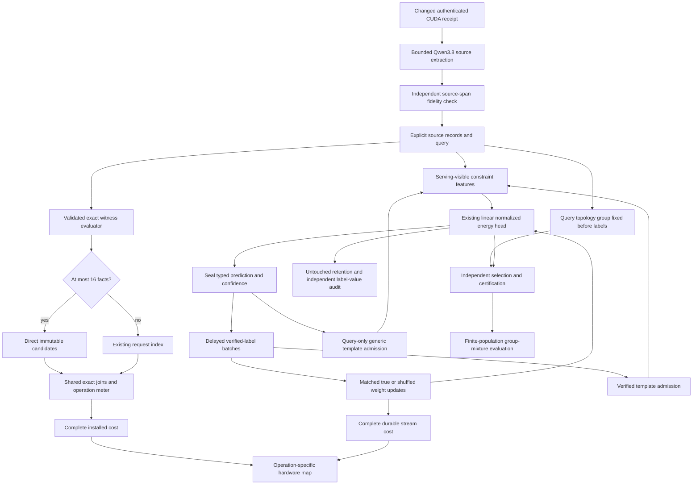

# Carnot Research Roadmap V759: Information, Risk, and Complete Cost

**Created:** 2026-11-06 (America/New_York)
**Milestone:** 2026.11.759
**Title:** Information-specific learning, conditional risk, and size-aware exact verification
**Status:** Proposed; staged only
**Queue:** [research-roadmap-next.yaml](../../research-roadmap-next.yaml)
**Previous authority:** [Preserved V758](research-roadmap-v758-preserved-20261106.md)
**Contract:** Exactly 12 tasks, Exp8866 through Exp8877, in the order below, across four phases.

## What V758 proved

V758 completed twelve producers and one gated skip. The completed archive ends
at V757 at planning time; V758 findings below use primary artifacts, its capstone
and the conductor log. Task completion is separate from scientific benefit.

| Evidence | Qualified finding | Decision for V759 |
|---|---|---|
| [Exp8853](../../results/experiment_8853_v758_branch_contract.json) | Complete contract and original mutation controls passed. CUDA repair receipt absent. | Reuse the contract reader. Keep CPU roots independent. |
| [Exp8854](../../results/experiment_8854_v758_linear_ablation_methods.json), [Exp8856](../../results/experiment_8856_v758_linear_causal_streams.json) | Six linear arms and 27,648 constructed online/retention rows qualified. | Retain head, causal store and original evidence. |
| [Exp8860](../../results/experiment_8860_v758_linear_benefit_audit.json) | Combined-minus-frozen Brier -0.15539; combined-minus-additions-only +0.000292. True versus shuffled interval [-0.05752, 0.00435] includes zero. Future gain, additions and retention pass; correct-label specificity fails. | Match template exposure before testing the information in labels. Test a query-only structural control. |
| [Exp8855](../../results/experiment_8855_v758_selective_ceiling.json), [Exp8857](../../results/experiment_8857_v758_split_certificate_methods.json), [Exp8859](../../results/experiment_8859_v758_split_certificate_evaluation.json) | Finite-population methods qualified. Learned policies issued certificates in all 60 draws and served mean coverage 0.50361 with either protocol. Split-minus-simultaneous coverage is exactly zero. | Test conditional risk under group-mixture changes. Do not repeat split-protocol superiority. |
| [Exp8858](../../results/experiment_8858_v758_installed_indexed_verifier.json), [Exp8861](../../results/experiment_8861_v758_installed_index_cost.json) | Installed exact parity and complete costs qualified. Mixture speed gate passes, but size-16 latency-regression upper bound 0.30179 exceeds 0.05. | Qualify a fixed small-input direct path, then measure complete costs on fresh boundary cases. |
| [Exp8862](../../results/experiment_8862_v758_linear_durable_cost.json), [Exp8864](../../results/experiment_8864_v758_hardware_budget.json) | Complete durable CPU costs and hardware operation map qualified. Compatible component fractions and physical acceleration remain unknown. | Measure new label/lookup work and preserve unknown device fractions. |
| [Exp8863 skip](../../results/experiment_8863_qwen_source_canary.json), [Exp8865](../../results/experiment_8865_v758_capstone.json) | Qwen skipped on runtime readiness zero. All thirteen slots accounted for; capstone terminal blocked. | Admit the optional canary only after changed runtime evidence; capstone always accounts for it. |

These are constructed-data, exact-oracle and CPU results. They do not establish
natural-language generalization, correct-label learning, Rust 10x throughput,
or hardware speedup. V758 did achieve useful constructed certificate coverage;
its null was a protocol-comparison result, not zero coverage.

## Three largest gaps to the PRD

1. **FR-11: identify what information improves later decisions.** Template
   additions nearly match combined learning. The shuffled control also changes
   admission timing. V759 separates generic structural activation from learning
   correct label assignments. It retains untouched retention and real delayed
   feedback. This advances Continuous Self-Learning Tiers 1–2 and the standing
   calibrated typed-decision training requirement.
2. **FR-12: state when verification remains reliable.** A certificate on one
   constructed mixture does not certify every evidence group or extraction.
   V759 fixes observable groups before calibration, changes their prevalence,
   and tests conditional risk. A separate bounded Qwen canary measures source
   fidelity if its external runtime prerequisite changes.
3. **FR-05/08 and NFR-01: make complete verification economical.** Exact
   indexing helps the mixture but does not protect small requests. V759 adds
   one fixed direct-scan boundary and tests the complete installed request.
   Hardware planning uses the new measured operation changes; it does not
   infer accelerator support from an Ising label.

The November 5 operator suspension in CLAUDE.md removes the ARC slot floors.
There are no ARC tasks, live-agent changes or hidden-game solve claims here.

## Research basis and decisions

The [V759 scan](../../research-references.md) was recorded before experiment
construction. It covers all eight requested topics and all secondary channels.

| Source | Local experimental use | Limit |
|---|---|---|
| [Conditional Validity v3](https://arxiv.org/abs/2608.15520v3), October 2026 revision | Exp8868/8870 fix observable groups independently of calibration outcomes and test mixture shifts. | This is a relational adaptation. Within-group drift has no inherited guarantee. |
| [VIGIL](https://arxiv.org/abs/2610.04287), October 2026 | Exp8867/8869/8872/8873 separate delayed updates, future effects and untouched retention. | Matched-label and query-only controls are Carnot's new tests, not the paper's results. |
| [Delayed-feedback reduction](https://arxiv.org/abs/2602.02634), February 2026 | Record exact release timing and parameter movement in the causal stream. | Convex regret guarantees do not transfer to template insertion. |
| [KAN forgetting](https://arxiv.org/abs/2511.12828), November 2025 | Retain explicit retention checks while testing the simpler qualified head. | A new spline head would not resolve the present information confound. |
| [Higher-order FPGA Ising](https://arxiv.org/abs/2610.40522), October 2026 | Exp8876 checks mapping, host work and device-operation compatibility. | Versal PUBO figures cannot establish a KV260 kernel or local speedup. |
| [NFA-constrained generation](https://arxiv.org/abs/2609.40185v2), October 2026 revision | Exp8875 measures source fidelity separately from syntax and exact execution. | No grammar-reprompt or finite-ID transport rerun; no HMM guarantee for Qwen. |

EBT, ARM–EBM, Distributional EBM, PAL, T-SKM-Net, HalluGuard, KAC and
thermodynamic inference were also checked. OpenReview submissions retain their
stated review status. Semantic Scholar citation endpoints were inaccessible;
citation coverage is incomplete. Hugging Face and GitHub were discovery checks,
not evidence of a new relevant trending repository. Extropic and Kona supplied
architectural context, not local runtime access or reproducible Carnot results.

## V759 architecture

All admission occurs between sealed queries. A query-only template encodes a
generic equality join; it cannot store an answer or read a truth label. True and
shuffled learning arms share template exposure. The generator remains frozen.
The default installed indexed path remains available; the new path is opt-in.

## Phase 1: Bind methods and diagnose information — Exp8866–Exp8868

**Exp8866** reuses qualified contract tooling, binds all twelve full task objects,
and ingests the paper-to-method map. It reads only a supplied changed CUDA
receipt. Missing evidence gives readiness zero without a new runtime probe.
This task does not gate independent CPU science or activate a milestone.

**Exp8867** reconstructs all 24 V758 streams. It counts actual query templates
and identifies whether label shuffling changed structural exposure. Six new
development streams qualify matched-template label controls and no-label
admission. Its readiness gate concerns valid diagnosis, not a favorable effect.

**Exp8868** fixes four observable query-topology groups before any labels:
chain, fork, cycle and disconnected. Each has 1,024 worlds, total 4,096. Relevant
query/fact structure separates fit and evaluation; unused marker branches do not.
The seven existing policies remain. Both protocols pay 2,880 labels per replicate.
