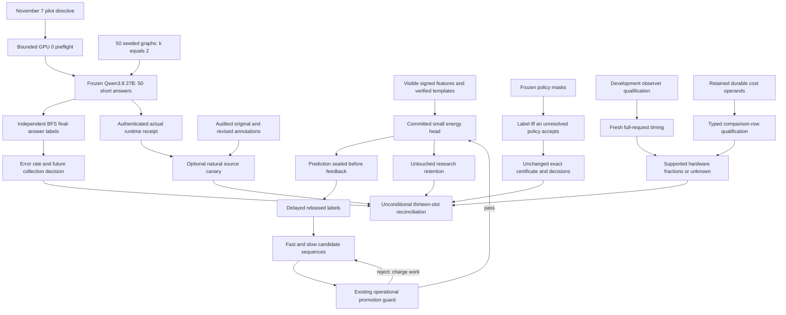
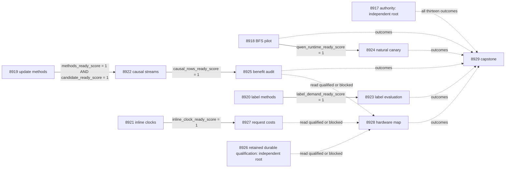

# Carnot Research Roadmap v763: Independent Error Labels, Continuous Energy Updates, and Demand-Driven Verification

**Created:** 2026-11-08 America/New_York  
**Milestone:** 2026.11.763  
**Status:** Planned; staged only  
**Supersedes:** Completed 2026.11.762, Exp8904–Exp8916  
**Task contract:** Exactly 13 tasks, Exp8917 through Exp8929, in the execution order below.  
**Execution file:** `research-roadmap-next.yaml`

Original V762 design and queue bytes are preserved in
`research-roadmap-v762-preserved-20261108.md` and
`research-roadmap-v762-queue-preserved-20261108.yaml`. The completed YAML archive
currently ends at V761. V762 primary artifacts and conductor receipts document
its completed slots. A conductor OK means task execution completed; it does not
mean a positive scientific result. This proposal does not rewrite that history.

## What V762 proved

| Evidence | Qualified finding | Consequence |
|---|---|---|
| Exp8904 | Full thirteen-task authority and CPU checks qualify. Runtime repair receipt is absent. | Keep independent CPU roots. The newer November 7 pilot directive authorizes its own bounded GPU-0 preflight. |
| Exp8905/8909 | Guarded candidate methods and 24 paired streams qualify; 18,432 causal/retention rows are retained. | Valid execution does not establish useful future learning. |
| Exp8911 | Guarded-minus-frozen future Brier mean is -0.0194310; simultaneous upper is -0.00345866, missing <=-0.01. Permuted and ordinary-control upper bounds are +0.000172869 and +0.0187375. Retention passes. | Retire unchanged guard retries. Change candidate optimization while preserving all nine decision bounds. |
| Exp8906/8910 | Safe finite-budget refusal preserves decisions. | All three protocols still spend 4,800 shared labels per replicate. Change which labels are acquired, preserving every policy's accepted-label sequence. |
| Exp8907/8912 | Retained observer custody and complete parent clocks qualify. | Actual overhead now fails the 5% limit. Component fractions remain unqualified; this is no longer a stale-spec failure. |
| Exp8908 | Paired original/revised natural annotations and source custody qualify. | Assisted revisions are not independent blind truth. Keep both criteria in a bounded canary. |
| Exp8913 | Scheduler skip is retained. | No V762 Qwen generation occurred. |
| Exp8914 | Work and owned statement coverage exist. | Strict row lint flags process `control_receipt` scalars as degenerate comparisons; costs remain disqualified pending a producer-boundary repair. |
| Exp8915/8916 | Hardware limits and all thirteen outcomes are accounted for. | No physical acceleration or independent natural generalization is established; the capstone is terminal blocked. |

The November 7 label-provenance audit also invalidates interpretation of the
exp4381-family real-split localization scores: outcome labels were copied to
every prefix. Those scores measure trace structure, not independent error
localization. The operator approved a fifty-question BFS-labeled error pilot in
`ops/known-issues.md`. It is mandatory for this milestone and runs early.

## The three largest gaps to the PRD

1. **FR-12: independently checkable errors from the mandated generator.**
   Constraint execution is stronger than natural extraction and its labels.
   Produce the authorized final-answer graph pilot with a separate BFS labeling
   procedure. Keep the natural-source canary optional and annotation-dependent.
   Neither pilot establishes localization or general natural-language accuracy.
2. **FR-06/FR-11: continuous learning that helps future decisions.**
   Retention is now adequate, but candidate deployment has not passed the full
   future-benefit conjunction. Test interpolated candidate updates inside the
   existing three-class energy head. Predictions precede feedback; operational
   guards and research retention remain separate. Qwen weights remain frozen.
3. **FR-05/FR-08/NFR-01: useful verification at a measured complete cost.**
   Avoid labels no active policy needs without changing certificate decisions.
   Qualify lower-cost timing instrumentation and retained durable costs before
   assigning hardware-compatible fractions. A 10x whole-service target remains
   unproved; a hypothetical 100x kernel is not a service result.

## Literature incorporated before design

The V763 section of `research-references.md` was recorded before task design.
It covers all eight requested topic families and all six secondary channels.

| Source | Method transferred and limit | Experiments |
|---|---|---|
| [ImplicitHop](https://arxiv.org/abs/2610.41169), October 2026 | Independent seeded graph questions and exact final-answer labels; no prediction of Qwen error rate or step labels. | 8918 |
| [SPIN](https://arxiv.org/abs/2610.27835), October 2026 | Fast/slow parameter interpolation for the existing small candidate head; no imported image-task result or curvature guarantee. | 8919, 8922, 8925 |
| [Prediction-Powered Active Testing](https://arxiv.org/abs/2607.08347), July 2026 | Distinguish cheap policy work from label purchases. Local method uses exact accepted-label identity, not PPAT's estimator or asymptotic bounds. | 8920, 8923 |
| [History and evaluator drift](https://arxiv.org/abs/2609.32267), September 2026 | Historical evidence may guide development, but current labels establish current claims. | 8919, 8920, 8925 |
| [RT4CHART](https://arxiv.org/abs/2603.27752), March 2026 | Evidence-relative decisions with spans; original/revised annotations remain separate and dependent. | 8924 |
| [FPGA–ASIC co-design](https://arxiv.org/abs/2602.15985), revised September 2026 | Charge orchestration and transfer before interpreting kernel speed. | 8921, 8927, 8928 |

EBT/ARM–EBM, KAN-CL, neural Ising machines, algebraic constraint layers and
energy-guided decoding remain useful background. No new foundation model,
sampler, decoder or dependency is justified by these immediate findings.
OpenReview manuscripts were checked with venue limits intact. Semantic Scholar
returned ten ARM–EBM citing entries and HTTP 429 for EBT; citation coverage is
partial. Hugging Face and GitHub were checked without inferring a new relevant
trending ranking. Extropic and Kona descriptions are vendor claims, not local
hardware access or reproducible Carnot architecture evidence.

## Architecture



Small-head training uses `no_model_load`: it performs fresh numerical updates,
not pretrained LLM loading. The two Qwen tasks use
`model_bounded_generation` (10-second floor), because each has a small fixed
completion budget. Full generation (60 seconds) and load-only/embeddings
(2 seconds) are not scheduled. Duration floors never authorize artificial waits.
The mandated generator appears in both tasks' `MODEL_SPECS`.

## Phase 1 — independent labels and fixed methods (Exp8917–Exp8920)

Exp8917 binds the entire authority and ingests the method map. CPU science checks
its own inputs and is not success-gated on this administrative task.
Exp8918 runs exactly fifty distinct graphs: mean degree three, 50–60 nodes,
two-letter names, k=2, reasoning off, sixteen output tokens at most. No repair,
new detector, k sweep, full error collection or generator update is included.
The empirical source gate is at least ten errors among fifty completed answers;
runtime failures are censored, not reasoning errors. GPU 1 remains detached.

Exp8919 implements one fixed SPIN-style update: interpolate fast/slow parameters,
take one existing-objective gradient, then update the slow sequence. Alpha=0.25
and beta=0.5 are fixed; the existing learning rate, guard, features and template
rules stay fixed. Eight development streams precede twenty-four unseen streams.
All arms have matched label information and gradient-call budgets.

Exp8920 proves label-on-demand correctness. Selection still costs 240 labels per
group. All seven policies, four groups, 960 certification candidates, original
looks and risk allocation remain. A rejected candidate needs no label unless
another unresolved policy accepts it. Policy evaluation still costs compute.
Exhaustive small cases must preserve each accepted-label sequence, registered
counts and final decisions. This is a new acquisition mechanism, not relaxed risk.

## Phase 2 — qualify measurement and collect evidence (Exp8921–Exp8924)

Exp8921 removes observer allocations/callback overhead using preallocated numeric
timestamps and deferred receipt construction. It keeps the original disjoint
phase boundaries and per-request denominator. Development overhead must pass
the original 5% ceiling before future worlds open.

Exp8922 collects four-arm continuous learning on the sealed future streams.
Exp8923 compares eager and demand label acquisition on forty fresh draw streams;
the all-policy union is the primary cost endpoint. Exp8924 runs only after the
pilot supplies validated actual Qwen offload/generation. It rechecks current
GPU-0 availability and source custody, then uses the existing natural canary
manifest with at most 128 output tokens per case and no retries. Its original
and revised annotation scores cannot establish independent natural truth.

## Phase 3 — future benefit and complete costs (Exp8925–Exp8927)

Exp8925 independently recomputes nine simultaneous bounds from whole-stream pairs.
On query ordinals 25–48, interpolated true-label Brier must beat frozen by at
least 0.01, and beat both permuted labels and ordinary guarded updates strictly.
At checkpoints 0/24/48, Brier and typed-error degradation must be <=0.01.
Family alpha is 0.01; no post-hoc weaker threshold or larger sample is allowed.

Exp8926 repairs the owned durable artifact representation while preserving all
original receipt bytes. Process receipts remain auditable outside scientific
comparison rows. Unchanged strict lint and deliberate bad comparisons must both
work. This qualifies historical guarded costs only; it does not measure the new
optimizer or authorize a speed-quality claim. No expensive rerun is scheduled.

Exp8927 retains the original 24-world, 36-cell future request workload. Parent
clocks can qualify even if attribution fails. Component fractions require
semantic identity, disjoint closure and every simultaneous overhead upper <=5%.

## Phase 4 — hardware consequences and reconciliation (Exp8928–Exp8929)

Both tasks run unconditionally. Missing upstream science cannot suppress the
hardware limitations or the capstone. Exp8928 maps only qualified operations
and timings; unmeasured fractions stay unknown. Exp8929 counts all thirteen slots,
keeps denominators separate and emits stable G1–G4 publication gates. An external
block is terminal `blocked`, not a retryable `partial`. It recommends, but does
not execute, a larger error collection if the pilot earns that next step.

## Dependency graph and exact gate fields



Solid edges are the complete six structured `gated_on` conditions in the YAML;
the learning edge has two conditions. Dashed edges are unconditional accounting,
not scheduling gates. Every gate producer exists earlier in this roadmap and
names the exact field in its own REQUIRED ARTIFACT FIELDS. Prior completed
artifacts are authenticated inputs, not `requires` chains to retired tasks.
The natural canary needs runtime success, not a high graph error rate.

## Hardware requirements and acceleration paths

| Work | Local substrate and budget | Boundary |
|---|---|---|
| 8918 BFS pilot | CPU graph construction; one GPU-0 lease, cached approximately 16-GB Q4_K_M GGUF on RTX 3090 24 GB | Cache, offload support and free GPU must pass. Maximum 50 short generations; GPU 1 is detached. No repair/install fallback. |
| 8924 natural canary | Same mandated Qwen on GPU 0; existing sealed manifest, max 128 tokens per case, inference ceiling 1800 seconds | Reacquire lease; actual runtime receipt and source custody required. No new corpus or annotation service. |
| 8919/8922/8925 | CPU small-head vector arithmetic and system memory; bounded streams, persisted state | Tier 1 learning at query time; measure gradients, guard work and persistence. No 27B weight updates. |
| 8920/8923 | CPU exact bounds, policy masks and oracle label provider | Charge label requests and cheap evaluations separately; no MCMC. |
| 8921/8926/8927 | CPU clocks and filesystem; existing private CLI and retained operands | Validation and receipt serialization stay outside timed regions but inside the reported complete task cost. |
| 8928 portfolio map | CPU read-only analysis | KV260 quadratic Ising `k_max<=5`; PolarFire Linux CPU dispatch; GateMate JTAG `0xffffffff` remains a physical block. No device probe or flash. |
| Future wishlist | KV260 supported kernel, verified GPU/NPU batching, authenticated TSU access | Acquire evidence before equipment. Larger FPGA, NPU and TSU purchases are not prerequisites or approved work. |

The PRD's acceleration path is explicit: counters/memory remain on CPU, batched
small-energy arithmetic can map to GPU/NPU, and supported Ising sampling can map
to KV260/TSU. No sampling acceleration is assigned to exact normalization or BFS.
For measured compatible fraction f, the hypothetical 100x-kernel service ceiling
is `1 / ((1-f) + f/100)`. Missing f stays null. Host, transfer and durability costs
remain in the denominator. New optimizer operation counts are not timings.

Each task budgets at most 60 minutes for work and validation; all prompts reserve
margin below 4,800 seconds and demand heartbeats at least every 60 seconds. Every
phase, model load, generation, benchmark and potentially long subprocess has a
flushed before/after line. Files over about 200 lines are written in separate
tool calls with progress between them. Neither more turns nor a duration estimate
can compensate for a 600-second silence gap.

## Execution, failure discipline and scope

- Formulaic verifier, optimizer and measurement code uses `agent_type: codex`,
  `model: gpt-6.1-sol`, per the current planning instruction. Judgment tasks keep
  Sonnet. The contract/schema task routes to Opus with 100 turns. Small audits
  use 20 turns; the focused durable repair uses 30. No Luna experiment is used.
- Scope-matched continuations name the exact prior verdict, changed mechanism and
  `retire_if_same_verdict: true`. No retired ID is reused. The pilot cites the
  November 7 directive for its newly authorized bounded preflight.
- `per_unit_rows: true` is set on every task. Raw rows and immutable source hashes
  reconstruct every comparison; receipt metadata is not an arm contrast.
- Readiness is separate from scientific benefit. Oracle-derived success uses
  `circular_positive`; all artifacts carry the closed `verdict_class` enum.
  Missing external inputs require exact `gate_check_summary` diagnostics.
- ARC stays suspended. There is no hidden-game task, offline game solver, detector
  training on the pilot, step localization, full error collection, generator
  fine-tuning, external publication, milestone activation or push.
- The active roadmap, research conductor and exclusion manifest remain unchanged.
  Original artifacts and historical claims are preserved with explicit limits.

## Validation plan

Before staging is reported complete, compare the visible table, full machine
contract and YAML task objects; validate schema, gate producer fields, model
substrates, prior-failure completeness, exclusions and the mandatory BFS slot.
Run existing roadmap/gate unit checks, scoped lint/spec tracing and applicable
private E2E-018/021 CLI tests. Check protected hashes and preserve unrelated work.
No experimental producer, model load or hardware probe runs during planning.
Planning results are appended below after validation; future experiment tests
remain planned and are not claimed as executed.

## Exact task contract

This table and the embedded full objects describe exactly the execution YAML.
The machine block includes full prompts, routes, priors and gates; it is not a
shorter aspirational summary. There are exactly 13 tasks, Exp8917–Exp8929.

| Order | Task ID | Title | Phase | Deliverable |
|---|---|---|---|---|
| 1 | `exp8917-branch-contract` | Bind V763 authority and the operator-directed evidence plan | 1 | `results/experiment_8917_v763_branch_contract.json` |
| 2 | `exp8918-bfs-error-pilot` | Measure the mandated fifty-question BFS-labeled error pilot | 1 | `results/experiment_8918_v763_bfs_error_pilot.json` |
| 3 | `exp8919-interpolated-update-methods` | Freeze interpolated candidate updates for continuous energy learning | 1 | `results/experiment_8919_v763_interpolated_update_methods.json` |
| 4 | `exp8920-label-demand-methods` | Prove exact certificates with labels requested only when needed | 1 | `results/experiment_8920_v763_label_demand_methods.json` |
| 5 | `exp8921-inline-clock-methods` | Qualify allocation-free phase timing for complete requests | 2 | `results/experiment_8921_v763_inline_clock_methods.json` |
| 6 | `exp8922-interpolated-causal-streams` | Measure continuous interpolated learning on sealed future streams | 2 | `results/experiment_8922_v763_interpolated_causal_streams.json` |
| 7 | `exp8923-label-demand-evaluation` | Measure shared label savings with unchanged certificate decisions | 2 | `results/experiment_8923_v763_label_demand_evaluation.json` |
| 8 | `exp8924-qwen-natural-canary` | Measure source-relative Qwen decisions after a successful live pilot | 2 | `results/experiment_8924_v763_qwen_natural_canary.json` |
| 9 | `exp8925-interpolated-benefit-audit` | Audit prospective interpolation benefit and untouched retention | 3 | `results/experiment_8925_v763_interpolated_benefit_audit.json` |
| 10 | `exp8926-durable-cost-qualification` | Qualify retained durable costs with correctly typed comparison rows | 3 | `results/experiment_8926_v763_durable_cost_qualification.json` |
| 11 | `exp8927-inline-request-cost` | Measure full request costs with the qualified inline observer | 3 | `results/experiment_8927_v763_inline_request_cost.json` |
| 12 | `exp8928-hardware-operation-budget` | Map qualified new operations to supported hardware limits | 4 | `results/experiment_8928_v763_hardware_operation_budget.json` |
| 13 | `exp8929-capstone` | Reconcile thirteen outcomes and decide the next evidence requirements | 4 | `results/experiment_8929_v763_capstone.json` |

<!-- V763_TASK_CONTRACT_START -->
```json
{
  "milestone": "2026.11.763",
  "milestone_title": "Independent Error Labels, Continuous Energy Updates, and Demand-Driven Verification",
  "milestone_doc": "openspec/change-proposals/research-roadmap-vNEXT.md",
  "tasks": [
    {
      "id": "exp8917-branch-contract",
      "title": "Bind V763 authority and the operator-directed evidence plan",
      "phase": 1,
      "track": "research",
      "priority": "high",
      "requires_gpu": false,
      "max_turns": 100,
      "estimated_wall_time_min": 35,
      "per_unit_rows": true,
      "milestone": "2026.11.763",
      "deliverable": "results/experiment_8917_v763_branch_contract.json",
      "inference_substrate_class": "no_model_load",
      "MODEL_SPECS": [],
      "gated_on": [],
      "prior_failures": [
        {
          "experiment_id": "exp8891-branch-contract",
          "verdict": "complete_disqualified_v761_branch_contract",
          "addressed_by": "Reuse the now-qualified V762 contract path and validate owned formatting before terminal V763 publication; do not repeat the earlier failing runner.",
          "retire_if_same_verdict": true
        }
      ],
      "model": "opus",
      "prompt": "CONTEXT:\nV762 completed all thirteen slots, with valid nulls, a skipped Qwen canary and one disqualified cost producer. The archive currently ends at V761; original V762 artifacts and conductor receipts are authoritative. The November 7 BFS pilot is mandatory and overrides passive runtime-receipt inspection for that slot only.\n\nEXISTING CODE TO READ FIRST:\n- CLAUDE.md\n- CODEX.md\n- research-program.md\n- openspec/capabilities/research-reporting/spec.md\n- openspec/change-proposals/research-roadmap-vNEXT.md\n- scripts/experiment_template.py\n- python/carnot/reporting/current_work_receipt.py\n- python/carnot/reporting/primary_publication.py\n- ops/e2e-test-plan.md\n- python/carnot/reporting/roadmap_contract.py\n- python/carnot/reporting/v762_branch_contract.py\n- tests/python/test_v762_branch_contract_8904.py\n- ops/known-issues.md\n- research-references.md\n- results/experiment_8916_v762_capstone.json\n\nTASK:\nBind V763 authority and the operator-directed evidence plan. Deliver results/experiment_8917_v763_branch_contract.json for 2026.11.763.\n\nCONCRETE STEPS:\n1. Read the listed sources and REQ-REPORT-8917 / SCENARIO-REPORT-8917-CONTRACT. Authenticate gates before expensive work. Missing external inputs are terminal blocked; failed owned controls are disqualified. Work in {project_root}; preserve historical artifacts.\n2. Emit a flushed progress line at every phase boundary and before and after every model load, generation, benchmark or subprocess that can take minutes. Use python -u and print(..., flush=True); forward child output and print completed/pending counts at least every 60 seconds inside long loops and subprocess supervision. Keep every silence gap below 600 seconds, including work between tool calls. The hard cap remains 4800 seconds; plan work plus checks below 4200 seconds.\n3. Keep every tool call bounded. Write any file over about 200 lines in several tool calls of at most 150-200 lines, with a progress message between calls. Use scripts/experiments/ for real experiment scripts, tests/python/ for tests and /tmp for scratch. Never create scratch files in the repository root.\n4. Compare the visible table, embedded full task objects and staged-or-activated YAML for exactly Exp8917-Exp8929 in order, including prompts, routes, gates, priors and paths. Retain immutable snapshots. Accept the matching activated queue when activation consumed the staged file. Preserve V762 design and queue archives; do not reinterpret a stale archive as missing completed work.\n5. Reuse the contract reader and test mutations of task order, prompts, gate producer fields, routes and paths. Map ImplicitHop, SPIN, active-testing label accounting and hardware orchestration to the exact tasks and limits. This is administrative ingestion, not science. No CUDA probe belongs here; the pilot owns the authorized live preflight. CPU branches perform their own custody checks and do not depend on contract_ready_score.\n6. Extend the named REQ/SCENARIO before implementation and write failing tests first. Reuse the existing helpers and ExperimentTemplate; do not clone a whole prior runner. Preserve original producer assertions and retained operands. Run scoped pytest with measured 100-percent owned unit/child statement coverage and zero exclusions, Ruff check and format --check, strict mypy and scripts/check_spec_coverage.py with positional test paths. Run applicable private E2E-018/021 CLI tests and the new actual CLI with cold replay outside the checkout without PYTHONPATH. Native changes also need E2E-003/004 and cargo test/fmt/clippy. Run unchanged adversarial_verify.py and verdict_row_consistency_lint.py --strict on the prospective artifact. Keep raw receipts and executed-source hashes; publish the terminal primary only after owned checks. Separate unrelated repository health. Reconcile openspec/, _bmad/traceability.md, ops/status.md and ops/changelog.md. Do not activate milestones, edit shared validators or the exclusion manifest, publish externally, or claim an experiment ran from fixtures.\n\nREQUIRED ARTIFACT FIELDS:\nexperiment_id, task_id, milestone, run_date: principle: bind the producer to this invocation and {date}.\nhonest_verdict: terminal complete_ or complete: prefix; principle: completion is not scientific benefit. Every blocked_* outcome includes gate_check_summary.\nverdict_class: positive | circular_positive | null | blocked | disqualified | partial; principle: partial retries unfinished OWN work only; unchanged external absence is blocked. verifier_is_oracle=true forbids positive; an oracle-positive result is circular_positive. A failed owned acceptance gate forbids a positive class.\ninference_substrate, inference_substrate_class, execution_venue, MODEL_SPECS, model_invocation_counts, numerical_training_calls: principle: distinguish actual compute, small-head numerical training, model loading and blocked_no_run. Never pad duration to a floor.\nverifier_is_oracle, exposure_scope, independent_generalization_score: principle: constructed oracle truth and assisted annotations do not establish independent natural-language generalization.\nduration_s, phase_spans, preconditions_checked, random_seed, reproducibility_checksum: principle: record bounded actual work and frozen methods.\nsource_artifact_hashes, code_config_hashes, raw_shard_hashes, cited_upstream_artifacts: principle: authenticate original producer identities and bytes, not current replacement files.\nrows: principle: retain each compared unit with unit_id, cluster_id, arm, seed, metric, denominator, status and missing_reason. Every comparative headline must reduce from these rows; keep administrative execution receipts outside comparative rows with their content-addressed references preserved.\nintended_count, completed_count, failed_count, censored_count, excluded_count, independent_count: principle: retain all scheduled units; repeated queries or cost repeats do not inflate independent n.\ngate_check_summary: principle: every blocked outcome names check, upstream, artifact_field, expected, observed, path and hash; distinguish missing_file, missing_field, rejected_producer and observed_zero.\nacceptance_gates, required_checks_passed, validation_receipts, owned_statement_coverage, field_principles: principle: separate readiness from scientific benefit and explain the evidential scope of every extra field.\ncontract_ready_score: integer 0/1; principle: complete matched immutable authority and owned validation only.\ncontract_rows, full_task_digest, execution_snapshot, literature_method_rows, operator_directive_reference: principle: preserve all thirteen task objects and the pilot scope.\n\nRun command: cd {project_root} && .venv/bin/python -u scripts/experiments/experiment_8917_v763_branch_contract.py --date {date}\nDo NOT push. Do NOT modify scripts/research_conductor.py."
    },
    {
      "id": "exp8918-bfs-error-pilot",
      "title": "Measure the mandated fifty-question BFS-labeled error pilot",
      "phase": 1,
      "track": "research",
      "priority": "high",
      "requires_gpu": true,
      "max_turns": 50,
      "estimated_wall_time_min": 50,
      "per_unit_rows": true,
      "milestone": "2026.11.763",
      "deliverable": "results/experiment_8918_v763_bfs_error_pilot.json",
      "inference_substrate_class": "model_bounded_generation",
      "MODEL_SPECS": [
        {
          "hf_id": "unsloth/Qwen3.8-27B-GGUF",
          "format": "GGUF",
          "quantization": "Q4_K_M"
        }
      ],
      "gated_on": [],
      "prior_failures": [
        {
          "experiment_id": "exp8382-runtime-evidence-delta",
          "verdict": "complete_blocked_cuda_environment_unchanged",
          "addressed_by": "The November 7 mandatory pilot directive explicitly authorizes a bounded fresh GPU-0 preflight and real generation; it replaces unchanged passive evidence inspection for this task only.",
          "retire_if_same_verdict": true
        }
      ],
      "agent_type": "codex",
      "model": "gpt-6.1-sol",
      "prompt": "CONTEXT:\nMANDATORY-NEXT-MILESTONE directive in ops/known-issues.md, November 7, 2026: run the approved 50-question k=2 pilot through the conductor. Existing outcome-derived prefix labels do not establish independent localization. This task establishes final-answer errors only, with no detector and no full collection.\n\nEXISTING CODE TO READ FIRST:\n- CLAUDE.md\n- CODEX.md\n- research-program.md\n- openspec/capabilities/research-reporting/spec.md\n- openspec/change-proposals/research-roadmap-vNEXT.md\n- scripts/experiment_template.py\n- python/carnot/reporting/current_work_receipt.py\n- python/carnot/reporting/primary_publication.py\n- ops/e2e-test-plan.md\n- docs/research-notes/bfs-labeled-error-source-plan-2026-11-07.md\n- docs/research-notes/label-provenance-audit-step1-2026-11-07.md\n- docs/research-notes/implicithop-knowledge-integration-2026-11-06.md\n- python/carnot/verify/gguf_inference.py\n- python/carnot/inference/sota_models.py\n- ops/known-issues.md\n\nTASK:\nMeasure the mandated fifty-question BFS-labeled error pilot. Deliver results/experiment_8918_v763_bfs_error_pilot.json for 2026.11.763.\n\nCONCRETE STEPS:\n1. Read the listed sources and REQ-REPORT-8918 / SCENARIO-REPORT-8918-CONTRACT. Authenticate gates before expensive work. Missing external inputs are terminal blocked; failed owned controls are disqualified. Work in {project_root}; preserve historical artifacts.\n2. Emit a flushed progress line at every phase boundary and before and after every model load, generation, benchmark or subprocess that can take minutes. Use python -u and print(..., flush=True); forward child output and print completed/pending counts at least every 60 seconds inside long loops and subprocess supervision. Keep every silence gap below 600 seconds, including work between tool calls. The hard cap remains 4800 seconds; plan work plus checks below 4200 seconds.\n3. Keep every tool call bounded. Write any file over about 200 lines in several tool calls of at most 150-200 lines, with a progress message between calls. Use scripts/experiments/ for real experiment scripts, tests/python/ for tests and /tmp for scratch. Never create scratch files in the repository root.\n4. PRECONDITIONS FIRST: locate and hash the cached unsloth/Qwen3.8-27B-GGUF Q4_K_M through existing cache helpers; require llama_cpp.llama_supports_gpu_offload() is True and GPU 0 is free under the existing allocation lock. GPU 1 is detached: do not inspect, allocate or use it. Set CARNOT_FORCE_LIVE=1 and CUDA_VISIBLE_DEVICES=0. Bound preflight and model load at 240 seconds each with supervision; on failure write complete_blocked_<resource>, verdict_class=blocked, gate_check_summary and qwen_runtime_ready_score=0. No installation, reboot, CPU fallback or device repair. The November 7 directive authorizes this fresh check; do not require the old absent repair-receipt file.\n5. Generate and seal exactly 50 independent Erdos-Renyi undirected simple graphs, n uniformly 50 through 60, edge probability 3/(n-1), unique random two-letter node labels and one seed per graph. Choose a start with a nonempty exact-distance-2 set before inference; record any graph resampling. Ask only name a node exactly 2 hops from X. Keep graph edges, start, prompt and expected-set hashes. Validate BFS against hand graphs and an independent adjacency-matrix distance check on small graphs; shortest distance is required, not merely existence of a length-two walk.\n6. Run the frozen mandated generator with reasoning off, one answer per graph, no repair, no grammar steering, max_tokens=16, temperature=0 and at most 30 seconds per question. Seal exact chat template/settings before launch. Record actual GPU offload, GGUF hash, tokens and per-call durations. Use model_bounded_generation (10-second floor), not full generation; no artificial sleep. Print a flushed line per 10 questions plus timed heartbeats during every load/call. Stop at the pilot budget; retain all failed/censored slots.\n7. Label each produced answer by BFS using a predeclared single-node parser. Missing, ambiguous or out-of-graph answers are generated errors; runtime failures are separately censored and cannot be counted as reasoning errors. Require all 50 completed generations for pilot_ready_score=1. Report n_errors/50, a binomial interval and pilot_error_gate_score=1 iff at least 10 errors. Below 20 percent use complete: pilot_error_rate_below_gate, verdict_class=null; recommend a future k/size change but do not execute it. A passed error-source gate is circular_positive with verifier_is_oracle=true, never detector benefit. qwen_runtime_ready_score requires authenticated actual offload and generation plus owned validation, independently of the error-rate gate.\n8. Extend the named REQ/SCENARIO before implementation and write failing tests first. Reuse the existing helpers and ExperimentTemplate; do not clone a whole prior runner. Preserve original producer assertions and retained operands. Run scoped pytest with measured 100-percent owned unit/child statement coverage and zero exclusions, Ruff check and format --check, strict mypy and scripts/check_spec_coverage.py with positional test paths. Run applicable private E2E-018/021 CLI tests and the new actual CLI with cold replay outside the checkout without PYTHONPATH. Native changes also need E2E-003/004 and cargo test/fmt/clippy. Run unchanged adversarial_verify.py and verdict_row_consistency_lint.py --strict on the prospective artifact. Keep raw receipts and executed-source hashes; publish the terminal primary only after owned checks. Separate unrelated repository health. Reconcile openspec/, _bmad/traceability.md, ops/status.md and ops/changelog.md. Do not activate milestones, edit shared validators or the exclusion manifest, publish externally, or claim an experiment ran from fixtures.\n\nREQUIRED ARTIFACT FIELDS:\nexperiment_id, task_id, milestone, run_date: principle: bind the producer to this invocation and {date}.\nhonest_verdict: terminal complete_ or complete: prefix; principle: completion is not scientific benefit. Every blocked_* outcome includes gate_check_summary.\nverdict_class: positive | circular_positive | null | blocked | disqualified | partial; principle: partial retries unfinished OWN work only; unchanged external absence is blocked. verifier_is_oracle=true forbids positive; an oracle-positive result is circular_positive. A failed owned acceptance gate forbids a positive class.\ninference_substrate, inference_substrate_class, execution_venue, MODEL_SPECS, model_invocation_counts, numerical_training_calls: principle: distinguish actual compute, small-head numerical training, model loading and blocked_no_run. Never pad duration to a floor.\nverifier_is_oracle, exposure_scope, independent_generalization_score: principle: constructed oracle truth and assisted annotations do not establish independent natural-language generalization.\nduration_s, phase_spans, preconditions_checked, random_seed, reproducibility_checksum: principle: record bounded actual work and frozen methods.\nsource_artifact_hashes, code_config_hashes, raw_shard_hashes, cited_upstream_artifacts: principle: authenticate original producer identities and bytes, not current replacement files.\nrows: principle: retain each compared unit with unit_id, cluster_id, arm, seed, metric, denominator, status and missing_reason. Every comparative headline must reduce from these rows; keep administrative execution receipts outside comparative rows with their content-addressed references preserved.\nintended_count, completed_count, failed_count, censored_count, excluded_count, independent_count: principle: retain all scheduled units; repeated queries or cost repeats do not inflate independent n.\ngate_check_summary: principle: every blocked outcome names check, upstream, artifact_field, expected, observed, path and hash; distinguish missing_file, missing_field, rejected_producer and observed_zero.\nacceptance_gates, required_checks_passed, validation_receipts, owned_statement_coverage, field_principles: principle: separate readiness from scientific benefit and explain the evidential scope of every extra field.\npilot_ready_score, pilot_error_gate_score, qwen_runtime_ready_score: integer 0/1; principle: completed pilot, sufficient error rate and actual GPU execution are separate gates.\nn_questions, n_errors, error_rate, error_interval, model_specs, graph_manifest, generator_settings, model_receipt, resource_lease, answer_rows: principle: exactly fifty final-answer labels; no localization or natural-generalization claim. inference_substrate=live_llm_inference for actual runs.\n\nRun command: cd {project_root} && .venv/bin/python -u scripts/experiments/experiment_8918_v763_bfs_error_pilot.py --date {date}\nDo NOT push. Do NOT modify scripts/research_conductor.py.",
      "operator_override": "ops/known-issues.md MANDATORY-NEXT-MILESTONE 2026-11-07 and approved BFS pilot plan authorize one bounded fresh GPU-0 preflight and fifty generations; no old runtime-probe scope is reopened beyond that pilot."
    },
    {
      "id": "exp8919-interpolated-update-methods",
      "title": "Freeze interpolated candidate updates for continuous energy learning",
      "phase": 1,
      "track": "research",
      "priority": "high",
      "requires_gpu": false,
      "max_turns": 50,
      "estimated_wall_time_min": 60,
      "per_unit_rows": true,
      "milestone": "2026.11.763",
      "deliverable": "results/experiment_8919_v763_interpolated_update_methods.json",
      "inference_substrate_class": "no_model_load",
      "MODEL_SPECS": [],
      "gated_on": [],
      "prior_failures": [
        {
          "experiment_id": "exp8911-guarded-benefit-audit",
          "verdict": "complete_null_guarded_benefit_audit",
          "addressed_by": "Change the candidate optimizer to coupled fast/slow parameter interpolation, retaining signed features, promotion rules and all nine evaluation thresholds.",
          "retire_if_same_verdict": true
        }
      ],
      "agent_type": "codex",
      "model": "gpt-6.1-sol",
      "prompt": "CONTEXT:\nExp8911 passed retention but failed all three future-benefit contrasts. SPIN (arXiv 2610.27835, equations 7-9) changes how candidates learn rather than loosening the promotion guard. This is Tier 1 continuous self-learning and advances the calibrated-decision training floor; no generator training is authorized.\n\nEXISTING CODE TO READ FIRST:\n- CLAUDE.md\n- CODEX.md\n- research-program.md\n- openspec/capabilities/research-reporting/spec.md\n- openspec/change-proposals/research-roadmap-vNEXT.md\n- scripts/experiment_template.py\n- python/carnot/reporting/current_work_receipt.py\n- python/carnot/reporting/primary_publication.py\n- ops/e2e-test-plan.md\n- python/carnot/memory/guarded_memory_8905.py\n- python/carnot/memory/signed_memory_8892.py\n- python/carnot/memory/causal_memory_8802.py\n- python/carnot/reporting/guarded_update_methods_8905.py\n- python/carnot/reporting/guarded_benefit_audit_8911.py\n- results/experiment_8911_v762_guarded_benefit_audit.json\n- research-references.md\n\nTASK:\nFreeze interpolated candidate updates for continuous energy learning. Deliver results/experiment_8919_v763_interpolated_update_methods.json for 2026.11.763.\n\nCONCRETE STEPS:\n1. Read the listed sources and REQ-REPORT-8919 / SCENARIO-REPORT-8919-CONTRACT. Authenticate gates before expensive work. Missing external inputs are terminal blocked; failed owned controls are disqualified. Work in {project_root}; preserve historical artifacts.\n2. Emit a flushed progress line at every phase boundary and before and after every model load, generation, benchmark or subprocess that can take minutes. Use python -u and print(..., flush=True); forward child output and print completed/pending counts at least every 60 seconds inside long loops and subprocess supervision. Keep every silence gap below 600 seconds, including work between tool calls. The hard cap remains 4800 seconds; plan work plus checks below 4200 seconds.\n3. Keep every tool call bounded. Write any file over about 200 lines in several tool calls of at most 150-200 lines, with a progress message between calls. Use scripts/experiments/ for real experiment scripts, tests/python/ for tests and /tmp for scratch. Never create scratch files in the repository root.\n4. Add the smallest opt-in candidate optimizer to the existing store: x=(1-beta)*fast+beta*slow; fast_next=fast-eta*grad(loss(x)); slow_next=slow+alpha*(fast_next-slow). Freeze alpha=0.25, beta=0.5 and the existing eta, signed features, normalized three-class objective, template additions, feedback delays, guard split, promotion schedule and anchor thresholds. The candidate submitted to the unchanged guard is slow_next. Persist both sequences and their update count atomically; reject schema mixing and nonfinite inputs. Keep default behavior unchanged. No hyperparameter sweep.\n5. Freeze four matched arms: frozen_verified, guarded_true (V762 optimizer), interpolated_true and interpolated_permuted. All arms receive the same query work; both adaptive true-label arms receive exactly the same released training/guard information and gradient-call budget. Permute only already released training labels within allowed blocks; never read future labels. Seal predictions before label release. Preserve pre-release templates and the untouched research retention set.\n6. Test the update against scalar analytic and finite-difference controls, alpha=1/beta=0 reduction to the base step, zero-gradient behavior, future-label refusal, duplicate release and cold restart including both sequences. Run eight development-only paired streams with 48 queries each and fixed seeds 763100-763107. Open no evaluation labels. Require a finite trained candidate with changed parameters, mean future Brier improvement <=-0.01 over frozen and development retention degradation <=0.01 for candidate_ready_score=1; methods_ready_score depends on correctness only. Seal 24 future seeds 763200-763223 and the nine-bound evaluation plan even on pilot null. Hardware path is CPU vector arithmetic and persistence, with a later GPU/NPU kernel only if measured costs justify it.\n7. Extend the named REQ/SCENARIO before implementation and write failing tests first. Reuse the existing helpers and ExperimentTemplate; do not clone a whole prior runner. Preserve original producer assertions and retained operands. Run scoped pytest with measured 100-percent owned unit/child statement coverage and zero exclusions, Ruff check and format --check, strict mypy and scripts/check_spec_coverage.py with positional test paths. Run applicable private E2E-018/021 CLI tests and the new actual CLI with cold replay outside the checkout without PYTHONPATH. Native changes also need E2E-003/004 and cargo test/fmt/clippy. Run unchanged adversarial_verify.py and verdict_row_consistency_lint.py --strict on the prospective artifact. Keep raw receipts and executed-source hashes; publish the terminal primary only after owned checks. Separate unrelated repository health. Reconcile openspec/, _bmad/traceability.md, ops/status.md and ops/changelog.md. Do not activate milestones, edit shared validators or the exclusion manifest, publish externally, or claim an experiment ran from fixtures.\n\nREQUIRED ARTIFACT FIELDS:\nexperiment_id, task_id, milestone, run_date: principle: bind the producer to this invocation and {date}.\nhonest_verdict: terminal complete_ or complete: prefix; principle: completion is not scientific benefit. Every blocked_* outcome includes gate_check_summary.\nverdict_class: positive | circular_positive | null | blocked | disqualified | partial; principle: partial retries unfinished OWN work only; unchanged external absence is blocked. verifier_is_oracle=true forbids positive; an oracle-positive result is circular_positive. A failed owned acceptance gate forbids a positive class.\ninference_substrate, inference_substrate_class, execution_venue, MODEL_SPECS, model_invocation_counts, numerical_training_calls: principle: distinguish actual compute, small-head numerical training, model loading and blocked_no_run. Never pad duration to a floor.\nverifier_is_oracle, exposure_scope, independent_generalization_score: principle: constructed oracle truth and assisted annotations do not establish independent natural-language generalization.\nduration_s, phase_spans, preconditions_checked, random_seed, reproducibility_checksum: principle: record bounded actual work and frozen methods.\nsource_artifact_hashes, code_config_hashes, raw_shard_hashes, cited_upstream_artifacts: principle: authenticate original producer identities and bytes, not current replacement files.\nrows: principle: retain each compared unit with unit_id, cluster_id, arm, seed, metric, denominator, status and missing_reason. Every comparative headline must reduce from these rows; keep administrative execution receipts outside comparative rows with their content-addressed references preserved.\nintended_count, completed_count, failed_count, censored_count, excluded_count, independent_count: principle: retain all scheduled units; repeated queries or cost repeats do not inflate independent n.\ngate_check_summary: principle: every blocked outcome names check, upstream, artifact_field, expected, observed, path and hash; distinguish missing_file, missing_field, rejected_producer and observed_zero.\nacceptance_gates, required_checks_passed, validation_receipts, owned_statement_coverage, field_principles: principle: separate readiness from scientific benefit and explain the evidential scope of every extra field.\nmethods_ready_score, candidate_ready_score: integer 0/1; principle: correct optimizer and development feasibility are distinct from future benefit.\noptimizer_equations, optimizer_constants, protocol_hash, development_rows, evaluation_manifest, state_schema, gradient_call_ledger, hardware_path: principle: freeze one candidate rule and equal causal information before evaluation.\n\nRun command: cd {project_root} && .venv/bin/python -u scripts/experiments/experiment_8919_v763_interpolated_update_methods.py --date {date}\nDo NOT push. Do NOT modify scripts/research_conductor.py."
    },
    {
      "id": "exp8920-label-demand-methods",
      "title": "Prove exact certificates with labels requested only when needed",
      "phase": 1,
      "track": "research",
      "priority": "high",
      "requires_gpu": false,
      "max_turns": 50,
      "estimated_wall_time_min": 50,
      "per_unit_rows": true,
      "milestone": "2026.11.763",
      "deliverable": "results/experiment_8920_v763_label_demand_methods.json",
      "inference_substrate_class": "no_model_load",
      "MODEL_SPECS": [],
      "gated_on": [],
      "prior_failures": [
        {
          "experiment_id": "exp8910-finite-budget-evaluation",
          "verdict": "complete_null_finite_budget_evaluation",
          "addressed_by": "Replace eager shared-prefix label acquisition with the union of unresolved policies accepting each candidate; retain thresholds, looks, risk bounds and terminal decisions.",
          "retire_if_same_verdict": true
        }
      ],
      "agent_type": "codex",
      "model": "gpt-6.1-sol",
      "prompt": "CONTEXT:\nExp8910 spent 4800 shared labels per replicate in all three protocols. Its cost rule buys the entire prefix up to the last unresolved policy. Active-testing work motivates separating cheap policy evaluations from purchased labels, while this experiment preserves the existing exact certificate and each accepted-label sequence.\n\nEXISTING CODE TO READ FIRST:\n- CLAUDE.md\n- CODEX.md\n- research-program.md\n- openspec/capabilities/research-reporting/spec.md\n- openspec/change-proposals/research-roadmap-vNEXT.md\n- scripts/experiment_template.py\n- python/carnot/reporting/current_work_receipt.py\n- python/carnot/reporting/primary_publication.py\n- ops/e2e-test-plan.md\n- python/carnot/reporting/finite_budget_methods_8906.py\n- python/carnot/reporting/finite_budget_evaluation_8910.py\n- python/carnot/reporting/shared_terminal_methods_8893.py\n- results/experiment_8910_v762_finite_budget_evaluation.json\n\nTASK:\nProve exact certificates with labels requested only when needed. Deliver results/experiment_8920_v763_label_demand_methods.json for 2026.11.763.\n\nCONCRETE STEPS:\n1. Read the listed sources and REQ-REPORT-8920 / SCENARIO-REPORT-8920-CONTRACT. Authenticate gates before expensive work. Missing external inputs are terminal blocked; failed owned controls are disqualified. Work in {project_root}; preserve historical artifacts.\n2. Emit a flushed progress line at every phase boundary and before and after every model load, generation, benchmark or subprocess that can take minutes. Use python -u and print(..., flush=True); forward child output and print completed/pending counts at least every 60 seconds inside long loops and subprocess supervision. Keep every silence gap below 600 seconds, including work between tool calls. The hard cap remains 4800 seconds; plan work plus checks below 4200 seconds.\n3. Keep every tool call bounded. Write any file over about 200 lines in several tool calls of at most 150-200 lines, with a progress message between calls. Use scripts/experiments/ for real experiment scripts, tests/python/ for tests and /tmp for scratch. Never create scratch files in the repository root.\n4. Keep the existing seven frozen policies, four groups, 240 selection draws per group, 960 certification candidates, look schedule, risk ceiling 0.05 and family alpha ledger. Selection remains fully labeled and charged. Freeze selected thresholds before certification. At each candidate ordinal evaluate only source-visible acceptance masks, then buy its label iff at least one unresolved policy accepts it. Share that one label across active accepting policies. A policy with cutoff=None has no accepted candidates and can immediately refuse. Retain candidates rejected by all policies as unlabeled rows; do not treat their unknown outcomes as correct.\n5. Prove that every policy receives the identical accepted-label sequence and accepted/error counts at every executed registered look as the eager-label reference. Stopping and final certificate/coverage decisions must be identical. Use no outcome-dependent masks, predictions as labels, reordered populations or narrowed policy families. Preserve the V762 impossibility rule; do not import PPAT asymptotic intervals. Exhaustively enumerate small masks and binary label paths, including disjoint/overlapping acceptance, no accepts, early stop and adversarial hidden errors. A positive control saves labels; an all-accept control cannot save.\n6. Qualify a label-access ledger that refuses unrequested label reads, distinguishes evaluator census from paid labels and charges repeated independent draws even when their source item repeats. Seal forty fresh paired draw streams, seeds 763300-763339, without opening their labels. Predeclare primary paired shared-union savings with a 99-percent lower bound above zero; safety requires exact pathwise decision equality and zero inclusion violations. Report cheap policy work and total wall time separately; readiness never requires observed savings.\n7. Extend the named REQ/SCENARIO before implementation and write failing tests first. Reuse the existing helpers and ExperimentTemplate; do not clone a whole prior runner. Preserve original producer assertions and retained operands. Run scoped pytest with measured 100-percent owned unit/child statement coverage and zero exclusions, Ruff check and format --check, strict mypy and scripts/check_spec_coverage.py with positional test paths. Run applicable private E2E-018/021 CLI tests and the new actual CLI with cold replay outside the checkout without PYTHONPATH. Native changes also need E2E-003/004 and cargo test/fmt/clippy. Run unchanged adversarial_verify.py and verdict_row_consistency_lint.py --strict on the prospective artifact. Keep raw receipts and executed-source hashes; publish the terminal primary only after owned checks. Separate unrelated repository health. Reconcile openspec/, _bmad/traceability.md, ops/status.md and ops/changelog.md. Do not activate milestones, edit shared validators or the exclusion manifest, publish externally, or claim an experiment ran from fixtures.\n\nREQUIRED ARTIFACT FIELDS:\nexperiment_id, task_id, milestone, run_date: principle: bind the producer to this invocation and {date}.\nhonest_verdict: terminal complete_ or complete: prefix; principle: completion is not scientific benefit. Every blocked_* outcome includes gate_check_summary.\nverdict_class: positive | circular_positive | null | blocked | disqualified | partial; principle: partial retries unfinished OWN work only; unchanged external absence is blocked. verifier_is_oracle=true forbids positive; an oracle-positive result is circular_positive. A failed owned acceptance gate forbids a positive class.\ninference_substrate, inference_substrate_class, execution_venue, MODEL_SPECS, model_invocation_counts, numerical_training_calls: principle: distinguish actual compute, small-head numerical training, model loading and blocked_no_run. Never pad duration to a floor.\nverifier_is_oracle, exposure_scope, independent_generalization_score: principle: constructed oracle truth and assisted annotations do not establish independent natural-language generalization.\nduration_s, phase_spans, preconditions_checked, random_seed, reproducibility_checksum: principle: record bounded actual work and frozen methods.\nsource_artifact_hashes, code_config_hashes, raw_shard_hashes, cited_upstream_artifacts: principle: authenticate original producer identities and bytes, not current replacement files.\nrows: principle: retain each compared unit with unit_id, cluster_id, arm, seed, metric, denominator, status and missing_reason. Every comparative headline must reduce from these rows; keep administrative execution receipts outside comparative rows with their content-addressed references preserved.\nintended_count, completed_count, failed_count, censored_count, excluded_count, independent_count: principle: retain all scheduled units; repeated queries or cost repeats do not inflate independent n.\ngate_check_summary: principle: every blocked outcome names check, upstream, artifact_field, expected, observed, path and hash; distinguish missing_file, missing_field, rejected_producer and observed_zero.\nacceptance_gates, required_checks_passed, validation_receipts, owned_statement_coverage, field_principles: principle: separate readiness from scientific benefit and explain the evidential scope of every extra field.\nlabel_demand_ready_score: integer 0/1; principle: local exactness proof, leakage controls and frozen protocol, not savings.\nproof_rows, label_access_controls, alpha_ledger, frozen_draw_manifest, protocol_hash: principle: preserve the original certificate population and count paid work exactly.\n\nRun command: cd {project_root} && .venv/bin/python -u scripts/experiments/experiment_8920_v763_label_demand_methods.py --date {date}\nDo NOT push. Do NOT modify scripts/research_conductor.py."
    },
    {
      "id": "exp8921-inline-clock-methods",
      "title": "Qualify allocation-free phase timing for complete requests",
      "phase": 2,
      "track": "research",
      "priority": "high",
      "requires_gpu": false,
      "max_turns": 50,
      "estimated_wall_time_min": 55,
      "per_unit_rows": true,
      "milestone": "2026.11.763",
      "deliverable": "results/experiment_8921_v763_inline_clock_methods.json",
      "inference_substrate_class": "no_model_load",
      "MODEL_SPECS": [],
      "gated_on": [],
      "prior_failures": [
        {
          "experiment_id": "exp8912-complete-request-cost",
          "verdict": "complete_null_complete_request_cost",
          "addressed_by": "Change observer implementation to preallocated inline numeric timestamps and deferred serialization; retain the 5-percent ceiling and exact full-request boundaries.",
          "retire_if_same_verdict": true
        }
      ],
      "agent_type": "codex",
      "model": "gpt-6.1-sol",
      "prompt": "CONTEXT:\nExp8912 has valid total clocks but fails the 5-percent observer-overhead ceiling. Its retained-input custody was fixed; the current problem is measured observer cost, not stale specs. Test a changed observer before another full request benchmark.\n\nEXISTING CODE TO READ FIRST:\n- CLAUDE.md\n- CODEX.md\n- research-program.md\n- openspec/capabilities/research-reporting/spec.md\n- openspec/change-proposals/research-roadmap-vNEXT.md\n- scripts/experiment_template.py\n- python/carnot/reporting/current_work_receipt.py\n- python/carnot/reporting/primary_publication.py\n- ops/e2e-test-plan.md\n- python/carnot/reporting/complete_request_cost_8912.py\n- python/carnot/reporting/observer_custody_8907.py\n- python/carnot/reporting/buffered_clock_methods_8894.py\n- results/experiment_8912_v762_complete_request_cost.json\n\nTASK:\nQualify allocation-free phase timing for complete requests. Deliver results/experiment_8921_v763_inline_clock_methods.json for 2026.11.763.\n\nCONCRETE STEPS:\n1. Read the listed sources and REQ-REPORT-8921 / SCENARIO-REPORT-8921-CONTRACT. Authenticate gates before expensive work. Missing external inputs are terminal blocked; failed owned controls are disqualified. Work in {project_root}; preserve historical artifacts.\n2. Emit a flushed progress line at every phase boundary and before and after every model load, generation, benchmark or subprocess that can take minutes. Use python -u and print(..., flush=True); forward child output and print completed/pending counts at least every 60 seconds inside long loops and subprocess supervision. Keep every silence gap below 600 seconds, including work between tool calls. The hard cap remains 4800 seconds; plan work plus checks below 4200 seconds.\n3. Keep every tool call bounded. Write any file over about 200 lines in several tool calls of at most 150-200 lines, with a progress message between calls. Use scripts/experiments/ for real experiment scripts, tests/python/ for tests and /tmp for scratch. Never create scratch files in the repository root.\n4. Inspect the original observer call sites and consumers. Keep the request semantics and disjoint phase definitions unchanged, but move dictionary construction, hashing, validation and serialization outside the measured request. Store perf_counter_ns integers in a preallocated numeric buffer at the same coarse phase boundaries; eliminate per-event Python observer callbacks where possible. Do not batch multiple requests into one to amortize away the stated per-request overhead. Keep instrumentation optional and the default off.\n5. Qualify nested interval handling, startup/cold and resident boundaries, empty/error paths, clock resolution and exact parent closure with the original tolerance. Compare decision bytes and complete parent timings between uninstrumented, prior buffered and inline observers on a development-only balanced roster covering all original sizes and arms. Freeze allocation counts and observer-source hashes. Require semantic identity, finite nonnegative disjoint intervals and simultaneous 99-percent overhead upper <=0.05 in every registered development cell for inline_clock_ready_score=1; otherwise terminal null, with the original future roster unopened.\n6. Extend the named REQ/SCENARIO before implementation and write failing tests first. Reuse the existing helpers and ExperimentTemplate; do not clone a whole prior runner. Preserve original producer assertions and retained operands. Run scoped pytest with measured 100-percent owned unit/child statement coverage and zero exclusions, Ruff check and format --check, strict mypy and scripts/check_spec_coverage.py with positional test paths. Run applicable private E2E-018/021 CLI tests and the new actual CLI with cold replay outside the checkout without PYTHONPATH. Native changes also need E2E-003/004 and cargo test/fmt/clippy. Run unchanged adversarial_verify.py and verdict_row_consistency_lint.py --strict on the prospective artifact. Keep raw receipts and executed-source hashes; publish the terminal primary only after owned checks. Separate unrelated repository health. Reconcile openspec/, _bmad/traceability.md, ops/status.md and ops/changelog.md. Do not activate milestones, edit shared validators or the exclusion manifest, publish externally, or claim an experiment ran from fixtures.\n\nREQUIRED ARTIFACT FIELDS:\nexperiment_id, task_id, milestone, run_date: principle: bind the producer to this invocation and {date}.\nhonest_verdict: terminal complete_ or complete: prefix; principle: completion is not scientific benefit. Every blocked_* outcome includes gate_check_summary.\nverdict_class: positive | circular_positive | null | blocked | disqualified | partial; principle: partial retries unfinished OWN work only; unchanged external absence is blocked. verifier_is_oracle=true forbids positive; an oracle-positive result is circular_positive. A failed owned acceptance gate forbids a positive class.\ninference_substrate, inference_substrate_class, execution_venue, MODEL_SPECS, model_invocation_counts, numerical_training_calls: principle: distinguish actual compute, small-head numerical training, model loading and blocked_no_run. Never pad duration to a floor.\nverifier_is_oracle, exposure_scope, independent_generalization_score: principle: constructed oracle truth and assisted annotations do not establish independent natural-language generalization.\nduration_s, phase_spans, preconditions_checked, random_seed, reproducibility_checksum: principle: record bounded actual work and frozen methods.\nsource_artifact_hashes, code_config_hashes, raw_shard_hashes, cited_upstream_artifacts: principle: authenticate original producer identities and bytes, not current replacement files.\nrows: principle: retain each compared unit with unit_id, cluster_id, arm, seed, metric, denominator, status and missing_reason. Every comparative headline must reduce from these rows; keep administrative execution receipts outside comparative rows with their content-addressed references preserved.\nintended_count, completed_count, failed_count, censored_count, excluded_count, independent_count: principle: retain all scheduled units; repeated queries or cost repeats do not inflate independent n.\ngate_check_summary: principle: every blocked outcome names check, upstream, artifact_field, expected, observed, path and hash; distinguish missing_file, missing_field, rejected_producer and observed_zero.\nacceptance_gates, required_checks_passed, validation_receipts, owned_statement_coverage, field_principles: principle: separate readiness from scientific benefit and explain the evidential scope of every extra field.\ninline_clock_ready_score: integer 0/1; principle: changed observer must meet the original overhead/closure standards before fresh evaluation.\nobserver_schema, observer_hashes, allocation_rows, development_overhead_rows, closure_rows, future_roster_hash: principle: cheap measurement cannot silently change the measured request.\n\nRun command: cd {project_root} && .venv/bin/python -u scripts/experiments/experiment_8921_v763_inline_clock_methods.py --date {date}\nDo NOT push. Do NOT modify scripts/research_conductor.py."
    },
    {
      "id": "exp8922-interpolated-causal-streams",
      "title": "Measure continuous interpolated learning on sealed future streams",
      "phase": 2,
      "track": "research",
      "priority": "high",
      "requires_gpu": false,
      "max_turns": 50,
      "estimated_wall_time_min": 55,
      "per_unit_rows": true,
      "milestone": "2026.11.763",
      "deliverable": "results/experiment_8922_v763_interpolated_causal_streams.json",
      "inference_substrate_class": "no_model_load",
      "MODEL_SPECS": [],
      "gated_on": [
        {
          "upstream": "exp8919-interpolated-update-methods",
          "artifact_field": "methods_ready_score",
          "op": "==",
          "value": 1
        },
        {
          "upstream": "exp8919-interpolated-update-methods",
          "artifact_field": "candidate_ready_score",
          "op": "==",
          "value": 1
        }
      ],
      "prior_failures": [
        {
          "experiment_id": "exp8909-guarded-causal-streams",
          "verdict": "complete_null_guarded_causal_streams",
          "addressed_by": "Evaluate a development-qualified interpolated optimizer with fresh sealed seeds and unchanged causal/retention endpoints; do not rerun the unchanged guard.",
          "retire_if_same_verdict": true
        }
      ],
      "model": "sonnet",
      "prompt": "CONTEXT:\nThe new candidate optimizer is eligible only after Exp8919 passes both method and development gates. Evaluate the original benefit question on fresh streams, not reused development labels. The measurement may be null even with valid execution.\n\nEXISTING CODE TO READ FIRST:\n- CLAUDE.md\n- CODEX.md\n- research-program.md\n- openspec/capabilities/research-reporting/spec.md\n- openspec/change-proposals/research-roadmap-vNEXT.md\n- scripts/experiment_template.py\n- python/carnot/reporting/current_work_receipt.py\n- python/carnot/reporting/primary_publication.py\n- ops/e2e-test-plan.md\n- python/carnot/reporting/guarded_causal_streams_8909.py\n- python/carnot/memory/guarded_memory_8905.py\n- python/carnot/reporting/guarded_benefit_audit_8911.py\n- results/experiment_8919_v763_interpolated_update_methods.json\n\nTASK:\nMeasure continuous interpolated learning on sealed future streams. Deliver results/experiment_8922_v763_interpolated_causal_streams.json for 2026.11.763.\n\nCONCRETE STEPS:\n1. Read the listed sources and REQ-REPORT-8922 / SCENARIO-REPORT-8922-CONTRACT. Authenticate gates before expensive work. Missing external inputs are terminal blocked; failed owned controls are disqualified. Work in {project_root}; preserve historical artifacts.\n2. Emit a flushed progress line at every phase boundary and before and after every model load, generation, benchmark or subprocess that can take minutes. Use python -u and print(..., flush=True); forward child output and print completed/pending counts at least every 60 seconds inside long loops and subprocess supervision. Keep every silence gap below 600 seconds, including work between tool calls. The hard cap remains 4800 seconds; plan work plus checks below 4200 seconds.\n3. Keep every tool call bounded. Write any file over about 200 lines in several tool calls of at most 150-200 lines, with a progress message between calls. Use scripts/experiments/ for real experiment scripts, tests/python/ for tests and /tmp for scratch. Never create scratch files in the repository root.\n4. Execute exactly the 24 sealed paired streams with 48 online queries, delay 8, four arms and retention at 0/24/48 from Exp8919. Preserve all intended rows, failed cells, release order and cold restart at query 24. Log probabilities, typed accept/reject/escalate decisions, candidate and committed hashes, fast/slow sequences, templates, guard outcomes and actual gradient calls. Score each prediction before releasing its label; research retention cannot affect updates or promotion.\n5. Match label exposure, initial state and gradient-call budgets across relevant arms. Use the original Brier loss and record all rejected candidate work. Compute only execution/custody readiness here; Exp8925 owns the joint benefit inference. Do not expand n, alter thresholds or select streams after viewing outcomes. Record constructed-world scope and independent n=24, not the number of queries.\n6. Extend the named REQ/SCENARIO before implementation and write failing tests first. Reuse the existing helpers and ExperimentTemplate; do not clone a whole prior runner. Preserve original producer assertions and retained operands. Run scoped pytest with measured 100-percent owned unit/child statement coverage and zero exclusions, Ruff check and format --check, strict mypy and scripts/check_spec_coverage.py with positional test paths. Run applicable private E2E-018/021 CLI tests and the new actual CLI with cold replay outside the checkout without PYTHONPATH. Native changes also need E2E-003/004 and cargo test/fmt/clippy. Run unchanged adversarial_verify.py and verdict_row_consistency_lint.py --strict on the prospective artifact. Keep raw receipts and executed-source hashes; publish the terminal primary only after owned checks. Separate unrelated repository health. Reconcile openspec/, _bmad/traceability.md, ops/status.md and ops/changelog.md. Do not activate milestones, edit shared validators or the exclusion manifest, publish externally, or claim an experiment ran from fixtures.\n\nREQUIRED ARTIFACT FIELDS:\nexperiment_id, task_id, milestone, run_date: principle: bind the producer to this invocation and {date}.\nhonest_verdict: terminal complete_ or complete: prefix; principle: completion is not scientific benefit. Every blocked_* outcome includes gate_check_summary.\nverdict_class: positive | circular_positive | null | blocked | disqualified | partial; principle: partial retries unfinished OWN work only; unchanged external absence is blocked. verifier_is_oracle=true forbids positive; an oracle-positive result is circular_positive. A failed owned acceptance gate forbids a positive class.\ninference_substrate, inference_substrate_class, execution_venue, MODEL_SPECS, model_invocation_counts, numerical_training_calls: principle: distinguish actual compute, small-head numerical training, model loading and blocked_no_run. Never pad duration to a floor.\nverifier_is_oracle, exposure_scope, independent_generalization_score: principle: constructed oracle truth and assisted annotations do not establish independent natural-language generalization.\nduration_s, phase_spans, preconditions_checked, random_seed, reproducibility_checksum: principle: record bounded actual work and frozen methods.\nsource_artifact_hashes, code_config_hashes, raw_shard_hashes, cited_upstream_artifacts: principle: authenticate original producer identities and bytes, not current replacement files.\nrows: principle: retain each compared unit with unit_id, cluster_id, arm, seed, metric, denominator, status and missing_reason. Every comparative headline must reduce from these rows; keep administrative execution receipts outside comparative rows with their content-addressed references preserved.\nintended_count, completed_count, failed_count, censored_count, excluded_count, independent_count: principle: retain all scheduled units; repeated queries or cost repeats do not inflate independent n.\ngate_check_summary: principle: every blocked outcome names check, upstream, artifact_field, expected, observed, path and hash; distinguish missing_file, missing_field, rejected_producer and observed_zero.\nacceptance_gates, required_checks_passed, validation_receipts, owned_statement_coverage, field_principles: principle: separate readiness from scientific benefit and explain the evidential scope of every extra field.\ncausal_rows_ready_score: integer 0/1; principle: complete causal evidence and validated replay only.\nprediction_rows, release_rows, promotion_rows, retention_rows, gradient_call_ledger, state_hashes, protocol_hash: principle: actual continuous small-energy learning with causal information controls.\n\nRun command: cd {project_root} && .venv/bin/python -u scripts/experiments/experiment_8922_v763_interpolated_causal_streams.py --date {date}\nDo NOT push. Do NOT modify scripts/research_conductor.py."
    },
    {
      "id": "exp8923-label-demand-evaluation",
      "title": "Measure shared label savings with unchanged certificate decisions",
      "phase": 2,
      "track": "research",
      "priority": "high",
      "requires_gpu": false,
      "max_turns": 50,
      "estimated_wall_time_min": 50,
      "per_unit_rows": true,
      "milestone": "2026.11.763",
      "deliverable": "results/experiment_8923_v763_label_demand_evaluation.json",
      "inference_substrate_class": "no_model_load",
      "MODEL_SPECS": [],
      "gated_on": [
        {
          "upstream": "exp8920-label-demand-methods",
          "artifact_field": "label_demand_ready_score",
          "op": "==",
          "value": 1
        }
      ],
      "prior_failures": [
        {
          "experiment_id": "exp8910-finite-budget-evaluation",
          "verdict": "complete_null_finite_budget_evaluation",
          "addressed_by": "Measure genuinely selective label requests after Exp8920 proves each accepted-label sequence is unchanged; keep every policy and charge selection.",
          "retire_if_same_verdict": true
        }
      ],
      "model": "sonnet",
      "prompt": "CONTEXT:\nExp8920 qualifies exact label-on-demand semantics. The measured target is the paid union across all seven policies and four groups, not a cheaper selected policy subset or an uncharged selection stage.\n\nEXISTING CODE TO READ FIRST:\n- CLAUDE.md\n- CODEX.md\n- research-program.md\n- openspec/capabilities/research-reporting/spec.md\n- openspec/change-proposals/research-roadmap-vNEXT.md\n- scripts/experiment_template.py\n- python/carnot/reporting/current_work_receipt.py\n- python/carnot/reporting/primary_publication.py\n- ops/e2e-test-plan.md\n- python/carnot/reporting/finite_budget_evaluation_8910.py\n- python/carnot/reporting/finite_budget_methods_8906.py\n- results/experiment_8920_v763_label_demand_methods.json\n\nTASK:\nMeasure shared label savings with unchanged certificate decisions. Deliver results/experiment_8923_v763_label_demand_evaluation.json for 2026.11.763.\n\nCONCRETE STEPS:\n1. Read the listed sources and REQ-REPORT-8923 / SCENARIO-REPORT-8923-CONTRACT. Authenticate gates before expensive work. Missing external inputs are terminal blocked; failed owned controls are disqualified. Work in {project_root}; preserve historical artifacts.\n2. Emit a flushed progress line at every phase boundary and before and after every model load, generation, benchmark or subprocess that can take minutes. Use python -u and print(..., flush=True); forward child output and print completed/pending counts at least every 60 seconds inside long loops and subprocess supervision. Keep every silence gap below 600 seconds, including work between tool calls. The hard cap remains 4800 seconds; plan work plus checks below 4200 seconds.\n3. Keep every tool call bounded. Write any file over about 200 lines in several tool calls of at most 150-200 lines, with a progress message between calls. Use scripts/experiments/ for real experiment scripts, tests/python/ for tests and /tmp for scratch. Never create scratch files in the repository root.\n4. Run the forty sealed paired draw streams. Compare the eager early-acceptance/refusal reference with the demand-label variant at the identical thresholds, candidate order, look schedule and risk allocation. Implement a label provider that records each access and rejects reads outside the acquisition plan. Use a separate evaluator process for census truth; its calls are reported and cannot enter policy decisions. Count selection and certification labels, policy evaluations, bookkeeping, failures and wall time per replicate.\n5. Require exact certificate decisions and served populations on every policy/group path, zero inclusion violations, and the same risk guarantee. Recompute standalone and all-policy shared-union savings from per-draw ledgers. Freeze the 99-percent paired interval method before execution; primary gate is a strictly positive lower bound for shared-union labels saved. Finite paired replay establishes a constructed-population cost result, not broad annotation savings; retain a valid null if the bound fails.\n6. Extend the named REQ/SCENARIO before implementation and write failing tests first. Reuse the existing helpers and ExperimentTemplate; do not clone a whole prior runner. Preserve original producer assertions and retained operands. Run scoped pytest with measured 100-percent owned unit/child statement coverage and zero exclusions, Ruff check and format --check, strict mypy and scripts/check_spec_coverage.py with positional test paths. Run applicable private E2E-018/021 CLI tests and the new actual CLI with cold replay outside the checkout without PYTHONPATH. Native changes also need E2E-003/004 and cargo test/fmt/clippy. Run unchanged adversarial_verify.py and verdict_row_consistency_lint.py --strict on the prospective artifact. Keep raw receipts and executed-source hashes; publish the terminal primary only after owned checks. Separate unrelated repository health. Reconcile openspec/, _bmad/traceability.md, ops/status.md and ops/changelog.md. Do not activate milestones, edit shared validators or the exclusion manifest, publish externally, or claim an experiment ran from fixtures.\n\nREQUIRED ARTIFACT FIELDS:\nexperiment_id, task_id, milestone, run_date: principle: bind the producer to this invocation and {date}.\nhonest_verdict: terminal complete_ or complete: prefix; principle: completion is not scientific benefit. Every blocked_* outcome includes gate_check_summary.\nverdict_class: positive | circular_positive | null | blocked | disqualified | partial; principle: partial retries unfinished OWN work only; unchanged external absence is blocked. verifier_is_oracle=true forbids positive; an oracle-positive result is circular_positive. A failed owned acceptance gate forbids a positive class.\ninference_substrate, inference_substrate_class, execution_venue, MODEL_SPECS, model_invocation_counts, numerical_training_calls: principle: distinguish actual compute, small-head numerical training, model loading and blocked_no_run. Never pad duration to a floor.\nverifier_is_oracle, exposure_scope, independent_generalization_score: principle: constructed oracle truth and assisted annotations do not establish independent natural-language generalization.\nduration_s, phase_spans, preconditions_checked, random_seed, reproducibility_checksum: principle: record bounded actual work and frozen methods.\nsource_artifact_hashes, code_config_hashes, raw_shard_hashes, cited_upstream_artifacts: principle: authenticate original producer identities and bytes, not current replacement files.\nrows: principle: retain each compared unit with unit_id, cluster_id, arm, seed, metric, denominator, status and missing_reason. Every comparative headline must reduce from these rows; keep administrative execution receipts outside comparative rows with their content-addressed references preserved.\nintended_count, completed_count, failed_count, censored_count, excluded_count, independent_count: principle: retain all scheduled units; repeated queries or cost repeats do not inflate independent n.\ngate_check_summary: principle: every blocked outcome names check, upstream, artifact_field, expected, observed, path and hash; distinguish missing_file, missing_field, rejected_producer and observed_zero.\nacceptance_gates, required_checks_passed, validation_receipts, owned_statement_coverage, field_principles: principle: separate readiness from scientific benefit and explain the evidential scope of every extra field.\ncertificate_rows_ready_score, shared_union_benefit_score: integer 0/1; principle: valid evidence and positive all-policy savings are separate.\nacquisition_rows, stopping_rows, paired_intervals, shared_union_costs, standalone_costs, decision_equality_violations, evaluator_label_ledger, full_wall_costs: principle: each saved label and preserved decision must be independently reconstructible.\n\nRun command: cd {project_root} && .venv/bin/python -u scripts/experiments/experiment_8923_v763_label_demand_evaluation.py --date {date}\nDo NOT push. Do NOT modify scripts/research_conductor.py."
    },
    {
      "id": "exp8924-qwen-natural-canary",
      "title": "Measure source-relative Qwen decisions after a successful live pilot",
      "phase": 2,
      "track": "research",
      "priority": "high",
      "requires_gpu": true,
      "max_turns": 50,
      "estimated_wall_time_min": 50,
      "per_unit_rows": true,
      "milestone": "2026.11.763",
      "deliverable": "results/experiment_8924_v763_qwen_natural_canary.json",
      "inference_substrate_class": "model_bounded_generation",
      "MODEL_SPECS": [
        {
          "hf_id": "unsloth/Qwen3.8-27B-GGUF",
          "format": "GGUF",
          "quantization": "Q4_K_M"
        }
      ],
      "gated_on": [
        {
          "upstream": "exp8918-bfs-error-pilot",
          "artifact_field": "qwen_runtime_ready_score",
          "op": "==",
          "value": 1
        }
      ],
      "prior_failures": [
        {
          "experiment_id": "exp8913-qwen-natural-canary",
          "verdict": "blocked_gate_check_failed",
          "addressed_by": "Gate on newly authenticated actual Qwen offload/generation from the operator-directed pilot, retaining the already qualified corpus; no repeated absent repair-receipt requirement.",
          "retire_if_same_verdict": true
        }
      ],
      "model": "sonnet",
      "prompt": "CONTEXT:\nExp8913 was skipped for absent runtime evidence; Exp8908 already qualified a paired RAGTruth++ annotation canary. Exp8918 can now supply actual mandated-model execution under the November 7 directive. This optional canary uses that new evidence, not the old missing receipt or a repeated repair probe.\n\nEXISTING CODE TO READ FIRST:\n- CLAUDE.md\n- CODEX.md\n- research-program.md\n- openspec/capabilities/research-reporting/spec.md\n- openspec/change-proposals/research-roadmap-vNEXT.md\n- scripts/experiment_template.py\n- python/carnot/reporting/current_work_receipt.py\n- python/carnot/reporting/primary_publication.py\n- ops/e2e-test-plan.md\n- python/carnot/reporting/natural_criterion_audit_8908.py\n- python/carnot/verify/gguf_inference.py\n- python/carnot/inference/sota_models.py\n- results/experiment_8908_v762_natural_criterion_audit.json\n- results/experiment_8918_v763_bfs_error_pilot.json\n\nTASK:\nMeasure source-relative Qwen decisions after a successful live pilot. Deliver results/experiment_8924_v763_qwen_natural_canary.json for 2026.11.763.\n\nCONCRETE STEPS:\n1. Read the listed sources and REQ-REPORT-8924 / SCENARIO-REPORT-8924-CONTRACT. Authenticate gates before expensive work. Missing external inputs are terminal blocked; failed owned controls are disqualified. Work in {project_root}; preserve historical artifacts.\n2. Emit a flushed progress line at every phase boundary and before and after every model load, generation, benchmark or subprocess that can take minutes. Use python -u and print(..., flush=True); forward child output and print completed/pending counts at least every 60 seconds inside long loops and subprocess supervision. Keep every silence gap below 600 seconds, including work between tool calls. The hard cap remains 4800 seconds; plan work plus checks below 4200 seconds.\n3. Keep every tool call bounded. Write any file over about 200 lines in several tool calls of at most 150-200 lines, with a progress message between calls. Use scripts/experiments/ for real experiment scripts, tests/python/ for tests and /tmp for scratch. Never create scratch files in the repository root.\n4. Authenticate Exp8918 qwen_runtime_ready_score=1 and its exact GGUF/backend evidence. Independently validate the original Exp8908 natural_canary_ready_score=1, retained corpus hashes, local evaluation rights and frozen manifest. Do not expand that manifest. Reacquire the ordinary GPU-0 lease and check current availability; stale successful hardware evidence is not permission to run on a busy device. GPU 1 remains unused. Any changed runtime or missing source dependency is terminal blocked; no repairs or fallback models.\n5. Run one reasoning-off extraction per frozen case with unsloth/Qwen3.8-27B-GGUF, max_tokens=128, one completion and no retry/repair. The generated record contains source-relative entailed/contradicted/baseless decisions and supporting or refuting character spans. Preserve complete prompts and outputs locally, actual offload, token counts and model hash. Declare model_bounded_generation, 10-second floor, and keep total inference below 1800 seconds. Validate spans against source bytes but do not equate valid offsets with semantic correctness.\n6. Score the exact same outputs separately under original and revised annotations. Report source/document coverage, parse failures, disagreements, abstentions, span and answer metrics by case and source cluster. Do not choose a preferred criterion after seeing results or call the assisted labels independent ground truth. This is operational evidence and criterion sensitivity only; independent_generalization_score remains 0. A resource failure is blocked; completed low-quality output is a null, not a missing-precondition rewrite.\n7. Extend the named REQ/SCENARIO before implementation and write failing tests first. Reuse the existing helpers and ExperimentTemplate; do not clone a whole prior runner. Preserve original producer assertions and retained operands. Run scoped pytest with measured 100-percent owned unit/child statement coverage and zero exclusions, Ruff check and format --check, strict mypy and scripts/check_spec_coverage.py with positional test paths. Run applicable private E2E-018/021 CLI tests and the new actual CLI with cold replay outside the checkout without PYTHONPATH. Native changes also need E2E-003/004 and cargo test/fmt/clippy. Run unchanged adversarial_verify.py and verdict_row_consistency_lint.py --strict on the prospective artifact. Keep raw receipts and executed-source hashes; publish the terminal primary only after owned checks. Separate unrelated repository health. Reconcile openspec/, _bmad/traceability.md, ops/status.md and ops/changelog.md. Do not activate milestones, edit shared validators or the exclusion manifest, publish externally, or claim an experiment ran from fixtures.\n\nREQUIRED ARTIFACT FIELDS:\nexperiment_id, task_id, milestone, run_date: principle: bind the producer to this invocation and {date}.\nhonest_verdict: terminal complete_ or complete: prefix; principle: completion is not scientific benefit. Every blocked_* outcome includes gate_check_summary.\nverdict_class: positive | circular_positive | null | blocked | disqualified | partial; principle: partial retries unfinished OWN work only; unchanged external absence is blocked. verifier_is_oracle=true forbids positive; an oracle-positive result is circular_positive. A failed owned acceptance gate forbids a positive class.\ninference_substrate, inference_substrate_class, execution_venue, MODEL_SPECS, model_invocation_counts, numerical_training_calls: principle: distinguish actual compute, small-head numerical training, model loading and blocked_no_run. Never pad duration to a floor.\nverifier_is_oracle, exposure_scope, independent_generalization_score: principle: constructed oracle truth and assisted annotations do not establish independent natural-language generalization.\nduration_s, phase_spans, preconditions_checked, random_seed, reproducibility_checksum: principle: record bounded actual work and frozen methods.\nsource_artifact_hashes, code_config_hashes, raw_shard_hashes, cited_upstream_artifacts: principle: authenticate original producer identities and bytes, not current replacement files.\nrows: principle: retain each compared unit with unit_id, cluster_id, arm, seed, metric, denominator, status and missing_reason. Every comparative headline must reduce from these rows; keep administrative execution receipts outside comparative rows with their content-addressed references preserved.\nintended_count, completed_count, failed_count, censored_count, excluded_count, independent_count: principle: retain all scheduled units; repeated queries or cost repeats do not inflate independent n.\ngate_check_summary: principle: every blocked outcome names check, upstream, artifact_field, expected, observed, path and hash; distinguish missing_file, missing_field, rejected_producer and observed_zero.\nacceptance_gates, required_checks_passed, validation_receipts, owned_statement_coverage, field_principles: principle: separate readiness from scientific benefit and explain the evidential scope of every extra field.\nnatural_canary_ready_score: integer 0/1; principle: complete valid paired-criterion evidence, not generalization.\ncase_rows, paired_criterion_rows, source_span_rows, model_receipt, annotation_dependence, criterion_sensitivity: principle: source-relative semantic uncertainty survives exact span checking.\n\nRun command: cd {project_root} && .venv/bin/python -u scripts/experiments/experiment_8924_v763_qwen_natural_canary.py --date {date}\nDo NOT push. Do NOT modify scripts/research_conductor.py."
    },
    {
      "id": "exp8925-interpolated-benefit-audit",
      "title": "Audit prospective interpolation benefit and untouched retention",
      "phase": 3,
      "track": "research",
      "priority": "high",
      "requires_gpu": false,
      "max_turns": 20,
      "estimated_wall_time_min": 35,
      "per_unit_rows": true,
      "milestone": "2026.11.763",
      "deliverable": "results/experiment_8925_v763_interpolated_benefit_audit.json",
      "inference_substrate_class": "no_model_load",
      "MODEL_SPECS": [],
      "gated_on": [
        {
          "upstream": "exp8922-interpolated-causal-streams",
          "artifact_field": "causal_rows_ready_score",
          "op": "==",
          "value": 1
        }
      ],
      "prior_failures": [
        {
          "experiment_id": "exp8911-guarded-benefit-audit",
          "verdict": "complete_null_guarded_benefit_audit",
          "addressed_by": "Audit fresh interpolated candidates against the old guarded optimizer and label controls while preserving future effect and retention thresholds.",
          "retire_if_same_verdict": true
        }
      ],
      "model": "sonnet",
      "prompt": "CONTEXT:\nExp8911 missed all future gates despite passing retention. Exp8922 supplies a changed optimizer on independent future streams. Recompute the frozen conjunction without training, tuning or recasting an in-sample gain as future benefit.\n\nEXISTING CODE TO READ FIRST:\n- CLAUDE.md\n- CODEX.md\n- research-program.md\n- openspec/capabilities/research-reporting/spec.md\n- openspec/change-proposals/research-roadmap-vNEXT.md\n- scripts/experiment_template.py\n- python/carnot/reporting/current_work_receipt.py\n- python/carnot/reporting/primary_publication.py\n- ops/e2e-test-plan.md\n- python/carnot/reporting/guarded_benefit_audit_8911.py\n- python/carnot/reporting/guarded_benefit_runner_8911.py\n- results/experiment_8911_v762_guarded_benefit_audit.json\n- results/experiment_8919_v763_interpolated_update_methods.json\n- results/experiment_8922_v763_interpolated_causal_streams.json\n\nTASK:\nAudit prospective interpolation benefit and untouched retention. Deliver results/experiment_8925_v763_interpolated_benefit_audit.json for 2026.11.763.\n\nCONCRETE STEPS:\n1. Read the listed sources and REQ-REPORT-8925 / SCENARIO-REPORT-8925-CONTRACT. Authenticate gates before expensive work. Missing external inputs are terminal blocked; failed owned controls are disqualified. Work in {project_root}; preserve historical artifacts.\n2. Emit a flushed progress line at every phase boundary and before and after every model load, generation, benchmark or subprocess that can take minutes. Use python -u and print(..., flush=True); forward child output and print completed/pending counts at least every 60 seconds inside long loops and subprocess supervision. Keep every silence gap below 600 seconds, including work between tool calls. The hard cap remains 4800 seconds; plan work plus checks below 4200 seconds.\n3. Keep every tool call bounded. Write any file over about 200 lines in several tool calls of at most 150-200 lines, with a progress message between calls. Use scripts/experiments/ for real experiment scripts, tests/python/ for tests and /tmp for scratch. Never create scratch files in the repository root.\n4. Cold-reduce sealed rows using whole-stream pairs, n=24, 10000 bootstrap draws and family alpha 0.01 across nine registered bounds. For online ordinals 25-48 require interpolated_true minus frozen Brier upper <=-0.01, minus interpolated_permuted upper <0 and minus guarded_true upper <0. Require retention Brier and typed-error increases versus frozen <=0.01 at each of 0/24/48. Use the original family adjustment; do not weaken it for the new method.\n5. Check group isolation, prediction-before-release, future-label mutation rejection and that the guard never read research retention. Account for censoring and all scheduled units; missing required paired evidence blocks a scientific conjunction rather than shrinking n. Report each bound, all promotion rejections and CPU learning/prediction operation counts. A complete scientific null is terminal null. External missing evidence is terminal blocked, not partial. Preserve exact-scope retirement if the changed attempt again fails its declared conjunction; do not retire continuous learning in general.\n6. Extend the named REQ/SCENARIO before implementation and write failing tests first. Reuse the existing helpers and ExperimentTemplate; do not clone a whole prior runner. Preserve original producer assertions and retained operands. Run scoped pytest with measured 100-percent owned unit/child statement coverage and zero exclusions, Ruff check and format --check, strict mypy and scripts/check_spec_coverage.py with positional test paths. Run applicable private E2E-018/021 CLI tests and the new actual CLI with cold replay outside the checkout without PYTHONPATH. Native changes also need E2E-003/004 and cargo test/fmt/clippy. Run unchanged adversarial_verify.py and verdict_row_consistency_lint.py --strict on the prospective artifact. Keep raw receipts and executed-source hashes; publish the terminal primary only after owned checks. Separate unrelated repository health. Reconcile openspec/, _bmad/traceability.md, ops/status.md and ops/changelog.md. Do not activate milestones, edit shared validators or the exclusion manifest, publish externally, or claim an experiment ran from fixtures.\n\nREQUIRED ARTIFACT FIELDS:\nexperiment_id, task_id, milestone, run_date: principle: bind the producer to this invocation and {date}.\nhonest_verdict: terminal complete_ or complete: prefix; principle: completion is not scientific benefit. Every blocked_* outcome includes gate_check_summary.\nverdict_class: positive | circular_positive | null | blocked | disqualified | partial; principle: partial retries unfinished OWN work only; unchanged external absence is blocked. verifier_is_oracle=true forbids positive; an oracle-positive result is circular_positive. A failed owned acceptance gate forbids a positive class.\ninference_substrate, inference_substrate_class, execution_venue, MODEL_SPECS, model_invocation_counts, numerical_training_calls: principle: distinguish actual compute, small-head numerical training, model loading and blocked_no_run. Never pad duration to a floor.\nverifier_is_oracle, exposure_scope, independent_generalization_score: principle: constructed oracle truth and assisted annotations do not establish independent natural-language generalization.\nduration_s, phase_spans, preconditions_checked, random_seed, reproducibility_checksum: principle: record bounded actual work and frozen methods.\nsource_artifact_hashes, code_config_hashes, raw_shard_hashes, cited_upstream_artifacts: principle: authenticate original producer identities and bytes, not current replacement files.\nrows: principle: retain each compared unit with unit_id, cluster_id, arm, seed, metric, denominator, status and missing_reason. Every comparative headline must reduce from these rows; keep administrative execution receipts outside comparative rows with their content-addressed references preserved.\nintended_count, completed_count, failed_count, censored_count, excluded_count, independent_count: principle: retain all scheduled units; repeated queries or cost repeats do not inflate independent n.\ngate_check_summary: principle: every blocked outcome names check, upstream, artifact_field, expected, observed, path and hash; distinguish missing_file, missing_field, rejected_producer and observed_zero.\nacceptance_gates, required_checks_passed, validation_receipts, owned_statement_coverage, field_principles: principle: separate readiness from scientific benefit and explain the evidential scope of every extra field.\ninterpolated_benefit_score, audit_ready_score: integer 0/1; principle: nine joint bounds and complete audit readiness are distinct.\npaired_stream_rows, paired_intervals, retention_bounds, information_controls, continuation_decision: principle: no query pooling or post-hoc endpoint change.\n\nRun command: cd {project_root} && .venv/bin/python -u scripts/experiments/experiment_8925_v763_interpolated_benefit_audit.py --date {date}\nDo NOT push. Do NOT modify scripts/research_conductor.py."
    },
    {
      "id": "exp8926-durable-cost-qualification",
      "title": "Qualify retained durable costs with correctly typed comparison rows",
      "phase": 3,
      "track": "research",
      "priority": "high",
      "requires_gpu": false,
      "max_turns": 30,
      "estimated_wall_time_min": 40,
      "per_unit_rows": true,
      "milestone": "2026.11.763",
      "deliverable": "results/experiment_8926_v763_durable_cost_qualification.json",
      "inference_substrate_class": "no_model_load",
      "MODEL_SPECS": [],
      "gated_on": [],
      "prior_failures": [
        {
          "experiment_id": "exp8914-guarded-durable-cost",
          "verdict": "complete_disqualified_guarded_durable_cost",
          "addressed_by": "Repair the owned artifact boundary that exposed process receipt scalars as arm controls; preserve all receipts and scientific operands, and require unchanged strict lint plus corruption tests.",
          "retire_if_same_verdict": true
        }
      ],
      "agent_type": "codex",
      "model": "gpt-6.1-sol",
      "prompt": "CONTEXT:\nExp8914 achieved 100-percent owned statement coverage but terminal strict row lint failed. It interpreted administrative control_receipt fields as degenerate arm comparisons. Costs remain disqualified until the producer representation is repaired and checked; no speed-quality conclusion is authorized.\n\nEXISTING CODE TO READ FIRST:\n- CLAUDE.md\n- CODEX.md\n- research-program.md\n- openspec/capabilities/research-reporting/spec.md\n- openspec/change-proposals/research-roadmap-vNEXT.md\n- scripts/experiment_template.py\n- python/carnot/reporting/current_work_receipt.py\n- python/carnot/reporting/primary_publication.py\n- ops/e2e-test-plan.md\n- python/carnot/reporting/guarded_durable_cost_8914.py\n- python/carnot/reporting/guarded_durable_runner_8914.py\n- tests/python/test_guarded_durable_cost_8914.py\n- scripts/verdict_row_consistency_lint.py\n- results/experiment_8914_v762_guarded_durable_cost.json\n\nTASK:\nQualify retained durable costs with correctly typed comparison rows. Deliver results/experiment_8926_v763_durable_cost_qualification.json for 2026.11.763.\n\nCONCRETE STEPS:\n1. Read the listed sources and REQ-REPORT-8926 / SCENARIO-REPORT-8926-CONTRACT. Authenticate gates before expensive work. Missing external inputs are terminal blocked; failed owned controls are disqualified. Work in {project_root}; preserve historical artifacts.\n2. Emit a flushed progress line at every phase boundary and before and after every model load, generation, benchmark or subprocess that can take minutes. Use python -u and print(..., flush=True); forward child output and print completed/pending counts at least every 60 seconds inside long loops and subprocess supervision. Keep every silence gap below 600 seconds, including work between tool calls. The hard cap remains 4800 seconds; plan work plus checks below 4200 seconds.\n3. Keep every tool call bounded. Write any file over about 200 lines in several tool calls of at most 150-200 lines, with a progress message between calls. Use scripts/experiments/ for real experiment scripts, tests/python/ for tests and /tmp for scratch. Never create scratch files in the repository root.\n4. Read the exact failed strict_rows receipt and inspect all row-lint callers before editing. Keep the entire original raw receipt bytes and original primary immutable. Separate process validation receipts from scientific comparison rows using the existing artifact convention and content-addressed references. Retain arm names, measured times, all 48 cells, 48 individual feedback commits per cell, restart at 24, denominators and actual comparison/control metrics. Do not rename real controls to hide them, delete evidence, silence warnings or alter the shared lint.\n5. Write negative controls for missing receipt links, changed raw times, equal claimed-improving arms, missing cells and swapped arms. Cold-reduce retained measured work with a new qualification receipt and the original source/config hashes. Do not label replayed timings fresh. Only if retained evidence cannot support qualification, emit blocked with exact missing bytes rather than rerunning the expensive benchmark. Run original durability and strict-row tests unchanged plus the new boundary tests. Keep inclusive timers nonadditive and report complete wall time as denominator; Exp8911 benefit=0 still prohibits any speed-quality recommendation.\n6. Extend the named REQ/SCENARIO before implementation and write failing tests first. Reuse the existing helpers and ExperimentTemplate; do not clone a whole prior runner. Preserve original producer assertions and retained operands. Run scoped pytest with measured 100-percent owned unit/child statement coverage and zero exclusions, Ruff check and format --check, strict mypy and scripts/check_spec_coverage.py with positional test paths. Run applicable private E2E-018/021 CLI tests and the new actual CLI with cold replay outside the checkout without PYTHONPATH. Native changes also need E2E-003/004 and cargo test/fmt/clippy. Run unchanged adversarial_verify.py and verdict_row_consistency_lint.py --strict on the prospective artifact. Keep raw receipts and executed-source hashes; publish the terminal primary only after owned checks. Separate unrelated repository health. Reconcile openspec/, _bmad/traceability.md, ops/status.md and ops/changelog.md. Do not activate milestones, edit shared validators or the exclusion manifest, publish externally, or claim an experiment ran from fixtures.\n\nREQUIRED ARTIFACT FIELDS:\nexperiment_id, task_id, milestone, run_date: principle: bind the producer to this invocation and {date}.\nhonest_verdict: terminal complete_ or complete: prefix; principle: completion is not scientific benefit. Every blocked_* outcome includes gate_check_summary.\nverdict_class: positive | circular_positive | null | blocked | disqualified | partial; principle: partial retries unfinished OWN work only; unchanged external absence is blocked. verifier_is_oracle=true forbids positive; an oracle-positive result is circular_positive. A failed owned acceptance gate forbids a positive class.\ninference_substrate, inference_substrate_class, execution_venue, MODEL_SPECS, model_invocation_counts, numerical_training_calls: principle: distinguish actual compute, small-head numerical training, model loading and blocked_no_run. Never pad duration to a floor.\nverifier_is_oracle, exposure_scope, independent_generalization_score: principle: constructed oracle truth and assisted annotations do not establish independent natural-language generalization.\nduration_s, phase_spans, preconditions_checked, random_seed, reproducibility_checksum: principle: record bounded actual work and frozen methods.\nsource_artifact_hashes, code_config_hashes, raw_shard_hashes, cited_upstream_artifacts: principle: authenticate original producer identities and bytes, not current replacement files.\nrows: principle: retain each compared unit with unit_id, cluster_id, arm, seed, metric, denominator, status and missing_reason. Every comparative headline must reduce from these rows; keep administrative execution receipts outside comparative rows with their content-addressed references preserved.\nintended_count, completed_count, failed_count, censored_count, excluded_count, independent_count: principle: retain all scheduled units; repeated queries or cost repeats do not inflate independent n.\ngate_check_summary: principle: every blocked outcome names check, upstream, artifact_field, expected, observed, path and hash; distinguish missing_file, missing_field, rejected_producer and observed_zero.\nacceptance_gates, required_checks_passed, validation_receipts, owned_statement_coverage, field_principles: principle: separate readiness from scientific benefit and explain the evidential scope of every extra field.\nadaptation_cost_ready_score: integer 0/1; principle: qualified original guarded-service timings only, not costs of the new interpolated optimizer.\noriginal_receipt_manifest, comparison_rows, process_receipt_references, reduction_identity, strict_row_checks, cost_scope: principle: preserve original evidence and separate validation metadata from scientific controls.\nspeed_quality_recommendation_score: integer 0; principle: no positive learning conjunction or fresh optimizer cost exists here.\n\nRun command: cd {project_root} && .venv/bin/python -u scripts/experiments/experiment_8926_v763_durable_cost_qualification.py --date {date}\nDo NOT push. Do NOT modify scripts/research_conductor.py."
    },
    {
      "id": "exp8927-inline-request-cost",
      "title": "Measure full request costs with the qualified inline observer",
      "phase": 3,
      "track": "research",
      "priority": "high",
      "requires_gpu": false,
      "max_turns": 50,
      "estimated_wall_time_min": 55,
      "per_unit_rows": true,
      "milestone": "2026.11.763",
      "deliverable": "results/experiment_8927_v763_inline_request_cost.json",
      "inference_substrate_class": "no_model_load",
      "MODEL_SPECS": [],
      "gated_on": [
        {
          "upstream": "exp8921-inline-clock-methods",
          "artifact_field": "inline_clock_ready_score",
          "op": "==",
          "value": 1
        }
      ],
      "prior_failures": [
        {
          "experiment_id": "exp8912-complete-request-cost",
          "verdict": "complete_null_complete_request_cost",
          "addressed_by": "Measure fresh future worlds only after a lower-allocation observer qualifies on separate development worlds; preserve original roster, uncertainty, closure and 5-percent limit.",
          "retire_if_same_verdict": true
        }
      ],
      "model": "sonnet",
      "prompt": "CONTEXT:\nExp8921 changes the observer implementation and must qualify it before future timing. Exp8912 total request clocks remain valid historical evidence; its removable fractions failed the overhead gate. This experiment does not change verifier decisions or dilute per-request overhead.\n\nEXISTING CODE TO READ FIRST:\n- CLAUDE.md\n- CODEX.md\n- research-program.md\n- openspec/capabilities/research-reporting/spec.md\n- openspec/change-proposals/research-roadmap-vNEXT.md\n- scripts/experiment_template.py\n- python/carnot/reporting/current_work_receipt.py\n- python/carnot/reporting/primary_publication.py\n- ops/e2e-test-plan.md\n- python/carnot/reporting/complete_request_cost_8912.py\n- python/carnot/reporting/observer_custody_8907.py\n- results/experiment_8921_v763_inline_clock_methods.json\n- results/experiment_8912_v762_complete_request_cost.json\n\nTASK:\nMeasure full request costs with the qualified inline observer. Deliver results/experiment_8927_v763_inline_request_cost.json for 2026.11.763.\n\nCONCRETE STEPS:\n1. Read the listed sources and REQ-REPORT-8927 / SCENARIO-REPORT-8927-CONTRACT. Authenticate gates before expensive work. Missing external inputs are terminal blocked; failed owned controls are disqualified. Work in {project_root}; preserve historical artifacts.\n2. Emit a flushed progress line at every phase boundary and before and after every model load, generation, benchmark or subprocess that can take minutes. Use python -u and print(..., flush=True); forward child output and print completed/pending counts at least every 60 seconds inside long loops and subprocess supervision. Keep every silence gap below 600 seconds, including work between tool calls. The hard cap remains 4800 seconds; plan work plus checks below 4200 seconds.\n3. Keep every tool call bounded. Write any file over about 200 lines in several tool calls of at most 150-200 lines, with a progress message between calls. Use scripts/experiments/ for real experiment scripts, tests/python/ for tests and /tmp for scratch. Never create scratch files in the repository root.\n4. Execute the unchanged frozen future-world roster: same 24 independent worlds, sizes, cold/resident boundaries, scan/indexed/size-aware arms and repetition structure as Exp8912. Randomize paired instrumented/uninstrumented order using the frozen seed and retain every request. Include installation/startup where the original boundary requires it. Use the qualified inline observer and original closure tolerance; no discarded warmup or hidden batching.\n5. Recompute whole-parent timing, nonoverlapping components, unknown/unassigned residual and simultaneous 99-percent observer-overhead intervals across all 36 cells. cost_attribution_ready_score requires semantic identity, exact closure and every overhead upper <=0.05. complete_cost_rows_ready_score can be 1 when usable parent clocks exist but attribution fails. Report null if the overhead gate fails; never subtract unqualified observer estimates or turn inclusive timers into an additive partition. No speedup claim follows merely from cheaper instrumentation.\n6. Extend the named REQ/SCENARIO before implementation and write failing tests first. Reuse the existing helpers and ExperimentTemplate; do not clone a whole prior runner. Preserve original producer assertions and retained operands. Run scoped pytest with measured 100-percent owned unit/child statement coverage and zero exclusions, Ruff check and format --check, strict mypy and scripts/check_spec_coverage.py with positional test paths. Run applicable private E2E-018/021 CLI tests and the new actual CLI with cold replay outside the checkout without PYTHONPATH. Native changes also need E2E-003/004 and cargo test/fmt/clippy. Run unchanged adversarial_verify.py and verdict_row_consistency_lint.py --strict on the prospective artifact. Keep raw receipts and executed-source hashes; publish the terminal primary only after owned checks. Separate unrelated repository health. Reconcile openspec/, _bmad/traceability.md, ops/status.md and ops/changelog.md. Do not activate milestones, edit shared validators or the exclusion manifest, publish externally, or claim an experiment ran from fixtures.\n\nREQUIRED ARTIFACT FIELDS:\nexperiment_id, task_id, milestone, run_date: principle: bind the producer to this invocation and {date}.\nhonest_verdict: terminal complete_ or complete: prefix; principle: completion is not scientific benefit. Every blocked_* outcome includes gate_check_summary.\nverdict_class: positive | circular_positive | null | blocked | disqualified | partial; principle: partial retries unfinished OWN work only; unchanged external absence is blocked. verifier_is_oracle=true forbids positive; an oracle-positive result is circular_positive. A failed owned acceptance gate forbids a positive class.\ninference_substrate, inference_substrate_class, execution_venue, MODEL_SPECS, model_invocation_counts, numerical_training_calls: principle: distinguish actual compute, small-head numerical training, model loading and blocked_no_run. Never pad duration to a floor.\nverifier_is_oracle, exposure_scope, independent_generalization_score: principle: constructed oracle truth and assisted annotations do not establish independent natural-language generalization.\nduration_s, phase_spans, preconditions_checked, random_seed, reproducibility_checksum: principle: record bounded actual work and frozen methods.\nsource_artifact_hashes, code_config_hashes, raw_shard_hashes, cited_upstream_artifacts: principle: authenticate original producer identities and bytes, not current replacement files.\nrows: principle: retain each compared unit with unit_id, cluster_id, arm, seed, metric, denominator, status and missing_reason. Every comparative headline must reduce from these rows; keep administrative execution receipts outside comparative rows with their content-addressed references preserved.\nintended_count, completed_count, failed_count, censored_count, excluded_count, independent_count: principle: retain all scheduled units; repeated queries or cost repeats do not inflate independent n.\ngate_check_summary: principle: every blocked outcome names check, upstream, artifact_field, expected, observed, path and hash; distinguish missing_file, missing_field, rejected_producer and observed_zero.\nacceptance_gates, required_checks_passed, validation_receipts, owned_statement_coverage, field_principles: principle: separate readiness from scientific benefit and explain the evidential scope of every extra field.\ncomplete_cost_rows_ready_score, cost_attribution_ready_score: integer 0/1; principle: parent timing can qualify while component fractions fail.\nrequest_rows, component_rows, closure_rows, observer_overhead_intervals, raw_clock_rows, semantic_identity, unknown_cost_rows: principle: compatible acceleration fractions require qualified disjoint wall-time components.\n\nRun command: cd {project_root} && .venv/bin/python -u scripts/experiments/experiment_8927_v763_inline_request_cost.py --date {date}\nDo NOT push. Do NOT modify scripts/research_conductor.py."
    },
    {
      "id": "exp8928-hardware-operation-budget",
      "title": "Map qualified new operations to supported hardware limits",
      "phase": 4,
      "track": "research",
      "priority": "high",
      "requires_gpu": false,
      "max_turns": 20,
      "estimated_wall_time_min": 30,
      "per_unit_rows": true,
      "milestone": "2026.11.763",
      "deliverable": "results/experiment_8928_v763_hardware_operation_budget.json",
      "inference_substrate_class": "no_model_load",
      "MODEL_SPECS": [],
      "gated_on": [],
      "prior_failures": [
        {
          "experiment_id": "exp8915-hardware-operation-budget",
          "verdict": "complete_blocked_hardware_operation_budget",
          "addressed_by": "Consume the changed observer qualification and corrected retained cost representation when available; add new interpolation/label-demand operation counts without repeating device probes.",
          "retire_if_same_verdict": true
        }
      ],
      "model": "sonnet",
      "prompt": "CONTEXT:\nV762 could not infer removable hardware fractions from its failed observer and disqualified durable producer. V763 may supply qualified request fractions and repaired historical costs, plus new optimizer operation counts. No physical speedup is established by a map.\n\nEXISTING CODE TO READ FIRST:\n- CLAUDE.md\n- CODEX.md\n- research-program.md\n- openspec/capabilities/research-reporting/spec.md\n- openspec/change-proposals/research-roadmap-vNEXT.md\n- scripts/experiment_template.py\n- python/carnot/reporting/current_work_receipt.py\n- python/carnot/reporting/primary_publication.py\n- ops/e2e-test-plan.md\n- python/carnot/reporting/hardware_operation_budget_8915.py\n- research-hardware-wishlist.md\n- ops/north-star.md\n- results/experiment_8926_v763_durable_cost_qualification.json\n- results/experiment_8927_v763_inline_request_cost.json\n- results/experiment_8925_v763_interpolated_benefit_audit.json\n\nTASK:\nMap qualified new operations to supported hardware limits. Deliver results/experiment_8928_v763_hardware_operation_budget.json for 2026.11.763.\n\nCONCRETE STEPS:\n1. Read the listed sources and REQ-REPORT-8928 / SCENARIO-REPORT-8928-CONTRACT. Authenticate gates before expensive work. Missing external inputs are terminal blocked; failed owned controls are disqualified. Work in {project_root}; preserve historical artifacts.\n2. Emit a flushed progress line at every phase boundary and before and after every model load, generation, benchmark or subprocess that can take minutes. Use python -u and print(..., flush=True); forward child output and print completed/pending counts at least every 60 seconds inside long loops and subprocess supervision. Keep every silence gap below 600 seconds, including work between tool calls. The hard cap remains 4800 seconds; plan work plus checks below 4200 seconds.\n3. Keep every tool call bounded. Write any file over about 200 lines in several tool calls of at most 150-200 lines, with a progress message between calls. Use scripts/experiments/ for real experiment scripts, tests/python/ for tests and /tmp for scratch. Never create scratch files in the repository root.\n4. Run regardless of upstream scientific gates. Authenticate every available producer or scheduler skip; record absent or rejected inputs independently. Use request component fractions only if Exp8927 cost_attribution_ready_score=1. Exp8926 qualifies historical guarded costs only; do not assign them to the new fast/slow optimizer. Count current interpolation, gradient, guard, persistence, policy-mask and label-oracle work separately. No new timing run is required.\n5. Map KV260 to its supported quadratic Ising scope with k_max<=5; PolarFire Linux dispatch to CPU rather than fabric; GateMate to its unchanged JTAG 0xffffffff physical blocker. GPU 0 needs actual workload receipts, GPU 1 is detached, NPU and Extropic TSU remain unqualified. Do not probe, flash, purchase or repeat connection tests. Explain which wishlist condition could enable a supported kernel.\n6. For measured compatible fraction f only, report hypothetical 100x-kernel Amdahl ceiling 1/((1-f)+f/100), with host, transfer and durability included. Unknown fractions stay null. Test whether a 10x complete-service target is even feasible; never promise it. Report CPU Tier 1 counter/vector work and a GPU/NPU batching path separately from FPGA sampling; zero sampling calls cannot imply a removable fraction.\n7. Extend the named REQ/SCENARIO before implementation and write failing tests first. Reuse the existing helpers and ExperimentTemplate; do not clone a whole prior runner. Preserve original producer assertions and retained operands. Run scoped pytest with measured 100-percent owned unit/child statement coverage and zero exclusions, Ruff check and format --check, strict mypy and scripts/check_spec_coverage.py with positional test paths. Run applicable private E2E-018/021 CLI tests and the new actual CLI with cold replay outside the checkout without PYTHONPATH. Native changes also need E2E-003/004 and cargo test/fmt/clippy. Run unchanged adversarial_verify.py and verdict_row_consistency_lint.py --strict on the prospective artifact. Keep raw receipts and executed-source hashes; publish the terminal primary only after owned checks. Separate unrelated repository health. Reconcile openspec/, _bmad/traceability.md, ops/status.md and ops/changelog.md. Do not activate milestones, edit shared validators or the exclusion manifest, publish externally, or claim an experiment ran from fixtures.\n\nREQUIRED ARTIFACT FIELDS:\nexperiment_id, task_id, milestone, run_date: principle: bind the producer to this invocation and {date}.\nhonest_verdict: terminal complete_ or complete: prefix; principle: completion is not scientific benefit. Every blocked_* outcome includes gate_check_summary.\nverdict_class: positive | circular_positive | null | blocked | disqualified | partial; principle: partial retries unfinished OWN work only; unchanged external absence is blocked. verifier_is_oracle=true forbids positive; an oracle-positive result is circular_positive. A failed owned acceptance gate forbids a positive class.\ninference_substrate, inference_substrate_class, execution_venue, MODEL_SPECS, model_invocation_counts, numerical_training_calls: principle: distinguish actual compute, small-head numerical training, model loading and blocked_no_run. Never pad duration to a floor.\nverifier_is_oracle, exposure_scope, independent_generalization_score: principle: constructed oracle truth and assisted annotations do not establish independent natural-language generalization.\nduration_s, phase_spans, preconditions_checked, random_seed, reproducibility_checksum: principle: record bounded actual work and frozen methods.\nsource_artifact_hashes, code_config_hashes, raw_shard_hashes, cited_upstream_artifacts: principle: authenticate original producer identities and bytes, not current replacement files.\nrows: principle: retain each compared unit with unit_id, cluster_id, arm, seed, metric, denominator, status and missing_reason. Every comparative headline must reduce from these rows; keep administrative execution receipts outside comparative rows with their content-addressed references preserved.\nintended_count, completed_count, failed_count, censored_count, excluded_count, independent_count: principle: retain all scheduled units; repeated queries or cost repeats do not inflate independent n.\ngate_check_summary: principle: every blocked outcome names check, upstream, artifact_field, expected, observed, path and hash; distinguish missing_file, missing_field, rejected_producer and observed_zero.\nacceptance_gates, required_checks_passed, validation_receipts, owned_statement_coverage, field_principles: principle: separate readiness from scientific benefit and explain the evidential scope of every extra field.\nhardware_map_ready_score: integer 0/1; principle: complete honest map can qualify with unknown fractions.\noperation_rows, compatibility_rows, measured_fraction_rows, unknown_fraction_rows, amdahl_rows, physical_evidence_state: principle: device capability and complete-service acceleration require different evidence.\n\nRun command: cd {project_root} && .venv/bin/python -u scripts/experiments/experiment_8928_v763_hardware_operation_budget.py --date {date}\nDo NOT push. Do NOT modify scripts/research_conductor.py."
    },
    {
      "id": "exp8929-capstone",
      "title": "Reconcile thirteen outcomes and decide the next evidence requirements",
      "phase": 4,
      "track": "research",
      "priority": "high",
      "requires_gpu": false,
      "max_turns": 20,
      "estimated_wall_time_min": 40,
      "per_unit_rows": true,
      "milestone": "2026.11.763",
      "deliverable": "results/experiment_8929_v763_capstone.json",
      "inference_substrate_class": "no_model_load",
      "MODEL_SPECS": [],
      "gated_on": [],
      "prior_failures": [
        {
          "experiment_id": "exp8916-capstone",
          "verdict": "complete_blocked_v762_capstone",
          "addressed_by": "Reconcile the mandatory pilot and three changed mechanisms with unconditional branch accounting; unchanged external absence remains terminal blocked.",
          "retire_if_same_verdict": true
        }
      ],
      "model": "sonnet",
      "prompt": "CONTEXT:\nV763 has exactly thirteen scheduled slots. Its first independent error pilot, changed learner, exact label acquisition and new observer have separate success criteria. Reconciliation must run even if the pilot or any scientific branch blocks.\n\nEXISTING CODE TO READ FIRST:\n- CLAUDE.md\n- CODEX.md\n- research-program.md\n- openspec/capabilities/research-reporting/spec.md\n- openspec/change-proposals/research-roadmap-vNEXT.md\n- scripts/experiment_template.py\n- python/carnot/reporting/current_work_receipt.py\n- python/carnot/reporting/primary_publication.py\n- ops/e2e-test-plan.md\n- python/carnot/reporting/v762_capstone.py\n- scripts/publication_gate.py\n- ops/exclusion_manifest.yaml\n- ops/conductor-log.md\n- results/experiment_8916_v762_capstone.json\n- docs/research-notes/bfs-labeled-error-source-plan-2026-11-07.md\n\nTASK:\nReconcile thirteen outcomes and decide the next evidence requirements. Deliver results/experiment_8929_v763_capstone.json for 2026.11.763.\n\nCONCRETE STEPS:\n1. Read the listed sources and REQ-REPORT-8929 / SCENARIO-REPORT-8929-CONTRACT. Authenticate gates before expensive work. Missing external inputs are terminal blocked; failed owned controls are disqualified. Work in {project_root}; preserve historical artifacts.\n2. Emit a flushed progress line at every phase boundary and before and after every model load, generation, benchmark or subprocess that can take minutes. Use python -u and print(..., flush=True); forward child output and print completed/pending counts at least every 60 seconds inside long loops and subprocess supervision. Keep every silence gap below 600 seconds, including work between tool calls. The hard cap remains 4800 seconds; plan work plus checks below 4200 seconds.\n3. Keep every tool call bounded. Write any file over about 200 lines in several tool calls of at most 150-200 lines, with a progress message between calls. Use scripts/experiments/ for real experiment scripts, tests/python/ for tests and /tmp for scratch. Never create scratch files in the repository root.\n4. Bind the original Exp8917 execution authority and account for every Exp8917-Exp8929 slot as qualified primary, disqualified primary, authenticated scheduler skip or this self-slot. Recompute gate fields from producer bytes. Keep graph seeds, learning streams, certificate draws, natural source clusters and timing worlds as separate independent denominators. Retain blocked diagnostics and failed controls.\n5. Recompute pilot error count and its exact fifty-question boundary, nine learning bounds, label-union savings and terminal equality, paired natural criteria, retained cost qualification and observer overhead. No pilot data trains a detector in this milestone. If the pilot error gate passes, recommend the next collection size from the observed rate plus the plan margin, with uncertainty and a separately frozen graph split; do not execute it. Below gate recommend a future difficulty change only. Honor the localization-label corrigendum and ARC suspension.\n6. Emit exact-scope retirement recommendations with prior verdicts and changed mechanisms; do not edit the exclusion manifest. Use publication_gate.py --json for stable G1-G4 and paper_ready, separating historical publication gates from this milestone. reconciliation_ready_score=1 means all thirteen outcomes are accounted for, not scientific success. Any external unchanged missing prerequisite makes the corresponding conjunction blocked, never partial. Update docs with qualified findings and propose the next falsifiable step without activating a roadmap or publishing externally.\n7. Extend the named REQ/SCENARIO before implementation and write failing tests first. Reuse the existing helpers and ExperimentTemplate; do not clone a whole prior runner. Preserve original producer assertions and retained operands. Run scoped pytest with measured 100-percent owned unit/child statement coverage and zero exclusions, Ruff check and format --check, strict mypy and scripts/check_spec_coverage.py with positional test paths. Run applicable private E2E-018/021 CLI tests and the new actual CLI with cold replay outside the checkout without PYTHONPATH. Native changes also need E2E-003/004 and cargo test/fmt/clippy. Run unchanged adversarial_verify.py and verdict_row_consistency_lint.py --strict on the prospective artifact. Keep raw receipts and executed-source hashes; publish the terminal primary only after owned checks. Separate unrelated repository health. Reconcile openspec/, _bmad/traceability.md, ops/status.md and ops/changelog.md. Do not activate milestones, edit shared validators or the exclusion manifest, publish externally, or claim an experiment ran from fixtures.\n\nREQUIRED ARTIFACT FIELDS:\nexperiment_id, task_id, milestone, run_date: principle: bind the producer to this invocation and {date}.\nhonest_verdict: terminal complete_ or complete: prefix; principle: completion is not scientific benefit. Every blocked_* outcome includes gate_check_summary.\nverdict_class: positive | circular_positive | null | blocked | disqualified | partial; principle: partial retries unfinished OWN work only; unchanged external absence is blocked. verifier_is_oracle=true forbids positive; an oracle-positive result is circular_positive. A failed owned acceptance gate forbids a positive class.\ninference_substrate, inference_substrate_class, execution_venue, MODEL_SPECS, model_invocation_counts, numerical_training_calls: principle: distinguish actual compute, small-head numerical training, model loading and blocked_no_run. Never pad duration to a floor.\nverifier_is_oracle, exposure_scope, independent_generalization_score: principle: constructed oracle truth and assisted annotations do not establish independent natural-language generalization.\nduration_s, phase_spans, preconditions_checked, random_seed, reproducibility_checksum: principle: record bounded actual work and frozen methods.\nsource_artifact_hashes, code_config_hashes, raw_shard_hashes, cited_upstream_artifacts: principle: authenticate original producer identities and bytes, not current replacement files.\nrows: principle: retain each compared unit with unit_id, cluster_id, arm, seed, metric, denominator, status and missing_reason. Every comparative headline must reduce from these rows; keep administrative execution receipts outside comparative rows with their content-addressed references preserved.\nintended_count, completed_count, failed_count, censored_count, excluded_count, independent_count: principle: retain all scheduled units; repeated queries or cost repeats do not inflate independent n.\ngate_check_summary: principle: every blocked outcome names check, upstream, artifact_field, expected, observed, path and hash; distinguish missing_file, missing_field, rejected_producer and observed_zero.\nacceptance_gates, required_checks_passed, validation_receipts, owned_statement_coverage, field_principles: principle: separate readiness from scientific benefit and explain the evidential scope of every extra field.\nreconciliation_ready_score: integer 0/1; principle: complete thirteen-slot accounting and validated replay only.\noutcome_rows, branch_conclusions, continuation_rows, retirement_recommendations, publication_gate_rows, paper_ready, unmet_gates: principle: retain nulls, oracle scope and external blocks without retries or pooled claims.\n\nRun command: cd {project_root} && .venv/bin/python -u scripts/experiments/experiment_8929_v763_capstone.py --date {date}\nDo NOT push. Do NOT modify scripts/research_conductor.py."
    }
  ]
}
```
<!-- V763_TASK_CONTRACT_END -->
