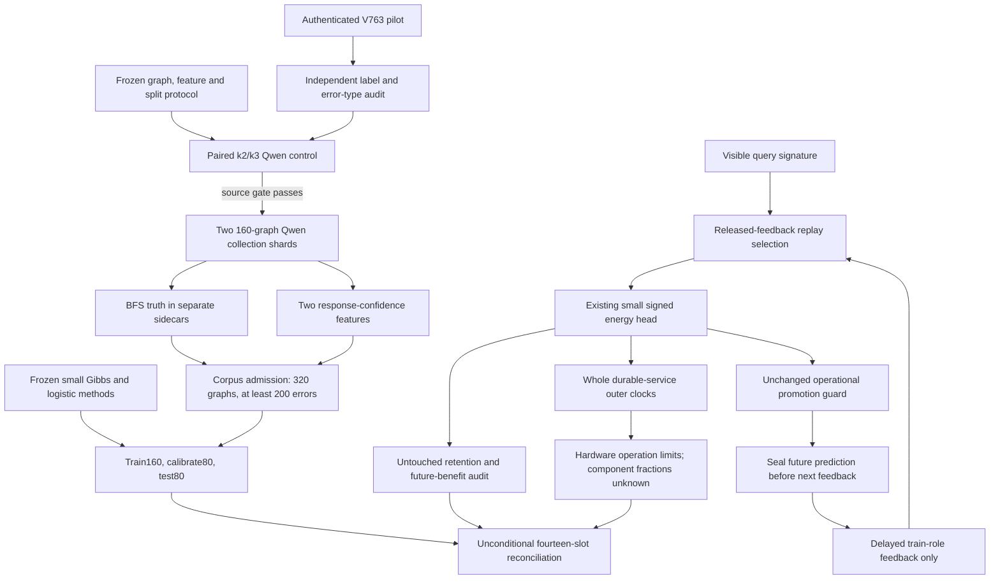
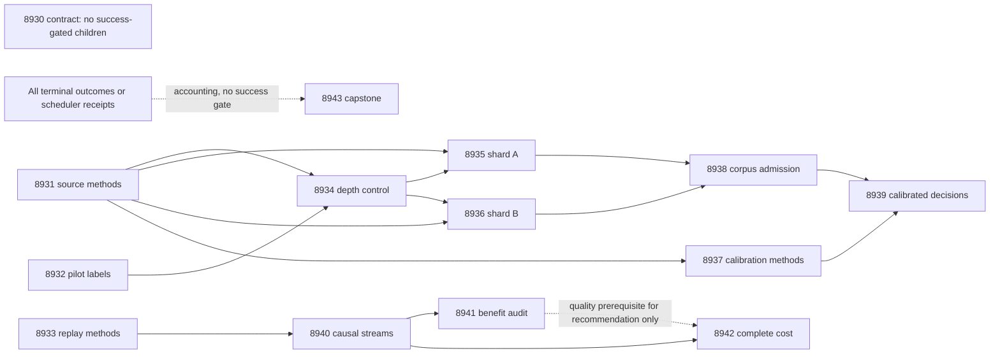

# Carnot Research Roadmap v764: Independent Error Calibration, Compatible Replay, and Complete Decision Costs

**Created:** 2026-11-08 America/New_York
**Milestone:** 2026.11.764
**Status:** Planned; staged only
**Supersedes:** Completed 2026.11.763, Exp8917–Exp8929
**Task contract:** Exactly 14 tasks, Exp8930 through Exp8943, in the execution order below.
**Execution file:** `research-roadmap-next.yaml`

V763's original design and queue are preserved in
`research-roadmap-v763-preserved-20261108.md` and
`research-roadmap-v763-queue-preserved-20261108.yaml`. The completed archive
currently ends at V762. V763 primary artifacts and conductor receipts establish
its thirteen terminal outcomes, including two scheduler skips. A conductor OK
does not imply scientific benefit. This proposal leaves the active queue intact.

## What V763 proved

| Evidence | Qualified finding | Next consequence |
|---|---|---|
| Exp8917 | Thirteen-task authority and exact gate-field checks pass. | Reuse contract handling; keep CPU science independent of its success. |
| Exp8918 | All 50 mandated-Qwen answers completed with actual GPU offload. BFS labels find 43 errors: 86%, Wilson 95% interval 73.81–93.05%. | A credible final-answer error source exists. Check error types, depth sensitivity and new split custody before collection. |
| Exp8919/8922 | Fixed interpolation and 24 independent streams execute; 18,432 comparison rows are retained. | Implementation readiness is distinct from learning benefit. |
| Exp8925 | Future Brier upper bounds: -0.00065057 versus frozen, +0.0115587 versus permuted, +0.0339537 versus ordinary guarded updates. Retention passes; all three benefit contrasts fail. | Retire unchanged interpolation/guard/delay retries. Test a different feedback-selection mechanism with stronger controls. |
| Exp8920/8923 | Label-demand methods are disqualified; their evaluation is scheduler-skipped. | No label-saving claim. Defer this repair branch rather than carrying its evaluation forward. |
| Exp8921/8927 | Inline observer executes but exceeds its 5% overhead ceiling. Request-cost evaluation is skipped. | Use complete outer clocks. Component attribution remains unknown. |
| Exp8924 | Live paired-criterion canary completes. Assisted annotation dependence remains; scientific class is null. | Do not repeat it without independent blind truth and more source clusters. |
| Exp8926 | Historical guarded durable-cost receipts qualify with correctly typed rows. | Reuse timing/persistence methods, not those historical costs as new replay costs. |
| Exp8928/8929 | Hardware limits and thirteen outcomes are accounted for; capstone remains terminal blocked. | No hardware acceleration or independent natural-language generalization is established. |

## The three largest gaps to the PRD

1. **FR-12: a useful detector with independent truth.** The pilot proves that
   the generator makes checkable errors. It does not prove Carnot can recognize
   them. Build graph-disjoint final-answer labels and compare a tiny energy
   selector with prevalence, logistic and format/length controls. The oracle
   never enters detector features or scoring. The target remains a calibration
   pilot on constructed graphs, not a general hallucination detector.
2. **FR-06/FR-11: learning that improves later decisions.** Retention alone is
   insufficient. Test compatible replay of already released feedback in the
   existing signed energy head. Match labels, memory, gradients and promotion
   guards against uniform replay and repeated-current updates. Preserve the
   prior effect/retention thresholds and add a uniform-replay contrast.
3. **FR-05/FR-08/NFR-01: useful decisions at complete measured cost.** Measure
   the entire durable replay request. Do not infer service acceleration from
   an intrusive component observer or a hypothetical fast sampler. A 10x
   production-throughput claim and the program's 100x hardware aspiration both
   remain open. This milestone identifies whether the learning operation is
   useful enough to justify a later production port.

## Research incorporated before design

The V764 entry in `research-references.md` was written before these tasks.
It covers all eight requested topics and all six secondary channels.

| Source | Local method and boundary | Tasks |
|---|---|---|
| [ImplicitHop](https://arxiv.org/abs/2610.41169), October 2026 | Separate depth control and seeded graph truth; no copied prefix labels. | 8931, 8932, 8934–8936, 8938 |
| [Type-aware hallucination analysis](https://arxiv.org/abs/2611.02258), November 2026 | Distinguish semantic and formatting errors; control length shortcuts. Financial-domain results do not transfer automatically. | 8932, 8937, 8939 |
| [Transfer-Selective Replay](https://arxiv.org/abs/2607.15587), July 2026 | Select released examples by visible signature compatibility. This bounded local variant does not reproduce the paper's distillation stack. | 8933, 8940, 8941 |
| [Distributional EBMs](https://arxiv.org/abs/2605.18871), May 2026 | Separate learned scoring from exact penalties and test confounds. No new adapter ensemble. | 8937–8939 |
| [FPGA–ASIC co-design](https://arxiv.org/abs/2602.15985), September revision | Charge host, memory and persistence work before hardware claims. | 8942 |

EBT and EPO were checked through OpenReview/arXiv. Semantic Scholar returned
ten citing records each for EBT and ARM–EBM; selected leads were checked at
their primary pages. This is partial citation coverage. HF's EBT page loaded;
the new detection paper's HF page did not. GitHub trending returned no usable
relevant ranking. Extropic now advertises 2027 Z1 early access; it is not local
hardware access. Kona still supplies no new reproducible local protocol.

KAN-CL targets retention, which already passes locally. Convex constraint
layers require explicit constraints and cannot create missing source truth.
New samplers, foundation-model training, guided decoding, KAN architecture
changes and extra dependencies are deferred. No source's published gain is
treated as a Carnot result.

## Architecture



The graph and continual-learning branches answer different questions. No
positive graph result certifies the constructed feedback stream, or vice versa.
The learned graph detector sees no graph traversal, true distance or answer set.
Its two inputs are response mean negative log probability and the first answer
token's top-two log-probability margin. Missing backend signals block that path.

## Phase 1 — fixed methods and independent inputs (Exp8930–Exp8933)

Exp8930 binds fourteen complete task objects and preserves historical authority.
It is not a global science gate. Exp8931 implements and tests the reusable
source runner before GPU execution. It freezes 50 paired control graphs plus
320 different collection graphs. Exp8932 checks all fifty old pilot labels and
categorizes errors; no old pilot example becomes an evaluation example.

Exp8933 changes the learning mechanism. A 32-row FIFO contains only released
train feedback. Each update takes one current-label gradient and one replay
gradient. The compatible arm selects the nearest visible query signature with
fixed scaling and deterministic ties. Uniform replay and repeated-current arms
pay the same two-gradient budget. Permuted labels test whether feedback carries
information. The frozen arm gets the same verified template information.

Exp5857 already tested label-blind signature replay in an exact structural
learner. Its positive has `verifier_is_oracle=true`. Reuse applicable selection
and collision/permutation controls; it does not establish prospective Brier
benefit in the current signed energy head. This is a transfer test, not a claim
that signature replay is new.

Eight development streams precede twenty-four fresh evaluation streams. The
feature map, SGD rate 0.1, eight-query delay and guard stay fixed. No search over
replay size, distance metric or learning rate is authorized in this milestone.

## Phase 2 — bounded live collection and calibration methods (Exp8934–Exp8937)

Exp8934 uses fifty new paired k=2/k=3 graphs. All 100 answers must complete.
The approved source-plan control requires the empirical k3 error rate to exceed
k2, with paired uncertainty reported separately. A non-rise stops collection
and prompts label/ceiling diagnosis; it does not prove the labels wrong or the
generator generally reliable. No adaptive k/size rescue is included.

The source plan calls for ceiling(1.3 × 200 / 0.86)=303 questions. Exp8935 and
Exp8936 allocate 320 instead, for two equal 160-graph shards with fixed role
counts. Each shard contains 80 train, 40 calibration and 40 test graphs. Shards
are independent of each other's success. Each has a 1,800-second generation
budget plus separate bounded preflight, load and checks. No outcome-based
resampling or same-unit retry selection is allowed. Checkpoint reuse preserves
the first completed response under matching hashes.

All three live tasks use `unsloth/Qwen3.8-27B-GGUF`, Q4_K_M, GPU 0 only,
reasoning off, temperature zero and a sixteen-token cap per answer. They declare
`model_bounded_generation` (10-second floor). Full generation (60 seconds) and
embedding/load-only probes (2 seconds) are not planned. Actual load-only failure
records use `model_load_no_generation`; no run uses artificial duration padding.

Exp8937 develops a tiny Gibbs selector with the existing training pattern. It
freezes a same-feature logistic comparator, prevalence and format/length
controls. It does not import the old FoVer corpus loader or its labels. It can
qualify on controlled fixtures even when live collection is blocked.

## Phase 3 — held-out decisions and causal streams (Exp8938–Exp8940)

Exp8938 joins both shards and checks all graph/split identities and independent
labels. It requires at least 200 total errors and at least five correct and five
incorrect answers in each split. These are feasibility minima, not a power
guarantee. A shortfall is a valid null; it does not authorize rebalancing.

Exp8939 trains on 160 graphs, chooses a temperature on 80 calibration graphs,
then opens 80 test labels once. Benefit requires simultaneous 95% one-sided
graph-bootstrap bounds: Brier improvement over prevalence and logistic both
strictly above zero, and accepted-error difference versus logistic at exactly
50% coverage at most zero. The diagnostic coverage ranking uses no labels.
Typed accept/reject/escalate decisions use fixed probability thresholds;
they do not constitute a certified risk bound. These small test counts can
produce an inconclusive null. No extra examples or repeated test tuning follow.

Exp8940 executes the independent CPU learning branch: 24 paired streams, five
arms, 48 online queries and 48 untouched retention queries at each of three
checkpoints. That is 23,040 comparison rows, but only 24 independent streams.
Predictions precede feedback. Restart at query 24 must preserve the buffer,
parameters, RNG, pending labels and future decisions exactly.

## Phase 4 — future benefit, complete costs and closure (Exp8941–Exp8943)

Exp8941 reduces whole-stream paired outcomes with 10,000 bootstrap draws.
Ten one-sided bounds share family alpha=0.01: future Brier versus frozen
must be <=-0.01; versus repeated-current, uniform and permuted replay must be
<0; retention Brier/error deltas must be <=0.01 at checkpoints 0, 24, 48. This
preserves the previous nine effect/retention conditions and adds uniform replay.
The current-update comparator now receives two gradients to match replay work.
Promotion frequency and training loss cannot replace any failed condition.

Exp8942 measures 24 fresh paired process/world seeds, four trainable arms and
48 complete prediction/update cycles, including persistence and restart. It
uses qualified outer clocks with no inner observer. Complete cost measurement
does not require a positive learning result. A deployment recommendation does.
Missing component fractions remain null, so no 100x projection is fabricated.

Exp8943 runs unconditionally and accounts for all fourteen slots. It separates
scientific nulls, failed owned controls and unavailable prerequisites. External
blocks are terminal `blocked`, not retryable `partial`. It recommends exact
scope retirement and preserves flags without editing the exclusion manifest.

## Dependency graph



Every solid edge is a structured `gated_on` condition on an integer readiness
field declared in its upstream task. Both depth fields must pass before either
shard runs. Scientific benefit does not gate measurement or reconciliation.
Missing files and misspelled fields are broken contracts; observed zero is a
scientific or resource gate. Every blocked artifact names which case occurred.

## Hardware requirements and limits

| Resource | Use and current boundary |
|---|---|
| CPU and system memory | Methods, BFS truth, small-head training, stream replay and complete-service clocks. No pretrained model load for these tasks. |
| RTX3090 GPU0, 24GB | Three sequential Q4_K_M Qwen runs through the existing conductor lease/server. Authenticate actual offload and available memory each time. |
| GPU1 | Detached; no probe or use. The older two-GPU inventory is not current execution authority. |
| KV260 | Existing compatible sampler scope only, k_max<=5. The replay head does not invoke it; no speed claim or board probe. |
| PolarFire | Existing Linux CPU dispatch only; fabric acceleration remains unqualified. |
| GateMate | Unchanged physical/JTAG block; no repeated bring-up. |
| NPU / Extropic TSU | Unqualified locally. Vendor Z1 early-access date is 2027, not availability to Carnot. |
| Desired hardware | No purchase needed. Batch distance/gradient kernels offer a future GPU path; larger FPGA/TSU acquisition needs measured compatible work first. |

Replay scans at most 32 records and updates a small head. It has a concrete
CPU/batched-GPU path, but the program's 100x goal remains unproved. Sampling
calls are counted explicitly; zero calls mean no sampler acceleration case.
No board integration is bundled with a scientific task.

## Execution and validation contract

Every prompt requires numbered steps for flushed progress at phase boundaries,
before/after long calls, and inside loops/supervisors at least every 60 seconds.
No silence gap may reach 600 seconds. Files above roughly 200 lines must be
written through several bounded tool calls with a progress message between
them. Work targets 4200 seconds including validation; the hard cap is 4800.

Implementation remains spec-first and tests-first. Each task has a distinct
REQ/SCENARIO, deliverable and actual CLI command. Reuse existing runners and
publication primitives; do not clone historical validation frameworks. Measure
100% owned statements with no exclusions, run scoped lint/types/spec tracing,
applicable private E2E-018/021 and outside-checkout cold replay. Keep unrelated
global test debt separate. No conductor or shared-validator edits are authorized.

Comparisons retain per-unit rows, denominators and censoring. Closed
`verdict_class` travels with the claim. Exact BFS checks are execution-grounded
and cannot produce oracle-distinct positive evidence. Aggregators cite opaque
hash-bound upstream artifacts and report zero current model/training calls.

Prior-failure entries name the unchanged failure, the changed mechanism and
`retire_if_same_verdict: true`. New ids never reuse a retired id or require a
retired predecessor. Invalid prefix-label history is cited as a defect being
removed, not as a powered scientific null. ARC suspension overrides its older
standing floor; no solve or new live game work is scheduled.

## Exact task contract

The visible table and embedded complete task objects below are generated from
the same staged YAML objects. Prompts, gates, priors, routes and deliverables
are part of this contract, not an aspirational task list.

| Order | ID | Title | Phase | Deliverable |
|---|---|---|---|---|
| 1 | `exp8930-branch-contract` | Bind fourteen tasks and preserve V763 evidence | 1 | `results/experiment_8930_v764_branch_contract.json` |
| 2 | `exp8931-graph-source-methods` | Freeze graph splits and bounded collection with detector-safe signals | 1 | `results/experiment_8931_v764_graph_source_methods.json` |
| 3 | `exp8932-pilot-label-audit` | Separate semantic errors from parsing failures in the live pilot | 1 | `results/experiment_8932_v764_pilot_label_audit.json` |
| 4 | `exp8933-compatible-replay-methods` | Freeze compatible feedback replay for continuous energy learning | 1 | `results/experiment_8933_v764_compatible_replay_methods.json` |
| 5 | `exp8934-depth-control` | Measure paired graph depth sensitivity with mandated Qwen | 2 | `results/experiment_8934_v764_depth_control.json` |
| 6 | `exp8935-graph-corpus-a` | Collect fresh independently labeled Qwen answers in shard A | 2 | `results/experiment_8935_v764_graph_corpus_a.json` |
| 7 | `exp8936-graph-corpus-b` | Collect fresh independently labeled Qwen answers in shard B | 2 | `results/experiment_8936_v764_graph_corpus_b.json` |
| 8 | `exp8937-calibration-methods` | Freeze a small energy selector and strong calibration controls | 2 | `results/experiment_8937_v764_calibration_methods.json` |
| 9 | `exp8938-graph-corpus-admission` | Authenticate graph-disjoint labels before detector fitting | 3 | `results/experiment_8938_v764_graph_corpus_admission.json` |
| 10 | `exp8939-graph-calibrated-decisions` | Test calibrated energy decisions on unseen live-model errors | 3 | `results/experiment_8939_v764_graph_calibrated_decisions.json` |
| 11 | `exp8940-compatible-replay-streams` | Measure future predictions after compatible delayed replay | 3 | `results/experiment_8940_v764_compatible_replay_streams.json` |
| 12 | `exp8941-compatible-replay-benefit` | Audit future replay benefit and untouched retention | 4 | `results/experiment_8941_v764_compatible_replay_benefit.json` |
| 13 | `exp8942-replay-complete-cost` | Measure complete replay service cost and hardware limits | 4 | `results/experiment_8942_v764_replay_complete_cost.json` |
| 14 | `exp8943-capstone` | Reconcile fourteen outcomes and exact continuation boundaries | 4 | `results/experiment_8943_v764_capstone.json` |

<!-- V764_TASK_CONTRACT_START -->
```json
{
  "milestone": "2026.11.764",
  "milestone_title": "Independent Error Calibration, Compatible Replay, and Complete Decision Costs",
  "milestone_doc": "openspec/change-proposals/research-roadmap-vNEXT.md",
  "tasks": [
    {
      "id": "exp8930-branch-contract",
      "title": "Bind fourteen tasks and preserve V763 evidence",
      "phase": 1,
      "track": "research",
      "priority": "high",
      "requires_gpu": false,
      "max_turns": 100,
      "estimated_wall_time_min": 35,
      "per_unit_rows": true,
      "milestone": "2026.11.764",
      "deliverable": "results/experiment_8930_v764_branch_contract.json",
      "inference_substrate_class": "no_model_load",
      "MODEL_SPECS": [],
      "gated_on": [],
      "prior_failures": [
        {
          "experiment_id": "exp8891-branch-contract",
          "verdict": "complete_disqualified_v761_branch_contract",
          "addressed_by": "Use the now-qualified V763 contract path with a fresh fourteen-task authority and preserved historical snapshots; validate formatting before publication.",
          "retire_if_same_verdict": true
        }
      ],
      "model": "opus",
      "prompt": "CONTEXT:\nV763 completed thirteen slots, including two scheduler skips. The live pilot qualifies an error source; it does not prove detector value. V764 is a new staged proposal, not activation.\n\nEXISTING CODE TO READ FIRST:\n- CLAUDE.md\n- CODEX.md\n- research-program.md\n- openspec/capabilities/research-reporting/spec.md\n- openspec/change-proposals/research-roadmap-vNEXT.md\n- scripts/experiment_template.py\n- python/carnot/reporting/current_work_receipt.py\n- python/carnot/reporting/primary_publication.py\n- ops/e2e-test-plan.md\n- python/carnot/reporting/roadmap_contract.py\n- python/carnot/reporting/v763_branch_contract.py\n- results/experiment_8929_v763_capstone.json\n- ops/exclusion_manifest.yaml\n- research-references.md\n\nTASK:\nBind fourteen tasks and preserve V763 evidence. Deliver results/experiment_8930_v764_branch_contract.json for 2026.11.764.\n\nCONCRETE STEPS:\n1. Read the sources and REQ-REPORT-8930 / SCENARIO-REPORT-8930-CONTRACT. Work in {project_root}. Authenticate branch inputs before expensive work. Missing external inputs are terminal blocked; failed owned controls are disqualified.\n2. Emit a flushed progress line at every phase boundary and before and after every model load, generation, benchmark or subprocess that can take minutes. Use python -u and print(..., flush=True); forward child output. Inside long loops and subprocess supervision, print completed/pending counts at least every 60 seconds. Keep every silence gap below 600 seconds, including work between tool calls. Reserve validation time: target total work below 4200 seconds within the 4800-second hard cap.\n3. Keep each tool call bounded. Write any file over about 200 lines in several tool calls of at most 150-200 lines, with a progress message between them. Real scripts belong in scripts/experiments/, tests in tests/python/, and scratch in /tmp. Never write scratch files in the repository root.\n4. Compare the visible table, embedded full task objects and staged-or-activated YAML for exactly Exp8930-Exp8943 in order, including prompts, routes, priors, gates and paths. Preserve the V763 design/queue archives and immutable V764 execution snapshots. Accept a matching activated queue if staging has been consumed.\n5. Reuse the current contract helper with explicit milestone/id/count parameters. Test missing task, task order, changed prompt, wrong producer gate field and changed path. Do not copy a whole historical runner. CPU science admits its own inputs; contract_ready_score is not a global success gate.\n6. Bind the V764 literature map and exact prior-failure changes. Preserve authoritative scheduler skips at their actual paths, not invented deliverables. Do not probe CUDA or boards. Report current compute as zero and upstream compute as opaque producer references.\n7. Before implementation, extend the named REQ/SCENARIO and write failing tests. Reuse existing helpers and preserve original assertions and historical producer bytes. Run scoped pytest with measured 100-percent owned unit/child statement coverage and zero exclusions, Ruff check and format --check, strict mypy, and scripts/check_spec_coverage.py with positional test paths. Run applicable private E2E-018/021 CLI cases and the actual new CLI with cold replay outside the checkout without PYTHONPATH. Native changes also require E2E-003/004 and cargo test/fmt/clippy. Run unchanged adversarial_verify.py and verdict_row_consistency_lint.py --strict on the prospective artifact. Keep raw receipts and executed-source hashes; publish only after owned checks. Separate unrelated repository health. Reconcile openspec/, _bmad/traceability.md, ops/status.md and ops/changelog.md. Do not activate a milestone, edit shared validators or the exclusion manifest, publish externally, or credit fixtures as research. ARC remains suspended; keep generator weights frozen.\n\nREQUIRED ARTIFACT FIELDS:\nexperiment_id, task_id, milestone, run_date: principle: bind this producer and {date}.\nhonest_verdict: terminal complete_ or complete: prefix; principle: execution completion is separate from scientific success. Every blocked_* outcome, including complete_blocked_*, includes gate_check_summary.\nverdict_class: positive | circular_positive | null | blocked | disqualified | partial; principle: partial means unfinished OWN work only. External absence is terminal blocked. verifier_is_oracle=true forbids positive; failed owned acceptance forbids positive.\ninference_substrate, inference_substrate_class, execution_venue, MODEL_SPECS, model_invocation_counts, numerical_training_calls: principle: declare actual current work. CPU small-head training is no_model_load, not no compute. A blocked run records blocked_no_run; a load with no generation records model_load_no_generation. Never pad elapsed time.\nverifier_is_oracle, exposure_scope, independent_generalization_score: principle: graph labels and constructed streams cannot establish natural-language generalization or a verifier moat.\nduration_s, phase_spans, preconditions_checked, random_seed, reproducibility_checksum: principle: freeze methods and record actual time.\nsource_artifact_hashes, code_config_hashes, raw_shard_hashes, cited_upstream_artifacts: principle: authenticate original producer identity and retained bytes. Upstream compute stays in opaque producer references, not current compute counters.\nrows: principle: one row per compared unit, arm and metric, with unit_id, cluster_id, seed, value, numerator, denominator, status and missing_reason. Recompute every comparative headline from rows. Store administrative receipts outside comparative rows.\nintended_count, completed_count, failed_count, censored_count, excluded_count, independent_count: principle: retain every scheduled unit. Repeated costs, seeds or questions on one graph do not create independent samples.\ngate_check_summary: principle: for each blocked outcome record check, upstream, artifact_field, expected, observed, path and hash. Distinguish missing_file, missing_field, rejected_producer and observed_zero.\nacceptance_gates, required_checks_passed, validation_receipts, owned_statement_coverage, field_principles: principle: readiness is not benefit; explain each extra field's evidential scope.\ncontract_ready_score: integer 0/1; principle: exact authority and owned checks only.\ncontract_rows, full_task_digest, execution_snapshot, source_method_rows, prior_scope_rows: principle: bind all fourteen complete task objects.\n\nRun command: cd {project_root} && .venv/bin/python -u scripts/experiments/experiment_8930_v764_branch_contract.py --date {date}\nDo NOT push. Do NOT modify scripts/research_conductor.py."
    },
    {
      "id": "exp8931-graph-source-methods",
      "title": "Freeze graph splits and bounded collection with detector-safe signals",
      "phase": 1,
      "track": "research",
      "priority": "high",
      "requires_gpu": false,
      "max_turns": 50,
      "estimated_wall_time_min": 65,
      "per_unit_rows": true,
      "milestone": "2026.11.764",
      "deliverable": "results/experiment_8931_v764_graph_source_methods.json",
      "inference_substrate_class": "no_model_load",
      "MODEL_SPECS": [],
      "gated_on": [],
      "prior_failures": [
        {
          "experiment_id": "exp4381-biprm-detector-localization-abstention",
          "verdict": "complete: clean_powered_null_bidirectional_not_actionable",
          "addressed_by": "The November 7 audit found outcome labels copied to prefixes. Build fresh graph-oracle FINAL-answer labels and a detector view excluding the oracle; do not repeat localization.",
          "retire_if_same_verdict": true
        }
      ],
      "agent_type": "codex",
      "model": "gpt-6.1-sol",
      "prompt": "CONTEXT:\nExp8918 measured 43/50 errors. The operator BFS plan calls for a depth control and at least 200 independent final-answer errors. Ceiling(1.3*200/0.86)=303; use 320 fresh graphs in two fixed shards for balanced predeclared roles.\n\nEXISTING CODE TO READ FIRST:\n- CLAUDE.md\n- CODEX.md\n- research-program.md\n- openspec/capabilities/research-reporting/spec.md\n- openspec/change-proposals/research-roadmap-vNEXT.md\n- scripts/experiment_template.py\n- python/carnot/reporting/current_work_receipt.py\n- python/carnot/reporting/primary_publication.py\n- ops/e2e-test-plan.md\n- docs/research-notes/bfs-labeled-error-source-plan-2026-11-07.md\n- python/carnot/reporting/bfs_error_pilot_8918.py\n- python/carnot/inference/bfs_pilot_runtime_8918.py\n- python/carnot/inference/sota_models.py\n- tests/python/test_bfs_error_pilot_8918.py\n\nTASK:\nFreeze graph splits and bounded collection with detector-safe signals. Deliver results/experiment_8931_v764_graph_source_methods.json for 2026.11.764.\n\nCONCRETE STEPS:\n1. Read the sources and REQ-REPORT-8931 / SCENARIO-REPORT-8931-CONTRACT. Work in {project_root}. Authenticate branch inputs before expensive work. Missing external inputs are terminal blocked; failed owned controls are disqualified.\n2. Emit a flushed progress line at every phase boundary and before and after every model load, generation, benchmark or subprocess that can take minutes. Use python -u and print(..., flush=True); forward child output. Inside long loops and subprocess supervision, print completed/pending counts at least every 60 seconds. Keep every silence gap below 600 seconds, including work between tool calls. Reserve validation time: target total work below 4200 seconds within the 4800-second hard cap.\n3. Keep each tool call bounded. Write any file over about 200 lines in several tool calls of at most 150-200 lines, with a progress message between them. Real scripts belong in scripts/experiments/, tests in tests/python/, and scratch in /tmp. Never write scratch files in the repository root.\n4. Extend the existing bounded pilot runner through a small reusable sibling, preserving the pilot defaults. Implement source construction, response-signal capture, shard resume and terminal publication; validate with fixture transports before any GPU task. No LLM is loaded here.\n5. Seal 50 control graphs with paired k=2/k=3 questions and 320 different collection graphs with k=2. Use n uniformly 50-60, p=3/(n-1), random two-letter names and nonempty requested distance sets. Record all graph rejections. Keep graph hashes and seeds disjoint from the old pilot and across all new roles. Preassign 160 train, 80 calibration, 80 test graphs; each 160-graph shard contains 80/40/40 roles. Neither answers nor labels may affect assignment.\n6. Freeze single-node parsing and BFS shortest-distance labels, checked independently by adjacency-matrix reachability on small graphs. Error categories are malformed, out_of_graph, valid_wrong_distance and correct. Runtime failures are censored, never reasoning errors. Test distance-two walks with a shorter path, disconnected graphs and ambiguous answers.\n7. Freeze a detector view with only mean emitted-token negative log probability and the first answer-token top1-minus-top2 log-probability margin. Define token selection and finite-value checks now. Store token count and parser category for nuisance controls only. Raw graph, node identity, start, BFS distance, answer set, labels, file paths and split identifiers cannot enter the learned feature view. Missing server log probabilities block signal readiness; never reconstruct them from the true answer.\n8. Implement completed-unit checkpoint reuse bound to model, settings, graph and feature-schema hashes. Save raw responses before labels. Forbid regenerating completed units or choosing good outputs on resume. Keep development tests and future recipes separate. Freeze the paired control acceptance: all 100 answers, verified labels, usable signals and empirical error(k3)>error(k2); report paired uncertainty without calling this inequality statistical proof.\n9. Before implementation, extend the named REQ/SCENARIO and write failing tests. Reuse existing helpers and preserve original assertions and historical producer bytes. Run scoped pytest with measured 100-percent owned unit/child statement coverage and zero exclusions, Ruff check and format --check, strict mypy, and scripts/check_spec_coverage.py with positional test paths. Run applicable private E2E-018/021 CLI cases and the actual new CLI with cold replay outside the checkout without PYTHONPATH. Native changes also require E2E-003/004 and cargo test/fmt/clippy. Run unchanged adversarial_verify.py and verdict_row_consistency_lint.py --strict on the prospective artifact. Keep raw receipts and executed-source hashes; publish only after owned checks. Separate unrelated repository health. Reconcile openspec/, _bmad/traceability.md, ops/status.md and ops/changelog.md. Do not activate a milestone, edit shared validators or the exclusion manifest, publish externally, or credit fixtures as research. ARC remains suspended; keep generator weights frozen.\n\nREQUIRED ARTIFACT FIELDS:\nexperiment_id, task_id, milestone, run_date: principle: bind this producer and {date}.\nhonest_verdict: terminal complete_ or complete: prefix; principle: execution completion is separate from scientific success. Every blocked_* outcome, including complete_blocked_*, includes gate_check_summary.\nverdict_class: positive | circular_positive | null | blocked | disqualified | partial; principle: partial means unfinished OWN work only. External absence is terminal blocked. verifier_is_oracle=true forbids positive; failed owned acceptance forbids positive.\ninference_substrate, inference_substrate_class, execution_venue, MODEL_SPECS, model_invocation_counts, numerical_training_calls: principle: declare actual current work. CPU small-head training is no_model_load, not no compute. A blocked run records blocked_no_run; a load with no generation records model_load_no_generation. Never pad elapsed time.\nverifier_is_oracle, exposure_scope, independent_generalization_score: principle: graph labels and constructed streams cannot establish natural-language generalization or a verifier moat.\nduration_s, phase_spans, preconditions_checked, random_seed, reproducibility_checksum: principle: freeze methods and record actual time.\nsource_artifact_hashes, code_config_hashes, raw_shard_hashes, cited_upstream_artifacts: principle: authenticate original producer identity and retained bytes. Upstream compute stays in opaque producer references, not current compute counters.\nrows: principle: one row per compared unit, arm and metric, with unit_id, cluster_id, seed, value, numerator, denominator, status and missing_reason. Recompute every comparative headline from rows. Store administrative receipts outside comparative rows.\nintended_count, completed_count, failed_count, censored_count, excluded_count, independent_count: principle: retain every scheduled unit. Repeated costs, seeds or questions on one graph do not create independent samples.\ngate_check_summary: principle: for each blocked outcome record check, upstream, artifact_field, expected, observed, path and hash. Distinguish missing_file, missing_field, rejected_producer and observed_zero.\nacceptance_gates, required_checks_passed, validation_receipts, owned_statement_coverage, field_principles: principle: readiness is not benefit; explain each extra field's evidential scope.\nsource_methods_ready_score: integer 0/1; principle: executable, tested collection contract only.\nprotocol_hash, graph_manifest, split_manifest, shard_manifest, feature_schema, label_controls, resume_controls: principle: precommit all 320 collection and 50 control graph identities. MODEL_SPECS=[]; inference_substrate=aggregation_from_upstream_artifacts for method receipts.\n\nRun command: cd {project_root} && .venv/bin/python -u scripts/experiments/experiment_8931_v764_graph_source_methods.py --date {date}\nDo NOT push. Do NOT modify scripts/research_conductor.py."
    },
    {
      "id": "exp8932-pilot-label-audit",
      "title": "Separate semantic errors from parsing failures in the live pilot",
      "phase": 1,
      "track": "research",
      "priority": "high",
      "requires_gpu": false,
      "max_turns": 20,
      "estimated_wall_time_min": 25,
      "per_unit_rows": true,
      "milestone": "2026.11.764",
      "deliverable": "results/experiment_8932_v764_pilot_label_audit.json",
      "inference_substrate_class": "no_model_load",
      "MODEL_SPECS": [],
      "gated_on": [],
      "prior_failures": [
        {
          "experiment_id": "exp4381-biprm-detector-localization-abstention",
          "verdict": "complete: clean_powered_null_bidirectional_not_actionable",
          "addressed_by": "Audit independent BFS final-answer labels and raw answers instead of inherited outcome-as-prefix labels; no localization evaluation.",
          "retire_if_same_verdict": true
        }
      ],
      "prompt": "CONTEXT:\nThe 86-percent error rate is useful only if the labels and error types are understood. The type-aware hallucination paper motivates a per-type audit before new collection; this is not a detector benchmark.\n\nEXISTING CODE TO READ FIRST:\n- CLAUDE.md\n- CODEX.md\n- research-program.md\n- openspec/capabilities/research-reporting/spec.md\n- openspec/change-proposals/research-roadmap-vNEXT.md\n- scripts/experiment_template.py\n- python/carnot/reporting/current_work_receipt.py\n- python/carnot/reporting/primary_publication.py\n- ops/e2e-test-plan.md\n- results/experiment_8918_v763_bfs_error_pilot.json\n- python/carnot/reporting/bfs_error_pilot_8918.py\n- docs/research-notes/label-provenance-audit-step1-2026-11-07.md\n- research-references.md\n\nTASK:\nSeparate semantic errors from parsing failures in the live pilot. Deliver results/experiment_8932_v764_pilot_label_audit.json for 2026.11.764.\n\nCONCRETE STEPS:\n1. Read the sources and REQ-REPORT-8932 / SCENARIO-REPORT-8932-CONTRACT. Work in {project_root}. Authenticate branch inputs before expensive work. Missing external inputs are terminal blocked; failed owned controls are disqualified.\n2. Emit a flushed progress line at every phase boundary and before and after every model load, generation, benchmark or subprocess that can take minutes. Use python -u and print(..., flush=True); forward child output. Inside long loops and subprocess supervision, print completed/pending counts at least every 60 seconds. Keep every silence gap below 600 seconds, including work between tool calls. Reserve validation time: target total work below 4200 seconds within the 4800-second hard cap.\n3. Keep each tool call bounded. Write any file over about 200 lines in several tool calls of at most 150-200 lines, with a progress message between them. Real scripts belong in scripts/experiments/, tests in tests/python/, and scratch in /tmp. Never write scratch files in the repository root.\n4. Read all fifty retained raw responses, graph records and original BFS labels. Recompute shortest distances independently; preserve every original value and any discrepancy. Apply the predeclared four-category taxonomy without editing answers or excluding malformed cases.\n5. Report total and per-type counts, semantic-only error denominator, output-length distribution, Wilson interval and graph-level rows. Check original model/offload custody and failed/censored counts. Set pilot_labels_ready_score=1 only for 50 authenticated completed responses, exact label agreement and no unresolved provenance. A real parsing error is data, not grounds for dropping a unit.\n6. Trace the invalid FoVer prefix labels to their audit note only; never reinterpret them as independent errors. Use the pilot solely for development and rate planning; exclude its graphs from all V764 calibration and evaluation. No inference or parameter fitting occurs here.\n7. Before implementation, extend the named REQ/SCENARIO and write failing tests. Reuse existing helpers and preserve original assertions and historical producer bytes. Run scoped pytest with measured 100-percent owned unit/child statement coverage and zero exclusions, Ruff check and format --check, strict mypy, and scripts/check_spec_coverage.py with positional test paths. Run applicable private E2E-018/021 CLI cases and the actual new CLI with cold replay outside the checkout without PYTHONPATH. Native changes also require E2E-003/004 and cargo test/fmt/clippy. Run unchanged adversarial_verify.py and verdict_row_consistency_lint.py --strict on the prospective artifact. Keep raw receipts and executed-source hashes; publish only after owned checks. Separate unrelated repository health. Reconcile openspec/, _bmad/traceability.md, ops/status.md and ops/changelog.md. Do not activate a milestone, edit shared validators or the exclusion manifest, publish externally, or credit fixtures as research. ARC remains suspended; keep generator weights frozen.\n\nREQUIRED ARTIFACT FIELDS:\nexperiment_id, task_id, milestone, run_date: principle: bind this producer and {date}.\nhonest_verdict: terminal complete_ or complete: prefix; principle: execution completion is separate from scientific success. Every blocked_* outcome, including complete_blocked_*, includes gate_check_summary.\nverdict_class: positive | circular_positive | null | blocked | disqualified | partial; principle: partial means unfinished OWN work only. External absence is terminal blocked. verifier_is_oracle=true forbids positive; failed owned acceptance forbids positive.\ninference_substrate, inference_substrate_class, execution_venue, MODEL_SPECS, model_invocation_counts, numerical_training_calls: principle: declare actual current work. CPU small-head training is no_model_load, not no compute. A blocked run records blocked_no_run; a load with no generation records model_load_no_generation. Never pad elapsed time.\nverifier_is_oracle, exposure_scope, independent_generalization_score: principle: graph labels and constructed streams cannot establish natural-language generalization or a verifier moat.\nduration_s, phase_spans, preconditions_checked, random_seed, reproducibility_checksum: principle: freeze methods and record actual time.\nsource_artifact_hashes, code_config_hashes, raw_shard_hashes, cited_upstream_artifacts: principle: authenticate original producer identity and retained bytes. Upstream compute stays in opaque producer references, not current compute counters.\nrows: principle: one row per compared unit, arm and metric, with unit_id, cluster_id, seed, value, numerator, denominator, status and missing_reason. Recompute every comparative headline from rows. Store administrative receipts outside comparative rows.\nintended_count, completed_count, failed_count, censored_count, excluded_count, independent_count: principle: retain every scheduled unit. Repeated costs, seeds or questions on one graph do not create independent samples.\ngate_check_summary: principle: for each blocked outcome record check, upstream, artifact_field, expected, observed, path and hash. Distinguish missing_file, missing_field, rejected_producer and observed_zero.\nacceptance_gates, required_checks_passed, validation_receipts, owned_statement_coverage, field_principles: principle: readiness is not benefit; explain each extra field's evidential scope.\npilot_labels_ready_score: integer 0/1; principle: original final-answer labels authenticated independently.\nerror_type_rows, label_disagreements, source_receipts, semantic_error_rate: principle: exact counts, no detector claim. verifier_is_oracle=true; any positive truth-validation outcome is circular_positive.\n\nRun command: cd {project_root} && .venv/bin/python -u scripts/experiments/experiment_8932_v764_pilot_label_audit.py --date {date}\nDo NOT push. Do NOT modify scripts/research_conductor.py."
    },
    {
      "id": "exp8933-compatible-replay-methods",
      "title": "Freeze compatible feedback replay for continuous energy learning",
      "phase": 1,
      "track": "research",
      "priority": "high",
      "requires_gpu": false,
      "max_turns": 50,
      "estimated_wall_time_min": 65,
      "per_unit_rows": true,
      "milestone": "2026.11.764",
      "deliverable": "results/experiment_8933_v764_compatible_replay_methods.json",
      "inference_substrate_class": "no_model_load",
      "MODEL_SPECS": [],
      "gated_on": [],
      "prior_failures": [
        {
          "experiment_id": "exp8925-interpolated-benefit-audit",
          "verdict": "complete_null_interpolated_benefit_audit",
          "addressed_by": "Replace fixed fast/slow interpolation with causal signature-selected replay of released train feedback; compare uniform replay at equal gradient and label budgets, preserving promotion safeguards and all prospective/retention thresholds.",
          "retire_if_same_verdict": true
        }
      ],
      "prompt": "CONTEXT:\nExp8925 retained old decisions but failed every prospective benefit contrast. Change replay selection, not the failed fixed interpolation optimizer. This CPU branch is independent of graph collection and satisfies FR-11.\n\nEXISTING CODE TO READ FIRST:\n- CLAUDE.md\n- CODEX.md\n- research-program.md\n- openspec/capabilities/research-reporting/spec.md\n- openspec/change-proposals/research-roadmap-vNEXT.md\n- scripts/experiment_template.py\n- python/carnot/reporting/current_work_receipt.py\n- python/carnot/reporting/primary_publication.py\n- ops/e2e-test-plan.md\n- python/carnot/experiment_5857_clean_transfer_selective_replay.py\n- results/experiment_5857_clean_transfer_selective_replay.json\n- python/carnot/memory/guarded_memory_8905.py\n- python/carnot/memory/signed_memory_8892.py\n- python/carnot/reporting/guarded_update_methods_8905.py\n- python/carnot/reporting/interpolated_update_methods_8919.py\n- python/carnot/reporting/interpolated_benefit_audit_8925.py\n- results/experiment_8925_v763_interpolated_benefit_audit.json\n\nTASK:\nFreeze compatible feedback replay for continuous energy learning. Deliver results/experiment_8933_v764_compatible_replay_methods.json for 2026.11.764.\n\nCONCRETE STEPS:\n1. Read the sources and REQ-REPORT-8933 / SCENARIO-REPORT-8933-CONTRACT. Work in {project_root}. Authenticate branch inputs before expensive work. Missing external inputs are terminal blocked; failed owned controls are disqualified.\n2. Emit a flushed progress line at every phase boundary and before and after every model load, generation, benchmark or subprocess that can take minutes. Use python -u and print(..., flush=True); forward child output. Inside long loops and subprocess supervision, print completed/pending counts at least every 60 seconds. Keep every silence gap below 600 seconds, including work between tool calls. Reserve validation time: target total work below 4200 seconds within the 4800-second hard cap.\n3. Keep each tool call bounded. Write any file over about 200 lines in several tool calls of at most 150-200 lines, with a progress message between them. Real scripts belong in scripts/experiments/, tests in tests/python/, and scratch in /tmp. Never write scratch files in the repository root.\n4. Read the existing Exp5857 label-blind signature selector and reuse its applicable selection/parity logic. Its positive was execution-grounded (verifier_is_oracle=true) on a structural learner, not prospective Brier benefit in this signed head. Adapt only the signature distance and bounded training buffer needed here; preserve its collision/permutation controls. Implement the bounded replay mechanism in the existing signed three-class normalized energy head and durable store. Keep features, initial states, SGD eta=0.1, template additions, delay=8, guard thresholds and promotion schedule fixed. Discard the fast/slow interpolation mechanism. No Qwen weight updates.\n5. Maintain a FIFO buffer of at most 32 released TRAIN-feedback records. Each release takes one SGD step on that released row and one on a replay row. Select the replay by minimum squared distance to the most recent visible query feature vector under the frozen development scaling; ties use stable unit id. No current or future label, guard row, anchor or research retention row enters selection. Empty buffer repeats the released row; charge both gradients. Persist buffer, selection and RNG state across restart.\n6. Freeze five arms: frozen_verified, guarded_current (repeat current released row twice), uniform_replay, compatible_replay, compatible_permuted. The four trainable arms use identical label releases, 32-row capacity and two gradients per release; only replay selection or the fixed released-label permutation differs. All promotions use the unchanged guard. Templates receive the same verified information in every arm, including the frozen control.\n7. Use eight development streams only, then seal 24 fresh paired 48-query streams with independent initial worlds, feedback histories and seeds. Retention has 48 untouched queries at checkpoints 0,24,48. Freeze ten familywise 99-percent one-sided bounds: future Brier delta versus frozen <=-0.01; versus guarded_current, uniform_replay and compatible_permuted <0; Brier and error retention deltas versus frozen <=0.01 at all three checkpoints. Keep 10000 whole-stream paired bootstrap draws and alpha=0.01/10. No parameter search or test-label peeking.\n8. Test prediction-before-release, empty buffer, deterministic tie, permuted-label control, guard/train isolation, NaNs, full-capacity eviction, restart and exact two-gradient accounting. Methods readiness requires valid controls and sealed protocols, not a promising development effect. CPU distance scans and tiny-head gradients give a bounded batchable CPU/GPU path; hardware speed remains unmeasured.\n9. Before implementation, extend the named REQ/SCENARIO and write failing tests. Reuse existing helpers and preserve original assertions and historical producer bytes. Run scoped pytest with measured 100-percent owned unit/child statement coverage and zero exclusions, Ruff check and format --check, strict mypy, and scripts/check_spec_coverage.py with positional test paths. Run applicable private E2E-018/021 CLI cases and the actual new CLI with cold replay outside the checkout without PYTHONPATH. Native changes also require E2E-003/004 and cargo test/fmt/clippy. Run unchanged adversarial_verify.py and verdict_row_consistency_lint.py --strict on the prospective artifact. Keep raw receipts and executed-source hashes; publish only after owned checks. Separate unrelated repository health. Reconcile openspec/, _bmad/traceability.md, ops/status.md and ops/changelog.md. Do not activate a milestone, edit shared validators or the exclusion manifest, publish externally, or credit fixtures as research. ARC remains suspended; keep generator weights frozen.\n\nREQUIRED ARTIFACT FIELDS:\nexperiment_id, task_id, milestone, run_date: principle: bind this producer and {date}.\nhonest_verdict: terminal complete_ or complete: prefix; principle: execution completion is separate from scientific success. Every blocked_* outcome, including complete_blocked_*, includes gate_check_summary.\nverdict_class: positive | circular_positive | null | blocked | disqualified | partial; principle: partial means unfinished OWN work only. External absence is terminal blocked. verifier_is_oracle=true forbids positive; failed owned acceptance forbids positive.\ninference_substrate, inference_substrate_class, execution_venue, MODEL_SPECS, model_invocation_counts, numerical_training_calls: principle: declare actual current work. CPU small-head training is no_model_load, not no compute. A blocked run records blocked_no_run; a load with no generation records model_load_no_generation. Never pad elapsed time.\nverifier_is_oracle, exposure_scope, independent_generalization_score: principle: graph labels and constructed streams cannot establish natural-language generalization or a verifier moat.\nduration_s, phase_spans, preconditions_checked, random_seed, reproducibility_checksum: principle: freeze methods and record actual time.\nsource_artifact_hashes, code_config_hashes, raw_shard_hashes, cited_upstream_artifacts: principle: authenticate original producer identity and retained bytes. Upstream compute stays in opaque producer references, not current compute counters.\nrows: principle: one row per compared unit, arm and metric, with unit_id, cluster_id, seed, value, numerator, denominator, status and missing_reason. Recompute every comparative headline from rows. Store administrative receipts outside comparative rows.\nintended_count, completed_count, failed_count, censored_count, excluded_count, independent_count: principle: retain every scheduled unit. Repeated costs, seeds or questions on one graph do not create independent samples.\ngate_check_summary: principle: for each blocked outcome record check, upstream, artifact_field, expected, observed, path and hash. Distinguish missing_file, missing_field, rejected_producer and observed_zero.\nacceptance_gates, required_checks_passed, validation_receipts, owned_statement_coverage, field_principles: principle: readiness is not benefit; explain each extra field's evidential scope.\nreplay_methods_ready_score: integer 0/1; principle: causal implementation and sealed future protocol, not benefit.\nprotocol_hash, stream_manifest, optimizer_equations, replay_selection_rows, gradient_ledger, buffer_state_hashes, hardware_path: principle: exact equal-budget mechanism and restart state. inference_substrate=verifier_ensemble_against_cached_candidates; numerical_training_calls records fresh small-head updates.\n\nRun command: cd {project_root} && .venv/bin/python -u scripts/experiments/experiment_8933_v764_compatible_replay_methods.py --date {date}\nDo NOT push. Do NOT modify scripts/research_conductor.py."
    },
    {
      "id": "exp8934-depth-control",
      "title": "Measure paired graph depth sensitivity with mandated Qwen",
      "phase": 2,
      "track": "research",
      "priority": "high",
      "requires_gpu": true,
      "max_turns": 50,
      "estimated_wall_time_min": 45,
      "per_unit_rows": true,
      "milestone": "2026.11.764",
      "deliverable": "results/experiment_8934_v764_depth_control.json",
      "inference_substrate_class": "model_bounded_generation",
      "MODEL_SPECS": [
        {
          "hf_id": "unsloth/Qwen3.8-27B-GGUF",
          "format": "GGUF",
          "quantization": "Q4_K_M"
        }
      ],
      "gated_on": [
        {
          "upstream": "exp8931-graph-source-methods",
          "artifact_field": "source_methods_ready_score",
          "op": "==",
          "value": 1
        },
        {
          "upstream": "exp8932-pilot-label-audit",
          "artifact_field": "pilot_labels_ready_score",
          "op": "==",
          "value": 1
        }
      ],
      "prior_failures": [
        {
          "experiment_id": "exp8382-runtime-evidence-delta",
          "verdict": "complete_blocked_cuda_environment_unchanged",
          "addressed_by": "Exp8918 now supplies authenticated GPU-0 generation. Run the specified new paired depth measurement through that path, not an unchanged passive runtime probe.",
          "retire_if_same_verdict": true
        }
      ],
      "prompt": "CONTEXT:\nThe local pilot established k=2 errors; the approved source plan also requires a depth control before collection. Use a new paired cohort and retain a null if errors do not increase.\n\nEXISTING CODE TO READ FIRST:\n- CLAUDE.md\n- CODEX.md\n- research-program.md\n- openspec/capabilities/research-reporting/spec.md\n- openspec/change-proposals/research-roadmap-vNEXT.md\n- scripts/experiment_template.py\n- python/carnot/reporting/current_work_receipt.py\n- python/carnot/reporting/primary_publication.py\n- ops/e2e-test-plan.md\n- python/carnot/inference/bfs_pilot_runtime_8918.py\n- python/carnot/reporting/bfs_error_pilot_8918.py\n- docs/research-notes/bfs-labeled-error-source-plan-2026-11-07.md\n- results/experiment_8931_v764_graph_source_methods.json\n- results/experiment_8932_v764_pilot_label_audit.json\n\nTASK:\nMeasure paired graph depth sensitivity with mandated Qwen. Deliver results/experiment_8934_v764_depth_control.json for 2026.11.764.\n\nCONCRETE STEPS:\n1. Read the sources and REQ-REPORT-8934 / SCENARIO-REPORT-8934-CONTRACT. Work in {project_root}. Authenticate branch inputs before expensive work. Missing external inputs are terminal blocked; failed owned controls are disqualified.\n2. Emit a flushed progress line at every phase boundary and before and after every model load, generation, benchmark or subprocess that can take minutes. Use python -u and print(..., flush=True); forward child output. Inside long loops and subprocess supervision, print completed/pending counts at least every 60 seconds. Keep every silence gap below 600 seconds, including work between tool calls. Reserve validation time: target total work below 4200 seconds within the 4800-second hard cap.\n3. Keep each tool call bounded. Write any file over about 200 lines in several tool calls of at most 150-200 lines, with a progress message between them. Real scripts belong in scripts/experiments/, tests in tests/python/, and scratch in /tmp. Never write scratch files in the repository root.\n4. Use only the authenticated cached unsloth/Qwen3.8-27B-GGUF Q4_K_M and existing GPU-0 lease/server path. Set CARNOT_FORCE_LIVE=1 and CUDA_VISIBLE_DEVICES=0; GPU 1 is detached and must not be probed. Bound preflight and load separately at 240 seconds. Require actual CUDA offload and model/template hashes. No install, reboot, device repair or CPU fallback. Use reasoning off, temperature=0, max_tokens=16, top_p=1, and logprobs=true with top_logprobs=2. Preserve the exact raw response. Bound each generation at 30 seconds and all generation at 1800 seconds, censoring unfinished slots. Declare model_bounded_generation (10-second floor), not full generation (60 seconds); embeddings or load-only work would be model_load_no_generation (2 seconds). No artificial waits. Release the lease and server on every exit.\n5. Execute the sealed 50 control graphs, with k=2 and k=3 prompts on each graph and balanced frozen condition order. Use separate stateless requests; never carry one answer into the other prompt. All 100 answers retain raw model signals, actual token counts and independent labels. Keep control graphs out of the 320-graph collection.\n6. Recompute error rates and paired graph-level differences, exact discordant-pair counts and a 95-percent paired interval. depth_source_ready_score=1 requires all 100 completed, label controls passing, finite feature signals and error(k3)>error(k2). This operational source check is not a statistically established depth effect. If it fails, record a null and depth_source_ready_score=0, inspect label integrity and ceiling effects, and stop collection. Do not increase k, change graph size or generate extra units in this task.\n7. Record telemetry settings and response identity controls. A backend without supported log probabilities is blocked on that capability; do not fabricate confidence or add a load-only rescue experiment. Keep BFS-source success circular_positive.\n8. Before implementation, extend the named REQ/SCENARIO and write failing tests. Reuse existing helpers and preserve original assertions and historical producer bytes. Run scoped pytest with measured 100-percent owned unit/child statement coverage and zero exclusions, Ruff check and format --check, strict mypy, and scripts/check_spec_coverage.py with positional test paths. Run applicable private E2E-018/021 CLI cases and the actual new CLI with cold replay outside the checkout without PYTHONPATH. Native changes also require E2E-003/004 and cargo test/fmt/clippy. Run unchanged adversarial_verify.py and verdict_row_consistency_lint.py --strict on the prospective artifact. Keep raw receipts and executed-source hashes; publish only after owned checks. Separate unrelated repository health. Reconcile openspec/, _bmad/traceability.md, ops/status.md and ops/changelog.md. Do not activate a milestone, edit shared validators or the exclusion manifest, publish externally, or credit fixtures as research. ARC remains suspended; keep generator weights frozen.\n\nREQUIRED ARTIFACT FIELDS:\nexperiment_id, task_id, milestone, run_date: principle: bind this producer and {date}.\nhonest_verdict: terminal complete_ or complete: prefix; principle: execution completion is separate from scientific success. Every blocked_* outcome, including complete_blocked_*, includes gate_check_summary.\nverdict_class: positive | circular_positive | null | blocked | disqualified | partial; principle: partial means unfinished OWN work only. External absence is terminal blocked. verifier_is_oracle=true forbids positive; failed owned acceptance forbids positive.\ninference_substrate, inference_substrate_class, execution_venue, MODEL_SPECS, model_invocation_counts, numerical_training_calls: principle: declare actual current work. CPU small-head training is no_model_load, not no compute. A blocked run records blocked_no_run; a load with no generation records model_load_no_generation. Never pad elapsed time.\nverifier_is_oracle, exposure_scope, independent_generalization_score: principle: graph labels and constructed streams cannot establish natural-language generalization or a verifier moat.\nduration_s, phase_spans, preconditions_checked, random_seed, reproducibility_checksum: principle: freeze methods and record actual time.\nsource_artifact_hashes, code_config_hashes, raw_shard_hashes, cited_upstream_artifacts: principle: authenticate original producer identity and retained bytes. Upstream compute stays in opaque producer references, not current compute counters.\nrows: principle: one row per compared unit, arm and metric, with unit_id, cluster_id, seed, value, numerator, denominator, status and missing_reason. Recompute every comparative headline from rows. Store administrative receipts outside comparative rows.\nintended_count, completed_count, failed_count, censored_count, excluded_count, independent_count: principle: retain every scheduled unit. Repeated costs, seeds or questions on one graph do not create independent samples.\ngate_check_summary: principle: for each blocked outcome record check, upstream, artifact_field, expected, observed, path and hash. Distinguish missing_file, missing_field, rejected_producer and observed_zero.\nacceptance_gates, required_checks_passed, validation_receipts, owned_statement_coverage, field_principles: principle: readiness is not benefit; explain each extra field's evidential scope.\ndepth_source_ready_score, signal_capture_ready_score: integer 0/1; principle: source-control admission and actual signal availability.\npaired_depth_rows, discordant_pairs, error_rate_k2, error_rate_k3, paired_interval, model_receipt, resource_lease, generator_settings, feature_schema_hash: principle: 50 independent paired graphs, not 100 independent units. inference_substrate=live_llm_inference for real calls; verifier_is_oracle=true.\n\nRun command: cd {project_root} && .venv/bin/python -u scripts/experiments/experiment_8934_v764_depth_control.py --date {date}\nDo NOT push. Do NOT modify scripts/research_conductor.py."
    },
    {
      "id": "exp8935-graph-corpus-a",
      "title": "Collect fresh independently labeled Qwen answers in shard A",
      "phase": 2,
      "track": "research",
      "priority": "high",
      "requires_gpu": true,
      "max_turns": 50,
      "estimated_wall_time_min": 50,
      "per_unit_rows": true,
      "milestone": "2026.11.764",
      "deliverable": "results/experiment_8935_v764_graph_corpus_a.json",
      "inference_substrate_class": "model_bounded_generation",
      "MODEL_SPECS": [
        {
          "hf_id": "unsloth/Qwen3.8-27B-GGUF",
          "format": "GGUF",
          "quantization": "Q4_K_M"
        }
      ],
      "gated_on": [
        {
          "upstream": "exp8931-graph-source-methods",
          "artifact_field": "source_methods_ready_score",
          "op": "==",
          "value": 1
        },
        {
          "upstream": "exp8934-depth-control",
          "artifact_field": "depth_source_ready_score",
          "op": "==",
          "value": 1
        },
        {
          "upstream": "exp8934-depth-control",
          "artifact_field": "signal_capture_ready_score",
          "op": "==",
          "value": 1
        }
      ],
      "prior_failures": [
        {
          "experiment_id": "exp4381-biprm-detector-localization-abstention",
          "verdict": "complete: clean_powered_null_bidirectional_not_actionable",
          "addressed_by": "Replace copied prefix labels with new graph-disjoint final-answer oracle labels collected from the mandated live model; no localization claim.",
          "retire_if_same_verdict": true
        }
      ],
      "prompt": "CONTEXT:\nThe rate-based source plan is split into two bounded 160-graph tasks. This task owns only shard A; shards share a frozen protocol and have disjoint graph identities. A sibling failure does not prevent this shard.\n\nEXISTING CODE TO READ FIRST:\n- CLAUDE.md\n- CODEX.md\n- research-program.md\n- openspec/capabilities/research-reporting/spec.md\n- openspec/change-proposals/research-roadmap-vNEXT.md\n- scripts/experiment_template.py\n- python/carnot/reporting/current_work_receipt.py\n- python/carnot/reporting/primary_publication.py\n- ops/e2e-test-plan.md\n- python/carnot/inference/bfs_pilot_runtime_8918.py\n- results/experiment_8931_v764_graph_source_methods.json\n- results/experiment_8934_v764_depth_control.json\n\nTASK:\nCollect fresh independently labeled Qwen answers in shard A. Deliver results/experiment_8935_v764_graph_corpus_a.json for 2026.11.764.\n\nCONCRETE STEPS:\n1. Read the sources and REQ-REPORT-8935 / SCENARIO-REPORT-8935-CONTRACT. Work in {project_root}. Authenticate branch inputs before expensive work. Missing external inputs are terminal blocked; failed owned controls are disqualified.\n2. Emit a flushed progress line at every phase boundary and before and after every model load, generation, benchmark or subprocess that can take minutes. Use python -u and print(..., flush=True); forward child output. Inside long loops and subprocess supervision, print completed/pending counts at least every 60 seconds. Keep every silence gap below 600 seconds, including work between tool calls. Reserve validation time: target total work below 4200 seconds within the 4800-second hard cap.\n3. Keep each tool call bounded. Write any file over about 200 lines in several tool calls of at most 150-200 lines, with a progress message between them. Real scripts belong in scripts/experiments/, tests in tests/python/, and scratch in /tmp. Never write scratch files in the repository root.\n4. Use only the authenticated cached unsloth/Qwen3.8-27B-GGUF Q4_K_M and existing GPU-0 lease/server path. Set CARNOT_FORCE_LIVE=1 and CUDA_VISIBLE_DEVICES=0; GPU 1 is detached and must not be probed. Bound preflight and load separately at 240 seconds. Require actual CUDA offload and model/template hashes. No install, reboot, device repair or CPU fallback. Use reasoning off, temperature=0, max_tokens=16, top_p=1, and logprobs=true with top_logprobs=2. Preserve the exact raw response. Bound each generation at 30 seconds and all generation at 1800 seconds, censoring unfinished slots. Declare model_bounded_generation (10-second floor), not full generation (60 seconds); embeddings or load-only work would be model_load_no_generation (2 seconds). No artificial waits. Release the lease and server on every exit.\n5. Execute exactly the 160 preassigned shard-A k=2 questions: 80 train, 40 calibration and 40 test. Require the frozen source and feature-schema hashes. Do not adapt counts to observed errors, rebalance labels, regenerate completed answers or alter the sealed role assignment. Resume only exact completed-unit receipts from this same task/protocol.\n6. Seal raw generation and detector-safe signals before BFS labeling. Record final-answer errors by type and every failed/censored slot. Labels stay in a separate sidecar; the detector view contains only the two approved numerical signals. Keep test labels sealed from all later fitting. Hash every shard and preserve the graph-to-question mapping.\n7. Set shard_ready_score=1 only when all 160 actual generations and usable signal rows are authenticated, labels agree with independent controls, roles match the frozen split and owned validation passes. A shortage or external resource failure is terminal blocked with exact counts; incomplete owned implementation alone may be partial. Report observed rates and intervals without claiming a detector win.\n8. Before implementation, extend the named REQ/SCENARIO and write failing tests. Reuse existing helpers and preserve original assertions and historical producer bytes. Run scoped pytest with measured 100-percent owned unit/child statement coverage and zero exclusions, Ruff check and format --check, strict mypy, and scripts/check_spec_coverage.py with positional test paths. Run applicable private E2E-018/021 CLI cases and the actual new CLI with cold replay outside the checkout without PYTHONPATH. Native changes also require E2E-003/004 and cargo test/fmt/clippy. Run unchanged adversarial_verify.py and verdict_row_consistency_lint.py --strict on the prospective artifact. Keep raw receipts and executed-source hashes; publish only after owned checks. Separate unrelated repository health. Reconcile openspec/, _bmad/traceability.md, ops/status.md and ops/changelog.md. Do not activate a milestone, edit shared validators or the exclusion manifest, publish externally, or credit fixtures as research. ARC remains suspended; keep generator weights frozen.\n\nREQUIRED ARTIFACT FIELDS:\nexperiment_id, task_id, milestone, run_date: principle: bind this producer and {date}.\nhonest_verdict: terminal complete_ or complete: prefix; principle: execution completion is separate from scientific success. Every blocked_* outcome, including complete_blocked_*, includes gate_check_summary.\nverdict_class: positive | circular_positive | null | blocked | disqualified | partial; principle: partial means unfinished OWN work only. External absence is terminal blocked. verifier_is_oracle=true forbids positive; failed owned acceptance forbids positive.\ninference_substrate, inference_substrate_class, execution_venue, MODEL_SPECS, model_invocation_counts, numerical_training_calls: principle: declare actual current work. CPU small-head training is no_model_load, not no compute. A blocked run records blocked_no_run; a load with no generation records model_load_no_generation. Never pad elapsed time.\nverifier_is_oracle, exposure_scope, independent_generalization_score: principle: graph labels and constructed streams cannot establish natural-language generalization or a verifier moat.\nduration_s, phase_spans, preconditions_checked, random_seed, reproducibility_checksum: principle: freeze methods and record actual time.\nsource_artifact_hashes, code_config_hashes, raw_shard_hashes, cited_upstream_artifacts: principle: authenticate original producer identity and retained bytes. Upstream compute stays in opaque producer references, not current compute counters.\nrows: principle: one row per compared unit, arm and metric, with unit_id, cluster_id, seed, value, numerator, denominator, status and missing_reason. Recompute every comparative headline from rows. Store administrative receipts outside comparative rows.\nintended_count, completed_count, failed_count, censored_count, excluded_count, independent_count: principle: retain every scheduled unit. Repeated costs, seeds or questions on one graph do not create independent samples.\ngate_check_summary: principle: for each blocked outcome record check, upstream, artifact_field, expected, observed, path and hash. Distinguish missing_file, missing_field, rejected_producer and observed_zero.\nacceptance_gates, required_checks_passed, validation_receipts, owned_statement_coverage, field_principles: principle: readiness is not benefit; explain each extra field's evidential scope.\nshard_ready_score: integer 0/1; principle: complete usable data, not scientific benefit.\nshard_id, protocol_hash, answer_rows, detector_view_path, label_sidecar_path, graph_manifest_hash, split_counts, error_type_counts, model_receipt, resource_lease, generator_settings: principle: actual provenance and no split/label leakage. inference_substrate=live_llm_inference for real runs; verifier_is_oracle=true.\n\nRun command: cd {project_root} && .venv/bin/python -u scripts/experiments/experiment_8935_v764_graph_corpus_a.py --date {date}\nDo NOT push. Do NOT modify scripts/research_conductor.py."
    },
    {
      "id": "exp8936-graph-corpus-b",
      "title": "Collect fresh independently labeled Qwen answers in shard B",
      "phase": 2,
      "track": "research",
      "priority": "high",
      "requires_gpu": true,
      "max_turns": 50,
      "estimated_wall_time_min": 50,
      "per_unit_rows": true,
      "milestone": "2026.11.764",
      "deliverable": "results/experiment_8936_v764_graph_corpus_b.json",
      "inference_substrate_class": "model_bounded_generation",
      "MODEL_SPECS": [
        {
          "hf_id": "unsloth/Qwen3.8-27B-GGUF",
          "format": "GGUF",
          "quantization": "Q4_K_M"
        }
      ],
      "gated_on": [
        {
          "upstream": "exp8931-graph-source-methods",
          "artifact_field": "source_methods_ready_score",
          "op": "==",
          "value": 1
        },
        {
          "upstream": "exp8934-depth-control",
          "artifact_field": "depth_source_ready_score",
          "op": "==",
          "value": 1
        },
        {
          "upstream": "exp8934-depth-control",
          "artifact_field": "signal_capture_ready_score",
          "op": "==",
          "value": 1
        }
      ],
      "prior_failures": [
        {
          "experiment_id": "exp4381-biprm-detector-localization-abstention",
          "verdict": "complete: clean_powered_null_bidirectional_not_actionable",
          "addressed_by": "Replace copied prefix labels with new graph-disjoint final-answer oracle labels collected from the mandated live model; no localization claim.",
          "retire_if_same_verdict": true
        }
      ],
      "prompt": "CONTEXT:\nThe rate-based source plan is split into two bounded 160-graph tasks. This task owns only shard B; shards share a frozen protocol and have disjoint graph identities. A sibling failure does not prevent this shard.\n\nEXISTING CODE TO READ FIRST:\n- CLAUDE.md\n- CODEX.md\n- research-program.md\n- openspec/capabilities/research-reporting/spec.md\n- openspec/change-proposals/research-roadmap-vNEXT.md\n- scripts/experiment_template.py\n- python/carnot/reporting/current_work_receipt.py\n- python/carnot/reporting/primary_publication.py\n- ops/e2e-test-plan.md\n- python/carnot/inference/bfs_pilot_runtime_8918.py\n- results/experiment_8931_v764_graph_source_methods.json\n- results/experiment_8934_v764_depth_control.json\n\nTASK:\nCollect fresh independently labeled Qwen answers in shard B. Deliver results/experiment_8936_v764_graph_corpus_b.json for 2026.11.764.\n\nCONCRETE STEPS:\n1. Read the sources and REQ-REPORT-8936 / SCENARIO-REPORT-8936-CONTRACT. Work in {project_root}. Authenticate branch inputs before expensive work. Missing external inputs are terminal blocked; failed owned controls are disqualified.\n2. Emit a flushed progress line at every phase boundary and before and after every model load, generation, benchmark or subprocess that can take minutes. Use python -u and print(..., flush=True); forward child output. Inside long loops and subprocess supervision, print completed/pending counts at least every 60 seconds. Keep every silence gap below 600 seconds, including work between tool calls. Reserve validation time: target total work below 4200 seconds within the 4800-second hard cap.\n3. Keep each tool call bounded. Write any file over about 200 lines in several tool calls of at most 150-200 lines, with a progress message between them. Real scripts belong in scripts/experiments/, tests in tests/python/, and scratch in /tmp. Never write scratch files in the repository root.\n4. Use only the authenticated cached unsloth/Qwen3.8-27B-GGUF Q4_K_M and existing GPU-0 lease/server path. Set CARNOT_FORCE_LIVE=1 and CUDA_VISIBLE_DEVICES=0; GPU 1 is detached and must not be probed. Bound preflight and load separately at 240 seconds. Require actual CUDA offload and model/template hashes. No install, reboot, device repair or CPU fallback. Use reasoning off, temperature=0, max_tokens=16, top_p=1, and logprobs=true with top_logprobs=2. Preserve the exact raw response. Bound each generation at 30 seconds and all generation at 1800 seconds, censoring unfinished slots. Declare model_bounded_generation (10-second floor), not full generation (60 seconds); embeddings or load-only work would be model_load_no_generation (2 seconds). No artificial waits. Release the lease and server on every exit.\n5. Execute exactly the 160 preassigned shard-B k=2 questions: 80 train, 40 calibration and 40 test. Require the frozen source and feature-schema hashes. Do not adapt counts to observed errors, rebalance labels, regenerate completed answers or alter the sealed role assignment. Resume only exact completed-unit receipts from this same task/protocol.\n6. Seal raw generation and detector-safe signals before BFS labeling. Record final-answer errors by type and every failed/censored slot. Labels stay in a separate sidecar; the detector view contains only the two approved numerical signals. Keep test labels sealed from all later fitting. Hash every shard and preserve the graph-to-question mapping.\n7. Set shard_ready_score=1 only when all 160 actual generations and usable signal rows are authenticated, labels agree with independent controls, roles match the frozen split and owned validation passes. A shortage or external resource failure is terminal blocked with exact counts; incomplete owned implementation alone may be partial. Report observed rates and intervals without claiming a detector win.\n8. Before implementation, extend the named REQ/SCENARIO and write failing tests. Reuse existing helpers and preserve original assertions and historical producer bytes. Run scoped pytest with measured 100-percent owned unit/child statement coverage and zero exclusions, Ruff check and format --check, strict mypy, and scripts/check_spec_coverage.py with positional test paths. Run applicable private E2E-018/021 CLI cases and the actual new CLI with cold replay outside the checkout without PYTHONPATH. Native changes also require E2E-003/004 and cargo test/fmt/clippy. Run unchanged adversarial_verify.py and verdict_row_consistency_lint.py --strict on the prospective artifact. Keep raw receipts and executed-source hashes; publish only after owned checks. Separate unrelated repository health. Reconcile openspec/, _bmad/traceability.md, ops/status.md and ops/changelog.md. Do not activate a milestone, edit shared validators or the exclusion manifest, publish externally, or credit fixtures as research. ARC remains suspended; keep generator weights frozen.\n\nREQUIRED ARTIFACT FIELDS:\nexperiment_id, task_id, milestone, run_date: principle: bind this producer and {date}.\nhonest_verdict: terminal complete_ or complete: prefix; principle: execution completion is separate from scientific success. Every blocked_* outcome, including complete_blocked_*, includes gate_check_summary.\nverdict_class: positive | circular_positive | null | blocked | disqualified | partial; principle: partial means unfinished OWN work only. External absence is terminal blocked. verifier_is_oracle=true forbids positive; failed owned acceptance forbids positive.\ninference_substrate, inference_substrate_class, execution_venue, MODEL_SPECS, model_invocation_counts, numerical_training_calls: principle: declare actual current work. CPU small-head training is no_model_load, not no compute. A blocked run records blocked_no_run; a load with no generation records model_load_no_generation. Never pad elapsed time.\nverifier_is_oracle, exposure_scope, independent_generalization_score: principle: graph labels and constructed streams cannot establish natural-language generalization or a verifier moat.\nduration_s, phase_spans, preconditions_checked, random_seed, reproducibility_checksum: principle: freeze methods and record actual time.\nsource_artifact_hashes, code_config_hashes, raw_shard_hashes, cited_upstream_artifacts: principle: authenticate original producer identity and retained bytes. Upstream compute stays in opaque producer references, not current compute counters.\nrows: principle: one row per compared unit, arm and metric, with unit_id, cluster_id, seed, value, numerator, denominator, status and missing_reason. Recompute every comparative headline from rows. Store administrative receipts outside comparative rows.\nintended_count, completed_count, failed_count, censored_count, excluded_count, independent_count: principle: retain every scheduled unit. Repeated costs, seeds or questions on one graph do not create independent samples.\ngate_check_summary: principle: for each blocked outcome record check, upstream, artifact_field, expected, observed, path and hash. Distinguish missing_file, missing_field, rejected_producer and observed_zero.\nacceptance_gates, required_checks_passed, validation_receipts, owned_statement_coverage, field_principles: principle: readiness is not benefit; explain each extra field's evidential scope.\nshard_ready_score: integer 0/1; principle: complete usable data, not scientific benefit.\nshard_id, protocol_hash, answer_rows, detector_view_path, label_sidecar_path, graph_manifest_hash, split_counts, error_type_counts, model_receipt, resource_lease, generator_settings: principle: actual provenance and no split/label leakage. inference_substrate=live_llm_inference for real runs; verifier_is_oracle=true.\n\nRun command: cd {project_root} && .venv/bin/python -u scripts/experiments/experiment_8936_v764_graph_corpus_b.py --date {date}\nDo NOT push. Do NOT modify scripts/research_conductor.py."
    },
    {
      "id": "exp8937-calibration-methods",
      "title": "Freeze a small energy selector and strong calibration controls",
      "phase": 2,
      "track": "research",
      "priority": "high",
      "requires_gpu": false,
      "max_turns": 50,
      "estimated_wall_time_min": 60,
      "per_unit_rows": true,
      "milestone": "2026.11.764",
      "deliverable": "results/experiment_8937_v764_calibration_methods.json",
      "inference_substrate_class": "no_model_load",
      "MODEL_SPECS": [],
      "gated_on": [
        {
          "upstream": "exp8931-graph-source-methods",
          "artifact_field": "source_methods_ready_score",
          "op": "==",
          "value": 1
        }
      ],
      "prior_failures": [
        {
          "experiment_id": "exp8528-identity-brier-fit",
          "verdict": "complete_null_v733_identity_brier_fit",
          "addressed_by": "Fit and evaluate on new independently BFS-labeled live answers with detector-safe response signals, rather than the prior identity-conditioned corpus; retain prevalence and logistic controls.",
          "retire_if_same_verdict": true
        }
      ],
      "agent_type": "codex",
      "model": "gpt-6.1-sol",
      "prompt": "CONTEXT:\nThe consensus calibration pilot needs independent errors and comparisons against prevalence and logistic calibration. Existing PCIB features on FoVer are not this corpus. Reuse the training pattern, not its contaminated labels or fixed corpus loader.\n\nEXISTING CODE TO READ FIRST:\n- CLAUDE.md\n- CODEX.md\n- research-program.md\n- openspec/capabilities/research-reporting/spec.md\n- openspec/change-proposals/research-roadmap-vNEXT.md\n- scripts/experiment_template.py\n- python/carnot/reporting/current_work_receipt.py\n- python/carnot/reporting/primary_publication.py\n- ops/e2e-test-plan.md\n- docs/research-notes/jepa-two-model-consensus-plan-2026-11-05.md\n- python/carnot/autoresearch/calibrated_decision_benchmark.py\n- python/carnot/models/gibbs/__init__.py\n- python/carnot/training/nce.py\n- results/experiment_8931_v764_graph_source_methods.json\n\nTASK:\nFreeze a small energy selector and strong calibration controls. Deliver results/experiment_8937_v764_calibration_methods.json for 2026.11.764.\n\nCONCRETE STEPS:\n1. Read the sources and REQ-REPORT-8937 / SCENARIO-REPORT-8937-CONTRACT. Work in {project_root}. Authenticate branch inputs before expensive work. Missing external inputs are terminal blocked; failed owned controls are disqualified.\n2. Emit a flushed progress line at every phase boundary and before and after every model load, generation, benchmark or subprocess that can take minutes. Use python -u and print(..., flush=True); forward child output. Inside long loops and subprocess supervision, print completed/pending counts at least every 60 seconds. Keep every silence gap below 600 seconds, including work between tool calls. Reserve validation time: target total work below 4200 seconds within the 4800-second hard cap.\n3. Keep each tool call bounded. Write any file over about 200 lines in several tool calls of at most 150-200 lines, with a progress message between them. Real scripts belong in scripts/experiments/, tests in tests/python/, and scratch in /tmp. Never write scratch files in the repository root.\n4. Implement a sibling benchmark adapter accepting only the two-feature detector view. Use the existing GibbsModel with input_dim=2 and hidden_dims=[4], plus a logistic model over the identical standardized features and a train-prevalence constant. Include a token-count/format-only nuisance comparator. No graph or oracle imports are permitted in the scoring subprocess; test injected label, distance and path fields are rejected.\n5. Freeze population-weighted binary log loss through the existing NCE/classification pattern, full-batch training for 200 steps, learning rate 0.01, and seed 764037. Freeze training-only feature scaling and all initial states. Do not balance classes without restoring the population prior. Fit one scalar temperature for the energy on calibration rows over the fixed grid [0.5,1,2,4]; select by Brier with deterministic ties. Fit the logistic comparator on train only. No test rows may enter fitting, selection or diagnostics.\n6. Define p(error), typed accept/reject/escalate at p<=0.1, p>=0.9 and otherwise, plus a separately reported diagnostic at exactly 50-percent coverage ranked by confidence with a label-blind hash tie breaker. Typed decisions are not certified risk guarantees. Freeze primary test Brier improvement over prevalence and logistic (both >0), and accepted-error difference at 50-percent coverage versus logistic (<=0). Use simultaneous one-sided 95-percent graph-bootstrap bounds with alpha=0.05/3 and 10000 draws.\n7. Require synthetic planted-signal, shuffled-label, constant-score, missing-feature, degenerate-class and rehashed-leakage controls. Fixture controls cannot support a real quality claim. Set calibration_methods_ready_score=1 for correct implementation and frozen methods even when no graph data arrive. No large model is loaded or trained.\n8. Before implementation, extend the named REQ/SCENARIO and write failing tests. Reuse existing helpers and preserve original assertions and historical producer bytes. Run scoped pytest with measured 100-percent owned unit/child statement coverage and zero exclusions, Ruff check and format --check, strict mypy, and scripts/check_spec_coverage.py with positional test paths. Run applicable private E2E-018/021 CLI cases and the actual new CLI with cold replay outside the checkout without PYTHONPATH. Native changes also require E2E-003/004 and cargo test/fmt/clippy. Run unchanged adversarial_verify.py and verdict_row_consistency_lint.py --strict on the prospective artifact. Keep raw receipts and executed-source hashes; publish only after owned checks. Separate unrelated repository health. Reconcile openspec/, _bmad/traceability.md, ops/status.md and ops/changelog.md. Do not activate a milestone, edit shared validators or the exclusion manifest, publish externally, or credit fixtures as research. ARC remains suspended; keep generator weights frozen.\n\nREQUIRED ARTIFACT FIELDS:\nexperiment_id, task_id, milestone, run_date: principle: bind this producer and {date}.\nhonest_verdict: terminal complete_ or complete: prefix; principle: execution completion is separate from scientific success. Every blocked_* outcome, including complete_blocked_*, includes gate_check_summary.\nverdict_class: positive | circular_positive | null | blocked | disqualified | partial; principle: partial means unfinished OWN work only. External absence is terminal blocked. verifier_is_oracle=true forbids positive; failed owned acceptance forbids positive.\ninference_substrate, inference_substrate_class, execution_venue, MODEL_SPECS, model_invocation_counts, numerical_training_calls: principle: declare actual current work. CPU small-head training is no_model_load, not no compute. A blocked run records blocked_no_run; a load with no generation records model_load_no_generation. Never pad elapsed time.\nverifier_is_oracle, exposure_scope, independent_generalization_score: principle: graph labels and constructed streams cannot establish natural-language generalization or a verifier moat.\nduration_s, phase_spans, preconditions_checked, random_seed, reproducibility_checksum: principle: freeze methods and record actual time.\nsource_artifact_hashes, code_config_hashes, raw_shard_hashes, cited_upstream_artifacts: principle: authenticate original producer identity and retained bytes. Upstream compute stays in opaque producer references, not current compute counters.\nrows: principle: one row per compared unit, arm and metric, with unit_id, cluster_id, seed, value, numerator, denominator, status and missing_reason. Recompute every comparative headline from rows. Store administrative receipts outside comparative rows.\nintended_count, completed_count, failed_count, censored_count, excluded_count, independent_count: principle: retain every scheduled unit. Repeated costs, seeds or questions on one graph do not create independent samples.\ngate_check_summary: principle: for each blocked outcome record check, upstream, artifact_field, expected, observed, path and hash. Distinguish missing_file, missing_field, rejected_producer and observed_zero.\nacceptance_gates, required_checks_passed, validation_receipts, owned_statement_coverage, field_principles: principle: readiness is not benefit; explain each extra field's evidential scope.\ncalibration_methods_ready_score: integer 0/1; principle: fixed executable estimator, not test benefit.\nmethod_manifest, feature_allowlist, training_equations, hyperparameters, decision_rules, control_rows, model_state_schema: principle: reproducible small-head training and leak rejection. MODEL_SPECS=[]; inference_substrate=verifier_ensemble_against_cached_candidates; verifier_is_oracle=false.\n\nRun command: cd {project_root} && .venv/bin/python -u scripts/experiments/experiment_8937_v764_calibration_methods.py --date {date}\nDo NOT push. Do NOT modify scripts/research_conductor.py."
    },
    {
      "id": "exp8938-graph-corpus-admission",
      "title": "Authenticate graph-disjoint labels before detector fitting",
      "phase": 3,
      "track": "research",
      "priority": "high",
      "requires_gpu": false,
      "max_turns": 30,
      "estimated_wall_time_min": 30,
      "per_unit_rows": true,
      "milestone": "2026.11.764",
      "deliverable": "results/experiment_8938_v764_graph_corpus_admission.json",
      "inference_substrate_class": "no_model_load",
      "MODEL_SPECS": [],
      "gated_on": [
        {
          "upstream": "exp8935-graph-corpus-a",
          "artifact_field": "shard_ready_score",
          "op": "==",
          "value": 1
        },
        {
          "upstream": "exp8936-graph-corpus-b",
          "artifact_field": "shard_ready_score",
          "op": "==",
          "value": 1
        }
      ],
      "prior_failures": [
        {
          "experiment_id": "exp4381-biprm-detector-localization-abstention",
          "verdict": "complete: clean_powered_null_bidirectional_not_actionable",
          "addressed_by": "Require independently recomputed final-answer truth, minimum class support and graph-disjoint detector views; inherited per-prefix outcome labels are inadmissible.",
          "retire_if_same_verdict": true
        }
      ],
      "prompt": "CONTEXT:\nA pilot gate is not a complete training set. Both source shards must join under one frozen protocol before the consensus 200-error requirement is met.\n\nEXISTING CODE TO READ FIRST:\n- CLAUDE.md\n- CODEX.md\n- research-program.md\n- openspec/capabilities/research-reporting/spec.md\n- openspec/change-proposals/research-roadmap-vNEXT.md\n- scripts/experiment_template.py\n- python/carnot/reporting/current_work_receipt.py\n- python/carnot/reporting/primary_publication.py\n- ops/e2e-test-plan.md\n- results/experiment_8931_v764_graph_source_methods.json\n- results/experiment_8935_v764_graph_corpus_a.json\n- results/experiment_8936_v764_graph_corpus_b.json\n- python/carnot/reporting/bfs_error_pilot_8918.py\n\nTASK:\nAuthenticate graph-disjoint labels before detector fitting. Deliver results/experiment_8938_v764_graph_corpus_admission.json for 2026.11.764.\n\nCONCRETE STEPS:\n1. Read the sources and REQ-REPORT-8938 / SCENARIO-REPORT-8938-CONTRACT. Work in {project_root}. Authenticate branch inputs before expensive work. Missing external inputs are terminal blocked; failed owned controls are disqualified.\n2. Emit a flushed progress line at every phase boundary and before and after every model load, generation, benchmark or subprocess that can take minutes. Use python -u and print(..., flush=True); forward child output. Inside long loops and subprocess supervision, print completed/pending counts at least every 60 seconds. Keep every silence gap below 600 seconds, including work between tool calls. Reserve validation time: target total work below 4200 seconds within the 4800-second hard cap.\n3. Keep each tool call bounded. Write any file over about 200 lines in several tool calls of at most 150-200 lines, with a progress message between them. Real scripts belong in scripts/experiments/, tests in tests/python/, and scratch in /tmp. Never write scratch files in the repository root.\n4. Authenticate both original primary artifacts, raw generation receipts, actual model hashes, feature schema, graph seeds, canonical graph hashes and label sidecars. Join exactly 320 distinct graphs and the frozen 160/80/80 roles. Reject any overlap with pilot/control graphs or across roles; do not silently deduplicate.\n5. Recompute all BFS labels with an independent shortest-distance implementation. Require at least 200 total generated errors and at least five correct and five incorrect answers in EACH train/calibration/test split. These minima are pilot feasibility, not adequate power for broad claims. Retain original population prevalence; never oversample or invent correct answers to meet a gate.\n6. Keep role-specific feature and label files separate with hashes. Publish only support counts, type summaries and input references; hide test outcomes from the fitting process. Verify no label-derived or graph-traversal signal is present in the detector view. If support is inadequate record a valid null with corpus_ready_score=0; the existing source data remain usable but this calibration attempt stops.\n7. Before implementation, extend the named REQ/SCENARIO and write failing tests. Reuse existing helpers and preserve original assertions and historical producer bytes. Run scoped pytest with measured 100-percent owned unit/child statement coverage and zero exclusions, Ruff check and format --check, strict mypy, and scripts/check_spec_coverage.py with positional test paths. Run applicable private E2E-018/021 CLI cases and the actual new CLI with cold replay outside the checkout without PYTHONPATH. Native changes also require E2E-003/004 and cargo test/fmt/clippy. Run unchanged adversarial_verify.py and verdict_row_consistency_lint.py --strict on the prospective artifact. Keep raw receipts and executed-source hashes; publish only after owned checks. Separate unrelated repository health. Reconcile openspec/, _bmad/traceability.md, ops/status.md and ops/changelog.md. Do not activate a milestone, edit shared validators or the exclusion manifest, publish externally, or credit fixtures as research. ARC remains suspended; keep generator weights frozen.\n\nREQUIRED ARTIFACT FIELDS:\nexperiment_id, task_id, milestone, run_date: principle: bind this producer and {date}.\nhonest_verdict: terminal complete_ or complete: prefix; principle: execution completion is separate from scientific success. Every blocked_* outcome, including complete_blocked_*, includes gate_check_summary.\nverdict_class: positive | circular_positive | null | blocked | disqualified | partial; principle: partial means unfinished OWN work only. External absence is terminal blocked. verifier_is_oracle=true forbids positive; failed owned acceptance forbids positive.\ninference_substrate, inference_substrate_class, execution_venue, MODEL_SPECS, model_invocation_counts, numerical_training_calls: principle: declare actual current work. CPU small-head training is no_model_load, not no compute. A blocked run records blocked_no_run; a load with no generation records model_load_no_generation. Never pad elapsed time.\nverifier_is_oracle, exposure_scope, independent_generalization_score: principle: graph labels and constructed streams cannot establish natural-language generalization or a verifier moat.\nduration_s, phase_spans, preconditions_checked, random_seed, reproducibility_checksum: principle: freeze methods and record actual time.\nsource_artifact_hashes, code_config_hashes, raw_shard_hashes, cited_upstream_artifacts: principle: authenticate original producer identity and retained bytes. Upstream compute stays in opaque producer references, not current compute counters.\nrows: principle: one row per compared unit, arm and metric, with unit_id, cluster_id, seed, value, numerator, denominator, status and missing_reason. Recompute every comparative headline from rows. Store administrative receipts outside comparative rows.\nintended_count, completed_count, failed_count, censored_count, excluded_count, independent_count: principle: retain every scheduled unit. Repeated costs, seeds or questions on one graph do not create independent samples.\ngate_check_summary: principle: for each blocked outcome record check, upstream, artifact_field, expected, observed, path and hash. Distinguish missing_file, missing_field, rejected_producer and observed_zero.\nacceptance_gates, required_checks_passed, validation_receipts, owned_statement_coverage, field_principles: principle: readiness is not benefit; explain each extra field's evidential scope.\ncorpus_ready_score: integer 0/1; principle: authenticated 320-row corpus and minimum class support only.\ncorpus_manifest, split_counts, error_type_rows, independent_label_count, leakage_controls, detector_view_hashes, label_sidecar_hashes: principle: immutable roles and exact denominators. Current model invocations are zero; inference_substrate=aggregation_from_upstream_artifacts.\n\nRun command: cd {project_root} && .venv/bin/python -u scripts/experiments/experiment_8938_v764_graph_corpus_admission.py --date {date}\nDo NOT push. Do NOT modify scripts/research_conductor.py."
    },
    {
      "id": "exp8939-graph-calibrated-decisions",
      "title": "Test calibrated energy decisions on unseen live-model errors",
      "phase": 3,
      "track": "research",
      "priority": "high",
      "requires_gpu": false,
      "max_turns": 50,
      "estimated_wall_time_min": 50,
      "per_unit_rows": true,
      "milestone": "2026.11.764",
      "deliverable": "results/experiment_8939_v764_graph_calibrated_decisions.json",
      "inference_substrate_class": "no_model_load",
      "MODEL_SPECS": [],
      "gated_on": [
        {
          "upstream": "exp8937-calibration-methods",
          "artifact_field": "calibration_methods_ready_score",
          "op": "==",
          "value": 1
        },
        {
          "upstream": "exp8938-graph-corpus-admission",
          "artifact_field": "corpus_ready_score",
          "op": "==",
          "value": 1
        }
      ],
      "prior_failures": [
        {
          "experiment_id": "exp8528-identity-brier-fit",
          "verdict": "complete_null_v733_identity_brier_fit",
          "addressed_by": "Measure frozen energy versus logistic and prevalence on independently labeled fresh graph-seed test data, preserving null outcomes and preventing identity-derived features.",
          "retire_if_same_verdict": true
        }
      ],
      "prompt": "CONTEXT:\nThis is the first V764 graph calibration result, not a reuse of FoVer localization. It tests whether two response-confidence signals contain useful nonlinear discrimination beyond a logistic baseline.\n\nEXISTING CODE TO READ FIRST:\n- CLAUDE.md\n- CODEX.md\n- research-program.md\n- openspec/capabilities/research-reporting/spec.md\n- openspec/change-proposals/research-roadmap-vNEXT.md\n- scripts/experiment_template.py\n- python/carnot/reporting/current_work_receipt.py\n- python/carnot/reporting/primary_publication.py\n- ops/e2e-test-plan.md\n- python/carnot/autoresearch/calibrated_decision_benchmark.py\n- results/experiment_8937_v764_calibration_methods.json\n- results/experiment_8938_v764_graph_corpus_admission.json\n\nTASK:\nTest calibrated energy decisions on unseen live-model errors. Deliver results/experiment_8939_v764_graph_calibrated_decisions.json for 2026.11.764.\n\nCONCRETE STEPS:\n1. Read the sources and REQ-REPORT-8939 / SCENARIO-REPORT-8939-CONTRACT. Work in {project_root}. Authenticate branch inputs before expensive work. Missing external inputs are terminal blocked; failed owned controls are disqualified.\n2. Emit a flushed progress line at every phase boundary and before and after every model load, generation, benchmark or subprocess that can take minutes. Use python -u and print(..., flush=True); forward child output. Inside long loops and subprocess supervision, print completed/pending counts at least every 60 seconds. Keep every silence gap below 600 seconds, including work between tool calls. Reserve validation time: target total work below 4200 seconds within the 4800-second hard cap.\n3. Keep each tool call bounded. Write any file over about 200 lines in several tool calls of at most 150-200 lines, with a progress message between them. Real scripts belong in scripts/experiments/, tests in tests/python/, and scratch in /tmp. Never write scratch files in the repository root.\n4. Execute the frozen adapter: train on 160 graphs, temperature-select on 80 calibration graphs, seal states/settings, then open the 80 test labels once. Invoke no LLM and no BFS in the detector subprocess. Preserve training, calibration and test work counts and weight hashes.\n5. Emit per-graph probability, decision, squared error, accept flag and label for all energy, logistic, prevalence and nuisance arms. Recompute Brier, log loss, AUROC, typed coverage and 50-percent-coverage accepted error. Report error-type and length strata as diagnostics, not extra pass opportunities. Include a shuffled-label fit as a negative control without retuning on its outcome.\n6. Set decision_rows_ready_score=1 for complete qualified rows. Set calibrated_benefit_score=1 only if both simultaneous lower Brier-improvement bounds exceed zero and the simultaneous upper accepted-error difference versus logistic is <=0. Otherwise report null without changing thresholds or adding samples. The source is constructed and small; independent_generalization_score stays zero. A learned detector is oracle-distinct only if it never executes BFS or receives exact distance features; do not headline a moat where the exact oracle is cheap.\n7. Before implementation, extend the named REQ/SCENARIO and write failing tests. Reuse existing helpers and preserve original assertions and historical producer bytes. Run scoped pytest with measured 100-percent owned unit/child statement coverage and zero exclusions, Ruff check and format --check, strict mypy, and scripts/check_spec_coverage.py with positional test paths. Run applicable private E2E-018/021 CLI cases and the actual new CLI with cold replay outside the checkout without PYTHONPATH. Native changes also require E2E-003/004 and cargo test/fmt/clippy. Run unchanged adversarial_verify.py and verdict_row_consistency_lint.py --strict on the prospective artifact. Keep raw receipts and executed-source hashes; publish only after owned checks. Separate unrelated repository health. Reconcile openspec/, _bmad/traceability.md, ops/status.md and ops/changelog.md. Do not activate a milestone, edit shared validators or the exclusion manifest, publish externally, or credit fixtures as research. ARC remains suspended; keep generator weights frozen.\n\nREQUIRED ARTIFACT FIELDS:\nexperiment_id, task_id, milestone, run_date: principle: bind this producer and {date}.\nhonest_verdict: terminal complete_ or complete: prefix; principle: execution completion is separate from scientific success. Every blocked_* outcome, including complete_blocked_*, includes gate_check_summary.\nverdict_class: positive | circular_positive | null | blocked | disqualified | partial; principle: partial means unfinished OWN work only. External absence is terminal blocked. verifier_is_oracle=true forbids positive; failed owned acceptance forbids positive.\ninference_substrate, inference_substrate_class, execution_venue, MODEL_SPECS, model_invocation_counts, numerical_training_calls: principle: declare actual current work. CPU small-head training is no_model_load, not no compute. A blocked run records blocked_no_run; a load with no generation records model_load_no_generation. Never pad elapsed time.\nverifier_is_oracle, exposure_scope, independent_generalization_score: principle: graph labels and constructed streams cannot establish natural-language generalization or a verifier moat.\nduration_s, phase_spans, preconditions_checked, random_seed, reproducibility_checksum: principle: freeze methods and record actual time.\nsource_artifact_hashes, code_config_hashes, raw_shard_hashes, cited_upstream_artifacts: principle: authenticate original producer identity and retained bytes. Upstream compute stays in opaque producer references, not current compute counters.\nrows: principle: one row per compared unit, arm and metric, with unit_id, cluster_id, seed, value, numerator, denominator, status and missing_reason. Recompute every comparative headline from rows. Store administrative receipts outside comparative rows.\nintended_count, completed_count, failed_count, censored_count, excluded_count, independent_count: principle: retain every scheduled unit. Repeated costs, seeds or questions on one graph do not create independent samples.\ngate_check_summary: principle: for each blocked outcome record check, upstream, artifact_field, expected, observed, path and hash. Distinguish missing_file, missing_field, rejected_producer and observed_zero.\nacceptance_gates, required_checks_passed, validation_receipts, owned_statement_coverage, field_principles: principle: readiness is not benefit; explain each extra field's evidential scope.\ndecision_rows_ready_score, calibrated_benefit_score: integer 0/1; principle: usable measurement and scientific benefit are distinct.\nprediction_rows, fitted_state_hashes, training_call_ledger, paired_intervals, class_support, calibration_metrics, type_diagnostics, oracle_access_audit: principle: all test outcomes and strong controls preserved. verifier_is_oracle=false for the learned path; inference_substrate=verifier_ensemble_against_cached_candidates.\n\nRun command: cd {project_root} && .venv/bin/python -u scripts/experiments/experiment_8939_v764_graph_calibrated_decisions.py --date {date}\nDo NOT push. Do NOT modify scripts/research_conductor.py."
    },
    {
      "id": "exp8940-compatible-replay-streams",
      "title": "Measure future predictions after compatible delayed replay",
      "phase": 3,
      "track": "research",
      "priority": "high",
      "requires_gpu": false,
      "max_turns": 50,
      "estimated_wall_time_min": 60,
      "per_unit_rows": true,
      "milestone": "2026.11.764",
      "deliverable": "results/experiment_8940_v764_compatible_replay_streams.json",
      "inference_substrate_class": "no_model_load",
      "MODEL_SPECS": [],
      "gated_on": [
        {
          "upstream": "exp8933-compatible-replay-methods",
          "artifact_field": "replay_methods_ready_score",
          "op": "==",
          "value": 1
        }
      ],
      "prior_failures": [
        {
          "experiment_id": "exp8925-interpolated-benefit-audit",
          "verdict": "complete_null_interpolated_benefit_audit",
          "addressed_by": "Replace fixed fast/slow interpolation with causal signature-selected replay of released train feedback; compare uniform replay at equal gradient and label budgets, preserving promotion safeguards and all prospective/retention thresholds.",
          "retire_if_same_verdict": true
        }
      ],
      "prompt": "CONTEXT:\nThe selected-replay mechanism is ready independently of any Qwen result. Only future query decisions can establish FR-11 benefit; replay loss and promotion rates are diagnostics.\n\nEXISTING CODE TO READ FIRST:\n- CLAUDE.md\n- CODEX.md\n- research-program.md\n- openspec/capabilities/research-reporting/spec.md\n- openspec/change-proposals/research-roadmap-vNEXT.md\n- scripts/experiment_template.py\n- python/carnot/reporting/current_work_receipt.py\n- python/carnot/reporting/primary_publication.py\n- ops/e2e-test-plan.md\n- python/carnot/reporting/interpolated_causal_streams_8922.py\n- python/carnot/reporting/interpolated_causal_runner_8922.py\n- python/carnot/memory/guarded_memory_8905.py\n- results/experiment_8933_v764_compatible_replay_methods.json\n\nTASK:\nMeasure future predictions after compatible delayed replay. Deliver results/experiment_8940_v764_compatible_replay_streams.json for 2026.11.764.\n\nCONCRETE STEPS:\n1. Read the sources and REQ-REPORT-8940 / SCENARIO-REPORT-8940-CONTRACT. Work in {project_root}. Authenticate branch inputs before expensive work. Missing external inputs are terminal blocked; failed owned controls are disqualified.\n2. Emit a flushed progress line at every phase boundary and before and after every model load, generation, benchmark or subprocess that can take minutes. Use python -u and print(..., flush=True); forward child output. Inside long loops and subprocess supervision, print completed/pending counts at least every 60 seconds. Keep every silence gap below 600 seconds, including work between tool calls. Reserve validation time: target total work below 4200 seconds within the 4800-second hard cap.\n3. Keep each tool call bounded. Write any file over about 200 lines in several tool calls of at most 150-200 lines, with a progress message between them. Real scripts belong in scripts/experiments/, tests in tests/python/, and scratch in /tmp. Never write scratch files in the repository root.\n4. Execute all 24 sealed independent streams, five arms and 48 queries per stream. Seal each prediction before releasing eight-step-delayed feedback. The buffer receives only released train-role examples; evaluate retention at 0,24,48 without exposing it to selection or the guard. Preserve terminal pending feedback as pending, without post-stream training that contaminates future metrics.\n5. Measure all buffer matches, replay source ids, label releases, template additions, guard outcomes and two-gradient sequences. At query 24 perform the same exact restart in every arm and compare complete state plus subsequent predictions with an uninterrupted private control. Record per-query and retention rows, 23040 planned comparison rows across arms; independent n is 24 streams, never row count.\n6. Set replay_rows_ready_score=1 only for complete causal rows, unchanged protocol, valid cold replay and all owned controls. Keep null learning effects admissible; the later audit owns benefit. A missing prerequisite is blocked, not partial. No full-generator inference belongs here.\n7. Before implementation, extend the named REQ/SCENARIO and write failing tests. Reuse existing helpers and preserve original assertions and historical producer bytes. Run scoped pytest with measured 100-percent owned unit/child statement coverage and zero exclusions, Ruff check and format --check, strict mypy, and scripts/check_spec_coverage.py with positional test paths. Run applicable private E2E-018/021 CLI cases and the actual new CLI with cold replay outside the checkout without PYTHONPATH. Native changes also require E2E-003/004 and cargo test/fmt/clippy. Run unchanged adversarial_verify.py and verdict_row_consistency_lint.py --strict on the prospective artifact. Keep raw receipts and executed-source hashes; publish only after owned checks. Separate unrelated repository health. Reconcile openspec/, _bmad/traceability.md, ops/status.md and ops/changelog.md. Do not activate a milestone, edit shared validators or the exclusion manifest, publish externally, or credit fixtures as research. ARC remains suspended; keep generator weights frozen.\n\nREQUIRED ARTIFACT FIELDS:\nexperiment_id, task_id, milestone, run_date: principle: bind this producer and {date}.\nhonest_verdict: terminal complete_ or complete: prefix; principle: execution completion is separate from scientific success. Every blocked_* outcome, including complete_blocked_*, includes gate_check_summary.\nverdict_class: positive | circular_positive | null | blocked | disqualified | partial; principle: partial means unfinished OWN work only. External absence is terminal blocked. verifier_is_oracle=true forbids positive; failed owned acceptance forbids positive.\ninference_substrate, inference_substrate_class, execution_venue, MODEL_SPECS, model_invocation_counts, numerical_training_calls: principle: declare actual current work. CPU small-head training is no_model_load, not no compute. A blocked run records blocked_no_run; a load with no generation records model_load_no_generation. Never pad elapsed time.\nverifier_is_oracle, exposure_scope, independent_generalization_score: principle: graph labels and constructed streams cannot establish natural-language generalization or a verifier moat.\nduration_s, phase_spans, preconditions_checked, random_seed, reproducibility_checksum: principle: freeze methods and record actual time.\nsource_artifact_hashes, code_config_hashes, raw_shard_hashes, cited_upstream_artifacts: principle: authenticate original producer identity and retained bytes. Upstream compute stays in opaque producer references, not current compute counters.\nrows: principle: one row per compared unit, arm and metric, with unit_id, cluster_id, seed, value, numerator, denominator, status and missing_reason. Recompute every comparative headline from rows. Store administrative receipts outside comparative rows.\nintended_count, completed_count, failed_count, censored_count, excluded_count, independent_count: principle: retain every scheduled unit. Repeated costs, seeds or questions on one graph do not create independent samples.\ngate_check_summary: principle: for each blocked outcome record check, upstream, artifact_field, expected, observed, path and hash. Distinguish missing_file, missing_field, rejected_producer and observed_zero.\nacceptance_gates, required_checks_passed, validation_receipts, owned_statement_coverage, field_principles: principle: readiness is not benefit; explain each extra field's evidential scope.\nreplay_rows_ready_score: integer 0/1; principle: complete causal measurement only.\nprediction_rows, feedback_rows, replay_rows, retention_rows, promotion_rows, gradient_ledger, state_hashes, stream_manifest, restart_rows: principle: predictions precede feedback and each independent stream keeps matched arms. inference_substrate=verifier_ensemble_against_cached_candidates; numerical_training_calls is measured.\n\nRun command: cd {project_root} && .venv/bin/python -u scripts/experiments/experiment_8940_v764_compatible_replay_streams.py --date {date}\nDo NOT push. Do NOT modify scripts/research_conductor.py."
    },
    {
      "id": "exp8941-compatible-replay-benefit",
      "title": "Audit future replay benefit and untouched retention",
      "phase": 4,
      "track": "research",
      "priority": "high",
      "requires_gpu": false,
      "max_turns": 50,
      "estimated_wall_time_min": 40,
      "per_unit_rows": true,
      "milestone": "2026.11.764",
      "deliverable": "results/experiment_8941_v764_compatible_replay_benefit.json",
      "inference_substrate_class": "no_model_load",
      "MODEL_SPECS": [],
      "gated_on": [
        {
          "upstream": "exp8940-compatible-replay-streams",
          "artifact_field": "replay_rows_ready_score",
          "op": "==",
          "value": 1
        }
      ],
      "prior_failures": [
        {
          "experiment_id": "exp8925-interpolated-benefit-audit",
          "verdict": "complete_null_interpolated_benefit_audit",
          "addressed_by": "Replace fixed fast/slow interpolation with causal signature-selected replay of released train feedback; compare uniform replay at equal gradient and label budgets, preserving promotion safeguards and all prospective/retention thresholds.",
          "retire_if_same_verdict": true
        }
      ],
      "prompt": "CONTEXT:\nThe previous interpolation result was a valid null despite frequent promotions. Preserve the full prospective conjunction and add the uniform-replay comparison; do not accept training improvements as benefit.\n\nEXISTING CODE TO READ FIRST:\n- CLAUDE.md\n- CODEX.md\n- research-program.md\n- openspec/capabilities/research-reporting/spec.md\n- openspec/change-proposals/research-roadmap-vNEXT.md\n- scripts/experiment_template.py\n- python/carnot/reporting/current_work_receipt.py\n- python/carnot/reporting/primary_publication.py\n- ops/e2e-test-plan.md\n- python/carnot/reporting/interpolated_benefit_audit_8925.py\n- results/experiment_8933_v764_compatible_replay_methods.json\n- results/experiment_8940_v764_compatible_replay_streams.json\n\nTASK:\nAudit future replay benefit and untouched retention. Deliver results/experiment_8941_v764_compatible_replay_benefit.json for 2026.11.764.\n\nCONCRETE STEPS:\n1. Read the sources and REQ-REPORT-8941 / SCENARIO-REPORT-8941-CONTRACT. Work in {project_root}. Authenticate branch inputs before expensive work. Missing external inputs are terminal blocked; failed owned controls are disqualified.\n2. Emit a flushed progress line at every phase boundary and before and after every model load, generation, benchmark or subprocess that can take minutes. Use python -u and print(..., flush=True); forward child output. Inside long loops and subprocess supervision, print completed/pending counts at least every 60 seconds. Keep every silence gap below 600 seconds, including work between tool calls. Reserve validation time: target total work below 4200 seconds within the 4800-second hard cap.\n3. Keep each tool call bounded. Write any file over about 200 lines in several tool calls of at most 150-200 lines, with a progress message between them. Real scripts belong in scripts/experiments/, tests in tests/python/, and scratch in /tmp. Never write scratch files in the repository root.\n4. Reduce the frozen stream rows independently. Compute future Brier on query ordinals 25-48 and all six retention contrasts; use 10000 whole-stream paired bootstrap draws and the sealed alpha=0.01/10 allocation. Derive the four future contrasts versus frozen, guarded_current, uniform_replay and compatible_permuted from identical stream ids.\n5. Set compatible_benefit_score=1 only if all ten predeclared bounds pass: frozen future <=-0.01, other future bounds <0, and retention Brier/error <=0.01 at every checkpoint. Recompute every aggregate from paired stream rows. Report information controls and selection diversity, but do not replace failed primary metrics with them.\n6. Publish an exact continuation decision: if this mechanism fails the conjunction, retire the fixed signature, buffer32, two-gradient, delay8, guard and query schedule. Do not retire continuous learning in general or propose unchanged replay again. An absent upstream is blocked; a valid null is terminal null; audit readiness can still be one.\n7. Before implementation, extend the named REQ/SCENARIO and write failing tests. Reuse existing helpers and preserve original assertions and historical producer bytes. Run scoped pytest with measured 100-percent owned unit/child statement coverage and zero exclusions, Ruff check and format --check, strict mypy, and scripts/check_spec_coverage.py with positional test paths. Run applicable private E2E-018/021 CLI cases and the actual new CLI with cold replay outside the checkout without PYTHONPATH. Native changes also require E2E-003/004 and cargo test/fmt/clippy. Run unchanged adversarial_verify.py and verdict_row_consistency_lint.py --strict on the prospective artifact. Keep raw receipts and executed-source hashes; publish only after owned checks. Separate unrelated repository health. Reconcile openspec/, _bmad/traceability.md, ops/status.md and ops/changelog.md. Do not activate a milestone, edit shared validators or the exclusion manifest, publish externally, or credit fixtures as research. ARC remains suspended; keep generator weights frozen.\n\nREQUIRED ARTIFACT FIELDS:\nexperiment_id, task_id, milestone, run_date: principle: bind this producer and {date}.\nhonest_verdict: terminal complete_ or complete: prefix; principle: execution completion is separate from scientific success. Every blocked_* outcome, including complete_blocked_*, includes gate_check_summary.\nverdict_class: positive | circular_positive | null | blocked | disqualified | partial; principle: partial means unfinished OWN work only. External absence is terminal blocked. verifier_is_oracle=true forbids positive; failed owned acceptance forbids positive.\ninference_substrate, inference_substrate_class, execution_venue, MODEL_SPECS, model_invocation_counts, numerical_training_calls: principle: declare actual current work. CPU small-head training is no_model_load, not no compute. A blocked run records blocked_no_run; a load with no generation records model_load_no_generation. Never pad elapsed time.\nverifier_is_oracle, exposure_scope, independent_generalization_score: principle: graph labels and constructed streams cannot establish natural-language generalization or a verifier moat.\nduration_s, phase_spans, preconditions_checked, random_seed, reproducibility_checksum: principle: freeze methods and record actual time.\nsource_artifact_hashes, code_config_hashes, raw_shard_hashes, cited_upstream_artifacts: principle: authenticate original producer identity and retained bytes. Upstream compute stays in opaque producer references, not current compute counters.\nrows: principle: one row per compared unit, arm and metric, with unit_id, cluster_id, seed, value, numerator, denominator, status and missing_reason. Recompute every comparative headline from rows. Store administrative receipts outside comparative rows.\nintended_count, completed_count, failed_count, censored_count, excluded_count, independent_count: principle: retain every scheduled unit. Repeated costs, seeds or questions on one graph do not create independent samples.\ngate_check_summary: principle: for each blocked outcome record check, upstream, artifact_field, expected, observed, path and hash. Distinguish missing_file, missing_field, rejected_producer and observed_zero.\nacceptance_gates, required_checks_passed, validation_receipts, owned_statement_coverage, field_principles: principle: readiness is not benefit; explain each extra field's evidential scope.\nreplay_audit_ready_score, compatible_benefit_score: integer 0/1; principle: valid reduction versus demonstrated future learning.\npaired_stream_rows, paired_intervals, retention_bounds, multiplicity_ledger, information_controls, continuation_decision: principle: all ten bounds and exact retirement scope. inference_substrate=aggregation_from_upstream_artifacts; model and training calls are zero.\n\nRun command: cd {project_root} && .venv/bin/python -u scripts/experiments/experiment_8941_v764_compatible_replay_benefit.py --date {date}\nDo NOT push. Do NOT modify scripts/research_conductor.py."
    },
    {
      "id": "exp8942-replay-complete-cost",
      "title": "Measure complete replay service cost and hardware limits",
      "phase": 4,
      "track": "research",
      "priority": "high",
      "requires_gpu": false,
      "max_turns": 50,
      "estimated_wall_time_min": 60,
      "per_unit_rows": true,
      "milestone": "2026.11.764",
      "deliverable": "results/experiment_8942_v764_replay_complete_cost.json",
      "inference_substrate_class": "no_model_load",
      "MODEL_SPECS": [],
      "gated_on": [
        {
          "upstream": "exp8940-compatible-replay-streams",
          "artifact_field": "replay_rows_ready_score",
          "op": "==",
          "value": 1
        }
      ],
      "prior_failures": [
        {
          "experiment_id": "exp8921-inline-clock-methods",
          "verdict": "complete_null_inline_clock_methods",
          "addressed_by": "Remove intrusive component observation entirely; measure only qualified parent-clock full-service windows for changed replay work, leaving acceleration fractions unknown.",
          "retire_if_same_verdict": true
        },
        {
          "experiment_id": "exp8928-hardware-operation-budget",
          "verdict": "complete_blocked_hardware_operation_budget",
          "addressed_by": "Bind this task own complete replay service measurements; do not depend on missing label-demand or inline-request artifacts or infer unmeasured board fractions.",
          "retire_if_same_verdict": true
        }
      ],
      "prompt": "CONTEXT:\nInline phase timing failed the 5-percent observer limit in Exp8921. Measure complete uninstrumented service windows for the new replay mechanism; do not retry component attribution or assume learning benefit.\n\nEXISTING CODE TO READ FIRST:\n- CLAUDE.md\n- CODEX.md\n- research-program.md\n- openspec/capabilities/research-reporting/spec.md\n- openspec/change-proposals/research-roadmap-vNEXT.md\n- scripts/experiment_template.py\n- python/carnot/reporting/current_work_receipt.py\n- python/carnot/reporting/primary_publication.py\n- ops/e2e-test-plan.md\n- python/carnot/reporting/durable_cost_qualification_8926.py\n- python/carnot/reporting/guarded_durable_cost_8914.py\n- python/carnot/reporting/linear_durable_cost_8862.py\n- results/experiment_8940_v764_compatible_replay_streams.json\n- research-hardware-wishlist.md\n- results/experiment_8928_v763_hardware_operation_budget.json\n\nTASK:\nMeasure complete replay service cost and hardware limits. Deliver results/experiment_8942_v764_replay_complete_cost.json for 2026.11.764.\n\nCONCRETE STEPS:\n1. Read the sources and REQ-REPORT-8942 / SCENARIO-REPORT-8942-CONTRACT. Work in {project_root}. Authenticate branch inputs before expensive work. Missing external inputs are terminal blocked; failed owned controls are disqualified.\n2. Emit a flushed progress line at every phase boundary and before and after every model load, generation, benchmark or subprocess that can take minutes. Use python -u and print(..., flush=True); forward child output. Inside long loops and subprocess supervision, print completed/pending counts at least every 60 seconds. Keep every silence gap below 600 seconds, including work between tool calls. Reserve validation time: target total work below 4200 seconds within the 4800-second hard cap.\n3. Keep each tool call bounded. Write any file over about 200 lines in several tool calls of at most 150-200 lines, with a progress message between them. Real scripts belong in scripts/experiments/, tests in tests/python/, and scratch in /tmp. Never write scratch files in the repository root.\n4. Freeze matched whole-process windows for the four trainable arms on 24 new process/world seeds, 48 predict-release-update cycles and restart at 24. Use the already qualified outer monotonic clocks. Time feature work, buffer search, both gradients, guard, persistence/fsync and restart together. No per-phase clocks, observer subtraction or microbenchmark-to-service extrapolation. Counter collection occurs outside the timed window from retained state.\n5. Include cold initialization and warm lifecycle costs separately, preserving exact semantics and durability. Alternate arm order across independent process seeds. Record wall time, completed operations, parent/child bounds and request/update denominators. Report medians, p95 descriptive values and paired process-level intervals; repeats within a process do not inflate n. cost_rows_ready_score requires complete rows and valid controls, not a speedup.\n6. Map the changed operations to CPU, batchable GPU distance/gradient work and existing hardware limits. Report sampling_call_count=0 if no sampler runs. KV260 remains qualified only for its existing compatible sampler with k_max<=5; PolarFire evidence is Linux CPU dispatch, GateMate remains physically blocked, NPU and TSU unqualified. No board probe, purchase or new runtime repair is scheduled. Without qualified component timing, removable_fraction and service_100x_projection must be null, not guessed.\n7. Keep speed-quality deployment recommendation false unless the separately authenticated Exp8941 compatible_benefit_score is one and the complete cost comparison supports it. Cost measurement itself must not depend on benefit. If the quality audit is absent, retain valid cost rows and name the missing quality gate rather than repeating work.\n8. Before implementation, extend the named REQ/SCENARIO and write failing tests. Reuse existing helpers and preserve original assertions and historical producer bytes. Run scoped pytest with measured 100-percent owned unit/child statement coverage and zero exclusions, Ruff check and format --check, strict mypy, and scripts/check_spec_coverage.py with positional test paths. Run applicable private E2E-018/021 CLI cases and the actual new CLI with cold replay outside the checkout without PYTHONPATH. Native changes also require E2E-003/004 and cargo test/fmt/clippy. Run unchanged adversarial_verify.py and verdict_row_consistency_lint.py --strict on the prospective artifact. Keep raw receipts and executed-source hashes; publish only after owned checks. Separate unrelated repository health. Reconcile openspec/, _bmad/traceability.md, ops/status.md and ops/changelog.md. Do not activate a milestone, edit shared validators or the exclusion manifest, publish externally, or credit fixtures as research. ARC remains suspended; keep generator weights frozen.\n\nREQUIRED ARTIFACT FIELDS:\nexperiment_id, task_id, milestone, run_date: principle: bind this producer and {date}.\nhonest_verdict: terminal complete_ or complete: prefix; principle: execution completion is separate from scientific success. Every blocked_* outcome, including complete_blocked_*, includes gate_check_summary.\nverdict_class: positive | circular_positive | null | blocked | disqualified | partial; principle: partial means unfinished OWN work only. External absence is terminal blocked. verifier_is_oracle=true forbids positive; failed owned acceptance forbids positive.\ninference_substrate, inference_substrate_class, execution_venue, MODEL_SPECS, model_invocation_counts, numerical_training_calls: principle: declare actual current work. CPU small-head training is no_model_load, not no compute. A blocked run records blocked_no_run; a load with no generation records model_load_no_generation. Never pad elapsed time.\nverifier_is_oracle, exposure_scope, independent_generalization_score: principle: graph labels and constructed streams cannot establish natural-language generalization or a verifier moat.\nduration_s, phase_spans, preconditions_checked, random_seed, reproducibility_checksum: principle: freeze methods and record actual time.\nsource_artifact_hashes, code_config_hashes, raw_shard_hashes, cited_upstream_artifacts: principle: authenticate original producer identity and retained bytes. Upstream compute stays in opaque producer references, not current compute counters.\nrows: principle: one row per compared unit, arm and metric, with unit_id, cluster_id, seed, value, numerator, denominator, status and missing_reason. Recompute every comparative headline from rows. Store administrative receipts outside comparative rows.\nintended_count, completed_count, failed_count, censored_count, excluded_count, independent_count: principle: retain every scheduled unit. Repeated costs, seeds or questions on one graph do not create independent samples.\ngate_check_summary: principle: for each blocked outcome record check, upstream, artifact_field, expected, observed, path and hash. Distinguish missing_file, missing_field, rejected_producer and observed_zero.\nacceptance_gates, required_checks_passed, validation_receipts, owned_statement_coverage, field_principles: principle: readiness is not benefit; explain each extra field's evidential scope.\ncost_rows_ready_score: integer 0/1; principle: qualified complete costs without an acceleration claim.\nservice_cost_rows, process_seed_rows, durability_rows, paired_cost_intervals, operation_counts, hardware_compatibility_rows, sampling_call_count, removable_fraction, service_100x_projection, quality_reference, deployment_recommendation: principle: measure service costs; unknown component fractions remain null. inference_substrate=verifier_ensemble_against_cached_candidates; small-head training calls measured, pretrained model calls zero.\n\nRun command: cd {project_root} && .venv/bin/python -u scripts/experiments/experiment_8942_v764_replay_complete_cost.py --date {date}\nDo NOT push. Do NOT modify scripts/research_conductor.py."
    },
    {
      "id": "exp8943-capstone",
      "title": "Reconcile fourteen outcomes and exact continuation boundaries",
      "phase": 4,
      "track": "research",
      "priority": "high",
      "requires_gpu": false,
      "max_turns": 30,
      "estimated_wall_time_min": 40,
      "per_unit_rows": true,
      "milestone": "2026.11.764",
      "deliverable": "results/experiment_8943_v764_capstone.json",
      "inference_substrate_class": "no_model_load",
      "MODEL_SPECS": [],
      "gated_on": [],
      "prior_failures": [
        {
          "experiment_id": "exp8929-capstone",
          "verdict": "complete_blocked_v763_capstone",
          "addressed_by": "Use repaired health/provenance handling and the new fourteen-slot evidence graph; preserve terminal external blocks without retrying them or requiring the retired observer branch.",
          "retire_if_same_verdict": true
        }
      ],
      "prompt": "CONTEXT:\nV764 may finish with valid nulls or skipped data branches. The capstone runs regardless of science gates and must retain those outcomes without importing upstream compute into current counters.\n\nEXISTING CODE TO READ FIRST:\n- CLAUDE.md\n- CODEX.md\n- research-program.md\n- openspec/capabilities/research-reporting/spec.md\n- openspec/change-proposals/research-roadmap-vNEXT.md\n- scripts/experiment_template.py\n- python/carnot/reporting/current_work_receipt.py\n- python/carnot/reporting/primary_publication.py\n- ops/e2e-test-plan.md\n- python/carnot/reporting/v763_capstone.py\n- python/carnot/reporting/v763_capstone_reduction.py\n- results/experiment_8929_v763_capstone.json\n- research-roadmap-next.yaml\n- ops/conductor-log.md\n\nTASK:\nReconcile fourteen outcomes and exact continuation boundaries. Deliver results/experiment_8943_v764_capstone.json for 2026.11.764.\n\nCONCRETE STEPS:\n1. Read the sources and REQ-REPORT-8943 / SCENARIO-REPORT-8943-CONTRACT. Work in {project_root}. Authenticate branch inputs before expensive work. Missing external inputs are terminal blocked; failed owned controls are disqualified.\n2. Emit a flushed progress line at every phase boundary and before and after every model load, generation, benchmark or subprocess that can take minutes. Use python -u and print(..., flush=True); forward child output. Inside long loops and subprocess supervision, print completed/pending counts at least every 60 seconds. Keep every silence gap below 600 seconds, including work between tool calls. Reserve validation time: target total work below 4200 seconds within the 4800-second hard cap.\n3. Keep each tool call bounded. Write any file over about 200 lines in several tool calls of at most 150-200 lines, with a progress message between them. Real scripts belong in scripts/experiments/, tests in tests/python/, and scratch in /tmp. Never write scratch files in the repository root.\n4. Account for all fourteen task ids in exact order using original primaries or authenticated conductor skip records at their actual paths. Preserve source bytes, verdict_class, failed acceptance gates, flags and independent denominators. Missing artifacts or fields remain named broken contracts, not invented zero scores or synthetic executions.\n5. Report the 50 paired control graphs separately from the 320 collection graphs; distinguish total source errors, held-out detector benefit, 24-stream continual-learning benefit and complete cost evidence. Source gate success is circular; learned graph discrimination cannot prove natural-language generalization or a moat. Report no step localization, ARC progress or hardware acceleration.\n6. Apply each structured prior_failures entry to an exact retirement recommendation. Retain disqualified label-demand methods and failed inline observer history as closed unchanged scopes. Document what new evidence would reopen them without scheduling hidden work. Do not edit the exclusion manifest yourself.\n7. Publish reconciliation_ready_score for full accounting and owned checks. External unavailable branches are blocked, never partial. Preserve the V763 authenticated global-health timeout as historical debt; do not rerun the whole repository suite as a prerequisite to this planning capstone. Run all owned checks and private E2E replay. Reconcile specs, traceability, status and changelog with actual outcomes and no external publication.\n8. Before implementation, extend the named REQ/SCENARIO and write failing tests. Reuse existing helpers and preserve original assertions and historical producer bytes. Run scoped pytest with measured 100-percent owned unit/child statement coverage and zero exclusions, Ruff check and format --check, strict mypy, and scripts/check_spec_coverage.py with positional test paths. Run applicable private E2E-018/021 CLI cases and the actual new CLI with cold replay outside the checkout without PYTHONPATH. Native changes also require E2E-003/004 and cargo test/fmt/clippy. Run unchanged adversarial_verify.py and verdict_row_consistency_lint.py --strict on the prospective artifact. Keep raw receipts and executed-source hashes; publish only after owned checks. Separate unrelated repository health. Reconcile openspec/, _bmad/traceability.md, ops/status.md and ops/changelog.md. Do not activate a milestone, edit shared validators or the exclusion manifest, publish externally, or credit fixtures as research. ARC remains suspended; keep generator weights frozen.\n\nREQUIRED ARTIFACT FIELDS:\nexperiment_id, task_id, milestone, run_date: principle: bind this producer and {date}.\nhonest_verdict: terminal complete_ or complete: prefix; principle: execution completion is separate from scientific success. Every blocked_* outcome, including complete_blocked_*, includes gate_check_summary.\nverdict_class: positive | circular_positive | null | blocked | disqualified | partial; principle: partial means unfinished OWN work only. External absence is terminal blocked. verifier_is_oracle=true forbids positive; failed owned acceptance forbids positive.\ninference_substrate, inference_substrate_class, execution_venue, MODEL_SPECS, model_invocation_counts, numerical_training_calls: principle: declare actual current work. CPU small-head training is no_model_load, not no compute. A blocked run records blocked_no_run; a load with no generation records model_load_no_generation. Never pad elapsed time.\nverifier_is_oracle, exposure_scope, independent_generalization_score: principle: graph labels and constructed streams cannot establish natural-language generalization or a verifier moat.\nduration_s, phase_spans, preconditions_checked, random_seed, reproducibility_checksum: principle: freeze methods and record actual time.\nsource_artifact_hashes, code_config_hashes, raw_shard_hashes, cited_upstream_artifacts: principle: authenticate original producer identity and retained bytes. Upstream compute stays in opaque producer references, not current compute counters.\nrows: principle: one row per compared unit, arm and metric, with unit_id, cluster_id, seed, value, numerator, denominator, status and missing_reason. Recompute every comparative headline from rows. Store administrative receipts outside comparative rows.\nintended_count, completed_count, failed_count, censored_count, excluded_count, independent_count: principle: retain every scheduled unit. Repeated costs, seeds or questions on one graph do not create independent samples.\ngate_check_summary: principle: for each blocked outcome record check, upstream, artifact_field, expected, observed, path and hash. Distinguish missing_file, missing_field, rejected_producer and observed_zero.\nacceptance_gates, required_checks_passed, validation_receipts, owned_statement_coverage, field_principles: principle: readiness is not benefit; explain each extra field's evidential scope.\nreconciliation_ready_score: integer 0/1; principle: fourteen-slot accounting only.\noutcome_rows, branch_conclusions, independent_denominator_rows, continuation_rows, retirement_recommendations, unmet_gates, paper_ready_scope: principle: exact completed, null, blocked and disqualified scope. inference_substrate=aggregation_from_upstream_artifacts; current model/training calls are zero. paper_ready=false unless a separately authorized publication process exists.\n\nRun command: cd {project_root} && .venv/bin/python -u scripts/experiments/experiment_8943_v764_capstone.py --date {date}\nDo NOT push. Do NOT modify scripts/research_conductor.py."
    }
  ]
}
```
<!-- V764_TASK_CONTRACT_END -->
