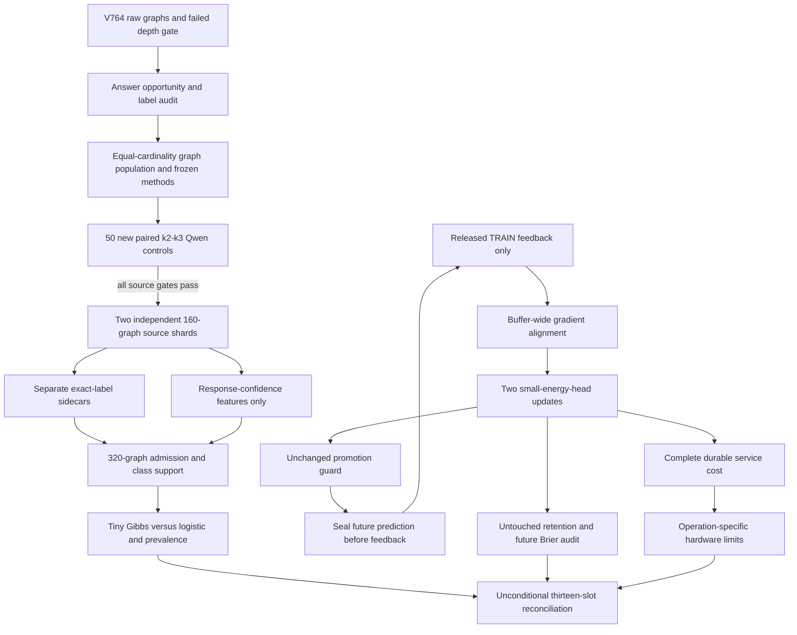
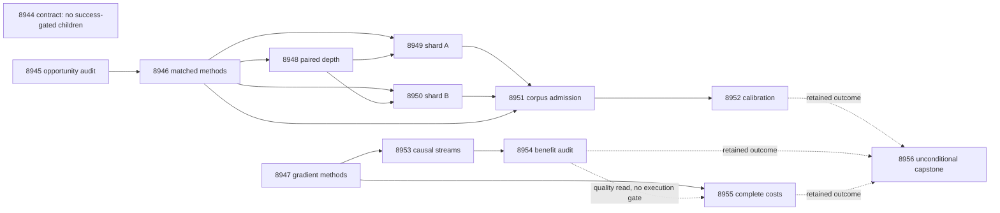

# Carnot Research Roadmap v765: Controlled Graph Errors, Gradient-Informed Replay, and Measured Decision Value

**Created:** 2026-11-09 America/New_York
**Milestone:** 2026.11.765
**Status:** Planned; staged only
**Supersedes:** Completed 2026.11.764, Exp8930–Exp8943
**Task contract:** Exactly 13 tasks, Exp8944 through Exp8956, in the execution order below.
**Execution file:** `research-roadmap-next.yaml`

The completed V764 design and queue are preserved byte for byte in
`research-roadmap-v764-preserved-20261109.md` and
`research-roadmap-v764-queue-preserved-20261109.yaml`. The completed-history
YAML currently ends at V763; V764 primary artifacts, its capstone and conductor
receipts establish its terminal outcomes. This plan does not activate a queue.

## What V764 proved

| Evidence | Qualified finding | Consequence |
|---|---|---|
| Exp8930/8931 | Fourteen-task authority, source methods and confidence capture controls qualify. | Reuse these helpers and retained authority. Avoid a global contract-success gate. |
| Exp8932 | All 43 errors among 50 original pilot answers are semantic wrong-distance answers; none is malformed. | Final-answer graph truth is usable. It is not first-error localization. |
| Exp8934 | 42/50 errors at k2,39/50 at k3; paired difference -0.06,95% interval [-0.222397,0.102397]. All 100 answers and confidence signals exist. | The empirical depth-rise gate fails. Keep old collection closed. |
| Exp8935/8936/8938/8939 | Four collection/admission/detector slots were scheduler-skipped. | No 320-graph corpus or learned detector result exists. New tasks require a changed source and current gates. |
| Exp8937 | Tiny Gibbs, logistic, prevalence and format/length calibration methods qualify on fixtures. | Reuse frozen methods; fixture readiness does not establish live detector value. |
| Exp8940/8941 | 24 paired streams and 23040 comparison rows qualify. Future Brier upper bounds are +0.000063875 versus frozen,+0.0276520 versus current,+0.0241193 versus uniform,+0.000063875 versus permuted. | All four benefit conditions fail; retention passes. Close unchanged signature replay. |
| Exp8942 | Complete durable replay cost is measured with outer clocks. No deployment recommendation or hardware speedup is supported. | Charge the new selection work in full and include a real no-scan deployment baseline. |
| Exp8943 | All 14 slots accounted for; capstone class is blocked. | Retain branch outcomes and actual skip paths; do not retry external blocks as partial. |

A planning-only reduction of Exp8931's50 control graphs found mean valid-answer
counts 8.76 at k2 and 14.96 at k3. This structural imbalance is observed; its
causal contribution to the error reversal is unknown. Exp8945 authenticates and
expands the diagnosis. A larger answer set can offset greater reasoning depth.

## The three largest gaps to the PRD

1. **FR-12: independent, useful verification of real model errors.** Exact
   labels exist for a pilot, but the detector evaluation never ran. Separate
   label correctness, source difficulty and learned detection. Match answer
   opportunity before a fresh paired control, then collect and evaluate only
   if that source qualifies. General natural-language verification stays open.
2. **FR-06/FR-11: useful continuous self-learning.** Existing causal storage,
   delayed feedback and retention work; signature replay does not establish
   future benefit. Test actual released-label gradient alignment in the small
   energy head. Keep every previous threshold and add the old signature method
   as a comparator. The frozen 27B generator receives no training changes.
3. **FR-05/FR-08/NFR-01: decisions with a measured production advantage.**
   Complete costs exist, but useful learning and hardware advantage do not.
   Measure the extra buffer-wide gradient scan, persistence and restart against
   both equal-work research arms and ordinary deployed work. A Rust port or
   hardware purchase is premature without quality and complete-cost evidence.

## Research incorporated before design

The dated V765 entry in `research-references.md` was written before the task
specifications. It records all eight requested topics, six secondary channels,
access failures and a bounded Semantic Scholar citation sample.

| Primary source | Adopted experiment and boundary |
|---|---|
| [ImplicitHop](https://arxiv.org/abs/2610.41169), October 2026 | Diagnose answer opportunity and freeze matched-cardinality graph sources, Exp8945/8946/8948. This is a local control, not a reproduction claim. |
| [Replay and gradient alignment](https://arxiv.org/abs/2508.01908), August 2025 | Replace signature distance with released-label gradient alignment, Exp8947/8953/8954. Charge all candidate gradients. This does not reproduce LLM pretraining. |
| [Reasoning or pattern exploitation](https://arxiv.org/abs/2610.39182), October 2026 | Freeze label/edge order and nuisance controls; do not infer reasoning from a shortcut. |
| [Distributional EBMs](https://arxiv.org/abs/2605.18871), May 2026 | Separate exact penalties, learned scores and truth; reuse calibration controls in Exp8951/8952. |
| [FPGA–ASIC co-design v2](https://arxiv.org/abs/2602.15985), September 2026 | Measure orchestration and complete service work before hardware claims, Exp8955. |

KG-Guard is a future context-aware comparator. KAC/KAN retention changes,
new neural constraint layers, guided generation and new samplers are deferred:
none addresses the immediate independent-label and forward-benefit questions
without another source of change. EBT and ARM–EBM remain background substrates;
the hybrid verifier role and closed energy-as-generator findings stand.

OpenReview search returned relevant 2026 manuscripts, but direct EBT access hit
browser verification. HF's EBT page loaded; KG-Guard's did not. Semantic Scholar
returned ten citations for each anchor; EBT had another page, so the scan is
partial. GitHub trending provided no usable relevant ranking; author repositories
were discovery leads only. Extropic advertises 2027 Z1 early access. Kona's page
adds no executable local protocol. Vendor statements are not hardware receipts.

## Architecture



The source and learning branches are independent scientific questions. The
source learns final-answer calibration on real Qwen responses. The continuous
learning branch uses constructed exact-oracle worlds and cannot establish
natural-language improvement. Gate booleans denote the exact property named,
not global success. Methods readiness, completed rows and scientific benefit
remain separate fields.

## Phase 1 — diagnose and freeze methods (Exp8944–Exp8947)

Exp8944 binds the complete contract and archives original authority; it does
not gate CPU science. Exp8945 authenticates 50 paired graphs and independently
checks shortest-path labels, valid-answer counts and chance accuracy. It reports
a structural confound without inventing a causal explanation or re-running Qwen.

Exp8946 retains random graphs with 50–60 nodes and edge probability 3/(n-1),
conditioned on equal, nonzero numbers of valid answers at k2 and k3. This is a
restricted population; no result generalizes automatically to all random graphs.
Each graph gets at most 2000 proposals, with a240-second total construction cap.
Exhaustion closes feasibility; it cannot trigger a new population or threshold.
Freeze 50 control graphs plus 320 collection graphs before any response. Exclude
all historical source graph identities, including unused V764 collection graphs.
Random labels and edge order remain fixed across each paired condition.

Freeze the existing two confidence features and qualified calibration methods
at the same time. No traversal, answer set, true distance, label, split or graph
identity enters detector features. Source custody and oracle labels remain in
separate views. Mean token NLL and first-answer top-two margin come from actual
backend signals; missing signals cannot be replaced by invented probabilities.

Exp8947 changes replay selection only. It keeps the signed feature map, SGD 0.1,
buffer 32, delay 8, guard and retention protocol. At W1 after the current update,
compute current and prior-buffer gradients, select maximal cosine alignment,
and apply one replay gradient. Zero norms score zero; stable IDs break ties;
an empty buffer repeats current. Only released TRAIN labels may affect this.
Six arms are frozen/current/uniform/signature/gradient/permuted-gradient.
Every trainable research arm pays for the scan; applied gradients remain two.

Eight new development streams must exercise nonzero gradients and at least one
selection difference from signature replay. Otherwise the mechanism closes
without fresh evaluation. Tests include same-feature/opposite-label gradients,
future-label mutation and exact restart. More promotions are not a benefit gate.

## Phase 2 — bounded source control and collection (Exp8948–Exp8950)

Exp8948 runs 100 short answers on 50 fresh paired graphs. It requires exact label
agreement, usable signals, complete responses, empirical error_k3>error_k2 and
error_k2>=20%. Paired 95% uncertainty is reported separately. Failure stops both
shards. The original gate is not weakened and old failures remain unchanged.

Exp8949 and Exp8950 each collect 160 distinct graphs at k2, with 80 train,
40 calibration and 40 test roles frozen before inference. Each shard has its own
scheduler identity and no success dependency on the other shard. Each gets
1800 seconds of generation,240-second preflight and load limits,30 seconds per
request and no retries. Resume preserves the first response under matching
hashes; no outcome-based replenishment or class balancing is allowed.

All three live tasks use `unsloth/Qwen3.8-27B-GGUF`, Q4_K_M, GPU 0 only,
reasoning off, temperature 0 and a16-token cap. Their substrate is
`model_bounded_generation` (10-second floor). A genuine load-only failure uses
`model_load_no_generation` (2 seconds). No full-generative task is planned;
`model_full_generation` would have a60-second floor. Never pad runtime.

## Phase 3 — independent decisions and future streams (Exp8951–Exp8953)

Exp8951 admits exactly 320 complete graph responses with 160/80/80 roles,
at least 200 independent incorrect answers, and at least 5 correct and 5 incorrect
answers per split. These are feasibility thresholds, not power guarantees.
Corpus shortfalls are valid nulls; absent shards are blocks. No labels are
rebalanced. The frozen calibration protocol must qualify under retained authority.

Exp8952 fits the existing tiny Gibbs and same-feature logistic methods on train,
calibrates on calibration, then opens test labels once. Prevalence and nuisance
controls stay visible. Benefit requires simultaneous 95% one-sided graph-bootstrap
bounds: Brier improvement strictly above zero versus prevalence and logistic;
accepted-error delta versus logistic at exactly 50% coverage at most zero.
Typed accept/reject/escalate probabilities use the earlier frozen thresholds;
the diagnostic coverage ranking is not a risk certificate. Report statistical
power limitations. No further data, threshold search or generator training is
allowed after opening test labels.

Exp8953 runs the independent CPU branch on 24 sealed streams, six arms and 48
online queries. Each arm also evaluates 48 untouched retention queries at
checkpoints 0/24/48. There are 27648 query comparison rows and 55296 Brier/error
endpoint cells; only 24 streams are independent. Prediction sealing, eight-query
label delay and query 24 exact restart remain mandatory. Pending labels at the
horizon remain pending. The permuted arm uses its own corrupted released TRAIN
labels for both selection and update, so equal selected IDs are not required.

## Phase 4 — benefit, complete cost and closure (Exp8954–Exp8956)

Exp8954 preserves the old ten conditions and adds a signature-replay contrast.
All 11 one-sided bounds share family alpha 0.01, using 10000 whole-stream paired
bootstrap draws. On future queries 25–48, gradient-minus-frozen Brier upper
bound must be<=-0.01; gradient-minus-current/uniform/signature/permuted bounds
must be<0. All six retention Brier/error upper bounds must be<=0.01.
Neither training loss, diversity nor promotions can replace these conditions.
A constructed-oracle success is `circular_positive`, never a natural-language win.

Exp8955 measures 24 new paired process seeds and five trainable research arms
for 48 complete cycles, including cold start, candidate scans, guards, persistence,
fsync, restart and tail drain. It adds ordinary current-update service without
artificial scans as a separately named deployment comparator. Report complete
latency, memory and operation counts for both comparisons. Cost measurement
requires methods readiness but not positive benefit or a successful source branch.
A deployment recommendation requires positive qualified benefit and a favorable
measured tradeoff. Missing quality evidence cannot erase valid cost measurements.

Exp8956 runs unconditionally. It accounts for all 13 slots, finds skips by actual
scheduler identity, preserves flags and reduces qualified rows without rerunning
science. It recommends exact scope retirement and future evidence requirements.
External blocks are terminal `blocked`; `partial` is reserved for unfinished
owned work. Read stable publication G1–G4 through `publication_gate.py --json`,
with its existing FoVer-paper scope explicitly separate from V765 findings.

## Dependency graph



Every structured gate names an earlier task in this roadmap and an identical
field in that producer's REQUIRED ARTIFACT FIELDS. No `requires` chain points
to a retired experiment. Historical files are authenticated retained evidence.
Neither the contract task nor CUDA availability gates independent CPU science.

## Hardware requirements and boundaries

| Resource | Requirement and scope |
|---|---|
| CPU and system RAM | All graph construction, exact labels, small-head training, causal memory, audits and durable timing. Reuse installed Python/JAX/NumPy and existing helpers. |
| RTX 3090 GPU 0,24GB | Three bounded source tasks only, sequentially through the conductor lease. Verify cached GGUF hash and actual offload on every invocation. |
| GPU 1 | Detached; never allocate it. No dual-GPU work or GPU repair is included. |
| KV 260 | Preserve qualified quadratic sampler scope at k_max<=5. No new bitstream, gradient scan or service-speed claim. |
| PolarFire | Existing Linux CPU dispatch only; no fabric acceleration inferred. |
| GateMate | Unchanged physical/JTAG 0xffffffff block; no repeated probe. |
| NPU/APU and TSU | Candidate future batching/energy paths only; runtime qualification and transfer costs are absent. Extropic 2027 vendor timing is not access. |

Tier 1/2 self-learning runs small counter/store and gradient operations on CPU.
The buffer's gradient matrix and dot products have a batch-GPU/NPU path, with
O(buffer_size × head_parameters) work. Persistent writes and guard checks remain
host work. The program's100x aspiration needs a measured removable fraction and
end-to-end transfer/durability costs; these are unknown. Do not report a100x
projection. No wishlist purchase is required to answer this milestone's questions.
A later accelerator study is justified only by useful learning and measured
selection cost. NFR-01's10x Rust throughput target also remains unproved here.

## Execution, evidence and failure discipline

Every prompt requires numbered flushed progress at phase boundaries, before and
after minute-scale calls and at least every 60 seconds inside long loops or child
supervision. Every silence gap must remain below 600 seconds. The practical work
target is 4200 seconds with validation inside the 4800-second hard cap. Each large
file is written in 150–200-line calls with progress between them.

All task deliverables are explicit JSON paths below. Each requires per-unit rows,
closed `verdict_class`, terminal `honest_verdict`, exact `gate_check_summary`,
source/code/config/raw hashes and actual invocation counts. Oracle-derived
verification is marked circular. Metadata readiness is not scientific benefit.
No archival producer is restamped as current compute. No model-duration padding,
simulation fallback, outcome selection or silent missing-unit removal is allowed.

Each task carries complete prior-failure metadata, including
`retire_if_same_verdict: true`, and a concrete changed method or prerequisite.
The collection/admission/calibration chain cites the actual Exp8935 blocked
artifact; absent sibling primaries are not assigned invented verdict strings.
The V764 depth gate and fixed signature replay remain closed in their original
scope. The new matched graph population and released-gradient selector are
explicit versioned continuations. No retired task ID is reused.

Routing follows the current request: the contract/schema task uses Opus 100;
formulaic source/corpus work uses Codex `gpt-6.1-sol`; routine scientific tasks
use the default Claude/Sonnet route. No Luna task or Gemini route is proposed.
No subagents are needed for planning. The generator mandate is independent of
these execution-agent choices.

## Validation and reconciliation plan

Before implementation, each task extends its planned REQ/SCENARIO and writes
failing tests. It runs scoped unit/child coverage, Ruff, strict mypy, spec coverage,
private E2E-018/021 publication/replay cases and tamper rejection. New owned
statements require 100% measured coverage with zero exclusions. Existing global
debt stays separate. No tests may rewrite historical results or operator prose.

This planning change validates schema, complete table/JSON/YAML equality,
gate fields/order, prior-failure metadata, exclusion risks and source paths.
Relevant existing unit tests and private CLI E2E cases exercise the planning
contract. Experiments, GPU runs and hardware benchmarks are future work; no
planning test substitutes for their results. Validation receipts are appended
below when checks finish.

Requirements in `openspec/capabilities/research-reporting/spec.md` and BMAD
traceability remain **Planned**. Ops and architecture describe proposed scope,
not implemented behavior. Active `research-roadmap.yaml`, the conductor and the
exclusion manifest remain untouched. No push, external publication or activation.

## Exact task contract

The visible table and embedded full task objects below are authoritative. They
must equal `research-roadmap-next.yaml`, including order, prompts, routes,
priors, gates, model declarations and deliverables. No aspirational tasks exist
outside these 13 slots.

| Order | ID | Title | Phase | Deliverable |
|---|---|---|---|---|
| 1 | exp8944-branch-contract | Bind thirteen tasks and preserve completed V764 authority | 1 | `results/experiment_8944_v765_branch_contract.json` |
| 2 | exp8945-depth-opportunity-audit | Measure answer-set opportunity in the failed depth control | 1 | `results/experiment_8945_v765_depth_opportunity_audit.json` |
| 3 | exp8946-matched-source-methods | Freeze equal-opportunity graph sources and unchanged calibration controls | 1 | `results/experiment_8946_v765_matched_source_methods.json` |
| 4 | exp8947-gradient-replay-methods | Freeze released-label gradient selection for continuous energy learning | 1 | `results/experiment_8947_v765_gradient_replay_methods.json` |
| 5 | exp8948-matched-depth-control | Test paired depth sensitivity with equal answer opportunity | 2 | `results/experiment_8948_v765_matched_depth_control.json` |
| 6 | exp8949-matched-corpus-a | Collect matched-population Qwen corpus shard A | 2 | `results/experiment_8949_v765_matched_corpus_a.json` |
| 7 | exp8950-matched-corpus-b | Collect matched-population Qwen corpus shard B | 2 | `results/experiment_8950_v765_matched_corpus_b.json` |
| 8 | exp8951-matched-corpus-admission | Authenticate matched graph labels and frozen calibration authority | 3 | `results/experiment_8951_v765_matched_corpus_admission.json` |
| 9 | exp8952-matched-calibrated-decisions | Evaluate energy decisions on unseen matched-population model errors | 3 | `results/experiment_8952_v765_matched_calibrated_decisions.json` |
| 10 | exp8953-gradient-causal-streams | Measure continuous gradient-informed replay on sealed future streams | 3 | `results/experiment_8953_v765_gradient_causal_streams.json` |
| 11 | exp8954-gradient-benefit-audit | Audit prospective gradient-selection benefit and joint retention | 4 | `results/experiment_8954_v765_gradient_benefit_audit.json` |
| 12 | exp8955-gradient-complete-cost | Measure complete gradient-selection costs and hardware limits | 4 | `results/experiment_8955_v765_gradient_complete_cost.json` |
| 13 | exp8956-capstone | Reconcile thirteen outcomes and close exact unchanged scopes | 4 | `results/experiment_8956_v765_capstone.json` |

<!-- V765_TASK_CONTRACT_START -->
```json
{
  "milestone": "2026.11.765",
  "tasks": [
    {
      "id": "exp8944-branch-contract",
      "title": "Bind thirteen tasks and preserve completed V764 authority",
      "phase": 1,
      "track": "research",
      "priority": "high",
      "requires_gpu": false,
      "max_turns": 100,
      "estimated_wall_time_min": 35,
      "per_unit_rows": true,
      "milestone": "2026.11.765",
      "deliverable": "results/experiment_8944_v765_branch_contract.json",
      "inference_substrate_class": "no_model_load",
      "MODEL_SPECS": [],
      "gated_on": [],
      "prior_failures": [
        {
          "experiment_id": "exp8891-branch-contract",
          "verdict": "complete_disqualified_v761_branch_contract",
          "addressed_by": "Reuse qualified V764 contract logic with a new complete thirteen-task authority; preserve prior bytes and validate the full table and prompt objects.",
          "retire_if_same_verdict": true
        }
      ],
      "model": "opus",
      "prompt": "CONTEXT:\nV764 completed fourteen slots but four source/calibration slots were skipped. V765 is a staged proposal. A scheduler OK is not scientific benefit. Preserve the original V764 design and queue, including its failed source gate.\n\nEXISTING CODE TO READ FIRST:\n- CLAUDE.md\n- CODEX.md\n- research-program.md\n- openspec/capabilities/research-reporting/spec.md\n- openspec/change-proposals/research-roadmap-vNEXT.md\n- scripts/experiment_template.py\n- python/carnot/reporting/current_work_receipt.py\n- python/carnot/reporting/primary_publication.py\n- ops/e2e-test-plan.md\n- python/carnot/reporting/roadmap_contract.py\n- python/carnot/reporting/v764_branch_contract.py\n- results/experiment_8943_v764_capstone.json\n- ops/exclusion_manifest.yaml\n- research-references.md\n\nTASK:\nBind thirteen tasks and preserve completed V764 authority. Deliver results/experiment_8944_v765_branch_contract.json for 2026.11.765.\n\nCONCRETE STEPS:\n1. Read the sources and REQ-REPORT-8944 / SCENARIO-REPORT-8944-CONTRACT. Work in {project_root}. Authenticate branch inputs before costly work. Historical references are retained inputs, never runtime gates on retired task IDs.\n2. Emit a flushed progress line at every phase boundary and before and after every model load, generation, benchmark or subprocess that can take minutes. Use python -u and print(..., flush=True); forward child output. Inside long loops and subprocess supervision print completed/pending counts at least every 60 seconds. Keep every silence gap below 600 seconds, including time between tool calls. Target work below 4200 seconds and retain validation time within the 4800-second hard cap.\n3. Keep each tool call bounded. Write any file over about 200 lines in several tool calls of at most 150-200 lines, with a progress message between calls. Put experiment scripts in scripts/experiments/, tests in tests/python/, and scratch in /tmp; never put scratch files in the repository root.\n4. Compare the visible table, embedded full task objects and staged-or-activated YAML for exactly Exp8944-Exp8956 in order, including prompts, routes, priors, gates and paths. Reuse roadmap_contract with explicit milestone, first_id and count. Snapshot the matching V765 authority; accept a matching activated queue if staging was consumed. Do not activate anything.\n5. Test missing task, changed order/prompt/path, missing producer field, mutated retained bytes and consumed staging. Historical producers use retained original authority, not the mutable vNEXT document. No science branch gates on contract_ready_score.\n6. Ingest the November 9 literature map as source/method/control rows. Preserve the V764 primary and scheduler-skip paths exactly; do not invent missing deliverables. Confirm no retired runtime requires chain. Record current model calls as zero and historical calls only as opaque producer references.\n7. Before implementation, extend the named REQ/SCENARIO and write failing tests. Reuse existing helpers and preserve original assertions and producer bytes. Run scoped pytest with measured 100-percent newly owned unit/child statement coverage and zero exclusions, Ruff check and format --check, strict mypy, and scripts/check_spec_coverage.py with positional test paths. Run applicable private E2E-018/021 CLI cases, cold replay and rehashed-tamper refusal. Keep writes in private scratch during tests. Record existing global test debt separately; do not waive failed owned checks.\n8. Publish the final artifact only after required checks pass through primary_publication. Preserve comparison rows, input/code/config/raw hashes, actual clocks, counts and reproduction commands. Missing external evidence is terminal blocked with gate_check_summary naming upstream, check, exact field, expected and observed value. Failed owned validation is disqualified. partial is only for unfinished owned work that another attempt can complete; never for unchanged external blocks. Never fabricate or sleep to meet a duration floor.\n\nREQUIRED ARTIFACT FIELDS:\n- experiment_id, task_id, milestone, run_date, random_seed, reproducibility_checksum, execution_venue, methodology_note.\n- honest_verdict: terminal prefix complete_ followed by the actual disposition and scope; retain the prior disposition for unchanged rerun failures so retirement can compare it.\n- verdict_class: exactly one of positive | circular_positive | null | blocked | disqualified | partial; verifier_is_oracle=true forbids positive; any failed acceptance gate forbids positive.\n- inference_substrate, inference_substrate_class, MODEL_SPECS, model_specs, model_invocation_counts, numerical_training_calls, duration_s, phase_spans, preconditions_checked.\n- verifier_is_oracle, exposure_scope, independent_generalization_score, intended_count, completed_count, failed_count, censored_count, excluded_count, independent_count.\n- rows: one typed metric/value/numerator/denominator row per scheduled unit, arm and condition, including status and censor reason; cluster_id states the independent unit. Aggregate claims must recompute from rows.\n- gate_check_summary: exact upstream, path/hash, check, artifact_field, expected and observed for every blocked prerequisite; distinguish missing_file, missing_field, observed_zero and rejected_producer.\n- source_artifact_hashes, code_config_hashes, raw_shard_hashes, field_principles, acceptance_gates, required_checks_passed, owned_statement_coverage, validation_receipts, global_test_debt.\n- contract_ready_score: integer 0 or 1; one only when all contract controls and owned checks pass.\n- full_task_objects, canonical_tasks_sha256, contract_rows, gate_edge_rows, prior_scope_rows, source_method_rows, preserved_v764_reference.\n\nRun command: cd {project_root} && PYTHONPATH=python .venv/bin/python -u scripts/experiments/experiment_8944_v765_branch_contract.py --date {date}\nDo NOT push. Do NOT modify scripts/research_conductor.py."
    },
    {
      "id": "exp8945-depth-opportunity-audit",
      "title": "Measure answer-set opportunity in the failed depth control",
      "phase": 1,
      "track": "research",
      "priority": "high",
      "requires_gpu": false,
      "max_turns": 30,
      "estimated_wall_time_min": 40,
      "per_unit_rows": true,
      "milestone": "2026.11.765",
      "deliverable": "results/experiment_8945_v765_depth_opportunity_audit.json",
      "inference_substrate_class": "no_model_load",
      "MODEL_SPECS": [],
      "gated_on": [],
      "prior_failures": [
        {
          "experiment_id": "exp8934-depth-control",
          "verdict": "complete_null_paired_depth_control",
          "addressed_by": "Replace an unchanged live rerun with a read-only label and answer-cardinality diagnosis; quantify the 8.76 versus 14.96 opportunity imbalance before changing the source.",
          "retire_if_same_verdict": true
        }
      ],
      "prompt": "CONTEXT:\nExp8934 has 42/50 errors at k2 and 39/50 at k3. A planning read of Exp8931 found mean valid-answer counts 8.76 and 14.96. The proposed confound is measurable; it is not yet a causal explanation. Preserve the original failed verdict.\n\nEXISTING CODE TO READ FIRST:\n- CLAUDE.md\n- CODEX.md\n- research-program.md\n- openspec/capabilities/research-reporting/spec.md\n- openspec/change-proposals/research-roadmap-vNEXT.md\n- scripts/experiment_template.py\n- python/carnot/reporting/current_work_receipt.py\n- python/carnot/reporting/primary_publication.py\n- ops/e2e-test-plan.md\n- python/carnot/reporting/graph_source_8931.py\n- python/carnot/reporting/depth_control_8934.py\n- results/experiment_8931_v764_graph_source_methods.json\n- results/experiment_8934_v764_depth_control.json\n- docs/research-notes/bfs-labeled-error-source-plan-2026-11-07.md\n\nTASK:\nMeasure answer-set opportunity in the failed depth control. Deliver results/experiment_8945_v765_depth_opportunity_audit.json for 2026.11.765.\n\nCONCRETE STEPS:\n1. Read the sources and REQ-REPORT-8945 / SCENARIO-REPORT-8945-CONTRACT. Work in {project_root}. Authenticate branch inputs before costly work. Historical references are retained inputs, never runtime gates on retired task IDs.\n2. Emit a flushed progress line at every phase boundary and before and after every model load, generation, benchmark or subprocess that can take minutes. Use python -u and print(..., flush=True); forward child output. Inside long loops and subprocess supervision print completed/pending counts at least every 60 seconds. Keep every silence gap below 600 seconds, including time between tool calls. Target work below 4200 seconds and retain validation time within the 4800-second hard cap.\n3. Keep each tool call bounded. Write any file over about 200 lines in several tool calls of at most 150-200 lines, with a progress message between calls. Put experiment scripts in scripts/experiments/, tests in tests/python/, and scratch in /tmp; never put scratch files in the repository root.\n4. Authenticate all 50 paired raw graphs, prompts and responses. Independently recompute shortest-distance answer sets with a separate all-pairs reference and compare to the stored BFS labels, including disconnected nodes and shortest-path-versus-walk fixtures. No model call or generation retry is allowed.\n5. Emit per graph valid-set sizes, size/n chance accuracy, overlap with direct neighbors, degree, actual answer category, token count and paired error. Recompute the old empirical depth difference and interval. Compare answer-set opportunity without treating 100 answers as 100 independent graphs.\n6. Set diagnosis_ready_score=1 only when all 50 records and label checks authenticate. Report opportunity_confounded_score separately as mean valid-set size at k3 greater than k2. An unsupported causal explanation is null. This receipt licenses a separately frozen matched-cardinality protocol, never reopening old collection.\n7. Before implementation, extend the named REQ/SCENARIO and write failing tests. Reuse existing helpers and preserve original assertions and producer bytes. Run scoped pytest with measured 100-percent newly owned unit/child statement coverage and zero exclusions, Ruff check and format --check, strict mypy, and scripts/check_spec_coverage.py with positional test paths. Run applicable private E2E-018/021 CLI cases, cold replay and rehashed-tamper refusal. Keep writes in private scratch during tests. Record existing global test debt separately; do not waive failed owned checks.\n8. Publish the final artifact only after required checks pass through primary_publication. Preserve comparison rows, input/code/config/raw hashes, actual clocks, counts and reproduction commands. Missing external evidence is terminal blocked with gate_check_summary naming upstream, check, exact field, expected and observed value. Failed owned validation is disqualified. partial is only for unfinished owned work that another attempt can complete; never for unchanged external blocks. Never fabricate or sleep to meet a duration floor.\n\nREQUIRED ARTIFACT FIELDS:\n- experiment_id, task_id, milestone, run_date, random_seed, reproducibility_checksum, execution_venue, methodology_note.\n- honest_verdict: terminal prefix complete_ followed by the actual disposition and scope; retain the prior disposition for unchanged rerun failures so retirement can compare it.\n- verdict_class: exactly one of positive | circular_positive | null | blocked | disqualified | partial; verifier_is_oracle=true forbids positive; any failed acceptance gate forbids positive.\n- inference_substrate, inference_substrate_class, MODEL_SPECS, model_specs, model_invocation_counts, numerical_training_calls, duration_s, phase_spans, preconditions_checked.\n- verifier_is_oracle, exposure_scope, independent_generalization_score, intended_count, completed_count, failed_count, censored_count, excluded_count, independent_count.\n- rows: one typed metric/value/numerator/denominator row per scheduled unit, arm and condition, including status and censor reason; cluster_id states the independent unit. Aggregate claims must recompute from rows.\n- gate_check_summary: exact upstream, path/hash, check, artifact_field, expected and observed for every blocked prerequisite; distinguish missing_file, missing_field, observed_zero and rejected_producer.\n- source_artifact_hashes, code_config_hashes, raw_shard_hashes, field_principles, acceptance_gates, required_checks_passed, owned_statement_coverage, validation_receipts, global_test_debt.\n- diagnosis_ready_score: integer 0 or 1.\n- opportunity_confounded_score: integer 0 or 1; descriptive structural imbalance, not causal proof.\n- paired_opportunity_rows, label_agreement, paired_depth_interval, historical_gate_preserved, current_generation_calls: 0.\n\nRun command: cd {project_root} && PYTHONPATH=python .venv/bin/python -u scripts/experiments/experiment_8945_v765_depth_opportunity_audit.py --date {date}\nDo NOT push. Do NOT modify scripts/research_conductor.py."
    },
    {
      "id": "exp8946-matched-source-methods",
      "title": "Freeze equal-opportunity graph sources and unchanged calibration controls",
      "phase": 1,
      "track": "research",
      "priority": "high",
      "requires_gpu": false,
      "max_turns": 50,
      "estimated_wall_time_min": 65,
      "per_unit_rows": true,
      "milestone": "2026.11.765",
      "deliverable": "results/experiment_8946_v765_matched_source_methods.json",
      "inference_substrate_class": "no_model_load",
      "MODEL_SPECS": [],
      "gated_on": [
        {
          "upstream": "exp8945-depth-opportunity-audit",
          "artifact_field": "diagnosis_ready_score",
          "op": "==",
          "value": 1
        }
      ],
      "prior_failures": [
        {
          "experiment_id": "exp8934-depth-control",
          "verdict": "complete_null_paired_depth_control",
          "addressed_by": "New graph population conditions on equal nonzero k2/k3 answer-set cardinality, removing measured opportunity imbalance while retaining the original depth-rise gate and fresh controls.",
          "retire_if_same_verdict": true
        },
        {
          "experiment_id": "exp8935-graph-corpus-a",
          "verdict": "blocked_gate_check_failed",
          "addressed_by": "Freeze the existing qualified selector under new source authority; no calibration claim or execution until current-milestone corpus admission passes.",
          "retire_if_same_verdict": true
        }
      ],
      "agent_type": "codex",
      "model": "gpt-6.1-sol",
      "prompt": "CONTEXT:\nThe old random-graph source confounded depth with the number of valid answers. Test the same shortest-distance task on a predeclared restricted graph population whose k2 and k3 valid-set sizes are equal. Do not relax the requirement that error rises with depth.\n\nEXISTING CODE TO READ FIRST:\n- CLAUDE.md\n- CODEX.md\n- research-program.md\n- openspec/capabilities/research-reporting/spec.md\n- openspec/change-proposals/research-roadmap-vNEXT.md\n- scripts/experiment_template.py\n- python/carnot/reporting/current_work_receipt.py\n- python/carnot/reporting/primary_publication.py\n- ops/e2e-test-plan.md\n- python/carnot/reporting/graph_source_8931.py\n- python/carnot/reporting/graph_source_methods_8931.py\n- python/carnot/reporting/calibration_methods_8937.py\n- python/carnot/autoresearch/graph_calibration_benchmark.py\n- results/experiment_8937_v764_calibration_methods.json\n- results/experiment_8945_v765_depth_opportunity_audit.json\n\nTASK:\nFreeze equal-opportunity graph sources and unchanged calibration controls. Deliver results/experiment_8946_v765_matched_source_methods.json for 2026.11.765.\n\nCONCRETE STEPS:\n1. Read the sources and REQ-REPORT-8946 / SCENARIO-REPORT-8946-CONTRACT. Work in {project_root}. Authenticate branch inputs before costly work. Historical references are retained inputs, never runtime gates on retired task IDs.\n2. Emit a flushed progress line at every phase boundary and before and after every model load, generation, benchmark or subprocess that can take minutes. Use python -u and print(..., flush=True); forward child output. Inside long loops and subprocess supervision print completed/pending counts at least every 60 seconds. Keep every silence gap below 600 seconds, including time between tool calls. Target work below 4200 seconds and retain validation time within the 4800-second hard cap.\n3. Keep each tool call bounded. Write any file over about 200 lines in several tool calls of at most 150-200 lines, with a progress message between calls. Put experiment scripts in scripts/experiments/, tests in tests/python/, and scratch in /tmp; never put scratch files in the repository root.\n4. Freeze 50 paired control graphs plus 320 distinct collection graphs with fresh seeds, n in [50,60] and the original edge probability 3/(n-1). Accept only nonempty k2/k3 answer sets of equal size. Cap proposals at 2000 per scheduled graph and 240 seconds total; log all rejected seeds. Graph-generation exhaustion is a terminal feasibility null, not permission to change the population. Check identities against all V763/V764 source graphs, including unused frozen graphs.\n5. Use the same graph/start and prompt layout for paired k2/k3 questions, balanced condition order and random label/edge ordering fixed before inference. Do not expose cardinality in the prompt. Collection asks k2 only from this same restricted population. Freeze two independent 160-graph shards, each 80 train/40 calibration/40 test. Do not select graphs using model responses or class labels.\n6. Reuse the exact response-confidence feature allowlist (mean_token_nll and first_answer_top2_margin), strict parser, label sidecars, bounded runner and first-response checkpoint custody. Freeze Qwen3.8-27B Q4_K_M, GPU 0, temperature 0, reasoning off and max_tokens=16. Separate missing backend features from incorrect answers; no substitute probabilities.\n7. Reuse the qualified tiny Gibbs, same-feature logistic, prevalence and format/length controls from Exp8937. Freeze optimizer, training budget, calibrator and decision thresholds in the new protocol without reading any live collection response. Test synthetic learnable, permuted-label, duplicate-graph, altered-feature and role-leak fixtures. Preserve Brier superiority over prevalence/logistic and accepted-error noninferiority at 50-percent coverage.\n8. Set matched_source_ready_score=1 only when the complete frozen source and calibration protocols and owned controls pass. No model load occurs in this task. A source-method success is not live source feasibility or detector benefit.\n9. Before implementation, extend the named REQ/SCENARIO and write failing tests. Reuse existing helpers and preserve original assertions and producer bytes. Run scoped pytest with measured 100-percent newly owned unit/child statement coverage and zero exclusions, Ruff check and format --check, strict mypy, and scripts/check_spec_coverage.py with positional test paths. Run applicable private E2E-018/021 CLI cases, cold replay and rehashed-tamper refusal. Keep writes in private scratch during tests. Record existing global test debt separately; do not waive failed owned checks.\n10. Publish the final artifact only after required checks pass through primary_publication. Preserve comparison rows, input/code/config/raw hashes, actual clocks, counts and reproduction commands. Missing external evidence is terminal blocked with gate_check_summary naming upstream, check, exact field, expected and observed value. Failed owned validation is disqualified. partial is only for unfinished owned work that another attempt can complete; never for unchanged external blocks. Never fabricate or sleep to meet a duration floor.\n\nREQUIRED ARTIFACT FIELDS:\n- experiment_id, task_id, milestone, run_date, random_seed, reproducibility_checksum, execution_venue, methodology_note.\n- honest_verdict: terminal prefix complete_ followed by the actual disposition and scope; retain the prior disposition for unchanged rerun failures so retirement can compare it.\n- verdict_class: exactly one of positive | circular_positive | null | blocked | disqualified | partial; verifier_is_oracle=true forbids positive; any failed acceptance gate forbids positive.\n- inference_substrate, inference_substrate_class, MODEL_SPECS, model_specs, model_invocation_counts, numerical_training_calls, duration_s, phase_spans, preconditions_checked.\n- verifier_is_oracle, exposure_scope, independent_generalization_score, intended_count, completed_count, failed_count, censored_count, excluded_count, independent_count.\n- rows: one typed metric/value/numerator/denominator row per scheduled unit, arm and condition, including status and censor reason; cluster_id states the independent unit. Aggregate claims must recompute from rows.\n- gate_check_summary: exact upstream, path/hash, check, artifact_field, expected and observed for every blocked prerequisite; distinguish missing_file, missing_field, observed_zero and rejected_producer.\n- source_artifact_hashes, code_config_hashes, raw_shard_hashes, field_principles, acceptance_gates, required_checks_passed, owned_statement_coverage, validation_receipts, global_test_debt.\n- matched_source_ready_score: integer 0 or 1.\n- graph_manifest, proposal_rejection_rows, split_manifest, protocol_hash, feature_schema, frozen_calibration_protocol, calibration_protocol_hash, future_generator_settings, development_control_rows.\n\nRun command: cd {project_root} && PYTHONPATH=python .venv/bin/python -u scripts/experiments/experiment_8946_v765_matched_source_methods.py --date {date}\nDo NOT push. Do NOT modify scripts/research_conductor.py."
    },
    {
      "id": "exp8947-gradient-replay-methods",
      "title": "Freeze released-label gradient selection for continuous energy learning",
      "phase": 1,
      "track": "research",
      "priority": "high",
      "requires_gpu": false,
      "max_turns": 50,
      "estimated_wall_time_min": 70,
      "per_unit_rows": true,
      "milestone": "2026.11.765",
      "deliverable": "results/experiment_8947_v765_gradient_replay_methods.json",
      "inference_substrate_class": "no_model_load",
      "MODEL_SPECS": [],
      "gated_on": [],
      "prior_failures": [
        {
          "experiment_id": "exp8941-compatible-replay-benefit",
          "verdict": "complete_null_compatible_replay_benefit",
          "addressed_by": "Replace label-blind signature distance with released-label gradient alignment; retain signature as a matched-cost arm, all original benefit/retention bounds and fresh streams.",
          "retire_if_same_verdict": true
        }
      ],
      "prompt": "CONTEXT:\nCompatible replay failed all four future-benefit bounds despite retention success. Its selector compares input vectors and ignores label-dependent gradient direction. Replace that proxy with actual gradient alignment, using only released TRAIN labels. This is a falsifiable local adaptation of arXiv:2508.01908, not generator training.\n\nEXISTING CODE TO READ FIRST:\n- CLAUDE.md\n- CODEX.md\n- research-program.md\n- openspec/capabilities/research-reporting/spec.md\n- openspec/change-proposals/research-roadmap-vNEXT.md\n- scripts/experiment_template.py\n- python/carnot/reporting/current_work_receipt.py\n- python/carnot/reporting/primary_publication.py\n- ops/e2e-test-plan.md\n- python/carnot/memory/compatible_replay_8933.py\n- python/carnot/memory/signed_memory_8892.py\n- python/carnot/reporting/compatible_replay_methods_8933.py\n- python/carnot/reporting/guarded_update_methods_8905.py\n- results/experiment_8941_v764_compatible_replay_benefit.json\n- research-references.md\n\nTASK:\nFreeze released-label gradient selection for continuous energy learning. Deliver results/experiment_8947_v765_gradient_replay_methods.json for 2026.11.765.\n\nCONCRETE STEPS:\n1. Read the sources and REQ-REPORT-8947 / SCENARIO-REPORT-8947-CONTRACT. Work in {project_root}. Authenticate branch inputs before costly work. Historical references are retained inputs, never runtime gates on retired task IDs.\n2. Emit a flushed progress line at every phase boundary and before and after every model load, generation, benchmark or subprocess that can take minutes. Use python -u and print(..., flush=True); forward child output. Inside long loops and subprocess supervision print completed/pending counts at least every 60 seconds. Keep every silence gap below 600 seconds, including time between tool calls. Target work below 4200 seconds and retain validation time within the 4800-second hard cap.\n3. Keep each tool call bounded. Write any file over about 200 lines in several tool calls of at most 150-200 lines, with a progress message between calls. Put experiment scripts in scripts/experiments/, tests in tests/python/, and scratch in /tmp; never put scratch files in the repository root.\n4. Keep signed-local-v1 features, SGD rate 0.1, buffer 32, eight-query label delay, operational promotion guard and untouched retention fixed. Use six arms: frozen_verified, guarded_current, uniform_replay, signature_replay, gradient_replay and gradient_permuted. All receive identical true feedback/template information; the permuted arm corrupts only released TRAIN labels with a fixed within-release-block permutation.\n5. After the current TRAIN gradient produces W1, evaluate its current-row gradient and each prior buffer-row gradient at W1. Choose the largest cosine alignment; zero-norm scores are zero, ties use stable unit IDs, and an empty buffer repeats current. Apply that replay gradient as the second SGD update. Exclude the current row from the prior buffer. Labels from pending, guard or retention rows never enter selection. Permuted selection uses its own permuted labels, so its chosen IDs need not equal the true-label arm.\n6. For fair method comparison, every trainable arm performs the same candidate-gradient scan at its own W1 and discards unused candidates. Record actual evaluated and applied gradients separately; charge the scan in full service cost. Preserve the signature and uniform choices as comparators, without copying gradient-selected IDs into them.\n7. Run eight fresh development streams. Measure how often signature and gradient choices disagree, their cosine distributions and promotion outcomes. Require at least one nonzero gradient and a distinct selection on development before setting gradient_methods_ready_score=1. This is mechanism exercise, not a benefit claim. Null exercise closes this method without changing thresholds or testing fresh evaluation streams.\n8. Test delayed-label access, label and signature permutations, opposite-gradient same-feature fixtures, all/none aligned buffers, deterministic ties, equal scans and applied gradients, no retention reads and exact restart. Freeze 24 fresh evaluation streams,48 online queries and 48 retention queries at checkpoints 0/24/48. Preserve all ten prior effect/retention conditions and add a signature comparator:11 bounds, family alpha 0.01,10000 whole-stream bootstrap draws. Candidate-minus-frozen upper<=-0.01; versus current/uniform/signature/permuted upper<0; retention Brier/error upper<=0.01.\n9. Before implementation, extend the named REQ/SCENARIO and write failing tests. Reuse existing helpers and preserve original assertions and producer bytes. Run scoped pytest with measured 100-percent newly owned unit/child statement coverage and zero exclusions, Ruff check and format --check, strict mypy, and scripts/check_spec_coverage.py with positional test paths. Run applicable private E2E-018/021 CLI cases, cold replay and rehashed-tamper refusal. Keep writes in private scratch during tests. Record existing global test debt separately; do not waive failed owned checks.\n10. Publish the final artifact only after required checks pass through primary_publication. Preserve comparison rows, input/code/config/raw hashes, actual clocks, counts and reproduction commands. Missing external evidence is terminal blocked with gate_check_summary naming upstream, check, exact field, expected and observed value. Failed owned validation is disqualified. partial is only for unfinished owned work that another attempt can complete; never for unchanged external blocks. Never fabricate or sleep to meet a duration floor.\n\nREQUIRED ARTIFACT FIELDS:\n- experiment_id, task_id, milestone, run_date, random_seed, reproducibility_checksum, execution_venue, methodology_note.\n- honest_verdict: terminal prefix complete_ followed by the actual disposition and scope; retain the prior disposition for unchanged rerun failures so retirement can compare it.\n- verdict_class: exactly one of positive | circular_positive | null | blocked | disqualified | partial; verifier_is_oracle=true forbids positive; any failed acceptance gate forbids positive.\n- inference_substrate, inference_substrate_class, MODEL_SPECS, model_specs, model_invocation_counts, numerical_training_calls, duration_s, phase_spans, preconditions_checked.\n- verifier_is_oracle, exposure_scope, independent_generalization_score, intended_count, completed_count, failed_count, censored_count, excluded_count, independent_count.\n- rows: one typed metric/value/numerator/denominator row per scheduled unit, arm and condition, including status and censor reason; cluster_id states the independent unit. Aggregate claims must recompute from rows.\n- gate_check_summary: exact upstream, path/hash, check, artifact_field, expected and observed for every blocked prerequisite; distinguish missing_file, missing_field, observed_zero and rejected_producer.\n- source_artifact_hashes, code_config_hashes, raw_shard_hashes, field_principles, acceptance_gates, required_checks_passed, owned_statement_coverage, validation_receipts, global_test_debt.\n- gradient_methods_ready_score: integer 0 or 1, requiring exercised method and owned controls, not development benefit.\n- optimizer_equations, released_label_access_rows, candidate_gradient_rows, development_rows, selection_disagreement, protocol_hash, frozen_evaluation_manifest, hardware_path.\n\nRun command: cd {project_root} && PYTHONPATH=python .venv/bin/python -u scripts/experiments/experiment_8947_v765_gradient_replay_methods.py --date {date}\nDo NOT push. Do NOT modify scripts/research_conductor.py."
    },
    {
      "id": "exp8948-matched-depth-control",
      "title": "Test paired depth sensitivity with equal answer opportunity",
      "phase": 2,
      "track": "research",
      "priority": "high",
      "requires_gpu": true,
      "max_turns": 50,
      "estimated_wall_time_min": 60,
      "per_unit_rows": true,
      "milestone": "2026.11.765",
      "deliverable": "results/experiment_8948_v765_matched_depth_control.json",
      "inference_substrate_class": "model_bounded_generation",
      "MODEL_SPECS": [
        "unsloth/Qwen3.8-27B-GGUF"
      ],
      "gated_on": [
        {
          "upstream": "exp8946-matched-source-methods",
          "artifact_field": "matched_source_ready_score",
          "op": "==",
          "value": 1
        }
      ],
      "prior_failures": [
        {
          "experiment_id": "exp8934-depth-control",
          "verdict": "complete_null_paired_depth_control",
          "addressed_by": "Use fresh equal-cardinality graphs to remove measured answer-opportunity imbalance while preserving the empirical depth-rise criterion and the failed historical result.",
          "retire_if_same_verdict": true
        }
      ],
      "prompt": "CONTEXT:\nExp8934 failed its old depth-rise gate. Exp8946 changes graph sampling by matching valid-answer cardinality at k2/k3, while preserving graph size, model and decoding. This is a fresh prospective control, not a reclassification of the old null.\n\nEXISTING CODE TO READ FIRST:\n- CLAUDE.md\n- CODEX.md\n- research-program.md\n- openspec/capabilities/research-reporting/spec.md\n- openspec/change-proposals/research-roadmap-vNEXT.md\n- scripts/experiment_template.py\n- python/carnot/reporting/current_work_receipt.py\n- python/carnot/reporting/primary_publication.py\n- ops/e2e-test-plan.md\n- python/carnot/reporting/depth_control_runner_8934.py\n- python/carnot/reporting/depth_control_8934.py\n- results/experiment_8946_v765_matched_source_methods.json\n- scripts/experiment_template.py\n\nTASK:\nTest paired depth sensitivity with equal answer opportunity. Deliver results/experiment_8948_v765_matched_depth_control.json for 2026.11.765.\n\nCONCRETE STEPS:\n1. Read the sources and REQ-REPORT-8948 / SCENARIO-REPORT-8948-CONTRACT. Work in {project_root}. Authenticate branch inputs before costly work. Historical references are retained inputs, never runtime gates on retired task IDs.\n2. Emit a flushed progress line at every phase boundary and before and after every model load, generation, benchmark or subprocess that can take minutes. Use python -u and print(..., flush=True); forward child output. Inside long loops and subprocess supervision print completed/pending counts at least every 60 seconds. Keep every silence gap below 600 seconds, including time between tool calls. Target work below 4200 seconds and retain validation time within the 4800-second hard cap.\n3. Keep each tool call bounded. Write any file over about 200 lines in several tool calls of at most 150-200 lines, with a progress message between calls. Put experiment scripts in scripts/experiments/, tests in tests/python/, and scratch in /tmp; never put scratch files in the repository root.\n4. Check the cached mandated GGUF through cached_sota_pair() and its actual model_path, llama_cpp GPU-offload support, GPU 0 availability and the existing resource lease before load. GPU 1 is detached. Use an owned llama.cpp server; never terminate another job. Record actual offloaded layers, GGUF/server/prompt hashes, raw content, token usage and logprobs. MODEL_SPECS must contain unsloth/Qwen3.8-27B-GGUF. Use Q4_K_M, temperature 0, reasoning off,16 output tokens and no retries; CARNOT_FORCE_LIVE=1 forbids simulated fallback. Actual short generation is model_bounded_generation (10s floor); a real load without generation is model_load_no_generation (2s), never full generation (60s). Never pad elapsed time.\n5. Run the frozen 50 paired graphs exactly once per condition,100 bounded answers total; keep order balanced and stateless. Bound preflight and load to 240 seconds each, generation to 1200 seconds and each request to 30 seconds. Print every 10 answers and supervise child heartbeats every 60 seconds. Preserve failed and censored scheduled answers; do not replace them.\n6. Compute final-answer truth with independent graph code after raw response capture. Require all 100 answers, authenticated labels, usable response-confidence signals, error_k3>error_k2 and k2 error rate>=0.20. Emit the paired graph-bootstrap 95-percent interval separately; the operational rise condition is not a significance claim. If either gate fails, collection stays blocked; do not change k, graph population, token cap or thresholds.\n7. Record signal_capture_ready_score independently from depth_source_ready_score. The latter is 1 only when every source criterion and owned validation passes. Equal answer counts must hold for every pair. Retain chance accuracy and malformed/out-of-graph/semantic counts. This task uses an oracle to label source errors and cannot establish detector advantage.\n8. Before implementation, extend the named REQ/SCENARIO and write failing tests. Reuse existing helpers and preserve original assertions and producer bytes. Run scoped pytest with measured 100-percent newly owned unit/child statement coverage and zero exclusions, Ruff check and format --check, strict mypy, and scripts/check_spec_coverage.py with positional test paths. Run applicable private E2E-018/021 CLI cases, cold replay and rehashed-tamper refusal. Keep writes in private scratch during tests. Record existing global test debt separately; do not waive failed owned checks.\n9. Publish the final artifact only after required checks pass through primary_publication. Preserve comparison rows, input/code/config/raw hashes, actual clocks, counts and reproduction commands. Missing external evidence is terminal blocked with gate_check_summary naming upstream, check, exact field, expected and observed value. Failed owned validation is disqualified. partial is only for unfinished owned work that another attempt can complete; never for unchanged external blocks. Never fabricate or sleep to meet a duration floor.\n\nREQUIRED ARTIFACT FIELDS:\n- experiment_id, task_id, milestone, run_date, random_seed, reproducibility_checksum, execution_venue, methodology_note.\n- honest_verdict: terminal prefix complete_ followed by the actual disposition and scope; retain the prior disposition for unchanged rerun failures so retirement can compare it.\n- verdict_class: exactly one of positive | circular_positive | null | blocked | disqualified | partial; verifier_is_oracle=true forbids positive; any failed acceptance gate forbids positive.\n- inference_substrate, inference_substrate_class, MODEL_SPECS, model_specs, model_invocation_counts, numerical_training_calls, duration_s, phase_spans, preconditions_checked.\n- verifier_is_oracle, exposure_scope, independent_generalization_score, intended_count, completed_count, failed_count, censored_count, excluded_count, independent_count.\n- rows: one typed metric/value/numerator/denominator row per scheduled unit, arm and condition, including status and censor reason; cluster_id states the independent unit. Aggregate claims must recompute from rows.\n- gate_check_summary: exact upstream, path/hash, check, artifact_field, expected and observed for every blocked prerequisite; distinguish missing_file, missing_field, observed_zero and rejected_producer.\n- source_artifact_hashes, code_config_hashes, raw_shard_hashes, field_principles, acceptance_gates, required_checks_passed, owned_statement_coverage, validation_receipts, global_test_debt.\n- depth_source_ready_score: integer 0 or 1; exact collection prerequisite.\n- signal_capture_ready_score: integer 0 or 1.\n- paired_depth_rows, error_rate_k2, error_rate_k3, paired_interval, equal_cardinality_checks, model_receipt, resource_lease, inference_mode: live_gpu when generation occurs.\n\nRun command: cd {project_root} && CUDA_VISIBLE_DEVICES=0 CARNOT_FORCE_LIVE=1 PYTHONPATH=python .venv/bin/python -u scripts/experiments/experiment_8948_v765_matched_depth_control.py --date {date}\nDo NOT push. Do NOT modify scripts/research_conductor.py."
    },
    {
      "id": "exp8949-matched-corpus-a",
      "title": "Collect matched-population Qwen corpus shard A",
      "phase": 2,
      "track": "research",
      "priority": "high",
      "requires_gpu": true,
      "max_turns": 50,
      "estimated_wall_time_min": 70,
      "per_unit_rows": true,
      "milestone": "2026.11.765",
      "deliverable": "results/experiment_8949_v765_matched_corpus_a.json",
      "inference_substrate_class": "model_bounded_generation",
      "MODEL_SPECS": [
        "unsloth/Qwen3.8-27B-GGUF"
      ],
      "gated_on": [
        {
          "upstream": "exp8946-matched-source-methods",
          "artifact_field": "matched_source_ready_score",
          "op": "==",
          "value": 1
        },
        {
          "upstream": "exp8948-matched-depth-control",
          "artifact_field": "depth_source_ready_score",
          "op": "==",
          "value": 1
        },
        {
          "upstream": "exp8948-matched-depth-control",
          "artifact_field": "signal_capture_ready_score",
          "op": "==",
          "value": 1
        }
      ],
      "prior_failures": [
        {
          "experiment_id": "exp8935-graph-corpus-a",
          "verdict": "blocked_gate_check_failed",
          "addressed_by": "Replace the failed old source chain with current-milestone equal-cardinality methods and a fresh depth gate; distinct shard identities, first-response custody and 160 predeclared graphs prevent silent carryover.",
          "retire_if_same_verdict": true
        }
      ],
      "agent_type": "codex",
      "model": "gpt-6.1-sol",
      "prompt": "CONTEXT:\nV764 collection was stopped by a failed depth control. Only the new qualified matched-population source may release this shard. Each shard has its own scheduler identity and does not require the other shard to succeed.\n\nEXISTING CODE TO READ FIRST:\n- CLAUDE.md\n- CODEX.md\n- research-program.md\n- openspec/capabilities/research-reporting/spec.md\n- openspec/change-proposals/research-roadmap-vNEXT.md\n- scripts/experiment_template.py\n- python/carnot/reporting/current_work_receipt.py\n- python/carnot/reporting/primary_publication.py\n- ops/e2e-test-plan.md\n- python/carnot/reporting/graph_source_8931.py\n- python/carnot/reporting/depth_control_runner_8934.py\n- results/experiment_8946_v765_matched_source_methods.json\n- results/experiment_8948_v765_matched_depth_control.json\n\nTASK:\nCollect matched-population Qwen corpus shard A. Deliver results/experiment_8949_v765_matched_corpus_a.json for 2026.11.765.\n\nCONCRETE STEPS:\n1. Read the sources and REQ-REPORT-8949 / SCENARIO-REPORT-8949-CONTRACT. Work in {project_root}. Authenticate branch inputs before costly work. Historical references are retained inputs, never runtime gates on retired task IDs.\n2. Emit a flushed progress line at every phase boundary and before and after every model load, generation, benchmark or subprocess that can take minutes. Use python -u and print(..., flush=True); forward child output. Inside long loops and subprocess supervision print completed/pending counts at least every 60 seconds. Keep every silence gap below 600 seconds, including time between tool calls. Target work below 4200 seconds and retain validation time within the 4800-second hard cap.\n3. Keep each tool call bounded. Write any file over about 200 lines in several tool calls of at most 150-200 lines, with a progress message between calls. Put experiment scripts in scripts/experiments/, tests in tests/python/, and scratch in /tmp; never put scratch files in the repository root.\n4. Check the cached mandated GGUF through cached_sota_pair() and its actual model_path, llama_cpp GPU-offload support, GPU 0 availability and the existing resource lease before load. GPU 1 is detached. Use an owned llama.cpp server; never terminate another job. Record actual offloaded layers, GGUF/server/prompt hashes, raw content, token usage and logprobs. MODEL_SPECS must contain unsloth/Qwen3.8-27B-GGUF. Use Q4_K_M, temperature 0, reasoning off,16 output tokens and no retries; CARNOT_FORCE_LIVE=1 forbids simulated fallback. Actual short generation is model_bounded_generation (10s floor); a real load without generation is model_load_no_generation (2s), never full generation (60s). Never pad elapsed time.\n5. Execute only frozen shard A:160 new graphs, k2,80 train/40 calibration/40 test. All graphs belong to the equal-cardinality source population, although collection asks k2 only. Bound preflight/load to 240 seconds each, generation to 1800 seconds and requests to 30 seconds. Save each first response before deriving its label; hash and resume only matching checkpoints. Never regenerate to choose a nicer answer or replenish a censored unit.\n6. Store detector-visible confidence features separately from evaluation-only graph/BFS truth. Retain exact prompts, raw logits, parser category, response hash, node/edge hash, split and independent graph cluster. Compute independent labels with the qualified separate reference. No detector fitting or test-label inspection for tuning occurs.\n7. Set shard_ready_score=1 only for 160 complete, authenticated responses with exact roles, labels, raw receipts and finite backend features after owned checks. Class support and pooled error count belong to corpus admission. One shard failing must not prevent the other scheduled shard from executing.\n8. Before implementation, extend the named REQ/SCENARIO and write failing tests. Reuse existing helpers and preserve original assertions and producer bytes. Run scoped pytest with measured 100-percent newly owned unit/child statement coverage and zero exclusions, Ruff check and format --check, strict mypy, and scripts/check_spec_coverage.py with positional test paths. Run applicable private E2E-018/021 CLI cases, cold replay and rehashed-tamper refusal. Keep writes in private scratch during tests. Record existing global test debt separately; do not waive failed owned checks.\n9. Publish the final artifact only after required checks pass through primary_publication. Preserve comparison rows, input/code/config/raw hashes, actual clocks, counts and reproduction commands. Missing external evidence is terminal blocked with gate_check_summary naming upstream, check, exact field, expected and observed value. Failed owned validation is disqualified. partial is only for unfinished owned work that another attempt can complete; never for unchanged external blocks. Never fabricate or sleep to meet a duration floor.\n\nREQUIRED ARTIFACT FIELDS:\n- experiment_id, task_id, milestone, run_date, random_seed, reproducibility_checksum, execution_venue, methodology_note.\n- honest_verdict: terminal prefix complete_ followed by the actual disposition and scope; retain the prior disposition for unchanged rerun failures so retirement can compare it.\n- verdict_class: exactly one of positive | circular_positive | null | blocked | disqualified | partial; verifier_is_oracle=true forbids positive; any failed acceptance gate forbids positive.\n- inference_substrate, inference_substrate_class, MODEL_SPECS, model_specs, model_invocation_counts, numerical_training_calls, duration_s, phase_spans, preconditions_checked.\n- verifier_is_oracle, exposure_scope, independent_generalization_score, intended_count, completed_count, failed_count, censored_count, excluded_count, independent_count.\n- rows: one typed metric/value/numerator/denominator row per scheduled unit, arm and condition, including status and censor reason; cluster_id states the independent unit. Aggregate claims must recompute from rows.\n- gate_check_summary: exact upstream, path/hash, check, artifact_field, expected and observed for every blocked prerequisite; distinguish missing_file, missing_field, observed_zero and rejected_producer.\n- source_artifact_hashes, code_config_hashes, raw_shard_hashes, field_principles, acceptance_gates, required_checks_passed, owned_statement_coverage, validation_receipts, global_test_debt.\n- shard_ready_score: integer 0 or 1.\n- shard_id, response_rows, label_sidecar_hash, detector_view_hash, split_counts, graph_identity_rows, model_receipt, resource_lease, inference_mode: live_gpu when generation occurs.\n\nRun command: cd {project_root} && CUDA_VISIBLE_DEVICES=0 CARNOT_FORCE_LIVE=1 PYTHONPATH=python .venv/bin/python -u scripts/experiments/experiment_8949_v765_matched_corpus_a.py --date {date}\nDo NOT push. Do NOT modify scripts/research_conductor.py."
    },
    {
      "id": "exp8950-matched-corpus-b",
      "title": "Collect matched-population Qwen corpus shard B",
      "phase": 2,
      "track": "research",
      "priority": "high",
      "requires_gpu": true,
      "max_turns": 50,
      "estimated_wall_time_min": 70,
      "per_unit_rows": true,
      "milestone": "2026.11.765",
      "deliverable": "results/experiment_8950_v765_matched_corpus_b.json",
      "inference_substrate_class": "model_bounded_generation",
      "MODEL_SPECS": [
        "unsloth/Qwen3.8-27B-GGUF"
      ],
      "gated_on": [
        {
          "upstream": "exp8946-matched-source-methods",
          "artifact_field": "matched_source_ready_score",
          "op": "==",
          "value": 1
        },
        {
          "upstream": "exp8948-matched-depth-control",
          "artifact_field": "depth_source_ready_score",
          "op": "==",
          "value": 1
        },
        {
          "upstream": "exp8948-matched-depth-control",
          "artifact_field": "signal_capture_ready_score",
          "op": "==",
          "value": 1
        }
      ],
      "prior_failures": [
        {
          "experiment_id": "exp8935-graph-corpus-a",
          "verdict": "blocked_gate_check_failed",
          "addressed_by": "Replace the failed old source chain with current-milestone equal-cardinality methods and a fresh depth gate; distinct shard identities, first-response custody and 160 predeclared graphs prevent silent carryover.",
          "retire_if_same_verdict": true
        }
      ],
      "agent_type": "codex",
      "model": "gpt-6.1-sol",
      "prompt": "CONTEXT:\nV764 collection was stopped by a failed depth control. Only the new qualified matched-population source may release this shard. Each shard has its own scheduler identity and does not require the other shard to succeed.\n\nEXISTING CODE TO READ FIRST:\n- CLAUDE.md\n- CODEX.md\n- research-program.md\n- openspec/capabilities/research-reporting/spec.md\n- openspec/change-proposals/research-roadmap-vNEXT.md\n- scripts/experiment_template.py\n- python/carnot/reporting/current_work_receipt.py\n- python/carnot/reporting/primary_publication.py\n- ops/e2e-test-plan.md\n- python/carnot/reporting/graph_source_8931.py\n- python/carnot/reporting/depth_control_runner_8934.py\n- results/experiment_8946_v765_matched_source_methods.json\n- results/experiment_8948_v765_matched_depth_control.json\n\nTASK:\nCollect matched-population Qwen corpus shard B. Deliver results/experiment_8950_v765_matched_corpus_b.json for 2026.11.765.\n\nCONCRETE STEPS:\n1. Read the sources and REQ-REPORT-8950 / SCENARIO-REPORT-8950-CONTRACT. Work in {project_root}. Authenticate branch inputs before costly work. Historical references are retained inputs, never runtime gates on retired task IDs.\n2. Emit a flushed progress line at every phase boundary and before and after every model load, generation, benchmark or subprocess that can take minutes. Use python -u and print(..., flush=True); forward child output. Inside long loops and subprocess supervision print completed/pending counts at least every 60 seconds. Keep every silence gap below 600 seconds, including time between tool calls. Target work below 4200 seconds and retain validation time within the 4800-second hard cap.\n3. Keep each tool call bounded. Write any file over about 200 lines in several tool calls of at most 150-200 lines, with a progress message between calls. Put experiment scripts in scripts/experiments/, tests in tests/python/, and scratch in /tmp; never put scratch files in the repository root.\n4. Check the cached mandated GGUF through cached_sota_pair() and its actual model_path, llama_cpp GPU-offload support, GPU 0 availability and the existing resource lease before load. GPU 1 is detached. Use an owned llama.cpp server; never terminate another job. Record actual offloaded layers, GGUF/server/prompt hashes, raw content, token usage and logprobs. MODEL_SPECS must contain unsloth/Qwen3.8-27B-GGUF. Use Q4_K_M, temperature 0, reasoning off,16 output tokens and no retries; CARNOT_FORCE_LIVE=1 forbids simulated fallback. Actual short generation is model_bounded_generation (10s floor); a real load without generation is model_load_no_generation (2s), never full generation (60s). Never pad elapsed time.\n5. Execute only frozen shard B:160 new graphs, k2,80 train/40 calibration/40 test. All graphs belong to the equal-cardinality source population, although collection asks k2 only. Bound preflight/load to 240 seconds each, generation to 1800 seconds and requests to 30 seconds. Save each first response before deriving its label; hash and resume only matching checkpoints. Never regenerate to choose a nicer answer or replenish a censored unit.\n6. Store detector-visible confidence features separately from evaluation-only graph/BFS truth. Retain exact prompts, raw logits, parser category, response hash, node/edge hash, split and independent graph cluster. Compute independent labels with the qualified separate reference. No detector fitting or test-label inspection for tuning occurs.\n7. Set shard_ready_score=1 only for 160 complete, authenticated responses with exact roles, labels, raw receipts and finite backend features after owned checks. Class support and pooled error count belong to corpus admission. One shard failing must not prevent the other scheduled shard from executing.\n8. Before implementation, extend the named REQ/SCENARIO and write failing tests. Reuse existing helpers and preserve original assertions and producer bytes. Run scoped pytest with measured 100-percent newly owned unit/child statement coverage and zero exclusions, Ruff check and format --check, strict mypy, and scripts/check_spec_coverage.py with positional test paths. Run applicable private E2E-018/021 CLI cases, cold replay and rehashed-tamper refusal. Keep writes in private scratch during tests. Record existing global test debt separately; do not waive failed owned checks.\n9. Publish the final artifact only after required checks pass through primary_publication. Preserve comparison rows, input/code/config/raw hashes, actual clocks, counts and reproduction commands. Missing external evidence is terminal blocked with gate_check_summary naming upstream, check, exact field, expected and observed value. Failed owned validation is disqualified. partial is only for unfinished owned work that another attempt can complete; never for unchanged external blocks. Never fabricate or sleep to meet a duration floor.\n\nREQUIRED ARTIFACT FIELDS:\n- experiment_id, task_id, milestone, run_date, random_seed, reproducibility_checksum, execution_venue, methodology_note.\n- honest_verdict: terminal prefix complete_ followed by the actual disposition and scope; retain the prior disposition for unchanged rerun failures so retirement can compare it.\n- verdict_class: exactly one of positive | circular_positive | null | blocked | disqualified | partial; verifier_is_oracle=true forbids positive; any failed acceptance gate forbids positive.\n- inference_substrate, inference_substrate_class, MODEL_SPECS, model_specs, model_invocation_counts, numerical_training_calls, duration_s, phase_spans, preconditions_checked.\n- verifier_is_oracle, exposure_scope, independent_generalization_score, intended_count, completed_count, failed_count, censored_count, excluded_count, independent_count.\n- rows: one typed metric/value/numerator/denominator row per scheduled unit, arm and condition, including status and censor reason; cluster_id states the independent unit. Aggregate claims must recompute from rows.\n- gate_check_summary: exact upstream, path/hash, check, artifact_field, expected and observed for every blocked prerequisite; distinguish missing_file, missing_field, observed_zero and rejected_producer.\n- source_artifact_hashes, code_config_hashes, raw_shard_hashes, field_principles, acceptance_gates, required_checks_passed, owned_statement_coverage, validation_receipts, global_test_debt.\n- shard_ready_score: integer 0 or 1.\n- shard_id, response_rows, label_sidecar_hash, detector_view_hash, split_counts, graph_identity_rows, model_receipt, resource_lease, inference_mode: live_gpu when generation occurs.\n\nRun command: cd {project_root} && CUDA_VISIBLE_DEVICES=0 CARNOT_FORCE_LIVE=1 PYTHONPATH=python .venv/bin/python -u scripts/experiments/experiment_8950_v765_matched_corpus_b.py --date {date}\nDo NOT push. Do NOT modify scripts/research_conductor.py."
    },
    {
      "id": "exp8951-matched-corpus-admission",
      "title": "Authenticate matched graph labels and frozen calibration authority",
      "phase": 3,
      "track": "research",
      "priority": "high",
      "requires_gpu": false,
      "max_turns": 50,
      "estimated_wall_time_min": 55,
      "per_unit_rows": true,
      "milestone": "2026.11.765",
      "deliverable": "results/experiment_8951_v765_matched_corpus_admission.json",
      "inference_substrate_class": "no_model_load",
      "MODEL_SPECS": [],
      "gated_on": [
        {
          "upstream": "exp8949-matched-corpus-a",
          "artifact_field": "shard_ready_score",
          "op": "==",
          "value": 1
        },
        {
          "upstream": "exp8950-matched-corpus-b",
          "artifact_field": "shard_ready_score",
          "op": "==",
          "value": 1
        },
        {
          "upstream": "exp8946-matched-source-methods",
          "artifact_field": "matched_source_ready_score",
          "op": "==",
          "value": 1
        }
      ],
      "prior_failures": [
        {
          "experiment_id": "exp8935-graph-corpus-a",
          "verdict": "blocked_gate_check_failed",
          "addressed_by": "The prior admission lacked source shards after the depth gate failed; admit only two new shards from the changed source, retaining 200-error and per-split support requirements.",
          "retire_if_same_verdict": true
        }
      ],
      "agent_type": "codex",
      "model": "gpt-6.1-sol",
      "prompt": "CONTEXT:\nThe old admission chain never received its two shards. Current corpus admission must certify independent labels and support before training, while retaining the original minimum of 200 independently labeled errors.\n\nEXISTING CODE TO READ FIRST:\n- CLAUDE.md\n- CODEX.md\n- research-program.md\n- openspec/capabilities/research-reporting/spec.md\n- openspec/change-proposals/research-roadmap-vNEXT.md\n- scripts/experiment_template.py\n- python/carnot/reporting/current_work_receipt.py\n- python/carnot/reporting/primary_publication.py\n- ops/e2e-test-plan.md\n- python/carnot/reporting/graph_source_8931.py\n- python/carnot/autoresearch/graph_calibration_benchmark.py\n- python/carnot/reporting/calibration_methods_8937.py\n- results/experiment_8946_v765_matched_source_methods.json\n- results/experiment_8949_v765_matched_corpus_a.json\n- results/experiment_8950_v765_matched_corpus_b.json\n\nTASK:\nAuthenticate matched graph labels and frozen calibration authority. Deliver results/experiment_8951_v765_matched_corpus_admission.json for 2026.11.765.\n\nCONCRETE STEPS:\n1. Read the sources and REQ-REPORT-8951 / SCENARIO-REPORT-8951-CONTRACT. Work in {project_root}. Authenticate branch inputs before costly work. Historical references are retained inputs, never runtime gates on retired task IDs.\n2. Emit a flushed progress line at every phase boundary and before and after every model load, generation, benchmark or subprocess that can take minutes. Use python -u and print(..., flush=True); forward child output. Inside long loops and subprocess supervision print completed/pending counts at least every 60 seconds. Keep every silence gap below 600 seconds, including time between tool calls. Target work below 4200 seconds and retain validation time within the 4800-second hard cap.\n3. Keep each tool call bounded. Write any file over about 200 lines in several tool calls of at most 150-200 lines, with a progress message between calls. Put experiment scripts in scripts/experiments/, tests in tests/python/, and scratch in /tmp; never put scratch files in the repository root.\n4. Join exactly 320 graph identities and their first responses. Authenticate source protocol, both shard receipts, the frozen calibration method and all raw hashes. Check 160 train/80 calibration/80 test, no repeated graph across roles/shards/pilots, equal k2/k3 opportunity in all graphs and exact independent BFS/reference agreement. Split rejection follows the frozen rule; never rebalance after seeing outcomes.\n5. Require at least 200 incorrect final answers and at least 5 correct and 5 incorrect answers in each split. Report semantic and format errors separately and the exact minimum achieved. These are feasibility minima, not a statistical-power guarantee. A complete corpus missing class support is null; unavailable shards are blocked.\n6. Check detector-view import/access isolation and mutation-test that changing labels, true distances, answer sets or graph IDs cannot change features or scores. Requalify the retained calibration methods under the current protocol using development fixtures only. No live data fitting or test threshold search is allowed here.\n7. Set corpus_ready_score=1 only after all custody, class-support, calibration-method and owned checks pass. Do not assert detector accuracy from oracle label agreement. Preserve historical scheduler skips at their real recorded paths.\n8. Before implementation, extend the named REQ/SCENARIO and write failing tests. Reuse existing helpers and preserve original assertions and producer bytes. Run scoped pytest with measured 100-percent newly owned unit/child statement coverage and zero exclusions, Ruff check and format --check, strict mypy, and scripts/check_spec_coverage.py with positional test paths. Run applicable private E2E-018/021 CLI cases, cold replay and rehashed-tamper refusal. Keep writes in private scratch during tests. Record existing global test debt separately; do not waive failed owned checks.\n9. Publish the final artifact only after required checks pass through primary_publication. Preserve comparison rows, input/code/config/raw hashes, actual clocks, counts and reproduction commands. Missing external evidence is terminal blocked with gate_check_summary naming upstream, check, exact field, expected and observed value. Failed owned validation is disqualified. partial is only for unfinished owned work that another attempt can complete; never for unchanged external blocks. Never fabricate or sleep to meet a duration floor.\n\nREQUIRED ARTIFACT FIELDS:\n- experiment_id, task_id, milestone, run_date, random_seed, reproducibility_checksum, execution_venue, methodology_note.\n- honest_verdict: terminal prefix complete_ followed by the actual disposition and scope; retain the prior disposition for unchanged rerun failures so retirement can compare it.\n- verdict_class: exactly one of positive | circular_positive | null | blocked | disqualified | partial; verifier_is_oracle=true forbids positive; any failed acceptance gate forbids positive.\n- inference_substrate, inference_substrate_class, MODEL_SPECS, model_specs, model_invocation_counts, numerical_training_calls, duration_s, phase_spans, preconditions_checked.\n- verifier_is_oracle, exposure_scope, independent_generalization_score, intended_count, completed_count, failed_count, censored_count, excluded_count, independent_count.\n- rows: one typed metric/value/numerator/denominator row per scheduled unit, arm and condition, including status and censor reason; cluster_id states the independent unit. Aggregate claims must recompute from rows.\n- gate_check_summary: exact upstream, path/hash, check, artifact_field, expected and observed for every blocked prerequisite; distinguish missing_file, missing_field, observed_zero and rejected_producer.\n- source_artifact_hashes, code_config_hashes, raw_shard_hashes, field_principles, acceptance_gates, required_checks_passed, owned_statement_coverage, validation_receipts, global_test_debt.\n- corpus_ready_score: integer 0 or 1.\n- corpus_manifest, role_counts, error_type_counts, independent_error_count, class_support_rows, feature_access_controls, calibration_protocol_hash, source_protocol_hash.\n\nRun command: cd {project_root} && PYTHONPATH=python .venv/bin/python -u scripts/experiments/experiment_8951_v765_matched_corpus_admission.py --date {date}\nDo NOT push. Do NOT modify scripts/research_conductor.py."
    },
    {
      "id": "exp8952-matched-calibrated-decisions",
      "title": "Evaluate energy decisions on unseen matched-population model errors",
      "phase": 3,
      "track": "research",
      "priority": "high",
      "requires_gpu": false,
      "max_turns": 50,
      "estimated_wall_time_min": 65,
      "per_unit_rows": true,
      "milestone": "2026.11.765",
      "deliverable": "results/experiment_8952_v765_matched_calibrated_decisions.json",
      "inference_substrate_class": "no_model_load",
      "MODEL_SPECS": [],
      "gated_on": [
        {
          "upstream": "exp8951-matched-corpus-admission",
          "artifact_field": "corpus_ready_score",
          "op": "==",
          "value": 1
        }
      ],
      "prior_failures": [
        {
          "experiment_id": "exp8935-graph-corpus-a",
          "verdict": "blocked_gate_check_failed",
          "addressed_by": "The previous detector evaluation never received admitted data. Execute only with a new admitted matched-population corpus; preserve the already frozen selector and original comparison thresholds.",
          "retire_if_same_verdict": true
        }
      ],
      "prompt": "CONTEXT:\nIndependent graph labels and a frozen small Gibbs selector now allow a bounded final-answer calibration test. The learned detector sees response confidence only; it neither traverses graphs nor scores against the oracle at inference. This advances the calibrated-decision training floor.\n\nEXISTING CODE TO READ FIRST:\n- CLAUDE.md\n- CODEX.md\n- research-program.md\n- openspec/capabilities/research-reporting/spec.md\n- openspec/change-proposals/research-roadmap-vNEXT.md\n- scripts/experiment_template.py\n- python/carnot/reporting/current_work_receipt.py\n- python/carnot/reporting/primary_publication.py\n- ops/e2e-test-plan.md\n- python/carnot/autoresearch/graph_calibration_benchmark.py\n- python/carnot/reporting/calibration_methods_8937.py\n- results/experiment_8946_v765_matched_source_methods.json\n- results/experiment_8951_v765_matched_corpus_admission.json\n\nTASK:\nEvaluate energy decisions on unseen matched-population model errors. Deliver results/experiment_8952_v765_matched_calibrated_decisions.json for 2026.11.765.\n\nCONCRETE STEPS:\n1. Read the sources and REQ-REPORT-8952 / SCENARIO-REPORT-8952-CONTRACT. Work in {project_root}. Authenticate branch inputs before costly work. Historical references are retained inputs, never runtime gates on retired task IDs.\n2. Emit a flushed progress line at every phase boundary and before and after every model load, generation, benchmark or subprocess that can take minutes. Use python -u and print(..., flush=True); forward child output. Inside long loops and subprocess supervision print completed/pending counts at least every 60 seconds. Keep every silence gap below 600 seconds, including time between tool calls. Target work below 4200 seconds and retain validation time within the 4800-second hard cap.\n3. Keep each tool call bounded. Write any file over about 200 lines in several tool calls of at most 150-200 lines, with a progress message between calls. Put experiment scripts in scripts/experiments/, tests in tests/python/, and scratch in /tmp; never put scratch files in the repository root.\n4. Fit the frozen tiny Gibbs selector and same-feature logistic comparator on 160 train graphs, calibrate on 80 calibration graphs and open 80 test labels once. Use the exact qualified protocol and training budget; freeze and hash model states before test evaluation. Never alter Qwen weights. This task has MODEL_SPECS=[] and no_model_load: numerical small-head training is not a new LLM invocation; retain opaque live provenance from the source shards.\n5. Evaluate prevalence and format/length controls alongside the learned arms. Emit per-test-graph probabilities, typed accept/reject/escalate decisions, Brier loss, correctness and coverage membership. At exactly 50-percent diagnostic coverage rank by predicted correctness with deterministic label-blind ties. Preserve the frozen typed decision thresholds separately from the diagnostic coverage ranking.\n6. Use 10000 graph-cluster bootstrap draws with family alpha 0.05 across three one-sided tests. Benefit requires lower Brier improvement bounds strictly>0 versus prevalence and logistic, and upper accepted-error delta versus logistic<=0 at 50-percent coverage. Report AUPRC/AUROC and class counts descriptively. Tiny samples can yield a valid inconclusive null; no extra collection or test tuning follows.\n7. Adversarially test oracle/label access isolation, shuffled labels and token-length/format confounds. Set detector_rows_ready_score based on complete valid measurement; set detector_benefit_score only if all three scientific bounds and owned checks pass. Positive evidence is limited to unseen graphs in the restricted source population, not natural-language hallucinations or first-error localization.\n8. Before implementation, extend the named REQ/SCENARIO and write failing tests. Reuse existing helpers and preserve original assertions and producer bytes. Run scoped pytest with measured 100-percent newly owned unit/child statement coverage and zero exclusions, Ruff check and format --check, strict mypy, and scripts/check_spec_coverage.py with positional test paths. Run applicable private E2E-018/021 CLI cases, cold replay and rehashed-tamper refusal. Keep writes in private scratch during tests. Record existing global test debt separately; do not waive failed owned checks.\n9. Publish the final artifact only after required checks pass through primary_publication. Preserve comparison rows, input/code/config/raw hashes, actual clocks, counts and reproduction commands. Missing external evidence is terminal blocked with gate_check_summary naming upstream, check, exact field, expected and observed value. Failed owned validation is disqualified. partial is only for unfinished owned work that another attempt can complete; never for unchanged external blocks. Never fabricate or sleep to meet a duration floor.\n\nREQUIRED ARTIFACT FIELDS:\n- experiment_id, task_id, milestone, run_date, random_seed, reproducibility_checksum, execution_venue, methodology_note.\n- honest_verdict: terminal prefix complete_ followed by the actual disposition and scope; retain the prior disposition for unchanged rerun failures so retirement can compare it.\n- verdict_class: exactly one of positive | circular_positive | null | blocked | disqualified | partial; verifier_is_oracle=true forbids positive; any failed acceptance gate forbids positive.\n- inference_substrate, inference_substrate_class, MODEL_SPECS, model_specs, model_invocation_counts, numerical_training_calls, duration_s, phase_spans, preconditions_checked.\n- verifier_is_oracle, exposure_scope, independent_generalization_score, intended_count, completed_count, failed_count, censored_count, excluded_count, independent_count.\n- rows: one typed metric/value/numerator/denominator row per scheduled unit, arm and condition, including status and censor reason; cluster_id states the independent unit. Aggregate claims must recompute from rows.\n- gate_check_summary: exact upstream, path/hash, check, artifact_field, expected and observed for every blocked prerequisite; distinguish missing_file, missing_field, observed_zero and rejected_producer.\n- source_artifact_hashes, code_config_hashes, raw_shard_hashes, field_principles, acceptance_gates, required_checks_passed, owned_statement_coverage, validation_receipts, global_test_debt.\n- detector_rows_ready_score: integer 0 or 1.\n- detector_benefit_score: integer 0 or 1.\n- test_prediction_rows, paired_intervals, coverage_rows, model_state_hashes, feature_allowlist, oracle_access_controls, calibration_protocol_hash, upstream_compute_references.\n\nRun command: cd {project_root} && PYTHONPATH=python .venv/bin/python -u scripts/experiments/experiment_8952_v765_matched_calibrated_decisions.py --date {date}\nDo NOT push. Do NOT modify scripts/research_conductor.py."
    },
    {
      "id": "exp8953-gradient-causal-streams",
      "title": "Measure continuous gradient-informed replay on sealed future streams",
      "phase": 3,
      "track": "research",
      "priority": "high",
      "requires_gpu": false,
      "max_turns": 50,
      "estimated_wall_time_min": 70,
      "per_unit_rows": true,
      "milestone": "2026.11.765",
      "deliverable": "results/experiment_8953_v765_gradient_causal_streams.json",
      "inference_substrate_class": "no_model_load",
      "MODEL_SPECS": [],
      "gated_on": [
        {
          "upstream": "exp8947-gradient-replay-methods",
          "artifact_field": "gradient_methods_ready_score",
          "op": "==",
          "value": 1
        }
      ],
      "prior_failures": [
        {
          "experiment_id": "exp8940-compatible-replay-streams",
          "verdict": "complete_null_compatible_replay_streams",
          "addressed_by": "Execute a changed released-gradient selector with a sixth signature comparator and charged scans on freshly sealed streams; reuse causal/restart handling, not historical measurements.",
          "retire_if_same_verdict": true
        },
        {
          "experiment_id": "exp8941-compatible-replay-benefit",
          "verdict": "complete_null_compatible_replay_benefit",
          "addressed_by": "Address the input-distance proxy with actual label-dependent gradient direction while preserving prior bounds and adding the signature contrast.",
          "retire_if_same_verdict": true
        }
      ],
      "prompt": "CONTEXT:\nThe CPU learning branch is independent of live graph collection. Exp8947 changes replay selection using released-label gradients and retains all previous safety criteria. Training loss and promotions cannot establish future benefit.\n\nEXISTING CODE TO READ FIRST:\n- CLAUDE.md\n- CODEX.md\n- research-program.md\n- openspec/capabilities/research-reporting/spec.md\n- openspec/change-proposals/research-roadmap-vNEXT.md\n- scripts/experiment_template.py\n- python/carnot/reporting/current_work_receipt.py\n- python/carnot/reporting/primary_publication.py\n- ops/e2e-test-plan.md\n- python/carnot/reporting/compatible_replay_streams_8940.py\n- python/carnot/reporting/compatible_replay_stream_runner_8940.py\n- python/carnot/reporting/compatible_replay_methods_8933.py\n- results/experiment_8947_v765_gradient_replay_methods.json\n\nTASK:\nMeasure continuous gradient-informed replay on sealed future streams. Deliver results/experiment_8953_v765_gradient_causal_streams.json for 2026.11.765.\n\nCONCRETE STEPS:\n1. Read the sources and REQ-REPORT-8953 / SCENARIO-REPORT-8953-CONTRACT. Work in {project_root}. Authenticate branch inputs before costly work. Historical references are retained inputs, never runtime gates on retired task IDs.\n2. Emit a flushed progress line at every phase boundary and before and after every model load, generation, benchmark or subprocess that can take minutes. Use python -u and print(..., flush=True); forward child output. Inside long loops and subprocess supervision print completed/pending counts at least every 60 seconds. Keep every silence gap below 600 seconds, including time between tool calls. Target work below 4200 seconds and retain validation time within the 4800-second hard cap.\n3. Keep each tool call bounded. Write any file over about 200 lines in several tool calls of at most 150-200 lines, with a progress message between calls. Put experiment scripts in scripts/experiments/, tests in tests/python/, and scratch in /tmp; never put scratch files in the repository root.\n4. Run exactly 24 presealed independent streams across all six arms,48 online predictions each. Evaluate 48 untouched retention queries at checkpoints 0/24/48. Seal each prediction before releasing its delayed labels; preserve pending tails without scoring them as observed feedback. This gives 27648 query/arm/checkpoint comparison rows and 55296 Brier/error endpoint cells; the independent sample size is 24.\n5. Run exact restart at query 24 against uninterrupted controls, restoring committed/candidate weights, TRAIN buffer, pending feedback, RNG, template memory and scan ledgers. Keep all arms on the same causal feedback schedule. Frozen_verified receives equal template information without weight updates.\n6. Capture current and candidate gradients, chosen unit, cosine, evaluated/applied gradient counts, guard decisions and all six arms including no-op or rejected updates. Check equal scan/work budgets among trainable arms. Perturb unreleased future labels and retention rows in private controls: earlier predictions and selected IDs must stay unchanged.\n7. Set gradient_rows_ready_score=1 only after complete authenticated rows, causal controls, exact restart and owned validation. Do not set a learning-benefit claim here. Exp8954 reduces all 11 prospective/retention bounds. If methods are externally blocked, emit terminal blocked instead of attempting old replay again.\n8. Before implementation, extend the named REQ/SCENARIO and write failing tests. Reuse existing helpers and preserve original assertions and producer bytes. Run scoped pytest with measured 100-percent newly owned unit/child statement coverage and zero exclusions, Ruff check and format --check, strict mypy, and scripts/check_spec_coverage.py with positional test paths. Run applicable private E2E-018/021 CLI cases, cold replay and rehashed-tamper refusal. Keep writes in private scratch during tests. Record existing global test debt separately; do not waive failed owned checks.\n9. Publish the final artifact only after required checks pass through primary_publication. Preserve comparison rows, input/code/config/raw hashes, actual clocks, counts and reproduction commands. Missing external evidence is terminal blocked with gate_check_summary naming upstream, check, exact field, expected and observed value. Failed owned validation is disqualified. partial is only for unfinished owned work that another attempt can complete; never for unchanged external blocks. Never fabricate or sleep to meet a duration floor.\n\nREQUIRED ARTIFACT FIELDS:\n- experiment_id, task_id, milestone, run_date, random_seed, reproducibility_checksum, execution_venue, methodology_note.\n- honest_verdict: terminal prefix complete_ followed by the actual disposition and scope; retain the prior disposition for unchanged rerun failures so retirement can compare it.\n- verdict_class: exactly one of positive | circular_positive | null | blocked | disqualified | partial; verifier_is_oracle=true forbids positive; any failed acceptance gate forbids positive.\n- inference_substrate, inference_substrate_class, MODEL_SPECS, model_specs, model_invocation_counts, numerical_training_calls, duration_s, phase_spans, preconditions_checked.\n- verifier_is_oracle, exposure_scope, independent_generalization_score, intended_count, completed_count, failed_count, censored_count, excluded_count, independent_count.\n- rows: one typed metric/value/numerator/denominator row per scheduled unit, arm and condition, including status and censor reason; cluster_id states the independent unit. Aggregate claims must recompute from rows.\n- gate_check_summary: exact upstream, path/hash, check, artifact_field, expected and observed for every blocked prerequisite; distinguish missing_file, missing_field, observed_zero and rejected_producer.\n- source_artifact_hashes, code_config_hashes, raw_shard_hashes, field_principles, acceptance_gates, required_checks_passed, owned_statement_coverage, validation_receipts, global_test_debt.\n- gradient_rows_ready_score: integer 0 or 1.\n- prediction_rows, feedback_rows, candidate_gradient_rows, replay_rows, promotion_rows, restart_rows, retention_rows, pending_feedback_rows, state_hashes, independent_count: 24.\n\nRun command: cd {project_root} && PYTHONPATH=python .venv/bin/python -u scripts/experiments/experiment_8953_v765_gradient_causal_streams.py --date {date}\nDo NOT push. Do NOT modify scripts/research_conductor.py."
    },
    {
      "id": "exp8954-gradient-benefit-audit",
      "title": "Audit prospective gradient-selection benefit and joint retention",
      "phase": 4,
      "track": "research",
      "priority": "high",
      "requires_gpu": false,
      "max_turns": 50,
      "estimated_wall_time_min": 55,
      "per_unit_rows": true,
      "milestone": "2026.11.765",
      "deliverable": "results/experiment_8954_v765_gradient_benefit_audit.json",
      "inference_substrate_class": "no_model_load",
      "MODEL_SPECS": [],
      "gated_on": [
        {
          "upstream": "exp8953-gradient-causal-streams",
          "artifact_field": "gradient_rows_ready_score",
          "op": "==",
          "value": 1
        }
      ],
      "prior_failures": [
        {
          "experiment_id": "exp8941-compatible-replay-benefit",
          "verdict": "complete_null_compatible_replay_benefit",
          "addressed_by": "Audit a new gradient-based method against the old signature method as an explicit control, retaining all prior future/retention gates and fresh independent streams.",
          "retire_if_same_verdict": true
        }
      ],
      "prompt": "CONTEXT:\nExp8941 preserved retention but failed all four future-benefit bounds. The new candidate must beat frozen,current,uniform,signature and permuted controls without weakening any earlier threshold. The audit cannot retrain or choose a favorable stream subset.\n\nEXISTING CODE TO READ FIRST:\n- CLAUDE.md\n- CODEX.md\n- research-program.md\n- openspec/capabilities/research-reporting/spec.md\n- openspec/change-proposals/research-roadmap-vNEXT.md\n- scripts/experiment_template.py\n- python/carnot/reporting/current_work_receipt.py\n- python/carnot/reporting/primary_publication.py\n- ops/e2e-test-plan.md\n- python/carnot/reporting/compatible_replay_benefit_8941.py\n- python/carnot/reporting/compatible_replay_benefit_runner_8941.py\n- results/experiment_8947_v765_gradient_replay_methods.json\n- results/experiment_8953_v765_gradient_causal_streams.json\n\nTASK:\nAudit prospective gradient-selection benefit and joint retention. Deliver results/experiment_8954_v765_gradient_benefit_audit.json for 2026.11.765.\n\nCONCRETE STEPS:\n1. Read the sources and REQ-REPORT-8954 / SCENARIO-REPORT-8954-CONTRACT. Work in {project_root}. Authenticate branch inputs before costly work. Historical references are retained inputs, never runtime gates on retired task IDs.\n2. Emit a flushed progress line at every phase boundary and before and after every model load, generation, benchmark or subprocess that can take minutes. Use python -u and print(..., flush=True); forward child output. Inside long loops and subprocess supervision print completed/pending counts at least every 60 seconds. Keep every silence gap below 600 seconds, including time between tool calls. Target work below 4200 seconds and retain validation time within the 4800-second hard cap.\n3. Keep each tool call bounded. Write any file over about 200 lines in several tool calls of at most 150-200 lines, with a progress message between calls. Put experiment scripts in scripts/experiments/, tests in tests/python/, and scratch in /tmp; never put scratch files in the repository root.\n4. Reduce every row from the frozen 24-stream six-arm union. Recompute per-stream future-query 25-48 Brier contrasts and retention Brier/error deltas at 0/24/48. Treat streams as clusters; repeated queries, endpoints, bootstrap draws and restart controls are not independent samples.\n5. Apply 10000 whole-stream paired bootstrap draws with 11 one-sided bounds at family alpha 0.01, alpha per bound 0.01/11. Candidate-minus-frozen upper<=-0.01; candidate-minus-current/uniform/signature/permuted upper<0; each of six retention upper bounds<=0.01. All 11 must pass. Keep the original 10 conditions visible with the new signature condition separately identified.\n6. Report gradient-selection disagreement, actual update diversity, guard rejection frequency and paired mechanism diagnostics. These cannot rescue a failed proper-loss bound. A fixture/oracle-world success is circular_positive with independent_generalization_score=0; it is not live-model self-improvement.\n7. Set gradient_audit_ready_score from authenticated complete reduction and owned checks, independent of benefit. Set gradient_benefit_score only on all 11 bounds. If null, retire this exact gradient-cosine/buffer 32/SGD 0.1/delay 8/guard/48-query mechanism; recommend changed representation or a new causal diagnosis before another attempt. Missing upstream is blocked, not partial.\n8. Before implementation, extend the named REQ/SCENARIO and write failing tests. Reuse existing helpers and preserve original assertions and producer bytes. Run scoped pytest with measured 100-percent newly owned unit/child statement coverage and zero exclusions, Ruff check and format --check, strict mypy, and scripts/check_spec_coverage.py with positional test paths. Run applicable private E2E-018/021 CLI cases, cold replay and rehashed-tamper refusal. Keep writes in private scratch during tests. Record existing global test debt separately; do not waive failed owned checks.\n9. Publish the final artifact only after required checks pass through primary_publication. Preserve comparison rows, input/code/config/raw hashes, actual clocks, counts and reproduction commands. Missing external evidence is terminal blocked with gate_check_summary naming upstream, check, exact field, expected and observed value. Failed owned validation is disqualified. partial is only for unfinished owned work that another attempt can complete; never for unchanged external blocks. Never fabricate or sleep to meet a duration floor.\n\nREQUIRED ARTIFACT FIELDS:\n- experiment_id, task_id, milestone, run_date, random_seed, reproducibility_checksum, execution_venue, methodology_note.\n- honest_verdict: terminal prefix complete_ followed by the actual disposition and scope; retain the prior disposition for unchanged rerun failures so retirement can compare it.\n- verdict_class: exactly one of positive | circular_positive | null | blocked | disqualified | partial; verifier_is_oracle=true forbids positive; any failed acceptance gate forbids positive.\n- inference_substrate, inference_substrate_class, MODEL_SPECS, model_specs, model_invocation_counts, numerical_training_calls, duration_s, phase_spans, preconditions_checked.\n- verifier_is_oracle, exposure_scope, independent_generalization_score, intended_count, completed_count, failed_count, censored_count, excluded_count, independent_count.\n- rows: one typed metric/value/numerator/denominator row per scheduled unit, arm and condition, including status and censor reason; cluster_id states the independent unit. Aggregate claims must recompute from rows.\n- gate_check_summary: exact upstream, path/hash, check, artifact_field, expected and observed for every blocked prerequisite; distinguish missing_file, missing_field, observed_zero and rejected_producer.\n- source_artifact_hashes, code_config_hashes, raw_shard_hashes, field_principles, acceptance_gates, required_checks_passed, owned_statement_coverage, validation_receipts, global_test_debt.\n- gradient_audit_ready_score: integer 0 or 1.\n- gradient_benefit_score: integer 0 or 1.\n- paired_stream_rows, acceptance_gate_rows, multiplicity_ledger, retention_bounds, mechanism_diagnostics, continuation_decision.\n\nRun command: cd {project_root} && PYTHONPATH=python .venv/bin/python -u scripts/experiments/experiment_8954_v765_gradient_benefit_audit.py --date {date}\nDo NOT push. Do NOT modify scripts/research_conductor.py."
    },
    {
      "id": "exp8955-gradient-complete-cost",
      "title": "Measure complete gradient-selection costs and hardware limits",
      "phase": 4,
      "track": "research",
      "priority": "high",
      "requires_gpu": false,
      "max_turns": 50,
      "estimated_wall_time_min": 70,
      "per_unit_rows": true,
      "milestone": "2026.11.765",
      "deliverable": "results/experiment_8955_v765_gradient_complete_cost.json",
      "inference_substrate_class": "no_model_load",
      "MODEL_SPECS": [],
      "gated_on": [
        {
          "upstream": "exp8947-gradient-replay-methods",
          "artifact_field": "gradient_methods_ready_score",
          "op": "==",
          "value": 1
        }
      ],
      "prior_failures": [
        {
          "experiment_id": "exp8942-replay-complete-cost",
          "verdict": "complete_null_replay_complete_cost",
          "addressed_by": "Measure new buffer-wide gradient scans, including a genuine no-scan deployment baseline; reuse qualified outer clocks and retain null hardware fractions rather than rerunning intrusive phase timing.",
          "retire_if_same_verdict": true
        }
      ],
      "prompt": "CONTEXT:\nThe old service-cost experiment had valid outer clocks but no deployment benefit and no component attribution. The new operation is a buffer-wide gradient scan. Measure its complete cost even when scientific benefit is null; a deployment recommendation still requires benefit.\n\nEXISTING CODE TO READ FIRST:\n- CLAUDE.md\n- CODEX.md\n- research-program.md\n- openspec/capabilities/research-reporting/spec.md\n- openspec/change-proposals/research-roadmap-vNEXT.md\n- scripts/experiment_template.py\n- python/carnot/reporting/current_work_receipt.py\n- python/carnot/reporting/primary_publication.py\n- ops/e2e-test-plan.md\n- python/carnot/reporting/replay_complete_cost_8942.py\n- python/carnot/reporting/replay_complete_cost_runner_8942.py\n- results/experiment_8947_v765_gradient_replay_methods.json\n- results/experiment_8954_v765_gradient_benefit_audit.json\n- research-hardware-wishlist.md\n\nTASK:\nMeasure complete gradient-selection costs and hardware limits. Deliver results/experiment_8955_v765_gradient_complete_cost.json for 2026.11.765.\n\nCONCRETE STEPS:\n1. Read the sources and REQ-REPORT-8955 / SCENARIO-REPORT-8955-CONTRACT. Work in {project_root}. Authenticate branch inputs before costly work. Historical references are retained inputs, never runtime gates on retired task IDs.\n2. Emit a flushed progress line at every phase boundary and before and after every model load, generation, benchmark or subprocess that can take minutes. Use python -u and print(..., flush=True); forward child output. Inside long loops and subprocess supervision print completed/pending counts at least every 60 seconds. Keep every silence gap below 600 seconds, including time between tool calls. Target work below 4200 seconds and retain validation time within the 4800-second hard cap.\n3. Keep each tool call bounded. Write any file over about 200 lines in several tool calls of at most 150-200 lines, with a progress message between calls. Put experiment scripts in scripts/experiments/, tests in tests/python/, and scratch in /tmp; never put scratch files in the repository root.\n4. Use 24 fresh paired process/world seeds and the five trainable arms for 48 complete cycles, with cold initialization, feature extraction, feedback checks, selection scans, guard evaluation, serialization, fsync, exact restart at 24 and pending-feedback tail drain included. Use complete outer clocks only, with predeclared randomized arm order. Keep failed or censored processes in the denominator.\n5. Compare matched-work signature/current/uniform arms to the gradient selector. Also run the existing ordinary guarded_current service without artificial candidate scans under the same seed and durability work as a separately named deployment baseline. Report both comparisons; scan-and-discard fairness must not hide real deployment overhead. Use paired process intervals, p50/p95, memory, evaluated/applied gradients and durable bytes.\n6. Map measured operations: CPU runs the complete service; batch gradient dot-products can map to GPU/NPU only as unmeasured candidates. KV 260 retains qualified quadratic sampling with k_max<=5 and has no gradient-scan implementation. PolarFire is CPU dispatch only. GateMate remains physically blocked at 0xffffffff. TSU/NPU runtimes remain unqualified. Do not probe boards, install toolchains or infer sampler speedups when sampling_call_count=0.\n7. Keep removable_fraction and service_100x_projection null without qualified component evidence. Explain the hardware path and why the 100x aspiration remains unmet. Set cost_rows_ready_score from correct complete measurements. Deployment requires gradient_benefit_score=1 and a favorable measured cost/quality tradeoff; absent benefit evidence makes recommendation false with an exact diagnostic but does not erase valid timings.\n8. Before implementation, extend the named REQ/SCENARIO and write failing tests. Reuse existing helpers and preserve original assertions and producer bytes. Run scoped pytest with measured 100-percent newly owned unit/child statement coverage and zero exclusions, Ruff check and format --check, strict mypy, and scripts/check_spec_coverage.py with positional test paths. Run applicable private E2E-018/021 CLI cases, cold replay and rehashed-tamper refusal. Keep writes in private scratch during tests. Record existing global test debt separately; do not waive failed owned checks.\n9. Publish the final artifact only after required checks pass through primary_publication. Preserve comparison rows, input/code/config/raw hashes, actual clocks, counts and reproduction commands. Missing external evidence is terminal blocked with gate_check_summary naming upstream, check, exact field, expected and observed value. Failed owned validation is disqualified. partial is only for unfinished owned work that another attempt can complete; never for unchanged external blocks. Never fabricate or sleep to meet a duration floor.\n\nREQUIRED ARTIFACT FIELDS:\n- experiment_id, task_id, milestone, run_date, random_seed, reproducibility_checksum, execution_venue, methodology_note.\n- honest_verdict: terminal prefix complete_ followed by the actual disposition and scope; retain the prior disposition for unchanged rerun failures so retirement can compare it.\n- verdict_class: exactly one of positive | circular_positive | null | blocked | disqualified | partial; verifier_is_oracle=true forbids positive; any failed acceptance gate forbids positive.\n- inference_substrate, inference_substrate_class, MODEL_SPECS, model_specs, model_invocation_counts, numerical_training_calls, duration_s, phase_spans, preconditions_checked.\n- verifier_is_oracle, exposure_scope, independent_generalization_score, intended_count, completed_count, failed_count, censored_count, excluded_count, independent_count.\n- rows: one typed metric/value/numerator/denominator row per scheduled unit, arm and condition, including status and censor reason; cluster_id states the independent unit. Aggregate claims must recompute from rows.\n- gate_check_summary: exact upstream, path/hash, check, artifact_field, expected and observed for every blocked prerequisite; distinguish missing_file, missing_field, observed_zero and rejected_producer.\n- source_artifact_hashes, code_config_hashes, raw_shard_hashes, field_principles, acceptance_gates, required_checks_passed, owned_statement_coverage, validation_receipts, global_test_debt.\n- cost_rows_ready_score: integer 0 or 1.\n- service_cost_rows, paired_cost_intervals, deployment_baseline_rows, durability_rows, operation_counts, peak_memory_bytes, hardware_compatibility_rows, sampling_call_count, removable_fraction, service_100x_projection, deployment_recommendation.\n\nRun command: cd {project_root} && PYTHONPATH=python .venv/bin/python -u scripts/experiments/experiment_8955_v765_gradient_complete_cost.py --date {date}\nDo NOT push. Do NOT modify scripts/research_conductor.py."
    },
    {
      "id": "exp8956-capstone",
      "title": "Reconcile thirteen outcomes and close exact unchanged scopes",
      "phase": 4,
      "track": "research",
      "priority": "high",
      "requires_gpu": false,
      "max_turns": 30,
      "estimated_wall_time_min": 45,
      "per_unit_rows": true,
      "milestone": "2026.11.765",
      "deliverable": "results/experiment_8956_v765_capstone.json",
      "inference_substrate_class": "no_model_load",
      "MODEL_SPECS": [],
      "gated_on": [],
      "prior_failures": [
        {
          "experiment_id": "exp8943-capstone",
          "verdict": "complete_blocked_v764_capstone",
          "addressed_by": "Account for a new thirteen-task authority with changed source and learning methods; resolve skips by actual scheduler identity and preserve inherited block reasons without retries.",
          "retire_if_same_verdict": true
        }
      ],
      "prompt": "CONTEXT:\nEvery V765 slot must be accounted for, including scheduler skips and failed controls. No source null, oracle-derived score or missing branch can become a global success. The capstone runs without scientific success gates.\n\nEXISTING CODE TO READ FIRST:\n- CLAUDE.md\n- CODEX.md\n- research-program.md\n- openspec/capabilities/research-reporting/spec.md\n- openspec/change-proposals/research-roadmap-vNEXT.md\n- scripts/experiment_template.py\n- python/carnot/reporting/current_work_receipt.py\n- python/carnot/reporting/primary_publication.py\n- ops/e2e-test-plan.md\n- python/carnot/reporting/v764_capstone.py\n- python/carnot/reporting/v764_capstone_sources.py\n- scripts/publication_gate.py\n- ops/exclusion_manifest.yaml\n- research-complete.yaml\n- ops/conductor-log.md\n\nTASK:\nReconcile thirteen outcomes and close exact unchanged scopes. Deliver results/experiment_8956_v765_capstone.json for 2026.11.765.\n\nCONCRETE STEPS:\n1. Read the sources and REQ-REPORT-8956 / SCENARIO-REPORT-8956-CONTRACT. Work in {project_root}. Authenticate branch inputs before costly work. Historical references are retained inputs, never runtime gates on retired task IDs.\n2. Emit a flushed progress line at every phase boundary and before and after every model load, generation, benchmark or subprocess that can take minutes. Use python -u and print(..., flush=True); forward child output. Inside long loops and subprocess supervision print completed/pending counts at least every 60 seconds. Keep every silence gap below 600 seconds, including time between tool calls. Target work below 4200 seconds and retain validation time within the 4800-second hard cap.\n3. Keep each tool call bounded. Write any file over about 200 lines in several tool calls of at most 150-200 lines, with a progress message between calls. Put experiment scripts in scripts/experiments/, tests in tests/python/, and scratch in /tmp; never put scratch files in the repository root.\n4. Enumerate exactly 13 task slots Exp8944-Exp8956 from immutable execution authority. Authenticate each actual primary or scheduler skip using task identity and receipts, not a guessed filename. Distinguish an absent artifact, absent field, observed zero and rejected producer. Never describe an observed 1 as missing_field.\n5. Recompute source counts, calibration comparisons, learning bounds and costs from their qualified rows. Preserve inherited scientific classes, oracle provenance, adversarial flags and original verdicts. Read outputs as retained evidence; do not rerun generators, learners or benchmarks inside the capstone.\n6. Record branch-local continuation/retirement decisions. Unchanged depth/opportunity and gradient-selection failures close their exact scope. Keep natural-language verification, actual generative self-learning,10x Rust throughput and 100x hardware acceleration open unless measured here. ARC stays suspended. No automatic replacement experiments or manifest edits.\n7. Run scripts/publication_gate.py --json and retain G1-G4,paper_ready and unmet_gates with the existing FoVer-paper scope. That gate does not certify V765. Reconcile planned/implemented requirements, traceability,status and changelog from actual outcomes. Missing external branch evidence yields complete_blocked_v765_capstone and verdict_class=blocked, never partial; complete null science with all evidence available is null.\n8. Before implementation, extend the named REQ/SCENARIO and write failing tests. Reuse existing helpers and preserve original assertions and producer bytes. Run scoped pytest with measured 100-percent newly owned unit/child statement coverage and zero exclusions, Ruff check and format --check, strict mypy, and scripts/check_spec_coverage.py with positional test paths. Run applicable private E2E-018/021 CLI cases, cold replay and rehashed-tamper refusal. Keep writes in private scratch during tests. Record existing global test debt separately; do not waive failed owned checks.\n9. Publish the final artifact only after required checks pass through primary_publication. Preserve comparison rows, input/code/config/raw hashes, actual clocks, counts and reproduction commands. Missing external evidence is terminal blocked with gate_check_summary naming upstream, check, exact field, expected and observed value. Failed owned validation is disqualified. partial is only for unfinished owned work that another attempt can complete; never for unchanged external blocks. Never fabricate or sleep to meet a duration floor.\n\nREQUIRED ARTIFACT FIELDS:\n- experiment_id, task_id, milestone, run_date, random_seed, reproducibility_checksum, execution_venue, methodology_note.\n- honest_verdict: terminal prefix complete_ followed by the actual disposition and scope; retain the prior disposition for unchanged rerun failures so retirement can compare it.\n- verdict_class: exactly one of positive | circular_positive | null | blocked | disqualified | partial; verifier_is_oracle=true forbids positive; any failed acceptance gate forbids positive.\n- inference_substrate, inference_substrate_class, MODEL_SPECS, model_specs, model_invocation_counts, numerical_training_calls, duration_s, phase_spans, preconditions_checked.\n- verifier_is_oracle, exposure_scope, independent_generalization_score, intended_count, completed_count, failed_count, censored_count, excluded_count, independent_count.\n- rows: one typed metric/value/numerator/denominator row per scheduled unit, arm and condition, including status and censor reason; cluster_id states the independent unit. Aggregate claims must recompute from rows.\n- gate_check_summary: exact upstream, path/hash, check, artifact_field, expected and observed for every blocked prerequisite; distinguish missing_file, missing_field, observed_zero and rejected_producer.\n- source_artifact_hashes, code_config_hashes, raw_shard_hashes, field_principles, acceptance_gates, required_checks_passed, owned_statement_coverage, validation_receipts, global_test_debt.\n- reconciliation_ready_score: integer 0 or 1.\n- outcome_rows: exactly 13 records in contract order, including this capstone.\n- branch_conclusions, gate_check_summary, retirement_recommendations, continuation_rows, g1, g2, g3, g4, paper_ready, unmet_gates, paper_ready_scope, independent_denominator_rows.\n\nRun command: cd {project_root} && PYTHONPATH=python .venv/bin/python -u scripts/experiments/experiment_8956_v765_capstone.py --date {date}\nDo NOT push. Do NOT modify scripts/research_conductor.py."
    }
  ]
}
```
<!-- V765_TASK_CONTRACT_END -->

## Planning validation — 2026-11-09

- Pydantic roadmap schema and exact visible-table/full-JSON/YAML equality pass:
  13 tasks, Exp8944–Exp8956, with all prompts and metadata equal.
- `scripts/audit_roadmap_gates.py research-roadmap-next.yaml` passes all
  15 upstream/field checks and all 13 prior-failure checks; no routing mismatch.
- `scripts/exclusion_manifest_lint.py research-roadmap-next.yaml` is clean.
  `scripts/arc_nocov_precondition_lint.py` reports zero issues.
- The scoped pytest command below passes **131 tests** in 60.26 seconds,
  including private E2E-018 and E2E-021 CLI publication/replay/tamper cases.
  One existing `ast.Num` deprecation warning remains.
- Spec-coverage checks pass for all six test files. Scoped `git diff --check`
  passes for the plan and reconciliation files. A whole-worktree check reports
  pre-existing trailing whitespace in two unrelated audit reports; those files
  were not changed by this planning work.
- All required input paths resolve to existing files or earlier scheduled
  deliverables. Prior-failure verdict strings match actual retained artifacts.
  Protected active queue/conductor/exclusion hashes and both V764 archives match.

```bash
PYTHONPATH=python .venv/bin/python -m pytest -n 0 -o addopts= --no-cov -q \
  tests/python/test_roadmap_schema.py \
  tests/python/test_audit_roadmap_gates.py \
  tests/python/test_exclusion_manifest_lint.py \
  tests/python/test_conductor_gates.py \
  tests/python/test_experiment_7891_v685_authority_lifecycle.py \
  tests/python/test_restricted_decision_audit_8210.py
```

No production code changed. The full Rust/Python suites, experiment executions,
GPU inference and hardware benchmarks were not run. Source feasibility,
calibration benefit, continuous-learning benefit and service acceleration remain
unmeasured hypotheses for this milestone. The fixed 320-graph budget is informed
by the old pilot, but yield under the new restricted population is unknown;
class/error shortfalls close the branch without adaptive replenishment.
