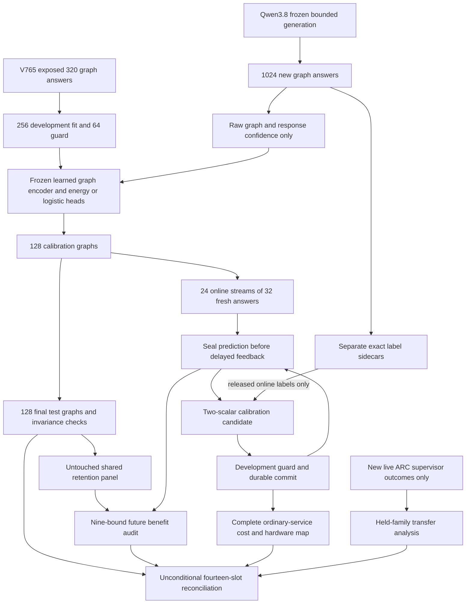
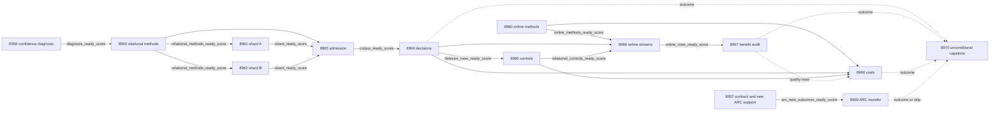

# Carnot Research Roadmap v766: Relational Verification and Real-Error Online Calibration

**Created:** 2026-11-09 America/New_York
**Milestone:** 2026.11.766
**Status:** Planned; staged only
**Supersedes:** Completed 2026.11.765, Exp8944–Exp8956
**Task contract:** Exactly 14 tasks, Exp8957 through Exp8970, in the order below.
**Execution file:** `research-roadmap-next.yaml`

The complete V765 design and active queue are preserved byte for byte in
`research-roadmap-v765-preserved-20261109.md` and
`research-roadmap-v765-queue-preserved-20261109.yaml`. The completion archive
currently ends at V764; V765 primary artifacts and conductor receipts establish
its outcomes. This proposal does not activate a queue.

## What V765 proved

| Evidence | Qualified result | Next implication |
|---|---|---|
| Exp8944 | Full thirteen-task authority qualified. | Reuse custody and exact-contract helpers. |
| Exp8945 | Diagnostic primary is quarantined for substrate/class and venue errors. | Preserve its flag; do not use its apparent readiness as science authority. |
| Exp8946/8948 | Matched answer-cardinality source qualified; paired errors were 33/50 at k2 and 42/50 at k3. | Keep this restricted population and generation settings; no new depth rerun. The operational rise is not a significance claim. |
| Exp8949/8950/8951 | 320 complete Qwen answers; 233 errors, comprising 227 semantic wrong answers and six out-of-graph answers. No format errors. | Independent final-answer labels now exist. They do not label reasoning prefixes. |
| Exp8952 | All three benefit conditions failed. Brier improvement versus logistic was +0.0162105 with lower bound -0.0076792; versus prevalence it was -0.0002183 with lower bound -0.0104545. Accepted-error delta upper was +0.075. | Close unchanged confidence-only scoring. Test changed information, not another seed or threshold. |
| Exp8953/8954 | 24 causal streams qualified. Gradient replay beat permuted feedback but failed frozen/current/uniform/signature future bounds; retention passed. Frozen contrast upper -0.008753 missed the -0.01 threshold. | Correct labels matter, but the exact replay mechanism has no qualified benefit. Keep all eleven historical bounds and retirement intact. |
| Exp8955 | Complete service costs qualified; no deployment recommendation. No sampler was invoked. | Measure new graph/adapter operations against ordinary service without artificial scans. |
| Exp8956 | All thirteen outcomes accounted for; capstone blocked by rejected Exp8945. | Preserve branch-specific evidence and the quarantine. A blocked capstone does not erase qualified source rows. |

## The three largest gaps to the PRD

1. **FR-12: useful learned verification of real model mistakes.** Labels now
   exist, but confidence-only calibration does not beat the controls. The
   inference view omits the source graph. Test graph-conditioned learned energy
   against a classifier with the same graph encoder and against the original
   confidence controls. Exact BFS is an evaluator, never an inference feature.
2. **FR-06/FR-11: continuous learning that improves future decisions.** Repeated
   synthetic replay experiments have not met their complete benefit gates.
   Test a separate, narrower mechanism: delayed online calibration of a frozen
   relational score on fresh real Qwen errors. Preserve a frozen baseline,
   bias-only control, permuted-feedback control and untouched retention panel.
3. **FR-05/FR-08/NFR-01: a useful decision service with measured complete cost.**
   Hardware and Rust targets remain unsupported for this workload. Measure graph
   processing, decisions, feedback, guards and durable recovery before a port or
   accelerator investment. Keep the program's 100x aspiration separate from data.

The current north star is an oracle-distinct verifier in a domain without a
cheap executable oracle. That stronger claim remains open: anonymous shortest-
path graphs have cheap BFS truth. This milestone tests a necessary learned-input
and calibration step, not the final moat. Natural-language verification and
first-error localization require separate evidence. No Qwen weights are trained.

## Research incorporated before design

The V766 entry in `research-references.md` was written before these task
specifications. It records all eight requested topics and six secondary channels,
including access failures and a partial Semantic Scholar citation scan.

| Source | Adopted idea and limit |
|---|---|
| [KG-Guard](https://arxiv.org/abs/2606.00328), May 2026 | Mark source and proposed-answer nodes; learn a graph-conditioned score. Exp8958/8959/8964/8965 test this local adaptation. No KBQA reproduction claim. |
| [Continual Calibration](https://arxiv.org/abs/2604.23987), April 2026; [TOOD](https://arxiv.org/abs/2607.29592), July 2026 | Separate calibration updates from representation updates. Exp8960/8966/8967 test delayed feedback and proper-loss retention, not the papers' conformal or OOD guarantees. |
| [EBT](https://arxiv.org/abs/2507.02092); [ARM–EBM](https://arxiv.org/abs/2512.15605) | Maintain the distinction between learned compatibility and correctness. A matched graph classifier is mandatory. |
| [FPGA–ASIC co-design](https://arxiv.org/abs/2602.15985), revised September 2026 | Complete host orchestration and data movement belong in cost accounting, Exp8968. |
| [Primal-dual decoding](https://arxiv.org/abs/2605.09749); [Future Validity](https://arxiv.org/abs/2605.07698) | Keep generation fixed while testing a detector; constraint changes can alter the sampled population. |

KAN-CL, PAL, new constrained decoders and additional samplers remain recorded
leads. They would add another moving part before the current feature question is
answered. OpenReview supplied ICLR/ICML/NeurIPS leads; HF supplied DiffuTruth as a
future lead. GitHub trending yielded no established relevant ranking; the
KG-Guard author repository is available. Semantic Scholar returned ten citations
per anchor, with more EBT results unscanned. Extropic advertises 2027 Z1 early
access. Kona's checked page supplies positioning, not a reproducible protocol.

## Architecture



Methods readiness, complete evidence and scientific benefit use separate fields.
No historical task ID is a runtime prerequisite. The administrative contract
is not a global gate on science. All fresh source roles are fixed before model
responses. Final-test labels open only after frozen predictions; online labels
open only through a delayed broker. Evaluation code may run BFS; scoring may not.

## Phase 1 — diagnose and freeze (Exp8957–Exp8960)

**Exp8957** binds fourteen full task objects and preserves V765 custody. It also
checks only new live ARC supervisor receipts. The November 7 append-only lift in
CLAUDE.md and `ops/north-star.md` supersedes earlier suspended text. Set the ARC
gate only with 30 new uncensored episodes, three game families and both compared
arms with held-family support. An unchanged frontier skips expensive analysis.

**Exp8958** reduces the original confidence result and identifies its information
boundary. All 320 V765 graphs are exposed development data. A label-independent
hash order assigns 256 fit and 64 guard roles. Exploring historical test labels
cannot produce new confirmation. Architecture inspection can prove graph context
was absent; it cannot prove why confidence failed or that context will help.

**Exp8959** freezes a three-round, width-eight, shared-weight graph encoder with
mean aggregation and tanh. Node inputs are source flag, answer flag, constant one
and normalized degree. Source, answer and pooled embeddings join the two genuine
confidence features; missing answers have an explicit indicator. No IDs, shortest
distance, BFS result, answer-set membership or truth labels enter scoring.

Five arms are relational Gibbs, same-encoder logistic, confidence Gibbs,
confidence logistic and prevalence. The relational arms train independent copies
of the same encoder architecture under identical seeds 71/72/73, 200 full-batch
steps and learning rate 0.01. Average seed probabilities within each arm. Reuse
the eight-hidden-unit Gibbs head and existing temperature grid. Train weights on
historical fit only, then freeze them before new generation. Methods readiness
requires private causal/invariance controls, not empirical detector improvement.

Freeze 1024 fresh matched-cardinality k2 graphs, 512 per shard. Each shard has
64 calibration,64 final-test and384 online graphs. The combined online set has
24 independent 32-query streams. Exclude all prior graph identities and retained
construction equivalents; no response-based selection. The generation protocol
and source population remain those qualified in V765. Graph construction has
2000 proposals per graph and a600-second total cap; exhaustion is a null.

**Exp8960** freezes a new Tier1 update: `p(error)=sigmoid(a*z+b)` for frozen
relational logit `z`. Start at `a=1,b=0`. Take one SGD step of 0.05 per released
label on log loss plus `0.01*((a-1)^2+b^2)`, with `a` projected to[0.25,4] and
`b` to[-2,2]. Compare frozen, bias-only, slope-and-bias and permuted-feedback
slope-and-bias arms. Only released blocks of four labels may be permuted.

A prediction is sealed before feedback. Release labels 1–4 after prediction 8,
labels 5–8 after prediction 12, and subsequent four-label blocks on that schedule.
Individual labels wait4–7 queries; the final four remain pending at query 32. The 64 historical
guard cases permit promotion only if Brier increase is<=0.005 and classification
error does not rise relative to initialization. Guard reuse is a development
safeguard, not a validity theorem. The model representation and generator remain
frozen. This is a new calibration claim; it does not rescue the failed synthetic
replay claim or replace its eleven historical conditions.

## Phase 2 — fresh bounded evidence (Exp8961–Exp8963)

Exp8961 and Exp8962 collect512 first responses each. They are independent sibling
jobs; neither waits on the other. Each uses `unsloth/Qwen3.8-27B-GGUF`, Q4_K_M,
GPU0 only, reasoning off, temperature0 and16 output tokens. Authenticate the
cached GGUF, embedded tokenizer, lease and actual offload each time. GPU1 remains
detached. No fallback, prompt repair, retries or response-based replenishment.

Preflight and load are each capped at 240 seconds; each request at 30 seconds;
all generation per shard at 2700 seconds. Save first responses and progress every
16 units, with live supervision output during a slow call. Partial collection
remains visible. This scale extends the qualified160-response runner; it is not
a new model backend or an unbounded benchmark.

These two tasks are `model_bounded_generation` with a10-second floor. A real
load-only failure records `model_load_no_generation`,2 seconds, and zero generation
calls. There is no full-generative task here; `model_full_generation` would require
real generative work and a60-second floor. CPU tasks declare `no_model_load`, empty
`MODEL_SPECS` and the actual cached-scoring or aggregation substrate. No duration
padding is permitted.

Exp8963 authenticates1024 original responses and128/128/768 roles, independent
exact labels, confidence signals and no graph overlap. Require 200 wrong answers
overall and at least five examples of each class in each pooled role. These are
feasibility minima, not statistical power guarantees. A shortfall is null; absent
or rejected producers are blocked. Keep out-of-graph, format and transport errors
separate. Admission success is circular because its truth check is the oracle.

## Phase 3 — decisions, controls and causal updates (Exp8964–Exp8966)

Exp8964 calibrates on 128 fresh calibration graphs, seals128 test predictions,
then opens their labels once. Five one-sided paired graph-bootstrap bounds share
family alpha 0.05 across 10000 draws. Brier improvement must have lower bound>0
versus prevalence, confidence logistic and relational logistic. At exactly 50%
coverage, accepted-error delta upper bounds must be<=0 versus both logistic arms.
This retains the original three conditions and adds two graph-matched controls.
All five must pass. Typed decisions use fixed error-probability thresholds0.1 and
0.9, with escalation between them; ranking coverage is not a risk certificate.

Exp8965 tests four label-blind node/edge permutations per test graph and requires
probability invariance within 1e-6. Removed-adjacency, removed-marker and constant-
confidence ablations are diagnostic distribution shifts. Sidecar mutation and
forbidden-import tests must prove labels/traversal cannot affect predictions.
Integrity failure disqualifies the score; no test-panel refit may repair it.
There are128 independent graph clusters, not512 permutation samples.

Exp8966 executes four arms over24 independent 32-query streams. It records3072
online and36864 retention rows,39936 query rows total. Retention is evaluated on
the same128 fresh test graphs at 0/16/32 and never used for promotion. Actual child
termination/restart at query 16 must match uninterrupted predictions and full
pending state. Restart controls are dependent checks. Scientific evaluation
leaves the last four labels pending. No new Qwen generation occurs in this task.

## Phase 4 — benefit, costs, transfer and closure (Exp8967–Exp8970)

Exp8967 audits nine simultaneous bounds with 10000 bootstrap draws and family
alpha 0.01/9. On queries17–32, adaptive-minus-frozen Brier upper must be<=-0.01;
adaptive-minus-bias-only and adaptive-minus-permuted uppers must be<0. All six
retention Brier/error uppers at 0/16/32 must be<=0.01. Whole streams are paired
clusters. For shared retention, independently resample graph IDs once per draw
and reuse that sample across arms/streams; also give conditional-panel intervals.
The 128 shared graphs must not masquerade as3072 independent retention cases.
A non-discriminating feedback control forbids causal attribution. Null closes
this exact protocol; it does not disprove all continuous learning.

Exp8968 times24 paired fresh processes under randomized arm order. Compare
ordinary confidence-logistic, frozen relational, bias-only online and full online
services on 32 complete cached-response requests. Include cold start, graph work,
feedback, guards, file/directory fsync, query 16 restart and pending-label drain.
Report p50/p95, paired intervals, memory and operations. Ordinary baselines do
only their real work. Upstream generation costs remain separately attributed.
No unqualified component timer may support a removable fraction. Measurements
can qualify even when quality is null. Deployment requires both detector and
learning benefit plus a favorable measured cost/quality tradeoff.

Exp8969 is the reserved ARC/AVO generalization task, gated on newly supported live
receipts from Exp8957. It uses held-family analysis of actual supervisor actions,
including censoring sensitivity, with no new game execution or policy changes.
A registry precheck prevents duplicate solve credit. Any incidental level count
must carry `solve_provenance=live_agent_self_discovery` and original runtime
receipts; development proxies and outer-loop reconstruction get no solve credit.
This gate preserves the restored slot without repeating the closed empty-ledger
or fully censored panel. Thirty episodes across three families still give limited
transfer power and never establish hidden-game generality.

Exp8970 is unconditional. It accounts for all 14 slots, including legitimate
scheduler skips, rejected producers and scientific nulls. It reads original
artifact identities rather than guessed paths. Missing external science is
terminal blocked; unfinished owned work alone may be partial. The existing
FoVer G1–G4 publication gate retains its scope and does not certify V766.

## Dependency graph

Solid arrows are structured gates; dashed arrows are retained reads without a
scientific-success gate. Every solid edge names an exact required producer field.



The full task objects below are the exact authority for every field on unlabeled
edges. No gate requires scientific benefit merely to measure cost or calibration.
There is no runtime `requires` reference to a retired task. If collection fails,
its dependent analyses skip; independent online-methods qualification still runs.

## Hardware requirements

| Resource | Use and limit |
|---|---|
| Host CPU, system RAM and installed JAX/NumPy | Graph construction, small-model fitting, cached-response updates, audits and durable service timing. |
| RTX3090 GPU0,24GB | Two sequential bounded Qwen shards through the existing lease; record actual offload. No new hardware is required. |
| GPU1 | Detached; never allocate or probe it. |
| KV260 | Existing quadratic sampling scope with k_max<=5; no neural graph service or new bitstream is established. |
| PolarFire | Existing Linux CPU dispatch only; not fabric acceleration. |
| GateMate | Physical/JTAG0xffffffff block remains; no repeated probe. |
| NPU/APU and Extropic TSU | Future candidates only. Local runtimes/transfer economics are unqualified; vendor2027 availability is not access. |

Two-scalar updates have a direct CPU/Rust/SIMD path. Graph matrix operations can
batch on GPU/NPU. Guards and fsync remain host work. Exp8968 must identify the
operations and data-movement costs that would need acceleration; it cannot infer
100x service speedup from a hardware map. With zero sampling calls,
`removable_fraction` and `service_100x_projection` remain null. A new purchase or
Rust port needs measured useful quality and cost headroom. NFR-01's10x Rust goal
remains open. This is an explicit test of the hardware ambition, not a claim it
has been achieved by the scalar adapter.

## Execution and validation discipline

Every prompt contains numbered progress requirements at phase boundaries,
before/after minute-scale calls and inside loops/supervision at least every 60
seconds. Silence stays below 600 seconds. Work targets4200 seconds including
checks within the 4800-second hard cap. Files over about200 lines are written in
150–200-line calls, with progress between calls. Every comparison emits typed
per-unit rows. Every required field carries a principle. All tasks declare the
closed verdict class; failed checks cannot be reported positive.

Each task has complete prior-failure metadata and a changed method, input or
purpose. No retired ID is reused. Methods and evidence tasks do not claim the
retired science was successful. The Qwen mandate is separate from agent routing:
formulaic method implementation uses Codex gpt-6.1-sol; ordinary science uses
the request's default Claude route. Contract/preflight coordination uses Opus100.
No Luna or Gemini task is planned.

Before implementation, extend planned requirements and write failing tests.
Run scoped unit/child tests with 100% owned statement coverage and no exclusions,
Ruff, strict mypy, spec tracing, private E2E-018/021 publication/replay cases and
rehashed-tamper refusal. Global debt does not excuse an owned failure.

Planning validates schema, complete document/YAML equality, task order, exact
producer gate fields, prior-failure discipline, exclusion lint and relevant
unit/private CLI checks. Planned requirements, BMAD and ops records stay aligned.
Experiments, GPU inference and hardware work are not planning validation.

## Exact task contract

The table and full task objects describe exactly 14 tasks, Exp8957–Exp8970.
The embedded objects must equal the YAML objects, including every prompt and gate.

| Order | Task ID | Title | Phase | Deliverable |
|---|---|---|---|---|
| 1 | exp8957-branch-contract | Bind fourteen tasks and qualify only new ARC evidence | 1 | `results/experiment_8957_v766_branch_contract.json` |
| 2 | exp8958-confidence-diagnosis | Diagnose confidence-only errors and freeze development-only evidence | 1 | `results/experiment_8958_v766_confidence_diagnosis.json` |
| 3 | exp8959-relational-methods | Freeze relational energy models and fresh graph roles | 1 | `results/experiment_8959_v766_relational_methods.json` |
| 4 | exp8960-online-calibration-methods | Freeze delayed online calibration on real model errors | 1 | `results/experiment_8960_v766_online_calibration_methods.json` |
| 5 | exp8961-graph-corpus-a | Collect fresh Qwen graph evidence shard A | 2 | `results/experiment_8961_v766_graph_corpus_a.json` |
| 6 | exp8962-graph-corpus-b | Collect fresh Qwen graph evidence shard B | 2 | `results/experiment_8962_v766_graph_corpus_b.json` |
| 7 | exp8963-corpus-admission | Authenticate fresh graph roles and inference-only views | 2 | `results/experiment_8963_v766_corpus_admission.json` |
| 8 | exp8964-relational-decisions | Test graph-conditioned energy decisions on fresh Qwen errors | 3 | `results/experiment_8964_v766_relational_decisions.json` |
| 9 | exp8965-relational-controls | Challenge relational scores with invariance and removed-context controls | 3 | `results/experiment_8965_v766_relational_controls.json` |
| 10 | exp8966-online-response-streams | Measure continuous calibration with sealed real-error feedback | 3 | `results/experiment_8966_v766_online_response_streams.json` |
| 11 | exp8967-online-benefit-audit | Audit future calibration benefit and shared-panel retention | 4 | `results/experiment_8967_v766_online_benefit_audit.json` |
| 12 | exp8968-complete-service-cost | Measure relational decision and adaptation costs with hardware limits | 4 | `results/experiment_8968_v766_complete_service_cost.json` |
| 13 | exp8969-arc-transfer-evidence | Assess held-family AVO transfer from new live outcomes | 4 | `results/experiment_8969_v766_arc_transfer_evidence.json` |
| 14 | exp8970-capstone | Reconcile fourteen outcomes and keep claim boundaries explicit | 4 | `results/experiment_8970_v766_capstone.json` |

<!-- V766_TASK_CONTRACT_START -->
```json
{
  "milestone": "2026.11.766",
  "tasks": [
    {"id": "exp8957-branch-contract","title": "Bind fourteen tasks and qualify only new ARC evidence","phase": 1,"track": "research","priority": "high","requires_gpu": false,"max_turns": 100,"estimated_wall_time_min": 45,"per_unit_rows": true,"milestone": "2026.11.766","deliverable": "results/experiment_8957_v766_branch_contract.json","inference_substrate_class": "no_model_load","MODEL_SPECS": [],"gated_on": [],"prior_failures": [{"experiment_id": "exp8944-branch-contract","verdict": "complete_null_v765_branch_contract","addressed_by": "Bind a new fourteen-task authority and the restored ARC directive; qualify a changed event frontier only, preserving quarantined evidence.","retire_if_same_verdict": true}],"prompt": "CONTEXT:\nV765 has thirteen terminal producers; Exp8945 is quarantined. research-complete.yaml lags at V764. Original primaries and conductor receipts establish V765 outcomes. The November 7 suspension lift restores one opportunistic ARC slot; the oracle-distinct verifier remains the north star.\n\nEXISTING CODE TO READ FIRST:\n- CLAUDE.md\n- CODEX.md\n- research-program.md\n- ops/north-star.md\n- openspec/capabilities/research-reporting/spec.md\n- openspec/change-proposals/research-roadmap-vNEXT.md\n- scripts/experiment_template.py\n- python/carnot/reporting/current_work_receipt.py\n- python/carnot/reporting/primary_publication.py\n- ops/e2e-test-plan.md\n- python/carnot/reporting/v765_branch_contract.py\n- python/carnot/reporting/arc_supervisor_frontier_8720.py\n- python/carnot/agentic/arc_supervisor_refinement.py\n- results/experiment_8956_v765_capstone.json\n- ops/exclusion_manifest.yaml\n- research-complete.yaml\n- ops/conductor-log.md\n\nTASK:\nBind fourteen tasks and qualify only new ARC evidence. Deliver results/experiment_8957_v766_branch_contract.json for 2026.11.766.\n\nCONCRETE STEPS:\n1. Read the sources and REQ-REPORT-8957 / SCENARIO-REPORT-8957-CONTRACT. Work in {project_root} on {date}. Authenticate inputs before costly work. Historical tasks are retained inputs, never runtime requires on retired IDs.\n2. Emit a flushed progress line at each phase boundary and before and after every model load, generation, benchmark or subprocess that can take minutes. Use python -u and print(..., flush=True); forward child output. In long loops and subprocess supervision emit completed/pending counts at least every 60 seconds. Keep every silence gap below 600 seconds, including between tool calls. Target completion below 4200 seconds, including checks, within the 4800-second hard cap.\n3. Bound every tool call. Write any file over about 200 lines in several tool calls of at most 150-200 lines, with a progress message between them. Put real scripts in scripts/experiments/, tests in tests/python/, and scratch in /tmp; never write scratch scripts to the repository root.\n4. Bind exactly fourteen full task objects Exp8957-Exp8970, titles, deliverables, order and all gate fields to immutable execution authority. Verify the visible table and embedded JSON against staged/activated YAML. Preserve the original V765 design and queue snapshots; a document-only task list is insufficient. Do not activate a queue or edit the exclusion manifest.\n5. Keep Exp8945 flagged and excluded; record its illegal substrate/class and venue as a historical diagnosis, not a newly qualified science result. Authenticate the usable V765 graph corpus directly from Exp8946/8948/8949/8950/8951, independent of the rejected diagnostic and blocked capstone.\n6. Use the qualified ARC producer locator/frontier to inspect only new live selected/applied supervisor receipts beyond the last qualified frontier. Set arc_new_outcomes_ready_score=1 only for at least 30 newly authenticated uncensored episodes, three game families and both compared arms with held-family support. Missing authority or zero new qualifying outcomes yields score0 with exact diagnostics. No games, model loads or unchanged panel reruns occur here.\n7. Set contract_ready_score solely from complete authority and mutation checks. It is not a global science gate. Independent methods tasks validate their own retained inputs. Store all baseline frontiers and hashes for the ARC task; compare actual receipt identity, not modification time.\n8. Before implementation, extend the named REQ/SCENARIO and write failing tests. Reuse existing helpers. Run scoped pytest with measured 100-percent newly owned unit/child statement coverage and zero exclusions, Ruff check and format --check, strict mypy, and scripts/check_spec_coverage.py with positional test paths. Exercise applicable private E2E-018/021 CLI publication, cold replay and rehashed-tamper refusal; keep tests in private scratch. Record global debt separately and never waive failed owned checks. Reconcile specs, _bmad/traceability.md, ops/status.md and ops/changelog.md from actual outcomes.\n9. Publish the final artifact through primary_publication only after owned checks pass. Preserve original producers and quarantines. Missing external evidence is terminal blocked with gate_check_summary naming upstream, check, exact field, expected and observed value. Failed owned controls are disqualified. partial means unfinished owned work that another attempt can finish, never unchanged external absence. Preserve prior honest_verdict on an unchanged rerun failure so retirement can compare it. Never fabricate measurements or sleep to satisfy a duration floor.\n\nREQUIRED ARTIFACT FIELDS:\n- experiment_id, task_id, milestone, run_date, random_seed, reproducibility_checksum. principle: Bind the result to the scheduled task, input bytes and reproducible randomness.\n- honest_verdict: terminal complete_ prefix followed by actual disposition and scope. principle: An honest terminal outcome avoids wasted retries and preserves exact rerun retirement.\n- verdict_class: positive | circular_positive | null | blocked | disqualified | partial. principle: This closed class carries claim strength; verifier_is_oracle=true and any failed acceptance gate forbid positive.\n- inference_substrate, inference_substrate_class, execution_venue. principle: Use the actual legal substrate and venue; host is valid, host_cpu is not. no_model_load never claims a new GGUF run.\n- MODEL_SPECS, model_specs, model_invocation_counts, numerical_training_calls. principle: Distinguish small-head training, retained model outputs and actual generator calls; count each separately.\n- duration_s, phase_spans, preconditions_checked. principle: Actual clocks and resource receipts prevent fabricated execution and duration padding.\n- verifier_is_oracle, exposure_scope, independent_generalization_score. principle: Separate exact labels from learned inference; graph-domain success does not establish the no-cheap-oracle north star.\n- intended_count, completed_count, failed_count, censored_count, excluded_count, independent_count. principle: Retain every scheduled unit and identify the independent denominator.\n- rows: per-unit metric/value/numerator/denominator, arm, condition, cluster_id, status and censor_reason. principle: Comparative headlines must recompute from typed rows; repeated seeds or perturbations do not enlarge independent sample size.\n- gate_check_summary: upstream, path/hash, check, artifact_field, expected, observed. principle: Distinguish missing_file, missing_field, observed_zero and rejected_producer; blocked_* always records the failed check.\n- source_artifact_hashes, code_config_hashes, raw_shard_hashes, field_principles. principle: Retain content custody and echo these principles so a later reader can verify why fields exist.\n- acceptance_gates, required_checks_passed, owned_statement_coverage, validation_receipts, global_test_debt. principle: Record each gate with its principle; readiness is separate from scientific benefit and failed owned checks disqualify.\n- contract_ready_score: integer 0 or 1. principle: Full-task equality prevents a promised task from disappearing.\n- arc_new_outcomes_ready_score: integer 0 or 1. principle: Skip a costly ARC analysis when new supported live outcomes do not exist.\n- full_task_objects, full_task_digest, visible_task_table, gate_edge_rows, prior_scope_rows, arc_frontier, arc_support_rows. principle: Freeze authority and the exact evidence frontier before downstream reads.\n\nRun command: cd {project_root} && PYTHONPATH=python .venv/bin/python -u scripts/experiments/experiment_8957_v766_branch_contract.py --date {date}\nDo NOT push. Do NOT modify scripts/research_conductor.py.","model": "opus"},
    {"id": "exp8958-confidence-diagnosis","title": "Diagnose confidence-only errors and freeze development-only evidence","phase": 1,"track": "research","priority": "high","requires_gpu": false,"max_turns": 30,"estimated_wall_time_min": 45,"per_unit_rows": true,"milestone": "2026.11.766","deliverable": "results/experiment_8958_v766_confidence_diagnosis.json","inference_substrate_class": "no_model_load","MODEL_SPECS": [],"gated_on": [],"prior_failures": [{"experiment_id": "exp8952-matched-calibrated-decisions","verdict": "complete_null_matched_population_final_answer_calibration","addressed_by": "Diagnose the closed confidence-only result before a graph-conditioned model; all old data is development and fresh confirmation is mandatory.","retire_if_same_verdict": true}],"prompt": "CONTEXT:\nExp8952 failed all three original benefit conditions on 80 test graphs. Its energy head beat logistic in the point estimate but did not beat prevalence. No causal explanation has been established. All 320 V765 graphs are now exposed development data.\n\nEXISTING CODE TO READ FIRST:\n- CLAUDE.md\n- CODEX.md\n- research-program.md\n- ops/north-star.md\n- openspec/capabilities/research-reporting/spec.md\n- openspec/change-proposals/research-roadmap-vNEXT.md\n- scripts/experiment_template.py\n- python/carnot/reporting/current_work_receipt.py\n- python/carnot/reporting/primary_publication.py\n- ops/e2e-test-plan.md\n- python/carnot/autoresearch/graph_calibration_benchmark.py\n- python/carnot/reporting/matched_calibrated_decisions_8952.py\n- results/experiment_8951_v765_matched_corpus_admission.json\n- results/experiment_8952_v765_matched_calibrated_decisions.json\n\nTASK:\nDiagnose confidence-only errors and freeze development-only evidence. Deliver results/experiment_8958_v766_confidence_diagnosis.json for 2026.11.766.\n\nCONCRETE STEPS:\n1. Read the sources and REQ-REPORT-8958 / SCENARIO-REPORT-8958-CONTRACT. Work in {project_root} on {date}. Authenticate inputs before costly work. Historical tasks are retained inputs, never runtime requires on retired IDs.\n2. Emit a flushed progress line at each phase boundary and before and after every model load, generation, benchmark or subprocess that can take minutes. Use python -u and print(..., flush=True); forward child output. In long loops and subprocess supervision emit completed/pending counts at least every 60 seconds. Keep every silence gap below 600 seconds, including between tool calls. Target completion below 4200 seconds, including checks, within the 4800-second hard cap.\n3. Bound every tool call. Write any file over about 200 lines in several tool calls of at most 150-200 lines, with a progress message between them. Put real scripts in scripts/experiments/, tests in tests/python/, and scratch in /tmp; never write scratch scripts to the repository root.\n4. Authenticate the 320 original response/label/feature rows and preserve the original split results. Recompute Brier, AUROC, accepted-error at 50-percent coverage and the original paired bounds. Mark any exploratory use of historical test labels as exposed development; never reuse that set for confirmation.\n5. Audit the actual inference feature allowlist and show whether source graph, query node and proposed node were absent. Compare confidence-only fit, prevalence and label-permuted fit on development resamples; report class balance and feature overlap. This is a representation diagnosis, not proof that graph context will help.\n6. Create a deterministic 256-fit/64-guard development split by graph hash, independent of outcome. Preserve all 233 final-answer errors and six out-of-graph answers. Missing or unparseable candidates get an explicit missing-node representation; do not discard them. Publish a byte-bound developer view and separately protected label view.\n7. Set diagnosis_ready_score from correct reduction and custody only, regardless of positive or null mechanism evidence. Close the unchanged two-confidence-feature confirmation scope. Use aggregation_from_upstream_artifacts when only reducing; any diagnostic fitting is verifier_ensemble_against_cached_candidates, both no_model_load with empty MODEL_SPECS.\n8. Before implementation, extend the named REQ/SCENARIO and write failing tests. Reuse existing helpers. Run scoped pytest with measured 100-percent newly owned unit/child statement coverage and zero exclusions, Ruff check and format --check, strict mypy, and scripts/check_spec_coverage.py with positional test paths. Exercise applicable private E2E-018/021 CLI publication, cold replay and rehashed-tamper refusal; keep tests in private scratch. Record global debt separately and never waive failed owned checks. Reconcile specs, _bmad/traceability.md, ops/status.md and ops/changelog.md from actual outcomes.\n9. Publish the final artifact through primary_publication only after owned checks pass. Preserve original producers and quarantines. Missing external evidence is terminal blocked with gate_check_summary naming upstream, check, exact field, expected and observed value. Failed owned controls are disqualified. partial means unfinished owned work that another attempt can finish, never unchanged external absence. Preserve prior honest_verdict on an unchanged rerun failure so retirement can compare it. Never fabricate measurements or sleep to satisfy a duration floor.\n\nREQUIRED ARTIFACT FIELDS:\n- experiment_id, task_id, milestone, run_date, random_seed, reproducibility_checksum. principle: Bind the result to the scheduled task, input bytes and reproducible randomness.\n- honest_verdict: terminal complete_ prefix followed by actual disposition and scope. principle: An honest terminal outcome avoids wasted retries and preserves exact rerun retirement.\n- verdict_class: positive | circular_positive | null | blocked | disqualified | partial. principle: This closed class carries claim strength; verifier_is_oracle=true and any failed acceptance gate forbid positive.\n- inference_substrate, inference_substrate_class, execution_venue. principle: Use the actual legal substrate and venue; host is valid, host_cpu is not. no_model_load never claims a new GGUF run.\n- MODEL_SPECS, model_specs, model_invocation_counts, numerical_training_calls. principle: Distinguish small-head training, retained model outputs and actual generator calls; count each separately.\n- duration_s, phase_spans, preconditions_checked. principle: Actual clocks and resource receipts prevent fabricated execution and duration padding.\n- verifier_is_oracle, exposure_scope, independent_generalization_score. principle: Separate exact labels from learned inference; graph-domain success does not establish the no-cheap-oracle north star.\n- intended_count, completed_count, failed_count, censored_count, excluded_count, independent_count. principle: Retain every scheduled unit and identify the independent denominator.\n- rows: per-unit metric/value/numerator/denominator, arm, condition, cluster_id, status and censor_reason. principle: Comparative headlines must recompute from typed rows; repeated seeds or perturbations do not enlarge independent sample size.\n- gate_check_summary: upstream, path/hash, check, artifact_field, expected, observed. principle: Distinguish missing_file, missing_field, observed_zero and rejected_producer; blocked_* always records the failed check.\n- source_artifact_hashes, code_config_hashes, raw_shard_hashes, field_principles. principle: Retain content custody and echo these principles so a later reader can verify why fields exist.\n- acceptance_gates, required_checks_passed, owned_statement_coverage, validation_receipts, global_test_debt. principle: Record each gate with its principle; readiness is separate from scientific benefit and failed owned checks disqualify.\n- diagnosis_ready_score: integer 0 or 1. principle: Completion of diagnosis must not be confused with a favorable explanation.\n- development_manifest, confidence_rows, original_bound_rows, feature_access_rows, diagnostic_fit_rows. principle: Identify exposed data and preserve the null that motivates a different representation.\n\nRun command: cd {project_root} && PYTHONPATH=python .venv/bin/python -u scripts/experiments/experiment_8958_v766_confidence_diagnosis.py --date {date}\nDo NOT push. Do NOT modify scripts/research_conductor.py."},
    {"id": "exp8959-relational-methods","title": "Freeze relational energy models and fresh graph roles","phase": 1,"track": "research","priority": "high","requires_gpu": false,"max_turns": 50,"estimated_wall_time_min": 70,"per_unit_rows": true,"milestone": "2026.11.766","deliverable": "results/experiment_8959_v766_relational_methods.json","inference_substrate_class": "no_model_load","MODEL_SPECS": [],"gated_on": [{"upstream": "exp8958-confidence-diagnosis","artifact_field": "diagnosis_ready_score","op": "==","value": 1}],"prior_failures": [{"experiment_id": "exp8946-matched-source-methods","verdict": "complete_null_matched_source_methods","addressed_by": "The source mechanism already qualifies; freeze new disjoint roles and graph-conditioned predictors after the confidence-only failure, without repeating the depth test.","retire_if_same_verdict": true},{"experiment_id": "exp8952-matched-calibrated-decisions","verdict": "complete_null_matched_population_final_answer_calibration","addressed_by": "Add learned relational context absent from the failed inference view; preserve original bounds and add same-encoder controls on fresh test graphs.","retire_if_same_verdict": true}],"agent_type": "codex","model": "gpt-6.1-sol","prompt": "CONTEXT:\nKG-Guard suggests conditioning on graph context instead of confidence alone. Carnot already has JAX, GibbsModel and a graph-calibration harness. The new model is a small anonymous-graph adaptation, not KG-Guard reproduction and not a proof that an EBM is better than a matched neural classifier.\n\nEXISTING CODE TO READ FIRST:\n- CLAUDE.md\n- CODEX.md\n- research-program.md\n- ops/north-star.md\n- openspec/capabilities/research-reporting/spec.md\n- openspec/change-proposals/research-roadmap-vNEXT.md\n- scripts/experiment_template.py\n- python/carnot/reporting/current_work_receipt.py\n- python/carnot/reporting/primary_publication.py\n- ops/e2e-test-plan.md\n- python/carnot/autoresearch/graph_calibration_benchmark.py\n- python/carnot/models/gibbs/__init__.py\n- python/carnot/models/ising/kagnn.py\n- python/carnot/reporting/matched_source_methods_8946.py\n- results/experiment_8946_v765_matched_source_methods.json\n- results/experiment_8958_v766_confidence_diagnosis.json\n- research-references.md\n\nTASK:\nFreeze relational energy models and fresh graph roles. Deliver results/experiment_8959_v766_relational_methods.json for 2026.11.766.\n\nCONCRETE STEPS:\n1. Read the sources and REQ-REPORT-8959 / SCENARIO-REPORT-8959-CONTRACT. Work in {project_root} on {date}. Authenticate inputs before costly work. Historical tasks are retained inputs, never runtime requires on retired IDs.\n2. Emit a flushed progress line at each phase boundary and before and after every model load, generation, benchmark or subprocess that can take minutes. Use python -u and print(..., flush=True); forward child output. In long loops and subprocess supervision emit completed/pending counts at least every 60 seconds. Keep every silence gap below 600 seconds, including between tool calls. Target completion below 4200 seconds, including checks, within the 4800-second hard cap.\n3. Bound every tool call. Write any file over about 200 lines in several tool calls of at most 150-200 lines, with a progress message between them. Put real scripts in scripts/experiments/, tests in tests/python/, and scratch in /tmp; never write scratch scripts to the repository root.\n4. Reuse JAX and GibbsModel; inspect existing graph code before adding at most one small graph-encoder module. Freeze three shared-weight message-passing rounds, width8, tanh, mean aggregation and permutation-invariant pooling. Node inputs are source flag, proposed-answer flag, constant1 and normalized degree. Read out source, answer and pooled embeddings plus the two genuine confidence signals. Include a missing-answer indicator. Forbid shortest distances, BFS results, answer-set membership, graph IDs, split IDs and labels in the detector view.\n5. Freeze five arms: relational Gibbs energy, same-encoder logistic, confidence-only Gibbs, confidence-only logistic and fit-split prevalence. Use independently trained encoders of the same architecture for the two relational arms, identical initialization seeds71/72/73, 200 full-batch steps, learning rate 0.01 and population binary log loss. Average the three seed probabilities within each arm; seeds are not independent examples. Use the existing eight-hidden-unit Gibbs head. Freeze temperature selection to the existing calibration grid. No new dependencies, generator updates or architecture search.\n6. Fit only the 256 historical development-fit graphs; use the 64 guard graphs for tests and future promotion guards. Freeze weights before fresh generation. On private fixtures require nonzero train gradients, label-permutation sensitivity, node-renaming/edge-order invariance within 1e-6 and refusal of forbidden features. Methods readiness needs a functioning informative-control fixture, not a real-data gain.\n7. Freeze exactly 1024 new matched-cardinality k2 graphs with the qualified V765 population and prompt protocol:512 per shard, each with 64 calibration,64 final test and384 online graphs. Online graphs form12 independent 32-query streams per shard; total 24 streams. Exclude every historical/proposed graph identity and equivalent relabelings using retained graph construction identities plus an isomorphism check where available. No response-dependent selection. Allow2000 proposals per graph and600 seconds total construction; exhaustion is a feasibility null, never a changed population.\n8. Freeze five simultaneous detector bounds at family alpha 0.05 using 10000 paired graph-bootstrap draws: Brier improvement lower>0 versus prevalence, confidence logistic and relational logistic; accepted-error delta upper<=0 at exactly 50-percent coverage versus each logistic control. These retain V765 original three conditions and add two matched-structure controls. Freeze typed accept/reject/escalate thresholds at error probability<=0.1 / >=0.9 / otherwise. Coverage ranking is diagnostic, not a risk certificate. Save the complete model, source and statistical protocol before fresh labels exist.\n9. Before implementation, extend the named REQ/SCENARIO and write failing tests. Reuse existing helpers. Run scoped pytest with measured 100-percent newly owned unit/child statement coverage and zero exclusions, Ruff check and format --check, strict mypy, and scripts/check_spec_coverage.py with positional test paths. Exercise applicable private E2E-018/021 CLI publication, cold replay and rehashed-tamper refusal; keep tests in private scratch. Record global debt separately and never waive failed owned checks. Reconcile specs, _bmad/traceability.md, ops/status.md and ops/changelog.md from actual outcomes.\n10. Publish the final artifact through primary_publication only after owned checks pass. Preserve original producers and quarantines. Missing external evidence is terminal blocked with gate_check_summary naming upstream, check, exact field, expected and observed value. Failed owned controls are disqualified. partial means unfinished owned work that another attempt can finish, never unchanged external absence. Preserve prior honest_verdict on an unchanged rerun failure so retirement can compare it. Never fabricate measurements or sleep to satisfy a duration floor.\n\nREQUIRED ARTIFACT FIELDS:\n- experiment_id, task_id, milestone, run_date, random_seed, reproducibility_checksum. principle: Bind the result to the scheduled task, input bytes and reproducible randomness.\n- honest_verdict: terminal complete_ prefix followed by actual disposition and scope. principle: An honest terminal outcome avoids wasted retries and preserves exact rerun retirement.\n- verdict_class: positive | circular_positive | null | blocked | disqualified | partial. principle: This closed class carries claim strength; verifier_is_oracle=true and any failed acceptance gate forbid positive.\n- inference_substrate, inference_substrate_class, execution_venue. principle: Use the actual legal substrate and venue; host is valid, host_cpu is not. no_model_load never claims a new GGUF run.\n- MODEL_SPECS, model_specs, model_invocation_counts, numerical_training_calls. principle: Distinguish small-head training, retained model outputs and actual generator calls; count each separately.\n- duration_s, phase_spans, preconditions_checked. principle: Actual clocks and resource receipts prevent fabricated execution and duration padding.\n- verifier_is_oracle, exposure_scope, independent_generalization_score. principle: Separate exact labels from learned inference; graph-domain success does not establish the no-cheap-oracle north star.\n- intended_count, completed_count, failed_count, censored_count, excluded_count, independent_count. principle: Retain every scheduled unit and identify the independent denominator.\n- rows: per-unit metric/value/numerator/denominator, arm, condition, cluster_id, status and censor_reason. principle: Comparative headlines must recompute from typed rows; repeated seeds or perturbations do not enlarge independent sample size.\n- gate_check_summary: upstream, path/hash, check, artifact_field, expected, observed. principle: Distinguish missing_file, missing_field, observed_zero and rejected_producer; blocked_* always records the failed check.\n- source_artifact_hashes, code_config_hashes, raw_shard_hashes, field_principles. principle: Retain content custody and echo these principles so a later reader can verify why fields exist.\n- acceptance_gates, required_checks_passed, owned_statement_coverage, validation_receipts, global_test_debt. principle: Record each gate with its principle; readiness is separate from scientific benefit and failed owned checks disqualify.\n- relational_methods_ready_score: integer 0 or 1. principle: Qualified methods permit collection without asserting detector benefit.\n- source_manifest, role_manifest, trained_state_hashes, feature_schema, training_equations, frozen_protocol, fixture_control_rows. principle: Freeze every adaptive choice before collecting new calibration/test/online evidence.\n\nRun command: cd {project_root} && PYTHONPATH=python .venv/bin/python -u scripts/experiments/experiment_8959_v766_relational_methods.py --date {date}\nDo NOT push. Do NOT modify scripts/research_conductor.py."},
    {"id": "exp8960-online-calibration-methods","title": "Freeze delayed online calibration on real model errors","phase": 1,"track": "research","priority": "high","requires_gpu": false,"max_turns": 50,"estimated_wall_time_min": 60,"per_unit_rows": true,"milestone": "2026.11.766","deliverable": "results/experiment_8960_v766_online_calibration_methods.json","inference_substrate_class": "no_model_load","MODEL_SPECS": [],"gated_on": [],"prior_failures": [{"experiment_id": "exp8954-gradient-benefit-audit","verdict": "complete_null_gradient_benefit_audit","addressed_by": "Do not retry cosine replay. Replace synthetic signed-head selection with a two-parameter output-calibration question on sealed real Qwen errors; retain the old eleven failed/passed bounds as historical, not redefined success.","retire_if_same_verdict": true}],"agent_type": "codex","model": "gpt-6.1-sol","prompt": "CONTEXT:\nV765 gradient selection failed four future-benefit bounds despite retention and one correct-label contrast. Its exact synthetic signed-head mechanism stays closed. This new Tier1 FR-11 study updates only calibration of a frozen graph-conditioned energy score on real Qwen responses. Continual Calibration and TOOD motivate separating calibration from representation learning; their guarantees do not transfer automatically.\n\nEXISTING CODE TO READ FIRST:\n- CLAUDE.md\n- CODEX.md\n- research-program.md\n- ops/north-star.md\n- openspec/capabilities/research-reporting/spec.md\n- openspec/change-proposals/research-roadmap-vNEXT.md\n- scripts/experiment_template.py\n- python/carnot/reporting/current_work_receipt.py\n- python/carnot/reporting/primary_publication.py\n- ops/e2e-test-plan.md\n- python/carnot/autoresearch/graph_calibration_benchmark.py\n- python/carnot/reporting/gradient_replay_methods_8947.py\n- python/carnot/reporting/gradient_causal_streams_8953.py\n- python/carnot/reporting/gradient_benefit_audit_8954.py\n- python/carnot/reporting/current_work_receipt.py\n- research-references.md\n\nTASK:\nFreeze delayed online calibration on real model errors. Deliver results/experiment_8960_v766_online_calibration_methods.json for 2026.11.766.\n\nCONCRETE STEPS:\n1. Read the sources and REQ-REPORT-8960 / SCENARIO-REPORT-8960-CONTRACT. Work in {project_root} on {date}. Authenticate inputs before costly work. Historical tasks are retained inputs, never runtime requires on retired IDs.\n2. Emit a flushed progress line at each phase boundary and before and after every model load, generation, benchmark or subprocess that can take minutes. Use python -u and print(..., flush=True); forward child output. In long loops and subprocess supervision emit completed/pending counts at least every 60 seconds. Keep every silence gap below 600 seconds, including between tool calls. Target completion below 4200 seconds, including checks, within the 4800-second hard cap.\n3. Bound every tool call. Write any file over about 200 lines in several tool calls of at most 150-200 lines, with a progress message between them. Put real scripts in scripts/experiments/, tests in tests/python/, and scratch in /tmp; never write scratch scripts to the repository root.\n4. Define p(error)=sigmoid(a*z+b), where z is the frozen, temperature-calibrated relational-energy logit. Initialize a=1,b=0; clamp base probabilities to[1e-6,1-1e-6] only for logit conversion. Freeze four arms: frozen, bias-only update, slope-and-bias update, and slope-and-bias with permuted released labels. Update with one SGD step of size0.05 on binary log loss plus0.01*((a-1)^2+b^2), a in[0.25,4],b in[-2,2]. Bias-only keeps a=1. No encoder/head or generator weights change.\n5. Freeze 24 streams of 32 distinct real responses with prediction seal before release; release labels 1-4 only after prediction 8, labels 5-8 after prediction 12, and so on (delay 4-7 queries), promotion only if the 64 historical guard graphs have Brier increase<=0.005 and classification-error increase<=0 relative to the initial adapter. Repeated guard use supplies a development safeguard, not a statistical guarantee. All arms see the same releases. In each released block of 4, apply a fixed label permutation within that already-released block for the negative control; never use future labels.\n6. Use constructed private probabilities only to verify mechanics: nonzero parameter updates, actual-arm disagreement, future-label invariance, refusal of retention-label access, pending feedback, and exact restart at query 16. The runtime label broker alone reads sealed online labels; detector adapters cannot access sidecars. Declare methods ready regardless of whether development performance improves.\n7. Freeze nine joint bounds at family alpha 0.01 using 10000 whole-stream paired bootstrap draws. On queries17-32, adaptive-minus-frozen upper<=-0.01; adaptive-minus-bias-only and adaptive-minus-permuted uppers<0. At0/16/32, adaptive-minus-frozen retention Brier and error uppers<=0.01. Retention uses the same128 fresh test graphs across streams; bootstrap paired streams and retention graph IDs independently and report this shared panel explicitly. The old eleven-bound synthetic claim remains failed; these are a new narrower real-response calibration claim.\n8. Freeze complete service work: feature extraction, score, feedback release, guard evaluations, bounded two-scalar update, durable writes and restart. CPU is the current path; batch matrix work can map to GPU/NPU and scalar adapters to Rust/SIMD. No100x claim follows without measured removable cost. Use verifier_ensemble_against_cached_candidates/no_model_load and empty MODEL_SPECS.\n9. Before implementation, extend the named REQ/SCENARIO and write failing tests. Reuse existing helpers. Run scoped pytest with measured 100-percent newly owned unit/child statement coverage and zero exclusions, Ruff check and format --check, strict mypy, and scripts/check_spec_coverage.py with positional test paths. Exercise applicable private E2E-018/021 CLI publication, cold replay and rehashed-tamper refusal; keep tests in private scratch. Record global debt separately and never waive failed owned checks. Reconcile specs, _bmad/traceability.md, ops/status.md and ops/changelog.md from actual outcomes.\n10. Publish the final artifact through primary_publication only after owned checks pass. Preserve original producers and quarantines. Missing external evidence is terminal blocked with gate_check_summary naming upstream, check, exact field, expected and observed value. Failed owned controls are disqualified. partial means unfinished owned work that another attempt can finish, never unchanged external absence. Preserve prior honest_verdict on an unchanged rerun failure so retirement can compare it. Never fabricate measurements or sleep to satisfy a duration floor.\n\nREQUIRED ARTIFACT FIELDS:\n- experiment_id, task_id, milestone, run_date, random_seed, reproducibility_checksum. principle: Bind the result to the scheduled task, input bytes and reproducible randomness.\n- honest_verdict: terminal complete_ prefix followed by actual disposition and scope. principle: An honest terminal outcome avoids wasted retries and preserves exact rerun retirement.\n- verdict_class: positive | circular_positive | null | blocked | disqualified | partial. principle: This closed class carries claim strength; verifier_is_oracle=true and any failed acceptance gate forbid positive.\n- inference_substrate, inference_substrate_class, execution_venue. principle: Use the actual legal substrate and venue; host is valid, host_cpu is not. no_model_load never claims a new GGUF run.\n- MODEL_SPECS, model_specs, model_invocation_counts, numerical_training_calls. principle: Distinguish small-head training, retained model outputs and actual generator calls; count each separately.\n- duration_s, phase_spans, preconditions_checked. principle: Actual clocks and resource receipts prevent fabricated execution and duration padding.\n- verifier_is_oracle, exposure_scope, independent_generalization_score. principle: Separate exact labels from learned inference; graph-domain success does not establish the no-cheap-oracle north star.\n- intended_count, completed_count, failed_count, censored_count, excluded_count, independent_count. principle: Retain every scheduled unit and identify the independent denominator.\n- rows: per-unit metric/value/numerator/denominator, arm, condition, cluster_id, status and censor_reason. principle: Comparative headlines must recompute from typed rows; repeated seeds or perturbations do not enlarge independent sample size.\n- gate_check_summary: upstream, path/hash, check, artifact_field, expected, observed. principle: Distinguish missing_file, missing_field, observed_zero and rejected_producer; blocked_* always records the failed check.\n- source_artifact_hashes, code_config_hashes, raw_shard_hashes, field_principles. principle: Retain content custody and echo these principles so a later reader can verify why fields exist.\n- acceptance_gates, required_checks_passed, owned_statement_coverage, validation_receipts, global_test_debt. principle: Record each gate with its principle; readiness is separate from scientific benefit and failed owned checks disqualify.\n- online_methods_ready_score: integer 0 or 1. principle: Require causal mechanics before any sealed online evaluation.\n- continuous_self_learning_task: true, generator_weights_frozen: true. principle: FR-11 scope is the small decision adapter, never the mandated generator.\n- adapter_equations, arm_table, delay_protocol, guard_manifest, multiplicity_ledger, control_rows, hardware_path. principle: Make the new learning claim reproducible and distinct from the retired synthetic replay mechanism.\n\nRun command: cd {project_root} && PYTHONPATH=python .venv/bin/python -u scripts/experiments/experiment_8960_v766_online_calibration_methods.py --date {date}\nDo NOT push. Do NOT modify scripts/research_conductor.py."},
    {"id": "exp8961-graph-corpus-a","title": "Collect fresh Qwen graph evidence shard A","phase": 2,"track": "research","priority": "high","requires_gpu": true,"max_turns": 50,"estimated_wall_time_min": 75,"per_unit_rows": true,"milestone": "2026.11.766","deliverable": "results/experiment_8961_v766_graph_corpus_a.json","inference_substrate_class": "model_bounded_generation","MODEL_SPECS": [{"hf_id": "unsloth/Qwen3.8-27B-GGUF","quantization": "Q4_K_M","gpu": 0}],"gated_on": [{"upstream": "exp8959-relational-methods","artifact_field": "relational_methods_ready_score","op": "==","value": 1}],"prior_failures": [{"experiment_id": "exp8935-graph-corpus-a","verdict": "blocked_gate_check_failed","addressed_by": "The old depth gate prevented collection. V765 matched-cardinality source now qualifies; use fresh registered roles for changed relational and online methods, not the old blocked chain.","retire_if_same_verdict": true}],"prompt": "CONTEXT:\nV765 has already qualified this restricted source and real generation. New data is necessary because all earlier graphs are development-exposed. This shard has 64 calibration,64 final-test and384 online graphs (12 streams of 32); it is independent of the other shard and cannot borrow missing units.\n\nEXISTING CODE TO READ FIRST:\n- CLAUDE.md\n- CODEX.md\n- research-program.md\n- ops/north-star.md\n- openspec/capabilities/research-reporting/spec.md\n- openspec/change-proposals/research-roadmap-vNEXT.md\n- scripts/experiment_template.py\n- python/carnot/reporting/current_work_receipt.py\n- python/carnot/reporting/primary_publication.py\n- ops/e2e-test-plan.md\n- python/carnot/reporting/matched_corpus_runner_8949.py\n- python/carnot/reporting/matched_corpus_a_8949.py\n- python/carnot/reporting/matched_corpus_b_8950.py\n- python/carnot/inference/sota_models.py\n- results/experiment_8959_v766_relational_methods.json\n\nTASK:\nCollect fresh Qwen graph evidence shard A. Deliver results/experiment_8961_v766_graph_corpus_a.json for 2026.11.766.\n\nCONCRETE STEPS:\n1. Read the sources and REQ-REPORT-8961 / SCENARIO-REPORT-8961-CONTRACT. Work in {project_root} on {date}. Authenticate inputs before costly work. Historical tasks are retained inputs, never runtime requires on retired IDs.\n2. Emit a flushed progress line at each phase boundary and before and after every model load, generation, benchmark or subprocess that can take minutes. Use python -u and print(..., flush=True); forward child output. In long loops and subprocess supervision emit completed/pending counts at least every 60 seconds. Keep every silence gap below 600 seconds, including between tool calls. Target completion below 4200 seconds, including checks, within the 4800-second hard cap.\n3. Bound every tool call. Write any file over about 200 lines in several tool calls of at most 150-200 lines, with a progress message between them. Put real scripts in scripts/experiments/, tests in tests/python/, and scratch in /tmp; never write scratch scripts to the repository root.\n4. Authenticate relational_methods_ready_score=1 and the immutable source/weight/role manifests. Acquire the existing GPU0 lease. Resolve cached_current_model for unsloth/Qwen3.8-27B-GGUF Q4_K_M, verify GGUF SHA256, embedded tokenizer and chat template, llama_cpp.llama_supports_gpu_offload(), GPU0 availability and measured offload/memory evidence. GPU1 is detached. Cache/runtime/resource failure is terminal blocked; no downloads, driver changes or small-model substitution.\n5. Load through llama.cpp with the cached GGUF path, not a Transformers tokenizer. Preserve the V765 k2 prompt, reasoning off, temperature0, seed and max_tokens16. Collect exactly 512 first responses for this shard in frozen order. Bound preflight/load at 240 seconds each, each request at 30 seconds, all generation at 2700 seconds. No retries or outcome-based replenishment. Checkpoint every 16 responses, forwarding progress inside generation supervision.\n6. Capture complete raw requests/responses, backend mean token NLL and first-answer margin, actual emitted token counts, condition settings and offload receipts. Record independent graph labels in an evaluation-only sidecar. Do not train, calibrate or expose final-test/online labels to inference. A malformed/out-of-graph answer remains a row with explicit status and feature mask; an actual transport failure is censored and cannot be replaced.\n7. Declare inference_mode=live_gpu, inference_substrate=live_llm_inference and model_bounded_generation,10-second floor, because every response has a small fixed budget. A genuine load-only failure uses model_load_no_generation,2-second floor with zero generation calls. model_full_generation,60-second floor is inapplicable. Do not pad time. Set shard_ready_score=1 only for512 complete first responses, authentic confidence signals and custody. An incomplete measured shard is a terminal null, not a fabricated completion.\n8. Before implementation, extend the named REQ/SCENARIO and write failing tests. Reuse existing helpers. Run scoped pytest with measured 100-percent newly owned unit/child statement coverage and zero exclusions, Ruff check and format --check, strict mypy, and scripts/check_spec_coverage.py with positional test paths. Exercise applicable private E2E-018/021 CLI publication, cold replay and rehashed-tamper refusal; keep tests in private scratch. Record global debt separately and never waive failed owned checks. Reconcile specs, _bmad/traceability.md, ops/status.md and ops/changelog.md from actual outcomes.\n9. Publish the final artifact through primary_publication only after owned checks pass. Preserve original producers and quarantines. Missing external evidence is terminal blocked with gate_check_summary naming upstream, check, exact field, expected and observed value. Failed owned controls are disqualified. partial means unfinished owned work that another attempt can finish, never unchanged external absence. Preserve prior honest_verdict on an unchanged rerun failure so retirement can compare it. Never fabricate measurements or sleep to satisfy a duration floor.\n\nREQUIRED ARTIFACT FIELDS:\n- experiment_id, task_id, milestone, run_date, random_seed, reproducibility_checksum. principle: Bind the result to the scheduled task, input bytes and reproducible randomness.\n- honest_verdict: terminal complete_ prefix followed by actual disposition and scope. principle: An honest terminal outcome avoids wasted retries and preserves exact rerun retirement.\n- verdict_class: positive | circular_positive | null | blocked | disqualified | partial. principle: This closed class carries claim strength; verifier_is_oracle=true and any failed acceptance gate forbid positive.\n- inference_substrate, inference_substrate_class, execution_venue. principle: Use the actual legal substrate and venue; host is valid, host_cpu is not. no_model_load never claims a new GGUF run.\n- MODEL_SPECS, model_specs, model_invocation_counts, numerical_training_calls. principle: Distinguish small-head training, retained model outputs and actual generator calls; count each separately.\n- duration_s, phase_spans, preconditions_checked. principle: Actual clocks and resource receipts prevent fabricated execution and duration padding.\n- verifier_is_oracle, exposure_scope, independent_generalization_score. principle: Separate exact labels from learned inference; graph-domain success does not establish the no-cheap-oracle north star.\n- intended_count, completed_count, failed_count, censored_count, excluded_count, independent_count. principle: Retain every scheduled unit and identify the independent denominator.\n- rows: per-unit metric/value/numerator/denominator, arm, condition, cluster_id, status and censor_reason. principle: Comparative headlines must recompute from typed rows; repeated seeds or perturbations do not enlarge independent sample size.\n- gate_check_summary: upstream, path/hash, check, artifact_field, expected, observed. principle: Distinguish missing_file, missing_field, observed_zero and rejected_producer; blocked_* always records the failed check.\n- source_artifact_hashes, code_config_hashes, raw_shard_hashes, field_principles. principle: Retain content custody and echo these principles so a later reader can verify why fields exist.\n- acceptance_gates, required_checks_passed, owned_statement_coverage, validation_receipts, global_test_debt. principle: Record each gate with its principle; readiness is separate from scientific benefit and failed owned checks disqualify.\n- shard_ready_score: integer 0 or 1. principle: Only complete authenticated response evidence may feed confirmation.\n- response_rows, graph_identity_rows, role_counts, detector_view_hash, label_sidecar_hash, model_receipt, resource_lease, generator_settings. principle: Bind original answers and actual GPU work to prospective roles without outcome selection.\n\nRun command: cd {project_root} && PYTHONPATH=python .venv/bin/python -u scripts/experiments/experiment_8961_v766_graph_corpus_a.py --date {date}\nDo NOT push. Do NOT modify scripts/research_conductor.py."},
    {"id": "exp8962-graph-corpus-b","title": "Collect fresh Qwen graph evidence shard B","phase": 2,"track": "research","priority": "high","requires_gpu": true,"max_turns": 50,"estimated_wall_time_min": 75,"per_unit_rows": true,"milestone": "2026.11.766","deliverable": "results/experiment_8962_v766_graph_corpus_b.json","inference_substrate_class": "model_bounded_generation","MODEL_SPECS": [{"hf_id": "unsloth/Qwen3.8-27B-GGUF","quantization": "Q4_K_M","gpu": 0}],"gated_on": [{"upstream": "exp8959-relational-methods","artifact_field": "relational_methods_ready_score","op": "==","value": 1}],"prior_failures": [{"experiment_id": "exp8935-graph-corpus-a","verdict": "blocked_gate_check_failed","addressed_by": "The old depth gate prevented collection. V765 matched-cardinality source now qualifies; use fresh registered roles for changed relational and online methods, not the old blocked chain.","retire_if_same_verdict": true}],"prompt": "CONTEXT:\nV765 has already qualified this restricted source and real generation. New data is necessary because all earlier graphs are development-exposed. This shard has 64 calibration,64 final-test and384 online graphs (12 streams of 32); it is independent of the other shard and cannot borrow missing units.\n\nEXISTING CODE TO READ FIRST:\n- CLAUDE.md\n- CODEX.md\n- research-program.md\n- ops/north-star.md\n- openspec/capabilities/research-reporting/spec.md\n- openspec/change-proposals/research-roadmap-vNEXT.md\n- scripts/experiment_template.py\n- python/carnot/reporting/current_work_receipt.py\n- python/carnot/reporting/primary_publication.py\n- ops/e2e-test-plan.md\n- python/carnot/reporting/matched_corpus_runner_8949.py\n- python/carnot/reporting/matched_corpus_a_8949.py\n- python/carnot/reporting/matched_corpus_b_8950.py\n- python/carnot/inference/sota_models.py\n- results/experiment_8959_v766_relational_methods.json\n\nTASK:\nCollect fresh Qwen graph evidence shard B. Deliver results/experiment_8962_v766_graph_corpus_b.json for 2026.11.766.\n\nCONCRETE STEPS:\n1. Read the sources and REQ-REPORT-8962 / SCENARIO-REPORT-8962-CONTRACT. Work in {project_root} on {date}. Authenticate inputs before costly work. Historical tasks are retained inputs, never runtime requires on retired IDs.\n2. Emit a flushed progress line at each phase boundary and before and after every model load, generation, benchmark or subprocess that can take minutes. Use python -u and print(..., flush=True); forward child output. In long loops and subprocess supervision emit completed/pending counts at least every 60 seconds. Keep every silence gap below 600 seconds, including between tool calls. Target completion below 4200 seconds, including checks, within the 4800-second hard cap.\n3. Bound every tool call. Write any file over about 200 lines in several tool calls of at most 150-200 lines, with a progress message between them. Put real scripts in scripts/experiments/, tests in tests/python/, and scratch in /tmp; never write scratch scripts to the repository root.\n4. Authenticate relational_methods_ready_score=1 and the immutable source/weight/role manifests. Acquire the existing GPU0 lease. Resolve cached_current_model for unsloth/Qwen3.8-27B-GGUF Q4_K_M, verify GGUF SHA256, embedded tokenizer and chat template, llama_cpp.llama_supports_gpu_offload(), GPU0 availability and measured offload/memory evidence. GPU1 is detached. Cache/runtime/resource failure is terminal blocked; no downloads, driver changes or small-model substitution.\n5. Load through llama.cpp with the cached GGUF path, not a Transformers tokenizer. Preserve the V765 k2 prompt, reasoning off, temperature0, seed and max_tokens16. Collect exactly 512 first responses for this shard in frozen order. Bound preflight/load at 240 seconds each, each request at 30 seconds, all generation at 2700 seconds. No retries or outcome-based replenishment. Checkpoint every 16 responses, forwarding progress inside generation supervision.\n6. Capture complete raw requests/responses, backend mean token NLL and first-answer margin, actual emitted token counts, condition settings and offload receipts. Record independent graph labels in an evaluation-only sidecar. Do not train, calibrate or expose final-test/online labels to inference. A malformed/out-of-graph answer remains a row with explicit status and feature mask; an actual transport failure is censored and cannot be replaced.\n7. Declare inference_mode=live_gpu, inference_substrate=live_llm_inference and model_bounded_generation,10-second floor, because every response has a small fixed budget. A genuine load-only failure uses model_load_no_generation,2-second floor with zero generation calls. model_full_generation,60-second floor is inapplicable. Do not pad time. Set shard_ready_score=1 only for512 complete first responses, authentic confidence signals and custody. An incomplete measured shard is a terminal null, not a fabricated completion.\n8. Before implementation, extend the named REQ/SCENARIO and write failing tests. Reuse existing helpers. Run scoped pytest with measured 100-percent newly owned unit/child statement coverage and zero exclusions, Ruff check and format --check, strict mypy, and scripts/check_spec_coverage.py with positional test paths. Exercise applicable private E2E-018/021 CLI publication, cold replay and rehashed-tamper refusal; keep tests in private scratch. Record global debt separately and never waive failed owned checks. Reconcile specs, _bmad/traceability.md, ops/status.md and ops/changelog.md from actual outcomes.\n9. Publish the final artifact through primary_publication only after owned checks pass. Preserve original producers and quarantines. Missing external evidence is terminal blocked with gate_check_summary naming upstream, check, exact field, expected and observed value. Failed owned controls are disqualified. partial means unfinished owned work that another attempt can finish, never unchanged external absence. Preserve prior honest_verdict on an unchanged rerun failure so retirement can compare it. Never fabricate measurements or sleep to satisfy a duration floor.\n\nREQUIRED ARTIFACT FIELDS:\n- experiment_id, task_id, milestone, run_date, random_seed, reproducibility_checksum. principle: Bind the result to the scheduled task, input bytes and reproducible randomness.\n- honest_verdict: terminal complete_ prefix followed by actual disposition and scope. principle: An honest terminal outcome avoids wasted retries and preserves exact rerun retirement.\n- verdict_class: positive | circular_positive | null | blocked | disqualified | partial. principle: This closed class carries claim strength; verifier_is_oracle=true and any failed acceptance gate forbid positive.\n- inference_substrate, inference_substrate_class, execution_venue. principle: Use the actual legal substrate and venue; host is valid, host_cpu is not. no_model_load never claims a new GGUF run.\n- MODEL_SPECS, model_specs, model_invocation_counts, numerical_training_calls. principle: Distinguish small-head training, retained model outputs and actual generator calls; count each separately.\n- duration_s, phase_spans, preconditions_checked. principle: Actual clocks and resource receipts prevent fabricated execution and duration padding.\n- verifier_is_oracle, exposure_scope, independent_generalization_score. principle: Separate exact labels from learned inference; graph-domain success does not establish the no-cheap-oracle north star.\n- intended_count, completed_count, failed_count, censored_count, excluded_count, independent_count. principle: Retain every scheduled unit and identify the independent denominator.\n- rows: per-unit metric/value/numerator/denominator, arm, condition, cluster_id, status and censor_reason. principle: Comparative headlines must recompute from typed rows; repeated seeds or perturbations do not enlarge independent sample size.\n- gate_check_summary: upstream, path/hash, check, artifact_field, expected, observed. principle: Distinguish missing_file, missing_field, observed_zero and rejected_producer; blocked_* always records the failed check.\n- source_artifact_hashes, code_config_hashes, raw_shard_hashes, field_principles. principle: Retain content custody and echo these principles so a later reader can verify why fields exist.\n- acceptance_gates, required_checks_passed, owned_statement_coverage, validation_receipts, global_test_debt. principle: Record each gate with its principle; readiness is separate from scientific benefit and failed owned checks disqualify.\n- shard_ready_score: integer 0 or 1. principle: Only complete authenticated response evidence may feed confirmation.\n- response_rows, graph_identity_rows, role_counts, detector_view_hash, label_sidecar_hash, model_receipt, resource_lease, generator_settings. principle: Bind original answers and actual GPU work to prospective roles without outcome selection.\n\nRun command: cd {project_root} && PYTHONPATH=python .venv/bin/python -u scripts/experiments/experiment_8962_v766_graph_corpus_b.py --date {date}\nDo NOT push. Do NOT modify scripts/research_conductor.py."},
    {"id": "exp8963-corpus-admission","title": "Authenticate fresh graph roles and inference-only views","phase": 2,"track": "research","priority": "high","requires_gpu": false,"max_turns": 30,"estimated_wall_time_min": 50,"per_unit_rows": true,"milestone": "2026.11.766","deliverable": "results/experiment_8963_v766_corpus_admission.json","inference_substrate_class": "no_model_load","MODEL_SPECS": [],"gated_on": [{"upstream": "exp8961-graph-corpus-a","artifact_field": "shard_ready_score","op": "==","value": 1},{"upstream": "exp8962-graph-corpus-b","artifact_field": "shard_ready_score","op": "==","value": 1},{"upstream": "exp8959-relational-methods","artifact_field": "relational_methods_ready_score","op": "==","value": 1}],"prior_failures": [{"experiment_id": "exp8935-graph-corpus-a","verdict": "blocked_gate_check_failed","addressed_by": "The previous admission was skipped for absent source shards; two new independently gated producers supply exact roles and separate delayed-label custody.","retire_if_same_verdict": true}],"prompt": "CONTEXT:\nTwo independently collected512-graph shards must produce the exact prospective1024-graph corpus. Label truth is useful only if the learned inference path cannot read it. Historical V765 data remains development; final-test and online rows are new.\n\nEXISTING CODE TO READ FIRST:\n- CLAUDE.md\n- CODEX.md\n- research-program.md\n- ops/north-star.md\n- openspec/capabilities/research-reporting/spec.md\n- openspec/change-proposals/research-roadmap-vNEXT.md\n- scripts/experiment_template.py\n- python/carnot/reporting/current_work_receipt.py\n- python/carnot/reporting/primary_publication.py\n- ops/e2e-test-plan.md\n- python/carnot/reporting/matched_corpus_admission_8951.py\n- results/experiment_8959_v766_relational_methods.json\n- results/experiment_8961_v766_graph_corpus_a.json\n- results/experiment_8962_v766_graph_corpus_b.json\n\nTASK:\nAuthenticate fresh graph roles and inference-only views. Deliver results/experiment_8963_v766_corpus_admission.json for 2026.11.766.\n\nCONCRETE STEPS:\n1. Read the sources and REQ-REPORT-8963 / SCENARIO-REPORT-8963-CONTRACT. Work in {project_root} on {date}. Authenticate inputs before costly work. Historical tasks are retained inputs, never runtime requires on retired IDs.\n2. Emit a flushed progress line at each phase boundary and before and after every model load, generation, benchmark or subprocess that can take minutes. Use python -u and print(..., flush=True); forward child output. In long loops and subprocess supervision emit completed/pending counts at least every 60 seconds. Keep every silence gap below 600 seconds, including between tool calls. Target completion below 4200 seconds, including checks, within the 4800-second hard cap.\n3. Bound every tool call. Write any file over about 200 lines in several tool calls of at most 150-200 lines, with a progress message between them. Put real scripts in scripts/experiments/, tests in tests/python/, and scratch in /tmp; never write scratch scripts to the repository root.\n4. Join exactly 1024 first-response identities:128 calibration,128 final test,768 online in 24 streams of 32. Authenticate raw bytes and source construction identities against every historical source manifest. Independently verify BFS labels with the existing all-pairs reference. Preserve format errors, out-of-graph answers and generation failures as different categories.\n5. Require all 1024 complete responses, usable confidence signals, no role/graph overlap, at least 200 independent wrong final answers overall and at least 5 correct and5 incorrect cases in each of calibration, final test and online pooled roles. These are support minima, not power claims. No balancing, replenishment or response-driven role changes. Short support is null; absent/rejected producer is blocked.\n6. Publish separate fit/guard, calibration, final-test and online views. Keep final-test labels sealed until predictions are saved, and online labels behind the delayed release broker. Mutation tests must change label/oracle sidecars without changing detector inputs or pre-label scores. Graph context is an allowed input; exact traversal remains evaluation-only.\n7. Set corpus_ready_score only for the complete contract. Declare verifier_is_oracle=true and circular_positive only for successful label admission, independent_generalization_score=0. Use verifier_ensemble_against_cached_candidates/no_model_load and no current model invocations.\n8. Before implementation, extend the named REQ/SCENARIO and write failing tests. Reuse existing helpers. Run scoped pytest with measured 100-percent newly owned unit/child statement coverage and zero exclusions, Ruff check and format --check, strict mypy, and scripts/check_spec_coverage.py with positional test paths. Exercise applicable private E2E-018/021 CLI publication, cold replay and rehashed-tamper refusal; keep tests in private scratch. Record global debt separately and never waive failed owned checks. Reconcile specs, _bmad/traceability.md, ops/status.md and ops/changelog.md from actual outcomes.\n9. Publish the final artifact through primary_publication only after owned checks pass. Preserve original producers and quarantines. Missing external evidence is terminal blocked with gate_check_summary naming upstream, check, exact field, expected and observed value. Failed owned controls are disqualified. partial means unfinished owned work that another attempt can finish, never unchanged external absence. Preserve prior honest_verdict on an unchanged rerun failure so retirement can compare it. Never fabricate measurements or sleep to satisfy a duration floor.\n\nREQUIRED ARTIFACT FIELDS:\n- experiment_id, task_id, milestone, run_date, random_seed, reproducibility_checksum. principle: Bind the result to the scheduled task, input bytes and reproducible randomness.\n- honest_verdict: terminal complete_ prefix followed by actual disposition and scope. principle: An honest terminal outcome avoids wasted retries and preserves exact rerun retirement.\n- verdict_class: positive | circular_positive | null | blocked | disqualified | partial. principle: This closed class carries claim strength; verifier_is_oracle=true and any failed acceptance gate forbid positive.\n- inference_substrate, inference_substrate_class, execution_venue. principle: Use the actual legal substrate and venue; host is valid, host_cpu is not. no_model_load never claims a new GGUF run.\n- MODEL_SPECS, model_specs, model_invocation_counts, numerical_training_calls. principle: Distinguish small-head training, retained model outputs and actual generator calls; count each separately.\n- duration_s, phase_spans, preconditions_checked. principle: Actual clocks and resource receipts prevent fabricated execution and duration padding.\n- verifier_is_oracle, exposure_scope, independent_generalization_score. principle: Separate exact labels from learned inference; graph-domain success does not establish the no-cheap-oracle north star.\n- intended_count, completed_count, failed_count, censored_count, excluded_count, independent_count. principle: Retain every scheduled unit and identify the independent denominator.\n- rows: per-unit metric/value/numerator/denominator, arm, condition, cluster_id, status and censor_reason. principle: Comparative headlines must recompute from typed rows; repeated seeds or perturbations do not enlarge independent sample size.\n- gate_check_summary: upstream, path/hash, check, artifact_field, expected, observed. principle: Distinguish missing_file, missing_field, observed_zero and rejected_producer; blocked_* always records the failed check.\n- source_artifact_hashes, code_config_hashes, raw_shard_hashes, field_principles. principle: Retain content custody and echo these principles so a later reader can verify why fields exist.\n- acceptance_gates, required_checks_passed, owned_statement_coverage, validation_receipts, global_test_debt. principle: Record each gate with its principle; readiness is separate from scientific benefit and failed owned checks disqualify.\n- corpus_ready_score: integer 0 or 1. principle: Readiness certifies prospective corpus support, not a detector advantage.\n- corpus_manifest, class_support_rows, oracle_separation_rows, role_counts, broker_manifest. principle: Prevent exposed labels, repeated graphs and missing units from becoming confirmatory evidence.\n\nRun command: cd {project_root} && PYTHONPATH=python .venv/bin/python -u scripts/experiments/experiment_8963_v766_corpus_admission.py --date {date}\nDo NOT push. Do NOT modify scripts/research_conductor.py."},
    {"id": "exp8964-relational-decisions","title": "Test graph-conditioned energy decisions on fresh Qwen errors","phase": 3,"track": "research","priority": "high","requires_gpu": false,"max_turns": 50,"estimated_wall_time_min": 65,"per_unit_rows": true,"milestone": "2026.11.766","deliverable": "results/experiment_8964_v766_relational_decisions.json","inference_substrate_class": "no_model_load","MODEL_SPECS": [],"gated_on": [{"upstream": "exp8963-corpus-admission","artifact_field": "corpus_ready_score","op": "==","value": 1}],"prior_failures": [{"experiment_id": "exp8952-matched-calibrated-decisions","verdict": "complete_null_matched_population_final_answer_calibration","addressed_by": "Replace confidence-only inference with learned graph context; test on new frozen graphs and preserve original comparisons while adding a same-encoder control.","retire_if_same_verdict": true}],"prompt": "CONTEXT:\nThe confidence-only selector failed. Graph context is the changed input. A same-encoder logistic arm tests whether any benefit comes from representation rather than the energy head. This constructed graph problem has a cheap exact oracle; no outcome closes the broader oracle-free north star.\n\nEXISTING CODE TO READ FIRST:\n- CLAUDE.md\n- CODEX.md\n- research-program.md\n- ops/north-star.md\n- openspec/capabilities/research-reporting/spec.md\n- openspec/change-proposals/research-roadmap-vNEXT.md\n- scripts/experiment_template.py\n- python/carnot/reporting/current_work_receipt.py\n- python/carnot/reporting/primary_publication.py\n- ops/e2e-test-plan.md\n- python/carnot/autoresearch/graph_calibration_benchmark.py\n- python/carnot/reporting/matched_calibrated_decisions_8952.py\n- results/experiment_8959_v766_relational_methods.json\n- results/experiment_8963_v766_corpus_admission.json\n\nTASK:\nTest graph-conditioned energy decisions on fresh Qwen errors. Deliver results/experiment_8964_v766_relational_decisions.json for 2026.11.766.\n\nCONCRETE STEPS:\n1. Read the sources and REQ-REPORT-8964 / SCENARIO-REPORT-8964-CONTRACT. Work in {project_root} on {date}. Authenticate inputs before costly work. Historical tasks are retained inputs, never runtime requires on retired IDs.\n2. Emit a flushed progress line at each phase boundary and before and after every model load, generation, benchmark or subprocess that can take minutes. Use python -u and print(..., flush=True); forward child output. In long loops and subprocess supervision emit completed/pending counts at least every 60 seconds. Keep every silence gap below 600 seconds, including between tool calls. Target completion below 4200 seconds, including checks, within the 4800-second hard cap.\n3. Bound every tool call. Write any file over about 200 lines in several tool calls of at most 150-200 lines, with a progress message between them. Put real scripts in scripts/experiments/, tests in tests/python/, and scratch in /tmp; never write scratch scripts to the repository root.\n4. Load frozen historical-fit weights and inference-only views. Calibrate temperature only on 128 calibration graphs using the frozen grid; save all calibrated states, fixed typed thresholds and128 test predictions before revealing test labels. Keep all five arms and three initialization-seed components. No fitting or architecture choices after test access.\n5. Reduce per-graph Brier, log loss, AUROC/AUPRC, typed decisions, coverage and accepted-error counts. Apply all five registered simultaneous bounds using 10000 paired graph draws and family alpha 0.05. Preserve the original confidence-control conditions plus both new relational-control conditions. A favorable point estimate or one passed bound cannot set detector_benefit_score=1.\n6. Set detector_rows_ready_score from complete authenticated predictions and owned validation independently of detector_benefit_score. Export the frozen relational logit service for the online branch even if benefit is null, provided inference/custody is qualified. This allows a separate calibration question; it is not a deployment promotion.\n7. Report verifier_is_oracle=false only if inference has no traversal or label access. State exposure_scope=fresh_matched_graph_final_answers and independent_generalization_score=0 for the broader no-cheap-oracle claim. A positive within-population result must carry this scope. Use cached-candidate substrate with no LLM load.\n8. Before implementation, extend the named REQ/SCENARIO and write failing tests. Reuse existing helpers. Run scoped pytest with measured 100-percent newly owned unit/child statement coverage and zero exclusions, Ruff check and format --check, strict mypy, and scripts/check_spec_coverage.py with positional test paths. Exercise applicable private E2E-018/021 CLI publication, cold replay and rehashed-tamper refusal; keep tests in private scratch. Record global debt separately and never waive failed owned checks. Reconcile specs, _bmad/traceability.md, ops/status.md and ops/changelog.md from actual outcomes.\n9. Publish the final artifact through primary_publication only after owned checks pass. Preserve original producers and quarantines. Missing external evidence is terminal blocked with gate_check_summary naming upstream, check, exact field, expected and observed value. Failed owned controls are disqualified. partial means unfinished owned work that another attempt can finish, never unchanged external absence. Preserve prior honest_verdict on an unchanged rerun failure so retirement can compare it. Never fabricate measurements or sleep to satisfy a duration floor.\n\nREQUIRED ARTIFACT FIELDS:\n- experiment_id, task_id, milestone, run_date, random_seed, reproducibility_checksum. principle: Bind the result to the scheduled task, input bytes and reproducible randomness.\n- honest_verdict: terminal complete_ prefix followed by actual disposition and scope. principle: An honest terminal outcome avoids wasted retries and preserves exact rerun retirement.\n- verdict_class: positive | circular_positive | null | blocked | disqualified | partial. principle: This closed class carries claim strength; verifier_is_oracle=true and any failed acceptance gate forbid positive.\n- inference_substrate, inference_substrate_class, execution_venue. principle: Use the actual legal substrate and venue; host is valid, host_cpu is not. no_model_load never claims a new GGUF run.\n- MODEL_SPECS, model_specs, model_invocation_counts, numerical_training_calls. principle: Distinguish small-head training, retained model outputs and actual generator calls; count each separately.\n- duration_s, phase_spans, preconditions_checked. principle: Actual clocks and resource receipts prevent fabricated execution and duration padding.\n- verifier_is_oracle, exposure_scope, independent_generalization_score. principle: Separate exact labels from learned inference; graph-domain success does not establish the no-cheap-oracle north star.\n- intended_count, completed_count, failed_count, censored_count, excluded_count, independent_count. principle: Retain every scheduled unit and identify the independent denominator.\n- rows: per-unit metric/value/numerator/denominator, arm, condition, cluster_id, status and censor_reason. principle: Comparative headlines must recompute from typed rows; repeated seeds or perturbations do not enlarge independent sample size.\n- gate_check_summary: upstream, path/hash, check, artifact_field, expected, observed. principle: Distinguish missing_file, missing_field, observed_zero and rejected_producer; blocked_* always records the failed check.\n- source_artifact_hashes, code_config_hashes, raw_shard_hashes, field_principles. principle: Retain content custody and echo these principles so a later reader can verify why fields exist.\n- acceptance_gates, required_checks_passed, owned_statement_coverage, validation_receipts, global_test_debt. principle: Record each gate with its principle; readiness is separate from scientific benefit and failed owned checks disqualify.\n- detector_rows_ready_score: integer 0 or 1. principle: Valid predictions can support a separate calibration study even when detector benefit is null.\n- detector_benefit_score: integer 0 or 1. principle: All original and matched-context comparisons must pass.\n- test_prediction_rows, typed_decision_rows, paired_intervals, model_state_hashes, frozen_logit_service, oracle_access_controls. principle: Expose the per-graph evidence and exact frozen inference path.\n\nRun command: cd {project_root} && PYTHONPATH=python .venv/bin/python -u scripts/experiments/experiment_8964_v766_relational_decisions.py --date {date}\nDo NOT push. Do NOT modify scripts/research_conductor.py."},
    {"id": "exp8965-relational-controls","title": "Challenge relational scores with invariance and removed-context controls","phase": 3,"track": "research","priority": "high","requires_gpu": false,"max_turns": 30,"estimated_wall_time_min": 50,"per_unit_rows": true,"milestone": "2026.11.766","deliverable": "results/experiment_8965_v766_relational_controls.json","inference_substrate_class": "no_model_load","MODEL_SPECS": [],"gated_on": [{"upstream": "exp8964-relational-decisions","artifact_field": "detector_rows_ready_score","op": "==","value": 1}],"prior_failures": [{"experiment_id": "exp8952-matched-calibrated-decisions","verdict": "complete_null_matched_population_final_answer_calibration","addressed_by": "The new graph input creates a specific leakage and equivariance question; audit frozen predictions without repeating or tuning the old confidence-only evaluation.","retire_if_same_verdict": true}],"prompt": "CONTEXT:\nA graph model may learn label-position artifacts or accidentally receive a computed answer. The fresh detector result needs structural controls that cannot be repaired by tuning on its test failures.\n\nEXISTING CODE TO READ FIRST:\n- CLAUDE.md\n- CODEX.md\n- research-program.md\n- ops/north-star.md\n- openspec/capabilities/research-reporting/spec.md\n- openspec/change-proposals/research-roadmap-vNEXT.md\n- scripts/experiment_template.py\n- python/carnot/reporting/current_work_receipt.py\n- python/carnot/reporting/primary_publication.py\n- ops/e2e-test-plan.md\n- python/carnot/reporting/matched_calibrated_decisions_8952.py\n- python/carnot/autoresearch/graph_calibration_benchmark.py\n- results/experiment_8964_v766_relational_decisions.json\n\nTASK:\nChallenge relational scores with invariance and removed-context controls. Deliver results/experiment_8965_v766_relational_controls.json for 2026.11.766.\n\nCONCRETE STEPS:\n1. Read the sources and REQ-REPORT-8965 / SCENARIO-REPORT-8965-CONTRACT. Work in {project_root} on {date}. Authenticate inputs before costly work. Historical tasks are retained inputs, never runtime requires on retired IDs.\n2. Emit a flushed progress line at each phase boundary and before and after every model load, generation, benchmark or subprocess that can take minutes. Use python -u and print(..., flush=True); forward child output. In long loops and subprocess supervision emit completed/pending counts at least every 60 seconds. Keep every silence gap below 600 seconds, including between tool calls. Target completion below 4200 seconds, including checks, within the 4800-second hard cap.\n3. Bound every tool call. Write any file over about 200 lines in several tool calls of at most 150-200 lines, with a progress message between them. Put real scripts in scripts/experiments/, tests in tests/python/, and scratch in /tmp; never write scratch scripts to the repository root.\n4. Freeze four label-blind node permutations and edge-order permutations for each of the 128 test graphs, preserving query and proposed-answer markers under the bijection. Re-score frozen models. Require maximum probability difference<=1e-6; perturbations are repeated measurements on 128 graph clusters, not512 new examples.\n5. Run predeclared diagnostic ablations with the same trained weights: adjacency removed, source marker removed, answer marker removed, and confidence signals replaced by fit means. Recompute Brier differences with paired graph intervals. These distribution-shift ablations are mechanism diagnostics; failure to worsen does not by itself prove leakage or lack of value.\n6. Block all BFS/traversal and sidecar access in the scoring process. Alter final-test labels and oracle distance files in private copies and prove predictions unchanged; assert degree/adjacency computation cannot import the labeling helper. Refuse unknown schema keys at the detector boundary. Record allowed raw graph inputs separately from forbidden derived truth.\n7. Set relational_controls_ready_score only if invariance, custody and owned tests pass. Keep statistical benefit from Exp8964 unchanged; an integrity violation disqualifies use of the offending service. Do not patch/retrain a model to rescue this held-out panel. Register any future fix as a different study.\n8. Before implementation, extend the named REQ/SCENARIO and write failing tests. Reuse existing helpers. Run scoped pytest with measured 100-percent newly owned unit/child statement coverage and zero exclusions, Ruff check and format --check, strict mypy, and scripts/check_spec_coverage.py with positional test paths. Exercise applicable private E2E-018/021 CLI publication, cold replay and rehashed-tamper refusal; keep tests in private scratch. Record global debt separately and never waive failed owned checks. Reconcile specs, _bmad/traceability.md, ops/status.md and ops/changelog.md from actual outcomes.\n9. Publish the final artifact through primary_publication only after owned checks pass. Preserve original producers and quarantines. Missing external evidence is terminal blocked with gate_check_summary naming upstream, check, exact field, expected and observed value. Failed owned controls are disqualified. partial means unfinished owned work that another attempt can finish, never unchanged external absence. Preserve prior honest_verdict on an unchanged rerun failure so retirement can compare it. Never fabricate measurements or sleep to satisfy a duration floor.\n\nREQUIRED ARTIFACT FIELDS:\n- experiment_id, task_id, milestone, run_date, random_seed, reproducibility_checksum. principle: Bind the result to the scheduled task, input bytes and reproducible randomness.\n- honest_verdict: terminal complete_ prefix followed by actual disposition and scope. principle: An honest terminal outcome avoids wasted retries and preserves exact rerun retirement.\n- verdict_class: positive | circular_positive | null | blocked | disqualified | partial. principle: This closed class carries claim strength; verifier_is_oracle=true and any failed acceptance gate forbid positive.\n- inference_substrate, inference_substrate_class, execution_venue. principle: Use the actual legal substrate and venue; host is valid, host_cpu is not. no_model_load never claims a new GGUF run.\n- MODEL_SPECS, model_specs, model_invocation_counts, numerical_training_calls. principle: Distinguish small-head training, retained model outputs and actual generator calls; count each separately.\n- duration_s, phase_spans, preconditions_checked. principle: Actual clocks and resource receipts prevent fabricated execution and duration padding.\n- verifier_is_oracle, exposure_scope, independent_generalization_score. principle: Separate exact labels from learned inference; graph-domain success does not establish the no-cheap-oracle north star.\n- intended_count, completed_count, failed_count, censored_count, excluded_count, independent_count. principle: Retain every scheduled unit and identify the independent denominator.\n- rows: per-unit metric/value/numerator/denominator, arm, condition, cluster_id, status and censor_reason. principle: Comparative headlines must recompute from typed rows; repeated seeds or perturbations do not enlarge independent sample size.\n- gate_check_summary: upstream, path/hash, check, artifact_field, expected, observed. principle: Distinguish missing_file, missing_field, observed_zero and rejected_producer; blocked_* always records the failed check.\n- source_artifact_hashes, code_config_hashes, raw_shard_hashes, field_principles. principle: Retain content custody and echo these principles so a later reader can verify why fields exist.\n- acceptance_gates, required_checks_passed, owned_statement_coverage, validation_receipts, global_test_debt. principle: Record each gate with its principle; readiness is separate from scientific benefit and failed owned checks disqualify.\n- relational_controls_ready_score: integer 0 or 1. principle: Structural integrity is required before causal updates use the score.\n- permutation_rows, ablation_rows, oracle_mutation_rows, maximum_probability_drift. principle: Distinguish integrity checks from empirical context sensitivity.\n\nRun command: cd {project_root} && PYTHONPATH=python .venv/bin/python -u scripts/experiments/experiment_8965_v766_relational_controls.py --date {date}\nDo NOT push. Do NOT modify scripts/research_conductor.py."},
    {"id": "exp8966-online-response-streams","title": "Measure continuous calibration with sealed real-error feedback","phase": 3,"track": "research","priority": "high","requires_gpu": false,"max_turns": 50,"estimated_wall_time_min": 70,"per_unit_rows": true,"milestone": "2026.11.766","deliverable": "results/experiment_8966_v766_online_response_streams.json","inference_substrate_class": "no_model_load","MODEL_SPECS": [],"gated_on": [{"upstream": "exp8960-online-calibration-methods","artifact_field": "online_methods_ready_score","op": "==","value": 1},{"upstream": "exp8964-relational-decisions","artifact_field": "detector_rows_ready_score","op": "==","value": 1},{"upstream": "exp8965-relational-controls","artifact_field": "relational_controls_ready_score","op": "==","value": 1}],"prior_failures": [{"experiment_id": "exp8953-gradient-causal-streams","verdict": "complete_null_gradient_causal_streams","addressed_by": "Use a frozen relational score and only online calibration on fresh real model errors; do not rerun the closed signed-feature cosine-replay mechanism or reuse its synthetic streams.","retire_if_same_verdict": true}],"prompt": "CONTEXT:\nFR-11 now receives real Qwen final-answer outcomes rather than constructed synthetic error types. The experiment updates only two calibration scalars. Scientific benefit remains unproven and is audited separately; no generator training or live ARC behavior changes.\n\nEXISTING CODE TO READ FIRST:\n- CLAUDE.md\n- CODEX.md\n- research-program.md\n- ops/north-star.md\n- openspec/capabilities/research-reporting/spec.md\n- openspec/change-proposals/research-roadmap-vNEXT.md\n- scripts/experiment_template.py\n- python/carnot/reporting/current_work_receipt.py\n- python/carnot/reporting/primary_publication.py\n- ops/e2e-test-plan.md\n- python/carnot/reporting/gradient_causal_streams_8953.py\n- python/carnot/reporting/current_work_receipt.py\n- results/experiment_8960_v766_online_calibration_methods.json\n- results/experiment_8963_v766_corpus_admission.json\n- results/experiment_8964_v766_relational_decisions.json\n- results/experiment_8965_v766_relational_controls.json\n\nTASK:\nMeasure continuous calibration with sealed real-error feedback. Deliver results/experiment_8966_v766_online_response_streams.json for 2026.11.766.\n\nCONCRETE STEPS:\n1. Read the sources and REQ-REPORT-8966 / SCENARIO-REPORT-8966-CONTRACT. Work in {project_root} on {date}. Authenticate inputs before costly work. Historical tasks are retained inputs, never runtime requires on retired IDs.\n2. Emit a flushed progress line at each phase boundary and before and after every model load, generation, benchmark or subprocess that can take minutes. Use python -u and print(..., flush=True); forward child output. In long loops and subprocess supervision emit completed/pending counts at least every 60 seconds. Keep every silence gap below 600 seconds, including between tool calls. Target completion below 4200 seconds, including checks, within the 4800-second hard cap.\n3. Bound every tool call. Write any file over about 200 lines in several tool calls of at most 150-200 lines, with a progress message between them. Put real scripts in scripts/experiments/, tests in tests/python/, and scratch in /tmp; never write scratch scripts to the repository root.\n4. Execute24 independent 32-query streams and four frozen arms on 768 distinct real responses. Each stream starts from the same frozen calibrated model with its own adapter state. Save a prediction before releasing any eligible labels; release labels 1-4 after prediction 8, labels 5-8 after prediction 12, and subsequent four-label blocks on that schedule. The first-seen response and graph are immutable. No new Qwen call is made.\n5. Apply the exact adapter equations, projections, label permutation and64-graph development guard from Exp8960. Record candidate and committed a,b, guard loss, accepted/rejected promotions, released IDs and pending-label queue. Future-label and retention-label mutations must leave all earlier prediction seals unchanged.\n6. At query 16 terminate an owned private child and reload the complete durable state; compare every later prediction/state against an uninterrupted control. Include restart controls as dependent checks, not additional streams. Evaluate the 128 untouched final-test retention graphs at 0/16/32 without using their labels for promotion. Leave the last four online outcomes pending for scientific scoring; tail drain belongs only to separate service-cost work.\n7. Emit3072 online prediction rows plus36864 retention rows:24 streams*4 arms*(32 online+3*128 retention)=39936 rows. Store Brier and classification error as distinct typed metrics on each row, with exactly 24 independent stream histories. Set online_rows_ready_score from causal/custody checks only; keep online_benefit_score for Exp8967. Readiness without gain is null.\n8. Before implementation, extend the named REQ/SCENARIO and write failing tests. Reuse existing helpers. Run scoped pytest with measured 100-percent newly owned unit/child statement coverage and zero exclusions, Ruff check and format --check, strict mypy, and scripts/check_spec_coverage.py with positional test paths. Exercise applicable private E2E-018/021 CLI publication, cold replay and rehashed-tamper refusal; keep tests in private scratch. Record global debt separately and never waive failed owned checks. Reconcile specs, _bmad/traceability.md, ops/status.md and ops/changelog.md from actual outcomes.\n9. Publish the final artifact through primary_publication only after owned checks pass. Preserve original producers and quarantines. Missing external evidence is terminal blocked with gate_check_summary naming upstream, check, exact field, expected and observed value. Failed owned controls are disqualified. partial means unfinished owned work that another attempt can finish, never unchanged external absence. Preserve prior honest_verdict on an unchanged rerun failure so retirement can compare it. Never fabricate measurements or sleep to satisfy a duration floor.\n\nREQUIRED ARTIFACT FIELDS:\n- experiment_id, task_id, milestone, run_date, random_seed, reproducibility_checksum. principle: Bind the result to the scheduled task, input bytes and reproducible randomness.\n- honest_verdict: terminal complete_ prefix followed by actual disposition and scope. principle: An honest terminal outcome avoids wasted retries and preserves exact rerun retirement.\n- verdict_class: positive | circular_positive | null | blocked | disqualified | partial. principle: This closed class carries claim strength; verifier_is_oracle=true and any failed acceptance gate forbid positive.\n- inference_substrate, inference_substrate_class, execution_venue. principle: Use the actual legal substrate and venue; host is valid, host_cpu is not. no_model_load never claims a new GGUF run.\n- MODEL_SPECS, model_specs, model_invocation_counts, numerical_training_calls. principle: Distinguish small-head training, retained model outputs and actual generator calls; count each separately.\n- duration_s, phase_spans, preconditions_checked. principle: Actual clocks and resource receipts prevent fabricated execution and duration padding.\n- verifier_is_oracle, exposure_scope, independent_generalization_score. principle: Separate exact labels from learned inference; graph-domain success does not establish the no-cheap-oracle north star.\n- intended_count, completed_count, failed_count, censored_count, excluded_count, independent_count. principle: Retain every scheduled unit and identify the independent denominator.\n- rows: per-unit metric/value/numerator/denominator, arm, condition, cluster_id, status and censor_reason. principle: Comparative headlines must recompute from typed rows; repeated seeds or perturbations do not enlarge independent sample size.\n- gate_check_summary: upstream, path/hash, check, artifact_field, expected, observed. principle: Distinguish missing_file, missing_field, observed_zero and rejected_producer; blocked_* always records the failed check.\n- source_artifact_hashes, code_config_hashes, raw_shard_hashes, field_principles. principle: Retain content custody and echo these principles so a later reader can verify why fields exist.\n- acceptance_gates, required_checks_passed, owned_statement_coverage, validation_receipts, global_test_debt. principle: Record each gate with its principle; readiness is separate from scientific benefit and failed owned checks disqualify.\n- online_rows_ready_score: integer 0 or 1. principle: Complete causal evidence, not promotion count, gates the benefit audit.\n- continuous_self_learning_task: true, prediction_rows, retention_rows, feedback_rows, promotion_rows, restart_rows, adapter_state_hashes. principle: Show how a released real error changes future decisions without accessing their labels.\n\nRun command: cd {project_root} && PYTHONPATH=python .venv/bin/python -u scripts/experiments/experiment_8966_v766_online_response_streams.py --date {date}\nDo NOT push. Do NOT modify scripts/research_conductor.py."},
    {"id": "exp8967-online-benefit-audit","title": "Audit future calibration benefit and shared-panel retention","phase": 4,"track": "research","priority": "high","requires_gpu": false,"max_turns": 30,"estimated_wall_time_min": 55,"per_unit_rows": true,"milestone": "2026.11.766","deliverable": "results/experiment_8967_v766_online_benefit_audit.json","inference_substrate_class": "no_model_load","MODEL_SPECS": [],"gated_on": [{"upstream": "exp8966-online-response-streams","artifact_field": "online_rows_ready_score","op": "==","value": 1}],"prior_failures": [{"experiment_id": "exp8954-gradient-benefit-audit","verdict": "complete_null_gradient_benefit_audit","addressed_by": "Audit a different real-response calibration mechanism with new rows and explicit shared-panel uncertainty; preserve the synthetic replay null and do not relax its original eleven conditions.","retire_if_same_verdict": true}],"prompt": "CONTEXT:\nParameter motion, training loss and guard promotions do not prove useful learning. The new real-response calibration claim has nine prespecified bounds. V765 synthetic replay remains closed under its unchanged eleven-bound test.\n\nEXISTING CODE TO READ FIRST:\n- CLAUDE.md\n- CODEX.md\n- research-program.md\n- ops/north-star.md\n- openspec/capabilities/research-reporting/spec.md\n- openspec/change-proposals/research-roadmap-vNEXT.md\n- scripts/experiment_template.py\n- python/carnot/reporting/current_work_receipt.py\n- python/carnot/reporting/primary_publication.py\n- ops/e2e-test-plan.md\n- python/carnot/reporting/gradient_benefit_audit_8954.py\n- results/experiment_8960_v766_online_calibration_methods.json\n- results/experiment_8966_v766_online_response_streams.json\n\nTASK:\nAudit future calibration benefit and shared-panel retention. Deliver results/experiment_8967_v766_online_benefit_audit.json for 2026.11.766.\n\nCONCRETE STEPS:\n1. Read the sources and REQ-REPORT-8967 / SCENARIO-REPORT-8967-CONTRACT. Work in {project_root} on {date}. Authenticate inputs before costly work. Historical tasks are retained inputs, never runtime requires on retired IDs.\n2. Emit a flushed progress line at each phase boundary and before and after every model load, generation, benchmark or subprocess that can take minutes. Use python -u and print(..., flush=True); forward child output. In long loops and subprocess supervision emit completed/pending counts at least every 60 seconds. Keep every silence gap below 600 seconds, including between tool calls. Target completion below 4200 seconds, including checks, within the 4800-second hard cap.\n3. Bound every tool call. Write any file over about 200 lines in several tool calls of at most 150-200 lines, with a progress message between them. Put real scripts in scripts/experiments/, tests in tests/python/, and scratch in /tmp; never write scratch scripts to the repository root.\n4. Authenticate all 39936 query rows and four-arm identities from 24 histories. Recompute future-query 17-32 Brier contrasts and0/16/32 retention Brier/error deltas. Repeated queries, checkpoints, seeds and restart controls do not add independent streams. Do not refit the adapter or recompute labels.\n5. Apply10000 paired stream bootstrap draws and family alpha 0.01/9. Adaptive-minus-frozen future upper<=-0.01; adaptive-minus-bias-only and adaptive-minus-permuted upper<0. All six retention uppers<=0.01. For the shared 128-graph retention panel resample graph IDs once per draw across all arms/streams, independently of the paired stream sample; also report conditional-on-panel intervals. Record bootstrap seed and exact quantile convention from the methods artifact.\n6. Report all nine bounds, not just the passing subset. Include how often correct versus permuted feedback actually differs, parameter/decision changes and frozen-baseline headroom. A non-discriminating control or zero headroom forbids an attribution win. No post-test extra data or weakened margins.\n7. Set online_audit_ready_score from complete reproducible reduction and online_benefit_score only on all nine bounds plus integrity. Null retires this exact adapter/data/delay/guard protocol; it does not retire self-learning in general. Missing external evidence is blocked, never partial. Use aggregation_from_upstream_artifacts/no_model_load and empty MODEL_SPECS.\n8. Before implementation, extend the named REQ/SCENARIO and write failing tests. Reuse existing helpers. Run scoped pytest with measured 100-percent newly owned unit/child statement coverage and zero exclusions, Ruff check and format --check, strict mypy, and scripts/check_spec_coverage.py with positional test paths. Exercise applicable private E2E-018/021 CLI publication, cold replay and rehashed-tamper refusal; keep tests in private scratch. Record global debt separately and never waive failed owned checks. Reconcile specs, _bmad/traceability.md, ops/status.md and ops/changelog.md from actual outcomes.\n9. Publish the final artifact through primary_publication only after owned checks pass. Preserve original producers and quarantines. Missing external evidence is terminal blocked with gate_check_summary naming upstream, check, exact field, expected and observed value. Failed owned controls are disqualified. partial means unfinished owned work that another attempt can finish, never unchanged external absence. Preserve prior honest_verdict on an unchanged rerun failure so retirement can compare it. Never fabricate measurements or sleep to satisfy a duration floor.\n\nREQUIRED ARTIFACT FIELDS:\n- experiment_id, task_id, milestone, run_date, random_seed, reproducibility_checksum. principle: Bind the result to the scheduled task, input bytes and reproducible randomness.\n- honest_verdict: terminal complete_ prefix followed by actual disposition and scope. principle: An honest terminal outcome avoids wasted retries and preserves exact rerun retirement.\n- verdict_class: positive | circular_positive | null | blocked | disqualified | partial. principle: This closed class carries claim strength; verifier_is_oracle=true and any failed acceptance gate forbid positive.\n- inference_substrate, inference_substrate_class, execution_venue. principle: Use the actual legal substrate and venue; host is valid, host_cpu is not. no_model_load never claims a new GGUF run.\n- MODEL_SPECS, model_specs, model_invocation_counts, numerical_training_calls. principle: Distinguish small-head training, retained model outputs and actual generator calls; count each separately.\n- duration_s, phase_spans, preconditions_checked. principle: Actual clocks and resource receipts prevent fabricated execution and duration padding.\n- verifier_is_oracle, exposure_scope, independent_generalization_score. principle: Separate exact labels from learned inference; graph-domain success does not establish the no-cheap-oracle north star.\n- intended_count, completed_count, failed_count, censored_count, excluded_count, independent_count. principle: Retain every scheduled unit and identify the independent denominator.\n- rows: per-unit metric/value/numerator/denominator, arm, condition, cluster_id, status and censor_reason. principle: Comparative headlines must recompute from typed rows; repeated seeds or perturbations do not enlarge independent sample size.\n- gate_check_summary: upstream, path/hash, check, artifact_field, expected, observed. principle: Distinguish missing_file, missing_field, observed_zero and rejected_producer; blocked_* always records the failed check.\n- source_artifact_hashes, code_config_hashes, raw_shard_hashes, field_principles. principle: Retain content custody and echo these principles so a later reader can verify why fields exist.\n- acceptance_gates, required_checks_passed, owned_statement_coverage, validation_receipts, global_test_debt. principle: Record each gate with its principle; readiness is separate from scientific benefit and failed owned checks disqualify.\n- online_audit_ready_score: integer 0 or 1. principle: Audit completion is distinct from a positive outcome.\n- online_benefit_score: integer 0 or 1. principle: Require future benefit, causal attribution and retention jointly.\n- paired_stream_rows, shared_panel_rows, multiplicity_ledger, acceptance_gate_rows, continuation_decision. principle: Expose the exact independent units and decision boundary for every claim.\n\nRun command: cd {project_root} && PYTHONPATH=python .venv/bin/python -u scripts/experiments/experiment_8967_v766_online_benefit_audit.py --date {date}\nDo NOT push. Do NOT modify scripts/research_conductor.py."},
    {"id": "exp8968-complete-service-cost","title": "Measure relational decision and adaptation costs with hardware limits","phase": 4,"track": "research","priority": "high","requires_gpu": false,"max_turns": 50,"estimated_wall_time_min": 70,"per_unit_rows": true,"milestone": "2026.11.766","deliverable": "results/experiment_8968_v766_complete_service_cost.json","inference_substrate_class": "no_model_load","MODEL_SPECS": [],"gated_on": [{"upstream": "exp8960-online-calibration-methods","artifact_field": "online_methods_ready_score","op": "==","value": 1},{"upstream": "exp8964-relational-decisions","artifact_field": "detector_rows_ready_score","op": "==","value": 1},{"upstream": "exp8965-relational-controls","artifact_field": "relational_controls_ready_score","op": "==","value": 1}],"prior_failures": [{"experiment_id": "exp8955-gradient-complete-cost","verdict": "complete_null_gradient_complete_cost","addressed_by": "Measure new graph encoding and two-scalar adaptation with ordinary uninflated service controls; do not repeat failed component attribution or infer hardware benefit from zero sampler calls.","retire_if_same_verdict": true}],"prompt": "CONTEXT:\nExp8955 established complete gradient-scan costs but no deployment gain and no sampler work. The new operations are graph encoding, scalar calibration, guard evaluation and durability. Measure them against actual ordinary service, even when their quality gains are null.\n\nEXISTING CODE TO READ FIRST:\n- CLAUDE.md\n- CODEX.md\n- research-program.md\n- ops/north-star.md\n- openspec/capabilities/research-reporting/spec.md\n- openspec/change-proposals/research-roadmap-vNEXT.md\n- scripts/experiment_template.py\n- python/carnot/reporting/current_work_receipt.py\n- python/carnot/reporting/primary_publication.py\n- ops/e2e-test-plan.md\n- python/carnot/reporting/gradient_complete_cost_8955.py\n- python/carnot/reporting/replay_complete_cost_8942.py\n- results/experiment_8960_v766_online_calibration_methods.json\n- results/experiment_8964_v766_relational_decisions.json\n- results/experiment_8967_v766_online_benefit_audit.json\n- research-hardware-wishlist.md\n\nTASK:\nMeasure relational decision and adaptation costs with hardware limits. Deliver results/experiment_8968_v766_complete_service_cost.json for 2026.11.766.\n\nCONCRETE STEPS:\n1. Read the sources and REQ-REPORT-8968 / SCENARIO-REPORT-8968-CONTRACT. Work in {project_root} on {date}. Authenticate inputs before costly work. Historical tasks are retained inputs, never runtime requires on retired IDs.\n2. Emit a flushed progress line at each phase boundary and before and after every model load, generation, benchmark or subprocess that can take minutes. Use python -u and print(..., flush=True); forward child output. In long loops and subprocess supervision emit completed/pending counts at least every 60 seconds. Keep every silence gap below 600 seconds, including between tool calls. Target completion below 4200 seconds, including checks, within the 4800-second hard cap.\n3. Bound every tool call. Write any file over about 200 lines in several tool calls of at most 150-200 lines, with a progress message between them. Put real scripts in scripts/experiments/, tests in tests/python/, and scratch in /tmp; never write scratch scripts to the repository root.\n4. Use 24 fresh paired process seeds, randomized arm order, and the frozen real-response corpus. Compare ordinary confidence-logistic service, frozen relational service, bias-only online service and full online adapter. Each service receives32 complete requests. Include cold initialization, graph parsing/encoding, scoring, feedback broker, guard, serialization/fsync, query 16 restart and final pending-feedback drain. Baselines must not pay artificial scans or guards they would never perform.\n5. Record complete parent-observed process startup-through-exit clocks, memory, response counts, durable bytes, update/guard/encoder operations and failures. Retain24 paired process units and report p50/p95 plus paired intervals. This is verifier-service cost on cached Qwen responses; report upstream generation cost separately without pretending to remeasure it.\n6. Do not subtract intrusive phase timing or infer component fractions from unqualified observers. Read cost readiness independently of scientific gain. Deployment recommendation requires detector_benefit_score=1, relational_controls_ready_score=1, online_benefit_score=1 and an explicitly reported favorable complete cost/quality comparison; missing benefit yields recommendation=false but does not erase valid timings.\n7. Map each real operation to CPU today, possible Rust/SIMD scalar/vector execution, and GPU/NPU batch graph kernels. Record break-even work and data movement requirements without estimated speed claims. KV260 retains qualified quadratic sampling with k_max<=5, not this neural service; PolarFire is CPU dispatch only; GateMate remains blocked at 0xffffffff. TSU/NPU are unqualified locally. No board probe, toolchain installation, purchase or sampler call is authorized. sampling_call_count=0 means removable_fraction and service_100x_projection stay null. State what measured evidence would justify a later hardware experiment.\n8. Before implementation, extend the named REQ/SCENARIO and write failing tests. Reuse existing helpers. Run scoped pytest with measured 100-percent newly owned unit/child statement coverage and zero exclusions, Ruff check and format --check, strict mypy, and scripts/check_spec_coverage.py with positional test paths. Exercise applicable private E2E-018/021 CLI publication, cold replay and rehashed-tamper refusal; keep tests in private scratch. Record global debt separately and never waive failed owned checks. Reconcile specs, _bmad/traceability.md, ops/status.md and ops/changelog.md from actual outcomes.\n9. Publish the final artifact through primary_publication only after owned checks pass. Preserve original producers and quarantines. Missing external evidence is terminal blocked with gate_check_summary naming upstream, check, exact field, expected and observed value. Failed owned controls are disqualified. partial means unfinished owned work that another attempt can finish, never unchanged external absence. Preserve prior honest_verdict on an unchanged rerun failure so retirement can compare it. Never fabricate measurements or sleep to satisfy a duration floor.\n\nREQUIRED ARTIFACT FIELDS:\n- experiment_id, task_id, milestone, run_date, random_seed, reproducibility_checksum. principle: Bind the result to the scheduled task, input bytes and reproducible randomness.\n- honest_verdict: terminal complete_ prefix followed by actual disposition and scope. principle: An honest terminal outcome avoids wasted retries and preserves exact rerun retirement.\n- verdict_class: positive | circular_positive | null | blocked | disqualified | partial. principle: This closed class carries claim strength; verifier_is_oracle=true and any failed acceptance gate forbid positive.\n- inference_substrate, inference_substrate_class, execution_venue. principle: Use the actual legal substrate and venue; host is valid, host_cpu is not. no_model_load never claims a new GGUF run.\n- MODEL_SPECS, model_specs, model_invocation_counts, numerical_training_calls. principle: Distinguish small-head training, retained model outputs and actual generator calls; count each separately.\n- duration_s, phase_spans, preconditions_checked. principle: Actual clocks and resource receipts prevent fabricated execution and duration padding.\n- verifier_is_oracle, exposure_scope, independent_generalization_score. principle: Separate exact labels from learned inference; graph-domain success does not establish the no-cheap-oracle north star.\n- intended_count, completed_count, failed_count, censored_count, excluded_count, independent_count. principle: Retain every scheduled unit and identify the independent denominator.\n- rows: per-unit metric/value/numerator/denominator, arm, condition, cluster_id, status and censor_reason. principle: Comparative headlines must recompute from typed rows; repeated seeds or perturbations do not enlarge independent sample size.\n- gate_check_summary: upstream, path/hash, check, artifact_field, expected, observed. principle: Distinguish missing_file, missing_field, observed_zero and rejected_producer; blocked_* always records the failed check.\n- source_artifact_hashes, code_config_hashes, raw_shard_hashes, field_principles. principle: Retain content custody and echo these principles so a later reader can verify why fields exist.\n- acceptance_gates, required_checks_passed, owned_statement_coverage, validation_receipts, global_test_debt. principle: Record each gate with its principle; readiness is separate from scientific benefit and failed owned checks disqualify.\n- cost_rows_ready_score: integer 0 or 1. principle: Whole-service timing can be valid even if scientific benefit is absent.\n- service_cost_rows, paired_cost_intervals, operation_counts, durability_rows, hardware_compatibility_rows. principle: Attribute hardware feasibility only to operations the service actually performs.\n- sampling_call_count, removable_fraction, service_100x_projection, deployment_recommendation. principle: Prevent a fast isolated primitive or vendor claim from becoming an unsupported end-to-end advantage.\n\nRun command: cd {project_root} && PYTHONPATH=python .venv/bin/python -u scripts/experiments/experiment_8968_v766_complete_service_cost.py --date {date}\nDo NOT push. Do NOT modify scripts/research_conductor.py."},
    {"id": "exp8969-arc-transfer-evidence","title": "Assess held-family AVO transfer from new live outcomes","phase": 4,"track": "research","priority": "high","requires_gpu": false,"max_turns": 20,"estimated_wall_time_min": 35,"per_unit_rows": true,"milestone": "2026.11.766","deliverable": "results/experiment_8969_v766_arc_transfer_evidence.json","inference_substrate_class": "no_model_load","MODEL_SPECS": [],"gated_on": [{"upstream": "exp8957-branch-contract","artifact_field": "arc_new_outcomes_ready_score","op": "==","value": 1}],"prior_failures": [{"experiment_id": "exp8720-arc-supervisor-frontier","verdict": "complete_null_no_new_supervisor_outcomes","addressed_by": "The current task requires a newly authenticated supported event frontier before launch; it cannot repeat the unchanged empty inventory or fully censored panel.","retire_if_same_verdict": true}],"prompt": "CONTEXT:\nThe November7 suspension lift restores the ARC generalization and AVO adoption slot. Older panels were fully censored and repeated empty-frontier scans are closed. The current branch contract must authenticate new selected/applied supervisor episodes before this task is launched.\n\nEXISTING CODE TO READ FIRST:\n- CLAUDE.md\n- CODEX.md\n- research-program.md\n- ops/north-star.md\n- openspec/capabilities/research-reporting/spec.md\n- openspec/change-proposals/research-roadmap-vNEXT.md\n- scripts/experiment_template.py\n- python/carnot/reporting/current_work_receipt.py\n- python/carnot/reporting/primary_publication.py\n- ops/e2e-test-plan.md\n- python/carnot/reporting/arc_supervisor_frontier_8720.py\n- python/carnot/reporting/arc_censoring_decision_8691.py\n- python/carnot/agentic/arc_supervisor_refinement.py\n- python/carnot/agentic/arc_trajectory_supervisor.py\n- ops/arc_solve_registry.yaml\n- results/experiment_8957_v766_branch_contract.json\n\nTASK:\nAssess held-family AVO transfer from new live outcomes. Deliver results/experiment_8969_v766_arc_transfer_evidence.json for 2026.11.766.\n\nCONCRETE STEPS:\n1. Read the sources and REQ-REPORT-8969 / SCENARIO-REPORT-8969-CONTRACT. Work in {project_root} on {date}. Authenticate inputs before costly work. Historical tasks are retained inputs, never runtime requires on retired IDs.\n2. Emit a flushed progress line at each phase boundary and before and after every model load, generation, benchmark or subprocess that can take minutes. Use python -u and print(..., flush=True); forward child output. In long loops and subprocess supervision emit completed/pending counts at least every 60 seconds. Keep every silence gap below 600 seconds, including between tool calls. Target completion below 4200 seconds, including checks, within the 4800-second hard cap.\n3. Bound every tool call. Write any file over about 200 lines in several tool calls of at most 150-200 lines, with a progress message between them. Put real scripts in scripts/experiments/, tests in tests/python/, and scratch in /tmp; never write scratch scripts to the repository root.\n4. Authenticate the current frozen frontier and at least 30 newly qualified uncensored episodes across three game families and both compared arms. Inspect the solve registry before any solve-level discussion. Read only runtime discovery/selected/applied receipts from the actual live agent; do not read game source, run offline ground-truth BFS, add per-game adapters, rerun the closed panel or launch new games.\n5. Use leave-one-family-out analysis with each compared arm and outcome support present in the held family. Recompute redirect application, action/latency cost and observed task outcomes from per-episode rows. Preserve every censored episode in a separate denominator and sensitivity analysis; do not label censoring failed efficacy. Cluster inference by game family, not individual actions.\n6. Report AVO supervisor methods that actually reached the live action path and the runtime evidence supporting any transfer recommendation. With only three families, report broad uncertainty and no general hidden-game guarantee. Do not update policy or registry here. No new LLM is invoked; upstream generator references stay in cited_upstream_artifacts and MODEL_SPECS=[] with aggregation_from_upstream_artifacts/no_model_load.\n7. If source custody or support changed after pre-gating, write terminal blocked with the exact observed field. Any incidental level count must carry solve_provenance=live_agent_self_discovery and original runtime receipts; development_proxy or outer_loop_re cannot contribute solve credit. Previously registered levels are not new solves. A zero/new-outcome gate skips this slot without expensive synthesis.\n8. Before implementation, extend the named REQ/SCENARIO and write failing tests. Reuse existing helpers. Run scoped pytest with measured 100-percent newly owned unit/child statement coverage and zero exclusions, Ruff check and format --check, strict mypy, and scripts/check_spec_coverage.py with positional test paths. Exercise applicable private E2E-018/021 CLI publication, cold replay and rehashed-tamper refusal; keep tests in private scratch. Record global debt separately and never waive failed owned checks. Reconcile specs, _bmad/traceability.md, ops/status.md and ops/changelog.md from actual outcomes.\n9. Publish the final artifact through primary_publication only after owned checks pass. Preserve original producers and quarantines. Missing external evidence is terminal blocked with gate_check_summary naming upstream, check, exact field, expected and observed value. Failed owned controls are disqualified. partial means unfinished owned work that another attempt can finish, never unchanged external absence. Preserve prior honest_verdict on an unchanged rerun failure so retirement can compare it. Never fabricate measurements or sleep to satisfy a duration floor.\n\nREQUIRED ARTIFACT FIELDS:\n- experiment_id, task_id, milestone, run_date, random_seed, reproducibility_checksum. principle: Bind the result to the scheduled task, input bytes and reproducible randomness.\n- honest_verdict: terminal complete_ prefix followed by actual disposition and scope. principle: An honest terminal outcome avoids wasted retries and preserves exact rerun retirement.\n- verdict_class: positive | circular_positive | null | blocked | disqualified | partial. principle: This closed class carries claim strength; verifier_is_oracle=true and any failed acceptance gate forbid positive.\n- inference_substrate, inference_substrate_class, execution_venue. principle: Use the actual legal substrate and venue; host is valid, host_cpu is not. no_model_load never claims a new GGUF run.\n- MODEL_SPECS, model_specs, model_invocation_counts, numerical_training_calls. principle: Distinguish small-head training, retained model outputs and actual generator calls; count each separately.\n- duration_s, phase_spans, preconditions_checked. principle: Actual clocks and resource receipts prevent fabricated execution and duration padding.\n- verifier_is_oracle, exposure_scope, independent_generalization_score. principle: Separate exact labels from learned inference; graph-domain success does not establish the no-cheap-oracle north star.\n- intended_count, completed_count, failed_count, censored_count, excluded_count, independent_count. principle: Retain every scheduled unit and identify the independent denominator.\n- rows: per-unit metric/value/numerator/denominator, arm, condition, cluster_id, status and censor_reason. principle: Comparative headlines must recompute from typed rows; repeated seeds or perturbations do not enlarge independent sample size.\n- gate_check_summary: upstream, path/hash, check, artifact_field, expected, observed. principle: Distinguish missing_file, missing_field, observed_zero and rejected_producer; blocked_* always records the failed check.\n- source_artifact_hashes, code_config_hashes, raw_shard_hashes, field_principles. principle: Retain content custody and echo these principles so a later reader can verify why fields exist.\n- acceptance_gates, required_checks_passed, owned_statement_coverage, validation_receipts, global_test_debt. principle: Record each gate with its principle; readiness is separate from scientific benefit and failed owned checks disqualify.\n- arc_transfer_ready_score: integer 0 or 1. principle: Only new supported live outcomes qualify a cross-family analysis.\n- per_game_results, episode_rows, frontier_before, frontier_after, held_family_rows, censoring_rows, policy_recommendation. principle: Separate live action effects from a supervisor suggestion or exposed development replay.\n- solve_provenance: live_agent_self_discovery | development_proxy | outer_loop_re. principle: Only the agent own runtime discovery can support incidental level credit; no new solve target is scheduled.\n\nRun command: cd {project_root} && PYTHONPATH=python .venv/bin/python -u scripts/experiments/experiment_8969_v766_arc_transfer_evidence.py --date {date}\nDo NOT push. Do NOT modify scripts/research_conductor.py."},
    {"id": "exp8970-capstone","title": "Reconcile fourteen outcomes and keep claim boundaries explicit","phase": 4,"track": "research","priority": "high","requires_gpu": false,"max_turns": 30,"estimated_wall_time_min": 50,"per_unit_rows": true,"milestone": "2026.11.766","deliverable": "results/experiment_8970_v766_capstone.json","inference_substrate_class": "no_model_load","MODEL_SPECS": [],"gated_on": [],"prior_failures": [{"experiment_id": "exp8956-capstone","verdict": "complete_blocked_v765_capstone","addressed_by": "Reconcile a new14-task authority using direct qualified graph evidence, keep Exp8945 rejected, and distinguish legitimate scheduler skips from missing required primaries.","retire_if_same_verdict": true}],"prompt": "CONTEXT:\nThis capstone runs without scientific success gates. It must account for every task including a structured ARC skip, incomplete source data and valid nulls. A blocked historical V765 diagnostic must not be silently laundered into a current success.\n\nEXISTING CODE TO READ FIRST:\n- CLAUDE.md\n- CODEX.md\n- research-program.md\n- ops/north-star.md\n- openspec/capabilities/research-reporting/spec.md\n- openspec/change-proposals/research-roadmap-vNEXT.md\n- scripts/experiment_template.py\n- python/carnot/reporting/current_work_receipt.py\n- python/carnot/reporting/primary_publication.py\n- ops/e2e-test-plan.md\n- python/carnot/reporting/v765_capstone.py\n- python/carnot/reporting/v765_capstone_sources.py\n- scripts/publication_gate.py\n- research-complete.yaml\n- ops/conductor-log.md\n- ops/exclusion_manifest.yaml\n\nTASK:\nReconcile fourteen outcomes and keep claim boundaries explicit. Deliver results/experiment_8970_v766_capstone.json for 2026.11.766.\n\nCONCRETE STEPS:\n1. Read the sources and REQ-REPORT-8970 / SCENARIO-REPORT-8970-CONTRACT. Work in {project_root} on {date}. Authenticate inputs before costly work. Historical tasks are retained inputs, never runtime requires on retired IDs.\n2. Emit a flushed progress line at each phase boundary and before and after every model load, generation, benchmark or subprocess that can take minutes. Use python -u and print(..., flush=True); forward child output. In long loops and subprocess supervision emit completed/pending counts at least every 60 seconds. Keep every silence gap below 600 seconds, including between tool calls. Target completion below 4200 seconds, including checks, within the 4800-second hard cap.\n3. Bound every tool call. Write any file over about 200 lines in several tool calls of at most 150-200 lines, with a progress message between them. Put real scripts in scripts/experiments/, tests in tests/python/, and scratch in /tmp; never write scratch scripts to the repository root.\n4. Enumerate exactly 14 slots Exp8957-Exp8970 from immutable full-task authority. Resolve actual primary and scheduler skip paths by task identity, never a guessed filename. Preserve original verdicts, classes, quarantines and all blocked diagnostics. Count this capstone once; do not conflate task completion and successful science.\n5. Reduce qualified fresh-label counts, all five detector comparisons, invariance controls, nine learning bounds, complete cost rows and any new ARC evidence. Do not rerun generators, trainers, benchmarks or games. New data roles and independent denominators must agree with the frozen manifests; old320 exposed graphs never count as fresh confirmation.\n6. Retire/recommend closure only of exact failed scopes, with prior verdicts intact. The old confidence-only and synthetic gradient-replay scopes remain closed. State separately: learned graph verification, online calibration on real errors, natural-language verification without cheap oracles, generative self-learning,10x Rust throughput and100x hardware advantage. Only the first two can receive new bounded scientific evidence here.\n7. Run scripts/publication_gate.py --json and retain G1-G4,paper_ready,unmet_gates and paper_ready_scope=existing_FoVer_paper. This gate does not certify V766 or authorize publication. Reconcile actual outcomes into specs, traceability,status and changelog. A legitimate skip is accounted for, not missing evidence; missing required external science is blocked, complete null science is null, failed owned checks disqualify. Never use partial for unchanged external blocks.\n8. Before implementation, extend the named REQ/SCENARIO and write failing tests. Reuse existing helpers. Run scoped pytest with measured 100-percent newly owned unit/child statement coverage and zero exclusions, Ruff check and format --check, strict mypy, and scripts/check_spec_coverage.py with positional test paths. Exercise applicable private E2E-018/021 CLI publication, cold replay and rehashed-tamper refusal; keep tests in private scratch. Record global debt separately and never waive failed owned checks. Reconcile specs, _bmad/traceability.md, ops/status.md and ops/changelog.md from actual outcomes.\n9. Publish the final artifact through primary_publication only after owned checks pass. Preserve original producers and quarantines. Missing external evidence is terminal blocked with gate_check_summary naming upstream, check, exact field, expected and observed value. Failed owned controls are disqualified. partial means unfinished owned work that another attempt can finish, never unchanged external absence. Preserve prior honest_verdict on an unchanged rerun failure so retirement can compare it. Never fabricate measurements or sleep to satisfy a duration floor.\n\nREQUIRED ARTIFACT FIELDS:\n- experiment_id, task_id, milestone, run_date, random_seed, reproducibility_checksum. principle: Bind the result to the scheduled task, input bytes and reproducible randomness.\n- honest_verdict: terminal complete_ prefix followed by actual disposition and scope. principle: An honest terminal outcome avoids wasted retries and preserves exact rerun retirement.\n- verdict_class: positive | circular_positive | null | blocked | disqualified | partial. principle: This closed class carries claim strength; verifier_is_oracle=true and any failed acceptance gate forbid positive.\n- inference_substrate, inference_substrate_class, execution_venue. principle: Use the actual legal substrate and venue; host is valid, host_cpu is not. no_model_load never claims a new GGUF run.\n- MODEL_SPECS, model_specs, model_invocation_counts, numerical_training_calls. principle: Distinguish small-head training, retained model outputs and actual generator calls; count each separately.\n- duration_s, phase_spans, preconditions_checked. principle: Actual clocks and resource receipts prevent fabricated execution and duration padding.\n- verifier_is_oracle, exposure_scope, independent_generalization_score. principle: Separate exact labels from learned inference; graph-domain success does not establish the no-cheap-oracle north star.\n- intended_count, completed_count, failed_count, censored_count, excluded_count, independent_count. principle: Retain every scheduled unit and identify the independent denominator.\n- rows: per-unit metric/value/numerator/denominator, arm, condition, cluster_id, status and censor_reason. principle: Comparative headlines must recompute from typed rows; repeated seeds or perturbations do not enlarge independent sample size.\n- gate_check_summary: upstream, path/hash, check, artifact_field, expected, observed. principle: Distinguish missing_file, missing_field, observed_zero and rejected_producer; blocked_* always records the failed check.\n- source_artifact_hashes, code_config_hashes, raw_shard_hashes, field_principles. principle: Retain content custody and echo these principles so a later reader can verify why fields exist.\n- acceptance_gates, required_checks_passed, owned_statement_coverage, validation_receipts, global_test_debt. principle: Record each gate with its principle; readiness is separate from scientific benefit and failed owned checks disqualify.\n- reconciliation_ready_score: integer 0 or 1. principle: Task accounting and available science are distinct from universal success.\n- outcome_rows: exactly 14 records in contract order, branch_conclusions, continuation_rows, retirement_recommendations. principle: No promised experiment may disappear during reconciliation.\n- g1, g2, g3, g4, paper_ready, unmet_gates, paper_ready_scope, independent_denominator_rows. principle: Preserve the fixed publication scope and prevent duplicate evidence counts.\n\nRun command: cd {project_root} && PYTHONPATH=python .venv/bin/python -u scripts/experiments/experiment_8970_v766_capstone.py --date {date}\nDo NOT push. Do NOT modify scripts/research_conductor.py."}
  ]
}
```
<!-- V766_TASK_CONTRACT_END -->
