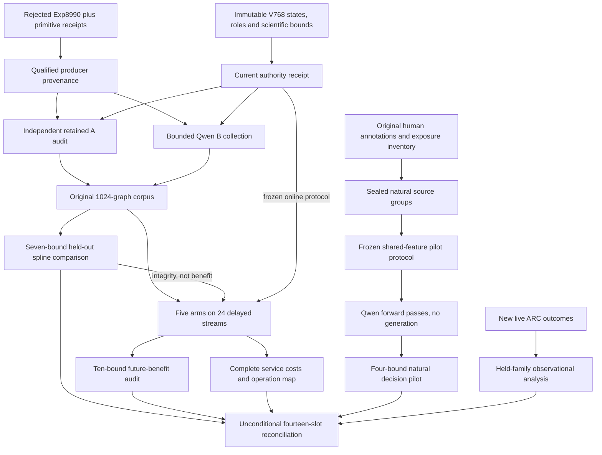
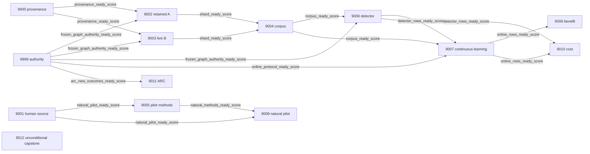

# Carnot Research Roadmap v769: Qualified Spline Evidence and Human-Label Verification

**Created:** 2026-11-11 America/New_York
**Milestone:** 2026.11.769
**Status:** Planned; staged only
**Supersedes:** Completed scheduling milestone 2026.11.768, Exp8985–Exp8998
**Task contract:** Exactly 14 tasks, Exp8999 through Exp9012, in the order below.
**Execution file:** `research-roadmap-next.yaml`

The full V768 design and active queue are preserved byte for byte in
`research-roadmap-v768-preserved-20261111.md` and
`research-roadmap-v768-queue-preserved-20261111.yaml`.
This planning change does not activate the queue or execute experiments.

## What V768 proved

| Evidence | Result | Consequence |
|---|---|---|
| Exp8985 | Administrative authority qualified; zero newly supported ARC outcomes. | Optional ARC evidence must not gate other branches. |
| Exp8986/8987 | Convex coefficient fitting qualified. Exposed-guard spline Brier 0.0279759276 versus converged linear 0.0636283248; AUROC 1.0. All four development checks passed. | Complete the frozen held-out question. Do not refit or spend another task on the same development gate. |
| Exp8988 | Five-arm delayed AdaGrad mechanics and restart controls qualified. | Run the unchanged prospective learning protocol when real rows qualify. |
| Exp8989 | 18,492 records audited; independent human annotation authority was not established. Verdict `complete_null_machine_annotation_only`. | Do not repeat RAGognize as independent truth. |
| Exp8990 | 512 generation calls completed, one model load, but the producer was disqualified by two provenance flags. | Preserve the rejected primary; qualify the producer contract and audit primitive evidence separately. |
| Exp8991 | No declared primary or corresponding execution receipt was found by the capstone. | Missing observations are not a scientific null; collect only committed B identities. |
| Exp8992–8997 | Corpus/confirmation/learning/cost work was blocked or skipped; ARC lacked new support. | None establishes a failed spline scientific hypothesis. |
| Exp8998 | All fourteen slots accounted for; `complete_blocked_upstream_science_unavailable`. | Administrative completion grants no new scientific claim. |

Primary evidence is in `results/experiment_8987_v768_spline_development_admission.json`,
`results/experiment_8988_v768_online_spline_methods.json`,
`results/experiment_8989_v768_natural_annotation_authority.json`,
`results/experiment_8990_v768_graph_corpus_a.json` and
`results/experiment_8998_v768_capstone.json`. The completion archive currently ends
at V767; current terminal primaries and conductor receipts establish V768 closure.
The plan does not rewrite that archive or invent missing verdicts.

The diagnosed provenance defect is specific. Exp8990 embedded Exp8987 at
`preconditions_checked.authentication.protocol`, including its zero generation
and load counters and `model_invoked=false`. The unchanged validator classified
these alongside Exp8990's real positive counters and emitted
`INFERENCE_PROVENANCE_CONTRADICTION` and `SUBSTRATE_CLASS_MISMATCH`.
The solution is explicit historical references in the producer, with all original
bytes retained. The validator and rejected primary remain unchanged.

## The three largest gaps to the PRD

1. **FR-12: independently evaluated natural-language verification.** Graph truth
   is cheap BFS; graph success cannot close the oracle-distinct north star.
   Audit original human judgments and evaluate a small energy head against
   matched controls on unseen source groups. Keep uncertainty and source limits.
2. **FR-06/FR-12: prospective value of the now-admitted spline.** Development
   passed, but corpus provenance prevented confirmation. Authenticate retained
   A observations, collect B, and run the original seven-bound comparison.
3. **FR-11: useful continuous learning with complete costs.** Update mechanics
   passed; future benefit remains unmeasured. Run the existing delayed protocol,
   retain all ten benefit/retention bounds and include durable service costs.

FR-05/FR-08/NFR-01 inform the operation map. There is no evidence yet to justify
another Rust port, sampler, board bring-up or hardware purchase. A binary spline
energy is an additive logistic classifier: notation alone provides no guarantee
of truth. Original human annotation is independent supervision, not infallibility.

## Research incorporated before design

The dated V769 entry in `research-references.md` was written before this plan.

| Source | Experiment use and boundary |
|---|---|
| [SHAM-Bench, 2610.27370](https://arxiv.org/html/2610.27370v1), October 2026 | Exp9001/9005/9008 audit constituent labels, group by original source and preserve criteria. Its aggregate release URL was not verified. |
| [Original RAGTruth release](https://github.com/ParticleMedia/RAGTruth) | Accessible original human annotations provide a conditional pilot route. This 2024 constituent is revisited through the 2026 benchmark, not described as new data. |
| [Online KAN, 2602.02056](https://arxiv.org/abs/2602.02056) | Exp9007 tests the already qualified local coefficient learner. Published core latency supplies no local service speedup. |
| [Continual Calibration, 2604.23987](https://arxiv.org/abs/2604.23987) | Exp9009 keeps future proper loss and both retention metrics separate; no borrowed conformal guarantee. |
| [Continuous-state probabilistic computer, 2610.31339](https://arxiv.org/abs/2610.31339) | Exp9010 accounts for serial work and supported operations before any acceleration claim. |

The scan also covered EBR, neural constraint layers, Ising sampling complexity
and energy-guided decoding. These do not warrant new generative or sampling
branches before the current verification questions are answered. OpenReview's
VFScale forum required browser verification. Semantic Scholar returned ten EBT
citations and a next-page marker; ARM–EBM was rate-limited. Hugging Face supplied
verification leads. GitHub trending exposed no usable relevant ranking.
Extropic advertises 2027 Z1 access; Kona exposes product descriptions without a
reproducible new architecture. None changes local hardware availability.

## Architecture



## Phase 1 — authority and independent prerequisites (Exp8999–Exp9001)

**Exp8999** binds exactly fourteen full task objects and preserves the complete
V768 authorities. It authenticates the already passed graph development gate,
fixed model states, original role manifest and qualified online protocol.
`contract_ready_score`, `frozen_graph_authority_ready_score` and
`online_protocol_ready_score` are separate. It checks the ARC evidence delta
once; thirty new uncensored episodes, three families and both arms per held
family are required. Zero ARC support does not fail administrative readiness.

**Exp9000** reproduces the exact provenance rejection, then fixes the shared
producer serialization with retained upstream references. Its private real-CLI
controls cover bounded generation, load-only, cached current work, missing
ledgers and genuine current contradictions. All original evidence stays intact;
no validator is weakened. This is a CPU method qualification, not a live run.

**Exp9001** audits the original RAGTruth author release at a pinned commit.
Human label policy, original context, source IDs, quality flags, `implicit_true`,
licenses and prior Carnot exposures are separate checks. Use QA and Summary;
exclude structured Data2txt. Group by source ID and normalized source-content
hash, merging duplicate/overlapping documents before any split.

Before inspecting new labels, choose one response per group using salted ID
hashes (`v769-human-v1`), then 320 FIT and 80 CAL groups from official train and
200 TEST groups from official test. Previously exposed groups are ineligible for
new CAL/TEST. Require all 600 groups, five examples per class in FIT/CAL and
20 per class in TEST. The independent-label floor remains at least 200 groups;
the pilot has its own stronger 600-group role contract. Missing support blocks
without rebalancing or choosing a favorable response. The original human
unsupported-span criterion is primary; alternative categories remain sensitivity
labels. No new labels are generated. Downloads are bounded to 256 MB/600 seconds.

## Phase 2 — corpus custody and prospective pilot methods (Exp9002–Exp9005)

**Exp9002** independently audits Exp8990's retained A observations after the
provenance qualification. Check all 512 original response bytes, first-response
identities, model/tokenizer/CUDA and invocation receipts, 64/64/384 roles and
frozen state hashes. Recompute labels and taxonomy. Require evidence that no
held-out detector evaluation or fit consumed them after collection. Unknown
custody or exposure blocks. Do not generate replacements, revise the rejected
primary or count its calls twice. A new qualified source audit remains circular
oracle-based admission, with zero current model calls.

**Exp9003** collects exactly the 512 committed missing B identities. Use only
`unsloth/Qwen3.8-27B-GGUF`, Q4_K_M, GPU 0, reasoning disabled, temperature 0,
16 output tokens and the original context/prompt bytes. Preserve the model
lease and genuine CUDA/cache receipts. There are no answer retries or repairs.
Preflight/load limits are 240 seconds each, request timeout 30 seconds and
collection budget 2700 seconds; checkpoint every 16 requests with parent progress.
It does not wait for favorable A science. Unexpected existing B responses block
this live-only task for a changed-input decision rather than becoming hidden reuse.

**Exp9004** joins the original 1024 distinct identities and 128 CAL/128 TEST/768
online roles. Preserve the original 200-error minimum and five examples per class
per pooled role. Separate semantic, out-of-graph, format and transport errors.
BFS truth, distances, answer membership and identities never enter learned
inference features. Missing or disqualified inputs cannot be replaced by fixtures.

**Exp9005** implements and tests the natural pilot before any LLM call. The
frozen worker extracts mean-pooled, normalized Qwen embeddings from the complete
context plus response; a response-only input is a descriptive removal diagnostic.
Preserve all 600 groups. Inputs over 2048 tokens block instead of truncating
context or replacing records. No IDs, generator identity or annotation fields
enter features. Methods tests use known private vectors, never claimed model data.

Fit a 16-component deterministic PCA on FIT joint embeddings only, then fit-only
scale to [-1,1] with clipping counts. Reuse the V768 cubic knots and ridge 0.01
convex binary log-loss objective: a 129-parameter spline and 17-parameter linear
control receive the same convergence standard. The lexical linear comparator
uses four fixed features: log response/context token counts and response unigram/
bigram overlap fractions with context. Prevalence is the FIT error rate.
No hyperparameter search. Temperature comes only from CAL, from `[0.5,1,2,4]`
with ascending ties. Save the runnable protocol, tests and code hashes before
execution. This mechanism differs from the retired fixed-step sentence-spline
scope; the original null remains unchanged.

## Phase 3 — held-out decisions and continuous self-learning (Exp9006–Exp9008)

**Exp9006** completes the original graph comparison with frozen coefficients.
Calibrate on the 128 CAL graphs and seal the 128 TEST predictions before opening
labels. Retain all seven simultaneous bounds: spline Brier improvement lower >0
versus prevalence, confidence linear, old shared linear and converged linear;
accepted-error delta upper <=0 at exactly 50% coverage versus each linear arm.
Use 10000 paired graph bootstrap draws, family alpha 0.05 and tail 0.05/7.
All seven must pass. Fixed coverage is not a risk certificate. Test exact node
permutation invariance within 1e-6 and truth exclusion. Row integrity and benefit
are distinct readiness fields. A numerical null permits online/cost measurements.

**Exp9007** is the FR-11 continuous-learning experiment. Run the already qualified
five arms on 24 disjoint 32-query streams: frozen spline, adaptive spline,
bias-only spline, adaptive linear and permuted-feedback spline. Encoders, knots,
Qwen weights and fixed representation stay unchanged. Temperature stays at 1,
as in the qualified Exp8988 objective; offline detector temperatures are separate.
The original update uses
binary log loss, 0.01 initial-state anchoring excluding intercept, gradient norm
clipping at 1, AdaGrad rate 0.05 and epsilon 1e-8.

Seal predictions 8/12/16/20/24/28/32 before releasing four labels at each boundary.
Four final labels remain pending until scientific scoring ends. Permute only
within released blocks. Preserve the 64-graph development guard: Brier increase
<=0.005 and no classification-error increase against initialization. Rejection
restores coefficients and accumulator but acknowledges consumed labels atomically.
A real kill at query 16 must resume identically. Score the shared 128-graph TEST
retention panel at 0/16/32 outside all updates/guards. Retain 3840 online and
46080 retention rows; the independent sample size is 24 streams, not 49920 rows.

**Exp9008** executes only the frozen natural pilot. Load the mandated Qwen on
GPU 0; perform 600 joint and 600 response-only forward passes with zero generated
tokens. Preserve cache/tokenizer/offload/pooling receipts and every selected input.
Use a 240-second load limit, 30-second forward limit and 2700-second feature budget.
The tested analysis fits only FIT, calibrates only CAL and seals TEST predictions.

The response-only diagnostic uses the joint PCA/scaler/heads without refitting;
it is an out-of-distribution sensitivity probe, not a causal context-benefit claim.
Its primary gate has four simultaneous one-sided bounds: spline Brier improvement
lower >0 against shared linear, lexical and prevalence; accepted-error delta upper
<=0 against shared linear at exactly 50% coverage. Use 10000 paired source-group
bootstrap draws, seed 769008 and tail 0.05/4. Typed decisions accept at error
probability <=0.1, reject at >=0.9 and otherwise escalate. AUROC, response-only
behavior and `implicit_true` sensitivity are descriptive. Human labels may be
noisy and public data may be present in pretraining; report both limits.
No claim concerns Qwen-generated answer error rates or span localization.

## Phase 4 — benefit, complete cost and closure (Exp9009–Exp9012)

**Exp9009** independently recomputes the ten-bound learning contract. On queries
17–32, adaptive-minus-frozen Brier upper must be <=-0.01; uppers against bias-only,
adaptive linear and permuted feedback must each be <0. The six retention
Brier/error uppers at 0/16/32 must each be <=0.01. Use 10000 whole-stream bootstrap
draws with family alpha 0.01 and tail 0.001. Retention resamples graph IDs once
per draw, shared across arms and histories; report conditional-panel sensitivity.
All ten bounds and causal integrity must pass for learning benefit.

**Exp9010** measures 24 paired fresh-process units, randomizing four arm orders:
frozen/adaptive spline and frozen/adaptive converged linear. Include raw graph
reads, startup/JIT, encoding, basis work, scoring, dense anchors, guards, durable
writes, fsync, restart, final feedback drain and shutdown. Linear service performs
no artificial spline work. Keep cold/resident costs separate. Unqualified
component clocks cannot support attribution, though valid direct total timings
remain usable. Never subtract observer cost to manufacture a speed gain.

Deployment requires both graph quality gates and an upper95 adaptive spline/
linear complete-cost ratio <=1. The natural pilot's LLM feature costs remain
separate. Map actual work to supported operations and the nonaccelerable fraction;
an ideal accelerator cannot exceed 100x if at least 1% of total work is serial.
This task makes no board calls or new hardware acquisition.

**Exp9011** runs only when Exp8999 admits new supported ARC receipts. Analyze
held-family supervisor associations, exposure differences and censoring; do not
run games or modify policies. Any incidental level credit requires registry
precheck and original `live_agent_self_discovery` provenance. Duplicates,
hand-built adapters and outer-loop solves receive no credit. Observational
association is not a causal policy improvement or hidden-game generalization.

**Exp9012** always runs and accounts for exactly fourteen slots, including itself.
Use actual primary verdicts or exact scheduler evidence. Exp8993–8996 had skips
without primary verdicts; rerun metadata cites the real upstream Exp8992 failure
instead of inventing their honest_verdict values. Preserve all nulls, missing
inputs, disqualifications and original Exp8990 flags. External unavailable science
is terminal blocked; only unfinished owned accounting uses partial. Historical
FoVer G1–G4 publication gates remain separate from current scientific claims.

## Dependency graph

Every solid edge is a structured `== 1` gate on the exact top-level field shown.
The natural source audit and capstone have no graph dependence. Administrative
contract success is not used as a substitute for scientific readiness.



All eighteen gates refer to an earlier task in this roadmap and a field declared
in that producer's REQUIRED ARTIFACT FIELDS. There are no retired `requires:`
chains. Benefit is not a gate for integrity-qualified learning or cost studies.
Retained-A audit failure blocks the original graph study; no silent fresh-A
replacement changes its data exposure. The independent natural branch can proceed.

## Hardware requirements and budgets

| Work | Required compute | Estimate per task | Boundary |
|---|---|---|---|
| Authority, provenance, source audit, raw custody | CPU and bounded local/network IO | 30–50 minutes | Private fixtures never count as live evidence. |
| Missing graph shard B | RTX3090 GPU 0, 24 GB; pinned Q4_K_M model | 60 minutes | Real bounded 16-token generation; GPU 1 detached. |
| Natural pilot execution | RTX3090 GPU 0, 24 GB; up to 2048 input tokens | 60 minutes | 1200 forward passes, zero generation; runtime capability must qualify. |
| Small-head methods, graph evaluation and learning | CPU/JAX/SciPy, approximately 4 GB working memory | 40–60 minutes | No current LLM inference for cached numerical work. |
| Benefit, costs, ARC and capstone | CPU; private processes/durable disk | 25–60 minutes | No board probes or benchmark-speed claims from estimates. |

All tasks together estimate 615 minutes if every gate passes. Each remains within
its own 4800-second hard cap: measurement stops by 3600 seconds and 900 seconds
are reserved for validation. These are planning estimates, not observed durations.

The model mandate is `unsloth/Qwen3.8-27B-GGUF` for both model tasks. Exp9003 is
`model_bounded_generation` (10-second floor). Exp9008 is
`model_load_no_generation` (2-second floor) with an embedding substrate. No
`model_full_generation` task is planned; that class has a 60-second floor.
Actual preflight failures must report actual invocation scope. CPU tasks declare
`MODEL_SPECS=[]` and `no_model_load`; cited historical Qwen work stays historical.
Legacy small models are allowed only in private CPU smoke tests, never headlines.

The wishlist's old Vivado blockers are historical. Preserve KV260's qualified
sampling scope at `k_max<=5`, PolarFire Linux CPU dispatch, GateMate's unchanged
`0xffffffff` physical block and unqualified NPU/TSU execution. Coefficient
learning has a possible FPGA arithmetic path but the existing sampler does not
implement it. The measured operation map must say when serial work makes 100x
unattainable. No purchase, flashing or unrequested hardware integration is planned.

## Execution, failure and validation discipline

Every prompt contains numbered flushed phase/slow-call progress, loop/child
heartbeats at least every 60 seconds, gaps below 600 seconds and bounded tool
calls. Files over about 200 lines must be written in several calls with progress
between them. No heartbeat may substitute for actual completed work or pad time.

Every task has complete prior-scope metadata and `retire_if_same_verdict: true`.
Successful authority continuity is identified as such, not invented failure.
Scientific thresholds stay fixed; changed prerequisites and mechanisms are named.
No retired ID is reused and no operator override is fabricated. Every comparison
retains per-unit metrics, numerator/denominator, source hashes and uncertainty.
Every prompt declares the verdict enum and exact failed-gate diagnostics.

Specs and tests precede future implementation. Require scoped unit/private CLI
checks, 100% newly owned statement coverage, lint, strict types, spec coverage
and applicable E2E checks. Failed owned checks disqualify readiness. Report
unrelated repository debt separately. Current planning changes no runtime code.

Routing follows the current user request: authority/provenance preflight uses
Opus/100. Formulaic custody, collection and feature-method work uses Codex
`gpt-6.1-sol`. Routine scientific studies use default Claude; small audits receive
20 or 30 turns. No Luna or Gemini is scheduled. Agent models are distinct from
the mandated Qwen research subject. No sub-agents were used to create this plan.

Planning validation checks the schema, exact full task objects and visible order,
gate spellings, read-first paths, rerun metadata and exclusion/precondition lint.
It also runs existing unit/private-CLI tests, including E2E-018/021, and scoped
spec coverage. Proposed experiments and live hardware/model checks are not run.
Results and any existing repository failures are recorded in ops documentation.

## Exact task contract

Exactly 14 tasks, Exp8999–Exp9012, follow in conductor execution order.
The embedded full objects equal the YAML tasks, including every prompt and gate.

| Order | Task ID | Title | Phase | Deliverable |
|---|---|---|---|---|
| 1 | exp8999-branch-contract | Bind fourteen tasks and preserve frozen V768 scientific authority | 1 | `results/experiment_8999_v769_branch_contract.json` |
| 2 | exp9000-invocation-provenance | Qualify current and historical invocation scopes before source work | 1 | `results/experiment_9000_v769_invocation_provenance.json` |
| 3 | exp9001-human-source-authority | Qualify original human annotations and unseen natural source groups | 1 | `results/experiment_9001_v769_human_source_authority.json` |
| 4 | exp9002-retained-shard-a | Authenticate retained shard A without new generation or revised labels | 2 | `results/experiment_9002_v769_retained_shard_a.json` |
| 5 | exp9003-graph-corpus-b | Complete the frozen bounded Qwen source with shard B | 2 | `results/experiment_9003_v769_graph_corpus_b.json` |
| 6 | exp9004-corpus-admission | Join authenticated shards under the original graph role contract | 2 | `results/experiment_9004_v769_corpus_admission.json` |
| 7 | exp9005-natural-pilot-methods | Freeze a human-label pilot with shared Qwen features and matched heads | 2 | `results/experiment_9005_v769_natural_pilot_methods.json` |
| 8 | exp9006-spline-calibrated-decisions | Test frozen spline decisions against all registered graph controls | 3 | `results/experiment_9006_v769_spline_calibrated_decisions.json` |
| 9 | exp9007-online-spline-streams | Measure continuous coefficient learning on sealed future response streams | 3 | `results/experiment_9007_v769_online_spline_streams.json` |
| 10 | exp9008-natural-energy-pilot | Measure matched energy decisions against independent human labels | 3 | `results/experiment_9008_v769_natural_energy_pilot.json` |
| 11 | exp9009-online-benefit-audit | Audit future spline benefit and simultaneous shared-panel retention | 4 | `results/experiment_9009_v769_online_benefit_audit.json` |
| 12 | exp9010-complete-spline-cost | Measure complete spline service costs and actual acceleration limits | 4 | `results/experiment_9010_v769_complete_spline_cost.json` |
| 13 | exp9011-arc-transfer-evidence | Assess held-family supervisor transfer only from new live outcomes | 4 | `results/experiment_9011_v769_arc_transfer_evidence.json` |
| 14 | exp9012-capstone | Reconcile fourteen outcomes and separate graph and independent-label claims | 4 | `results/experiment_9012_v769_capstone.json` |

<!-- V769_TASK_CONTRACT_START -->
```json
{
  "milestone": "2026.11.769",
  "tasks": [
{
  "id": "exp8999-branch-contract",
  "title": "Bind fourteen tasks and preserve frozen V768 scientific authority",
  "phase": 1,
  "track": "research",
  "priority": "high",
  "requires_gpu": false,
  "max_turns": 100,
  "estimated_wall_time_min": 30,
  "per_unit_rows": true,
  "milestone": "2026.11.769",
  "deliverable": "results/experiment_8999_v769_branch_contract.json",
  "inference_substrate_class": "no_model_load",
  "MODEL_SPECS": [],
  "gated_on": [],
  "prior_failures": [
    {
      "experiment_id": "exp8985-branch-contract",
      "verdict": "complete_null_v768_branch_contract",
      "addressed_by": "Successful authority continuity, not a failed result: bind the new staged contract and immutable passed methods; do not repeat prior science.",
      "retire_if_same_verdict": true
    }
  ],
  "model": "opus",
  "prompt": "CONTEXT:\nWork in {project_root} on {date}. V768 scheduling is complete, although research-complete.yaml may lag. Exp8987 admitted the convex spline on exposed development only; Exp8990 was disqualified by conflicting nested provenance. Preserve every original result.\nEXISTING CODE TO READ FIRST:\nCLAUDE.md; CODEX.md; research-program.md; ops/north-star.md; ops/e2e-test-plan.md; openspec/capabilities/research-reporting/spec.md; openspec/capabilities/verification/spec.md; openspec/capabilities/kan/spec.md; scripts/experiment_template.py; python/carnot/reporting/primary_publication.py; ops/exclusion_manifest.yaml; openspec/change-proposals/research-roadmap-vNEXT.md; openspec/change-proposals/research-roadmap-v768-preserved-20261111.md; research-references.md; python/carnot/reporting/roadmap_contract.py; python/carnot/reporting/v768_capstone.py; results/experiment_8998_v768_capstone.json; results/experiment_8987_v768_spline_development_admission.json; results/experiment_8988_v768_online_spline_methods.json; python/carnot/reporting/arc_supervisor_frontier_8720.py; ops/arc_supervisor_refinement_ledger.json\nTASK:\nBind fourteen tasks and preserve frozen V768 scientific authority. Deliver results/experiment_8999_v769_branch_contract.json, primitive evidence under results/raw/experiment_8999_v769_branch_contract/, and runnable scripts/experiments/experiment_8999_v769_branch_contract.py.\nCONCRETE STEPS:\n1. Emit a flushed progress line at each phase boundary and before and after every model load, generation, benchmark and subprocess. Set PYTHONUNBUFFERED=1 and use print(..., flush=True). Inside long loops and child waits, print actual completed/pending counts at least every 60 seconds; keep every silence gap below 600 seconds. Poll in tool calls of at most 60 seconds. Write any file over about 200 lines in several tool calls, at most about 150 lines per call, with a progress message between calls. Never pad runtime.\n2. PRECONDITIONS: Before compute, authenticate inputs, exact gate fields, hashes, virtualenv, dependencies, free memory and writable disk. Bound required network requests. Preserve rejected evidence. Missing, retired or gate-blocked external inputs mean honest_verdict=complete_blocked_<check>, verdict_class=blocked and gate_check_summary naming the observed operand. Only unfinished owned work is partial. Do not substitute fixtures for measurements.\n3. Extend the relevant REQ-* and SCENARIO-* before implementation; write failing private tests first. Read all callers before fixing shared code. Reuse existing helpers and frozen methods; keep fixtures in private temporary directories. Never read a mutable successor document as historical authority. Preserve original thresholds and tests.\n4. Load no LLM: MODEL_SPECS=[], model_specs=[], inference_substrate_class=no_model_load. Use aggregation_from_upstream_artifacts for reductions or verifier_ensemble_against_cached_candidates for numerical scoring/training. Keep current model calls zero and declare small trained_head_specs separately. Preserve historical calls only through explicit cited artifact references.\n5. Snapshot archived V768 design/queue, current V769 full task contract and referenced primaries by hash. Compare all 14 full objects, visible order Exp8999..Exp9012 and YAML. A preactivation check compares staged with staged; after activation require actual active bytes too. Never pretend V768 active bytes are V769.\n6. Authenticate Exp8987 states, all four passed admission criteria, original 1024 graph IDs/128 calibration/128 test/768 online roles and Exp8988 five-arm protocol. Publish separate frozen_graph_authority_ready_score and online_protocol_ready_score; never refit, redraw or rerun the development gate. Contract readiness does not require either science gate.\n7. Read the live ARC frontier once against Exp8985: arc_new_outcomes_ready_score=1 only for at least 30 NEW uncensored episodes, at least three families and both compared arms in each held family. Empty/stale support means this field is zero, not a blocked contract. Record counts and exact receipt hashes.\n8. Run scoped pytest and real child CLI checks with 100-percent newly owned statement coverage, Ruff check/format, strict mypy and explicit-path spec coverage. Run applicable E2E success, missing-input, tamper and cold-replay checks, including private E2E-018/021 for authority/custody. Execute the actual CLI outside the checkout without PYTHONPATH. Record argv, normal exit, duration and log hashes. Give pytest selectors only to pytest. Stop measurement by 3600 seconds and reserve 900 seconds for validation inside the 4800-second hard cap.\n9. Retain primitive per-unit rows and source/code/config hashes; independently recompute summaries. Run unchanged adversarial_verify.py and strict verdict_row_consistency_lint.py under progress supervision. Publish via primary_publication after owned checks pass; failed checks disqualify and zero readiness. Reconcile openspec/, _bmad/traceability.md, ops/status.md and ops/changelog.md. Do not edit operator-curated pages, the active roadmap, exclusion manifest or validators. Do not activate a queue or publish externally.\nREQUIRED ARTIFACT FIELDS:\n- honest_verdict: complete_*; verdict_class: positive | circular_positive | null | blocked | disqualified | partial. Principle: external incompleteness is terminal blocked; only owned unfinished work retries.\n- verifier_is_oracle, claim_scope, exposure_scope, independent_generalization_score. Principle: fixtures and graph-oracle admission cannot establish a no-cheap-oracle verifier win; oracle positives are circular_positive.\n- required_checks_passed, flagged_adversarial, validation_receipts, owned_statement_coverage, preconditions_checked. Principle: readiness requires actual normal-exit checks.\n- gate_check_summary: check/upstream/path/sha256/artifact_field/op/expected/observed/passed. Principle: blocked results name the exact check and missing_file, missing_field or observed value.\n- inference_substrate, inference_substrate_class, MODEL_SPECS, model_specs, trained_head_specs, model_invocation_counts, cited_upstream_artifacts: experiment_id/fields_imported/sha256. Principle: current work differs from authenticated historical model work.\n- rows: unit_id/group_id/arm/condition/metric/value/numerator/denominator/status/exclusion_reason; intended_count, independent_count, completed_count, excluded_count, censored_count, failed_count. Principle: every comparison retains each independent unit and denominator; repeated responses are not independent groups.\n- run_date, duration_s, random_seed, reproducibility_checksum, source_artifact_hashes, raw_shard_hashes, code_config_hashes, phase_spans, acceptance_gates, field_principles. Principle: frozen thresholds and retained primitive bytes make the claim reproducible.\n- contract_ready_score, frozen_graph_authority_ready_score, online_protocol_ready_score, arc_new_outcomes_ready_score: each 0|1; authority_manifest, full_contract_rows, frontier_delta_rows. Principle: independent administrative and scientific gates prevent optional evidence from blocking unrelated work.\nRun command: cd {project_root} && PYTHONUNBUFFERED=1 .venv/bin/python -u scripts/experiments/experiment_8999_v769_branch_contract.py --date {date}\nDo NOT push. Do NOT modify scripts/research_conductor.py."
},
{
  "id": "exp9000-invocation-provenance",
  "title": "Qualify current and historical invocation scopes before source work",
  "phase": 1,
  "track": "research",
  "priority": "high",
  "requires_gpu": false,
  "max_turns": 100,
  "estimated_wall_time_min": 50,
  "per_unit_rows": true,
  "milestone": "2026.11.769",
  "deliverable": "results/experiment_9000_v769_invocation_provenance.json",
  "inference_substrate_class": "no_model_load",
  "MODEL_SPECS": [],
  "gated_on": [],
  "prior_failures": [
    {
      "experiment_id": "exp8990-graph-corpus-a",
      "verdict": "complete_disqualified_graph_corpus_a",
      "addressed_by": "Remove the diagnosed embedded-upstream/current-scope ambiguity in producer serialization; qualify real negative controls before any evidence reuse or new collection.",
      "retire_if_same_verdict": true
    }
  ],
  "model": "opus",
  "prompt": "CONTEXT:\nWork in {project_root} on {date}. Exp8990 recorded 512 successful calls and one load, but preconditions_checked.authentication.protocol embedded Exp8987 zero-call counts and model_invoked=false. The unchanged validator treated them as current work. This is a diagnosed producer contract defect, not evidence that inference failed.\nEXISTING CODE TO READ FIRST:\nCLAUDE.md; CODEX.md; research-program.md; ops/north-star.md; ops/e2e-test-plan.md; openspec/capabilities/research-reporting/spec.md; openspec/capabilities/verification/spec.md; openspec/capabilities/kan/spec.md; scripts/experiment_template.py; python/carnot/reporting/primary_publication.py; ops/exclusion_manifest.yaml; openspec/change-proposals/research-roadmap-vNEXT.md; openspec/change-proposals/research-roadmap-v768-preserved-20261111.md; research-references.md; python/carnot/reporting/graph_corpus_a_8990.py; python/carnot/reporting/graph_corpus_a_8961.py; python/carnot/reporting/graph_corpus_runner_8990.py; scripts/adversarial_verify.py; tests/python/test_graph_corpus_a_8990.py; results/experiment_8990_v768_graph_corpus_a.json\nTASK:\nQualify current and historical invocation scopes before source work. Deliver results/experiment_9000_v769_invocation_provenance.json, primitive evidence under results/raw/experiment_9000_v769_invocation_provenance/, and runnable scripts/experiments/experiment_9000_v769_invocation_provenance.py.\nCONCRETE STEPS:\n1. Emit a flushed progress line at each phase boundary and before and after every model load, generation, benchmark and subprocess. Set PYTHONUNBUFFERED=1 and use print(..., flush=True). Inside long loops and child waits, print actual completed/pending counts at least every 60 seconds; keep every silence gap below 600 seconds. Poll in tool calls of at most 60 seconds. Write any file over about 200 lines in several tool calls, at most about 150 lines per call, with a progress message between calls. Never pad runtime.\n2. PRECONDITIONS: Before compute, authenticate inputs, exact gate fields, hashes, virtualenv, dependencies, free memory and writable disk. Bound required network requests. Preserve rejected evidence. Missing, retired or gate-blocked external inputs mean honest_verdict=complete_blocked_<check>, verdict_class=blocked and gate_check_summary naming the observed operand. Only unfinished owned work is partial. Do not substitute fixtures for measurements.\n3. Extend the relevant REQ-* and SCENARIO-* before implementation; write failing private tests first. Read all callers before fixing shared code. Reuse existing helpers and frozen methods; keep fixtures in private temporary directories. Never read a mutable successor document as historical authority. Preserve original thresholds and tests.\n4. Load no LLM: MODEL_SPECS=[], model_specs=[], inference_substrate_class=no_model_load. Use aggregation_from_upstream_artifacts for reductions or verifier_ensemble_against_cached_candidates for numerical scoring/training. Keep current model calls zero and declare small trained_head_specs separately. Preserve historical calls only through explicit cited artifact references.\n5. Reproduce both original CRITICAL flags in a private copy. Enumerate all typed positive/negative paths using the unchanged validator; authenticate original raw invocation ledgers and retained inputs. Do not alter the original artifact or suppress the contradictory current-task evidence.\n6. Fix the shared producer serialization once: retain complete upstream bytes by content-addressed reference and identify imported protocol fields explicitly as cited upstream authority. Serialize only this invocation's counters as current. Preserve dependency checks and raw historical evidence; do not merely rename contradictory counters or delete receipts.\n7. Qualify live-fixture, cached-current/no-model, load-only, missing ledger and genuine contradictory-current negative controls through the real private publication CLI. Zero generated tokens with a completed load must have model_load_no_generation; real bounded generation must have model_bounded_generation. Fixtures remain fixtures and grant no live claim. Only all passing controls plus normal validation yield provenance_ready_score=1.\n8. Run scoped pytest and real child CLI checks with 100-percent newly owned statement coverage, Ruff check/format, strict mypy and explicit-path spec coverage. Run applicable E2E success, missing-input, tamper and cold-replay checks, including private E2E-018/021 for authority/custody. Execute the actual CLI outside the checkout without PYTHONPATH. Record argv, normal exit, duration and log hashes. Give pytest selectors only to pytest. Stop measurement by 3600 seconds and reserve 900 seconds for validation inside the 4800-second hard cap.\n9. Retain primitive per-unit rows and source/code/config hashes; independently recompute summaries. Run unchanged adversarial_verify.py and strict verdict_row_consistency_lint.py under progress supervision. Publish via primary_publication after owned checks pass; failed checks disqualify and zero readiness. Reconcile openspec/, _bmad/traceability.md, ops/status.md and ops/changelog.md. Do not edit operator-curated pages, the active roadmap, exclusion manifest or validators. Do not activate a queue or publish externally.\nREQUIRED ARTIFACT FIELDS:\n- honest_verdict: complete_*; verdict_class: positive | circular_positive | null | blocked | disqualified | partial. Principle: external incompleteness is terminal blocked; only owned unfinished work retries.\n- verifier_is_oracle, claim_scope, exposure_scope, independent_generalization_score. Principle: fixtures and graph-oracle admission cannot establish a no-cheap-oracle verifier win; oracle positives are circular_positive.\n- required_checks_passed, flagged_adversarial, validation_receipts, owned_statement_coverage, preconditions_checked. Principle: readiness requires actual normal-exit checks.\n- gate_check_summary: check/upstream/path/sha256/artifact_field/op/expected/observed/passed. Principle: blocked results name the exact check and missing_file, missing_field or observed value.\n- inference_substrate, inference_substrate_class, MODEL_SPECS, model_specs, trained_head_specs, model_invocation_counts, cited_upstream_artifacts: experiment_id/fields_imported/sha256. Principle: current work differs from authenticated historical model work.\n- rows: unit_id/group_id/arm/condition/metric/value/numerator/denominator/status/exclusion_reason; intended_count, independent_count, completed_count, excluded_count, censored_count, failed_count. Principle: every comparison retains each independent unit and denominator; repeated responses are not independent groups.\n- run_date, duration_s, random_seed, reproducibility_checksum, source_artifact_hashes, raw_shard_hashes, code_config_hashes, phase_spans, acceptance_gates, field_principles. Principle: frozen thresholds and retained primitive bytes make the claim reproducible.\n- provenance_ready_score: 0|1, original_flag_rows, invocation_path_rows, mutation_rows, producer_code_hashes. Principle: the existing validator must still reject actual contradictions while recognizing explicitly cited history.\nRun command: cd {project_root} && PYTHONUNBUFFERED=1 .venv/bin/python -u scripts/experiments/experiment_9000_v769_invocation_provenance.py --date {date}\nDo NOT push. Do NOT modify scripts/research_conductor.py."
},
{
  "id": "exp9001-human-source-authority",
  "title": "Qualify original human annotations and unseen natural source groups",
  "phase": 1,
  "track": "research",
  "priority": "high",
  "requires_gpu": false,
  "max_turns": 30,
  "estimated_wall_time_min": 40,
  "per_unit_rows": true,
  "milestone": "2026.11.769",
  "deliverable": "results/experiment_9001_v769_human_source_authority.json",
  "inference_substrate_class": "no_model_load",
  "MODEL_SPECS": [],
  "gated_on": [],
  "prior_failures": [
    {
      "experiment_id": "exp8989-natural-annotation-authority",
      "verdict": "complete_null_machine_annotation_only",
      "addressed_by": "Switch from model-generated RAGognize labels to original documented human RAGTruth annotations, auditing exposure and original criteria before any pilot.",
      "retire_if_same_verdict": true
    },
    {
      "experiment_id": "exp8908-natural-criterion-audit",
      "verdict": "complete_null_natural_criterion_audit",
      "addressed_by": "Do not repeat original-versus-revised annotation agreement; qualify untouched groups under the original human criterion for a matched-head test.",
      "retire_if_same_verdict": true
    }
  ],
  "prompt": "CONTEXT:\nWork in {project_root} on {date}. Exp8989 found only machine annotations in RAGognize. SHAM-Bench (2610.27370) motivates a constituent-level audit; its aggregate release URL was not verified. Use the reachable original RAGTruth human release, independently of RAGTruth++ revisions and prior exposed records.\nEXISTING CODE TO READ FIRST:\nCLAUDE.md; CODEX.md; research-program.md; ops/north-star.md; ops/e2e-test-plan.md; openspec/capabilities/research-reporting/spec.md; openspec/capabilities/verification/spec.md; openspec/capabilities/kan/spec.md; scripts/experiment_template.py; python/carnot/reporting/primary_publication.py; ops/exclusion_manifest.yaml; openspec/change-proposals/research-roadmap-vNEXT.md; openspec/change-proposals/research-roadmap-v768-preserved-20261111.md; research-references.md; python/carnot/reporting/natural_annotation_authority_8989.py; python/carnot/reporting/natural_criterion_audit_8908.py; python/carnot/reporting/qwen_natural_canary_8924.py; results/experiment_8908_v762_natural_criterion_audit.json; results/experiment_8924_v763_qwen_natural_canary.json; docs/research-notes/label-provenance-audit-step1-2026-11-07.md\nTASK:\nQualify original human annotations and unseen natural source groups. Deliver results/experiment_9001_v769_human_source_authority.json, primitive evidence under results/raw/experiment_9001_v769_human_source_authority/, and runnable scripts/experiments/experiment_9001_v769_human_source_authority.py.\nCONCRETE STEPS:\n1. Emit a flushed progress line at each phase boundary and before and after every model load, generation, benchmark and subprocess. Set PYTHONUNBUFFERED=1 and use print(..., flush=True). Inside long loops and child waits, print actual completed/pending counts at least every 60 seconds; keep every silence gap below 600 seconds. Poll in tool calls of at most 60 seconds. Write any file over about 200 lines in several tool calls, at most about 150 lines per call, with a progress message between calls. Never pad runtime.\n2. PRECONDITIONS: Before compute, authenticate inputs, exact gate fields, hashes, virtualenv, dependencies, free memory and writable disk. Bound required network requests. Preserve rejected evidence. Missing, retired or gate-blocked external inputs mean honest_verdict=complete_blocked_<check>, verdict_class=blocked and gate_check_summary naming the observed operand. Only unfinished owned work is partial. Do not substitute fixtures for measurements.\n3. Extend the relevant REQ-* and SCENARIO-* before implementation; write failing private tests first. Read all callers before fixing shared code. Reuse existing helpers and frozen methods; keep fixtures in private temporary directories. Never read a mutable successor document as historical authority. Preserve original thresholds and tests.\n4. Load no LLM: MODEL_SPECS=[], model_specs=[], inference_substrate_class=no_model_load. Use aggregation_from_upstream_artifacts for reductions or verifier_ensemble_against_cached_candidates for numerical scoring/training. Keep current model calls zero and declare small trained_head_specs separately. Preserve historical calls only through explicit cited artifact references.\n5. Pin https://github.com/ParticleMedia/RAGTruth source_info.jsonl, response.jsonl, annotation policy and license at an author commit. Bound downloads to 256 MB/600 seconds. Trace original manual span decisions, implicit_true and quality flags; do not relabel with an LLM, adopt revised machine labels, scrape access-controlled text or infer annotator independence from a dataset name.\n6. Audit QA and Summary records only; exclude structured Data2txt. Join source_id and normalized source-content hashes, merging duplicate/overlapping documents before splitting. Inventory all prior Carnot natural-source exposures including Exp8908/8924. Exposed groups are development-only and ineligible for the new calibration/test pool.\n7. Before inspecting new labels, deterministically select one response per source group by salted ID hash, then 320 fit and 80 calibration groups from official train and 200 test groups from official test; salt=v769-human-v1. Retain original text and source criteria. Exclude known truncated/quality-failed responses. No criterion-based swapping or response retry. Require 600 joined groups, at least five examples of each response class in fit/calibration and 20 of each in test. Eligibility first requires documented human decisions and at least 200 independent groups; the pilot gate additionally requires its full 600-role contract.\n8. Define primary response error as at least one original human unsupported span, preserving implicit_true and all original categories as separate sensitivity labels. Seal labels outside inference views. Publish exact selected IDs, source/response/annotation hashes, role manifest, exposure exclusions, policy ambiguity and counts. If authority is machine-only, record terminal null; missing access/support is blocked. Do not claim generalization from this audit.\n9. Run scoped pytest and real child CLI checks with 100-percent newly owned statement coverage, Ruff check/format, strict mypy and explicit-path spec coverage. Run applicable E2E success, missing-input, tamper and cold-replay checks, including private E2E-018/021 for authority/custody. Execute the actual CLI outside the checkout without PYTHONPATH. Record argv, normal exit, duration and log hashes. Give pytest selectors only to pytest. Stop measurement by 3600 seconds and reserve 900 seconds for validation inside the 4800-second hard cap.\n10. Retain primitive per-unit rows and source/code/config hashes; independently recompute summaries. Run unchanged adversarial_verify.py and strict verdict_row_consistency_lint.py under progress supervision. Publish via primary_publication after owned checks pass; failed checks disqualify and zero readiness. Reconcile openspec/, _bmad/traceability.md, ops/status.md and ops/changelog.md. Do not edit operator-curated pages, the active roadmap, exclusion manifest or validators. Do not activate a queue or publish externally.\nREQUIRED ARTIFACT FIELDS:\n- honest_verdict: complete_*; verdict_class: positive | circular_positive | null | blocked | disqualified | partial. Principle: external incompleteness is terminal blocked; only owned unfinished work retries.\n- verifier_is_oracle, claim_scope, exposure_scope, independent_generalization_score. Principle: fixtures and graph-oracle admission cannot establish a no-cheap-oracle verifier win; oracle positives are circular_positive.\n- required_checks_passed, flagged_adversarial, validation_receipts, owned_statement_coverage, preconditions_checked. Principle: readiness requires actual normal-exit checks.\n- gate_check_summary: check/upstream/path/sha256/artifact_field/op/expected/observed/passed. Principle: blocked results name the exact check and missing_file, missing_field or observed value.\n- inference_substrate, inference_substrate_class, MODEL_SPECS, model_specs, trained_head_specs, model_invocation_counts, cited_upstream_artifacts: experiment_id/fields_imported/sha256. Principle: current work differs from authenticated historical model work.\n- rows: unit_id/group_id/arm/condition/metric/value/numerator/denominator/status/exclusion_reason; intended_count, independent_count, completed_count, excluded_count, censored_count, failed_count. Principle: every comparison retains each independent unit and denominator; repeated responses are not independent groups.\n- run_date, duration_s, random_seed, reproducibility_checksum, source_artifact_hashes, raw_shard_hashes, code_config_hashes, phase_spans, acceptance_gates, field_principles. Principle: frozen thresholds and retained primitive bytes make the claim reproducible.\n- independent_label_ready_score, natural_pilot_ready_score: 0|1; annotation_origin_rows, source_group_rows, exposure_ledger, role_manifest, criterion_policy, label_sidecar_hashes, source_access_receipts. Principle: independently recorded human decisions, complete original context and unseen source groups are separate eligibility requirements.\nRun command: cd {project_root} && PYTHONUNBUFFERED=1 .venv/bin/python -u scripts/experiments/experiment_9001_v769_human_source_authority.py --date {date}\nDo NOT push. Do NOT modify scripts/research_conductor.py."
},
{
  "id": "exp9002-retained-shard-a",
  "title": "Authenticate retained shard A without new generation or revised labels",
  "phase": 2,
  "track": "research",
  "priority": "high",
  "requires_gpu": false,
  "max_turns": 30,
  "estimated_wall_time_min": 40,
  "per_unit_rows": true,
  "milestone": "2026.11.769",
  "deliverable": "results/experiment_9002_v769_retained_shard_a.json",
  "inference_substrate_class": "no_model_load",
  "MODEL_SPECS": [],
  "gated_on": [
    {
      "upstream": "exp9000-invocation-provenance",
      "artifact_field": "provenance_ready_score",
      "op": "==",
      "value": 1
    },
    {
      "upstream": "exp8999-branch-contract",
      "artifact_field": "frozen_graph_authority_ready_score",
      "op": "==",
      "value": 1
    }
  ],
  "prior_failures": [
    {
      "experiment_id": "exp8990-graph-corpus-a",
      "verdict": "complete_disqualified_graph_corpus_a",
      "addressed_by": "A separate current-scope CPU audit recomputes custody from raw responses after Exp9000 qualifies the producer fix; original rejection and all model evidence remain immutable.",
      "retire_if_same_verdict": true
    }
  ],
  "agent_type": "codex",
  "model": "gpt-6.1-sol",
  "prompt": "CONTEXT:\nWork in {project_root} on {date}. Exp8990 produced 512 first responses before provenance disqualification. A new CPU audit may qualify primitive observations only after the serializer defect is independently fixed; the historical primary stays disqualified and excluded as a success.\nEXISTING CODE TO READ FIRST:\nCLAUDE.md; CODEX.md; research-program.md; ops/north-star.md; ops/e2e-test-plan.md; openspec/capabilities/research-reporting/spec.md; openspec/capabilities/verification/spec.md; openspec/capabilities/kan/spec.md; scripts/experiment_template.py; python/carnot/reporting/primary_publication.py; ops/exclusion_manifest.yaml; openspec/change-proposals/research-roadmap-vNEXT.md; openspec/change-proposals/research-roadmap-v768-preserved-20261111.md; research-references.md; python/carnot/reporting/graph_corpus_a_8990.py; python/carnot/reporting/graph_corpus_a_8961.py; results/experiment_8990_v768_graph_corpus_a.json; results/experiment_8987_v768_spline_development_admission.json\nTASK:\nAuthenticate retained shard A without new generation or revised labels. Deliver results/experiment_9002_v769_retained_shard_a.json, primitive evidence under results/raw/experiment_9002_v769_retained_shard_a/, and runnable scripts/experiments/experiment_9002_v769_retained_shard_a.py.\nCONCRETE STEPS:\n1. Emit a flushed progress line at each phase boundary and before and after every model load, generation, benchmark and subprocess. Set PYTHONUNBUFFERED=1 and use print(..., flush=True). Inside long loops and child waits, print actual completed/pending counts at least every 60 seconds; keep every silence gap below 600 seconds. Poll in tool calls of at most 60 seconds. Write any file over about 200 lines in several tool calls, at most about 150 lines per call, with a progress message between calls. Never pad runtime.\n2. PRECONDITIONS: Before compute, authenticate inputs, exact gate fields, hashes, virtualenv, dependencies, free memory and writable disk. Bound required network requests. Preserve rejected evidence. Missing, retired or gate-blocked external inputs mean honest_verdict=complete_blocked_<check>, verdict_class=blocked and gate_check_summary naming the observed operand. Only unfinished owned work is partial. Do not substitute fixtures for measurements.\n3. Extend the relevant REQ-* and SCENARIO-* before implementation; write failing private tests first. Read all callers before fixing shared code. Reuse existing helpers and frozen methods; keep fixtures in private temporary directories. Never read a mutable successor document as historical authority. Preserve original thresholds and tests.\n4. Load no LLM: MODEL_SPECS=[], model_specs=[], inference_substrate_class=no_model_load. Use aggregation_from_upstream_artifacts for reductions or verifier_ensemble_against_cached_candidates for numerical scoring/training. Keep current model calls zero and declare small trained_head_specs separately. Preserve historical calls only through explicit cited artifact references.\n5. Require current provenance_ready_score=1 and frozen_graph_authority_ready_score=1. Authenticate all original raw response bytes, original invocation/load/tokenizer/GGUF/CUDA receipts, checkpoint ledger and immutable role/state hashes. Do not trust the old aggregate or its ready bit. Independently reproduce the parser categories and BFS labels for every unit.\n6. Require exactly the committed 512 unique A identities and 64 calibration/64 final-test/384 online roles, one authentic first response per unit, no omitted/replaced failures and no detector fitting or test-score exposure after collection. Inventory any downstream evaluation attempts. If custody, non-exposure or the model receipt is unprovable, block; do not generate replacement rows or use the flagged primary as authority.\n7. Publish a new current no-model audit referencing original generation under cited_upstream_artifacts. Preserve original flags and report why each is scoped differently in the new audit. Pass unchanged adversarial and row checks on the actual retained work, not only fixtures. shard_ready_score=1 is source custody only; use circular_positive for positive oracle-label admission and independent_generalization_score=0.\n8. Run scoped pytest and real child CLI checks with 100-percent newly owned statement coverage, Ruff check/format, strict mypy and explicit-path spec coverage. Run applicable E2E success, missing-input, tamper and cold-replay checks, including private E2E-018/021 for authority/custody. Execute the actual CLI outside the checkout without PYTHONPATH. Record argv, normal exit, duration and log hashes. Give pytest selectors only to pytest. Stop measurement by 3600 seconds and reserve 900 seconds for validation inside the 4800-second hard cap.\n9. Retain primitive per-unit rows and source/code/config hashes; independently recompute summaries. Run unchanged adversarial_verify.py and strict verdict_row_consistency_lint.py under progress supervision. Publish via primary_publication after owned checks pass; failed checks disqualify and zero readiness. Reconcile openspec/, _bmad/traceability.md, ops/status.md and ops/changelog.md. Do not edit operator-curated pages, the active roadmap, exclusion manifest or validators. Do not activate a queue or publish externally.\nREQUIRED ARTIFACT FIELDS:\n- honest_verdict: complete_*; verdict_class: positive | circular_positive | null | blocked | disqualified | partial. Principle: external incompleteness is terminal blocked; only owned unfinished work retries.\n- verifier_is_oracle, claim_scope, exposure_scope, independent_generalization_score. Principle: fixtures and graph-oracle admission cannot establish a no-cheap-oracle verifier win; oracle positives are circular_positive.\n- required_checks_passed, flagged_adversarial, validation_receipts, owned_statement_coverage, preconditions_checked. Principle: readiness requires actual normal-exit checks.\n- gate_check_summary: check/upstream/path/sha256/artifact_field/op/expected/observed/passed. Principle: blocked results name the exact check and missing_file, missing_field or observed value.\n- inference_substrate, inference_substrate_class, MODEL_SPECS, model_specs, trained_head_specs, model_invocation_counts, cited_upstream_artifacts: experiment_id/fields_imported/sha256. Principle: current work differs from authenticated historical model work.\n- rows: unit_id/group_id/arm/condition/metric/value/numerator/denominator/status/exclusion_reason; intended_count, independent_count, completed_count, excluded_count, censored_count, failed_count. Principle: every comparison retains each independent unit and denominator; repeated responses are not independent groups.\n- run_date, duration_s, random_seed, reproducibility_checksum, source_artifact_hashes, raw_shard_hashes, code_config_hashes, phase_spans, acceptance_gates, field_principles. Principle: frozen thresholds and retained primitive bytes make the claim reproducible.\n- shard_ready_score: 0|1; original_disqualified_primary, raw_receipt_audit, nonexposure_audit, response_rows, first_response_rows, role_manifest_hash, original_model_receipt_reference, original_generation_duration_s. Principle: authenticated historical observations may support a new audit without revising their producer verdict or pretending to perform current generation.\nRun command: cd {project_root} && PYTHONUNBUFFERED=1 .venv/bin/python -u scripts/experiments/experiment_9002_v769_retained_shard_a.py --date {date}\nDo NOT push. Do NOT modify scripts/research_conductor.py."
},
{
  "id": "exp9003-graph-corpus-b",
  "title": "Complete the frozen bounded Qwen source with shard B",
  "phase": 2,
  "track": "research",
  "priority": "high",
  "requires_gpu": true,
  "max_turns": 30,
  "estimated_wall_time_min": 60,
  "per_unit_rows": true,
  "milestone": "2026.11.769",
  "deliverable": "results/experiment_9003_v769_graph_corpus_b.json",
  "inference_substrate_class": "model_bounded_generation",
  "MODEL_SPECS": [
    "unsloth/Qwen3.8-27B-GGUF"
  ],
  "gated_on": [
    {
      "upstream": "exp9000-invocation-provenance",
      "artifact_field": "provenance_ready_score",
      "op": "==",
      "value": 1
    },
    {
      "upstream": "exp8999-branch-contract",
      "artifact_field": "frozen_graph_authority_ready_score",
      "op": "==",
      "value": 1
    }
  ],
  "prior_failures": [
    {
      "experiment_id": "exp8990-graph-corpus-a",
      "verdict": "complete_disqualified_graph_corpus_a",
      "addressed_by": "The shared producer provenance fix is qualified before this untouched B shard executes; original zero-call protocol records are explicit cited inputs, never current counters.",
      "retire_if_same_verdict": true
    },
    {
      "experiment_id": "exp8977-graph-corpus-b",
      "verdict": "blocked_gate_check_failed",
      "addressed_by": "The unchanged neural-head gate stays closed; V768 convex development admission is now authenticated by a current task, and producer qualification independently gates collection.",
      "retire_if_same_verdict": true
    }
  ],
  "agent_type": "codex",
  "model": "gpt-6.1-sol",
  "prompt": "CONTEXT:\nWork in {project_root} on {date}. The V768 B primary is absent. This task supplies only its already committed 512 missing identities after producer provenance qualification. The passed spline gate and graph population are unchanged; do not regenerate shard A.\nEXISTING CODE TO READ FIRST:\nCLAUDE.md; CODEX.md; research-program.md; ops/north-star.md; ops/e2e-test-plan.md; openspec/capabilities/research-reporting/spec.md; openspec/capabilities/verification/spec.md; openspec/capabilities/kan/spec.md; scripts/experiment_template.py; python/carnot/reporting/primary_publication.py; ops/exclusion_manifest.yaml; openspec/change-proposals/research-roadmap-vNEXT.md; openspec/change-proposals/research-roadmap-v768-preserved-20261111.md; research-references.md; python/carnot/reporting/graph_corpus_a_8990.py; python/carnot/reporting/graph_corpus_a_8961.py; python/carnot/reporting/graph_corpus_b_8962.py; scripts/experiments/experiment_8962_v766_graph_corpus_b.py; openspec/change-proposals/v768-spline-protocol.json\nTASK:\nComplete the frozen bounded Qwen source with shard B. Deliver results/experiment_9003_v769_graph_corpus_b.json, primitive evidence under results/raw/experiment_9003_v769_graph_corpus_b/, and runnable scripts/experiments/experiment_9003_v769_graph_corpus_b.py.\nCONCRETE STEPS:\n1. Emit a flushed progress line at each phase boundary and before and after every model load, generation, benchmark and subprocess. Set PYTHONUNBUFFERED=1 and use print(..., flush=True). Inside long loops and child waits, print actual completed/pending counts at least every 60 seconds; keep every silence gap below 600 seconds. Poll in tool calls of at most 60 seconds. Write any file over about 200 lines in several tool calls, at most about 150 lines per call, with a progress message between calls. Never pad runtime.\n2. PRECONDITIONS: Before compute, authenticate inputs, exact gate fields, hashes, virtualenv, dependencies, free memory and writable disk. Bound required network requests. Preserve rejected evidence. Missing, retired or gate-blocked external inputs mean honest_verdict=complete_blocked_<check>, verdict_class=blocked and gate_check_summary naming the observed operand. Only unfinished owned work is partial. Do not substitute fixtures for measurements.\n3. Extend the relevant REQ-* and SCENARIO-* before implementation; write failing private tests first. Read all callers before fixing shared code. Reuse existing helpers and frozen methods; keep fixtures in private temporary directories. Never read a mutable successor document as historical authority. Preserve original thresholds and tests.\n4. Require provenance_ready_score=1 and frozen_graph_authority_ready_score=1. Authenticate the original B manifest and confirm it contains no previous completed response. If valid B bytes already exist, stop as blocked_changed_input rather than silently switch to cached work. Use only MODEL_SPECS=[unsloth/Qwen3.8-27B-GGUF], Q4_K_M, CARNOT_FORCE_LIVE=1, GPU 0, CUDA_VISIBLE_DEVICES=0 and the established model lease. GPU 1 remains detached. Prove cache/model/tokenizer hashes and CUDA offload; a health query failure is unknown, not healthy. No CPU simulation or smaller headline model.\n5. Run the existing supervised first-response collector with reasoning disabled, temperature 0 and 16 output tokens, original context/prompt bytes, one request per identity. Preflight/load limits are 240 seconds each, per request 30 seconds and generation budget 2700 seconds. Checkpoint every 16 requests; the parent prints while the child waits. Retain all failed/censored identities without retries. Stop in time for owned validation.\n6. Record inference_substrate=live_llm_inference and inference_substrate_class=model_bounded_generation (10-second floor). If only loading occurred, report model_load_no_generation (2 seconds) and zero generated tokens; no call means no_model_load. Do not declare model_full_generation or pad to its 60-second floor. Preserve current invocation ledgers and cite historical protocol references without embedding old counters as current.\n7. Require 512 authentic first-response units with 64 calibration/64 test/384 online roles, unchanged source/model/role hashes and passing owned checks for shard_ready_score=1. Source admission is circular_positive, never a detector win.\n8. Run scoped pytest and real child CLI checks with 100-percent newly owned statement coverage, Ruff check/format, strict mypy and explicit-path spec coverage. Run applicable E2E success, missing-input, tamper and cold-replay checks, including private E2E-018/021 for authority/custody. Execute the actual CLI outside the checkout without PYTHONPATH. Record argv, normal exit, duration and log hashes. Give pytest selectors only to pytest. Stop measurement by 3600 seconds and reserve 900 seconds for validation inside the 4800-second hard cap.\n9. Retain primitive per-unit rows and source/code/config hashes; independently recompute summaries. Run unchanged adversarial_verify.py and strict verdict_row_consistency_lint.py under progress supervision. Publish via primary_publication after owned checks pass; failed checks disqualify and zero readiness. Reconcile openspec/, _bmad/traceability.md, ops/status.md and ops/changelog.md. Do not edit operator-curated pages, the active roadmap, exclusion manifest or validators. Do not activate a queue or publish externally.\nREQUIRED ARTIFACT FIELDS:\n- honest_verdict: complete_*; verdict_class: positive | circular_positive | null | blocked | disqualified | partial. Principle: external incompleteness is terminal blocked; only owned unfinished work retries.\n- verifier_is_oracle, claim_scope, exposure_scope, independent_generalization_score. Principle: fixtures and graph-oracle admission cannot establish a no-cheap-oracle verifier win; oracle positives are circular_positive.\n- required_checks_passed, flagged_adversarial, validation_receipts, owned_statement_coverage, preconditions_checked. Principle: readiness requires actual normal-exit checks.\n- gate_check_summary: check/upstream/path/sha256/artifact_field/op/expected/observed/passed. Principle: blocked results name the exact check and missing_file, missing_field or observed value.\n- inference_substrate, inference_substrate_class, MODEL_SPECS, model_specs, trained_head_specs, model_invocation_counts, cited_upstream_artifacts: experiment_id/fields_imported/sha256. Principle: current work differs from authenticated historical model work.\n- rows: unit_id/group_id/arm/condition/metric/value/numerator/denominator/status/exclusion_reason; intended_count, independent_count, completed_count, excluded_count, censored_count, failed_count. Principle: every comparison retains each independent unit and denominator; repeated responses are not independent groups.\n- run_date, duration_s, random_seed, reproducibility_checksum, source_artifact_hashes, raw_shard_hashes, code_config_hashes, phase_spans, acceptance_gates, field_principles. Principle: frozen thresholds and retained primitive bytes make the claim reproducible.\n- shard_ready_score: 0|1; response_rows, first_response_rows, GGUF_sha256, tokenizer_sha256, cuda_offload_evidence, invocation_ledger, prompt_hashes, role_manifest_hash, budget_receipts. Principle: live first-response provenance must agree with the bounded-generation class and immutable source identities.\nRun command: cd {project_root} && PYTHONUNBUFFERED=1 .venv/bin/python -u scripts/experiments/experiment_9003_v769_graph_corpus_b.py --date {date}\nDo NOT push. Do NOT modify scripts/research_conductor.py."
},
{
  "id": "exp9004-corpus-admission",
  "title": "Join authenticated shards under the original graph role contract",
  "phase": 2,
  "track": "research",
  "priority": "high",
  "requires_gpu": false,
  "max_turns": 30,
  "estimated_wall_time_min": 40,
  "per_unit_rows": true,
  "milestone": "2026.11.769",
  "deliverable": "results/experiment_9004_v769_corpus_admission.json",
  "inference_substrate_class": "no_model_load",
  "MODEL_SPECS": [],
  "gated_on": [
    {
      "upstream": "exp9002-retained-shard-a",
      "artifact_field": "shard_ready_score",
      "op": "==",
      "value": 1
    },
    {
      "upstream": "exp9003-graph-corpus-b",
      "artifact_field": "shard_ready_score",
      "op": "==",
      "value": 1
    }
  ],
  "prior_failures": [
    {
      "experiment_id": "exp8992-corpus-admission",
      "verdict": "blocked_gate_check_failed",
      "addressed_by": "Both upstream gates now refer to current qualified producers: explicit retained-data audit plus provenance-correct new B collection, preserving original population and support minima.",
      "retire_if_same_verdict": true
    }
  ],
  "agent_type": "codex",
  "model": "gpt-6.1-sol",
  "prompt": "CONTEXT:\nWork in {project_root} on {date}. Fresh detector and causal questions remain unmeasured. One retained shard and one newly generated shard can form the original prospective population only with exact role, model and non-exposure custody.\nEXISTING CODE TO READ FIRST:\nCLAUDE.md; CODEX.md; research-program.md; ops/north-star.md; ops/e2e-test-plan.md; openspec/capabilities/research-reporting/spec.md; openspec/capabilities/verification/spec.md; openspec/capabilities/kan/spec.md; scripts/experiment_template.py; python/carnot/reporting/primary_publication.py; ops/exclusion_manifest.yaml; openspec/change-proposals/research-roadmap-vNEXT.md; openspec/change-proposals/research-roadmap-v768-preserved-20261111.md; research-references.md; python/carnot/reporting/corpus_admission_8963.py; results/experiment_8987_v768_spline_development_admission.json; openspec/change-proposals/v768-spline-protocol.json\nTASK:\nJoin authenticated shards under the original graph role contract. Deliver results/experiment_9004_v769_corpus_admission.json, primitive evidence under results/raw/experiment_9004_v769_corpus_admission/, and runnable scripts/experiments/experiment_9004_v769_corpus_admission.py.\nCONCRETE STEPS:\n1. Emit a flushed progress line at each phase boundary and before and after every model load, generation, benchmark and subprocess. Set PYTHONUNBUFFERED=1 and use print(..., flush=True). Inside long loops and child waits, print actual completed/pending counts at least every 60 seconds; keep every silence gap below 600 seconds. Poll in tool calls of at most 60 seconds. Write any file over about 200 lines in several tool calls, at most about 150 lines per call, with a progress message between calls. Never pad runtime.\n2. PRECONDITIONS: Before compute, authenticate inputs, exact gate fields, hashes, virtualenv, dependencies, free memory and writable disk. Bound required network requests. Preserve rejected evidence. Missing, retired or gate-blocked external inputs mean honest_verdict=complete_blocked_<check>, verdict_class=blocked and gate_check_summary naming the observed operand. Only unfinished owned work is partial. Do not substitute fixtures for measurements.\n3. Extend the relevant REQ-* and SCENARIO-* before implementation; write failing private tests first. Read all callers before fixing shared code. Reuse existing helpers and frozen methods; keep fixtures in private temporary directories. Never read a mutable successor document as historical authority. Preserve original thresholds and tests.\n4. Load no LLM: MODEL_SPECS=[], model_specs=[], inference_substrate_class=no_model_load. Use aggregation_from_upstream_artifacts for reductions or verifier_ensemble_against_cached_candidates for numerical scoring/training. Keep current model calls zero and declare small trained_head_specs separately. Preserve historical calls only through explicit cited artifact references.\n5. Require both current shard_ready_score fields equal 1. Authenticate each row and source receipt, original 1024 unique graph identities and 128/128/768 roles. A is historical retained generation, B current generation in its own producer; this aggregator performs neither. Reject duplicate/isomorphic source overlap or role/model/prompt drift.\n6. Independently recompute graph truth and error taxonomy. Retain semantic, out-of-graph, format and transport outcomes separately. Require the unchanged 200 errors overall and at least five examples per class in each pooled role. Do not replace invalid answers or rebalance after labels.\n7. Produce inference-only raw graph/response-confidence views without truth, graph distance, answer membership or IDs as features; publish BFS labels in isolated sidecars. Freeze row paths and hashes for offline and online consumers. Qualified source custody may be circular_positive; set independent_generalization_score=0.\n8. Run scoped pytest and real child CLI checks with 100-percent newly owned statement coverage, Ruff check/format, strict mypy and explicit-path spec coverage. Run applicable E2E success, missing-input, tamper and cold-replay checks, including private E2E-018/021 for authority/custody. Execute the actual CLI outside the checkout without PYTHONPATH. Record argv, normal exit, duration and log hashes. Give pytest selectors only to pytest. Stop measurement by 3600 seconds and reserve 900 seconds for validation inside the 4800-second hard cap.\n9. Retain primitive per-unit rows and source/code/config hashes; independently recompute summaries. Run unchanged adversarial_verify.py and strict verdict_row_consistency_lint.py under progress supervision. Publish via primary_publication after owned checks pass; failed checks disqualify and zero readiness. Reconcile openspec/, _bmad/traceability.md, ops/status.md and ops/changelog.md. Do not edit operator-curated pages, the active roadmap, exclusion manifest or validators. Do not activate a queue or publish externally.\nREQUIRED ARTIFACT FIELDS:\n- honest_verdict: complete_*; verdict_class: positive | circular_positive | null | blocked | disqualified | partial. Principle: external incompleteness is terminal blocked; only owned unfinished work retries.\n- verifier_is_oracle, claim_scope, exposure_scope, independent_generalization_score. Principle: fixtures and graph-oracle admission cannot establish a no-cheap-oracle verifier win; oracle positives are circular_positive.\n- required_checks_passed, flagged_adversarial, validation_receipts, owned_statement_coverage, preconditions_checked. Principle: readiness requires actual normal-exit checks.\n- gate_check_summary: check/upstream/path/sha256/artifact_field/op/expected/observed/passed. Principle: blocked results name the exact check and missing_file, missing_field or observed value.\n- inference_substrate, inference_substrate_class, MODEL_SPECS, model_specs, trained_head_specs, model_invocation_counts, cited_upstream_artifacts: experiment_id/fields_imported/sha256. Principle: current work differs from authenticated historical model work.\n- rows: unit_id/group_id/arm/condition/metric/value/numerator/denominator/status/exclusion_reason; intended_count, independent_count, completed_count, excluded_count, censored_count, failed_count. Principle: every comparison retains each independent unit and denominator; repeated responses are not independent groups.\n- run_date, duration_s, random_seed, reproducibility_checksum, source_artifact_hashes, raw_shard_hashes, code_config_hashes, phase_spans, acceptance_gates, field_principles. Principle: frozen thresholds and retained primitive bytes make the claim reproducible.\n- corpus_ready_score: 0|1; role_counts, error_taxonomy, inference_view_manifest, truth_sidecar_manifest, overlap_rows, custody_rows, state_hashes. Principle: corpus eligibility requires authentic rows and isolated truth, not favorable learned scores.\nRun command: cd {project_root} && PYTHONUNBUFFERED=1 .venv/bin/python -u scripts/experiments/experiment_9004_v769_corpus_admission.py --date {date}\nDo NOT push. Do NOT modify scripts/research_conductor.py."
},
{
  "id": "exp9005-natural-pilot-methods",
  "title": "Freeze a human-label pilot with shared Qwen features and matched heads",
  "phase": 2,
  "track": "research",
  "priority": "high",
  "requires_gpu": false,
  "max_turns": 50,
  "estimated_wall_time_min": 45,
  "per_unit_rows": true,
  "milestone": "2026.11.769",
  "deliverable": "results/experiment_9005_v769_natural_pilot_methods.json",
  "inference_substrate_class": "no_model_load",
  "MODEL_SPECS": [],
  "gated_on": [
    {
      "upstream": "exp9001-human-source-authority",
      "artifact_field": "natural_pilot_ready_score",
      "op": "==",
      "value": 1
    }
  ],
  "prior_failures": [
    {
      "experiment_id": "exp8334-sentence-spline-fit",
      "verdict": "complete_null_sentence_spline_fit",
      "addressed_by": "Changed natural source and context-conditioned mandated-Qwen features with convex convergence, an identical-feature linear control and presealed source groups; do not repeat the old sentence-feature/fixed-step protocol.",
      "retire_if_same_verdict": true
    },
    {
      "experiment_id": "exp8924-qwen-natural-canary",
      "verdict": "complete_null_paired_criterion_canary",
      "addressed_by": "Replace revised-criterion bounded self-judgment with original human labels and frozen no-generation features; unseen groups and matched-head controls are mandatory.",
      "retire_if_same_verdict": true
    }
  ],
  "agent_type": "codex",
  "model": "gpt-6.1-sol",
  "prompt": "CONTEXT:\nWork in {project_root} on {date}. Natural-source eligibility is independent of graph success. SHAM-Bench warns that mixed criteria and source overlap can masquerade as transfer. Build and test a bounded feature/evaluation runner before paying for model work. Qwen is frozen; only small heads may learn.\nEXISTING CODE TO READ FIRST:\nCLAUDE.md; CODEX.md; research-program.md; ops/north-star.md; ops/e2e-test-plan.md; openspec/capabilities/research-reporting/spec.md; openspec/capabilities/verification/spec.md; openspec/capabilities/kan/spec.md; scripts/experiment_template.py; python/carnot/reporting/primary_publication.py; ops/exclusion_manifest.yaml; openspec/change-proposals/research-roadmap-vNEXT.md; openspec/change-proposals/research-roadmap-v768-preserved-20261111.md; research-references.md; python/carnot/autoresearch/spline_basis_8986.py; python/carnot/reporting/spline_basis_methods_8986.py; python/carnot/reporting/spline_development_admission_8987.py; python/carnot/reporting/qwen_natural_canary_8924.py; python/carnot/reporting/sentence_spline_fit_8334.py; python/carnot/experiment_7452_v653_source_embeddings.py\nTASK:\nFreeze a human-label pilot with shared Qwen features and matched heads. Deliver results/experiment_9005_v769_natural_pilot_methods.json, primitive evidence under results/raw/experiment_9005_v769_natural_pilot_methods/, and runnable scripts/experiments/experiment_9005_v769_natural_pilot_methods.py.\nCONCRETE STEPS:\n1. Emit a flushed progress line at each phase boundary and before and after every model load, generation, benchmark and subprocess. Set PYTHONUNBUFFERED=1 and use print(..., flush=True). Inside long loops and child waits, print actual completed/pending counts at least every 60 seconds; keep every silence gap below 600 seconds. Poll in tool calls of at most 60 seconds. Write any file over about 200 lines in several tool calls, at most about 150 lines per call, with a progress message between calls. Never pad runtime.\n2. PRECONDITIONS: Before compute, authenticate inputs, exact gate fields, hashes, virtualenv, dependencies, free memory and writable disk. Bound required network requests. Preserve rejected evidence. Missing, retired or gate-blocked external inputs mean honest_verdict=complete_blocked_<check>, verdict_class=blocked and gate_check_summary naming the observed operand. Only unfinished owned work is partial. Do not substitute fixtures for measurements.\n3. Extend the relevant REQ-* and SCENARIO-* before implementation; write failing private tests first. Read all callers before fixing shared code. Reuse existing helpers and frozen methods; keep fixtures in private temporary directories. Never read a mutable successor document as historical authority. Preserve original thresholds and tests.\n4. Load no LLM: MODEL_SPECS=[], model_specs=[], inference_substrate_class=no_model_load. Use aggregation_from_upstream_artifacts for reductions or verifier_ensemble_against_cached_candidates for numerical scoring/training. Keep current model calls zero and declare small trained_head_specs separately. Preserve historical calls only through explicit cited artifact references.\n5. Require natural_pilot_ready_score=1. Freeze the 600 source-group manifest and original human criterion. Write a small standalone embedding worker using the installed GGUF backend and explicit mean token pooling. No model is loaded in this task: test mechanics through private known vectors and a fake child, always marked fixture_only.\n6. Freeze one context-plus-response input template and one response-only diagnostic template. Exclude metadata, model identity, source_id, annotation text and labels from both. Prescreen lengths with the pinned tokenizer; at execution any selected input above 2048 tokens blocks the fixed cohort rather than truncating context or replacing a record. Include prompt length/mask/pooling hashes. The 600 complete input pairs are the budget; no generated tokens.\n7. Fit PCA with 16 components on FIT joint embeddings only, deterministic SVD/sign convention; apply the same map to every head. Fit-only scaling maps to [-1,1], with constant=0 and clipping counts. Reuse V768 cubic knots, linear columns, ridge 0.01, convex objective and convergence checks for a 129-parameter spline versus a 17-parameter linear control. Fit an equally optimized lexical linear control using four fixed inputs: log1p(response tokens), log1p(context tokens), fraction of response unigrams present in context and the corresponding bigram fraction. Prevalence is FIT error rate. No hyperparameter search.\n8. Temperature-calibrate trained arms on CAL only using [0.5,1,2,4] with ascending ties. Seal TEST predictions before labels. Primary gate: four simultaneous one-sided 95-percent bounds, spline Brier improvement >0 against shared linear, lexical and prevalence, and accepted-error delta upper<=0 versus shared linear at exactly 50-percent coverage. Use 10000 paired source-group bootstrap draws, seed 769008, tail 0.05/4. Typed accept/reject thresholds are error probability <=0.1/>=0.9; other outcomes escalate. Report AUROC descriptively. For the response-only removal diagnostic, use the same frozen joint PCA/scaler/heads without refitting; it is an out-of-distribution sensitivity probe, not a causal context-benefit claim. No span-localization or general-generator claim.\n9. Test source-role leakage, label permutation, lengths, empty text, pooled dimensions, convergence, missing classes, rejected truncation and rehashed tampering. Freeze CLI/analysis code and a prospective protocol JSON before execution. natural_methods_ready_score=1 requires complete owned tests, not a scientific effect.\n10. Run scoped pytest and real child CLI checks with 100-percent newly owned statement coverage, Ruff check/format, strict mypy and explicit-path spec coverage. Run applicable E2E success, missing-input, tamper and cold-replay checks, including private E2E-018/021 for authority/custody. Execute the actual CLI outside the checkout without PYTHONPATH. Record argv, normal exit, duration and log hashes. Give pytest selectors only to pytest. Stop measurement by 3600 seconds and reserve 900 seconds for validation inside the 4800-second hard cap.\n11. Retain primitive per-unit rows and source/code/config hashes; independently recompute summaries. Run unchanged adversarial_verify.py and strict verdict_row_consistency_lint.py under progress supervision. Publish via primary_publication after owned checks pass; failed checks disqualify and zero readiness. Reconcile openspec/, _bmad/traceability.md, ops/status.md and ops/changelog.md. Do not edit operator-curated pages, the active roadmap, exclusion manifest or validators. Do not activate a queue or publish externally.\nREQUIRED ARTIFACT FIELDS:\n- honest_verdict: complete_*; verdict_class: positive | circular_positive | null | blocked | disqualified | partial. Principle: external incompleteness is terminal blocked; only owned unfinished work retries.\n- verifier_is_oracle, claim_scope, exposure_scope, independent_generalization_score. Principle: fixtures and graph-oracle admission cannot establish a no-cheap-oracle verifier win; oracle positives are circular_positive.\n- required_checks_passed, flagged_adversarial, validation_receipts, owned_statement_coverage, preconditions_checked. Principle: readiness requires actual normal-exit checks.\n- gate_check_summary: check/upstream/path/sha256/artifact_field/op/expected/observed/passed. Principle: blocked results name the exact check and missing_file, missing_field or observed value.\n- inference_substrate, inference_substrate_class, MODEL_SPECS, model_specs, trained_head_specs, model_invocation_counts, cited_upstream_artifacts: experiment_id/fields_imported/sha256. Principle: current work differs from authenticated historical model work.\n- rows: unit_id/group_id/arm/condition/metric/value/numerator/denominator/status/exclusion_reason; intended_count, independent_count, completed_count, excluded_count, censored_count, failed_count. Principle: every comparison retains each independent unit and denominator; repeated responses are not independent groups.\n- run_date, duration_s, random_seed, reproducibility_checksum, source_artifact_hashes, raw_shard_hashes, code_config_hashes, phase_spans, acceptance_gates, field_principles. Principle: frozen thresholds and retained primitive bytes make the claim reproducible.\n- natural_methods_ready_score: 0|1; protocol_path, protocol_sha256, feature_schema, input_manifest, group_split_manifest, head_specs, four_bound_contract, fixture_control_rows. Principle: freezing representation, controls and group-level inference before labels prevents post-hoc model selection.\nRun command: cd {project_root} && PYTHONUNBUFFERED=1 .venv/bin/python -u scripts/experiments/experiment_9005_v769_natural_pilot_methods.py --date {date}\nDo NOT push. Do NOT modify scripts/research_conductor.py."
},
{
  "id": "exp9006-spline-calibrated-decisions",
  "title": "Test frozen spline decisions against all registered graph controls",
  "phase": 3,
  "track": "research",
  "priority": "high",
  "requires_gpu": false,
  "max_turns": 50,
  "estimated_wall_time_min": 45,
  "per_unit_rows": true,
  "milestone": "2026.11.769",
  "deliverable": "results/experiment_9006_v769_spline_calibrated_decisions.json",
  "inference_substrate_class": "no_model_load",
  "MODEL_SPECS": [],
  "gated_on": [
    {
      "upstream": "exp9004-corpus-admission",
      "artifact_field": "corpus_ready_score",
      "op": "==",
      "value": 1
    },
    {
      "upstream": "exp8999-branch-contract",
      "artifact_field": "frozen_graph_authority_ready_score",
      "op": "==",
      "value": 1
    }
  ],
  "prior_failures": [
    {
      "experiment_id": "exp8992-corpus-admission",
      "verdict": "blocked_gate_check_failed",
      "addressed_by": "The blocked graph question receives qualified current corpus inputs after a diagnosed provenance fix, not a different detector or easier gate. Exp8993–8996 have scheduler skips but no primary verdict; this entry cites the actual upstream failure, not an invented downstream verdict.",
      "retire_if_same_verdict": true
    },
    {
      "experiment_id": "exp8964-relational-decisions",
      "verdict": "complete_null_fresh_matched_graph_final_answers",
      "addressed_by": "Preserve the failed hidden-head result; the already admitted V768 fixed convex spline and converged-linear control are the changed method.",
      "retire_if_same_verdict": true
    }
  ],
  "prompt": "CONTEXT:\nWork in {project_root} on {date}. V768 passed development but never obtained qualified held-out detector rows. This completes the original scientific question without refitting the successful development method or weakening any of its seven bounds.\nEXISTING CODE TO READ FIRST:\nCLAUDE.md; CODEX.md; research-program.md; ops/north-star.md; ops/e2e-test-plan.md; openspec/capabilities/research-reporting/spec.md; openspec/capabilities/verification/spec.md; openspec/capabilities/kan/spec.md; scripts/experiment_template.py; python/carnot/reporting/primary_publication.py; ops/exclusion_manifest.yaml; openspec/change-proposals/research-roadmap-vNEXT.md; openspec/change-proposals/research-roadmap-v768-preserved-20261111.md; research-references.md; python/carnot/reporting/spline_basis_methods_8986.py; python/carnot/reporting/spline_development_admission_8987.py; python/carnot/reporting/relational_decisions_8964.py; openspec/change-proposals/v768-spline-protocol.json\nTASK:\nTest frozen spline decisions against all registered graph controls. Deliver results/experiment_9006_v769_spline_calibrated_decisions.json, primitive evidence under results/raw/experiment_9006_v769_spline_calibrated_decisions/, and runnable scripts/experiments/experiment_9006_v769_spline_calibrated_decisions.py.\nCONCRETE STEPS:\n1. Emit a flushed progress line at each phase boundary and before and after every model load, generation, benchmark and subprocess. Set PYTHONUNBUFFERED=1 and use print(..., flush=True). Inside long loops and child waits, print actual completed/pending counts at least every 60 seconds; keep every silence gap below 600 seconds. Poll in tool calls of at most 60 seconds. Write any file over about 200 lines in several tool calls, at most about 150 lines per call, with a progress message between calls. Never pad runtime.\n2. PRECONDITIONS: Before compute, authenticate inputs, exact gate fields, hashes, virtualenv, dependencies, free memory and writable disk. Bound required network requests. Preserve rejected evidence. Missing, retired or gate-blocked external inputs mean honest_verdict=complete_blocked_<check>, verdict_class=blocked and gate_check_summary naming the observed operand. Only unfinished owned work is partial. Do not substitute fixtures for measurements.\n3. Extend the relevant REQ-* and SCENARIO-* before implementation; write failing private tests first. Read all callers before fixing shared code. Reuse existing helpers and frozen methods; keep fixtures in private temporary directories. Never read a mutable successor document as historical authority. Preserve original thresholds and tests.\n4. Load no LLM: MODEL_SPECS=[], model_specs=[], inference_substrate_class=no_model_load. Use aggregation_from_upstream_artifacts for reductions or verifier_ensemble_against_cached_candidates for numerical scoring/training. Keep current model calls zero and declare small trained_head_specs separately. Preserve historical calls only through explicit cited artifact references.\n5. Require corpus_ready_score=1 and frozen_graph_authority_ready_score=1. Restore the original three encoders and fitted coefficients; do not fit new coefficients. Compare spline, converged linear, old shared linear, confidence linear and prevalence. Select each trained arm temperature on the 128 CAL graphs from [0.5,1,2,4], ascending ties; freeze it for all later work. Seal 128 TEST predictions before loading truth.\n6. Retain all seven bounds: spline Brier improvement lower>0 versus prevalence/confidence/shared/converged linear, plus accepted-error delta upper<=0 at exactly 50-percent coverage versus each of the three linear controls. Use 10000 paired graph bootstrap draws, family alpha=0.05, tail=0.05/7. All seven must pass for detector_benefit_score=1. Report sample precision and effect intervals; 128 graphs are not an assurance of power.\n7. Check exact node-permutation invariance within 1e-6, truth-field denial and context-removal diagnostics. Typed decisions use error probability <=0.1 accept, >=0.9 reject and otherwise escalate. Fixed coverage is not a risk certificate. Publish detector_rows_ready_score=1 for complete integrity-qualified rows even when benefit is null. Graph-domain signal does not close the no-cheap-oracle north star.\n8. Run scoped pytest and real child CLI checks with 100-percent newly owned statement coverage, Ruff check/format, strict mypy and explicit-path spec coverage. Run applicable E2E success, missing-input, tamper and cold-replay checks, including private E2E-018/021 for authority/custody. Execute the actual CLI outside the checkout without PYTHONPATH. Record argv, normal exit, duration and log hashes. Give pytest selectors only to pytest. Stop measurement by 3600 seconds and reserve 900 seconds for validation inside the 4800-second hard cap.\n9. Retain primitive per-unit rows and source/code/config hashes; independently recompute summaries. Run unchanged adversarial_verify.py and strict verdict_row_consistency_lint.py under progress supervision. Publish via primary_publication after owned checks pass; failed checks disqualify and zero readiness. Reconcile openspec/, _bmad/traceability.md, ops/status.md and ops/changelog.md. Do not edit operator-curated pages, the active roadmap, exclusion manifest or validators. Do not activate a queue or publish externally.\nREQUIRED ARTIFACT FIELDS:\n- honest_verdict: complete_*; verdict_class: positive | circular_positive | null | blocked | disqualified | partial. Principle: external incompleteness is terminal blocked; only owned unfinished work retries.\n- verifier_is_oracle, claim_scope, exposure_scope, independent_generalization_score. Principle: fixtures and graph-oracle admission cannot establish a no-cheap-oracle verifier win; oracle positives are circular_positive.\n- required_checks_passed, flagged_adversarial, validation_receipts, owned_statement_coverage, preconditions_checked. Principle: readiness requires actual normal-exit checks.\n- gate_check_summary: check/upstream/path/sha256/artifact_field/op/expected/observed/passed. Principle: blocked results name the exact check and missing_file, missing_field or observed value.\n- inference_substrate, inference_substrate_class, MODEL_SPECS, model_specs, trained_head_specs, model_invocation_counts, cited_upstream_artifacts: experiment_id/fields_imported/sha256. Principle: current work differs from authenticated historical model work.\n- rows: unit_id/group_id/arm/condition/metric/value/numerator/denominator/status/exclusion_reason; intended_count, independent_count, completed_count, excluded_count, censored_count, failed_count. Principle: every comparison retains each independent unit and denominator; repeated responses are not independent groups.\n- run_date, duration_s, random_seed, reproducibility_checksum, source_artifact_hashes, raw_shard_hashes, code_config_hashes, phase_spans, acceptance_gates, field_principles. Principle: frozen thresholds and retained primitive bytes make the claim reproducible.\n- detector_rows_ready_score, detector_benefit_score: 0|1; per_graph_results, calibration_rows, seven_bound_rows, inference_view_hashes, invariance_rows, frozen_temperatures. Principle: numerical readiness is separate from prospective benefit and cannot relax the original comparisons.\nRun command: cd {project_root} && PYTHONUNBUFFERED=1 .venv/bin/python -u scripts/experiments/experiment_9006_v769_spline_calibrated_decisions.py --date {date}\nDo NOT push. Do NOT modify scripts/research_conductor.py."
},
{
  "id": "exp9007-online-spline-streams",
  "title": "Measure continuous coefficient learning on sealed future response streams",
  "phase": 3,
  "track": "research",
  "priority": "high",
  "requires_gpu": false,
  "max_turns": 50,
  "estimated_wall_time_min": 60,
  "per_unit_rows": true,
  "milestone": "2026.11.769",
  "deliverable": "results/experiment_9007_v769_online_spline_streams.json",
  "inference_substrate_class": "no_model_load",
  "MODEL_SPECS": [],
  "gated_on": [
    {
      "upstream": "exp8999-branch-contract",
      "artifact_field": "online_protocol_ready_score",
      "op": "==",
      "value": 1
    },
    {
      "upstream": "exp9004-corpus-admission",
      "artifact_field": "corpus_ready_score",
      "op": "==",
      "value": 1
    },
    {
      "upstream": "exp9006-spline-calibrated-decisions",
      "artifact_field": "detector_rows_ready_score",
      "op": "==",
      "value": 1
    }
  ],
  "prior_failures": [
    {
      "experiment_id": "exp8992-corpus-admission",
      "verdict": "blocked_gate_check_failed",
      "addressed_by": "The unchanged qualified AdaGrad protocol now receives current authenticated graph data after producer repair; no external block is retried as partial. Exp8993–8996 have scheduler skips but no primary verdict; this entry cites the actual upstream failure, not an invented downstream verdict.",
      "retire_if_same_verdict": true
    },
    {
      "experiment_id": "exp8966-online-response-streams",
      "verdict": "complete_null_sealed_real_error_online_calibration",
      "addressed_by": "Feature-conditional spline coefficients replace the old two-scalar adapter; the already qualified method retains original effect and retention thresholds.",
      "retire_if_same_verdict": true
    }
  ],
  "prompt": "CONTEXT:\nWork in {project_root} on {date}. Continuous self-learning Tier 1 and FR-11 require later-query benefit, not only passing update tests. Exp8988 already qualified delayed AdaGrad mechanics; its science was cascade-blocked. Preserve the full five-arm and ten-bound contract.\nEXISTING CODE TO READ FIRST:\nCLAUDE.md; CODEX.md; research-program.md; ops/north-star.md; ops/e2e-test-plan.md; openspec/capabilities/research-reporting/spec.md; openspec/capabilities/verification/spec.md; openspec/capabilities/kan/spec.md; scripts/experiment_template.py; python/carnot/reporting/primary_publication.py; ops/exclusion_manifest.yaml; openspec/change-proposals/research-roadmap-vNEXT.md; openspec/change-proposals/research-roadmap-v768-preserved-20261111.md; research-references.md; python/carnot/reporting/online_spline_methods_8988.py; python/carnot/reporting/online_spline_runner_8988.py; openspec/change-proposals/v768-online-spline-protocol.json; python/carnot/reporting/online_response_streams_8966.py\nTASK:\nMeasure continuous coefficient learning on sealed future response streams. Deliver results/experiment_9007_v769_online_spline_streams.json, primitive evidence under results/raw/experiment_9007_v769_online_spline_streams/, and runnable scripts/experiments/experiment_9007_v769_online_spline_streams.py.\nCONCRETE STEPS:\n1. Emit a flushed progress line at each phase boundary and before and after every model load, generation, benchmark and subprocess. Set PYTHONUNBUFFERED=1 and use print(..., flush=True). Inside long loops and child waits, print actual completed/pending counts at least every 60 seconds; keep every silence gap below 600 seconds. Poll in tool calls of at most 60 seconds. Write any file over about 200 lines in several tool calls, at most about 150 lines per call, with a progress message between calls. Never pad runtime.\n2. PRECONDITIONS: Before compute, authenticate inputs, exact gate fields, hashes, virtualenv, dependencies, free memory and writable disk. Bound required network requests. Preserve rejected evidence. Missing, retired or gate-blocked external inputs mean honest_verdict=complete_blocked_<check>, verdict_class=blocked and gate_check_summary naming the observed operand. Only unfinished owned work is partial. Do not substitute fixtures for measurements.\n3. Extend the relevant REQ-* and SCENARIO-* before implementation; write failing private tests first. Read all callers before fixing shared code. Reuse existing helpers and frozen methods; keep fixtures in private temporary directories. Never read a mutable successor document as historical authority. Preserve original thresholds and tests.\n4. Load no LLM: MODEL_SPECS=[], model_specs=[], inference_substrate_class=no_model_load. Use aggregation_from_upstream_artifacts for reductions or verifier_ensemble_against_cached_candidates for numerical scoring/training. Keep current model calls zero and declare small trained_head_specs separately. Preserve historical calls only through explicit cited artifact references.\n5. Require online_protocol_ready_score=1, corpus_ready_score=1 and detector_rows_ready_score=1; detector benefit is not a gate. Restore frozen encoder/basis/coefficients and temperature 1 as qualified by Exp8988. Exp9006 temperatures apply only to its offline detector; do not introduce them into the registered online objective. Never train Qwen or change spline knots. Run frozen spline, adaptive spline, bias-only spline, adaptive linear and permuted-feedback spline over the original 24 disjoint 32-query streams.\n6. Reuse the exact Exp8988 update objective/temperature convention: binary log loss, 0.01 initial-state anchor excluding intercept, norm clip 1, AdaGrad rate 0.05 and epsilon 1e-8. After sealed predictions 8/12/16/20/24/28/32 release labels 1..4/5..8/.../25..28. Permute only within released blocks. Four final labels remain pending until scientific scoring ends. Retain update and committed-state hashes.\n7. Apply the original 64-graph development guard: Brier increase<=0.005 and no classification-error increase versus each arm initialization. On rejection restore coefficients AND accumulator, acknowledging labels atomically. Test a real kill at query 16 against uninterrupted execution. Retention labels must never enter guards, updates or selection.\n8. Emit 3840 online rows and 46080 shared-retention rows (128 TEST graphs at 0/16/32 across 24 streams and five arms). Seal prediction timestamps before every feedback receipt. Independent units are 24 streams, not 49920 rows or three encoder seeds. The same TEST panel remains untouched by online decisions. online_rows_ready_score=1 requires causal/restart/row integrity, not beneficial adaptation.\n9. Run scoped pytest and real child CLI checks with 100-percent newly owned statement coverage, Ruff check/format, strict mypy and explicit-path spec coverage. Run applicable E2E success, missing-input, tamper and cold-replay checks, including private E2E-018/021 for authority/custody. Execute the actual CLI outside the checkout without PYTHONPATH. Record argv, normal exit, duration and log hashes. Give pytest selectors only to pytest. Stop measurement by 3600 seconds and reserve 900 seconds for validation inside the 4800-second hard cap.\n10. Retain primitive per-unit rows and source/code/config hashes; independently recompute summaries. Run unchanged adversarial_verify.py and strict verdict_row_consistency_lint.py under progress supervision. Publish via primary_publication after owned checks pass; failed checks disqualify and zero readiness. Reconcile openspec/, _bmad/traceability.md, ops/status.md and ops/changelog.md. Do not edit operator-curated pages, the active roadmap, exclusion manifest or validators. Do not activate a queue or publish externally.\nREQUIRED ARTIFACT FIELDS:\n- honest_verdict: complete_*; verdict_class: positive | circular_positive | null | blocked | disqualified | partial. Principle: external incompleteness is terminal blocked; only owned unfinished work retries.\n- verifier_is_oracle, claim_scope, exposure_scope, independent_generalization_score. Principle: fixtures and graph-oracle admission cannot establish a no-cheap-oracle verifier win; oracle positives are circular_positive.\n- required_checks_passed, flagged_adversarial, validation_receipts, owned_statement_coverage, preconditions_checked. Principle: readiness requires actual normal-exit checks.\n- gate_check_summary: check/upstream/path/sha256/artifact_field/op/expected/observed/passed. Principle: blocked results name the exact check and missing_file, missing_field or observed value.\n- inference_substrate, inference_substrate_class, MODEL_SPECS, model_specs, trained_head_specs, model_invocation_counts, cited_upstream_artifacts: experiment_id/fields_imported/sha256. Principle: current work differs from authenticated historical model work.\n- rows: unit_id/group_id/arm/condition/metric/value/numerator/denominator/status/exclusion_reason; intended_count, independent_count, completed_count, excluded_count, censored_count, failed_count. Principle: every comparison retains each independent unit and denominator; repeated responses are not independent groups.\n- run_date, duration_s, random_seed, reproducibility_checksum, source_artifact_hashes, raw_shard_hashes, code_config_hashes, phase_spans, acceptance_gates, field_principles. Principle: frozen thresholds and retained primitive bytes make the claim reproducible.\n- online_rows_ready_score: 0|1; online_rows, retention_rows, prediction_seals, feedback_release_rows, update_rows, guard_rows, restart_rows, coefficient_hashes, accumulator_hashes. Principle: only predictions made before their labels can demonstrate future learning; shared retention is scored outside the learner.\nRun command: cd {project_root} && PYTHONUNBUFFERED=1 .venv/bin/python -u scripts/experiments/experiment_9007_v769_online_spline_streams.py --date {date}\nDo NOT push. Do NOT modify scripts/research_conductor.py."
},
{
  "id": "exp9008-natural-energy-pilot",
  "title": "Measure matched energy decisions against independent human labels",
  "phase": 3,
  "track": "research",
  "priority": "high",
  "requires_gpu": true,
  "max_turns": 50,
  "estimated_wall_time_min": 60,
  "per_unit_rows": true,
  "milestone": "2026.11.769",
  "deliverable": "results/experiment_9008_v769_natural_energy_pilot.json",
  "inference_substrate_class": "model_load_no_generation",
  "MODEL_SPECS": [
    "unsloth/Qwen3.8-27B-GGUF"
  ],
  "gated_on": [
    {
      "upstream": "exp9001-human-source-authority",
      "artifact_field": "natural_pilot_ready_score",
      "op": "==",
      "value": 1
    },
    {
      "upstream": "exp9005-natural-pilot-methods",
      "artifact_field": "natural_methods_ready_score",
      "op": "==",
      "value": 1
    }
  ],
  "prior_failures": [
    {
      "experiment_id": "exp8924-qwen-natural-canary",
      "verdict": "complete_null_paired_criterion_canary",
      "addressed_by": "Use new original-human source groups and fixed Qwen embeddings with matched fitted heads instead of paired revised-criterion self-judgment.",
      "retire_if_same_verdict": true
    },
    {
      "experiment_id": "exp8334-sentence-spline-fit",
      "verdict": "complete_null_sentence_spline_fit",
      "addressed_by": "Context-conditioned representations, original independent labels and converged identical-input controls change the failed sentence-spline scope; old results and thresholds remain unchanged.",
      "retire_if_same_verdict": true
    }
  ],
  "prompt": "CONTEXT:\nWork in {project_root} on {date}. This is a bounded exploratory natural-language test, independent of the graph branch. It uses original released human annotations and frozen Qwen representations; those labels must never be inferred from the same head being evaluated.\nEXISTING CODE TO READ FIRST:\nCLAUDE.md; CODEX.md; research-program.md; ops/north-star.md; ops/e2e-test-plan.md; openspec/capabilities/research-reporting/spec.md; openspec/capabilities/verification/spec.md; openspec/capabilities/kan/spec.md; scripts/experiment_template.py; python/carnot/reporting/primary_publication.py; ops/exclusion_manifest.yaml; openspec/change-proposals/research-roadmap-vNEXT.md; openspec/change-proposals/research-roadmap-v768-preserved-20261111.md; research-references.md; python/carnot/autoresearch/spline_basis_8986.py; scripts/experiment_template.py; python/carnot/reporting/qwen_natural_canary_8924.py; python/carnot/reporting/natural_criterion_audit_8908.py\nTASK:\nMeasure matched energy decisions against independent human labels. Deliver results/experiment_9008_v769_natural_energy_pilot.json, primitive evidence under results/raw/experiment_9008_v769_natural_energy_pilot/, and runnable scripts/experiments/experiment_9008_v769_natural_energy_pilot.py.\nCONCRETE STEPS:\n1. Emit a flushed progress line at each phase boundary and before and after every model load, generation, benchmark and subprocess. Set PYTHONUNBUFFERED=1 and use print(..., flush=True). Inside long loops and child waits, print actual completed/pending counts at least every 60 seconds; keep every silence gap below 600 seconds. Poll in tool calls of at most 60 seconds. Write any file over about 200 lines in several tool calls, at most about 150 lines per call, with a progress message between calls. Never pad runtime.\n2. PRECONDITIONS: Before compute, authenticate inputs, exact gate fields, hashes, virtualenv, dependencies, free memory and writable disk. Bound required network requests. Preserve rejected evidence. Missing, retired or gate-blocked external inputs mean honest_verdict=complete_blocked_<check>, verdict_class=blocked and gate_check_summary naming the observed operand. Only unfinished owned work is partial. Do not substitute fixtures for measurements.\n3. Extend the relevant REQ-* and SCENARIO-* before implementation; write failing private tests first. Read all callers before fixing shared code. Reuse existing helpers and frozen methods; keep fixtures in private temporary directories. Never read a mutable successor document as historical authority. Preserve original thresholds and tests.\n4. Require natural_pilot_ready_score=1 and natural_methods_ready_score=1 and authenticate their cohort, code and protocol hashes. Before model load, verify MODEL_SPECS=[unsloth/Qwen3.8-27B-GGUF], pinned Q4_K_M and tokenizer, installed embedding/pooling support, GPU 0 lease, CUDA offload, memory and disk. Set CARNOT_FORCE_LIVE=1 and CUDA_VISIBLE_DEVICES=0; GPU 1 remains detached. A missing pooling capability blocks rather than silently invoking a different model.\n5. Run the already tested worker on exactly the 600 joint inputs and 600 response-only diagnostics, all within 2048 tokens with no truncation or replacement. Extract actual fixed-dimensional normalized mean embeddings, zero autoregressive generation, weights frozen. Use inference_substrate=live_llm_embedding_extraction, inference_substrate_class=model_load_no_generation (2-second floor), completed load and forward-call counts, and zero generation calls. No 60-second full-generation claim. Enforce 240-second load/30-second forward/2700-second total feature budgets with private checkpoints every 16 units and supervisor progress.\n6. After feature integrity passes, run only the frozen Exp9005 fit/calibration/test analysis. Fit PCA and all trainable parameters on FIT, temperature on CAL, and seal TEST predictions before opening its labels. Enforce the four registered source-bootstrap bounds. Preserve failures, exact source units, class support, typed decisions, per-group loss and accepted-error rows. Independently recompute bootstrap summaries from retained predictions.\n7. Report response-only and implicit_true sensitivity separately without selecting a winning definition. Record full feature+fit+score wall time, source overlap and possible pretrained-model contamination. A qualified positive is limited to the original human criterion on this source population; no claim of span localization, all-domain verification or error rates of Qwen-generated answers. Set independent_generalization_score=1 only if independent labels, unseen groups, all four bounds and all integrity checks pass; otherwise zero.\n8. Run scoped pytest and real child CLI checks with 100-percent newly owned statement coverage, Ruff check/format, strict mypy and explicit-path spec coverage. Run applicable E2E success, missing-input, tamper and cold-replay checks, including private E2E-018/021 for authority/custody. Execute the actual CLI outside the checkout without PYTHONPATH. Record argv, normal exit, duration and log hashes. Give pytest selectors only to pytest. Stop measurement by 3600 seconds and reserve 900 seconds for validation inside the 4800-second hard cap.\n9. Retain primitive per-unit rows and source/code/config hashes; independently recompute summaries. Run unchanged adversarial_verify.py and strict verdict_row_consistency_lint.py under progress supervision. Publish via primary_publication after owned checks pass; failed checks disqualify and zero readiness. Reconcile openspec/, _bmad/traceability.md, ops/status.md and ops/changelog.md. Do not edit operator-curated pages, the active roadmap, exclusion manifest or validators. Do not activate a queue or publish externally.\nREQUIRED ARTIFACT FIELDS:\n- honest_verdict: complete_*; verdict_class: positive | circular_positive | null | blocked | disqualified | partial. Principle: external incompleteness is terminal blocked; only owned unfinished work retries.\n- verifier_is_oracle, claim_scope, exposure_scope, independent_generalization_score. Principle: fixtures and graph-oracle admission cannot establish a no-cheap-oracle verifier win; oracle positives are circular_positive.\n- required_checks_passed, flagged_adversarial, validation_receipts, owned_statement_coverage, preconditions_checked. Principle: readiness requires actual normal-exit checks.\n- gate_check_summary: check/upstream/path/sha256/artifact_field/op/expected/observed/passed. Principle: blocked results name the exact check and missing_file, missing_field or observed value.\n- inference_substrate, inference_substrate_class, MODEL_SPECS, model_specs, trained_head_specs, model_invocation_counts, cited_upstream_artifacts: experiment_id/fields_imported/sha256. Principle: current work differs from authenticated historical model work.\n- rows: unit_id/group_id/arm/condition/metric/value/numerator/denominator/status/exclusion_reason; intended_count, independent_count, completed_count, excluded_count, censored_count, failed_count. Principle: every comparison retains each independent unit and denominator; repeated responses are not independent groups.\n- run_date, duration_s, random_seed, reproducibility_checksum, source_artifact_hashes, raw_shard_hashes, code_config_hashes, phase_spans, acceptance_gates, field_principles. Principle: frozen thresholds and retained primitive bytes make the claim reproducible.\n- natural_rows_ready_score, natural_benefit_score: 0|1; four_bound_rows, per_source_results, embedding_manifest, pooling_receipts, forward_call_counts, label_authority, exposure_ledger, response_only_rows, criterion_sensitivity, complete_feature_costs. Principle: same-input controls and original human labels test a learned decision without reusing its score as truth.\nRun command: cd {project_root} && PYTHONUNBUFFERED=1 .venv/bin/python -u scripts/experiments/experiment_9008_v769_natural_energy_pilot.py --date {date}\nDo NOT push. Do NOT modify scripts/research_conductor.py."
},
{
  "id": "exp9009-online-benefit-audit",
  "title": "Audit future spline benefit and simultaneous shared-panel retention",
  "phase": 4,
  "track": "research",
  "priority": "high",
  "requires_gpu": false,
  "max_turns": 30,
  "estimated_wall_time_min": 30,
  "per_unit_rows": true,
  "milestone": "2026.11.769",
  "deliverable": "results/experiment_9009_v769_online_benefit_audit.json",
  "inference_substrate_class": "no_model_load",
  "MODEL_SPECS": [],
  "gated_on": [
    {
      "upstream": "exp9007-online-spline-streams",
      "artifact_field": "online_rows_ready_score",
      "op": "==",
      "value": 1
    }
  ],
  "prior_failures": [
    {
      "experiment_id": "exp8992-corpus-admission",
      "verdict": "blocked_gate_check_failed",
      "addressed_by": "Current causal rows become available only through qualified provenance and corpus gates; reduce the original frozen ten bounds. Exp8993–8996 have scheduler skips but no primary verdict; this entry cites the actual upstream failure, not an invented downstream verdict.",
      "retire_if_same_verdict": true
    },
    {
      "experiment_id": "exp8967-online-benefit-audit",
      "verdict": "complete_null_real_response_online_benefit_audit",
      "addressed_by": "Evaluate the previously qualified conditional spline updater, not the failed scalar adapter; preserve every effect and retention margin.",
      "retire_if_same_verdict": true
    }
  ],
  "prompt": "CONTEXT:\nWork in {project_root} on {date}. The retained FR-11 claim needs all ten prespecified bounds. A functioning updater and a preserved retention panel alone do not show useful self-learning.\nEXISTING CODE TO READ FIRST:\nCLAUDE.md; CODEX.md; research-program.md; ops/north-star.md; ops/e2e-test-plan.md; openspec/capabilities/research-reporting/spec.md; openspec/capabilities/verification/spec.md; openspec/capabilities/kan/spec.md; scripts/experiment_template.py; python/carnot/reporting/primary_publication.py; ops/exclusion_manifest.yaml; openspec/change-proposals/research-roadmap-vNEXT.md; openspec/change-proposals/research-roadmap-v768-preserved-20261111.md; research-references.md; python/carnot/reporting/online_spline_methods_8988.py; python/carnot/reporting/online_benefit_audit_8967.py; openspec/change-proposals/v768-online-spline-protocol.json\nTASK:\nAudit future spline benefit and simultaneous shared-panel retention. Deliver results/experiment_9009_v769_online_benefit_audit.json, primitive evidence under results/raw/experiment_9009_v769_online_benefit_audit/, and runnable scripts/experiments/experiment_9009_v769_online_benefit_audit.py.\nCONCRETE STEPS:\n1. Emit a flushed progress line at each phase boundary and before and after every model load, generation, benchmark and subprocess. Set PYTHONUNBUFFERED=1 and use print(..., flush=True). Inside long loops and child waits, print actual completed/pending counts at least every 60 seconds; keep every silence gap below 600 seconds. Poll in tool calls of at most 60 seconds. Write any file over about 200 lines in several tool calls, at most about 150 lines per call, with a progress message between calls. Never pad runtime.\n2. PRECONDITIONS: Before compute, authenticate inputs, exact gate fields, hashes, virtualenv, dependencies, free memory and writable disk. Bound required network requests. Preserve rejected evidence. Missing, retired or gate-blocked external inputs mean honest_verdict=complete_blocked_<check>, verdict_class=blocked and gate_check_summary naming the observed operand. Only unfinished owned work is partial. Do not substitute fixtures for measurements.\n3. Extend the relevant REQ-* and SCENARIO-* before implementation; write failing private tests first. Read all callers before fixing shared code. Reuse existing helpers and frozen methods; keep fixtures in private temporary directories. Never read a mutable successor document as historical authority. Preserve original thresholds and tests.\n4. Load no LLM: MODEL_SPECS=[], model_specs=[], inference_substrate_class=no_model_load. Use aggregation_from_upstream_artifacts for reductions or verifier_ensemble_against_cached_candidates for numerical scoring/training. Keep current model calls zero and declare small trained_head_specs separately. Preserve historical calls only through explicit cited artifact references.\n5. Require online_rows_ready_score=1; authenticate all predictions, releases, update states and 49920 primitive rows. Independently recompute every per-stream future loss and per-graph retention delta. Reject any prediction after its own feedback, replay mismatch or test label in the guard.\n6. On queries 17..32 require adaptive-minus-frozen Brier upper<=-0.01 and adaptive-minus-bias/adaptive-linear/permuted upper<0. Require six retention Brier/error uppers at 0/16/32 each<=0.01. Use 10000 whole-stream bootstrap draws, family alpha=0.01, tail=0.001. For retention resample graph IDs once per draw and share them across arms and histories; report fixed-panel conditional sensitivity separately.\n7. Emit every bound with numerator, denominator, effect, interval and decision; learning_benefit_score=1 iff all ten and integrity pass. Null benefit is terminal null, not partial. Independent stream count is 24; historical graph exposure and cheap BFS truth limit scope even if the learned head wins.\n8. Run scoped pytest and real child CLI checks with 100-percent newly owned statement coverage, Ruff check/format, strict mypy and explicit-path spec coverage. Run applicable E2E success, missing-input, tamper and cold-replay checks, including private E2E-018/021 for authority/custody. Execute the actual CLI outside the checkout without PYTHONPATH. Record argv, normal exit, duration and log hashes. Give pytest selectors only to pytest. Stop measurement by 3600 seconds and reserve 900 seconds for validation inside the 4800-second hard cap.\n9. Retain primitive per-unit rows and source/code/config hashes; independently recompute summaries. Run unchanged adversarial_verify.py and strict verdict_row_consistency_lint.py under progress supervision. Publish via primary_publication after owned checks pass; failed checks disqualify and zero readiness. Reconcile openspec/, _bmad/traceability.md, ops/status.md and ops/changelog.md. Do not edit operator-curated pages, the active roadmap, exclusion manifest or validators. Do not activate a queue or publish externally.\nREQUIRED ARTIFACT FIELDS:\n- honest_verdict: complete_*; verdict_class: positive | circular_positive | null | blocked | disqualified | partial. Principle: external incompleteness is terminal blocked; only owned unfinished work retries.\n- verifier_is_oracle, claim_scope, exposure_scope, independent_generalization_score. Principle: fixtures and graph-oracle admission cannot establish a no-cheap-oracle verifier win; oracle positives are circular_positive.\n- required_checks_passed, flagged_adversarial, validation_receipts, owned_statement_coverage, preconditions_checked. Principle: readiness requires actual normal-exit checks.\n- gate_check_summary: check/upstream/path/sha256/artifact_field/op/expected/observed/passed. Principle: blocked results name the exact check and missing_file, missing_field or observed value.\n- inference_substrate, inference_substrate_class, MODEL_SPECS, model_specs, trained_head_specs, model_invocation_counts, cited_upstream_artifacts: experiment_id/fields_imported/sha256. Principle: current work differs from authenticated historical model work.\n- rows: unit_id/group_id/arm/condition/metric/value/numerator/denominator/status/exclusion_reason; intended_count, independent_count, completed_count, excluded_count, censored_count, failed_count. Principle: every comparison retains each independent unit and denominator; repeated responses are not independent groups.\n- run_date, duration_s, random_seed, reproducibility_checksum, source_artifact_hashes, raw_shard_hashes, code_config_hashes, phase_spans, acceptance_gates, field_principles. Principle: frozen thresholds and retained primitive bytes make the claim reproducible.\n- learning_benefit_score: 0|1; ten_bound_rows, per_stream_results, per_graph_retention, joint_bootstrap_protocol, causal_audit_rows. Principle: retained calibration and statistically supported future improvement are simultaneous requirements.\nRun command: cd {project_root} && PYTHONUNBUFFERED=1 .venv/bin/python -u scripts/experiments/experiment_9009_v769_online_benefit_audit.py --date {date}\nDo NOT push. Do NOT modify scripts/research_conductor.py."
},
{
  "id": "exp9010-complete-spline-cost",
  "title": "Measure complete spline service costs and actual acceleration limits",
  "phase": 4,
  "track": "research",
  "priority": "high",
  "requires_gpu": false,
  "max_turns": 50,
  "estimated_wall_time_min": 60,
  "per_unit_rows": true,
  "milestone": "2026.11.769",
  "deliverable": "results/experiment_9010_v769_complete_spline_cost.json",
  "inference_substrate_class": "no_model_load",
  "MODEL_SPECS": [],
  "gated_on": [
    {
      "upstream": "exp9006-spline-calibrated-decisions",
      "artifact_field": "detector_rows_ready_score",
      "op": "==",
      "value": 1
    },
    {
      "upstream": "exp9007-online-spline-streams",
      "artifact_field": "online_rows_ready_score",
      "op": "==",
      "value": 1
    }
  ],
  "prior_failures": [
    {
      "experiment_id": "exp8992-corpus-admission",
      "verdict": "blocked_gate_check_failed",
      "addressed_by": "The same complete-cost question is unlocked by qualified current rows; no synthetic or historic timing substitutes for the missing spline measurement. Exp8993–8996 have scheduler skips but no primary verdict; this entry cites the actual upstream failure, not an invented downstream verdict.",
      "retire_if_same_verdict": true
    },
    {
      "experiment_id": "exp8968-complete-service-cost",
      "verdict": "complete_null_cached_relational_complete_service_cost",
      "addressed_by": "Measure fixed-basis spline and converged-linear services including actual adaptation and durability, not the older neural-head service.",
      "retire_if_same_verdict": true
    }
  ],
  "prompt": "CONTEXT:\nWork in {project_root} on {date}. The original cost experiment was unmeasured after the corpus block. Hardware value requires complete services, including host work and durable feedback; a sparse basis alone does not establish acceleration.\nEXISTING CODE TO READ FIRST:\nCLAUDE.md; CODEX.md; research-program.md; ops/north-star.md; ops/e2e-test-plan.md; openspec/capabilities/research-reporting/spec.md; openspec/capabilities/verification/spec.md; openspec/capabilities/kan/spec.md; scripts/experiment_template.py; python/carnot/reporting/primary_publication.py; ops/exclusion_manifest.yaml; openspec/change-proposals/research-roadmap-vNEXT.md; openspec/change-proposals/research-roadmap-v768-preserved-20261111.md; research-references.md; python/carnot/reporting/complete_service_cost_8968.py; python/carnot/reporting/online_spline_methods_8988.py; research-hardware-wishlist.md; crates/carnot-kan/src/lib.rs; hardware/kv260/discrete_sb_256.v\nTASK:\nMeasure complete spline service costs and actual acceleration limits. Deliver results/experiment_9010_v769_complete_spline_cost.json, primitive evidence under results/raw/experiment_9010_v769_complete_spline_cost/, and runnable scripts/experiments/experiment_9010_v769_complete_spline_cost.py.\nCONCRETE STEPS:\n1. Emit a flushed progress line at each phase boundary and before and after every model load, generation, benchmark and subprocess. Set PYTHONUNBUFFERED=1 and use print(..., flush=True). Inside long loops and child waits, print actual completed/pending counts at least every 60 seconds; keep every silence gap below 600 seconds. Poll in tool calls of at most 60 seconds. Write any file over about 200 lines in several tool calls, at most about 150 lines per call, with a progress message between calls. Never pad runtime.\n2. PRECONDITIONS: Before compute, authenticate inputs, exact gate fields, hashes, virtualenv, dependencies, free memory and writable disk. Bound required network requests. Preserve rejected evidence. Missing, retired or gate-blocked external inputs mean honest_verdict=complete_blocked_<check>, verdict_class=blocked and gate_check_summary naming the observed operand. Only unfinished owned work is partial. Do not substitute fixtures for measurements.\n3. Extend the relevant REQ-* and SCENARIO-* before implementation; write failing private tests first. Read all callers before fixing shared code. Reuse existing helpers and frozen methods; keep fixtures in private temporary directories. Never read a mutable successor document as historical authority. Preserve original thresholds and tests.\n4. Load no LLM: MODEL_SPECS=[], model_specs=[], inference_substrate_class=no_model_load. Use aggregation_from_upstream_artifacts for reductions or verifier_ensemble_against_cached_candidates for numerical scoring/training. Keep current model calls zero and declare small trained_head_specs separately. Preserve historical calls only through explicit cited artifact references.\n5. Require detector_rows_ready_score=1 and online_rows_ready_score=1, regardless of benefit. Measure 24 paired fresh-process units with randomized arm order: frozen/adaptive spline and frozen/adaptive converged linear. Count startup/JIT, raw graph reads, encoding, basis, scoring, dense anchoring, guards, fsync, restart, final feedback drain and shutdown. Ordinary linear service performs no artificial spline operations.\n6. Retain cold/resident times, per-request and per-process totals, all exclusions and complete-cost intervals. Qualify observer overhead under the unchanged existing method; if component clocks fail, retain direct total timings and make component attribution unavailable. Do not subtract overhead to make a speed claim. Record cached-generator cost scope explicitly.\n7. Deployment recommendation additionally requires detector_benefit_score=1, learning_benefit_score=1 and upper95 adaptive-spline/linear complete-cost ratio<=1. Missing benefit evidence is not a reason to discard valid timings. Decompose measured operations and bound a 100x target using measured nonaccelerable fraction; >=0.01 serial fraction rules out more than 100x even with ideal acceleration.\n8. Map operations only to actual support: KV260 sampling k_max<=5 does not train splines; PolarFire is Linux CPU dispatch; GateMate remains blocked by 0xffffffff; NPU/TSU lack qualified execution. No board probe, flash, toolchain install or purchase. State the capability and observed workload that would justify acquisition. Natural-pilot feature extraction cost is separate, never borrowed as graph-service timing.\n9. Run scoped pytest and real child CLI checks with 100-percent newly owned statement coverage, Ruff check/format, strict mypy and explicit-path spec coverage. Run applicable E2E success, missing-input, tamper and cold-replay checks, including private E2E-018/021 for authority/custody. Execute the actual CLI outside the checkout without PYTHONPATH. Record argv, normal exit, duration and log hashes. Give pytest selectors only to pytest. Stop measurement by 3600 seconds and reserve 900 seconds for validation inside the 4800-second hard cap.\n10. Retain primitive per-unit rows and source/code/config hashes; independently recompute summaries. Run unchanged adversarial_verify.py and strict verdict_row_consistency_lint.py under progress supervision. Publish via primary_publication after owned checks pass; failed checks disqualify and zero readiness. Reconcile openspec/, _bmad/traceability.md, ops/status.md and ops/changelog.md. Do not edit operator-curated pages, the active roadmap, exclusion manifest or validators. Do not activate a queue or publish externally.\nREQUIRED ARTIFACT FIELDS:\n- honest_verdict: complete_*; verdict_class: positive | circular_positive | null | blocked | disqualified | partial. Principle: external incompleteness is terminal blocked; only owned unfinished work retries.\n- verifier_is_oracle, claim_scope, exposure_scope, independent_generalization_score. Principle: fixtures and graph-oracle admission cannot establish a no-cheap-oracle verifier win; oracle positives are circular_positive.\n- required_checks_passed, flagged_adversarial, validation_receipts, owned_statement_coverage, preconditions_checked. Principle: readiness requires actual normal-exit checks.\n- gate_check_summary: check/upstream/path/sha256/artifact_field/op/expected/observed/passed. Principle: blocked results name the exact check and missing_file, missing_field or observed value.\n- inference_substrate, inference_substrate_class, MODEL_SPECS, model_specs, trained_head_specs, model_invocation_counts, cited_upstream_artifacts: experiment_id/fields_imported/sha256. Principle: current work differs from authenticated historical model work.\n- rows: unit_id/group_id/arm/condition/metric/value/numerator/denominator/status/exclusion_reason; intended_count, independent_count, completed_count, excluded_count, censored_count, failed_count. Principle: every comparison retains each independent unit and denominator; repeated responses are not independent groups.\n- run_date, duration_s, random_seed, reproducibility_checksum, source_artifact_hashes, raw_shard_hashes, code_config_hashes, phase_spans, acceptance_gates, field_principles. Principle: frozen thresholds and retained primitive bytes make the claim reproducible.\n- cost_rows_ready_score: 0|1; deployment_recommended, per_process_results, per_request_results, observer_qualification, complete_cost_intervals, quality_gate_operands, operation_hardware_map, nonaccelerable_fraction, target_100x_feasibility. Principle: unsupported accelerator operations and serial work bound the full-service speed claim.\nRun command: cd {project_root} && PYTHONUNBUFFERED=1 .venv/bin/python -u scripts/experiments/experiment_9010_v769_complete_spline_cost.py --date {date}\nDo NOT push. Do NOT modify scripts/research_conductor.py."
},
{
  "id": "exp9011-arc-transfer-evidence",
  "title": "Assess held-family supervisor transfer only from new live outcomes",
  "phase": 4,
  "track": "research",
  "priority": "high",
  "requires_gpu": false,
  "max_turns": 20,
  "estimated_wall_time_min": 25,
  "per_unit_rows": true,
  "milestone": "2026.11.769",
  "deliverable": "results/experiment_9011_v769_arc_transfer_evidence.json",
  "inference_substrate_class": "no_model_load",
  "MODEL_SPECS": [],
  "gated_on": [
    {
      "upstream": "exp8999-branch-contract",
      "artifact_field": "arc_new_outcomes_ready_score",
      "op": "==",
      "value": 1
    }
  ],
  "prior_failures": [
    {
      "experiment_id": "exp8997-arc-transfer-evidence",
      "verdict": "blocked_gate_check_failed",
      "addressed_by": "Require a newly authenticated supported frontier under the current branch gate; unchanged zero support skips without another analysis session.",
      "retire_if_same_verdict": true
    },
    {
      "experiment_id": "exp8370-arc-outcome-delta",
      "verdict": "complete_null_no_supervisor_outcomes",
      "addressed_by": "The old inventory scope stays closed; only new held-family support meeting its explicit reopening condition permits analysis.",
      "retire_if_same_verdict": true
    }
  ],
  "prompt": "CONTEXT:\nWork in {project_root} on {date}. The November 7 operator directive requires an opportunistic ARC slot. Exp8997 had no new supported outcome frontier and was skipped. An unchanged empty ledger must not consume another agent run.\nEXISTING CODE TO READ FIRST:\nCLAUDE.md; CODEX.md; research-program.md; ops/north-star.md; ops/e2e-test-plan.md; openspec/capabilities/research-reporting/spec.md; openspec/capabilities/verification/spec.md; openspec/capabilities/kan/spec.md; scripts/experiment_template.py; python/carnot/reporting/primary_publication.py; ops/exclusion_manifest.yaml; openspec/change-proposals/research-roadmap-vNEXT.md; openspec/change-proposals/research-roadmap-v768-preserved-20261111.md; research-references.md; ops/arc_solve_registry.yaml; ops/arc_supervisor_refinement_ledger.json; python/carnot/reporting/arc_supervisor_frontier_8720.py; results/experiment_8720_v747_arc_supervisor_frontier.json; python/carnot/agentic/arc_competition_agent.py\nTASK:\nAssess held-family supervisor transfer only from new live outcomes. Deliver results/experiment_9011_v769_arc_transfer_evidence.json, primitive evidence under results/raw/experiment_9011_v769_arc_transfer_evidence/, and runnable scripts/experiments/experiment_9011_v769_arc_transfer_evidence.py.\nCONCRETE STEPS:\n1. Emit a flushed progress line at each phase boundary and before and after every model load, generation, benchmark and subprocess. Set PYTHONUNBUFFERED=1 and use print(..., flush=True). Inside long loops and child waits, print actual completed/pending counts at least every 60 seconds; keep every silence gap below 600 seconds. Poll in tool calls of at most 60 seconds. Write any file over about 200 lines in several tool calls, at most about 150 lines per call, with a progress message between calls. Never pad runtime.\n2. PRECONDITIONS: Before compute, authenticate inputs, exact gate fields, hashes, virtualenv, dependencies, free memory and writable disk. Bound required network requests. Preserve rejected evidence. Missing, retired or gate-blocked external inputs mean honest_verdict=complete_blocked_<check>, verdict_class=blocked and gate_check_summary naming the observed operand. Only unfinished owned work is partial. Do not substitute fixtures for measurements.\n3. Extend the relevant REQ-* and SCENARIO-* before implementation; write failing private tests first. Read all callers before fixing shared code. Reuse existing helpers and frozen methods; keep fixtures in private temporary directories. Never read a mutable successor document as historical authority. Preserve original thresholds and tests.\n4. Load no LLM: MODEL_SPECS=[], model_specs=[], inference_substrate_class=no_model_load. Use aggregation_from_upstream_artifacts for reductions or verifier_ensemble_against_cached_candidates for numerical scoring/training. Keep current model calls zero and declare small trained_head_specs separately. Preserve historical calls only through explicit cited artifact references.\n5. Require arc_new_outcomes_ready_score=1 and authenticate the exact newly qualified receipt set. Keep at least 30 new uncensored episodes across three families, both arms in every held family and explicit missing/censored counts. Freeze held-family folds before reducing outcomes.\n6. Measure resolved_by_levelup and actions_to_levelup by arm with matched exposure/episode identities and leave-one-family-out sensitivity. Bootstrap independent episodes within family. This is observational association, not causal policy improvement or hidden-game generalization.\n7. Do not execute games, modify the live policy, read hidden game source, build per-game adapters or perform offline ground-truth search. Before any incidental level-solve credit, registry-precheck levels_reproduced and require original solve_provenance=live_agent_self_discovery. No duplicate solves. Label development_proxy and outer_loop_re only as excluded off-path evidence. Unsupported/stale support is terminal blocked; a supported no-association finding is terminal null.\n8. Run scoped pytest and real child CLI checks with 100-percent newly owned statement coverage, Ruff check/format, strict mypy and explicit-path spec coverage. Run applicable E2E success, missing-input, tamper and cold-replay checks, including private E2E-018/021 for authority/custody. Execute the actual CLI outside the checkout without PYTHONPATH. Record argv, normal exit, duration and log hashes. Give pytest selectors only to pytest. Stop measurement by 3600 seconds and reserve 900 seconds for validation inside the 4800-second hard cap.\n9. Retain primitive per-unit rows and source/code/config hashes; independently recompute summaries. Run unchanged adversarial_verify.py and strict verdict_row_consistency_lint.py under progress supervision. Publish via primary_publication after owned checks pass; failed checks disqualify and zero readiness. Reconcile openspec/, _bmad/traceability.md, ops/status.md and ops/changelog.md. Do not edit operator-curated pages, the active roadmap, exclusion manifest or validators. Do not activate a queue or publish externally.\nREQUIRED ARTIFACT FIELDS:\n- honest_verdict: complete_*; verdict_class: positive | circular_positive | null | blocked | disqualified | partial. Principle: external incompleteness is terminal blocked; only owned unfinished work retries.\n- verifier_is_oracle, claim_scope, exposure_scope, independent_generalization_score. Principle: fixtures and graph-oracle admission cannot establish a no-cheap-oracle verifier win; oracle positives are circular_positive.\n- required_checks_passed, flagged_adversarial, validation_receipts, owned_statement_coverage, preconditions_checked. Principle: readiness requires actual normal-exit checks.\n- gate_check_summary: check/upstream/path/sha256/artifact_field/op/expected/observed/passed. Principle: blocked results name the exact check and missing_file, missing_field or observed value.\n- inference_substrate, inference_substrate_class, MODEL_SPECS, model_specs, trained_head_specs, model_invocation_counts, cited_upstream_artifacts: experiment_id/fields_imported/sha256. Principle: current work differs from authenticated historical model work.\n- rows: unit_id/group_id/arm/condition/metric/value/numerator/denominator/status/exclusion_reason; intended_count, independent_count, completed_count, excluded_count, censored_count, failed_count. Principle: every comparison retains each independent unit and denominator; repeated responses are not independent groups.\n- run_date, duration_s, random_seed, reproducibility_checksum, source_artifact_hashes, raw_shard_hashes, code_config_hashes, phase_spans, acceptance_gates, field_principles. Principle: frozen thresholds and retained primitive bytes make the claim reproducible.\n- arc_analysis_ready_score: 0|1; per_game_results, held_family_rows, censoring_rows, new_receipt_hashes, registry_precheck, solve_provenance: live_agent_self_discovery | development_proxy | outer_loop_re; claim_is_observational: true. Principle: original reachable live evidence is required for level credit and cannot establish causal transfer by association alone.\nRun command: cd {project_root} && PYTHONUNBUFFERED=1 .venv/bin/python -u scripts/experiments/experiment_9011_v769_arc_transfer_evidence.py --date {date}\nDo NOT push. Do NOT modify scripts/research_conductor.py."
},
{
  "id": "exp9012-capstone",
  "title": "Reconcile fourteen outcomes and separate graph and independent-label claims",
  "phase": 4,
  "track": "research",
  "priority": "high",
  "requires_gpu": false,
  "max_turns": 20,
  "estimated_wall_time_min": 30,
  "per_unit_rows": true,
  "milestone": "2026.11.769",
  "deliverable": "results/experiment_9012_v769_capstone.json",
  "inference_substrate_class": "no_model_load",
  "MODEL_SPECS": [],
  "gated_on": [],
  "prior_failures": [
    {
      "experiment_id": "exp8998-capstone",
      "verdict": "complete_blocked_upstream_science_unavailable",
      "addressed_by": "Reconcile new provenance-qualified data and independent human-source branches; keep external blocks terminal and original flags immutable rather than retrying unchanged missing evidence.",
      "retire_if_same_verdict": true
    }
  ],
  "prompt": "CONTEXT:\nWork in {project_root} on {date}. Completion means accounting for every scheduled slot, not a promise that every scientific gate passes. V768 preserved method readiness but no qualified held-out science. The current plan keeps graph, natural-label, learning and hardware claims separate.\nEXISTING CODE TO READ FIRST:\nCLAUDE.md; CODEX.md; research-program.md; ops/north-star.md; ops/e2e-test-plan.md; openspec/capabilities/research-reporting/spec.md; openspec/capabilities/verification/spec.md; openspec/capabilities/kan/spec.md; scripts/experiment_template.py; python/carnot/reporting/primary_publication.py; ops/exclusion_manifest.yaml; openspec/change-proposals/research-roadmap-vNEXT.md; openspec/change-proposals/research-roadmap-v768-preserved-20261111.md; research-references.md; python/carnot/reporting/v768_capstone.py; python/carnot/reporting/roadmap_contract.py; scripts/publication_gate.py; results/experiment_8998_v768_capstone.json; ops/conductor-log.md; research-complete.yaml\nTASK:\nReconcile fourteen outcomes and separate graph and independent-label claims. Deliver results/experiment_9012_v769_capstone.json, primitive evidence under results/raw/experiment_9012_v769_capstone/, and runnable scripts/experiments/experiment_9012_v769_capstone.py.\nCONCRETE STEPS:\n1. Emit a flushed progress line at each phase boundary and before and after every model load, generation, benchmark and subprocess. Set PYTHONUNBUFFERED=1 and use print(..., flush=True). Inside long loops and child waits, print actual completed/pending counts at least every 60 seconds; keep every silence gap below 600 seconds. Poll in tool calls of at most 60 seconds. Write any file over about 200 lines in several tool calls, at most about 150 lines per call, with a progress message between calls. Never pad runtime.\n2. PRECONDITIONS: Before compute, authenticate inputs, exact gate fields, hashes, virtualenv, dependencies, free memory and writable disk. Bound required network requests. Preserve rejected evidence. Missing, retired or gate-blocked external inputs mean honest_verdict=complete_blocked_<check>, verdict_class=blocked and gate_check_summary naming the observed operand. Only unfinished owned work is partial. Do not substitute fixtures for measurements.\n3. Extend the relevant REQ-* and SCENARIO-* before implementation; write failing private tests first. Read all callers before fixing shared code. Reuse existing helpers and frozen methods; keep fixtures in private temporary directories. Never read a mutable successor document as historical authority. Preserve original thresholds and tests.\n4. Load no LLM: MODEL_SPECS=[], model_specs=[], inference_substrate_class=no_model_load. Use aggregation_from_upstream_artifacts for reductions or verifier_ensemble_against_cached_candidates for numerical scoring/training. Keep current model calls zero and declare small trained_head_specs separately. Preserve historical calls only through explicit cited artifact references.\n5. Run unconditionally after all 14 slots Exp8999..Exp9012, including this accounting row. Authenticate each primary or exact alternate scheduler receipt; retain absent primaries as missing_file. Do not manufacture skipped producers or infer verdict strings where only a scheduler event exists. Check complete full-object contract equality.\n6. Independently reduce seven graph-detector bounds, ten causal-learning bounds, four natural-label bounds, complete costs and optional ARC support. Distinguish administrative readiness, source custody, numerical row readiness, scientific null, external block and disqualification. Original Exp8990 remains disqualified even if a new raw-data audit passes; count its 512 historical calls once.\n7. Use actual prior verdicts for retirement comparisons. Log unchanged scopes and precise reopening evidence without editing the exclusion manifest. Source-group integrity, human label authority and pretrained-model contamination limits travel with any natural claim; graph success cannot close the no-cheap-oracle target. A completed capstone over external unavailable science is blocked, not partial; only incomplete owned reconciliation retries.\n8. Run unchanged scripts/publication_gate.py --json under supervision; retain historical FoVer G1,G2,G3,G4,paper_ready,unmet_gates and publication_scope separately from v769_science_summary. Set reconciliation_ready_score=1 for complete accounting even if the scientific verdict is blocked. Update planned/implemented statuses with evidence. No queue activation, push or external publication.\n9. Run scoped pytest and real child CLI checks with 100-percent newly owned statement coverage, Ruff check/format, strict mypy and explicit-path spec coverage. Run applicable E2E success, missing-input, tamper and cold-replay checks, including private E2E-018/021 for authority/custody. Execute the actual CLI outside the checkout without PYTHONPATH. Record argv, normal exit, duration and log hashes. Give pytest selectors only to pytest. Stop measurement by 3600 seconds and reserve 900 seconds for validation inside the 4800-second hard cap.\n10. Retain primitive per-unit rows and source/code/config hashes; independently recompute summaries. Run unchanged adversarial_verify.py and strict verdict_row_consistency_lint.py under progress supervision. Publish via primary_publication after owned checks pass; failed checks disqualify and zero readiness. Reconcile openspec/, _bmad/traceability.md, ops/status.md and ops/changelog.md. Do not edit operator-curated pages, the active roadmap, exclusion manifest or validators. Do not activate a queue or publish externally.\nREQUIRED ARTIFACT FIELDS:\n- honest_verdict: complete_*; verdict_class: positive | circular_positive | null | blocked | disqualified | partial. Principle: external incompleteness is terminal blocked; only owned unfinished work retries.\n- verifier_is_oracle, claim_scope, exposure_scope, independent_generalization_score. Principle: fixtures and graph-oracle admission cannot establish a no-cheap-oracle verifier win; oracle positives are circular_positive.\n- required_checks_passed, flagged_adversarial, validation_receipts, owned_statement_coverage, preconditions_checked. Principle: readiness requires actual normal-exit checks.\n- gate_check_summary: check/upstream/path/sha256/artifact_field/op/expected/observed/passed. Principle: blocked results name the exact check and missing_file, missing_field or observed value.\n- inference_substrate, inference_substrate_class, MODEL_SPECS, model_specs, trained_head_specs, model_invocation_counts, cited_upstream_artifacts: experiment_id/fields_imported/sha256. Principle: current work differs from authenticated historical model work.\n- rows: unit_id/group_id/arm/condition/metric/value/numerator/denominator/status/exclusion_reason; intended_count, independent_count, completed_count, excluded_count, censored_count, failed_count. Principle: every comparison retains each independent unit and denominator; repeated responses are not independent groups.\n- run_date, duration_s, random_seed, reproducibility_checksum, source_artifact_hashes, raw_shard_hashes, code_config_hashes, phase_spans, acceptance_gates, field_principles. Principle: frozen thresholds and retained primitive bytes make the claim reproducible.\n- reconciliation_ready_score: 0|1; slot_rows, gate_edge_rows, v769_science_summary, retirement_scope_rows, continuation_evidence, G1, G2, G3, G4, paper_ready, unmet_gates, publication_scope, repository_health. Principle: complete accounting cannot promote historical readiness or missing science into a new result.\nRun command: cd {project_root} && PYTHONUNBUFFERED=1 .venv/bin/python -u scripts/experiments/experiment_9012_v769_capstone.py --date {date}\nDo NOT push. Do NOT modify scripts/research_conductor.py."
}
  ]
}
```
<!-- V769_TASK_CONTRACT_END -->
