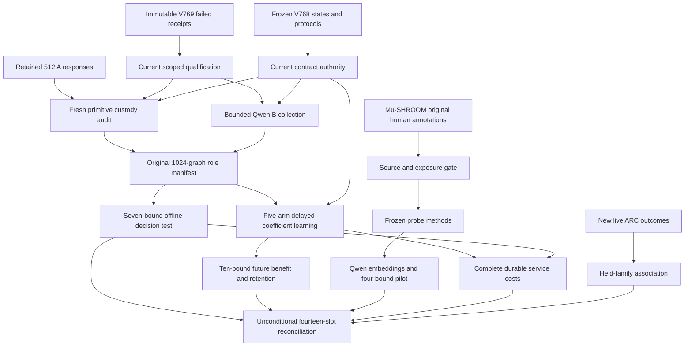
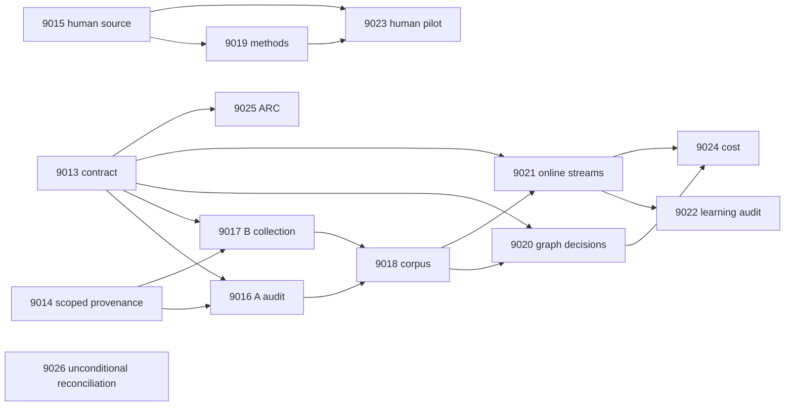

# Carnot Research Roadmap v770: Qualified Evidence and Continuous Spline Learning

**Created:** 2026-11-11 America/New_York
**Milestone:** 2026.11.770
**Status:** Planned; staged only
**Supersedes:** Completed scheduling milestone 2026.11.769, Exp8999–Exp9012
**Task contract:** Exactly 14 tasks, Exp9013 through Exp9026, in the order below.
**Execution file:** `research-roadmap-next.yaml`

The full V769 design and queue are preserved in
`research-roadmap-v769-preserved-20261111.md` and
`research-roadmap-v769-queue-preserved-20261111.yaml`. This plan does not activate
an experiment, change the active queue, or authorize external publication.

## What V769 proved

Scheduling completion is not scientific success. The completion archive ends
at V768; current artifacts and `ops/conductor-log.md` establish V769 outcomes.

| Evidence | Observed result | Planning consequence |
|---|---|---|
| Exp8999 | Contract, frozen graph authority and online protocol ready; ARC support zero. | Reuse scientific methods and keep ARC independent. |
| Exp9000 | Authentic inputs and provenance controls passed. Eight scoped receipts passed; the full Python suite timed out at 325 seconds. The producer included failed health in owned acceptance. | Original `complete_disqualified_invocation_provenance` stays unchanged. A new consumer must specify and test its own validation boundary. |
| Exp9001 | Reports 1,823 original human-authority groups, zero unseen groups. Scoped checks passed; full-suite run timed out at 900 seconds. | Original `complete_disqualified_owned_validation` stays unchanged. Fixing validation cannot make RAGTruth groups unseen. |
| Exp9002–9011 | Declared primaries are absent; scheduler receipts record gates and cascades. | Missing science is not a negative result for the spline or learning hypothesis. |
| Exp9012 | Complete slot accounting, but full-suite timeout at about 932 seconds failed owned acceptance. | Preserve `complete_disqualified_owned_validation`; do not cite it as a qualified capstone. |

Sources are `results/experiment_8999_v769_branch_contract.json`,
`results/experiment_9000_v769_invocation_provenance.json`,
`results/experiment_9001_v769_human_source_authority.json`, and
`results/experiment_9012_v769_capstone.json`. Reported source counts remain
qualified by the producer's disqualification. They are planning diagnostics.

Earlier scientific authority remains fixed. Exp8987 passed all four exposed
spline development checks: Brier 0.0279759276 versus converged linear 0.0636283248.
Exp8988 qualified five-arm delayed AdaGrad mechanics. Exp8990 retained 512
bounded Qwen calls but its primary remains disqualified. These facts justify
confirmation after fresh custody checks, not another development fit.

## The three largest gaps to the PRD

1. **FR-12 — independent verification where no cheap oracle exists.** The graph
   test has BFS truth. Its success cannot close the current north star. Test a
   small energy head against strong controls on independently annotated natural
   outputs. Mu-SHROOM offers raw disagreement records; eligibility is a gate.
2. **FR-11/FR-06 — useful continuous learning.** Update mechanics work, but later
   query benefit and retained calibration remain unmeasured for the frozen
   spline. Complete the existing causal test with unchanged controls and bounds.
3. **FR-09/FR-10 and NFR-01 — trustworthy, deployable evidence.** Global health
   failures currently contaminate narrow readiness receipts. Establish a new
   scoped claim without rewriting history, then measure complete service costs.

FR-05/FR-08 remain production constraints. Another port or sampler is premature
until a qualified benefit and complete cost justify it. A spline binary energy
is a logistic decision model; an energy label does not certify factual truth.

## Research incorporated before design

The V770 entry in `research-references.md` was written before this design.

| Source | Use in this milestone |
|---|---|
| [Mu-SHROOM, 2504.11975](https://arxiv.org/abs/2504.11975), April 2025, and [author release](https://huggingface.co/datasets/Helsinki-NLP/mu-shroom) | Exp9015/9019/9023 test original annotator disagreement on independent source groups. This is a derived response-level task, not the official span leaderboard. |
| [Mean-shift probes, 2608.28930](https://arxiv.org/abs/2608.28930), revised October 2026 | Exp9019 includes both an identical-input linear head and a full-embedding linear control. Final-layer pooling is not LayerMix. |
| [Online KAN, 2602.02056](https://arxiv.org/abs/2602.02056), revised June 2026 | Exp9021 runs qualified local coefficient updates; Exp9024 charges dense guards and durable work too. |
| [Continual Calibration, 2604.23987](https://arxiv.org/abs/2604.23987), April 2026 | Exp9022 preserves separate calibration and accuracy retention bounds. No conformal guarantee is borrowed. |
| [SHAM-Bench, 2610.27370](https://arxiv.org/html/2610.27370v1), October 2026 | Preserve source groups and original annotation criteria under transfer. |
| [Continuous-state probabilistic hardware, 2610.31339](https://arxiv.org/abs/2610.31339), October 2026 | Complete-service cost and supported-operation mapping precede hardware claims. |

The scan covered all eight requested arXiv topics and all six secondary sources.
Both Semantic Scholar citation endpoints returned ten records; EBT had another
page. New leads included LEF-JEPA and Energy-Based Policy Orchestration. Their
visual/robotic scope does not justify a new branch now. OpenReview challenged
browser access. GitHub trending supplied no usable relevant current ranking.
Extropic advertises 2027 early access; Kona supplies product descriptions without
a new reproducible local architecture. Detailed URLs and limits are in references.

## Architecture



## Phase 1 — fixed authority and independent prerequisites (Exp9013–Exp9015)

**Exp9013** binds all fourteen full task objects and snapshots V769 history.
It separately authenticates original graph roles, fitted states and online
methods. ARC support requires thirty new uncensored episodes, three families
and both arms per held family. Zero support cannot fail contract readiness.

**Exp9014** qualifies the serializer already implemented in Exp9000 through a
new thin consumer. It freezes owned and direct-consumer tests before execution.
It retains failed historical health receipts separately and leaves the old
producer, tests, acceptance set and disqualified primary unchanged. Real private
CLI controls must reject missing, failed, stale and timed-out current receipts.
Actual provenance contradictions must still fail unchanged terminal validators.
A global failure that affects a direct consumer remains an owned blocker.

**Exp9015** switches the natural source to the author Mu-SHROOM release.
It authenticates human annotations and exposure before fitting. Merge repeated
questions, author topic identities and shared reference entities across languages.
Resolve linked Wikipedia pages to common Wikidata identities where needed;
unknown cross-language overlap is ineligible. Metadata access is bounded.

Freeze one response per group by `v770-human-v1` ID hash, then select 160 FIT
and 40 CAL groups from official validation and 200 TEST groups from official
test. Selection precedes label reduction. All fourteen documented languages are
eligible without outcome-based selection. Require all 400 groups, at least five
examples per majority class in FIT/CAL and twenty per class in TEST. Do not lower
these floors. Prior CAL/TEST exposure or unresolved source identities block
eligibility. Source access and duplicate loss remain explicit feasibility risks.

Each response needs at least three distinct original annotators. `y_soft` is the
fraction who mark any unsupported span; `y_hard = y_soft >= 0.5`. Keep ties and
uncertainty visible. Validate offsets against original text. This estimates human
annotation risk. It does not equate annotation agreement with objective truth.

## Phase 2 — evidence and fixed methods (Exp9016–Exp9019)

**Exp9016** audits the primitive A observations after the new provenance gate.
Require 512 original first responses, CUDA/model/tokenizer receipts, fixed state
hashes, 64 CAL/64 TEST/384 online roles and no intervening detector exposure.
Unknown custody blocks. Preserve Exp8990's rejected primary and count its calls
only as historical work. There is no replacement generation.

**Exp9017** collects only the 512 committed missing B identities. Use
`unsloth/Qwen3.8-27B-GGUF`, Q4_K_M, GPU0, temperature zero, reasoning disabled,
16 output tokens and original prompt bytes. This is **bounded generation**, with
a 10-second duration floor. There are no answer retries or repairs. Unexpected
existing B responses block for an explicit changed-input decision. Bound load
and preflight to 240 seconds each, requests to 30 seconds, and collection to
2700 seconds. Checkpoint every sixteen requests with parent progress.

**Exp9018** joins exactly 1024 identities: 128 CAL, 128 TEST and 768 online.
Keep the original 200-error minimum and five examples per class per pooled role.
Separate semantic, out-of-graph, format and transport errors. BFS truth,
distances, answer membership and IDs stay outside learned features. No fixtures
or replacement roles can rescue failed admission.

**Exp9019** qualifies the natural methods with private vectors, without loading
an LLM. The actual worker will use mean-pooled final-layer Qwen embeddings of
the original question plus response. No IDs, generator metadata, old logits,
reference URLs or labels enter features. Inputs above 2048 model tokens block
this fixed cohort; they are not truncated or replaced.

FIT-only PCA produces sixteen components. FIT-only scaling maps them to [-1,1].
Compare the reused 129-parameter cubic spline, a matched 17-parameter linear
head, a full-embedding L2 logistic head and FIT prevalence. Train against soft
binary log loss. Each trainable arm receives the same ridge menu `[0.01,0.1,1]`;
CAL Brier selects, with ascending-value ties. No TEST selection is permitted.
Require optimizer convergence at tolerance `1e-6`, capped at 5000 iterations.

Freeze temperature one. Probability is annotation risk: accept at `p<=0.1`,
reject at `p>=0.9`, otherwise escalate. Classification error uses `p>=0.5`.
Freeze four one-sided bounds: spline Brier minus each of matched linear,
full-embedding linear and prevalence must be below zero; hard-label error
minus the CAL-selected best linear must be at most 0.02. Use 10,000 paired
TEST-group bootstrap draws, seed 770019, family alpha `0.05`, tail `0.05/4`.
All four bounds are necessary. Language and disagreement analyses are descriptive.

## Phase 3 — decisions and continuous self-learning (Exp9020–Exp9023)

**Exp9020** uses original fitted graph states. Compare spline, converged linear,
old shared linear, confidence linear and prevalence. Select trained-arm
 temperatures on 128 CAL graphs from `[0.5,1,2,4]`, with ascending ties. These
 temperatures apply to the offline decision test only. Seal TEST predictions.
Keep all seven original bounds: four positive Brier-improvement lower bounds,
and three accepted-error delta upper bounds at most zero at 50-percent coverage.
Use 10,000 paired graph draws, family alpha `0.05`, tail `0.05/7`. Check node
permutation, truth denial and context removal. Row readiness is separate from
benefit. A 128-graph panel may lack power; do not relax thresholds after seeing it.

**Exp9021** advances FR-11 and Continuous Self-Learning Tier 1. It depends on
corpus integrity and the original online protocol, independently of Exp9020.
Run frozen spline, adaptive spline, bias-only spline, adaptive linear and
permuted-feedback spline across 24 disjoint 32-query streams. Preserve the
Exp8988 binary log-loss objective, anchor `0.01`, norm clip one, AdaGrad rate
`0.05`, epsilon `1e-8` and temperature one. Qwen weights and knots stay fixed.

Seal predictions before feedback. At queries 8/12/16/20/24/28/32, release the
next four labels through ordinal 28. Shuffle only within released blocks.
Keep labels 29–32 pending until scientific scoring ends. The original 64-graph
development guard permits Brier increase at most 0.005 and no error increase.
Rejecting an update restores coefficients and accumulator while acknowledging
feedback atomically. A real kill at query sixteen must resume exactly.

Retain 3,840 online rows and 46,080 retention rows: five arms, 24 streams,
128 shared TEST graphs at checkpoints 0/16/32. These 49,920 rows are not 49,920
independent observations. Retention truth never enters updates or guards.

**Exp9022** independently reduces the ten original bounds. Future queries
17–32 need adaptive-minus-frozen Brier upper bound at most -0.01, and bounds
below zero against bias-only, adaptive linear and permuted feedback. Six
retention Brier/error bounds at checkpoints 0/16/32 must each be at most 0.01.
Use 10,000 whole-stream draws, family alpha `0.01`, tail `0.001`. Resample the
same retention graph IDs across arms and histories within each draw. A valid
no-benefit result is terminal null. Oracle-based graph evidence remains limited.

**Exp9023** executes the frozen natural pilot only after source and methods
qualify. It uses the mandated GGUF on GPU0 for embeddings, with
**model_load_no_generation**, a 2-second floor, zero generated tokens and
actual forward-pass receipts. Require real hidden representations; missing API
support blocks without a surrogate. Bound the embedding phase to 2100 seconds.
Persist vectors every sixteen rows. Fit on FIT, choose on CAL, then seal 200
TEST predictions before reduction. Check all four registered bounds. A positive
result is exploratory agreement with independent human judgments. Public-data
pretraining exposure remains unknown; independent replication is still needed.

## Phase 4 — complete cost, opportunistic ARC and closure (Exp9024–Exp9026)

**Exp9024** times 24 paired fresh-process units across frozen/adaptive spline
and frozen/adaptive converged linear. Include startup/JIT, raw inputs, encoding,
basis, scoring, dense anchors, guards, serialization, fsync, restart, final
feedback drain and shutdown. Keep linear controls free of artificial spline work.
Qualify timing observers and paired arm order. Valid timing does not require a
positive quality result. Deployment additionally requires both scientific benefit
scores and upper95 adaptive-spline/linear complete-cost ratio at most one.
Map measured operations to existing hardware. Do not infer acceleration support
from device reachability. Unknown component fractions remain unknown.

**Exp9025** reserves the restored opportunistic ARC floor. The structured gate
requires new supported live outcomes from Exp9013. Analyze held-family outcome
association without executing games or changing the live agent. Registry-check
any level credit and retain `solve_provenance`. Do not re-solve known levels or
use hidden source, per-game adapters or offline ground-truth search. The analysis
cannot establish causal transfer from an observational association.

**Exp9026** runs unconditionally. Account for all fourteen slots, including its
own reconciliation, using primaries or exact scheduler receipts. Missing fields
remain missing. Independently reduce graph, human, learning and cost claims.
Keep historical publication G1–G4 from `scripts/publication_gate.py --json`
separate from this milestone's science. External missing evidence is terminal
blocked; only unfinished owned work is partial. Never retry a completed null.

## Dependencies and conductor order



The visible table below is the exact execution order. Every gate points backward
and its exact field occurs in the producer's REQUIRED ARTIFACT FIELDS. No
`requires:` chain references a retired experiment. Historical failed artifacts
are evidence references, not eligible upstream science. The capstone has no gate.

## Hardware requirements and budgets

| Work | Required resource | Bound and claim boundary |
|---|---|---|
| Contracts, source audit, methods, statistics | CPU, existing Python environment, writable private scratch | 20–50 agent turns for routine work; no LLM loads or inferred GPU benefit. |
| New provenance consumer | CPU and actual private CLI subprocesses | Opus, 100 turns, 50-minute estimate; no validator or conductor changes. |
| Graph B generation | One RTX 3090, GPU0, cached Qwen Q4_K_M (about 16 GB weights) | 512 fixed 16-token calls; 2700-second collection budget; 65-minute task ceiling estimate. |
| Natural embedding pilot | Same GPU0 and Qwen cache; model weights frozen | 400 forward passes, no generated tokens; 2100-second embedding budget. |
| Online head learning | CPU, small coefficient state, durable local storage | 24 independent streams; local updates, dense guards and fsync all measured. |
| Complete service cost | CPU fresh processes; retained authentic graph data | 24 paired process units; no model reload or new GPU inference. |
| Hardware map | Existing authenticated receipts and `research-hardware-wishlist.md` | KV260 supports qualified Ising scope, `k_max<=5`; it does not imply spline support. |

GPU1 belongs to the outer loop. No task borrows it or stops foreign processes.
Model-load capability, cache hashes and free memory must be checked at execution.
Small legacy models can only serve explicitly labeled CPU smoke tests. They are
not headline replacements. No full-generation task is proposed; a future genuine
full-generation run would require `model_full_generation` and its 60-second floor.

KV260 continuity remains within its qualified operations. PolarFire Linux CPU
execution is not fabric acceleration. GateMate needs changed physical evidence;
NPU and Extropic TSU execution remain unqualified here. No board reflash,
purchase, new bitstream, firmware change or new paid service is needed.
A measured nonaccelerable service fraction at least 0.01 rules out a speedup
above 100x even with an ideal accelerator. The hardware target remains a testable
constraint, not a promise inferred from published core speedups.

## Execution, validation and retirement rules

Each prompt contains numbered progress and bounded-write instructions. Emit
flushed lines at phase boundaries and before/after model load, generation,
benchmarks and subprocesses. A supervising parent reports real progress every
sixty seconds during long loops and waits. Keep every silence gap below 600
seconds. Poll tool calls for at most sixty seconds. Write files above about 200
lines in multiple calls of about 150 lines, with progress between calls.

Stop measurement by 3300 seconds and reserve 1200 seconds for validation within
the 4800-second cap. No sleeps or dummy compute may pad duration floors. Preserve
completed units and exact pending work. Infrastructure failure is not a measured
scientific null. Only unfinished owned work may use `verdict_class=partial`.

Before implementation, extend applicable REQ/SCENARIO specifications and write
private failing tests. Freeze the owned/direct-consumer validation manifest.
Require complete statement coverage, scoped unit tests, lint, formatting, strict
types, explicit-path spec tracing and actual private E2E-018/021 lifecycle checks.
Learning also needs E2E-020 restart controls. Use unchanged adversarial and strict
row validators. Reject current missing, failed, stale or timeout receipts.

For new tasks only, historical repository-wide health is a separate failed
record. The original broad acceptance rules remain intact. Do not delete failed
checks or claim repository health passed. A directly related failing test must
still be fixed or block the new result. Reuse existing private qualification
patterns; this plan does not authorize a framework-wide validation rewrite.

All comparisons retain per-unit rows and denominators. Freeze code, source,
model and configuration hashes. Declare the closed verdict enum, oracle status,
exposure scope and exact blocked-check operands. Administrative readiness never
substitutes for scientific benefit. Reconcile specs, traceability, status and
changelog after each task without changing operator-curated pages.

Every continuation names its actual prior verdict and concrete change, with
`retire_if_same_verdict: true`. Preserve scheduler-only outcomes as such; do not
invent missing scientific verdicts. An unchanged source or failed mechanism
cannot be reopened by renaming it. The natural branch changes corpus, annotation
unit and controls. The graph branch changes qualification, not scientific bounds.
No task pushes or changes `scripts/research_conductor.py`.

## Exact task contract

The table and embedded full objects below must equal `research-roadmap-next.yaml`.
Prompts, models, failure lineage, gates and execution metadata are part of the
contract. A preactivation comparison uses staged bytes on both queue sides;
it does not pretend the still-active V769 queue is V770.

| Order | ID | Title | Phase | Deliverable |
|---|---|---|---|---|
| 1 | `exp9013-branch-contract` | Bind fourteen tasks and preserve V769 failures and frozen scientific methods | 1 | `results/experiment_9013_v770_branch_contract.json` |
| 2 | `exp9014-scoped-provenance-qualification` | Qualify producer provenance with separate scoped checks and repository health | 1 | `results/experiment_9014_v770_scoped_provenance_qualification.json` |
| 3 | `exp9015-human-disagreement-source` | Qualify Mu-SHROOM groups and original human disagreement labels | 1 | `results/experiment_9015_v770_human_disagreement_source.json` |
| 4 | `exp9016-retained-shard-a` | Authenticate retained shard A without new generation or revised labels | 2 | `results/experiment_9016_v770_retained_shard_a.json` |
| 5 | `exp9017-graph-corpus-b` | Complete the frozen bounded Qwen source with shard B | 2 | `results/experiment_9017_v770_graph_corpus_b.json` |
| 6 | `exp9018-corpus-admission` | Join authenticated shards under the original graph role contract | 2 | `results/experiment_9018_v770_corpus_admission.json` |
| 7 | `exp9019-human-pilot-methods` | Freeze matched energy and linear probes for human disagreement | 2 | `results/experiment_9019_v770_human_pilot_methods.json` |
| 8 | `exp9020-spline-calibrated-decisions` | Test frozen spline decisions against all registered graph controls | 3 | `results/experiment_9020_v770_spline_calibrated_decisions.json` |
| 9 | `exp9021-online-spline-streams` | Measure continuous coefficient learning on sealed future response streams | 3 | `results/experiment_9021_v770_online_spline_streams.json` |
| 10 | `exp9022-online-benefit-audit` | Audit future spline benefit and simultaneous shared-panel retention | 3 | `results/experiment_9022_v770_online_benefit_audit.json` |
| 11 | `exp9023-human-energy-pilot` | Measure energy decisions against independent human disagreement | 3 | `results/experiment_9023_v770_human_energy_pilot.json` |
| 12 | `exp9024-complete-spline-cost` | Measure complete spline service costs and actual acceleration limits | 4 | `results/experiment_9024_v770_complete_spline_cost.json` |
| 13 | `exp9025-arc-transfer-evidence` | Assess held-family supervisor transfer only from new live outcomes | 4 | `results/experiment_9025_v770_arc_transfer_evidence.json` |
| 14 | `exp9026-capstone` | Reconcile fourteen outcomes and separate graph and independent-label claims | 4 | `results/experiment_9026_v770_capstone.json` |

<!-- V770_TASK_CONTRACT_START -->
```json
{"milestone": "2026.11.770", "milestone_title": "Scoped Evidence Qualification, Human Disagreement, and Continuous Spline Learning", "milestone_doc": "openspec/change-proposals/research-roadmap-vNEXT.md", "tasks": [
{"id": "exp9013-branch-contract", "title": "Bind fourteen tasks and preserve V769 failures and frozen scientific methods", "phase": 1, "track": "research", "priority": "high", "requires_gpu": false, "max_turns": 100, "estimated_wall_time_min": 30, "per_unit_rows": true, "milestone": "2026.11.770", "deliverable": "results/experiment_9013_v770_branch_contract.json", "inference_substrate_class": "no_model_load", "MODEL_SPECS": [], "gated_on": [], "prior_failures": [{"experiment_id": "exp8985-branch-contract", "verdict": "complete_null_v768_branch_contract", "addressed_by": "Successful authority continuity, not a failed result: bind the new staged contract and immutable passed methods; do not repeat prior science.", "retire_if_same_verdict": true}], "model": "opus", "prompt": "CONTEXT:\nWork in {project_root} on {date}. V769 scheduling is complete. Exp9000, Exp9001 and Exp9012 remain disqualified. Their full-suite timeouts are not evidence against the frozen spline hypothesis. Bind the new plan without repairing history.\nEXISTING CODE TO READ FIRST:\nCLAUDE.md; CODEX.md; research-program.md; ops/north-star.md; ops/e2e-test-plan.md; openspec/capabilities/research-reporting/spec.md; openspec/capabilities/verification/spec.md; openspec/capabilities/kan/spec.md; scripts/experiment_template.py; python/carnot/reporting/primary_publication.py; ops/exclusion_manifest.yaml; openspec/change-proposals/research-roadmap-vNEXT.md; openspec/change-proposals/research-roadmap-v769-preserved-20261111.md; openspec/change-proposals/research-roadmap-v768-preserved-20261111.md; research-references.md; python/carnot/reporting/roadmap_contract.py; python/carnot/reporting/v768_capstone.py; results/experiment_8998_v768_capstone.json; results/experiment_8987_v768_spline_development_admission.json; results/experiment_8988_v768_online_spline_methods.json; python/carnot/reporting/arc_supervisor_frontier_8720.py; ops/arc_supervisor_refinement_ledger.json\nTASK:\nBind fourteen tasks and preserve V769 failures and frozen scientific methods. Deliver results/experiment_9013_v770_branch_contract.json, primitive evidence under results/raw/experiment_9013_v770_branch_contract/, and runnable scripts/experiments/experiment_9013_v770_branch_contract.py.\nCONCRETE STEPS:\n1. Emit a flushed progress line at each phase boundary and before and after every model load, generation, benchmark and subprocess. Set PYTHONUNBUFFERED=1 and use print(..., flush=True). Inside long loops and child waits, print actual completed/pending counts at least every 60 seconds; keep every silence gap below 600 seconds. Poll in tool calls of at most 60 seconds. Write any file over about 200 lines in several tool calls, at most about 150 lines per call, with a progress message between calls. Never pad runtime.\n2. PRECONDITIONS: Before compute, authenticate inputs, exact gate fields, hashes, virtualenv, dependencies, free memory and writable disk. Bound required network requests. Preserve rejected evidence. Missing, retired or gate-blocked external inputs mean honest_verdict=complete_blocked_<check>, verdict_class=blocked and gate_check_summary naming the observed operand. Only unfinished owned work is partial. Do not substitute fixtures for measurements.\n3. Extend the relevant REQ-* and SCENARIO-* before implementation; write failing private tests first. Read all callers before fixing shared code. Reuse existing helpers and frozen methods; keep fixtures in private temporary directories. Never read a mutable successor document as historical authority. Preserve original thresholds and tests.\n4. Load no LLM: MODEL_SPECS=[], model_specs=[], inference_substrate_class=no_model_load. Use aggregation_from_upstream_artifacts for reductions or verifier_ensemble_against_cached_candidates for numerical scoring/training. Keep current model calls zero and declare small trained_head_specs separately. Preserve historical calls only through explicit cited artifact references.\n5. Snapshot the complete archived V769 design and queue, current V770 contract, V768 protocols and referenced primaries by hash. Compare all 14 full task objects and visible order Exp9013..Exp9026. Before activation compare staged with staged; after activation compare actual active bytes. Contract readiness is independent of scientific readiness.\n6. Authenticate original Exp8987 states, four development criteria, 1024 committed graph IDs and 128 CAL/128 TEST/768 online roles. Authenticate Exp8988 five-arm protocol. Emit frozen_graph_authority_ready_score and online_protocol_ready_score separately. Never redraw, refit or repeat development admission. Record the archive lag: research-complete.yaml ends at .768 while current .769 primaries and scheduler receipts establish closure.\n7. Check ARC receipts once against Exp8999. arc_new_outcomes_ready_score=1 requires 30 NEW uncensored episodes, three families and both arms per held family. Zero support is a zero field, not a failed contract. Freeze a validation-scope policy for new tasks; authenticate the original failed V769 global-health logs without changing their outcomes.\n8. Run scoped pytest, direct-consumer tests, real private child CLI checks, Ruff check/format, strict mypy and explicit-path spec coverage. Require 100-percent newly owned statements with zero exclusions. Run private E2E-018/021, missing-input, tamper and cold replay outside the checkout without PYTHONPATH; add E2E-020 for learning restart. Freeze this current validation scope before measurement. Retain V769 full-suite failures by hash under repository_health with repository_health_passed=false. They remain failed and original artifacts stay disqualified. Current acceptance requires every current scoped check to exit normally and pass; test missing, stale, failed and timeout receipts as rejecting controls. Do not change old producers, tests or acceptance rules. Do not run the 84,000-test whole suite inside each experiment or represent scoped success as repository-wide health. Stop measurement by 3300 seconds; reserve 1200 seconds for checks within the 4800-second hard cap.\n9. Retain primitive per-unit rows and source/code/config hashes; independently recompute summaries. Run unchanged adversarial_verify.py and strict verdict_row_consistency_lint.py under progress supervision. Publish via primary_publication after owned checks pass; failed checks disqualify and zero readiness. Reconcile openspec/, _bmad/traceability.md, ops/status.md and ops/changelog.md. Do not edit operator-curated pages, the active roadmap, exclusion manifest or validators. Do not activate a queue or publish externally.\nREQUIRED ARTIFACT FIELDS:\n- honest_verdict: complete_*; verdict_class: positive | circular_positive | null | blocked | disqualified | partial. Principle: external incompleteness is terminal blocked; only owned unfinished work retries.\n- verifier_is_oracle, claim_scope, exposure_scope, independent_generalization_score. Principle: fixtures and graph-oracle admission cannot establish a no-cheap-oracle verifier win; oracle positives are circular_positive.\n- required_checks_passed, flagged_adversarial, validation_receipts, owned_statement_coverage, preconditions_checked, validation_scope_manifest, repository_health, repository_health_passed. Principle: readiness requires actual normal-exit checks.\n- gate_check_summary: check/upstream/path/sha256/artifact_field/op/expected/observed/passed. Principle: blocked results name the exact check and missing_file, missing_field or observed value.\n- inference_substrate, inference_substrate_class, MODEL_SPECS, model_specs, trained_head_specs, model_invocation_counts, cited_upstream_artifacts: experiment_id/fields_imported/sha256. Principle: current work differs from authenticated historical model work.\n- rows: unit_id/group_id/arm/condition/metric/value/numerator/denominator/status/exclusion_reason; intended_count, independent_count, completed_count, excluded_count, censored_count, failed_count. Principle: every comparison retains each independent unit and denominator; repeated responses are not independent groups.\n- run_date, duration_s, random_seed, reproducibility_checksum, source_artifact_hashes, raw_shard_hashes, code_config_hashes, phase_spans, acceptance_gates, field_principles. Principle: frozen thresholds and retained primitive bytes make the claim reproducible.\n- contract_ready_score, frozen_graph_authority_ready_score, online_protocol_ready_score, arc_new_outcomes_ready_score: each 0|1; authority_manifest, full_contract_rows, frontier_delta_rows. Principle: independent administrative and scientific gates prevent optional evidence from blocking unrelated work.\nRun command: cd {project_root} && PYTHONUNBUFFERED=1 .venv/bin/python -u scripts/experiments/experiment_9013_v770_branch_contract.py --date {date}\nDo NOT push. Do NOT modify scripts/research_conductor.py."},
{"id": "exp9014-scoped-provenance-qualification", "title": "Qualify producer provenance with separate scoped checks and repository health", "phase": 1, "track": "research", "priority": "high", "requires_gpu": false, "max_turns": 100, "estimated_wall_time_min": 50, "per_unit_rows": true, "milestone": "2026.11.770", "deliverable": "results/experiment_9014_v770_scoped_provenance_qualification.json", "inference_substrate_class": "no_model_load", "MODEL_SPECS": [], "gated_on": [], "prior_failures": [{"experiment_id": "exp9000-invocation-provenance", "verdict": "complete_disqualified_invocation_provenance", "addressed_by": "A new prospectively frozen scoped-validation receipt separates failed global health from current owned checks. Old failures remain unchanged; current gates must pass before this branch runs.", "retire_if_same_verdict": true}, {"experiment_id": "exp8990-graph-corpus-a", "verdict": "complete_disqualified_graph_corpus_a", "addressed_by": "Remove the diagnosed embedded-upstream/current-scope ambiguity in producer serialization; qualify real negative controls before any evidence reuse or new collection.", "retire_if_same_verdict": true}], "model": "opus", "prompt": "CONTEXT:\nWork in {project_root} on {date}. Exp9000 authenticated inputs and passed provenance controls plus eight scoped receipts. Its full Python suite timed out at 325 seconds and was included in owned acceptance. Do not change that historical verdict. Qualify the already implemented producer serializer through a new, bounded consumer with a prospectively declared validation scope.\nEXISTING CODE TO READ FIRST:\nCLAUDE.md; CODEX.md; ops/e2e-test-plan.md; openspec/capabilities/research-reporting/spec.md; python/carnot/reporting/invocation_provenance_9000.py; python/carnot/reporting/graph_corpus_a_8961.py; python/carnot/reporting/graph_corpus_a_8990.py; python/carnot/reporting/current_work_receipt.py; python/carnot/reporting/primary_publication.py; python/carnot/reporting/v767_capstone.py; tests/python/test_invocation_provenance_9000.py; tests/python/test_v767_capstone_8984.py; results/experiment_9000_v769_invocation_provenance.json; scripts/adversarial_verify.py; scripts/verdict_row_consistency_lint.py\nTASK:\nQualify producer provenance with separate scoped checks and repository health. Deliver results/experiment_9014_v770_scoped_provenance_qualification.json, primitive evidence under results/raw/experiment_9014_v770_scoped_provenance_qualification/, and runnable scripts/experiments/experiment_9014_v770_scoped_provenance_qualification.py.\nCONCRETE STEPS:\n1. Emit a flushed progress line at each phase boundary and before and after every model load, generation, benchmark and subprocess. Set PYTHONUNBUFFERED=1 and use print(..., flush=True). Inside long loops and child waits, print actual completed/pending counts at least every 60 seconds; keep every silence gap below 600 seconds. Poll in tool calls of at most 60 seconds. Write any file over about 200 lines in several tool calls, at most about 150 lines per call, with a progress message between calls. Never pad runtime.\n2. PRECONDITIONS: Before compute, authenticate inputs, exact gate fields, hashes, virtualenv, dependencies, free memory and writable disk. Bound required network requests. Preserve rejected evidence. Missing, retired or gate-blocked external inputs mean honest_verdict=complete_blocked_<check>, verdict_class=blocked and gate_check_summary naming the observed operand. Only unfinished owned work is partial. Do not substitute fixtures for measurements.\n3. Extend the relevant REQ-* and SCENARIO-* before implementation; write failing private tests first. Read all callers before fixing shared code. Reuse existing helpers and frozen methods; keep fixtures in private temporary directories. Never read a mutable successor document as historical authority. Preserve original thresholds and tests.\n4. Load no LLM: MODEL_SPECS=[], model_specs=[], inference_substrate_class=no_model_load. Use aggregation_from_upstream_artifacts for reductions or verifier_ensemble_against_cached_candidates for numerical scoring/training. Keep current model calls zero and declare small trained_head_specs separately. Preserve historical calls only through explicit cited artifact references.\n5. Before testing, freeze owned files, all direct consumers, original test-node identities and the new receipt policy. Reuse the implemented serializer; do not add a second provenance abstraction. New acceptance is scoped normal-exit validation. Historical global-health failures remain separately authenticated and failed. Never edit Exp9000, its original assertions or its CHECKS set.\n6. Use a new thin runner to execute the existing provenance controls and original scoped test nodes in private directories. Cover bounded-generation fixture, cached no-model, load-only, missing ledger and true current contradiction. Fixtures have no live science credit. Retain full upstream bytes behind content-addressed references; only actual current counters belong at current scope.\n7. Use actual CLI children to prove current failed/missing/stale/timeout receipts refuse readiness, while unchanged historical failed health is reported separately. Keep unchanged adversarial and strict row validators. Require all serializer controls, owned tests, cold replay and current receipt controls for provenance_ready_score=1. If a related global failure reveals a direct-consumer defect, fix that defect with its original regression or remain disqualified. Never promote the old artifact.\n8. Run scoped pytest, direct-consumer tests, real private child CLI checks, Ruff check/format, strict mypy and explicit-path spec coverage. Require 100-percent newly owned statements with zero exclusions. Run private E2E-018/021, missing-input, tamper and cold replay outside the checkout without PYTHONPATH; add E2E-020 for learning restart. Freeze this current validation scope before measurement. Retain V769 full-suite failures by hash under repository_health with repository_health_passed=false. They remain failed and original artifacts stay disqualified. Current acceptance requires every current scoped check to exit normally and pass; test missing, stale, failed and timeout receipts as rejecting controls. Do not change old producers, tests or acceptance rules. Do not run the 84,000-test whole suite inside each experiment or represent scoped success as repository-wide health. Stop measurement by 3300 seconds; reserve 1200 seconds for checks within the 4800-second hard cap.\n9. Retain primitive per-unit rows and source/code/config hashes; independently recompute summaries. Run unchanged adversarial_verify.py and strict verdict_row_consistency_lint.py under progress supervision. Publish via primary_publication after owned checks pass; failed checks disqualify and zero readiness. Reconcile openspec/, _bmad/traceability.md, ops/status.md and ops/changelog.md. Do not edit operator-curated pages, the active roadmap, exclusion manifest or validators. Do not activate a queue or publish externally.\nREQUIRED ARTIFACT FIELDS:\n- honest_verdict: complete_*; verdict_class: positive | circular_positive | null | blocked | disqualified | partial. Principle: external incompleteness is terminal blocked; only owned unfinished work retries.\n- verifier_is_oracle, claim_scope, exposure_scope, independent_generalization_score. Principle: fixtures and graph-oracle admission cannot establish a no-cheap-oracle verifier win; oracle positives are circular_positive.\n- required_checks_passed, flagged_adversarial, validation_receipts, owned_statement_coverage, preconditions_checked, validation_scope_manifest, repository_health, repository_health_passed. Principle: readiness requires actual normal-exit checks.\n- gate_check_summary: check/upstream/path/sha256/artifact_field/op/expected/observed/passed. Principle: blocked results name the exact check and missing_file, missing_field or observed value.\n- inference_substrate, inference_substrate_class, MODEL_SPECS, model_specs, trained_head_specs, model_invocation_counts, cited_upstream_artifacts: experiment_id/fields_imported/sha256. Principle: current work differs from authenticated historical model work.\n- rows: unit_id/group_id/arm/condition/metric/value/numerator/denominator/status/exclusion_reason; intended_count, independent_count, completed_count, excluded_count, censored_count, failed_count. Principle: every comparison retains each independent unit and denominator; repeated responses are not independent groups.\n- run_date, duration_s, random_seed, reproducibility_checksum, source_artifact_hashes, raw_shard_hashes, code_config_hashes, phase_spans, acceptance_gates, field_principles. Principle: frozen thresholds and retained primitive bytes make the claim reproducible.\n- provenance_ready_score: 0|1, original_flag_rows, invocation_path_rows, mutation_rows, producer_code_hashes. Principle: the existing validator must still reject actual contradictions while recognizing explicitly cited history.\n- validation_scope_ready_score: 0|1; historical_health_references, current_receipt_mutation_rows, original_test_node_hashes, original_verdict_preserved. Principle: a new scoped claim cannot rewrite the outcome of a historical broader claim.\nRun command: cd {project_root} && PYTHONUNBUFFERED=1 .venv/bin/python -u scripts/experiments/experiment_9014_v770_scoped_provenance_qualification.py --date {date}\nDo NOT push. Do NOT modify scripts/research_conductor.py."},
{"id": "exp9015-human-disagreement-source", "title": "Qualify Mu-SHROOM groups and original human disagreement labels", "phase": 1, "track": "research", "priority": "high", "requires_gpu": false, "max_turns": 30, "estimated_wall_time_min": 40, "per_unit_rows": true, "milestone": "2026.11.770", "deliverable": "results/experiment_9015_v770_human_disagreement_source.json", "inference_substrate_class": "no_model_load", "MODEL_SPECS": [], "gated_on": [], "prior_failures": [{"experiment_id": "exp9001-human-source-authority", "verdict": "complete_disqualified_owned_validation", "addressed_by": "Replace exhausted original RAGTruth with the separate Mu-SHROOM release and raw annotator-level targets. Require fresh source groups before any fit. Preserve the old zero-unseen finding and failed full-suite receipt.", "retire_if_same_verdict": true}, {"experiment_id": "exp8989-natural-annotation-authority", "verdict": "complete_null_machine_annotation_only", "addressed_by": "Switch from model-generated RAGognize labels to original documented human RAGTruth annotations, auditing exposure and original criteria before any pilot.", "retire_if_same_verdict": true}, {"experiment_id": "exp8908-natural-criterion-audit", "verdict": "complete_null_natural_criterion_audit", "addressed_by": "Do not repeat original-versus-revised annotation agreement; qualify untouched groups under the original human criterion for a matched-head test.", "retire_if_same_verdict": true}], "prompt": "CONTEXT:\nWork in {project_root} on {date}. Exp9001 found 1823 original human RAGTruth groups but zero unseen groups. A validation fix cannot create new groups. Switch to the author Mu-SHROOM release (arXiv 2504.11975), with raw multi-annotator judgments. This is source qualification, not a detector result. SHAM-Bench 2610.27370 motivates preserving original criteria.\nEXISTING CODE TO READ FIRST:\nCLAUDE.md; CODEX.md; ops/north-star.md; ops/e2e-test-plan.md; research-references.md; openspec/capabilities/research-reporting/spec.md; python/carnot/reporting/human_source_authority_9001.py; python/carnot/reporting/human_source_runner_9001.py; python/carnot/reporting/natural_criterion_audit_8908.py; results/experiment_9001_v769_human_source_authority.json; docs/research-notes/label-provenance-audit-step1-2026-11-07.md; https://huggingface.co/datasets/Helsinki-NLP/mu-shroom; https://helsinki-nlp.github.io/shroom/2025/FAQ_2025.html\nTASK:\nQualify Mu-SHROOM groups and original human disagreement labels. Deliver results/experiment_9015_v770_human_disagreement_source.json, primitive evidence under results/raw/experiment_9015_v770_human_disagreement_source/, and runnable scripts/experiments/experiment_9015_v770_human_disagreement_source.py.\nCONCRETE STEPS:\n1. Emit a flushed progress line at each phase boundary and before and after every model load, generation, benchmark and subprocess. Set PYTHONUNBUFFERED=1 and use print(..., flush=True). Inside long loops and child waits, print actual completed/pending counts at least every 60 seconds; keep every silence gap below 600 seconds. Poll in tool calls of at most 60 seconds. Write any file over about 200 lines in several tool calls, at most about 150 lines per call, with a progress message between calls. Never pad runtime.\n2. PRECONDITIONS: Before compute, authenticate inputs, exact gate fields, hashes, virtualenv, dependencies, free memory and writable disk. Bound required network requests. Preserve rejected evidence. Missing, retired or gate-blocked external inputs mean honest_verdict=complete_blocked_<check>, verdict_class=blocked and gate_check_summary naming the observed operand. Only unfinished owned work is partial. Do not substitute fixtures for measurements.\n3. Extend the relevant REQ-* and SCENARIO-* before implementation; write failing private tests first. Read all callers before fixing shared code. Reuse existing helpers and frozen methods; keep fixtures in private temporary directories. Never read a mutable successor document as historical authority. Preserve original thresholds and tests.\n4. Load no LLM: MODEL_SPECS=[], model_specs=[], inference_substrate_class=no_model_load. Use aggregation_from_upstream_artifacts for reductions or verifier_ensemble_against_cached_candidates for numerical scoring/training. Keep current model calls zero and declare small trained_head_specs separately. Preserve historical calls only through explicit cited artifact references.\n5. Pin the author release revision, license, annotation guidelines and raw annotator records. Bound downloads and metadata requests to 256 MB and 600 seconds total. Exclude train_unlabeled and automatically labeled material. Use all fourteen documented languages without outcome-based language selection. Keep access failures terminal blocked, not an invitation to switch datasets.\n6. Inventory prior Carnot exposures before inspecting labels. Merge repeated prompts, author topic IDs, normalized source hashes and linked reference entities across languages. Resolve reference-page identities to shared Wikidata IDs using bounded metadata retrieval where needed. Unresolved cross-language/source identity is ineligible, not assumed independent. Reuse no previously exposed CAL or TEST group. Record exclusions, source memberships and source-resolution receipts.\n7. Freeze one response per group by salted ID hash v770-human-v1. Select 160 FIT and 40 CAL groups from official validation, and 200 TEST groups from official test, without reading outcome labels. Freeze IDs and group roles before label reduction. Require all 400 groups, no split overlap, at least five majority-positive and five majority-negative groups in FIT/CAL, and twenty of each in TEST. Insufficient support is blocked with observed counts; never lower floors or replace selected records.\n8. Define y_soft as the fraction of authentic annotators who marked any nonempty unsupported span in that response. Define y_hard as y_soft>=0.5; preserve exact ties and uncertain annotations as sensitivity rows. At least three distinct original annotators must cover each selected response. Validate offsets against original text and retain original spans. Do not mistake union-of-character-majorities for response-level annotator majority. Publish natural_pilot_ready_score=1 only for complete source, group, exposure, role and label integrity. This derived response task measures agreement with human judgments, not a span leaderboard or infallible factual truth.\n9. Run scoped pytest, direct-consumer tests, real private child CLI checks, Ruff check/format, strict mypy and explicit-path spec coverage. Require 100-percent newly owned statements with zero exclusions. Run private E2E-018/021, missing-input, tamper and cold replay outside the checkout without PYTHONPATH; add E2E-020 for learning restart. Freeze this current validation scope before measurement. Retain V769 full-suite failures by hash under repository_health with repository_health_passed=false. They remain failed and original artifacts stay disqualified. Current acceptance requires every current scoped check to exit normally and pass; test missing, stale, failed and timeout receipts as rejecting controls. Do not change old producers, tests or acceptance rules. Do not run the 84,000-test whole suite inside each experiment or represent scoped success as repository-wide health. Stop measurement by 3300 seconds; reserve 1200 seconds for checks within the 4800-second hard cap.\n10. Retain primitive per-unit rows and source/code/config hashes; independently recompute summaries. Run unchanged adversarial_verify.py and strict verdict_row_consistency_lint.py under progress supervision. Publish via primary_publication after owned checks pass; failed checks disqualify and zero readiness. Reconcile openspec/, _bmad/traceability.md, ops/status.md and ops/changelog.md. Do not edit operator-curated pages, the active roadmap, exclusion manifest or validators. Do not activate a queue or publish externally.\nREQUIRED ARTIFACT FIELDS:\n- honest_verdict: complete_*; verdict_class: positive | circular_positive | null | blocked | disqualified | partial. Principle: external incompleteness is terminal blocked; only owned unfinished work retries.\n- verifier_is_oracle, claim_scope, exposure_scope, independent_generalization_score. Principle: fixtures and graph-oracle admission cannot establish a no-cheap-oracle verifier win; oracle positives are circular_positive.\n- required_checks_passed, flagged_adversarial, validation_receipts, owned_statement_coverage, preconditions_checked, validation_scope_manifest, repository_health, repository_health_passed. Principle: readiness requires actual normal-exit checks.\n- gate_check_summary: check/upstream/path/sha256/artifact_field/op/expected/observed/passed. Principle: blocked results name the exact check and missing_file, missing_field or observed value.\n- inference_substrate, inference_substrate_class, MODEL_SPECS, model_specs, trained_head_specs, model_invocation_counts, cited_upstream_artifacts: experiment_id/fields_imported/sha256. Principle: current work differs from authenticated historical model work.\n- rows: unit_id/group_id/arm/condition/metric/value/numerator/denominator/status/exclusion_reason; intended_count, independent_count, completed_count, excluded_count, censored_count, failed_count. Principle: every comparison retains each independent unit and denominator; repeated responses are not independent groups.\n- run_date, duration_s, random_seed, reproducibility_checksum, source_artifact_hashes, raw_shard_hashes, code_config_hashes, phase_spans, acceptance_gates, field_principles. Principle: frozen thresholds and retained primitive bytes make the claim reproducible.\n- natural_pilot_ready_score: 0|1; independent_label_ready_score: 0|1; release_revision, license_receipt, annotation_policy_hash, raw_annotator_rows, source_group_rows, exposure_inventory, role_manifest, class_counts, label_sidecar_hashes, criterion_policy, unresolved_source_groups, annotation_disagreement_rows. Principle: independent human supervision requires traceable annotators and source separation; disagreement remains visible.\nRun command: cd {project_root} && PYTHONUNBUFFERED=1 .venv/bin/python -u scripts/experiments/experiment_9015_v770_human_disagreement_source.py --date {date}\nDo NOT push. Do NOT modify scripts/research_conductor.py."},
{"id": "exp9016-retained-shard-a", "title": "Authenticate retained shard A without new generation or revised labels", "phase": 2, "track": "research", "priority": "high", "requires_gpu": false, "max_turns": 30, "estimated_wall_time_min": 40, "per_unit_rows": true, "milestone": "2026.11.770", "deliverable": "results/experiment_9016_v770_retained_shard_a.json", "inference_substrate_class": "no_model_load", "MODEL_SPECS": [], "gated_on": [{"upstream": "exp9014-scoped-provenance-qualification", "artifact_field": "provenance_ready_score", "op": "==", "value": 1}, {"upstream": "exp9013-branch-contract", "artifact_field": "frozen_graph_authority_ready_score", "op": "==", "value": 1}], "prior_failures": [{"experiment_id": "exp9002-retained-shard-a", "verdict": "blocked_gate_check_failed", "addressed_by": "A new prospectively frozen scoped-validation receipt separates failed global health from current owned checks. Old failures remain unchanged; current gates must pass before this branch runs.", "retire_if_same_verdict": true}, {"experiment_id": "exp8990-graph-corpus-a", "verdict": "complete_disqualified_graph_corpus_a", "addressed_by": "A separate current-scope CPU audit recomputes custody from raw responses after Exp9000 qualifies the producer fix; original rejection and all model evidence remain immutable.", "retire_if_same_verdict": true}], "agent_type": "codex", "model": "gpt-6.1-sol", "prompt": "CONTEXT:\nWork in {project_root} on {date}. Exp8990 produced 512 first responses before provenance disqualification. A new CPU audit may qualify primitive observations only after the serializer defect is independently fixed; the historical primary stays disqualified and excluded as a success.\nEXISTING CODE TO READ FIRST:\nCLAUDE.md; CODEX.md; research-program.md; ops/north-star.md; ops/e2e-test-plan.md; openspec/capabilities/research-reporting/spec.md; openspec/capabilities/verification/spec.md; openspec/capabilities/kan/spec.md; scripts/experiment_template.py; python/carnot/reporting/primary_publication.py; ops/exclusion_manifest.yaml; openspec/change-proposals/research-roadmap-vNEXT.md; openspec/change-proposals/research-roadmap-v769-preserved-20261111.md; openspec/change-proposals/research-roadmap-v768-preserved-20261111.md; research-references.md; python/carnot/reporting/graph_corpus_a_8990.py; python/carnot/reporting/graph_corpus_a_8961.py; results/experiment_8990_v768_graph_corpus_a.json; results/experiment_8987_v768_spline_development_admission.json\nTASK:\nAuthenticate retained shard A without new generation or revised labels. Deliver results/experiment_9016_v770_retained_shard_a.json, primitive evidence under results/raw/experiment_9016_v770_retained_shard_a/, and runnable scripts/experiments/experiment_9016_v770_retained_shard_a.py.\nCONCRETE STEPS:\n1. Emit a flushed progress line at each phase boundary and before and after every model load, generation, benchmark and subprocess. Set PYTHONUNBUFFERED=1 and use print(..., flush=True). Inside long loops and child waits, print actual completed/pending counts at least every 60 seconds; keep every silence gap below 600 seconds. Poll in tool calls of at most 60 seconds. Write any file over about 200 lines in several tool calls, at most about 150 lines per call, with a progress message between calls. Never pad runtime.\n2. PRECONDITIONS: Before compute, authenticate inputs, exact gate fields, hashes, virtualenv, dependencies, free memory and writable disk. Bound required network requests. Preserve rejected evidence. Missing, retired or gate-blocked external inputs mean honest_verdict=complete_blocked_<check>, verdict_class=blocked and gate_check_summary naming the observed operand. Only unfinished owned work is partial. Do not substitute fixtures for measurements.\n3. Extend the relevant REQ-* and SCENARIO-* before implementation; write failing private tests first. Read all callers before fixing shared code. Reuse existing helpers and frozen methods; keep fixtures in private temporary directories. Never read a mutable successor document as historical authority. Preserve original thresholds and tests.\n4. Load no LLM: MODEL_SPECS=[], model_specs=[], inference_substrate_class=no_model_load. Use aggregation_from_upstream_artifacts for reductions or verifier_ensemble_against_cached_candidates for numerical scoring/training. Keep current model calls zero and declare small trained_head_specs separately. Preserve historical calls only through explicit cited artifact references.\n5. Require current provenance_ready_score=1 and frozen_graph_authority_ready_score=1. Authenticate all original raw response bytes, original invocation/load/tokenizer/GGUF/CUDA receipts, checkpoint ledger and immutable role/state hashes. Do not trust the old aggregate or its ready bit. Independently reproduce the parser categories and BFS labels for every unit.\n6. Require exactly the committed 512 unique A identities and 64 calibration/64 final-test/384 online roles, one authentic first response per unit, no omitted/replaced failures and no detector fitting or test-score exposure after collection. Inventory any downstream evaluation attempts. If custody, non-exposure or the model receipt is unprovable, block; do not generate replacement rows or use the flagged primary as authority.\n7. Publish a new current no-model audit referencing original generation under cited_upstream_artifacts. Preserve original flags and report why each is scoped differently in the new audit. Pass unchanged adversarial and row checks on the actual retained work, not only fixtures. shard_ready_score=1 is source custody only; use circular_positive for positive oracle-label admission and independent_generalization_score=0.\n8. Run scoped pytest, direct-consumer tests, real private child CLI checks, Ruff check/format, strict mypy and explicit-path spec coverage. Require 100-percent newly owned statements with zero exclusions. Run private E2E-018/021, missing-input, tamper and cold replay outside the checkout without PYTHONPATH; add E2E-020 for learning restart. Freeze this current validation scope before measurement. Retain V769 full-suite failures by hash under repository_health with repository_health_passed=false. They remain failed and original artifacts stay disqualified. Current acceptance requires every current scoped check to exit normally and pass; test missing, stale, failed and timeout receipts as rejecting controls. Do not change old producers, tests or acceptance rules. Do not run the 84,000-test whole suite inside each experiment or represent scoped success as repository-wide health. Stop measurement by 3300 seconds; reserve 1200 seconds for checks within the 4800-second hard cap.\n9. Retain primitive per-unit rows and source/code/config hashes; independently recompute summaries. Run unchanged adversarial_verify.py and strict verdict_row_consistency_lint.py under progress supervision. Publish via primary_publication after owned checks pass; failed checks disqualify and zero readiness. Reconcile openspec/, _bmad/traceability.md, ops/status.md and ops/changelog.md. Do not edit operator-curated pages, the active roadmap, exclusion manifest or validators. Do not activate a queue or publish externally.\nREQUIRED ARTIFACT FIELDS:\n- honest_verdict: complete_*; verdict_class: positive | circular_positive | null | blocked | disqualified | partial. Principle: external incompleteness is terminal blocked; only owned unfinished work retries.\n- verifier_is_oracle, claim_scope, exposure_scope, independent_generalization_score. Principle: fixtures and graph-oracle admission cannot establish a no-cheap-oracle verifier win; oracle positives are circular_positive.\n- required_checks_passed, flagged_adversarial, validation_receipts, owned_statement_coverage, preconditions_checked, validation_scope_manifest, repository_health, repository_health_passed. Principle: readiness requires actual normal-exit checks.\n- gate_check_summary: check/upstream/path/sha256/artifact_field/op/expected/observed/passed. Principle: blocked results name the exact check and missing_file, missing_field or observed value.\n- inference_substrate, inference_substrate_class, MODEL_SPECS, model_specs, trained_head_specs, model_invocation_counts, cited_upstream_artifacts: experiment_id/fields_imported/sha256. Principle: current work differs from authenticated historical model work.\n- rows: unit_id/group_id/arm/condition/metric/value/numerator/denominator/status/exclusion_reason; intended_count, independent_count, completed_count, excluded_count, censored_count, failed_count. Principle: every comparison retains each independent unit and denominator; repeated responses are not independent groups.\n- run_date, duration_s, random_seed, reproducibility_checksum, source_artifact_hashes, raw_shard_hashes, code_config_hashes, phase_spans, acceptance_gates, field_principles. Principle: frozen thresholds and retained primitive bytes make the claim reproducible.\n- shard_ready_score: 0|1; original_disqualified_primary, raw_receipt_audit, nonexposure_audit, response_rows, first_response_rows, role_manifest_hash, original_model_receipt_reference, original_generation_duration_s. Principle: authenticated historical observations may support a new audit without revising their producer verdict or pretending to perform current generation.\nRun command: cd {project_root} && PYTHONUNBUFFERED=1 .venv/bin/python -u scripts/experiments/experiment_9016_v770_retained_shard_a.py --date {date}\nDo NOT push. Do NOT modify scripts/research_conductor.py."},
{"id": "exp9017-graph-corpus-b", "title": "Complete the frozen bounded Qwen source with shard B", "phase": 2, "track": "research", "priority": "high", "requires_gpu": true, "max_turns": 30, "estimated_wall_time_min": 65, "per_unit_rows": true, "milestone": "2026.11.770", "deliverable": "results/experiment_9017_v770_graph_corpus_b.json", "inference_substrate_class": "model_bounded_generation", "MODEL_SPECS": ["unsloth/Qwen3.8-27B-GGUF"], "gated_on": [{"upstream": "exp9014-scoped-provenance-qualification", "artifact_field": "provenance_ready_score", "op": "==", "value": 1}, {"upstream": "exp9013-branch-contract", "artifact_field": "frozen_graph_authority_ready_score", "op": "==", "value": 1}], "prior_failures": [{"experiment_id": "exp9003-graph-corpus-b", "verdict": "blocked_gate_check_failed", "addressed_by": "A new prospectively frozen scoped-validation receipt separates failed global health from current owned checks. Old failures remain unchanged; current gates must pass before this branch runs.", "retire_if_same_verdict": true}, {"experiment_id": "exp8990-graph-corpus-a", "verdict": "complete_disqualified_graph_corpus_a", "addressed_by": "The shared producer provenance fix is qualified before this untouched B shard executes; original zero-call protocol records are explicit cited inputs, never current counters.", "retire_if_same_verdict": true}, {"experiment_id": "exp8977-graph-corpus-b", "verdict": "blocked_gate_check_failed", "addressed_by": "The unchanged neural-head gate stays closed; V768 convex development admission is now authenticated by a current task, and producer qualification independently gates collection.", "retire_if_same_verdict": true}], "agent_type": "codex", "model": "gpt-6.1-sol", "prompt": "CONTEXT:\nWork in {project_root} on {date}. The V768 B primary is absent. This task supplies only its already committed 512 missing identities after producer provenance qualification. The passed spline gate and graph population are unchanged; do not regenerate shard A.\nEXISTING CODE TO READ FIRST:\nCLAUDE.md; CODEX.md; research-program.md; ops/north-star.md; ops/e2e-test-plan.md; openspec/capabilities/research-reporting/spec.md; openspec/capabilities/verification/spec.md; openspec/capabilities/kan/spec.md; scripts/experiment_template.py; python/carnot/reporting/primary_publication.py; ops/exclusion_manifest.yaml; openspec/change-proposals/research-roadmap-vNEXT.md; openspec/change-proposals/research-roadmap-v769-preserved-20261111.md; openspec/change-proposals/research-roadmap-v768-preserved-20261111.md; research-references.md; python/carnot/reporting/graph_corpus_a_8990.py; python/carnot/reporting/graph_corpus_a_8961.py; python/carnot/reporting/graph_corpus_b_8962.py; scripts/experiments/experiment_8962_v766_graph_corpus_b.py; openspec/change-proposals/v768-spline-protocol.json\nTASK:\nComplete the frozen bounded Qwen source with shard B. Deliver results/experiment_9017_v770_graph_corpus_b.json, primitive evidence under results/raw/experiment_9017_v770_graph_corpus_b/, and runnable scripts/experiments/experiment_9017_v770_graph_corpus_b.py.\nCONCRETE STEPS:\n1. Emit a flushed progress line at each phase boundary and before and after every model load, generation, benchmark and subprocess. Set PYTHONUNBUFFERED=1 and use print(..., flush=True). Inside long loops and child waits, print actual completed/pending counts at least every 60 seconds; keep every silence gap below 600 seconds. Poll in tool calls of at most 60 seconds. Write any file over about 200 lines in several tool calls, at most about 150 lines per call, with a progress message between calls. Never pad runtime.\n2. PRECONDITIONS: Before compute, authenticate inputs, exact gate fields, hashes, virtualenv, dependencies, free memory and writable disk. Bound required network requests. Preserve rejected evidence. Missing, retired or gate-blocked external inputs mean honest_verdict=complete_blocked_<check>, verdict_class=blocked and gate_check_summary naming the observed operand. Only unfinished owned work is partial. Do not substitute fixtures for measurements.\n3. Extend the relevant REQ-* and SCENARIO-* before implementation; write failing private tests first. Read all callers before fixing shared code. Reuse existing helpers and frozen methods; keep fixtures in private temporary directories. Never read a mutable successor document as historical authority. Preserve original thresholds and tests.\n4. Require provenance_ready_score=1 and frozen_graph_authority_ready_score=1. Authenticate the original B manifest and confirm it contains no previous completed response. If valid B bytes already exist, stop as blocked_changed_input rather than silently switch to cached work. Use only MODEL_SPECS=[unsloth/Qwen3.8-27B-GGUF], Q4_K_M, CARNOT_FORCE_LIVE=1, GPU 0, CUDA_VISIBLE_DEVICES=0 and the established model lease. GPU 1 remains detached. Prove cache/model/tokenizer hashes and CUDA offload; a health query failure is unknown, not healthy. No CPU simulation or smaller headline model.\n5. Run the existing supervised first-response collector with reasoning disabled, temperature 0 and 16 output tokens, original context/prompt bytes, one request per identity. Preflight/load limits are 240 seconds each, per request 30 seconds and generation budget 2700 seconds. Checkpoint every 16 requests; the parent prints while the child waits. Retain all failed/censored identities without retries. Stop in time for owned validation.\n6. Record inference_substrate=live_llm_inference and inference_substrate_class=model_bounded_generation (10-second floor). If only loading occurred, report model_load_no_generation (2 seconds) and zero generated tokens; no call means no_model_load. Do not declare model_full_generation or pad to its 60-second floor. Preserve current invocation ledgers and cite historical protocol references without embedding old counters as current.\n7. Require 512 authentic first-response units with 64 calibration/64 test/384 online roles, unchanged source/model/role hashes and passing owned checks for shard_ready_score=1. Source admission is circular_positive, never a detector win.\n8. Run scoped pytest, direct-consumer tests, real private child CLI checks, Ruff check/format, strict mypy and explicit-path spec coverage. Require 100-percent newly owned statements with zero exclusions. Run private E2E-018/021, missing-input, tamper and cold replay outside the checkout without PYTHONPATH; add E2E-020 for learning restart. Freeze this current validation scope before measurement. Retain V769 full-suite failures by hash under repository_health with repository_health_passed=false. They remain failed and original artifacts stay disqualified. Current acceptance requires every current scoped check to exit normally and pass; test missing, stale, failed and timeout receipts as rejecting controls. Do not change old producers, tests or acceptance rules. Do not run the 84,000-test whole suite inside each experiment or represent scoped success as repository-wide health. Stop measurement by 3300 seconds; reserve 1200 seconds for checks within the 4800-second hard cap.\n9. Retain primitive per-unit rows and source/code/config hashes; independently recompute summaries. Run unchanged adversarial_verify.py and strict verdict_row_consistency_lint.py under progress supervision. Publish via primary_publication after owned checks pass; failed checks disqualify and zero readiness. Reconcile openspec/, _bmad/traceability.md, ops/status.md and ops/changelog.md. Do not edit operator-curated pages, the active roadmap, exclusion manifest or validators. Do not activate a queue or publish externally.\nREQUIRED ARTIFACT FIELDS:\n- honest_verdict: complete_*; verdict_class: positive | circular_positive | null | blocked | disqualified | partial. Principle: external incompleteness is terminal blocked; only owned unfinished work retries.\n- verifier_is_oracle, claim_scope, exposure_scope, independent_generalization_score. Principle: fixtures and graph-oracle admission cannot establish a no-cheap-oracle verifier win; oracle positives are circular_positive.\n- required_checks_passed, flagged_adversarial, validation_receipts, owned_statement_coverage, preconditions_checked, validation_scope_manifest, repository_health, repository_health_passed. Principle: readiness requires actual normal-exit checks.\n- gate_check_summary: check/upstream/path/sha256/artifact_field/op/expected/observed/passed. Principle: blocked results name the exact check and missing_file, missing_field or observed value.\n- inference_substrate, inference_substrate_class, MODEL_SPECS, model_specs, trained_head_specs, model_invocation_counts, cited_upstream_artifacts: experiment_id/fields_imported/sha256. Principle: current work differs from authenticated historical model work.\n- rows: unit_id/group_id/arm/condition/metric/value/numerator/denominator/status/exclusion_reason; intended_count, independent_count, completed_count, excluded_count, censored_count, failed_count. Principle: every comparison retains each independent unit and denominator; repeated responses are not independent groups.\n- run_date, duration_s, random_seed, reproducibility_checksum, source_artifact_hashes, raw_shard_hashes, code_config_hashes, phase_spans, acceptance_gates, field_principles. Principle: frozen thresholds and retained primitive bytes make the claim reproducible.\n- shard_ready_score: 0|1; response_rows, first_response_rows, GGUF_sha256, tokenizer_sha256, cuda_offload_evidence, invocation_ledger, prompt_hashes, role_manifest_hash, budget_receipts. Principle: live first-response provenance must agree with the bounded-generation class and immutable source identities.\nRun command: cd {project_root} && PYTHONUNBUFFERED=1 .venv/bin/python -u scripts/experiments/experiment_9017_v770_graph_corpus_b.py --date {date}\nDo NOT push. Do NOT modify scripts/research_conductor.py."},
{"id": "exp9018-corpus-admission", "title": "Join authenticated shards under the original graph role contract", "phase": 2, "track": "research", "priority": "high", "requires_gpu": false, "max_turns": 30, "estimated_wall_time_min": 40, "per_unit_rows": true, "milestone": "2026.11.770", "deliverable": "results/experiment_9018_v770_corpus_admission.json", "inference_substrate_class": "no_model_load", "MODEL_SPECS": [], "gated_on": [{"upstream": "exp9016-retained-shard-a", "artifact_field": "shard_ready_score", "op": "==", "value": 1}, {"upstream": "exp9017-graph-corpus-b", "artifact_field": "shard_ready_score", "op": "==", "value": 1}], "prior_failures": [{"experiment_id": "exp9000-invocation-provenance", "verdict": "complete_disqualified_invocation_provenance", "addressed_by": "A new prospectively frozen scoped-validation receipt separates failed global health from current owned checks. Old failures remain unchanged; current gates must pass before this branch runs. The prior downstream primary is absent; this cites the actual causal upstream verdict.", "retire_if_same_verdict": true}, {"experiment_id": "exp8992-corpus-admission", "verdict": "blocked_gate_check_failed", "addressed_by": "Both upstream gates now refer to current qualified producers: explicit retained-data audit plus provenance-correct new B collection, preserving original population and support minima.", "retire_if_same_verdict": true}], "agent_type": "codex", "model": "gpt-6.1-sol", "prompt": "CONTEXT:\nWork in {project_root} on {date}. Fresh detector and causal questions remain unmeasured. One retained shard and one newly generated shard can form the original prospective population only with exact role, model and non-exposure custody.\nEXISTING CODE TO READ FIRST:\nCLAUDE.md; CODEX.md; research-program.md; ops/north-star.md; ops/e2e-test-plan.md; openspec/capabilities/research-reporting/spec.md; openspec/capabilities/verification/spec.md; openspec/capabilities/kan/spec.md; scripts/experiment_template.py; python/carnot/reporting/primary_publication.py; ops/exclusion_manifest.yaml; openspec/change-proposals/research-roadmap-vNEXT.md; openspec/change-proposals/research-roadmap-v769-preserved-20261111.md; openspec/change-proposals/research-roadmap-v768-preserved-20261111.md; research-references.md; python/carnot/reporting/corpus_admission_8963.py; results/experiment_8987_v768_spline_development_admission.json; openspec/change-proposals/v768-spline-protocol.json\nTASK:\nJoin authenticated shards under the original graph role contract. Deliver results/experiment_9018_v770_corpus_admission.json, primitive evidence under results/raw/experiment_9018_v770_corpus_admission/, and runnable scripts/experiments/experiment_9018_v770_corpus_admission.py.\nCONCRETE STEPS:\n1. Emit a flushed progress line at each phase boundary and before and after every model load, generation, benchmark and subprocess. Set PYTHONUNBUFFERED=1 and use print(..., flush=True). Inside long loops and child waits, print actual completed/pending counts at least every 60 seconds; keep every silence gap below 600 seconds. Poll in tool calls of at most 60 seconds. Write any file over about 200 lines in several tool calls, at most about 150 lines per call, with a progress message between calls. Never pad runtime.\n2. PRECONDITIONS: Before compute, authenticate inputs, exact gate fields, hashes, virtualenv, dependencies, free memory and writable disk. Bound required network requests. Preserve rejected evidence. Missing, retired or gate-blocked external inputs mean honest_verdict=complete_blocked_<check>, verdict_class=blocked and gate_check_summary naming the observed operand. Only unfinished owned work is partial. Do not substitute fixtures for measurements.\n3. Extend the relevant REQ-* and SCENARIO-* before implementation; write failing private tests first. Read all callers before fixing shared code. Reuse existing helpers and frozen methods; keep fixtures in private temporary directories. Never read a mutable successor document as historical authority. Preserve original thresholds and tests.\n4. Load no LLM: MODEL_SPECS=[], model_specs=[], inference_substrate_class=no_model_load. Use aggregation_from_upstream_artifacts for reductions or verifier_ensemble_against_cached_candidates for numerical scoring/training. Keep current model calls zero and declare small trained_head_specs separately. Preserve historical calls only through explicit cited artifact references.\n5. Require both current shard_ready_score fields equal 1. Authenticate each row and source receipt, original 1024 unique graph identities and 128/128/768 roles. A is historical retained generation, B current generation in its own producer; this aggregator performs neither. Reject duplicate/isomorphic source overlap or role/model/prompt drift.\n6. Independently recompute graph truth and error taxonomy. Retain semantic, out-of-graph, format and transport outcomes separately. Require the unchanged 200 errors overall and at least five examples per class in each pooled role. Do not replace invalid answers or rebalance after labels.\n7. Produce inference-only raw graph/response-confidence views without truth, graph distance, answer membership or IDs as features; publish BFS labels in isolated sidecars. Freeze row paths and hashes for offline and online consumers. Qualified source custody may be circular_positive; set independent_generalization_score=0.\n8. Run scoped pytest, direct-consumer tests, real private child CLI checks, Ruff check/format, strict mypy and explicit-path spec coverage. Require 100-percent newly owned statements with zero exclusions. Run private E2E-018/021, missing-input, tamper and cold replay outside the checkout without PYTHONPATH; add E2E-020 for learning restart. Freeze this current validation scope before measurement. Retain V769 full-suite failures by hash under repository_health with repository_health_passed=false. They remain failed and original artifacts stay disqualified. Current acceptance requires every current scoped check to exit normally and pass; test missing, stale, failed and timeout receipts as rejecting controls. Do not change old producers, tests or acceptance rules. Do not run the 84,000-test whole suite inside each experiment or represent scoped success as repository-wide health. Stop measurement by 3300 seconds; reserve 1200 seconds for checks within the 4800-second hard cap.\n9. Retain primitive per-unit rows and source/code/config hashes; independently recompute summaries. Run unchanged adversarial_verify.py and strict verdict_row_consistency_lint.py under progress supervision. Publish via primary_publication after owned checks pass; failed checks disqualify and zero readiness. Reconcile openspec/, _bmad/traceability.md, ops/status.md and ops/changelog.md. Do not edit operator-curated pages, the active roadmap, exclusion manifest or validators. Do not activate a queue or publish externally.\nREQUIRED ARTIFACT FIELDS:\n- honest_verdict: complete_*; verdict_class: positive | circular_positive | null | blocked | disqualified | partial. Principle: external incompleteness is terminal blocked; only owned unfinished work retries.\n- verifier_is_oracle, claim_scope, exposure_scope, independent_generalization_score. Principle: fixtures and graph-oracle admission cannot establish a no-cheap-oracle verifier win; oracle positives are circular_positive.\n- required_checks_passed, flagged_adversarial, validation_receipts, owned_statement_coverage, preconditions_checked, validation_scope_manifest, repository_health, repository_health_passed. Principle: readiness requires actual normal-exit checks.\n- gate_check_summary: check/upstream/path/sha256/artifact_field/op/expected/observed/passed. Principle: blocked results name the exact check and missing_file, missing_field or observed value.\n- inference_substrate, inference_substrate_class, MODEL_SPECS, model_specs, trained_head_specs, model_invocation_counts, cited_upstream_artifacts: experiment_id/fields_imported/sha256. Principle: current work differs from authenticated historical model work.\n- rows: unit_id/group_id/arm/condition/metric/value/numerator/denominator/status/exclusion_reason; intended_count, independent_count, completed_count, excluded_count, censored_count, failed_count. Principle: every comparison retains each independent unit and denominator; repeated responses are not independent groups.\n- run_date, duration_s, random_seed, reproducibility_checksum, source_artifact_hashes, raw_shard_hashes, code_config_hashes, phase_spans, acceptance_gates, field_principles. Principle: frozen thresholds and retained primitive bytes make the claim reproducible.\n- corpus_ready_score: 0|1; role_counts, error_taxonomy, inference_view_manifest, truth_sidecar_manifest, overlap_rows, custody_rows, state_hashes. Principle: corpus eligibility requires authentic rows and isolated truth, not favorable learned scores.\nRun command: cd {project_root} && PYTHONUNBUFFERED=1 .venv/bin/python -u scripts/experiments/experiment_9018_v770_corpus_admission.py --date {date}\nDo NOT push. Do NOT modify scripts/research_conductor.py."},
{"id": "exp9019-human-pilot-methods", "title": "Freeze matched energy and linear probes for human disagreement", "phase": 2, "track": "research", "priority": "high", "requires_gpu": false, "max_turns": 50, "estimated_wall_time_min": 45, "per_unit_rows": true, "milestone": "2026.11.770", "deliverable": "results/experiment_9019_v770_human_pilot_methods.json", "inference_substrate_class": "no_model_load", "MODEL_SPECS": [], "gated_on": [{"upstream": "exp9015-human-disagreement-source", "artifact_field": "natural_pilot_ready_score", "op": "==", "value": 1}], "prior_failures": [{"experiment_id": "exp9005-natural-pilot-methods", "verdict": "blocked_gate_check_failed", "addressed_by": "A new prospectively frozen scoped-validation receipt separates failed global health from current owned checks. Old failures remain unchanged; current gates must pass before this branch runs.", "retire_if_same_verdict": true}, {"experiment_id": "exp8334-sentence-spline-fit", "verdict": "complete_null_sentence_spline_fit", "addressed_by": "Changed natural source and context-conditioned mandated-Qwen features with convex convergence, an identical-feature linear control and presealed source groups; do not repeat the old sentence-feature/fixed-step protocol.", "retire_if_same_verdict": true}, {"experiment_id": "exp8924-qwen-natural-canary", "verdict": "complete_null_paired_criterion_canary", "addressed_by": "Replace revised-criterion bounded self-judgment with original human labels and frozen no-generation features; unseen groups and matched-head controls are mandatory.", "retire_if_same_verdict": true}], "agent_type": "codex", "model": "gpt-6.1-sol", "prompt": "CONTEXT:\nWork in {project_root} on {date}. The Mu-SHROOM source gate supplies independent original judgments, if it passes. The 2026 mean-shift paper (2608.28930) warns that probe complexity may only compensate for a weak linear baseline. Freeze matched controls before Qwen forward passes; this is not a LayerMix reproduction.\nEXISTING CODE TO READ FIRST:\nCLAUDE.md; CODEX.md; ops/e2e-test-plan.md; openspec/capabilities/verification/spec.md; openspec/capabilities/kan/spec.md; openspec/capabilities/research-reporting/spec.md; python/carnot/autoresearch/spline_basis_8986.py; python/carnot/reporting/spline_basis_methods_8986.py; python/carnot/reporting/human_source_authority_9001.py; python/carnot/inference/qwen_natural_runtime_8924.py; python/carnot/inference/sota_models.py; python/carnot/reporting/primary_publication.py; scripts/experiment_template.py; research-references.md\nTASK:\nFreeze matched energy and linear probes for human disagreement. Deliver results/experiment_9019_v770_human_pilot_methods.json, primitive evidence under results/raw/experiment_9019_v770_human_pilot_methods/, and runnable scripts/experiments/experiment_9019_v770_human_pilot_methods.py.\nCONCRETE STEPS:\n1. Emit a flushed progress line at each phase boundary and before and after every model load, generation, benchmark and subprocess. Set PYTHONUNBUFFERED=1 and use print(..., flush=True). Inside long loops and child waits, print actual completed/pending counts at least every 60 seconds; keep every silence gap below 600 seconds. Poll in tool calls of at most 60 seconds. Write any file over about 200 lines in several tool calls, at most about 150 lines per call, with a progress message between calls. Never pad runtime.\n2. PRECONDITIONS: Before compute, authenticate inputs, exact gate fields, hashes, virtualenv, dependencies, free memory and writable disk. Bound required network requests. Preserve rejected evidence. Missing, retired or gate-blocked external inputs mean honest_verdict=complete_blocked_<check>, verdict_class=blocked and gate_check_summary naming the observed operand. Only unfinished owned work is partial. Do not substitute fixtures for measurements.\n3. Extend the relevant REQ-* and SCENARIO-* before implementation; write failing private tests first. Read all callers before fixing shared code. Reuse existing helpers and frozen methods; keep fixtures in private temporary directories. Never read a mutable successor document as historical authority. Preserve original thresholds and tests.\n4. Load no LLM: MODEL_SPECS=[], model_specs=[], inference_substrate_class=no_model_load. Use aggregation_from_upstream_artifacts for reductions or verifier_ensemble_against_cached_candidates for numerical scoring/training. Keep current model calls zero and declare small trained_head_specs separately. Preserve historical calls only through explicit cited artifact references.\n5. Authenticate natural_pilot_ready_score=1 and freeze all 400 group roles. Define input as the original question followed by response, without labels, IDs, source URLs, generator identity or old logits. Use one mean-pooled final-layer Qwen embedding, normalized to unit length. Preserve all text; an input exceeding 2048 model tokens blocks the fixed cohort instead of truncating it. The runtime must expose genuine hidden representations; no hashes, logits or lexical substitutes.\n6. Implement the worker and private fake-vector tests without loading an LLM. Fit deterministic PCA with 16 components on FIT only, with FIT scaling to [-1,1] and clipping counts. Reuse the cubic basis and converged convex fitting code for a 129-parameter spline and a 17-parameter matched linear head. Add a full-embedding L2 logistic control and FIT prevalence. All heads optimize soft binary log loss against y_soft. Use the same ridge menu [0.01,0.1,1] for trainable arms, CAL Brier selection with ascending-ridge ties and no TEST access. Freeze optimizer tolerance 1e-6 and cap 5000 iterations; unconverged arms disqualify comparison.\n7. Use temperature 1 and typed decisions accept at p<=0.1, reject at p>=0.9, otherwise escalate. Classify as positive at p>=0.5. Here p estimates human annotation risk, not certified factual error. Define four simultaneous one-sided bounds: spline Brier minus matched linear<0; minus full-embedding linear<0; minus FIT prevalence<0; spline hard-label error minus CAL-selected best linear error<=0.02. Resample the same 200 independent TEST groups across arms, 10000 paired bootstrap draws, seed770019, family alpha0.05/4. All four bounds must pass for natural_benefit_score=1. Report language and disagreement strata descriptively, without selecting a favorable subgroup.\n8. Test feature isolation, raw-annotator aggregation, group overlap, PCA fit scope, head convergence, probability/decision boundaries and interval reduction on private fixtures. Use a real private publication CLI and negative controls. Emit natural_methods_ready_score only when frozen protocol and scoped checks pass. Do not fetch new labels or train Qwen.\n9. Run scoped pytest, direct-consumer tests, real private child CLI checks, Ruff check/format, strict mypy and explicit-path spec coverage. Require 100-percent newly owned statements with zero exclusions. Run private E2E-018/021, missing-input, tamper and cold replay outside the checkout without PYTHONPATH; add E2E-020 for learning restart. Freeze this current validation scope before measurement. Retain V769 full-suite failures by hash under repository_health with repository_health_passed=false. They remain failed and original artifacts stay disqualified. Current acceptance requires every current scoped check to exit normally and pass; test missing, stale, failed and timeout receipts as rejecting controls. Do not change old producers, tests or acceptance rules. Do not run the 84,000-test whole suite inside each experiment or represent scoped success as repository-wide health. Stop measurement by 3300 seconds; reserve 1200 seconds for checks within the 4800-second hard cap.\n10. Retain primitive per-unit rows and source/code/config hashes; independently recompute summaries. Run unchanged adversarial_verify.py and strict verdict_row_consistency_lint.py under progress supervision. Publish via primary_publication after owned checks pass; failed checks disqualify and zero readiness. Reconcile openspec/, _bmad/traceability.md, ops/status.md and ops/changelog.md. Do not edit operator-curated pages, the active roadmap, exclusion manifest or validators. Do not activate a queue or publish externally.\nREQUIRED ARTIFACT FIELDS:\n- honest_verdict: complete_*; verdict_class: positive | circular_positive | null | blocked | disqualified | partial. Principle: external incompleteness is terminal blocked; only owned unfinished work retries.\n- verifier_is_oracle, claim_scope, exposure_scope, independent_generalization_score. Principle: fixtures and graph-oracle admission cannot establish a no-cheap-oracle verifier win; oracle positives are circular_positive.\n- required_checks_passed, flagged_adversarial, validation_receipts, owned_statement_coverage, preconditions_checked, validation_scope_manifest, repository_health, repository_health_passed. Principle: readiness requires actual normal-exit checks.\n- gate_check_summary: check/upstream/path/sha256/artifact_field/op/expected/observed/passed. Principle: blocked results name the exact check and missing_file, missing_field or observed value.\n- inference_substrate, inference_substrate_class, MODEL_SPECS, model_specs, trained_head_specs, model_invocation_counts, cited_upstream_artifacts: experiment_id/fields_imported/sha256. Principle: current work differs from authenticated historical model work.\n- rows: unit_id/group_id/arm/condition/metric/value/numerator/denominator/status/exclusion_reason; intended_count, independent_count, completed_count, excluded_count, censored_count, failed_count. Principle: every comparison retains each independent unit and denominator; repeated responses are not independent groups.\n- run_date, duration_s, random_seed, reproducibility_checksum, source_artifact_hashes, raw_shard_hashes, code_config_hashes, phase_spans, acceptance_gates, field_principles. Principle: frozen thresholds and retained primitive bytes make the claim reproducible.\n- natural_methods_ready_score: 0|1; protocol_path, protocol_sha256, feature_schema, input_manifest, group_split_manifest, head_specs, four_bound_contract, fixture_control_rows. Principle: freezing representation, controls and group-level inference before labels prevents post-hoc model selection.\n- natural_protocol_path, natural_protocol_sha256, original_source_manifest_hash, four_bound_contract, representation_contract, fit_cal_selection_policy, source_group_bootstrap. Principle: methods and selection budgets are fixed before current embeddings and TEST outcomes.\nRun command: cd {project_root} && PYTHONUNBUFFERED=1 .venv/bin/python -u scripts/experiments/experiment_9019_v770_human_pilot_methods.py --date {date}\nDo NOT push. Do NOT modify scripts/research_conductor.py."},
{"id": "exp9020-spline-calibrated-decisions", "title": "Test frozen spline decisions against all registered graph controls", "phase": 3, "track": "research", "priority": "high", "requires_gpu": false, "max_turns": 50, "estimated_wall_time_min": 45, "per_unit_rows": true, "milestone": "2026.11.770", "deliverable": "results/experiment_9020_v770_spline_calibrated_decisions.json", "inference_substrate_class": "no_model_load", "MODEL_SPECS": [], "gated_on": [{"upstream": "exp9018-corpus-admission", "artifact_field": "corpus_ready_score", "op": "==", "value": 1}, {"upstream": "exp9013-branch-contract", "artifact_field": "frozen_graph_authority_ready_score", "op": "==", "value": 1}], "prior_failures": [{"experiment_id": "exp9000-invocation-provenance", "verdict": "complete_disqualified_invocation_provenance", "addressed_by": "A new prospectively frozen scoped-validation receipt separates failed global health from current owned checks. Old failures remain unchanged; current gates must pass before this branch runs. The prior downstream primary is absent; this cites the actual causal upstream verdict.", "retire_if_same_verdict": true}, {"experiment_id": "exp8992-corpus-admission", "verdict": "blocked_gate_check_failed", "addressed_by": "The blocked graph question receives qualified current corpus inputs after a diagnosed provenance fix, not a different detector or easier gate. Exp8993–8996 have scheduler skips but no primary verdict; this entry cites the actual upstream failure, not an invented downstream verdict.", "retire_if_same_verdict": true}, {"experiment_id": "exp8964-relational-decisions", "verdict": "complete_null_fresh_matched_graph_final_answers", "addressed_by": "Preserve the failed hidden-head result; the already admitted V768 fixed convex spline and converged-linear control are the changed method.", "retire_if_same_verdict": true}], "prompt": "CONTEXT:\nWork in {project_root} on {date}. V768 passed development but never obtained qualified held-out detector rows. This completes the original scientific question without refitting the successful development method or weakening any of its seven bounds.\nEXISTING CODE TO READ FIRST:\nCLAUDE.md; CODEX.md; research-program.md; ops/north-star.md; ops/e2e-test-plan.md; openspec/capabilities/research-reporting/spec.md; openspec/capabilities/verification/spec.md; openspec/capabilities/kan/spec.md; scripts/experiment_template.py; python/carnot/reporting/primary_publication.py; ops/exclusion_manifest.yaml; openspec/change-proposals/research-roadmap-vNEXT.md; openspec/change-proposals/research-roadmap-v769-preserved-20261111.md; openspec/change-proposals/research-roadmap-v768-preserved-20261111.md; research-references.md; python/carnot/reporting/spline_basis_methods_8986.py; python/carnot/reporting/spline_development_admission_8987.py; python/carnot/reporting/relational_decisions_8964.py; openspec/change-proposals/v768-spline-protocol.json\nTASK:\nTest frozen spline decisions against all registered graph controls. Deliver results/experiment_9020_v770_spline_calibrated_decisions.json, primitive evidence under results/raw/experiment_9020_v770_spline_calibrated_decisions/, and runnable scripts/experiments/experiment_9020_v770_spline_calibrated_decisions.py.\nCONCRETE STEPS:\n1. Emit a flushed progress line at each phase boundary and before and after every model load, generation, benchmark and subprocess. Set PYTHONUNBUFFERED=1 and use print(..., flush=True). Inside long loops and child waits, print actual completed/pending counts at least every 60 seconds; keep every silence gap below 600 seconds. Poll in tool calls of at most 60 seconds. Write any file over about 200 lines in several tool calls, at most about 150 lines per call, with a progress message between calls. Never pad runtime.\n2. PRECONDITIONS: Before compute, authenticate inputs, exact gate fields, hashes, virtualenv, dependencies, free memory and writable disk. Bound required network requests. Preserve rejected evidence. Missing, retired or gate-blocked external inputs mean honest_verdict=complete_blocked_<check>, verdict_class=blocked and gate_check_summary naming the observed operand. Only unfinished owned work is partial. Do not substitute fixtures for measurements.\n3. Extend the relevant REQ-* and SCENARIO-* before implementation; write failing private tests first. Read all callers before fixing shared code. Reuse existing helpers and frozen methods; keep fixtures in private temporary directories. Never read a mutable successor document as historical authority. Preserve original thresholds and tests.\n4. Load no LLM: MODEL_SPECS=[], model_specs=[], inference_substrate_class=no_model_load. Use aggregation_from_upstream_artifacts for reductions or verifier_ensemble_against_cached_candidates for numerical scoring/training. Keep current model calls zero and declare small trained_head_specs separately. Preserve historical calls only through explicit cited artifact references.\n5. Require corpus_ready_score=1 and frozen_graph_authority_ready_score=1. Restore the original three encoders and fitted coefficients; do not fit new coefficients. Compare spline, converged linear, old shared linear, confidence linear and prevalence. Select each trained arm temperature on the 128 CAL graphs from [0.5,1,2,4], ascending ties; freeze it for the offline test only. Seal 128 TEST predictions before loading truth.\n6. Retain all seven bounds: spline Brier improvement lower>0 versus prevalence/confidence/shared/converged linear, plus accepted-error delta upper<=0 at exactly 50-percent coverage versus each of the three linear controls. Use 10000 paired graph bootstrap draws, family alpha=0.05, tail=0.05/7. All seven must pass for detector_benefit_score=1. Report sample precision and effect intervals; 128 graphs are not an assurance of power.\n7. Check exact node-permutation invariance within 1e-6, truth-field denial and context-removal diagnostics. Typed decisions use error probability <=0.1 accept, >=0.9 reject and otherwise escalate. Fixed coverage is not a risk certificate. Publish detector_rows_ready_score=1 for complete integrity-qualified rows even when benefit is null. Graph-domain signal does not close the no-cheap-oracle north star.\n8. Run scoped pytest, direct-consumer tests, real private child CLI checks, Ruff check/format, strict mypy and explicit-path spec coverage. Require 100-percent newly owned statements with zero exclusions. Run private E2E-018/021, missing-input, tamper and cold replay outside the checkout without PYTHONPATH; add E2E-020 for learning restart. Freeze this current validation scope before measurement. Retain V769 full-suite failures by hash under repository_health with repository_health_passed=false. They remain failed and original artifacts stay disqualified. Current acceptance requires every current scoped check to exit normally and pass; test missing, stale, failed and timeout receipts as rejecting controls. Do not change old producers, tests or acceptance rules. Do not run the 84,000-test whole suite inside each experiment or represent scoped success as repository-wide health. Stop measurement by 3300 seconds; reserve 1200 seconds for checks within the 4800-second hard cap.\n9. Retain primitive per-unit rows and source/code/config hashes; independently recompute summaries. Run unchanged adversarial_verify.py and strict verdict_row_consistency_lint.py under progress supervision. Publish via primary_publication after owned checks pass; failed checks disqualify and zero readiness. Reconcile openspec/, _bmad/traceability.md, ops/status.md and ops/changelog.md. Do not edit operator-curated pages, the active roadmap, exclusion manifest or validators. Do not activate a queue or publish externally.\nREQUIRED ARTIFACT FIELDS:\n- honest_verdict: complete_*; verdict_class: positive | circular_positive | null | blocked | disqualified | partial. Principle: external incompleteness is terminal blocked; only owned unfinished work retries.\n- verifier_is_oracle, claim_scope, exposure_scope, independent_generalization_score. Principle: fixtures and graph-oracle admission cannot establish a no-cheap-oracle verifier win; oracle positives are circular_positive.\n- required_checks_passed, flagged_adversarial, validation_receipts, owned_statement_coverage, preconditions_checked, validation_scope_manifest, repository_health, repository_health_passed. Principle: readiness requires actual normal-exit checks.\n- gate_check_summary: check/upstream/path/sha256/artifact_field/op/expected/observed/passed. Principle: blocked results name the exact check and missing_file, missing_field or observed value.\n- inference_substrate, inference_substrate_class, MODEL_SPECS, model_specs, trained_head_specs, model_invocation_counts, cited_upstream_artifacts: experiment_id/fields_imported/sha256. Principle: current work differs from authenticated historical model work.\n- rows: unit_id/group_id/arm/condition/metric/value/numerator/denominator/status/exclusion_reason; intended_count, independent_count, completed_count, excluded_count, censored_count, failed_count. Principle: every comparison retains each independent unit and denominator; repeated responses are not independent groups.\n- run_date, duration_s, random_seed, reproducibility_checksum, source_artifact_hashes, raw_shard_hashes, code_config_hashes, phase_spans, acceptance_gates, field_principles. Principle: frozen thresholds and retained primitive bytes make the claim reproducible.\n- detector_rows_ready_score, detector_benefit_score: 0|1; per_graph_results, calibration_rows, seven_bound_rows, inference_view_hashes, invariance_rows, frozen_temperatures. Principle: numerical readiness is separate from prospective benefit and cannot relax the original comparisons.\nRun command: cd {project_root} && PYTHONUNBUFFERED=1 .venv/bin/python -u scripts/experiments/experiment_9020_v770_spline_calibrated_decisions.py --date {date}\nDo NOT push. Do NOT modify scripts/research_conductor.py."},
{"id": "exp9021-online-spline-streams", "title": "Measure continuous coefficient learning on sealed future response streams", "phase": 3, "track": "research", "priority": "high", "requires_gpu": false, "max_turns": 50, "estimated_wall_time_min": 60, "per_unit_rows": true, "milestone": "2026.11.770", "deliverable": "results/experiment_9021_v770_online_spline_streams.json", "inference_substrate_class": "no_model_load", "MODEL_SPECS": [], "gated_on": [{"upstream": "exp9013-branch-contract", "artifact_field": "online_protocol_ready_score", "op": "==", "value": 1}, {"upstream": "exp9018-corpus-admission", "artifact_field": "corpus_ready_score", "op": "==", "value": 1}], "prior_failures": [{"experiment_id": "exp9000-invocation-provenance", "verdict": "complete_disqualified_invocation_provenance", "addressed_by": "A new prospectively frozen scoped-validation receipt separates failed global health from current owned checks. Old failures remain unchanged; current gates must pass before this branch runs. The prior downstream primary is absent; this cites the actual causal upstream verdict.", "retire_if_same_verdict": true}, {"experiment_id": "exp8992-corpus-admission", "verdict": "blocked_gate_check_failed", "addressed_by": "The unchanged qualified AdaGrad protocol now receives current authenticated graph data after producer repair; no external block is retried as partial. Exp8993–8996 have scheduler skips but no primary verdict; this entry cites the actual upstream failure, not an invented downstream verdict.", "retire_if_same_verdict": true}, {"experiment_id": "exp8966-online-response-streams", "verdict": "complete_null_sealed_real_error_online_calibration", "addressed_by": "Feature-conditional spline coefficients replace the old two-scalar adapter; the already qualified method retains original effect and retention thresholds.", "retire_if_same_verdict": true}], "prompt": "CONTEXT:\nWork in {project_root} on {date}. Continuous self-learning Tier 1 and FR-11 require later-query benefit, not only passing update tests. Exp8988 already qualified delayed AdaGrad mechanics; its science was cascade-blocked. Preserve the full five-arm and ten-bound contract.\nEXISTING CODE TO READ FIRST:\nCLAUDE.md; CODEX.md; research-program.md; ops/north-star.md; ops/e2e-test-plan.md; openspec/capabilities/research-reporting/spec.md; openspec/capabilities/verification/spec.md; openspec/capabilities/kan/spec.md; scripts/experiment_template.py; python/carnot/reporting/primary_publication.py; ops/exclusion_manifest.yaml; openspec/change-proposals/research-roadmap-vNEXT.md; openspec/change-proposals/research-roadmap-v769-preserved-20261111.md; openspec/change-proposals/research-roadmap-v768-preserved-20261111.md; research-references.md; python/carnot/reporting/online_spline_methods_8988.py; python/carnot/reporting/online_spline_runner_8988.py; openspec/change-proposals/v768-online-spline-protocol.json; python/carnot/reporting/online_response_streams_8966.py\nTASK:\nMeasure continuous coefficient learning on sealed future response streams. Deliver results/experiment_9021_v770_online_spline_streams.json, primitive evidence under results/raw/experiment_9021_v770_online_spline_streams/, and runnable scripts/experiments/experiment_9021_v770_online_spline_streams.py.\nCONCRETE STEPS:\n1. Emit a flushed progress line at each phase boundary and before and after every model load, generation, benchmark and subprocess. Set PYTHONUNBUFFERED=1 and use print(..., flush=True). Inside long loops and child waits, print actual completed/pending counts at least every 60 seconds; keep every silence gap below 600 seconds. Poll in tool calls of at most 60 seconds. Write any file over about 200 lines in several tool calls, at most about 150 lines per call, with a progress message between calls. Never pad runtime.\n2. PRECONDITIONS: Before compute, authenticate inputs, exact gate fields, hashes, virtualenv, dependencies, free memory and writable disk. Bound required network requests. Preserve rejected evidence. Missing, retired or gate-blocked external inputs mean honest_verdict=complete_blocked_<check>, verdict_class=blocked and gate_check_summary naming the observed operand. Only unfinished owned work is partial. Do not substitute fixtures for measurements.\n3. Extend the relevant REQ-* and SCENARIO-* before implementation; write failing private tests first. Read all callers before fixing shared code. Reuse existing helpers and frozen methods; keep fixtures in private temporary directories. Never read a mutable successor document as historical authority. Preserve original thresholds and tests.\n4. Load no LLM: MODEL_SPECS=[], model_specs=[], inference_substrate_class=no_model_load. Use aggregation_from_upstream_artifacts for reductions or verifier_ensemble_against_cached_candidates for numerical scoring/training. Keep current model calls zero and declare small trained_head_specs separately. Preserve historical calls only through explicit cited artifact references.\n5. Require online_protocol_ready_score=1, corpus_ready_score=1; neither offline detector rows nor benefit gate this branch. Restore frozen encoder/basis/coefficients and temperature 1 as qualified by Exp8988. Exp9020 temperatures apply only to its offline detector; do not introduce them into the registered online objective. Never train Qwen or change spline knots. Run frozen spline, adaptive spline, bias-only spline, adaptive linear and permuted-feedback spline over the original 24 disjoint 32-query streams.\n6. Reuse the exact Exp8988 update objective/temperature convention: binary log loss, 0.01 initial-state anchor excluding intercept, norm clip 1, AdaGrad rate 0.05 and epsilon 1e-8. After sealed predictions 8/12/16/20/24/28/32 release labels 1..4/5..8/.../25..28. Permute only within released blocks. Four final labels remain pending until scientific scoring ends. Retain update and committed-state hashes.\n7. Apply the original 64-graph development guard: Brier increase<=0.005 and no classification-error increase versus each arm initialization. On rejection restore coefficients AND accumulator, acknowledging labels atomically. Test a real kill at query 16 against uninterrupted execution. Retention labels must never enter guards, updates or selection.\n8. Emit 3840 online rows and 46080 shared-retention rows (128 TEST graphs at 0/16/32 across 24 streams and five arms). Seal prediction timestamps before every feedback receipt. Independent units are 24 streams, not 49920 rows or three encoder seeds. The same TEST panel remains untouched by online decisions. online_rows_ready_score=1 requires causal/restart/row integrity, not beneficial adaptation.\n9. Run scoped pytest, direct-consumer tests, real private child CLI checks, Ruff check/format, strict mypy and explicit-path spec coverage. Require 100-percent newly owned statements with zero exclusions. Run private E2E-018/021, missing-input, tamper and cold replay outside the checkout without PYTHONPATH; add E2E-020 for learning restart. Freeze this current validation scope before measurement. Retain V769 full-suite failures by hash under repository_health with repository_health_passed=false. They remain failed and original artifacts stay disqualified. Current acceptance requires every current scoped check to exit normally and pass; test missing, stale, failed and timeout receipts as rejecting controls. Do not change old producers, tests or acceptance rules. Do not run the 84,000-test whole suite inside each experiment or represent scoped success as repository-wide health. Stop measurement by 3300 seconds; reserve 1200 seconds for checks within the 4800-second hard cap.\n10. Retain primitive per-unit rows and source/code/config hashes; independently recompute summaries. Run unchanged adversarial_verify.py and strict verdict_row_consistency_lint.py under progress supervision. Publish via primary_publication after owned checks pass; failed checks disqualify and zero readiness. Reconcile openspec/, _bmad/traceability.md, ops/status.md and ops/changelog.md. Do not edit operator-curated pages, the active roadmap, exclusion manifest or validators. Do not activate a queue or publish externally.\nREQUIRED ARTIFACT FIELDS:\n- honest_verdict: complete_*; verdict_class: positive | circular_positive | null | blocked | disqualified | partial. Principle: external incompleteness is terminal blocked; only owned unfinished work retries.\n- verifier_is_oracle, claim_scope, exposure_scope, independent_generalization_score. Principle: fixtures and graph-oracle admission cannot establish a no-cheap-oracle verifier win; oracle positives are circular_positive.\n- required_checks_passed, flagged_adversarial, validation_receipts, owned_statement_coverage, preconditions_checked, validation_scope_manifest, repository_health, repository_health_passed. Principle: readiness requires actual normal-exit checks.\n- gate_check_summary: check/upstream/path/sha256/artifact_field/op/expected/observed/passed. Principle: blocked results name the exact check and missing_file, missing_field or observed value.\n- inference_substrate, inference_substrate_class, MODEL_SPECS, model_specs, trained_head_specs, model_invocation_counts, cited_upstream_artifacts: experiment_id/fields_imported/sha256. Principle: current work differs from authenticated historical model work.\n- rows: unit_id/group_id/arm/condition/metric/value/numerator/denominator/status/exclusion_reason; intended_count, independent_count, completed_count, excluded_count, censored_count, failed_count. Principle: every comparison retains each independent unit and denominator; repeated responses are not independent groups.\n- run_date, duration_s, random_seed, reproducibility_checksum, source_artifact_hashes, raw_shard_hashes, code_config_hashes, phase_spans, acceptance_gates, field_principles. Principle: frozen thresholds and retained primitive bytes make the claim reproducible.\n- online_rows_ready_score: 0|1; online_rows, retention_rows, prediction_seals, feedback_release_rows, update_rows, guard_rows, restart_rows, coefficient_hashes, accumulator_hashes. Principle: only predictions made before their labels can demonstrate future learning; shared retention is scored outside the learner.\nRun command: cd {project_root} && PYTHONUNBUFFERED=1 .venv/bin/python -u scripts/experiments/experiment_9021_v770_online_spline_streams.py --date {date}\nDo NOT push. Do NOT modify scripts/research_conductor.py."},
{"id": "exp9022-online-benefit-audit", "title": "Audit future spline benefit and simultaneous shared-panel retention", "phase": 3, "track": "research", "priority": "high", "requires_gpu": false, "max_turns": 30, "estimated_wall_time_min": 30, "per_unit_rows": true, "milestone": "2026.11.770", "deliverable": "results/experiment_9022_v770_online_benefit_audit.json", "inference_substrate_class": "no_model_load", "MODEL_SPECS": [], "gated_on": [{"upstream": "exp9021-online-spline-streams", "artifact_field": "online_rows_ready_score", "op": "==", "value": 1}], "prior_failures": [{"experiment_id": "exp9000-invocation-provenance", "verdict": "complete_disqualified_invocation_provenance", "addressed_by": "A new prospectively frozen scoped-validation receipt separates failed global health from current owned checks. Old failures remain unchanged; current gates must pass before this branch runs. The prior downstream primary is absent; this cites the actual causal upstream verdict.", "retire_if_same_verdict": true}, {"experiment_id": "exp8992-corpus-admission", "verdict": "blocked_gate_check_failed", "addressed_by": "Current causal rows become available only through qualified provenance and corpus gates; reduce the original frozen ten bounds. Exp8993–8996 have scheduler skips but no primary verdict; this entry cites the actual upstream failure, not an invented downstream verdict.", "retire_if_same_verdict": true}, {"experiment_id": "exp8967-online-benefit-audit", "verdict": "complete_null_real_response_online_benefit_audit", "addressed_by": "Evaluate the previously qualified conditional spline updater, not the failed scalar adapter; preserve every effect and retention margin.", "retire_if_same_verdict": true}], "prompt": "CONTEXT:\nWork in {project_root} on {date}. The retained FR-11 claim needs all ten prespecified bounds. A functioning updater and a preserved retention panel alone do not show useful self-learning.\nEXISTING CODE TO READ FIRST:\nCLAUDE.md; CODEX.md; research-program.md; ops/north-star.md; ops/e2e-test-plan.md; openspec/capabilities/research-reporting/spec.md; openspec/capabilities/verification/spec.md; openspec/capabilities/kan/spec.md; scripts/experiment_template.py; python/carnot/reporting/primary_publication.py; ops/exclusion_manifest.yaml; openspec/change-proposals/research-roadmap-vNEXT.md; openspec/change-proposals/research-roadmap-v769-preserved-20261111.md; openspec/change-proposals/research-roadmap-v768-preserved-20261111.md; research-references.md; python/carnot/reporting/online_spline_methods_8988.py; python/carnot/reporting/online_benefit_audit_8967.py; openspec/change-proposals/v768-online-spline-protocol.json\nTASK:\nAudit future spline benefit and simultaneous shared-panel retention. Deliver results/experiment_9022_v770_online_benefit_audit.json, primitive evidence under results/raw/experiment_9022_v770_online_benefit_audit/, and runnable scripts/experiments/experiment_9022_v770_online_benefit_audit.py.\nCONCRETE STEPS:\n1. Emit a flushed progress line at each phase boundary and before and after every model load, generation, benchmark and subprocess. Set PYTHONUNBUFFERED=1 and use print(..., flush=True). Inside long loops and child waits, print actual completed/pending counts at least every 60 seconds; keep every silence gap below 600 seconds. Poll in tool calls of at most 60 seconds. Write any file over about 200 lines in several tool calls, at most about 150 lines per call, with a progress message between calls. Never pad runtime.\n2. PRECONDITIONS: Before compute, authenticate inputs, exact gate fields, hashes, virtualenv, dependencies, free memory and writable disk. Bound required network requests. Preserve rejected evidence. Missing, retired or gate-blocked external inputs mean honest_verdict=complete_blocked_<check>, verdict_class=blocked and gate_check_summary naming the observed operand. Only unfinished owned work is partial. Do not substitute fixtures for measurements.\n3. Extend the relevant REQ-* and SCENARIO-* before implementation; write failing private tests first. Read all callers before fixing shared code. Reuse existing helpers and frozen methods; keep fixtures in private temporary directories. Never read a mutable successor document as historical authority. Preserve original thresholds and tests.\n4. Load no LLM: MODEL_SPECS=[], model_specs=[], inference_substrate_class=no_model_load. Use aggregation_from_upstream_artifacts for reductions or verifier_ensemble_against_cached_candidates for numerical scoring/training. Keep current model calls zero and declare small trained_head_specs separately. Preserve historical calls only through explicit cited artifact references.\n5. Require online_rows_ready_score=1; authenticate all predictions, releases, update states and 49920 primitive rows. Independently recompute every per-stream future loss and per-graph retention delta. Reject any prediction after its own feedback, replay mismatch or test label in the guard.\n6. On queries 17..32 require adaptive-minus-frozen Brier upper<=-0.01 and adaptive-minus-bias/adaptive-linear/permuted upper<0. Require six retention Brier/error uppers at 0/16/32 each<=0.01. Use 10000 whole-stream bootstrap draws, family alpha=0.01, tail=0.001. For retention resample graph IDs once per draw and share them across arms and histories; report fixed-panel conditional sensitivity separately.\n7. Emit every bound with numerator, denominator, effect, interval and decision; learning_benefit_score=1 iff all ten and integrity pass. Null benefit is terminal null, not partial. Independent stream count is 24; historical graph exposure and cheap BFS truth limit scope even if the learned head wins.\n8. Run scoped pytest, direct-consumer tests, real private child CLI checks, Ruff check/format, strict mypy and explicit-path spec coverage. Require 100-percent newly owned statements with zero exclusions. Run private E2E-018/021, missing-input, tamper and cold replay outside the checkout without PYTHONPATH; add E2E-020 for learning restart. Freeze this current validation scope before measurement. Retain V769 full-suite failures by hash under repository_health with repository_health_passed=false. They remain failed and original artifacts stay disqualified. Current acceptance requires every current scoped check to exit normally and pass; test missing, stale, failed and timeout receipts as rejecting controls. Do not change old producers, tests or acceptance rules. Do not run the 84,000-test whole suite inside each experiment or represent scoped success as repository-wide health. Stop measurement by 3300 seconds; reserve 1200 seconds for checks within the 4800-second hard cap.\n9. Retain primitive per-unit rows and source/code/config hashes; independently recompute summaries. Run unchanged adversarial_verify.py and strict verdict_row_consistency_lint.py under progress supervision. Publish via primary_publication after owned checks pass; failed checks disqualify and zero readiness. Reconcile openspec/, _bmad/traceability.md, ops/status.md and ops/changelog.md. Do not edit operator-curated pages, the active roadmap, exclusion manifest or validators. Do not activate a queue or publish externally.\nREQUIRED ARTIFACT FIELDS:\n- honest_verdict: complete_*; verdict_class: positive | circular_positive | null | blocked | disqualified | partial. Principle: external incompleteness is terminal blocked; only owned unfinished work retries.\n- verifier_is_oracle, claim_scope, exposure_scope, independent_generalization_score. Principle: fixtures and graph-oracle admission cannot establish a no-cheap-oracle verifier win; oracle positives are circular_positive.\n- required_checks_passed, flagged_adversarial, validation_receipts, owned_statement_coverage, preconditions_checked, validation_scope_manifest, repository_health, repository_health_passed. Principle: readiness requires actual normal-exit checks.\n- gate_check_summary: check/upstream/path/sha256/artifact_field/op/expected/observed/passed. Principle: blocked results name the exact check and missing_file, missing_field or observed value.\n- inference_substrate, inference_substrate_class, MODEL_SPECS, model_specs, trained_head_specs, model_invocation_counts, cited_upstream_artifacts: experiment_id/fields_imported/sha256. Principle: current work differs from authenticated historical model work.\n- rows: unit_id/group_id/arm/condition/metric/value/numerator/denominator/status/exclusion_reason; intended_count, independent_count, completed_count, excluded_count, censored_count, failed_count. Principle: every comparison retains each independent unit and denominator; repeated responses are not independent groups.\n- run_date, duration_s, random_seed, reproducibility_checksum, source_artifact_hashes, raw_shard_hashes, code_config_hashes, phase_spans, acceptance_gates, field_principles. Principle: frozen thresholds and retained primitive bytes make the claim reproducible.\n- learning_benefit_score: 0|1; ten_bound_rows, per_stream_results, per_graph_retention, joint_bootstrap_protocol, causal_audit_rows. Principle: retained calibration and statistically supported future improvement are simultaneous requirements.\nRun command: cd {project_root} && PYTHONUNBUFFERED=1 .venv/bin/python -u scripts/experiments/experiment_9022_v770_online_benefit_audit.py --date {date}\nDo NOT push. Do NOT modify scripts/research_conductor.py."},
{"id": "exp9023-human-energy-pilot", "title": "Measure energy decisions against independent human disagreement", "phase": 3, "track": "research", "priority": "high", "requires_gpu": true, "max_turns": 50, "estimated_wall_time_min": 65, "per_unit_rows": true, "milestone": "2026.11.770", "deliverable": "results/experiment_9023_v770_human_energy_pilot.json", "inference_substrate_class": "model_load_no_generation", "MODEL_SPECS": ["unsloth/Qwen3.8-27B-GGUF"], "gated_on": [{"upstream": "exp9015-human-disagreement-source", "artifact_field": "natural_pilot_ready_score", "op": "==", "value": 1}, {"upstream": "exp9019-human-pilot-methods", "artifact_field": "natural_methods_ready_score", "op": "==", "value": 1}], "prior_failures": [{"experiment_id": "exp9000-invocation-provenance", "verdict": "complete_disqualified_invocation_provenance", "addressed_by": "Change the blocked RAGTruth cohort to qualified Mu-SHROOM groups with authentic individual annotators; freeze the representation and strong linear controls before any forward pass.", "retire_if_same_verdict": true}, {"experiment_id": "exp8924-qwen-natural-canary", "verdict": "complete_null_paired_criterion_canary", "addressed_by": "Use new original-human source groups and fixed Qwen embeddings with matched fitted heads instead of paired revised-criterion self-judgment.", "retire_if_same_verdict": true}, {"experiment_id": "exp8334-sentence-spline-fit", "verdict": "complete_null_sentence_spline_fit", "addressed_by": "Context-conditioned representations, original independent labels and converged identical-input controls change the failed sentence-spline scope; old results and thresholds remain unchanged.", "retire_if_same_verdict": true}], "prompt": "CONTEXT:\nWork in {project_root} on {date}. This exploratory human-annotation pilot is independent of graph custody and its scoped-provenance task. Test the fixed Mu-SHROOM question/response representation with matched spline and strong linear controls. Use the frozen protocol; results apply to human judgment agreement on this corpus.\nEXISTING CODE TO READ FIRST:\nCLAUDE.md; CODEX.md; research-program.md; ops/north-star.md; ops/e2e-test-plan.md; openspec/capabilities/research-reporting/spec.md; openspec/capabilities/verification/spec.md; openspec/capabilities/kan/spec.md; scripts/experiment_template.py; python/carnot/reporting/primary_publication.py; ops/exclusion_manifest.yaml; openspec/change-proposals/research-roadmap-vNEXT.md; openspec/change-proposals/research-roadmap-v769-preserved-20261111.md; openspec/change-proposals/research-roadmap-v768-preserved-20261111.md; research-references.md; python/carnot/autoresearch/spline_basis_8986.py; scripts/experiment_template.py; python/carnot/reporting/qwen_natural_canary_8924.py; python/carnot/reporting/natural_criterion_audit_8908.py\nTASK:\nMeasure energy decisions against independent human disagreement. Deliver results/experiment_9023_v770_human_energy_pilot.json, primitive evidence under results/raw/experiment_9023_v770_human_energy_pilot/, and runnable scripts/experiments/experiment_9023_v770_human_energy_pilot.py.\nCONCRETE STEPS:\n1. Emit a flushed progress line at each phase boundary and before and after every model load, generation, benchmark and subprocess. Set PYTHONUNBUFFERED=1 and use print(..., flush=True). Inside long loops and child waits, print actual completed/pending counts at least every 60 seconds; keep every silence gap below 600 seconds. Poll in tool calls of at most 60 seconds. Write any file over about 200 lines in several tool calls, at most about 150 lines per call, with a progress message between calls. Never pad runtime.\n2. PRECONDITIONS: Before compute, authenticate inputs, exact gate fields, hashes, virtualenv, dependencies, free memory and writable disk. Bound required network requests. Preserve rejected evidence. Missing, retired or gate-blocked external inputs mean honest_verdict=complete_blocked_<check>, verdict_class=blocked and gate_check_summary naming the observed operand. Only unfinished owned work is partial. Do not substitute fixtures for measurements.\n3. Extend the relevant REQ-* and SCENARIO-* before implementation; write failing private tests first. Read all callers before fixing shared code. Reuse existing helpers and frozen methods; keep fixtures in private temporary directories. Never read a mutable successor document as historical authority. Preserve original thresholds and tests.\n4. Use unsloth/Qwen3.8-27B-GGUF in MODEL_SPECS. Declare model_load_no_generation for actual embeddings, with zero generated tokens. Record real model load and forward counters; historical calls remain cited upstream references.\n5. Authenticate natural_pilot_ready_score=1 and natural_methods_ready_score=1, the source manifest and frozen four-bound methods. Resolve unsloth/Qwen3.8-27B-GGUF Q4_K_M through cached_current_model(gpu_index=0). Keep generator weights frozen. Use GPU0 only with its owned lease; do not disturb GPU1, foreign processes or the ARC generator. Require real CUDA/offload receipts, model/tokenizer hashes and actual embedding calls. No inference fallback or replacement model is allowed.\n6. Set MODEL_SPECS and model_specs to the mandated model. Declare model_load_no_generation with its 2-second floor: this task performs forward embedding passes, zero generation calls and zero generated tokens. Measure actual load and forward spans; do not pad runtime. Stop preflight/load after 240 seconds each. Bound each forward call to 30 seconds, the embedding phase to 2100 seconds and total measurement to 3300 seconds. Persist vector bytes and IDs every 16 rows with parent progress during child waits. Resume only identical qualified checkpoints.\n7. Collect the 400 fixed original question/response embeddings without truncation, replacement, answer repair or label access in the worker. A missing hidden-state API is terminal blocked with its observed capability; synthetic substitute features are forbidden. Keep role and label sidecars outside the runtime. Fit only FIT, select only CAL, then seal all 200 TEST predictions before opening TEST labels for reduction.\n8. Execute the exact registered spline, matched linear, full-embedding linear and FIT-prevalence controls. Reduce all four simultaneous bounds from retained per-group scores, hard/soft labels and decisions. Include exact tie sensitivity and language counts without treating annotators or tokens as independent units. natural_rows_ready_score=1 requires complete integrity, not benefit. A supported no-benefit result is null. A positive finding is an exploratory oracle-distinct annotation result; pretraining contamination remains unknown, and external replication is still required.\n9. Run scoped pytest, direct-consumer tests, real private child CLI checks, Ruff check/format, strict mypy and explicit-path spec coverage. Require 100-percent newly owned statements with zero exclusions. Run private E2E-018/021, missing-input, tamper and cold replay outside the checkout without PYTHONPATH; add E2E-020 for learning restart. Freeze this current validation scope before measurement. Retain V769 full-suite failures by hash under repository_health with repository_health_passed=false. They remain failed and original artifacts stay disqualified. Current acceptance requires every current scoped check to exit normally and pass; test missing, stale, failed and timeout receipts as rejecting controls. Do not change old producers, tests or acceptance rules. Do not run the 84,000-test whole suite inside each experiment or represent scoped success as repository-wide health. Stop measurement by 3300 seconds; reserve 1200 seconds for checks within the 4800-second hard cap.\n10. Retain primitive per-unit rows and source/code/config hashes; independently recompute summaries. Run unchanged adversarial_verify.py and strict verdict_row_consistency_lint.py under progress supervision. Publish via primary_publication after owned checks pass; failed checks disqualify and zero readiness. Reconcile openspec/, _bmad/traceability.md, ops/status.md and ops/changelog.md. Do not edit operator-curated pages, the active roadmap, exclusion manifest or validators. Do not activate a queue or publish externally.\nREQUIRED ARTIFACT FIELDS:\n- honest_verdict: complete_*; verdict_class: positive | circular_positive | null | blocked | disqualified | partial. Principle: external incompleteness is terminal blocked; only owned unfinished work retries.\n- verifier_is_oracle, claim_scope, exposure_scope, independent_generalization_score. Principle: fixtures and graph-oracle admission cannot establish a no-cheap-oracle verifier win; oracle positives are circular_positive.\n- required_checks_passed, flagged_adversarial, validation_receipts, owned_statement_coverage, preconditions_checked, validation_scope_manifest, repository_health, repository_health_passed. Principle: readiness requires actual normal-exit checks.\n- gate_check_summary: check/upstream/path/sha256/artifact_field/op/expected/observed/passed. Principle: blocked results name the exact check and missing_file, missing_field or observed value.\n- inference_substrate, inference_substrate_class, MODEL_SPECS, model_specs, trained_head_specs, model_invocation_counts, cited_upstream_artifacts: experiment_id/fields_imported/sha256. Principle: current work differs from authenticated historical model work.\n- rows: unit_id/group_id/arm/condition/metric/value/numerator/denominator/status/exclusion_reason; intended_count, independent_count, completed_count, excluded_count, censored_count, failed_count. Principle: every comparison retains each independent unit and denominator; repeated responses are not independent groups.\n- run_date, duration_s, random_seed, reproducibility_checksum, source_artifact_hashes, raw_shard_hashes, code_config_hashes, phase_spans, acceptance_gates, field_principles. Principle: frozen thresholds and retained primitive bytes make the claim reproducible.\n- natural_rows_ready_score: 0|1; natural_benefit_score: 0|1; four_bound_rows, per_source_results, per_language_results, disagreement_sensitivity_rows, embedding_shard_hashes, runtime_receipts, head_fit_rows, convergence_rows, fit_cal_choice_rows, typed_decision_rows, pretraining_contamination_unknown: true. Principle: matched frozen controls and independent source groups define the limited human-annotation claim.\nRun command: cd {project_root} && PYTHONUNBUFFERED=1 .venv/bin/python -u scripts/experiments/experiment_9023_v770_human_energy_pilot.py --date {date}\nDo NOT push. Do NOT modify scripts/research_conductor.py."},
{"id": "exp9024-complete-spline-cost", "title": "Measure complete spline service costs and actual acceleration limits", "phase": 4, "track": "research", "priority": "high", "requires_gpu": false, "max_turns": 50, "estimated_wall_time_min": 60, "per_unit_rows": true, "milestone": "2026.11.770", "deliverable": "results/experiment_9024_v770_complete_spline_cost.json", "inference_substrate_class": "no_model_load", "MODEL_SPECS": [], "gated_on": [{"upstream": "exp9020-spline-calibrated-decisions", "artifact_field": "detector_rows_ready_score", "op": "==", "value": 1}, {"upstream": "exp9021-online-spline-streams", "artifact_field": "online_rows_ready_score", "op": "==", "value": 1}], "prior_failures": [{"experiment_id": "exp9000-invocation-provenance", "verdict": "complete_disqualified_invocation_provenance", "addressed_by": "A new prospectively frozen scoped-validation receipt separates failed global health from current owned checks. Old failures remain unchanged; current gates must pass before this branch runs. The prior downstream primary is absent; this cites the actual causal upstream verdict.", "retire_if_same_verdict": true}, {"experiment_id": "exp8992-corpus-admission", "verdict": "blocked_gate_check_failed", "addressed_by": "The same complete-cost question is unlocked by qualified current rows; no synthetic or historic timing substitutes for the missing spline measurement. Exp8993–8996 have scheduler skips but no primary verdict; this entry cites the actual upstream failure, not an invented downstream verdict.", "retire_if_same_verdict": true}, {"experiment_id": "exp8968-complete-service-cost", "verdict": "complete_null_cached_relational_complete_service_cost", "addressed_by": "Measure fixed-basis spline and converged-linear services including actual adaptation and durability, not the older neural-head service.", "retire_if_same_verdict": true}], "prompt": "CONTEXT:\nWork in {project_root} on {date}. The original cost experiment was unmeasured after the corpus block. Hardware value requires complete services, including host work and durable feedback; a sparse basis alone does not establish acceleration.\nEXISTING CODE TO READ FIRST:\nCLAUDE.md; CODEX.md; research-program.md; ops/north-star.md; ops/e2e-test-plan.md; openspec/capabilities/research-reporting/spec.md; openspec/capabilities/verification/spec.md; openspec/capabilities/kan/spec.md; scripts/experiment_template.py; python/carnot/reporting/primary_publication.py; ops/exclusion_manifest.yaml; openspec/change-proposals/research-roadmap-vNEXT.md; openspec/change-proposals/research-roadmap-v769-preserved-20261111.md; openspec/change-proposals/research-roadmap-v768-preserved-20261111.md; research-references.md; python/carnot/reporting/complete_service_cost_8968.py; python/carnot/reporting/online_spline_methods_8988.py; research-hardware-wishlist.md; crates/carnot-kan/src/lib.rs; hardware/kv260/discrete_sb_256.v\nTASK:\nMeasure complete spline service costs and actual acceleration limits. Deliver results/experiment_9024_v770_complete_spline_cost.json, primitive evidence under results/raw/experiment_9024_v770_complete_spline_cost/, and runnable scripts/experiments/experiment_9024_v770_complete_spline_cost.py.\nCONCRETE STEPS:\n1. Emit a flushed progress line at each phase boundary and before and after every model load, generation, benchmark and subprocess. Set PYTHONUNBUFFERED=1 and use print(..., flush=True). Inside long loops and child waits, print actual completed/pending counts at least every 60 seconds; keep every silence gap below 600 seconds. Poll in tool calls of at most 60 seconds. Write any file over about 200 lines in several tool calls, at most about 150 lines per call, with a progress message between calls. Never pad runtime.\n2. PRECONDITIONS: Before compute, authenticate inputs, exact gate fields, hashes, virtualenv, dependencies, free memory and writable disk. Bound required network requests. Preserve rejected evidence. Missing, retired or gate-blocked external inputs mean honest_verdict=complete_blocked_<check>, verdict_class=blocked and gate_check_summary naming the observed operand. Only unfinished owned work is partial. Do not substitute fixtures for measurements.\n3. Extend the relevant REQ-* and SCENARIO-* before implementation; write failing private tests first. Read all callers before fixing shared code. Reuse existing helpers and frozen methods; keep fixtures in private temporary directories. Never read a mutable successor document as historical authority. Preserve original thresholds and tests.\n4. Load no LLM: MODEL_SPECS=[], model_specs=[], inference_substrate_class=no_model_load. Use aggregation_from_upstream_artifacts for reductions or verifier_ensemble_against_cached_candidates for numerical scoring/training. Keep current model calls zero and declare small trained_head_specs separately. Preserve historical calls only through explicit cited artifact references.\n5. Require detector_rows_ready_score=1 and online_rows_ready_score=1, regardless of benefit. Measure 24 paired fresh-process units with randomized arm order: frozen/adaptive spline and frozen/adaptive converged linear. Count startup/JIT, raw graph reads, encoding, basis, scoring, dense anchoring, guards, fsync, restart, final feedback drain and shutdown. Ordinary linear service performs no artificial spline operations.\n6. Retain cold/resident times, per-request and per-process totals, all exclusions and complete-cost intervals. Qualify observer overhead under the unchanged existing method; if component clocks fail, retain direct total timings and make component attribution unavailable. Do not subtract overhead to make a speed claim. Record cached-generator cost scope explicitly.\n7. Deployment recommendation additionally requires detector_benefit_score=1, learning_benefit_score=1 and upper95 adaptive-spline/linear complete-cost ratio<=1. Missing benefit evidence is not a reason to discard valid timings. Decompose measured operations and bound a 100x target using measured nonaccelerable fraction; >=0.01 serial fraction rules out more than 100x even with ideal acceleration.\n8. Map operations only to actual support: KV260 sampling k_max<=5 does not train splines; PolarFire is Linux CPU dispatch; GateMate remains blocked by 0xffffffff; NPU/TSU lack qualified execution. No board probe, flash, toolchain install or purchase. State the capability and observed workload that would justify acquisition. Natural-pilot feature extraction cost is separate, never borrowed as graph-service timing.\n9. Run scoped pytest, direct-consumer tests, real private child CLI checks, Ruff check/format, strict mypy and explicit-path spec coverage. Require 100-percent newly owned statements with zero exclusions. Run private E2E-018/021, missing-input, tamper and cold replay outside the checkout without PYTHONPATH; add E2E-020 for learning restart. Freeze this current validation scope before measurement. Retain V769 full-suite failures by hash under repository_health with repository_health_passed=false. They remain failed and original artifacts stay disqualified. Current acceptance requires every current scoped check to exit normally and pass; test missing, stale, failed and timeout receipts as rejecting controls. Do not change old producers, tests or acceptance rules. Do not run the 84,000-test whole suite inside each experiment or represent scoped success as repository-wide health. Stop measurement by 3300 seconds; reserve 1200 seconds for checks within the 4800-second hard cap.\n10. Retain primitive per-unit rows and source/code/config hashes; independently recompute summaries. Run unchanged adversarial_verify.py and strict verdict_row_consistency_lint.py under progress supervision. Publish via primary_publication after owned checks pass; failed checks disqualify and zero readiness. Reconcile openspec/, _bmad/traceability.md, ops/status.md and ops/changelog.md. Do not edit operator-curated pages, the active roadmap, exclusion manifest or validators. Do not activate a queue or publish externally.\nREQUIRED ARTIFACT FIELDS:\n- honest_verdict: complete_*; verdict_class: positive | circular_positive | null | blocked | disqualified | partial. Principle: external incompleteness is terminal blocked; only owned unfinished work retries.\n- verifier_is_oracle, claim_scope, exposure_scope, independent_generalization_score. Principle: fixtures and graph-oracle admission cannot establish a no-cheap-oracle verifier win; oracle positives are circular_positive.\n- required_checks_passed, flagged_adversarial, validation_receipts, owned_statement_coverage, preconditions_checked, validation_scope_manifest, repository_health, repository_health_passed. Principle: readiness requires actual normal-exit checks.\n- gate_check_summary: check/upstream/path/sha256/artifact_field/op/expected/observed/passed. Principle: blocked results name the exact check and missing_file, missing_field or observed value.\n- inference_substrate, inference_substrate_class, MODEL_SPECS, model_specs, trained_head_specs, model_invocation_counts, cited_upstream_artifacts: experiment_id/fields_imported/sha256. Principle: current work differs from authenticated historical model work.\n- rows: unit_id/group_id/arm/condition/metric/value/numerator/denominator/status/exclusion_reason; intended_count, independent_count, completed_count, excluded_count, censored_count, failed_count. Principle: every comparison retains each independent unit and denominator; repeated responses are not independent groups.\n- run_date, duration_s, random_seed, reproducibility_checksum, source_artifact_hashes, raw_shard_hashes, code_config_hashes, phase_spans, acceptance_gates, field_principles. Principle: frozen thresholds and retained primitive bytes make the claim reproducible.\n- cost_rows_ready_score: 0|1; deployment_recommended, per_process_results, per_request_results, observer_qualification, complete_cost_intervals, quality_gate_operands, operation_hardware_map, nonaccelerable_fraction, target_100x_feasibility. Principle: unsupported accelerator operations and serial work bound the full-service speed claim.\nRun command: cd {project_root} && PYTHONUNBUFFERED=1 .venv/bin/python -u scripts/experiments/experiment_9024_v770_complete_spline_cost.py --date {date}\nDo NOT push. Do NOT modify scripts/research_conductor.py."},
{"id": "exp9025-arc-transfer-evidence", "title": "Assess held-family supervisor transfer only from new live outcomes", "phase": 4, "track": "research", "priority": "high", "requires_gpu": false, "max_turns": 20, "estimated_wall_time_min": 25, "per_unit_rows": true, "milestone": "2026.11.770", "deliverable": "results/experiment_9025_v770_arc_transfer_evidence.json", "inference_substrate_class": "no_model_load", "MODEL_SPECS": [], "gated_on": [{"upstream": "exp9013-branch-contract", "artifact_field": "arc_new_outcomes_ready_score", "op": "==", "value": 1}], "prior_failures": [{"experiment_id": "exp9011-arc-transfer-evidence", "verdict": "blocked_gate_check_failed", "addressed_by": "A new prospectively frozen scoped-validation receipt separates failed global health from current owned checks. Old failures remain unchanged; current gates must pass before this branch runs.", "retire_if_same_verdict": true}, {"experiment_id": "exp8997-arc-transfer-evidence", "verdict": "blocked_gate_check_failed", "addressed_by": "Require a newly authenticated supported frontier under the current branch gate; unchanged zero support skips without another analysis session.", "retire_if_same_verdict": true}, {"experiment_id": "exp8370-arc-outcome-delta", "verdict": "complete_null_no_supervisor_outcomes", "addressed_by": "The old inventory scope stays closed; only new held-family support meeting its explicit reopening condition permits analysis.", "retire_if_same_verdict": true}], "prompt": "CONTEXT:\nWork in {project_root} on {date}. The November 7 operator directive requires an opportunistic ARC slot. Exp8997 had no new supported outcome frontier and was skipped. An unchanged empty ledger must not consume another agent run.\nEXISTING CODE TO READ FIRST:\nCLAUDE.md; CODEX.md; research-program.md; ops/north-star.md; ops/e2e-test-plan.md; openspec/capabilities/research-reporting/spec.md; openspec/capabilities/verification/spec.md; openspec/capabilities/kan/spec.md; scripts/experiment_template.py; python/carnot/reporting/primary_publication.py; ops/exclusion_manifest.yaml; openspec/change-proposals/research-roadmap-vNEXT.md; openspec/change-proposals/research-roadmap-v769-preserved-20261111.md; openspec/change-proposals/research-roadmap-v768-preserved-20261111.md; research-references.md; ops/arc_solve_registry.yaml; ops/arc_supervisor_refinement_ledger.json; python/carnot/reporting/arc_supervisor_frontier_8720.py; results/experiment_8720_v747_arc_supervisor_frontier.json; python/carnot/agentic/arc_competition_agent.py\nTASK:\nAssess held-family supervisor transfer only from new live outcomes. Deliver results/experiment_9025_v770_arc_transfer_evidence.json, primitive evidence under results/raw/experiment_9025_v770_arc_transfer_evidence/, and runnable scripts/experiments/experiment_9025_v770_arc_transfer_evidence.py.\nCONCRETE STEPS:\n1. Emit a flushed progress line at each phase boundary and before and after every model load, generation, benchmark and subprocess. Set PYTHONUNBUFFERED=1 and use print(..., flush=True). Inside long loops and child waits, print actual completed/pending counts at least every 60 seconds; keep every silence gap below 600 seconds. Poll in tool calls of at most 60 seconds. Write any file over about 200 lines in several tool calls, at most about 150 lines per call, with a progress message between calls. Never pad runtime.\n2. PRECONDITIONS: Before compute, authenticate inputs, exact gate fields, hashes, virtualenv, dependencies, free memory and writable disk. Bound required network requests. Preserve rejected evidence. Missing, retired or gate-blocked external inputs mean honest_verdict=complete_blocked_<check>, verdict_class=blocked and gate_check_summary naming the observed operand. Only unfinished owned work is partial. Do not substitute fixtures for measurements.\n3. Extend the relevant REQ-* and SCENARIO-* before implementation; write failing private tests first. Read all callers before fixing shared code. Reuse existing helpers and frozen methods; keep fixtures in private temporary directories. Never read a mutable successor document as historical authority. Preserve original thresholds and tests.\n4. Load no LLM: MODEL_SPECS=[], model_specs=[], inference_substrate_class=no_model_load. Use aggregation_from_upstream_artifacts for reductions or verifier_ensemble_against_cached_candidates for numerical scoring/training. Keep current model calls zero and declare small trained_head_specs separately. Preserve historical calls only through explicit cited artifact references.\n5. Require arc_new_outcomes_ready_score=1 and authenticate the exact newly qualified receipt set. Keep at least 30 new uncensored episodes across three families, both arms in every held family and explicit missing/censored counts. Freeze held-family folds before reducing outcomes.\n6. Measure resolved_by_levelup and actions_to_levelup by arm with matched exposure/episode identities and leave-one-family-out sensitivity. Bootstrap independent episodes within family. This is observational association, not causal policy improvement or hidden-game generalization.\n7. Do not execute games, modify the live policy, read hidden game source, build per-game adapters or perform offline ground-truth search. Before any incidental level-solve credit, registry-precheck levels_reproduced and require original solve_provenance=live_agent_self_discovery. No duplicate solves. Label development_proxy and outer_loop_re only as excluded off-path evidence. Unsupported/stale support is terminal blocked; a supported no-association finding is terminal null.\n8. Run scoped pytest, direct-consumer tests, real private child CLI checks, Ruff check/format, strict mypy and explicit-path spec coverage. Require 100-percent newly owned statements with zero exclusions. Run private E2E-018/021, missing-input, tamper and cold replay outside the checkout without PYTHONPATH; add E2E-020 for learning restart. Freeze this current validation scope before measurement. Retain V769 full-suite failures by hash under repository_health with repository_health_passed=false. They remain failed and original artifacts stay disqualified. Current acceptance requires every current scoped check to exit normally and pass; test missing, stale, failed and timeout receipts as rejecting controls. Do not change old producers, tests or acceptance rules. Do not run the 84,000-test whole suite inside each experiment or represent scoped success as repository-wide health. Stop measurement by 3300 seconds; reserve 1200 seconds for checks within the 4800-second hard cap.\n9. Retain primitive per-unit rows and source/code/config hashes; independently recompute summaries. Run unchanged adversarial_verify.py and strict verdict_row_consistency_lint.py under progress supervision. Publish via primary_publication after owned checks pass; failed checks disqualify and zero readiness. Reconcile openspec/, _bmad/traceability.md, ops/status.md and ops/changelog.md. Do not edit operator-curated pages, the active roadmap, exclusion manifest or validators. Do not activate a queue or publish externally.\nREQUIRED ARTIFACT FIELDS:\n- honest_verdict: complete_*; verdict_class: positive | circular_positive | null | blocked | disqualified | partial. Principle: external incompleteness is terminal blocked; only owned unfinished work retries.\n- verifier_is_oracle, claim_scope, exposure_scope, independent_generalization_score. Principle: fixtures and graph-oracle admission cannot establish a no-cheap-oracle verifier win; oracle positives are circular_positive.\n- required_checks_passed, flagged_adversarial, validation_receipts, owned_statement_coverage, preconditions_checked, validation_scope_manifest, repository_health, repository_health_passed. Principle: readiness requires actual normal-exit checks.\n- gate_check_summary: check/upstream/path/sha256/artifact_field/op/expected/observed/passed. Principle: blocked results name the exact check and missing_file, missing_field or observed value.\n- inference_substrate, inference_substrate_class, MODEL_SPECS, model_specs, trained_head_specs, model_invocation_counts, cited_upstream_artifacts: experiment_id/fields_imported/sha256. Principle: current work differs from authenticated historical model work.\n- rows: unit_id/group_id/arm/condition/metric/value/numerator/denominator/status/exclusion_reason; intended_count, independent_count, completed_count, excluded_count, censored_count, failed_count. Principle: every comparison retains each independent unit and denominator; repeated responses are not independent groups.\n- run_date, duration_s, random_seed, reproducibility_checksum, source_artifact_hashes, raw_shard_hashes, code_config_hashes, phase_spans, acceptance_gates, field_principles. Principle: frozen thresholds and retained primitive bytes make the claim reproducible.\n- arc_analysis_ready_score: 0|1; per_game_results, held_family_rows, censoring_rows, new_receipt_hashes, registry_precheck, solve_provenance: live_agent_self_discovery | development_proxy | outer_loop_re; claim_is_observational: true. Principle: original reachable live evidence is required for level credit and cannot establish causal transfer by association alone.\nRun command: cd {project_root} && PYTHONUNBUFFERED=1 .venv/bin/python -u scripts/experiments/experiment_9025_v770_arc_transfer_evidence.py --date {date}\nDo NOT push. Do NOT modify scripts/research_conductor.py."},
{"id": "exp9026-capstone", "title": "Reconcile fourteen outcomes and separate graph and independent-label claims", "phase": 4, "track": "research", "priority": "high", "requires_gpu": false, "max_turns": 20, "estimated_wall_time_min": 30, "per_unit_rows": true, "milestone": "2026.11.770", "deliverable": "results/experiment_9026_v770_capstone.json", "inference_substrate_class": "no_model_load", "MODEL_SPECS": [], "gated_on": [], "prior_failures": [{"experiment_id": "exp9012-capstone", "verdict": "complete_disqualified_owned_validation", "addressed_by": "A new prospectively frozen scoped-validation receipt separates failed global health from current owned checks. Old failures remain unchanged; current gates must pass before this branch runs.", "retire_if_same_verdict": true}, {"experiment_id": "exp8998-capstone", "verdict": "complete_blocked_upstream_science_unavailable", "addressed_by": "Reconcile new provenance-qualified data and independent human-source branches; keep external blocks terminal and original flags immutable rather than retrying unchanged missing evidence.", "retire_if_same_verdict": true}], "prompt": "CONTEXT:\nWork in {project_root} on {date}. V769 completed scheduling but Exp9000, Exp9001 and Exp9012 remain disqualified. Reconcile V770 without repeating their whole-suite acceptance coupling. Administrative completion is separate from graph, human-annotation, learning and deployment benefit.\nEXISTING CODE TO READ FIRST:\nCLAUDE.md; CODEX.md; research-program.md; ops/north-star.md; ops/e2e-test-plan.md; openspec/capabilities/research-reporting/spec.md; openspec/capabilities/verification/spec.md; openspec/capabilities/kan/spec.md; scripts/experiment_template.py; python/carnot/reporting/primary_publication.py; ops/exclusion_manifest.yaml; openspec/change-proposals/research-roadmap-vNEXT.md; openspec/change-proposals/research-roadmap-v769-preserved-20261111.md; openspec/change-proposals/research-roadmap-v768-preserved-20261111.md; research-references.md; python/carnot/reporting/v768_capstone.py; python/carnot/reporting/roadmap_contract.py; scripts/publication_gate.py; results/experiment_8998_v768_capstone.json; ops/conductor-log.md; research-complete.yaml\nTASK:\nReconcile fourteen outcomes and separate graph and independent-label claims. Deliver results/experiment_9026_v770_capstone.json, primitive evidence under results/raw/experiment_9026_v770_capstone/, and runnable scripts/experiments/experiment_9026_v770_capstone.py.\nCONCRETE STEPS:\n1. Emit a flushed progress line at each phase boundary and before and after every model load, generation, benchmark and subprocess. Set PYTHONUNBUFFERED=1 and use print(..., flush=True). Inside long loops and child waits, print actual completed/pending counts at least every 60 seconds; keep every silence gap below 600 seconds. Poll in tool calls of at most 60 seconds. Write any file over about 200 lines in several tool calls, at most about 150 lines per call, with a progress message between calls. Never pad runtime.\n2. PRECONDITIONS: Before compute, authenticate inputs, exact gate fields, hashes, virtualenv, dependencies, free memory and writable disk. Bound required network requests. Preserve rejected evidence. Missing, retired or gate-blocked external inputs mean honest_verdict=complete_blocked_<check>, verdict_class=blocked and gate_check_summary naming the observed operand. Only unfinished owned work is partial. Do not substitute fixtures for measurements.\n3. Extend the relevant REQ-* and SCENARIO-* before implementation; write failing private tests first. Read all callers before fixing shared code. Reuse existing helpers and frozen methods; keep fixtures in private temporary directories. Never read a mutable successor document as historical authority. Preserve original thresholds and tests.\n4. Load no LLM: MODEL_SPECS=[], model_specs=[], inference_substrate_class=no_model_load. Use aggregation_from_upstream_artifacts for reductions or verifier_ensemble_against_cached_candidates for numerical scoring/training. Keep current model calls zero and declare small trained_head_specs separately. Preserve historical calls only through explicit cited artifact references.\n5. Run unconditionally after all 14 slots Exp9013..Exp9026, including this accounting row. Authenticate each primary or exact alternate scheduler receipt; retain absent primaries as missing_file. Do not manufacture skipped producers or infer verdict strings where only a scheduler event exists. Check complete full-object contract equality.\n6. Independently reduce seven graph-detector bounds, ten causal-learning bounds, four human-disagreement bounds, complete costs and optional ARC support. Distinguish administrative readiness, source custody, numerical row readiness, scientific null, external block and disqualification. Original Exp8990 and V769 failed primaries remain disqualified even if a new raw-data audit passes; count its 512 historical calls once.\n7. Use actual prior verdicts for retirement comparisons. Log unchanged scopes and precise reopening evidence without editing the exclusion manifest. Source-group integrity, human label authority and pretrained-model contamination limits travel with any natural claim; graph success cannot close the no-cheap-oracle target. A completed capstone over external unavailable science is blocked, not partial; only incomplete owned reconciliation retries.\n8. Run unchanged scripts/publication_gate.py --json under supervision; retain historical FoVer G1,G2,G3,G4,paper_ready,unmet_gates and publication_scope separately from v770_science_summary. Set reconciliation_ready_score=1 for complete accounting even if the scientific verdict is blocked. Update planned/implemented statuses with evidence. No queue activation, push or external publication.\n9. Run scoped pytest, direct-consumer tests, real private child CLI checks, Ruff check/format, strict mypy and explicit-path spec coverage. Require 100-percent newly owned statements with zero exclusions. Run private E2E-018/021, missing-input, tamper and cold replay outside the checkout without PYTHONPATH; add E2E-020 for learning restart. Freeze this current validation scope before measurement. Retain V769 full-suite failures by hash under repository_health with repository_health_passed=false. They remain failed and original artifacts stay disqualified. Current acceptance requires every current scoped check to exit normally and pass; test missing, stale, failed and timeout receipts as rejecting controls. Do not change old producers, tests or acceptance rules. Do not run the 84,000-test whole suite inside each experiment or represent scoped success as repository-wide health. Stop measurement by 3300 seconds; reserve 1200 seconds for checks within the 4800-second hard cap.\n10. Retain primitive per-unit rows and source/code/config hashes; independently recompute summaries. Run unchanged adversarial_verify.py and strict verdict_row_consistency_lint.py under progress supervision. Publish via primary_publication after owned checks pass; failed checks disqualify and zero readiness. Reconcile openspec/, _bmad/traceability.md, ops/status.md and ops/changelog.md. Do not edit operator-curated pages, the active roadmap, exclusion manifest or validators. Do not activate a queue or publish externally.\nREQUIRED ARTIFACT FIELDS:\n- honest_verdict: complete_*; verdict_class: positive | circular_positive | null | blocked | disqualified | partial. Principle: external incompleteness is terminal blocked; only owned unfinished work retries.\n- verifier_is_oracle, claim_scope, exposure_scope, independent_generalization_score. Principle: fixtures and graph-oracle admission cannot establish a no-cheap-oracle verifier win; oracle positives are circular_positive.\n- required_checks_passed, flagged_adversarial, validation_receipts, owned_statement_coverage, preconditions_checked, validation_scope_manifest, repository_health, repository_health_passed. Principle: readiness requires actual normal-exit checks.\n- gate_check_summary: check/upstream/path/sha256/artifact_field/op/expected/observed/passed. Principle: blocked results name the exact check and missing_file, missing_field or observed value.\n- inference_substrate, inference_substrate_class, MODEL_SPECS, model_specs, trained_head_specs, model_invocation_counts, cited_upstream_artifacts: experiment_id/fields_imported/sha256. Principle: current work differs from authenticated historical model work.\n- rows: unit_id/group_id/arm/condition/metric/value/numerator/denominator/status/exclusion_reason; intended_count, independent_count, completed_count, excluded_count, censored_count, failed_count. Principle: every comparison retains each independent unit and denominator; repeated responses are not independent groups.\n- run_date, duration_s, random_seed, reproducibility_checksum, source_artifact_hashes, raw_shard_hashes, code_config_hashes, phase_spans, acceptance_gates, field_principles. Principle: frozen thresholds and retained primitive bytes make the claim reproducible.\n- reconciliation_ready_score: 0|1; slot_rows, gate_edge_rows, v770_science_summary, retirement_scope_rows, continuation_evidence, G1, G2, G3, G4, paper_ready, unmet_gates, publication_scope, repository_health. Principle: complete accounting cannot promote historical readiness or missing science into a new result.\nRun command: cd {project_root} && PYTHONUNBUFFERED=1 .venv/bin/python -u scripts/experiments/experiment_9026_v770_capstone.py --date {date}\nDo NOT push. Do NOT modify scripts/research_conductor.py."}
]}
```
<!-- V770_TASK_CONTRACT_END -->
