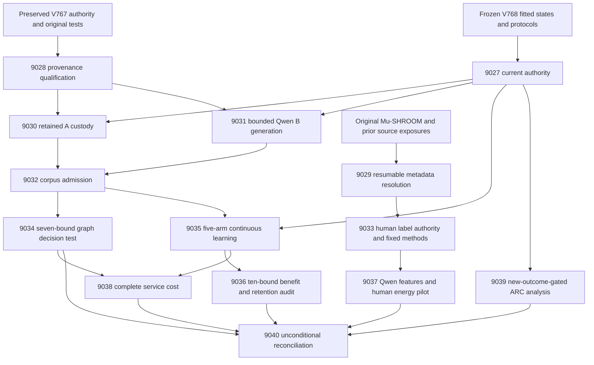
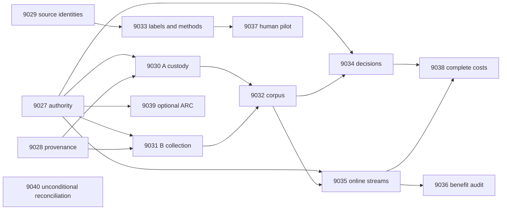

# Carnot Research Roadmap v771: Immutable Evidence, Independent Human Labels, and Continuous Spline Learning

**Created:** 2026-11-11 America/New_York
**Milestone:** 2026.11.771
**Status:** Planned; staged only
**Supersedes:** Completed scheduling milestone 2026.11.770, Exp9013–Exp9026
**Task contract:** Exactly 14 tasks, Exp9027 through Exp9040, in the order below.
**Execution file:** `research-roadmap-next.yaml`

V770's complete design and execution queue are preserved, byte for byte, in
`research-roadmap-v770-preserved-20261111.md` and
`research-roadmap-v770-queue-preserved-20261111.yaml`. Planning changes no active
queue, conductor, experiment result, exclusion manifest or deployed behavior.

## What V770 proved

Scheduling completion did not establish a scientific win. At planning time,
`research-complete.yaml` ends at V769; V770 primaries and conductor receipts
establish scheduling closure. Do not manufacture missing completion records.

| Evidence | Observed result | Consequence |
|---|---|---|
| Exp9013 | Contract, frozen graph authority and online protocol ready; ARC support zero. | Reuse the scientific protocol and keep optional ARC support separate. |
| Exp9014 | `complete_disqualified_scoped_provenance`; six V767 consumer tests failed at `task_authority`. The valid receipt control also rejected the failed validation set. | Repair historical input custody. Keep original assertions and strict receipt checks. Another change of acceptance scope cannot solve this failure. |
| Exp9015 | `complete_blocked_source_resolution_access`; a German Wikipedia metadata request returned HTTP 429. Cross-language exposure joins stayed incomplete; labels were deferred. Current scoped checks passed. | Separate resumable metadata acquisition from label qualification. Preserve original cohort and annotation requirements. |
| Exp9016–Exp9025 | Gate and cascade skips; declared scientific primaries were not produced. Some exact scheduler alternate artifacts exist. | Unmeasured graph, human, learning and cost hypotheses remain open; scheduler skips are not scientific nulls. |
| Exp9026 | `complete_blocked_declared_gate`, passing current checks and complete accounting. | A capstone can finish with external blocked science. Keep that terminal class. |

Sources: `results/experiment_9013_v770_branch_contract.json`,
`results/experiment_9014_v770_scoped_provenance_qualification.json`,
`results/experiment_9015_v770_human_disagreement_source.json`,
`results/experiment_9026_v770_capstone.json`, and `ops/conductor-log.md`.
Exp9014 stays flagged and cannot supply scientific authority. Its retained logs
are diagnostic evidence, not an eligible positive result.

The last qualified method is still V768. Exp8987's exposed development Brier
was 0.0279759276 for the convex spline versus 0.0636283248 for the converged
linear head, with four admission checks passed. Exp8988 qualified five-arm
update mechanics. Exp8990 retained 512 first Qwen responses, but its primary
remains disqualified. Custody checks may qualify primitive observations under a
new claim; they cannot clear that historical rejection or certify unseen benefit.

## The three largest gaps to the PRD

1. **FR-12: verification without a cheap executable oracle.** The current north
   star is an independently labeled, matched-control verifier win with CI95
   excluding zero. Graph truth comes from BFS and cannot close it. The natural
   pilot targets original human judgments with strong linear controls and
   explicit annotation uncertainty.
2. **FR-11 and FR-06: useful continuous learning.** Qualified update mechanics
   have not demonstrated future-query improvement while retaining calibration.
   Finish the sealed delayed-feedback test without changing its ten bounds.
3. **FR-09/FR-10 and NFR-01: credible evidence and complete deployment cost.**
   Historical consumers must read their own immutable authority. Timings must
   include input processing, update guards and durable storage before hardware
   investment or a Rust port is justified.

FR-05/FR-08 remain production requirements. A binary energy head is a learned
probability model, not a correctness certificate. This milestone changes neither
Qwen weights nor the public product's default decision policy.

## Research incorporated before design

The V771 scan was appended to `research-references.md` before drafting these tasks.
It covers all requested arXiv topics and secondary channels, with access limits.

| Source | Experiment use |
|---|---|
| [Mu-SHROOM, 2504.11975](https://arxiv.org/abs/2504.11975), April 2025 | Exp9029/9033/9037 qualify independent multilingual source groups and original annotator judgments. |
| [Beyond Majority Vote, 2609.03953](https://arxiv.org/abs/2609.03953), September 2026 | Exp9033 preregisters unanimous/disputed and leave-one-annotator-out sensitivities; Exp9037 reports them without changing the primary target. This applies an annotation concern, not the medical task. |
| [Mean-shift probes, 2608.28930](https://arxiv.org/abs/2608.28930), October 2026 revision | Exp9037 must beat both identical-feature and full-embedding linear controls. |
| [Online KAN, 2602.02056](https://arxiv.org/abs/2602.02056), June 2026 revision | Exp9035 tests local coefficient updates; Exp9038 measures full service costs. |
| [KAN forgetting, 2511.12828](https://arxiv.org/abs/2511.12828), November 2025; [Continual Calibration, 2604.23987](https://arxiv.org/abs/2604.23987), April 2026 | Exp9036 retains separate Brier and error bounds on the untouched shared panel. |
| [SHAM-Bench, 2610.27370](https://arxiv.org/abs/2610.27370), October 2026 | Source grouping and original annotation criteria remain mandatory under transfer. |

Energy-Based Reasoners (2611.08977, November 6), neural LNS (2603.20801),
thermodynamic Ising inference (2607.00170), ETS (2601.21484), and visual
energy-guided decoding (2507.07731) remain tracked leads. None removes the
current label or custody bottleneck. No new generator, solver or hardware
branch is justified by a paper alone.

OpenReview's ICLR 2026 EBT paper was accessible. Both Semantic Scholar citation
requests returned HTTP 429; citing-paper coverage is incomplete. Hugging Face
paper pages failed, while the author dataset card was accessible. GitHub
trending returned old cached pages, so no current ranking is claimed. Extropic's
Torx/thermalizer/Z1 announcement supplies vendor context, not local hardware.
Kona's page supplies a product description, not a reproducible architecture.

## Architecture



## Phase 1 — immutable authority and independent prerequisites (Exp9027–Exp9029)

**Exp9027: branch contract.** Compare fourteen complete task objects, visible
order and embedded contract. Before activation use staged/staged comparison;
after activation use actual active bytes. Authenticate Exp8987 fitted states,
original 1024 graph identities, four passed development criteria and Exp8988's
online protocol. Record separate authority fields. Compare the ARC ledger with
Exp9013 once; require thirty new uncensored episodes, three families and both
arms in every held family. Zero ARC support does not fail administrative custody.

**Exp9028: historical provenance qualification.** Reproduce all six original
V767 consumer failures. Bind their private roots and real child CLI invocations
to the preserved V767 design/queue and original independent digest. Repair the
historical input seam once, retaining original assertions and CHECKS. If an
explicit historical-authority parameter is needed in a shared reader, test both
accepted original bytes and rejected substituted bytes through actual callers.
A missing, changed, reordered or successor contract must still fail.

Then rerun serializer controls and actual current validation. The valid receipt
case must contain passing normal-exit receipts, including all six regressions.
Missing, stale, failed, timed-out, changed-log, changed-command, duplicate and
changed-code controls must reject. No fabricated acceptance bit, omitted node,
validator patch or changed scientific threshold is allowed. Preserve Exp8990,
Exp9000 and Exp9014 rejected primaries and their raw receipts. This is a repair
of observed input custody, not another attempt with a narrower acceptance set.

**Exp9029: source identity resolution.** Reuse Exp9015's pinned release and
successful metadata responses by hash. Deduplicate host/title requests across
all fourteen languages and historical source exposures. Preserve redirects,
normalized titles and Wikidata identities. Use one outstanding request, batches
of at most fifty titles, one-second minimum spacing, identifying User-Agent,
`maxlag=5`, thirty-second timeout, Retry-After-aware backoff and at most three
attempts per batch. New network work is capped at 600 seconds and 256 MB.
Checkpoint each successful batch. Do not rotate endpoints to evade a limit.

The gate requires complete release and historical exposure joins. Unresolved
identity remains ineligible. Another access failure produces terminal blocked
with retained progress and exact operands. No labels are reduced in this task.
Private recorded-response tests cover retries, deadlines, cache tampering,
redirect merges and offline cold replay. No dataset or language substitution
rescues a failed gate.

## Phase 2 — authenticated data and fixed human methods (Exp9030–Exp9033)

**Exp9030: retained A audit.** After current provenance and frozen graph
authority qualify, authenticate exactly 512 original first responses, original
CUDA/model/tokenizer/load receipts and state hashes. Require 64 CAL, 64 TEST
and 384 online identities, original parsing/BFS labels, and no intervening
fitting or TEST-score exposure. No replacement generation. The new audit cites
historical model work without embedding old counters as current work. Positive
oracle-label admission is circular; the old primary remains disqualified.

**Exp9031: bounded B collection.** Require the same two current gates and
confirm that the 512 committed B identities remain ungenerated. Use only
`unsloth/Qwen3.8-27B-GGUF`, Q4_K_M, GPU0, reasoning disabled, temperature zero,
original prompts and sixteen output tokens. One request per identity; no answer
retry or repair. Preflight/load each have 240-second limits, each request thirty
seconds, and collection 2700 seconds. Checkpoint every sixteen requests. A parent
prints while a child waits. Retain failed and censored units. Unexpected existing
B observations require a blocked changed-input decision, not an undeclared
switch to cached work. The actual substrate is bounded generation, floor 10s.

**Exp9032: corpus admission.** Join exactly 1024 original identities: 128 CAL,
128 TEST and 768 online. Preserve the minimum 200 errors and five examples per
class in each pooled role. Distinguish semantic, format, out-of-graph and
transport errors. Keep BFS truth, distances, answer membership and identifiers
out of learned features. Retain exclusions and all denominators. Admission is
source integrity, not independent verification benefit.

**Exp9033: original human labels and methods.** Require Exp9029's complete
identity/exposure manifest. Preserve V770's deterministic selection salt
`v770-human-v1`: one response per group, 160 FIT and 40 CAL groups from official
validation, 200 TEST groups from official test. Seal selection before label
reduction. Require all 400 unseen groups, at least five examples per majority
class in FIT and CAL and twenty per class in TEST, and three distinct original
annotators per response. Keep the original criterion, language eligibility and
support floors. Insufficient support blocks; never replace selected records.

Let `y_soft` be the fraction of original annotators marking any unsupported
span, and `y_hard = y_soft >= 0.5`. Validate offsets and preserve uncertainty and
ties. An aggregated span union cannot substitute for annotator identities.
This response-level target is human annotation risk, not the official span task.

Build and test the worker using private vectors, without loading Qwen. Freeze
mean-pooled final-layer embeddings of question plus response, unit normalized.
No source URLs, labels, IDs, generator metadata or historical logits enter the
representation. Text beyond 2048 model tokens blocks the fixed cohort rather
than being truncated. FIT-only PCA yields sixteen components; FIT-only scaling
maps to [-1,1]. Compare a 129-parameter cubic spline, 17-parameter matched linear
head, full-embedding L2 logistic head and FIT prevalence. Reuse converged convex
fitting, soft binary log loss, ridge menu `[0.01,0.1,1]`, CAL Brier selection and
ascending-ridge ties. Tolerance is `1e-6`, with at most 5000 iterations.

Temperature stays one. Accept at risk `p<=0.1`, reject at `p>=0.9`, otherwise
escalate. Classify at `p>=0.5`. Preserve four one-sided bounds: spline-minus-each
of matched linear, full-embedding linear and prevalence Brier upper bounds must
be below zero; hard-label error minus CAL-selected best linear must be at most
0.02. Use 10,000 paired TEST-group bootstrap draws, seed 770019, family alpha
0.05 and tail 0.05/4. All four are required. New unanimous/disputed and
leave-one-annotator-out sensitivities are descriptive only; they cannot change
the target, TEST membership or acceptance. Annotators are not independent units.

## Phase 3 — decision value and continuous learning (Exp9034–Exp9037)

**Exp9034: graph calibrated decisions.** Use the original fitted states and
compare spline, converged linear, old shared linear, confidence linear and
prevalence. Select temperatures on CAL from `[0.5,1,2,4]`, with ascending ties.
Seal TEST predictions before reduction. Retain seven original bounds: four
positive Brier-improvement lower bounds and three accepted-error delta upper
bounds at most zero at fifty-percent coverage. Use 10,000 paired graph draws,
family alpha 0.05, tail 0.05/7. Test node permutation, truth denial and context
removal. Numerical row readiness is separate from benefit. This graph-domain
result cannot close the no-cheap-oracle north star.

**Exp9035: continuous self-learning.** Run the unchanged Exp8988 five-arm
protocol on 24 disjoint 32-query streams: frozen spline, adaptive spline,
bias-only spline, adaptive linear and permuted-feedback spline. This branch
depends on corpus and online-method integrity, not Exp9034 benefit or rows.
Keep Qwen, the encoder, spline knots and temperature one fixed. Use binary log
loss, anchor 0.01 excluding intercept, gradient norm clip one, AdaGrad rate
0.05 and epsilon `1e-8`.

Seal predictions before feedback. At queries 8/12/16/20/24/28/32 release the
next four labels through ordinal 28; shuffle only within each released block.
Keep final labels 29–32 pending until scientific scoring ends. The original
64-graph development guard permits Brier increase at most 0.005 and no error
increase. Rejection restores coefficients and accumulator while acknowledging
feedback atomically. A real kill at query sixteen must resume exactly.

Retain 3,840 online rows and 46,080 retention rows: five arms, 24 streams,
128 shared TEST graphs at checkpoints 0/16/32. These are 49,920 dependent rows,
not independent samples. Retention labels never enter guards or updates. This
advances FR-11, Continuous Self-Learning Tier 1 and the hardware-compatible
small-head path. No benefit is assumed from successful update mechanics.

**Exp9036: independent benefit audit.** Recompute the ten original bounds from
sealed primitive rows. For queries 17–32, adaptive-minus-frozen Brier upper
bound must be at most -0.01; bounds against bias-only, adaptive linear and
permuted-feedback arms must be below zero. Six retention Brier/error upper
bounds at 0/16/32 must each be at most 0.01. Use 10,000 whole-stream draws,
family alpha 0.01, tail 0.001; resample retention graph identities once per draw
and share them across arms and histories. A supported no-benefit result is
terminal null. Report fixed-panel conditional sensitivity separately.

**Exp9037: natural human-energy pilot.** After both Exp9033 source and methods
fields qualify, use the mandated Qwen GGUF on GPU0 for the 400 fixed forward
embedding passes. Require genuine hidden representations and actual CUDA,
model/tokenizer and forward-call receipts. Unsupported embedding APIs block;
no hashes, logits or synthetic vectors substitute for measured representations.
Preflight/load each stop at 240 seconds, forward calls at thirty seconds and
embedding collection at 2100 seconds. Persist vectors every sixteen units.

Use `model_load_no_generation`, floor 2s, zero generation calls and generated
tokens. Train only the small heads on FIT, select on CAL, then seal 200 TEST
predictions before opening TEST labels. Execute the four unchanged bounds and
predeclared annotation sensitivities. No favorable language or disagreement
subset may replace the primary result. Public-data model pretraining exposure
is unknown. Even a positive pilot is scoped human-annotation evidence requiring
independent replication, not certified factual truth.

## Phase 4 — complete cost, optional ARC and closure (Exp9038–Exp9040)

**Exp9038: complete service cost.** With qualified graph and online rows,
measure 24 paired fresh-process units, randomized arm order, across frozen and
adaptive spline and frozen and adaptive converged linear. Include startup/JIT,
raw inputs, encoding, basis, scoring, dense anchors, guard evaluation,
serialization, fsync, restart, feedback tail drain and shutdown. Do not charge
linear controls artificial spline work. Qualify observer overhead; unsupported
component attribution stays unknown while direct total timings remain usable.

Valid timings do not require positive benefit. A deployment recommendation
additionally requires detector and learning benefit and an upper95 complete-cost
ratio adaptive-spline/linear at most one. Map measured operations to supported
hardware, using the nonaccelerable fraction to bound the 100x target. A serial
fraction of at least 0.01 rules out more than 100x even with ideal acceleration.
Do not infer spline/update support from sampler reachability or vendor numbers.
Natural Qwen feature-extraction cost is reported separately from graph service.

**Exp9039: opportunistic ARC.** A structured gate on Exp9027's new-support field
skips the task before synthesis when support is unchanged. Otherwise analyze
held-family association for resolved-by-levelup and actions-to-levelup, with
thirty new uncensored episodes, three families, both arms per held family and
explicit missing/censored counts. Freeze folds before reduction. Bootstrap
independent episodes within family. This is observational evidence, not a causal
policy effect or hidden-game transfer claim. No games or models are executed.
Registry-precheck any incidental level credit and require original
`solve_provenance=live_agent_self_discovery`; duplicate and off-path solves are
ineligible. No hidden source, per-game adapter or offline ground-truth search.

**Exp9040: unconditional capstone.** Account for all fourteen slots, including
its own row, using primaries or exact scheduler alternatives. Missing fields
stay missing; scheduler skips do not create producer verdicts. Independently
reduce the seven graph, ten learning and four human bounds, cost and ARC support.
Keep administrative readiness, source custody, null, block and disqualification
separate. Count Exp8990's 512 historical model calls once. External unavailable
science yields terminal blocked; only incomplete owned work is partial.

Run the unchanged publication gate and retain historical FoVer G1–G4 separately.
Complete accounting may set reconciliation readiness one with blocked science.
Record precise reopening evidence for unchanged failed scopes; do not activate
a queue, edit the exclusion manifest, publish externally or push.

## Dependencies and conductor order



Every structured gate points backward to a producer in this roadmap. Its exact
field is declared in that producer's REQUIRED ARTIFACT FIELDS. Historical failed
IDs occur only in evidence and complete rerun metadata; none is a required
retired producer. Both natural-pilot fields come from Exp9033, not Exp9029.

## Hardware requirements, execution budgets and stop rules

| Work | Resource | Limit and evidence boundary |
|---|---|---|
| Authority, metadata, labels, statistics | CPU, existing environment, private scratch and bounded public network | No model loads. Source network budget 600s/256MB; scientific support floors remain fixed. |
| Historical input repair | CPU and actual private child CLI execution | Opus, 100 turns; original consumer checks cannot be omitted. |
| B generation | One RTX3090, GPU0, cached Qwen Q4_K_M, about 16GB weights | 512 requests, sixteen tokens each; bounded generation, minimum duration 10s; 2700s collection ceiling. |
| Human embeddings | Same GPU0 and frozen Qwen | 400 forwards; no generation, minimum duration 2s; 2100s embedding ceiling. |
| Online head updates and service cost | CPU and durable local disk | Charge dense anchors, guards and storage as well as local coefficient writes. |
| KV260 | Existing sampler scope, `k_max<=5` | No spline-training support established. Any future board access uses SSH, not a host SD-card test. |
| PolarFire | Linux CPU dispatch | CPU evidence is not fabric acceleration. |
| GateMate | Unchanged `0xffffffff` physical/JTAG block | No repeated probe without a changed physical prerequisite. |
| NPU/TSU | Unqualified local execution | No installation, purchase, availability probe or borrowed vendor speedup. |

The hardware wishlist is consulted; current CPU/GPU resources suffice for this
plan. No acquisition is justified until a measured bottleneck and exact supported
operation exist. A later FPGA basis/update implementation would need separate
fixed-point correctness and board execution evidence. Keep GPU1 detached and
respect GPU0 leases; do not disturb the ARC generator or foreign processes.

Every prompt mandates flushed boundaries before and after long calls, real
completed/pending counts inside loops at least every sixty seconds, tool polls
at most sixty seconds, and silence gaps below 600 seconds. Write files over
about 200 lines in several tool calls, at most about 150 lines per call, with
progress between them. Never pad runtime to meet a duration floor. Stop
measurement by 3300s, reserving 1200s for checks inside the 4800s hard cap.

Two schema/qualification tasks route to Opus/100 turns; formulaic dataset and
wiring tasks use Codex/gpt-6.1-sol; routine scientific evaluation uses the default
backend. No Luna task is proposed. These are future execution settings, not
subagents spawned during planning.

## Validation and acceptance

Before implementation, extend the relevant REQ/SCENARIO and write failing tests.
Freeze current owned/direct-consumer scope, including historical authority.
Require scoped unit tests, private child CLI, Ruff, strict mypy, explicit-path
spec coverage and all newly owned statements covered without exclusions. Run
private E2E-018/021 and E2E-020 for learning restart, plus tamper and cold replay.
Historical failed broad-suite receipts remain failed; a current affected consumer
failure still disqualifies. Unchanged adversarial and strict row validators gate
publication of each new primary.

All tasks declare verdict_class, gate_check_summary, measured substrate, per-unit
rows and principle-annotated fields. External missing/retired inputs are terminal
blocked, not partial. Successful oracle-based graph admission is circular_positive.
Every similar failed scope names its real predecessor, changed prerequisite and
`retire_if_same_verdict: true`. Thresholds, source groups and controls are fixed.
This plan promises experiments and falsifiable decisions, not positive outcomes.

## Exact task contract

Exactly 14 tasks, Exp9027 through Exp9040, in this conductor order.

| Order | Task ID | Title | Phase | Deliverable |
|---|---|---|---|---|
| 1 | `exp9027-branch-contract` | Bind fourteen tasks and preserve V769 failures and frozen scientific methods | 1 | `results/experiment_9027_v771_branch_contract.json` |
| 2 | `exp9028-historical-provenance-qualification` | Qualify provenance with immutable historical test authority | 1 | `results/experiment_9028_v771_historical_provenance_qualification.json` |
| 3 | `exp9029-source-identity-resolution` | Resolve multilingual source identities with bounded resumable metadata | 1 | `results/experiment_9029_v771_source_identity_resolution.json` |
| 4 | `exp9030-retained-shard-a` | Authenticate retained shard A without new generation or revised labels | 2 | `results/experiment_9030_v771_retained_shard_a.json` |
| 5 | `exp9031-graph-corpus-b` | Complete the frozen bounded Qwen source with shard B | 2 | `results/experiment_9031_v771_graph_corpus_b.json` |
| 6 | `exp9032-corpus-admission` | Join authenticated shards under the original graph role contract | 2 | `results/experiment_9032_v771_corpus_admission.json` |
| 7 | `exp9033-human-label-methods` | Qualify original human labels and freeze matched probe methods | 2 | `results/experiment_9033_v771_human_label_methods.json` |
| 8 | `exp9034-spline-calibrated-decisions` | Test frozen spline decisions against all registered graph controls | 3 | `results/experiment_9034_v771_spline_calibrated_decisions.json` |
| 9 | `exp9035-online-spline-streams` | Measure continuous coefficient learning on sealed future response streams | 3 | `results/experiment_9035_v771_online_spline_streams.json` |
| 10 | `exp9036-online-benefit-audit` | Audit future spline benefit and simultaneous shared-panel retention | 3 | `results/experiment_9036_v771_online_benefit_audit.json` |
| 11 | `exp9037-human-energy-pilot` | Measure energy decisions against independent human disagreement | 3 | `results/experiment_9037_v771_human_energy_pilot.json` |
| 12 | `exp9038-complete-spline-cost` | Measure complete spline service costs and actual acceleration limits | 4 | `results/experiment_9038_v771_complete_spline_cost.json` |
| 13 | `exp9039-arc-transfer-evidence` | Assess held-family supervisor transfer only from new live outcomes | 4 | `results/experiment_9039_v771_arc_transfer_evidence.json` |
| 14 | `exp9040-capstone` | Reconcile fourteen outcomes and separate graph and independent-label claims | 4 | `results/experiment_9040_v771_capstone.json` |

The machine contract contains every full task object, including prompts.

<!-- V771_TASK_CONTRACT_START -->
```json
{
  "milestone": "2026.11.771",
  "milestone_title": "Immutable Evidence, Independent Human Labels, and Continuous Spline Learning",
  "milestone_doc": "openspec/change-proposals/research-roadmap-vNEXT.md",
  "tasks": [
{
  "id": "exp9027-branch-contract",
  "title": "Bind fourteen tasks and preserve V769 failures and frozen scientific methods",
  "phase": 1,
  "track": "research",
  "priority": "high",
  "requires_gpu": false,
  "max_turns": 100,
  "estimated_wall_time_min": 30,
  "per_unit_rows": true,
  "milestone": "2026.11.771",
  "deliverable": "results/experiment_9027_v771_branch_contract.json",
  "inference_substrate_class": "no_model_load",
  "MODEL_SPECS": [],
  "gated_on": [],
  "prior_failures": [
    {
      "experiment_id": "exp9013-branch-contract",
      "verdict": "complete_null_v770_branch_contract",
      "addressed_by": "Bind the new fourteen-slot V771 contract and retained V770 outcomes; administrative continuity is not a repeat scientific claim.",
      "retire_if_same_verdict": true
    },
    {
      "experiment_id": "exp8985-branch-contract",
      "verdict": "complete_null_v768_branch_contract",
      "addressed_by": "Successful authority continuity, not a failed result: bind the new staged contract and immutable passed methods; do not repeat prior science.",
      "retire_if_same_verdict": true
    }
  ],
  "prompt": "CONTEXT:\nWork in {project_root} on {date}. V770 closed scheduling, not science. Exp9013 qualified authority; Exp9014 is disqualified; Exp9015 is source-blocked; Exp9026 qualified accounting with blocked science. Preserve those results and bind V771 without rerunning a development fit.\nEXISTING CODE TO READ FIRST:\nCLAUDE.md; CODEX.md; research-program.md; ops/north-star.md; ops/e2e-test-plan.md; openspec/capabilities/research-reporting/spec.md; openspec/capabilities/verification/spec.md; openspec/capabilities/kan/spec.md; scripts/experiment_template.py; python/carnot/reporting/primary_publication.py; ops/exclusion_manifest.yaml; openspec/change-proposals/research-roadmap-vNEXT.md; openspec/change-proposals/research-roadmap-v769-preserved-20261111.md; openspec/change-proposals/research-roadmap-v768-preserved-20261111.md; research-references.md; python/carnot/reporting/roadmap_contract.py; python/carnot/reporting/v768_capstone.py; results/experiment_8998_v768_capstone.json; results/experiment_8987_v768_spline_development_admission.json; results/experiment_8988_v768_online_spline_methods.json; python/carnot/reporting/arc_supervisor_frontier_8720.py; ops/arc_supervisor_refinement_ledger.json; openspec/change-proposals/research-roadmap-v770-preserved-20261111.md; openspec/change-proposals/research-roadmap-v770-queue-preserved-20261111.yaml\nTASK:\nBind fourteen tasks and preserve V769 failures and frozen scientific methods. Deliver results/experiment_9027_v771_branch_contract.json, primitive evidence under results/raw/experiment_9027_v771_branch_contract/, and runnable scripts/experiments/experiment_9027_v771_branch_contract.py.\nCONCRETE STEPS:\n1. Emit a flushed progress line at each phase boundary and before and after every model load, generation, benchmark and subprocess. Set PYTHONUNBUFFERED=1 and use print(..., flush=True). Inside long loops and child waits, print actual completed/pending counts at least every 60 seconds; keep every silence gap below 600 seconds. Poll in tool calls of at most 60 seconds. Write any file over about 200 lines in several tool calls, at most about 150 lines per call, with a progress message between calls. Never pad runtime.\n2. PRECONDITIONS: Before compute, authenticate inputs, exact gate fields, hashes, virtualenv, dependencies, free memory and writable disk. Bound required network requests. Preserve rejected evidence. Missing, retired or gate-blocked external inputs mean honest_verdict=complete_blocked_<check>, verdict_class=blocked and gate_check_summary naming the observed operand. Only unfinished owned work is partial. Do not substitute fixtures for measurements.\n3. Extend the relevant REQ-* and SCENARIO-* before implementation; write failing private tests first. Read all callers before fixing shared code. Reuse existing helpers and frozen methods; keep fixtures in private temporary directories. Never read a mutable successor document as historical authority. Preserve original thresholds and tests.\n4. Load no LLM: MODEL_SPECS=[], model_specs=[], inference_substrate_class=no_model_load. Use aggregation_from_upstream_artifacts for reductions or verifier_ensemble_against_cached_candidates for numerical scoring/training. Keep current model calls zero and declare small trained_head_specs separately. Preserve historical calls only through explicit cited artifact references.\n5. Snapshot the preserved V770 design/queue, current V771 contract, V768 protocols and referenced primaries by hash. Compare all 14 full task objects and visible order Exp9027..Exp9040. Before activation compare staged with staged; after activation compare active bytes. Do not modify the active queue. Contract readiness is independent of science and ARC readiness.\n6. Authenticate original Exp8987 fitted states, four development criteria, 1024 committed graph IDs and 128 CAL/128 TEST/768 online roles. Authenticate Exp8988 five-arm methods. Emit frozen_graph_authority_ready_score and online_protocol_ready_score separately. Never redraw, refit or repeat development admission. Record the archive lag from observed bytes; planning found research-complete.yaml ending at .769 while .770 primaries and scheduler receipts establish closure.\n7. Check ARC receipts once against Exp9013. arc_new_outcomes_ready_score=1 requires 30 NEW uncensored episodes, three families and both arms in every held family. Zero support is not a failed contract. Retain Exp9014 direct-consumer failures, Exp9015 source-access failures and failed V769 global-health receipts. Snapshot historical authority before any successor replaces vNEXT.\n8. Run scoped pytest and all frozen direct-consumer nodes, real private CLI checks, Ruff check/format, strict mypy and explicit-path spec coverage. Require 100 percent newly owned statements with zero exclusions. Run private E2E-018/021, missing-input, changed-authority, rehashed-tamper and cold replay outside the checkout without PYTHONPATH; learning tasks also run E2E-020. Freeze validation scope before measurement. Historical failed health stays failed under repository_health, separate from current acceptance. A current direct-consumer failure still disqualifies; do not omit failing nodes. Preserve scientific thresholds and assertions. Stop measurement by 3300 seconds and reserve 1200 seconds for checks within the 4800-second hard cap. Do not run the whole repository suite in each task or call scoped success repository-wide health.\n9. Retain primitive per-unit rows and source/code/config hashes; independently recompute summaries. Run unchanged adversarial_verify.py and strict verdict_row_consistency_lint.py under progress supervision. Publish via primary_publication only after current owned checks pass; failed checks disqualify and zero readiness. Reconcile openspec/, _bmad/traceability.md, ops/status.md and ops/changelog.md. Do not edit operator-curated pages, active roadmap, exclusion manifest or validators. No queue activation or external publication.\nREQUIRED ARTIFACT FIELDS:\n- honest_verdict: complete_*; verdict_class: positive | circular_positive | null | blocked | disqualified | partial. Principle: external incompleteness is terminal blocked; only owned unfinished work retries.\n- verifier_is_oracle, claim_scope, exposure_scope, independent_generalization_score. Principle: fixtures and graph-oracle admission cannot establish a no-cheap-oracle verifier win; oracle positives are circular_positive.\n- required_checks_passed, flagged_adversarial, validation_receipts, owned_statement_coverage, preconditions_checked, validation_scope_manifest, repository_health, repository_health_passed. Principle: readiness requires actual normal-exit checks.\n- gate_check_summary: check/upstream/path/sha256/artifact_field/op/expected/observed/passed. Principle: blocked results name the exact check and missing_file, missing_field or observed value.\n- inference_substrate, inference_substrate_class, MODEL_SPECS, model_specs, trained_head_specs, model_invocation_counts, cited_upstream_artifacts: experiment_id/fields_imported/sha256. Principle: current work differs from authenticated historical model work.\n- rows: unit_id/group_id/arm/condition/metric/value/numerator/denominator/status/exclusion_reason; intended_count, independent_count, completed_count, excluded_count, censored_count, failed_count. Principle: every comparison retains each independent unit and denominator; repeated responses are not independent groups.\n- run_date, duration_s, random_seed, reproducibility_checksum, source_artifact_hashes, raw_shard_hashes, code_config_hashes, phase_spans, acceptance_gates, field_principles. Principle: frozen thresholds and retained primitive bytes make the claim reproducible.\n- contract_ready_score, frozen_graph_authority_ready_score, online_protocol_ready_score, arc_new_outcomes_ready_score: each 0|1; authority_manifest, full_contract_rows, frontier_delta_rows. Principle: independent administrative and scientific gates prevent optional evidence from blocking unrelated work.\nRun command: cd {project_root} && PYTHONUNBUFFERED=1 .venv/bin/python -u scripts/experiments/experiment_9027_v771_branch_contract.py --date {date}\nDo NOT push. Do NOT modify scripts/research_conductor.py.",
  "model": "opus"
},
{
  "id": "exp9028-historical-provenance-qualification",
  "title": "Qualify provenance with immutable historical test authority",
  "phase": 1,
  "track": "research",
  "priority": "high",
  "requires_gpu": false,
  "max_turns": 100,
  "estimated_wall_time_min": 50,
  "per_unit_rows": true,
  "milestone": "2026.11.771",
  "deliverable": "results/experiment_9028_v771_historical_provenance_qualification.json",
  "inference_substrate_class": "no_model_load",
  "MODEL_SPECS": [],
  "gated_on": [],
  "prior_failures": [
    {
      "experiment_id": "exp9014-scoped-provenance-qualification",
      "verdict": "complete_disqualified_scoped_provenance",
      "addressed_by": "Six original V767 consumer nodes read mutable authority. Supply hash-pinned historical authority to their private roots and real children, then require all original assertions and actual valid-receipt acceptance; never drop failed checks.",
      "retire_if_same_verdict": true
    },
    {
      "experiment_id": "exp9000-invocation-provenance",
      "verdict": "complete_disqualified_invocation_provenance",
      "addressed_by": "Six original V767 consumer nodes read mutable authority. Supply hash-pinned historical authority to their private roots and real children, then require all original assertions and actual valid-receipt acceptance; never drop failed checks. Historical failure remains unchanged.",
      "retire_if_same_verdict": true
    },
    {
      "experiment_id": "exp8990-graph-corpus-a",
      "verdict": "complete_disqualified_graph_corpus_a",
      "addressed_by": "Remove the diagnosed embedded-upstream/current-scope ambiguity in producer serialization; qualify real negative controls before any evidence reuse or new collection.",
      "retire_if_same_verdict": true
    }
  ],
  "prompt": "CONTEXT:\nWork in {project_root} on {date}. Exp9014 failed six original V767 consumer tests at task_authority: the reader follows mutable vNEXT/queue bytes. Its valid receipt control correctly rejected that failed validation set. Change historical test input custody, not receipt acceptance or scientific gates.\nEXISTING CODE TO READ FIRST:\nCLAUDE.md; CODEX.md; ops/e2e-test-plan.md; openspec/capabilities/research-reporting/spec.md; python/carnot/reporting/invocation_provenance_9000.py; python/carnot/reporting/graph_corpus_a_8961.py; python/carnot/reporting/graph_corpus_a_8990.py; python/carnot/reporting/current_work_receipt.py; python/carnot/reporting/primary_publication.py; python/carnot/reporting/v767_capstone.py; tests/python/test_invocation_provenance_9000.py; tests/python/test_v767_capstone_8984.py; results/experiment_9000_v769_invocation_provenance.json; scripts/adversarial_verify.py; scripts/verdict_row_consistency_lint.py; openspec/change-proposals/research-roadmap-v770-preserved-20261111.md; openspec/change-proposals/research-roadmap-v770-queue-preserved-20261111.yaml; python/carnot/reporting/scoped_provenance_9014.py; python/carnot/reporting/v767_branch_contract.py; python/carnot/reporting/v767_capstone.py; tests/python/test_v767_capstone_8984.py; openspec/change-proposals/research-roadmap-v767-preserved-20261110.md; openspec/change-proposals/research-roadmap-v767-queue-preserved-20261110.yaml; results/experiment_9014_v770_scoped_provenance_qualification.json\nTASK:\nQualify provenance with immutable historical test authority. Deliver results/experiment_9028_v771_historical_provenance_qualification.json, primitive evidence under results/raw/experiment_9028_v771_historical_provenance_qualification/, and runnable scripts/experiments/experiment_9028_v771_historical_provenance_qualification.py.\nCONCRETE STEPS:\n1. Emit a flushed progress line at each phase boundary and before and after every model load, generation, benchmark and subprocess. Set PYTHONUNBUFFERED=1 and use print(..., flush=True). Inside long loops and child waits, print actual completed/pending counts at least every 60 seconds; keep every silence gap below 600 seconds. Poll in tool calls of at most 60 seconds. Write any file over about 200 lines in several tool calls, at most about 150 lines per call, with a progress message between calls. Never pad runtime.\n2. PRECONDITIONS: Before compute, authenticate inputs, exact gate fields, hashes, virtualenv, dependencies, free memory and writable disk. Bound required network requests. Preserve rejected evidence. Missing, retired or gate-blocked external inputs mean honest_verdict=complete_blocked_<check>, verdict_class=blocked and gate_check_summary naming the observed operand. Only unfinished owned work is partial. Do not substitute fixtures for measurements.\n3. Extend the relevant REQ-* and SCENARIO-* before implementation; write failing private tests first. Read all callers before fixing shared code. Reuse existing helpers and frozen methods; keep fixtures in private temporary directories. Never read a mutable successor document as historical authority. Preserve original thresholds and tests.\n4. Load no LLM: MODEL_SPECS=[], model_specs=[], inference_substrate_class=no_model_load. Use aggregation_from_upstream_artifacts for reductions or verifier_ensemble_against_cached_candidates for numerical scoring/training. Keep current model calls zero and declare small trained_head_specs separately. Preserve historical calls only through explicit cited artifact references.\n5. Reproduce the six retained test_v767_capstone_8984.py failures at task_authority in private scratch. Trace authority() and every caller. Bind those original test nodes and real child CLI paths to the preserved V767 design/queue and independent task digest, using the existing private-root fixture pattern. Never supply V771 as V767 authority. Fix the historical input seam once; do not delete nodes, weaken assertions, fabricate ready=True or exclude the consumer from CHECKS.\n6. Prove that matching historical bytes pass the original reader, while missing, reordered, prompt-changed, wrong-digest and successor-authority substitutions reject. Mutate private copies only. Keep original failed primaries, raw evidence and acceptance thresholds immutable. If historical source files need an explicit authority parameter, retain the strict original digest and add real subprocess tests for both accepted and rejected inputs before changing the shared caller.\n7. Freeze the new owned/direct-consumer scope and command/code/test hashes before final qualification. Execute all original provenance serializer controls, including bounded-generation fixture, cached/no-model, load-only, missing ledger and actual current contradiction. Reuse the existing serializer and receipt checker; no new provenance abstraction or validator patch. Fixture controls earn no live science credit.\n8. The valid receipt case must contain actual passing current normal-exit checks, including all six V767 regressions. Then mutate each of missing, stale, failed, timeout, log hash, command, duplicate and code hash in separate copies and require CLI refusal. Exp9014 rejected valid because direct-consumer receipts failed; do not flip that failed receipt. Require all current tests, scanner controls and cold replay for provenance_ready_score=1 and validation_scope_ready_score=1. A failed current check remains disqualified.\n9. Run scoped pytest and all frozen direct-consumer nodes, real private CLI checks, Ruff check/format, strict mypy and explicit-path spec coverage. Require 100 percent newly owned statements with zero exclusions. Run private E2E-018/021, missing-input, changed-authority, rehashed-tamper and cold replay outside the checkout without PYTHONPATH; learning tasks also run E2E-020. Freeze validation scope before measurement. Historical failed health stays failed under repository_health, separate from current acceptance. A current direct-consumer failure still disqualifies; do not omit failing nodes. Preserve scientific thresholds and assertions. Stop measurement by 3300 seconds and reserve 1200 seconds for checks within the 4800-second hard cap. Do not run the whole repository suite in each task or call scoped success repository-wide health.\n10. Retain primitive per-unit rows and source/code/config hashes; independently recompute summaries. Run unchanged adversarial_verify.py and strict verdict_row_consistency_lint.py under progress supervision. Publish via primary_publication only after current owned checks pass; failed checks disqualify and zero readiness. Reconcile openspec/, _bmad/traceability.md, ops/status.md and ops/changelog.md. Do not edit operator-curated pages, active roadmap, exclusion manifest or validators. No queue activation or external publication.\nREQUIRED ARTIFACT FIELDS:\n- honest_verdict: complete_*; verdict_class: positive | circular_positive | null | blocked | disqualified | partial. Principle: external incompleteness is terminal blocked; only owned unfinished work retries.\n- verifier_is_oracle, claim_scope, exposure_scope, independent_generalization_score. Principle: fixtures and graph-oracle admission cannot establish a no-cheap-oracle verifier win; oracle positives are circular_positive.\n- required_checks_passed, flagged_adversarial, validation_receipts, owned_statement_coverage, preconditions_checked, validation_scope_manifest, repository_health, repository_health_passed. Principle: readiness requires actual normal-exit checks.\n- gate_check_summary: check/upstream/path/sha256/artifact_field/op/expected/observed/passed. Principle: blocked results name the exact check and missing_file, missing_field or observed value.\n- inference_substrate, inference_substrate_class, MODEL_SPECS, model_specs, trained_head_specs, model_invocation_counts, cited_upstream_artifacts: experiment_id/fields_imported/sha256. Principle: current work differs from authenticated historical model work.\n- rows: unit_id/group_id/arm/condition/metric/value/numerator/denominator/status/exclusion_reason; intended_count, independent_count, completed_count, excluded_count, censored_count, failed_count. Principle: every comparison retains each independent unit and denominator; repeated responses are not independent groups.\n- run_date, duration_s, random_seed, reproducibility_checksum, source_artifact_hashes, raw_shard_hashes, code_config_hashes, phase_spans, acceptance_gates, field_principles. Principle: frozen thresholds and retained primitive bytes make the claim reproducible.\n- provenance_ready_score: 0|1, original_flag_rows, invocation_path_rows, mutation_rows, producer_code_hashes. Principle: the existing validator must still reject actual contradictions while recognizing explicitly cited history.\n- validation_scope_ready_score: 0|1; historical_health_references, current_receipt_mutation_rows, original_test_node_hashes, original_verdict_preserved. Principle: a new scoped claim cannot rewrite the outcome of a historical broader claim.\nRun command: cd {project_root} && PYTHONUNBUFFERED=1 .venv/bin/python -u scripts/experiments/experiment_9028_v771_historical_provenance_qualification.py --date {date}\nDo NOT push. Do NOT modify scripts/research_conductor.py.",
  "model": "opus"
},
{
  "id": "exp9029-source-identity-resolution",
  "title": "Resolve multilingual source identities with bounded resumable metadata",
  "phase": 1,
  "track": "research",
  "priority": "high",
  "requires_gpu": false,
  "max_turns": 50,
  "estimated_wall_time_min": 45,
  "per_unit_rows": true,
  "milestone": "2026.11.771",
  "deliverable": "results/experiment_9029_v771_source_identity_resolution.json",
  "inference_substrate_class": "no_model_load",
  "MODEL_SPECS": [],
  "gated_on": [],
  "prior_failures": [
    {
      "experiment_id": "exp9015-human-disagreement-source",
      "verdict": "complete_blocked_source_resolution_access",
      "addressed_by": "Replace the all-or-nothing metadata pass with authenticated successful-response reuse, deduplicated paced requests, Retry-After and atomic resume; complete historical cross-language exposure closure before label reduction.",
      "retire_if_same_verdict": true
    }
  ],
  "prompt": "CONTEXT:\nWork in {project_root} on {date}. Exp9015 retained a German Wikipedia HTTP429 and incomplete cross-language exposure joins. Labels were deferred. Separate metadata acquisition from label reduction, reuse successful receipts, and resume only unresolved identities with respectful bounded requests.\nEXISTING CODE TO READ FIRST:\nCLAUDE.md; CODEX.md; ops/north-star.md; ops/e2e-test-plan.md; research-references.md; openspec/capabilities/research-reporting/spec.md; python/carnot/reporting/human_source_authority_9001.py; python/carnot/reporting/human_source_runner_9001.py; python/carnot/reporting/natural_criterion_audit_8908.py; results/experiment_9001_v769_human_source_authority.json; docs/research-notes/label-provenance-audit-step1-2026-11-07.md; https://huggingface.co/datasets/Helsinki-NLP/mu-shroom; https://helsinki-nlp.github.io/shroom/2025/FAQ_2025.html; openspec/change-proposals/research-roadmap-v770-preserved-20261111.md; openspec/change-proposals/research-roadmap-v770-queue-preserved-20261111.yaml; python/carnot/reporting/human_disagreement_source_9015.py; python/carnot/reporting/human_disagreement_runner_9015.py; results/experiment_9015_v770_human_disagreement_source.json; https://www.mediawiki.org/wiki/API:Etiquette\nTASK:\nResolve multilingual source identities with bounded resumable metadata. Deliver results/experiment_9029_v771_source_identity_resolution.json, primitive evidence under results/raw/experiment_9029_v771_source_identity_resolution/, and runnable scripts/experiments/experiment_9029_v771_source_identity_resolution.py.\nCONCRETE STEPS:\n1. Emit a flushed progress line at each phase boundary and before and after every model load, generation, benchmark and subprocess. Set PYTHONUNBUFFERED=1 and use print(..., flush=True). Inside long loops and child waits, print actual completed/pending counts at least every 60 seconds; keep every silence gap below 600 seconds. Poll in tool calls of at most 60 seconds. Write any file over about 200 lines in several tool calls, at most about 150 lines per call, with a progress message between calls. Never pad runtime.\n2. PRECONDITIONS: Before compute, authenticate inputs, exact gate fields, hashes, virtualenv, dependencies, free memory and writable disk. Bound required network requests. Preserve rejected evidence. Missing, retired or gate-blocked external inputs mean honest_verdict=complete_blocked_<check>, verdict_class=blocked and gate_check_summary naming the observed operand. Only unfinished owned work is partial. Do not substitute fixtures for measurements.\n3. Extend the relevant REQ-* and SCENARIO-* before implementation; write failing private tests first. Read all callers before fixing shared code. Reuse existing helpers and frozen methods; keep fixtures in private temporary directories. Never read a mutable successor document as historical authority. Preserve original thresholds and tests.\n4. Load no LLM: MODEL_SPECS=[], model_specs=[], inference_substrate_class=no_model_load. Use aggregation_from_upstream_artifacts for reductions or verifier_ensemble_against_cached_candidates for numerical scoring/training. Keep current model calls zero and declare small trained_head_specs separately. Preserve historical calls only through explicit cited artifact references.\n5. Use the exact Exp9015 pinned author release and metadata inventory. Preserve its primary and rejected HTTP429 body unchanged. Authenticate successful retained HTTP200 response bytes and request identities before reuse. Acquire no labels and load no model. Source identities, release revision, URLs and prior-exposure joins are the only work in this task.\n6. Deduplicate normalized Wikipedia host/title requests across all fourteen languages and prior exposure records. Reuse the existing grouping parser; retain redirects, normalized titles and Wikidata IDs with original request/response hashes. Checkpoint each successful batch atomically so a later block does not discard earlier work. Never treat an unresolved identity or failed request as an unseen source.\n7. Use one outstanding request, at most 50 titles per request, an identifying User-Agent, maxlag=5, a minimum one-second spacing, 30-second request timeout, and Retry-After-aware exponential backoff with at most three attempts per batch. Cap all new network work at 600 seconds and 256 MB. Reuse authenticated cache first. Print pending/completed counts during waits in tool calls at most 60 seconds. Do not rotate hosts, evade rate limits or increase the deadline after seeing a block.\n8. Complete both release and historical cross-language source joins. Publish source_identity_ready_score=1 only if the full required metadata and exposure closure are authenticated; otherwise emit terminal blocked with exact HTTP status, unresolved counts and gate_check_summary. A source mention in planning prose is not an exposed row, but any actual prior item or source overlap is excluded. No language or role selection depends on labels.\n9. Use recorded HTTP responses in private tests to verify resume, cache tamper rejection, redirect merges, cross-language duplicates, Retry-After, timeout, exhausted budget and unknown exposure. Cold replay must rebuild identical group components from retained bytes without network. Publish a standalone metadata manifest for Exp9033; do not resubmit the same incomplete manifest as a new source success.\n10. Run scoped pytest and all frozen direct-consumer nodes, real private CLI checks, Ruff check/format, strict mypy and explicit-path spec coverage. Require 100 percent newly owned statements with zero exclusions. Run private E2E-018/021, missing-input, changed-authority, rehashed-tamper and cold replay outside the checkout without PYTHONPATH; learning tasks also run E2E-020. Freeze validation scope before measurement. Historical failed health stays failed under repository_health, separate from current acceptance. A current direct-consumer failure still disqualifies; do not omit failing nodes. Preserve scientific thresholds and assertions. Stop measurement by 3300 seconds and reserve 1200 seconds for checks within the 4800-second hard cap. Do not run the whole repository suite in each task or call scoped success repository-wide health.\n11. Retain primitive per-unit rows and source/code/config hashes; independently recompute summaries. Run unchanged adversarial_verify.py and strict verdict_row_consistency_lint.py under progress supervision. Publish via primary_publication only after current owned checks pass; failed checks disqualify and zero readiness. Reconcile openspec/, _bmad/traceability.md, ops/status.md and ops/changelog.md. Do not edit operator-curated pages, active roadmap, exclusion manifest or validators. No queue activation or external publication.\nREQUIRED ARTIFACT FIELDS:\n- honest_verdict: complete_*; verdict_class: positive | circular_positive | null | blocked | disqualified | partial. Principle: external incompleteness is terminal blocked; only owned unfinished work retries.\n- verifier_is_oracle, claim_scope, exposure_scope, independent_generalization_score. Principle: fixtures and graph-oracle admission cannot establish a no-cheap-oracle verifier win; oracle positives are circular_positive.\n- required_checks_passed, flagged_adversarial, validation_receipts, owned_statement_coverage, preconditions_checked, validation_scope_manifest, repository_health, repository_health_passed. Principle: readiness requires actual normal-exit checks.\n- gate_check_summary: check/upstream/path/sha256/artifact_field/op/expected/observed/passed. Principle: blocked results name the exact check and missing_file, missing_field or observed value.\n- inference_substrate, inference_substrate_class, MODEL_SPECS, model_specs, trained_head_specs, model_invocation_counts, cited_upstream_artifacts: experiment_id/fields_imported/sha256. Principle: current work differs from authenticated historical model work.\n- rows: unit_id/group_id/arm/condition/metric/value/numerator/denominator/status/exclusion_reason; intended_count, independent_count, completed_count, excluded_count, censored_count, failed_count. Principle: every comparison retains each independent unit and denominator; repeated responses are not independent groups.\n- run_date, duration_s, random_seed, reproducibility_checksum, source_artifact_hashes, raw_shard_hashes, code_config_hashes, phase_spans, acceptance_gates, field_principles. Principle: frozen thresholds and retained primitive bytes make the claim reproducible.\n- source_identity_ready_score: 0|1; metadata_manifest, release_revision, request_rows, source_group_rows, exposure_inventory, unresolved_source_groups, cache_reuse_count, retry_counts, bytes_downloaded, source_resolution_receipts. Principle: metadata readiness requires complete source and prior-exposure joins, not label access or unknown-as-unseen assumptions.\nRun command: cd {project_root} && PYTHONUNBUFFERED=1 .venv/bin/python -u scripts/experiments/experiment_9029_v771_source_identity_resolution.py --date {date}\nDo NOT push. Do NOT modify scripts/research_conductor.py.",
  "agent_type": "codex",
  "model": "gpt-6.1-sol"
},
{
  "id": "exp9030-retained-shard-a",
  "title": "Authenticate retained shard A without new generation or revised labels",
  "phase": 2,
  "track": "research",
  "priority": "high",
  "requires_gpu": false,
  "max_turns": 30,
  "estimated_wall_time_min": 40,
  "per_unit_rows": true,
  "milestone": "2026.11.771",
  "deliverable": "results/experiment_9030_v771_retained_shard_a.json",
  "inference_substrate_class": "no_model_load",
  "MODEL_SPECS": [],
  "gated_on": [
    {
      "upstream": "exp9028-historical-provenance-qualification",
      "artifact_field": "provenance_ready_score",
      "op": "==",
      "value": 1
    },
    {
      "upstream": "exp9027-branch-contract",
      "artifact_field": "frozen_graph_authority_ready_score",
      "op": "==",
      "value": 1
    }
  ],
  "prior_failures": [
    {
      "experiment_id": "exp9016-retained-shard-a",
      "verdict": "blocked_gate_check_failed",
      "addressed_by": "The current provenance prerequisite now repairs the observed historical-authority failure and must pass before auditing the same raw A responses; the original primary remains disqualified.",
      "retire_if_same_verdict": true
    },
    {
      "experiment_id": "exp9002-retained-shard-a",
      "verdict": "blocked_gate_check_failed",
      "addressed_by": "The current provenance prerequisite now repairs the observed historical-authority failure and must pass before auditing the same raw A responses; the original primary remains disqualified. Historical failure remains unchanged.",
      "retire_if_same_verdict": true
    },
    {
      "experiment_id": "exp8990-graph-corpus-a",
      "verdict": "complete_disqualified_graph_corpus_a",
      "addressed_by": "A separate current-scope CPU audit recomputes custody from raw responses after Exp9028 qualifies historical consumer authority and producer controls; original rejection and all model evidence remain immutable.",
      "retire_if_same_verdict": true
    }
  ],
  "prompt": "CONTEXT:\nWork in {project_root} on {date}. Exp8990 retained 512 first Qwen responses but remains disqualified. Exp9016 never passed its provenance gate. New primitive custody can qualify only after the current historical-authority repair passes.\nEXISTING CODE TO READ FIRST:\nCLAUDE.md; CODEX.md; research-program.md; ops/north-star.md; ops/e2e-test-plan.md; openspec/capabilities/research-reporting/spec.md; openspec/capabilities/verification/spec.md; openspec/capabilities/kan/spec.md; scripts/experiment_template.py; python/carnot/reporting/primary_publication.py; ops/exclusion_manifest.yaml; openspec/change-proposals/research-roadmap-vNEXT.md; openspec/change-proposals/research-roadmap-v769-preserved-20261111.md; openspec/change-proposals/research-roadmap-v768-preserved-20261111.md; research-references.md; python/carnot/reporting/graph_corpus_a_8990.py; python/carnot/reporting/graph_corpus_a_8961.py; results/experiment_8990_v768_graph_corpus_a.json; results/experiment_8987_v768_spline_development_admission.json; openspec/change-proposals/research-roadmap-v770-preserved-20261111.md; openspec/change-proposals/research-roadmap-v770-queue-preserved-20261111.yaml; results/experiment_9028_v771_historical_provenance_qualification.json; results/experiment_9027_v771_branch_contract.json\nTASK:\nAuthenticate retained shard A without new generation or revised labels. Deliver results/experiment_9030_v771_retained_shard_a.json, primitive evidence under results/raw/experiment_9030_v771_retained_shard_a/, and runnable scripts/experiments/experiment_9030_v771_retained_shard_a.py.\nCONCRETE STEPS:\n1. Emit a flushed progress line at each phase boundary and before and after every model load, generation, benchmark and subprocess. Set PYTHONUNBUFFERED=1 and use print(..., flush=True). Inside long loops and child waits, print actual completed/pending counts at least every 60 seconds; keep every silence gap below 600 seconds. Poll in tool calls of at most 60 seconds. Write any file over about 200 lines in several tool calls, at most about 150 lines per call, with a progress message between calls. Never pad runtime.\n2. PRECONDITIONS: Before compute, authenticate inputs, exact gate fields, hashes, virtualenv, dependencies, free memory and writable disk. Bound required network requests. Preserve rejected evidence. Missing, retired or gate-blocked external inputs mean honest_verdict=complete_blocked_<check>, verdict_class=blocked and gate_check_summary naming the observed operand. Only unfinished owned work is partial. Do not substitute fixtures for measurements.\n3. Extend the relevant REQ-* and SCENARIO-* before implementation; write failing private tests first. Read all callers before fixing shared code. Reuse existing helpers and frozen methods; keep fixtures in private temporary directories. Never read a mutable successor document as historical authority. Preserve original thresholds and tests.\n4. Load no LLM: MODEL_SPECS=[], model_specs=[], inference_substrate_class=no_model_load. Use aggregation_from_upstream_artifacts for reductions or verifier_ensemble_against_cached_candidates for numerical scoring/training. Keep current model calls zero and declare small trained_head_specs separately. Preserve historical calls only through explicit cited artifact references.\n5. Require current provenance_ready_score=1 and frozen_graph_authority_ready_score=1. Authenticate all original raw response bytes, original invocation/load/tokenizer/GGUF/CUDA receipts, checkpoint ledger and immutable role/state hashes. Do not trust the old aggregate or its ready bit. Independently reproduce the parser categories and BFS labels for every unit.\n6. Require exactly the committed 512 unique A identities and 64 calibration/64 final-test/384 online roles, one authentic first response per unit, no omitted/replaced failures and no detector fitting or test-score exposure after collection. Inventory any downstream evaluation attempts. If custody, non-exposure or the model receipt is unprovable, block; do not generate replacement rows or use the flagged primary as authority.\n7. Publish a new current no-model audit referencing original generation under cited_upstream_artifacts. Preserve original flags and report why each is scoped differently in the new audit. Pass unchanged adversarial and row checks on the actual retained work, not only fixtures. shard_ready_score=1 is source custody only; use circular_positive for positive oracle-label admission and independent_generalization_score=0.\n8. Run scoped pytest and all frozen direct-consumer nodes, real private CLI checks, Ruff check/format, strict mypy and explicit-path spec coverage. Require 100 percent newly owned statements with zero exclusions. Run private E2E-018/021, missing-input, changed-authority, rehashed-tamper and cold replay outside the checkout without PYTHONPATH; learning tasks also run E2E-020. Freeze validation scope before measurement. Historical failed health stays failed under repository_health, separate from current acceptance. A current direct-consumer failure still disqualifies; do not omit failing nodes. Preserve scientific thresholds and assertions. Stop measurement by 3300 seconds and reserve 1200 seconds for checks within the 4800-second hard cap. Do not run the whole repository suite in each task or call scoped success repository-wide health.\n9. Retain primitive per-unit rows and source/code/config hashes; independently recompute summaries. Run unchanged adversarial_verify.py and strict verdict_row_consistency_lint.py under progress supervision. Publish via primary_publication only after current owned checks pass; failed checks disqualify and zero readiness. Reconcile openspec/, _bmad/traceability.md, ops/status.md and ops/changelog.md. Do not edit operator-curated pages, active roadmap, exclusion manifest or validators. No queue activation or external publication.\nREQUIRED ARTIFACT FIELDS:\n- honest_verdict: complete_*; verdict_class: positive | circular_positive | null | blocked | disqualified | partial. Principle: external incompleteness is terminal blocked; only owned unfinished work retries.\n- verifier_is_oracle, claim_scope, exposure_scope, independent_generalization_score. Principle: fixtures and graph-oracle admission cannot establish a no-cheap-oracle verifier win; oracle positives are circular_positive.\n- required_checks_passed, flagged_adversarial, validation_receipts, owned_statement_coverage, preconditions_checked, validation_scope_manifest, repository_health, repository_health_passed. Principle: readiness requires actual normal-exit checks.\n- gate_check_summary: check/upstream/path/sha256/artifact_field/op/expected/observed/passed. Principle: blocked results name the exact check and missing_file, missing_field or observed value.\n- inference_substrate, inference_substrate_class, MODEL_SPECS, model_specs, trained_head_specs, model_invocation_counts, cited_upstream_artifacts: experiment_id/fields_imported/sha256. Principle: current work differs from authenticated historical model work.\n- rows: unit_id/group_id/arm/condition/metric/value/numerator/denominator/status/exclusion_reason; intended_count, independent_count, completed_count, excluded_count, censored_count, failed_count. Principle: every comparison retains each independent unit and denominator; repeated responses are not independent groups.\n- run_date, duration_s, random_seed, reproducibility_checksum, source_artifact_hashes, raw_shard_hashes, code_config_hashes, phase_spans, acceptance_gates, field_principles. Principle: frozen thresholds and retained primitive bytes make the claim reproducible.\n- shard_ready_score: 0|1; original_disqualified_primary, raw_receipt_audit, nonexposure_audit, response_rows, first_response_rows, role_manifest_hash, original_model_receipt_reference, original_generation_duration_s. Principle: authenticated historical observations may support a new audit without revising their producer verdict or pretending to perform current generation.\nRun command: cd {project_root} && PYTHONUNBUFFERED=1 .venv/bin/python -u scripts/experiments/experiment_9030_v771_retained_shard_a.py --date {date}\nDo NOT push. Do NOT modify scripts/research_conductor.py.",
  "agent_type": "codex",
  "model": "gpt-6.1-sol"
},
{
  "id": "exp9031-graph-corpus-b",
  "title": "Complete the frozen bounded Qwen source with shard B",
  "phase": 2,
  "track": "research",
  "priority": "high",
  "requires_gpu": true,
  "max_turns": 30,
  "estimated_wall_time_min": 65,
  "per_unit_rows": true,
  "milestone": "2026.11.771",
  "deliverable": "results/experiment_9031_v771_graph_corpus_b.json",
  "inference_substrate_class": "model_bounded_generation",
  "MODEL_SPECS": [
    "unsloth/Qwen3.8-27B-GGUF"
  ],
  "gated_on": [
    {
      "upstream": "exp9028-historical-provenance-qualification",
      "artifact_field": "provenance_ready_score",
      "op": "==",
      "value": 1
    },
    {
      "upstream": "exp9027-branch-contract",
      "artifact_field": "frozen_graph_authority_ready_score",
      "op": "==",
      "value": 1
    }
  ],
  "prior_failures": [
    {
      "experiment_id": "exp9017-graph-corpus-b",
      "verdict": "blocked_gate_check_failed",
      "addressed_by": "The current producer prerequisite repairs historical-authority consumer failures before untouched B generation; retain the original model, IDs and bounded budget.",
      "retire_if_same_verdict": true
    },
    {
      "experiment_id": "exp9003-graph-corpus-b",
      "verdict": "blocked_gate_check_failed",
      "addressed_by": "The current producer prerequisite repairs historical-authority consumer failures before untouched B generation; retain the original model, IDs and bounded budget. Historical failure remains unchanged.",
      "retire_if_same_verdict": true
    },
    {
      "experiment_id": "exp8990-graph-corpus-a",
      "verdict": "complete_disqualified_graph_corpus_a",
      "addressed_by": "The shared producer provenance fix is qualified before this untouched B shard executes; original zero-call protocol records are explicit cited inputs, never current counters.",
      "retire_if_same_verdict": true
    },
    {
      "experiment_id": "exp8977-graph-corpus-b",
      "verdict": "blocked_gate_check_failed",
      "addressed_by": "The unchanged neural-head gate stays closed; V768 convex development admission is now authenticated by a current task, and producer qualification independently gates collection.",
      "retire_if_same_verdict": true
    }
  ],
  "prompt": "CONTEXT:\nWork in {project_root} on {date}. Exp9017 never passed provenance qualification. The original B identities and method stay fixed. A current qualified producer is the changed prerequisite; collect only the missing bounded Qwen shard.\nEXISTING CODE TO READ FIRST:\nCLAUDE.md; CODEX.md; research-program.md; ops/north-star.md; ops/e2e-test-plan.md; openspec/capabilities/research-reporting/spec.md; openspec/capabilities/verification/spec.md; openspec/capabilities/kan/spec.md; scripts/experiment_template.py; python/carnot/reporting/primary_publication.py; ops/exclusion_manifest.yaml; openspec/change-proposals/research-roadmap-vNEXT.md; openspec/change-proposals/research-roadmap-v769-preserved-20261111.md; openspec/change-proposals/research-roadmap-v768-preserved-20261111.md; research-references.md; python/carnot/reporting/graph_corpus_a_8990.py; python/carnot/reporting/graph_corpus_a_8961.py; python/carnot/reporting/graph_corpus_b_8962.py; scripts/experiments/experiment_8962_v766_graph_corpus_b.py; openspec/change-proposals/v768-spline-protocol.json; openspec/change-proposals/research-roadmap-v770-preserved-20261111.md; openspec/change-proposals/research-roadmap-v770-queue-preserved-20261111.yaml; results/experiment_9028_v771_historical_provenance_qualification.json; results/experiment_9027_v771_branch_contract.json\nTASK:\nComplete the frozen bounded Qwen source with shard B. Deliver results/experiment_9031_v771_graph_corpus_b.json, primitive evidence under results/raw/experiment_9031_v771_graph_corpus_b/, and runnable scripts/experiments/experiment_9031_v771_graph_corpus_b.py.\nCONCRETE STEPS:\n1. Emit a flushed progress line at each phase boundary and before and after every model load, generation, benchmark and subprocess. Set PYTHONUNBUFFERED=1 and use print(..., flush=True). Inside long loops and child waits, print actual completed/pending counts at least every 60 seconds; keep every silence gap below 600 seconds. Poll in tool calls of at most 60 seconds. Write any file over about 200 lines in several tool calls, at most about 150 lines per call, with a progress message between calls. Never pad runtime.\n2. PRECONDITIONS: Before compute, authenticate inputs, exact gate fields, hashes, virtualenv, dependencies, free memory and writable disk. Bound required network requests. Preserve rejected evidence. Missing, retired or gate-blocked external inputs mean honest_verdict=complete_blocked_<check>, verdict_class=blocked and gate_check_summary naming the observed operand. Only unfinished owned work is partial. Do not substitute fixtures for measurements.\n3. Extend the relevant REQ-* and SCENARIO-* before implementation; write failing private tests first. Read all callers before fixing shared code. Reuse existing helpers and frozen methods; keep fixtures in private temporary directories. Never read a mutable successor document as historical authority. Preserve original thresholds and tests.\n4. Require provenance_ready_score=1 and frozen_graph_authority_ready_score=1. Authenticate the original B manifest and confirm it contains no previous completed response. If valid B bytes already exist, stop as blocked_changed_input rather than silently switch to cached work. Use only MODEL_SPECS=[unsloth/Qwen3.8-27B-GGUF], Q4_K_M, CARNOT_FORCE_LIVE=1, GPU 0, CUDA_VISIBLE_DEVICES=0 and the established model lease. GPU 1 remains detached. Prove cache/model/tokenizer hashes and CUDA offload; a health query failure is unknown, not healthy. No CPU simulation or smaller headline model.\n5. Run the existing supervised first-response collector with reasoning disabled, temperature 0 and 16 output tokens, original context/prompt bytes, one request per identity. Preflight/load limits are 240 seconds each, per request 30 seconds and generation budget 2700 seconds. Checkpoint every 16 requests; the parent prints while the child waits. Retain all failed/censored identities without retries. Stop in time for owned validation.\n6. Record inference_substrate=live_llm_inference and inference_substrate_class=model_bounded_generation (10-second floor). If only loading occurred, report model_load_no_generation (2 seconds) and zero generated tokens; no call means no_model_load. Do not declare model_full_generation or pad to its 60-second floor. Preserve current invocation ledgers and cite historical protocol references without embedding old counters as current.\n7. Require 512 authentic first-response units with 64 calibration/64 test/384 online roles, unchanged source/model/role hashes and passing owned checks for shard_ready_score=1. Source admission is circular_positive, never a detector win.\n8. Run scoped pytest and all frozen direct-consumer nodes, real private CLI checks, Ruff check/format, strict mypy and explicit-path spec coverage. Require 100 percent newly owned statements with zero exclusions. Run private E2E-018/021, missing-input, changed-authority, rehashed-tamper and cold replay outside the checkout without PYTHONPATH; learning tasks also run E2E-020. Freeze validation scope before measurement. Historical failed health stays failed under repository_health, separate from current acceptance. A current direct-consumer failure still disqualifies; do not omit failing nodes. Preserve scientific thresholds and assertions. Stop measurement by 3300 seconds and reserve 1200 seconds for checks within the 4800-second hard cap. Do not run the whole repository suite in each task or call scoped success repository-wide health.\n9. Retain primitive per-unit rows and source/code/config hashes; independently recompute summaries. Run unchanged adversarial_verify.py and strict verdict_row_consistency_lint.py under progress supervision. Publish via primary_publication only after current owned checks pass; failed checks disqualify and zero readiness. Reconcile openspec/, _bmad/traceability.md, ops/status.md and ops/changelog.md. Do not edit operator-curated pages, active roadmap, exclusion manifest or validators. No queue activation or external publication.\nREQUIRED ARTIFACT FIELDS:\n- honest_verdict: complete_*; verdict_class: positive | circular_positive | null | blocked | disqualified | partial. Principle: external incompleteness is terminal blocked; only owned unfinished work retries.\n- verifier_is_oracle, claim_scope, exposure_scope, independent_generalization_score. Principle: fixtures and graph-oracle admission cannot establish a no-cheap-oracle verifier win; oracle positives are circular_positive.\n- required_checks_passed, flagged_adversarial, validation_receipts, owned_statement_coverage, preconditions_checked, validation_scope_manifest, repository_health, repository_health_passed. Principle: readiness requires actual normal-exit checks.\n- gate_check_summary: check/upstream/path/sha256/artifact_field/op/expected/observed/passed. Principle: blocked results name the exact check and missing_file, missing_field or observed value.\n- inference_substrate, inference_substrate_class, MODEL_SPECS, model_specs, trained_head_specs, model_invocation_counts, cited_upstream_artifacts: experiment_id/fields_imported/sha256. Principle: current work differs from authenticated historical model work.\n- rows: unit_id/group_id/arm/condition/metric/value/numerator/denominator/status/exclusion_reason; intended_count, independent_count, completed_count, excluded_count, censored_count, failed_count. Principle: every comparison retains each independent unit and denominator; repeated responses are not independent groups.\n- run_date, duration_s, random_seed, reproducibility_checksum, source_artifact_hashes, raw_shard_hashes, code_config_hashes, phase_spans, acceptance_gates, field_principles. Principle: frozen thresholds and retained primitive bytes make the claim reproducible.\n- shard_ready_score: 0|1; response_rows, first_response_rows, GGUF_sha256, tokenizer_sha256, cuda_offload_evidence, invocation_ledger, prompt_hashes, role_manifest_hash, budget_receipts. Principle: live first-response provenance must agree with the bounded-generation class and immutable source identities.\nRun command: cd {project_root} && PYTHONUNBUFFERED=1 .venv/bin/python -u scripts/experiments/experiment_9031_v771_graph_corpus_b.py --date {date}\nDo NOT push. Do NOT modify scripts/research_conductor.py.",
  "agent_type": "codex",
  "model": "gpt-6.1-sol"
},
{
  "id": "exp9032-corpus-admission",
  "title": "Join authenticated shards under the original graph role contract",
  "phase": 2,
  "track": "research",
  "priority": "high",
  "requires_gpu": false,
  "max_turns": 30,
  "estimated_wall_time_min": 40,
  "per_unit_rows": true,
  "milestone": "2026.11.771",
  "deliverable": "results/experiment_9032_v771_corpus_admission.json",
  "inference_substrate_class": "no_model_load",
  "MODEL_SPECS": [],
  "gated_on": [
    {
      "upstream": "exp9030-retained-shard-a",
      "artifact_field": "shard_ready_score",
      "op": "==",
      "value": 1
    },
    {
      "upstream": "exp9031-graph-corpus-b",
      "artifact_field": "shard_ready_score",
      "op": "==",
      "value": 1
    }
  ],
  "prior_failures": [
    {
      "experiment_id": "exp9014-scoped-provenance-qualification",
      "verdict": "complete_disqualified_scoped_provenance",
      "addressed_by": "Require current repaired provenance and both authenticated shards; original corpus thresholds and roles remain fixed, and scheduler skips are not scientific negatives.",
      "retire_if_same_verdict": true
    },
    {
      "experiment_id": "exp9000-invocation-provenance",
      "verdict": "complete_disqualified_invocation_provenance",
      "addressed_by": "Require current repaired provenance and both authenticated shards; original corpus thresholds and roles remain fixed, and scheduler skips are not scientific negatives. Historical failure remains unchanged.",
      "retire_if_same_verdict": true
    },
    {
      "experiment_id": "exp8992-corpus-admission",
      "verdict": "blocked_gate_check_failed",
      "addressed_by": "Both upstream gates now refer to current qualified producers: explicit retained-data audit plus provenance-correct new B collection, preserving original population and support minima.",
      "retire_if_same_verdict": true
    }
  ],
  "prompt": "CONTEXT:\nWork in {project_root} on {date}. V770 corpus admission never ran after upstream disqualification. Join only two currently qualified shards; keep original population, roles, error support and truth isolation.\nEXISTING CODE TO READ FIRST:\nCLAUDE.md; CODEX.md; research-program.md; ops/north-star.md; ops/e2e-test-plan.md; openspec/capabilities/research-reporting/spec.md; openspec/capabilities/verification/spec.md; openspec/capabilities/kan/spec.md; scripts/experiment_template.py; python/carnot/reporting/primary_publication.py; ops/exclusion_manifest.yaml; openspec/change-proposals/research-roadmap-vNEXT.md; openspec/change-proposals/research-roadmap-v769-preserved-20261111.md; openspec/change-proposals/research-roadmap-v768-preserved-20261111.md; research-references.md; python/carnot/reporting/corpus_admission_8963.py; results/experiment_8987_v768_spline_development_admission.json; openspec/change-proposals/v768-spline-protocol.json; openspec/change-proposals/research-roadmap-v770-preserved-20261111.md; openspec/change-proposals/research-roadmap-v770-queue-preserved-20261111.yaml; results/experiment_9030_v771_retained_shard_a.json; results/experiment_9031_v771_graph_corpus_b.json\nTASK:\nJoin authenticated shards under the original graph role contract. Deliver results/experiment_9032_v771_corpus_admission.json, primitive evidence under results/raw/experiment_9032_v771_corpus_admission/, and runnable scripts/experiments/experiment_9032_v771_corpus_admission.py.\nCONCRETE STEPS:\n1. Emit a flushed progress line at each phase boundary and before and after every model load, generation, benchmark and subprocess. Set PYTHONUNBUFFERED=1 and use print(..., flush=True). Inside long loops and child waits, print actual completed/pending counts at least every 60 seconds; keep every silence gap below 600 seconds. Poll in tool calls of at most 60 seconds. Write any file over about 200 lines in several tool calls, at most about 150 lines per call, with a progress message between calls. Never pad runtime.\n2. PRECONDITIONS: Before compute, authenticate inputs, exact gate fields, hashes, virtualenv, dependencies, free memory and writable disk. Bound required network requests. Preserve rejected evidence. Missing, retired or gate-blocked external inputs mean honest_verdict=complete_blocked_<check>, verdict_class=blocked and gate_check_summary naming the observed operand. Only unfinished owned work is partial. Do not substitute fixtures for measurements.\n3. Extend the relevant REQ-* and SCENARIO-* before implementation; write failing private tests first. Read all callers before fixing shared code. Reuse existing helpers and frozen methods; keep fixtures in private temporary directories. Never read a mutable successor document as historical authority. Preserve original thresholds and tests.\n4. Load no LLM: MODEL_SPECS=[], model_specs=[], inference_substrate_class=no_model_load. Use aggregation_from_upstream_artifacts for reductions or verifier_ensemble_against_cached_candidates for numerical scoring/training. Keep current model calls zero and declare small trained_head_specs separately. Preserve historical calls only through explicit cited artifact references.\n5. Require both current shard_ready_score fields equal 1. Authenticate each row and source receipt, original 1024 unique graph identities and 128/128/768 roles. A is historical retained generation, B current generation in its own producer; this aggregator performs neither. Reject duplicate/isomorphic source overlap or role/model/prompt drift.\n6. Independently recompute graph truth and error taxonomy. Retain semantic, out-of-graph, format and transport outcomes separately. Require the unchanged 200 errors overall and at least five examples per class in each pooled role. Do not replace invalid answers or rebalance after labels.\n7. Produce inference-only raw graph/response-confidence views without truth, graph distance, answer membership or IDs as features; publish BFS labels in isolated sidecars. Freeze row paths and hashes for offline and online consumers. Qualified source custody may be circular_positive; set independent_generalization_score=0.\n8. Run scoped pytest and all frozen direct-consumer nodes, real private CLI checks, Ruff check/format, strict mypy and explicit-path spec coverage. Require 100 percent newly owned statements with zero exclusions. Run private E2E-018/021, missing-input, changed-authority, rehashed-tamper and cold replay outside the checkout without PYTHONPATH; learning tasks also run E2E-020. Freeze validation scope before measurement. Historical failed health stays failed under repository_health, separate from current acceptance. A current direct-consumer failure still disqualifies; do not omit failing nodes. Preserve scientific thresholds and assertions. Stop measurement by 3300 seconds and reserve 1200 seconds for checks within the 4800-second hard cap. Do not run the whole repository suite in each task or call scoped success repository-wide health.\n9. Retain primitive per-unit rows and source/code/config hashes; independently recompute summaries. Run unchanged adversarial_verify.py and strict verdict_row_consistency_lint.py under progress supervision. Publish via primary_publication only after current owned checks pass; failed checks disqualify and zero readiness. Reconcile openspec/, _bmad/traceability.md, ops/status.md and ops/changelog.md. Do not edit operator-curated pages, active roadmap, exclusion manifest or validators. No queue activation or external publication.\nREQUIRED ARTIFACT FIELDS:\n- honest_verdict: complete_*; verdict_class: positive | circular_positive | null | blocked | disqualified | partial. Principle: external incompleteness is terminal blocked; only owned unfinished work retries.\n- verifier_is_oracle, claim_scope, exposure_scope, independent_generalization_score. Principle: fixtures and graph-oracle admission cannot establish a no-cheap-oracle verifier win; oracle positives are circular_positive.\n- required_checks_passed, flagged_adversarial, validation_receipts, owned_statement_coverage, preconditions_checked, validation_scope_manifest, repository_health, repository_health_passed. Principle: readiness requires actual normal-exit checks.\n- gate_check_summary: check/upstream/path/sha256/artifact_field/op/expected/observed/passed. Principle: blocked results name the exact check and missing_file, missing_field or observed value.\n- inference_substrate, inference_substrate_class, MODEL_SPECS, model_specs, trained_head_specs, model_invocation_counts, cited_upstream_artifacts: experiment_id/fields_imported/sha256. Principle: current work differs from authenticated historical model work.\n- rows: unit_id/group_id/arm/condition/metric/value/numerator/denominator/status/exclusion_reason; intended_count, independent_count, completed_count, excluded_count, censored_count, failed_count. Principle: every comparison retains each independent unit and denominator; repeated responses are not independent groups.\n- run_date, duration_s, random_seed, reproducibility_checksum, source_artifact_hashes, raw_shard_hashes, code_config_hashes, phase_spans, acceptance_gates, field_principles. Principle: frozen thresholds and retained primitive bytes make the claim reproducible.\n- corpus_ready_score: 0|1; role_counts, error_taxonomy, inference_view_manifest, truth_sidecar_manifest, overlap_rows, custody_rows, state_hashes. Principle: corpus eligibility requires authentic rows and isolated truth, not favorable learned scores.\nRun command: cd {project_root} && PYTHONUNBUFFERED=1 .venv/bin/python -u scripts/experiments/experiment_9032_v771_corpus_admission.py --date {date}\nDo NOT push. Do NOT modify scripts/research_conductor.py.",
  "agent_type": "codex",
  "model": "gpt-6.1-sol"
},
{
  "id": "exp9033-human-label-methods",
  "title": "Qualify original human labels and freeze matched probe methods",
  "phase": 2,
  "track": "research",
  "priority": "high",
  "requires_gpu": false,
  "max_turns": 50,
  "estimated_wall_time_min": 60,
  "per_unit_rows": true,
  "milestone": "2026.11.771",
  "deliverable": "results/experiment_9033_v771_human_label_methods.json",
  "inference_substrate_class": "no_model_load",
  "MODEL_SPECS": [],
  "gated_on": [
    {
      "upstream": "exp9029-source-identity-resolution",
      "artifact_field": "source_identity_ready_score",
      "op": "==",
      "value": 1
    }
  ],
  "prior_failures": [
    {
      "experiment_id": "exp9019-human-pilot-methods",
      "verdict": "blocked_gate_check_failed",
      "addressed_by": "A separate resumable metadata producer must close the HTTP429 and exposure joins before source labels and matched-head methods qualify; retain original labels, cohort floors and four bounds.",
      "retire_if_same_verdict": true
    },
    {
      "experiment_id": "exp9015-human-disagreement-source",
      "verdict": "complete_blocked_source_resolution_access",
      "addressed_by": "A separate resumable metadata producer must close the HTTP429 and exposure joins before source labels and matched-head methods qualify; retain original labels, cohort floors and four bounds.",
      "retire_if_same_verdict": true
    },
    {
      "experiment_id": "exp9005-natural-pilot-methods",
      "verdict": "blocked_gate_check_failed",
      "addressed_by": "A separate resumable metadata producer must close the HTTP429 and exposure joins before source labels and matched-head methods qualify; retain original labels, cohort floors and four bounds. Historical failure remains unchanged.",
      "retire_if_same_verdict": true
    },
    {
      "experiment_id": "exp8334-sentence-spline-fit",
      "verdict": "complete_null_sentence_spline_fit",
      "addressed_by": "Changed natural source and context-conditioned mandated-Qwen features with convex convergence, an identical-feature linear control and presealed source groups; do not repeat the old sentence-feature/fixed-step protocol.",
      "retire_if_same_verdict": true
    },
    {
      "experiment_id": "exp8924-qwen-natural-canary",
      "verdict": "complete_null_paired_criterion_canary",
      "addressed_by": "Replace revised-criterion bounded self-judgment with original human labels and frozen no-generation features; unseen groups and matched-head controls are mandatory.",
      "retire_if_same_verdict": true
    }
  ],
  "prompt": "CONTEXT:\nWork in {project_root} on {date}. Exp9019 never ran because cross-language source identities were incomplete. Current metadata resolution must qualify before original human labels or the frozen matched-head protocol can qualify. Mu-SHROOM and Beyond Majority Vote motivate explicit disagreement reporting, not relabeling.\nEXISTING CODE TO READ FIRST:\nCLAUDE.md; CODEX.md; ops/e2e-test-plan.md; openspec/capabilities/verification/spec.md; openspec/capabilities/kan/spec.md; openspec/capabilities/research-reporting/spec.md; python/carnot/autoresearch/spline_basis_8986.py; python/carnot/reporting/spline_basis_methods_8986.py; python/carnot/reporting/human_source_authority_9001.py; python/carnot/inference/qwen_natural_runtime_8924.py; python/carnot/inference/sota_models.py; python/carnot/reporting/primary_publication.py; scripts/experiment_template.py; research-references.md; openspec/change-proposals/research-roadmap-v770-preserved-20261111.md; openspec/change-proposals/research-roadmap-v770-queue-preserved-20261111.yaml; python/carnot/reporting/human_disagreement_source_9015.py; python/carnot/reporting/human_disagreement_runner_9015.py; results/experiment_9015_v770_human_disagreement_source.json; python/carnot/reporting/spline_basis_methods_8986.py; https://arxiv.org/abs/2609.03953; results/experiment_9029_v771_source_identity_resolution.json\nTASK:\nQualify original human labels and freeze matched probe methods. Deliver results/experiment_9033_v771_human_label_methods.json, primitive evidence under results/raw/experiment_9033_v771_human_label_methods/, and runnable scripts/experiments/experiment_9033_v771_human_label_methods.py.\nCONCRETE STEPS:\n1. Emit a flushed progress line at each phase boundary and before and after every model load, generation, benchmark and subprocess. Set PYTHONUNBUFFERED=1 and use print(..., flush=True). Inside long loops and child waits, print actual completed/pending counts at least every 60 seconds; keep every silence gap below 600 seconds. Poll in tool calls of at most 60 seconds. Write any file over about 200 lines in several tool calls, at most about 150 lines per call, with a progress message between calls. Never pad runtime.\n2. PRECONDITIONS: Before compute, authenticate inputs, exact gate fields, hashes, virtualenv, dependencies, free memory and writable disk. Bound required network requests. Preserve rejected evidence. Missing, retired or gate-blocked external inputs mean honest_verdict=complete_blocked_<check>, verdict_class=blocked and gate_check_summary naming the observed operand. Only unfinished owned work is partial. Do not substitute fixtures for measurements.\n3. Extend the relevant REQ-* and SCENARIO-* before implementation; write failing private tests first. Read all callers before fixing shared code. Reuse existing helpers and frozen methods; keep fixtures in private temporary directories. Never read a mutable successor document as historical authority. Preserve original thresholds and tests.\n4. Load no LLM: MODEL_SPECS=[], model_specs=[], inference_substrate_class=no_model_load. Use aggregation_from_upstream_artifacts for reductions or verifier_ensemble_against_cached_candidates for numerical scoring/training. Keep current model calls zero and declare small trained_head_specs separately. Preserve historical calls only through explicit cited artifact references.\n5. Require source_identity_ready_score=1 from Exp9029. Authenticate its complete metadata and prior-exposure manifest against the original pinned release and annotation policy. Reduce original labels only after source groups and role choices are sealed. No extra network dependency or replacement dataset is allowed in this task.\n6. Freeze one response per group by salted ID hash v770-human-v1. Select 160 FIT and 40 CAL groups from official validation, and 200 TEST groups from official test, without reading outcome labels. Freeze IDs and group roles before label reduction. Require all 400 groups, no split overlap, at least five majority-positive and five majority-negative groups in FIT/CAL, and twenty of each in TEST. Insufficient support is blocked with observed counts; never lower floors or replace selected records.\n7. Define y_soft as the fraction of authentic annotators who marked any nonempty unsupported span in that response. Define y_hard as y_soft>=0.5; preserve exact ties and uncertain annotations as sensitivity rows. At least three distinct original annotators must cover each selected response. Validate offsets against original text and retain original spans. Do not mistake union-of-character-majorities for response-level annotator majority. Publish natural_pilot_ready_score=1 only for complete source, group, exposure, role and label integrity. This derived response task measures agreement with human judgments, not a span leaderboard or infallible factual truth.\n8. After the source/label gate passes, freeze methods for all 400 group roles. Define input as the original question followed by response, without labels, IDs, source URLs, generator identity or old logits. Use one mean-pooled final-layer Qwen embedding, normalized to unit length. Preserve all text; an input exceeding 2048 model tokens blocks the fixed cohort instead of truncating it. The runtime must expose genuine hidden representations; no hashes, logits or lexical substitutes.\n9. Implement the worker and private fake-vector tests without loading an LLM. Fit deterministic PCA with 16 components on FIT only, with FIT scaling to [-1,1] and clipping counts. Reuse the cubic basis and converged convex fitting code for a 129-parameter spline and a 17-parameter matched linear head. Add a full-embedding L2 logistic control and FIT prevalence. All heads optimize soft binary log loss against y_soft. Use the same ridge menu [0.01,0.1,1] for trainable arms, CAL Brier selection with ascending-ridge ties and no TEST access. Freeze optimizer tolerance 1e-6 and cap 5000 iterations; unconverged arms disqualify comparison.\n10. Use temperature 1 and typed decisions accept at p<=0.1, reject at p>=0.9, otherwise escalate. Classify as positive at p>=0.5. Here p estimates human annotation risk, not certified factual error. Define four simultaneous one-sided bounds: spline Brier minus matched linear<0; minus full-embedding linear<0; minus FIT prevalence<0; spline hard-label error minus CAL-selected best linear error<=0.02. Resample the same 200 independent TEST groups across arms, 10000 paired bootstrap draws, seed770019, family alpha0.05/4. All four bounds must pass for natural_benefit_score=1. Report language and disagreement strata descriptively, without selecting a favorable subgroup.\n11. Test feature isolation, raw-annotator aggregation, group overlap, PCA fit scope, head convergence, probability/decision boundaries and interval reduction on private fixtures. Use a real private publication CLI and negative controls. Emit natural_methods_ready_score only when frozen protocol and scoped checks pass. Do not fetch new labels or train Qwen.\n12. Predeclare unanimous-negative, unanimous-positive and disputed-annotator strata, plus leave-one-annotator-out response-label sensitivity following arXiv2609.03953. These are descriptive controls only, with original four benefit bounds and all TEST groups retained. Annotators are not independent sampling units. If authentic annotator identities or coverage cannot support a sensitivity, report unavailable; do not infer annotators from a merged span union.\n13. Run scoped pytest and all frozen direct-consumer nodes, real private CLI checks, Ruff check/format, strict mypy and explicit-path spec coverage. Require 100 percent newly owned statements with zero exclusions. Run private E2E-018/021, missing-input, changed-authority, rehashed-tamper and cold replay outside the checkout without PYTHONPATH; learning tasks also run E2E-020. Freeze validation scope before measurement. Historical failed health stays failed under repository_health, separate from current acceptance. A current direct-consumer failure still disqualifies; do not omit failing nodes. Preserve scientific thresholds and assertions. Stop measurement by 3300 seconds and reserve 1200 seconds for checks within the 4800-second hard cap. Do not run the whole repository suite in each task or call scoped success repository-wide health.\n14. Retain primitive per-unit rows and source/code/config hashes; independently recompute summaries. Run unchanged adversarial_verify.py and strict verdict_row_consistency_lint.py under progress supervision. Publish via primary_publication only after current owned checks pass; failed checks disqualify and zero readiness. Reconcile openspec/, _bmad/traceability.md, ops/status.md and ops/changelog.md. Do not edit operator-curated pages, active roadmap, exclusion manifest or validators. No queue activation or external publication.\nREQUIRED ARTIFACT FIELDS:\n- honest_verdict: complete_*; verdict_class: positive | circular_positive | null | blocked | disqualified | partial. Principle: external incompleteness is terminal blocked; only owned unfinished work retries.\n- verifier_is_oracle, claim_scope, exposure_scope, independent_generalization_score. Principle: fixtures and graph-oracle admission cannot establish a no-cheap-oracle verifier win; oracle positives are circular_positive.\n- required_checks_passed, flagged_adversarial, validation_receipts, owned_statement_coverage, preconditions_checked, validation_scope_manifest, repository_health, repository_health_passed. Principle: readiness requires actual normal-exit checks.\n- gate_check_summary: check/upstream/path/sha256/artifact_field/op/expected/observed/passed. Principle: blocked results name the exact check and missing_file, missing_field or observed value.\n- inference_substrate, inference_substrate_class, MODEL_SPECS, model_specs, trained_head_specs, model_invocation_counts, cited_upstream_artifacts: experiment_id/fields_imported/sha256. Principle: current work differs from authenticated historical model work.\n- rows: unit_id/group_id/arm/condition/metric/value/numerator/denominator/status/exclusion_reason; intended_count, independent_count, completed_count, excluded_count, censored_count, failed_count. Principle: every comparison retains each independent unit and denominator; repeated responses are not independent groups.\n- run_date, duration_s, random_seed, reproducibility_checksum, source_artifact_hashes, raw_shard_hashes, code_config_hashes, phase_spans, acceptance_gates, field_principles. Principle: frozen thresholds and retained primitive bytes make the claim reproducible.\n- natural_methods_ready_score: 0|1; protocol_path, protocol_sha256, feature_schema, input_manifest, group_split_manifest, head_specs, four_bound_contract, fixture_control_rows. Principle: freezing representation, controls and group-level inference before labels prevents post-hoc model selection.\n- natural_protocol_path, natural_protocol_sha256, original_source_manifest_hash, four_bound_contract, representation_contract, fit_cal_selection_policy, source_group_bootstrap. Principle: methods and selection budgets are fixed before current embeddings and TEST outcomes.\n- natural_pilot_ready_score: 0|1; independent_label_ready_score: 0|1; raw_annotator_rows, source_group_rows, release_revision, role_manifest, exposure_inventory, annotation_disagreement_rows, criterion_policy. Principle: labels require original human authority and unchanged unseen-group and support floors.\n- sensitivity_protocol: unanimous/disputed strata and leave-one-annotator-out, descriptive only. Principle: annotation uncertainty must not become a post-hoc favorable target.\nRun command: cd {project_root} && PYTHONUNBUFFERED=1 .venv/bin/python -u scripts/experiments/experiment_9033_v771_human_label_methods.py --date {date}\nDo NOT push. Do NOT modify scripts/research_conductor.py.",
  "agent_type": "codex",
  "model": "gpt-6.1-sol"
},
{
  "id": "exp9034-spline-calibrated-decisions",
  "title": "Test frozen spline decisions against all registered graph controls",
  "phase": 3,
  "track": "research",
  "priority": "high",
  "requires_gpu": false,
  "max_turns": 50,
  "estimated_wall_time_min": 45,
  "per_unit_rows": true,
  "milestone": "2026.11.771",
  "deliverable": "results/experiment_9034_v771_spline_calibrated_decisions.json",
  "inference_substrate_class": "no_model_load",
  "MODEL_SPECS": [],
  "gated_on": [
    {
      "upstream": "exp9032-corpus-admission",
      "artifact_field": "corpus_ready_score",
      "op": "==",
      "value": 1
    },
    {
      "upstream": "exp9027-branch-contract",
      "artifact_field": "frozen_graph_authority_ready_score",
      "op": "==",
      "value": 1
    }
  ],
  "prior_failures": [
    {
      "experiment_id": "exp9014-scoped-provenance-qualification",
      "verdict": "complete_disqualified_scoped_provenance",
      "addressed_by": "Only current qualified shard custody after the diagnosed historical-authority repair reopens the unmeasured frozen convex test; all seven bounds remain.",
      "retire_if_same_verdict": true
    },
    {
      "experiment_id": "exp9000-invocation-provenance",
      "verdict": "complete_disqualified_invocation_provenance",
      "addressed_by": "Only current qualified shard custody after the diagnosed historical-authority repair reopens the unmeasured frozen convex test; all seven bounds remain. Historical failure remains unchanged.",
      "retire_if_same_verdict": true
    },
    {
      "experiment_id": "exp8992-corpus-admission",
      "verdict": "blocked_gate_check_failed",
      "addressed_by": "The blocked graph question receives qualified current corpus inputs after a diagnosed provenance fix, not a different detector or easier gate. Exp8993–8996 have scheduler skips but no primary verdict; this entry cites the actual upstream failure, not an invented downstream verdict.",
      "retire_if_same_verdict": true
    },
    {
      "experiment_id": "exp8964-relational-decisions",
      "verdict": "complete_null_fresh_matched_graph_final_answers",
      "addressed_by": "Preserve the failed hidden-head result; the already admitted V768 fixed convex spline and converged-linear control are the changed method.",
      "retire_if_same_verdict": true
    }
  ],
  "prompt": "CONTEXT:\nWork in {project_root} on {date}. The V768 convex spline passed development admission; its confirmation remains unmeasured. V770 blocked before data admission. Use the same fitted states and seven bounds after new current-qualified inputs.\nEXISTING CODE TO READ FIRST:\nCLAUDE.md; CODEX.md; research-program.md; ops/north-star.md; ops/e2e-test-plan.md; openspec/capabilities/research-reporting/spec.md; openspec/capabilities/verification/spec.md; openspec/capabilities/kan/spec.md; scripts/experiment_template.py; python/carnot/reporting/primary_publication.py; ops/exclusion_manifest.yaml; openspec/change-proposals/research-roadmap-vNEXT.md; openspec/change-proposals/research-roadmap-v769-preserved-20261111.md; openspec/change-proposals/research-roadmap-v768-preserved-20261111.md; research-references.md; python/carnot/reporting/spline_basis_methods_8986.py; python/carnot/reporting/spline_development_admission_8987.py; python/carnot/reporting/relational_decisions_8964.py; openspec/change-proposals/v768-spline-protocol.json; openspec/change-proposals/research-roadmap-v770-preserved-20261111.md; openspec/change-proposals/research-roadmap-v770-queue-preserved-20261111.yaml; results/experiment_9032_v771_corpus_admission.json; results/experiment_9027_v771_branch_contract.json\nTASK:\nTest frozen spline decisions against all registered graph controls. Deliver results/experiment_9034_v771_spline_calibrated_decisions.json, primitive evidence under results/raw/experiment_9034_v771_spline_calibrated_decisions/, and runnable scripts/experiments/experiment_9034_v771_spline_calibrated_decisions.py.\nCONCRETE STEPS:\n1. Emit a flushed progress line at each phase boundary and before and after every model load, generation, benchmark and subprocess. Set PYTHONUNBUFFERED=1 and use print(..., flush=True). Inside long loops and child waits, print actual completed/pending counts at least every 60 seconds; keep every silence gap below 600 seconds. Poll in tool calls of at most 60 seconds. Write any file over about 200 lines in several tool calls, at most about 150 lines per call, with a progress message between calls. Never pad runtime.\n2. PRECONDITIONS: Before compute, authenticate inputs, exact gate fields, hashes, virtualenv, dependencies, free memory and writable disk. Bound required network requests. Preserve rejected evidence. Missing, retired or gate-blocked external inputs mean honest_verdict=complete_blocked_<check>, verdict_class=blocked and gate_check_summary naming the observed operand. Only unfinished owned work is partial. Do not substitute fixtures for measurements.\n3. Extend the relevant REQ-* and SCENARIO-* before implementation; write failing private tests first. Read all callers before fixing shared code. Reuse existing helpers and frozen methods; keep fixtures in private temporary directories. Never read a mutable successor document as historical authority. Preserve original thresholds and tests.\n4. Load no LLM: MODEL_SPECS=[], model_specs=[], inference_substrate_class=no_model_load. Use aggregation_from_upstream_artifacts for reductions or verifier_ensemble_against_cached_candidates for numerical scoring/training. Keep current model calls zero and declare small trained_head_specs separately. Preserve historical calls only through explicit cited artifact references.\n5. Require corpus_ready_score=1 and frozen_graph_authority_ready_score=1. Restore the original three encoders and fitted coefficients; do not fit new coefficients. Compare spline, converged linear, old shared linear, confidence linear and prevalence. Select each trained arm temperature on the 128 CAL graphs from [0.5,1,2,4], ascending ties; freeze it for the offline test only. Seal 128 TEST predictions before loading truth.\n6. Retain all seven bounds: spline Brier improvement lower>0 versus prevalence/confidence/shared/converged linear, plus accepted-error delta upper<=0 at exactly 50-percent coverage versus each of the three linear controls. Use 10000 paired graph bootstrap draws, family alpha=0.05, tail=0.05/7. All seven must pass for detector_benefit_score=1. Report sample precision and effect intervals; 128 graphs are not an assurance of power.\n7. Check exact node-permutation invariance within 1e-6, truth-field denial and context-removal diagnostics. Typed decisions use error probability <=0.1 accept, >=0.9 reject and otherwise escalate. Fixed coverage is not a risk certificate. Publish detector_rows_ready_score=1 for complete integrity-qualified rows even when benefit is null. Graph-domain signal does not close the no-cheap-oracle north star.\n8. Run scoped pytest and all frozen direct-consumer nodes, real private CLI checks, Ruff check/format, strict mypy and explicit-path spec coverage. Require 100 percent newly owned statements with zero exclusions. Run private E2E-018/021, missing-input, changed-authority, rehashed-tamper and cold replay outside the checkout without PYTHONPATH; learning tasks also run E2E-020. Freeze validation scope before measurement. Historical failed health stays failed under repository_health, separate from current acceptance. A current direct-consumer failure still disqualifies; do not omit failing nodes. Preserve scientific thresholds and assertions. Stop measurement by 3300 seconds and reserve 1200 seconds for checks within the 4800-second hard cap. Do not run the whole repository suite in each task or call scoped success repository-wide health.\n9. Retain primitive per-unit rows and source/code/config hashes; independently recompute summaries. Run unchanged adversarial_verify.py and strict verdict_row_consistency_lint.py under progress supervision. Publish via primary_publication only after current owned checks pass; failed checks disqualify and zero readiness. Reconcile openspec/, _bmad/traceability.md, ops/status.md and ops/changelog.md. Do not edit operator-curated pages, active roadmap, exclusion manifest or validators. No queue activation or external publication.\nREQUIRED ARTIFACT FIELDS:\n- honest_verdict: complete_*; verdict_class: positive | circular_positive | null | blocked | disqualified | partial. Principle: external incompleteness is terminal blocked; only owned unfinished work retries.\n- verifier_is_oracle, claim_scope, exposure_scope, independent_generalization_score. Principle: fixtures and graph-oracle admission cannot establish a no-cheap-oracle verifier win; oracle positives are circular_positive.\n- required_checks_passed, flagged_adversarial, validation_receipts, owned_statement_coverage, preconditions_checked, validation_scope_manifest, repository_health, repository_health_passed. Principle: readiness requires actual normal-exit checks.\n- gate_check_summary: check/upstream/path/sha256/artifact_field/op/expected/observed/passed. Principle: blocked results name the exact check and missing_file, missing_field or observed value.\n- inference_substrate, inference_substrate_class, MODEL_SPECS, model_specs, trained_head_specs, model_invocation_counts, cited_upstream_artifacts: experiment_id/fields_imported/sha256. Principle: current work differs from authenticated historical model work.\n- rows: unit_id/group_id/arm/condition/metric/value/numerator/denominator/status/exclusion_reason; intended_count, independent_count, completed_count, excluded_count, censored_count, failed_count. Principle: every comparison retains each independent unit and denominator; repeated responses are not independent groups.\n- run_date, duration_s, random_seed, reproducibility_checksum, source_artifact_hashes, raw_shard_hashes, code_config_hashes, phase_spans, acceptance_gates, field_principles. Principle: frozen thresholds and retained primitive bytes make the claim reproducible.\n- detector_rows_ready_score, detector_benefit_score: 0|1; per_graph_results, calibration_rows, seven_bound_rows, inference_view_hashes, invariance_rows, frozen_temperatures. Principle: numerical readiness is separate from prospective benefit and cannot relax the original comparisons.\nRun command: cd {project_root} && PYTHONUNBUFFERED=1 .venv/bin/python -u scripts/experiments/experiment_9034_v771_spline_calibrated_decisions.py --date {date}\nDo NOT push. Do NOT modify scripts/research_conductor.py."
},
{
  "id": "exp9035-online-spline-streams",
  "title": "Measure continuous coefficient learning on sealed future response streams",
  "phase": 3,
  "track": "research",
  "priority": "high",
  "requires_gpu": false,
  "max_turns": 50,
  "estimated_wall_time_min": 60,
  "per_unit_rows": true,
  "milestone": "2026.11.771",
  "deliverable": "results/experiment_9035_v771_online_spline_streams.json",
  "inference_substrate_class": "no_model_load",
  "MODEL_SPECS": [],
  "gated_on": [
    {
      "upstream": "exp9027-branch-contract",
      "artifact_field": "online_protocol_ready_score",
      "op": "==",
      "value": 1
    },
    {
      "upstream": "exp9032-corpus-admission",
      "artifact_field": "corpus_ready_score",
      "op": "==",
      "value": 1
    }
  ],
  "prior_failures": [
    {
      "experiment_id": "exp9014-scoped-provenance-qualification",
      "verdict": "complete_disqualified_scoped_provenance",
      "addressed_by": "Current qualified source custody after historical-authority repair supplies the previously unavailable causal stream; preserve the exact AdaGrad protocol and ten bounds.",
      "retire_if_same_verdict": true
    },
    {
      "experiment_id": "exp9000-invocation-provenance",
      "verdict": "complete_disqualified_invocation_provenance",
      "addressed_by": "Current qualified source custody after historical-authority repair supplies the previously unavailable causal stream; preserve the exact AdaGrad protocol and ten bounds. Historical failure remains unchanged.",
      "retire_if_same_verdict": true
    },
    {
      "experiment_id": "exp8992-corpus-admission",
      "verdict": "blocked_gate_check_failed",
      "addressed_by": "The unchanged qualified AdaGrad protocol now receives current authenticated graph data after producer repair; no external block is retried as partial. Exp8993–8996 have scheduler skips but no primary verdict; this entry cites the actual upstream failure, not an invented downstream verdict.",
      "retire_if_same_verdict": true
    },
    {
      "experiment_id": "exp8966-online-response-streams",
      "verdict": "complete_null_sealed_real_error_online_calibration",
      "addressed_by": "Feature-conditional spline coefficients replace the old two-scalar adapter; the already qualified method retains original effect and retention thresholds.",
      "retire_if_same_verdict": true
    }
  ],
  "prompt": "CONTEXT:\nWork in {project_root} on {date}. Continuous Self-Learning Tier1 and FR-11 require future benefit, not update mechanics alone. V770 did not reach the qualified Exp8988 five-arm protocol. Current authenticated data are the only changed prerequisite; retain every causal and retention bound.\nEXISTING CODE TO READ FIRST:\nCLAUDE.md; CODEX.md; research-program.md; ops/north-star.md; ops/e2e-test-plan.md; openspec/capabilities/research-reporting/spec.md; openspec/capabilities/verification/spec.md; openspec/capabilities/kan/spec.md; scripts/experiment_template.py; python/carnot/reporting/primary_publication.py; ops/exclusion_manifest.yaml; openspec/change-proposals/research-roadmap-vNEXT.md; openspec/change-proposals/research-roadmap-v769-preserved-20261111.md; openspec/change-proposals/research-roadmap-v768-preserved-20261111.md; research-references.md; python/carnot/reporting/online_spline_methods_8988.py; python/carnot/reporting/online_spline_runner_8988.py; openspec/change-proposals/v768-online-spline-protocol.json; python/carnot/reporting/online_response_streams_8966.py; openspec/change-proposals/research-roadmap-v770-preserved-20261111.md; openspec/change-proposals/research-roadmap-v770-queue-preserved-20261111.yaml; results/experiment_9027_v771_branch_contract.json; results/experiment_9032_v771_corpus_admission.json\nTASK:\nMeasure continuous coefficient learning on sealed future response streams. Deliver results/experiment_9035_v771_online_spline_streams.json, primitive evidence under results/raw/experiment_9035_v771_online_spline_streams/, and runnable scripts/experiments/experiment_9035_v771_online_spline_streams.py.\nCONCRETE STEPS:\n1. Emit a flushed progress line at each phase boundary and before and after every model load, generation, benchmark and subprocess. Set PYTHONUNBUFFERED=1 and use print(..., flush=True). Inside long loops and child waits, print actual completed/pending counts at least every 60 seconds; keep every silence gap below 600 seconds. Poll in tool calls of at most 60 seconds. Write any file over about 200 lines in several tool calls, at most about 150 lines per call, with a progress message between calls. Never pad runtime.\n2. PRECONDITIONS: Before compute, authenticate inputs, exact gate fields, hashes, virtualenv, dependencies, free memory and writable disk. Bound required network requests. Preserve rejected evidence. Missing, retired or gate-blocked external inputs mean honest_verdict=complete_blocked_<check>, verdict_class=blocked and gate_check_summary naming the observed operand. Only unfinished owned work is partial. Do not substitute fixtures for measurements.\n3. Extend the relevant REQ-* and SCENARIO-* before implementation; write failing private tests first. Read all callers before fixing shared code. Reuse existing helpers and frozen methods; keep fixtures in private temporary directories. Never read a mutable successor document as historical authority. Preserve original thresholds and tests.\n4. Load no LLM: MODEL_SPECS=[], model_specs=[], inference_substrate_class=no_model_load. Use aggregation_from_upstream_artifacts for reductions or verifier_ensemble_against_cached_candidates for numerical scoring/training. Keep current model calls zero and declare small trained_head_specs separately. Preserve historical calls only through explicit cited artifact references.\n5. Require online_protocol_ready_score=1, corpus_ready_score=1; neither offline detector rows nor benefit gate this branch. Restore frozen encoder/basis/coefficients and temperature 1 as qualified by Exp8988. Exp9034 temperatures apply only to its offline detector; do not introduce them into the registered online objective. Never train Qwen or change spline knots. Run frozen spline, adaptive spline, bias-only spline, adaptive linear and permuted-feedback spline over the original 24 disjoint 32-query streams.\n6. Reuse the exact Exp8988 update objective/temperature convention: binary log loss, 0.01 initial-state anchor excluding intercept, norm clip 1, AdaGrad rate 0.05 and epsilon 1e-8. After sealed predictions 8/12/16/20/24/28/32 release labels 1..4/5..8/.../25..28. Permute only within released blocks. Four final labels remain pending until scientific scoring ends. Retain update and committed-state hashes.\n7. Apply the original 64-graph development guard: Brier increase<=0.005 and no classification-error increase versus each arm initialization. On rejection restore coefficients AND accumulator, acknowledging labels atomically. Test a real kill at query 16 against uninterrupted execution. Retention labels must never enter guards, updates or selection.\n8. Emit 3840 online rows and 46080 shared-retention rows (128 TEST graphs at 0/16/32 across 24 streams and five arms). Seal prediction timestamps before every feedback receipt. Independent units are 24 streams, not 49920 rows or three encoder seeds. The same TEST panel remains untouched by online decisions. online_rows_ready_score=1 requires causal/restart/row integrity, not beneficial adaptation.\n9. Run scoped pytest and all frozen direct-consumer nodes, real private CLI checks, Ruff check/format, strict mypy and explicit-path spec coverage. Require 100 percent newly owned statements with zero exclusions. Run private E2E-018/021, missing-input, changed-authority, rehashed-tamper and cold replay outside the checkout without PYTHONPATH; learning tasks also run E2E-020. Freeze validation scope before measurement. Historical failed health stays failed under repository_health, separate from current acceptance. A current direct-consumer failure still disqualifies; do not omit failing nodes. Preserve scientific thresholds and assertions. Stop measurement by 3300 seconds and reserve 1200 seconds for checks within the 4800-second hard cap. Do not run the whole repository suite in each task or call scoped success repository-wide health.\n10. Retain primitive per-unit rows and source/code/config hashes; independently recompute summaries. Run unchanged adversarial_verify.py and strict verdict_row_consistency_lint.py under progress supervision. Publish via primary_publication only after current owned checks pass; failed checks disqualify and zero readiness. Reconcile openspec/, _bmad/traceability.md, ops/status.md and ops/changelog.md. Do not edit operator-curated pages, active roadmap, exclusion manifest or validators. No queue activation or external publication.\nREQUIRED ARTIFACT FIELDS:\n- honest_verdict: complete_*; verdict_class: positive | circular_positive | null | blocked | disqualified | partial. Principle: external incompleteness is terminal blocked; only owned unfinished work retries.\n- verifier_is_oracle, claim_scope, exposure_scope, independent_generalization_score. Principle: fixtures and graph-oracle admission cannot establish a no-cheap-oracle verifier win; oracle positives are circular_positive.\n- required_checks_passed, flagged_adversarial, validation_receipts, owned_statement_coverage, preconditions_checked, validation_scope_manifest, repository_health, repository_health_passed. Principle: readiness requires actual normal-exit checks.\n- gate_check_summary: check/upstream/path/sha256/artifact_field/op/expected/observed/passed. Principle: blocked results name the exact check and missing_file, missing_field or observed value.\n- inference_substrate, inference_substrate_class, MODEL_SPECS, model_specs, trained_head_specs, model_invocation_counts, cited_upstream_artifacts: experiment_id/fields_imported/sha256. Principle: current work differs from authenticated historical model work.\n- rows: unit_id/group_id/arm/condition/metric/value/numerator/denominator/status/exclusion_reason; intended_count, independent_count, completed_count, excluded_count, censored_count, failed_count. Principle: every comparison retains each independent unit and denominator; repeated responses are not independent groups.\n- run_date, duration_s, random_seed, reproducibility_checksum, source_artifact_hashes, raw_shard_hashes, code_config_hashes, phase_spans, acceptance_gates, field_principles. Principle: frozen thresholds and retained primitive bytes make the claim reproducible.\n- online_rows_ready_score: 0|1; online_rows, retention_rows, prediction_seals, feedback_release_rows, update_rows, guard_rows, restart_rows, coefficient_hashes, accumulator_hashes. Principle: only predictions made before their labels can demonstrate future learning; shared retention is scored outside the learner.\nRun command: cd {project_root} && PYTHONUNBUFFERED=1 .venv/bin/python -u scripts/experiments/experiment_9035_v771_online_spline_streams.py --date {date}\nDo NOT push. Do NOT modify scripts/research_conductor.py."
},
{
  "id": "exp9036-online-benefit-audit",
  "title": "Audit future spline benefit and simultaneous shared-panel retention",
  "phase": 3,
  "track": "research",
  "priority": "high",
  "requires_gpu": false,
  "max_turns": 30,
  "estimated_wall_time_min": 30,
  "per_unit_rows": true,
  "milestone": "2026.11.771",
  "deliverable": "results/experiment_9036_v771_online_benefit_audit.json",
  "inference_substrate_class": "no_model_load",
  "MODEL_SPECS": [],
  "gated_on": [
    {
      "upstream": "exp9035-online-spline-streams",
      "artifact_field": "online_rows_ready_score",
      "op": "==",
      "value": 1
    }
  ],
  "prior_failures": [
    {
      "experiment_id": "exp9014-scoped-provenance-qualification",
      "verdict": "complete_disqualified_scoped_provenance",
      "addressed_by": "Current qualified causal rows replace the absent input caused by historical-authority failure; retain the original ten bounds and shared-panel resampling.",
      "retire_if_same_verdict": true
    },
    {
      "experiment_id": "exp9000-invocation-provenance",
      "verdict": "complete_disqualified_invocation_provenance",
      "addressed_by": "Current qualified causal rows replace the absent input caused by historical-authority failure; retain the original ten bounds and shared-panel resampling. Historical failure remains unchanged.",
      "retire_if_same_verdict": true
    },
    {
      "experiment_id": "exp8992-corpus-admission",
      "verdict": "blocked_gate_check_failed",
      "addressed_by": "Current causal rows become available only through qualified provenance and corpus gates; reduce the original frozen ten bounds. Exp8993–8996 have scheduler skips but no primary verdict; this entry cites the actual upstream failure, not an invented downstream verdict.",
      "retire_if_same_verdict": true
    },
    {
      "experiment_id": "exp8967-online-benefit-audit",
      "verdict": "complete_null_real_response_online_benefit_audit",
      "addressed_by": "Evaluate the previously qualified conditional spline updater, not the failed scalar adapter; preserve every effect and retention margin.",
      "retire_if_same_verdict": true
    }
  ],
  "prompt": "CONTEXT:\nWork in {project_root} on {date}. V770 had no online rows. Reduce the fixed ten-bound future-benefit and retention question only after current sealed streams qualify. Continual Calibration and KAN forgetting work motivate keeping both metrics.\nEXISTING CODE TO READ FIRST:\nCLAUDE.md; CODEX.md; research-program.md; ops/north-star.md; ops/e2e-test-plan.md; openspec/capabilities/research-reporting/spec.md; openspec/capabilities/verification/spec.md; openspec/capabilities/kan/spec.md; scripts/experiment_template.py; python/carnot/reporting/primary_publication.py; ops/exclusion_manifest.yaml; openspec/change-proposals/research-roadmap-vNEXT.md; openspec/change-proposals/research-roadmap-v769-preserved-20261111.md; openspec/change-proposals/research-roadmap-v768-preserved-20261111.md; research-references.md; python/carnot/reporting/online_spline_methods_8988.py; python/carnot/reporting/online_benefit_audit_8967.py; openspec/change-proposals/v768-online-spline-protocol.json; openspec/change-proposals/research-roadmap-v770-preserved-20261111.md; openspec/change-proposals/research-roadmap-v770-queue-preserved-20261111.yaml; results/experiment_9035_v771_online_spline_streams.json\nTASK:\nAudit future spline benefit and simultaneous shared-panel retention. Deliver results/experiment_9036_v771_online_benefit_audit.json, primitive evidence under results/raw/experiment_9036_v771_online_benefit_audit/, and runnable scripts/experiments/experiment_9036_v771_online_benefit_audit.py.\nCONCRETE STEPS:\n1. Emit a flushed progress line at each phase boundary and before and after every model load, generation, benchmark and subprocess. Set PYTHONUNBUFFERED=1 and use print(..., flush=True). Inside long loops and child waits, print actual completed/pending counts at least every 60 seconds; keep every silence gap below 600 seconds. Poll in tool calls of at most 60 seconds. Write any file over about 200 lines in several tool calls, at most about 150 lines per call, with a progress message between calls. Never pad runtime.\n2. PRECONDITIONS: Before compute, authenticate inputs, exact gate fields, hashes, virtualenv, dependencies, free memory and writable disk. Bound required network requests. Preserve rejected evidence. Missing, retired or gate-blocked external inputs mean honest_verdict=complete_blocked_<check>, verdict_class=blocked and gate_check_summary naming the observed operand. Only unfinished owned work is partial. Do not substitute fixtures for measurements.\n3. Extend the relevant REQ-* and SCENARIO-* before implementation; write failing private tests first. Read all callers before fixing shared code. Reuse existing helpers and frozen methods; keep fixtures in private temporary directories. Never read a mutable successor document as historical authority. Preserve original thresholds and tests.\n4. Load no LLM: MODEL_SPECS=[], model_specs=[], inference_substrate_class=no_model_load. Use aggregation_from_upstream_artifacts for reductions or verifier_ensemble_against_cached_candidates for numerical scoring/training. Keep current model calls zero and declare small trained_head_specs separately. Preserve historical calls only through explicit cited artifact references.\n5. Require online_rows_ready_score=1; authenticate all predictions, releases, update states and 49920 primitive rows. Independently recompute every per-stream future loss and per-graph retention delta. Reject any prediction after its own feedback, replay mismatch or test label in the guard.\n6. On queries 17..32 require adaptive-minus-frozen Brier upper<=-0.01 and adaptive-minus-bias/adaptive-linear/permuted upper<0. Require six retention Brier/error uppers at 0/16/32 each<=0.01. Use 10000 whole-stream bootstrap draws, family alpha=0.01, tail=0.001. For retention resample graph IDs once per draw and share them across arms and histories; report fixed-panel conditional sensitivity separately.\n7. Emit every bound with numerator, denominator, effect, interval and decision; learning_benefit_score=1 iff all ten and integrity pass. Null benefit is terminal null, not partial. Independent stream count is 24; historical graph exposure and cheap BFS truth limit scope even if the learned head wins.\n8. Run scoped pytest and all frozen direct-consumer nodes, real private CLI checks, Ruff check/format, strict mypy and explicit-path spec coverage. Require 100 percent newly owned statements with zero exclusions. Run private E2E-018/021, missing-input, changed-authority, rehashed-tamper and cold replay outside the checkout without PYTHONPATH; learning tasks also run E2E-020. Freeze validation scope before measurement. Historical failed health stays failed under repository_health, separate from current acceptance. A current direct-consumer failure still disqualifies; do not omit failing nodes. Preserve scientific thresholds and assertions. Stop measurement by 3300 seconds and reserve 1200 seconds for checks within the 4800-second hard cap. Do not run the whole repository suite in each task or call scoped success repository-wide health.\n9. Retain primitive per-unit rows and source/code/config hashes; independently recompute summaries. Run unchanged adversarial_verify.py and strict verdict_row_consistency_lint.py under progress supervision. Publish via primary_publication only after current owned checks pass; failed checks disqualify and zero readiness. Reconcile openspec/, _bmad/traceability.md, ops/status.md and ops/changelog.md. Do not edit operator-curated pages, active roadmap, exclusion manifest or validators. No queue activation or external publication.\nREQUIRED ARTIFACT FIELDS:\n- honest_verdict: complete_*; verdict_class: positive | circular_positive | null | blocked | disqualified | partial. Principle: external incompleteness is terminal blocked; only owned unfinished work retries.\n- verifier_is_oracle, claim_scope, exposure_scope, independent_generalization_score. Principle: fixtures and graph-oracle admission cannot establish a no-cheap-oracle verifier win; oracle positives are circular_positive.\n- required_checks_passed, flagged_adversarial, validation_receipts, owned_statement_coverage, preconditions_checked, validation_scope_manifest, repository_health, repository_health_passed. Principle: readiness requires actual normal-exit checks.\n- gate_check_summary: check/upstream/path/sha256/artifact_field/op/expected/observed/passed. Principle: blocked results name the exact check and missing_file, missing_field or observed value.\n- inference_substrate, inference_substrate_class, MODEL_SPECS, model_specs, trained_head_specs, model_invocation_counts, cited_upstream_artifacts: experiment_id/fields_imported/sha256. Principle: current work differs from authenticated historical model work.\n- rows: unit_id/group_id/arm/condition/metric/value/numerator/denominator/status/exclusion_reason; intended_count, independent_count, completed_count, excluded_count, censored_count, failed_count. Principle: every comparison retains each independent unit and denominator; repeated responses are not independent groups.\n- run_date, duration_s, random_seed, reproducibility_checksum, source_artifact_hashes, raw_shard_hashes, code_config_hashes, phase_spans, acceptance_gates, field_principles. Principle: frozen thresholds and retained primitive bytes make the claim reproducible.\n- learning_benefit_score: 0|1; ten_bound_rows, per_stream_results, per_graph_retention, joint_bootstrap_protocol, causal_audit_rows. Principle: retained calibration and statistically supported future improvement are simultaneous requirements.\nRun command: cd {project_root} && PYTHONUNBUFFERED=1 .venv/bin/python -u scripts/experiments/experiment_9036_v771_online_benefit_audit.py --date {date}\nDo NOT push. Do NOT modify scripts/research_conductor.py."
},
{
  "id": "exp9037-human-energy-pilot",
  "title": "Measure energy decisions against independent human disagreement",
  "phase": 3,
  "track": "research",
  "priority": "high",
  "requires_gpu": true,
  "max_turns": 50,
  "estimated_wall_time_min": 65,
  "per_unit_rows": true,
  "milestone": "2026.11.771",
  "deliverable": "results/experiment_9037_v771_human_energy_pilot.json",
  "inference_substrate_class": "model_load_no_generation",
  "MODEL_SPECS": [
    "unsloth/Qwen3.8-27B-GGUF"
  ],
  "gated_on": [
    {
      "upstream": "exp9033-human-label-methods",
      "artifact_field": "natural_pilot_ready_score",
      "op": "==",
      "value": 1
    },
    {
      "upstream": "exp9033-human-label-methods",
      "artifact_field": "natural_methods_ready_score",
      "op": "==",
      "value": 1
    }
  ],
  "prior_failures": [
    {
      "experiment_id": "exp9014-scoped-provenance-qualification",
      "verdict": "complete_disqualified_scoped_provenance",
      "addressed_by": "Current complete multilingual metadata and original human labels qualify before real Qwen embeddings; add predeclared descriptive annotator sensitivity without changing primary bounds.",
      "retire_if_same_verdict": true
    },
    {
      "experiment_id": "exp9000-invocation-provenance",
      "verdict": "complete_disqualified_invocation_provenance",
      "addressed_by": "Change the blocked RAGTruth cohort to qualified Mu-SHROOM groups with authentic individual annotators; freeze the representation and strong linear controls before any forward pass.",
      "retire_if_same_verdict": true
    },
    {
      "experiment_id": "exp8924-qwen-natural-canary",
      "verdict": "complete_null_paired_criterion_canary",
      "addressed_by": "Use new original-human source groups and fixed Qwen embeddings with matched fitted heads instead of paired revised-criterion self-judgment.",
      "retire_if_same_verdict": true
    },
    {
      "experiment_id": "exp8334-sentence-spline-fit",
      "verdict": "complete_null_sentence_spline_fit",
      "addressed_by": "Context-conditioned representations, original independent labels and converged identical-input controls change the failed sentence-spline scope; old results and thresholds remain unchanged.",
      "retire_if_same_verdict": true
    }
  ],
  "prompt": "CONTEXT:\nWork in {project_root} on {date}. V770 never reached the independent human pilot. The new metadata path and source/label gate must qualify before Qwen forward passes. Compare frozen spline with both identical-feature and full-embedding linear controls; report annotation agreement, not certified truth.\nEXISTING CODE TO READ FIRST:\nCLAUDE.md; CODEX.md; research-program.md; ops/north-star.md; ops/e2e-test-plan.md; openspec/capabilities/research-reporting/spec.md; openspec/capabilities/verification/spec.md; openspec/capabilities/kan/spec.md; scripts/experiment_template.py; python/carnot/reporting/primary_publication.py; ops/exclusion_manifest.yaml; openspec/change-proposals/research-roadmap-vNEXT.md; openspec/change-proposals/research-roadmap-v769-preserved-20261111.md; openspec/change-proposals/research-roadmap-v768-preserved-20261111.md; research-references.md; python/carnot/autoresearch/spline_basis_8986.py; scripts/experiment_template.py; python/carnot/reporting/qwen_natural_canary_8924.py; python/carnot/reporting/natural_criterion_audit_8908.py; openspec/change-proposals/research-roadmap-v770-preserved-20261111.md; openspec/change-proposals/research-roadmap-v770-queue-preserved-20261111.yaml; results/experiment_9033_v771_human_label_methods.json; results/experiment_9033_v771_human_label_methods.json\nTASK:\nMeasure energy decisions against independent human disagreement. Deliver results/experiment_9037_v771_human_energy_pilot.json, primitive evidence under results/raw/experiment_9037_v771_human_energy_pilot/, and runnable scripts/experiments/experiment_9037_v771_human_energy_pilot.py.\nCONCRETE STEPS:\n1. Emit a flushed progress line at each phase boundary and before and after every model load, generation, benchmark and subprocess. Set PYTHONUNBUFFERED=1 and use print(..., flush=True). Inside long loops and child waits, print actual completed/pending counts at least every 60 seconds; keep every silence gap below 600 seconds. Poll in tool calls of at most 60 seconds. Write any file over about 200 lines in several tool calls, at most about 150 lines per call, with a progress message between calls. Never pad runtime.\n2. PRECONDITIONS: Before compute, authenticate inputs, exact gate fields, hashes, virtualenv, dependencies, free memory and writable disk. Bound required network requests. Preserve rejected evidence. Missing, retired or gate-blocked external inputs mean honest_verdict=complete_blocked_<check>, verdict_class=blocked and gate_check_summary naming the observed operand. Only unfinished owned work is partial. Do not substitute fixtures for measurements.\n3. Extend the relevant REQ-* and SCENARIO-* before implementation; write failing private tests first. Read all callers before fixing shared code. Reuse existing helpers and frozen methods; keep fixtures in private temporary directories. Never read a mutable successor document as historical authority. Preserve original thresholds and tests.\n4. Use unsloth/Qwen3.8-27B-GGUF in MODEL_SPECS. Declare model_load_no_generation for actual embeddings, with zero generated tokens. Record real model load and forward counters; historical calls remain cited upstream references.\n5. Authenticate natural_pilot_ready_score=1 and natural_methods_ready_score=1, the source manifest and frozen four-bound methods. Resolve unsloth/Qwen3.8-27B-GGUF Q4_K_M through cached_current_model(gpu_index=0). Keep generator weights frozen. Use GPU0 only with its owned lease; do not disturb GPU1, foreign processes or the ARC generator. Require real CUDA/offload receipts, model/tokenizer hashes and actual embedding calls. No inference fallback or replacement model is allowed.\n6. Set MODEL_SPECS and model_specs to the mandated model. Declare model_load_no_generation with its 2-second floor: this task performs forward embedding passes, zero generation calls and zero generated tokens. Measure actual load and forward spans; do not pad runtime. Stop preflight/load after 240 seconds each. Bound each forward call to 30 seconds, the embedding phase to 2100 seconds and total measurement to 3300 seconds. Persist vector bytes and IDs every 16 rows with parent progress during child waits. Resume only identical qualified checkpoints.\n7. Collect the 400 fixed original question/response embeddings without truncation, replacement, answer repair or label access in the worker. A missing hidden-state API is terminal blocked with its observed capability; synthetic substitute features are forbidden. Keep role and label sidecars outside the runtime. Fit only FIT, select only CAL, then seal all 200 TEST predictions before opening TEST labels for reduction.\n8. Execute the exact registered spline, matched linear, full-embedding linear and FIT-prevalence controls. Reduce all four simultaneous bounds from retained per-group scores, hard/soft labels and decisions. Include exact tie sensitivity and language counts without treating annotators or tokens as independent units. natural_rows_ready_score=1 requires complete integrity, not benefit. A supported no-benefit result is null. A positive finding is an exploratory oracle-distinct annotation result; pretraining contamination remains unknown, and external replication is still required.\n9. Retain one row per authentic annotator judgment linked to its source group. Report the Exp9033 predeclared unanimous/disputed and leave-one-annotator-out sensitivities without fitting to TEST or altering the primary criterion. Bootstrap groups, never annotators or spans. Failure of sensitivity support cannot silently remove primary rows.\n10. Run scoped pytest and all frozen direct-consumer nodes, real private CLI checks, Ruff check/format, strict mypy and explicit-path spec coverage. Require 100 percent newly owned statements with zero exclusions. Run private E2E-018/021, missing-input, changed-authority, rehashed-tamper and cold replay outside the checkout without PYTHONPATH; learning tasks also run E2E-020. Freeze validation scope before measurement. Historical failed health stays failed under repository_health, separate from current acceptance. A current direct-consumer failure still disqualifies; do not omit failing nodes. Preserve scientific thresholds and assertions. Stop measurement by 3300 seconds and reserve 1200 seconds for checks within the 4800-second hard cap. Do not run the whole repository suite in each task or call scoped success repository-wide health.\n11. Retain primitive per-unit rows and source/code/config hashes; independently recompute summaries. Run unchanged adversarial_verify.py and strict verdict_row_consistency_lint.py under progress supervision. Publish via primary_publication only after current owned checks pass; failed checks disqualify and zero readiness. Reconcile openspec/, _bmad/traceability.md, ops/status.md and ops/changelog.md. Do not edit operator-curated pages, active roadmap, exclusion manifest or validators. No queue activation or external publication.\nREQUIRED ARTIFACT FIELDS:\n- honest_verdict: complete_*; verdict_class: positive | circular_positive | null | blocked | disqualified | partial. Principle: external incompleteness is terminal blocked; only owned unfinished work retries.\n- verifier_is_oracle, claim_scope, exposure_scope, independent_generalization_score. Principle: fixtures and graph-oracle admission cannot establish a no-cheap-oracle verifier win; oracle positives are circular_positive.\n- required_checks_passed, flagged_adversarial, validation_receipts, owned_statement_coverage, preconditions_checked, validation_scope_manifest, repository_health, repository_health_passed. Principle: readiness requires actual normal-exit checks.\n- gate_check_summary: check/upstream/path/sha256/artifact_field/op/expected/observed/passed. Principle: blocked results name the exact check and missing_file, missing_field or observed value.\n- inference_substrate, inference_substrate_class, MODEL_SPECS, model_specs, trained_head_specs, model_invocation_counts, cited_upstream_artifacts: experiment_id/fields_imported/sha256. Principle: current work differs from authenticated historical model work.\n- rows: unit_id/group_id/arm/condition/metric/value/numerator/denominator/status/exclusion_reason; intended_count, independent_count, completed_count, excluded_count, censored_count, failed_count. Principle: every comparison retains each independent unit and denominator; repeated responses are not independent groups.\n- run_date, duration_s, random_seed, reproducibility_checksum, source_artifact_hashes, raw_shard_hashes, code_config_hashes, phase_spans, acceptance_gates, field_principles. Principle: frozen thresholds and retained primitive bytes make the claim reproducible.\n- natural_rows_ready_score: 0|1; natural_benefit_score: 0|1; four_bound_rows, per_source_results, per_language_results, disagreement_sensitivity_rows, embedding_shard_hashes, runtime_receipts, head_fit_rows, convergence_rows, fit_cal_choice_rows, typed_decision_rows, pretraining_contamination_unknown: true. Principle: matched frozen controls and independent source groups define the limited human-annotation claim.\n- annotation_sensitivity_rows, sensitivity_unavailable_reasons. Principle: descriptive annotation robustness stays separate from the four registered primary bounds.\nRun command: cd {project_root} && PYTHONUNBUFFERED=1 .venv/bin/python -u scripts/experiments/experiment_9037_v771_human_energy_pilot.py --date {date}\nDo NOT push. Do NOT modify scripts/research_conductor.py."
},
{
  "id": "exp9038-complete-spline-cost",
  "title": "Measure complete spline service costs and actual acceleration limits",
  "phase": 4,
  "track": "research",
  "priority": "high",
  "requires_gpu": false,
  "max_turns": 50,
  "estimated_wall_time_min": 60,
  "per_unit_rows": true,
  "milestone": "2026.11.771",
  "deliverable": "results/experiment_9038_v771_complete_spline_cost.json",
  "inference_substrate_class": "no_model_load",
  "MODEL_SPECS": [],
  "gated_on": [
    {
      "upstream": "exp9034-spline-calibrated-decisions",
      "artifact_field": "detector_rows_ready_score",
      "op": "==",
      "value": 1
    },
    {
      "upstream": "exp9035-online-spline-streams",
      "artifact_field": "online_rows_ready_score",
      "op": "==",
      "value": 1
    }
  ],
  "prior_failures": [
    {
      "experiment_id": "exp9014-scoped-provenance-qualification",
      "verdict": "complete_disqualified_scoped_provenance",
      "addressed_by": "Current qualified graph and learning rows unlock full spline service timing after the historical-authority repair; no surrogate timings or relaxed quality requirement.",
      "retire_if_same_verdict": true
    },
    {
      "experiment_id": "exp9000-invocation-provenance",
      "verdict": "complete_disqualified_invocation_provenance",
      "addressed_by": "Current qualified graph and learning rows unlock full spline service timing after the historical-authority repair; no surrogate timings or relaxed quality requirement. Historical failure remains unchanged.",
      "retire_if_same_verdict": true
    },
    {
      "experiment_id": "exp8992-corpus-admission",
      "verdict": "blocked_gate_check_failed",
      "addressed_by": "The same complete-cost question is unlocked by qualified current rows; no synthetic or historic timing substitutes for the missing spline measurement. Exp8993–8996 have scheduler skips but no primary verdict; this entry cites the actual upstream failure, not an invented downstream verdict.",
      "retire_if_same_verdict": true
    },
    {
      "experiment_id": "exp8968-complete-service-cost",
      "verdict": "complete_null_cached_relational_complete_service_cost",
      "addressed_by": "Measure fixed-basis spline and converged-linear services including actual adaptation and durability, not the older neural-head service.",
      "retire_if_same_verdict": true
    }
  ],
  "prompt": "CONTEXT:\nWork in {project_root} on {date}. V770 produced no complete-service measurements. Qualified current graph and stream rows unlock the unchanged cost question, independent of whether they show benefit. Online KAN hardware results motivate operation-level mapping, not assumed speedup.\nEXISTING CODE TO READ FIRST:\nCLAUDE.md; CODEX.md; research-program.md; ops/north-star.md; ops/e2e-test-plan.md; openspec/capabilities/research-reporting/spec.md; openspec/capabilities/verification/spec.md; openspec/capabilities/kan/spec.md; scripts/experiment_template.py; python/carnot/reporting/primary_publication.py; ops/exclusion_manifest.yaml; openspec/change-proposals/research-roadmap-vNEXT.md; openspec/change-proposals/research-roadmap-v769-preserved-20261111.md; openspec/change-proposals/research-roadmap-v768-preserved-20261111.md; research-references.md; python/carnot/reporting/complete_service_cost_8968.py; python/carnot/reporting/online_spline_methods_8988.py; research-hardware-wishlist.md; crates/carnot-kan/src/lib.rs; hardware/kv260/discrete_sb_256.v; openspec/change-proposals/research-roadmap-v770-preserved-20261111.md; openspec/change-proposals/research-roadmap-v770-queue-preserved-20261111.yaml; results/experiment_9034_v771_spline_calibrated_decisions.json; results/experiment_9035_v771_online_spline_streams.json\nTASK:\nMeasure complete spline service costs and actual acceleration limits. Deliver results/experiment_9038_v771_complete_spline_cost.json, primitive evidence under results/raw/experiment_9038_v771_complete_spline_cost/, and runnable scripts/experiments/experiment_9038_v771_complete_spline_cost.py.\nCONCRETE STEPS:\n1. Emit a flushed progress line at each phase boundary and before and after every model load, generation, benchmark and subprocess. Set PYTHONUNBUFFERED=1 and use print(..., flush=True). Inside long loops and child waits, print actual completed/pending counts at least every 60 seconds; keep every silence gap below 600 seconds. Poll in tool calls of at most 60 seconds. Write any file over about 200 lines in several tool calls, at most about 150 lines per call, with a progress message between calls. Never pad runtime.\n2. PRECONDITIONS: Before compute, authenticate inputs, exact gate fields, hashes, virtualenv, dependencies, free memory and writable disk. Bound required network requests. Preserve rejected evidence. Missing, retired or gate-blocked external inputs mean honest_verdict=complete_blocked_<check>, verdict_class=blocked and gate_check_summary naming the observed operand. Only unfinished owned work is partial. Do not substitute fixtures for measurements.\n3. Extend the relevant REQ-* and SCENARIO-* before implementation; write failing private tests first. Read all callers before fixing shared code. Reuse existing helpers and frozen methods; keep fixtures in private temporary directories. Never read a mutable successor document as historical authority. Preserve original thresholds and tests.\n4. Load no LLM: MODEL_SPECS=[], model_specs=[], inference_substrate_class=no_model_load. Use aggregation_from_upstream_artifacts for reductions or verifier_ensemble_against_cached_candidates for numerical scoring/training. Keep current model calls zero and declare small trained_head_specs separately. Preserve historical calls only through explicit cited artifact references.\n5. Require detector_rows_ready_score=1 and online_rows_ready_score=1, regardless of benefit. Measure 24 paired fresh-process units with randomized arm order: frozen/adaptive spline and frozen/adaptive converged linear. Count startup/JIT, raw graph reads, encoding, basis, scoring, dense anchoring, guards, fsync, restart, final feedback drain and shutdown. Ordinary linear service performs no artificial spline operations.\n6. Retain cold/resident times, per-request and per-process totals, all exclusions and complete-cost intervals. Qualify observer overhead under the unchanged existing method; if component clocks fail, retain direct total timings and make component attribution unavailable. Do not subtract overhead to make a speed claim. Record cached-generator cost scope explicitly.\n7. Deployment recommendation additionally requires detector_benefit_score=1, learning_benefit_score=1 and upper95 adaptive-spline/linear complete-cost ratio<=1. Missing benefit evidence is not a reason to discard valid timings. Decompose measured operations and bound a 100x target using measured nonaccelerable fraction; >=0.01 serial fraction rules out more than 100x even with ideal acceleration.\n8. Map operations only to actual support: KV260 sampling k_max<=5 does not train splines; PolarFire is Linux CPU dispatch; GateMate remains blocked by 0xffffffff; NPU/TSU lack qualified execution. No board probe, flash, toolchain install or purchase. State the capability and observed workload that would justify acquisition. Natural-pilot feature extraction cost is separate, never borrowed as graph-service timing.\n9. Run scoped pytest and all frozen direct-consumer nodes, real private CLI checks, Ruff check/format, strict mypy and explicit-path spec coverage. Require 100 percent newly owned statements with zero exclusions. Run private E2E-018/021, missing-input, changed-authority, rehashed-tamper and cold replay outside the checkout without PYTHONPATH; learning tasks also run E2E-020. Freeze validation scope before measurement. Historical failed health stays failed under repository_health, separate from current acceptance. A current direct-consumer failure still disqualifies; do not omit failing nodes. Preserve scientific thresholds and assertions. Stop measurement by 3300 seconds and reserve 1200 seconds for checks within the 4800-second hard cap. Do not run the whole repository suite in each task or call scoped success repository-wide health.\n10. Retain primitive per-unit rows and source/code/config hashes; independently recompute summaries. Run unchanged adversarial_verify.py and strict verdict_row_consistency_lint.py under progress supervision. Publish via primary_publication only after current owned checks pass; failed checks disqualify and zero readiness. Reconcile openspec/, _bmad/traceability.md, ops/status.md and ops/changelog.md. Do not edit operator-curated pages, active roadmap, exclusion manifest or validators. No queue activation or external publication.\nREQUIRED ARTIFACT FIELDS:\n- honest_verdict: complete_*; verdict_class: positive | circular_positive | null | blocked | disqualified | partial. Principle: external incompleteness is terminal blocked; only owned unfinished work retries.\n- verifier_is_oracle, claim_scope, exposure_scope, independent_generalization_score. Principle: fixtures and graph-oracle admission cannot establish a no-cheap-oracle verifier win; oracle positives are circular_positive.\n- required_checks_passed, flagged_adversarial, validation_receipts, owned_statement_coverage, preconditions_checked, validation_scope_manifest, repository_health, repository_health_passed. Principle: readiness requires actual normal-exit checks.\n- gate_check_summary: check/upstream/path/sha256/artifact_field/op/expected/observed/passed. Principle: blocked results name the exact check and missing_file, missing_field or observed value.\n- inference_substrate, inference_substrate_class, MODEL_SPECS, model_specs, trained_head_specs, model_invocation_counts, cited_upstream_artifacts: experiment_id/fields_imported/sha256. Principle: current work differs from authenticated historical model work.\n- rows: unit_id/group_id/arm/condition/metric/value/numerator/denominator/status/exclusion_reason; intended_count, independent_count, completed_count, excluded_count, censored_count, failed_count. Principle: every comparison retains each independent unit and denominator; repeated responses are not independent groups.\n- run_date, duration_s, random_seed, reproducibility_checksum, source_artifact_hashes, raw_shard_hashes, code_config_hashes, phase_spans, acceptance_gates, field_principles. Principle: frozen thresholds and retained primitive bytes make the claim reproducible.\n- cost_rows_ready_score: 0|1; deployment_recommended, per_process_results, per_request_results, observer_qualification, complete_cost_intervals, quality_gate_operands, operation_hardware_map, nonaccelerable_fraction, target_100x_feasibility. Principle: unsupported accelerator operations and serial work bound the full-service speed claim.\nRun command: cd {project_root} && PYTHONUNBUFFERED=1 .venv/bin/python -u scripts/experiments/experiment_9038_v771_complete_spline_cost.py --date {date}\nDo NOT push. Do NOT modify scripts/research_conductor.py."
},
{
  "id": "exp9039-arc-transfer-evidence",
  "title": "Assess held-family supervisor transfer only from new live outcomes",
  "phase": 4,
  "track": "research",
  "priority": "high",
  "requires_gpu": false,
  "max_turns": 20,
  "estimated_wall_time_min": 25,
  "per_unit_rows": true,
  "milestone": "2026.11.771",
  "deliverable": "results/experiment_9039_v771_arc_transfer_evidence.json",
  "inference_substrate_class": "no_model_load",
  "MODEL_SPECS": [],
  "gated_on": [
    {
      "upstream": "exp9027-branch-contract",
      "artifact_field": "arc_new_outcomes_ready_score",
      "op": "==",
      "value": 1
    }
  ],
  "prior_failures": [
    {
      "experiment_id": "exp9025-arc-transfer-evidence",
      "verdict": "blocked_gate_check_failed",
      "addressed_by": "Only a changed live frontier with thirty new episodes, three families and both arms reopens analysis; zero support skips before an agent call.",
      "retire_if_same_verdict": true
    },
    {
      "experiment_id": "exp9011-arc-transfer-evidence",
      "verdict": "blocked_gate_check_failed",
      "addressed_by": "Only a changed live frontier with thirty new episodes, three families and both arms reopens analysis; zero support skips before an agent call. Historical failure remains unchanged.",
      "retire_if_same_verdict": true
    },
    {
      "experiment_id": "exp8997-arc-transfer-evidence",
      "verdict": "blocked_gate_check_failed",
      "addressed_by": "Require a newly authenticated supported frontier under the current branch gate; unchanged zero support skips without another analysis session.",
      "retire_if_same_verdict": true
    },
    {
      "experiment_id": "exp8370-arc-outcome-delta",
      "verdict": "complete_null_no_supervisor_outcomes",
      "addressed_by": "The old inventory scope stays closed; only new held-family support meeting its explicit reopening condition permits analysis.",
      "retire_if_same_verdict": true
    }
  ],
  "prompt": "CONTEXT:\nWork in {project_root} on {date}. The November7 directive reserves opportunistic ARC work. V770 had no new supported outcomes. Only a current changed frontier with the registered support can reopen association analysis; unchanged support skips before synthesis.\nEXISTING CODE TO READ FIRST:\nCLAUDE.md; CODEX.md; research-program.md; ops/north-star.md; ops/e2e-test-plan.md; openspec/capabilities/research-reporting/spec.md; openspec/capabilities/verification/spec.md; openspec/capabilities/kan/spec.md; scripts/experiment_template.py; python/carnot/reporting/primary_publication.py; ops/exclusion_manifest.yaml; openspec/change-proposals/research-roadmap-vNEXT.md; openspec/change-proposals/research-roadmap-v769-preserved-20261111.md; openspec/change-proposals/research-roadmap-v768-preserved-20261111.md; research-references.md; ops/arc_solve_registry.yaml; ops/arc_supervisor_refinement_ledger.json; python/carnot/reporting/arc_supervisor_frontier_8720.py; results/experiment_8720_v747_arc_supervisor_frontier.json; python/carnot/agentic/arc_competition_agent.py; openspec/change-proposals/research-roadmap-v770-preserved-20261111.md; openspec/change-proposals/research-roadmap-v770-queue-preserved-20261111.yaml; results/experiment_9027_v771_branch_contract.json\nTASK:\nAssess held-family supervisor transfer only from new live outcomes. Deliver results/experiment_9039_v771_arc_transfer_evidence.json, primitive evidence under results/raw/experiment_9039_v771_arc_transfer_evidence/, and runnable scripts/experiments/experiment_9039_v771_arc_transfer_evidence.py.\nCONCRETE STEPS:\n1. Emit a flushed progress line at each phase boundary and before and after every model load, generation, benchmark and subprocess. Set PYTHONUNBUFFERED=1 and use print(..., flush=True). Inside long loops and child waits, print actual completed/pending counts at least every 60 seconds; keep every silence gap below 600 seconds. Poll in tool calls of at most 60 seconds. Write any file over about 200 lines in several tool calls, at most about 150 lines per call, with a progress message between calls. Never pad runtime.\n2. PRECONDITIONS: Before compute, authenticate inputs, exact gate fields, hashes, virtualenv, dependencies, free memory and writable disk. Bound required network requests. Preserve rejected evidence. Missing, retired or gate-blocked external inputs mean honest_verdict=complete_blocked_<check>, verdict_class=blocked and gate_check_summary naming the observed operand. Only unfinished owned work is partial. Do not substitute fixtures for measurements.\n3. Extend the relevant REQ-* and SCENARIO-* before implementation; write failing private tests first. Read all callers before fixing shared code. Reuse existing helpers and frozen methods; keep fixtures in private temporary directories. Never read a mutable successor document as historical authority. Preserve original thresholds and tests.\n4. Load no LLM: MODEL_SPECS=[], model_specs=[], inference_substrate_class=no_model_load. Use aggregation_from_upstream_artifacts for reductions or verifier_ensemble_against_cached_candidates for numerical scoring/training. Keep current model calls zero and declare small trained_head_specs separately. Preserve historical calls only through explicit cited artifact references.\n5. Require arc_new_outcomes_ready_score=1 and authenticate the exact newly qualified receipt set. Keep at least 30 new uncensored episodes across three families, both arms in every held family and explicit missing/censored counts. Freeze held-family folds before reducing outcomes.\n6. Measure resolved_by_levelup and actions_to_levelup by arm with matched exposure/episode identities and leave-one-family-out sensitivity. Bootstrap independent episodes within family. This is observational association, not causal policy improvement or hidden-game generalization.\n7. Do not execute games, modify the live policy, read hidden game source, build per-game adapters or perform offline ground-truth search. Before any incidental level-solve credit, registry-precheck levels_reproduced and require original solve_provenance=live_agent_self_discovery. No duplicate solves. Label development_proxy and outer_loop_re only as excluded off-path evidence. Unsupported/stale support is terminal blocked; a supported no-association finding is terminal null.\n8. Run scoped pytest and all frozen direct-consumer nodes, real private CLI checks, Ruff check/format, strict mypy and explicit-path spec coverage. Require 100 percent newly owned statements with zero exclusions. Run private E2E-018/021, missing-input, changed-authority, rehashed-tamper and cold replay outside the checkout without PYTHONPATH; learning tasks also run E2E-020. Freeze validation scope before measurement. Historical failed health stays failed under repository_health, separate from current acceptance. A current direct-consumer failure still disqualifies; do not omit failing nodes. Preserve scientific thresholds and assertions. Stop measurement by 3300 seconds and reserve 1200 seconds for checks within the 4800-second hard cap. Do not run the whole repository suite in each task or call scoped success repository-wide health.\n9. Retain primitive per-unit rows and source/code/config hashes; independently recompute summaries. Run unchanged adversarial_verify.py and strict verdict_row_consistency_lint.py under progress supervision. Publish via primary_publication only after current owned checks pass; failed checks disqualify and zero readiness. Reconcile openspec/, _bmad/traceability.md, ops/status.md and ops/changelog.md. Do not edit operator-curated pages, active roadmap, exclusion manifest or validators. No queue activation or external publication.\nREQUIRED ARTIFACT FIELDS:\n- honest_verdict: complete_*; verdict_class: positive | circular_positive | null | blocked | disqualified | partial. Principle: external incompleteness is terminal blocked; only owned unfinished work retries.\n- verifier_is_oracle, claim_scope, exposure_scope, independent_generalization_score. Principle: fixtures and graph-oracle admission cannot establish a no-cheap-oracle verifier win; oracle positives are circular_positive.\n- required_checks_passed, flagged_adversarial, validation_receipts, owned_statement_coverage, preconditions_checked, validation_scope_manifest, repository_health, repository_health_passed. Principle: readiness requires actual normal-exit checks.\n- gate_check_summary: check/upstream/path/sha256/artifact_field/op/expected/observed/passed. Principle: blocked results name the exact check and missing_file, missing_field or observed value.\n- inference_substrate, inference_substrate_class, MODEL_SPECS, model_specs, trained_head_specs, model_invocation_counts, cited_upstream_artifacts: experiment_id/fields_imported/sha256. Principle: current work differs from authenticated historical model work.\n- rows: unit_id/group_id/arm/condition/metric/value/numerator/denominator/status/exclusion_reason; intended_count, independent_count, completed_count, excluded_count, censored_count, failed_count. Principle: every comparison retains each independent unit and denominator; repeated responses are not independent groups.\n- run_date, duration_s, random_seed, reproducibility_checksum, source_artifact_hashes, raw_shard_hashes, code_config_hashes, phase_spans, acceptance_gates, field_principles. Principle: frozen thresholds and retained primitive bytes make the claim reproducible.\n- arc_analysis_ready_score: 0|1; per_game_results, held_family_rows, censoring_rows, new_receipt_hashes, registry_precheck, solve_provenance: live_agent_self_discovery | development_proxy | outer_loop_re; claim_is_observational: true. Principle: original reachable live evidence is required for level credit and cannot establish causal transfer by association alone.\nRun command: cd {project_root} && PYTHONUNBUFFERED=1 .venv/bin/python -u scripts/experiments/experiment_9039_v771_arc_transfer_evidence.py --date {date}\nDo NOT push. Do NOT modify scripts/research_conductor.py.",
  "operator_override": "2026-05-29 standing versioned-lineage directive and 2026-11-07 ARC suspension lift: scope match with exp8370 is reopened only by a newly supported live frontier; unchanged inventory is skipped."
},
{
  "id": "exp9040-capstone",
  "title": "Reconcile fourteen outcomes and separate graph and independent-label claims",
  "phase": 4,
  "track": "research",
  "priority": "high",
  "requires_gpu": false,
  "max_turns": 20,
  "estimated_wall_time_min": 30,
  "per_unit_rows": true,
  "milestone": "2026.11.771",
  "deliverable": "results/experiment_9040_v771_capstone.json",
  "inference_substrate_class": "no_model_load",
  "MODEL_SPECS": [],
  "gated_on": [],
  "prior_failures": [
    {
      "experiment_id": "exp9026-capstone",
      "verdict": "complete_blocked_declared_gate",
      "addressed_by": "Reconcile the new current gate graph and actual outcomes, preserving terminal blocked for external missing science; accounting has an independent acceptance gate.",
      "retire_if_same_verdict": true
    },
    {
      "experiment_id": "exp9012-capstone",
      "verdict": "complete_disqualified_owned_validation",
      "addressed_by": "Reconcile the new current gate graph and actual outcomes, preserving terminal blocked for external missing science; accounting has an independent acceptance gate. Historical failure remains unchanged.",
      "retire_if_same_verdict": true
    },
    {
      "experiment_id": "exp8998-capstone",
      "verdict": "complete_blocked_upstream_science_unavailable",
      "addressed_by": "Reconcile new provenance-qualified data and independent human-source branches; keep external blocks terminal and original flags immutable rather than retrying unchanged missing evidence.",
      "retire_if_same_verdict": true
    }
  ],
  "prompt": "CONTEXT:\nWork in {project_root} on {date}. V770 demonstrates that complete accounting may be terminal blocked and still qualify. Reconcile new V771 rows and skips without reciting old positives or upgrading quarantined history.\nEXISTING CODE TO READ FIRST:\nCLAUDE.md; CODEX.md; research-program.md; ops/north-star.md; ops/e2e-test-plan.md; openspec/capabilities/research-reporting/spec.md; openspec/capabilities/verification/spec.md; openspec/capabilities/kan/spec.md; scripts/experiment_template.py; python/carnot/reporting/primary_publication.py; ops/exclusion_manifest.yaml; openspec/change-proposals/research-roadmap-vNEXT.md; openspec/change-proposals/research-roadmap-v769-preserved-20261111.md; openspec/change-proposals/research-roadmap-v768-preserved-20261111.md; research-references.md; python/carnot/reporting/v768_capstone.py; python/carnot/reporting/roadmap_contract.py; scripts/publication_gate.py; results/experiment_8998_v768_capstone.json; ops/conductor-log.md; research-complete.yaml; openspec/change-proposals/research-roadmap-v770-preserved-20261111.md; openspec/change-proposals/research-roadmap-v770-queue-preserved-20261111.yaml\nTASK:\nReconcile fourteen outcomes and separate graph and independent-label claims. Deliver results/experiment_9040_v771_capstone.json, primitive evidence under results/raw/experiment_9040_v771_capstone/, and runnable scripts/experiments/experiment_9040_v771_capstone.py.\nCONCRETE STEPS:\n1. Emit a flushed progress line at each phase boundary and before and after every model load, generation, benchmark and subprocess. Set PYTHONUNBUFFERED=1 and use print(..., flush=True). Inside long loops and child waits, print actual completed/pending counts at least every 60 seconds; keep every silence gap below 600 seconds. Poll in tool calls of at most 60 seconds. Write any file over about 200 lines in several tool calls, at most about 150 lines per call, with a progress message between calls. Never pad runtime.\n2. PRECONDITIONS: Before compute, authenticate inputs, exact gate fields, hashes, virtualenv, dependencies, free memory and writable disk. Bound required network requests. Preserve rejected evidence. Missing, retired or gate-blocked external inputs mean honest_verdict=complete_blocked_<check>, verdict_class=blocked and gate_check_summary naming the observed operand. Only unfinished owned work is partial. Do not substitute fixtures for measurements.\n3. Extend the relevant REQ-* and SCENARIO-* before implementation; write failing private tests first. Read all callers before fixing shared code. Reuse existing helpers and frozen methods; keep fixtures in private temporary directories. Never read a mutable successor document as historical authority. Preserve original thresholds and tests.\n4. Load no LLM: MODEL_SPECS=[], model_specs=[], inference_substrate_class=no_model_load. Use aggregation_from_upstream_artifacts for reductions or verifier_ensemble_against_cached_candidates for numerical scoring/training. Keep current model calls zero and declare small trained_head_specs separately. Preserve historical calls only through explicit cited artifact references.\n5. Run unconditionally after all 14 slots Exp9027..Exp9040, including this accounting row. Authenticate each primary or exact alternate scheduler receipt; retain absent primaries as missing_file. Do not manufacture skipped producers or infer verdict strings where only a scheduler event exists. Check complete full-object contract equality.\n6. Independently reduce seven graph-detector bounds, ten causal-learning bounds, four human-disagreement bounds, complete costs and optional ARC support. Distinguish administrative readiness, source custody, numerical row readiness, scientific null, external block and disqualification. Original Exp8990 and V769 failed primaries remain disqualified even if a new raw-data audit passes; count its 512 historical calls once.\n7. Use actual prior verdicts for retirement comparisons. Log unchanged scopes and precise reopening evidence without editing the exclusion manifest. Source-group integrity, human label authority and pretrained-model contamination limits travel with any natural claim; graph success cannot close the no-cheap-oracle target. A completed capstone over external unavailable science is blocked, not partial; only incomplete owned reconciliation retries.\n8. Run unchanged scripts/publication_gate.py --json under supervision; retain historical FoVer G1,G2,G3,G4,paper_ready,unmet_gates and publication_scope separately from v771_science_summary. Set reconciliation_ready_score=1 for complete accounting even if the scientific verdict is blocked. Update planned/implemented statuses with evidence. No queue activation, push or external publication.\n9. Run scoped pytest and all frozen direct-consumer nodes, real private CLI checks, Ruff check/format, strict mypy and explicit-path spec coverage. Require 100 percent newly owned statements with zero exclusions. Run private E2E-018/021, missing-input, changed-authority, rehashed-tamper and cold replay outside the checkout without PYTHONPATH; learning tasks also run E2E-020. Freeze validation scope before measurement. Historical failed health stays failed under repository_health, separate from current acceptance. A current direct-consumer failure still disqualifies; do not omit failing nodes. Preserve scientific thresholds and assertions. Stop measurement by 3300 seconds and reserve 1200 seconds for checks within the 4800-second hard cap. Do not run the whole repository suite in each task or call scoped success repository-wide health.\n10. Retain primitive per-unit rows and source/code/config hashes; independently recompute summaries. Run unchanged adversarial_verify.py and strict verdict_row_consistency_lint.py under progress supervision. Publish via primary_publication only after current owned checks pass; failed checks disqualify and zero readiness. Reconcile openspec/, _bmad/traceability.md, ops/status.md and ops/changelog.md. Do not edit operator-curated pages, active roadmap, exclusion manifest or validators. No queue activation or external publication.\nREQUIRED ARTIFACT FIELDS:\n- honest_verdict: complete_*; verdict_class: positive | circular_positive | null | blocked | disqualified | partial. Principle: external incompleteness is terminal blocked; only owned unfinished work retries.\n- verifier_is_oracle, claim_scope, exposure_scope, independent_generalization_score. Principle: fixtures and graph-oracle admission cannot establish a no-cheap-oracle verifier win; oracle positives are circular_positive.\n- required_checks_passed, flagged_adversarial, validation_receipts, owned_statement_coverage, preconditions_checked, validation_scope_manifest, repository_health, repository_health_passed. Principle: readiness requires actual normal-exit checks.\n- gate_check_summary: check/upstream/path/sha256/artifact_field/op/expected/observed/passed. Principle: blocked results name the exact check and missing_file, missing_field or observed value.\n- inference_substrate, inference_substrate_class, MODEL_SPECS, model_specs, trained_head_specs, model_invocation_counts, cited_upstream_artifacts: experiment_id/fields_imported/sha256. Principle: current work differs from authenticated historical model work.\n- rows: unit_id/group_id/arm/condition/metric/value/numerator/denominator/status/exclusion_reason; intended_count, independent_count, completed_count, excluded_count, censored_count, failed_count. Principle: every comparison retains each independent unit and denominator; repeated responses are not independent groups.\n- run_date, duration_s, random_seed, reproducibility_checksum, source_artifact_hashes, raw_shard_hashes, code_config_hashes, phase_spans, acceptance_gates, field_principles. Principle: frozen thresholds and retained primitive bytes make the claim reproducible.\n- reconciliation_ready_score: 0|1; slot_rows, gate_edge_rows, v771_science_summary, retirement_scope_rows, continuation_evidence, G1, G2, G3, G4, paper_ready, unmet_gates, publication_scope, repository_health. Principle: complete accounting cannot promote historical readiness or missing science into a new result.\nRun command: cd {project_root} && PYTHONUNBUFFERED=1 .venv/bin/python -u scripts/experiments/experiment_9040_v771_capstone.py --date {date}\nDo NOT push. Do NOT modify scripts/research_conductor.py."
}
  ]
}
```
<!-- V771_TASK_CONTRACT_END -->
