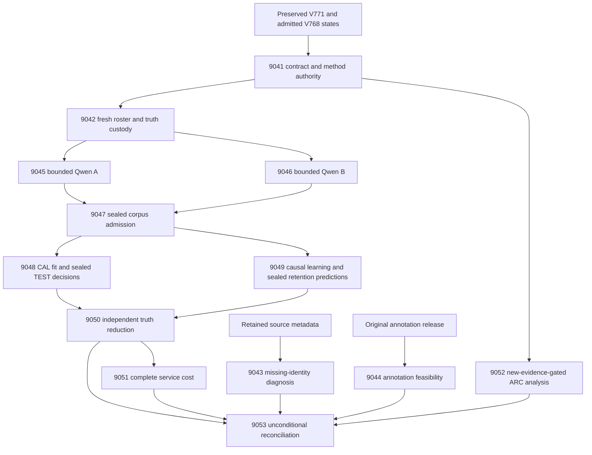
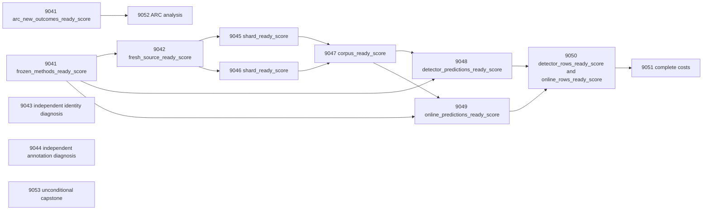

# Carnot Research Roadmap v772: Fresh Held-Out Evidence, Continuous Spline Learning, and Natural-Label Feasibility

**Created:** 2026-11-12 America/New_York
**Milestone:** 2026.11.772
**Status:** Planned; staged only
**Supersedes:** Completed scheduling milestone 2026.11.771, Exp9027–Exp9040
**Task contract:** Exactly 13 tasks, Exp9041 through Exp9053, in the order below.
**Execution file:** `research-roadmap-next.yaml`

V771's complete design and active execution queue are preserved byte for byte in
`research-roadmap-v771-preserved-20261112.md` and
`research-roadmap-v771-queue-preserved-20261112.yaml`. The active queue, conductor,
exclusion manifest and historical results are unchanged. This proposal implements
no runtime change and promises no positive experimental outcome.

## What V771 proved

Scheduling completion did not establish a verifier or learning win. At planning
time the completion archive ends at V770; V771 primaries and conductor receipts
establish its scheduling closure. Do not invent an archive entry or missing results.

| Evidence | Observed result | Next decision |
|---|---|---|
| Exp9027 | Contract and frozen graph/online authority qualified; new ARC support was zero. | Reuse methods; keep ARC eligibility separate. |
| Exp9028 | `complete_positive_historical_provenance`; original historical tests and current receipt controls qualified. | Reuse the shipped provenance repair. Another repair milestone is unnecessary. |
| Exp9029 | `complete_blocked_release_identity_closure`; two release groups and 213 historical identities unresolved. 500 cache reuses; about 100 seconds of new network work. | Diagnose retained successful responses without another acquisition retry. |
| Exp9030 | `complete_blocked_nonexposure_audit`; all 64 A TEST outcomes already published, with no complete post-collection nonexposure ledger. | Old A cannot become unseen again. |
| Exp9031 | `complete_blocked_changed_input`; all 512 proposed B identities already had observations. | Do not regenerate B or silently rename it cached evidence. |
| Exp9032–Exp9039 | Gate/cascade skips; scientific primaries largely absent. | These are unmeasured hypotheses, not scientific null results. |
| Exp9040 | `complete_blocked_declared_gate`; accounting completed. | Preserve blocked science as terminal, with exact gate operands. |

Sources are the corresponding `results/experiment_*_v771_*.json` primaries and
`ops/conductor-log.md`. The V768 exposed development comparison remains the last
admitted spline method: Brier 0.0279759276 versus converged linear 0.0636283248.
That is development evidence only. Exp8988 qualified five-arm update mechanics;
it did not prove improvement on future live-model queries.

## The three largest gaps to the PRD

1. **FR-12: independent verification where no cheap executable oracle exists.**
   The November 7 north star requires a matched-control win with CI95 excluding
   zero. Graph BFS truth cannot close it. Natural data must first establish its
   original annotation criterion and unseen source groups. Two independent
   feasibility studies replace another speculative four-task natural pilot chain.
2. **FR-11/FR-06: continuous learning that helps future queries and retains accuracy.**
   The qualified local spline update needs a fresh causal test, strong adaptive
   linear and feedback-permutation controls, and untouched calibration retention.
3. **FR-09/FR-10/NFR-01: credible evaluation and complete deployment cost.**
   Published TEST outcomes are not unseen. Seal predictions before truth reduction,
   retain every independent unit and charge guards, anchors, storage and recovery.
   Kernel locality alone does not establish a hardware benefit or justify a port.

FR-05/FR-08 remain production requirements. This milestone freezes Qwen weights
and product defaults. It does not confuse a learned risk score with a certificate.

## Research incorporated before experiment design

The November 12 scan was appended to `research-references.md` before these tasks.
It covers all eight requested arXiv topics and all six secondary channels.

| Source | Concrete use |
|---|---|
| [Labeling Problem, 2610.08026](https://arxiv.org/abs/2610.08026), October 2026 | Exp9044 tests original annotator availability and distinguishes factual correctness from reference faithfulness before a pilot. |
| [Mu-SHROOM, 2504.11975](https://arxiv.org/abs/2504.11975), April 2025 | Exp9043/9044 inspect the pinned original source, metadata and annotation authority independently. |
| [Online spline KAN, 2602.02056v4](https://arxiv.org/abs/2602.02056), June 2026 revision | Exp9049 tests local coefficient adaptation; Exp9051 measures full cost and exact hardware operation support. |
| [Continual Calibration, 2604.23987](https://arxiv.org/abs/2604.23987), April 2026 | Exp9050 keeps separate Brier/error retention bounds and adds descriptive decision-coverage trajectories. |
| [Mean-shift probes, 2608.28930v2](https://arxiv.org/abs/2608.28930), October 2026 revision | Preserve a converged matched linear control; nonlinear complexity must earn its cost. |

Energy-Based Reasoners (2611.08977), probabilistic algebraic constraints
(2503.19466), thermodynamic Ising inference (2607.00170), FPGA PAOA (2507.07420),
FPGA neural quantum states (2512.24558) and ETS (2601.21484) remain tracked leads.
They do not remove the current evaluation or natural-label bottleneck. No retired
solver, generator or external-text reranking scope is reopened by a paper.

OpenReview's ICLR 2026 EBT paper and Hugging Face's Mu-SHROOM page were accessible.
Semantic Scholar returned HTTP429 for EBT citations and ten ARM-EBM citing records;
2605.18871 was checked at arXiv for its learned-score/analytical-penalty distinction.
Citation coverage is incomplete. GitHub trending was a two-month-old crawl, so no
current ranking is claimed. Extropic's Torx/thermalizer/Z1 pages are vendor context.
Kona's public pages do not provide a reproducible architecture specification.

## Architecture



The two natural-source studies do not gate the graph science or each other.
Neither establishes natural-pilot readiness. The static and online producers are
independent after source admission; final truth reduction waits for both seals so
neither can use the other's published TEST results. Failed prediction production
blocks this combined study instead of silently dropping an arm or shrinking it.

## Phase 1 — specific prerequisites (Exp9041–Exp9044)

**Exp9041: contract and method authority.** Bind all thirteen complete task objects,
visible order and embedded JSON. Authenticate Exp9028 provenance and Exp8987/8988
states and protocols. Do not repeat the fit or the provenance repair. Record ARC
new-outcome eligibility relative to Exp9027 separately from administrative readiness.

**Exp9042: fresh roster and custody.** Reuse the matched graph generator with seed
772042 and unchanged topology/depth/answer opportunity. Commit 1024 new identities:
128 CAL, 128 TEST, 768 online; A/B each contain 64/64/384. Check topology plus
start/target identity against all retained matching histories, including development
and V764–V771. Use the existing isomorphism comparator. Deterministically reject
pre-generation collisions only; stop at 20,000 proposals or 300 seconds. Never
replace a graph after seeing a response. Freeze original fitted states, encoder,
knots, scaling, guard and scientific bounds. No new model fitting is authorized.

Keep detector views and truth sidecars separate. Collection/admission primaries
contain identity and transport rows, not TEST outputs, correctness, confidence or
nested outcome summaries. A fixed evaluator may check admission support, returning
only readiness; detailed TEST operands remain in protected receipts until Exp9050.
Log every label read and its authorized purpose. Test unauthorized reads, nested
leaks, changed fits, earlier topologies, duplicate first responses and a real worker
interruption. Lost in-flight output stays censored; it cannot justify another answer.
This is procedural experiment isolation, not a security boundary against the host owner.

**Exp9043: identity obstruction diagnosis.** Classify every one of the 215 retained
unresolved requests from original bytes: malformed receipt, parser/alias omission,
missing page, existing page without QID, or unresolved-other. Include both Persian
release pages, one a template. Preserve the original 429 and all successful receipts.
No network, annotation reads or production parser patch. Produce per-identity cause
rows and concrete reopening evidence. A page ID does not prove cross-language
nonoverlap. Complete classification is useful even when source eligibility stays zero.

**Exp9044: original annotation feasibility.** Inspect original schema/provenance,
criterion and distinct annotator metadata at the pinned Mu-SHROOM revision. Do not
reduce or publish TEST annotation values. Use private fixtures and already exposed
validation examples for offset/parser checks. Preserve the original proposed pilot:
160 FIT/40 CAL validation groups, 200 TEST groups, salt `v770-human-v1`, three
original annotators, unseen source groups and class minima 5/5/20. Record which
requirements are assessable and which remain unknown. No probe fitting, new source,
favorable cohort selection, author contact or relaxed criterion is authorized.

These two studies explicitly defer the natural embedding pilot. They cannot certify
it through a narrower claim. Original global identity closure and human-authority
requirements remain unresolved until actual supporting evidence exists.

## Phase 2 — fresh model observations (Exp9045–Exp9047)

**Exp9045/9046: bounded Qwen A/B collection.** Each independently gates on
`exp9042-fresh-seal-methods.fresh_source_ready_score == 1`. Collect the exact 512
first responses with `unsloth/Qwen3.8-27B-GGUF`, Q4_K_M, GPU0, temperature zero,
reasoning disabled and sixteen tokens. Require model/tokenizer hashes and actual
CUDA offload. No retry, repair, best-of-N or smoke-model headline. Preflight/load
limits are 240 seconds each; request limit 30 seconds; collection limit 2700 seconds.
Checkpoint each completion, flush at most every sixteen units and heartbeat during
child waits. Resume only the same authenticated invocation. Prior observations
outside it block changed input. Keep all failures in the original denominator.

The actual class is `model_bounded_generation`, minimum duration 10 seconds.
A pre-load blocked task reports actual no-model work separately from planned specs.
No runtime padding, simulation fallback or claim that a sixteen-token request is
full generation. Reuse Exp9028's serializer; cite upstream work by reference.

**Exp9047: sealed admission.** Join the exact 1024 identities and authenticate
receipts, state hashes, detector views and evaluator truth. Preserve the original
minimum 200 errors and five examples per class in each pooled role. Support failure
blocks this fixed cohort; no replacements. Keep semantic, format, out-of-graph and
transport categories distinct in sealed primitives. CAL truth is allowed for static
calibration, online labels only at scheduled release, and TEST truth only after both
prediction seals. A positive BFS-label admission is circular evidence, not a moat.

## Phase 3 — decisions, continuous learning and independent reduction (Exp9048–Exp9050)

**Exp9048: calibrated static predictions.** Restore the original spline, converged
linear, old shared linear, confidence linear and prevalence states. Select trained
arm temperatures on 128 CAL graphs from `[0.5,1,2,4]`, ascending ties; do not refit
coefficients. Seal all 640 arm-by-TEST probabilities, ranks and decisions. Accept at
error probability <=0.1, reject at >=0.9, otherwise escalate. Fifty-percent coverage
ranks break ties using frozen topology-hash order. Test node-permutation tolerance
1e-6, denied truth fields and context removal. Report CAL as CAL and withhold TEST
outcomes and predictions from public summaries until the independent reducer.

**Exp9049: continuous self-learning.** Use the unchanged Exp8988 five-arm protocol:
frozen spline, adaptive spline, bias-only spline, adaptive linear and permuted-feedback
spline. Keep encoder, basis and temperature one fixed on 24 disjoint 32-query streams.
Use log loss, initial-state anchor 0.01 excluding intercept, norm clip one, AdaGrad
rate 0.05 and epsilon 1e-8. After predictions 8/12/16/20/24/28/32 release labels
1–4/5–8/.../25–28. Permute only within a released block. Hold labels 29–32 pending
until scientific scoring ends. Never train Qwen or change spline knots.

The original 64-graph development guard permits Brier increase <=0.005 and no
classification-error increase. Rejecting an update restores coefficients and
accumulator while atomically acknowledging feedback. Require exact resume after a
real kill at query 16. Seal 3,840 online and 46,080 retention predictions: 128 TEST
graphs at checkpoints 0/16/32, five arms, 24 streams. These 49,920 dependent rows
are not independent observations. TEST labels never enter the guard or updates.
This advances FR-11/Tier 1 with a hardware-compatible small-head mechanism.

**Exp9050: independent benefit audit.** Both prediction readiness fields must pass.
Audit all state/seal/label-read timing first, then open TEST truth once and reconstruct
primitive losses. Preserve every original acceptance bound:

- Detector: four spline Brier-improvement lower bounds >0 versus prevalence and
  the three linear controls; three accepted-error delta upper bounds <=0 at exactly
  50% coverage. Use 10,000 paired graph draws, seed 772050, family alpha 0.05,
  one-sided tail 0.05/7. All seven must pass.
- Learning: future queries 17–32 adaptive-minus-frozen Brier upper <=-0.01;
  uppers against bias-only, adaptive linear and permuted feedback <0. Six retention
  Brier/error uppers at 0/16/32 must each be <=0.01. Use 10,000 whole-stream draws,
  seed 772051, family alpha 0.01, tail 0.001. Resample shared retention graph IDs
  once per draw across all arms/histories. All ten must pass.

Report ordinary CI95 separately from simultaneous acceptance bounds and fixed-panel
conditional sensitivity separately from shared-panel inference. 128 graphs and 24
streams do not guarantee power. Coverage trajectories at fixed decision thresholds
are descriptive; they cannot replace a failed primary bound. A supported null is
terminal. Even passing graph bounds cannot close the no-cheap-oracle north star.
Release the final pending feedback only after scientific scoring for the cost study.

## Phase 4 — full cost, opportunistic ARC and closure (Exp9051–Exp9053)

**Exp9051: complete service cost.** Gate on numerical row readiness, not benefit.
Measure 24 paired fresh-process units across frozen/adaptive spline and frozen/adaptive
converged linear, random arm order. Include startup/JIT, reads, encoding, basis,
scoring, dense anchors, guards, durable storage, restart, feedback drain and shutdown.
Do not charge a linear service artificial spline work. Preserve total outer times
when component attribution is unavailable; never subtract overhead to create speedup.
Report cached-response service scope and original Qwen generation cost separately.

Recommendation additionally requires both benefit gates and upper95 complete-cost
ratio adaptive spline/adaptive linear <=1, with 10,000 paired process bootstrap draws.
Report frozen-linear cost separately. Map exact operations to supported hardware and
bound the 100x target with measured nonaccelerable fraction: >=0.01 rules out more
than 100x even with ideal acceleration. Unknown attribution yields unknown feasibility.
No board probe, toolchain installation or purchase is proposed.

**Exp9052: ARC opportunity.** The structured gate skips synthesis without 30 new
uncensored episodes, three families and both arms per held family relative to Exp9027.
Freeze held-family folds; report per-episode outcomes and censoring. This is an
observational association study, not a causal policy effect. No games or LLMs run.
Registry-precheck incidental level credit and require original
`solve_provenance=live_agent_self_discovery`. No duplicate or off-path solve claim.

**Exp9053: unconditional capstone.** Account for all thirteen slots, including its
own, using primaries or exact scheduler alternatives. Independently reconstruct
available bounds and costs. Keep missing, blocked, null and disqualified separate;
do not invent absent producer fields. Preserve publication G1–G4 and graph circularity.
Record exact reopening evidence for failed unchanged scopes. External incomplete
science is terminal blocked, not partial. Accounting readiness can pass while
science is blocked. No queue activation, manifest mutation, external publication or push.

## Dependency graph and exact gates



All structured gates point backward to a producer in this roadmap, with the exact
field in its REQUIRED ARTIFACT FIELDS. No retired producer is a required dependency.
Historical failed IDs are evidence only. `GATE_BLOCK` prior metadata denotes the
observed scheduler outcome when no primary honest_verdict exists; it is not a new
invented scientific verdict. The exact unchanged blocked scopes remain closed.

## Hardware, budgets and execution routing

| Resource | Use and limit |
|---|---|
| CPU and existing local storage | Contracts, source diagnoses, convex heads, statistics and durable service timings. |
| RTX3090 GPU0 | Two 512-request Qwen Q4_K_M shards; about 16 GB model weights plus measured runtime overhead. Require a lease and memory preflight. |
| GPU1 | Not required; do not interfere with foreign or ARC generator processes. |
| KV260 | Existing sampler scope `k_max<=5`; spline/update support is unproven. Future access uses SSH, not host SD-card tests. |
| PolarFire | Linux CPU dispatch evidence only; no fabric speedup claim. |
| GateMate | Unchanged `0xffffffff` physical/JTAG block; no repeated probe. |
| NPU/TSU | Unqualified local execution; vendor reports are not local benchmarks. |

The hardware wishlist was consulted. Existing CPU/GPU resources suffice. A later
FPGA spline implementation needs a measured bottleneck, fixed-point fidelity and
actual board execution. No hardware acquisition or external service charge is needed.

Every prompt includes numbered flushed progress at phase boundaries, before/after
long calls and at least every 60 seconds in loops/waits; every silence gap stays below
600 seconds. Tool polls last at most 60 seconds. Files over about 200 lines are written
in several tool calls of at most about 150 lines with progress between them. Stop
measurement by 3300 seconds and reserve 1200 seconds for checks within the 4800s cap.

Only Exp9045/9046 load an LLM and declare `MODEL_SPECS` containing the mandated
`unsloth/Qwen3.8-27B-GGUF`; both use bounded generation, 10s floor. No task proposes
full generation (60s) or embedding/load-only work (2s). Legacy small models may be
private CPU smoke fixtures only; they cannot replace these observations.

Exp9041/9042 use Opus/100 turns for schema/custody coordination. Formulaic data and
diagnostic work uses Codex/gpt-6.1-sol; routine scientific tasks use the default
backend. Diagnostics/closure use20–30 turns where sufficient. No Luna task is proposed. These settings govern future conductor execution.

## Verification and acceptance

This is documentation and scheduling work. Planning checks parse YAML with the
actual schema, compare all full task objects and the visible table, validate gate
references/fields, inspect rerun metadata and run exclusion/precondition lint.
Scoped unit tests and private E2E-018/021 validate authority and cold-replay paths.
Spec coverage runs on relevant existing tests. Full Rust/model/board benchmarks
are outside this planning change; their execution remains in task prompts.

Each future implementation requires spec first, failing tests first, affected-caller
checks, real private CLI replay, Ruff, strict mypy and scoped spec coverage. Newly
owned statements require 100% coverage without exclusions. Learning also requires
E2E-020 real interruption/resume. Current affected-consumer failure disqualifies;
historical broad-suite failures stay visible separately. Shared validators remain
unchanged. Each comparable result retains per-unit rows, honest verdict class and
exact gate operands. Prospective source custody is a precondition, not a result to
relax after an inconvenient failure.

## Exact task contract

Exactly 13 tasks, Exp9041 through Exp9053, in this conductor order.

| Order | Task ID | Title | Phase | Deliverable |
|---|---|---|---|---|
| 1 | `exp9041-branch-contract` | Bind thirteen tasks and preserve completed V771 evidence | 1 | `results/experiment_9041_v772_branch_contract.json` |
| 2 | `exp9042-fresh-seal-methods` | Freeze fresh graph identities and prediction-before-truth custody | 1 | `results/experiment_9042_v772_fresh_seal_methods.json` |
| 3 | `exp9043-identity-obstruction-audit` | Explain every unresolved natural-source identity from retained responses | 1 | `results/experiment_9043_v772_identity_obstruction_audit.json` |
| 4 | `exp9044-annotation-feasibility` | Test original human-annotation availability before another natural pilot | 1 | `results/experiment_9044_v772_annotation_feasibility.json` |
| 5 | `exp9045-fresh-corpus-a` | Collect fresh bounded Qwen graph shard A | 2 | `results/experiment_9045_v772_fresh_corpus_a.json` |
| 6 | `exp9046-fresh-corpus-b` | Collect fresh bounded Qwen graph shard B | 2 | `results/experiment_9046_v772_fresh_corpus_b.json` |
| 7 | `exp9047-sealed-corpus-admission` | Admit fresh graph rows without releasing TEST outcomes | 2 | `results/experiment_9047_v772_sealed_corpus_admission.json` |
| 8 | `exp9048-sealed-calibrated-decisions` | Freeze calibrated decisions on fresh graphs before TEST truth is opened | 3 | `results/experiment_9048_v772_sealed_calibrated_decisions.json` |
| 9 | `exp9049-sealed-online-streams` | Measure continuous spline adaptation with sealed future and retention predictions | 3 | `results/experiment_9049_v772_sealed_online_streams.json` |
| 10 | `exp9050-joint-benefit-audit` | Independently reduce all fixed detector and continuous-learning bounds | 3 | `results/experiment_9050_v772_joint_benefit_audit.json` |
| 11 | `exp9051-complete-service-cost` | Measure complete spline service cost and hardware feasibility | 4 | `results/experiment_9051_v772_complete_service_cost.json` |
| 12 | `exp9052-arc-transfer-evidence` | Assess held-family supervisor transfer only from newly supported live outcomes | 4 | `results/experiment_9052_v772_arc_transfer_evidence.json` |
| 13 | `exp9053-capstone` | Reconcile thirteen outcomes and decide exact continuation boundaries | 4 | `results/experiment_9053_v772_capstone.json` |

The machine contract includes every full task object and prompt.

<!-- V772_TASK_CONTRACT_START -->
```json
{
  "milestone": "2026.11.772",
  "milestone_title": "Fresh Held-Out Evidence, Continuous Spline Learning, and Natural-Label Feasibility",
  "milestone_doc": "openspec/change-proposals/research-roadmap-vNEXT.md",
  "tasks": [
{
  "id": "exp9041-branch-contract",
  "title": "Bind thirteen tasks and preserve completed V771 evidence",
  "phase": 1,
  "track": "research",
  "priority": "high",
  "requires_gpu": false,
  "max_turns": 100,
  "estimated_wall_time_min": 30,
  "per_unit_rows": true,
  "milestone": "2026.11.772",
  "deliverable": "results/experiment_9041_v772_branch_contract.json",
  "inference_substrate_class": "no_model_load",
  "MODEL_SPECS": [],
  "gated_on": [],
  "prior_failures": [
    {
      "experiment_id": "exp9040-capstone",
      "verdict": "complete_blocked_declared_gate",
      "addressed_by": "New contract preserves the completed blocked branches; fresh-source planning replaces failed retained-source assumptions, without repeating old benefit claims.",
      "retire_if_same_verdict": true
    }
  ],
  "prompt": "CONTEXT:\nWork in {project_root} on {date}. V771 completed scheduling. Exp9028 qualified provenance; Exp9030 proved TEST exposure; Exp9031 found completed B rows; Exp9029 lacked identity closure. Bind a new contract without relabeling these outcomes.\nEXISTING CODE TO READ FIRST:\nCLAUDE.md; CODEX.md; research-program.md; ops/north-star.md; ops/e2e-test-plan.md; openspec/capabilities/research-reporting/spec.md; openspec/capabilities/verification/spec.md; openspec/capabilities/kan/spec.md; scripts/experiment_template.py; python/carnot/reporting/primary_publication.py; ops/exclusion_manifest.yaml; research-references.md; openspec/change-proposals/research-roadmap-v771-preserved-20261112.md; openspec/change-proposals/research-roadmap-v771-queue-preserved-20261112.yaml; python/carnot/reporting/roadmap_contract.py; python/carnot/reporting/v771_branch_contract.py; python/carnot/reporting/v771_branch_evidence.py; results/experiment_9028_v771_historical_provenance_qualification.json; results/experiment_9040_v771_capstone.json; results/experiment_8987_v768_spline_development_admission.json; results/experiment_8988_v768_online_spline_methods.json; python/carnot/reporting/arc_supervisor_frontier_8720.py; ops/arc_supervisor_refinement_ledger.json\nTASK:\nBind thirteen tasks and preserve completed V771 evidence. Deliver results/experiment_9041_v772_branch_contract.json, primitive evidence under results/raw/experiment_9041_v772_branch_contract/, and runnable scripts/experiments/experiment_9041_v772_branch_contract.py.\nCONCRETE STEPS:\n1. Emit a flushed progress line at each phase boundary and before and after every model load, generation, benchmark and subprocess that can take minutes. Set PYTHONUNBUFFERED=1 and print(..., flush=True). Inside long loops and child waits emit actual completed/pending counts at least every 60 seconds; keep every silence gap below 600 seconds. Poll tool calls for at most 60 seconds. Write any file over about 200 lines in several tool calls of at most about 150 lines, with a progress message between calls. Never pad duration.\n2. PRECONDITIONS: Authenticate exact current gate fields, input hashes, virtualenv, free memory and disk before compute. Preserve rejected primaries. Missing, retired or blocked external inputs yield honest_verdict=complete_blocked_<check>, verdict_class=blocked and gate_check_summary with the actual operand. Only incomplete owned work is partial. Fixtures cannot substitute for measurements.\n3. Before implementation extend the relevant REQ-* and SCENARIO-* and write failing private tests. Read all callers before changing shared code. Reuse qualified helpers and frozen states; bind historical readers to their preserved design, queue and independent digest. Keep original scientific thresholds and assertions. No validator, conductor, active roadmap or exclusion-manifest edits.\n4. Load no LLM: MODEL_SPECS=[], model_specs=[], inference_substrate_class=no_model_load. Use aggregation_from_upstream_artifacts for reductions or verifier_ensemble_against_cached_candidates for numerical head work. Keep model_invocation_counts zero; record trained_head_specs separately and cite historical GGUF receipts by reference only.\n5. Compare all 13 full task objects and visible order Exp9041..Exp9053. Before activation compare staged/staged; after activation compare actual active bytes. Preserve V771 authority and original independent task digest before vNEXT changes. Record archive lag from bytes: planning found research-complete.yaml ending at .770, while .771 primaries and conductor receipts establish closure. Do not manufacture archive rows or activate a queue.\n6. Authenticate Exp9028 passed provenance and original Exp8987 fitted states/four development checks and Exp8988 five-arm online protocol. Emit frozen_methods_ready_score separately from contract_ready_score. Reuse the fit, not the old fresh-source manifest. Record all A/B histories as exposed or unknown; old labels cannot become new TEST evidence. No repeated provenance repair or development fit.\n7. Inspect the ARC ledger once relative to Exp9027 retained frontier. arc_new_outcomes_ready_score=1 requires 30 NEW uncensored episodes, at least three families and both arms in each held family. Freeze evidence hashes and eligibility; zero support does not fail administrative or frozen-method readiness. Keep original scientific nulls and failed health separate.\n8. Freeze owned and direct-consumer validation scope before final measurement. Run scoped pytest, real private child CLI and cold replay outside the checkout without PYTHONPATH, Ruff check/format, strict mypy and explicit-path spec coverage. Require 100 percent newly owned statements with zero exclusions. Run private E2E-018/021, missing inputs, altered authority and rehashed-tamper controls; learning also runs E2E-020. Current affected-consumer failure disqualifies. Historical failed broad-suite health remains failed separately under repository_health. Do not run the full repository suite per task. Stop measurement by 3300 seconds and reserve 1200 seconds for checks within the 4800-second hard cap.\n9. Retain primitive per-unit rows, hashes and independent recomputation. Run unchanged adversarial_verify.py and strict verdict_row_consistency_lint.py with progress supervision. Publish a primary through primary_publication only after owned checks pass; failed checks zero readiness. Keep protected truth sidecars out of early artifacts and logs. Reconcile openspec/, _bmad/traceability.md, ops/status.md and ops/changelog.md without removing history. No external publication or activation.\nREQUIRED ARTIFACT FIELDS:\n- honest_verdict: complete_*; verdict_class: positive | circular_positive | null | blocked | disqualified | partial. Principle: blocked external science is terminal; partial retries owned incomplete work only.\n- gate_check_summary: check/upstream/path/sha256/artifact_field/op/expected/observed/passed. Principle: missing_file, missing_field and observed zero are different failures.\n- verifier_is_oracle, claim_scope, exposure_scope, independent_generalization_score. Principle: BFS evidence cannot close the no-cheap-oracle north star; oracle positives are circular_positive.\n- inference_substrate, inference_substrate_class, MODEL_SPECS, model_specs, trained_head_specs, model_invocation_counts, cited_upstream_artifacts: experiment_id/fields_imported/sha256. Principle: current measured work never inherits historical invocation counters.\n- rows: unit_id/group_id/arm/condition/metric/value/numerator/denominator/status/exclusion_reason; intended_count, completed_count, independent_count, excluded_count, censored_count, failed_count. Principle: retain all units; sealed outcomes use explicit withheld status until authorized reduction, never fake zeros.\n- required_checks_passed, flagged_adversarial, validation_receipts, validation_scope_manifest, owned_statement_coverage, repository_health, repository_health_passed, preconditions_checked. Principle: current normal-exit receipts qualify scoped claims only.\n- run_date, duration_s, random_seed, reproducibility_checksum, source_artifact_hashes, raw_shard_hashes, code_config_hashes, phase_spans, acceptance_gates, field_principles. Principle: replay must reconstruct the result from immutable primitive bytes.\n- contract_ready_score, frozen_methods_ready_score, arc_new_outcomes_ready_score: each 0|1; authority_manifest, full_contract_rows, frontier_delta_rows. Principle: optional support must not block independent science.\nRun command: cd {project_root} && PYTHONUNBUFFERED=1 .venv/bin/python -u scripts/experiments/experiment_9041_v772_branch_contract.py --date {date}\nDo NOT push. Do NOT modify scripts/research_conductor.py.",
  "model": "opus"
},
{
  "id": "exp9042-fresh-seal-methods",
  "title": "Freeze fresh graph identities and prediction-before-truth custody",
  "phase": 1,
  "track": "research",
  "priority": "high",
  "requires_gpu": false,
  "max_turns": 100,
  "estimated_wall_time_min": 50,
  "per_unit_rows": true,
  "milestone": "2026.11.772",
  "deliverable": "results/experiment_9042_v772_fresh_seal_methods.json",
  "inference_substrate_class": "no_model_load",
  "MODEL_SPECS": [],
  "gated_on": [
    {
      "upstream": "exp9041-branch-contract",
      "artifact_field": "frozen_methods_ready_score",
      "op": "==",
      "value": 1
    }
  ],
  "prior_failures": [
    {
      "experiment_id": "exp9030-retained-shard-a",
      "verdict": "complete_blocked_nonexposure_audit",
      "addressed_by": "Replace all old evaluation graphs with a prospectively disjoint roster and tested withholding of TEST outcomes; preserve the exposed cohort as historical evidence.",
      "retire_if_same_verdict": true
    },
    {
      "experiment_id": "exp9031-graph-corpus-b",
      "verdict": "complete_blocked_changed_input",
      "addressed_by": "New A/B identities are committed before generation; old completed B data remain historical and cannot be regenerated as fresh.",
      "retire_if_same_verdict": true
    }
  ],
  "prompt": "CONTEXT:\nWork in {project_root} on {date}. Exp9030 found 64 published A TEST outcomes; Exp9031 found 512 previously completed B identities. Neither can be restored to unseen status. Retain the admitted convex model and replace the evaluation population prospectively.\nEXISTING CODE TO READ FIRST:\nCLAUDE.md; CODEX.md; research-program.md; ops/north-star.md; ops/e2e-test-plan.md; openspec/capabilities/research-reporting/spec.md; openspec/capabilities/verification/spec.md; openspec/capabilities/kan/spec.md; scripts/experiment_template.py; python/carnot/reporting/primary_publication.py; ops/exclusion_manifest.yaml; research-references.md; openspec/change-proposals/research-roadmap-v771-preserved-20261112.md; openspec/change-proposals/research-roadmap-v771-queue-preserved-20261112.yaml; python/carnot/reporting/relational_methods_8959.py; python/carnot/reporting/shared_feature_methods_8973.py; python/carnot/reporting/spline_basis_methods_8986.py; python/carnot/reporting/spline_development_admission_8987.py; python/carnot/reporting/online_spline_methods_8988.py; python/carnot/reporting/graph_corpus_b_9031.py; python/carnot/reporting/retained_shard_a_9030.py; results/experiment_9030_v771_retained_shard_a.json; results/experiment_9031_v771_graph_corpus_b.json\nTASK:\nFreeze fresh graph identities and prediction-before-truth custody. Deliver results/experiment_9042_v772_fresh_seal_methods.json, primitive evidence under results/raw/experiment_9042_v772_fresh_seal_methods/, and runnable scripts/experiments/experiment_9042_v772_fresh_seal_methods.py.\nCONCRETE STEPS:\n1. Emit a flushed progress line at each phase boundary and before and after every model load, generation, benchmark and subprocess that can take minutes. Set PYTHONUNBUFFERED=1 and print(..., flush=True). Inside long loops and child waits emit actual completed/pending counts at least every 60 seconds; keep every silence gap below 600 seconds. Poll tool calls for at most 60 seconds. Write any file over about 200 lines in several tool calls of at most about 150 lines, with a progress message between calls. Never pad duration.\n2. PRECONDITIONS: Authenticate exact current gate fields, input hashes, virtualenv, free memory and disk before compute. Preserve rejected primaries. Missing, retired or blocked external inputs yield honest_verdict=complete_blocked_<check>, verdict_class=blocked and gate_check_summary with the actual operand. Only incomplete owned work is partial. Fixtures cannot substitute for measurements.\n3. Before implementation extend the relevant REQ-* and SCENARIO-* and write failing private tests. Read all callers before changing shared code. Reuse qualified helpers and frozen states; bind historical readers to their preserved design, queue and independent digest. Keep original scientific thresholds and assertions. No validator, conductor, active roadmap or exclusion-manifest edits.\n4. Load no LLM: MODEL_SPECS=[], model_specs=[], inference_substrate_class=no_model_load. Use aggregation_from_upstream_artifacts for reductions or verifier_ensemble_against_cached_candidates for numerical head work. Keep model_invocation_counts zero; record trained_head_specs separately and cite historical GGUF receipts by reference only.\n5. Authenticate Exp9041 frozen_methods_ready_score=1. Freeze the original spline and all four control states, encoder, knots, scaling, prompt, parser and seven detector/ten learning bounds. Never refit from V768 TEST outcomes or repeat development admission. Retain the original 64-graph development guard. Hash every state before building the roster.\n6. Use existing matched graph construction with seed 772042 and unchanged topology/depth/answer-opportunity distribution. Before any model call build exactly 1024 new graph identities: 128 CAL, 128 TEST, 768 online, split into A/B each 64/64/384. Compare canonical topology plus start/target identity against every retained development, V764-V771 and earlier matching corpus. Use the existing isomorphism comparator, not node-name hashes. Deterministically advance proposal counter only for pre-generation collisions; cap 20000 proposals/300s. Incomplete roster blocks; no post-response replacement or renaming of old graphs.\n7. Freeze all source roles, first-response budgets, future stream order and complete historical-overlap inventory. Reuse producer/provenance and atomic receipt helpers. Keep truth sidecars separate from detector views. Collection and admission artifacts may publish identity/transport rows, not per-TEST outcomes, probabilities, accuracy, correctness flags or truth-derived features. Private evaluator may inspect support solely for the fixed admission gate; it returns readiness without exposing TEST values. Log each label read and authorized purpose.\n8. Qualify this custody mechanism with private fixtures: altered roster, earlier topology, duplicate first response, changed model/fit hash, label-bearing nested logs, unauthorized TEST access, swapped labels and restart must reject. Force a real worker interruption and verify exact checkpoint continuation without repeating a started generation. Lost in-flight responses stay censored. Production code cannot see TEST sidecars until Exp9048 static and Exp9049 retention prediction seals both exist; record denial evidence. Online feedback is released only by the fixed Exp8988 schedule. Numerical fixtures establish mechanics only.\n9. Emit one manifest used unchanged by A/B collectors, admission, decision and online tasks. The collection gate requires all custody controls and disjointness. Preserve old primaries and old source rejection; a genuinely fresh cohort changes the data, not thresholds. No model load belongs in this task.\n10. Freeze owned and direct-consumer validation scope before final measurement. Run scoped pytest, real private child CLI and cold replay outside the checkout without PYTHONPATH, Ruff check/format, strict mypy and explicit-path spec coverage. Require 100 percent newly owned statements with zero exclusions. Run private E2E-018/021, missing inputs, altered authority and rehashed-tamper controls; learning also runs E2E-020. Current affected-consumer failure disqualifies. Historical failed broad-suite health remains failed separately under repository_health. Do not run the full repository suite per task. Stop measurement by 3300 seconds and reserve 1200 seconds for checks within the 4800-second hard cap.\n11. Retain primitive per-unit rows, hashes and independent recomputation. Run unchanged adversarial_verify.py and strict verdict_row_consistency_lint.py with progress supervision. Publish a primary through primary_publication only after owned checks pass; failed checks zero readiness. Keep protected truth sidecars out of early artifacts and logs. Reconcile openspec/, _bmad/traceability.md, ops/status.md and ops/changelog.md without removing history. No external publication or activation.\nREQUIRED ARTIFACT FIELDS:\n- honest_verdict: complete_*; verdict_class: positive | circular_positive | null | blocked | disqualified | partial. Principle: blocked external science is terminal; partial retries owned incomplete work only.\n- gate_check_summary: check/upstream/path/sha256/artifact_field/op/expected/observed/passed. Principle: missing_file, missing_field and observed zero are different failures.\n- verifier_is_oracle, claim_scope, exposure_scope, independent_generalization_score. Principle: BFS evidence cannot close the no-cheap-oracle north star; oracle positives are circular_positive.\n- inference_substrate, inference_substrate_class, MODEL_SPECS, model_specs, trained_head_specs, model_invocation_counts, cited_upstream_artifacts: experiment_id/fields_imported/sha256. Principle: current measured work never inherits historical invocation counters.\n- rows: unit_id/group_id/arm/condition/metric/value/numerator/denominator/status/exclusion_reason; intended_count, completed_count, independent_count, excluded_count, censored_count, failed_count. Principle: retain all units; sealed outcomes use explicit withheld status until authorized reduction, never fake zeros.\n- required_checks_passed, flagged_adversarial, validation_receipts, validation_scope_manifest, owned_statement_coverage, repository_health, repository_health_passed, preconditions_checked. Principle: current normal-exit receipts qualify scoped claims only.\n- run_date, duration_s, random_seed, reproducibility_checksum, source_artifact_hashes, raw_shard_hashes, code_config_hashes, phase_spans, acceptance_gates, field_principles. Principle: replay must reconstruct the result from immutable primitive bytes.\n- fresh_source_ready_score: 0|1; fresh_role_manifest, historical_overlap_rows, custody_mutation_rows, state_hashes, label_access_policy, expected_seal_fields. Principle: a new identifier cannot conceal prior evaluation exposure.\nRun command: cd {project_root} && PYTHONUNBUFFERED=1 .venv/bin/python -u scripts/experiments/experiment_9042_v772_fresh_seal_methods.py --date {date}\nDo NOT push. Do NOT modify scripts/research_conductor.py.",
  "model": "opus"
},
{
  "id": "exp9043-identity-obstruction-audit",
  "title": "Explain every unresolved natural-source identity from retained responses",
  "phase": 1,
  "track": "research",
  "priority": "high",
  "requires_gpu": false,
  "max_turns": 20,
  "estimated_wall_time_min": 20,
  "per_unit_rows": true,
  "milestone": "2026.11.772",
  "deliverable": "results/experiment_9043_v772_identity_obstruction_audit.json",
  "inference_substrate_class": "no_model_load",
  "MODEL_SPECS": [],
  "gated_on": [],
  "prior_failures": [
    {
      "experiment_id": "exp9029-source-identity-resolution",
      "verdict": "complete_blocked_release_identity_closure",
      "addressed_by": "Replace an unchanged acquisition retry with exhaustive retained-byte classification of missing properties, pages and parser omissions; do not claim closure or relax the source gate.",
      "retire_if_same_verdict": true
    }
  ],
  "prompt": "CONTEXT:\nWork in {project_root} on {date}. Exp9029 made network progress but blocked with two unresolved release groups and 213 historical identities. Its parser requires wikibase_item. Another paced retry has no diagnosed repair until absent properties, missing pages and parsing errors are distinguished.\nEXISTING CODE TO READ FIRST:\nCLAUDE.md; CODEX.md; research-program.md; ops/north-star.md; ops/e2e-test-plan.md; openspec/capabilities/research-reporting/spec.md; openspec/capabilities/verification/spec.md; openspec/capabilities/kan/spec.md; scripts/experiment_template.py; python/carnot/reporting/primary_publication.py; ops/exclusion_manifest.yaml; research-references.md; openspec/change-proposals/research-roadmap-v771-preserved-20261112.md; openspec/change-proposals/research-roadmap-v771-queue-preserved-20261112.yaml; python/carnot/reporting/source_identity_9029.py; python/carnot/reporting/source_identity_runner_9029.py; python/carnot/reporting/human_disagreement_source_9015.py; results/experiment_9029_v771_source_identity_resolution.json; tests/python/test_source_identity_9029.py; https://www.mediawiki.org/wiki/API:Pageprops\nTASK:\nExplain every unresolved natural-source identity from retained responses. Deliver results/experiment_9043_v772_identity_obstruction_audit.json, primitive evidence under results/raw/experiment_9043_v772_identity_obstruction_audit/, and runnable scripts/experiments/experiment_9043_v772_identity_obstruction_audit.py.\nCONCRETE STEPS:\n1. Emit a flushed progress line at each phase boundary and before and after every model load, generation, benchmark and subprocess that can take minutes. Set PYTHONUNBUFFERED=1 and print(..., flush=True). Inside long loops and child waits emit actual completed/pending counts at least every 60 seconds; keep every silence gap below 600 seconds. Poll tool calls for at most 60 seconds. Write any file over about 200 lines in several tool calls of at most about 150 lines, with a progress message between calls. Never pad duration.\n2. PRECONDITIONS: Authenticate exact current gate fields, input hashes, virtualenv, free memory and disk before compute. Preserve rejected primaries. Missing, retired or blocked external inputs yield honest_verdict=complete_blocked_<check>, verdict_class=blocked and gate_check_summary with the actual operand. Only incomplete owned work is partial. Fixtures cannot substitute for measurements.\n3. Before implementation extend the relevant REQ-* and SCENARIO-* and write failing private tests. Read all callers before changing shared code. Reuse qualified helpers and frozen states; bind historical readers to their preserved design, queue and independent digest. Keep original scientific thresholds and assertions. No validator, conductor, active roadmap or exclusion-manifest edits.\n4. Load no LLM: MODEL_SPECS=[], model_specs=[], inference_substrate_class=no_model_load. Use aggregation_from_upstream_artifacts for reductions or verifier_ensemble_against_cached_candidates for numerical head work. Keep model_invocation_counts zero; record trained_head_specs separately and cite historical GGUF receipts by reference only.\n5. Authenticate Exp9029 metadata_manifest and retained HTTP request/response hashes. Reconstruct all 215 unresolved requests and both release groups without network or annotations. Include the Persian template and list pages and all 213 historical identities. Retain every request, including the original 429; successful HTTP status does not imply an identity.\n6. For each unresolved item record normalized/redirected title, namespace, pageid presence, missing/invalid markers, wikibase_item presence and parser result from original raw bytes. Classify mutually exclusive causes: malformed/missing receipt, alias/parser omission, missing page, existing page without QID, or unresolved-other. Prove category sums equal the original 215 and cold replay reproduces them. Do not print prompt/response text or annotation values.\n7. For any proven parser omission, produce a minimal private regression and a proposed change description with caller list; this diagnostic task does not patch production or rerun the network. A pageid or absent QID alone cannot prove no cross-language exposure. State the exact additional author/metadata evidence needed for each unresolved category, and whether a repeated identical request can change it. No candidate deletion, language restriction, fabricated QID or relaxed global closure gate.\n8. Write docs/research-notes/experiment_9043_v772_identity_obstructions.md with counts and an executable reopening criterion. identity_diagnosis_ready_score means complete classification only; source_identity_ready_score remains0 unless the original strict criterion is independently already met by retained bytes. Do not claim a human-pilot readiness result or schedule downstream dependency on a speculative repair.\n9. Freeze owned and direct-consumer validation scope before final measurement. Run scoped pytest, real private child CLI and cold replay outside the checkout without PYTHONPATH, Ruff check/format, strict mypy and explicit-path spec coverage. Require 100 percent newly owned statements with zero exclusions. Run private E2E-018/021, missing inputs, altered authority and rehashed-tamper controls; learning also runs E2E-020. Current affected-consumer failure disqualifies. Historical failed broad-suite health remains failed separately under repository_health. Do not run the full repository suite per task. Stop measurement by 3300 seconds and reserve 1200 seconds for checks within the 4800-second hard cap.\n10. Retain primitive per-unit rows, hashes and independent recomputation. Run unchanged adversarial_verify.py and strict verdict_row_consistency_lint.py with progress supervision. Publish a primary through primary_publication only after owned checks pass; failed checks zero readiness. Keep protected truth sidecars out of early artifacts and logs. Reconcile openspec/, _bmad/traceability.md, ops/status.md and ops/changelog.md without removing history. No external publication or activation.\nREQUIRED ARTIFACT FIELDS:\n- honest_verdict: complete_*; verdict_class: positive | circular_positive | null | blocked | disqualified | partial. Principle: blocked external science is terminal; partial retries owned incomplete work only.\n- gate_check_summary: check/upstream/path/sha256/artifact_field/op/expected/observed/passed. Principle: missing_file, missing_field and observed zero are different failures.\n- verifier_is_oracle, claim_scope, exposure_scope, independent_generalization_score. Principle: BFS evidence cannot close the no-cheap-oracle north star; oracle positives are circular_positive.\n- inference_substrate, inference_substrate_class, MODEL_SPECS, model_specs, trained_head_specs, model_invocation_counts, cited_upstream_artifacts: experiment_id/fields_imported/sha256. Principle: current measured work never inherits historical invocation counters.\n- rows: unit_id/group_id/arm/condition/metric/value/numerator/denominator/status/exclusion_reason; intended_count, completed_count, independent_count, excluded_count, censored_count, failed_count. Principle: retain all units; sealed outcomes use explicit withheld status until authorized reduction, never fake zeros.\n- required_checks_passed, flagged_adversarial, validation_receipts, validation_scope_manifest, owned_statement_coverage, repository_health, repository_health_passed, preconditions_checked. Principle: current normal-exit receipts qualify scoped claims only.\n- run_date, duration_s, random_seed, reproducibility_checksum, source_artifact_hashes, raw_shard_hashes, code_config_hashes, phase_spans, acceptance_gates, field_principles. Principle: replay must reconstruct the result from immutable primitive bytes.\n- identity_diagnosis_ready_score, source_identity_ready_score: each 0|1; obstruction_rows, category_counts, parser_regression_evidence, reopening_evidence. Principle: complete diagnosis and source eligibility are separate claims.\nRun command: cd {project_root} && PYTHONUNBUFFERED=1 .venv/bin/python -u scripts/experiments/experiment_9043_v772_identity_obstruction_audit.py --date {date}\nDo NOT push. Do NOT modify scripts/research_conductor.py.",
  "model": "gpt-6.1-sol",
  "agent_type": "codex"
},
{
  "id": "exp9044-annotation-feasibility",
  "title": "Test original human-annotation availability before another natural pilot",
  "phase": 1,
  "track": "research",
  "priority": "high",
  "requires_gpu": false,
  "max_turns": 30,
  "estimated_wall_time_min": 25,
  "per_unit_rows": true,
  "milestone": "2026.11.772",
  "deliverable": "results/experiment_9044_v772_annotation_feasibility.json",
  "inference_substrate_class": "no_model_load",
  "MODEL_SPECS": [],
  "gated_on": [],
  "prior_failures": [
    {
      "experiment_id": "exp9033-human-label-methods",
      "verdict": "blocked_gate_check_failed",
      "addressed_by": "Run a narrower explicitly non-benefit schema feasibility study independently of failed identity closure; it cannot authorize the old pilot or weaken any of its criteria.",
      "retire_if_same_verdict": true
    }
  ],
  "prompt": "CONTEXT:\nWork in {project_root} on {date}. Exp9033 was blocked before original-human label qualification. The labeling-criterion paper (2610.08026) shows why a human source name alone is insufficient. Determine whether the already pinned Mu-SHROOM release can supply the exact proposed individual judgments independently of source identity closure.\nEXISTING CODE TO READ FIRST:\nCLAUDE.md; CODEX.md; research-program.md; ops/north-star.md; ops/e2e-test-plan.md; openspec/capabilities/research-reporting/spec.md; openspec/capabilities/verification/spec.md; openspec/capabilities/kan/spec.md; scripts/experiment_template.py; python/carnot/reporting/primary_publication.py; ops/exclusion_manifest.yaml; research-references.md; openspec/change-proposals/research-roadmap-v771-preserved-20261112.md; openspec/change-proposals/research-roadmap-v771-queue-preserved-20261112.yaml; python/carnot/reporting/human_source_authority_9001.py; python/carnot/reporting/human_disagreement_source_9015.py; python/carnot/reporting/human_disagreement_runner_9015.py; results/experiment_9015_v770_human_disagreement_source.json; results/experiment_9029_v771_source_identity_resolution.json; docs/research-notes/label-provenance-audit-step1-2026-11-07.md; https://arxiv.org/abs/2610.08026; https://huggingface.co/datasets/Helsinki-NLP/mu-shroom\nTASK:\nTest original human-annotation availability before another natural pilot. Deliver results/experiment_9044_v772_annotation_feasibility.json, primitive evidence under results/raw/experiment_9044_v772_annotation_feasibility/, and runnable scripts/experiments/experiment_9044_v772_annotation_feasibility.py.\nCONCRETE STEPS:\n1. Emit a flushed progress line at each phase boundary and before and after every model load, generation, benchmark and subprocess that can take minutes. Set PYTHONUNBUFFERED=1 and print(..., flush=True). Inside long loops and child waits emit actual completed/pending counts at least every 60 seconds; keep every silence gap below 600 seconds. Poll tool calls for at most 60 seconds. Write any file over about 200 lines in several tool calls of at most about 150 lines, with a progress message between calls. Never pad duration.\n2. PRECONDITIONS: Authenticate exact current gate fields, input hashes, virtualenv, free memory and disk before compute. Preserve rejected primaries. Missing, retired or blocked external inputs yield honest_verdict=complete_blocked_<check>, verdict_class=blocked and gate_check_summary with the actual operand. Only incomplete owned work is partial. Fixtures cannot substitute for measurements.\n3. Before implementation extend the relevant REQ-* and SCENARIO-* and write failing private tests. Read all callers before changing shared code. Reuse qualified helpers and frozen states; bind historical readers to their preserved design, queue and independent digest. Keep original scientific thresholds and assertions. No validator, conductor, active roadmap or exclusion-manifest edits.\n4. Load no LLM: MODEL_SPECS=[], model_specs=[], inference_substrate_class=no_model_load. Use aggregation_from_upstream_artifacts for reductions or verifier_ensemble_against_cached_candidates for numerical head work. Keep model_invocation_counts zero; record trained_head_specs separately and cite historical GGUF receipts by reference only.\n5. Authenticate pinned author release revision3f99df059b001c174b4443e2c41840a5ff1320d7, license and original annotation instructions. Use retained local bytes only. Verify original provenance of annotations, distinct pseudonymous annotator IDs and span representation. A soft-label array, aggregate union or three synthetic copies do not establish three original annotators.\n6. Inspect schema presence, annotator counts and original criterion across all official validation/test records using a field-minimizing reader. Do not reduce or log TEST annotation values, span membership, disagreement or correctness. For parser/offset tests use private fixtures and already exposed validation examples; record all actual records accessed. This is feasibility metadata, not the400-group experiment or a new split selection.\n7. Preserve the V771 pilot contract: deterministic salt v770-human-v1,160 FIT/40 CAL validation groups and200 TEST groups; source-disjoint unseen groups; three distinct original annotators; per-class minima5 FIT/CAL and20 TEST. Record which conditions are assessable without outcome access and which remain unknown. Original span-labeling criterion must be mapped explicitly to a response-level human-risk target; do not call reference support factual truth.\n8. Write docs/research-notes/experiment_9044_v772_annotation_feasibility.md with per-record structural rows, criterion/provenance findings and exact future acquisition requirements. annotation_structure_ready_score=1 only if the original per-record annotation schema can supply the required judgments; natural_pilot_ready_score=0 while source closure, frozen cohort or label support remains unqualified. Do not fit probes, substitute datasets, relax requirements or contact authors. The next planner can drop an impossible pilot before spending a model task.\n9. Freeze owned and direct-consumer validation scope before final measurement. Run scoped pytest, real private child CLI and cold replay outside the checkout without PYTHONPATH, Ruff check/format, strict mypy and explicit-path spec coverage. Require 100 percent newly owned statements with zero exclusions. Run private E2E-018/021, missing inputs, altered authority and rehashed-tamper controls; learning also runs E2E-020. Current affected-consumer failure disqualifies. Historical failed broad-suite health remains failed separately under repository_health. Do not run the full repository suite per task. Stop measurement by 3300 seconds and reserve 1200 seconds for checks within the 4800-second hard cap.\n10. Retain primitive per-unit rows, hashes and independent recomputation. Run unchanged adversarial_verify.py and strict verdict_row_consistency_lint.py with progress supervision. Publish a primary through primary_publication only after owned checks pass; failed checks zero readiness. Keep protected truth sidecars out of early artifacts and logs. Reconcile openspec/, _bmad/traceability.md, ops/status.md and ops/changelog.md without removing history. No external publication or activation.\nREQUIRED ARTIFACT FIELDS:\n- honest_verdict: complete_*; verdict_class: positive | circular_positive | null | blocked | disqualified | partial. Principle: blocked external science is terminal; partial retries owned incomplete work only.\n- gate_check_summary: check/upstream/path/sha256/artifact_field/op/expected/observed/passed. Principle: missing_file, missing_field and observed zero are different failures.\n- verifier_is_oracle, claim_scope, exposure_scope, independent_generalization_score. Principle: BFS evidence cannot close the no-cheap-oracle north star; oracle positives are circular_positive.\n- inference_substrate, inference_substrate_class, MODEL_SPECS, model_specs, trained_head_specs, model_invocation_counts, cited_upstream_artifacts: experiment_id/fields_imported/sha256. Principle: current measured work never inherits historical invocation counters.\n- rows: unit_id/group_id/arm/condition/metric/value/numerator/denominator/status/exclusion_reason; intended_count, completed_count, independent_count, excluded_count, censored_count, failed_count. Principle: retain all units; sealed outcomes use explicit withheld status until authorized reduction, never fake zeros.\n- required_checks_passed, flagged_adversarial, validation_receipts, validation_scope_manifest, owned_statement_coverage, repository_health, repository_health_passed, preconditions_checked. Principle: current normal-exit receipts qualify scoped claims only.\n- run_date, duration_s, random_seed, reproducibility_checksum, source_artifact_hashes, raw_shard_hashes, code_config_hashes, phase_spans, acceptance_gates, field_principles. Principle: replay must reconstruct the result from immutable primitive bytes.\n- annotation_structure_ready_score, natural_pilot_ready_score: each 0|1; annotation_schema_rows, original_criterion, criterion_mapping, missing_authority, test_outcome_values_accessed. Principle: annotation feasibility is not factual correctness or unseen-source eligibility.\nRun command: cd {project_root} && PYTHONUNBUFFERED=1 .venv/bin/python -u scripts/experiments/experiment_9044_v772_annotation_feasibility.py --date {date}\nDo NOT push. Do NOT modify scripts/research_conductor.py.",
  "model": "gpt-6.1-sol",
  "agent_type": "codex"
},
{
  "id": "exp9045-fresh-corpus-a",
  "title": "Collect fresh bounded Qwen graph shard A",
  "phase": 2,
  "track": "research",
  "priority": "high",
  "requires_gpu": true,
  "max_turns": 50,
  "estimated_wall_time_min": 60,
  "per_unit_rows": true,
  "milestone": "2026.11.772",
  "deliverable": "results/experiment_9045_v772_fresh_corpus_a.json",
  "inference_substrate_class": "model_bounded_generation",
  "MODEL_SPECS": [
    "unsloth/Qwen3.8-27B-GGUF"
  ],
  "gated_on": [
    {
      "upstream": "exp9042-fresh-seal-methods",
      "artifact_field": "fresh_source_ready_score",
      "op": "==",
      "value": 1
    }
  ],
  "prior_failures": [
    {
      "experiment_id": "exp9030-retained-shard-a",
      "verdict": "complete_blocked_nonexposure_audit",
      "addressed_by": "Use Exp9042 genuinely disjoint committed graph identities and tested prediction-before-truth custody; preserve the old cohort and rejection without regeneration or relabeling.",
      "retire_if_same_verdict": true
    },
    {
      "experiment_id": "exp8990-graph-corpus-a",
      "verdict": "complete_disqualified_graph_corpus_a",
      "addressed_by": "Exp9028 now qualifies historical/current invocation separation; use the shipped serializer and reference-only upstream model receipts on a new cohort.",
      "retire_if_same_verdict": true
    }
  ],
  "prompt": "CONTEXT:\nWork in {project_root} on {date}. The old A/B cohort is exposed or already generated. Exp9042 commits genuinely new identities and a custody protocol; use only that source with the unchanged frozen scientific methods.\nEXISTING CODE TO READ FIRST:\nCLAUDE.md; CODEX.md; research-program.md; ops/north-star.md; ops/e2e-test-plan.md; openspec/capabilities/research-reporting/spec.md; openspec/capabilities/verification/spec.md; openspec/capabilities/kan/spec.md; scripts/experiment_template.py; python/carnot/reporting/primary_publication.py; ops/exclusion_manifest.yaml; research-references.md; openspec/change-proposals/research-roadmap-v771-preserved-20261112.md; openspec/change-proposals/research-roadmap-v771-queue-preserved-20261112.yaml; python/carnot/reporting/graph_corpus_a_8990.py; python/carnot/reporting/graph_corpus_b_9031.py; python/carnot/reporting/graph_corpus_runner_9031.py; python/carnot/reporting/historical_provenance_9028.py; results/experiment_9028_v771_historical_provenance_qualification.json; results/experiment_9042_v772_fresh_seal_methods.json; python/carnot/reporting/current_work_receipt.py\nTASK:\nCollect fresh bounded Qwen graph shard A. Deliver results/experiment_9045_v772_fresh_corpus_a.json, primitive evidence under results/raw/experiment_9045_v772_fresh_corpus_a/, and runnable scripts/experiments/experiment_9045_v772_fresh_corpus_a.py.\nCONCRETE STEPS:\n1. Emit a flushed progress line at each phase boundary and before and after every model load, generation, benchmark and subprocess that can take minutes. Set PYTHONUNBUFFERED=1 and print(..., flush=True). Inside long loops and child waits emit actual completed/pending counts at least every 60 seconds; keep every silence gap below 600 seconds. Poll tool calls for at most 60 seconds. Write any file over about 200 lines in several tool calls of at most about 150 lines, with a progress message between calls. Never pad duration.\n2. PRECONDITIONS: Authenticate exact current gate fields, input hashes, virtualenv, free memory and disk before compute. Preserve rejected primaries. Missing, retired or blocked external inputs yield honest_verdict=complete_blocked_<check>, verdict_class=blocked and gate_check_summary with the actual operand. Only incomplete owned work is partial. Fixtures cannot substitute for measurements.\n3. Before implementation extend the relevant REQ-* and SCENARIO-* and write failing private tests. Read all callers before changing shared code. Reuse qualified helpers and frozen states; bind historical readers to their preserved design, queue and independent digest. Keep original scientific thresholds and assertions. No validator, conductor, active roadmap or exclusion-manifest edits.\n4. Use MODEL_SPECS=[\"unsloth/Qwen3.8-27B-GGUF\"], Q4_K_M, actual GPU0 CUDA offload, inference_mode=live_gpu and CARNOT_FORCE_LIVE=1. Sixteen-token requests are model_bounded_generation (10 s floor), not model_full_generation (60s). No smoke-model headline, fallback simulation, generator training or runtime padding. A preflight block before loading must truthfully report no_model_load and zero invocations; record planned_model_specs separately.\n5. Authenticate Exp9042 fresh_source_ready_score=1 and exact shardA roster:512 first responses,64 CAL/64 TEST/384 online. Require frozen method/model/prompt/role hashes and a fresh empty or exact same-invocation resumable checkpoint. Any prior model observations of these identities outside this authorized invocation block changed_input. Do not substitute old A/B rows or regenerate discarded answers.\n6. Use only mandated Qwen Q4_K_M, GPU0 lease, reasoning disabled, temperature0 and max_tokens16. Pin actual GGUF and tokenizer bytes. No answer retry, repair, best-of-N or adaptive token budget. Preflight and load each have240 s limits; each request30s; collection2700s. Checkpoint each completed request and flush a progress batch at most every 16 requests; a parent heartbeat covers blocked child calls. Retain request IDs, prompt/output bytes, timestamps, generated tokens, transport failures and CUDA offload evidence. Respect GPU leases and foreign processes; no GPU1 or board probing.\n7. Keep raw output and independent BFS/parser truth in the protected experiment directory with the Exp9042 access log. Public primary rows contain unit/role IDs and transport/receipt status only. Never publish per-TEST correctness, confidence, label counts, outputs or nested outcome summaries during collection. The detector-safe view excludes truth, distances, valid-answer membership and identity features. Record the historical provenance proof by hash reference, not nested old zero-call counters.\n8. Prove checkpoint resume uses original first observations and never retries a started request after lost output. Censored/failed units remain in the512 denominator. shard_ready_score=1 requires complete 512 receipts, correct64/64/384 roles, unchanged states, actual GPU/model evidence and intact secrecy controls. Partial owned collection may resume within its fixed roster; unavailable model/lease is terminal blocked. Do not pad the10 s floor; if no model was invoked report the actual no-model substrate.\n9. Freeze owned and direct-consumer validation scope before final measurement. Run scoped pytest, real private child CLI and cold replay outside the checkout without PYTHONPATH, Ruff check/format, strict mypy and explicit-path spec coverage. Require 100 percent newly owned statements with zero exclusions. Run private E2E-018/021, missing inputs, altered authority and rehashed-tamper controls; learning also runs E2E-020. Current affected-consumer failure disqualifies. Historical failed broad-suite health remains failed separately under repository_health. Do not run the full repository suite per task. Stop measurement by 3300 seconds and reserve 1200 seconds for checks within the 4800-second hard cap.\n10. Retain primitive per-unit rows, hashes and independent recomputation. Run unchanged adversarial_verify.py and strict verdict_row_consistency_lint.py with progress supervision. Publish a primary through primary_publication only after owned checks pass; failed checks zero readiness. Keep protected truth sidecars out of early artifacts and logs. Reconcile openspec/, _bmad/traceability.md, ops/status.md and ops/changelog.md without removing history. No external publication or activation.\nREQUIRED ARTIFACT FIELDS:\n- honest_verdict: complete_*; verdict_class: positive | circular_positive | null | blocked | disqualified | partial. Principle: blocked external science is terminal; partial retries owned incomplete work only.\n- gate_check_summary: check/upstream/path/sha256/artifact_field/op/expected/observed/passed. Principle: missing_file, missing_field and observed zero are different failures.\n- verifier_is_oracle, claim_scope, exposure_scope, independent_generalization_score. Principle: BFS evidence cannot close the no-cheap-oracle north star; oracle positives are circular_positive.\n- inference_substrate, inference_substrate_class, MODEL_SPECS, model_specs, trained_head_specs, model_invocation_counts, cited_upstream_artifacts: experiment_id/fields_imported/sha256. Principle: current measured work never inherits historical invocation counters.\n- rows: unit_id/group_id/arm/condition/metric/value/numerator/denominator/status/exclusion_reason; intended_count, completed_count, independent_count, excluded_count, censored_count, failed_count. Principle: retain all units; sealed outcomes use explicit withheld status until authorized reduction, never fake zeros.\n- required_checks_passed, flagged_adversarial, validation_receipts, validation_scope_manifest, owned_statement_coverage, repository_health, repository_health_passed, preconditions_checked. Principle: current normal-exit receipts qualify scoped claims only.\n- run_date, duration_s, random_seed, reproducibility_checksum, source_artifact_hashes, raw_shard_hashes, code_config_hashes, phase_spans, acceptance_gates, field_principles. Principle: replay must reconstruct the result from immutable primitive bytes.\n- shard_ready_score: 0|1; shard_id, role_counts, first_response_receipt_rows, invocation_ledger, GGUF_sha256, tokenizer_sha256, cuda_offload_evidence, budget_receipts, truth_sidecar_reference, access_log_hash. Principle: fresh measured first responses stay auditable without exposing held-out outcomes.\nRun command: cd {project_root} && PYTHONUNBUFFERED=1 .venv/bin/python -u scripts/experiments/experiment_9045_v772_fresh_corpus_a.py --date {date}\nDo NOT push. Do NOT modify scripts/research_conductor.py.",
  "model": "gpt-6.1-sol",
  "agent_type": "codex"
},
{
  "id": "exp9046-fresh-corpus-b",
  "title": "Collect fresh bounded Qwen graph shard B",
  "phase": 2,
  "track": "research",
  "priority": "high",
  "requires_gpu": true,
  "max_turns": 50,
  "estimated_wall_time_min": 60,
  "per_unit_rows": true,
  "milestone": "2026.11.772",
  "deliverable": "results/experiment_9046_v772_fresh_corpus_b.json",
  "inference_substrate_class": "model_bounded_generation",
  "MODEL_SPECS": [
    "unsloth/Qwen3.8-27B-GGUF"
  ],
  "gated_on": [
    {
      "upstream": "exp9042-fresh-seal-methods",
      "artifact_field": "fresh_source_ready_score",
      "op": "==",
      "value": 1
    }
  ],
  "prior_failures": [
    {
      "experiment_id": "exp9031-graph-corpus-b",
      "verdict": "complete_blocked_changed_input",
      "addressed_by": "Use Exp9042 genuinely disjoint committed graph identities and tested prediction-before-truth custody; preserve the old cohort and rejection without regeneration or relabeling.",
      "retire_if_same_verdict": true
    },
    {
      "experiment_id": "exp8990-graph-corpus-a",
      "verdict": "complete_disqualified_graph_corpus_a",
      "addressed_by": "Exp9028 now qualifies historical/current invocation separation; use the shipped serializer and reference-only upstream model receipts on a new cohort.",
      "retire_if_same_verdict": true
    }
  ],
  "prompt": "CONTEXT:\nWork in {project_root} on {date}. The old A/B cohort is exposed or already generated. Exp9042 commits genuinely new identities and a custody protocol; use only that source with the unchanged frozen scientific methods.\nEXISTING CODE TO READ FIRST:\nCLAUDE.md; CODEX.md; research-program.md; ops/north-star.md; ops/e2e-test-plan.md; openspec/capabilities/research-reporting/spec.md; openspec/capabilities/verification/spec.md; openspec/capabilities/kan/spec.md; scripts/experiment_template.py; python/carnot/reporting/primary_publication.py; ops/exclusion_manifest.yaml; research-references.md; openspec/change-proposals/research-roadmap-v771-preserved-20261112.md; openspec/change-proposals/research-roadmap-v771-queue-preserved-20261112.yaml; python/carnot/reporting/graph_corpus_a_8990.py; python/carnot/reporting/graph_corpus_b_9031.py; python/carnot/reporting/graph_corpus_runner_9031.py; python/carnot/reporting/historical_provenance_9028.py; results/experiment_9028_v771_historical_provenance_qualification.json; results/experiment_9042_v772_fresh_seal_methods.json; python/carnot/reporting/current_work_receipt.py\nTASK:\nCollect fresh bounded Qwen graph shard B. Deliver results/experiment_9046_v772_fresh_corpus_b.json, primitive evidence under results/raw/experiment_9046_v772_fresh_corpus_b/, and runnable scripts/experiments/experiment_9046_v772_fresh_corpus_b.py.\nCONCRETE STEPS:\n1. Emit a flushed progress line at each phase boundary and before and after every model load, generation, benchmark and subprocess that can take minutes. Set PYTHONUNBUFFERED=1 and print(..., flush=True). Inside long loops and child waits emit actual completed/pending counts at least every 60 seconds; keep every silence gap below 600 seconds. Poll tool calls for at most 60 seconds. Write any file over about 200 lines in several tool calls of at most about 150 lines, with a progress message between calls. Never pad duration.\n2. PRECONDITIONS: Authenticate exact current gate fields, input hashes, virtualenv, free memory and disk before compute. Preserve rejected primaries. Missing, retired or blocked external inputs yield honest_verdict=complete_blocked_<check>, verdict_class=blocked and gate_check_summary with the actual operand. Only incomplete owned work is partial. Fixtures cannot substitute for measurements.\n3. Before implementation extend the relevant REQ-* and SCENARIO-* and write failing private tests. Read all callers before changing shared code. Reuse qualified helpers and frozen states; bind historical readers to their preserved design, queue and independent digest. Keep original scientific thresholds and assertions. No validator, conductor, active roadmap or exclusion-manifest edits.\n4. Use MODEL_SPECS=[\"unsloth/Qwen3.8-27B-GGUF\"], Q4_K_M, actual GPU0 CUDA offload, inference_mode=live_gpu and CARNOT_FORCE_LIVE=1. Sixteen-token requests are model_bounded_generation (10 s floor), not model_full_generation (60s). No smoke-model headline, fallback simulation, generator training or runtime padding. A preflight block before loading must truthfully report no_model_load and zero invocations; record planned_model_specs separately.\n5. Authenticate Exp9042 fresh_source_ready_score=1 and exact shardB roster:512 first responses,64 CAL/64 TEST/384 online. Require frozen method/model/prompt/role hashes and a fresh empty or exact same-invocation resumable checkpoint. Any prior model observations of these identities outside this authorized invocation block changed_input. Do not substitute old A/B rows or regenerate discarded answers.\n6. Use only mandated Qwen Q4_K_M, GPU0 lease, reasoning disabled, temperature0 and max_tokens16. Pin actual GGUF and tokenizer bytes. No answer retry, repair, best-of-N or adaptive token budget. Preflight and load each have240 s limits; each request30s; collection2700s. Checkpoint each completed request and flush a progress batch at most every 16 requests; a parent heartbeat covers blocked child calls. Retain request IDs, prompt/output bytes, timestamps, generated tokens, transport failures and CUDA offload evidence. Respect GPU leases and foreign processes; no GPU1 or board probing.\n7. Keep raw output and independent BFS/parser truth in the protected experiment directory with the Exp9042 access log. Public primary rows contain unit/role IDs and transport/receipt status only. Never publish per-TEST correctness, confidence, label counts, outputs or nested outcome summaries during collection. The detector-safe view excludes truth, distances, valid-answer membership and identity features. Record the historical provenance proof by hash reference, not nested old zero-call counters.\n8. Prove checkpoint resume uses original first observations and never retries a started request after lost output. Censored/failed units remain in the512 denominator. shard_ready_score=1 requires complete 512 receipts, correct64/64/384 roles, unchanged states, actual GPU/model evidence and intact secrecy controls. Partial owned collection may resume within its fixed roster; unavailable model/lease is terminal blocked. Do not pad the10 s floor; if no model was invoked report the actual no-model substrate.\n9. Freeze owned and direct-consumer validation scope before final measurement. Run scoped pytest, real private child CLI and cold replay outside the checkout without PYTHONPATH, Ruff check/format, strict mypy and explicit-path spec coverage. Require 100 percent newly owned statements with zero exclusions. Run private E2E-018/021, missing inputs, altered authority and rehashed-tamper controls; learning also runs E2E-020. Current affected-consumer failure disqualifies. Historical failed broad-suite health remains failed separately under repository_health. Do not run the full repository suite per task. Stop measurement by 3300 seconds and reserve 1200 seconds for checks within the 4800-second hard cap.\n10. Retain primitive per-unit rows, hashes and independent recomputation. Run unchanged adversarial_verify.py and strict verdict_row_consistency_lint.py with progress supervision. Publish a primary through primary_publication only after owned checks pass; failed checks zero readiness. Keep protected truth sidecars out of early artifacts and logs. Reconcile openspec/, _bmad/traceability.md, ops/status.md and ops/changelog.md without removing history. No external publication or activation.\nREQUIRED ARTIFACT FIELDS:\n- honest_verdict: complete_*; verdict_class: positive | circular_positive | null | blocked | disqualified | partial. Principle: blocked external science is terminal; partial retries owned incomplete work only.\n- gate_check_summary: check/upstream/path/sha256/artifact_field/op/expected/observed/passed. Principle: missing_file, missing_field and observed zero are different failures.\n- verifier_is_oracle, claim_scope, exposure_scope, independent_generalization_score. Principle: BFS evidence cannot close the no-cheap-oracle north star; oracle positives are circular_positive.\n- inference_substrate, inference_substrate_class, MODEL_SPECS, model_specs, trained_head_specs, model_invocation_counts, cited_upstream_artifacts: experiment_id/fields_imported/sha256. Principle: current measured work never inherits historical invocation counters.\n- rows: unit_id/group_id/arm/condition/metric/value/numerator/denominator/status/exclusion_reason; intended_count, completed_count, independent_count, excluded_count, censored_count, failed_count. Principle: retain all units; sealed outcomes use explicit withheld status until authorized reduction, never fake zeros.\n- required_checks_passed, flagged_adversarial, validation_receipts, validation_scope_manifest, owned_statement_coverage, repository_health, repository_health_passed, preconditions_checked. Principle: current normal-exit receipts qualify scoped claims only.\n- run_date, duration_s, random_seed, reproducibility_checksum, source_artifact_hashes, raw_shard_hashes, code_config_hashes, phase_spans, acceptance_gates, field_principles. Principle: replay must reconstruct the result from immutable primitive bytes.\n- shard_ready_score: 0|1; shard_id, role_counts, first_response_receipt_rows, invocation_ledger, GGUF_sha256, tokenizer_sha256, cuda_offload_evidence, budget_receipts, truth_sidecar_reference, access_log_hash. Principle: fresh measured first responses stay auditable without exposing held-out outcomes.\nRun command: cd {project_root} && PYTHONUNBUFFERED=1 .venv/bin/python -u scripts/experiments/experiment_9046_v772_fresh_corpus_b.py --date {date}\nDo NOT push. Do NOT modify scripts/research_conductor.py.",
  "model": "gpt-6.1-sol",
  "agent_type": "codex"
},
{
  "id": "exp9047-sealed-corpus-admission",
  "title": "Admit fresh graph rows without releasing TEST outcomes",
  "phase": 2,
  "track": "research",
  "priority": "high",
  "requires_gpu": false,
  "max_turns": 30,
  "estimated_wall_time_min": 30,
  "per_unit_rows": true,
  "milestone": "2026.11.772",
  "deliverable": "results/experiment_9047_v772_sealed_corpus_admission.json",
  "inference_substrate_class": "no_model_load",
  "MODEL_SPECS": [],
  "gated_on": [
    {
      "upstream": "exp9045-fresh-corpus-a",
      "artifact_field": "shard_ready_score",
      "op": "==",
      "value": 1
    },
    {
      "upstream": "exp9046-fresh-corpus-b",
      "artifact_field": "shard_ready_score",
      "op": "==",
      "value": 1
    }
  ],
  "prior_failures": [
    {
      "experiment_id": "exp9032-corpus-admission",
      "verdict": "blocked_gate_check_failed",
      "addressed_by": "Fresh current A/B producers replace both failed historical source gates; original sample, error and class support thresholds remain fixed.",
      "retire_if_same_verdict": true
    }
  ],
  "prompt": "CONTEXT:\nWork in {project_root} on {date}. Prior admission was cascade-blocked by exposed A and already-completed B. New shards must pass immutable roster, support and custody checks without leaking outcomes before prediction sealing.\nEXISTING CODE TO READ FIRST:\nCLAUDE.md; CODEX.md; research-program.md; ops/north-star.md; ops/e2e-test-plan.md; openspec/capabilities/research-reporting/spec.md; openspec/capabilities/verification/spec.md; openspec/capabilities/kan/spec.md; scripts/experiment_template.py; python/carnot/reporting/primary_publication.py; ops/exclusion_manifest.yaml; research-references.md; openspec/change-proposals/research-roadmap-v771-preserved-20261112.md; openspec/change-proposals/research-roadmap-v771-queue-preserved-20261112.yaml; python/carnot/reporting/corpus_admission_8963.py; python/carnot/reporting/shared_feature_methods_8973.py; python/carnot/reporting/retained_shard_a_9030.py; results/experiment_9042_v772_fresh_seal_methods.json; results/experiment_9045_v772_fresh_corpus_a.json; results/experiment_9046_v772_fresh_corpus_b.json\nTASK:\nAdmit fresh graph rows without releasing TEST outcomes. Deliver results/experiment_9047_v772_sealed_corpus_admission.json, primitive evidence under results/raw/experiment_9047_v772_sealed_corpus_admission/, and runnable scripts/experiments/experiment_9047_v772_sealed_corpus_admission.py.\nCONCRETE STEPS:\n1. Emit a flushed progress line at each phase boundary and before and after every model load, generation, benchmark and subprocess that can take minutes. Set PYTHONUNBUFFERED=1 and print(..., flush=True). Inside long loops and child waits emit actual completed/pending counts at least every 60 seconds; keep every silence gap below 600 seconds. Poll tool calls for at most 60 seconds. Write any file over about 200 lines in several tool calls of at most about 150 lines, with a progress message between calls. Never pad duration.\n2. PRECONDITIONS: Authenticate exact current gate fields, input hashes, virtualenv, free memory and disk before compute. Preserve rejected primaries. Missing, retired or blocked external inputs yield honest_verdict=complete_blocked_<check>, verdict_class=blocked and gate_check_summary with the actual operand. Only incomplete owned work is partial. Fixtures cannot substitute for measurements.\n3. Before implementation extend the relevant REQ-* and SCENARIO-* and write failing private tests. Read all callers before changing shared code. Reuse qualified helpers and frozen states; bind historical readers to their preserved design, queue and independent digest. Keep original scientific thresholds and assertions. No validator, conductor, active roadmap or exclusion-manifest edits.\n4. Load no LLM: MODEL_SPECS=[], model_specs=[], inference_substrate_class=no_model_load. Use aggregation_from_upstream_artifacts for reductions or verifier_ensemble_against_cached_candidates for numerical head work. Keep model_invocation_counts zero; record trained_head_specs separately and cite historical GGUF receipts by reference only.\n5. Join exact 1024 identities against Exp9042:128 CAL,128 TEST,768 online. Require disjoint topology, exact first-response receipts, actual model hashes and unchanged fitted states. Independently recompute parsing/BFS truth within the evaluator compartment. Retain semantic, format, out-of-graph and transport categories in sealed primitive rows. No replacement or favorable-row exclusion.\n6. Retain the original minimum 200 model errors and at least 5 examples per class in each pooled role. A privileged fixed evaluator returns only each admission check and ready bit; detailed TEST support values stay sealed until Exp9050. Failure records the exact observed operand in the protected gate receipt, referenced by public gate_check_summary; it does not trigger resampling. Downstream tasks must not receive raw TEST labels or confidence summaries.\n7. Replay all label-read receipts. Authorize CAL labels for Exp9048; authorize online labels only through the scheduled Exp9049 release interface; deny TEST truth until both prediction seals. Require a real unauthorized-read refusal and checks against label keys inside nested views/logs. Emit immutable detector views and evaluator sidecars with separate hashes, no duplicate identities or modified labels.\n8. corpus_ready_score=1 requires all original integrity/support gates and current checks. A passing BFS-label admission is circular_positive with independent_generalization_score=0. No claim of no-cheap-oracle verification benefit follows from this gate.\n9. Freeze owned and direct-consumer validation scope before final measurement. Run scoped pytest, real private child CLI and cold replay outside the checkout without PYTHONPATH, Ruff check/format, strict mypy and explicit-path spec coverage. Require 100 percent newly owned statements with zero exclusions. Run private E2E-018/021, missing inputs, altered authority and rehashed-tamper controls; learning also runs E2E-020. Current affected-consumer failure disqualifies. Historical failed broad-suite health remains failed separately under repository_health. Do not run the full repository suite per task. Stop measurement by 3300 seconds and reserve 1200 seconds for checks within the 4800-second hard cap.\n10. Retain primitive per-unit rows, hashes and independent recomputation. Run unchanged adversarial_verify.py and strict verdict_row_consistency_lint.py with progress supervision. Publish a primary through primary_publication only after owned checks pass; failed checks zero readiness. Keep protected truth sidecars out of early artifacts and logs. Reconcile openspec/, _bmad/traceability.md, ops/status.md and ops/changelog.md without removing history. No external publication or activation.\nREQUIRED ARTIFACT FIELDS:\n- honest_verdict: complete_*; verdict_class: positive | circular_positive | null | blocked | disqualified | partial. Principle: blocked external science is terminal; partial retries owned incomplete work only.\n- gate_check_summary: check/upstream/path/sha256/artifact_field/op/expected/observed/passed. Principle: missing_file, missing_field and observed zero are different failures.\n- verifier_is_oracle, claim_scope, exposure_scope, independent_generalization_score. Principle: BFS evidence cannot close the no-cheap-oracle north star; oracle positives are circular_positive.\n- inference_substrate, inference_substrate_class, MODEL_SPECS, model_specs, trained_head_specs, model_invocation_counts, cited_upstream_artifacts: experiment_id/fields_imported/sha256. Principle: current measured work never inherits historical invocation counters.\n- rows: unit_id/group_id/arm/condition/metric/value/numerator/denominator/status/exclusion_reason; intended_count, completed_count, independent_count, excluded_count, censored_count, failed_count. Principle: retain all units; sealed outcomes use explicit withheld status until authorized reduction, never fake zeros.\n- required_checks_passed, flagged_adversarial, validation_receipts, validation_scope_manifest, owned_statement_coverage, repository_health, repository_health_passed, preconditions_checked. Principle: current normal-exit receipts qualify scoped claims only.\n- run_date, duration_s, random_seed, reproducibility_checksum, source_artifact_hashes, raw_shard_hashes, code_config_hashes, phase_spans, acceptance_gates, field_principles. Principle: replay must reconstruct the result from immutable primitive bytes.\n- corpus_ready_score: 0|1; role_manifest_hash, detector_view_hash, label_sidecar_hash, support_gate_receipt, withheld_field_inventory, unauthorized_read_controls. Principle: source admission can inspect support without training or publicly exposing TEST outcomes.\nRun command: cd {project_root} && PYTHONUNBUFFERED=1 .venv/bin/python -u scripts/experiments/experiment_9047_v772_sealed_corpus_admission.py --date {date}\nDo NOT push. Do NOT modify scripts/research_conductor.py.",
  "model": "gpt-6.1-sol",
  "agent_type": "codex"
},
{
  "id": "exp9048-sealed-calibrated-decisions",
  "title": "Freeze calibrated decisions on fresh graphs before TEST truth is opened",
  "phase": 3,
  "track": "research",
  "priority": "high",
  "requires_gpu": false,
  "max_turns": 50,
  "estimated_wall_time_min": 35,
  "per_unit_rows": true,
  "milestone": "2026.11.772",
  "deliverable": "results/experiment_9048_v772_sealed_calibrated_decisions.json",
  "inference_substrate_class": "no_model_load",
  "MODEL_SPECS": [],
  "gated_on": [
    {
      "upstream": "exp9047-sealed-corpus-admission",
      "artifact_field": "corpus_ready_score",
      "op": "==",
      "value": 1
    },
    {
      "upstream": "exp9041-branch-contract",
      "artifact_field": "frozen_methods_ready_score",
      "op": "==",
      "value": 1
    }
  ],
  "prior_failures": [
    {
      "experiment_id": "exp9034-spline-calibrated-decisions",
      "verdict": "GATE_BLOCK",
      "addressed_by": "Scheduler cascade skip had no primary honest_verdict; current disjoint corpus replaces exposed sources, and predictions seal before any shared retention truth is released.",
      "retire_if_same_verdict": true
    },
    {
      "experiment_id": "exp8964-relational-decisions",
      "verdict": "complete_null_fresh_matched_graph_final_answers",
      "addressed_by": "Use the V768 admitted convex spline with converged matched linear control; keep the stronger seven-bound gate and a new untouched corpus instead of the failed jointly optimized head.",
      "retire_if_same_verdict": true
    }
  ],
  "prompt": "CONTEXT:\nWork in {project_root} on {date}. The convex head passed exposed development admission but has no fresh-test result. Keep fitted states and all seven bounds, and separate immutable prediction production from the later truth reduction.\nEXISTING CODE TO READ FIRST:\nCLAUDE.md; CODEX.md; research-program.md; ops/north-star.md; ops/e2e-test-plan.md; openspec/capabilities/research-reporting/spec.md; openspec/capabilities/verification/spec.md; openspec/capabilities/kan/spec.md; scripts/experiment_template.py; python/carnot/reporting/primary_publication.py; ops/exclusion_manifest.yaml; research-references.md; openspec/change-proposals/research-roadmap-v771-preserved-20261112.md; openspec/change-proposals/research-roadmap-v771-queue-preserved-20261112.yaml; python/carnot/reporting/spline_basis_methods_8986.py; python/carnot/reporting/spline_development_admission_8987.py; python/carnot/reporting/relational_decisions_8964.py; results/experiment_9042_v772_fresh_seal_methods.json; results/experiment_9047_v772_sealed_corpus_admission.json\nTASK:\nFreeze calibrated decisions on fresh graphs before TEST truth is opened. Deliver results/experiment_9048_v772_sealed_calibrated_decisions.json, primitive evidence under results/raw/experiment_9048_v772_sealed_calibrated_decisions/, and runnable scripts/experiments/experiment_9048_v772_sealed_calibrated_decisions.py.\nCONCRETE STEPS:\n1. Emit a flushed progress line at each phase boundary and before and after every model load, generation, benchmark and subprocess that can take minutes. Set PYTHONUNBUFFERED=1 and print(..., flush=True). Inside long loops and child waits emit actual completed/pending counts at least every 60 seconds; keep every silence gap below 600 seconds. Poll tool calls for at most 60 seconds. Write any file over about 200 lines in several tool calls of at most about 150 lines, with a progress message between calls. Never pad duration.\n2. PRECONDITIONS: Authenticate exact current gate fields, input hashes, virtualenv, free memory and disk before compute. Preserve rejected primaries. Missing, retired or blocked external inputs yield honest_verdict=complete_blocked_<check>, verdict_class=blocked and gate_check_summary with the actual operand. Only incomplete owned work is partial. Fixtures cannot substitute for measurements.\n3. Before implementation extend the relevant REQ-* and SCENARIO-* and write failing private tests. Read all callers before changing shared code. Reuse qualified helpers and frozen states; bind historical readers to their preserved design, queue and independent digest. Keep original scientific thresholds and assertions. No validator, conductor, active roadmap or exclusion-manifest edits.\n4. Load no LLM: MODEL_SPECS=[], model_specs=[], inference_substrate_class=no_model_load. Use aggregation_from_upstream_artifacts for reductions or verifier_ensemble_against_cached_candidates for numerical head work. Keep model_invocation_counts zero; record trained_head_specs separately and cite historical GGUF receipts by reference only.\n5. Restore original spline, converged linear, old shared linear, confidence linear and prevalence states and the original three encoders. Do not fit new coefficients. On128 fresh CAL graphs select each trained-arm temperature from[0.5,1,2,4], ascending ties. Freeze temperature per arm for offline evaluation only. Report CAL per-graph rows honestly as calibration, not generalization.\n6. Produce all 128 TEST probability vectors, fifty-percent-coverage ranking and typed decisions: error probability<=0.1 accept, >=0.9 reject, otherwise escalate. Break equal-rank ties with the frozen topology-hash order. Seal prediction file hashes and timestamps before any TEST truth access. Publish only completeness/receipt rows now; store predictions in the sealed evaluation compartment. Preserve all 640 arm-by-TEST rows, including undefined predictions with explicit failure status.\n7. Run exact node-permutation invariance tolerance1e-6, truth-field-denial and context-removal diagnostics. Freeze controls without TEST labels. detector_predictions_ready_score=1 requires complete finite predictions, original state/temperature provenance, passed invariance/denial controls and no truth access. No benefit score may be invented here. Exp9050 owns the original seven-bound reduction after both prediction branches seal.\n8. Record a calibration training floor contribution: converting existing energy signals to accept/reject/escalate with confidence, with temperatures learned only from CAL. This is not a correctness certificate or evidence of factual verification where BFS is unavailable.\n9. Freeze owned and direct-consumer validation scope before final measurement. Run scoped pytest, real private child CLI and cold replay outside the checkout without PYTHONPATH, Ruff check/format, strict mypy and explicit-path spec coverage. Require 100 percent newly owned statements with zero exclusions. Run private E2E-018/021, missing inputs, altered authority and rehashed-tamper controls; learning also runs E2E-020. Current affected-consumer failure disqualifies. Historical failed broad-suite health remains failed separately under repository_health. Do not run the full repository suite per task. Stop measurement by 3300 seconds and reserve 1200 seconds for checks within the 4800-second hard cap.\n10. Retain primitive per-unit rows, hashes and independent recomputation. Run unchanged adversarial_verify.py and strict verdict_row_consistency_lint.py with progress supervision. Publish a primary through primary_publication only after owned checks pass; failed checks zero readiness. Keep protected truth sidecars out of early artifacts and logs. Reconcile openspec/, _bmad/traceability.md, ops/status.md and ops/changelog.md without removing history. No external publication or activation.\nREQUIRED ARTIFACT FIELDS:\n- honest_verdict: complete_*; verdict_class: positive | circular_positive | null | blocked | disqualified | partial. Principle: blocked external science is terminal; partial retries owned incomplete work only.\n- gate_check_summary: check/upstream/path/sha256/artifact_field/op/expected/observed/passed. Principle: missing_file, missing_field and observed zero are different failures.\n- verifier_is_oracle, claim_scope, exposure_scope, independent_generalization_score. Principle: BFS evidence cannot close the no-cheap-oracle north star; oracle positives are circular_positive.\n- inference_substrate, inference_substrate_class, MODEL_SPECS, model_specs, trained_head_specs, model_invocation_counts, cited_upstream_artifacts: experiment_id/fields_imported/sha256. Principle: current measured work never inherits historical invocation counters.\n- rows: unit_id/group_id/arm/condition/metric/value/numerator/denominator/status/exclusion_reason; intended_count, completed_count, independent_count, excluded_count, censored_count, failed_count. Principle: retain all units; sealed outcomes use explicit withheld status until authorized reduction, never fake zeros.\n- required_checks_passed, flagged_adversarial, validation_receipts, validation_scope_manifest, owned_statement_coverage, repository_health, repository_health_passed, preconditions_checked. Principle: current normal-exit receipts qualify scoped claims only.\n- run_date, duration_s, random_seed, reproducibility_checksum, source_artifact_hashes, raw_shard_hashes, code_config_hashes, phase_spans, acceptance_gates, field_principles. Principle: replay must reconstruct the result from immutable primitive bytes.\n- detector_predictions_ready_score: 0|1; static_prediction_seal, calibration_rows, frozen_temperatures, inference_view_hashes, invariance_rows, truth_access_denials, deferred_bound_contract. Principle: calibration and sealed predictions precede final TEST scoring.\nRun command: cd {project_root} && PYTHONUNBUFFERED=1 .venv/bin/python -u scripts/experiments/experiment_9048_v772_sealed_calibrated_decisions.py --date {date}\nDo NOT push. Do NOT modify scripts/research_conductor.py."
},
{
  "id": "exp9049-sealed-online-streams",
  "title": "Measure continuous spline adaptation with sealed future and retention predictions",
  "phase": 3,
  "track": "research",
  "priority": "high",
  "requires_gpu": false,
  "max_turns": 50,
  "estimated_wall_time_min": 50,
  "per_unit_rows": true,
  "milestone": "2026.11.772",
  "deliverable": "results/experiment_9049_v772_sealed_online_streams.json",
  "inference_substrate_class": "no_model_load",
  "MODEL_SPECS": [],
  "gated_on": [
    {
      "upstream": "exp9047-sealed-corpus-admission",
      "artifact_field": "corpus_ready_score",
      "op": "==",
      "value": 1
    },
    {
      "upstream": "exp9041-branch-contract",
      "artifact_field": "frozen_methods_ready_score",
      "op": "==",
      "value": 1
    }
  ],
  "prior_failures": [
    {
      "experiment_id": "exp9035-online-spline-streams",
      "verdict": "GATE_BLOCK",
      "addressed_by": "Prior scheduler cascade had no primary; a fresh sealed corpus now replaces the exposed source chain while preserving the qualified five-arm protocol and all ten benefit/retention bounds.",
      "retire_if_same_verdict": true
    },
    {
      "experiment_id": "exp8966-online-response-streams",
      "verdict": "complete_null_sealed_real_error_online_calibration",
      "addressed_by": "Use Exp8988 conditional spline coefficient updates and an adaptive linear comparator instead of scalar calibration; fresh held-out predictions and retention remain mandatory.",
      "retire_if_same_verdict": true
    }
  ],
  "prompt": "CONTEXT:\nWork in {project_root} on {date}. Continuous Self-Learning Tier1 and PRD FR-11 require future improvement, not successful update mechanics. Exp8988 qualified the five-arm mechanism; prior live science was blocked by source custody. The new corpus permits the fixed causal test.\nEXISTING CODE TO READ FIRST:\nCLAUDE.md; CODEX.md; research-program.md; ops/north-star.md; ops/e2e-test-plan.md; openspec/capabilities/research-reporting/spec.md; openspec/capabilities/verification/spec.md; openspec/capabilities/kan/spec.md; scripts/experiment_template.py; python/carnot/reporting/primary_publication.py; ops/exclusion_manifest.yaml; research-references.md; openspec/change-proposals/research-roadmap-v771-preserved-20261112.md; openspec/change-proposals/research-roadmap-v771-queue-preserved-20261112.yaml; python/carnot/reporting/online_spline_methods_8988.py; python/carnot/reporting/online_spline_runner_8988.py; python/carnot/reporting/online_spline_fixtures_8988.py; results/experiment_8988_v768_online_spline_methods.json; results/experiment_9042_v772_fresh_seal_methods.json; results/experiment_9047_v772_sealed_corpus_admission.json; tests/python/test_hard_exit_learning_qualification_8206.py\nTASK:\nMeasure continuous spline adaptation with sealed future and retention predictions. Deliver results/experiment_9049_v772_sealed_online_streams.json, primitive evidence under results/raw/experiment_9049_v772_sealed_online_streams/, and runnable scripts/experiments/experiment_9049_v772_sealed_online_streams.py.\nCONCRETE STEPS:\n1. Emit a flushed progress line at each phase boundary and before and after every model load, generation, benchmark and subprocess that can take minutes. Set PYTHONUNBUFFERED=1 and print(..., flush=True). Inside long loops and child waits emit actual completed/pending counts at least every 60 seconds; keep every silence gap below 600 seconds. Poll tool calls for at most 60 seconds. Write any file over about 200 lines in several tool calls of at most about 150 lines, with a progress message between calls. Never pad duration.\n2. PRECONDITIONS: Authenticate exact current gate fields, input hashes, virtualenv, free memory and disk before compute. Preserve rejected primaries. Missing, retired or blocked external inputs yield honest_verdict=complete_blocked_<check>, verdict_class=blocked and gate_check_summary with the actual operand. Only incomplete owned work is partial. Fixtures cannot substitute for measurements.\n3. Before implementation extend the relevant REQ-* and SCENARIO-* and write failing private tests. Read all callers before changing shared code. Reuse qualified helpers and frozen states; bind historical readers to their preserved design, queue and independent digest. Keep original scientific thresholds and assertions. No validator, conductor, active roadmap or exclusion-manifest edits.\n4. Load no LLM: MODEL_SPECS=[], model_specs=[], inference_substrate_class=no_model_load. Use aggregation_from_upstream_artifacts for reductions or verifier_ensemble_against_cached_candidates for numerical head work. Keep model_invocation_counts zero; record trained_head_specs separately and cite historical GGUF receipts by reference only.\n5. Restore the original encoder, knots and coefficients with temperature1. Exp9048 temperatures are offline-only. Run five arms on24 disjoint32-query streams: frozen spline, adaptive spline, bias-only spline, adaptive linear and permuted-feedback spline. Freeze seed 772049, stream order and block permutations before labels. No LLM calls or Qwen weight changes.\n6. Use binary log loss, initial-state anchor0.01 excluding intercept, gradient norm clip1, AdaGrad rate0.05 and epsilon1e-8. Seal every prediction before its own label. After queries 8/12/16/20/24/28/32 release labels 1..4/5..8/.../25..28. Shuffle only inside the just-released block. Labels29..32 remain pending until Exp9050 completes scientific scoring. Do not select states from TEST outcomes.\n7. Use the unchanged64-graph development guard: Brier increase<=0.005 and no classification-error increase relative to each initialized arm. Rejected updates restore both coefficients and accumulator while acknowledging feedback atomically. A real kill at query 16 must resume exactly versus uninterrupted execution. Include control tests for future-label access, retention-label access, changed state and missing acknowledgment.\n8. Seal 3840 online predictions and46080 retention predictions:128 shared TEST graphs at checkpoints 0/16/32 across 24 streams and5 arms. Keep TEST label-backed loss/correctness absent from this artifact and all logs. The independent units are24 streams and128 shared graphs, not49920 rows. online_predictions_ready_score=1 requires causal, restart, finite-row and state integrity independent of Exp9048 success. Exp9050 later joins labels and evaluates benefit.\n9. Report per-update accepted/rejected status and complete update operation counts. Sparse coefficient writes are the candidate hardware path; dense anchors, guards, serialization and durable storage are charged in Exp9051. The online KAN paper motivates this experiment but supplies no local speedup or retention guarantee.\n10. Freeze owned and direct-consumer validation scope before final measurement. Run scoped pytest, real private child CLI and cold replay outside the checkout without PYTHONPATH, Ruff check/format, strict mypy and explicit-path spec coverage. Require 100 percent newly owned statements with zero exclusions. Run private E2E-018/021, missing inputs, altered authority and rehashed-tamper controls; learning also runs E2E-020. Current affected-consumer failure disqualifies. Historical failed broad-suite health remains failed separately under repository_health. Do not run the full repository suite per task. Stop measurement by 3300 seconds and reserve 1200 seconds for checks within the 4800-second hard cap.\n11. Retain primitive per-unit rows, hashes and independent recomputation. Run unchanged adversarial_verify.py and strict verdict_row_consistency_lint.py with progress supervision. Publish a primary through primary_publication only after owned checks pass; failed checks zero readiness. Keep protected truth sidecars out of early artifacts and logs. Reconcile openspec/, _bmad/traceability.md, ops/status.md and ops/changelog.md without removing history. No external publication or activation.\nREQUIRED ARTIFACT FIELDS:\n- honest_verdict: complete_*; verdict_class: positive | circular_positive | null | blocked | disqualified | partial. Principle: blocked external science is terminal; partial retries owned incomplete work only.\n- gate_check_summary: check/upstream/path/sha256/artifact_field/op/expected/observed/passed. Principle: missing_file, missing_field and observed zero are different failures.\n- verifier_is_oracle, claim_scope, exposure_scope, independent_generalization_score. Principle: BFS evidence cannot close the no-cheap-oracle north star; oracle positives are circular_positive.\n- inference_substrate, inference_substrate_class, MODEL_SPECS, model_specs, trained_head_specs, model_invocation_counts, cited_upstream_artifacts: experiment_id/fields_imported/sha256. Principle: current measured work never inherits historical invocation counters.\n- rows: unit_id/group_id/arm/condition/metric/value/numerator/denominator/status/exclusion_reason; intended_count, completed_count, independent_count, excluded_count, censored_count, failed_count. Principle: retain all units; sealed outcomes use explicit withheld status until authorized reduction, never fake zeros.\n- required_checks_passed, flagged_adversarial, validation_receipts, validation_scope_manifest, owned_statement_coverage, repository_health, repository_health_passed, preconditions_checked. Principle: current normal-exit receipts qualify scoped claims only.\n- run_date, duration_s, random_seed, reproducibility_checksum, source_artifact_hashes, raw_shard_hashes, code_config_hashes, phase_spans, acceptance_gates, field_principles. Principle: replay must reconstruct the result from immutable primitive bytes.\n- online_predictions_ready_score: 0|1; online_prediction_seal, retention_prediction_seal, prediction_seals, feedback_release_rows, update_rows, guard_rows, restart_rows, coefficient_hashes, accumulator_hashes. Principle: future labels and untouched retention cannot train the learner.\nRun command: cd {project_root} && PYTHONUNBUFFERED=1 .venv/bin/python -u scripts/experiments/experiment_9049_v772_sealed_online_streams.py --date {date}\nDo NOT push. Do NOT modify scripts/research_conductor.py."
},
{
  "id": "exp9050-joint-benefit-audit",
  "title": "Independently reduce all fixed detector and continuous-learning bounds",
  "phase": 3,
  "track": "research",
  "priority": "high",
  "requires_gpu": false,
  "max_turns": 30,
  "estimated_wall_time_min": 35,
  "per_unit_rows": true,
  "milestone": "2026.11.772",
  "deliverable": "results/experiment_9050_v772_joint_benefit_audit.json",
  "inference_substrate_class": "no_model_load",
  "MODEL_SPECS": [],
  "gated_on": [
    {
      "upstream": "exp9048-sealed-calibrated-decisions",
      "artifact_field": "detector_predictions_ready_score",
      "op": "==",
      "value": 1
    },
    {
      "upstream": "exp9049-sealed-online-streams",
      "artifact_field": "online_predictions_ready_score",
      "op": "==",
      "value": 1
    }
  ],
  "prior_failures": [
    {
      "experiment_id": "exp9036-online-benefit-audit",
      "verdict": "GATE_BLOCK",
      "addressed_by": "Prior scheduler cascade supplied no primary; audit newly sealed prediction files and freshly authenticated truth rather than unavailable old source rows.",
      "retire_if_same_verdict": true
    },
    {
      "experiment_id": "exp9034-spline-calibrated-decisions",
      "verdict": "GATE_BLOCK",
      "addressed_by": "Original seven detector bounds move to an independent evaluator after both prediction branches seal; the fresh cohort changes evidence, not acceptance.",
      "retire_if_same_verdict": true
    }
  ],
  "prompt": "CONTEXT:\nWork in {project_root} on {date}. Both producers seal predictions without TEST truth. This evaluator opens truth once and computes the unchanged seven detector and ten learning bounds. It cannot retrain, select a favorable subgroup or revise a threshold.\nEXISTING CODE TO READ FIRST:\nCLAUDE.md; CODEX.md; research-program.md; ops/north-star.md; ops/e2e-test-plan.md; openspec/capabilities/research-reporting/spec.md; openspec/capabilities/verification/spec.md; openspec/capabilities/kan/spec.md; scripts/experiment_template.py; python/carnot/reporting/primary_publication.py; ops/exclusion_manifest.yaml; research-references.md; openspec/change-proposals/research-roadmap-v771-preserved-20261112.md; openspec/change-proposals/research-roadmap-v771-queue-preserved-20261112.yaml; python/carnot/reporting/online_benefit_audit_8967.py; python/carnot/reporting/spline_development_admission_8987.py; python/carnot/reporting/online_spline_methods_8988.py; results/experiment_9048_v772_sealed_calibrated_decisions.json; results/experiment_9049_v772_sealed_online_streams.json; tests/python/test_restricted_decision_audit_8210.py\nTASK:\nIndependently reduce all fixed detector and continuous-learning bounds. Deliver results/experiment_9050_v772_joint_benefit_audit.json, primitive evidence under results/raw/experiment_9050_v772_joint_benefit_audit/, and runnable scripts/experiments/experiment_9050_v772_joint_benefit_audit.py.\nCONCRETE STEPS:\n1. Emit a flushed progress line at each phase boundary and before and after every model load, generation, benchmark and subprocess that can take minutes. Set PYTHONUNBUFFERED=1 and print(..., flush=True). Inside long loops and child waits emit actual completed/pending counts at least every 60 seconds; keep every silence gap below 600 seconds. Poll tool calls for at most 60 seconds. Write any file over about 200 lines in several tool calls of at most about 150 lines, with a progress message between calls. Never pad duration.\n2. PRECONDITIONS: Authenticate exact current gate fields, input hashes, virtualenv, free memory and disk before compute. Preserve rejected primaries. Missing, retired or blocked external inputs yield honest_verdict=complete_blocked_<check>, verdict_class=blocked and gate_check_summary with the actual operand. Only incomplete owned work is partial. Fixtures cannot substitute for measurements.\n3. Before implementation extend the relevant REQ-* and SCENARIO-* and write failing private tests. Read all callers before changing shared code. Reuse qualified helpers and frozen states; bind historical readers to their preserved design, queue and independent digest. Keep original scientific thresholds and assertions. No validator, conductor, active roadmap or exclusion-manifest edits.\n4. Load no LLM: MODEL_SPECS=[], model_specs=[], inference_substrate_class=no_model_load. Use aggregation_from_upstream_artifacts for reductions or verifier_ensemble_against_cached_candidates for numerical head work. Keep model_invocation_counts zero; record trained_head_specs separately and cite historical GGUF receipts by reference only.\n5. Authenticate both current prediction readiness fields, frozen states, all seals and complete custody logs. Require no TEST access before both final prediction seals and no online prediction after its own feedback. Independently reconstruct 640 offline arm rows and49920 online/retention rows. Open TEST truth only now. Reject altered or incomplete rows; do not treat unavailable predictions as a scientific null.\n6. Recompute the seven detector bounds using10000 paired graph bootstrap draws, seed 772050, family alpha0.05, tail0.05/7: four spline Brier-improvement lower bounds>0 versus prevalence/confidence/shared/converged linear; three accepted-error delta upper bounds<=0 versus the linear controls at exactly 50 percent coverage. All seven and integrity must pass for detector_benefit_score=1. Report ordinary CI95 and simultaneous decision bounds separately;128 graphs do not guarantee power.\n7. Recompute the ten learning bounds on queries 17..32: adaptive-minus-frozen Brier upper<=-0.01; adaptive-minus-bias/adaptive-linear/permuted upper<0. Six retention Brier/error upper bounds at 0/16/32 must each<=0.01. Use 10000 whole-stream bootstrap draws, seed 772051, family alpha0.01, tail0.001. Resample shared retention graph IDs once per draw identically across arms and histories; fixed-panel conditional sensitivity is separate. All ten and integrity must pass for learning_benefit_score=1.\n8. Publish per-graph and per-stream primitive losses, predictions, labels, all numerator/denominator terms and every bound, now authorized. Report fixed-threshold accept/reject/escalate coverage over checkpoints descriptively to test the continual-calibration concern; this is not an extra route to passing. Null benefit is terminal null. BFS-derived positive claims remain circular_positive for the no-cheap-oracle question, independent_generalization_score=0. State each branch result separately even when the other is null.\n9. After scientific reduction record pending-label release29..32 solely for service-cost tail-drain measurements; never include those post-score states as future-benefit evidence. Cold replay must recompute all 17 bounds and catch changed predictions, labels, grouping and summaries.\n10. Freeze owned and direct-consumer validation scope before final measurement. Run scoped pytest, real private child CLI and cold replay outside the checkout without PYTHONPATH, Ruff check/format, strict mypy and explicit-path spec coverage. Require 100 percent newly owned statements with zero exclusions. Run private E2E-018/021, missing inputs, altered authority and rehashed-tamper controls; learning also runs E2E-020. Current affected-consumer failure disqualifies. Historical failed broad-suite health remains failed separately under repository_health. Do not run the full repository suite per task. Stop measurement by 3300 seconds and reserve 1200 seconds for checks within the 4800-second hard cap.\n11. Retain primitive per-unit rows, hashes and independent recomputation. Run unchanged adversarial_verify.py and strict verdict_row_consistency_lint.py with progress supervision. Publish a primary through primary_publication only after owned checks pass; failed checks zero readiness. Keep protected truth sidecars out of early artifacts and logs. Reconcile openspec/, _bmad/traceability.md, ops/status.md and ops/changelog.md without removing history. No external publication or activation.\nREQUIRED ARTIFACT FIELDS:\n- honest_verdict: complete_*; verdict_class: positive | circular_positive | null | blocked | disqualified | partial. Principle: blocked external science is terminal; partial retries owned incomplete work only.\n- gate_check_summary: check/upstream/path/sha256/artifact_field/op/expected/observed/passed. Principle: missing_file, missing_field and observed zero are different failures.\n- verifier_is_oracle, claim_scope, exposure_scope, independent_generalization_score. Principle: BFS evidence cannot close the no-cheap-oracle north star; oracle positives are circular_positive.\n- inference_substrate, inference_substrate_class, MODEL_SPECS, model_specs, trained_head_specs, model_invocation_counts, cited_upstream_artifacts: experiment_id/fields_imported/sha256. Principle: current measured work never inherits historical invocation counters.\n- rows: unit_id/group_id/arm/condition/metric/value/numerator/denominator/status/exclusion_reason; intended_count, completed_count, independent_count, excluded_count, censored_count, failed_count. Principle: retain all units; sealed outcomes use explicit withheld status until authorized reduction, never fake zeros.\n- required_checks_passed, flagged_adversarial, validation_receipts, validation_scope_manifest, owned_statement_coverage, repository_health, repository_health_passed, preconditions_checked. Principle: current normal-exit receipts qualify scoped claims only.\n- run_date, duration_s, random_seed, reproducibility_checksum, source_artifact_hashes, raw_shard_hashes, code_config_hashes, phase_spans, acceptance_gates, field_principles. Principle: replay must reconstruct the result from immutable primitive bytes.\n- detector_rows_ready_score, online_rows_ready_score, detector_benefit_score, learning_benefit_score: each 0|1; seven_bound_rows, ten_bound_rows, per_graph_results, per_stream_results, per_graph_retention, joint_bootstrap_protocol, first_truth_access_receipt. Principle: readiness and benefit are separate; repeated rows do not increase sample size.\nRun command: cd {project_root} && PYTHONUNBUFFERED=1 .venv/bin/python -u scripts/experiments/experiment_9050_v772_joint_benefit_audit.py --date {date}\nDo NOT push. Do NOT modify scripts/research_conductor.py."
},
{
  "id": "exp9051-complete-service-cost",
  "title": "Measure complete spline service cost and hardware feasibility",
  "phase": 4,
  "track": "research",
  "priority": "high",
  "requires_gpu": false,
  "max_turns": 50,
  "estimated_wall_time_min": 45,
  "per_unit_rows": true,
  "milestone": "2026.11.772",
  "deliverable": "results/experiment_9051_v772_complete_service_cost.json",
  "inference_substrate_class": "no_model_load",
  "MODEL_SPECS": [],
  "gated_on": [
    {
      "upstream": "exp9050-joint-benefit-audit",
      "artifact_field": "detector_rows_ready_score",
      "op": "==",
      "value": 1
    },
    {
      "upstream": "exp9050-joint-benefit-audit",
      "artifact_field": "online_rows_ready_score",
      "op": "==",
      "value": 1
    }
  ],
  "prior_failures": [
    {
      "experiment_id": "exp9038-complete-spline-cost",
      "verdict": "GATE_BLOCK",
      "addressed_by": "New qualified prediction/truth rows replace the source-blocked cost chain; direct total measurement retains all startup, guard, durable and recovery work.",
      "retire_if_same_verdict": true
    }
  ],
  "prompt": "CONTEXT:\nWork in {project_root} on {date}. Sparse online writes do not imply a fast service. The source branch previously blocked cost measurement. New numerical rows can qualify timing even if scientific benefit is null.\nEXISTING CODE TO READ FIRST:\nCLAUDE.md; CODEX.md; research-program.md; ops/north-star.md; ops/e2e-test-plan.md; openspec/capabilities/research-reporting/spec.md; openspec/capabilities/verification/spec.md; openspec/capabilities/kan/spec.md; scripts/experiment_template.py; python/carnot/reporting/primary_publication.py; ops/exclusion_manifest.yaml; research-references.md; openspec/change-proposals/research-roadmap-v771-preserved-20261112.md; openspec/change-proposals/research-roadmap-v771-queue-preserved-20261112.yaml; python/carnot/reporting/complete_service_cost_8968.py; results/experiment_8968_v766_complete_service_cost.json; results/experiment_9050_v772_joint_benefit_audit.json; research-hardware-wishlist.md; python/carnot/reporting/online_spline_methods_8988.py\nTASK:\nMeasure complete spline service cost and hardware feasibility. Deliver results/experiment_9051_v772_complete_service_cost.json, primitive evidence under results/raw/experiment_9051_v772_complete_service_cost/, and runnable scripts/experiments/experiment_9051_v772_complete_service_cost.py.\nCONCRETE STEPS:\n1. Emit a flushed progress line at each phase boundary and before and after every model load, generation, benchmark and subprocess that can take minutes. Set PYTHONUNBUFFERED=1 and print(..., flush=True). Inside long loops and child waits emit actual completed/pending counts at least every 60 seconds; keep every silence gap below 600 seconds. Poll tool calls for at most 60 seconds. Write any file over about 200 lines in several tool calls of at most about 150 lines, with a progress message between calls. Never pad duration.\n2. PRECONDITIONS: Authenticate exact current gate fields, input hashes, virtualenv, free memory and disk before compute. Preserve rejected primaries. Missing, retired or blocked external inputs yield honest_verdict=complete_blocked_<check>, verdict_class=blocked and gate_check_summary with the actual operand. Only incomplete owned work is partial. Fixtures cannot substitute for measurements.\n3. Before implementation extend the relevant REQ-* and SCENARIO-* and write failing private tests. Read all callers before changing shared code. Reuse qualified helpers and frozen states; bind historical readers to their preserved design, queue and independent digest. Keep original scientific thresholds and assertions. No validator, conductor, active roadmap or exclusion-manifest edits.\n4. Load no LLM: MODEL_SPECS=[], model_specs=[], inference_substrate_class=no_model_load. Use aggregation_from_upstream_artifacts for reductions or verifier_ensemble_against_cached_candidates for numerical head work. Keep model_invocation_counts zero; record trained_head_specs separately and cite historical GGUF receipts by reference only.\n5. Require Exp9050 detector_rows_ready_score=1 and online_rows_ready_score=1, not positive benefit. Measure24 paired fresh-process units with randomized order seed 772052 across frozen/adaptive spline and frozen/adaptive converged linear. Include startup/JIT, raw graph reads, encoding, basis, scoring, dense anchor, guards, serialization, fsync, restart, final feedback drain and shutdown. The linear service must do only its own necessary work.\n6. Record complete outer-wall costs and per-request rows, cold/resident decomposition, exclusions and paired bootstrap intervals. Qualify observer overhead using the existing method; no overhead subtraction to manufacture speedup. If attribution fails preserve direct total times and report components unknown. These timings begin with cached Qwen responses; separately report authenticated A/B generation totals and amortization, never call cached timings end-to-end live LLM service.\n7. Deployment recommendation requires detector_benefit_score=1, learning_benefit_score=1 and upper95 adaptive-spline/adaptive-linear complete-cost ratio<=1; report frozen-linear ratio separately. Use 10000 paired process draws. Missing quality evidence forbids recommendation, not truthful timing publication. All units and failed tails remain visible.\n8. Map measured operations to actual support: CPU counters/storage; GPU batch feature/head computation; potential FPGA local spline basis/update path only after fixed-point correctness and real execution. KV260 sampler scope is k_max<=5; PolarFire is Linux CPU dispatch; GateMate remains blocked by 0xffffffff; NPU/TSU execution is unqualified. No board probe, flash, install or purchase. Compute Amdahl bound from measured nonaccelerable fraction; >=0.01 rules out more than100x even with ideal acceleration. If fraction is unknown,100x feasibility is unknown. State exact operations and measured bottleneck that would justify wishlist hardware.\n9. Freeze owned and direct-consumer validation scope before final measurement. Run scoped pytest, real private child CLI and cold replay outside the checkout without PYTHONPATH, Ruff check/format, strict mypy and explicit-path spec coverage. Require 100 percent newly owned statements with zero exclusions. Run private E2E-018/021, missing inputs, altered authority and rehashed-tamper controls; learning also runs E2E-020. Current affected-consumer failure disqualifies. Historical failed broad-suite health remains failed separately under repository_health. Do not run the full repository suite per task. Stop measurement by 3300 seconds and reserve 1200 seconds for checks within the 4800-second hard cap.\n10. Retain primitive per-unit rows, hashes and independent recomputation. Run unchanged adversarial_verify.py and strict verdict_row_consistency_lint.py with progress supervision. Publish a primary through primary_publication only after owned checks pass; failed checks zero readiness. Keep protected truth sidecars out of early artifacts and logs. Reconcile openspec/, _bmad/traceability.md, ops/status.md and ops/changelog.md without removing history. No external publication or activation.\nREQUIRED ARTIFACT FIELDS:\n- honest_verdict: complete_*; verdict_class: positive | circular_positive | null | blocked | disqualified | partial. Principle: blocked external science is terminal; partial retries owned incomplete work only.\n- gate_check_summary: check/upstream/path/sha256/artifact_field/op/expected/observed/passed. Principle: missing_file, missing_field and observed zero are different failures.\n- verifier_is_oracle, claim_scope, exposure_scope, independent_generalization_score. Principle: BFS evidence cannot close the no-cheap-oracle north star; oracle positives are circular_positive.\n- inference_substrate, inference_substrate_class, MODEL_SPECS, model_specs, trained_head_specs, model_invocation_counts, cited_upstream_artifacts: experiment_id/fields_imported/sha256. Principle: current measured work never inherits historical invocation counters.\n- rows: unit_id/group_id/arm/condition/metric/value/numerator/denominator/status/exclusion_reason; intended_count, completed_count, independent_count, excluded_count, censored_count, failed_count. Principle: retain all units; sealed outcomes use explicit withheld status until authorized reduction, never fake zeros.\n- required_checks_passed, flagged_adversarial, validation_receipts, validation_scope_manifest, owned_statement_coverage, repository_health, repository_health_passed, preconditions_checked. Principle: current normal-exit receipts qualify scoped claims only.\n- run_date, duration_s, random_seed, reproducibility_checksum, source_artifact_hashes, raw_shard_hashes, code_config_hashes, phase_spans, acceptance_gates, field_principles. Principle: replay must reconstruct the result from immutable primitive bytes.\n- cost_rows_ready_score: 0|1; deployment_recommended, per_process_results, per_request_results, observer_qualification, complete_cost_intervals, quality_gate_operands, operation_hardware_map, nonaccelerable_fraction, target_100x_feasibility, generation_cost_scope. Principle: sparse kernels and vendor claims cannot stand in for complete service cost.\nRun command: cd {project_root} && PYTHONUNBUFFERED=1 .venv/bin/python -u scripts/experiments/experiment_9051_v772_complete_service_cost.py --date {date}\nDo NOT push. Do NOT modify scripts/research_conductor.py."
},
{
  "id": "exp9052-arc-transfer-evidence",
  "title": "Assess held-family supervisor transfer only from newly supported live outcomes",
  "phase": 4,
  "track": "research",
  "priority": "high",
  "requires_gpu": false,
  "max_turns": 20,
  "estimated_wall_time_min": 20,
  "per_unit_rows": true,
  "milestone": "2026.11.772",
  "deliverable": "results/experiment_9052_v772_arc_transfer_evidence.json",
  "inference_substrate_class": "no_model_load",
  "MODEL_SPECS": [],
  "gated_on": [
    {
      "upstream": "exp9041-branch-contract",
      "artifact_field": "arc_new_outcomes_ready_score",
      "op": "==",
      "value": 1
    }
  ],
  "prior_failures": [
    {
      "experiment_id": "exp9039-arc-transfer-evidence",
      "verdict": "blocked_gate_check_failed",
      "addressed_by": "Run only after current contract proves at least30 new supported episodes relative to the retained frontier; unchanged evidence is skipped before synthesis.",
      "retire_if_same_verdict": true
    }
  ],
  "prompt": "CONTEXT:\nWork in {project_root} on {date}. The November7 directive restores one opportunistic ARC slot. Exp9039 had no new supported outcomes. A structured current-evidence gate skips unchanged inspection before synthesis.\nEXISTING CODE TO READ FIRST:\nCLAUDE.md; CODEX.md; research-program.md; ops/north-star.md; ops/e2e-test-plan.md; openspec/capabilities/research-reporting/spec.md; openspec/capabilities/verification/spec.md; openspec/capabilities/kan/spec.md; scripts/experiment_template.py; python/carnot/reporting/primary_publication.py; ops/exclusion_manifest.yaml; research-references.md; openspec/change-proposals/research-roadmap-v771-preserved-20261112.md; openspec/change-proposals/research-roadmap-v771-queue-preserved-20261112.yaml; python/carnot/reporting/arc_supervisor_frontier_8720.py; ops/arc_supervisor_refinement_ledger.json; ops/arc_solve_registry.yaml; python/carnot/agentic/arc_competition_agent.py; results/experiment_9041_v772_branch_contract.json\nTASK:\nAssess held-family supervisor transfer only from newly supported live outcomes. Deliver results/experiment_9052_v772_arc_transfer_evidence.json, primitive evidence under results/raw/experiment_9052_v772_arc_transfer_evidence/, and runnable scripts/experiments/experiment_9052_v772_arc_transfer_evidence.py.\nCONCRETE STEPS:\n1. Emit a flushed progress line at each phase boundary and before and after every model load, generation, benchmark and subprocess that can take minutes. Set PYTHONUNBUFFERED=1 and print(..., flush=True). Inside long loops and child waits emit actual completed/pending counts at least every 60 seconds; keep every silence gap below 600 seconds. Poll tool calls for at most 60 seconds. Write any file over about 200 lines in several tool calls of at most about 150 lines, with a progress message between calls. Never pad duration.\n2. PRECONDITIONS: Authenticate exact current gate fields, input hashes, virtualenv, free memory and disk before compute. Preserve rejected primaries. Missing, retired or blocked external inputs yield honest_verdict=complete_blocked_<check>, verdict_class=blocked and gate_check_summary with the actual operand. Only incomplete owned work is partial. Fixtures cannot substitute for measurements.\n3. Before implementation extend the relevant REQ-* and SCENARIO-* and write failing private tests. Read all callers before changing shared code. Reuse qualified helpers and frozen states; bind historical readers to their preserved design, queue and independent digest. Keep original scientific thresholds and assertions. No validator, conductor, active roadmap or exclusion-manifest edits.\n4. Load no LLM: MODEL_SPECS=[], model_specs=[], inference_substrate_class=no_model_load. Use aggregation_from_upstream_artifacts for reductions or verifier_ensemble_against_cached_candidates for numerical head work. Keep model_invocation_counts zero; record trained_head_specs separately and cite historical GGUF receipts by reference only.\n5. Require Exp9041 arc_new_outcomes_ready_score=1 and authenticate newly eligible receipt hashes relative to Exp9027. Require 30 new uncensored episodes, at least 3 families and both arms in each held family. Freeze leave-one-family-out folds before outcome reduction. Retain missing/censored counts and prior-exposure classification.\n6. Compute held-family associations for resolved_by_levelup and actions_to_levelup with per-episode/per-family rows and paired episode bootstrap within family where arms are actually paired; otherwise use the declared unpaired comparison. Do not turn observational arm selection into a causal policy effect. Results cannot establish hidden-game transfer merely because the family is held out.\n7. Use no LLM and execute no games. Registry-precheck any incidental level credit and require original solve_provenance=live_agent_self_discovery. Already reproduced levels earn no new solve claim; development_proxy and outer_loop_re remain uncredited. No hidden source, hand-built per-game adapter or offline ground-truth search. Write a method recommendation only if newly supported rows justify it; do not modify live policy in an analysis task.\n8. Freeze owned and direct-consumer validation scope before final measurement. Run scoped pytest, real private child CLI and cold replay outside the checkout without PYTHONPATH, Ruff check/format, strict mypy and explicit-path spec coverage. Require 100 percent newly owned statements with zero exclusions. Run private E2E-018/021, missing inputs, altered authority and rehashed-tamper controls; learning also runs E2E-020. Current affected-consumer failure disqualifies. Historical failed broad-suite health remains failed separately under repository_health. Do not run the full repository suite per task. Stop measurement by 3300 seconds and reserve 1200 seconds for checks within the 4800-second hard cap.\n9. Retain primitive per-unit rows, hashes and independent recomputation. Run unchanged adversarial_verify.py and strict verdict_row_consistency_lint.py with progress supervision. Publish a primary through primary_publication only after owned checks pass; failed checks zero readiness. Keep protected truth sidecars out of early artifacts and logs. Reconcile openspec/, _bmad/traceability.md, ops/status.md and ops/changelog.md without removing history. No external publication or activation.\nREQUIRED ARTIFACT FIELDS:\n- honest_verdict: complete_*; verdict_class: positive | circular_positive | null | blocked | disqualified | partial. Principle: blocked external science is terminal; partial retries owned incomplete work only.\n- gate_check_summary: check/upstream/path/sha256/artifact_field/op/expected/observed/passed. Principle: missing_file, missing_field and observed zero are different failures.\n- verifier_is_oracle, claim_scope, exposure_scope, independent_generalization_score. Principle: BFS evidence cannot close the no-cheap-oracle north star; oracle positives are circular_positive.\n- inference_substrate, inference_substrate_class, MODEL_SPECS, model_specs, trained_head_specs, model_invocation_counts, cited_upstream_artifacts: experiment_id/fields_imported/sha256. Principle: current measured work never inherits historical invocation counters.\n- rows: unit_id/group_id/arm/condition/metric/value/numerator/denominator/status/exclusion_reason; intended_count, completed_count, independent_count, excluded_count, censored_count, failed_count. Principle: retain all units; sealed outcomes use explicit withheld status until authorized reduction, never fake zeros.\n- required_checks_passed, flagged_adversarial, validation_receipts, validation_scope_manifest, owned_statement_coverage, repository_health, repository_health_passed, preconditions_checked. Principle: current normal-exit receipts qualify scoped claims only.\n- run_date, duration_s, random_seed, reproducibility_checksum, source_artifact_hashes, raw_shard_hashes, code_config_hashes, phase_spans, acceptance_gates, field_principles. Principle: replay must reconstruct the result from immutable primitive bytes.\n- arc_analysis_ready_score: 0|1; per_game_results, per_episode_results, family_folds, censoring_rows, solve_provenance: live_agent_self_discovery | development_proxy | outer_loop_re. Principle: live self-discovery and observational scope travel with every level-related claim.\nRun command: cd {project_root} && PYTHONUNBUFFERED=1 .venv/bin/python -u scripts/experiments/experiment_9052_v772_arc_transfer_evidence.py --date {date}\nDo NOT push. Do NOT modify scripts/research_conductor.py."
},
{
  "id": "exp9053-capstone",
  "title": "Reconcile thirteen outcomes and decide exact continuation boundaries",
  "phase": 4,
  "track": "research",
  "priority": "high",
  "requires_gpu": false,
  "max_turns": 20,
  "estimated_wall_time_min": 25,
  "per_unit_rows": true,
  "milestone": "2026.11.772",
  "deliverable": "results/experiment_9053_v772_capstone.json",
  "inference_substrate_class": "no_model_load",
  "MODEL_SPECS": [],
  "gated_on": [],
  "prior_failures": [
    {
      "experiment_id": "exp9040-capstone",
      "verdict": "complete_blocked_declared_gate",
      "addressed_by": "Reconcile the actual thirteen-task fresh-source milestone, including two ungated natural feasibility diagnoses; external blocks remain terminal rather than retryable partial.",
      "retire_if_same_verdict": true
    },
    {
      "experiment_id": "exp9012-capstone",
      "verdict": "complete_disqualified_owned_validation",
      "addressed_by": "Use qualified current owned/direct-consumer receipts and immutable historical authorities; preserve failed broad-suite health separately without deleting affected checks.",
      "retire_if_same_verdict": true
    }
  ],
  "prompt": "CONTEXT:\nWork in {project_root} on {date}. V771 repaired provenance but its exposed graph source and unresolved natural source blocked science. V772 promises thirteen specific tasks and no natural-pilot win. Close with exact outcomes, not aspirational experiments or invented missing primaries.\nEXISTING CODE TO READ FIRST:\nCLAUDE.md; CODEX.md; research-program.md; ops/north-star.md; ops/e2e-test-plan.md; openspec/capabilities/research-reporting/spec.md; openspec/capabilities/verification/spec.md; openspec/capabilities/kan/spec.md; scripts/experiment_template.py; python/carnot/reporting/primary_publication.py; ops/exclusion_manifest.yaml; research-references.md; openspec/change-proposals/research-roadmap-v771-preserved-20261112.md; openspec/change-proposals/research-roadmap-v771-queue-preserved-20261112.yaml; python/carnot/reporting/v771_capstone.py; python/carnot/reporting/roadmap_contract.py; results/experiment_9040_v771_capstone.json; results/experiment_9050_v772_joint_benefit_audit.json; results/experiment_9051_v772_complete_service_cost.json; ops/conductor-log.md; ops/north-star.md\nTASK:\nReconcile thirteen outcomes and decide exact continuation boundaries. Deliver results/experiment_9053_v772_capstone.json, primitive evidence under results/raw/experiment_9053_v772_capstone/, and runnable scripts/experiments/experiment_9053_v772_capstone.py.\nCONCRETE STEPS:\n1. Emit a flushed progress line at each phase boundary and before and after every model load, generation, benchmark and subprocess that can take minutes. Set PYTHONUNBUFFERED=1 and print(..., flush=True). Inside long loops and child waits emit actual completed/pending counts at least every 60 seconds; keep every silence gap below 600 seconds. Poll tool calls for at most 60 seconds. Write any file over about 200 lines in several tool calls of at most about 150 lines, with a progress message between calls. Never pad duration.\n2. PRECONDITIONS: Authenticate exact current gate fields, input hashes, virtualenv, free memory and disk before compute. Preserve rejected primaries. Missing, retired or blocked external inputs yield honest_verdict=complete_blocked_<check>, verdict_class=blocked and gate_check_summary with the actual operand. Only incomplete owned work is partial. Fixtures cannot substitute for measurements.\n3. Before implementation extend the relevant REQ-* and SCENARIO-* and write failing private tests. Read all callers before changing shared code. Reuse qualified helpers and frozen states; bind historical readers to their preserved design, queue and independent digest. Keep original scientific thresholds and assertions. No validator, conductor, active roadmap or exclusion-manifest edits.\n4. Load no LLM: MODEL_SPECS=[], model_specs=[], inference_substrate_class=no_model_load. Use aggregation_from_upstream_artifacts for reductions or verifier_ensemble_against_cached_candidates for numerical head work. Keep model_invocation_counts zero; record trained_head_specs separately and cite historical GGUF receipts by reference only.\n5. Run unconditionally. Account for all 13 slots including this one using exact primary or scheduler alternate paths from the current queue and receipts. Missing producer fields stay missing; scheduler GATE_BLOCK does not become a fabricated producer honest_verdict. Compare all full task objects with the embedded contract and retained actual authority; use correct historical authority for old consumers.\n6. Independently reduce available seven detector and ten learning bounds, complete cost, new ARC support and both natural feasibility reports. Preserve administrative readiness, collection integrity, scientific null, blocked and disqualified as different results. Preserve historical FoVer G1-G4 and run the unchanged publication gate. A graph-domain gain cannot satisfy independent no-cheap-oracle verification or paper readiness.\n7. Record old A/B reuse and repeated missing-QID acquisition as closed unchanged scopes. Reopen graph work only for a stated new mechanism or new preregistered independent replication, not a favorable-cohort hunt. If the frozen spline has no benefit, prefer the converged linear result and stop this unchanged comparison. Human work needs exact original annotation authority plus complete identity/exposure closure; no pilot is authorized by diagnosis alone. Cost or hardware work needs measured demand and supported operations.\n8. Declare terminal blocked if externally unavailable science prevents the combined claim; only this task own unfinished accounting is partial. Complete accounting may set reconciliation_ready_score=1 with blocked science. Preserve original rejected primaries and archive lag. Add exact next evidence requirements and retire_if_same_verdict outcomes to the capstone ledger, but do not mutate exclusion_manifest, activate a roadmap, publish externally or push.\n9. Freeze owned and direct-consumer validation scope before final measurement. Run scoped pytest, real private child CLI and cold replay outside the checkout without PYTHONPATH, Ruff check/format, strict mypy and explicit-path spec coverage. Require 100 percent newly owned statements with zero exclusions. Run private E2E-018/021, missing inputs, altered authority and rehashed-tamper controls; learning also runs E2E-020. Current affected-consumer failure disqualifies. Historical failed broad-suite health remains failed separately under repository_health. Do not run the full repository suite per task. Stop measurement by 3300 seconds and reserve 1200 seconds for checks within the 4800-second hard cap.\n10. Retain primitive per-unit rows, hashes and independent recomputation. Run unchanged adversarial_verify.py and strict verdict_row_consistency_lint.py with progress supervision. Publish a primary through primary_publication only after owned checks pass; failed checks zero readiness. Keep protected truth sidecars out of early artifacts and logs. Reconcile openspec/, _bmad/traceability.md, ops/status.md and ops/changelog.md without removing history. No external publication or activation.\nREQUIRED ARTIFACT FIELDS:\n- honest_verdict: complete_*; verdict_class: positive | circular_positive | null | blocked | disqualified | partial. Principle: blocked external science is terminal; partial retries owned incomplete work only.\n- gate_check_summary: check/upstream/path/sha256/artifact_field/op/expected/observed/passed. Principle: missing_file, missing_field and observed zero are different failures.\n- verifier_is_oracle, claim_scope, exposure_scope, independent_generalization_score. Principle: BFS evidence cannot close the no-cheap-oracle north star; oracle positives are circular_positive.\n- inference_substrate, inference_substrate_class, MODEL_SPECS, model_specs, trained_head_specs, model_invocation_counts, cited_upstream_artifacts: experiment_id/fields_imported/sha256. Principle: current measured work never inherits historical invocation counters.\n- rows: unit_id/group_id/arm/condition/metric/value/numerator/denominator/status/exclusion_reason; intended_count, completed_count, independent_count, excluded_count, censored_count, failed_count. Principle: retain all units; sealed outcomes use explicit withheld status until authorized reduction, never fake zeros.\n- required_checks_passed, flagged_adversarial, validation_receipts, validation_scope_manifest, owned_statement_coverage, repository_health, repository_health_passed, preconditions_checked. Principle: current normal-exit receipts qualify scoped claims only.\n- run_date, duration_s, random_seed, reproducibility_checksum, source_artifact_hashes, raw_shard_hashes, code_config_hashes, phase_spans, acceptance_gates, field_principles. Principle: replay must reconstruct the result from immutable primitive bytes.\n- reconciliation_ready_score: 0|1; full_contract_rows, slot_rows, seven_bound_rows, ten_bound_rows, natural_feasibility_summary, cost_quality_summary, retirement_scope_rows, continuation_evidence, paper_ready, G1, G2, G3, G4. Principle: complete scheduling/accounting does not establish scientific success.\nRun command: cd {project_root} && PYTHONUNBUFFERED=1 .venv/bin/python -u scripts/experiments/experiment_9053_v772_capstone.py --date {date}\nDo NOT push. Do NOT modify scripts/research_conductor.py."
}
  ]
}
```
<!-- V772_TASK_CONTRACT_END -->
