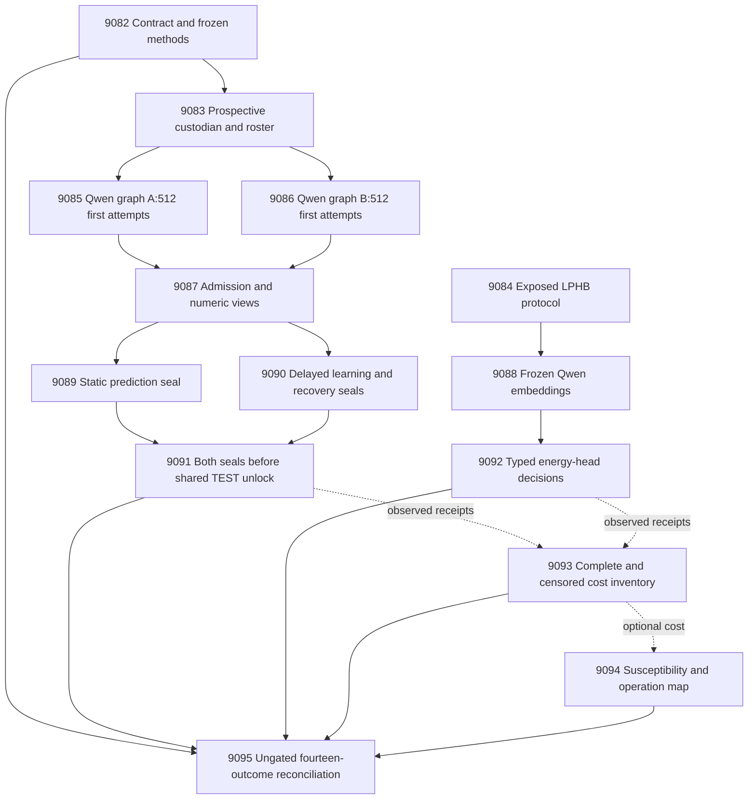

# Carnot Research Roadmap v775: Prospective Graph Decisions, Frozen Human Representations, and Physical Learning Signals

**Milestone:** 2026.11.775
**Created:** 2026-11-14
**Status:** Proposed; execution and activation have not occurred.
**Predecessor:** 2026.11.774, completed according to the operator.
**Execution contract:** Exactly **14 tasks, Exp9082 through Exp9095**, in the order below, across four phases. The complete embedded task objects and `research-roadmap-next.yaml` are the same authority.
**Protected files:** `research-roadmap.yaml` and `scripts/research_conductor.py` remain unchanged.

The previous design and queue are preserved byte for byte in
[V774 design](research-roadmap-v774-preserved-20261114.md) and
[V774 queue](research-roadmap-v774-queue-preserved-20261114.yaml).
Their SHA256 values are respectively
`9737d705002f952c03fc9f0a57e3404e8ad8efc5a7119af10d891d967fad8b10` and
`1d87c5c7f1e4ab81c81333f67c6266d1e78f290ba0b28abc130d93c5326847bd`.
The archival `research-complete.yaml` still ends at V773. Record archive lag;
do not infer missing scientific results from scheduler completion.

## What the previous milestone proved

| Evidence | Supported conclusion | Still unmeasured |
|---|---|---|
| Exp9068: contract_ready_score=1, frozen_methods_ready_score=1 | Unique dispatch keys and frozen methods qualified | Detector or learning benefit |
| Exp9069: complete_blocked_a_access_coverage; A/B readiness0 | Retained A lacks complete access coverage; B lacks complete invocation inventory | Retrospective nonexposure and unattempted-B claims |
| Exp9070: complete_blocked_base_question_family_authority | MDHJudgments export joins do not establish original base-question lineage | Independent human comparison |
| Exp9071/9073 scheduler alternatives: blocked_gate_check_failed | Gates stopped dependent work | Their declared scientific primaries |
| Exp9072/9074–9078 declared primaries absent | Missing/cascade-blocked operands, not negative scientific results | Static, online, human and complete-cost comparisons |
| Exp9079: complete_blocked_current_cost | Hardware mapping cannot borrow nonexistent service measurements | Acceleration or energy advantage |
| Exp9080 scheduler artifact blocked; Exp9068 new ARC outcomes0 | No new qualified ARC frontier | New live discovery or transfer |
| Exp9081: complete_blocked_declared_gate; reconciliation_ready_score=1 | Fourteen-slot history can be reconciled | independent_generalization_score remains0 |

Earlier qualified work supplies the natural follow-up: Exp8987 development spline
Brier0.0279759276 versus converged-linear0.0636283248; Exp8988 delayed-update
mechanics; Exp9055's1024 identities from47987 proposals; Exp9058's512 responses
in707.56 seconds. These are development/collection facts, not held-out benefit.
V775 preserves their limitations and constructs new prospective identities.

## The three biggest gaps to the PRD

1. **Useful learned verification with independent evidence.** Exact graph truth is
   circular and released human panels are exposed. Measure the pending graph
   hypothesis and a changed frozen representation on human development data.
   Neither result closes independent natural factual generalization.
2. **Continuous improvement in calibrated decisions.** Qualified updates and
   recovery do not prove better future decisions without forgetting. Measure the
   frozen delayed-feedback policy against frozen, bias-only, linear and permuted
   controls, retention and actual transaction cost. Train typed decisions; the27B
   generator remains frozen.
3. **A justified hardware path.** Equal binary energy does not establish learning
   dynamics, and sampler throughput does not establish whole-service benefit.
   Measure susceptibility independently and map actual operations to evidenced
   device capabilities.

The November7 north-star reanchor puts oracle-distinct verification first and ARC
on an opportunistic path. No ARC solve task is proposed without new qualified
live outcomes. MDH-Bench and MDHJudgments unchanged source failures stay closed.

## Research incorporated before experiment design

The dated [research scan](../../research-references.md) records all eight requested
arXiv topics and all six secondary channels, including access limitations.

| Primary work | Experiment consequence | Limit |
|---|---|---|
| [Susceptibility Bottlenecks, 2611.14727](https://arxiv.org/abs/2611.14727), Nov10 | Exp9094 tests equal binary energies, mixed curvature and independently forced transmission | CPU numerical evidence only |
| [Online spline KAN, 2602.02056v4](https://arxiv.org/abs/2602.02056) | Exp9090 measures coefficient updates and dense anchor/guard work | No structural KAN or FPGA replication |
| [Continual Calibration, 2604.23987](https://arxiv.org/abs/2604.23987) | Exp9091 separates future Brier and retained calibration/accuracy | No imported conformal guarantee |
| [The Labeling Problem, 2610.08026](https://arxiv.org/abs/2610.08026) | Exp9084/9092 preserve factuality, question groups and incomplete second annotations | LPHB exposed in Exp8389/8403/8409 and Exp8429–8435 |
| [Sequence-Level Supervised Learning, 2611.16736](https://arxiv.org/abs/2611.16736), Nov12 | Established proper small-head loss and frozen generator | No sequence-level generator training |

EBR/EBT, ARM–EBM citations, neural constraint solvers, ETS decoding, thermodynamic
scaling and MTJ hardware were checked. None reverses Carnot's unchanged generator
nulls. OpenReview challenges, partial Semantic Scholar pages, stale GitHub Trending
and inaccessible Dataverse endpoints are recorded. Extropic and Kona announcements
remain vendor evidence. No fresh independent human evaluation source qualified.

## Architecture and dependency graph



Arrows describe data flow; the structured task gates below are authoritative.
Exp9093/9094/9095 are ungated. The human branch is independent of graph custody.
Exp9086 does not depend on Exp9085's outcome; GPU execution remains sequential.
Exp9091 requires both seals before shared TEST truth is readable; it cannot expose
retention labels to an unfinished online sibling.

The custody threat model trusts the parent custodian and pinned workers, but
restricts scorer/trainer access. A real OS namespace denies raw paths, inherited
secret descriptors, alternate entrypoints and network. In-process guardrails and
sandbox fallback do not qualify. Privileged host compromise is outside this scope;
no host-wide nonaccess claim is made. A positive fixture and bypass controls must
pass before production. Exp9069's literal-string checks/hardcoded false authority
are not a reference authenticator. If isolation is unavailable, stop collection.

## Phase 1 — Qualify methods and the prospective boundary

**Exp9082–9084.** Bind fourteen complete tasks, freeze unchanged graph methods,
qualify custody and construct one roster before responses. Freeze the separate
human design. Prototype evidence is positive custody and parser/label controls;
adversarial evidence includes direct-read, early-label, orphan-request and rehashed
ledger rejection. No scientific success gate is required to declare methods ready.

The1024-graph roster contains128 CAL,128 TEST and24 independent32-query streams.
Each512-row shard has64 CAL,64 TEST and384 online rows. Seed775083 and100000
proposals are fixed. Exclude every historical frozen-roster identity/topology,
including uncertain V773 B, and all additional attempted/isomorphic identities.
Preserve rejected/censored proposals. Failure to fill unchanged strata is terminal;
no outcome-conditioned replacement, seed restart or smaller cohort.

## Phase 2 — Collect bounded evidence

**Exp9085–9088.** Generate two logged512-row shards with the frozen producer;
admit only their complete joint corpus. Started requests never retry. Parsing
failures retain their original missing-answer semantics. Extract real frozen Qwen
human representations, retaining token caps, truncation and group identities.
Prototype receipts cover every request/batch; adversarial controls test closure,
duplicate/changed text and prohibited-feature invariance.

Every current LLM task includes `unsloth/Qwen3.8-27B-GGUF`, Q4_K_M, loaded from
the cached GGUF using its embedded llama.cpp tokenizer. Exp9085/9086 declare
`model_full_generation` (60-second floor). Exp9088 declares
`model_load_no_generation` (2-second floor), emits zero tokens. No bounded-generation
task is planned; a future small canary must use `model_bounded_generation`
(10-second floor). Record actual work; never pad duration or substitute models.

## Phase 3 — Measure decisions and continuous learning

**Exp9089–9092.** Seal static and adaptive predictions before shared TEST access,
then independently recompute the fixed bounds. Train and audit the separate human
small-head prototype. A complete scientific null has ready rows and benefit0;
readiness cannot be defined as winning. Positive learning/recovery fixtures and
negative future-label, duplicate-feedback and shuffled-label controls accompany
production observations. Both graph seals are required before shared TEST target unlock; CAL and scheduled
online feedback open earlier under the frozen protocol.

### Static graph decision

Restore the five qualified spline/converged-linear/shared-logistic/confidence-logistic/
prevalence states. Only CAL chooses temperature from[0.5,1,2,4], ascending ties.
On128 TEST graphs preserve seven one-sided bounds: spline Brier improvement
lower>0 versus all four controls; accepted-error difference upper<=0 versus the
three linear controls at exactly50% coverage. Use10000 paired graph bootstrap
draws, seed773063, family alpha0.05, tail0.05/7, reranking inside every draw.
All seven must pass. Seeds and predictions do not multiply graph sample size.

### Continuous self-learning and the training floor

Exp9090 genuinely updates small energy-head coefficients using the original proper
logloss, anchor0.01 excluding intercept, clip1, AdaGrad0.05/epsilon1e-8 and
fixed temperature1. Its five arms are frozen/adaptive/bias-only splines, adaptive
linear and permuted-feedback spline. Labels1–4 release after prediction8, then
four-label blocks after12/16/20/24/28/32. Labels29–32 remain pending for learners;
after both seals the evaluator reads them to score future queries, seals metrics,
then permits learner release/drain.
The original64-graph development guard permits Brier increase<=0.005 and no
error increase. Rollback restores coefficients and accumulators; acknowledgments
are atomic. Real query16 child kills must recover exactly.

The3840 online and46080 retention predictions are repeated observations. Effective
units are24 streams and128 shared retention graphs. Preserve ten bounds: future
queries17–32 adaptive-minus-frozen Brier upper<=-0.01; upper<0 versus bias-only,
adaptive-linear and permuted-feedback; six retention Brier/error bounds<=0.01 at
checkpoints0/16/32. Use10000 whole-stream draws, seed773064, family alpha0.01,
tail0.001, with a shared retention-graph draw across streams/checkpoints independent
of the stream draw. All ten pass or the unchanged learning-benefit hypothesis is null.

This satisfies Continuous Self-Learning through real feedback updates, future loss,
retention and durability. Exp9092 also satisfies the calibrated-decision training
floor: train energy-derived p(error), return accept/reject/escalate with confidence.
Neither task trains generator weights or claims a new generalization result.

### Exposed-human representation study

Reuse exact retained LPHB author bytes and original V726 question-group partition.
Maintain900 responses/300 qid groups and the actual second-annotator subset;
unknown labels remain missing. No fresh-test language, independent-human readiness
or new Qwen generation-quality claim is permitted. The old V726 null remains valid.

Question<=256 and answer<=768 embedded tokens feed one persistent llama.cpp
last-layer mean-pooling session. L2-normalized question/answer embeddings are
concatenated. Fit-only preprocessing precedes fixed seed775084 Gaussian projection
to27 dimensions; TRAIN-only min/max then maps projected coordinates to[-1,1],
clips future values and maps constants to0, matching the existing spline basis.
No references, source/model IDs, annotator tags or `label_*` signals enter features.

Six arms are prevalence, text-length logistic, projected-linear, full-embedding
regularized linear, projected fixed-cubic spline and its whole-qid donor-permuted
training-label control. Preserve sibling/generator positions across donor groups;
report the actual changed-label fraction. All learned heads use proper binary
logloss, L2=0.01 excluding intercept and checked gradient convergence. No search.
CAL selects temperature; thresholds are p(error)<=0.1 accept, >=0.9 reject,
otherwise escalate. Report question-cluster conditional intervals (10000 draws,
seed775092), annotator disagreement, Brier, logloss, coverage and accepted error.
These exposed-data intervals are descriptive. The benefit flag requires lower
spline Brier than projected/full linear and permutation, with no greater accepted
error at matched50% coverage. It is not an independent-significance claim.

## Phase 4 — Account, test a hardware mechanism, reconcile

**Exp9093–9095.** Cost inventory, numerical susceptibility and capstone run without
upstream success gates. Preserve incomplete-service operands as unavailable, never
zero-cost. Inventory readiness differs from complete-service readiness; costs do
not require positive scientific benefit. Count overlapping parent/child work once,
including model loading, failed requests, dense anchors, guards and durable writes.
Joules require actual power integration; unavailable sensors yield unmeasured values.

Exp9094 implements the primary coupling/field energies and their analytic derivatives
on32 registered4-hidden/2-output cases (seeds775094–775125). Sweep alpha0/0.25/
0.5/0.75/1 and second-harmonic strengths0.1/1/10. Compare all64 binary states,
finite-difference mixed curvature (step1e-4; absolute tolerance1e-6), and finite
perturbations beta1e-4/1e-3/1e-2 at a stable all-zero equilibrium. Energy equality
tolerance is1e-10. Retain unstable/ill-conditioned cases; no hidden ridge or adjusted
tolerance. Separate an independent unit output force from the physical cosine-loss
force, which vanishes exactly at binary phases. This diagnoses numerical transport,
not classifier performance, FPGA realization or service acceleration.

The capstone accounts for exactly fourteen tasks, including blocked/missing/null
outcomes. External incompleteness is terminal `blocked`, never retryable `partial`.
A valid null closes its unchanged detector, learning or human comparison. Repeated
custody failure closes this chain until a different enforceable prerequisite exists.
The capstone runs unchanged `scripts/publication_gate.py --json` and retains G1–G4,
`paper_ready` and `unmet_gates`. Its historical FoVer scope is separate from current
science; its gates are not redefined. Retirement recommendations do not mutate
the exclusion manifest. Every result
keeps its original provenance and exposure classification.

## Hardware and execution requirements

| Resource | Use and constraint |
|---|---|
| CPU, RAM and private disk | Roster/topology exclusion, namespaces, head fits, bootstrap, recovery and numerical diagnostic; reserve storage from actual preflight sizes |
| Conductor GPU0: RTX3090,24GB | Sequential Qwen GGUF generation and embedding extraction; verify lease/free memory and actual layer offload before requests |
| GPU1: RTX3090 | Reserved for its existing owner; no dual-GPU assumption |
| Exact cached Qwen3.8-27B Q4_K_M | Pin GGUF/tokenizer/runtime hashes; no download/model substitution is needed by the design |
| OS isolation | Real user/mount/process/network namespace; executable availability alone is insufficient; positive and bypass fixtures are mandatory |
| KV260/PolarFire | Map only previously evidenced operations; KV260 qualified k_max<=5 boundary retained; no current bring-up or speed claim |
| Extropic/Kona | Literature/vendor context only; no authenticated local device or new reproducible runtime assumed |

No purchase or new hardware integration is required. Planned task estimates total
810 minutes before gating, within separate80-minute hard caps; the two70-minute
collectors have empirical707.56-second historical collection context, not a runtime
guarantee. Exp9083 uses Opus/100 turns for custody/schema work; Exp9082 uses the same
for contract qualification. Formulaic admission and numerical code use Codex
`gpt-6.1-sol`; routine scientific work defaults to Sonnet. No luna or Gemini task.

Each task emits flushed phase/call progress plus supervised heartbeats at most60
seconds apart, including inside long loops. Every silent gap stays below600 seconds.
Files over about200 lines are written across several tool calls with intervening
progress. Measurement stops by3300 seconds, reserving1200 seconds for checks under
the4800-second cap. Censor honestly rather than extending time or dropping checks.

## Verification and claim boundaries

Before implementation each task must confirm its REQ/SCENARIO, write failing tests,
freeze sources and private validation commands, and preserve historical assertions.
Run owned/consumer pytest,100% new-statement coverage without exclusions, Ruff,
strict mypy, explicit spec tracing and actual private CLI/cold replay. Apply
E2E-018/021 authority/reduction checks and E2E-020 to learning/recovery. Unchanged
adversarial and row-consistency scanners must inspect primitive evidence.

Every task declares `verdict_class`, `gate_check_summary`, per-unit rows and exact
readiness fields. All gates target earlier tasks with identical declared field
spellings. Required prior-failure entries retain their actual verdict and
`retire_if_same_verdict: true`; scheduler failures are labeled as scheduler evidence.
Graph positives are `circular_positive`; exposed human results remain development;
`independent_generalization_score=0` throughout. No ARC solve is claimed, so no
solve-provenance artifact is applicable. No generator repair/decoding, new dataset
labeling, live ARC adapter, board purchase or conductor modification is in scope.

Planning validation checks the full task equality and existing guards/E2E fixtures.
It does not claim the future experiments, model loads or custody implementation
have run. Broader repository health is reported separately from plan validity.

## Exact task contract

The visible table and embedded complete JSON below match the staged YAML exactly.
Full object equality includes prompts, routing, prior failures, substrates and gates.
| Order | ID | Title | Phase | Deliverable |
|---:|---|---|---:|---|
| 1 | exp9082-contract | Exp9082: Freeze fourteen tasks and unchanged scientific thresholds | 1 | results/experiment_9082_v775_contract.json |
| 2 | exp9083-prospective-custody | Exp9083: Qualify enforced custody before freezing a new graph roster | 1 | results/experiment_9083_v775_prospective_custody.json |
| 3 | exp9084-human-methods | Exp9084: Freeze an exposed-human embedding comparison | 1 | results/experiment_9084_v775_human_methods.json |
| 4 | exp9085-collect-a | Exp9085: Collect first-attempt graph shard A under custody | 2 | results/experiment_9085_v775_collect_a.json |
| 5 | exp9086-collect-b | Exp9086: Collect first-attempt graph shard B under custody | 2 | results/experiment_9086_v775_collect_b.json |
| 6 | exp9087-sealed-admission | Exp9087: Admit disjoint complete shards without exposing targets | 2 | results/experiment_9087_v775_sealed_admission.json |
| 7 | exp9088-human-embeddings | Exp9088: Extract frozen Qwen representations without generated judgments | 2 | results/experiment_9088_v775_human_embeddings.json |
| 8 | exp9089-static-seal | Exp9089: Seal five frozen graph decision arms | 3 | results/experiment_9089_v775_static_seal.json |
| 9 | exp9090-online-seal | Exp9090: Train delayed-feedback decisions with exact recovery | 3 | results/experiment_9090_v775_online_seal.json |
| 10 | exp9091-graph-decision | Exp9091: Independently reduce frozen detector and learning bounds | 3 | results/experiment_9091_v775_graph_decision.json |
| 11 | exp9092-human-decision | Exp9092: Train and audit exposed-human typed energy decisions | 3 | results/experiment_9092_v775_human_decision.json |
| 12 | exp9093-service-cost | Exp9093: Account for complete and censored service work | 4 | results/experiment_9093_v775_service_cost.json |
| 13 | exp9094-susceptibility | Exp9094: Test physical learning signals at equal Ising energies | 4 | results/experiment_9094_v775_susceptibility.json |
| 14 | exp9095-capstone | Exp9095: Reconcile fourteen outcomes and close unchanged comparisons | 4 | results/experiment_9095_v775_capstone.json |


<!-- V775_TASK_CONTRACT_START -->
```json
{
  "milestone": "2026.11.775",
  "milestone_title": "Prospective Graph Decisions, Frozen Human Representations, and Physical Learning Signals",
  "milestone_doc": "openspec/change-proposals/research-roadmap-vNEXT.md",
  "tasks": [
    {
      "id": "exp9082-contract",
      "title": "Exp9082: Freeze fourteen tasks and unchanged scientific thresholds",
      "phase": 1,
      "track": "research",
      "priority": "high",
      "requires_gpu": false,
      "max_turns": 100,
      "estimated_wall_time_min": 35,
      "per_unit_rows": true,
      "milestone": "2026.11.775",
      "deliverable": "results/experiment_9082_v775_contract.json",
      "inference_substrate_class": "no_model_load",
      "MODEL_SPECS": [],
      "gated_on": [],
      "prior_failures": [
        {
          "experiment_id": "exp9067-capstone",
          "verdict": "complete_blocked_declared_gate",
          "addressed_by": "Preserve the completed V774 contract and freeze a prospective replacement chain with unique dispatch keys; new metadata cannot turn historical missing custody into evidence.",
          "retire_if_same_verdict": true
        }
      ],
      "model": "opus",
      "prompt": "CONTEXT:\nWork in {project_root} on {date}. V774 qualified dispatch but graph measurements never started; research-complete.yaml still ends at V773. User completion is scheduler status, not a new scientific result. The active queue must remain byte-identical during planning.\nEXISTING CODE TO READ FIRST:\nCLAUDE.md; CODEX.md; research-program.md; ops/north-star.md; ops/e2e-test-plan.md; ops/exclusion_manifest.yaml; research-references.md (2026-11-14 V775 scan); openspec/capabilities/research-reporting/spec.md; scripts/experiment_template.py; python/carnot/reporting/primary_publication.py; python/carnot/reporting/current_work_receipt.py; python/carnot/reporting/roadmap_contract.py; python/carnot/reporting/v774_dispatch_contract.py; scripts/conductor_gates.py; scripts/exclusion_manifest_lint.py; results/experiment_9068_v774_dispatch_contract.json; results/experiment_9081_v774_capstone.json; openspec/change-proposals/research-roadmap-v774-preserved-20261114.md; openspec/change-proposals/research-roadmap-v774-queue-preserved-20261114.yaml; openspec/change-proposals/v768-spline-protocol.json; openspec/change-proposals/v768-online-spline-protocol.json\nTASK:\nFreeze fourteen tasks and unchanged scientific thresholds. Deliver results/experiment_9082_v775_contract.json; implement scripts/experiments/experiment_9082_v775_contract.py with reusable library code. MODEL_SPECS: []; inference_substrate_class: no_model_load; current_llm_invocations=0. Historical model provenance is a separate field. Do not load an LLM in this task.\nCONCRETE STEPS:\n1. PRECONDITIONS: Authenticate declared sources, producer hashes, private storage and exact gate fields before dependent work. Missing external inputs produce complete_blocked_<check>, verdict_class=blocked and gate_check_summary; never fabricate data or retry an unchanged external failure. Ungated accounting tasks record unavailable operands and continue their independent work.\n2. Emit a flushed progress line at every phase boundary and before and after any model load, generation, benchmark or subprocess that can take minutes. Print inside long loops and supervise long calls with a flushed heartbeat at least every 60 seconds, keeping every silent gap below 600 seconds. Write files over about 200 lines in several tool calls of at most 200 lines, with a progress message between calls; never send one huge file-writing call.\n3. Before implementation, use rg to inspect callers, confirm REQ-REPORT-9082-V775 and SCENARIO-REPORT-9082-V775, extend the relevant capability spec and write failing tests first. Reuse existing code; preserve historical producer/test bytes, assertions and artifacts. Use private output roots and immutable invocation receipts. Do not edit the exclusion manifest or tune acceptance criteria after observing outcomes.\n4. Compare all fourteen complete objects, prompts, routing, prior_failures and gate fields against the visible table and embedded JSON in vNEXT. Use staged/staged authority before activation and actual activated bytes afterwards; snapshot hashes. Prove unique title[:50].strip() keys, no completed-key collision, no new ID already used and every gate points to an earlier task whose REQUIRED ARTIFACT FIELDS declares that exact key. Do not require invented prior failures for novel scope.\n5. Exercise private read-only scheduler selection with only A recorded and B absent; select B with current keys and retain the failing historical-key control. Run activation exclusion, overdue-priority and available roadmap/harness-fit checks. Do not patch conductor or change active queue.\n6. Authenticate Exp8987 fitted states, Exp8988 online equations and both V768 protocols. Freeze immutable V775 protocol copies preserving all arms, loss, label delays, thresholds and bootstrap families; only new corpus IDs/access authority change. Emit contract_ready_score and frozen_methods_ready_score independently. Record V774 missing primaries separately from the real scheduler gate artifacts; never invent absent verdicts.\n7. Record the three open gaps and closed scopes: graph decisions remain circular, exposed LPHB cannot supply fresh generalization, physical hardware claims need operation-specific evidence. ARC has no newly qualified frontier; no re-solve or added ARC dependency.\n8. Freeze owned/direct-consumer validation commands before measurement. Run scoped pytest with 100 percent newly owned statements and zero exclusions, scoped Ruff check/format, strict mypy, explicit-path spec coverage, private actual CLI success/block/tamper/cold replay outside the checkout without PYTHONPATH, and applicable E2E-018/021; learning/recovery also runs E2E-020. Reserve 1200 seconds for validation; stop measurement by 3300 seconds within the 4800-second cap. Preserve broader historical failures separately; a failed current affected-consumer check disqualifies.\n9. Retain primitive per-unit rows and hashed raw receipts; recompute headlines from those rows. Run unchanged adversarial_verify.py and strict verdict_row_consistency_lint.py under heartbeat supervision. Publish via primary_publication only after owned checks pass, zero readiness on failed checks, and reconcile openspec/, _bmad/traceability.md, ops/status.md and ops/changelog.md. No roadmap activation or external publication.\nREQUIRED ARTIFACT FIELDS:\n- honest_verdict: complete_*; verdict_class: positive | circular_positive | null | blocked | disqualified | partial. Only unfinished owned work may be partial; unchanged external failure is terminal blocked.\n- gate_check_summary: list of check/upstream/path/sha256/artifact_field/op/expected/observed/passed; distinguish missing_file, missing_field and observed zero; required for every blocked result.\n- verifier_is_oracle, claim_scope, exposure_scope, independent_generalization_score=0. Exact graph labels imply verifier_is_oracle=true and any graph success is circular_positive. Human LPHB remains exposed development; no independent/generalized claim.\n- rows: per-unit identity, arm/condition, family/group, seed, absolute metric, numerator, denominator, status, censor/exclusion reason; intended/attempted/completed/failed/censored counts and effective independent groups. Seeds, repeats and predictions do not multiply independent units.\n- MODEL_SPECS, inference_substrate_class, current_llm_invocations, code_config_hashes, source_references, current_work_receipts, duration_s, validation_receipts, required_checks_passed, acceptance_gates, field_principles. Readiness is an integer 0/1 qualified by actual checks, never a renamed score.\n- contract_ready_score, frozen_methods_ready_score, canonical_tasks_sha256, authority_snapshots, scheduler_rows, frozen_protocol_references, archive_lag, previous_outcome_inventory.\nRun command: cd {project_root} && .venv/bin/python scripts/experiments/experiment_9082_v775_contract.py --date {date}\nDo NOT push. Do NOT modify scripts/research_conductor.py."
    },
    {
      "id": "exp9083-prospective-custody",
      "title": "Exp9083: Qualify enforced custody before freezing a new graph roster",
      "phase": 1,
      "track": "research",
      "priority": "high",
      "requires_gpu": false,
      "max_turns": 100,
      "estimated_wall_time_min": 65,
      "per_unit_rows": true,
      "milestone": "2026.11.775",
      "deliverable": "results/experiment_9083_v775_prospective_custody.json",
      "inference_substrate_class": "no_model_load",
      "MODEL_SPECS": [],
      "gated_on": [
        {
          "upstream": "exp9082-contract",
          "artifact_field": "contract_ready_score",
          "op": "==",
          "value": 1
        },
        {
          "upstream": "exp9082-contract",
          "artifact_field": "frozen_methods_ready_score",
          "op": "==",
          "value": 1
        }
      ],
      "prior_failures": [
        {
          "experiment_id": "exp9069-source-custody",
          "verdict": "complete_blocked_a_access_coverage",
          "addressed_by": "Replace unprovable historical custody with a new pre-response roster and enforced prospective worker access/attempt recorder; never rehabilitate V773 A or infer unattempted B from missing files.",
          "retire_if_same_verdict": true
        }
      ],
      "model": "opus",
      "prompt": "CONTEXT:\nWork in {project_root} on {date}. Exp9069 has a voluntary-label-read log, unprotected raw files, literal-string reference checks and complete_access_authority=False. Adding missing fields cannot establish complete historical access. No production model call is allowed until a positive fixture proves the new boundary.\nEXISTING CODE TO READ FIRST:\nCLAUDE.md; CODEX.md; research-program.md; ops/north-star.md; ops/e2e-test-plan.md; ops/exclusion_manifest.yaml; research-references.md (2026-11-14 V775 scan); openspec/capabilities/research-reporting/spec.md; scripts/experiment_template.py; python/carnot/reporting/primary_publication.py; python/carnot/reporting/current_work_receipt.py; python/carnot/reporting/source_custody_9069.py; python/carnot/reporting/fresh_seal_custody_9042.py; python/carnot/reporting/prospective_roster_9055.py; python/carnot/reporting/graph_source_8931.py; python/carnot/autoresearch/sandbox.py; python/carnot/verify/sandbox.py; results/experiment_9069_v774_source_custody.json; results/experiment_9055_v773_prospective_roster.json\nTASK:\nQualify enforced custody before freezing a new graph roster. Deliver results/experiment_9083_v775_prospective_custody.json; implement scripts/experiments/experiment_9083_v775_prospective_custody.py with reusable library code. MODEL_SPECS: []; inference_substrate_class: no_model_load; current_llm_invocations=0. Historical model provenance is a separate field. Do not load an LLM in this task.\nCONCRETE STEPS:\n1. PRECONDITIONS: Authenticate declared sources, producer hashes, private storage and exact gate fields before dependent work. Missing external inputs produce complete_blocked_<check>, verdict_class=blocked and gate_check_summary; never fabricate data or retry an unchanged external failure. Ungated accounting tasks record unavailable operands and continue their independent work.\n2. Emit a flushed progress line at every phase boundary and before and after any model load, generation, benchmark or subprocess that can take minutes. Print inside long loops and supervise long calls with a flushed heartbeat at least every 60 seconds, keeping every silent gap below 600 seconds. Write files over about 200 lines in several tool calls of at most 200 lines, with a progress message between calls; never send one huge file-writing call.\n3. Before implementation, use rg to inspect callers, confirm REQ-REPORT-9083-V775 and SCENARIO-REPORT-9083-V775, extend the relevant capability spec and write failing tests first. Reuse existing code; preserve historical producer/test bytes, assertions and artifacts. Use private output roots and immutable invocation receipts. Do not edit the exclusion manifest or tune acceptance criteria after observing outcomes.\n4. Freeze the supported threat model: trusted parent custodian and immutable worker code; untrusted scorer/trainer workers cannot read raw responses, source graph structure, future labels or other streams. Privileged host/operator compromise is outside this mechanism and must remain an explicit limitation. Require a real OS mount/user namespace with allowlisted mounts, no network and no inherited secret descriptors. autoresearch/sandbox.py is only an in-process guardrail; verify/sandbox.py allow_fallback must be false. No isolation fallback is permitted. Never claim host-wide nonaccess from same-UID voluntary logs; if the protocol needs a stronger unavailable boundary, block before collecting.\n5. Implement one supervised request/access path: fsync a unique request identity, graph/role/split, exact prompt/model/seed and monotonic timestamp before invoking the collector; fsync response or terminal error afterwards. A crash leaves an attempted censored slot, never a free retry. Seal append-only chained manifests, allow only numeric feature views and protocol-scheduled feedback to scorers, authenticate reference objects by bytes/hash/producer rather than equality to a magic string. Preserve rejected and orphan attempts. No inference process may read truth or retained raw outcomes.\n6. Write a positive private end-to-end fixture that reaches custody_ready_score=1 and produces a replayable ledger. Add denial controls for direct paths, symlink traversal, inherited descriptors, alternate worker entrypoints, network, missing request start, duplicate slot, orphan response, reordered or rehashed ledger and early label reads. An omitted path or unchecked invocation prevents readiness; a claim of global completeness is disallowed.\n7. Before any production response, enumerate all historical frozen rosters plus attempted graphs including rejected/censored/orphan paths and uncertain V773 B. Freeze one deterministic V775 proposal stream (seed 775083), at most100000 proposals, same graph-source/cardinality strata as Exp9055, reject every historical frozen-roster identity/topology and all attempted/isomorphic historical identities, and retain all proposal decisions. Target exactly1024 admitted identities, disjoint A/B512 each with64 CAL+64 TEST+384 online per shard; overall128 CAL,128 TEST,24 independent32-query streams. Exp9055 needed47987 proposals: time construction and fail terminal if the bound cannot fill the roster; no new seed, relaxed strata or outcome-conditioned replacement.\n8. Seal roster, split and online order hashes, worker/code/namespace policy, gate field schemas and collection manifests. Permit only new A/B requests from that roster. Missing historical roster/topology exclusion coverage blocks freshness; uncertain attempts on a fully excluded historical roster do not require proof of nonattempt; V773 A and B are never repaired or reused.\n9. Freeze owned/direct-consumer validation commands before measurement. Run scoped pytest with 100 percent newly owned statements and zero exclusions, scoped Ruff check/format, strict mypy, explicit-path spec coverage, private actual CLI success/block/tamper/cold replay outside the checkout without PYTHONPATH, and applicable E2E-018/021; learning/recovery also runs E2E-020. Reserve 1200 seconds for validation; stop measurement by 3300 seconds within the 4800-second cap. Preserve broader historical failures separately; a failed current affected-consumer check disqualifies.\n10. Retain primitive per-unit rows and hashed raw receipts; recompute headlines from those rows. Run unchanged adversarial_verify.py and strict verdict_row_consistency_lint.py under heartbeat supervision. Publish via primary_publication only after owned checks pass, zero readiness on failed checks, and reconcile openspec/, _bmad/traceability.md, ops/status.md and ops/changelog.md. No roadmap activation or external publication.\nREQUIRED ARTIFACT FIELDS:\n- honest_verdict: complete_*; verdict_class: positive | circular_positive | null | blocked | disqualified | partial. Only unfinished owned work may be partial; unchanged external failure is terminal blocked.\n- gate_check_summary: list of check/upstream/path/sha256/artifact_field/op/expected/observed/passed; distinguish missing_file, missing_field and observed zero; required for every blocked result.\n- verifier_is_oracle, claim_scope, exposure_scope, independent_generalization_score=0. Exact graph labels imply verifier_is_oracle=true and any graph success is circular_positive. Human LPHB remains exposed development; no independent/generalized claim.\n- rows: per-unit identity, arm/condition, family/group, seed, absolute metric, numerator, denominator, status, censor/exclusion reason; intended/attempted/completed/failed/censored counts and effective independent groups. Seeds, repeats and predictions do not multiply independent units.\n- MODEL_SPECS, inference_substrate_class, current_llm_invocations, code_config_hashes, source_references, current_work_receipts, duration_s, validation_receipts, required_checks_passed, acceptance_gates, field_principles. Readiness is an integer 0/1 qualified by actual checks, never a renamed score.\n- custody_ready_score, roster_ready_score, complete_access_authority_scope, threat_model, enforcement_receipts, bypass_control_rows, authenticated_access_manifest_reference, invocation_inventory_reference, roster_reference, split_hash, proposal_count, proposal_rejection_rows, historical_attempt_exclusion_reference.\nRun command: cd {project_root} && .venv/bin/python scripts/experiments/experiment_9083_v775_prospective_custody.py --date {date}\nDo NOT push. Do NOT modify scripts/research_conductor.py."
    },
    {
      "id": "exp9084-human-methods",
      "title": "Exp9084: Freeze an exposed-human embedding comparison",
      "phase": 1,
      "track": "research",
      "priority": "high",
      "requires_gpu": false,
      "max_turns": 50,
      "estimated_wall_time_min": 45,
      "per_unit_rows": true,
      "milestone": "2026.11.775",
      "deliverable": "results/experiment_9084_v775_human_methods.json",
      "inference_substrate_class": "no_model_load",
      "MODEL_SPECS": [],
      "gated_on": [],
      "prior_failures": [
        {
          "experiment_id": "exp8435-capacity-benefit-audit",
          "verdict": "complete_null_v726_capacity_benefit_audit",
          "addressed_by": "Use genuinely frozen Qwen3.8 embeddings instead of the prior handcrafted/reference-signal representation; keep LPHB exposed-development status, original question groups and the prior null.",
          "retire_if_same_verdict": true
        },
        {
          "experiment_id": "exp9070-adjudication-methods",
          "verdict": "complete_blocked_base_question_family_authority",
          "addressed_by": "Do not repair MDHJudgments by assertion: use the already authenticated LPHB author question groups only for exposed development and retain the MDH branch as closed.",
          "retire_if_same_verdict": true
        }
      ],
      "prompt": "CONTEXT:\nWork in {project_root} on {date}. LPHB is already exposed in Exp8389/8403/8409 and the full Exp8429-8435 chain. Its earlier capacity-benefit audit was null. A changed frozen representation can be tested as exploratory development, but cannot repair independent-source or MDHJudgments lineage failures.\nEXISTING CODE TO READ FIRST:\nCLAUDE.md; CODEX.md; research-program.md; ops/north-star.md; ops/e2e-test-plan.md; ops/exclusion_manifest.yaml; research-references.md (2026-11-14 V775 scan); openspec/capabilities/research-reporting/spec.md; scripts/experiment_template.py; python/carnot/reporting/primary_publication.py; python/carnot/reporting/current_work_receipt.py; python/carnot/reporting/human_label_custody_8389.py; python/carnot/reporting/released_question_identity_8403.py; python/carnot/reporting/retrospective_label_criterion_8409.py; python/carnot/reporting/v726_feature_panel_runner.py; python/carnot/verify/v726_criterion_energy_fit.py; python/carnot/verify/capacity_benefit_audit_8435.py; python/carnot/autoresearch/spline_basis_8986.py; results/experiment_8429_v726_contract_methods.json; results/experiment_8435_v726_capacity_benefit_audit.json; results/experiment_9070_v774_adjudication_methods.json\nTASK:\nFreeze an exposed-human embedding comparison. Deliver results/experiment_9084_v775_human_methods.json; implement scripts/experiments/experiment_9084_v775_human_methods.py with reusable library code. MODEL_SPECS: []; inference_substrate_class: no_model_load; current_llm_invocations=0. Historical model provenance is a separate field. Do not load an LLM in this task.\nCONCRETE STEPS:\n1. PRECONDITIONS: Authenticate declared sources, producer hashes, private storage and exact gate fields before dependent work. Missing external inputs produce complete_blocked_<check>, verdict_class=blocked and gate_check_summary; never fabricate data or retry an unchanged external failure. Ungated accounting tasks record unavailable operands and continue their independent work.\n2. Emit a flushed progress line at every phase boundary and before and after any model load, generation, benchmark or subprocess that can take minutes. Print inside long loops and supervise long calls with a flushed heartbeat at least every 60 seconds, keeping every silent gap below 600 seconds. Write files over about 200 lines in several tool calls of at most 200 lines, with a progress message between calls; never send one huge file-writing call.\n3. Before implementation, use rg to inspect callers, confirm REQ-REPORT-9084-V775 and SCENARIO-REPORT-9084-V775, extend the relevant capability spec and write failing tests first. Reuse existing code; preserve historical producer/test bytes, assertions and artifacts. Use private output roots and immutable invocation receipts. Do not edit the exclusion manifest or tune acceptance criteria after observing outcomes.\n4. Authenticate the retained LPHB author release and original dictionary/label lineage. Pin actual local bytes and original commit; do not quietly substitute a newer release. Inventory all900 responses/300 original qid groups and annotator2 subset before exclusions. Keep factuality and reference-faithfulness criteria separate. Use the original V726 group partition, plus the full known exposure ledger; if incompatible, block rather than quietly repartition for favorable metrics.\n5. Freeze a protocol before embedding extraction: use question and answer text ONLY, no ref_str, label_*, annotator tags, source IDs, dataset/model tags or oracle-derived signals as learned features. Author reference and both annotations are scoring/context records only. Train target is original annotator1 factuality on permitted training groups; annotator2 sensitivity is descriptive on its actual observed subset, -1 is missing and disagreement is not forced consensus.\n6. Freeze embedded-tokenizer policy: question<=256 and answer<=768 tokens, truncate right with retained full-token counts and flags, mean-pool last-layer hidden states from the actual frozen Qwen runtime, independently L2-normalize question/answer and concatenate. Record empty/padded behavior. Fit-only center/scale on concatenated embeddings, fixed Gaussian projection to27 dimensions with seed775084, then TRAIN-only min/max scaling of the27 projected features to[-1,1], clip future values and map constants to0. Freeze both transformations and use the same scaled27 features in spline and projected-linear arms; no label-dependent projection. Evaluate six arms: prevalence, text-length logistic, projected27 linear, full-embedding regularized linear, projected27 fixed-cubic spline, and the identical spline with a fixed whole-qid donor derangement across TRAIN groups (seed775084), preserving sibling/generator positions and reporting the actual changed-label fraction. Never shuffle only within the three siblings of one question. All heads use the same group split, NCE-free proper binary logloss with0.01 L2 excluding intercept, and verified gradient convergence; no architecture search.\n7. Freeze CAL-only temperatures[0.5,1,2,4] with ascending ties, then p(error)<=0.1 accept, >=0.9 reject, otherwise escalate. Score Brier, logloss, coverage and accepted error, plus question-level annotator disagreement strata; exact half-coverage comparison reranks within every question-cluster bootstrap draw. Retain all arms, counts and conditional95% intervals from10000 paired qid draws seed775092. These are descriptive exposed-development intervals, not confirmatory significance or independent generalization. Coefficient hashes must change through real training.\n8. Write the complete protocol and positive parser/label controls; ensure mutating a prohibited feature cannot alter embeddings or fitting inputs. human_methods_ready_score reflects authenticated exposed source and frozen design, not a favorable result or fresh-human readiness.\n9. Freeze owned/direct-consumer validation commands before measurement. Run scoped pytest with 100 percent newly owned statements and zero exclusions, scoped Ruff check/format, strict mypy, explicit-path spec coverage, private actual CLI success/block/tamper/cold replay outside the checkout without PYTHONPATH, and applicable E2E-018/021; learning/recovery also runs E2E-020. Reserve 1200 seconds for validation; stop measurement by 3300 seconds within the 4800-second cap. Preserve broader historical failures separately; a failed current affected-consumer check disqualifies.\n10. Retain primitive per-unit rows and hashed raw receipts; recompute headlines from those rows. Run unchanged adversarial_verify.py and strict verdict_row_consistency_lint.py under heartbeat supervision. Publish via primary_publication only after owned checks pass, zero readiness on failed checks, and reconcile openspec/, _bmad/traceability.md, ops/status.md and ops/changelog.md. No roadmap activation or external publication.\nREQUIRED ARTIFACT FIELDS:\n- honest_verdict: complete_*; verdict_class: positive | circular_positive | null | blocked | disqualified | partial. Only unfinished owned work may be partial; unchanged external failure is terminal blocked.\n- gate_check_summary: list of check/upstream/path/sha256/artifact_field/op/expected/observed/passed; distinguish missing_file, missing_field and observed zero; required for every blocked result.\n- verifier_is_oracle, claim_scope, exposure_scope, independent_generalization_score=0. Exact graph labels imply verifier_is_oracle=true and any graph success is circular_positive. Human LPHB remains exposed development; no independent/generalized claim.\n- rows: per-unit identity, arm/condition, family/group, seed, absolute metric, numerator, denominator, status, censor/exclusion reason; intended/attempted/completed/failed/censored counts and effective independent groups. Seeds, repeats and predictions do not multiply independent units.\n- MODEL_SPECS, inference_substrate_class, current_llm_invocations, code_config_hashes, source_references, current_work_receipts, duration_s, validation_receipts, required_checks_passed, acceptance_gates, field_principles. Readiness is an integer 0/1 qualified by actual checks, never a renamed score.\n- human_methods_ready_score, human_protocol_reference, label_authority_reference, original_group_partition_reference, criterion_definitions, exposure_ledger, prohibited_feature_columns, arm_roster, original_capacity_null_reference, independent_eval_ready_score=0.\nRun command: cd {project_root} && .venv/bin/python scripts/experiments/experiment_9084_v775_human_methods.py --date {date}\nDo NOT push. Do NOT modify scripts/research_conductor.py."
    },
    {
      "id": "exp9085-collect-a",
      "title": "Exp9085: Collect first-attempt graph shard A under custody",
      "phase": 2,
      "track": "research",
      "priority": "high",
      "requires_gpu": true,
      "max_turns": 50,
      "estimated_wall_time_min": 70,
      "per_unit_rows": true,
      "milestone": "2026.11.775",
      "deliverable": "results/experiment_9085_v775_collect_a.json",
      "inference_substrate_class": "model_full_generation",
      "MODEL_SPECS": [
        {
          "hf_id": "unsloth/Qwen3.8-27B-GGUF",
          "quantization": "Q4_K_M"
        }
      ],
      "gated_on": [
        {
          "upstream": "exp9083-prospective-custody",
          "artifact_field": "custody_ready_score",
          "op": "==",
          "value": 1
        },
        {
          "upstream": "exp9083-prospective-custody",
          "artifact_field": "roster_ready_score",
          "op": "==",
          "value": 1
        }
      ],
      "prior_failures": [
        {
          "experiment_id": "exp9069-source-custody",
          "verdict": "complete_blocked_a_access_coverage",
          "addressed_by": "Replace unprovable historical custody with a new pre-response roster and enforced prospective worker access/attempt recorder; never rehabilitate V773 A or infer unattempted B from missing files.",
          "retire_if_same_verdict": true
        }
      ],
      "prompt": "CONTEXT:\nWork in {project_root} on {date}. Collect only V775 shard A,512 newly frozen identities. V773 A is exposed/incompletely logged and V773 B has no complete invocation inventory. Neither can substitute for new first-attempt evidence. A and B have distinct dispatch keys and independent production manifests.\nEXISTING CODE TO READ FIRST:\nCLAUDE.md; CODEX.md; research-program.md; ops/north-star.md; ops/e2e-test-plan.md; ops/exclusion_manifest.yaml; research-references.md (2026-11-14 V775 scan); openspec/capabilities/research-reporting/spec.md; scripts/experiment_template.py; python/carnot/reporting/primary_publication.py; python/carnot/reporting/current_work_receipt.py; python/carnot/reporting/fresh_corpus_a_9058.py; python/carnot/reporting/fresh_corpus_runner_9058.py; python/carnot/inference/graph_corpus_runtime_8961.py; python/carnot/reporting/graph_source_8931.py; python/carnot/inference/sota_models.py; results/experiment_9083_v775_prospective_custody.json; results/experiment_9058_v773_fresh_corpus_a.json\nTASK:\nCollect first-attempt graph shard A under custody. Deliver results/experiment_9085_v775_collect_a.json; implement scripts/experiments/experiment_9085_v775_collect_a.py with reusable library code. MODEL_SPECS: [{\"hf_id\": \"unsloth/Qwen3.8-27B-GGUF\", \"quantization\": \"Q4_K_M\"}]. Use cached_sota_pair() and the exact local GGUF with llama.cpp embedded tokenizer; pin GGUF/runtime hashes and count actual calls/tokens. Conductor owns GPU 0 only; GPU 1 remains reserved. No generator weight updates. Declare model_full_generation; duration floor is 60 seconds for real full generation; record actual time and never pad. Legacy small models are CPU smoke only.\nCONCRETE STEPS:\n1. PRECONDITIONS: Authenticate declared sources, producer hashes, private storage and exact gate fields before dependent work. Missing external inputs produce complete_blocked_<check>, verdict_class=blocked and gate_check_summary; never fabricate data or retry an unchanged external failure. Ungated accounting tasks record unavailable operands and continue their independent work.\n2. Emit a flushed progress line at every phase boundary and before and after any model load, generation, benchmark or subprocess that can take minutes. Print inside long loops and supervise long calls with a flushed heartbeat at least every 60 seconds, keeping every silent gap below 600 seconds. Write files over about 200 lines in several tool calls of at most 200 lines, with a progress message between calls; never send one huge file-writing call.\n3. Before implementation, use rg to inspect callers, confirm REQ-REPORT-9085-V775 and SCENARIO-REPORT-9085-V775, extend the relevant capability spec and write failing tests first. Reuse existing code; preserve historical producer/test bytes, assertions and artifacts. Use private output roots and immutable invocation receipts. Do not edit the exclusion manifest or tune acceptance criteria after observing outcomes.\n4. Require custody_ready_score=1 and roster_ready_score=1 with authenticated bytes, not only scalar values. Verify the exact512 shard IDs,64 CAL/64 TEST/384 online, producer settings and unused request slots. Preflight GGUF cache, GPU0 lease/memory and the exact llama.cpp path before issuing any request; do not use GPU1 or silently fall back to CPU or another model.\n5. Use Exp9058 frozen graph question serialization, decoding seed/settings and token cap, changing only predeclared new identities and custody paths. Register/fsync every request before generation; one response per identity. Preserve exact prompts, raw responses, parse outcomes, actual model-load/generation/token counts, device telemetry and request/response hashes. Empty, invalid, timed-out and interrupted responses remain rows with the frozen missing-answer/error rules; never replace a hard sample or retry a started slot.\n6. Collect in bounded batches with progress per request and a supervisor heartbeat during model calls. Keep full raw graph/answer bytes in the custodian only; scorer-facing rows contain the frozen numeric feature schema and public opaque identity. No labels or generator-derived correctness claims reach scorers. Stop measurement at3300 seconds; seal a censored prefix without inventing the remaining rows.\n7. On restart resume only manifest slots with no authenticated start event; a started request without a response is terminal censored. Emit the ready score only when all512 intended slots and their access/invocation coverage are complete and the current validation passes. Otherwise preserve a terminal blocked/censored result and exact denominator; do not merge new requests into a historical primary.\n8. Freeze owned/direct-consumer validation commands before measurement. Run scoped pytest with 100 percent newly owned statements and zero exclusions, scoped Ruff check/format, strict mypy, explicit-path spec coverage, private actual CLI success/block/tamper/cold replay outside the checkout without PYTHONPATH, and applicable E2E-018/021; learning/recovery also runs E2E-020. Reserve 1200 seconds for validation; stop measurement by 3300 seconds within the 4800-second cap. Preserve broader historical failures separately; a failed current affected-consumer check disqualifies.\n9. Retain primitive per-unit rows and hashed raw receipts; recompute headlines from those rows. Run unchanged adversarial_verify.py and strict verdict_row_consistency_lint.py under heartbeat supervision. Publish via primary_publication only after owned checks pass, zero readiness on failed checks, and reconcile openspec/, _bmad/traceability.md, ops/status.md and ops/changelog.md. No roadmap activation or external publication.\nREQUIRED ARTIFACT FIELDS:\n- honest_verdict: complete_*; verdict_class: positive | circular_positive | null | blocked | disqualified | partial. Only unfinished owned work may be partial; unchanged external failure is terminal blocked.\n- gate_check_summary: list of check/upstream/path/sha256/artifact_field/op/expected/observed/passed; distinguish missing_file, missing_field and observed zero; required for every blocked result.\n- verifier_is_oracle, claim_scope, exposure_scope, independent_generalization_score=0. Exact graph labels imply verifier_is_oracle=true and any graph success is circular_positive. Human LPHB remains exposed development; no independent/generalized claim.\n- rows: per-unit identity, arm/condition, family/group, seed, absolute metric, numerator, denominator, status, censor/exclusion reason; intended/attempted/completed/failed/censored counts and effective independent groups. Seeds, repeats and predictions do not multiply independent units.\n- MODEL_SPECS, inference_substrate_class, current_llm_invocations, code_config_hashes, source_references, current_work_receipts, duration_s, validation_receipts, required_checks_passed, acceptance_gates, field_principles. Readiness is an integer 0/1 qualified by actual checks, never a renamed score.\n- a_collection_ready_score, source_shard=\"A\", request_manifest_reference, response_manifest_reference, authenticated_access_manifest_reference, invocation_inventory_reference, roster_reference, raw_response_references, first_attempt_count, emitted_tokens, actual_gpu_layers, gpu_lease_reference.\nRun command: cd {project_root} && .venv/bin/python scripts/experiments/experiment_9085_v775_collect_a.py --date {date}\nDo NOT push. Do NOT modify scripts/research_conductor.py."
    },
    {
      "id": "exp9086-collect-b",
      "title": "Exp9086: Collect first-attempt graph shard B under custody",
      "phase": 2,
      "track": "research",
      "priority": "high",
      "requires_gpu": true,
      "max_turns": 50,
      "estimated_wall_time_min": 70,
      "per_unit_rows": true,
      "milestone": "2026.11.775",
      "deliverable": "results/experiment_9086_v775_collect_b.json",
      "inference_substrate_class": "model_full_generation",
      "MODEL_SPECS": [
        {
          "hf_id": "unsloth/Qwen3.8-27B-GGUF",
          "quantization": "Q4_K_M"
        }
      ],
      "gated_on": [
        {
          "upstream": "exp9083-prospective-custody",
          "artifact_field": "custody_ready_score",
          "op": "==",
          "value": 1
        },
        {
          "upstream": "exp9083-prospective-custody",
          "artifact_field": "roster_ready_score",
          "op": "==",
          "value": 1
        }
      ],
      "prior_failures": [
        {
          "experiment_id": "exp9069-source-custody",
          "verdict": "complete_blocked_a_access_coverage",
          "addressed_by": "Replace unprovable historical custody with a new pre-response roster and enforced prospective worker access/attempt recorder; never rehabilitate V773 A or infer unattempted B from missing files.",
          "retire_if_same_verdict": true
        },
        {
          "experiment_id": "exp9071-collect-b",
          "verdict": "blocked_gate_check_failed",
          "addressed_by": "New prospective B has source-time custody and a fresh pre-response roster; the historical unattempted-B claim remains closed.",
          "retire_if_same_verdict": true,
          "verdict_source": "scheduler"
        }
      ],
      "prompt": "CONTEXT:\nWork in {project_root} on {date}. Collect only V775 shard B,512 newly frozen identities. V773 A is exposed/incompletely logged and V773 B has no complete invocation inventory. Neither can substitute for new first-attempt evidence. A and B have distinct dispatch keys and independent production manifests.\nEXISTING CODE TO READ FIRST:\nCLAUDE.md; CODEX.md; research-program.md; ops/north-star.md; ops/e2e-test-plan.md; ops/exclusion_manifest.yaml; research-references.md (2026-11-14 V775 scan); openspec/capabilities/research-reporting/spec.md; scripts/experiment_template.py; python/carnot/reporting/primary_publication.py; python/carnot/reporting/current_work_receipt.py; python/carnot/reporting/fresh_corpus_a_9058.py; python/carnot/reporting/fresh_corpus_runner_9058.py; python/carnot/inference/graph_corpus_runtime_8961.py; python/carnot/reporting/graph_source_8931.py; python/carnot/inference/sota_models.py; results/experiment_9083_v775_prospective_custody.json; results/experiment_9058_v773_fresh_corpus_a.json\nTASK:\nCollect first-attempt graph shard B under custody. Deliver results/experiment_9086_v775_collect_b.json; implement scripts/experiments/experiment_9086_v775_collect_b.py with reusable library code. MODEL_SPECS: [{\"hf_id\": \"unsloth/Qwen3.8-27B-GGUF\", \"quantization\": \"Q4_K_M\"}]. Use cached_sota_pair() and the exact local GGUF with llama.cpp embedded tokenizer; pin GGUF/runtime hashes and count actual calls/tokens. Conductor owns GPU 0 only; GPU 1 remains reserved. No generator weight updates. Declare model_full_generation; duration floor is 60 seconds for real full generation; record actual time and never pad. Legacy small models are CPU smoke only.\nCONCRETE STEPS:\n1. PRECONDITIONS: Authenticate declared sources, producer hashes, private storage and exact gate fields before dependent work. Missing external inputs produce complete_blocked_<check>, verdict_class=blocked and gate_check_summary; never fabricate data or retry an unchanged external failure. Ungated accounting tasks record unavailable operands and continue their independent work.\n2. Emit a flushed progress line at every phase boundary and before and after any model load, generation, benchmark or subprocess that can take minutes. Print inside long loops and supervise long calls with a flushed heartbeat at least every 60 seconds, keeping every silent gap below 600 seconds. Write files over about 200 lines in several tool calls of at most 200 lines, with a progress message between calls; never send one huge file-writing call.\n3. Before implementation, use rg to inspect callers, confirm REQ-REPORT-9086-V775 and SCENARIO-REPORT-9086-V775, extend the relevant capability spec and write failing tests first. Reuse existing code; preserve historical producer/test bytes, assertions and artifacts. Use private output roots and immutable invocation receipts. Do not edit the exclusion manifest or tune acceptance criteria after observing outcomes.\n4. Require custody_ready_score=1 and roster_ready_score=1 with authenticated bytes, not only scalar values. Verify the exact512 shard IDs,64 CAL/64 TEST/384 online, producer settings and unused request slots. Preflight GGUF cache, GPU0 lease/memory and the exact llama.cpp path before issuing any request; do not use GPU1 or silently fall back to CPU or another model.\n5. Use Exp9058 frozen graph question serialization, decoding seed/settings and token cap, changing only predeclared new identities and custody paths. Register/fsync every request before generation; one response per identity. Preserve exact prompts, raw responses, parse outcomes, actual model-load/generation/token counts, device telemetry and request/response hashes. Empty, invalid, timed-out and interrupted responses remain rows with the frozen missing-answer/error rules; never replace a hard sample or retry a started slot.\n6. Collect in bounded batches with progress per request and a supervisor heartbeat during model calls. Keep full raw graph/answer bytes in the custodian only; scorer-facing rows contain the frozen numeric feature schema and public opaque identity. No labels or generator-derived correctness claims reach scorers. Stop measurement at3300 seconds; seal a censored prefix without inventing the remaining rows.\n7. On restart resume only manifest slots with no authenticated start event; a started request without a response is terminal censored. Emit the ready score only when all512 intended slots and their access/invocation coverage are complete and the current validation passes. Otherwise preserve a terminal blocked/censored result and exact denominator; do not merge new requests into a historical primary.\n8. Freeze owned/direct-consumer validation commands before measurement. Run scoped pytest with 100 percent newly owned statements and zero exclusions, scoped Ruff check/format, strict mypy, explicit-path spec coverage, private actual CLI success/block/tamper/cold replay outside the checkout without PYTHONPATH, and applicable E2E-018/021; learning/recovery also runs E2E-020. Reserve 1200 seconds for validation; stop measurement by 3300 seconds within the 4800-second cap. Preserve broader historical failures separately; a failed current affected-consumer check disqualifies.\n9. Retain primitive per-unit rows and hashed raw receipts; recompute headlines from those rows. Run unchanged adversarial_verify.py and strict verdict_row_consistency_lint.py under heartbeat supervision. Publish via primary_publication only after owned checks pass, zero readiness on failed checks, and reconcile openspec/, _bmad/traceability.md, ops/status.md and ops/changelog.md. No roadmap activation or external publication.\nREQUIRED ARTIFACT FIELDS:\n- honest_verdict: complete_*; verdict_class: positive | circular_positive | null | blocked | disqualified | partial. Only unfinished owned work may be partial; unchanged external failure is terminal blocked.\n- gate_check_summary: list of check/upstream/path/sha256/artifact_field/op/expected/observed/passed; distinguish missing_file, missing_field and observed zero; required for every blocked result.\n- verifier_is_oracle, claim_scope, exposure_scope, independent_generalization_score=0. Exact graph labels imply verifier_is_oracle=true and any graph success is circular_positive. Human LPHB remains exposed development; no independent/generalized claim.\n- rows: per-unit identity, arm/condition, family/group, seed, absolute metric, numerator, denominator, status, censor/exclusion reason; intended/attempted/completed/failed/censored counts and effective independent groups. Seeds, repeats and predictions do not multiply independent units.\n- MODEL_SPECS, inference_substrate_class, current_llm_invocations, code_config_hashes, source_references, current_work_receipts, duration_s, validation_receipts, required_checks_passed, acceptance_gates, field_principles. Readiness is an integer 0/1 qualified by actual checks, never a renamed score.\n- b_collection_ready_score, source_shard=\"B\", request_manifest_reference, response_manifest_reference, authenticated_access_manifest_reference, invocation_inventory_reference, roster_reference, raw_response_references, first_attempt_count, emitted_tokens, actual_gpu_layers, gpu_lease_reference.\nRun command: cd {project_root} && .venv/bin/python scripts/experiments/experiment_9086_v775_collect_b.py --date {date}\nDo NOT push. Do NOT modify scripts/research_conductor.py."
    },
    {
      "id": "exp9087-sealed-admission",
      "title": "Exp9087: Admit disjoint complete shards without exposing targets",
      "phase": 2,
      "track": "research",
      "priority": "high",
      "requires_gpu": false,
      "max_turns": 50,
      "estimated_wall_time_min": 55,
      "per_unit_rows": true,
      "milestone": "2026.11.775",
      "deliverable": "results/experiment_9087_v775_sealed_admission.json",
      "inference_substrate_class": "no_model_load",
      "MODEL_SPECS": [],
      "gated_on": [
        {
          "upstream": "exp9085-collect-a",
          "artifact_field": "a_collection_ready_score",
          "op": "==",
          "value": 1
        },
        {
          "upstream": "exp9086-collect-b",
          "artifact_field": "b_collection_ready_score",
          "op": "==",
          "value": 1
        },
        {
          "upstream": "exp9083-prospective-custody",
          "artifact_field": "custody_ready_score",
          "op": "==",
          "value": 1
        }
      ],
      "prior_failures": [
        {
          "experiment_id": "exp9069-source-custody",
          "verdict": "complete_blocked_a_access_coverage",
          "addressed_by": "Replace unprovable historical custody with a new pre-response roster and enforced prospective worker access/attempt recorder; never rehabilitate V773 A or infer unattempted B from missing files.",
          "retire_if_same_verdict": true
        }
      ],
      "model": "gpt-6.1-sol",
      "agent_type": "codex",
      "prompt": "CONTEXT:\nWork in {project_root} on {date}. Admission qualifies source completeness, not detector benefit. This is a new jointly recorded corpus; historical A/B absence is not evidence that nothing ran.\nEXISTING CODE TO READ FIRST:\nCLAUDE.md; CODEX.md; research-program.md; ops/north-star.md; ops/e2e-test-plan.md; ops/exclusion_manifest.yaml; research-references.md (2026-11-14 V775 scan); openspec/capabilities/research-reporting/spec.md; scripts/experiment_template.py; python/carnot/reporting/primary_publication.py; python/carnot/reporting/current_work_receipt.py; python/carnot/reporting/fresh_seal_custody_9042.py; python/carnot/reporting/fresh_seal_methods_9042.py; python/carnot/reporting/source_custody_9069.py; results/experiment_9083_v775_prospective_custody.json; results/experiment_9085_v775_collect_a.json; results/experiment_9086_v775_collect_b.json\nTASK:\nAdmit disjoint complete shards without exposing targets. Deliver results/experiment_9087_v775_sealed_admission.json; implement scripts/experiments/experiment_9087_v775_sealed_admission.py with reusable library code. MODEL_SPECS: []; inference_substrate_class: no_model_load; current_llm_invocations=0. Historical model provenance is a separate field. Do not load an LLM in this task.\nCONCRETE STEPS:\n1. PRECONDITIONS: Authenticate declared sources, producer hashes, private storage and exact gate fields before dependent work. Missing external inputs produce complete_blocked_<check>, verdict_class=blocked and gate_check_summary; never fabricate data or retry an unchanged external failure. Ungated accounting tasks record unavailable operands and continue their independent work.\n2. Emit a flushed progress line at every phase boundary and before and after any model load, generation, benchmark or subprocess that can take minutes. Print inside long loops and supervise long calls with a flushed heartbeat at least every 60 seconds, keeping every silent gap below 600 seconds. Write files over about 200 lines in several tool calls of at most 200 lines, with a progress message between calls; never send one huge file-writing call.\n3. Before implementation, use rg to inspect callers, confirm REQ-REPORT-9087-V775 and SCENARIO-REPORT-9087-V775, extend the relevant capability spec and write failing tests first. Reuse existing code; preserve historical producer/test bytes, assertions and artifacts. Use private output roots and immutable invocation receipts. Do not edit the exclusion manifest or tune acceptance criteria after observing outcomes.\n4. Authenticate all1024 roster slots, request-start/response/error chains, access coverage, exact worker/runtime/model hashes, no duplicate/isomorphic/previously attempted identity, fixed source strata and complete512+512 split. Missing files, missing fields and explicit zeros are distinct failing checks; never recreate missing custody after the fact.\n5. Under the qualified custodian only, calculate exact BFS truth and the frozen27-dimensional feature views using original encoders. Truth serves labels/evaluation only, not an input feature. Seal128 CAL labels,128 TEST labels,24x32 online labels and their exact release schedule in separate restricted views. Include production references and model provenance without claiming current inference in this CPU task.\n6. Authenticate disjoint graph identities across CAL/TEST/online, feature/truth separation and denominators. Keep all original parsing failures under the frozen missing-answer definition. Incomplete collection yields admission_ready_score=0, never a smaller post-outcome cohort. Exercise positive admission plus missing/duplicate/isomorphic/early-access/rehashed-tamper controls through the actual private CLI.\n7. Freeze owned/direct-consumer validation commands before measurement. Run scoped pytest with 100 percent newly owned statements and zero exclusions, scoped Ruff check/format, strict mypy, explicit-path spec coverage, private actual CLI success/block/tamper/cold replay outside the checkout without PYTHONPATH, and applicable E2E-018/021; learning/recovery also runs E2E-020. Reserve 1200 seconds for validation; stop measurement by 3300 seconds within the 4800-second cap. Preserve broader historical failures separately; a failed current affected-consumer check disqualifies.\n8. Retain primitive per-unit rows and hashed raw receipts; recompute headlines from those rows. Run unchanged adversarial_verify.py and strict verdict_row_consistency_lint.py under heartbeat supervision. Publish via primary_publication only after owned checks pass, zero readiness on failed checks, and reconcile openspec/, _bmad/traceability.md, ops/status.md and ops/changelog.md. No roadmap activation or external publication.\nREQUIRED ARTIFACT FIELDS:\n- honest_verdict: complete_*; verdict_class: positive | circular_positive | null | blocked | disqualified | partial. Only unfinished owned work may be partial; unchanged external failure is terminal blocked.\n- gate_check_summary: list of check/upstream/path/sha256/artifact_field/op/expected/observed/passed; distinguish missing_file, missing_field and observed zero; required for every blocked result.\n- verifier_is_oracle, claim_scope, exposure_scope, independent_generalization_score=0. Exact graph labels imply verifier_is_oracle=true and any graph success is circular_positive. Human LPHB remains exposed development; no independent/generalized claim.\n- rows: per-unit identity, arm/condition, family/group, seed, absolute metric, numerator, denominator, status, censor/exclusion reason; intended/attempted/completed/failed/censored counts and effective independent groups. Seeds, repeats and predictions do not multiply independent units.\n- MODEL_SPECS, inference_substrate_class, current_llm_invocations, code_config_hashes, source_references, current_work_receipts, duration_s, validation_receipts, required_checks_passed, acceptance_gates, field_principles. Readiness is an integer 0/1 qualified by actual checks, never a renamed score.\n- admission_ready_score, admitted_roster_reference, feature_view_reference, protected_target_manifest_reference, calibration_count=128, test_count=128, online_stream_count=24, online_queries_per_stream=32, access_coverage_rows.\nRun command: cd {project_root} && .venv/bin/python scripts/experiments/experiment_9087_v775_sealed_admission.py --date {date}\nDo NOT push. Do NOT modify scripts/research_conductor.py."
    },
    {
      "id": "exp9088-human-embeddings",
      "title": "Exp9088: Extract frozen Qwen representations without generated judgments",
      "phase": 2,
      "track": "research",
      "priority": "high",
      "requires_gpu": true,
      "max_turns": 50,
      "estimated_wall_time_min": 70,
      "per_unit_rows": true,
      "milestone": "2026.11.775",
      "deliverable": "results/experiment_9088_v775_human_embeddings.json",
      "inference_substrate_class": "model_load_no_generation",
      "MODEL_SPECS": [
        {
          "hf_id": "unsloth/Qwen3.8-27B-GGUF",
          "quantization": "Q4_K_M"
        }
      ],
      "gated_on": [
        {
          "upstream": "exp9084-human-methods",
          "artifact_field": "human_methods_ready_score",
          "op": "==",
          "value": 1
        }
      ],
      "prior_failures": [
        {
          "experiment_id": "exp8435-capacity-benefit-audit",
          "verdict": "complete_null_v726_capacity_benefit_audit",
          "addressed_by": "Use genuinely frozen Qwen3.8 embeddings instead of the prior handcrafted/reference-signal representation; keep LPHB exposed-development status, original question groups and the prior null.",
          "retire_if_same_verdict": true
        },
        {
          "experiment_id": "exp9073-human-features",
          "verdict": "blocked_gate_check_failed",
          "addressed_by": "Use qualified exposed LPHB question groups and a separately frozen representation protocol; MDHJudgments authority is not repaired or reused.",
          "retire_if_same_verdict": true,
          "verdict_source": "scheduler"
        }
      ],
      "prompt": "CONTEXT:\nWork in {project_root} on {date}. The new mechanism is actual frozen LLM representations, not another reweighting of reference-derived tags. LPHB responses were released and previously inspected; extracting new features does not make them fresh. This task emits no generated tokens.\nEXISTING CODE TO READ FIRST:\nCLAUDE.md; CODEX.md; research-program.md; ops/north-star.md; ops/e2e-test-plan.md; ops/exclusion_manifest.yaml; research-references.md (2026-11-14 V775 scan); openspec/capabilities/research-reporting/spec.md; scripts/experiment_template.py; python/carnot/reporting/primary_publication.py; python/carnot/reporting/current_work_receipt.py; python/carnot/embeddings/model_embeddings.py; python/carnot/embeddings/activation_extractor.py; python/carnot/inference/sota_models.py; python/carnot/reporting/v726_feature_panel_runner.py; results/experiment_9084_v775_human_methods.json\nTASK:\nExtract frozen Qwen representations without generated judgments. Deliver results/experiment_9088_v775_human_embeddings.json; implement scripts/experiments/experiment_9088_v775_human_embeddings.py with reusable library code. MODEL_SPECS: [{\"hf_id\": \"unsloth/Qwen3.8-27B-GGUF\", \"quantization\": \"Q4_K_M\"}]. Use cached_sota_pair() and the exact local GGUF with llama.cpp embedded tokenizer; pin GGUF/runtime hashes and count actual calls/tokens. Conductor owns GPU 0 only; GPU 1 remains reserved. No generator weight updates. Declare model_load_no_generation; duration floor is 2 seconds for embeddings/load only; record actual time and never pad. Legacy small models are CPU smoke only.\nCONCRETE STEPS:\n1. PRECONDITIONS: Authenticate declared sources, producer hashes, private storage and exact gate fields before dependent work. Missing external inputs produce complete_blocked_<check>, verdict_class=blocked and gate_check_summary; never fabricate data or retry an unchanged external failure. Ungated accounting tasks record unavailable operands and continue their independent work.\n2. Emit a flushed progress line at every phase boundary and before and after any model load, generation, benchmark or subprocess that can take minutes. Print inside long loops and supervise long calls with a flushed heartbeat at least every 60 seconds, keeping every silent gap below 600 seconds. Write files over about 200 lines in several tool calls of at most 200 lines, with a progress message between calls; never send one huge file-writing call.\n3. Before implementation, use rg to inspect callers, confirm REQ-REPORT-9088-V775 and SCENARIO-REPORT-9088-V775, extend the relevant capability spec and write failing tests first. Reuse existing code; preserve historical producer/test bytes, assertions and artifacts. Use private output roots and immutable invocation receipts. Do not edit the exclusion manifest or tune acceptance criteria after observing outcomes.\n4. Authenticate the frozen9084 protocol, source hashes, original qid split and feature allowlist. Treat model_embeddings.py/activation_extractor.py as mathematical references only: their transformers loaders are incompatible with GGUF. Use one persistent llama.cpp embedding session, never AutoTokenizer/AutoModel.from_pretrained or per-row reloads. Preflight exact GGUF, embedding-capable runtime, layer/pooling behavior, tokenization and GPU0 allocation. Pin binaries and environment. If last-layer mean pooling is unsupported, record the observed API limitation as blocked; never substitute random vectors, lexical scores or generated correctness judgments.\n5. Extract the predeclared question/answer representations for all900 rows with the frozen256/768 token caps. Record token/truncation/empty masks and actual tensor shape/dtype; normalize and concatenate as prescribed. Write raw per-row embedding hashes and batch receipts, retaining source groups and labels outside worker feature inputs. Measure model load, all extraction batches and serialization separately.\n6. Use deterministic duplicate-text and changed-question/answer controls: duplicates reproduce within declared floating tolerance; input changes produce real measured representation changes. Verify label/reference/model-tag mutations leave extracted features unchanged. Progress and heartbeat inside batches; one cache key includes exact text, tokenizer, model and pooling configuration.\n7. Retain attempted/completed/censored counts. A partial tensor panel cannot silently change the frozen evaluation cohort; human_features_ready_score=1 only for the complete intended panel and passed checks. Release feature matrix plus full-dimensional features for the stronger linear control, never exposed labels as features.\n8. Freeze owned/direct-consumer validation commands before measurement. Run scoped pytest with 100 percent newly owned statements and zero exclusions, scoped Ruff check/format, strict mypy, explicit-path spec coverage, private actual CLI success/block/tamper/cold replay outside the checkout without PYTHONPATH, and applicable E2E-018/021; learning/recovery also runs E2E-020. Reserve 1200 seconds for validation; stop measurement by 3300 seconds within the 4800-second cap. Preserve broader historical failures separately; a failed current affected-consumer check disqualifies.\n9. Retain primitive per-unit rows and hashed raw receipts; recompute headlines from those rows. Run unchanged adversarial_verify.py and strict verdict_row_consistency_lint.py under heartbeat supervision. Publish via primary_publication only after owned checks pass, zero readiness on failed checks, and reconcile openspec/, _bmad/traceability.md, ops/status.md and ops/changelog.md. No roadmap activation or external publication.\nREQUIRED ARTIFACT FIELDS:\n- honest_verdict: complete_*; verdict_class: positive | circular_positive | null | blocked | disqualified | partial. Only unfinished owned work may be partial; unchanged external failure is terminal blocked.\n- gate_check_summary: list of check/upstream/path/sha256/artifact_field/op/expected/observed/passed; distinguish missing_file, missing_field and observed zero; required for every blocked result.\n- verifier_is_oracle, claim_scope, exposure_scope, independent_generalization_score=0. Exact graph labels imply verifier_is_oracle=true and any graph success is circular_positive. Human LPHB remains exposed development; no independent/generalized claim.\n- rows: per-unit identity, arm/condition, family/group, seed, absolute metric, numerator, denominator, status, censor/exclusion reason; intended/attempted/completed/failed/censored counts and effective independent groups. Seeds, repeats and predictions do not multiply independent units.\n- MODEL_SPECS, inference_substrate_class, current_llm_invocations, code_config_hashes, source_references, current_work_receipts, duration_s, validation_receipts, required_checks_passed, acceptance_gates, field_principles. Readiness is an integer 0/1 qualified by actual checks, never a renamed score.\n- human_features_ready_score, feature_matrix_reference, full_dimension, tokenizer_hash, pooling_definition, token_counts, truncation_rows, feature_invariance_rows, embedding_batch_receipts, emitted_tokens=0.\nRun command: cd {project_root} && .venv/bin/python scripts/experiments/experiment_9088_v775_human_embeddings.py --date {date}\nDo NOT push. Do NOT modify scripts/research_conductor.py."
    },
    {
      "id": "exp9089-static-seal",
      "title": "Exp9089: Seal five frozen graph decision arms",
      "phase": 3,
      "track": "research",
      "priority": "high",
      "requires_gpu": false,
      "max_turns": 50,
      "estimated_wall_time_min": 55,
      "per_unit_rows": true,
      "milestone": "2026.11.775",
      "deliverable": "results/experiment_9089_v775_static_seal.json",
      "inference_substrate_class": "no_model_load",
      "MODEL_SPECS": [],
      "gated_on": [
        {
          "upstream": "exp9087-sealed-admission",
          "artifact_field": "admission_ready_score",
          "op": "==",
          "value": 1
        },
        {
          "upstream": "exp9082-contract",
          "artifact_field": "frozen_methods_ready_score",
          "op": "==",
          "value": 1
        }
      ],
      "prior_failures": [
        {
          "experiment_id": "exp9069-source-custody",
          "verdict": "complete_blocked_a_access_coverage",
          "addressed_by": "Replace unprovable historical custody with a new pre-response roster and enforced prospective worker access/attempt recorder; never rehabilitate V773 A or infer unattempted B from missing files.",
          "retire_if_same_verdict": true
        }
      ],
      "prompt": "CONTEXT:\nWork in {project_root} on {date}. The development spline beat a converged linear control in Exp8987; this remains development evidence. V774 never reached an admissible sealed static test. Preserve the original hypothesis and thresholds on the genuinely new admitted roster.\nEXISTING CODE TO READ FIRST:\nCLAUDE.md; CODEX.md; research-program.md; ops/north-star.md; ops/e2e-test-plan.md; ops/exclusion_manifest.yaml; research-references.md (2026-11-14 V775 scan); openspec/capabilities/research-reporting/spec.md; scripts/experiment_template.py; python/carnot/reporting/primary_publication.py; python/carnot/reporting/current_work_receipt.py; python/carnot/reporting/fresh_seal_methods_9042.py; python/carnot/reporting/spline_development_admission_8987.py; python/carnot/autoresearch/spline_basis_8986.py; openspec/change-proposals/v768-spline-protocol.json; results/experiment_9087_v775_sealed_admission.json; results/experiment_9082_v775_contract.json\nTASK:\nSeal five frozen graph decision arms. Deliver results/experiment_9089_v775_static_seal.json; implement scripts/experiments/experiment_9089_v775_static_seal.py with reusable library code. MODEL_SPECS: []; inference_substrate_class: no_model_load; current_llm_invocations=0. Historical model provenance is a separate field. Do not load an LLM in this task.\nCONCRETE STEPS:\n1. PRECONDITIONS: Authenticate declared sources, producer hashes, private storage and exact gate fields before dependent work. Missing external inputs produce complete_blocked_<check>, verdict_class=blocked and gate_check_summary; never fabricate data or retry an unchanged external failure. Ungated accounting tasks record unavailable operands and continue their independent work.\n2. Emit a flushed progress line at every phase boundary and before and after any model load, generation, benchmark or subprocess that can take minutes. Print inside long loops and supervise long calls with a flushed heartbeat at least every 60 seconds, keeping every silent gap below 600 seconds. Write files over about 200 lines in several tool calls of at most 200 lines, with a progress message between calls; never send one huge file-writing call.\n3. Before implementation, use rg to inspect callers, confirm REQ-REPORT-9089-V775 and SCENARIO-REPORT-9089-V775, extend the relevant capability spec and write failing tests first. Reuse existing code; preserve historical producer/test bytes, assertions and artifacts. Use private output roots and immutable invocation receipts. Do not edit the exclusion manifest or tune acceptance criteria after observing outcomes.\n4. Restore exact qualified spline, converged_linear, shared_logistic, confidence_logistic and prevalence state hashes, original encoder, FIT scaling and knots. No new fitting, feature selection or seed selection. Authenticate numeric feature views and prove workers cannot access raw graphs/responses or TEST/online truth.\n5. Use only128 CAL labels to select each frozen temperature from[0.5,1,2,4], ascending ties under the original Brier criterion. Freeze those choices. On128 TEST graphs emit all640 probabilities, typed accept/reject/escalate decisions and confidence; p(error)<=0.1 accept, >=0.9 reject. Deterministic half-coverage ranks use the original identity tie-break rule, which cannot become a feature.\n6. Fsync/hash the complete all-arm TEST prediction seal before the named9091 reducer may open TEST truth. Keep CAL rows separate and expose no TEST accuracy here. Mutation/early-read controls and cold replay must qualify static_predictions_ready_score independently of whether the spline will win.\n7. Freeze owned/direct-consumer validation commands before measurement. Run scoped pytest with 100 percent newly owned statements and zero exclusions, scoped Ruff check/format, strict mypy, explicit-path spec coverage, private actual CLI success/block/tamper/cold replay outside the checkout without PYTHONPATH, and applicable E2E-018/021; learning/recovery also runs E2E-020. Reserve 1200 seconds for validation; stop measurement by 3300 seconds within the 4800-second cap. Preserve broader historical failures separately; a failed current affected-consumer check disqualifies.\n8. Retain primitive per-unit rows and hashed raw receipts; recompute headlines from those rows. Run unchanged adversarial_verify.py and strict verdict_row_consistency_lint.py under heartbeat supervision. Publish via primary_publication only after owned checks pass, zero readiness on failed checks, and reconcile openspec/, _bmad/traceability.md, ops/status.md and ops/changelog.md. No roadmap activation or external publication.\nREQUIRED ARTIFACT FIELDS:\n- honest_verdict: complete_*; verdict_class: positive | circular_positive | null | blocked | disqualified | partial. Only unfinished owned work may be partial; unchanged external failure is terminal blocked.\n- gate_check_summary: list of check/upstream/path/sha256/artifact_field/op/expected/observed/passed; distinguish missing_file, missing_field and observed zero; required for every blocked result.\n- verifier_is_oracle, claim_scope, exposure_scope, independent_generalization_score=0. Exact graph labels imply verifier_is_oracle=true and any graph success is circular_positive. Human LPHB remains exposed development; no independent/generalized claim.\n- rows: per-unit identity, arm/condition, family/group, seed, absolute metric, numerator, denominator, status, censor/exclusion reason; intended/attempted/completed/failed/censored counts and effective independent groups. Seeds, repeats and predictions do not multiply independent units.\n- MODEL_SPECS, inference_substrate_class, current_llm_invocations, code_config_hashes, source_references, current_work_receipts, duration_s, validation_receipts, required_checks_passed, acceptance_gates, field_principles. Readiness is an integer 0/1 qualified by actual checks, never a renamed score.\n- static_predictions_ready_score, static_prediction_seal, calibration_rows, prediction_rows_reference, temperature_choices, frozen_state_hashes, integrity_control_rows.\nRun command: cd {project_root} && .venv/bin/python scripts/experiments/experiment_9089_v775_static_seal.py --date {date}\nDo NOT push. Do NOT modify scripts/research_conductor.py."
    },
    {
      "id": "exp9090-online-seal",
      "title": "Exp9090: Train delayed-feedback decisions with exact recovery",
      "phase": 3,
      "track": "research",
      "priority": "high",
      "requires_gpu": false,
      "max_turns": 50,
      "estimated_wall_time_min": 70,
      "per_unit_rows": true,
      "milestone": "2026.11.775",
      "deliverable": "results/experiment_9090_v775_online_seal.json",
      "inference_substrate_class": "no_model_load",
      "MODEL_SPECS": [],
      "gated_on": [
        {
          "upstream": "exp9087-sealed-admission",
          "artifact_field": "admission_ready_score",
          "op": "==",
          "value": 1
        },
        {
          "upstream": "exp9082-contract",
          "artifact_field": "frozen_methods_ready_score",
          "op": "==",
          "value": 1
        }
      ],
      "prior_failures": [
        {
          "experiment_id": "exp9069-source-custody",
          "verdict": "complete_blocked_a_access_coverage",
          "addressed_by": "Replace unprovable historical custody with a new pre-response roster and enforced prospective worker access/attempt recorder; never rehabilitate V773 A or infer unattempted B from missing files.",
          "retire_if_same_verdict": true
        }
      ],
      "prompt": "CONTEXT:\nWork in {project_root} on {date}. Continuous self-learning requires actual coefficient updates and future-loss/retention evidence. This task implements the frozen Exp8988 policy on new streams, not generator fine-tuning, structural knot search or a replay counter.\nEXISTING CODE TO READ FIRST:\nCLAUDE.md; CODEX.md; research-program.md; ops/north-star.md; ops/e2e-test-plan.md; ops/exclusion_manifest.yaml; research-references.md (2026-11-14 V775 scan); openspec/capabilities/research-reporting/spec.md; scripts/experiment_template.py; python/carnot/reporting/primary_publication.py; python/carnot/reporting/current_work_receipt.py; python/carnot/memory/online_spline_8988.py; python/carnot/reporting/online_spline_methods_8988.py; python/carnot/reporting/online_spline_runner_8988.py; openspec/change-proposals/v768-online-spline-protocol.json; results/experiment_9087_v775_sealed_admission.json; tests/python/test_hard_exit_learning_qualification_8206.py\nTASK:\nTrain delayed-feedback decisions with exact recovery. Deliver results/experiment_9090_v775_online_seal.json; implement scripts/experiments/experiment_9090_v775_online_seal.py with reusable library code. MODEL_SPECS: []; inference_substrate_class: no_model_load; current_llm_invocations=0. Historical model provenance is a separate field. Do not load an LLM in this task.\nCONCRETE STEPS:\n1. PRECONDITIONS: Authenticate declared sources, producer hashes, private storage and exact gate fields before dependent work. Missing external inputs produce complete_blocked_<check>, verdict_class=blocked and gate_check_summary; never fabricate data or retry an unchanged external failure. Ungated accounting tasks record unavailable operands and continue their independent work.\n2. Emit a flushed progress line at every phase boundary and before and after any model load, generation, benchmark or subprocess that can take minutes. Print inside long loops and supervise long calls with a flushed heartbeat at least every 60 seconds, keeping every silent gap below 600 seconds. Write files over about 200 lines in several tool calls of at most 200 lines, with a progress message between calls; never send one huge file-writing call.\n3. Before implementation, use rg to inspect callers, confirm REQ-REPORT-9090-V775 and SCENARIO-REPORT-9090-V775, extend the relevant capability spec and write failing tests first. Reuse existing code; preserve historical producer/test bytes, assertions and artifacts. Use private output roots and immutable invocation receipts. Do not edit the exclusion manifest or tune acceptance criteria after observing outcomes.\n4. Restore five original arms in24 independent32-query streams: frozen_spline, adaptive_spline, bias_only_spline, adaptive_linear, permuted_spline (permuted feedback). Preserve temperature1, ensemble proper logloss, anchor0.01 excluding intercept, gradient-norm clip1, AdaGrad rate0.05 and epsilon1e-8. Original encoders, scaling and knots are frozen. All arms begin from the exact Exp8987 states.\n5. Seal predictions and typed decisions before feedback. After queries8/12/16/20/24/28/32 release labels1-4/5-8/9-12/13-16/17-20/21-24/25-28. Keep labels29-32 unavailable to learners; only the named9091 evaluator may read them after both seals to score future queries. Learner release/drain occurs only after the independent metrics are sealed. Preserve original within-released-block permutation seed768088. Guard on original64 exposed development graphs only: Brier increase<=0.005 and no error increase. Rejection restores coefficients AND AdaGrad accumulators while atomically acknowledging consumed labels.\n6. Execute actual child kill at query16 for registered recovery controls and compare exact resumed state/predictions/pending labels/acknowledgments with uninterrupted runs. Observe nonzero permitted coefficient changes on a positive learning fixture; do not force changes or improvements in production. Require E2E-020, duplicate-feedback and future-label denial controls.\n7. Seal3840 online predictions and46080 retention predictions:128 TEST graphs at checkpoints0/16/32 for each of five arms and24 streams. Never reveal retention truth to learning or guards. Record per-update sparse-basis work, dense-anchor work, guard scans, rejected promotions, state hashes and durable write costs. These49920 predictions are repeated measures, not49920 independent observations.\n8. Freeze owned/direct-consumer validation commands before measurement. Run scoped pytest with 100 percent newly owned statements and zero exclusions, scoped Ruff check/format, strict mypy, explicit-path spec coverage, private actual CLI success/block/tamper/cold replay outside the checkout without PYTHONPATH, and applicable E2E-018/021; learning/recovery also runs E2E-020. Reserve 1200 seconds for validation; stop measurement by 3300 seconds within the 4800-second cap. Preserve broader historical failures separately; a failed current affected-consumer check disqualifies.\n9. Retain primitive per-unit rows and hashed raw receipts; recompute headlines from those rows. Run unchanged adversarial_verify.py and strict verdict_row_consistency_lint.py under heartbeat supervision. Publish via primary_publication only after owned checks pass, zero readiness on failed checks, and reconcile openspec/, _bmad/traceability.md, ops/status.md and ops/changelog.md. No roadmap activation or external publication.\nREQUIRED ARTIFACT FIELDS:\n- honest_verdict: complete_*; verdict_class: positive | circular_positive | null | blocked | disqualified | partial. Only unfinished owned work may be partial; unchanged external failure is terminal blocked.\n- gate_check_summary: list of check/upstream/path/sha256/artifact_field/op/expected/observed/passed; distinguish missing_file, missing_field and observed zero; required for every blocked result.\n- verifier_is_oracle, claim_scope, exposure_scope, independent_generalization_score=0. Exact graph labels imply verifier_is_oracle=true and any graph success is circular_positive. Human LPHB remains exposed development; no independent/generalized claim.\n- rows: per-unit identity, arm/condition, family/group, seed, absolute metric, numerator, denominator, status, censor/exclusion reason; intended/attempted/completed/failed/censored counts and effective independent groups. Seeds, repeats and predictions do not multiply independent units.\n- MODEL_SPECS, inference_substrate_class, current_llm_invocations, code_config_hashes, source_references, current_work_receipts, duration_s, validation_receipts, required_checks_passed, acceptance_gates, field_principles. Readiness is an integer 0/1 qualified by actual checks, never a renamed score.\n- online_predictions_ready_score, online_prediction_seal, retention_prediction_seal, per_stream_rows, coefficient_change_rows, feedback_release_rows, guard_rows, pending_feedback_reference, recovery_control_rows, touched_coefficient_counts, dense_anchor_operations, durable_write_receipts.\nRun command: cd {project_root} && .venv/bin/python scripts/experiments/experiment_9090_v775_online_seal.py --date {date}\nDo NOT push. Do NOT modify scripts/research_conductor.py."
    },
    {
      "id": "exp9091-graph-decision",
      "title": "Exp9091: Independently reduce frozen detector and learning bounds",
      "phase": 3,
      "track": "research",
      "priority": "high",
      "requires_gpu": false,
      "max_turns": 50,
      "estimated_wall_time_min": 65,
      "per_unit_rows": true,
      "milestone": "2026.11.775",
      "deliverable": "results/experiment_9091_v775_graph_decision.json",
      "inference_substrate_class": "no_model_load",
      "MODEL_SPECS": [],
      "gated_on": [
        {
          "upstream": "exp9089-static-seal",
          "artifact_field": "static_predictions_ready_score",
          "op": "==",
          "value": 1
        },
        {
          "upstream": "exp9090-online-seal",
          "artifact_field": "online_predictions_ready_score",
          "op": "==",
          "value": 1
        },
        {
          "upstream": "exp9087-sealed-admission",
          "artifact_field": "admission_ready_score",
          "op": "==",
          "value": 1
        }
      ],
      "prior_failures": [
        {
          "experiment_id": "exp9069-source-custody",
          "verdict": "complete_blocked_a_access_coverage",
          "addressed_by": "Replace unprovable historical custody with a new pre-response roster and enforced prospective worker access/attempt recorder; never rehabilitate V773 A or infer unattempted B from missing files.",
          "retire_if_same_verdict": true
        }
      ],
      "prompt": "CONTEXT:\nWork in {project_root} on {date}. A complete null is the first useful decision on these frozen methods. Both static and online seals must qualify before either reducer opens their shared TEST truth; an unsealed sibling cannot later resume on exposed retention targets.\nEXISTING CODE TO READ FIRST:\nCLAUDE.md; CODEX.md; research-program.md; ops/north-star.md; ops/e2e-test-plan.md; ops/exclusion_manifest.yaml; research-references.md (2026-11-14 V775 scan); openspec/capabilities/research-reporting/spec.md; scripts/experiment_template.py; python/carnot/reporting/primary_publication.py; python/carnot/reporting/current_work_receipt.py; python/carnot/reporting/fresh_seal_methods_9042.py; python/carnot/reporting/online_spline_methods_8988.py; openspec/change-proposals/v768-spline-protocol.json; openspec/change-proposals/v768-online-spline-protocol.json; results/experiment_9089_v775_static_seal.json; results/experiment_9090_v775_online_seal.json\nTASK:\nIndependently reduce frozen detector and learning bounds. Deliver results/experiment_9091_v775_graph_decision.json; implement scripts/experiments/experiment_9091_v775_graph_decision.py with reusable library code. MODEL_SPECS: []; inference_substrate_class: no_model_load; current_llm_invocations=0. Historical model provenance is a separate field. Do not load an LLM in this task.\nCONCRETE STEPS:\n1. PRECONDITIONS: Authenticate declared sources, producer hashes, private storage and exact gate fields before dependent work. Missing external inputs produce complete_blocked_<check>, verdict_class=blocked and gate_check_summary; never fabricate data or retry an unchanged external failure. Ungated accounting tasks record unavailable operands and continue their independent work.\n2. Emit a flushed progress line at every phase boundary and before and after any model load, generation, benchmark or subprocess that can take minutes. Print inside long loops and supervise long calls with a flushed heartbeat at least every 60 seconds, keeping every silent gap below 600 seconds. Write files over about 200 lines in several tool calls of at most 200 lines, with a progress message between calls; never send one huge file-writing call.\n3. Before implementation, use rg to inspect callers, confirm REQ-REPORT-9091-V775 and SCENARIO-REPORT-9091-V775, extend the relevant capability spec and write failing tests first. Reuse existing code; preserve historical producer/test bytes, assertions and artifacts. Use private output roots and immutable invocation receipts. Do not edit the exclusion manifest or tune acceptance criteria after observing outcomes.\n4. Authenticate BOTH complete static and online/retention seals, actor/access ordering, roster and state hashes before the first shared TEST read. Missing or invalid operands leave ALL shared TEST truth sealed and rows_ready_score=0 with exact gate_check_summary. Do not reopen or resume an unsealed sibling after target access. Never open truth merely to create a success fixture from production.\n5. Recompute all primitive metrics from paired rows. Preserve seven detector bounds: spline Brier-improvement lower>0 versus prevalence/confidence_logistic/shared_logistic/converged_linear; accepted-error-delta upper<=0 versus the three linear controls at exactly50% coverage. Use10000 paired graph bootstrap draws, seed773063, family alpha0.05, one-sided tail0.05/7 and rerank inside every draw. All seven must pass for graph_benefit_score=1.\n6. Preserve ten learning bounds: future queries17-32 adaptive-minus-frozen Brier upper<=-0.01, upper<0 versus bias-only/adaptive-linear/permuted feedback; six retention Brier/error upper<=0.01 at0/16/32. Use10000 whole-stream draws, seed773064, family alpha0.01 and tail0.001. Draw shared retention graph IDs once per replicate across all streams/checkpoints, independently from the stream draw. All ten must pass for learning_benefit_score=1. Ordinary CI95 is separate; effective units are24 streams and128 shared retention graphs.\n7. Record valid nulls with rows_ready_score=1 and benefit_score=0. After both prediction seals, the evaluator alone may read pending labels29-32 to compute future-query metrics; seal those independent metrics before any learner release/drain of29-32, and prohibit re-running scored methods. Graph wins are circular_positive with verifier_is_oracle=true and independent_generalization_score=0. A valid null closes the frozen comparison unchanged; a new hypothesis requires a genuinely changed technique, never a lower threshold or another favorable seed.\n8. Freeze owned/direct-consumer validation commands before measurement. Run scoped pytest with 100 percent newly owned statements and zero exclusions, scoped Ruff check/format, strict mypy, explicit-path spec coverage, private actual CLI success/block/tamper/cold replay outside the checkout without PYTHONPATH, and applicable E2E-018/021; learning/recovery also runs E2E-020. Reserve 1200 seconds for validation; stop measurement by 3300 seconds within the 4800-second cap. Preserve broader historical failures separately; a failed current affected-consumer check disqualifies.\n9. Retain primitive per-unit rows and hashed raw receipts; recompute headlines from those rows. Run unchanged adversarial_verify.py and strict verdict_row_consistency_lint.py under heartbeat supervision. Publish via primary_publication only after owned checks pass, zero readiness on failed checks, and reconcile openspec/, _bmad/traceability.md, ops/status.md and ops/changelog.md. No roadmap activation or external publication.\nREQUIRED ARTIFACT FIELDS:\n- honest_verdict: complete_*; verdict_class: positive | circular_positive | null | blocked | disqualified | partial. Only unfinished owned work may be partial; unchanged external failure is terminal blocked.\n- gate_check_summary: list of check/upstream/path/sha256/artifact_field/op/expected/observed/passed; distinguish missing_file, missing_field and observed zero; required for every blocked result.\n- verifier_is_oracle, claim_scope, exposure_scope, independent_generalization_score=0. Exact graph labels imply verifier_is_oracle=true and any graph success is circular_positive. Human LPHB remains exposed development; no independent/generalized claim.\n- rows: per-unit identity, arm/condition, family/group, seed, absolute metric, numerator, denominator, status, censor/exclusion reason; intended/attempted/completed/failed/censored counts and effective independent groups. Seeds, repeats and predictions do not multiply independent units.\n- MODEL_SPECS, inference_substrate_class, current_llm_invocations, code_config_hashes, source_references, current_work_receipts, duration_s, validation_receipts, required_checks_passed, acceptance_gates, field_principles. Readiness is an integer 0/1 qualified by actual checks, never a renamed score.\n- detector_rows_ready_score, learning_rows_ready_score, graph_benefit_score, learning_benefit_score, seven_bound_rows, ten_bound_rows, bootstrap_protocol, seal_validation_rows, pending_feedback_release_receipt, branch_dispositions.\nRun command: cd {project_root} && .venv/bin/python scripts/experiments/experiment_9091_v775_graph_decision.py --date {date}\nDo NOT push. Do NOT modify scripts/research_conductor.py."
    },
    {
      "id": "exp9092-human-decision",
      "title": "Exp9092: Train and audit exposed-human typed energy decisions",
      "phase": 3,
      "track": "research",
      "priority": "high",
      "requires_gpu": false,
      "max_turns": 50,
      "estimated_wall_time_min": 70,
      "per_unit_rows": true,
      "milestone": "2026.11.775",
      "deliverable": "results/experiment_9092_v775_human_decision.json",
      "inference_substrate_class": "no_model_load",
      "MODEL_SPECS": [],
      "gated_on": [
        {
          "upstream": "exp9084-human-methods",
          "artifact_field": "human_methods_ready_score",
          "op": "==",
          "value": 1
        },
        {
          "upstream": "exp9088-human-embeddings",
          "artifact_field": "human_features_ready_score",
          "op": "==",
          "value": 1
        }
      ],
      "prior_failures": [
        {
          "experiment_id": "exp8435-capacity-benefit-audit",
          "verdict": "complete_null_v726_capacity_benefit_audit",
          "addressed_by": "Use genuinely frozen Qwen3.8 embeddings instead of the prior handcrafted/reference-signal representation; keep LPHB exposed-development status, original question groups and the prior null.",
          "retire_if_same_verdict": true
        }
      ],
      "prompt": "CONTEXT:\nWork in {project_root} on {date}. This is the required calibrated-decision training task and a changed-representation follow-up to the V726 null. It measures development utility with authentic human annotations; it cannot close GAP-ORACLE-DISTINCT generalization or establish current Qwen generation quality.\nEXISTING CODE TO READ FIRST:\nCLAUDE.md; CODEX.md; research-program.md; ops/north-star.md; ops/e2e-test-plan.md; ops/exclusion_manifest.yaml; research-references.md (2026-11-14 V775 scan); openspec/capabilities/research-reporting/spec.md; scripts/experiment_template.py; python/carnot/reporting/primary_publication.py; python/carnot/reporting/current_work_receipt.py; python/carnot/autoresearch/spline_basis_8986.py; python/carnot/verify/v726_criterion_energy_fit.py; python/carnot/reporting/v726_criterion_decision_audit.py; python/carnot/verify/capacity_benefit_audit_8435.py; results/experiment_9084_v775_human_methods.json; results/experiment_9088_v775_human_embeddings.json\nTASK:\nTrain and audit exposed-human typed energy decisions. Deliver results/experiment_9092_v775_human_decision.json; implement scripts/experiments/experiment_9092_v775_human_decision.py with reusable library code. MODEL_SPECS: []; inference_substrate_class: no_model_load; current_llm_invocations=0. Historical model provenance is a separate field. Do not load an LLM in this task.\nCONCRETE STEPS:\n1. PRECONDITIONS: Authenticate declared sources, producer hashes, private storage and exact gate fields before dependent work. Missing external inputs produce complete_blocked_<check>, verdict_class=blocked and gate_check_summary; never fabricate data or retry an unchanged external failure. Ungated accounting tasks record unavailable operands and continue their independent work.\n2. Emit a flushed progress line at every phase boundary and before and after any model load, generation, benchmark or subprocess that can take minutes. Print inside long loops and supervise long calls with a flushed heartbeat at least every 60 seconds, keeping every silent gap below 600 seconds. Write files over about 200 lines in several tool calls of at most 200 lines, with a progress message between calls; never send one huge file-writing call.\n3. Before implementation, use rg to inspect callers, confirm REQ-REPORT-9092-V775 and SCENARIO-REPORT-9092-V775, extend the relevant capability spec and write failing tests first. Reuse existing code; preserve historical producer/test bytes, assertions and artifacts. Use private output roots and immutable invocation receipts. Do not edit the exclusion manifest or tune acceptance criteria after observing outcomes.\n4. Authenticate original question groups, fixed feature panel and exact9084 protocol. Fit all six registered arms with training labels only; fit preprocessing on training groups and temperature only on CAL. Reuse the217-parameter cubic spline basis on27 projected dimensions and its convergence checks; no feature-count workaround, knot tuning, selected seeds or hidden regularization search. Full-dimensional linear control uses the same fixed L2 objective and actual gradient check.\n5. Retain coefficients before/after, optimization traces, train/CAL losses and convergence status. Seal all evaluation predictions before descriptive reduction. Return typed accept/reject/escalate plus p_error and confidence under the frozen thresholds. Reject constant/prevalence-equivalent fake learning and label/reference leakage through real controls, without requiring a scientific win.\n6. Report per-response/per-question results, pooled and group-conditioned Brier/logloss/coverage/accepted error, paired question-bootstrap intervals and annotator2 disagreement sensitivity on its true observed subset. Show exact half-coverage comparisons against all stronger controls and the permuted-label control; maintain all missing/truncated/censored rows and original denominators. No multiple-comparison significance claim follows from these exploratory intervals.\n7. Set human_development_rows_ready_score=1 for a complete valid null as well as a valid improvement. human_development_benefit_score=1 only if spline Brier is strictly lower than both projected and full-dimensional linear and the permutation control, with no greater accepted-error rate at matched50% coverage; this is a descriptive gate, not independent proof. Keep independent_eval_ready_score=0 and independent_generalization_score=0 regardless. A null retires this unchanged embedding/spline comparison.\n8. Freeze owned/direct-consumer validation commands before measurement. Run scoped pytest with 100 percent newly owned statements and zero exclusions, scoped Ruff check/format, strict mypy, explicit-path spec coverage, private actual CLI success/block/tamper/cold replay outside the checkout without PYTHONPATH, and applicable E2E-018/021; learning/recovery also runs E2E-020. Reserve 1200 seconds for validation; stop measurement by 3300 seconds within the 4800-second cap. Preserve broader historical failures separately; a failed current affected-consumer check disqualifies.\n9. Retain primitive per-unit rows and hashed raw receipts; recompute headlines from those rows. Run unchanged adversarial_verify.py and strict verdict_row_consistency_lint.py under heartbeat supervision. Publish via primary_publication only after owned checks pass, zero readiness on failed checks, and reconcile openspec/, _bmad/traceability.md, ops/status.md and ops/changelog.md. No roadmap activation or external publication.\nREQUIRED ARTIFACT FIELDS:\n- honest_verdict: complete_*; verdict_class: positive | circular_positive | null | blocked | disqualified | partial. Only unfinished owned work may be partial; unchanged external failure is terminal blocked.\n- gate_check_summary: list of check/upstream/path/sha256/artifact_field/op/expected/observed/passed; distinguish missing_file, missing_field and observed zero; required for every blocked result.\n- verifier_is_oracle, claim_scope, exposure_scope, independent_generalization_score=0. Exact graph labels imply verifier_is_oracle=true and any graph success is circular_positive. Human LPHB remains exposed development; no independent/generalized claim.\n- rows: per-unit identity, arm/condition, family/group, seed, absolute metric, numerator, denominator, status, censor/exclusion reason; intended/attempted/completed/failed/censored counts and effective independent groups. Seeds, repeats and predictions do not multiply independent units.\n- MODEL_SPECS, inference_substrate_class, current_llm_invocations, code_config_hashes, source_references, current_work_receipts, duration_s, validation_receipts, required_checks_passed, acceptance_gates, field_principles. Readiness is an integer 0/1 qualified by actual checks, never a renamed score.\n- human_development_rows_ready_score, human_development_benefit_score, independent_eval_ready_score=0, fitted_state_references, coefficient_change_rows, convergence_rows, calibration_rows, prediction_rows_reference, question_cluster_intervals, annotator_sensitivity_rows, matched_coverage_rows, prior_null_comparison.\nRun command: cd {project_root} && .venv/bin/python scripts/experiments/experiment_9092_v775_human_decision.py --date {date}\nDo NOT push. Do NOT modify scripts/research_conductor.py."
    },
    {
      "id": "exp9093-service-cost",
      "title": "Exp9093: Account for complete and censored service work",
      "phase": 4,
      "track": "research",
      "priority": "high",
      "requires_gpu": false,
      "max_turns": 50,
      "estimated_wall_time_min": 40,
      "per_unit_rows": true,
      "milestone": "2026.11.775",
      "deliverable": "results/experiment_9093_v775_service_cost.json",
      "inference_substrate_class": "no_model_load",
      "MODEL_SPECS": [],
      "gated_on": [],
      "prior_failures": [
        {
          "experiment_id": "exp9079-hardware-boundary",
          "verdict": "complete_blocked_current_cost",
          "addressed_by": "Run cost inventory unconditionally over actual and censored invocations; separate inventory readiness from complete service measurements and scientific success.",
          "retire_if_same_verdict": true
        }
      ],
      "prompt": "CONTEXT:\nWork in {project_root} on {date}. V774 hardware mapping blocked on missing cost. This task has no positive-science or source-readiness gate: it accounts for completed, failed, blocked and unstarted work separately. Missing operands remain unavailable, never zero-cost services.\nEXISTING CODE TO READ FIRST:\nCLAUDE.md; CODEX.md; research-program.md; ops/north-star.md; ops/e2e-test-plan.md; ops/exclusion_manifest.yaml; research-references.md (2026-11-14 V775 scan); openspec/capabilities/research-reporting/spec.md; scripts/experiment_template.py; python/carnot/reporting/primary_publication.py; python/carnot/reporting/current_work_receipt.py; python/carnot/reporting/complete_service_cost_8968.py; python/carnot/reporting/complete_service_cost_runner_8968.py; results/experiment_9079_v774_hardware_boundary.json; research-hardware-wishlist.md; results/experiment_9085_v775_collect_a.json; results/experiment_9086_v775_collect_b.json; results/experiment_9088_v775_human_embeddings.json; results/experiment_9090_v775_online_seal.json; results/experiment_9091_v775_graph_decision.json; results/experiment_9092_v775_human_decision.json\nTASK:\nAccount for complete and censored service work. Deliver results/experiment_9093_v775_service_cost.json; implement scripts/experiments/experiment_9093_v775_service_cost.py with reusable library code. MODEL_SPECS: []; inference_substrate_class: no_model_load; current_llm_invocations=0. Historical model provenance is a separate field. Do not load an LLM in this task.\nCONCRETE STEPS:\n1. PRECONDITIONS: Authenticate declared sources, producer hashes, private storage and exact gate fields before dependent work. Missing external inputs produce complete_blocked_<check>, verdict_class=blocked and gate_check_summary; never fabricate data or retry an unchanged external failure. Ungated accounting tasks record unavailable operands and continue their independent work.\n2. Emit a flushed progress line at every phase boundary and before and after any model load, generation, benchmark or subprocess that can take minutes. Print inside long loops and supervise long calls with a flushed heartbeat at least every 60 seconds, keeping every silent gap below 600 seconds. Write files over about 200 lines in several tool calls of at most 200 lines, with a progress message between calls; never send one huge file-writing call.\n3. Before implementation, use rg to inspect callers, confirm REQ-REPORT-9093-V775 and SCENARIO-REPORT-9093-V775, extend the relevant capability spec and write failing tests first. Reuse existing code; preserve historical producer/test bytes, assertions and artifacts. Use private output roots and immutable invocation receipts. Do not edit the exclusion manifest or tune acceptance criteria after observing outcomes.\n4. Inventory every current invocation, including qualification, rejected/censored collection, failed extraction, partial validation and gate-skipped tasks. Authenticate raw start/end clocks, model/device identities and parent/child intervals. Account once per physical operation; separate shared load from per-request cost and avoid counting overlapping parent/child durations twice.\n5. Produce operation rows for roster construction, custody, GGUF load, generation, embedding extraction, feature transformation, spline/linear fit and prediction, sparse/dense update work, guard scans, rollback, checkpoint/fsync and independent reduction. No new model load is needed. Run only a bounded private CPU replay for missing instrumentation mechanics, labeling it a fixture rather than production performance.\n6. Report observed end-to-end latency distributions, throughput, peak memory and available power-integral energy with measurement boundaries and raw samples. Missing sensors mean joules=null/unmeasured, not an estimate from TDP. Break out cost per intended/attempted/completed request and uncertainty. A partly observed branch cannot produce a complete-service ratio.\n7. Compare static/online and exposed-human arms only on matched completed units and all applicable service work; retain censoring and no unsupported hardware speedup. cost_inventory_ready_score=1 means a validated inventory even with missing branches. complete_service_cost_ready_score=1 requires all scientific service operands actually measured, independent of whether benefit is positive. Emit bottleneck operation shares only where measured.\n8. Freeze owned/direct-consumer validation commands before measurement. Run scoped pytest with 100 percent newly owned statements and zero exclusions, scoped Ruff check/format, strict mypy, explicit-path spec coverage, private actual CLI success/block/tamper/cold replay outside the checkout without PYTHONPATH, and applicable E2E-018/021; learning/recovery also runs E2E-020. Reserve 1200 seconds for validation; stop measurement by 3300 seconds within the 4800-second cap. Preserve broader historical failures separately; a failed current affected-consumer check disqualifies.\n9. Retain primitive per-unit rows and hashed raw receipts; recompute headlines from those rows. Run unchanged adversarial_verify.py and strict verdict_row_consistency_lint.py under heartbeat supervision. Publish via primary_publication only after owned checks pass, zero readiness on failed checks, and reconcile openspec/, _bmad/traceability.md, ops/status.md and ops/changelog.md. No roadmap activation or external publication.\nREQUIRED ARTIFACT FIELDS:\n- honest_verdict: complete_*; verdict_class: positive | circular_positive | null | blocked | disqualified | partial. Only unfinished owned work may be partial; unchanged external failure is terminal blocked.\n- gate_check_summary: list of check/upstream/path/sha256/artifact_field/op/expected/observed/passed; distinguish missing_file, missing_field and observed zero; required for every blocked result.\n- verifier_is_oracle, claim_scope, exposure_scope, independent_generalization_score=0. Exact graph labels imply verifier_is_oracle=true and any graph success is circular_positive. Human LPHB remains exposed development; no independent/generalized claim.\n- rows: per-unit identity, arm/condition, family/group, seed, absolute metric, numerator, denominator, status, censor/exclusion reason; intended/attempted/completed/failed/censored counts and effective independent groups. Seeds, repeats and predictions do not multiply independent units.\n- MODEL_SPECS, inference_substrate_class, current_llm_invocations, code_config_hashes, source_references, current_work_receipts, duration_s, validation_receipts, required_checks_passed, acceptance_gates, field_principles. Readiness is an integer 0/1 qualified by actual checks, never a renamed score.\n- cost_inventory_ready_score, complete_service_cost_ready_score, operation_cost_rows, invocation_dispositions, observed_latency_summary, complete_service_ratios, memory_rows, energy_sensor_coverage, censored_cost_rows, unavailable_operands, bottleneck_operation_shares.\nRun command: cd {project_root} && .venv/bin/python scripts/experiments/experiment_9093_v775_service_cost.py --date {date}\nDo NOT push. Do NOT modify scripts/research_conductor.py."
    },
    {
      "id": "exp9094-susceptibility",
      "title": "Exp9094: Test physical learning signals at equal Ising energies",
      "phase": 4,
      "track": "research",
      "priority": "high",
      "requires_gpu": false,
      "max_turns": 50,
      "estimated_wall_time_min": 60,
      "per_unit_rows": true,
      "milestone": "2026.11.775",
      "deliverable": "results/experiment_9094_v775_susceptibility.json",
      "inference_substrate_class": "no_model_load",
      "MODEL_SPECS": [],
      "gated_on": [],
      "prior_failures": [
        {
          "experiment_id": "exp9079-hardware-boundary",
          "verdict": "complete_blocked_current_cost",
          "addressed_by": "Add an independent new susceptibility mechanism test from2611.14727 and finish the operation map without requiring an upstream cost artifact; hardware performance remains unmeasured.",
          "retire_if_same_verdict": true
        }
      ],
      "model": "gpt-6.1-sol",
      "agent_type": "codex",
      "prompt": "CONTEXT:\nWork in {project_root} on {date}. Farasat et al. arXiv:2611.14727 (2026-11-10) shows identical binary energies can transmit different learning signals. This is a new CPU numerical mechanism test and operation map, not a claimed FPGA/TSU experiment or generator benefit.\nEXISTING CODE TO READ FIRST:\nCLAUDE.md; CODEX.md; research-program.md; ops/north-star.md; ops/e2e-test-plan.md; ops/exclusion_manifest.yaml; research-references.md (2026-11-14 V775 scan); openspec/capabilities/research-reporting/spec.md; scripts/experiment_template.py; python/carnot/reporting/primary_publication.py; python/carnot/reporting/current_work_receipt.py; research-references.md (2611.14727 primary source and equations6-8,23,32,36); crates/carnot-ising/src/; crates/carnot-training/src/; python/carnot/reporting/complete_service_cost_8968.py; results/experiment_9079_v774_hardware_boundary.json; research-hardware-wishlist.md\nTASK:\nTest physical learning signals at equal Ising energies. Deliver results/experiment_9094_v775_susceptibility.json; implement scripts/experiments/experiment_9094_v775_susceptibility.py with reusable library code. MODEL_SPECS: []; inference_substrate_class: no_model_load; current_llm_invocations=0. Historical model provenance is a separate field. Do not load an LLM in this task.\nCONCRETE STEPS:\n1. PRECONDITIONS: Authenticate declared sources, producer hashes, private storage and exact gate fields before dependent work. Missing external inputs produce complete_blocked_<check>, verdict_class=blocked and gate_check_summary; never fabricate data or retry an unchanged external failure. Ungated accounting tasks record unavailable operands and continue their independent work.\n2. Emit a flushed progress line at every phase boundary and before and after any model load, generation, benchmark or subprocess that can take minutes. Print inside long loops and supervise long calls with a flushed heartbeat at least every 60 seconds, keeping every silent gap below 600 seconds. Write files over about 200 lines in several tool calls of at most 200 lines, with a progress message between calls; never send one huge file-writing call.\n3. Before implementation, use rg to inspect callers, confirm REQ-REPORT-9094-V775 and SCENARIO-REPORT-9094-V775, extend the relevant capability spec and write failing tests first. Reuse existing code; preserve historical producer/test bytes, assertions and artifacts. Use private output roots and immutable invocation receipts. Do not edit the exclusion manifest or tune acceptance criteria after observing outcomes.\n4. Freeze a small primary-equation implementation and test gradients/Hessians before measurements. Use32 independent4-hidden/2-output random coupling cases, seeds775094 through775125; K=1, W~Normal(0,1)/4, hidden/output fields1+incident absolute-coupling sums, alpha in[0,0.25,0.5,0.75,1], and equal second-harmonic strengths[0.1,1,10]. No fitting or post-result grid expansion. Enumerate all64 binary configurations for equal-energy checks; retain configuration identity and stability.\n5. Implement E_coup=-sum(W*((1-alpha)*cos(u-v)+alpha*cos(u+v))) plus field and second-harmonic energies from the primary paper. Compare analytic mixed curvature H_hy=-W*(sin(u)*sin(v)-(2*alpha-1)*cos(u)*cos(v)) with central finite differences at fixed step1e-4 and absolute tolerance1e-6; compare binary energies across alpha at tolerance1e-10. Include phase offsets[0,0.001,0.01,0.1] along one preregistered normalized direction per case. Record every discrepancy rather than adapting tolerance.\n6. At the all-zero stable equilibrium calculate output-to-hidden response using linear solves and a unit-norm output force, independently of the physical loss force. Require minimum Hessian eigenvalue>1e-6 for inverse-response claims; retain failed/ill-conditioned rows as such, with no hidden ridge. Compare finite perturbation equilibrium displacement at beta[1e-4,1e-3,1e-2] to the linear response and report error scaling. Separately show the cosine squared-loss nudge is zero at exact binary phases; do not confuse vanishing applied force with vanishing susceptibility. Compare alpha0/0.5/1 on identical instances and report seed-paired rows, no generalization significance claim.\n7. Report whether equal-energy agreement, mixed-curvature cancellation and independently forced hidden-response suppression reproduce under the registered numerical tolerances. A failed mechanism is a valid null/disqualification with raw evidence, not a reason to change equations. No inference-speed or joule benefit follows from this CPU diagnostic.\n8. Build an operation-specific map unconditionally: exact graph BFS truth, small-head spline/linear math and durable checkpointing versus hypothetical Ising sampling, physical learning and fixed-point local basis updates. If9093 cost evidence exists, authenticate and annotate observed bottlenecks; if absent, mark cost unknown and still finish the map. GPU0 is local inference hardware; GPU1 reserved; KV260 scope remains previously qualified k_max<=5 only, PolarFire Fmax remains prior evidence, Extropic and Kona are vendor claims without local measured access. No board acquisition, bring-up or dispatch.\n9. Freeze owned/direct-consumer validation commands before measurement. Run scoped pytest with 100 percent newly owned statements and zero exclusions, scoped Ruff check/format, strict mypy, explicit-path spec coverage, private actual CLI success/block/tamper/cold replay outside the checkout without PYTHONPATH, and applicable E2E-018/021; learning/recovery also runs E2E-020. Reserve 1200 seconds for validation; stop measurement by 3300 seconds within the 4800-second cap. Preserve broader historical failures separately; a failed current affected-consumer check disqualifies.\n10. Retain primitive per-unit rows and hashed raw receipts; recompute headlines from those rows. Run unchanged adversarial_verify.py and strict verdict_row_consistency_lint.py under heartbeat supervision. Publish via primary_publication only after owned checks pass, zero readiness on failed checks, and reconcile openspec/, _bmad/traceability.md, ops/status.md and ops/changelog.md. No roadmap activation or external publication.\nREQUIRED ARTIFACT FIELDS:\n- honest_verdict: complete_*; verdict_class: positive | circular_positive | null | blocked | disqualified | partial. Only unfinished owned work may be partial; unchanged external failure is terminal blocked.\n- gate_check_summary: list of check/upstream/path/sha256/artifact_field/op/expected/observed/passed; distinguish missing_file, missing_field and observed zero; required for every blocked result.\n- verifier_is_oracle, claim_scope, exposure_scope, independent_generalization_score=0. Exact graph labels imply verifier_is_oracle=true and any graph success is circular_positive. Human LPHB remains exposed development; no independent/generalized claim.\n- rows: per-unit identity, arm/condition, family/group, seed, absolute metric, numerator, denominator, status, censor/exclusion reason; intended/attempted/completed/failed/censored counts and effective independent groups. Seeds, repeats and predictions do not multiply independent units.\n- MODEL_SPECS, inference_substrate_class, current_llm_invocations, code_config_hashes, source_references, current_work_receipts, duration_s, validation_receipts, required_checks_passed, acceptance_gates, field_principles. Readiness is an integer 0/1 qualified by actual checks, never a renamed score.\n- numerical_diagnostic_ready_score, susceptibility_mechanism_reproduced_score, hardware_map_ready_score, parameter_grid, binary_energy_rows, derivative_rows, susceptibility_rows, finite_perturbation_rows, stability_rows, operation_mapping_rows, hardware_measurement_scope=\"CPU numerical only\", unavailable_cost_inputs.\nRun command: cd {project_root} && .venv/bin/python scripts/experiments/experiment_9094_v775_susceptibility.py --date {date}\nDo NOT push. Do NOT modify scripts/research_conductor.py."
    },
    {
      "id": "exp9095-capstone",
      "title": "Exp9095: Reconcile fourteen outcomes and close unchanged comparisons",
      "phase": 4,
      "track": "research",
      "priority": "high",
      "requires_gpu": false,
      "max_turns": 30,
      "estimated_wall_time_min": 40,
      "per_unit_rows": true,
      "milestone": "2026.11.775",
      "deliverable": "results/experiment_9095_v775_capstone.json",
      "inference_substrate_class": "no_model_load",
      "MODEL_SPECS": [],
      "gated_on": [],
      "prior_failures": [
        {
          "experiment_id": "exp9081-capstone",
          "verdict": "complete_blocked_declared_gate",
          "addressed_by": "Use an ungated fourteen-outcome reducer, preserve qualified siblings and terminal external blocks, and close unchanged null/failed scopes without fabricating missing artifacts.",
          "retire_if_same_verdict": true
        }
      ],
      "prompt": "CONTEXT:\nWork in {project_root} on {date}. The capstone must run even when prerequisites fail. V774 proved a custody/source-authority blocker, not new verifier benefit. Reconciliation must not repeat an unchanged external failure three times by calling it partial.\nEXISTING CODE TO READ FIRST:\nCLAUDE.md; CODEX.md; research-program.md; ops/north-star.md; ops/e2e-test-plan.md; ops/exclusion_manifest.yaml; research-references.md (2026-11-14 V775 scan); openspec/capabilities/research-reporting/spec.md; scripts/experiment_template.py; python/carnot/reporting/primary_publication.py; python/carnot/reporting/current_work_receipt.py; python/carnot/reporting/v774_capstone.py; python/carnot/reporting/roadmap_contract.py; results/experiment_9081_v774_capstone.json; research-roadmap-next.yaml; openspec/change-proposals/research-roadmap-vNEXT.md; ops/verifier_gaps.md; ops/arc_solve_registry.yaml; research-complete.yaml; ops/conductor-log.md\nTASK:\nReconcile fourteen outcomes and close unchanged comparisons. Deliver results/experiment_9095_v775_capstone.json; implement scripts/experiments/experiment_9095_v775_capstone.py with reusable library code. MODEL_SPECS: []; inference_substrate_class: no_model_load; current_llm_invocations=0. Historical model provenance is a separate field. Do not load an LLM in this task.\nCONCRETE STEPS:\n1. PRECONDITIONS: Authenticate declared sources, producer hashes, private storage and exact gate fields before dependent work. Missing external inputs produce complete_blocked_<check>, verdict_class=blocked and gate_check_summary; never fabricate data or retry an unchanged external failure. Ungated accounting tasks record unavailable operands and continue their independent work.\n2. Emit a flushed progress line at every phase boundary and before and after any model load, generation, benchmark or subprocess that can take minutes. Print inside long loops and supervise long calls with a flushed heartbeat at least every 60 seconds, keeping every silent gap below 600 seconds. Write files over about 200 lines in several tool calls of at most 200 lines, with a progress message between calls; never send one huge file-writing call.\n3. Before implementation, use rg to inspect callers, confirm REQ-REPORT-9095-V775 and SCENARIO-REPORT-9095-V775, extend the relevant capability spec and write failing tests first. Reuse existing code; preserve historical producer/test bytes, assertions and artifacts. Use private output roots and immutable invocation receipts. Do not edit the exclusion manifest or tune acceptance criteria after observing outcomes.\n4. Recheck exact design/YAML task objects and unique dispatch keys; enumerate all fourteen IDs in order. Authenticate each declared primary and any actual scheduler-written alternative by producer identity. Missing primary, gate skip, unstarted task, terminal null and valid measured result remain distinct; never infer success from a log OK or create a missing scientific artifact.\n5. Recompute qualified graph bounds, exposed-human descriptive results, costs and susceptibility findings from hashed primitive rows. Preserve original graph circularity and human exposure in every headline. Reconciliation readiness is separate from scientific readiness; independent_generalization_score remains0. If externally blocked work prevents a milestone-level science conclusion, verdict_class=blocked, not partial; retain completed sibling results.\n6. Close the unchanged scope for any valid detector/online/human null. If custody fails again, retire this prospective chain pending a demonstrably different enforceable prerequisite; no new seed, invented access history or renamed gate. Emit a retirement recommendation with prior verdict and rationale, not an unrequested manifest mutation. Missing physical speed/energy evidence stays unmeasured.\n7. Reconcile the exact fourteen outcomes in capability specs, _bmad/traceability.md, ops/status.md and ops/changelog.md, and append findings to research-references.md when warranted. Preserve research-complete archive lag and all historical bytes; let the conductor own archival activation. ARC unchanged receipts are context only: no level-solve or new-generalization claim, no offline BFS/per-game adapter work.\n8. Run unchanged scripts/publication_gate.py --json and retain its exact G1/G2/G3/G4, paper_ready and unmet_gates plus source/command hashes. Its stable historical FoVer publication scope is separate from V775 scientific readiness; do not redefine gates or infer current human/graph generalization from an old paper_ready value.\n9. Run an adversarial review of claim provenance, counts, gate-schema names, prior-failure retirement fields, positive fixtures and row/aggregate agreement. Produce a specific next decision for each branch, including what changed prerequisite would justify reopening; do not publish or push.\n10. Freeze owned/direct-consumer validation commands before measurement. Run scoped pytest with 100 percent newly owned statements and zero exclusions, scoped Ruff check/format, strict mypy, explicit-path spec coverage, private actual CLI success/block/tamper/cold replay outside the checkout without PYTHONPATH, and applicable E2E-018/021; learning/recovery also runs E2E-020. Reserve 1200 seconds for validation; stop measurement by 3300 seconds within the 4800-second cap. Preserve broader historical failures separately; a failed current affected-consumer check disqualifies.\n11. Retain primitive per-unit rows and hashed raw receipts; recompute headlines from those rows. Run unchanged adversarial_verify.py and strict verdict_row_consistency_lint.py under heartbeat supervision. Publish via primary_publication only after owned checks pass, zero readiness on failed checks, and reconcile openspec/, _bmad/traceability.md, ops/status.md and ops/changelog.md. No roadmap activation or external publication.\nREQUIRED ARTIFACT FIELDS:\n- honest_verdict: complete_*; verdict_class: positive | circular_positive | null | blocked | disqualified | partial. Only unfinished owned work may be partial; unchanged external failure is terminal blocked.\n- gate_check_summary: list of check/upstream/path/sha256/artifact_field/op/expected/observed/passed; distinguish missing_file, missing_field and observed zero; required for every blocked result.\n- verifier_is_oracle, claim_scope, exposure_scope, independent_generalization_score=0. Exact graph labels imply verifier_is_oracle=true and any graph success is circular_positive. Human LPHB remains exposed development; no independent/generalized claim.\n- rows: per-unit identity, arm/condition, family/group, seed, absolute metric, numerator, denominator, status, censor/exclusion reason; intended/attempted/completed/failed/censored counts and effective independent groups. Seeds, repeats and predictions do not multiply independent units.\n- MODEL_SPECS, inference_substrate_class, current_llm_invocations, code_config_hashes, source_references, current_work_receipts, duration_s, validation_receipts, required_checks_passed, acceptance_gates, field_principles. Readiness is an integer 0/1 qualified by actual checks, never a renamed score.\n- reconciliation_ready_score, task_outcome_rows, declared_gate_rows, confirmed_branch_results, scientific_scope_ledger, continuation_decisions, retirement_recommendations, archive_lag, protected_authority_hashes, G1, G2, G3, G4, paper_ready, unmet_gates, publication_gate_receipt, independent_generalization_score=0.\nRun command: cd {project_root} && .venv/bin/python scripts/experiments/experiment_9095_v775_capstone.py --date {date}\nDo NOT push. Do NOT modify scripts/research_conductor.py."
    }
  ]
}
```
<!-- V775_TASK_CONTRACT_END -->
