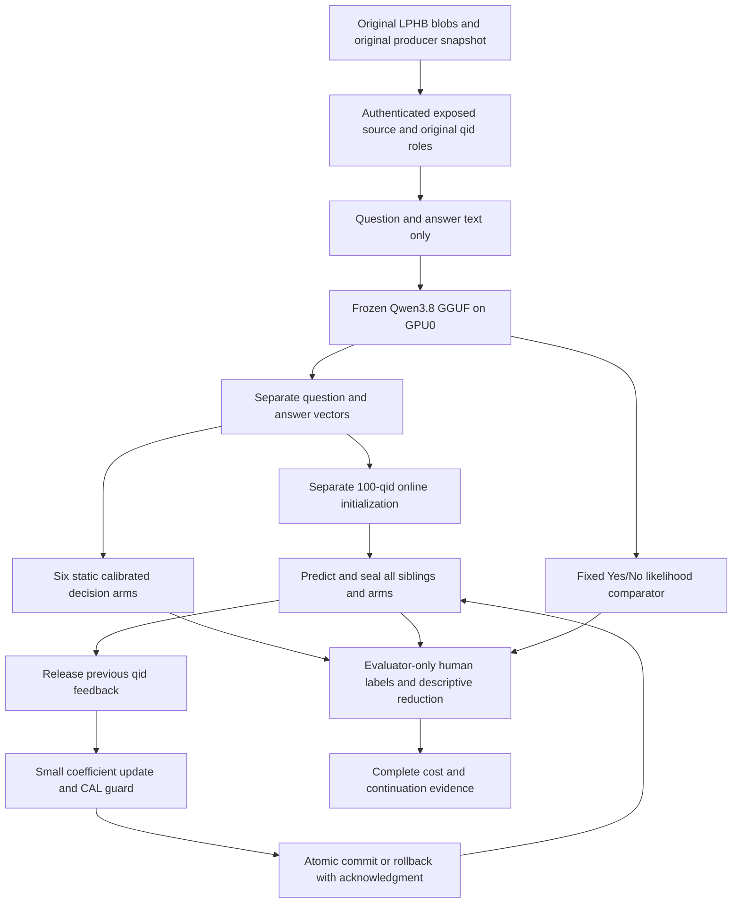
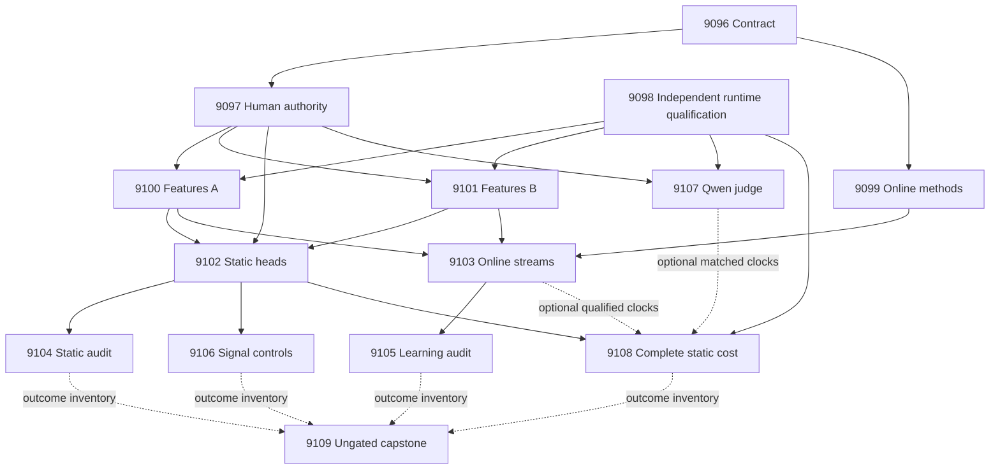

# Carnot Research Roadmap v776: Human Decision Signals, Causal Adaptation, and Complete Verification Costs

**Milestone:** 2026.11.776
**Created:** 2026-11-15
**Status:** Proposed; not activated or executed.
**Predecessor:** 2026.11.775, completed according to the operator and conductor log.
**Execution contract:** Exactly **14 tasks, Exp9096 through Exp9109**, in the order
shown in the exact task contract, across four phases. The embedded full task
objects and `research-roadmap-next.yaml` must be equal.

The completed design is preserved in
[V775 design](research-roadmap-v775-preserved-20261115.md), SHA256
`ce767f80004cb4b9aef48f4b49c46ce024f06e8bea251a4cf9aa4d33c631ab1b`.
The completed active queue is preserved in
[V775 queue](research-roadmap-v775-queue-preserved-20261115.yaml), SHA256
`10caaae6c06ef27417685d999ca8ff6293e275409eb08a75746b32d99502df37`.
The active queue and conductor remain unchanged. `research-complete.yaml` still
ends at V774; this archive lag is distinct from scheduler completion.

## What V775 proved

| Experiment | Primary evidence | Conclusion and limit |
|---|---|---|
| Exp9082 | Contract and frozen-method readiness both 1; administrative null | The fourteen-task authority can be checked. No science was measured. |
| Exp9083 | `fixture_custody_ready_score=1`; `custody_ready_score=0`; `complete_blocked_historical_attempt_topology_coverage` | The enforced fixture works. Missing historical topology authority still blocks fresh graph collection. |
| Exp9084 | 900 responses/300 qids inventoried; `complete_blocked_historical_producer_hash` | The exposed human source exists, but the historical producer must be authenticated from original bytes. |
| Exp9085–9092 | Explicit gate blocks or cascade skips; no declared scientific primaries | No graph collection, human embeddings, detector or online benefit was measured. Scheduler alternatives are separate records. |
| Exp9093 | `complete_null_inventory_unavailable_service`; inventory readiness 1, complete-service readiness 0 | Accounting works; complete scientific service costs remain unknown. |
| Exp9094 | `complete_circular_positive_susceptibility_mechanism`; numerical readiness 1 | A CPU diagnostic reproduced force-response cancellation despite equal binary energies. It did not measure device learning, sampling benefit or speedup. |
| Exp9095 | `complete_blocked_declared_gate`; reconciliation readiness 1 | All fourteen slots can be accounted for; independent generalization remains unproved. |

A changed prerequisite now supports a bounded human follow-up. A read-only Git
search located the exact Exp8389 producer at commit
`8e8b08277f98f6ef3a3680e5a9d2653d7761c69e`. Its SHA256 is
`52cc5fe1903f0c991ccb416903d873f14d1d01785329e4d005fe77fb2268d128`,
the value Exp9084 required. The other four Exp8389 code/config references match
current retained bytes. Exp9097 must still authenticate and replay the complete
source closure; finding one blob is not automatic readiness.

The natural next experiment is the pending human representation comparison.
Exp8435's old handcrafted capacity result remains null. The changed technique is
frozen Qwen text features, with equally optimized linear and donor-label controls.
The original author labels, outer question partition and exposed status remain.

## The three biggest gaps to the PRD

1. **Useful oracle-distinct verification (FR-12).** Infrastructure and exact
   constraints do not establish useful factual-error decisions. Measure whether
   frozen text features carry answer-specific signal and beat matched controls.
   This exposed panel is a development prototype. A future independent human
   source is still required to close the November 7 north star.
2. **Beneficial continuous self-learning (FR-11).** Working updates do not prove
   better future decisions or retained calibration. Test small coefficient updates
   with delayed labels, a causal donor control, operational guards and exact
   recovery. Keep Qwen weights fixed.
3. **A complete cost and hardware case (FR-05/08, NFR-01).** Cached head latency
   omits the expensive representation. Measure raw-text-to-decision cost and
   complete adaptation work before selecting a Rust port or accelerator. Existing
   Ising hardware does not implement arbitrary embedding or spline training.

## Research incorporated before design

The [dated research scan](../../research-references.md) records all eight requested
arXiv topics, all six secondary channels and access limitations before this plan.

| Primary work | Planned consequence | Claim boundary |
|---|---|---|
| [Distributional EBMs, 2605.18871](https://arxiv.org/abs/2605.18871) | Exp9106 tests question-only, answer-only, wrong-pair and generator shortcuts | Method-inspired controls, not a reproduction of its headline |
| [P(Yes), 2610.25474](https://arxiv.org/abs/2610.25474) | Exp9107 measures a fixed Qwen decision-score comparator | No search, relabeling or inherited logic-puzzle gain |
| [Online spline KAN, 2602.02056](https://arxiv.org/abs/2602.02056) | Exp9099/9103 use local coefficient updates; Exp9108 includes dense guard and storage work | No local FPGA training claim |
| [Continual Calibration, 2604.23987](https://arxiv.org/abs/2604.23987) | Exp9105 measures future Brier and retained error separately | No imported conformal guarantee |
| [Labeling Problem, 2610.08026](https://arxiv.org/abs/2610.08026) | Preserve factuality, missing second annotations and original qids | Human labels remain fallible and data remain exposed |
| [Agreement Is Not Assurance, 2611.15363](https://arxiv.org/abs/2611.15363) | Test prohibited-input dependence and separate custody from independence | Power-grid numerical claims do not transfer to text |

EBT/EBR, ARM–EBM citations, PAL/T-SKM-Net, Spilled Energy, ETS, thermodynamic
scaling and physical sampling were also checked. They do not justify another
unqualified generator, solver, logit-energy or board branch. The EBT citation scan
covered its first 25 citing papers, with more pages; ARM–EBM returned 11. GitHub
Trending was stale. Extropic and Kona pages remain vendor evidence. No new
independent human source was established.

## Architecture



The source reader uses authenticated historical code in private storage. It never
replaces an old producer hash with the current checkout hash. Current validation
runs against the new reader and its direct consumers; historical receipts keep
their original meaning. Numeric-feature workers receive neither reference text
nor labels, source tags, generator tags or annotation metadata. Labels enter only
permitted fitting, scheduled feedback, operational guard or final evaluation roles.

Static and online studies use different initial fits. The static study keeps the
original V726 150/50/100 TRAIN/CAL/TEST qids. The online study reserves 50 of those
150 TRAIN qids as future stream inputs before fitting its initial state. That
reservation does not change any original outer role or retroactively qualify data.
Both studies are exposed development; prediction-before-feedback controls causal
execution, not prior researcher exposure or model-pretraining contamination.

## Phase 1 — Qualify evidence and freeze methods (Exp9096–9099)

Exp9096 binds the fourteen-task contract and snapshots all protocols. Exp9097
replays the original human authority from the recovered producer. Exp9098 tests
actual hidden states and decision logits on twelve fixed label-free texts, with
independent embedding/logit readiness. Exp9099 implements the small causal learner
and proves its transaction behavior on private fixtures before real data.

Each has a positive control and explicit negative controls: changed original
bytes, role drift, incorrect hidden-state interfaces, padding sensitivity,
future-label access, duplicate feedback and actual process termination. Contract
readiness, source readiness and scientific benefit remain separate fields.

## Phase 2 — Extract representations and train decisions (Exp9100–9103)

Exp9100 and Exp9101 each process exactly 450 archived responses from 150 original
qids. Sort qids lexically, take the first 150 for A and the remaining 150 for B;
keep siblings and original roles intact. Both depend on source and embedding
readiness; B does not depend on A. Execution on GPU0 is sequential.

Exp9102 joins the complete 900-row corpus and trains the unchanged six-arm static
comparison. Exp9103 independently fits and runs the delayed learner; a static
scientific win is not its prerequisite. It cannot borrow the static model trained
on all 150 TRAIN groups. Positive controls demonstrate convergence and exact
recovery; negative controls reject missing shards, label leakage and altered seals.

## Phase 3 — Test signal, learning and the judge baseline (Exp9104–9107)

Exp9104 reduces all static predictions. Exp9105 independently audits causal benefit
and retention. Exp9106 refits matched signal ablations from the same vectors.
Exp9107 measures the fixed Qwen factual-decision comparator and can run even when
the embedding/head branch is unavailable. It requires source and logits readiness.

The judge does not create labels. None of these tasks changes an acceptance bound
or selects a favorable subset after results. A complete null is a useful terminal
result with readiness 1. Per-unit rows and adversarial controls detect duplicate
units, missing denominators, degenerate donors and changed/rehashed predictions.

## Phase 4 — Measure complete cost and reconcile (Exp9108–9109)

Exp9108 times the actual raw-text path on 20 fixed TEST qids, with three fresh
process repetitions and all siblings. It reports cached-head costs separately.
Qualified online clocks and judge clocks are optional comparisons; their absence
does not erase complete static costs. Exp9109 accounts for every task unconditionally,
including cascade skips, and states the exact prerequisite for each continuation.

The existing G1–G4 publication gate retains its original scope. It cannot confer
publication readiness on this milestone's exposed human study. No external
publication, active-roadmap change or live ARC solve is scheduled.

## Frozen scientific protocols

### Static factual-error decisions

Use Exp9084's protocol unchanged: independently mean-pool last-layer nonpadding
question and answer tokens, L2-normalize each, then concatenate. Use the embedded
GGUF tokenizer, no BOS/chat template, question cap 256 and answer cap 768, with
right truncation and recorded original lengths. Empty inputs map to flagged zero
vectors; padding never enters the mean. No reference, label or metadata feature.

Fit TRAIN-only center/std, Gaussian projection to 27 dimensions (seed 775084),
and TRAIN min/max scaling to [-1,1]. Freeze transformations. The six arms are
prevalence, text-length logistic, projected linear, full-embedding regularized
linear, projected fixed-cubic spline and whole-qid donor spline. Use degree 3,
knots [-1,-1,-1,-1,-0.5,0,0.5,1,1,1,1], intercept + 27 linear + 189 basis columns.
Minimize mean binary logloss plus 0.5*0.01 times squared nonintercept coefficients.
Require finite fit and gradient infinity norm <=1e-6; maxiter 2000, gtol 1e-7,
ftol 1e-12. No architecture or regularization search.

Only CAL chooses temperature from [0.5,1,2,4], ascending ties. Accept at
p(error)<=0.1, reject at >=0.9, otherwise escalate. Primary target is original A1
factuality. A2 sensitivity uses only actual observed labels; -1 remains missing.
Report Brier, logloss, coverage, accepted error and exact-half-coverage error.
Use 10,000 paired TEST-qid bootstrap draws, seed 775092, preserving all siblings;
rerank half-coverage choices inside each draw. Zero accepted count gives undefined
risk. The 95% intervals are conditional descriptive development intervals.

`static_signal_score=1` requires all five spline-versus-control Brier improvement
lower endpoints >0 and no empirical accepted-error increase against projected
linear. Undefined accepted risk cannot pass. This is a continuation signal, not a
confirmatory generalization gate. Audit readiness is independent of this score.

### Continuous self-learning

Sort the original 150 TRAIN qids by SHA256 of `v776-online` followed by the original
qid string. First 100 initialize the learner; the remaining 50 form ten disjoint
streams of five qids. Keep original CAL50 as operational guard and TEST100 as
retention. Refit all transforms on the 100 initialization groups only. The static
model, its transforms and its extra 50 training groups cannot leak into this fit.

Five arms start from comparable frozen initial states: frozen spline, adaptive
spline, bias-only spline, adaptive linear and donor-label adaptive spline. Donors
are a fixed seed-776099 assignment from already-labeled initialization qids,
preserving sibling positions; they never use future truth. Freeze the exact map
in Exp9099 and retain actual changed-label fractions. No stream is a new dataset.

Use one coefficient vector per arm, fixed temperature 1, learning rate 0.05,
AdaGrad accumulator initially zero and epsilon 1e-8. Gradient is
`(sigmoid(theta·phi)-y)*phi + 0.01*(theta-theta_initial)`, without intercept
anchoring. Bias-only zeros other coordinates. Clip gradient L2 norm to 1.
After the three sibling updates, promote only if CAL Brier increase <=0.005 and
CAL classification-error increase <=0 against that arm's initial state. Otherwise
restore coefficients and accumulators, while acknowledging consumed feedback.
These are operational guards; research retention is never used for promotion.

Seal all arms' predictions for all siblings of group g, then release g-1 labels.
Drain the last group after all predictions. Reset every stream to its initial
state. Seal retention predictions before evaluator access. Persist predictions,
parameters, accumulators, pending feedback and acknowledgments atomically. Real
hard-exit tests cover prediction fsync, feedback receipt and state replacement.
Exact restart must reproduce the uninterrupted state and predictions.

Score future Brier on groups 2–5: 40 unique qids/120 responses across ten streams.
Use 10,000 paired stream-bootstrap draws, seed 776105, one-sided tail 0.05/6.
The six bounds are four adaptive-spline Brier improvements over the other arms
(lower >0), retained Brier increase (upper <=0.005), and retained error increase
(upper <=0). All must pass with exact recovery for `learning_signal_score=1`.
Retention is the same 100 qids in each stream, not 1,000 independent questions.
Report per-qid changes averaged across streams as well. Ten streams have limited
power; intervals are conditional on the fixed initial fit, guard and retention.
A null does not justify tuning these bounds or claiming the architecture failed
on all future data. No graph bound is changed by this separate human experiment.

### Signal controls and fixed Qwen comparator

Exp9106 uses question-only, answer-only, matched QA and wrong-question pairing.
Zero the omitted half for single-input controls. Wrong pairing is a whole-qid
within-role derangement, seed 776106, with answer/target/sibling position fixed.
Refit TRAIN-only transforms and matched projected linear/spline heads for each.
The matched representation must reproduce the main arms within 1e-8. Inspect
within-qid discrimination only where sibling targets differ, with actual support.
Generator and source identities appear only as evaluation slices.

Exp9107 scores the literal fixed question: “Does the answer contain any factually
false specific claim? Reply Yes or No.” It uses the same 256/768 retained text
budgets with the embedded chat template. Compare full teacher-forced likelihoods
of Yes and No from identical prompt state; normalize with logsumexp. Do not use
only top-k probabilities or ignore continuation tokens. Sampling and generation
counts are zero. CAL selects temperature; TEST stays evaluator-only until sealing.
This is a current frozen Qwen judgment of archived answers, not current Qwen answer
accuracy, an automated label source, a search experiment or a reproduction of P(Yes).

### Complete costs and hardware

The fixed timing cohort is the first 20 original TEST qids in lexical order,
all 60 answers. Three process repetitions use arm-order seed 776108. Measure
projected-linear, projected-spline and full-embedding-linear paths from raw text
through tokenizer, embeddings, transforms, decision and serialization. Separate
cold start, warm uncached requests, question-cache hits and cached-head-only work.
Require score parity atol 1e-5/rtol 1e-4 and exact typed-decision parity. Repeats do
not increase the cohort size. Matched judge costs require compatible input/device
boundaries and measured quality on the same rows; otherwise leave them unavailable.

Online adaptation cost includes guard scans, rejected updates, tail drain, durable
writes and recovery from qualified Exp9103 clocks. Missing online evidence leaves
that boundary unavailable without blocking static timing. Amdahl ceilings require
qualified nonoverlapping component clocks; otherwise report null. Energy requires
synchronized measured power, never nominal TDP multiplied by latency.

## Dependency graph



Structured YAML gates are authoritative. Runtime has separate embedding/logit
keys. No gate requires a positive benefit, no task requires a retired ID, and the
capstone has no gates. Gate keys are spelled identically in producer REQUIRED
ARTIFACT FIELDS. Missing files, missing fields and measured zeros remain distinct.

## Hardware requirements and execution limits

| Resource | Required work and boundary |
|---|---|
| CPU, RAM, private disk | Historical replay, small fits, bootstrap, durable learning and evidence reduction. Size disk/memory needs from actual files before running. |
| GPU0, RTX 3090 24 GB | Frozen Qwen feature extraction, teacher-forced judge scores and complete inference timing; require an actual lease and offload evidence. |
| GPU1 | Reserved for its current owner; no dual-GPU availability assumption. |
| Cached Qwen3.8-27B Q4_K_M | Pin `unsloth/Qwen3.8-27B-GGUF`, GGUF/tokenizer/runtime hashes. A cache miss blocks; no model substitution or download. |
| KV260 | Preserve only evidenced Ising sampling and k_max<=5. No current embedding or spline-training support is assumed. |
| PolarFire / GateMate | PolarFire CPU dispatch only; GateMate's unchanged 0xffffffff JTAG block remains. No fresh probe or flash. |
| NPU / TSU / Kona | Future or vendor context; no authenticated local execution or borrowed efficiency figure. |

No purchase is required. The wishlist's sparse-update/FPGA direction remains a
future option, conditional on useful learning and a material measured fraction
of complete work. The 100x acceleration target remains an aspiration. There is
no Rust implementation claim in this milestone; a port needs a measured useful
kernel first. Exp9094's numerical result remains preserved, not repeated.

Every LLM-using task (9098, 9100, 9101, 9107, 9108) includes the mandated model in
MODEL_SPECS. Each performs embeddings or teacher-forced scoring without generated
tokens, so each declares `model_load_no_generation` with the 2-second floor.
No task performs full or bounded generation. If future scope adds generation,
a small fixed budget requires `model_bounded_generation` (10 seconds); real full
runs require `model_full_generation` (60 seconds). Never pad duration. Legacy
small models can be CPU smoke fixtures only, with no headline substitution.

Task estimates are 30–70 minutes; the total is 820 minutes before gates and reuse.
These are budgets, not observed timings. The runtime fixture measures throughput
before either 450-row shard. Each task stops measurement by 3300 seconds and
reserves 1200 seconds for checks under the 4800-second cap; censored work remains
explicit. Emit flushed phase boundaries, before/after long calls and supervised
heartbeats at least every 60 seconds, including inside loops. Keep silent gaps
below 600 seconds. Write files over about 200 lines across separate tool calls,
with progress between them. This applies during code authoring as well as runs.

Exp9096/9097 use Opus with 100 turns for contract and historical-source work.
Exp9099 uses Codex `gpt-6.1-sol` for the specified update/recovery implementation.
Routine scientific tasks retain the user's default Sonnet route. The capstone
has 20 turns. No luna or Gemini task is planned. Backend routing follows the
current request where it supersedes older repository defaults.

## Verification, failure lineage and claim boundaries

Before implementation, each task must confirm its REQ/SCENARIO and write meaningful
failing controls. Use private output roots, real CLI/subprocess coverage, scoped
unit tests, 100% new statements without exclusions, Ruff, strict types and explicit
spec tracing. Apply E2E-018/021 to authority/reduction and E2E-020 to recovery.
The original artifact and row validators remain unchanged. Preserve historical
assertions and pins; no global suite pass is inferred from scoped verification.

Each comparative task requires per-unit rows, intended/attempted/completed/failed/
censored counts and the correct independent unit. Every task declares the closed
verdict enum, precise gate diagnostics, field principles and actual substrate.
External unchanged blocks are terminal `blocked`; `partial` is reserved for
unfinished owned work. Complete nulls remain measured findings. Readiness fields
are integers 0/1 and never aliases for favorable scientific outcomes.

Repeated human and cost scopes carry actual prior verdicts plus changed prerequisites
and `retire_if_same_verdict: true`. The real Exp9088 scheduler artifact says
`blocked_gate_check_failed`; no verdict is invented for the absent Exp9092 primary.
Signal controls carry the earlier encoder-diagnosis null. The judge carries the
shared human-source failure; no previous judge outcome is invented.
Retirement recommendations identify exact unchanged scopes; they do not delete
results or edit the exclusion manifest. Graph collection, its original seven/ten
bounds, independent-source acquisition, generator training, decoding changes and
new ARC solves are outside this plan. The capstone records the prerequisites to
reopen them. No ARC solve-provenance field is applicable because no task claims a
level solve.

**Decentralization implications:** All inference and learning remain local, with
open cached model weights and existing interfaces. No closed-weight provider,
customer-data transfer, new dependency or external publication is introduced.

Planning validation covers exact table/full-object equality, schemas, gates,
exclusion lineage, scoped unit/lint/spec checks and private E2E fixtures. It does
not execute these future experiments or validate a new scientific claim. The
architecture's general reconciliation date and existing repository-wide health
issues remain separately reported.

## Exact task contract

The visible table and embedded complete task objects match the staged YAML exactly.

| Order | ID | Title | Phase | Deliverable |
|---:|---|---|---:|---|
| 1 | exp9096-contract | Exp9096: Bind fourteen human-decision tasks and preserve V775 outcomes | 1 | results/experiment_9096_v776_contract.json |
| 2 | exp9097-human-authority | Exp9097: Authenticate original human producer bytes and retained question roles | 1 | results/experiment_9097_v776_human_authority.json |
| 3 | exp9098-embedding-runtime | Exp9098: Qualify frozen Qwen hidden states and decision logits on fixed texts | 1 | results/experiment_9098_v776_embedding_runtime.json |
| 4 | exp9099-online-methods | Exp9099: Freeze causal human coefficient updates and exact recovery | 1 | results/experiment_9099_v776_online_methods.json |
| 5 | exp9100-embeddings-a | Exp9100: Extract frozen human representations in shard A | 2 | results/experiment_9100_v776_embeddings_a.json |
| 6 | exp9101-embeddings-b | Exp9101: Extract frozen human representations in shard B | 2 | results/experiment_9101_v776_embeddings_b.json |
| 7 | exp9102-static-heads | Exp9102: Train the frozen six-arm human decision comparison | 2 | results/experiment_9102_v776_static_heads.json |
| 8 | exp9103-online-streams | Exp9103: Measure delayed human learning with sealed predictions and recovery | 2 | results/experiment_9103_v776_online_streams.json |
| 9 | exp9104-static-audit | Exp9104: Audit factual-error decisions against every frozen comparator | 3 | results/experiment_9104_v776_static_audit.json |
| 10 | exp9105-learning-audit | Exp9105: Audit causal benefit and calibration retention without sample inflation | 3 | results/experiment_9105_v776_learning_audit.json |
| 11 | exp9106-signal-controls | Exp9106: Separate answer information from question and generator shortcuts | 3 | results/experiment_9106_v776_signal_controls.json |
| 12 | exp9107-qwen-judge | Exp9107: Measure fixed Qwen factual-decision probabilities on the same human panel | 3 | results/experiment_9107_v776_qwen_judge.json |
| 13 | exp9108-complete-cost | Exp9108: Measure complete human decision costs and justified hardware limits | 4 | results/experiment_9108_v776_complete_cost.json |
| 14 | exp9109-capstone | Exp9109: Reconcile fourteen outcomes and decide the human verification continuation | 4 | results/experiment_9109_v776_capstone.json |

<!-- V776_TASK_CONTRACT_START -->
```json
{
  "milestone": "2026.11.776",
  "milestone_title": "Human Decision Signals, Causal Adaptation, and Complete Verification Costs",
  "milestone_doc": "openspec/change-proposals/research-roadmap-vNEXT.md",
  "tasks": [
    {
      "id": "exp9096-contract",
      "title": "Exp9096: Bind fourteen human-decision tasks and preserve V775 outcomes",
      "phase": 1,
      "track": "research",
      "priority": "high",
      "requires_gpu": false,
      "max_turns": 100,
      "estimated_wall_time_min": 30,
      "per_unit_rows": true,
      "milestone": "2026.11.776",
      "deliverable": "results/experiment_9096_v776_contract.json",
      "inference_substrate_class": "no_model_load",
      "MODEL_SPECS": [],
      "gated_on": [],
      "prior_failures": [
        {
          "experiment_id": "exp9095-capstone",
          "verdict": "complete_blocked_declared_gate",
          "addressed_by": "Separate administrative task binding from science; record the recovered original human producer and defer the unchanged graph chain. This task does not repeat a scientific capstone.",
          "retire_if_same_verdict": true
        }
      ],
      "prompt": "CONTEXT:\nWork in {project_root} on {date}. V775 completed fourteen scheduler slots but produced no new graph or human decision measurement. The archive still ends at V774. This is planning follow-through, not activation.\nEXISTING CODE TO READ FIRST:\nCLAUDE.md; CODEX.md; research-program.md; ops/north-star.md; ops/e2e-test-plan.md; ops/exclusion_manifest.yaml; research-references.md (2026-11-15 V776 scan); openspec/capabilities/research-reporting/spec.md; scripts/experiment_template.py; python/carnot/reporting/primary_publication.py; python/carnot/reporting/current_work_receipt.py; python/carnot/reporting/roadmap_contract.py; python/carnot/reporting/v775_contract.py; scripts/conductor_gates.py; scripts/audit_roadmap_gates.py; results/experiment_9095_v775_capstone.json; openspec/change-proposals/research-roadmap-v775-preserved-20261115.md; openspec/change-proposals/research-roadmap-v775-queue-preserved-20261115.yaml\nTASK:\nBind fourteen human-decision tasks and preserve V775 outcomes. Deliver results/experiment_9096_v776_contract.json; implement scripts/experiments/experiment_9096_v776_contract.py using reusable library code. MODEL_SPECS: []; inference_substrate_class: no_model_load. Do not load an LLM; current_llm_invocations=0.\nCONCRETE STEPS:\n1. PRECONDITIONS: Authenticate exact upstream fields and immutable input references before dependent work. Use private outputs; never rewrite a historical producer to match current bytes. Missing external inputs produce complete_blocked_<check> with verdict_class=blocked and gate_check_summary. No fabricated substitutes.\n2. Emit a flushed progress line at every phase boundary and before and after every model load, generation, benchmark and subprocess that can take minutes. Emit progress inside long loops. Supervise long calls with flushed heartbeats at least every 60 seconds; every silent gap must stay below 600 seconds. Write any file over about 200 lines in several tool calls of at most 200 lines, with a progress message between calls; never write one huge file in one tool call.\n3. Before implementation, use rg to inspect callers and confirm REQ-REPORT-9096-V776 and SCENARIO-REPORT-9096-V776; extend the relevant spec and write failing controls first. Reuse existing helpers. Freeze the protocol before outcomes. No acceptance threshold or cohort change after measurement.\n4. Compare all fourteen full task objects, visible table and embedded JSON against the staged queue before activation or authenticated active queue after activation. Freeze the actual authority. Require exact IDs exp9096 through exp9109, order, fields, prompts, gates, substrates, unique title[:50].strip() keys and unused experiment IDs. Check that every gate field is declared by an earlier producer. Reuse the existing brace-encoding normalization; do not edit the conductor.\n5. Record every V775 outcome, including missing declared primaries and separate scheduler alternatives. Preserve the custody fixture success, historical topology block, human hash mismatch, cost inventory null and CPU susceptibility result. Record exact source hashes; never infer science from scheduler OK or fill absent numbers.\n6. Freeze the inherited Exp9084 static protocol unchanged and this design's separate online, signal-control, judge and timing protocols before scientific work. Record graph seven/ten-bound studies as deferred unchanged, not replaced by the human study. Keep GAP-ORACLE-DISTINCT and GAP-DETECTOR-AUROC-4208 open. Read the current ARC registry/frontier only for the capstone boundary; do not run a game or invent a new receipt.\n7. Freeze owned and direct-consumer validation commands before measurement. Run meaningful pytest controls, 100 percent newly owned statement coverage with zero exclusions, Ruff check/format, strict mypy, and explicit-path spec coverage. Run private actual CLI success/block/tamper and cold replay outside the checkout without PYTHONPATH (E2E-018/021); delayed learning and recovery also require E2E-020. Stop measurement by 3300 seconds and reserve 1200 seconds for validation within the 4800-second cap. Keep broader historical health failures separate; failed affected checks disqualify readiness.\n8. Recompute every aggregate from retained per-unit rows. Run unchanged scripts/adversarial_verify.py and scripts/verdict_row_consistency_lint.py with strict row checking under heartbeat supervision. Use primary_publication only after owned checks pass. Reconcile openspec/, _bmad/traceability.md, ops/status.md and ops/changelog.md. Preserve old artifacts, assertions, source pins and exclusions. Do not activate a roadmap, change public defaults, publish externally or train generator weights.\nREQUIRED ARTIFACT FIELDS:\n- honest_verdict: complete_*; verdict_class: positive | circular_positive | null | blocked | disqualified | partial. Only unfinished owned work may be partial. Unchanged external missing/retired/gated inputs are terminal blocked.\n- gate_check_summary: check, upstream, path, sha256, artifact_field, op, expected, observed, passed; mandatory for blocked results. Distinguish missing_file, missing_field and observed zero.\n- rows: per-unit identity, original qid/group, arm/condition, seed, absolute metric, numerator, denominator, status and exclusion/censor reason. intended/attempted/completed/failed/censored counts; sample_size_budget and effective_independent_groups. Repeats, siblings and seeds do not multiply independent units.\n- verifier_is_oracle, claim_scope, exposure_scope, independent_generalization_score=0. LPHB is exposed development. Administrative readiness and CPU fixtures establish no scientific benefit; exact-oracle success is circular_positive. No current ARC solve is claimed.\n- MODEL_SPECS, inference_substrate_class, current_llm_invocations, model_invocation_counts, duration_s, random_seed, reproducibility_checksum, code_config_hashes, source_references, current_work_receipts, validation_receipts, required_checks_passed, acceptance_gates and field_principles. Explain each important field by its distinct scientific principle. Current model work stays separate from historical provenance.\n- contract_ready_score: integer 0/1; full_task_objects, canonical_task_hash, authority_snapshots, title_key_rows, previous_outcome_rows, protocol_references, closed_scope_rows, archive_lag.\nRun command: cd {project_root} && .venv/bin/python scripts/experiments/experiment_9096_v776_contract.py --date {date}\nDo NOT push. Do NOT modify scripts/research_conductor.py.",
      "model": "opus"
    },
    {
      "id": "exp9097-human-authority",
      "title": "Exp9097: Authenticate original human producer bytes and retained question roles",
      "phase": 1,
      "track": "research",
      "priority": "high",
      "requires_gpu": false,
      "max_turns": 100,
      "estimated_wall_time_min": 55,
      "per_unit_rows": true,
      "milestone": "2026.11.776",
      "deliverable": "results/experiment_9097_v776_human_authority.json",
      "inference_substrate_class": "no_model_load",
      "MODEL_SPECS": [],
      "gated_on": [
        {
          "upstream": "exp9096-contract",
          "artifact_field": "contract_ready_score",
          "op": "==",
          "value": 1
        }
      ],
      "prior_failures": [
        {
          "experiment_id": "exp9084-human-methods",
          "verdict": "complete_blocked_historical_producer_hash",
          "addressed_by": "The exact original producer SHA256 was located in Git; authenticate and replay that immutable blob instead of comparing a historical pin with mutable checkout code.",
          "retire_if_same_verdict": true
        },
        {
          "experiment_id": "exp8435-capacity-benefit-audit",
          "verdict": "complete_null_v726_capacity_benefit_audit",
          "addressed_by": "Keep the original null and all question roles; subsequent tasks change the frozen representation, not the labels or exposure status.",
          "retire_if_same_verdict": true
        }
      ],
      "prompt": "CONTEXT:\nWork in {project_root} on {date}. Exp9084 stopped on one historical producer hash. Planning found the exact blob at Git commit 8e8b08277f98f6ef3a3680e5a9d2653d7761c69e; all four other Exp8389 code/config references already match. LPHB remains exposed development.\nEXISTING CODE TO READ FIRST:\nCLAUDE.md; CODEX.md; research-program.md; ops/north-star.md; ops/e2e-test-plan.md; ops/exclusion_manifest.yaml; research-references.md (2026-11-15 V776 scan); openspec/capabilities/research-reporting/spec.md; scripts/experiment_template.py; python/carnot/reporting/primary_publication.py; python/carnot/reporting/current_work_receipt.py; python/carnot/reporting/human_methods_9084.py; python/carnot/reporting/human_methods_runner_9084.py; python/carnot/reporting/human_label_custody_8389.py; python/carnot/reporting/released_question_identity_8403.py; openspec/change-proposals/v726-methods-protocol.json; results/experiment_8389_v723_human_label_custody.json; results/experiment_9084_v775_human_methods.json; results/experiment_8435_v726_capacity_benefit_audit.json\nTASK:\nAuthenticate original human producer bytes and retained question roles. Deliver results/experiment_9097_v776_human_authority.json; implement scripts/experiments/experiment_9097_v776_human_authority.py using reusable library code. MODEL_SPECS: []; inference_substrate_class: no_model_load. Do not load an LLM; current_llm_invocations=0.\nCONCRETE STEPS:\n1. PRECONDITIONS: Authenticate exact upstream fields and immutable input references before dependent work. Use private outputs; never rewrite a historical producer to match current bytes. Missing external inputs produce complete_blocked_<check> with verdict_class=blocked and gate_check_summary. No fabricated substitutes.\n2. Emit a flushed progress line at every phase boundary and before and after every model load, generation, benchmark and subprocess that can take minutes. Emit progress inside long loops. Supervise long calls with flushed heartbeats at least every 60 seconds; every silent gap must stay below 600 seconds. Write any file over about 200 lines in several tool calls of at most 200 lines, with a progress message between calls; never write one huge file in one tool call.\n3. Before implementation, use rg to inspect callers and confirm REQ-REPORT-9097-V776 and SCENARIO-REPORT-9097-V776; extend the relevant spec and write failing controls first. Reuse existing helpers. Freeze the protocol before outcomes. No acceptance threshold or cohort change after measurement.\n4. Use git show on the named commit to recover human_label_custody_8389.py into private immutable storage. Require SHA256 52cc5fe1903f0c991ccb416903d873f14d1d01785329e4d005fe77fb2268d128. Authenticate every original manifest, author blob, remaining producer/config reference and V726 role table by its original hash. Do not change the current source, old primary, old expected hash or public validator.\n5. Implement a new explicit historical-input reader for this study that resolves cited code to its authenticated snapshot. Replay original label mapping and group projection in an isolated subprocess with that code; authenticate imported dependencies actually used. Compare all 900 source item IDs, qids, labels and roles with the retained independent author bytes. Prove current-source drift is not accepted as old authority. Missing any required closure blocks, even if the first recovered blob matches.\n6. Require 300 original qids with three archived answers each: TRAIN150/CAL50/TEST100 groups, or 450/150/300 rows. Retain A1 factual-error labels for900 rows and actual A2 support for300 rows/100 qids; -1 is missing. Preserve prior exposure and capacity-benefit null. Emit source_ready_score only for authentic exposed data; independent_eval_ready_score remains0.\n7. Reuse Exp9084.protocol() without changing the static six arms, transforms, loss, calibration or split. Seal feature shards by lexically sorted original qid: first150 groups in A, remaining150 in B, keeping all three siblings and original roles. Freeze label-free feature views, evaluator-only labels and the hashes consumed by later tasks. Positive replay must accept original bytes; changed/rehashed labels, substituted producer and split drift must fail.\n8. Freeze owned and direct-consumer validation commands before measurement. Run meaningful pytest controls, 100 percent newly owned statement coverage with zero exclusions, Ruff check/format, strict mypy, and explicit-path spec coverage. Run private actual CLI success/block/tamper and cold replay outside the checkout without PYTHONPATH (E2E-018/021); delayed learning and recovery also require E2E-020. Stop measurement by 3300 seconds and reserve 1200 seconds for validation within the 4800-second cap. Keep broader historical health failures separate; failed affected checks disqualify readiness.\n9. Recompute every aggregate from retained per-unit rows. Run unchanged scripts/adversarial_verify.py and scripts/verdict_row_consistency_lint.py with strict row checking under heartbeat supervision. Use primary_publication only after owned checks pass. Reconcile openspec/, _bmad/traceability.md, ops/status.md and ops/changelog.md. Preserve old artifacts, assertions, source pins and exclusions. Do not activate a roadmap, change public defaults, publish externally or train generator weights.\nREQUIRED ARTIFACT FIELDS:\n- honest_verdict: complete_*; verdict_class: positive | circular_positive | null | blocked | disqualified | partial. Only unfinished owned work may be partial. Unchanged external missing/retired/gated inputs are terminal blocked.\n- gate_check_summary: check, upstream, path, sha256, artifact_field, op, expected, observed, passed; mandatory for blocked results. Distinguish missing_file, missing_field and observed zero.\n- rows: per-unit identity, original qid/group, arm/condition, seed, absolute metric, numerator, denominator, status and exclusion/censor reason. intended/attempted/completed/failed/censored counts; sample_size_budget and effective_independent_groups. Repeats, siblings and seeds do not multiply independent units.\n- verifier_is_oracle, claim_scope, exposure_scope, independent_generalization_score=0. LPHB is exposed development. Administrative readiness and CPU fixtures establish no scientific benefit; exact-oracle success is circular_positive. No current ARC solve is claimed.\n- MODEL_SPECS, inference_substrate_class, current_llm_invocations, model_invocation_counts, duration_s, random_seed, reproducibility_checksum, code_config_hashes, source_references, current_work_receipts, validation_receipts, required_checks_passed, acceptance_gates and field_principles. Explain each important field by its distinct scientific principle. Current model work stays separate from historical provenance.\n- source_ready_score: integer 0/1; independent_eval_ready_score=0; historical_producer_snapshot_reference, replay_receipt, label_authority_reference, original_group_partition_reference, static_protocol_reference, source_manifest_reference, shard_a_roster_reference, shard_b_roster_reference, exposure_ledger, role_counts.\nRun command: cd {project_root} && .venv/bin/python scripts/experiments/experiment_9097_v776_human_authority.py --date {date}\nDo NOT push. Do NOT modify scripts/research_conductor.py.",
      "model": "opus"
    },
    {
      "id": "exp9098-embedding-runtime",
      "title": "Exp9098: Qualify frozen Qwen hidden states and decision logits on fixed texts",
      "phase": 1,
      "track": "research",
      "priority": "high",
      "requires_gpu": true,
      "max_turns": 50,
      "estimated_wall_time_min": 50,
      "per_unit_rows": true,
      "milestone": "2026.11.776",
      "deliverable": "results/experiment_9098_v776_embedding_runtime.json",
      "inference_substrate_class": "model_load_no_generation",
      "MODEL_SPECS": [
        {
          "hf_id": "unsloth/Qwen3.8-27B-GGUF",
          "quantization": "Q4_K_M"
        }
      ],
      "gated_on": [],
      "prior_failures": [
        {
          "experiment_id": "exp9088-human-embeddings",
          "verdict": "blocked_gate_check_failed",
          "addressed_by": "Qualify the actual frozen representation independently of the prior source gate; source authentication now has a located immutable producer. No unchanged CUDA repair is attempted.",
          "retire_if_same_verdict": true
        }
      ],
      "prompt": "CONTEXT:\nWork in {project_root} on {date}. The human source can now be authenticated separately. Runtime capability must qualify before a900-answer feature job. This task uses twelve declared fixture texts, not natural labels or a CUDA environment repair.\nEXISTING CODE TO READ FIRST:\nCLAUDE.md; CODEX.md; research-program.md; ops/north-star.md; ops/e2e-test-plan.md; ops/exclusion_manifest.yaml; research-references.md (2026-11-15 V776 scan); openspec/capabilities/research-reporting/spec.md; scripts/experiment_template.py; python/carnot/reporting/primary_publication.py; python/carnot/reporting/current_work_receipt.py; python/carnot/inference/sota_models.py; python/carnot/inference/gguf_metadata.py; python/carnot/inference/llama_cpp_process.py; python/carnot/embeddings/activation_extractor.py; python/carnot/reporting/human_methods_9084.py; results/experiment_9058_v773_collect_a.json\nTASK:\nQualify frozen Qwen hidden states and decision logits on fixed texts. Deliver results/experiment_9098_v776_embedding_runtime.json; implement scripts/experiments/experiment_9098_v776_embedding_runtime.py using reusable library code. MODEL_SPECS: [(\"hf_id\": \"unsloth/Qwen3.8-27B-GGUF\", \"quantization\": \"Q4_K_M\")]; inference_substrate_class: model_load_no_generation. No generated tokens; freeze all Qwen weights.\nCONCRETE STEPS:\n1. PRECONDITIONS: Authenticate exact upstream fields and immutable input references before dependent work. Use private outputs; never rewrite a historical producer to match current bytes. Missing external inputs produce complete_blocked_<check> with verdict_class=blocked and gate_check_summary. No fabricated substitutes.\n2. Emit a flushed progress line at every phase boundary and before and after every model load, generation, benchmark and subprocess that can take minutes. Emit progress inside long loops. Supervise long calls with flushed heartbeats at least every 60 seconds; every silent gap must stay below 600 seconds. Write any file over about 200 lines in several tool calls of at most 200 lines, with a progress message between calls; never write one huge file in one tool call.\n3. Before implementation, use rg to inspect callers and confirm REQ-REPORT-9098-V776 and SCENARIO-REPORT-9098-V776; extend the relevant spec and write failing controls first. Reuse existing helpers. Freeze the protocol before outcomes. No acceptance threshold or cohort change after measurement.\n4. Resolve cached_current_model(gpu_index=0), pin GGUF, embedded tokenizer and llama.cpp build hashes, verify the GPU0 lease, free memory and actual CUDA offload. GPU1 belongs to another workload. A cache/runtime failure blocks; no small-model fallback, alternate quantization, Transformers tokenizer, new download or simulated inference. Record actual work and never pad duration to meet a floor.\n5. Freeze twelve label-free texts covering empty input, short text, unicode, repeated tokens, exact token limits, over-limit truncation and padding. Exercise the actual cached GGUF on GPU0. Match Exp9084 mean-last-layer-nonpadding pooling, separate question/answer L2 normalization, no BOS/chat template and token caps256/768. Record raw hidden width, token counts, finite vectors and real offload; zero vectors are allowed only for the declared empty case.\n6. Compare serial versus batch extraction, padding invariance and a repeated cold-process extraction using atol1e-5/rtol1e-4. Require all fixture checks and actual hidden states for embeddings_ready_score=1. An API returning normalized classifier scores instead of the required hidden states fails; do not substitute another layer or model.\n7. Independently test unmasked raw next-token logits and teacher-forced likelihoods of the literal continuations Yes and No, with fresh state for each continuation. Sum full continuation log probabilities and normalize the two alternatives by logsumexp. Emit logits_ready_score independently from embedding readiness. This reads scores and generates zero tokens; model_load_no_generation has a2-second floor, not60 seconds.\n8. Time the fixed fixture lengths to estimate both450-row shard costs before large extraction. Retain actual times, model/build hashes and memory use; a projected measurement above3300 seconds yields an honest feasibility limit, never a changed token cap. Test cancellation, cache miss, missing offload, wrong hidden width and non-finite output.\n9. Freeze owned and direct-consumer validation commands before measurement. Run meaningful pytest controls, 100 percent newly owned statement coverage with zero exclusions, Ruff check/format, strict mypy, and explicit-path spec coverage. Run private actual CLI success/block/tamper and cold replay outside the checkout without PYTHONPATH (E2E-018/021); delayed learning and recovery also require E2E-020. Stop measurement by 3300 seconds and reserve 1200 seconds for validation within the 4800-second cap. Keep broader historical health failures separate; failed affected checks disqualify readiness.\n10. Recompute every aggregate from retained per-unit rows. Run unchanged scripts/adversarial_verify.py and scripts/verdict_row_consistency_lint.py with strict row checking under heartbeat supervision. Use primary_publication only after owned checks pass. Reconcile openspec/, _bmad/traceability.md, ops/status.md and ops/changelog.md. Preserve old artifacts, assertions, source pins and exclusions. Do not activate a roadmap, change public defaults, publish externally or train generator weights.\nREQUIRED ARTIFACT FIELDS:\n- honest_verdict: complete_*; verdict_class: positive | circular_positive | null | blocked | disqualified | partial. Only unfinished owned work may be partial. Unchanged external missing/retired/gated inputs are terminal blocked.\n- gate_check_summary: check, upstream, path, sha256, artifact_field, op, expected, observed, passed; mandatory for blocked results. Distinguish missing_file, missing_field and observed zero.\n- rows: per-unit identity, original qid/group, arm/condition, seed, absolute metric, numerator, denominator, status and exclusion/censor reason. intended/attempted/completed/failed/censored counts; sample_size_budget and effective_independent_groups. Repeats, siblings and seeds do not multiply independent units.\n- verifier_is_oracle, claim_scope, exposure_scope, independent_generalization_score=0. LPHB is exposed development. Administrative readiness and CPU fixtures establish no scientific benefit; exact-oracle success is circular_positive. No current ARC solve is claimed.\n- MODEL_SPECS, inference_substrate_class, current_llm_invocations, model_invocation_counts, duration_s, random_seed, reproducibility_checksum, code_config_hashes, source_references, current_work_receipts, validation_receipts, required_checks_passed, acceptance_gates and field_principles. Explain each important field by its distinct scientific principle. Current model work stays separate from historical provenance.\n- embeddings_ready_score, logits_ready_score: independent integer 0/1 fields; runtime_reference, fixture_rows, parity_errors, pooling_contract, tokenizer_metadata, raw_logit_checks, duration_projection, model_loads, embedding_calls, generated_tokens=0.\nRun command: cd {project_root} && .venv/bin/python scripts/experiments/experiment_9098_v776_embedding_runtime.py --date {date}\nDo NOT push. Do NOT modify scripts/research_conductor.py."
    },
    {
      "id": "exp9099-online-methods",
      "title": "Exp9099: Freeze causal human coefficient updates and exact recovery",
      "phase": 1,
      "track": "research",
      "priority": "high",
      "requires_gpu": false,
      "max_turns": 50,
      "estimated_wall_time_min": 65,
      "per_unit_rows": true,
      "milestone": "2026.11.776",
      "deliverable": "results/experiment_9099_v776_online_methods.json",
      "inference_substrate_class": "no_model_load",
      "MODEL_SPECS": [],
      "gated_on": [
        {
          "upstream": "exp9096-contract",
          "artifact_field": "contract_ready_score",
          "op": "==",
          "value": 1
        }
      ],
      "prior_failures": [
        {
          "experiment_id": "exp8435-capacity-benefit-audit",
          "verdict": "complete_null_v726_capacity_benefit_audit",
          "addressed_by": "Change handcrafted/reference-based features to frozen Qwen text representations and delayed single-head coefficient updates; preserve the old null, original outer roles and exposed-development claim.",
          "retire_if_same_verdict": true
        }
      ],
      "prompt": "CONTEXT:\nWork in {project_root} on {date}. FR-11 requires measured future improvement, not just changing weights. The graph learner is qualified for a different shape; do not pass human rows through its hardcoded3-encoder/64-guard/32-query interface or relax that interface.\nEXISTING CODE TO READ FIRST:\nCLAUDE.md; CODEX.md; research-program.md; ops/north-star.md; ops/e2e-test-plan.md; ops/exclusion_manifest.yaml; research-references.md (2026-11-15 V776 scan); openspec/capabilities/research-reporting/spec.md; scripts/experiment_template.py; python/carnot/reporting/primary_publication.py; python/carnot/reporting/current_work_receipt.py; python/carnot/memory/online_spline_8988.py; python/carnot/verify/block_feedback_state_8433.py; python/carnot/verify/capacity_online_learning_8434.py; python/carnot/autoresearch/spline_basis_8986.py; python/carnot/reporting/human_methods_9084.py; openspec/change-proposals/v726-methods-protocol.json; results/experiment_8435_v726_capacity_benefit_audit.json\nTASK:\nFreeze causal human coefficient updates and exact recovery. Deliver results/experiment_9099_v776_online_methods.json; implement scripts/experiments/experiment_9099_v776_online_methods.py using reusable library code. MODEL_SPECS: []; inference_substrate_class: no_model_load. Do not load an LLM; current_llm_invocations=0.\nCONCRETE STEPS:\n1. PRECONDITIONS: Authenticate exact upstream fields and immutable input references before dependent work. Use private outputs; never rewrite a historical producer to match current bytes. Missing external inputs produce complete_blocked_<check> with verdict_class=blocked and gate_check_summary. No fabricated substitutes.\n2. Emit a flushed progress line at every phase boundary and before and after every model load, generation, benchmark and subprocess that can take minutes. Emit progress inside long loops. Supervise long calls with flushed heartbeats at least every 60 seconds; every silent gap must stay below 600 seconds. Write any file over about 200 lines in several tool calls of at most 200 lines, with a progress message between calls; never write one huge file in one tool call.\n3. Before implementation, use rg to inspect callers and confirm REQ-REPORT-9099-V776 and SCENARIO-REPORT-9099-V776; extend the relevant spec and write failing controls first. Reuse existing helpers. Freeze the protocol before outcomes. No acceptance threshold or cohort change after measurement.\n4. Freeze a separate exploratory online protocol, leaving the inherited static comparison untouched. Within the original150 TRAIN qids, sort by SHA256 of the literal prefix v776-online plus the original qid: first100 are initialization, last50 form ten disjoint streams of five qids, three sibling answers each. Keep original50 CAL groups as operational guard and original100 TEST groups as retention. This is a new online estimand, not a reclassification of old evidence. No static head trained on all150 TRAIN groups may initialize this learner.\n5. Freeze five arms: frozen spline, adaptive spline, bias-only spline, adaptive linear and donor-label adaptive spline. Fit initialization on the100 groups only, using the inherited27-dimensional transform and fixed basis fitted anew on those groups. Use proper binary logloss with0.01 L2, the same convergence tolerance and fixed temperature1. Donor labels come from a frozen seeded mapping to already-known initialization qids, preserving three sibling positions; no donor comes from future stream truth. Record changed-label fractions.\n6. Use one coefficient vector per arm: gradient=(sigmoid(theta dot phi)-y)*phi +0.01*(theta-theta_initial), no intercept anchor; bias-only zeros other coordinates. Clip gradient L2 norm to1; AdaGrad learning rate0.05, accumulator initially0, denominator sqrt(accumulator+1e-8). Process three released sibling labels in original order, then promote only if all150 CAL-row Brier increase<=0.005 and classification-error increase<=0 against that arm's initial state. Rejecting restores coefficients and accumulator but still acknowledges the feedback. Use vector operations and the existing durable transaction pattern; preserve historical graph routines.\n7. Seal predictions for every arm and all three siblings before releasing any label for a qid. After predicting group g, release group g-1. Drain group5 only after all predictions; tail work cannot improve preceding scores. Reset every stream to the identical initial states. Keep retention labels outside updates/guards and seal end-of-stream retention predictions before scoring. Use accept p_error<=0.1, reject>=0.9, otherwise escalate.\n8. Build positive learning and no-signal fixtures plus future-label, sibling-leak, duplicate-ack and donor-causality controls. Exercise real child hard exits before prediction fsync, after feedback receipt and during atomic state replacement; exact restart must reproduce parameters, accumulators, pending items, acknowledgments and prediction rows. Methods readiness does not require a scientific win. Freeze six directional benefit/retention bounds and the small-sample caution from the design before real data.\n9. Freeze owned and direct-consumer validation commands before measurement. Run meaningful pytest controls, 100 percent newly owned statement coverage with zero exclusions, Ruff check/format, strict mypy, and explicit-path spec coverage. Run private actual CLI success/block/tamper and cold replay outside the checkout without PYTHONPATH (E2E-018/021); delayed learning and recovery also require E2E-020. Stop measurement by 3300 seconds and reserve 1200 seconds for validation within the 4800-second cap. Keep broader historical health failures separate; failed affected checks disqualify readiness.\n10. Recompute every aggregate from retained per-unit rows. Run unchanged scripts/adversarial_verify.py and scripts/verdict_row_consistency_lint.py with strict row checking under heartbeat supervision. Use primary_publication only after owned checks pass. Reconcile openspec/, _bmad/traceability.md, ops/status.md and ops/changelog.md. Preserve old artifacts, assertions, source pins and exclusions. Do not activate a roadmap, change public defaults, publish externally or train generator weights.\nREQUIRED ARTIFACT FIELDS:\n- honest_verdict: complete_*; verdict_class: positive | circular_positive | null | blocked | disqualified | partial. Only unfinished owned work may be partial. Unchanged external missing/retired/gated inputs are terminal blocked.\n- gate_check_summary: check, upstream, path, sha256, artifact_field, op, expected, observed, passed; mandatory for blocked results. Distinguish missing_file, missing_field and observed zero.\n- rows: per-unit identity, original qid/group, arm/condition, seed, absolute metric, numerator, denominator, status and exclusion/censor reason. intended/attempted/completed/failed/censored counts; sample_size_budget and effective_independent_groups. Repeats, siblings and seeds do not multiply independent units.\n- verifier_is_oracle, claim_scope, exposure_scope, independent_generalization_score=0. LPHB is exposed development. Administrative readiness and CPU fixtures establish no scientific benefit; exact-oracle success is circular_positive. No current ARC solve is claimed.\n- MODEL_SPECS, inference_substrate_class, current_llm_invocations, model_invocation_counts, duration_s, random_seed, reproducibility_checksum, code_config_hashes, source_references, current_work_receipts, validation_receipts, required_checks_passed, acceptance_gates and field_principles. Explain each important field by its distinct scientific principle. Current model work stays separate from historical provenance.\n- online_methods_ready_score: integer 0/1; online_protocol_reference, initial_group_roster, stream_roster, guard_roster, retention_roster, donor_map, arm_roster, update_equations, rollback_checks, hard_exit_receipts, exact_resume, sample_size_budget=(online_qids:50, streams:10, retention_qids:100).\nRun command: cd {project_root} && .venv/bin/python scripts/experiments/experiment_9099_v776_online_methods.py --date {date}\nDo NOT push. Do NOT modify scripts/research_conductor.py.",
      "agent_type": "codex",
      "model": "gpt-6.1-sol"
    },
    {
      "id": "exp9100-embeddings-a",
      "title": "Exp9100: Extract frozen human representations in shard A",
      "phase": 2,
      "track": "research",
      "priority": "high",
      "requires_gpu": true,
      "max_turns": 50,
      "estimated_wall_time_min": 70,
      "per_unit_rows": true,
      "milestone": "2026.11.776",
      "deliverable": "results/experiment_9100_v776_embeddings_a.json",
      "inference_substrate_class": "model_load_no_generation",
      "MODEL_SPECS": [
        {
          "hf_id": "unsloth/Qwen3.8-27B-GGUF",
          "quantization": "Q4_K_M"
        }
      ],
      "gated_on": [
        {
          "upstream": "exp9097-human-authority",
          "artifact_field": "source_ready_score",
          "op": "==",
          "value": 1
        },
        {
          "upstream": "exp9098-embedding-runtime",
          "artifact_field": "embeddings_ready_score",
          "op": "==",
          "value": 1
        }
      ],
      "prior_failures": [
        {
          "experiment_id": "exp9088-human-embeddings",
          "verdict": "blocked_gate_check_failed",
          "addressed_by": "Recover immutable original human authority first, qualify the runtime separately and split the900-row extraction into two fixed450-row shards. Do not rerun against source_ready_score0.",
          "retire_if_same_verdict": true
        }
      ],
      "prompt": "CONTEXT:\nWork in {project_root} on {date}. This is one of two fixed450-row feature shards. Archived human answers are not current Qwen-generated answers. Original labels never enter the embedding worker.\nEXISTING CODE TO READ FIRST:\nCLAUDE.md; CODEX.md; research-program.md; ops/north-star.md; ops/e2e-test-plan.md; ops/exclusion_manifest.yaml; research-references.md (2026-11-15 V776 scan); openspec/capabilities/research-reporting/spec.md; scripts/experiment_template.py; python/carnot/reporting/primary_publication.py; python/carnot/reporting/current_work_receipt.py; python/carnot/reporting/human_methods_9084.py; python/carnot/inference/sota_models.py; python/carnot/embeddings/activation_extractor.py; results/experiment_9097_v776_human_authority.json; results/experiment_9098_v776_embedding_runtime.json\nTASK:\nExtract frozen human representations in shard A. Deliver results/experiment_9100_v776_embeddings_a.json; implement scripts/experiments/experiment_9100_v776_embeddings_a.py using reusable library code. MODEL_SPECS: [(\"hf_id\": \"unsloth/Qwen3.8-27B-GGUF\", \"quantization\": \"Q4_K_M\")]; inference_substrate_class: model_load_no_generation. No generated tokens; freeze all Qwen weights.\nCONCRETE STEPS:\n1. PRECONDITIONS: Authenticate exact upstream fields and immutable input references before dependent work. Use private outputs; never rewrite a historical producer to match current bytes. Missing external inputs produce complete_blocked_<check> with verdict_class=blocked and gate_check_summary. No fabricated substitutes.\n2. Emit a flushed progress line at every phase boundary and before and after every model load, generation, benchmark and subprocess that can take minutes. Emit progress inside long loops. Supervise long calls with flushed heartbeats at least every 60 seconds; every silent gap must stay below 600 seconds. Write any file over about 200 lines in several tool calls of at most 200 lines, with a progress message between calls; never write one huge file in one tool call.\n3. Before implementation, use rg to inspect callers and confirm REQ-REPORT-9100-V776 and SCENARIO-REPORT-9100-V776; extend the relevant spec and write failing controls first. Reuse existing helpers. Freeze the protocol before outcomes. No acceptance threshold or cohort change after measurement.\n4. Resolve cached_current_model(gpu_index=0), pin GGUF, embedded tokenizer and llama.cpp build hashes, verify the GPU0 lease, free memory and actual CUDA offload. GPU1 belongs to another workload. A cache/runtime failure blocks; no small-model fallback, alternate quantization, Transformers tokenizer, new download or simulated inference. Record actual work and never pad duration to meet a floor.\n5. Authenticate the source and runtime receipts. Use only shard_a_roster_reference:450 item IDs from150 original qids, with all three siblings and original TRAIN/CAL/TEST roles. Freeze input text hashes before inference. Send only question and answer text to the worker; IDs are transport metadata and labels/reference text/model tags cannot enter its inputs.\n6. Extract separate normalized question and answer vectors exactly as the inherited static protocol defines: actual last-layer mean, no BOS/chat template, embedded tokenizer, right truncation256/768. Retain separate vectors, concatenation, full and retained token counts, padding masks, zero-vector flags and truncation flags. Record raw feature and per-request timing hashes. Cache identical question vectors by model/config/text hash and retain cache hit/miss and actual call counts; repeated questions are not new observations.\n7. Use the qualified batched path with bounded batches and per-batch progress. Persist each completed vector by content hash and a request-start/finish/error ledger. Resume only matching completed deterministic feature work; count retried failed computations and their costs. A timeout or unsupported vector leaves explicit censored rows and shard readiness0, never zero-filled features or silently reduced cohorts. No generation and no numerical-head training occur.\n8. Require exact450-row closure and all150 qids. Repeat only twelve predeclared fixture comparisons to check the qualified extraction path; do not select rows based on labels. Complete source/raw-vector mutation controls and emit the shard-specific readiness key even on blocked results.\n9. Freeze owned and direct-consumer validation commands before measurement. Run meaningful pytest controls, 100 percent newly owned statement coverage with zero exclusions, Ruff check/format, strict mypy, and explicit-path spec coverage. Run private actual CLI success/block/tamper and cold replay outside the checkout without PYTHONPATH (E2E-018/021); delayed learning and recovery also require E2E-020. Stop measurement by 3300 seconds and reserve 1200 seconds for validation within the 4800-second cap. Keep broader historical health failures separate; failed affected checks disqualify readiness.\n10. Recompute every aggregate from retained per-unit rows. Run unchanged scripts/adversarial_verify.py and scripts/verdict_row_consistency_lint.py with strict row checking under heartbeat supervision. Use primary_publication only after owned checks pass. Reconcile openspec/, _bmad/traceability.md, ops/status.md and ops/changelog.md. Preserve old artifacts, assertions, source pins and exclusions. Do not activate a roadmap, change public defaults, publish externally or train generator weights.\nREQUIRED ARTIFACT FIELDS:\n- honest_verdict: complete_*; verdict_class: positive | circular_positive | null | blocked | disqualified | partial. Only unfinished owned work may be partial. Unchanged external missing/retired/gated inputs are terminal blocked.\n- gate_check_summary: check, upstream, path, sha256, artifact_field, op, expected, observed, passed; mandatory for blocked results. Distinguish missing_file, missing_field and observed zero.\n- rows: per-unit identity, original qid/group, arm/condition, seed, absolute metric, numerator, denominator, status and exclusion/censor reason. intended/attempted/completed/failed/censored counts; sample_size_budget and effective_independent_groups. Repeats, siblings and seeds do not multiply independent units.\n- verifier_is_oracle, claim_scope, exposure_scope, independent_generalization_score=0. LPHB is exposed development. Administrative readiness and CPU fixtures establish no scientific benefit; exact-oracle success is circular_positive. No current ARC solve is claimed.\n- MODEL_SPECS, inference_substrate_class, current_llm_invocations, model_invocation_counts, duration_s, random_seed, reproducibility_checksum, code_config_hashes, source_references, current_work_receipts, validation_receipts, required_checks_passed, acceptance_gates and field_principles. Explain each important field by its distinct scientific principle. Current model work stays separate from historical provenance.\n- features_a_ready_score: integer 0/1; feature_manifest_reference, separate_vector_references, question_cache_reference, input_text_hashes, request_ledger_reference, token_counts, truncation_rows, inference_mode=live_gpu, generated_tokens=0, sample_size_budget=(rows:450,qids:150).\nRun command: cd {project_root} && .venv/bin/python scripts/experiments/experiment_9100_v776_embeddings_a.py --date {date}\nDo NOT push. Do NOT modify scripts/research_conductor.py."
    },
    {
      "id": "exp9101-embeddings-b",
      "title": "Exp9101: Extract frozen human representations in shard B",
      "phase": 2,
      "track": "research",
      "priority": "high",
      "requires_gpu": true,
      "max_turns": 50,
      "estimated_wall_time_min": 70,
      "per_unit_rows": true,
      "milestone": "2026.11.776",
      "deliverable": "results/experiment_9101_v776_embeddings_b.json",
      "inference_substrate_class": "model_load_no_generation",
      "MODEL_SPECS": [
        {
          "hf_id": "unsloth/Qwen3.8-27B-GGUF",
          "quantization": "Q4_K_M"
        }
      ],
      "gated_on": [
        {
          "upstream": "exp9097-human-authority",
          "artifact_field": "source_ready_score",
          "op": "==",
          "value": 1
        },
        {
          "upstream": "exp9098-embedding-runtime",
          "artifact_field": "embeddings_ready_score",
          "op": "==",
          "value": 1
        }
      ],
      "prior_failures": [
        {
          "experiment_id": "exp9088-human-embeddings",
          "verdict": "blocked_gate_check_failed",
          "addressed_by": "Recover immutable original human authority first, qualify the runtime separately and split the900-row extraction into two fixed450-row shards. Do not rerun against source_ready_score0.",
          "retire_if_same_verdict": true
        }
      ],
      "prompt": "CONTEXT:\nWork in {project_root} on {date}. This is one of two fixed450-row feature shards. Archived human answers are not current Qwen-generated answers. Original labels never enter the embedding worker.\nEXISTING CODE TO READ FIRST:\nCLAUDE.md; CODEX.md; research-program.md; ops/north-star.md; ops/e2e-test-plan.md; ops/exclusion_manifest.yaml; research-references.md (2026-11-15 V776 scan); openspec/capabilities/research-reporting/spec.md; scripts/experiment_template.py; python/carnot/reporting/primary_publication.py; python/carnot/reporting/current_work_receipt.py; python/carnot/reporting/human_methods_9084.py; python/carnot/inference/sota_models.py; python/carnot/embeddings/activation_extractor.py; results/experiment_9097_v776_human_authority.json; results/experiment_9098_v776_embedding_runtime.json\nTASK:\nExtract frozen human representations in shard B. Deliver results/experiment_9101_v776_embeddings_b.json; implement scripts/experiments/experiment_9101_v776_embeddings_b.py using reusable library code. MODEL_SPECS: [(\"hf_id\": \"unsloth/Qwen3.8-27B-GGUF\", \"quantization\": \"Q4_K_M\")]; inference_substrate_class: model_load_no_generation. No generated tokens; freeze all Qwen weights.\nCONCRETE STEPS:\n1. PRECONDITIONS: Authenticate exact upstream fields and immutable input references before dependent work. Use private outputs; never rewrite a historical producer to match current bytes. Missing external inputs produce complete_blocked_<check> with verdict_class=blocked and gate_check_summary. No fabricated substitutes.\n2. Emit a flushed progress line at every phase boundary and before and after every model load, generation, benchmark and subprocess that can take minutes. Emit progress inside long loops. Supervise long calls with flushed heartbeats at least every 60 seconds; every silent gap must stay below 600 seconds. Write any file over about 200 lines in several tool calls of at most 200 lines, with a progress message between calls; never write one huge file in one tool call.\n3. Before implementation, use rg to inspect callers and confirm REQ-REPORT-9101-V776 and SCENARIO-REPORT-9101-V776; extend the relevant spec and write failing controls first. Reuse existing helpers. Freeze the protocol before outcomes. No acceptance threshold or cohort change after measurement.\n4. Resolve cached_current_model(gpu_index=0), pin GGUF, embedded tokenizer and llama.cpp build hashes, verify the GPU0 lease, free memory and actual CUDA offload. GPU1 belongs to another workload. A cache/runtime failure blocks; no small-model fallback, alternate quantization, Transformers tokenizer, new download or simulated inference. Record actual work and never pad duration to meet a floor.\n5. Authenticate the source and runtime receipts. Use only shard_b_roster_reference:450 item IDs from150 original qids, with all three siblings and original TRAIN/CAL/TEST roles. Freeze input text hashes before inference. Send only question and answer text to the worker; IDs are transport metadata and labels/reference text/model tags cannot enter its inputs.\n6. Extract separate normalized question and answer vectors exactly as the inherited static protocol defines: actual last-layer mean, no BOS/chat template, embedded tokenizer, right truncation256/768. Retain separate vectors, concatenation, full and retained token counts, padding masks, zero-vector flags and truncation flags. Record raw feature and per-request timing hashes. Cache identical question vectors by model/config/text hash and retain cache hit/miss and actual call counts; repeated questions are not new observations.\n7. Use the qualified batched path with bounded batches and per-batch progress. Persist each completed vector by content hash and a request-start/finish/error ledger. Resume only matching completed deterministic feature work; count retried failed computations and their costs. A timeout or unsupported vector leaves explicit censored rows and shard readiness0, never zero-filled features or silently reduced cohorts. No generation and no numerical-head training occur.\n8. Require exact450-row closure and all150 qids. Repeat only twelve predeclared fixture comparisons to check the qualified extraction path; do not select rows based on labels. Complete source/raw-vector mutation controls and emit the shard-specific readiness key even on blocked results.\n9. Freeze owned and direct-consumer validation commands before measurement. Run meaningful pytest controls, 100 percent newly owned statement coverage with zero exclusions, Ruff check/format, strict mypy, and explicit-path spec coverage. Run private actual CLI success/block/tamper and cold replay outside the checkout without PYTHONPATH (E2E-018/021); delayed learning and recovery also require E2E-020. Stop measurement by 3300 seconds and reserve 1200 seconds for validation within the 4800-second cap. Keep broader historical health failures separate; failed affected checks disqualify readiness.\n10. Recompute every aggregate from retained per-unit rows. Run unchanged scripts/adversarial_verify.py and scripts/verdict_row_consistency_lint.py with strict row checking under heartbeat supervision. Use primary_publication only after owned checks pass. Reconcile openspec/, _bmad/traceability.md, ops/status.md and ops/changelog.md. Preserve old artifacts, assertions, source pins and exclusions. Do not activate a roadmap, change public defaults, publish externally or train generator weights.\nREQUIRED ARTIFACT FIELDS:\n- honest_verdict: complete_*; verdict_class: positive | circular_positive | null | blocked | disqualified | partial. Only unfinished owned work may be partial. Unchanged external missing/retired/gated inputs are terminal blocked.\n- gate_check_summary: check, upstream, path, sha256, artifact_field, op, expected, observed, passed; mandatory for blocked results. Distinguish missing_file, missing_field and observed zero.\n- rows: per-unit identity, original qid/group, arm/condition, seed, absolute metric, numerator, denominator, status and exclusion/censor reason. intended/attempted/completed/failed/censored counts; sample_size_budget and effective_independent_groups. Repeats, siblings and seeds do not multiply independent units.\n- verifier_is_oracle, claim_scope, exposure_scope, independent_generalization_score=0. LPHB is exposed development. Administrative readiness and CPU fixtures establish no scientific benefit; exact-oracle success is circular_positive. No current ARC solve is claimed.\n- MODEL_SPECS, inference_substrate_class, current_llm_invocations, model_invocation_counts, duration_s, random_seed, reproducibility_checksum, code_config_hashes, source_references, current_work_receipts, validation_receipts, required_checks_passed, acceptance_gates and field_principles. Explain each important field by its distinct scientific principle. Current model work stays separate from historical provenance.\n- features_b_ready_score: integer 0/1; feature_manifest_reference, separate_vector_references, question_cache_reference, input_text_hashes, request_ledger_reference, token_counts, truncation_rows, inference_mode=live_gpu, generated_tokens=0, sample_size_budget=(rows:450,qids:150).\nRun command: cd {project_root} && .venv/bin/python scripts/experiments/experiment_9101_v776_embeddings_b.py --date {date}\nDo NOT push. Do NOT modify scripts/research_conductor.py."
    },
    {
      "id": "exp9102-static-heads",
      "title": "Exp9102: Train the frozen six-arm human decision comparison",
      "phase": 2,
      "track": "research",
      "priority": "high",
      "requires_gpu": false,
      "max_turns": 50,
      "estimated_wall_time_min": 65,
      "per_unit_rows": true,
      "milestone": "2026.11.776",
      "deliverable": "results/experiment_9102_v776_static_heads.json",
      "inference_substrate_class": "no_model_load",
      "MODEL_SPECS": [],
      "gated_on": [
        {
          "upstream": "exp9100-embeddings-a",
          "artifact_field": "features_a_ready_score",
          "op": "==",
          "value": 1
        },
        {
          "upstream": "exp9101-embeddings-b",
          "artifact_field": "features_b_ready_score",
          "op": "==",
          "value": 1
        },
        {
          "upstream": "exp9097-human-authority",
          "artifact_field": "source_ready_score",
          "op": "==",
          "value": 1
        }
      ],
      "prior_failures": [
        {
          "experiment_id": "exp9088-human-embeddings",
          "verdict": "blocked_gate_check_failed",
          "addressed_by": "V775 human fitting was cascade-skipped after this real embedding gate artifact. The new chain requires authenticated original source plus two complete newly extracted shards; no verdict is invented for the absent Exp9092 primary.",
          "retire_if_same_verdict": true
        },
        {
          "experiment_id": "exp8435-capacity-benefit-audit",
          "verdict": "complete_null_v726_capacity_benefit_audit",
          "addressed_by": "Test the frozen Qwen representation with the original source roles and strong equally optimized controls, retaining the old capacity null.",
          "retire_if_same_verdict": true
        }
      ],
      "prompt": "CONTEXT:\nWork in {project_root} on {date}. The inherited human protocol has never reached feature extraction. Its new representation is the changed technique relative to the V726 capacity null; all data remain exposed development.\nEXISTING CODE TO READ FIRST:\nCLAUDE.md; CODEX.md; research-program.md; ops/north-star.md; ops/e2e-test-plan.md; ops/exclusion_manifest.yaml; research-references.md (2026-11-15 V776 scan); openspec/capabilities/research-reporting/spec.md; scripts/experiment_template.py; python/carnot/reporting/primary_publication.py; python/carnot/reporting/current_work_receipt.py; python/carnot/reporting/human_methods_9084.py; python/carnot/autoresearch/spline_basis_8986.py; python/carnot/reporting/spline_basis_methods_8986.py; results/experiment_9097_v776_human_authority.json; results/experiment_9100_v776_embeddings_a.json; results/experiment_9101_v776_embeddings_b.json\nTASK:\nTrain the frozen six-arm human decision comparison. Deliver results/experiment_9102_v776_static_heads.json; implement scripts/experiments/experiment_9102_v776_static_heads.py using reusable library code. MODEL_SPECS: []; inference_substrate_class: no_model_load. Do not load an LLM; current_llm_invocations=0.\nCONCRETE STEPS:\n1. PRECONDITIONS: Authenticate exact upstream fields and immutable input references before dependent work. Use private outputs; never rewrite a historical producer to match current bytes. Missing external inputs produce complete_blocked_<check> with verdict_class=blocked and gate_check_summary. No fabricated substitutes.\n2. Emit a flushed progress line at every phase boundary and before and after every model load, generation, benchmark and subprocess that can take minutes. Emit progress inside long loops. Supervise long calls with flushed heartbeats at least every 60 seconds; every silent gap must stay below 600 seconds. Write any file over about 200 lines in several tool calls of at most 200 lines, with a progress message between calls; never write one huge file in one tool call.\n3. Before implementation, use rg to inspect callers and confirm REQ-REPORT-9102-V776 and SCENARIO-REPORT-9102-V776; extend the relevant spec and write failing controls first. Reuse existing helpers. Freeze the protocol before outcomes. No acceptance threshold or cohort change after measurement.\n4. Authenticate both complete feature shards; join900 exact unique item IDs and300 qids. Require original150/50/100 TRAIN/CAL/TEST groups without duplicates, altered text, feature dimensions or role drift. Block on incomplete shards; never fit the available subset. Seal the corpus manifest and separate numeric feature views from evaluator labels.\n5. Execute the unchanged Exp9084 protocol: TRAIN-only center/std, fixed Gaussian projection seed775084 to27 coordinates and TRAIN min/max to[-1,1]; freeze transforms. Fit prevalence, text-length logistic, projected27 linear, full-embedding regularized linear, projected27 fixed-cubic spline and whole-qid donor spline. Use original A1 factuality labels,0.01 L2 excluding intercept and L-BFGS-B from zero with maxiter2000,gtol1e-7,ftol1e-12. Require finite objective and gradient infinity norm<=1e-6; failed convergence disqualifies that comparison, never silently loosens the tolerance.\n6. Use degree3 knots[-1,-1,-1,-1,-0.5,0,0.5,1,1,1,1], intercept+27 linear+189 basis columns. Fix the whole-TRAIN-qid donor derangement seed775084 and preserve generator sibling positions. Report changed-label fraction; a zero-change control is degenerate, not evidence for semantic learning. Retain before/after coefficient hashes and objective traces.\n7. Choose temperature from[0.5,1,2,4] using only CAL mean logloss, ascending ties. Seal all six arms' TEST probabilities and typed decisions before evaluation; accept<=0.1,reject>=0.9,else escalate. Training readiness reflects complete qualified fits, not favorable TEST scores. Retain individual question and answer vectors for the separate signal-control task.\n8. Freeze owned and direct-consumer validation commands before measurement. Run meaningful pytest controls, 100 percent newly owned statement coverage with zero exclusions, Ruff check/format, strict mypy, and explicit-path spec coverage. Run private actual CLI success/block/tamper and cold replay outside the checkout without PYTHONPATH (E2E-018/021); delayed learning and recovery also require E2E-020. Stop measurement by 3300 seconds and reserve 1200 seconds for validation within the 4800-second cap. Keep broader historical health failures separate; failed affected checks disqualify readiness.\n9. Recompute every aggregate from retained per-unit rows. Run unchanged scripts/adversarial_verify.py and scripts/verdict_row_consistency_lint.py with strict row checking under heartbeat supervision. Use primary_publication only after owned checks pass. Reconcile openspec/, _bmad/traceability.md, ops/status.md and ops/changelog.md. Preserve old artifacts, assertions, source pins and exclusions. Do not activate a roadmap, change public defaults, publish externally or train generator weights.\nREQUIRED ARTIFACT FIELDS:\n- honest_verdict: complete_*; verdict_class: positive | circular_positive | null | blocked | disqualified | partial. Only unfinished owned work may be partial. Unchanged external missing/retired/gated inputs are terminal blocked.\n- gate_check_summary: check, upstream, path, sha256, artifact_field, op, expected, observed, passed; mandatory for blocked results. Distinguish missing_file, missing_field and observed zero.\n- rows: per-unit identity, original qid/group, arm/condition, seed, absolute metric, numerator, denominator, status and exclusion/censor reason. intended/attempted/completed/failed/censored counts; sample_size_budget and effective_independent_groups. Repeats, siblings and seeds do not multiply independent units.\n- verifier_is_oracle, claim_scope, exposure_scope, independent_generalization_score=0. LPHB is exposed development. Administrative readiness and CPU fixtures establish no scientific benefit; exact-oracle success is circular_positive. No current ARC solve is claimed.\n- MODEL_SPECS, inference_substrate_class, current_llm_invocations, model_invocation_counts, duration_s, random_seed, reproducibility_checksum, code_config_hashes, source_references, current_work_receipts, validation_receipts, required_checks_passed, acceptance_gates and field_principles. Explain each important field by its distinct scientific principle. Current model work stays separate from historical provenance.\n- static_predictions_ready_score: integer 0/1; corpus_manifest_reference, transform_references, fitted_state_references, convergence_rows, donor_map, changed_label_fraction, temperatures, prediction_seal_reference, sample_size_budget=(train_qids:150,cal_qids:50,test_qids:100).\nRun command: cd {project_root} && .venv/bin/python scripts/experiments/experiment_9102_v776_static_heads.py --date {date}\nDo NOT push. Do NOT modify scripts/research_conductor.py."
    },
    {
      "id": "exp9103-online-streams",
      "title": "Exp9103: Measure delayed human learning with sealed predictions and recovery",
      "phase": 2,
      "track": "research",
      "priority": "high",
      "requires_gpu": false,
      "max_turns": 50,
      "estimated_wall_time_min": 70,
      "per_unit_rows": true,
      "milestone": "2026.11.776",
      "deliverable": "results/experiment_9103_v776_online_streams.json",
      "inference_substrate_class": "no_model_load",
      "MODEL_SPECS": [],
      "gated_on": [
        {
          "upstream": "exp9099-online-methods",
          "artifact_field": "online_methods_ready_score",
          "op": "==",
          "value": 1
        },
        {
          "upstream": "exp9100-embeddings-a",
          "artifact_field": "features_a_ready_score",
          "op": "==",
          "value": 1
        },
        {
          "upstream": "exp9101-embeddings-b",
          "artifact_field": "features_b_ready_score",
          "op": "==",
          "value": 1
        }
      ],
      "prior_failures": [
        {
          "experiment_id": "exp8435-capacity-benefit-audit",
          "verdict": "complete_null_v726_capacity_benefit_audit",
          "addressed_by": "The new Qwen-only representation and causal whole-group donor control replace the old handcrafted capacity mechanism; predictions precede feedback and the old null is not reinterpreted.",
          "retire_if_same_verdict": true
        }
      ],
      "prompt": "CONTEXT:\nWork in {project_root} on {date}. Continuous self-learning is a separate exposed-development study. Its initial fit must exclude all50 future TRAIN groups; the static six-arm fit cannot be reused as an initializer.\nEXISTING CODE TO READ FIRST:\nCLAUDE.md; CODEX.md; research-program.md; ops/north-star.md; ops/e2e-test-plan.md; ops/exclusion_manifest.yaml; research-references.md (2026-11-15 V776 scan); openspec/capabilities/research-reporting/spec.md; scripts/experiment_template.py; python/carnot/reporting/primary_publication.py; python/carnot/reporting/current_work_receipt.py; python/carnot/autoresearch/spline_basis_8986.py; python/carnot/verify/block_feedback_state_8433.py; python/carnot/memory/online_spline_8988.py; results/experiment_9099_v776_online_methods.json; results/experiment_9100_v776_embeddings_a.json; results/experiment_9101_v776_embeddings_b.json\nTASK:\nMeasure delayed human learning with sealed predictions and recovery. Deliver results/experiment_9103_v776_online_streams.json; implement scripts/experiments/experiment_9103_v776_online_streams.py using reusable library code. MODEL_SPECS: []; inference_substrate_class: no_model_load. Do not load an LLM; current_llm_invocations=0.\nCONCRETE STEPS:\n1. PRECONDITIONS: Authenticate exact upstream fields and immutable input references before dependent work. Use private outputs; never rewrite a historical producer to match current bytes. Missing external inputs produce complete_blocked_<check> with verdict_class=blocked and gate_check_summary. No fabricated substitutes.\n2. Emit a flushed progress line at every phase boundary and before and after every model load, generation, benchmark and subprocess that can take minutes. Emit progress inside long loops. Supervise long calls with flushed heartbeats at least every 60 seconds; every silent gap must stay below 600 seconds. Write any file over about 200 lines in several tool calls of at most 200 lines, with a progress message between calls; never write one huge file in one tool call.\n3. Before implementation, use rg to inspect callers and confirm REQ-REPORT-9103-V776 and SCENARIO-REPORT-9103-V776; extend the relevant spec and write failing controls first. Reuse existing helpers. Freeze the protocol before outcomes. No acceptance threshold or cohort change after measurement.\n4. Authenticate the frozen online protocol and both feature shards independently of static scientific outcomes. Refit transforms and initial spline/linear coefficients using only the100 initialization groups. No CAL, future50 groups, TEST label or static fitted state enters initialization. Verify all five arms have their prescribed comparable starting states and gradient convergence; freeze their hashes.\n5. Execute all ten independent streams of five qids with three sibling answers each, exactly once in frozen order. Reset between streams. Seal every arm's three probabilities and pending state before any sibling label release; after each group, release only the previous group. Apply the frozen AdaGrad, whole-group donor, guard and rollback rules from Exp9099. Count predictions, released labels, attempted/applied/rejected updates and actual coefficient changes. Do not tune learning rate or stop unfavorable arms.\n6. Measure the tail drain separately from predictive work. Seal retention predictions for all100 original TEST groups at stream start/end; evaluator-only truth never reaches learner or guard. Save gradients, candidate/committed hashes and complete atomic write/fsync/acknowledgment clocks. Preserve all zero-update or zero-donor-change arms as findings.\n7. Run actual process termination and exact-resume controls at the three frozen transaction boundaries on a predeclared stream copy. Keep these repeated timing/qualification runs separate from the150 unique online response predictions. Compare complete state and prediction bytes with uninterrupted replay. Emit online_predictions_ready_score for complete causal/recovery evidence, even if measured benefit is zero.\n8. Freeze owned and direct-consumer validation commands before measurement. Run meaningful pytest controls, 100 percent newly owned statement coverage with zero exclusions, Ruff check/format, strict mypy, and explicit-path spec coverage. Run private actual CLI success/block/tamper and cold replay outside the checkout without PYTHONPATH (E2E-018/021); delayed learning and recovery also require E2E-020. Stop measurement by 3300 seconds and reserve 1200 seconds for validation within the 4800-second cap. Keep broader historical health failures separate; failed affected checks disqualify readiness.\n9. Recompute every aggregate from retained per-unit rows. Run unchanged scripts/adversarial_verify.py and scripts/verdict_row_consistency_lint.py with strict row checking under heartbeat supervision. Use primary_publication only after owned checks pass. Reconcile openspec/, _bmad/traceability.md, ops/status.md and ops/changelog.md. Preserve old artifacts, assertions, source pins and exclusions. Do not activate a roadmap, change public defaults, publish externally or train generator weights.\nREQUIRED ARTIFACT FIELDS:\n- honest_verdict: complete_*; verdict_class: positive | circular_positive | null | blocked | disqualified | partial. Only unfinished owned work may be partial. Unchanged external missing/retired/gated inputs are terminal blocked.\n- gate_check_summary: check, upstream, path, sha256, artifact_field, op, expected, observed, passed; mandatory for blocked results. Distinguish missing_file, missing_field and observed zero.\n- rows: per-unit identity, original qid/group, arm/condition, seed, absolute metric, numerator, denominator, status and exclusion/censor reason. intended/attempted/completed/failed/censored counts; sample_size_budget and effective_independent_groups. Repeats, siblings and seeds do not multiply independent units.\n- verifier_is_oracle, claim_scope, exposure_scope, independent_generalization_score=0. LPHB is exposed development. Administrative readiness and CPU fixtures establish no scientific benefit; exact-oracle success is circular_positive. No current ARC solve is claimed.\n- MODEL_SPECS, inference_substrate_class, current_llm_invocations, model_invocation_counts, duration_s, random_seed, reproducibility_checksum, code_config_hashes, source_references, current_work_receipts, validation_receipts, required_checks_passed, acceptance_gates and field_principles. Explain each important field by its distinct scientific principle. Current model work stays separate from historical provenance.\n- online_predictions_ready_score: integer 0/1; initial_state_references, prediction_seal_reference, retention_prediction_reference, feedback_ledger_reference, update_rows, coefficient_hashes, donor_changed_label_counts, complete_service_clock_references, hard_exit_receipts, exact_resume, sample_size_budget=(streams:10,online_qids:50,online_responses:150,retention_qids:100).\nRun command: cd {project_root} && .venv/bin/python scripts/experiments/experiment_9103_v776_online_streams.py --date {date}\nDo NOT push. Do NOT modify scripts/research_conductor.py."
    },
    {
      "id": "exp9104-static-audit",
      "title": "Exp9104: Audit factual-error decisions against every frozen comparator",
      "phase": 3,
      "track": "research",
      "priority": "high",
      "requires_gpu": false,
      "max_turns": 50,
      "estimated_wall_time_min": 55,
      "per_unit_rows": true,
      "milestone": "2026.11.776",
      "deliverable": "results/experiment_9104_v776_static_audit.json",
      "inference_substrate_class": "no_model_load",
      "MODEL_SPECS": [],
      "gated_on": [
        {
          "upstream": "exp9102-static-heads",
          "artifact_field": "static_predictions_ready_score",
          "op": "==",
          "value": 1
        }
      ],
      "prior_failures": [
        {
          "experiment_id": "exp8435-capacity-benefit-audit",
          "verdict": "complete_null_v726_capacity_benefit_audit",
          "addressed_by": "New frozen Qwen features and equally optimized linear/donor controls test a changed representation, while the earlier null and exposed-data limits remain.",
          "retire_if_same_verdict": true
        }
      ],
      "prompt": "CONTEXT:\nWork in {project_root} on {date}. The purpose is to measure exposed-development signal, not to certify unseen factual generalization. Annotator2 is a descriptive sensitivity target on its actual subset.\nEXISTING CODE TO READ FIRST:\nCLAUDE.md; CODEX.md; research-program.md; ops/north-star.md; ops/e2e-test-plan.md; ops/exclusion_manifest.yaml; research-references.md (2026-11-15 V776 scan); openspec/capabilities/research-reporting/spec.md; scripts/experiment_template.py; python/carnot/reporting/primary_publication.py; python/carnot/reporting/current_work_receipt.py; python/carnot/reporting/human_methods_9084.py; python/carnot/verify/capacity_benefit_audit_8435.py; results/experiment_9097_v776_human_authority.json; results/experiment_9102_v776_static_heads.json\nTASK:\nAudit factual-error decisions against every frozen comparator. Deliver results/experiment_9104_v776_static_audit.json; implement scripts/experiments/experiment_9104_v776_static_audit.py using reusable library code. MODEL_SPECS: []; inference_substrate_class: no_model_load. Do not load an LLM; current_llm_invocations=0.\nCONCRETE STEPS:\n1. PRECONDITIONS: Authenticate exact upstream fields and immutable input references before dependent work. Use private outputs; never rewrite a historical producer to match current bytes. Missing external inputs produce complete_blocked_<check> with verdict_class=blocked and gate_check_summary. No fabricated substitutes.\n2. Emit a flushed progress line at every phase boundary and before and after every model load, generation, benchmark and subprocess that can take minutes. Emit progress inside long loops. Supervise long calls with flushed heartbeats at least every 60 seconds; every silent gap must stay below 600 seconds. Write any file over about 200 lines in several tool calls of at most 200 lines, with a progress message between calls; never write one huge file in one tool call.\n3. Before implementation, use rg to inspect callers and confirm REQ-REPORT-9104-V776 and SCENARIO-REPORT-9104-V776; extend the relevant spec and write failing controls first. Reuse existing helpers. Freeze the protocol before outcomes. No acceptance threshold or cohort change after measurement.\n4. Authenticate complete prediction seals before opening evaluator labels. Recompute all300 TEST-row predictions/decisions and all six arms' Brier, logloss, typed coverage, accepted error and exact-half-coverage error. Denominators remain explicit; zero accepted items means undefined risk, not zero risk. Retain all original100 qids and every arm, including failures.\n5. Use the inherited10000 paired original-qid bootstrap draws, seed775092, CI95 endpoints0.025/0.975; preserve siblings within every draw and rerank exact-half-coverage selection within each draw. Report all spline-versus-control contrasts. These are conditional descriptive exposed-development intervals, not confirmatory tests or training-variability intervals. Set static_signal_score=1 only if all five Brier-delta lower endpoints>0 and no accepted-error increase against the projected linear arm; this is a continuation signal only.\n6. Report A2-observed, A2-missing and disagreement strata with actual question/response counts. Preserve missing -1 labels and original A1 primary target; do not synthesize consensus or use reference faithfulness as factual truth. Publish null if complete measurements lack the registered signal; blocked only for missing external evidence, disqualified for invalid current checks.\n7. Test pooled-versus-row consistency, duplicate qids, all-null metrics, degenerate donor control and changed/rehashed seal negative cases. Verify that every headline resolves to exact numerator/denominator rows. Readiness is independent of the signal score.\n8. Freeze owned and direct-consumer validation commands before measurement. Run meaningful pytest controls, 100 percent newly owned statement coverage with zero exclusions, Ruff check/format, strict mypy, and explicit-path spec coverage. Run private actual CLI success/block/tamper and cold replay outside the checkout without PYTHONPATH (E2E-018/021); delayed learning and recovery also require E2E-020. Stop measurement by 3300 seconds and reserve 1200 seconds for validation within the 4800-second cap. Keep broader historical health failures separate; failed affected checks disqualify readiness.\n9. Recompute every aggregate from retained per-unit rows. Run unchanged scripts/adversarial_verify.py and scripts/verdict_row_consistency_lint.py with strict row checking under heartbeat supervision. Use primary_publication only after owned checks pass. Reconcile openspec/, _bmad/traceability.md, ops/status.md and ops/changelog.md. Preserve old artifacts, assertions, source pins and exclusions. Do not activate a roadmap, change public defaults, publish externally or train generator weights.\nREQUIRED ARTIFACT FIELDS:\n- honest_verdict: complete_*; verdict_class: positive | circular_positive | null | blocked | disqualified | partial. Only unfinished owned work may be partial. Unchanged external missing/retired/gated inputs are terminal blocked.\n- gate_check_summary: check, upstream, path, sha256, artifact_field, op, expected, observed, passed; mandatory for blocked results. Distinguish missing_file, missing_field and observed zero.\n- rows: per-unit identity, original qid/group, arm/condition, seed, absolute metric, numerator, denominator, status and exclusion/censor reason. intended/attempted/completed/failed/censored counts; sample_size_budget and effective_independent_groups. Repeats, siblings and seeds do not multiply independent units.\n- verifier_is_oracle, claim_scope, exposure_scope, independent_generalization_score=0. LPHB is exposed development. Administrative readiness and CPU fixtures establish no scientific benefit; exact-oracle success is circular_positive. No current ARC solve is claimed.\n- MODEL_SPECS, inference_substrate_class, current_llm_invocations, model_invocation_counts, duration_s, random_seed, reproducibility_checksum, code_config_hashes, source_references, current_work_receipts, validation_receipts, required_checks_passed, acceptance_gates and field_principles. Explain each important field by its distinct scientific principle. Current model work stays separate from historical provenance.\n- static_audit_ready_score, static_signal_score: separate integer 0/1; per_arm_metrics, paired_contrasts, qid_bootstrap_reference, annotator_sensitivity_rows, undefined_metric_counts, decision_rows, sample_size_budget=(test_qids:100,test_rows:300,bootstrap_draws:10000), independent_eval_ready_score=0.\nRun command: cd {project_root} && .venv/bin/python scripts/experiments/experiment_9104_v776_static_audit.py --date {date}\nDo NOT push. Do NOT modify scripts/research_conductor.py."
    },
    {
      "id": "exp9105-learning-audit",
      "title": "Exp9105: Audit causal benefit and calibration retention without sample inflation",
      "phase": 3,
      "track": "research",
      "priority": "high",
      "requires_gpu": false,
      "max_turns": 50,
      "estimated_wall_time_min": 55,
      "per_unit_rows": true,
      "milestone": "2026.11.776",
      "deliverable": "results/experiment_9105_v776_learning_audit.json",
      "inference_substrate_class": "no_model_load",
      "MODEL_SPECS": [],
      "gated_on": [
        {
          "upstream": "exp9103-online-streams",
          "artifact_field": "online_predictions_ready_score",
          "op": "==",
          "value": 1
        }
      ],
      "prior_failures": [
        {
          "experiment_id": "exp8435-capacity-benefit-audit",
          "verdict": "complete_null_v726_capacity_benefit_audit",
          "addressed_by": "Test actual future predictions under a new frozen text representation and delayed coefficient learning, with separate operational guards and evaluator-only retention.",
          "retire_if_same_verdict": true
        }
      ],
      "prompt": "CONTEXT:\nWork in {project_root} on {date}. Ten reset streams contain50 unique online qids. Repeated retention scoring uses the same100 qids; it does not create1000 independent retention questions.\nEXISTING CODE TO READ FIRST:\nCLAUDE.md; CODEX.md; research-program.md; ops/north-star.md; ops/e2e-test-plan.md; ops/exclusion_manifest.yaml; research-references.md (2026-11-15 V776 scan); openspec/capabilities/research-reporting/spec.md; scripts/experiment_template.py; python/carnot/reporting/primary_publication.py; python/carnot/reporting/current_work_receipt.py; python/carnot/verify/capacity_benefit_audit_8435.py; python/carnot/reporting/online_spline_methods_8988.py; results/experiment_9099_v776_online_methods.json; results/experiment_9103_v776_online_streams.json\nTASK:\nAudit causal benefit and calibration retention without sample inflation. Deliver results/experiment_9105_v776_learning_audit.json; implement scripts/experiments/experiment_9105_v776_learning_audit.py using reusable library code. MODEL_SPECS: []; inference_substrate_class: no_model_load. Do not load an LLM; current_llm_invocations=0.\nCONCRETE STEPS:\n1. PRECONDITIONS: Authenticate exact upstream fields and immutable input references before dependent work. Use private outputs; never rewrite a historical producer to match current bytes. Missing external inputs produce complete_blocked_<check> with verdict_class=blocked and gate_check_summary. No fabricated substitutes.\n2. Emit a flushed progress line at every phase boundary and before and after every model load, generation, benchmark and subprocess that can take minutes. Emit progress inside long loops. Supervise long calls with flushed heartbeats at least every 60 seconds; every silent gap must stay below 600 seconds. Write any file over about 200 lines in several tool calls of at most 200 lines, with a progress message between calls; never write one huge file in one tool call.\n3. Before implementation, use rg to inspect callers and confirm REQ-REPORT-9105-V776 and SCENARIO-REPORT-9105-V776; extend the relevant spec and write failing controls first. Reuse existing helpers. Freeze the protocol before outcomes. No acceptance threshold or cohort change after measurement.\n4. Independently replay all seals, label releases, gradient operands, promotions, rollbacks, acknowledgments and hard-exit states. Require complete causal evidence and real coefficient changes before any learning claim. Recompute each arm's next-group loss from predictions made before that group's own labels; group1 is baseline context, groups2-5 supply40 evaluable future qids/120 responses.\n5. Reduce future Brier per stream with equal weight to each of its four evaluated qids, keeping siblings together. Compare adaptive spline with frozen spline, bias-only, adaptive linear and donor spline. Use10000 paired stream bootstrap draws, seed776105, one-sided tail0.05/6 for the four improvement lower bounds plus two retention upper bounds. Ten streams are a small exploratory sample; intervals are conditional on the fixed initialization/guard/retention sets.\n6. For each stream compute mean end-versus-initial Brier and0.5-threshold error on the identical100 retention qids. Reuse the same sampled stream indices for these bounds; report per-qid retention changes averaged across streams separately. Set learning_signal_score=1 only when all four future-Brier lower bounds>0, retention Brier upper<=0.005, retention error upper<=0, and exact recovery passed. Report coverage and accepted error descriptively. Do not claim population-wide retention or independent generalization.\n7. Publish a complete null if the conjunction fails. Identify no-updates, donor degeneration, harmful promotions and low support without changing thresholds. The audit stays ready for a valid null. Preserve prior capacity null and classify absent external inputs as terminal blocked, never partial.\n8. Freeze owned and direct-consumer validation commands before measurement. Run meaningful pytest controls, 100 percent newly owned statement coverage with zero exclusions, Ruff check/format, strict mypy, and explicit-path spec coverage. Run private actual CLI success/block/tamper and cold replay outside the checkout without PYTHONPATH (E2E-018/021); delayed learning and recovery also require E2E-020. Stop measurement by 3300 seconds and reserve 1200 seconds for validation within the 4800-second cap. Keep broader historical health failures separate; failed affected checks disqualify readiness.\n9. Recompute every aggregate from retained per-unit rows. Run unchanged scripts/adversarial_verify.py and scripts/verdict_row_consistency_lint.py with strict row checking under heartbeat supervision. Use primary_publication only after owned checks pass. Reconcile openspec/, _bmad/traceability.md, ops/status.md and ops/changelog.md. Preserve old artifacts, assertions, source pins and exclusions. Do not activate a roadmap, change public defaults, publish externally or train generator weights.\nREQUIRED ARTIFACT FIELDS:\n- honest_verdict: complete_*; verdict_class: positive | circular_positive | null | blocked | disqualified | partial. Only unfinished owned work may be partial. Unchanged external missing/retired/gated inputs are terminal blocked.\n- gate_check_summary: check, upstream, path, sha256, artifact_field, op, expected, observed, passed; mandatory for blocked results. Distinguish missing_file, missing_field and observed zero.\n- rows: per-unit identity, original qid/group, arm/condition, seed, absolute metric, numerator, denominator, status and exclusion/censor reason. intended/attempted/completed/failed/censored counts; sample_size_budget and effective_independent_groups. Repeats, siblings and seeds do not multiply independent units.\n- verifier_is_oracle, claim_scope, exposure_scope, independent_generalization_score=0. LPHB is exposed development. Administrative readiness and CPU fixtures establish no scientific benefit; exact-oracle success is circular_positive. No current ARC solve is claimed.\n- MODEL_SPECS, inference_substrate_class, current_llm_invocations, model_invocation_counts, duration_s, random_seed, reproducibility_checksum, code_config_hashes, source_references, current_work_receipts, validation_receipts, required_checks_passed, acceptance_gates and field_principles. Explain each important field by its distinct scientific principle. Current model work stays separate from historical provenance.\n- learning_audit_ready_score, learning_signal_score: separate integer 0/1; six_bound_rows, per_stream_results, per_qid_retention_rows, label_access_checks, exact_resume, update_counts, donor_changed_label_fraction, bootstrap_reference, sample_size_budget=(streams:10,future_qids:40,future_responses:120,retention_qids:100,bootstrap_draws:10000).\nRun command: cd {project_root} && .venv/bin/python scripts/experiments/experiment_9105_v776_learning_audit.py --date {date}\nDo NOT push. Do NOT modify scripts/research_conductor.py."
    },
    {
      "id": "exp9106-signal-controls",
      "title": "Exp9106: Separate answer information from question and generator shortcuts",
      "phase": 3,
      "track": "research",
      "priority": "high",
      "requires_gpu": false,
      "max_turns": 50,
      "estimated_wall_time_min": 60,
      "per_unit_rows": true,
      "milestone": "2026.11.776",
      "deliverable": "results/experiment_9106_v776_signal_controls.json",
      "inference_substrate_class": "no_model_load",
      "MODEL_SPECS": [],
      "gated_on": [
        {
          "upstream": "exp9102-static-heads",
          "artifact_field": "static_predictions_ready_score",
          "op": "==",
          "value": 1
        }
      ],
      "prior_failures": [
        {
          "experiment_id": "exp8972-encoder-head-diagnosis",
          "verdict": "complete_null_exposed_encoder_head_diagnosis",
          "addressed_by": "Move the information-versus-head diagnostic from exposed graph encoders to actual frozen human-text representations; add whole-qid question-pairing and generator slices while retaining the prior null.",
          "retire_if_same_verdict": true
        }
      ],
      "prompt": "CONTEXT:\nWork in {project_root} on {date}. Distributional EBMs (2605.18871) reports generator-identity shortcuts. An embedding head can learn question difficulty or style without identifying factual errors; this task tests those alternatives on the exposed panel.\nEXISTING CODE TO READ FIRST:\nCLAUDE.md; CODEX.md; research-program.md; ops/north-star.md; ops/e2e-test-plan.md; ops/exclusion_manifest.yaml; research-references.md (2026-11-15 V776 scan); openspec/capabilities/research-reporting/spec.md; scripts/experiment_template.py; python/carnot/reporting/primary_publication.py; python/carnot/reporting/current_work_receipt.py; python/carnot/reporting/human_methods_9084.py; python/carnot/autoresearch/spline_basis_8986.py; results/experiment_9102_v776_static_heads.json; results/experiment_9097_v776_human_authority.json\nTASK:\nSeparate answer information from question and generator shortcuts. Deliver results/experiment_9106_v776_signal_controls.json; implement scripts/experiments/experiment_9106_v776_signal_controls.py using reusable library code. MODEL_SPECS: []; inference_substrate_class: no_model_load. Do not load an LLM; current_llm_invocations=0.\nCONCRETE STEPS:\n1. PRECONDITIONS: Authenticate exact upstream fields and immutable input references before dependent work. Use private outputs; never rewrite a historical producer to match current bytes. Missing external inputs produce complete_blocked_<check> with verdict_class=blocked and gate_check_summary. No fabricated substitutes.\n2. Emit a flushed progress line at every phase boundary and before and after every model load, generation, benchmark and subprocess that can take minutes. Emit progress inside long loops. Supervise long calls with flushed heartbeats at least every 60 seconds; every silent gap must stay below 600 seconds. Write any file over about 200 lines in several tool calls of at most 200 lines, with a progress message between calls; never write one huge file in one tool call.\n3. Before implementation, use rg to inspect callers and confirm REQ-REPORT-9106-V776 and SCENARIO-REPORT-9106-V776; extend the relevant spec and write failing controls first. Reuse existing helpers. Freeze the protocol before outcomes. No acceptance threshold or cohort change after measurement.\n4. Freeze four additional diagnostic representations before their fit: question-only, answer-only, matched question+answer, and fixed within-role wrong-question pairing. Use separate retained vectors, zeroing the omitted half for single-input controls. For wrong pairing, derange entire qids within each original role with seed776106; preserve answer, target and sibling/generator position. Never pair across TRAIN/CAL/TEST or use labels to choose pairs.\n5. Refit TRAIN-only transforms and the same217-coefficient spline and projected-linear models for each diagnostic representation, with the inherited regularization/convergence rule; calibrate only on original CAL. Matched QA must reproduce the main projected arms within1e-8. Do not use the full-embedding linear head as a capacity-matched diagnostic. Seal TEST predictions before reducing outcomes.\n6. Report Brier and half-coverage error by original qid, source dataset and generator as evaluation slices only. Use the same10000 paired qid draws seed775092 for QA-versus-single-input/wrong-pair contrasts; interpret descriptively. Compute within-qid error discrimination only where sibling labels differ, reporting the actual eligible support. All-equal-label groups are not evidence of answer discrimination.\n7. Require that changes to label columns, ref_str, item_id, dataset and model tags leave feature values unchanged. A failed leakage control disqualifies. Small or absent contrast is a useful null and does not block cost accounting. No general factuality or unseen-generator claim follows from a passing ablation.\n8. Freeze owned and direct-consumer validation commands before measurement. Run meaningful pytest controls, 100 percent newly owned statement coverage with zero exclusions, Ruff check/format, strict mypy, and explicit-path spec coverage. Run private actual CLI success/block/tamper and cold replay outside the checkout without PYTHONPATH (E2E-018/021); delayed learning and recovery also require E2E-020. Stop measurement by 3300 seconds and reserve 1200 seconds for validation within the 4800-second cap. Keep broader historical health failures separate; failed affected checks disqualify readiness.\n9. Recompute every aggregate from retained per-unit rows. Run unchanged scripts/adversarial_verify.py and scripts/verdict_row_consistency_lint.py with strict row checking under heartbeat supervision. Use primary_publication only after owned checks pass. Reconcile openspec/, _bmad/traceability.md, ops/status.md and ops/changelog.md. Preserve old artifacts, assertions, source pins and exclusions. Do not activate a roadmap, change public defaults, publish externally or train generator weights.\nREQUIRED ARTIFACT FIELDS:\n- honest_verdict: complete_*; verdict_class: positive | circular_positive | null | blocked | disqualified | partial. Only unfinished owned work may be partial. Unchanged external missing/retired/gated inputs are terminal blocked.\n- gate_check_summary: check, upstream, path, sha256, artifact_field, op, expected, observed, passed; mandatory for blocked results. Distinguish missing_file, missing_field and observed zero.\n- rows: per-unit identity, original qid/group, arm/condition, seed, absolute metric, numerator, denominator, status and exclusion/censor reason. intended/attempted/completed/failed/censored counts; sample_size_budget and effective_independent_groups. Repeats, siblings and seeds do not multiply independent units.\n- verifier_is_oracle, claim_scope, exposure_scope, independent_generalization_score=0. LPHB is exposed development. Administrative readiness and CPU fixtures establish no scientific benefit; exact-oracle success is circular_positive. No current ARC solve is claimed.\n- MODEL_SPECS, inference_substrate_class, current_llm_invocations, model_invocation_counts, duration_s, random_seed, reproducibility_checksum, code_config_hashes, source_references, current_work_receipts, validation_receipts, required_checks_passed, acceptance_gates and field_principles. Explain each important field by its distinct scientific principle. Current model work stays separate from historical provenance.\n- signal_controls_ready_score: integer 0/1; representation_protocol_reference, donor_question_map, matched_reproduction_errors, per_representation_rows, paired_contrasts, within_qid_discrimination, generator_slice_rows, prohibited_input_controls, sample_size_budget=(test_qids:100,test_rows:300,bootstrap_draws:10000).\nRun command: cd {project_root} && .venv/bin/python scripts/experiments/experiment_9106_v776_signal_controls.py --date {date}\nDo NOT push. Do NOT modify scripts/research_conductor.py."
    },
    {
      "id": "exp9107-qwen-judge",
      "title": "Exp9107: Measure fixed Qwen factual-decision probabilities on the same human panel",
      "phase": 3,
      "track": "research",
      "priority": "high",
      "requires_gpu": true,
      "max_turns": 50,
      "estimated_wall_time_min": 70,
      "per_unit_rows": true,
      "milestone": "2026.11.776",
      "deliverable": "results/experiment_9107_v776_qwen_judge.json",
      "inference_substrate_class": "model_load_no_generation",
      "MODEL_SPECS": [
        {
          "hf_id": "unsloth/Qwen3.8-27B-GGUF",
          "quantization": "Q4_K_M"
        }
      ],
      "gated_on": [
        {
          "upstream": "exp9097-human-authority",
          "artifact_field": "source_ready_score",
          "op": "==",
          "value": 1
        },
        {
          "upstream": "exp9098-embedding-runtime",
          "artifact_field": "logits_ready_score",
          "op": "==",
          "value": 1
        }
      ],
      "prior_failures": [
        {
          "experiment_id": "exp9084-human-methods",
          "verdict": "complete_blocked_historical_producer_hash",
          "addressed_by": "This separate factual-decision baseline shares the formerly blocked human source; recovered immutable producer bytes and a logits-specific runtime gate replace the failed prerequisite. No previous judge result is invented.",
          "retire_if_same_verdict": true
        }
      ],
      "prompt": "CONTEXT:\nWork in {project_root} on {date}. P(Yes),2610.25474 motivates a frozen decision-score comparator, not replacement truth or a search claim. This branch needs human authority and logits, not favorable embedding results.\nEXISTING CODE TO READ FIRST:\nCLAUDE.md; CODEX.md; research-program.md; ops/north-star.md; ops/e2e-test-plan.md; ops/exclusion_manifest.yaml; research-references.md (2026-11-15 V776 scan); openspec/capabilities/research-reporting/spec.md; scripts/experiment_template.py; python/carnot/reporting/primary_publication.py; python/carnot/reporting/current_work_receipt.py; python/carnot/inference/sota_models.py; python/carnot/inference/llama_cpp_process.py; python/carnot/reporting/human_methods_9084.py; results/experiment_9097_v776_human_authority.json; results/experiment_9098_v776_embedding_runtime.json\nTASK:\nMeasure fixed Qwen factual-decision probabilities on the same human panel. Deliver results/experiment_9107_v776_qwen_judge.json; implement scripts/experiments/experiment_9107_v776_qwen_judge.py using reusable library code. MODEL_SPECS: [(\"hf_id\": \"unsloth/Qwen3.8-27B-GGUF\", \"quantization\": \"Q4_K_M\")]; inference_substrate_class: model_load_no_generation. No generated tokens; freeze all Qwen weights.\nCONCRETE STEPS:\n1. PRECONDITIONS: Authenticate exact upstream fields and immutable input references before dependent work. Use private outputs; never rewrite a historical producer to match current bytes. Missing external inputs produce complete_blocked_<check> with verdict_class=blocked and gate_check_summary. No fabricated substitutes.\n2. Emit a flushed progress line at every phase boundary and before and after every model load, generation, benchmark and subprocess that can take minutes. Emit progress inside long loops. Supervise long calls with flushed heartbeats at least every 60 seconds; every silent gap must stay below 600 seconds. Write any file over about 200 lines in several tool calls of at most 200 lines, with a progress message between calls; never write one huge file in one tool call.\n3. Before implementation, use rg to inspect callers and confirm REQ-REPORT-9107-V776 and SCENARIO-REPORT-9107-V776; extend the relevant spec and write failing controls first. Reuse existing helpers. Freeze the protocol before outcomes. No acceptance threshold or cohort change after measurement.\n4. Resolve cached_current_model(gpu_index=0), pin GGUF, embedded tokenizer and llama.cpp build hashes, verify the GPU0 lease, free memory and actual CUDA offload. GPU1 belongs to another workload. A cache/runtime failure blocks; no small-model fallback, alternate quantization, Transformers tokenizer, new download or simulated inference. Record actual work and never pad duration to meet a floor.\n5. Freeze this single prompt before scoring: Question: <question>\nAnswer: <answer>\nDoes the answer contain any factually false specific claim? Reply Yes or No. Use quoted data delimiters and the cached GGUF embedded chat template consistently. Do not add ref_str, labels, source/model identifiers, retrieval or a second judge. Use the same right-truncated question256/answer768 text budget, retaining full counts and the difference from the untemplated embedding input.\n6. For all150 CAL and300 TEST responses, read full teacher-forced log likelihoods for literal Yes and No from identical prompt state, normalize their logsumexp to p_error=P(Yes). Include all continuation tokens if the tokenizer splits a word; never pretend a top-k list is the full score. Run zero sampling/generation calls, so class=model_load_no_generation and generated_tokens=0. Record actual prompt/continuation token evaluations and current offload evidence.\n7. Select temperature[0.5,1,2,4] on CAL logloss only, ascending ties. Seal TEST scores before target reduction. Report Brier, logloss, coverage and accepted/half-coverage error with per-qid rows and10000 paired qid draws seed775092. Missing raw logits yields terminal blocked; invalid output is not a correct answer. Record censored rows and no favorable subset replacement.\n8. If Exp9102 predictions are qualified, report paired judge-versus-each-head contrasts on identical100 TEST qids. Otherwise preserve the complete judge baseline with comparison_status=unavailable; no gate or retry depends on small-head benefit. Archive per-request outer times including tokenization, both continuation passes and serialization. These are current Qwen judgments of archived answers, not a Qwen answer-accuracy benchmark.\n9. Freeze owned and direct-consumer validation commands before measurement. Run meaningful pytest controls, 100 percent newly owned statement coverage with zero exclusions, Ruff check/format, strict mypy, and explicit-path spec coverage. Run private actual CLI success/block/tamper and cold replay outside the checkout without PYTHONPATH (E2E-018/021); delayed learning and recovery also require E2E-020. Stop measurement by 3300 seconds and reserve 1200 seconds for validation within the 4800-second cap. Keep broader historical health failures separate; failed affected checks disqualify readiness.\n10. Recompute every aggregate from retained per-unit rows. Run unchanged scripts/adversarial_verify.py and scripts/verdict_row_consistency_lint.py with strict row checking under heartbeat supervision. Use primary_publication only after owned checks pass. Reconcile openspec/, _bmad/traceability.md, ops/status.md and ops/changelog.md. Preserve old artifacts, assertions, source pins and exclusions. Do not activate a roadmap, change public defaults, publish externally or train generator weights.\nREQUIRED ARTIFACT FIELDS:\n- honest_verdict: complete_*; verdict_class: positive | circular_positive | null | blocked | disqualified | partial. Only unfinished owned work may be partial. Unchanged external missing/retired/gated inputs are terminal blocked.\n- gate_check_summary: check, upstream, path, sha256, artifact_field, op, expected, observed, passed; mandatory for blocked results. Distinguish missing_file, missing_field and observed zero.\n- rows: per-unit identity, original qid/group, arm/condition, seed, absolute metric, numerator, denominator, status and exclusion/censor reason. intended/attempted/completed/failed/censored counts; sample_size_budget and effective_independent_groups. Repeats, siblings and seeds do not multiply independent units.\n- verifier_is_oracle, claim_scope, exposure_scope, independent_generalization_score=0. LPHB is exposed development. Administrative readiness and CPU fixtures establish no scientific benefit; exact-oracle success is circular_positive. No current ARC solve is claimed.\n- MODEL_SPECS, inference_substrate_class, current_llm_invocations, model_invocation_counts, duration_s, random_seed, reproducibility_checksum, code_config_hashes, source_references, current_work_receipts, validation_receipts, required_checks_passed, acceptance_gates and field_principles. Explain each important field by its distinct scientific principle. Current model work stays separate from historical provenance.\n- judge_ready_score: integer 0/1; judge_protocol_reference, judge_prediction_reference, temperature, raw_likelihood_rows, request_clock_reference, paired_head_contrasts, comparison_status, generated_tokens=0, sample_size_budget=(cal_qids:50,test_qids:100,rows:450,bootstrap_draws:10000).\nRun command: cd {project_root} && .venv/bin/python scripts/experiments/experiment_9107_v776_qwen_judge.py --date {date}\nDo NOT push. Do NOT modify scripts/research_conductor.py."
    },
    {
      "id": "exp9108-complete-cost",
      "title": "Exp9108: Measure complete human decision costs and justified hardware limits",
      "phase": 4,
      "track": "research",
      "priority": "high",
      "requires_gpu": true,
      "max_turns": 50,
      "estimated_wall_time_min": 70,
      "per_unit_rows": true,
      "milestone": "2026.11.776",
      "deliverable": "results/experiment_9108_v776_complete_cost.json",
      "inference_substrate_class": "model_load_no_generation",
      "MODEL_SPECS": [
        {
          "hf_id": "unsloth/Qwen3.8-27B-GGUF",
          "quantization": "Q4_K_M"
        }
      ],
      "gated_on": [
        {
          "upstream": "exp9102-static-heads",
          "artifact_field": "static_predictions_ready_score",
          "op": "==",
          "value": 1
        },
        {
          "upstream": "exp9098-embedding-runtime",
          "artifact_field": "embeddings_ready_score",
          "op": "==",
          "value": 1
        }
      ],
      "prior_failures": [
        {
          "experiment_id": "exp9093-service-cost",
          "verdict": "complete_null_inventory_unavailable_service",
          "addressed_by": "Measure actual new qualified human requests including frozen representation extraction; use independent static/adaptive boundaries and do not manufacture missing scientific clocks.",
          "retire_if_same_verdict": true
        }
      ],
      "prompt": "CONTEXT:\nWork in {project_root} on {date}. V775 recorded an inventory null because scientific requests did not run. Current qualified heads and retained human inputs make actual end-to-end costs measurable; a cheap cached head alone is not a cheap verifier.\nEXISTING CODE TO READ FIRST:\nCLAUDE.md; CODEX.md; research-program.md; ops/north-star.md; ops/e2e-test-plan.md; ops/exclusion_manifest.yaml; research-references.md (2026-11-15 V776 scan); openspec/capabilities/research-reporting/spec.md; scripts/experiment_template.py; python/carnot/reporting/primary_publication.py; python/carnot/reporting/current_work_receipt.py; python/carnot/reporting/service_cost_9093.py; python/carnot/reporting/current_work_receipt.py; python/carnot/inference/sota_models.py; research-hardware-wishlist.md; results/experiment_9102_v776_static_heads.json; results/experiment_9103_v776_online_streams.json; results/experiment_9107_v776_qwen_judge.json; results/experiment_9094_v775_susceptibility.json\nTASK:\nMeasure complete human decision costs and justified hardware limits. Deliver results/experiment_9108_v776_complete_cost.json; implement scripts/experiments/experiment_9108_v776_complete_cost.py using reusable library code. MODEL_SPECS: [(\"hf_id\": \"unsloth/Qwen3.8-27B-GGUF\", \"quantization\": \"Q4_K_M\")]; inference_substrate_class: model_load_no_generation. No generated tokens; freeze all Qwen weights.\nCONCRETE STEPS:\n1. PRECONDITIONS: Authenticate exact upstream fields and immutable input references before dependent work. Use private outputs; never rewrite a historical producer to match current bytes. Missing external inputs produce complete_blocked_<check> with verdict_class=blocked and gate_check_summary. No fabricated substitutes.\n2. Emit a flushed progress line at every phase boundary and before and after every model load, generation, benchmark and subprocess that can take minutes. Emit progress inside long loops. Supervise long calls with flushed heartbeats at least every 60 seconds; every silent gap must stay below 600 seconds. Write any file over about 200 lines in several tool calls of at most 200 lines, with a progress message between calls; never write one huge file in one tool call.\n3. Before implementation, use rg to inspect callers and confirm REQ-REPORT-9108-V776 and SCENARIO-REPORT-9108-V776; extend the relevant spec and write failing controls first. Reuse existing helpers. Freeze the protocol before outcomes. No acceptance threshold or cohort change after measurement.\n4. Resolve cached_current_model(gpu_index=0), pin GGUF, embedded tokenizer and llama.cpp build hashes, verify the GPU0 lease, free memory and actual CUDA offload. GPU1 belongs to another workload. A cache/runtime failure blocks; no small-model fallback, alternate quantization, Transformers tokenizer, new download or simulated inference. Record actual work and never pad duration to meet a floor.\n5. Freeze the first20 original TEST qids in lexical order, all60 siblings, before reading their scores. Compare projected linear, projected spline and full-embedding linear on identical requests and actual model/config bytes. Measure raw text through tokenization, both frozen embedding passes, transforms, head score, typed decision and serialization. Separate cold startup, warm uncached requests and explicit question-cache hits; report complete and cached-head boundaries side by side.\n6. Use three fresh-process repetitions with seeded arm order776108 and retain per-request outer clocks. Repeats improve timing precision, not the60-response/20-question sample size. Require probability/decision parity with sealed Exp9102 outputs under atol1e-5/rtol1e-4; numerical or decision drift prevents a cost-parity claim. Stop/censor at the fixed deadline rather than shortening inputs or replacing slow rows.\n7. Independently join qualified Exp9103 clocks to online predictions, feedback, guard scans, rejected updates, tail drain, fsync, hard exit and recovery. Report complete adaptation cost only if these operands exist; their absence does not invalidate measured static service cost. Join the same20-qid Exp9107 judge clocks only when model/input/device boundaries agree; otherwise report cost comparison unavailable. Report small-head versus judge cost only with measured quality on the identical request set.\n8. Map actual operations to CPU/GPU and possible future accelerators. KV260 supports only its previously evidenced sampling scope with k_max<=5; it has no qualified embedding or spline-training path. PolarFire is CPU dispatch; GateMate remains blocked by unchanged0xffffffff JTAG; NPU/TSU are unqualified. No board probe, flashing, purchase or claimed accelerator speedup. Exp9094 showed only CPU force-response cancellation, not device learning.\n9. Compute a hardware removal ceiling only from qualified nonoverlapping component times; if observer cost or attribution is unqualified, leave removable_fraction and Amdahl ceiling null. Record CPU/GPU energy only with actual synchronized power integration, never latency times nominal TDP. Keep the100x hardware aspiration a target, not a result. A valid slower or equal service is a terminal null with ready cost rows.\n10. Freeze owned and direct-consumer validation commands before measurement. Run meaningful pytest controls, 100 percent newly owned statement coverage with zero exclusions, Ruff check/format, strict mypy, and explicit-path spec coverage. Run private actual CLI success/block/tamper and cold replay outside the checkout without PYTHONPATH (E2E-018/021); delayed learning and recovery also require E2E-020. Stop measurement by 3300 seconds and reserve 1200 seconds for validation within the 4800-second cap. Keep broader historical health failures separate; failed affected checks disqualify readiness.\n11. Recompute every aggregate from retained per-unit rows. Run unchanged scripts/adversarial_verify.py and scripts/verdict_row_consistency_lint.py with strict row checking under heartbeat supervision. Use primary_publication only after owned checks pass. Reconcile openspec/, _bmad/traceability.md, ops/status.md and ops/changelog.md. Preserve old artifacts, assertions, source pins and exclusions. Do not activate a roadmap, change public defaults, publish externally or train generator weights.\nREQUIRED ARTIFACT FIELDS:\n- honest_verdict: complete_*; verdict_class: positive | circular_positive | null | blocked | disqualified | partial. Only unfinished owned work may be partial. Unchanged external missing/retired/gated inputs are terminal blocked.\n- gate_check_summary: check, upstream, path, sha256, artifact_field, op, expected, observed, passed; mandatory for blocked results. Distinguish missing_file, missing_field and observed zero.\n- rows: per-unit identity, original qid/group, arm/condition, seed, absolute metric, numerator, denominator, status and exclusion/censor reason. intended/attempted/completed/failed/censored counts; sample_size_budget and effective_independent_groups. Repeats, siblings and seeds do not multiply independent units.\n- verifier_is_oracle, claim_scope, exposure_scope, independent_generalization_score=0. LPHB is exposed development. Administrative readiness and CPU fixtures establish no scientific benefit; exact-oracle success is circular_positive. No current ARC solve is claimed.\n- MODEL_SPECS, inference_substrate_class, current_llm_invocations, model_invocation_counts, duration_s, random_seed, reproducibility_checksum, code_config_hashes, source_references, current_work_receipts, validation_receipts, required_checks_passed, acceptance_gates and field_principles. Explain each important field by its distinct scientific principle. Current model work stays separate from historical provenance.\n- static_cost_ready_score, adaptation_cost_ready_score: separate integer 0/1; boundary_definitions, per_request_cost_rows, startup_rows, parity_rows, optional_judge_comparison, adaptation_ledger, component_times, operation_mapping_rows, removable_fraction, amdahl_ceiling, power_measurement_scope, sample_size_budget=(cost_qids:20,cost_rows:60,process_repetitions:3).\nRun command: cd {project_root} && .venv/bin/python scripts/experiments/experiment_9108_v776_complete_cost.py --date {date}\nDo NOT push. Do NOT modify scripts/research_conductor.py."
    },
    {
      "id": "exp9109-capstone",
      "title": "Exp9109: Reconcile fourteen outcomes and decide the human verification continuation",
      "phase": 4,
      "track": "research",
      "priority": "high",
      "requires_gpu": false,
      "max_turns": 20,
      "estimated_wall_time_min": 35,
      "per_unit_rows": true,
      "milestone": "2026.11.776",
      "deliverable": "results/experiment_9109_v776_capstone.json",
      "inference_substrate_class": "no_model_load",
      "MODEL_SPECS": [],
      "gated_on": [],
      "prior_failures": [
        {
          "experiment_id": "exp9095-capstone",
          "verdict": "complete_blocked_declared_gate",
          "addressed_by": "Reconcile new source-replay, representation and human learning measurements through an independent branch, while leaving the unchanged graph chain closed; if inputs remain blocked, record that once.",
          "retire_if_same_verdict": true
        }
      ],
      "prompt": "CONTEXT:\nWork in {project_root} on {date}. This unconditional accounting task must finish even when other tasks are terminal blocked. No old graph result, human source or CPU mechanism becomes an independent factuality claim.\nEXISTING CODE TO READ FIRST:\nCLAUDE.md; CODEX.md; research-program.md; ops/north-star.md; ops/e2e-test-plan.md; ops/exclusion_manifest.yaml; research-references.md (2026-11-15 V776 scan); openspec/capabilities/research-reporting/spec.md; scripts/experiment_template.py; python/carnot/reporting/primary_publication.py; python/carnot/reporting/current_work_receipt.py; python/carnot/reporting/v775_capstone.py; python/carnot/reporting/service_cost_9093.py; scripts/publication_gate.py; scripts/exclusion_manifest_lint.py; ops/arc_solve_registry.yaml; results/experiment_9095_v775_capstone.json; research-roadmap-next.yaml; openspec/change-proposals/research-roadmap-vNEXT.md\nTASK:\nReconcile fourteen outcomes and decide the human verification continuation. Deliver results/experiment_9109_v776_capstone.json; implement scripts/experiments/experiment_9109_v776_capstone.py using reusable library code. MODEL_SPECS: []; inference_substrate_class: no_model_load. Do not load an LLM; current_llm_invocations=0.\nCONCRETE STEPS:\n1. PRECONDITIONS: Authenticate exact upstream fields and immutable input references before dependent work. Use private outputs; never rewrite a historical producer to match current bytes. Missing external inputs produce complete_blocked_<check> with verdict_class=blocked and gate_check_summary. No fabricated substitutes.\n2. Emit a flushed progress line at every phase boundary and before and after every model load, generation, benchmark and subprocess that can take minutes. Emit progress inside long loops. Supervise long calls with flushed heartbeats at least every 60 seconds; every silent gap must stay below 600 seconds. Write any file over about 200 lines in several tool calls of at most 200 lines, with a progress message between calls; never write one huge file in one tool call.\n3. Before implementation, use rg to inspect callers and confirm REQ-REPORT-9109-V776 and SCENARIO-REPORT-9109-V776; extend the relevant spec and write failing controls first. Reuse existing helpers. Freeze the protocol before outcomes. No acceptance threshold or cohort change after measurement.\n4. Account for exactly exp9096 through exp9109 in conductor order. Authenticate complete task objects and immutable per-task sources. For each slot record actual primary, scheduler alternative, absent artifact, verdict, class, readiness and failed gate value separately. Missing external science is terminal blocked, not partial; reconciliation_ready_score can be1 while scientific readiness is0. Never recursively load a mutable vNEXT as authority for an older result.\n5. Recompute a narrow evidence table: original human authority, runtime capability, both feature shards, static six-arm outcomes, causal future benefit/retention, semantic controls, fixed Qwen judge and full costs. Preserve all nulls and the previous Exp8435 null. Report independent_generalization_score=0 and GAP-ORACLE-DISTINCT open even if all exposed-development signals improve. Reconcile rows, not cached prose headlines.\n6. Apply each declared prior_failures retirement condition to its exact scope and actual prior verdict, retaining artifact hashes and changed-mechanism context. Emit retirement recommendations, not unrequested exclusion-manifest edits. Continue only the bounded mechanism supported by rows; further graph collection requires new historical-topology authority and independent human confirmation requires a genuinely new qualified source. Preserve original graph seven/ten bounds and the CPU susceptibility result without rerunning them.\n7. Run publication_gate.py --json read-only and record G1,G2,G3,G4,paper_ready,unmet_gates with their original publication scope. These historical publication gates cannot qualify this milestone's new science. Read ARC registry evidence only; do not solve a game or infer a frontier from unchanged receipts. Record hardware limits and the exact next prerequisite per open branch. Do not modify the active queue or conductor or publish a paper.\n8. Freeze owned and direct-consumer validation commands before measurement. Run meaningful pytest controls, 100 percent newly owned statement coverage with zero exclusions, Ruff check/format, strict mypy, and explicit-path spec coverage. Run private actual CLI success/block/tamper and cold replay outside the checkout without PYTHONPATH (E2E-018/021); delayed learning and recovery also require E2E-020. Stop measurement by 3300 seconds and reserve 1200 seconds for validation within the 4800-second cap. Keep broader historical health failures separate; failed affected checks disqualify readiness.\n9. Recompute every aggregate from retained per-unit rows. Run unchanged scripts/adversarial_verify.py and scripts/verdict_row_consistency_lint.py with strict row checking under heartbeat supervision. Use primary_publication only after owned checks pass. Reconcile openspec/, _bmad/traceability.md, ops/status.md and ops/changelog.md. Preserve old artifacts, assertions, source pins and exclusions. Do not activate a roadmap, change public defaults, publish externally or train generator weights.\nREQUIRED ARTIFACT FIELDS:\n- honest_verdict: complete_*; verdict_class: positive | circular_positive | null | blocked | disqualified | partial. Only unfinished owned work may be partial. Unchanged external missing/retired/gated inputs are terminal blocked.\n- gate_check_summary: check, upstream, path, sha256, artifact_field, op, expected, observed, passed; mandatory for blocked results. Distinguish missing_file, missing_field and observed zero.\n- rows: per-unit identity, original qid/group, arm/condition, seed, absolute metric, numerator, denominator, status and exclusion/censor reason. intended/attempted/completed/failed/censored counts; sample_size_budget and effective_independent_groups. Repeats, siblings and seeds do not multiply independent units.\n- verifier_is_oracle, claim_scope, exposure_scope, independent_generalization_score=0. LPHB is exposed development. Administrative readiness and CPU fixtures establish no scientific benefit; exact-oracle success is circular_positive. No current ARC solve is claimed.\n- MODEL_SPECS, inference_substrate_class, current_llm_invocations, model_invocation_counts, duration_s, random_seed, reproducibility_checksum, code_config_hashes, source_references, current_work_receipts, validation_receipts, required_checks_passed, acceptance_gates and field_principles. Explain each important field by its distinct scientific principle. Current model work stays separate from historical provenance.\n- reconciliation_ready_score: integer 0/1; task_outcome_rows exactly14, gate_failure_rows, scientific_scope_ledger, continuation_decisions, retirement_recommendations, open_gaps, G1,G2,G3,G4,paper_ready,unmet_gates,publication_scope,current_science_paper_ready=false,archive_lag, sample_size_budget=(administrative_slots:14).\nRun command: cd {project_root} && .venv/bin/python scripts/experiments/experiment_9109_v776_capstone.py --date {date}\nDo NOT push. Do NOT modify scripts/research_conductor.py."
    }
  ]
}
```
<!-- V776_TASK_CONTRACT_END -->
