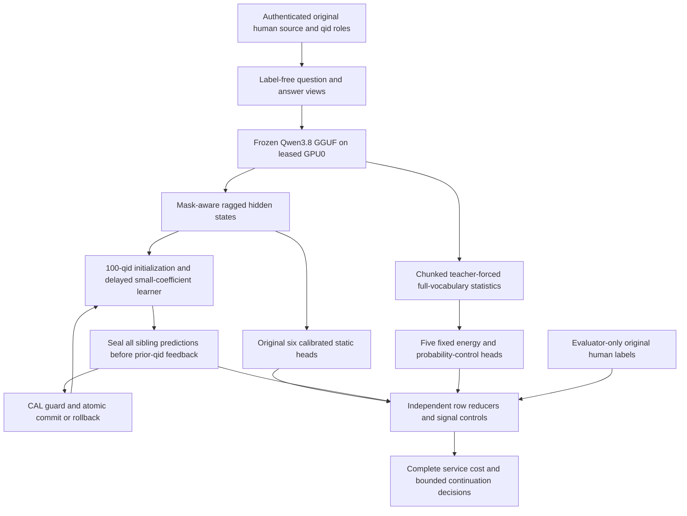
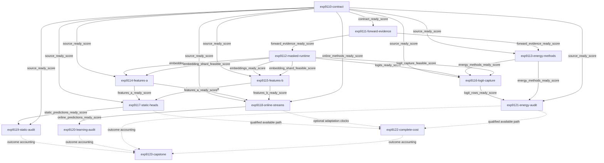

# Carnot Research Roadmap v777: Reliable Forward Features, Human Energy Decisions, and Delayed Learning

**Milestone:** 2026.11.777
**Created:** 2026-11-15
**Status:** Proposed; not activated or executed.
**Predecessor:** 2026.11.776, scheduling complete.
**Execution contract:** Exactly **14 tasks, Exp9110 through Exp9123**, in the
order below, across **four phases**. The visible table, embedded full task
objects and `research-roadmap-next.yaml` describe the same tasks.

The full [V776 design](research-roadmap-v776-preserved-20261115.md) and
[V776 active queue](research-roadmap-v776-queue-preserved-20261115.yaml) are
preserved byte for byte. Their SHA256 values are
`9636b61f464b350f38e2317f2e197ddc79f22b4ed4c0f34d13099c36c5e26700`
and `05c2129cbd2cba5a828860c221e1e459d337579167d97241d9626cb5c3fa0517`.
The completion archive ends at V775; the active queue, V776 primaries and
conductor log establish scheduling closure. No scientific result is inferred
from that archive lag or from a scheduler `OK`.

## What V776 proved

| Experiment | Evidence | Conclusion and limit |
|---|---|---|
| Exp9096 | `contract_ready_score=1`; administrative null | The full fourteen-task authority can be checked. |
| Exp9097 | `source_ready_score=1`, `independent_eval_ready_score=0` | Original producer replay authenticated 900 human-labeled answers/300 qids and their original roles. LPHB remains exposed development. |
| Exp9098 | Three actual model loads; offload recorded; `embeddings_ready_score=0`, `logits_ready_score=1` | Eight of twelve fixtures failed `padding_parity`. The logit interface worked; arbitrary hidden-state extraction is not qualified. |
| Exp9099 | `online_methods_ready_score=1`, `learning_signal_score=0` | Delayed updates and exact recovery qualified on fixtures. Human learning benefit was not measured. |
| Exp9100–9106, Exp9108 | Gate blocks or cascade skips, no declared scientific primaries | Neither human feature comparison, causal benefit nor complete embedding-service cost ran. |
| Exp9107 | `complete_disqualified_artifact_checks`, `judge_ready_score=0`, quarantined | Measured judge work exists, but count-tautology and inference-provenance flags prevent clean scientific use. A later zero-load repair did not qualify that measured primary. |
| Exp9109 | `reconciliation_ready_score=1`, terminal blocked | Accounting is complete; science remains unavailable. |

The changed prerequisite is specific: the existing embedding adapter passes
padding tokens through native evaluation, then excludes them only from pooling.
V777 tests mask-aware ragged native inputs, state isolation and output indexing
against the original tolerances. This is a repair hypothesis, not a declaration
that every observed discrepancy is explained. If it fails, the feature branch
stops without a runtime rebuild or tolerance change.

A separate forward-logit branch avoids tying the entire milestone to embeddings.
It scores the same authenticated archived answers under frozen Qwen and compares
raw-energy information with normalized probability controls. It does not reuse
the quarantined judge as clean evidence or regenerate labels.

## The three biggest gaps to the PRD

1. **Useful oracle-distinct decisions (FR-12).** Exact verification and source
   custody work; useful factual-error discrimination with independent evaluation
   remains unproved. Measure answer-specific signals and matched controls on
   exposed development before funding another independent-source collection.
   This milestone cannot close the independent-generalization north star.
2. **Beneficial continuous learning (FR-11).** Transactions work, but future
   decisions and retained calibration have not improved on this human panel.
   Test the existing small coefficient learner with delayed feedback, matched
   adaptive-linear/donor controls and untouched research retention.
3. **A reliable and affordable complete path (FR-05/08, NFR-01).** Native features
   and valid receipts must work before head accuracy or latency is meaningful.
   Measure complete raw-text services and durable adaptation; map actual work to
   hardware rather than projecting sampler throughput onto unrelated operations.

## Research incorporated before experiment design

The [V777 scan](../../research-references.md) records all eight requested topics
and all six secondary channels before the task design. It includes direct arXiv
checks, author code, OpenReview access limits, official proceedings, and a fresh
Semantic Scholar scan: 46 EBT and 11 ARM–EBM citing records, neither paginated.

| Finding | Experiments | Scope |
|---|---|---|
| [Spilled Energy](https://arxiv.org/abs/2602.18671) and [entropy distributions](https://arxiv.org/abs/2605.28264) | Exp9113/9116/9121 | Whole-answer cross-model teacher-forcing adaptation, with probability and logit-offset controls. Not exact-span replication or CES. |
| [Distributional EBMs](https://arxiv.org/abs/2605.18871) | Exp9119 | Preserve question-only, answer-only and wrong-pair controls against representation shortcuts. |
| [Online spline KAN](https://arxiv.org/abs/2602.02056) and [Continual Calibration](https://arxiv.org/abs/2604.23987) | Exp9118/9120/9122 | Reuse local coefficient learning; distinguish future benefit, retained calibration and complete update cost. |
| [Sequence-level learning limitations](https://arxiv.org/abs/2611.16736) | Exp9116 | Frozen teacher-forcing scorer only; no new generator objective or weight update. |
| [Anechoic](https://arxiv.org/abs/2610.13368) | Exp9122 hardware boundary | Dense optimization hardware is not automatically an equilibrium sampler or a speedup for this service. |

EBR, EPO, PAL, T-SKM-Net, ETS and thermodynamic scaling remain relevant leads.
None supplies a new independent factual label or warrants another solver branch
in this milestone. GitHub Trending was stale; Extropic and Kona remain vendor
evidence, with no new qualified local device access. Exp6980's retired exact-oracle
span null is preserved and named in every related new task.

## Architecture



The model worker receives only text or token IDs plus explicit masks. Reference
text, labels, source/generator tags and annotation metadata are forbidden inputs.
Human labels enter permitted TRAIN fitting, CAL calibration/guards, scheduled
feedback or final evaluation only. Static and online fits have different initial
training sets. The static150 fit cannot initialize the online100 fit.

The receipt repair is narrow: distinguish load/forward/generation operations and
verify structural count derivations. Retain adversarial detection of unsupported
loads, copied outcome metrics and fabricated denominators. Preserve historical
flags and bytes. Changing evidence semantics requires failing controls before
editing the shared checker; no broad exemption or field renaming is allowed.

## Phase 1 — Qualify the actual interfaces (Exp9110–9113)

Exp9110 binds the full contract and reuses authenticated human/online methods.
Exp9111 repairs demonstrated receipt/count semantics with adversarial controls.
Exp9112 tests masked native inputs with original parity tolerances, separately
qualifying embeddings and logits plus workload feasibility. Exp9113 freezes
raw-logit formulas, controls, fitting and evaluation before natural measurements.

No source recreation, new historical hash pin, model download or generation is
scheduled. Each task has positive and rejecting controls. If receipt semantics
cannot qualify, model work stops before another expensive invalid artifact.

## Phase 2 — Collect current forward evidence (Exp9114–9116)

Exp9114 and Exp9115 extract the original two450-row shards independently, using
lexical qid halves and retaining all siblings and roles. Exp9116 teacher-forces
all900 archived answers and stores sufficient full-vocabulary statistics, with
a bounded raw-logit sample for replay. It depends on logit readiness, not embedding
readiness. GPU0 jobs execute sequentially. Every qid has durable progress and
attempt/completion/censor accounting; no cohort shrinking after a budget stop.

## Phase 3 — Measure decisions, signal and learning (Exp9117–9121)

Exp9117 fits the unchanged six static arms. Exp9118 runs the unchanged five-arm
causal learner independently of static benefit. Exp9119 audits static predictions
and frozen information ablations. Exp9120 independently tests all six online
benefit/retention bounds. Exp9121 fits and evaluates the separate five-arm energy
comparison from sealed logit statistics. Nulls are terminal scientific outcomes;
analysis readiness never requires a favorable treatment effect.

## Phase 4 — Complete costs and reconciliation (Exp9122–9123)

Exp9122 is ungated: it measures whichever complete branch qualifies, preserving
missing paths explicitly. It can time the logit service if embeddings fail.
Exp9123 unconditionally accounts for all fourteen outcomes and exact continuation
requirements. Missing external science is `blocked`, not retryable `partial`.
Neither task activates a roadmap or confers independent-generalization or
publication readiness on an exposed development result.

## Frozen inherited scientific protocols

### Static factual-error decisions

Use Exp9084's protocol unchanged: independently mean-pool last-layer nonpadding
question and answer tokens, L2-normalize each, then concatenate. Use the embedded
GGUF tokenizer, no BOS/chat template, question cap 256 and answer cap 768, with
right truncation and recorded original lengths. Empty inputs map to flagged zero
vectors; padding never enters the mean. No reference, label or metadata feature.

Fit TRAIN-only center/std, Gaussian projection to 27 dimensions (seed 775084),
and TRAIN min/max scaling to [-1,1]. Freeze transformations. The six arms are
prevalence, text-length logistic, projected linear, full-embedding regularized
linear, projected fixed-cubic spline and whole-qid donor spline. Use degree 3,
knots [-1,-1,-1,-1,-0.5,0,0.5,1,1,1,1], intercept + 27 linear + 189 basis columns.
Minimize mean binary logloss plus 0.5*0.01 times squared nonintercept coefficients.
Require finite fit and gradient infinity norm <=1e-6; maxiter 2000, gtol 1e-7,
ftol 1e-12. No architecture or regularization search.

Only CAL chooses temperature from [0.5,1,2,4], ascending ties. Accept at
p(error)<=0.1, reject at >=0.9, otherwise escalate. Primary target is original A1
factuality. A2 sensitivity uses only actual observed labels; -1 remains missing.
Report Brier, logloss, coverage, accepted error and exact-half-coverage error.
Use 10,000 paired TEST-qid bootstrap draws, seed 775092, preserving all siblings;
rerank half-coverage choices inside each draw. Zero accepted count gives undefined
risk. The 95% intervals are conditional descriptive development intervals.

`static_signal_score=1` requires all five spline-versus-control Brier improvement
lower endpoints >0 and no empirical accepted-error increase against projected
linear. Undefined accepted risk cannot pass. This is a continuation signal, not a
confirmatory generalization gate. Audit readiness is independent of this score.

### Continuous self-learning

Sort the original 150 TRAIN qids by SHA256 of `v776-online` followed by the original
qid string. First 100 initialize the learner; the remaining 50 form ten disjoint
streams of five qids. Keep original CAL50 as operational guard and TEST100 as
retention. Refit all transforms on the 100 initialization groups only. The static
model, its transforms and its extra 50 training groups cannot leak into this fit.

Five arms start from comparable frozen initial states: frozen spline, adaptive
spline, bias-only spline, adaptive linear and donor-label adaptive spline. Donors
are a fixed seed-776099 assignment from already-labeled initialization qids,
preserving sibling positions; they never use future truth. Freeze the exact map
in Exp9099 and retain actual changed-label fractions. No stream is a new dataset.

Use one coefficient vector per arm, fixed temperature 1, learning rate 0.05,
AdaGrad accumulator initially zero and epsilon 1e-8. Gradient is
`(sigmoid(theta·phi)-y)*phi + 0.01*(theta-theta_initial)`, without intercept
anchoring. Bias-only zeros other coordinates. Clip gradient L2 norm to 1.
After the three sibling updates, promote only if CAL Brier increase <=0.005 and
CAL classification-error increase <=0 against that arm's initial state. Otherwise
restore coefficients and accumulators, while acknowledging consumed feedback.
These are operational guards; research retention is never used for promotion.

Seal all arms' predictions for all siblings of group g, then release g-1 labels.
Drain the last group after all predictions. Reset every stream to its initial
state. Seal retention predictions before evaluator access. Persist predictions,
parameters, accumulators, pending feedback and acknowledgments atomically. Real
hard-exit tests cover prediction fsync, feedback receipt and state replacement.
Exact restart must reproduce the uninterrupted state and predictions.

Score future Brier on groups 2–5: 40 unique qids/120 responses across ten streams.
Use 10,000 paired stream-bootstrap draws, seed 776105, one-sided tail 0.05/6.
The six bounds are four adaptive-spline Brier improvements over the other arms
(lower >0), retained Brier increase (upper <=0.005), and retained error increase
(upper <=0). All must pass with exact recovery for `learning_signal_score=1`.
Retention is the same 100 qids in each stream, not 1,000 independent questions.
Report per-qid changes averaged across streams as well. Ten streams have limited
power; intervals are conditional on the fixed initial fit, guard and retention.
A null does not justify tuning these bounds or claiming the architecture failed
on all future data. No graph bound is changed by this separate human experiment.

### Static signal controls

Exp9119 retains matched QA, question-only, answer-only and wrong-question pairing.
Zero omitted halves. The wrong-question arm uses a whole-qid within-role
derangement, seed776106, retaining answer, target and sibling position. Refit
TRAIN-only transforms and matched projected-linear/spline heads. Matched arms
must reproduce Exp9117 within1e-8. Generator tags are evaluation slices only;
within-qid discrimination uses only actually discordant siblings with its support.

### New raw-logit protocol

This is an exploratory cross-model scorer of archived human answers. It changes
neither the inherited static study nor its exposure classification. It generates
zero tokens and does not train Qwen. The original generating models remain source
provenance; performance is not current Qwen answer accuracy.

Tokenize question and answer independently using the embedded tokenizer without
special tokens, with right caps256/768. The prefix is literal `Question:\n`, the
retained question, then literal `\nAnswer:\n`, tokenized without BOS/chat template.
Append the retained answer token IDs explicitly. Freeze the exact detokenization
and prefix bytes before inference. Reset state for each answer; chunk size128.
The scalar at position i must score answer token a_i from its preceding prefix.

For logits z_i over the complete vocabulary, compute in stable float64:

- L_i = logsumexp(z_i), NLL_i = L_i - z_i[a_i].
- H_i = -sum_v p_iv log(p_iv), p_i = softmax(z_i), and max_v p_iv.
- Marginal energy M_i = -L_i.
- Adjacent spill D_i = -z_i[a_i] + L_(i+1), for i=1 through L-1 within
  one retained answer. No pair may cross answers or be lost at a chunk edge.

This operational whole-answer definition is not the paper's localized-answer
evaluation. The repository's logprob-only approximations are not substitutes.
Before natural scoring, replay hand-computable arrays and an independently coded
formula reference, with wrong-offset and missing-vocabulary negative controls.

Use exactly seven sequence features: log1p(answer token count), mean NLL, mean H,
maximum H, mean M, mean absolute D, and a no-adjacent-pair indicator. For one-token
answers only the spill feature is missing; fit its imputation median on TRAIN.
If an entire TRAIN feature column is missing, block instead of fabricating a
value. Empty answers are unsupported: retain their slots, escalate, and report
their excluded-loss counts. Shared loss/risk comparisons use the same predeclared
nonempty support; coverage denominators include all original TEST rows. Never
select support from labels, accuracy or outcomes.

The five arms are prevalence; probability+length logistic (first four features);
raw-energy logistic (length, mean M, mean absolute D, missing-pair indicator);
combined logistic (all seven); and combined logistic with whole-qid TRAIN donor
labels. Donors use a fixed nonidentity cyclic permutation of sorted TRAIN qids,
keeping sibling positions; report actual changed labels. These heads are binary
Gibbs energies E(y=0)=0 and E(y=1)=-theta·phi, with p(error)=sigmoid(theta·phi).

Fit TRAIN-only population mean/std, constants scaled1, then the same ridge0.01
binary-logloss objective and L-BFGS-B convergence contract as the inherited heads.
Use original TRAIN150/CAL50/TEST100 qids. CAL alone selects temperature from
[0.5,1,2,4], ascending ties; use the same0.1/0.9 accept/reject thresholds. Seal
TEST predictions before evaluator labels. Report all five arms and all units.

Use10000 paired TEST-qid bootstrap draws, seed777121, retaining sibling groups.
`energy_increment_score=1` requires both combined-arm Brier improvement lower
endpoints above0 against probability+length and donor controls, with one-sided
tail0.05/2; empirical accepted error must not increase versus probability+length.
Undefined accepted risk cannot pass. Report conditional descriptive intervals.
No cross-branch winner is chosen after seeing results; static comparison is
secondary and only available when both branches qualify.

**Gauge control:** apply c_i=3*(-1)^i to every vocabulary logit at prefix i.
NLL, entropy and token probabilities must stay unchanged; M_i changes by -c_i
and D_i by c_(i+1)-c_i. Freeze a constant-offset control c_i=3 as well. Report
raw-score and frozen-head sensitivity; never call this evidence that probability
chain rules fail. Raw-logit discrimination is a representation-specific empirical
signal. These simple entropy summaries are not CES and inherit no CES guarantees.

Store every token's sufficient statistics and full-vector hash. Retain full raw
arrays for first eight answer positions of the first20 lexical qids/all siblings;
the sample is bounded before labels. With the observed vocabulary width, float32
sample arrays are about0.48GB. Preflight a2GiB evidence budget and stream blocks;
never allocate all900 answers' complete token-by-vocabulary arrays together.

### Complete costs and hardware

The fixed timing cohort is first20 original TEST qids, all60 siblings, with three
fresh-process repetitions and arm-order seed776108. A qualified branch must
reproduce its scientific probabilities within atol1e-5/rtol1e-4 and exact typed
decisions. A blocked branch does not cause an available branch to disappear.

Embedding paths include tokenization, masked Qwen forwards, transforms, heads and
serialization. Logit paths include tokenization, teacher-forced full-vocabulary
statistics, heads and serialization. Different input protocols remain explicit.
Separate cold load, warm uncached request, question-cache hit and cached-head-only
costs. Missing clocks remain unknown. Repetitions are not independent questions.

Online cost includes proposals, rejected updates, complete CAL guard scans,
atomic writes, final drain and recovery. Sparse spline updates alone are not
whole-learning latency. The hardware path is CPU state/storage, GPU batched
features, and possible future fixed-basis FPGA coefficient updates. Measured
fractions give Amdahl ceilings for the program's100x target; they cannot promise
that target or satisfy Rust's10x NFR without a separate port and measurement.

| Resource | Planned use and limit |
|---|---|
| CPU/RAM/private disk | Small fits, bootstrap, causal state and row reduction; disk capacity checked before raw samples. |
| GPU0 RTX3090,24GB | Frozen Qwen forward work only; actual lease, free-memory and full-offload evidence required. |
| GPU1 | Reserved for its current owner; no dual-GPU assumption or contention. |
| Cached mandated GGUF | `unsloth/Qwen3.8-27B-GGUF`, Q4_K_M; pin GGUF/tokenizer/native build. No alternate model or download. |
| KV260 | Preserve k_max<=5 and established Ising scope; it does not implement these embedding/learning workloads. No board operation here. |
| PolarFire/GateMate | Preserve CPU-only PolarFire evidence and unchanged GateMate physical/JTAG block; no unchanged probe. |
| NPU/TSU/larger FPGA wishlist | Unqualified or unavailable for this service. Acquisition is justified only by measured bottlenecks and a supported operation mapping. |

## Execution discipline and dependency graph

Every model task declares `MODEL_SPECS` with the mandated model and
`model_load_no_generation`: zero tokens,2-second floor. No task is a generative
canary. If later scope genuinely requires bounded generation its class is
`model_bounded_generation` (10s); genuine full generation is
`model_full_generation` (60s), but neither is scheduled here. A pre-load refusal
uses actual `blocked_no_run`, with the requested class retained separately.

Every prompt has numbered instructions for flushed phase/call boundaries,
loop progress,60-second supervised heartbeats, gaps under600 seconds and
file-writing tool calls of at most about200 lines. Each task reserves1200 seconds
for validation, stops measurement by3300 seconds, and remains under4800 seconds.
No budget padding, cohort shrinking or changed scientific threshold is allowed.

Use Claude for synthesis/routine experiments per the current operator request;
route the contract, shared evidence semantics and native runtime integration
directly to Opus with100 turns. No weak model is used for experiments or claims.
Existing deterministic helpers and tests are reused before writing new modules.
The prompts specify spec-first/tests-first, scoped coverage/lint/types/spec checks,
private E2E-018/021 and E2E-020 for learning/recovery, and real artifact validators.

Structured gates below are conjunctive and use only earlier tasks. No gate
requires scientific benefit. Exp9122 and Exp9123 are ungated; the former checks
branch availability before loading a model, and the latter always reconciles.
No task uses a retired task in `requires:` or as a runtime gate. Related historical
failures appear in explicit four-field `prior_failures` records. Same-verdict
scopes retire; unchanged external blockers are terminal, not partial retries.

## Acceptance and deferred work

A completed milestone either measures all declared scientific comparisons or
identifies exact terminal blockers without invented scores. Reconciliation
readiness is separate from scientific continuation. Preserve GAP-ORACLE-DISTINCT,
GAP-DETECTOR-AUROC-4208 and independent generalization until genuinely independent
human evidence supports a matched-control win. Keep existing G1–G4 publication
requirements in their original scope; no paper readiness follows from this panel.

Graph collection is deferred on missing historical topology authority, unchanged.
The old seven detector and ten graph-learning bounds remain intact. ARC work is
opportunistic under the November7 north-star directive; this plan makes no solve
claim or new registry entry. Generator training, decoding/search, Rust porting,
board bring-up, publication and activation are not scheduled. Costs determine
whether those later steps have a defensible workload.




## Exact task contract

Exactly14 tasks, Exp9110 through Exp9123. This table is generated from the same
full task objects as the queue. The graph and complete objects include exact
gate fields, operators, required values and prompt contracts.

| Order | ID | Title | Phase | Deliverable |
|---:|---|---|---:|---|
| 1 | exp9110-contract | Exp9110: Bind fourteen tasks and retain authenticated human methods | 1 | results/experiment_9110_v777_contract.json |
| 2 | exp9111-forward-evidence | Exp9111: Qualify forward-only receipts and structural count evidence | 1 | results/experiment_9111_v777_forward_evidence.json |
| 3 | exp9112-masked-runtime | Exp9112: Test masked ragged Qwen features with unchanged tolerances | 1 | results/experiment_9112_v777_masked_runtime.json |
| 4 | exp9113-energy-methods | Exp9113: Freeze raw-logit energy and probability controls | 1 | results/experiment_9113_v777_energy_methods.json |
| 5 | exp9114-features-a | Exp9114: Extract masked frozen human features in shard A | 2 | results/experiment_9114_v777_features_a.json |
| 6 | exp9115-features-b | Exp9115: Extract masked frozen human features in shard B | 2 | results/experiment_9115_v777_features_b.json |
| 7 | exp9116-logit-capture | Exp9116: Capture teacher-forced Qwen energy statistics on human answers | 2 | results/experiment_9116_v777_logit_capture.json |
| 8 | exp9117-static-heads | Exp9117: Train frozen matched human decision heads | 3 | results/experiment_9117_v777_static_heads.json |
| 9 | exp9118-online-streams | Exp9118: Measure delayed coefficient learning with exact recovery | 3 | results/experiment_9118_v777_online_streams.json |
| 10 | exp9119-static-audit | Exp9119: Audit static decisions and answer-specific signal | 3 | results/experiment_9119_v777_static_audit.json |
| 11 | exp9120-learning-audit | Exp9120: Independently test future benefit and retained calibration | 3 | results/experiment_9120_v777_learning_audit.json |
| 12 | exp9121-energy-audit | Exp9121: Test raw-energy value beyond normalized probability controls | 3 | results/experiment_9121_v777_energy_audit.json |
| 13 | exp9122-complete-cost | Exp9122: Measure available complete services and adaptation costs | 4 | results/experiment_9122_v777_complete_cost.json |
| 14 | exp9123-capstone | Exp9123: Reconcile fourteen outcomes and exact continuation gates | 4 | results/experiment_9123_v777_capstone.json |

## Machine-readable full task contract

The JSON below and the YAML task objects must compare equal, including prompts,
gates, prior failures, substrates, model routing and deliverables.

<!-- V777_TASK_CONTRACT_START -->
```json
{
  "milestone": "2026.11.777",
  "milestone_title": "Reliable Forward Features, Human Energy Decisions, and Delayed Learning",
  "milestone_doc": "openspec/change-proposals/research-roadmap-vNEXT.md",
  "tasks": [
    {
      "id": "exp9110-contract",
      "title": "Exp9110: Bind fourteen tasks and retain authenticated human methods",
      "phase": 1,
      "track": "research",
      "priority": "high",
      "requires_gpu": false,
      "max_turns": 100,
      "estimated_wall_time_min": 55,
      "per_unit_rows": true,
      "milestone": "2026.11.777",
      "deliverable": "results/experiment_9110_v777_contract.json",
      "inference_substrate_class": "no_model_load",
      "MODEL_SPECS": [],
      "gated_on": [],
      "prior_failures": [
        {
          "experiment_id": "exp9109-capstone",
          "verdict": "complete_blocked_declared_gate",
          "addressed_by": "A new masked-input hypothesis and operation-specific provenance repair replace unchanged failed prerequisites; reconciliation preserves all V776 blocks and never claims their science passed.",
          "retire_if_same_verdict": true
        }
      ],
      "prompt": "CONTEXT:\nWork in {project_root} on {date}. V776 ended with authenticated exposed labels, qualified update mechanics, failed padding invariance and a quarantined judge. The completion archive ends at V775. Use actual primaries and scheduler receipts without turning scheduling closure into benefit.\nEXISTING CODE TO READ FIRST:\nCLAUDE.md; CODEX.md; research-program.md; ops/north-star.md; ops/e2e-test-plan.md; ops/exclusion_manifest.yaml; research-references.md (V777 scan); openspec/change-proposals/research-roadmap-vNEXT.md; openspec/capabilities/research-reporting/spec.md; scripts/experiment_template.py; python/carnot/reporting/primary_publication.py; python/carnot/reporting/current_work_receipt.py; python/carnot/reporting/v776_contract.py; results/experiment_9097_v776_human_authority.json; results/experiment_9099_v776_online_methods.json; results/experiment_9109_v776_capstone.json; openspec/change-proposals/research-roadmap-v776-preserved-20261115.md; openspec/change-proposals/research-roadmap-v776-queue-preserved-20261115.yaml; openspec/change-proposals/v776-online-human-protocol.json; python/carnot/reporting/human_methods_9084.py\nTASK:\nBind fourteen tasks and retain authenticated human methods. Deliver results/experiment_9110_v777_contract.json; implement scripts/experiments/experiment_9110_v777_contract.py with reusable library code. MODEL_SPECS: []; requested inference_substrate_class: no_model_load. No LLM load or generated tokens; current_llm_invocations=0. Describe cached upstream representations as historical provenance, not current inference.\nCONCRETE STEPS:\n1. PRECONDITIONS: Authenticate upstream gate fields and every consumed immutable input before dependent work. Resolve historical code to authenticated snapshots, never mutable checkout replacements. Missing external evidence produces complete_blocked_<check>, verdict_class=blocked and gate_check_summary. No fabricated substitutes.\n2. Emit a flushed progress line at each phase boundary and before and after every potentially minutes-long model load, generation, benchmark and subprocess. Emit progress inside long loops; supervise blocking children with flushed heartbeats at least every 60 seconds, keeping every silent gap below 600 seconds. Write any file over about 200 lines in several tool calls of at most 200 lines, with a progress message between calls. Never issue one huge file-writing tool call.\n3. Before implementation, use rg to inspect all callers and confirm REQ-REPORT-9110-V777 and SCENARIO-REPORT-9110-V777. Extend the relevant spec and write failing controls first. Reuse existing helpers and freeze methods before outcomes. Do not change thresholds, cohorts or gates after observing results.\n4. Compare all fourteen complete task objects, visible contract table and embedded JSON with the staged queue before activation or authenticated active queue after activation. Require Exp9110 through Exp9123 in exact order, unique title[:50].strip() dispatch keys, unused IDs, producer-declared gate fields and the existing literal-brace normalization. Exempt only this task's own canonical deliverables from collision checks; never edit the conductor.\n5. Authenticate the original Exp9097 source closure and original qid roles, plus the frozen Exp9099 protocol/rosters and their historical source snapshots. Reuse its 900 rows/300 qids: TRAIN150/CAL50/TEST100, three siblings each, actual A2 only. Do not replay expensive work or compare an old producer pin to current mutable code. source_ready_score=1 requires the complete authenticated closure; online_methods_ready_score=1 additionally requires the original learner protocol and qualified recovery evidence.\n6. Freeze the inherited static six-arm, signal-control, online six-bound and complete-cost protocols without scientific changes. Freeze the separate V777 logit protocol from this design. Pin source/feature views, evaluator-only labels, shard rosters, versions and execution limits. LPHB remains exposed; independent_generalization_score stays0.\n7. Account for all fourteen V776 outcomes, distinguishing absent declared primaries, scheduler alternate filenames, raw measured judge work and quarantine. Preserve the eight padding failures, logits readiness, original V726 null, graph custody block and CPU susceptibility scope. Record fresh continuation conditions and exclude unchanged graph/ARC/board retries.\n8. Freeze owned and direct-consumer validation commands before measurement. Run meaningful unit tests, 100 percent newly owned statement coverage with zero exclusions, Ruff check/format, strict mypy and explicit-path spec coverage. Run private actual CLI success, refusal, tamper and cold replay outside the checkout without PYTHONPATH (E2E-018/021); learning/recovery also requires E2E-020. Stop measurement by 3300 seconds and reserve 1200 seconds for validation within the 4800-second cap. Failed affected checks disqualify readiness; separate unrelated repository-wide failures.\n9. Recompute all aggregates from retained per-unit rows. Run scripts/adversarial_verify.py and scripts/verdict_row_consistency_lint.py in strict-row mode under heartbeat supervision; never suppress a flag, delete an assertion, or rename evidence to evade a check. Publish atomically with primary_publication only after owned checks pass. Reconcile openspec/, _bmad/traceability.md, ops/status.md and ops/changelog.md. Preserve historical primaries, source pins and exclusions. Do not activate a roadmap, change public defaults, publish externally, operate boards or train Qwen weights.\nREQUIRED ARTIFACT FIELDS:\n- honest_verdict: complete_*; verdict_class: positive | circular_positive | null | blocked | disqualified | partial. Only unfinished owned work may be partial. Unchanged external missing, retired or gated inputs are terminal blocked.\n- gate_check_summary: check, upstream, path, sha256, artifact_field, op, expected, observed, passed. Mandatory for any blocked result; distinguish missing_file, missing_field and observed zero.\n- rows: original unit_id and qid/group, arm/condition, seed, absolute metric, numerator, denominator, status and exclusion/censor reason; intended/attempted/completed/failed/censored counts, sample_size_budget and effective_independent_groups. Seeds, siblings and repeated retention are not new independent units.\n- verifier_is_oracle, claim_scope, exposure_scope, independent_generalization_score=0. LPHB remains exposed development; fixtures and administrative readiness establish no human benefit. Exact-oracle successes use circular_positive. No ARC solve is claimed.\n- MODEL_SPECS, requested_inference_substrate_class, inference_substrate_class, inference_substrate, current_llm_invocations, model_invocation_counts, generated_tokens, duration_s, random_seed, reproducibility_checksum, code_config_hashes, source_references, current_work_receipts, validation_receipts, required_checks_passed, acceptance_gates and field_principles. Annotate each important field with the distinct scientific principle it protects. Keep historical model work separate from current operations; never pad duration.\n- contract_ready_score, source_ready_score, online_methods_ready_score: separate integer0/1 fields; full_task_objects, canonical_task_hash, authority_snapshots, previous_outcome_rows, source_manifest_reference, evaluator_label_reference, shard_a_roster_reference, shard_b_roster_reference, static_protocol_reference, online_protocol_reference, energy_protocol_reference, closed_scope_rows, archive_lag.\nRun command: cd {project_root} && .venv/bin/python scripts/experiments/experiment_9110_v777_contract.py --date {date}\nDo NOT push. Do NOT modify scripts/research_conductor.py.",
      "model": "opus"
    },
    {
      "id": "exp9111-forward-evidence",
      "title": "Exp9111: Qualify forward-only receipts and structural count evidence",
      "phase": 1,
      "track": "research",
      "priority": "high",
      "requires_gpu": false,
      "max_turns": 100,
      "estimated_wall_time_min": 65,
      "per_unit_rows": true,
      "milestone": "2026.11.777",
      "deliverable": "results/experiment_9111_v777_forward_evidence.json",
      "inference_substrate_class": "no_model_load",
      "MODEL_SPECS": [],
      "gated_on": [
        {
          "upstream": "exp9110-contract",
          "artifact_field": "contract_ready_score",
          "op": "==",
          "value": 1
        }
      ],
      "prior_failures": [
        {
          "experiment_id": "exp9107-qwen-judge",
          "verdict": "complete_disqualified_artifact_checks",
          "addressed_by": "Repair operation-specific inference classification and evidence-backed structural count handling with adversarial controls; preserve the old primary and do not rerun its judge.",
          "retire_if_same_verdict": true
        }
      ],
      "prompt": "CONTEXT:\nWork in {project_root} on {date}. Exp9107 was flagged despite zero-token forward scoring: generation_calls_attempted/completed=0 conflicted with actual model loads, and two different structural counts both equaled150. The later zero-load repair did not qualify the measured primary. Fix only demonstrated semantic defects, never erase the original quarantine.\nEXISTING CODE TO READ FIRST:\nCLAUDE.md; CODEX.md; research-program.md; ops/north-star.md; ops/e2e-test-plan.md; ops/exclusion_manifest.yaml; research-references.md (V777 scan); openspec/change-proposals/research-roadmap-vNEXT.md; openspec/capabilities/research-reporting/spec.md; scripts/experiment_template.py; python/carnot/reporting/primary_publication.py; python/carnot/reporting/current_work_receipt.py; scripts/adversarial_verify.py; python/carnot/reporting/current_work_receipt.py; python/carnot/inference/qwen_judge_9107.py; python/carnot/reporting/qwen_judge_9107.py; tests/python/test_adversarial_verify_typed_field_values.py; tests/python/test_adversarial_verify_guards.py; tests/python/test_qwen_judge_9107.py; results/experiment_9107_v776_qwen_judge.json\nTASK:\nQualify forward-only receipts and structural count evidence. Deliver results/experiment_9111_v777_forward_evidence.json; implement scripts/experiments/experiment_9111_v777_forward_evidence.py with reusable library code. MODEL_SPECS: []; requested inference_substrate_class: no_model_load. No LLM load or generated tokens; current_llm_invocations=0. Describe cached upstream representations as historical provenance, not current inference.\nCONCRETE STEPS:\n1. PRECONDITIONS: Authenticate upstream gate fields and every consumed immutable input before dependent work. Resolve historical code to authenticated snapshots, never mutable checkout replacements. Missing external evidence produces complete_blocked_<check>, verdict_class=blocked and gate_check_summary. No fabricated substitutes.\n2. Emit a flushed progress line at each phase boundary and before and after every potentially minutes-long model load, generation, benchmark and subprocess. Emit progress inside long loops; supervise blocking children with flushed heartbeats at least every 60 seconds, keeping every silent gap below 600 seconds. Write any file over about 200 lines in several tool calls of at most 200 lines, with a progress message between calls. Never issue one huge file-writing tool call.\n3. Before implementation, use rg to inspect all callers and confirm REQ-REPORT-9111-V777 and SCENARIO-REPORT-9111-V777. Extend the relevant spec and write failing controls first. Reuse existing helpers and freeze methods before outcomes. Do not change thresholds, cohorts or gates after observing results.\n4. Reproduce each of the three original critical flags from immutable measured evidence in private files. Trace check_tautology and _typed_invocation_evidence plus all callers. Separate load, forward and generation operations; zero generation does not negate a recorded forward. A request without an actual load still cannot claim model execution.\n5. Write regression controls first for no-load refusal, failed attempted load, successful forward with zero sampling, bounded/full generation, conflicting positive counters and historical versus current receipts. Repair the shared classifier at the root only where controls demonstrate the defect. Keep count fields and original measured values; no renaming, hiding, warning downgrade or broad substrate exemption.\n6. Test structural equality using retained roster-derived qid counts and half-coverage denominators. Admit only supported structural arithmetic. Unbacked counts, noninteger sample counts, copied independent accuracy/AUROC and contradictory row denominators must still be rejected. A suffix-only count exemption is insufficient.\n7. Run the complete direct-consumer adversarial-verifier and current-work receipt suites, plus private real CLI artifact checks on success/block/tamper fixtures. Audit the archived judge in a separate diagnostic report after the repair; any remaining genuine failure stays disqualified. Do not republish its old primary or grant it readiness for downstream science. forward_evidence_ready_score=1 needs every semantic control and affected check to pass.\n8. Freeze owned and direct-consumer validation commands before measurement. Run meaningful unit tests, 100 percent newly owned statement coverage with zero exclusions, Ruff check/format, strict mypy and explicit-path spec coverage. Run private actual CLI success, refusal, tamper and cold replay outside the checkout without PYTHONPATH (E2E-018/021); learning/recovery also requires E2E-020. Stop measurement by 3300 seconds and reserve 1200 seconds for validation within the 4800-second cap. Failed affected checks disqualify readiness; separate unrelated repository-wide failures.\n9. Recompute all aggregates from retained per-unit rows. Run scripts/adversarial_verify.py and scripts/verdict_row_consistency_lint.py in strict-row mode under heartbeat supervision; never suppress a flag, delete an assertion, or rename evidence to evade a check. Publish atomically with primary_publication only after owned checks pass. Reconcile openspec/, _bmad/traceability.md, ops/status.md and ops/changelog.md. Preserve historical primaries, source pins and exclusions. Do not activate a roadmap, change public defaults, publish externally, operate boards or train Qwen weights.\nREQUIRED ARTIFACT FIELDS:\n- honest_verdict: complete_*; verdict_class: positive | circular_positive | null | blocked | disqualified | partial. Only unfinished owned work may be partial. Unchanged external missing, retired or gated inputs are terminal blocked.\n- gate_check_summary: check, upstream, path, sha256, artifact_field, op, expected, observed, passed. Mandatory for any blocked result; distinguish missing_file, missing_field and observed zero.\n- rows: original unit_id and qid/group, arm/condition, seed, absolute metric, numerator, denominator, status and exclusion/censor reason; intended/attempted/completed/failed/censored counts, sample_size_budget and effective_independent_groups. Seeds, siblings and repeated retention are not new independent units.\n- verifier_is_oracle, claim_scope, exposure_scope, independent_generalization_score=0. LPHB remains exposed development; fixtures and administrative readiness establish no human benefit. Exact-oracle successes use circular_positive. No ARC solve is claimed.\n- MODEL_SPECS, requested_inference_substrate_class, inference_substrate_class, inference_substrate, current_llm_invocations, model_invocation_counts, generated_tokens, duration_s, random_seed, reproducibility_checksum, code_config_hashes, source_references, current_work_receipts, validation_receipts, required_checks_passed, acceptance_gates and field_principles. Annotate each important field with the distinct scientific principle it protects. Keep historical model work separate from current operations; never pad duration.\n- forward_evidence_ready_score: integer0/1; original_flag_rows, semantic_control_rows, structural_count_derivations, preserved_detection_rows, historical_judge_diagnostic_reference, changed_validator_paths, validator_hashes. This task qualifies evidence semantics, not judge accuracy.\nRun command: cd {project_root} && .venv/bin/python scripts/experiments/experiment_9111_v777_forward_evidence.py --date {date}\nDo NOT push. Do NOT modify scripts/research_conductor.py.",
      "model": "opus"
    },
    {
      "id": "exp9112-masked-runtime",
      "title": "Exp9112: Test masked ragged Qwen features with unchanged tolerances",
      "phase": 1,
      "track": "research",
      "priority": "high",
      "requires_gpu": true,
      "max_turns": 100,
      "estimated_wall_time_min": 70,
      "per_unit_rows": true,
      "milestone": "2026.11.777",
      "deliverable": "results/experiment_9112_v777_masked_runtime.json",
      "inference_substrate_class": "model_load_no_generation",
      "MODEL_SPECS": [
        {
          "hf_id": "unsloth/Qwen3.8-27B-GGUF",
          "quantization": "Q4_K_M"
        }
      ],
      "gated_on": [
        {
          "upstream": "exp9111-forward-evidence",
          "artifact_field": "forward_evidence_ready_score",
          "op": "==",
          "value": 1
        }
      ],
      "prior_failures": [
        {
          "experiment_id": "exp9098-embedding-runtime",
          "verdict": "complete_null_runtime_capability_limit",
          "addressed_by": "Replace post-pooling-only padding exclusion with an explicit mask-aware ragged native boundary; require original tolerance and independent state/index controls before any downstream use.",
          "retire_if_same_verdict": true
        }
      ],
      "prompt": "CONTEXT:\nWork in {project_root} on {date}. Exp9098 logged actual Qwen offload and usable logits, but eight of twelve fixtures failed padding_parity. Its native adapter evaluates pad tokens as ordinary tokens and masks only the final mean. This is a specific hypothesis, not an established complete diagnosis.\nEXISTING CODE TO READ FIRST:\nCLAUDE.md; CODEX.md; research-program.md; ops/north-star.md; ops/e2e-test-plan.md; ops/exclusion_manifest.yaml; research-references.md (V777 scan); openspec/change-proposals/research-roadmap-vNEXT.md; openspec/capabilities/research-reporting/spec.md; scripts/experiment_template.py; python/carnot/reporting/primary_publication.py; python/carnot/reporting/current_work_receipt.py; python/carnot/inference/embedding_runtime_9098.py; python/carnot/reporting/embedding_runtime_9098.py; python/carnot/reporting/embedding_runtime_runner_9098.py; python/carnot/inference/sota_models.py; python/carnot/inference/gguf_metadata.py; tests/python/test_embedding_runtime_9098.py; results/experiment_9098_v776_embedding_runtime.json\nTASK:\nTest masked ragged Qwen features with unchanged tolerances. Deliver results/experiment_9112_v777_masked_runtime.json; implement scripts/experiments/experiment_9112_v777_masked_runtime.py with reusable library code. MODEL_SPECS: [{\"hf_id\": \"unsloth/Qwen3.8-27B-GGUF\", \"quantization\": \"Q4_K_M\"}]; requested inference_substrate_class: model_load_no_generation. Resolve cached_current_model(gpu_index=0); require a GPU0 lease, enough free VRAM, original GGUF/tokenizer/build hashes and actual CUDA offload evidence. Use the mandated frozen cached Qwen only; no small-model fallback, downloads or alternate quantization. This is forward-only work with zero generated tokens and a 2-second substrate floor. For a refusal before any load, declare actual blocked_no_run and keep the requested class separately; attempted failed loads retain honest attempted-work evidence.\nCONCRETE STEPS:\n1. PRECONDITIONS: Authenticate upstream gate fields and every consumed immutable input before dependent work. Resolve historical code to authenticated snapshots, never mutable checkout replacements. Missing external evidence produces complete_blocked_<check>, verdict_class=blocked and gate_check_summary. No fabricated substitutes.\n2. Emit a flushed progress line at each phase boundary and before and after every potentially minutes-long model load, generation, benchmark and subprocess. Emit progress inside long loops; supervise blocking children with flushed heartbeats at least every 60 seconds, keeping every silent gap below 600 seconds. Write any file over about 200 lines in several tool calls of at most 200 lines, with a progress message between calls. Never issue one huge file-writing tool call.\n3. Before implementation, use rg to inspect all callers and confirm REQ-REPORT-9112-V777 and SCENARIO-REPORT-9112-V777. Extend the relevant spec and write failing controls first. Reuse existing helpers and freeze methods before outcomes. Do not change thresholds, cohorts or gates after observing results.\n4. Freeze the twelve original texts, last-layer width, token caps256/768 and atol1e-5/rtol1e-4 before testing. Reproduce the padding discrepancy and retain token-level state references, positions, sequence IDs and native input batches. Distinguish incorrect pad admission, sequence-state contamination and output-indexing errors; never infer a CUDA kernel defect from one comparison.\n5. Implement the smallest explicit mask-aware ragged adapter: admit only mask-true tokens to native evaluation in original order, copy hidden outputs before another decode, clear recurrent/KV state between independent requests, and restore masked positions only at the public boundary if required. Do not drop a real token solely because its token ID equals pad_id. Keep the original unpadded representation and frozen pooling unchanged. Do not change the old primary or relax its tolerances.\n6. Require serial/batch/cold parity, masked suffix/interior padding invariance, real-pad-token retention, all-empty handling, context isolation and correct logits-to-token alignment. A deliberately unmasked suffix must reach native evaluation; a broken adapter must fail a negative control. Replay the original failing controls against the new boundary. If masked compaction is not sufficient, retain the observed cause and terminal null capability; no runtime rebuild, tolerance change or speculative multi-repair loop.\n7. Independently qualify raw full-vocabulary logits and teacher-forced token probabilities, including chunked versus serial equivalence with chunk128 and shifted-index rejection. Set embeddings_ready_score and logits_ready_score independently. Use real receipt checks from Exp9111 on the live fixture artifact, not only mocks. Project both450-row embedding shards and900-answer logit capture from measured lengths; record separate feasibility scores under3300 seconds.\n8. Freeze owned and direct-consumer validation commands before measurement. Run meaningful unit tests, 100 percent newly owned statement coverage with zero exclusions, Ruff check/format, strict mypy and explicit-path spec coverage. Run private actual CLI success, refusal, tamper and cold replay outside the checkout without PYTHONPATH (E2E-018/021); learning/recovery also requires E2E-020. Stop measurement by 3300 seconds and reserve 1200 seconds for validation within the 4800-second cap. Failed affected checks disqualify readiness; separate unrelated repository-wide failures.\n9. Recompute all aggregates from retained per-unit rows. Run scripts/adversarial_verify.py and scripts/verdict_row_consistency_lint.py in strict-row mode under heartbeat supervision; never suppress a flag, delete an assertion, or rename evidence to evade a check. Publish atomically with primary_publication only after owned checks pass. Reconcile openspec/, _bmad/traceability.md, ops/status.md and ops/changelog.md. Preserve historical primaries, source pins and exclusions. Do not activate a roadmap, change public defaults, publish externally, operate boards or train Qwen weights.\nREQUIRED ARTIFACT FIELDS:\n- honest_verdict: complete_*; verdict_class: positive | circular_positive | null | blocked | disqualified | partial. Only unfinished owned work may be partial. Unchanged external missing, retired or gated inputs are terminal blocked.\n- gate_check_summary: check, upstream, path, sha256, artifact_field, op, expected, observed, passed. Mandatory for any blocked result; distinguish missing_file, missing_field and observed zero.\n- rows: original unit_id and qid/group, arm/condition, seed, absolute metric, numerator, denominator, status and exclusion/censor reason; intended/attempted/completed/failed/censored counts, sample_size_budget and effective_independent_groups. Seeds, siblings and repeated retention are not new independent units.\n- verifier_is_oracle, claim_scope, exposure_scope, independent_generalization_score=0. LPHB remains exposed development; fixtures and administrative readiness establish no human benefit. Exact-oracle successes use circular_positive. No ARC solve is claimed.\n- MODEL_SPECS, requested_inference_substrate_class, inference_substrate_class, inference_substrate, current_llm_invocations, model_invocation_counts, generated_tokens, duration_s, random_seed, reproducibility_checksum, code_config_hashes, source_references, current_work_receipts, validation_receipts, required_checks_passed, acceptance_gates and field_principles. Annotate each important field with the distinct scientific principle it protects. Keep historical model work separate from current operations; never pad duration.\n- embeddings_ready_score, logits_ready_score, embedding_shard_feasible_score, logit_capture_feasible_score: integer0/1; fixture_rows, native_batch_references, mask_mapping_rows, hidden_state_references, raw_logit_checks, parity_errors, causal_diagnosis, runtime_reference, offload_evidence, duration_projection, actual_operation_receipts.\nRun command: cd {project_root} && .venv/bin/python scripts/experiments/experiment_9112_v777_masked_runtime.py --date {date}\nDo NOT push. Do NOT modify scripts/research_conductor.py.",
      "model": "opus"
    },
    {
      "id": "exp9113-energy-methods",
      "title": "Exp9113: Freeze raw-logit energy and probability controls",
      "phase": 1,
      "track": "research",
      "priority": "high",
      "requires_gpu": false,
      "max_turns": 50,
      "estimated_wall_time_min": 50,
      "per_unit_rows": true,
      "milestone": "2026.11.777",
      "deliverable": "results/experiment_9113_v777_energy_methods.json",
      "inference_substrate_class": "no_model_load",
      "MODEL_SPECS": [],
      "gated_on": [
        {
          "upstream": "exp9110-contract",
          "artifact_field": "source_ready_score",
          "op": "==",
          "value": 1
        },
        {
          "upstream": "exp9111-forward-evidence",
          "artifact_field": "forward_evidence_ready_score",
          "op": "==",
          "value": 1
        }
      ],
      "prior_failures": [
        {
          "experiment_id": "exp6980-spilled-energy-requalification",
          "verdict": "complete_null_spilled_energy_requalification_retired",
          "addressed_by": "Change target from exact-oracle ConstraintIR spans to authentic human whole-answer labels, with normalized-probability controls and explicit gauge tests; retain the retired span null.",
          "retire_if_same_verdict": true
        }
      ],
      "prompt": "CONTEXT:\nWork in {project_root} on {date}. Recent Spilled Energy and entropy-distribution work motivate a separate forward-only comparator. Exp6980 retired a ConstraintIR/span diagnostic; this study instead tests whole archived human answers under a different frozen scoring model. It is neither an exact-span replication nor a claim that arbitrary logit energies are physical truth.\nEXISTING CODE TO READ FIRST:\nCLAUDE.md; CODEX.md; research-program.md; ops/north-star.md; ops/e2e-test-plan.md; ops/exclusion_manifest.yaml; research-references.md (V777 scan); openspec/change-proposals/research-roadmap-vNEXT.md; openspec/capabilities/research-reporting/spec.md; scripts/experiment_template.py; python/carnot/reporting/primary_publication.py; python/carnot/reporting/current_work_receipt.py; python/carnot/experiment_6980_spilled_energy_requalification.py; python/carnot/metrics/spilled_energy.py; python/carnot/verify/spilled_energy.py; python/carnot/reporting/human_methods_9084.py; python/carnot/autoresearch/spline_basis_8986.py; results/experiment_6980_spilled_energy_requalification.json\nTASK:\nFreeze raw-logit energy and probability controls. Deliver results/experiment_9113_v777_energy_methods.json; implement scripts/experiments/experiment_9113_v777_energy_methods.py with reusable library code. MODEL_SPECS: []; requested inference_substrate_class: no_model_load. No LLM load or generated tokens; current_llm_invocations=0. Describe cached upstream representations as historical provenance, not current inference.\nCONCRETE STEPS:\n1. PRECONDITIONS: Authenticate upstream gate fields and every consumed immutable input before dependent work. Resolve historical code to authenticated snapshots, never mutable checkout replacements. Missing external evidence produces complete_blocked_<check>, verdict_class=blocked and gate_check_summary. No fabricated substitutes.\n2. Emit a flushed progress line at each phase boundary and before and after every potentially minutes-long model load, generation, benchmark and subprocess. Emit progress inside long loops; supervise blocking children with flushed heartbeats at least every 60 seconds, keeping every silent gap below 600 seconds. Write any file over about 200 lines in several tool calls of at most 200 lines, with a progress message between calls. Never issue one huge file-writing tool call.\n3. Before implementation, use rg to inspect all callers and confirm REQ-REPORT-9113-V777 and SCENARIO-REPORT-9113-V777. Extend the relevant spec and write failing controls first. Reuse existing helpers and freeze methods before outcomes. Do not change thresholds, cohorts or gates after observing results.\n4. Implement the design's exact per-token formulas on fixed full-vocabulary arrays: selected logit, logsumexp, normalized NLL, entropy, top probability, marginal energy and adjacent-step spill. Use no logprob-only substitute for raw energy. Score the whole retained answer with boundary-safe alignment; one-token answers have an explicit empty spill set, not an invented zero observation.\n5. Freeze the seven sequence features and five matched calibrated arms from the design, original TRAIN/CAL/TEST roles, ridge0.01 fitting, convergence criteria, temperatures, decision thresholds and paired-qid bootstrap seed777121 before natural data. Fix the same answered-text prefix and token caps as the design. Store the protocol under results/raw/experiment_9113_v777_energy_methods/. No label-dependent exact-answer extraction.\n6. Use hand-computable positive arrays, serial/chunk equivalence, a one-position shift, missing full vocabulary and extreme-logit stability controls. Add constant and varying per-prefix logit offsets: probabilities/NLL/entropy must stay invariant while raw energies may change according to the analytic formula. Declare this expected gauge sensitivity openly; it is not a new physical consistency theorem.\n7. Qualify the five-arm fit/reduction on separable and null CPU fixtures, including whole-qid label donors and all-incomplete refusal. Confirm rows preserve three siblings, denominator arithmetic and missing spill handling. Fixtures establish methods_ready only. Do not use this task to repeat Exp6980's retired corpus or to retune the human study.\n8. Freeze owned and direct-consumer validation commands before measurement. Run meaningful unit tests, 100 percent newly owned statement coverage with zero exclusions, Ruff check/format, strict mypy and explicit-path spec coverage. Run private actual CLI success, refusal, tamper and cold replay outside the checkout without PYTHONPATH (E2E-018/021); learning/recovery also requires E2E-020. Stop measurement by 3300 seconds and reserve 1200 seconds for validation within the 4800-second cap. Failed affected checks disqualify readiness; separate unrelated repository-wide failures.\n9. Recompute all aggregates from retained per-unit rows. Run scripts/adversarial_verify.py and scripts/verdict_row_consistency_lint.py in strict-row mode under heartbeat supervision; never suppress a flag, delete an assertion, or rename evidence to evade a check. Publish atomically with primary_publication only after owned checks pass. Reconcile openspec/, _bmad/traceability.md, ops/status.md and ops/changelog.md. Preserve historical primaries, source pins and exclusions. Do not activate a roadmap, change public defaults, publish externally, operate boards or train Qwen weights.\nREQUIRED ARTIFACT FIELDS:\n- honest_verdict: complete_*; verdict_class: positive | circular_positive | null | blocked | disqualified | partial. Only unfinished owned work may be partial. Unchanged external missing, retired or gated inputs are terminal blocked.\n- gate_check_summary: check, upstream, path, sha256, artifact_field, op, expected, observed, passed. Mandatory for any blocked result; distinguish missing_file, missing_field and observed zero.\n- rows: original unit_id and qid/group, arm/condition, seed, absolute metric, numerator, denominator, status and exclusion/censor reason; intended/attempted/completed/failed/censored counts, sample_size_budget and effective_independent_groups. Seeds, siblings and repeated retention are not new independent units.\n- verifier_is_oracle, claim_scope, exposure_scope, independent_generalization_score=0. LPHB remains exposed development; fixtures and administrative readiness establish no human benefit. Exact-oracle successes use circular_positive. No ARC solve is claimed.\n- MODEL_SPECS, requested_inference_substrate_class, inference_substrate_class, inference_substrate, current_llm_invocations, model_invocation_counts, generated_tokens, duration_s, random_seed, reproducibility_checksum, code_config_hashes, source_references, current_work_receipts, validation_receipts, required_checks_passed, acceptance_gates and field_principles. Annotate each important field with the distinct scientific principle it protects. Keep historical model work separate from current operations; never pad duration.\n- energy_methods_ready_score: integer0/1; energy_protocol_reference, formula_control_rows, offset_control_rows, chunk_control_rows, fixture_fit_rows, feature_definitions, comparator_definitions, raw_energy_gauge_invariant=false, frozen_source_role_reference.\nRun command: cd {project_root} && .venv/bin/python scripts/experiments/experiment_9113_v777_energy_methods.py --date {date}\nDo NOT push. Do NOT modify scripts/research_conductor.py."
    },
    {
      "id": "exp9114-features-a",
      "title": "Exp9114: Extract masked frozen human features in shard A",
      "phase": 2,
      "track": "research",
      "priority": "high",
      "requires_gpu": true,
      "max_turns": 50,
      "estimated_wall_time_min": 60,
      "per_unit_rows": true,
      "milestone": "2026.11.777",
      "deliverable": "results/experiment_9114_v777_features_a.json",
      "inference_substrate_class": "model_load_no_generation",
      "MODEL_SPECS": [
        {
          "hf_id": "unsloth/Qwen3.8-27B-GGUF",
          "quantization": "Q4_K_M"
        }
      ],
      "gated_on": [
        {
          "upstream": "exp9110-contract",
          "artifact_field": "source_ready_score",
          "op": "==",
          "value": 1
        },
        {
          "upstream": "exp9112-masked-runtime",
          "artifact_field": "embeddings_ready_score",
          "op": "==",
          "value": 1
        },
        {
          "upstream": "exp9112-masked-runtime",
          "artifact_field": "embedding_shard_feasible_score",
          "op": "==",
          "value": 1
        }
      ],
      "prior_failures": [
        {
          "experiment_id": "exp9100-embeddings-a",
          "verdict": "blocked_gate_check_failed",
          "addressed_by": "The source is already authenticated; the new masked native adapter must pass original parity controls before this gate can launch. The old failed embedding capability is never accepted.",
          "retire_if_same_verdict": true
        }
      ],
      "prompt": "CONTEXT:\nWork in {project_root} on {date}. Exp9100 was skipped because embedding readiness was0. This attempt runs only after a newly qualified mask-aware boundary. The two shards are independent and both preserve original roles; shard B never waits on shard A.\nEXISTING CODE TO READ FIRST:\nCLAUDE.md; CODEX.md; research-program.md; ops/north-star.md; ops/e2e-test-plan.md; ops/exclusion_manifest.yaml; research-references.md (V777 scan); openspec/change-proposals/research-roadmap-vNEXT.md; openspec/capabilities/research-reporting/spec.md; scripts/experiment_template.py; python/carnot/reporting/primary_publication.py; python/carnot/reporting/current_work_receipt.py; python/carnot/inference/embedding_runtime_9098.py; python/carnot/reporting/human_methods_9084.py; results/experiment_9097_v776_human_authority.json; results/experiment_9098_v776_embedding_runtime.json; results/experiment_9110_v777_contract.json; results/experiment_9112_v777_masked_runtime.json\nTASK:\nExtract masked frozen human features in shard A. Deliver results/experiment_9114_v777_features_a.json; implement scripts/experiments/experiment_9114_v777_features_a.py with reusable library code. MODEL_SPECS: [{\"hf_id\": \"unsloth/Qwen3.8-27B-GGUF\", \"quantization\": \"Q4_K_M\"}]; requested inference_substrate_class: model_load_no_generation. Resolve cached_current_model(gpu_index=0); require a GPU0 lease, enough free VRAM, original GGUF/tokenizer/build hashes and actual CUDA offload evidence. Use the mandated frozen cached Qwen only; no small-model fallback, downloads or alternate quantization. This is forward-only work with zero generated tokens and a 2-second substrate floor. For a refusal before any load, declare actual blocked_no_run and keep the requested class separately; attempted failed loads retain honest attempted-work evidence.\nCONCRETE STEPS:\n1. PRECONDITIONS: Authenticate upstream gate fields and every consumed immutable input before dependent work. Resolve historical code to authenticated snapshots, never mutable checkout replacements. Missing external evidence produces complete_blocked_<check>, verdict_class=blocked and gate_check_summary. No fabricated substitutes.\n2. Emit a flushed progress line at each phase boundary and before and after every potentially minutes-long model load, generation, benchmark and subprocess. Emit progress inside long loops; supervise blocking children with flushed heartbeats at least every 60 seconds, keeping every silent gap below 600 seconds. Write any file over about 200 lines in several tool calls of at most 200 lines, with a progress message between calls. Never issue one huge file-writing tool call.\n3. Before implementation, use rg to inspect all callers and confirm REQ-REPORT-9114-V777 and SCENARIO-REPORT-9114-V777. Extend the relevant spec and write failing controls first. Reuse existing helpers and freeze methods before outcomes. Do not change thresholds, cohorts or gates after observing results.\n4. Authenticate the Exp9110 shard_a_roster_reference and label-free source views. Take exactly the first150 lexically sorted original qids, all450 siblings, without changing TRAIN/CAL/TEST roles. Pass only question and answer text to the worker; label/reference/generator/annotation fields remain evaluator-only.\n5. Run the qualified new masked adapter on GPU0. Preserve no BOS/chat template, right caps256/768, mean last-layer nonpadding vectors and independent question/answer L2 normalization followed by concatenation. Save original and retained counts, empty flags, exact input hashes, vector widths and native batch/mask evidence. Do not silently switch layer, pooling, model or runtime build.\n6. Persist after each qid; verify complete state and checksums before an idempotent resume. Print within the loop and retain every attempted/failed/censored slot. A budget stop produces partial only when unfinished owned work can resume; an external unavailable runtime is blocked. No shrinking the450-row roster or dropping hard texts.\n7. Publish features_a_ready_score=1 only with all450 finite aligned rows, original identities and roles, runtime hash parity and owned validation. Mutated prohibited label metadata must leave features unchanged; missing/duplicate/wrong-width or altered-vector shards must fail. Preserve artifact/vector paths under results/raw/experiment_9114_v777_features_a/.\n8. Freeze owned and direct-consumer validation commands before measurement. Run meaningful unit tests, 100 percent newly owned statement coverage with zero exclusions, Ruff check/format, strict mypy and explicit-path spec coverage. Run private actual CLI success, refusal, tamper and cold replay outside the checkout without PYTHONPATH (E2E-018/021); learning/recovery also requires E2E-020. Stop measurement by 3300 seconds and reserve 1200 seconds for validation within the 4800-second cap. Failed affected checks disqualify readiness; separate unrelated repository-wide failures.\n9. Recompute all aggregates from retained per-unit rows. Run scripts/adversarial_verify.py and scripts/verdict_row_consistency_lint.py in strict-row mode under heartbeat supervision; never suppress a flag, delete an assertion, or rename evidence to evade a check. Publish atomically with primary_publication only after owned checks pass. Reconcile openspec/, _bmad/traceability.md, ops/status.md and ops/changelog.md. Preserve historical primaries, source pins and exclusions. Do not activate a roadmap, change public defaults, publish externally, operate boards or train Qwen weights.\nREQUIRED ARTIFACT FIELDS:\n- honest_verdict: complete_*; verdict_class: positive | circular_positive | null | blocked | disqualified | partial. Only unfinished owned work may be partial. Unchanged external missing, retired or gated inputs are terminal blocked.\n- gate_check_summary: check, upstream, path, sha256, artifact_field, op, expected, observed, passed. Mandatory for any blocked result; distinguish missing_file, missing_field and observed zero.\n- rows: original unit_id and qid/group, arm/condition, seed, absolute metric, numerator, denominator, status and exclusion/censor reason; intended/attempted/completed/failed/censored counts, sample_size_budget and effective_independent_groups. Seeds, siblings and repeated retention are not new independent units.\n- verifier_is_oracle, claim_scope, exposure_scope, independent_generalization_score=0. LPHB remains exposed development; fixtures and administrative readiness establish no human benefit. Exact-oracle successes use circular_positive. No ARC solve is claimed.\n- MODEL_SPECS, requested_inference_substrate_class, inference_substrate_class, inference_substrate, current_llm_invocations, model_invocation_counts, generated_tokens, duration_s, random_seed, reproducibility_checksum, code_config_hashes, source_references, current_work_receipts, validation_receipts, required_checks_passed, acceptance_gates and field_principles. Annotate each important field with the distinct scientific principle it protects. Keep historical model work separate from current operations; never pad duration.\n- features_a_ready_score: integer0/1; feature_matrix_reference, roster_reference, runtime_reference, input_hash_rows, vector_shape, role_counts, token_counts, current_forward_receipts, request_clock_reference, checkpoint_reference. No labels in the model request.\nRun command: cd {project_root} && .venv/bin/python scripts/experiments/experiment_9114_v777_features_a.py --date {date}\nDo NOT push. Do NOT modify scripts/research_conductor.py."
    },
    {
      "id": "exp9115-features-b",
      "title": "Exp9115: Extract masked frozen human features in shard B",
      "phase": 2,
      "track": "research",
      "priority": "high",
      "requires_gpu": true,
      "max_turns": 50,
      "estimated_wall_time_min": 60,
      "per_unit_rows": true,
      "milestone": "2026.11.777",
      "deliverable": "results/experiment_9115_v777_features_b.json",
      "inference_substrate_class": "model_load_no_generation",
      "MODEL_SPECS": [
        {
          "hf_id": "unsloth/Qwen3.8-27B-GGUF",
          "quantization": "Q4_K_M"
        }
      ],
      "gated_on": [
        {
          "upstream": "exp9110-contract",
          "artifact_field": "source_ready_score",
          "op": "==",
          "value": 1
        },
        {
          "upstream": "exp9112-masked-runtime",
          "artifact_field": "embeddings_ready_score",
          "op": "==",
          "value": 1
        },
        {
          "upstream": "exp9112-masked-runtime",
          "artifact_field": "embedding_shard_feasible_score",
          "op": "==",
          "value": 1
        }
      ],
      "prior_failures": [
        {
          "experiment_id": "exp9101-embeddings-b",
          "verdict": "blocked_gate_check_failed",
          "addressed_by": "The source is already authenticated; the new masked native adapter must pass original parity controls before this gate can launch. The old failed embedding capability is never accepted.",
          "retire_if_same_verdict": true
        }
      ],
      "prompt": "CONTEXT:\nWork in {project_root} on {date}. Exp9101 was skipped because embedding readiness was0. This attempt runs only after a newly qualified mask-aware boundary. The two shards are independent and both preserve original roles; shard B never waits on shard A.\nEXISTING CODE TO READ FIRST:\nCLAUDE.md; CODEX.md; research-program.md; ops/north-star.md; ops/e2e-test-plan.md; ops/exclusion_manifest.yaml; research-references.md (V777 scan); openspec/change-proposals/research-roadmap-vNEXT.md; openspec/capabilities/research-reporting/spec.md; scripts/experiment_template.py; python/carnot/reporting/primary_publication.py; python/carnot/reporting/current_work_receipt.py; python/carnot/inference/embedding_runtime_9098.py; python/carnot/reporting/human_methods_9084.py; results/experiment_9097_v776_human_authority.json; results/experiment_9098_v776_embedding_runtime.json; results/experiment_9110_v777_contract.json; results/experiment_9112_v777_masked_runtime.json\nTASK:\nExtract masked frozen human features in shard B. Deliver results/experiment_9115_v777_features_b.json; implement scripts/experiments/experiment_9115_v777_features_b.py with reusable library code. MODEL_SPECS: [{\"hf_id\": \"unsloth/Qwen3.8-27B-GGUF\", \"quantization\": \"Q4_K_M\"}]; requested inference_substrate_class: model_load_no_generation. Resolve cached_current_model(gpu_index=0); require a GPU0 lease, enough free VRAM, original GGUF/tokenizer/build hashes and actual CUDA offload evidence. Use the mandated frozen cached Qwen only; no small-model fallback, downloads or alternate quantization. This is forward-only work with zero generated tokens and a 2-second substrate floor. For a refusal before any load, declare actual blocked_no_run and keep the requested class separately; attempted failed loads retain honest attempted-work evidence.\nCONCRETE STEPS:\n1. PRECONDITIONS: Authenticate upstream gate fields and every consumed immutable input before dependent work. Resolve historical code to authenticated snapshots, never mutable checkout replacements. Missing external evidence produces complete_blocked_<check>, verdict_class=blocked and gate_check_summary. No fabricated substitutes.\n2. Emit a flushed progress line at each phase boundary and before and after every potentially minutes-long model load, generation, benchmark and subprocess. Emit progress inside long loops; supervise blocking children with flushed heartbeats at least every 60 seconds, keeping every silent gap below 600 seconds. Write any file over about 200 lines in several tool calls of at most 200 lines, with a progress message between calls. Never issue one huge file-writing tool call.\n3. Before implementation, use rg to inspect all callers and confirm REQ-REPORT-9115-V777 and SCENARIO-REPORT-9115-V777. Extend the relevant spec and write failing controls first. Reuse existing helpers and freeze methods before outcomes. Do not change thresholds, cohorts or gates after observing results.\n4. Authenticate the Exp9110 shard_b_roster_reference and label-free source views. Take exactly the remaining150 lexically sorted original qids, all450 siblings, without changing TRAIN/CAL/TEST roles. Pass only question and answer text to the worker; label/reference/generator/annotation fields remain evaluator-only.\n5. Run the qualified new masked adapter on GPU0. Preserve no BOS/chat template, right caps256/768, mean last-layer nonpadding vectors and independent question/answer L2 normalization followed by concatenation. Save original and retained counts, empty flags, exact input hashes, vector widths and native batch/mask evidence. Do not silently switch layer, pooling, model or runtime build.\n6. Persist after each qid; verify complete state and checksums before an idempotent resume. Print within the loop and retain every attempted/failed/censored slot. A budget stop produces partial only when unfinished owned work can resume; an external unavailable runtime is blocked. No shrinking the450-row roster or dropping hard texts.\n7. Publish features_b_ready_score=1 only with all450 finite aligned rows, original identities and roles, runtime hash parity and owned validation. Mutated prohibited label metadata must leave features unchanged; missing/duplicate/wrong-width or altered-vector shards must fail. Preserve artifact/vector paths under results/raw/experiment_9115_v777_features_b/.\n8. Freeze owned and direct-consumer validation commands before measurement. Run meaningful unit tests, 100 percent newly owned statement coverage with zero exclusions, Ruff check/format, strict mypy and explicit-path spec coverage. Run private actual CLI success, refusal, tamper and cold replay outside the checkout without PYTHONPATH (E2E-018/021); learning/recovery also requires E2E-020. Stop measurement by 3300 seconds and reserve 1200 seconds for validation within the 4800-second cap. Failed affected checks disqualify readiness; separate unrelated repository-wide failures.\n9. Recompute all aggregates from retained per-unit rows. Run scripts/adversarial_verify.py and scripts/verdict_row_consistency_lint.py in strict-row mode under heartbeat supervision; never suppress a flag, delete an assertion, or rename evidence to evade a check. Publish atomically with primary_publication only after owned checks pass. Reconcile openspec/, _bmad/traceability.md, ops/status.md and ops/changelog.md. Preserve historical primaries, source pins and exclusions. Do not activate a roadmap, change public defaults, publish externally, operate boards or train Qwen weights.\nREQUIRED ARTIFACT FIELDS:\n- honest_verdict: complete_*; verdict_class: positive | circular_positive | null | blocked | disqualified | partial. Only unfinished owned work may be partial. Unchanged external missing, retired or gated inputs are terminal blocked.\n- gate_check_summary: check, upstream, path, sha256, artifact_field, op, expected, observed, passed. Mandatory for any blocked result; distinguish missing_file, missing_field and observed zero.\n- rows: original unit_id and qid/group, arm/condition, seed, absolute metric, numerator, denominator, status and exclusion/censor reason; intended/attempted/completed/failed/censored counts, sample_size_budget and effective_independent_groups. Seeds, siblings and repeated retention are not new independent units.\n- verifier_is_oracle, claim_scope, exposure_scope, independent_generalization_score=0. LPHB remains exposed development; fixtures and administrative readiness establish no human benefit. Exact-oracle successes use circular_positive. No ARC solve is claimed.\n- MODEL_SPECS, requested_inference_substrate_class, inference_substrate_class, inference_substrate, current_llm_invocations, model_invocation_counts, generated_tokens, duration_s, random_seed, reproducibility_checksum, code_config_hashes, source_references, current_work_receipts, validation_receipts, required_checks_passed, acceptance_gates and field_principles. Annotate each important field with the distinct scientific principle it protects. Keep historical model work separate from current operations; never pad duration.\n- features_b_ready_score: integer0/1; feature_matrix_reference, roster_reference, runtime_reference, input_hash_rows, vector_shape, role_counts, token_counts, current_forward_receipts, request_clock_reference, checkpoint_reference. No labels in the model request.\nRun command: cd {project_root} && .venv/bin/python scripts/experiments/experiment_9115_v777_features_b.py --date {date}\nDo NOT push. Do NOT modify scripts/research_conductor.py."
    },
    {
      "id": "exp9116-logit-capture",
      "title": "Exp9116: Capture teacher-forced Qwen energy statistics on human answers",
      "phase": 2,
      "track": "research",
      "priority": "high",
      "requires_gpu": true,
      "max_turns": 50,
      "estimated_wall_time_min": 65,
      "per_unit_rows": true,
      "milestone": "2026.11.777",
      "deliverable": "results/experiment_9116_v777_logit_capture.json",
      "inference_substrate_class": "model_load_no_generation",
      "MODEL_SPECS": [
        {
          "hf_id": "unsloth/Qwen3.8-27B-GGUF",
          "quantization": "Q4_K_M"
        }
      ],
      "gated_on": [
        {
          "upstream": "exp9110-contract",
          "artifact_field": "source_ready_score",
          "op": "==",
          "value": 1
        },
        {
          "upstream": "exp9112-masked-runtime",
          "artifact_field": "logits_ready_score",
          "op": "==",
          "value": 1
        },
        {
          "upstream": "exp9113-energy-methods",
          "artifact_field": "energy_methods_ready_score",
          "op": "==",
          "value": 1
        },
        {
          "upstream": "exp9112-masked-runtime",
          "artifact_field": "logit_capture_feasible_score",
          "op": "==",
          "value": 1
        }
      ],
      "prior_failures": [
        {
          "experiment_id": "exp9107-qwen-judge",
          "verdict": "complete_disqualified_artifact_checks",
          "addressed_by": "Use a new whole-answer teacher-forcing protocol and qualified operation-specific receipts; do not reuse the quarantined judge as clean predictions.",
          "retire_if_same_verdict": true
        },
        {
          "experiment_id": "exp6980-spilled-energy-requalification",
          "verdict": "complete_null_spilled_energy_requalification_retired",
          "addressed_by": "Collect actual mandated-model logits on authenticated human factual labels, rather than re-reducing the old exact-oracle span corpus.",
          "retire_if_same_verdict": true
        }
      ],
      "prompt": "CONTEXT:\nWork in {project_root} on {date}. The forward-logit branch is independent of embedding readiness and any learned-head benefit. It scores archived answers, not newly generated Qwen answers. Exp9107 remains quarantined; this is a different whole-answer score protocol using qualified current receipts.\nEXISTING CODE TO READ FIRST:\nCLAUDE.md; CODEX.md; research-program.md; ops/north-star.md; ops/e2e-test-plan.md; ops/exclusion_manifest.yaml; research-references.md (V777 scan); openspec/change-proposals/research-roadmap-vNEXT.md; openspec/capabilities/research-reporting/spec.md; scripts/experiment_template.py; python/carnot/reporting/primary_publication.py; python/carnot/reporting/current_work_receipt.py; python/carnot/inference/embedding_runtime_9098.py; python/carnot/inference/qwen_judge_9107.py; python/carnot/experiment_6980_spilled_energy_requalification.py; results/experiment_9110_v777_contract.json; results/experiment_9112_v777_masked_runtime.json; results/experiment_9113_v777_energy_methods.json\nTASK:\nCapture teacher-forced Qwen energy statistics on human answers. Deliver results/experiment_9116_v777_logit_capture.json; implement scripts/experiments/experiment_9116_v777_logit_capture.py with reusable library code. MODEL_SPECS: [{\"hf_id\": \"unsloth/Qwen3.8-27B-GGUF\", \"quantization\": \"Q4_K_M\"}]; requested inference_substrate_class: model_load_no_generation. Resolve cached_current_model(gpu_index=0); require a GPU0 lease, enough free VRAM, original GGUF/tokenizer/build hashes and actual CUDA offload evidence. Use the mandated frozen cached Qwen only; no small-model fallback, downloads or alternate quantization. This is forward-only work with zero generated tokens and a 2-second substrate floor. For a refusal before any load, declare actual blocked_no_run and keep the requested class separately; attempted failed loads retain honest attempted-work evidence.\nCONCRETE STEPS:\n1. PRECONDITIONS: Authenticate upstream gate fields and every consumed immutable input before dependent work. Resolve historical code to authenticated snapshots, never mutable checkout replacements. Missing external evidence produces complete_blocked_<check>, verdict_class=blocked and gate_check_summary. No fabricated substitutes.\n2. Emit a flushed progress line at each phase boundary and before and after every potentially minutes-long model load, generation, benchmark and subprocess. Emit progress inside long loops; supervise blocking children with flushed heartbeats at least every 60 seconds, keeping every silent gap below 600 seconds. Write any file over about 200 lines in several tool calls of at most 200 lines, with a progress message between calls. Never issue one huge file-writing tool call.\n3. Before implementation, use rg to inspect all callers and confirm REQ-REPORT-9116-V777 and SCENARIO-REPORT-9116-V777. Extend the relevant spec and write failing controls first. Reuse existing helpers and freeze methods before outcomes. Do not change thresholds, cohorts or gates after observing results.\n4. Authenticate all900 source rows and the exact energy protocol. Tokenize question and answer independently with the GGUF tokenizer, no special tokens, right caps256/768. Prefix is literal Question:\\n plus retained question plus literal \\nAnswer:\\n, tokenized without BOS or chat template; append retained answer token IDs explicitly. Reset all model state for each answer. Labels and source/reference metadata never reach the scoring worker.\n5. Teacher-force answer tokens in fixed128-token blocks. For each retained answer token record position, selected raw logit, full-vocabulary logsumexp, entropy, top probability, normalized logprob and full-vector checksum. Keep the prior block's final statistic so adjacent spill pairs never cross answers or vanish at chunk boundaries. No generated tokens, top-k approximation, wrong next-token offset or scorer-produced labels.\n6. Retain sufficient statistics for every token and full raw vocabulary arrays for the first eight retained answer positions of the first20 lexically sorted qids. Compute hashes while arrays are resident. Preflight the reference sample and total disk budget (target under2GiB), stream reductions, and release full arrays after their required evidence is saved. Never allocate the entire900-by768-by-vocabulary tensor.\n7. Checkpoint atomically after every qid with source/model/protocol hashes and operation clocks. Require all900 row slots; original empty answers remain explicit unsupported rows and may not be silently dropped. Publish logit_rows_ready_score only when all protocol-required scores and controls are complete. Interruptions retain censored work and exact resumable state; no subset-based success or inferred costs.\n8. Freeze owned and direct-consumer validation commands before measurement. Run meaningful unit tests, 100 percent newly owned statement coverage with zero exclusions, Ruff check/format, strict mypy and explicit-path spec coverage. Run private actual CLI success, refusal, tamper and cold replay outside the checkout without PYTHONPATH (E2E-018/021); learning/recovery also requires E2E-020. Stop measurement by 3300 seconds and reserve 1200 seconds for validation within the 4800-second cap. Failed affected checks disqualify readiness; separate unrelated repository-wide failures.\n9. Recompute all aggregates from retained per-unit rows. Run scripts/adversarial_verify.py and scripts/verdict_row_consistency_lint.py in strict-row mode under heartbeat supervision; never suppress a flag, delete an assertion, or rename evidence to evade a check. Publish atomically with primary_publication only after owned checks pass. Reconcile openspec/, _bmad/traceability.md, ops/status.md and ops/changelog.md. Preserve historical primaries, source pins and exclusions. Do not activate a roadmap, change public defaults, publish externally, operate boards or train Qwen weights.\nREQUIRED ARTIFACT FIELDS:\n- honest_verdict: complete_*; verdict_class: positive | circular_positive | null | blocked | disqualified | partial. Only unfinished owned work may be partial. Unchanged external missing, retired or gated inputs are terminal blocked.\n- gate_check_summary: check, upstream, path, sha256, artifact_field, op, expected, observed, passed. Mandatory for any blocked result; distinguish missing_file, missing_field and observed zero.\n- rows: original unit_id and qid/group, arm/condition, seed, absolute metric, numerator, denominator, status and exclusion/censor reason; intended/attempted/completed/failed/censored counts, sample_size_budget and effective_independent_groups. Seeds, siblings and repeated retention are not new independent units.\n- verifier_is_oracle, claim_scope, exposure_scope, independent_generalization_score=0. LPHB remains exposed development; fixtures and administrative readiness establish no human benefit. Exact-oracle successes use circular_positive. No ARC solve is claimed.\n- MODEL_SPECS, requested_inference_substrate_class, inference_substrate_class, inference_substrate, current_llm_invocations, model_invocation_counts, generated_tokens, duration_s, random_seed, reproducibility_checksum, code_config_hashes, source_references, current_work_receipts, validation_receipts, required_checks_passed, acceptance_gates and field_principles. Annotate each important field with the distinct scientific principle it protects. Keep historical model work separate from current operations; never pad duration.\n- logit_rows_ready_score: integer0/1; token_statistics_reference, full_logit_sample_reference, source_roster_reference, runtime_reference, token_alignment_rows, formula_replay_rows, row_support, request_clock_reference, model_load_receipts, forward_calls, generated_tokens=0.\nRun command: cd {project_root} && .venv/bin/python scripts/experiments/experiment_9116_v777_logit_capture.py --date {date}\nDo NOT push. Do NOT modify scripts/research_conductor.py."
    },
    {
      "id": "exp9117-static-heads",
      "title": "Exp9117: Train frozen matched human decision heads",
      "phase": 3,
      "track": "research",
      "priority": "high",
      "requires_gpu": false,
      "max_turns": 50,
      "estimated_wall_time_min": 60,
      "per_unit_rows": true,
      "milestone": "2026.11.777",
      "deliverable": "results/experiment_9117_v777_static_heads.json",
      "inference_substrate_class": "no_model_load",
      "MODEL_SPECS": [],
      "gated_on": [
        {
          "upstream": "exp9110-contract",
          "artifact_field": "source_ready_score",
          "op": "==",
          "value": 1
        },
        {
          "upstream": "exp9114-features-a",
          "artifact_field": "features_a_ready_score",
          "op": "==",
          "value": 1
        },
        {
          "upstream": "exp9115-features-b",
          "artifact_field": "features_b_ready_score",
          "op": "==",
          "value": 1
        }
      ],
      "prior_failures": [
        {
          "experiment_id": "exp9102-static-heads",
          "verdict": "complete_blocked_declared_gate",
          "addressed_by": "Exp9109 accounting verdict for this absent primary (scheduler GATE_BLOCK); The inherited comparison can launch only on complete newly qualified masked feature shards; V776 scheduling never supplied eligible inputs.",
          "retire_if_same_verdict": true
        },
        {
          "experiment_id": "exp8435-capacity-benefit-audit",
          "verdict": "complete_null_v726_capacity_benefit_audit",
          "addressed_by": "Keep original exposed labels and null; replace handcrafted features with frozen Qwen features and matched full/projected linear controls.",
          "retire_if_same_verdict": true
        }
      ],
      "prompt": "CONTEXT:\nWork in {project_root} on {date}. V776 never ran its six-arm comparison because both feature shards were blocked. This task inherits the exact static protocol and requires complete new qualified features, not a scientific win upstream.\nEXISTING CODE TO READ FIRST:\nCLAUDE.md; CODEX.md; research-program.md; ops/north-star.md; ops/e2e-test-plan.md; ops/exclusion_manifest.yaml; research-references.md (V777 scan); openspec/change-proposals/research-roadmap-vNEXT.md; openspec/capabilities/research-reporting/spec.md; scripts/experiment_template.py; python/carnot/reporting/primary_publication.py; python/carnot/reporting/current_work_receipt.py; python/carnot/reporting/human_methods_9084.py; python/carnot/autoresearch/spline_basis_8986.py; python/carnot/reporting/online_methods_9099.py; openspec/change-proposals/research-roadmap-v776-preserved-20261115.md; results/experiment_8435_v726_capacity_benefit_audit.json; results/experiment_9114_v777_features_a.json; results/experiment_9115_v777_features_b.json\nTASK:\nTrain frozen matched human decision heads. Deliver results/experiment_9117_v777_static_heads.json; implement scripts/experiments/experiment_9117_v777_static_heads.py with reusable library code. MODEL_SPECS: []; requested inference_substrate_class: no_model_load. No LLM load or generated tokens; current_llm_invocations=0. Describe cached upstream representations as historical provenance, not current inference.\nCONCRETE STEPS:\n1. PRECONDITIONS: Authenticate upstream gate fields and every consumed immutable input before dependent work. Resolve historical code to authenticated snapshots, never mutable checkout replacements. Missing external evidence produces complete_blocked_<check>, verdict_class=blocked and gate_check_summary. No fabricated substitutes.\n2. Emit a flushed progress line at each phase boundary and before and after every potentially minutes-long model load, generation, benchmark and subprocess. Emit progress inside long loops; supervise blocking children with flushed heartbeats at least every 60 seconds, keeping every silent gap below 600 seconds. Write any file over about 200 lines in several tool calls of at most 200 lines, with a progress message between calls. Never issue one huge file-writing tool call.\n3. Before implementation, use rg to inspect all callers and confirm REQ-REPORT-9117-V777 and SCENARIO-REPORT-9117-V777. Extend the relevant spec and write failing controls first. Reuse existing helpers and freeze methods before outcomes. Do not change thresholds, cohorts or gates after observing results.\n4. Join both shards by exact original identities; require900 rows/300 qids and original450/150/300 TRAIN/CAL/TEST rows. Freeze TRAIN-only transforms and fit all six unchanged arms: prevalence, text-length logistic, projected linear, full-embedding regularized linear, projected cubic spline and whole-qid donor spline.\n5. Use seed775084, projection27, the inherited fixed cubic knots and ridge0.01 objective, L-BFGS-B limits and gradient infinity norm<=1e-6. Select temperatures [0.5,1,2,4] on CAL logloss only, ascending ties. Decisions are accept at p_error<=0.1, reject>=0.9, otherwise escalate. Never tune on TEST or weaken convergence to admit one arm.\n6. Seal all TEST predictions before evaluator access. Retain trained coefficients, transforms, temperatures, model/prediction hashes and per-arm convergence diagnostics. Prohibited reference text, labels and generator identities are excluded from model features. Donor labels stay whole-qid and within TRAIN; retain changed-label support.\n7. Prove converged positive/null fit controls, exact role separation and missing-shard/tamper refusal. static_predictions_ready_score=1 means complete scientifically valid predictions, including an honest null. It is independent of static_signal_score computed later. Never initialize the online learner from this150-group fit.\n8. Freeze owned and direct-consumer validation commands before measurement. Run meaningful unit tests, 100 percent newly owned statement coverage with zero exclusions, Ruff check/format, strict mypy and explicit-path spec coverage. Run private actual CLI success, refusal, tamper and cold replay outside the checkout without PYTHONPATH (E2E-018/021); learning/recovery also requires E2E-020. Stop measurement by 3300 seconds and reserve 1200 seconds for validation within the 4800-second cap. Failed affected checks disqualify readiness; separate unrelated repository-wide failures.\n9. Recompute all aggregates from retained per-unit rows. Run scripts/adversarial_verify.py and scripts/verdict_row_consistency_lint.py in strict-row mode under heartbeat supervision; never suppress a flag, delete an assertion, or rename evidence to evade a check. Publish atomically with primary_publication only after owned checks pass. Reconcile openspec/, _bmad/traceability.md, ops/status.md and ops/changelog.md. Preserve historical primaries, source pins and exclusions. Do not activate a roadmap, change public defaults, publish externally, operate boards or train Qwen weights.\nREQUIRED ARTIFACT FIELDS:\n- honest_verdict: complete_*; verdict_class: positive | circular_positive | null | blocked | disqualified | partial. Only unfinished owned work may be partial. Unchanged external missing, retired or gated inputs are terminal blocked.\n- gate_check_summary: check, upstream, path, sha256, artifact_field, op, expected, observed, passed. Mandatory for any blocked result; distinguish missing_file, missing_field and observed zero.\n- rows: original unit_id and qid/group, arm/condition, seed, absolute metric, numerator, denominator, status and exclusion/censor reason; intended/attempted/completed/failed/censored counts, sample_size_budget and effective_independent_groups. Seeds, siblings and repeated retention are not new independent units.\n- verifier_is_oracle, claim_scope, exposure_scope, independent_generalization_score=0. LPHB remains exposed development; fixtures and administrative readiness establish no human benefit. Exact-oracle successes use circular_positive. No ARC solve is claimed.\n- MODEL_SPECS, requested_inference_substrate_class, inference_substrate_class, inference_substrate, current_llm_invocations, model_invocation_counts, generated_tokens, duration_s, random_seed, reproducibility_checksum, code_config_hashes, source_references, current_work_receipts, validation_receipts, required_checks_passed, acceptance_gates and field_principles. Annotate each important field with the distinct scientific principle it protects. Keep historical model work separate from current operations; never pad duration.\n- static_predictions_ready_score: integer0/1; prediction_reference, fitted_state_reference, transform_reference, calibration_rows, convergence_rows, donor_map_reference, original_role_counts, training_and_scoring_clock_reference.\nRun command: cd {project_root} && .venv/bin/python scripts/experiments/experiment_9117_v777_static_heads.py --date {date}\nDo NOT push. Do NOT modify scripts/research_conductor.py."
    },
    {
      "id": "exp9118-online-streams",
      "title": "Exp9118: Measure delayed coefficient learning with exact recovery",
      "phase": 3,
      "track": "research",
      "priority": "high",
      "requires_gpu": false,
      "max_turns": 50,
      "estimated_wall_time_min": 65,
      "per_unit_rows": true,
      "milestone": "2026.11.777",
      "deliverable": "results/experiment_9118_v777_online_streams.json",
      "inference_substrate_class": "no_model_load",
      "MODEL_SPECS": [],
      "gated_on": [
        {
          "upstream": "exp9110-contract",
          "artifact_field": "source_ready_score",
          "op": "==",
          "value": 1
        },
        {
          "upstream": "exp9114-features-a",
          "artifact_field": "features_a_ready_score",
          "op": "==",
          "value": 1
        },
        {
          "upstream": "exp9115-features-b",
          "artifact_field": "features_b_ready_score",
          "op": "==",
          "value": 1
        },
        {
          "upstream": "exp9110-contract",
          "artifact_field": "online_methods_ready_score",
          "op": "==",
          "value": 1
        }
      ],
      "prior_failures": [
        {
          "experiment_id": "exp9103-online-streams",
          "verdict": "complete_blocked_declared_gate",
          "addressed_by": "Exp9109 accounting verdict for this absent primary (scheduler GATE_BLOCK); Reuse already qualified causal machinery but supply newly qualified complete frozen features; no unchanged zero-readiness chain or static150 initialization is allowed.",
          "retire_if_same_verdict": true
        }
      ],
      "prompt": "CONTEXT:\nWork in {project_root} on {date}. Exp9099 already qualified the causal learner; V776 measured no human learning benefit. Use new complete frozen features with the unchanged six-bound online protocol. This advances FR-11 without modifying generator weights.\nEXISTING CODE TO READ FIRST:\nCLAUDE.md; CODEX.md; research-program.md; ops/north-star.md; ops/e2e-test-plan.md; ops/exclusion_manifest.yaml; research-references.md (V777 scan); openspec/change-proposals/research-roadmap-vNEXT.md; openspec/capabilities/research-reporting/spec.md; scripts/experiment_template.py; python/carnot/reporting/primary_publication.py; python/carnot/reporting/current_work_receipt.py; python/carnot/memory/human_online_9099.py; python/carnot/reporting/online_methods_9099.py; python/carnot/autoresearch/spline_basis_8986.py; openspec/change-proposals/v776-online-human-protocol.json; results/experiment_9099_v776_online_methods.json\nTASK:\nMeasure delayed coefficient learning with exact recovery. Deliver results/experiment_9118_v777_online_streams.json; implement scripts/experiments/experiment_9118_v777_online_streams.py with reusable library code. MODEL_SPECS: []; requested inference_substrate_class: no_model_load. No LLM load or generated tokens; current_llm_invocations=0. Describe cached upstream representations as historical provenance, not current inference.\nCONCRETE STEPS:\n1. PRECONDITIONS: Authenticate upstream gate fields and every consumed immutable input before dependent work. Resolve historical code to authenticated snapshots, never mutable checkout replacements. Missing external evidence produces complete_blocked_<check>, verdict_class=blocked and gate_check_summary. No fabricated substitutes.\n2. Emit a flushed progress line at each phase boundary and before and after every potentially minutes-long model load, generation, benchmark and subprocess. Emit progress inside long loops; supervise blocking children with flushed heartbeats at least every 60 seconds, keeping every silent gap below 600 seconds. Write any file over about 200 lines in several tool calls of at most 200 lines, with a progress message between calls. Never issue one huge file-writing tool call.\n3. Before implementation, use rg to inspect all callers and confirm REQ-REPORT-9118-V777 and SCENARIO-REPORT-9118-V777. Extend the relevant spec and write failing controls first. Reuse existing helpers and freeze methods before outcomes. Do not change thresholds, cohorts or gates after observing results.\n4. Authenticate original online rosters and donor map. Fit transforms and initial heads only on the100 initialization qids; the extra50 TRAIN qids are reserved for ten streams of five. Use original CAL50 for operational guards and TEST100 for retention. Do not import the static150 fit or transforms.\n5. Run frozen spline, adaptive spline, bias-only spline, adaptive linear and donor-label spline with the exact frozen gradient, clipping, AdaGrad rate0.05/epsilon1e-8, anchor0.01 and temperature1. Seal all15 sibling/arm predictions for group g before releasing g-1 feedback. Reset each stream; drain final feedback after all predictions. The donor map uses already-known initialization labels only.\n6. Promote only when CAL Brier increase<=0.005 and error increase<=0 versus each arm's initial state. Roll back coefficients and accumulators on rejection while acknowledging consumed feedback. Persist predictions, state, pending feedback and acknowledgment atomically. Run actual exit73/resume at the three frozen crash points; require exact uninterrupted/resumed state and prediction parity.\n7. Retain every per-qid/arm prediction, released label, update, rejection, guard scan, fsync and tail-drain clock. Seal retention predictions before evaluator truth access. online_predictions_ready_score requires full trajectories and qualified recovery, not improved loss. Future benefit and retention remain for the independent audit; unchanged external missing prerequisites are blocked, never partial.\n8. Freeze owned and direct-consumer validation commands before measurement. Run meaningful unit tests, 100 percent newly owned statement coverage with zero exclusions, Ruff check/format, strict mypy and explicit-path spec coverage. Run private actual CLI success, refusal, tamper and cold replay outside the checkout without PYTHONPATH (E2E-018/021); learning/recovery also requires E2E-020. Stop measurement by 3300 seconds and reserve 1200 seconds for validation within the 4800-second cap. Failed affected checks disqualify readiness; separate unrelated repository-wide failures.\n9. Recompute all aggregates from retained per-unit rows. Run scripts/adversarial_verify.py and scripts/verdict_row_consistency_lint.py in strict-row mode under heartbeat supervision; never suppress a flag, delete an assertion, or rename evidence to evade a check. Publish atomically with primary_publication only after owned checks pass. Reconcile openspec/, _bmad/traceability.md, ops/status.md and ops/changelog.md. Preserve historical primaries, source pins and exclusions. Do not activate a roadmap, change public defaults, publish externally, operate boards or train Qwen weights.\nREQUIRED ARTIFACT FIELDS:\n- honest_verdict: complete_*; verdict_class: positive | circular_positive | null | blocked | disqualified | partial. Only unfinished owned work may be partial. Unchanged external missing, retired or gated inputs are terminal blocked.\n- gate_check_summary: check, upstream, path, sha256, artifact_field, op, expected, observed, passed. Mandatory for any blocked result; distinguish missing_file, missing_field and observed zero.\n- rows: original unit_id and qid/group, arm/condition, seed, absolute metric, numerator, denominator, status and exclusion/censor reason; intended/attempted/completed/failed/censored counts, sample_size_budget and effective_independent_groups. Seeds, siblings and repeated retention are not new independent units.\n- verifier_is_oracle, claim_scope, exposure_scope, independent_generalization_score=0. LPHB remains exposed development; fixtures and administrative readiness establish no human benefit. Exact-oracle successes use circular_positive. No ARC solve is claimed.\n- MODEL_SPECS, requested_inference_substrate_class, inference_substrate_class, inference_substrate, current_llm_invocations, model_invocation_counts, generated_tokens, duration_s, random_seed, reproducibility_checksum, code_config_hashes, source_references, current_work_receipts, validation_receipts, required_checks_passed, acceptance_gates and field_principles. Annotate each important field with the distinct scientific principle it protects. Keep historical model work separate from current operations; never pad duration.\n- online_predictions_ready_score: integer0/1; online_prediction_reference, retention_prediction_reference, initialization_reference, stream_roster_reference, donor_map_reference, update_rows, state_hash_rows, feedback_release_rows, guard_rows, hard_exit_receipts, recovery_exact_score, complete_adaptation_clock_reference.\nRun command: cd {project_root} && .venv/bin/python scripts/experiments/experiment_9118_v777_online_streams.py --date {date}\nDo NOT push. Do NOT modify scripts/research_conductor.py."
    },
    {
      "id": "exp9119-static-audit",
      "title": "Exp9119: Audit static decisions and answer-specific signal",
      "phase": 3,
      "track": "research",
      "priority": "high",
      "requires_gpu": false,
      "max_turns": 50,
      "estimated_wall_time_min": 65,
      "per_unit_rows": true,
      "milestone": "2026.11.777",
      "deliverable": "results/experiment_9119_v777_static_audit.json",
      "inference_substrate_class": "no_model_load",
      "MODEL_SPECS": [],
      "gated_on": [
        {
          "upstream": "exp9117-static-heads",
          "artifact_field": "static_predictions_ready_score",
          "op": "==",
          "value": 1
        },
        {
          "upstream": "exp9110-contract",
          "artifact_field": "source_ready_score",
          "op": "==",
          "value": 1
        }
      ],
      "prior_failures": [
        {
          "experiment_id": "exp9104-static-audit",
          "verdict": "complete_blocked_declared_gate",
          "addressed_by": "Exp9109 accounting verdict for this absent primary (scheduler GATE_BLOCK); Audit qualified new masked-feature predictions instead of absent V776 heads; all original acceptance bounds remain.",
          "retire_if_same_verdict": true
        },
        {
          "experiment_id": "exp9106-signal-controls",
          "verdict": "complete_blocked_declared_gate",
          "addressed_by": "Exp9109 accounting verdict for this absent primary (scheduler GATE_BLOCK); Run original frozen ablations only after complete qualified representations and heads; unchanged missing inputs cannot be interpreted as a null.",
          "retire_if_same_verdict": true
        }
      ],
      "prompt": "CONTEXT:\nWork in {project_root} on {date}. Human feature science must beat matched controls, not source/generator shortcuts. This combines the already frozen static audit with its signal controls; it does not tune a new architecture or create an independent holdout.\nEXISTING CODE TO READ FIRST:\nCLAUDE.md; CODEX.md; research-program.md; ops/north-star.md; ops/e2e-test-plan.md; ops/exclusion_manifest.yaml; research-references.md (V777 scan); openspec/change-proposals/research-roadmap-vNEXT.md; openspec/capabilities/research-reporting/spec.md; scripts/experiment_template.py; python/carnot/reporting/primary_publication.py; python/carnot/reporting/current_work_receipt.py; python/carnot/reporting/human_methods_9084.py; python/carnot/verify/restricted_decision_audit_8210.py; python/carnot/autoresearch/spline_basis_8986.py; openspec/change-proposals/research-roadmap-v776-preserved-20261115.md; results/experiment_9117_v777_static_heads.json\nTASK:\nAudit static decisions and answer-specific signal. Deliver results/experiment_9119_v777_static_audit.json; implement scripts/experiments/experiment_9119_v777_static_audit.py with reusable library code. MODEL_SPECS: []; requested inference_substrate_class: no_model_load. No LLM load or generated tokens; current_llm_invocations=0. Describe cached upstream representations as historical provenance, not current inference.\nCONCRETE STEPS:\n1. PRECONDITIONS: Authenticate upstream gate fields and every consumed immutable input before dependent work. Resolve historical code to authenticated snapshots, never mutable checkout replacements. Missing external evidence produces complete_blocked_<check>, verdict_class=blocked and gate_check_summary. No fabricated substitutes.\n2. Emit a flushed progress line at each phase boundary and before and after every potentially minutes-long model load, generation, benchmark and subprocess. Emit progress inside long loops; supervise blocking children with flushed heartbeats at least every 60 seconds, keeping every silent gap below 600 seconds. Write any file over about 200 lines in several tool calls of at most 200 lines, with a progress message between calls. Never issue one huge file-writing tool call.\n3. Before implementation, use rg to inspect all callers and confirm REQ-REPORT-9119-V777 and SCENARIO-REPORT-9119-V777. Extend the relevant spec and write failing controls first. Reuse existing helpers and freeze methods before outcomes. Do not change thresholds, cohorts or gates after observing results.\n4. Independently replay sealed TEST predictions against original human A1 labels. Report Brier, logloss, AUROC, coverage, accepted error and exact-half-coverage error, with unsupported values null. Preserve actual A2 availability and disagreement sensitivity. Recompute all headlines from qid/arm rows, never from upstream aggregate verdicts.\n5. Use10000 paired original-TEST-qid bootstrap draws, seed775092, retaining all siblings and reranking half-coverage inside each draw. static_signal_score=1 requires all five inherited spline-versus-control Brier improvement lower endpoints>0 and no empirical accepted-error increase versus projected linear. Undefined accepted risk cannot pass. Report conditional descriptive development intervals; do not call this independent generalization.\n6. Refit matched projected-linear and spline heads under matched QA, question-only, answer-only and wrong-question inputs. Zero omitted halves; wrong pairs use a whole-qid within-role derangement, seed776106, keeping answer/target/sibling position. Fit transforms on TRAIN only. The matched arms must reproduce Exp9117 within1e-8; no extra tuning or representation changes.\n7. Report within-qid discrimination only for genuinely discordant sibling labels and retain support by generator for evaluation only. Require positive semantic controls and negative controls for labels/features swapped together, changed prediction seals, duplicate siblings, copied aggregates and unsupported denominators. static_audit_ready_score depends on complete valid analysis, not a favorable effect.\n8. Freeze owned and direct-consumer validation commands before measurement. Run meaningful unit tests, 100 percent newly owned statement coverage with zero exclusions, Ruff check/format, strict mypy and explicit-path spec coverage. Run private actual CLI success, refusal, tamper and cold replay outside the checkout without PYTHONPATH (E2E-018/021); learning/recovery also requires E2E-020. Stop measurement by 3300 seconds and reserve 1200 seconds for validation within the 4800-second cap. Failed affected checks disqualify readiness; separate unrelated repository-wide failures.\n9. Recompute all aggregates from retained per-unit rows. Run scripts/adversarial_verify.py and scripts/verdict_row_consistency_lint.py in strict-row mode under heartbeat supervision; never suppress a flag, delete an assertion, or rename evidence to evade a check. Publish atomically with primary_publication only after owned checks pass. Reconcile openspec/, _bmad/traceability.md, ops/status.md and ops/changelog.md. Preserve historical primaries, source pins and exclusions. Do not activate a roadmap, change public defaults, publish externally, operate boards or train Qwen weights.\nREQUIRED ARTIFACT FIELDS:\n- honest_verdict: complete_*; verdict_class: positive | circular_positive | null | blocked | disqualified | partial. Only unfinished owned work may be partial. Unchanged external missing, retired or gated inputs are terminal blocked.\n- gate_check_summary: check, upstream, path, sha256, artifact_field, op, expected, observed, passed. Mandatory for any blocked result; distinguish missing_file, missing_field and observed zero.\n- rows: original unit_id and qid/group, arm/condition, seed, absolute metric, numerator, denominator, status and exclusion/censor reason; intended/attempted/completed/failed/censored counts, sample_size_budget and effective_independent_groups. Seeds, siblings and repeated retention are not new independent units.\n- verifier_is_oracle, claim_scope, exposure_scope, independent_generalization_score=0. LPHB remains exposed development; fixtures and administrative readiness establish no human benefit. Exact-oracle successes use circular_positive. No ARC solve is claimed.\n- MODEL_SPECS, requested_inference_substrate_class, inference_substrate_class, inference_substrate, current_llm_invocations, model_invocation_counts, generated_tokens, duration_s, random_seed, reproducibility_checksum, code_config_hashes, source_references, current_work_receipts, validation_receipts, required_checks_passed, acceptance_gates and field_principles. Annotate each important field with the distinct scientific principle it protects. Keep historical model work separate from current operations; never pad duration.\n- static_audit_ready_score, static_signal_score: separate integer0/1; per_qid_results, six_arm_metric_rows, five_contrast_interval_rows, acceptance_bound_rows, annotation_sensitivity_rows, ablation_prediction_reference, ablation_metric_rows, within_qid_support, original_exp8435_null.\nRun command: cd {project_root} && .venv/bin/python scripts/experiments/experiment_9119_v777_static_audit.py --date {date}\nDo NOT push. Do NOT modify scripts/research_conductor.py."
    },
    {
      "id": "exp9120-learning-audit",
      "title": "Exp9120: Independently test future benefit and retained calibration",
      "phase": 3,
      "track": "research",
      "priority": "high",
      "requires_gpu": false,
      "max_turns": 50,
      "estimated_wall_time_min": 55,
      "per_unit_rows": true,
      "milestone": "2026.11.777",
      "deliverable": "results/experiment_9120_v777_learning_audit.json",
      "inference_substrate_class": "no_model_load",
      "MODEL_SPECS": [],
      "gated_on": [
        {
          "upstream": "exp9118-online-streams",
          "artifact_field": "online_predictions_ready_score",
          "op": "==",
          "value": 1
        }
      ],
      "prior_failures": [
        {
          "experiment_id": "exp9105-learning-audit",
          "verdict": "complete_blocked_declared_gate",
          "addressed_by": "Exp9109 accounting verdict for this absent primary (scheduler GATE_BLOCK); Require actual complete newly measured human trajectories with already qualified recovery; do not retry the old absent-evidence audit or change its six bounds.",
          "retire_if_same_verdict": true
        }
      ],
      "prompt": "CONTEXT:\nWork in {project_root} on {date}. Working causal transactions do not establish learning benefit. The original six bounds, original10 streams and conditional inference limits remain fixed, regardless of the static result.\nEXISTING CODE TO READ FIRST:\nCLAUDE.md; CODEX.md; research-program.md; ops/north-star.md; ops/e2e-test-plan.md; ops/exclusion_manifest.yaml; research-references.md (V777 scan); openspec/change-proposals/research-roadmap-vNEXT.md; openspec/capabilities/research-reporting/spec.md; scripts/experiment_template.py; python/carnot/reporting/primary_publication.py; python/carnot/reporting/current_work_receipt.py; python/carnot/memory/human_online_9099.py; python/carnot/reporting/online_methods_9099.py; python/carnot/verify/restricted_decision_audit_8210.py; openspec/change-proposals/v776-online-human-protocol.json; results/experiment_9118_v777_online_streams.json\nTASK:\nIndependently test future benefit and retained calibration. Deliver results/experiment_9120_v777_learning_audit.json; implement scripts/experiments/experiment_9120_v777_learning_audit.py with reusable library code. MODEL_SPECS: []; requested inference_substrate_class: no_model_load. No LLM load or generated tokens; current_llm_invocations=0. Describe cached upstream representations as historical provenance, not current inference.\nCONCRETE STEPS:\n1. PRECONDITIONS: Authenticate upstream gate fields and every consumed immutable input before dependent work. Resolve historical code to authenticated snapshots, never mutable checkout replacements. Missing external evidence produces complete_blocked_<check>, verdict_class=blocked and gate_check_summary. No fabricated substitutes.\n2. Emit a flushed progress line at each phase boundary and before and after every potentially minutes-long model load, generation, benchmark and subprocess. Emit progress inside long loops; supervise blocking children with flushed heartbeats at least every 60 seconds, keeping every silent gap below 600 seconds. Write any file over about 200 lines in several tool calls of at most 200 lines, with a progress message between calls. Never issue one huge file-writing tool call.\n3. Before implementation, use rg to inspect all callers and confirm REQ-REPORT-9120-V777 and SCENARIO-REPORT-9120-V777. Extend the relevant spec and write failing controls first. Reuse existing helpers and freeze methods before outcomes. Do not change thresholds, cohorts or gates after observing results.\n4. Read sealed prediction, release, update, recovery and retention evidence independently of producer summaries. Verify prediction-before-feedback for every group and arm, the100/50 initialization/stream separation, no static150 contamination, exact donor mapping, guard-only promotion and all50 stream qids accounted for.\n5. Score future Brier only on groups2-5:40 unique qids/120 responses. Use10000 paired stream-bootstrap draws, seed776105, one-sided tail0.05/6. Require four adaptive-spline improvement lower endpoints>0 versus frozen/bias-only/adaptive-linear/donor arms and retention Brier upper<=0.005 and error upper<=0, plus exact recovery. Emit each bound and its operands.\n6. Preserve the same100 retention qids across streams and report per-qid changes averaged across streams. Ten streams do not establish population generalization. Report actual changed donor-label counts, promoted/rejected update counts and whether any arm is prediction-identical; do not manufacture an intervention effect when all updates roll back.\n7. Exercise a known-benefit fixture, a no-signal fixture, future-label injection, acknowledgment replay, state rollback corruption and rehashed aggregate tampering. learning_audit_ready_score=1 for complete correct positive or null analysis. learning_signal_score=1 only if every frozen bound and recovery passes. External missing trajectories are terminal blocked.\n8. Freeze owned and direct-consumer validation commands before measurement. Run meaningful unit tests, 100 percent newly owned statement coverage with zero exclusions, Ruff check/format, strict mypy and explicit-path spec coverage. Run private actual CLI success, refusal, tamper and cold replay outside the checkout without PYTHONPATH (E2E-018/021); learning/recovery also requires E2E-020. Stop measurement by 3300 seconds and reserve 1200 seconds for validation within the 4800-second cap. Failed affected checks disqualify readiness; separate unrelated repository-wide failures.\n9. Recompute all aggregates from retained per-unit rows. Run scripts/adversarial_verify.py and scripts/verdict_row_consistency_lint.py in strict-row mode under heartbeat supervision; never suppress a flag, delete an assertion, or rename evidence to evade a check. Publish atomically with primary_publication only after owned checks pass. Reconcile openspec/, _bmad/traceability.md, ops/status.md and ops/changelog.md. Preserve historical primaries, source pins and exclusions. Do not activate a roadmap, change public defaults, publish externally, operate boards or train Qwen weights.\nREQUIRED ARTIFACT FIELDS:\n- honest_verdict: complete_*; verdict_class: positive | circular_positive | null | blocked | disqualified | partial. Only unfinished owned work may be partial. Unchanged external missing, retired or gated inputs are terminal blocked.\n- gate_check_summary: check, upstream, path, sha256, artifact_field, op, expected, observed, passed. Mandatory for any blocked result; distinguish missing_file, missing_field and observed zero.\n- rows: original unit_id and qid/group, arm/condition, seed, absolute metric, numerator, denominator, status and exclusion/censor reason; intended/attempted/completed/failed/censored counts, sample_size_budget and effective_independent_groups. Seeds, siblings and repeated retention are not new independent units.\n- verifier_is_oracle, claim_scope, exposure_scope, independent_generalization_score=0. LPHB remains exposed development; fixtures and administrative readiness establish no human benefit. Exact-oracle successes use circular_positive. No ARC solve is claimed.\n- MODEL_SPECS, requested_inference_substrate_class, inference_substrate_class, inference_substrate, current_llm_invocations, model_invocation_counts, generated_tokens, duration_s, random_seed, reproducibility_checksum, code_config_hashes, source_references, current_work_receipts, validation_receipts, required_checks_passed, acceptance_gates and field_principles. Annotate each important field with the distinct scientific principle it protects. Keep historical model work separate from current operations; never pad duration.\n- learning_audit_ready_score, learning_signal_score: separate integer0/1; future_brier_rows, retention_rows, six_bound_rows, donor_exercise_rows, causal_order_rows, recovery_rows, effective_unique_qids, conditional_uncertainty_scope.\nRun command: cd {project_root} && .venv/bin/python scripts/experiments/experiment_9120_v777_learning_audit.py --date {date}\nDo NOT push. Do NOT modify scripts/research_conductor.py."
    },
    {
      "id": "exp9121-energy-audit",
      "title": "Exp9121: Test raw-energy value beyond normalized probability controls",
      "phase": 3,
      "track": "research",
      "priority": "high",
      "requires_gpu": false,
      "max_turns": 50,
      "estimated_wall_time_min": 60,
      "per_unit_rows": true,
      "milestone": "2026.11.777",
      "deliverable": "results/experiment_9121_v777_energy_audit.json",
      "inference_substrate_class": "no_model_load",
      "MODEL_SPECS": [],
      "gated_on": [
        {
          "upstream": "exp9116-logit-capture",
          "artifact_field": "logit_rows_ready_score",
          "op": "==",
          "value": 1
        },
        {
          "upstream": "exp9113-energy-methods",
          "artifact_field": "energy_methods_ready_score",
          "op": "==",
          "value": 1
        },
        {
          "upstream": "exp9110-contract",
          "artifact_field": "source_ready_score",
          "op": "==",
          "value": 1
        }
      ],
      "prior_failures": [
        {
          "experiment_id": "exp6980-spilled-energy-requalification",
          "verdict": "complete_null_spilled_energy_requalification_retired",
          "addressed_by": "Test independent human factual targets with matched probability/length and donor controls, preserving the separate retired exact-oracle result and testing raw-energy gauge dependence.",
          "retire_if_same_verdict": true
        }
      ],
      "prompt": "CONTEXT:\nWork in {project_root} on {date}. A successful logit capture does not establish that raw energy predicts human factual errors. This independently evaluates the new forward-only protocol, with explicit cross-model and gauge limitations, even if the embedding branch fails.\nEXISTING CODE TO READ FIRST:\nCLAUDE.md; CODEX.md; research-program.md; ops/north-star.md; ops/e2e-test-plan.md; ops/exclusion_manifest.yaml; research-references.md (V777 scan); openspec/change-proposals/research-roadmap-vNEXT.md; openspec/capabilities/research-reporting/spec.md; scripts/experiment_template.py; python/carnot/reporting/primary_publication.py; python/carnot/reporting/current_work_receipt.py; python/carnot/experiment_6980_spilled_energy_requalification.py; python/carnot/reporting/human_methods_9084.py; python/carnot/verify/restricted_decision_audit_8210.py; results/experiment_9113_v777_energy_methods.json; results/experiment_9116_v777_logit_capture.json\nTASK:\nTest raw-energy value beyond normalized probability controls. Deliver results/experiment_9121_v777_energy_audit.json; implement scripts/experiments/experiment_9121_v777_energy_audit.py with reusable library code. MODEL_SPECS: []; requested inference_substrate_class: no_model_load. No LLM load or generated tokens; current_llm_invocations=0. Describe cached upstream representations as historical provenance, not current inference.\nCONCRETE STEPS:\n1. PRECONDITIONS: Authenticate upstream gate fields and every consumed immutable input before dependent work. Resolve historical code to authenticated snapshots, never mutable checkout replacements. Missing external evidence produces complete_blocked_<check>, verdict_class=blocked and gate_check_summary. No fabricated substitutes.\n2. Emit a flushed progress line at each phase boundary and before and after every potentially minutes-long model load, generation, benchmark and subprocess. Emit progress inside long loops; supervise blocking children with flushed heartbeats at least every 60 seconds, keeping every silent gap below 600 seconds. Write any file over about 200 lines in several tool calls of at most 200 lines, with a progress message between calls. Never issue one huge file-writing tool call.\n3. Before implementation, use rg to inspect all callers and confirm REQ-REPORT-9121-V777 and SCENARIO-REPORT-9121-V777. Extend the relevant spec and write failing controls first. Reuse existing helpers and freeze methods before outcomes. Do not change thresholds, cohorts or gates after observing results.\n4. Recompute token statistics on the retained full-logit sample; verify every stored position/sequence boundary and checksum. Reduce all900 archived answers to the seven fixed features. Keep unsupported features explicit and apply only the predeclared TRAIN-fitted imputation/support rule. Never use human labels to find exact-answer spans.\n5. Fit the five frozen arms on original TRAIN150: prevalence, normalized-probability+length logistic, raw-energy logistic, combined logistic, and combined whole-qid donor-label control. Use fixed ridge0.01, inherited convergence checks, CAL-only temperatures and original typed thresholds. Seal TEST100 predictions before labels enter the evaluator.\n6. Report per-qid Brier/logloss/AUROC and accepted/half-coverage risk. Use10000 paired TEST-qid bootstrap draws, seed777121. energy_increment_score=1 requires combined-arm Brier improvement lower>0 versus probability control and donor control with one-sided tail0.05/2, plus no empirical accepted-error increase versus probability control. No supported accepts means the risk gate cannot pass. Complete null remains audit readiness1.\n7. Apply the frozen alternating per-prefix offsets to stored statistics without changing probabilities. Report raw-score and prediction sensitivity separately from normalized controls. Gauge sensitivity is expected and limits interpretation; it is not proof of fabrication or a physical chain-rule violation. Compare qualified static heads only as a separately labeled secondary analysis; their absence cannot block this branch. Reject shifted tokens, fabricated partitions, duplicate qids and rehashed metrics.\n8. Freeze owned and direct-consumer validation commands before measurement. Run meaningful unit tests, 100 percent newly owned statement coverage with zero exclusions, Ruff check/format, strict mypy and explicit-path spec coverage. Run private actual CLI success, refusal, tamper and cold replay outside the checkout without PYTHONPATH (E2E-018/021); learning/recovery also requires E2E-020. Stop measurement by 3300 seconds and reserve 1200 seconds for validation within the 4800-second cap. Failed affected checks disqualify readiness; separate unrelated repository-wide failures.\n9. Recompute all aggregates from retained per-unit rows. Run scripts/adversarial_verify.py and scripts/verdict_row_consistency_lint.py in strict-row mode under heartbeat supervision; never suppress a flag, delete an assertion, or rename evidence to evade a check. Publish atomically with primary_publication only after owned checks pass. Reconcile openspec/, _bmad/traceability.md, ops/status.md and ops/changelog.md. Preserve historical primaries, source pins and exclusions. Do not activate a roadmap, change public defaults, publish externally, operate boards or train Qwen weights.\nREQUIRED ARTIFACT FIELDS:\n- honest_verdict: complete_*; verdict_class: positive | circular_positive | null | blocked | disqualified | partial. Only unfinished owned work may be partial. Unchanged external missing, retired or gated inputs are terminal blocked.\n- gate_check_summary: check, upstream, path, sha256, artifact_field, op, expected, observed, passed. Mandatory for any blocked result; distinguish missing_file, missing_field and observed zero.\n- rows: original unit_id and qid/group, arm/condition, seed, absolute metric, numerator, denominator, status and exclusion/censor reason; intended/attempted/completed/failed/censored counts, sample_size_budget and effective_independent_groups. Seeds, siblings and repeated retention are not new independent units.\n- verifier_is_oracle, claim_scope, exposure_scope, independent_generalization_score=0. LPHB remains exposed development; fixtures and administrative readiness establish no human benefit. Exact-oracle successes use circular_positive. No ARC solve is claimed.\n- MODEL_SPECS, requested_inference_substrate_class, inference_substrate_class, inference_substrate, current_llm_invocations, model_invocation_counts, generated_tokens, duration_s, random_seed, reproducibility_checksum, code_config_hashes, source_references, current_work_receipts, validation_receipts, required_checks_passed, acceptance_gates and field_principles. Annotate each important field with the distinct scientific principle it protects. Keep historical model work separate from current operations; never pad duration.\n- energy_audit_ready_score, energy_increment_score: separate integer0/1; token_replay_rows, feature_rows_reference, five_arm_prediction_reference, model_state_reference, fit_and_calibration_rows, contrast_interval_rows, acceptance_bound_rows, gauge_sensitivity_rows, cross_model_scoring=true, exact_span_replication=false, optional_embedding_comparison.\nRun command: cd {project_root} && .venv/bin/python scripts/experiments/experiment_9121_v777_energy_audit.py --date {date}\nDo NOT push. Do NOT modify scripts/research_conductor.py."
    },
    {
      "id": "exp9122-complete-cost",
      "title": "Exp9122: Measure available complete services and adaptation costs",
      "phase": 4,
      "track": "research",
      "priority": "high",
      "requires_gpu": true,
      "max_turns": 50,
      "estimated_wall_time_min": 65,
      "per_unit_rows": true,
      "milestone": "2026.11.777",
      "deliverable": "results/experiment_9122_v777_complete_cost.json",
      "inference_substrate_class": "model_load_no_generation",
      "MODEL_SPECS": [
        {
          "hf_id": "unsloth/Qwen3.8-27B-GGUF",
          "quantization": "Q4_K_M"
        }
      ],
      "gated_on": [],
      "prior_failures": [
        {
          "experiment_id": "exp9108-complete-cost",
          "verdict": "complete_blocked_declared_gate",
          "addressed_by": "Exp9109 accounting verdict for this absent primary (scheduler GATE_BLOCK); Ungated availability checks allow a complete forward-logit service independently of the embedding branch; measure only current qualified paths and never repeat an unavailable path probe.",
          "retire_if_same_verdict": true
        }
      ],
      "prompt": "CONTEXT:\nWork in {project_root} on {date}. A complete cost includes text processing, frozen Qwen forwards, heads, serialization and durable learning. Keep this task ungated so a qualified logit branch remains measurable if embeddings fail; missing paths remain explicit, without repeatedly running known-unready models.\nEXISTING CODE TO READ FIRST:\nCLAUDE.md; CODEX.md; research-program.md; ops/north-star.md; ops/e2e-test-plan.md; ops/exclusion_manifest.yaml; research-references.md (V777 scan); openspec/change-proposals/research-roadmap-vNEXT.md; openspec/capabilities/research-reporting/spec.md; scripts/experiment_template.py; python/carnot/reporting/primary_publication.py; python/carnot/reporting/current_work_receipt.py; python/carnot/reporting/service_cost_9093.py; python/carnot/reporting/hardware_boundary_9079.py; python/carnot/inference/embedding_runtime_9098.py; research-hardware-wishlist.md; results/experiment_9112_v777_masked_runtime.json; results/experiment_9117_v777_static_heads.json; results/experiment_9118_v777_online_streams.json; results/experiment_9121_v777_energy_audit.json\nTASK:\nMeasure available complete services and adaptation costs. Deliver results/experiment_9122_v777_complete_cost.json; implement scripts/experiments/experiment_9122_v777_complete_cost.py with reusable library code. MODEL_SPECS: [{\"hf_id\": \"unsloth/Qwen3.8-27B-GGUF\", \"quantization\": \"Q4_K_M\"}]; requested inference_substrate_class: model_load_no_generation. Resolve cached_current_model(gpu_index=0); require a GPU0 lease, enough free VRAM, original GGUF/tokenizer/build hashes and actual CUDA offload evidence. Use the mandated frozen cached Qwen only; no small-model fallback, downloads or alternate quantization. This is forward-only work with zero generated tokens and a 2-second substrate floor. For a refusal before any load, declare actual blocked_no_run and keep the requested class separately; attempted failed loads retain honest attempted-work evidence.\nCONCRETE STEPS:\n1. PRECONDITIONS: Authenticate upstream gate fields and every consumed immutable input before dependent work. Resolve historical code to authenticated snapshots, never mutable checkout replacements. Missing external evidence produces complete_blocked_<check>, verdict_class=blocked and gate_check_summary. No fabricated substitutes.\n2. Emit a flushed progress line at each phase boundary and before and after every potentially minutes-long model load, generation, benchmark and subprocess. Emit progress inside long loops; supervise blocking children with flushed heartbeats at least every 60 seconds, keeping every silent gap below 600 seconds. Write any file over about 200 lines in several tool calls of at most 200 lines, with a progress message between calls. Never issue one huge file-writing tool call.\n3. Before implementation, use rg to inspect all callers and confirm REQ-REPORT-9122-V777 and SCENARIO-REPORT-9122-V777. Extend the relevant spec and write failing controls first. Reuse existing helpers and freeze methods before outcomes. Do not change thresholds, cohorts or gates after observing results.\n4. Authenticate available current-branch artifacts and clocks without requiring scientific benefit. If no complete path qualifies, report terminal blocked with exact failed operands and zero new loads. Do not reinterpret inventory-only work as service timing. Select the first20 original TEST qids/all60 answers and three process repetitions, with fixed arm-order seed776108.\n5. For a qualified embedding path, time raw text through tokenization, masked features, transforms, projected-linear/spline/full-linear heads and serialization. For a qualified energy path, time raw text through all teacher-forced statistics and frozen probability/energy decision heads. Keep scorer input protocols separate; this is a service comparison, not matched representation ablation. Require prediction parity atol1e-5/rtol1e-4 and exact typed decisions with the scientific artifacts.\n6. Record cold load, warm uncached requests, question-cache hits and cached-head-only costs separately. Count failed/censored work and all model-load attempts. Repetitions never enlarge the20-qid cohort. Include adaptation proposals, full CAL guards, rollbacks, final feedback drain, fsync and recovery from qualified Exp9118 clocks; missing online evidence does not erase measured static or logit service costs.\n7. Map measured nonoverlapping time fractions to existing hardware: CPU counter/storage work, GPU batched features, fixed-basis coefficient work as a future FPGA target, and unsupported sampling/TSU claims. Report Amdahl ceilings only from qualified clocks, not vendor speedups or TDP energy estimates. Preserve KV260 k_max<=5, PolarFire CPU-only scope, unchanged GateMate physical block, and unqualified NPU/TSU. No board probe, reflash or purchase; state what workload would justify wishlist hardware.\n8. Freeze owned and direct-consumer validation commands before measurement. Run meaningful unit tests, 100 percent newly owned statement coverage with zero exclusions, Ruff check/format, strict mypy and explicit-path spec coverage. Run private actual CLI success, refusal, tamper and cold replay outside the checkout without PYTHONPATH (E2E-018/021); learning/recovery also requires E2E-020. Stop measurement by 3300 seconds and reserve 1200 seconds for validation within the 4800-second cap. Failed affected checks disqualify readiness; separate unrelated repository-wide failures.\n9. Recompute all aggregates from retained per-unit rows. Run scripts/adversarial_verify.py and scripts/verdict_row_consistency_lint.py in strict-row mode under heartbeat supervision; never suppress a flag, delete an assertion, or rename evidence to evade a check. Publish atomically with primary_publication only after owned checks pass. Reconcile openspec/, _bmad/traceability.md, ops/status.md and ops/changelog.md. Preserve historical primaries, source pins and exclusions. Do not activate a roadmap, change public defaults, publish externally, operate boards or train Qwen weights.\nREQUIRED ARTIFACT FIELDS:\n- honest_verdict: complete_*; verdict_class: positive | circular_positive | null | blocked | disqualified | partial. Only unfinished owned work may be partial. Unchanged external missing, retired or gated inputs are terminal blocked.\n- gate_check_summary: check, upstream, path, sha256, artifact_field, op, expected, observed, passed. Mandatory for any blocked result; distinguish missing_file, missing_field and observed zero.\n- rows: original unit_id and qid/group, arm/condition, seed, absolute metric, numerator, denominator, status and exclusion/censor reason; intended/attempted/completed/failed/censored counts, sample_size_budget and effective_independent_groups. Seeds, siblings and repeated retention are not new independent units.\n- verifier_is_oracle, claim_scope, exposure_scope, independent_generalization_score=0. LPHB remains exposed development; fixtures and administrative readiness establish no human benefit. Exact-oracle successes use circular_positive. No ARC solve is claimed.\n- MODEL_SPECS, requested_inference_substrate_class, inference_substrate_class, inference_substrate, current_llm_invocations, model_invocation_counts, generated_tokens, duration_s, random_seed, reproducibility_checksum, code_config_hashes, source_references, current_work_receipts, validation_receipts, required_checks_passed, acceptance_gates and field_principles. Annotate each important field with the distinct scientific principle it protects. Keep historical model work separate from current operations; never pad duration.\n- cost_inventory_ready_score, embedding_service_ready_score, energy_service_ready_score, online_cost_ready_score: separate integer0/1; per_request_timing_rows, paired_service_cost_rows, complete_adaptation_rows, model_load_rows, failed_censored_work, clock_boundary_map, hardware_operation_rows, amdahl_ceiling_or_null, energy_joules_or_null.\nRun command: cd {project_root} && .venv/bin/python scripts/experiments/experiment_9122_v777_complete_cost.py --date {date}\nDo NOT push. Do NOT modify scripts/research_conductor.py."
    },
    {
      "id": "exp9123-capstone",
      "title": "Exp9123: Reconcile fourteen outcomes and exact continuation gates",
      "phase": 4,
      "track": "research",
      "priority": "high",
      "requires_gpu": false,
      "max_turns": 50,
      "estimated_wall_time_min": 45,
      "per_unit_rows": true,
      "milestone": "2026.11.777",
      "deliverable": "results/experiment_9123_v777_capstone.json",
      "inference_substrate_class": "no_model_load",
      "MODEL_SPECS": [],
      "gated_on": [],
      "prior_failures": [
        {
          "experiment_id": "exp9109-capstone",
          "verdict": "complete_blocked_declared_gate",
          "addressed_by": "Reconcile new independent embedding and forward-logit branches unconditionally; report unchanged external incompleteness as blocked once, not retryable partial.",
          "retire_if_same_verdict": true
        }
      ],
      "prompt": "CONTEXT:\nWork in {project_root} on {date}. All fourteen slots require accounting even when structured gates skip science. No capstone retry can repair missing upstream work. Preserve useful nulls and the distinction between exposed human development and independent verification.\nEXISTING CODE TO READ FIRST:\nCLAUDE.md; CODEX.md; research-program.md; ops/north-star.md; ops/e2e-test-plan.md; ops/exclusion_manifest.yaml; research-references.md (V777 scan); openspec/change-proposals/research-roadmap-vNEXT.md; openspec/capabilities/research-reporting/spec.md; scripts/experiment_template.py; python/carnot/reporting/primary_publication.py; python/carnot/reporting/current_work_receipt.py; python/carnot/reporting/v776_capstone.py; results/experiment_9109_v776_capstone.json; ops/arc_solve_registry.yaml; ops/verifier_gaps.md; openspec/change-proposals/research-roadmap-v776-preserved-20261115.md\nTASK:\nReconcile fourteen outcomes and exact continuation gates. Deliver results/experiment_9123_v777_capstone.json; implement scripts/experiments/experiment_9123_v777_capstone.py with reusable library code. MODEL_SPECS: []; requested inference_substrate_class: no_model_load. No LLM load or generated tokens; current_llm_invocations=0. Describe cached upstream representations as historical provenance, not current inference.\nCONCRETE STEPS:\n1. PRECONDITIONS: Authenticate upstream gate fields and every consumed immutable input before dependent work. Resolve historical code to authenticated snapshots, never mutable checkout replacements. Missing external evidence produces complete_blocked_<check>, verdict_class=blocked and gate_check_summary. No fabricated substitutes.\n2. Emit a flushed progress line at each phase boundary and before and after every potentially minutes-long model load, generation, benchmark and subprocess. Emit progress inside long loops; supervise blocking children with flushed heartbeats at least every 60 seconds, keeping every silent gap below 600 seconds. Write any file over about 200 lines in several tool calls of at most 200 lines, with a progress message between calls. Never issue one huge file-writing tool call.\n3. Before implementation, use rg to inspect all callers and confirm REQ-REPORT-9123-V777 and SCENARIO-REPORT-9123-V777. Extend the relevant spec and write failing controls first. Reuse existing helpers and freeze methods before outcomes. Do not change thresholds, cohorts or gates after observing results.\n4. Independently compare all14 full task objects and visible contract against authenticated authority. Account for every declared deliverable and separate scheduler alternatives without substituting an unrelated filename. Recompute all gate operands, distinguishing missing_file, missing_field and observed zero. Use no activation or success inference from scheduler OK.\n5. Reduce qualified static, ablation, causal-learning, raw-energy and complete-cost rows; preserve each null, failed gate and quarantine. Distinguish five static contrasts, six online bounds and two energy contrasts. Keep the original V726 null, V776 quarantined judge, closed graph custody studies and CPU-only susceptibility result. No composite score may hide an unsuccessful scientific branch.\n6. Set reconciliation_ready_score from correct complete accounting. If required science is externally unavailable, use complete_blocked_<cause> and verdict_class=blocked, never partial. If all studies executed but show no benefit, report terminal null. A descriptive positive remains exposed-development-only and cannot close GAP-ORACLE-DISTINCT or GAP-DETECTOR-AUROC-4208 or the independent-generalization north star.\n7. State exact continuation conditions: keep masked-runtime repair only if original controls pass; retire same-verdict scoped reruns according to their declared rules; pursue new independent human evidence only after a descriptive signal with matched controls. Read ARC registry solely to preserve scope; no solve or unchanged frontier task. Preserve existing G1-G4 publication gate scope. Record hardware operation limits and named wishlist prerequisites without authorizing publication, activation, board changes or future experiments.\n8. Freeze owned and direct-consumer validation commands before measurement. Run meaningful unit tests, 100 percent newly owned statement coverage with zero exclusions, Ruff check/format, strict mypy and explicit-path spec coverage. Run private actual CLI success, refusal, tamper and cold replay outside the checkout without PYTHONPATH (E2E-018/021); learning/recovery also requires E2E-020. Stop measurement by 3300 seconds and reserve 1200 seconds for validation within the 4800-second cap. Failed affected checks disqualify readiness; separate unrelated repository-wide failures.\n9. Recompute all aggregates from retained per-unit rows. Run scripts/adversarial_verify.py and scripts/verdict_row_consistency_lint.py in strict-row mode under heartbeat supervision; never suppress a flag, delete an assertion, or rename evidence to evade a check. Publish atomically with primary_publication only after owned checks pass. Reconcile openspec/, _bmad/traceability.md, ops/status.md and ops/changelog.md. Preserve historical primaries, source pins and exclusions. Do not activate a roadmap, change public defaults, publish externally, operate boards or train Qwen weights.\nREQUIRED ARTIFACT FIELDS:\n- honest_verdict: complete_*; verdict_class: positive | circular_positive | null | blocked | disqualified | partial. Only unfinished owned work may be partial. Unchanged external missing, retired or gated inputs are terminal blocked.\n- gate_check_summary: check, upstream, path, sha256, artifact_field, op, expected, observed, passed. Mandatory for any blocked result; distinguish missing_file, missing_field and observed zero.\n- rows: original unit_id and qid/group, arm/condition, seed, absolute metric, numerator, denominator, status and exclusion/censor reason; intended/attempted/completed/failed/censored counts, sample_size_budget and effective_independent_groups. Seeds, siblings and repeated retention are not new independent units.\n- verifier_is_oracle, claim_scope, exposure_scope, independent_generalization_score=0. LPHB remains exposed development; fixtures and administrative readiness establish no human benefit. Exact-oracle successes use circular_positive. No ARC solve is claimed.\n- MODEL_SPECS, requested_inference_substrate_class, inference_substrate_class, inference_substrate, current_llm_invocations, model_invocation_counts, generated_tokens, duration_s, random_seed, reproducibility_checksum, code_config_hashes, source_references, current_work_receipts, validation_receipts, required_checks_passed, acceptance_gates and field_principles. Annotate each important field with the distinct scientific principle it protects. Keep historical model work separate from current operations; never pad duration.\n- reconciliation_ready_score: integer0/1; full_task_objects, task_outcome_rows, declared_gate_rows, static_bound_rows, online_bound_rows, energy_bound_rows, cost_summary, continuation_decisions, retirement_recommendations, closed_scope_rows, open_gaps, archive_lag, independent_generalization_score=0, external_publication_authorized=false, activation_authorized=false.\nRun command: cd {project_root} && .venv/bin/python scripts/experiments/experiment_9123_v777_capstone.py --date {date}\nDo NOT push. Do NOT modify scripts/research_conductor.py."
    }
  ]
}
```
<!-- V777_TASK_CONTRACT_END -->
