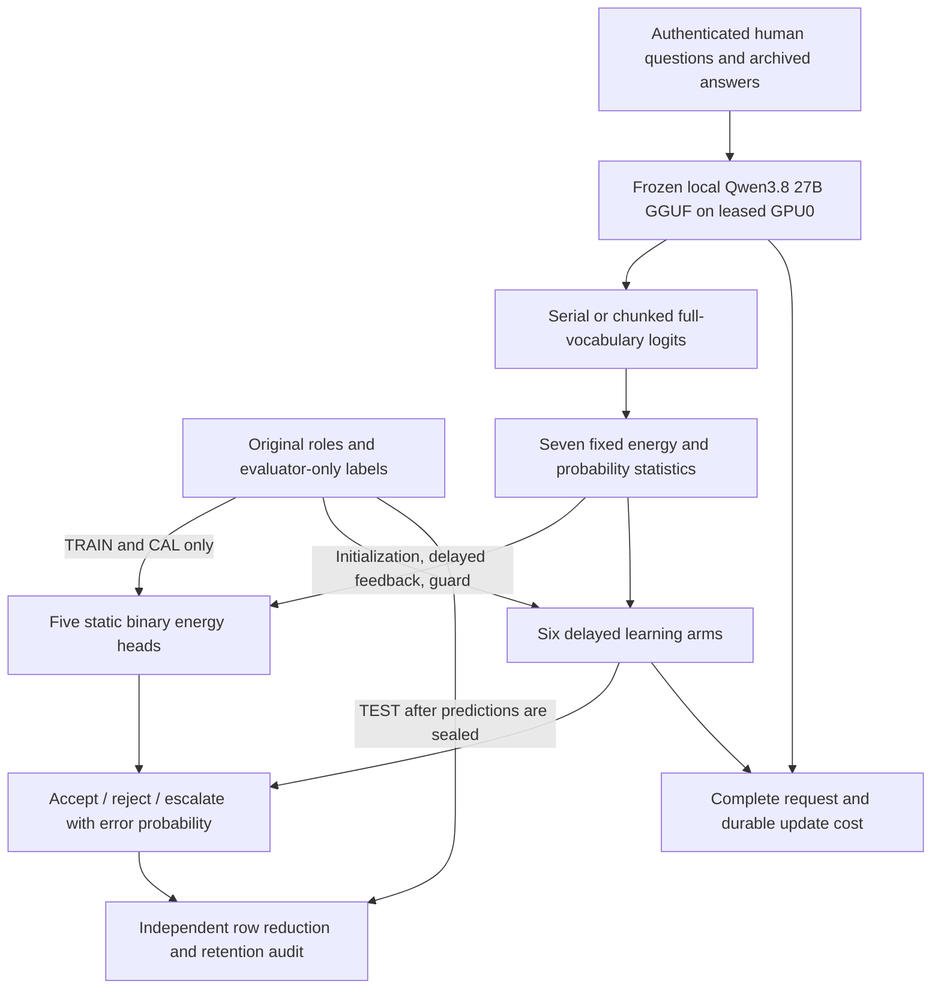
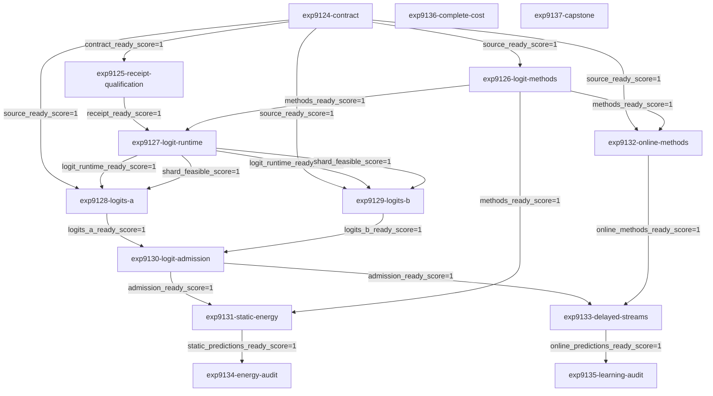

# Carnot Research Roadmap v778: Forward Energy Decisions and Calibration-Aware Continuous Learning

**Milestone:** 2026.11.778
**Created:** 2026-11-16 UTC
**Status:** Proposed; not activated or executed.
**Predecessor:** 2026.11.777, scheduling complete.
**Execution contract:** Exactly **14 tasks, Exp9124 through Exp9137**, in the
order below, across **four phases**. The table and embedded full task objects
must agree with `research-roadmap-next.yaml`.

The [V777 design](research-roadmap-v777-preserved-20261116.md) and
[V777 queue](research-roadmap-v777-preserved-20261116-queue.yaml) are preserved
byte for byte. Their SHA256 values are
`6e6635dadd64b3f59916ce35cd7a879323d480faf6e94ff1c6b76eeccea2c61b` and
`078ce21250bf76f43aec0f42b701c88a3371c45a4f2ad77d622df6edc2bfb7dc`.
The completion archive ends at V776. V777 closure comes from its active queue,
primary artifacts and conductor log. Scheduler completion is not scientific success.

## What V777 proved

| Experiment | Measured evidence | Conclusion and limit |
|---|---|---|
| Exp9110 | Contract, source and online-method readiness each1 | The original900 human-labeled answers/300 qids and causal-method authority remain authenticated. No human benefit was measured. |
| Exp9111 | Immutable inputs and semantic controls passed; owned and direct-consumer tests each timed out at600s | The receipt work is disqualified. Coverage was97.24770642201835%, with twelve missing runner statements714–725. Passing semantics alone cannot qualify it. |
| Exp9112/9113 | Scheduler gate artifacts; no canonical scientific primary | The mask repair and energy methods did not run. They were not experimentally disproved. |
| Exp9114–9121 | Cascade skips; no declared scientific primaries | No feature corpus, static advantage, energy increment or continuous-learning benefit exists from V777. |
| Exp9122 | Cost inventory readiness1; all service readiness0 | Availability was accounted for. No forward-service or adaptation cost was measured. |
| Exp9123 | Reconciliation readiness1; terminal blocked | Accounting is complete. Independent human verification remains open. |

The next attempt changes two concrete prerequisites. It measures complete test
partitions and the uncovered validation-success path before accepting receipts.
It then uses the supported serial logit operation without depending on embeddings.
The exact cause of the slow test nodes is unknown; diagnosis must precede any
performance change. Neither extra time alone nor weaker tests constitute a repair.

The V776 embedding padding failures remain intact. Exp9098 qualified its logit
interface independently. This plan does not repeat the untested mask repair.
It splits the900-answer logit job into two450-row shards with a feasibility gate.

## The three biggest gaps to the PRD

1. **Useful factual decisions without an executable oracle — FR-12.** Carnot
   has exact verification, but no independently confirmed factual-verifier win.
   Test raw energy against normalized probability and donor controls on authentic
   human development labels. Reserve independent confirmation for a real signal.
2. **Beneficial continuous self-learning — FR-06/FR-11.** Durable updates work
   on fixtures. Future human predictions and retained calibration remain unmeasured.
   Compare local spline updates with frozen, linear, bias, donor and temperature
   controls under identical delayed feedback.
3. **Reliable, affordable complete verification — FR-05/FR-08/NFR-01.** A head
   score is unusable without qualified model features and complete request costs.
   Measure raw-text forward work and durable adaptation. Map measured bottlenecks
   to supported hardware before claiming acceleration or commissioning a port.

## Research incorporated before experiment design

The [V778 research scan](../../research-references.md) records all requested
topics and secondary channels before this design. OpenReview browser verification
and stale GitHub Trending crawls limit the scan. Semantic Scholar returned46 EBT
and11 ARM-EBM citing records, with no next page, via direct HTTPS.

| Source | Application | Boundary |
|---|---|---|
| [Spilled Energy](https://arxiv.org/abs/2602.18671) and [Entropy Distribution](https://arxiv.org/abs/2605.28264) | Exp9126–9131/9134 | Whole-answer teacher forcing with full-vocabulary statistics, normalized controls and gauge tests; not exact localization or CES. |
| [Online spline KAN](https://arxiv.org/abs/2602.02056) | Exp9132/9133/9136 | Fixed local bases and small coefficient updates; local FPGA performance remains unmeasured. |
| [Continual Calibration](https://arxiv.org/abs/2604.23987) and [MT-CC](https://arxiv.org/abs/2610.25689) | Exp9132/9135 | Add a temperature-only control and separate future benefit from retention. No imported exchangeability guarantee or MT-CC grouping-network claim. |
| [Energy-Based Reasoners](https://arxiv.org/abs/2611.08977), [ETS](https://arxiv.org/abs/2601.21484) | Deferred | Reasoning and guidance need a useful verifier first; no generator training or decoding search. |
| [Anechoic](https://arxiv.org/abs/2610.13368), [Scaling Thermodynamic AI](https://arxiv.org/abs/2607.00170) | Exp9136 operation map | Dense optimization and distributional sampling have different quality/cost requirements. Neither is the present forward workload. |

## Architecture



Only text/token IDs enter Qwen. References, annotation metadata, source model
tags and labels are forbidden model inputs. Original generator identity is an
evaluation slice, never a learned feature. Qwen parameters stay frozen.

The static and online learners have separate initial fits and transformations.
The static150 fit cannot initialize the online100 fit. Research retention labels
cannot enter operational promotion. The original LPHB panel is exposed development;
prediction sealing does not retroactively make its test groups independent.

## Phase 1 — Qualify operations and methods (Exp9124–9127)

Exp9124 binds the exact contract and historical source closure. Exp9125 addresses
the specific failed validation obligation with node timing and complete partitions.
Exp9126 freezes CPU formulas and controls independently of receipt qualification.
Exp9127 qualifies only serial/chunked logits and measures workload feasibility.

Preserve the original test-node union and all assertions. Capture real child
coverage of the successful validation orchestration. Keep positive and adversarial
receipt controls. If the root cause remains unresolved within budget, record it
and stop the qualification scope. No broad checker changes are authorized.

## Phase 2 — Collect and admit bounded evidence (Exp9128–9130)

Exp9128/9129 independently collect the first/second lexical150 qids, all siblings.
Each preserves450 intended answers, original roles and full token accounting.
Exp9130 authenticates their complete join, recomputes sampled raw statistics and
separates feature views from evaluator labels before any fit.

Collection jobs run sequentially on GPU0. The pilot must project each full shard
within3300s and the declared memory/disk budget. No result-dependent cohort shrink
or shorter response replaces an infeasible job. A null signal never blocks admission.

## Phase 3 — Measure energy, adaptation and alternatives (Exp9131–9135)

Exp9131 fits the unchanged five-arm raw-logit study. Exp9132 independently qualifies
the six-arm online method on fixtures; it requires no natural feature artifact or
GPU. Exp9133 measures delayed coefficient learning. Exp9134 independently audits
static energy and gauge effects. Exp9135 independently audits future benefit,
temperature recalibration and retained quality. Both audits run on complete nulls.

## Phase 4 — Complete costs and reconciliation (Exp9136–9137)

Exp9136 is ungated and checks exact availability before loading a model. It can
time qualified static verification even if learning remains blocked. Exp9137
always accounts for every task, gate operand, null, quarantine and absent primary.
External incompleteness is terminal blocked, not a retryable partial capstone.

## Frozen scientific protocols

### Whole-answer forward statistics

Use original TRAIN150/CAL50/TEST100 question groups, three siblings each.
Primary target is original A1 factuality. A2 sensitivity uses only actual observed
labels; unknown -1 stays missing. The task evaluates archived answers under Qwen,
not newly generated Qwen answers. No answer accuracy claim transfers to Qwen.

Preserve V777's exact protocol. Tokenize question/answer separately with the
embedded tokenizer, no BOS or chat template, and right caps256/768. The prefix is
literal `Question:\n`, retained question text and literal `\nAnswer:\n`.
Freeze detokenization and prefix bytes. Append retained answer token IDs explicitly.
Reset state for every answer. Capture in128-token chunks with the preceding-prefix
logit for the first answer token. Preserve adjacent pairs across chunk boundaries.

For full-vocabulary logits z_i and answer token a_i, compute in stable float64:

- L_i=logsumexp(z_i); NLL_i=L_i-z_i[a_i].
- p_i=softmax(z_i); H_i=-sum_v p_iv*log(p_iv).
- Marginal energy M_i=-L_i.
- Adjacent spill D_i=-z_i[a_i]+L_(i+1), within one answer, i=1..length-1.

The seven features are log1p(answer length), mean NLL, mean H, maximum H,
mean M, mean absolute D and the no-adjacent-pair indicator. Retain selected logits,
L_i, H_i, max probability, token IDs, positions and full-vector hashes per token.
One-token answers lack only spill; TRAIN-only median imputation is fixed. An
entirely missing training feature blocks fitting. Empty answers retain their slots
as escalations. Loss contrasts share predeclared nonempty support; coverage uses
all original TEST rows. No label-based filtering is permitted.

Store full vectors for the first eight answer positions of the global first20
lexical qids/all siblings. Preflight2GiB for bounded raw evidence. Stream statistics
instead of retaining all900 complete token-by-vocabulary arrays in RAM.

### Static energy decisions and susceptibility

The five original arms are prevalence, probability+length logistic (first four
features), raw-energy logistic (length, mean M, mean absolute D, missing-pair
indicator), combined logistic (all seven) and combined with whole-qid TRAIN donor
labels. Donors use a fixed nonidentity cyclic permutation of sorted TRAIN qids;
sibling positions stay fixed. Report the actual changed-label numerator/denominator.

These are binary Gibbs energies E(0)=0, E(1)=-theta·phi and
p(error)=sigmoid(theta·phi). Fit TRAIN-only population mean/std, with constant
scale1. Minimize mean binary logloss plus0.5*0.01 times squared nonintercept
coefficients. L-BFGS-B starts at zero: maxiter2000, gtol1e-7, ftol1e-12.
Require finite parameters/objective and gradient infinity norm<=1e-6.
No regularization or architecture search is scheduled.

CAL alone selects temperature from[0.5,1,2,4], ascending ties. Accept at
p(error)<=0.1; reject at>=0.9; otherwise escalate. Seal TEST predictions before
evaluator access. Report Brier, logloss, coverage, accepted error and exact-half-
coverage error. Rerank half-coverage choices inside each resampled draw.

Use10000 paired TEST-qid bootstrap draws, seed777121, preserving siblings.
`energy_increment_score=1` requires both combined-arm Brier improvement lower
bounds>0 against probability+length and donor, with one-sided tail0.05/2.
Empirical accepted error must not increase versus probability+length.
Undefined accepted risk cannot pass. These are conditional development intervals.

Add c_i=3 or c_i=3*(-1)^i to every vocabulary logit. Normalized probabilities,
NLL and entropy must remain unchanged. M changes by -c_i; D changes by
c_(i+1)-c_i. Report raw-score and frozen-head sensitivity under both gauges.
Do not select the favorable gauge. A gauge-sensitive score can be an empirical
representation signal; it is not evidence of a broken probability chain rule.
The original Exp6980 exact-span null and V776 embedding study remain unchanged.

### Continuous self-learning with a recalibration control

Preserve the original SHA256(`v776-online`+qid) ordering:100 TRAIN groups for
initialization and50 for ten disjoint streams of five. Original CAL50 is the
operational guard; TEST100 is research retention. Preserve the Exp9099 donor map
(seed776099, initialization labels only, original sibling positions).

Fit imputation and scaling only on the100 initialization groups. After standard
scaling, fit initialization min/max to[-1,1], constants0, and clip later inputs.
Use the seven logit features with fixed cubic knots
[-1,-1,-1,-1,-0.5,0,0.5,1,1,1,1]: intercept, seven linear columns and49 basis
columns. Use the existing spline helper. Fit initial heads with the static ridge
objective and convergence contract; temperature starts at1. No random projection
or embedding transformation is used in this separate seven-feature study.

Six arms are frozen spline, adaptive spline, bias-only spline, adaptive linear,
donor-label spline and temperature-only spline. All start from comparable
initial fits. For the original adaptive arms, retain the Exp9099 gradient:
`(sigmoid(theta·phi)-y)*phi + 0.01*(theta-theta_initial)`, with no intercept
anchor. Bias-only zeros other coordinates. Clip L2 norm to1. Use AdaGrad,
learning rate0.05, accumulator initially0 and epsilon1e-8. Apply three sibling
updates in original order, then test promotion once per released qid.

For temperature-only adaptation, keep spline coefficients fixed. Let s be its
initial logit, u=log(T), q=exp(-u), p=sigmoid(q*s). Initially u=0. Use gradient
`(y-p)*q*s + 0.01*u`, clipped to[-1,1], with the same AdaGrad settings.
Clip updated u to[log(0.5),log(4)]. Persist u and its accumulator. This comparator
uses the same feedback and guard access; it is not a multi-group MT-CC replication.

Promote only if complete CAL Brier increase<=0.005 and CAL classification-error
increase<=0 versus that arm's initial state. Otherwise restore parameters and
accumulators while acknowledging consumed feedback. Research retention does not
participate in this decision. Seal all18 sibling/arm predictions for g before
releasing labels for g-1. Drain the final group after all predictions. Reset
every stream to identical initial states. No static150 data may enter this fit.

Atomic snapshots include predictions, parameters, accumulators, temperature,
pending feedback and acknowledgments. Real hard exits at prediction fsync,
feedback receipt and state replacement must reproduce uninterrupted states and
predictions exactly. Preserve private actual-child E2E-020 coverage.

Evaluate future groups2–5:40 distinct qids/120 responses. Use10000 paired stream
bootstrap draws, seed778135, one-sided tail0.05/7. The seven simultaneous bounds
are five adaptive-spline future Brier improvements over each other arm (lower>0),
retained Brier increase (upper<=0.005), and retained classification-error increase
(upper<=0). All seven plus exact recovery are needed for `learning_signal_score=1`.
This adds a comparator and tightens multiplicity correction; it does not replace
the old six-bound embedding protocol. Report per-qid retention changes averaged
over streams. Repeated retention is100 questions, not1000. Ten streams have limited
power and the intervals condition on the initial fit, guard and retention panel.

### Complete costs and hardware requirements

Use the original first20 TEST qids/all60 siblings, three fresh processes and
order seed776108. Qualified service probabilities must match scientific outputs
within atol1e-5/rtol1e-4; typed decisions must match exactly. Keep cold load, warm
uncached raw-text forward service and cached-statistic head-only costs separate.
Request clocks include tokenization, logits, reductions, transforms, heads and
serialization. Adaptation clocks include proposed/rejected updates, full guard
scans, fsync, acknowledgment, final drain and recovery. Missing work stays visible.

| Resource | Use and constraint |
|---|---|
| CPU/RAM/private disk | Small fits, bootstrap, state durability and reductions. Preflight disk and measured memory. |
| GPU0, RTX3090,24GB | Cached frozen Qwen forwards with actual lease/offload evidence. Sequential jobs; no hidden-state extraction. |
| GPU1 | Reserved for the existing owner. No two-GPU speed or memory assumption. |
| Model | `unsloth/Qwen3.8-27B-GGUF`, cached Q4_K_M through llama.cpp and its embedded tokenizer. Pin model/build hashes. |
| KV260 | Preserve supported Ising fabric scope and k_max<=5. Fixed-spline updates need a separately qualified implementation. |
| PolarFire/GateMate | Preserve CPU-only PolarFire evidence and unchanged GateMate physical/JTAG block. No repeated probe. |
| NPU/TSU/larger FPGA wishlist | Unqualified for this service. Procurement requires measured bottlenecks and an operation-matched workload. |

CPU handles state/storage, GPU handles batched forwards, and sparse fixed-basis
updates have a possible future FPGA path. Report measured fractions and Amdahl
ceilings for the program's100x target. They are not a promise of100x learning or
the PRD's10x Rust throughput. Energy stays null without measured power integrals.
No board contact, runtime rebuild, purchase or new dependency is scheduled.

## Execution and acceptance discipline

All model tasks declare `MODEL_SPECS` with the mandated model and
`model_load_no_generation` (2s floor). There are no generative tasks here.
A future small-token canary would be `model_bounded_generation` (10s), and a real
generative run `model_full_generation` (60s). Actual pre-load refusals retain the
requested class but report `blocked_no_run`; no elapsed-time padding is permitted.

Every prompt requires flushed phase and call boundaries, loop progress,60s child
heartbeats, silent gaps below600s and file-writing calls of at most about200 lines.
Each task stops measurement by3300s and reserves1200s for checks inside4800s.
Missing external inputs are blocked, not partial. Negative scientific results
are terminal nulls. Readiness gates never require scientific improvement.

Contract, receipt qualification and runtime integration use Opus/100 turns.
Formulaic collection/admission tasks use Codex `gpt-6.1-sol`/30 turns. Other work
uses the default Claude/Sonnet budget. No weak backend is used for scientific claims.
Every task carries comparative rows, a closed verdict class, exact gate fields
and four-field prior-failure records with mechanical retirement enabled.

Verification is spec-first/tests-first, scoped unit/coverage/lint/type/spec checks
and real private CLI success/refusal/tamper/cold replay (E2E-018/021; E2E-020 for
learning/recovery). Preserve existing assertions and historical authority. Shared
checker changes must retain their complete direct-consumer controls. The conductor
and active roadmap are protected. Planning itself runs contract/activation linters
and applicable existing planning/E2E tests; it does not execute these experiments.

Success means complete, auditable comparisons or precise terminal blockers.
Independent human confirmation follows only a controlled descriptive signal.
Keep GAP-ORACLE-DISTINCT and GAP-DETECTOR-AUROC-4208 open on this exposed panel.
Run stable G1–G4 publication gates in their historical scope; set
`current_science_paper_ready=false` here. ARC is opportunistic under the November7
north-star directive; no solve claim, offline adapter or new registry entry is
scheduled. Graph collection, masked embeddings, guided decoding, generator
training, Rust porting and board bring-up remain separately gated future work.

## Dependency graph



Exp9136 and Exp9137 run unconditionally. All other edges are conjunctive.
No edge references a retired historical task or depends on a positive effect.

## Exact task contract

| Order | ID | Title | Phase | Deliverable |
|---|---|---|---|---|
| 1 | `exp9124-contract` | Exp9124: Bind fourteen tasks and preserve V777 failures | 1 | `results/experiment_9124_v778_contract.json` |
| 2 | `exp9125-receipt-qualification` | Exp9125: Qualify forward receipts with complete bounded checks | 1 | `results/experiment_9125_v778_receipt_qualification.json` |
| 3 | `exp9126-logit-methods` | Exp9126: Freeze whole-answer energy and probability controls | 1 | `results/experiment_9126_v778_logit_methods.json` |
| 4 | `exp9127-logit-runtime` | Exp9127: Qualify serial Qwen logit capture and shard budgets | 1 | `results/experiment_9127_v778_logit_runtime.json` |
| 5 | `exp9128-logits-a` | Exp9128: Collect frozen Qwen logit statistics in shard A | 2 | `results/experiment_9128_v778_logits_a.json` |
| 6 | `exp9129-logits-b` | Exp9129: Collect frozen Qwen logit statistics in shard B | 2 | `results/experiment_9129_v778_logits_b.json` |
| 7 | `exp9130-logit-admission` | Exp9130: Authenticate complete statistics and role separation | 2 | `results/experiment_9130_v778_logit_admission.json` |
| 8 | `exp9131-static-energy` | Exp9131: Train the frozen five-arm human energy comparison | 3 | `results/experiment_9131_v778_static_energy.json` |
| 9 | `exp9132-online-methods` | Exp9132: Freeze delayed logit learning and recalibration controls | 3 | `results/experiment_9132_v778_online_methods.json` |
| 10 | `exp9133-delayed-streams` | Exp9133: Measure continuous logit learning on future groups | 3 | `results/experiment_9133_v778_delayed_streams.json` |
| 11 | `exp9134-energy-audit` | Exp9134: Audit raw-energy value and gauge susceptibility | 3 | `results/experiment_9134_v778_energy_audit.json` |
| 12 | `exp9135-learning-audit` | Exp9135: Test future benefit beyond temperature recalibration | 3 | `results/experiment_9135_v778_learning_audit.json` |
| 13 | `exp9136-complete-cost` | Exp9136: Measure complete forward and durable learning costs | 4 | `results/experiment_9136_v778_complete_cost.json` |
| 14 | `exp9137-capstone` | Exp9137: Reconcile fourteen outcomes and continuation decisions | 4 | `results/experiment_9137_v778_capstone.json` |

The full objects below are authoritative, including prompts, gates and prior failures.
They are generated from the same task list as the YAML; no shortened contract is used.

<!-- V778_TASK_CONTRACT_START -->
```json
{
  "milestone": "2026.11.778",
  "milestone_title": "Forward Energy Decisions and Calibration-Aware Continuous Learning",
  "milestone_doc": "openspec/change-proposals/research-roadmap-vNEXT.md",
  "tasks": [
    {
      "id": "exp9124-contract",
      "title": "Exp9124: Bind fourteen tasks and preserve V777 failures",
      "phase": 1,
      "track": "research",
      "priority": "high",
      "requires_gpu": false,
      "max_turns": 100,
      "estimated_wall_time_min": 45,
      "per_unit_rows": true,
      "milestone": "2026.11.778",
      "deliverable": "results/experiment_9124_v778_contract.json",
      "inference_substrate_class": "no_model_load",
      "MODEL_SPECS": [],
      "gated_on": [],
      "prior_failures": [
        {
          "experiment_id": "exp9123-capstone",
          "verdict": "complete_blocked_declared_gate",
          "addressed_by": "Administrative binding of a new logit-only protocol preserves the prior terminal block; it does not retry missing V777 science.",
          "retire_if_same_verdict": true
        }
      ],
      "prompt": "CONTEXT:\nWork in {project_root} on {date}. V777 finished with a qualified source contract, disqualified receipt validation and blocked science. This contract authenticates existing evidence without re-running model work.\nEXISTING CODE TO READ FIRST:\nCLAUDE.md; CODEX.md; ops/north-star.md; ops/e2e-test-plan.md; ops/exclusion_manifest.yaml; research-references.md (V778 scan); openspec/change-proposals/research-roadmap-vNEXT.md; openspec/capabilities/research-reporting/spec.md; scripts/experiment_template.py; python/carnot/reporting/primary_publication.py; python/carnot/reporting/current_work_receipt.py; python/carnot/reporting/roadmap_contract.py; python/carnot/reporting/v777_contract.py; python/carnot/reporting/v777_capstone.py; results/experiment_9110_v777_contract.json; results/experiment_9111_v777_forward_evidence.json; results/experiment_9123_v777_capstone.json; openspec/change-proposals/research-roadmap-v777-preserved-20261116.md; openspec/change-proposals/research-roadmap-v777-preserved-20261116-queue.yaml\nTASK:\nBind fourteen tasks and preserve V777 failures. Deliver results/experiment_9124_v778_contract.json. Implement scripts/experiments/experiment_9124_v778_contract.py using existing library code. MODEL_SPECS: []. Requested inference_substrate_class: no_model_load.\nDo not load an LLM. Record current_llm_invocations=0 and generated_tokens=0. Cached upstream model evidence is historical provenance. Small numerical energy training is CPU work, not an LLM invocation.\nCONCRETE STEPS:\n1. Emit a flushed progress line at each phase boundary and before and after every model load, generation, benchmark and subprocess that can take minutes. Emit progress inside long loops. Supervise blocking calls with flushed heartbeats every 60 seconds; keep every gap below 600 seconds. Write any file over about 200 lines in several tool calls of at most 200 lines, with a progress message between calls. Never make one huge writing call.\n2. PRECONDITIONS: Authenticate the declared upstream fields and immutable source bytes before dependent work. Check resource, import and disk limits. Missing external evidence is terminal blocked with gate_check_summary naming upstream, exact field, expected and observed values. Distinguish missing_file, missing_field and observed zero. Do not replace historical producer pins with mutable checkout hashes.\n3. Before implementation, inspect callers with rg. Confirm REQ-REPORT-9124-V778 and SCENARIO-REPORT-9124-V778. Extend the relevant specification, then write failing controls before implementation. Freeze formulas, unit rosters, exclusions and validation scope before measurement. Never change a gate or denominator after outcomes.\n4. Compare all fourteen full task objects with the visible table and embedded JSON. Require Exp9124 through Exp9137 in this order, unique first-50-character title keys, unallocated IDs and exactly declared upstream fields. Accept the existing literal-brace normalization only. Before activation compare the staged queue; afterward authenticate the active V778 queue. Never demand V778 equality from the still-active V777 queue.\n5. Authenticate Exp9110 source closure back through Exp9097 and the original producer snapshots. Preserve all 900 answers/300 qids, TRAIN150/CAL50/TEST100, three siblings, actual A2 labels and original exposure status. Freeze inference-only text/token views separately from evaluator labels. Keep all historical source roles; do not rehash changed producers to manufacture validity.\n6. Retain all fourteen V777 outcome rows, including alternate scheduler filenames and absent canonical primaries. Copy the inherited raw-logit formulas and original online roster/donor map into immutable V778 protocol references. New online input and sixth temperature arm are a separate declared study; the embedding and graph studies keep their original bounds.\n7. Freeze the owned validation manifest and source/shard rosters. Contract readiness and source readiness are separate. Carry the original receipt failure, embedding padding null, source exposure, graph custody block and hardware limits forward. Do not edit historical primaries or clear quarantine.\n8. Validate owned changes with meaningful unit tests and 100 percent owned statement coverage, including actual subprocess coverage, with zero exclusions. Run Ruff check/format, strict mypy and explicit-path scripts/check_spec_coverage.py. Run private real CLI success, refusal, tamper and cold replay outside the checkout without PYTHONPATH (E2E-018/021). Learning or recovery changes also require E2E-020. Preserve the original assertion set. Separate unrelated global-health failures from affected failures; affected failures disqualify readiness.\n9. Stop measurement by 3300 seconds and reserve 1200 seconds for verification within the 4800-second cap. Retain unfinished units and honest censor reasons. Recompute headlines from rows. Run scripts/adversarial_verify.py and scripts/verdict_row_consistency_lint.py --strict under heartbeat supervision. Publish through primary_publication with real checker receipts; never suppress a flag or fabricate a pass. Reconcile openspec/, _bmad/traceability.md, ops/status.md and ops/changelog.md. Preserve old primaries and exclusions. Do not activate a roadmap or publish externally.\nREQUIRED ARTIFACT FIELDS:\n- honest_verdict: complete_*; verdict_class: positive | circular_positive | null | blocked | disqualified | partial. Only unfinished owned work is partial; unchanged absent, retired or gate-blocked inputs are blocked. Fixtures are not scientific positives. Exact-oracle gains use circular_positive.\n- gate_check_summary: check, upstream, path, sha256, artifact_field, op, expected, observed, passed; mandatory for every blocked verdict.\n- rows: unit_id, qid/group, sibling, arm/condition, seed, absolute metric, numerator, denominator, status and exclusion/censor reason. Include intended/attempted/completed/failed/censored counts, sample_size_budget and effective_independent_groups. Siblings, bootstrap draws and repeated retention are not independent new questions.\n- verifier_is_oracle, claim_scope, exposure_scope, independent_generalization_score=0. This exposed human development panel cannot close GAP-ORACLE-DISTINCT or GAP-DETECTOR-AUROC-4208. No ARC level solve is claimed.\n- MODEL_SPECS, requested_inference_substrate_class, inference_substrate_class, inference_substrate, current_llm_invocations, model_invocation_counts, generated_tokens, duration_s, random_seed, reproducibility_checksum, code_config_hashes, source_references, current_work_receipts, validation_receipts, required_checks_passed, acceptance_gates, field_principles. Explain the distinct scientific principle each important field protects.\n- contract_ready_score, source_ready_score: integer 0/1; full_task_objects, canonical_task_hash, previous_outcome_rows, source_manifest_reference, evaluator_label_reference, static_protocol_reference, online_roster_reference, shard_a_roster_reference, shard_b_roster_reference, archive_lag, closed_scope_rows.\nRun command: cd {project_root} && JAX_PLATFORMS=cpu .venv/bin/python -u scripts/experiments/experiment_9124_v778_contract.py --date {date}\nDo NOT push. Do NOT modify scripts/research_conductor.py.",
      "model": "opus"
    },
    {
      "id": "exp9125-receipt-qualification",
      "title": "Exp9125: Qualify forward receipts with complete bounded checks",
      "phase": 1,
      "track": "research",
      "priority": "high",
      "requires_gpu": false,
      "max_turns": 100,
      "estimated_wall_time_min": 70,
      "per_unit_rows": true,
      "milestone": "2026.11.778",
      "deliverable": "results/experiment_9125_v778_receipt_qualification.json",
      "inference_substrate_class": "no_model_load",
      "MODEL_SPECS": [],
      "gated_on": [
        {
          "upstream": "exp9124-contract",
          "artifact_field": "contract_ready_score",
          "op": "==",
          "value": 1
        }
      ],
      "prior_failures": [
        {
          "experiment_id": "exp9111-forward-evidence",
          "verdict": "complete_disqualified_owned_checks",
          "addressed_by": "Preserve the complete test union while measuring bounded node partitions and exercising the uncovered real validation-success path; do not alter receipt semantics to evade failed checks.",
          "retire_if_same_verdict": true
        },
        {
          "experiment_id": "exp9107-qwen-judge",
          "verdict": "complete_disqualified_artifact_checks",
          "addressed_by": "Retain the measured judge quarantine; qualify only current operation-specific receipt semantics and complete validation.",
          "retire_if_same_verdict": true
        }
      ],
      "prompt": "CONTEXT:\nWork in {project_root} on {date}. Exp9111 passed semantic and immutable-input controls but both test families timed out at 600s. Coverage missed runner statements 714-725. The specific slow node is unknown; no semantic repair is justified by the timeout alone.\nEXISTING CODE TO READ FIRST:\nCLAUDE.md; CODEX.md; ops/north-star.md; ops/e2e-test-plan.md; ops/exclusion_manifest.yaml; research-references.md (V778 scan); openspec/change-proposals/research-roadmap-vNEXT.md; openspec/capabilities/research-reporting/spec.md; scripts/experiment_template.py; python/carnot/reporting/primary_publication.py; python/carnot/reporting/current_work_receipt.py; python/carnot/reporting/forward_evidence_9111.py; python/carnot/reporting/forward_evidence_runner_9111.py; tests/python/test_forward_evidence_9111.py; tests/python/test_forward_evidence_runner_9111.py; scripts/adversarial_verify.py; results/experiment_9111_v777_forward_evidence.json\nTASK:\nQualify forward receipts with complete bounded checks. Deliver results/experiment_9125_v778_receipt_qualification.json. Implement scripts/experiments/experiment_9125_v778_receipt_qualification.py using existing library code. MODEL_SPECS: []. Requested inference_substrate_class: no_model_load.\nDo not load an LLM. Record current_llm_invocations=0 and generated_tokens=0. Cached upstream model evidence is historical provenance. Small numerical energy training is CPU work, not an LLM invocation.\nCONCRETE STEPS:\n1. Emit a flushed progress line at each phase boundary and before and after every model load, generation, benchmark and subprocess that can take minutes. Emit progress inside long loops. Supervise blocking calls with flushed heartbeats every 60 seconds; keep every gap below 600 seconds. Write any file over about 200 lines in several tool calls of at most 200 lines, with a progress message between calls. Never make one huge writing call.\n2. PRECONDITIONS: Authenticate the declared upstream fields and immutable source bytes before dependent work. Check resource, import and disk limits. Missing external evidence is terminal blocked with gate_check_summary naming upstream, exact field, expected and observed values. Distinguish missing_file, missing_field and observed zero. Do not replace historical producer pins with mutable checkout hashes.\n3. Before implementation, inspect callers with rg. Confirm REQ-REPORT-9125-V778 and SCENARIO-REPORT-9125-V778. Extend the relevant specification, then write failing controls before implementation. Freeze formulas, unit rosters, exclusions and validation scope before measurement. Never change a gate or denominator after outcomes.\n4. Retain original failed logs, source hashes, complete collected node IDs and assertions. First run bounded verbose node-timed partitions to locate cost. Preserve the exact original owned/direct-consumer node union. Partition execution with per-node receipts; no dropping tests, deadline-only repair or blanket checker exemption. Any expensive shared-fixture reuse must bind immutable inputs and retain mutation isolation.\n5. Exercise the real non-diagnostic successful validation orchestration, including statements 714-725, under a finite private child run. Keep repository-health classification separate, as the original runner intended. Do not mock required work into a successful readiness result. An isolated integration boundary may reuse authenticated command receipts only if the original validator verifies their full bytes and unchanged assertion scope.\n6. Replay all original positive/adversarial receipt and structural-count controls, plus historical-forward/current-no-load, attempted failed load, unsupported zero sampling, mismatched forward counters and copied outcome counts. Preserve the original Exp9107 quarantine. Require genuine 100 percent owned coverage and the complete required command union within the task budget.\n7. Emit receipt_ready_score=1 only when original semantics, all validation partitions, real success/refusal/tamper CLI paths and current publication checks pass. Otherwise emit a terminal measured null/disqualification with exact remaining node/statement, and retire this bounded qualification scope. Downstream tasks never substitute Exp9111 readiness or accept a fixture-only pass.\n8. Validate owned changes with meaningful unit tests and 100 percent owned statement coverage, including actual subprocess coverage, with zero exclusions. Run Ruff check/format, strict mypy and explicit-path scripts/check_spec_coverage.py. Run private real CLI success, refusal, tamper and cold replay outside the checkout without PYTHONPATH (E2E-018/021). Learning or recovery changes also require E2E-020. Preserve the original assertion set. Separate unrelated global-health failures from affected failures; affected failures disqualify readiness.\n9. Stop measurement by 3300 seconds and reserve 1200 seconds for verification within the 4800-second cap. Retain unfinished units and honest censor reasons. Recompute headlines from rows. Run scripts/adversarial_verify.py and scripts/verdict_row_consistency_lint.py --strict under heartbeat supervision. Publish through primary_publication with real checker receipts; never suppress a flag or fabricate a pass. Reconcile openspec/, _bmad/traceability.md, ops/status.md and ops/changelog.md. Preserve old primaries and exclusions. Do not activate a roadmap or publish externally.\nREQUIRED ARTIFACT FIELDS:\n- honest_verdict: complete_*; verdict_class: positive | circular_positive | null | blocked | disqualified | partial. Only unfinished owned work is partial; unchanged absent, retired or gate-blocked inputs are blocked. Fixtures are not scientific positives. Exact-oracle gains use circular_positive.\n- gate_check_summary: check, upstream, path, sha256, artifact_field, op, expected, observed, passed; mandatory for every blocked verdict.\n- rows: unit_id, qid/group, sibling, arm/condition, seed, absolute metric, numerator, denominator, status and exclusion/censor reason. Include intended/attempted/completed/failed/censored counts, sample_size_budget and effective_independent_groups. Siblings, bootstrap draws and repeated retention are not independent new questions.\n- verifier_is_oracle, claim_scope, exposure_scope, independent_generalization_score=0. This exposed human development panel cannot close GAP-ORACLE-DISTINCT or GAP-DETECTOR-AUROC-4208. No ARC level solve is claimed.\n- MODEL_SPECS, requested_inference_substrate_class, inference_substrate_class, inference_substrate, current_llm_invocations, model_invocation_counts, generated_tokens, duration_s, random_seed, reproducibility_checksum, code_config_hashes, source_references, current_work_receipts, validation_receipts, required_checks_passed, acceptance_gates, field_principles. Explain the distinct scientific principle each important field protects.\n- receipt_ready_score: integer 0/1; original_node_manifest, partition_node_manifests, union_equality, node_timing_rows, missing_statement_rows, original_semantic_controls, adversarial_control_rows, real_success_path_receipt, original_quarantine_preserved, owned_statement_coverage.\nRun command: cd {project_root} && JAX_PLATFORMS=cpu .venv/bin/python -u scripts/experiments/experiment_9125_v778_receipt_qualification.py --date {date}\nDo NOT push. Do NOT modify scripts/research_conductor.py.",
      "model": "opus"
    },
    {
      "id": "exp9126-logit-methods",
      "title": "Exp9126: Freeze whole-answer energy and probability controls",
      "phase": 1,
      "track": "research",
      "priority": "high",
      "requires_gpu": false,
      "max_turns": 50,
      "estimated_wall_time_min": 50,
      "per_unit_rows": true,
      "milestone": "2026.11.778",
      "deliverable": "results/experiment_9126_v778_logit_methods.json",
      "inference_substrate_class": "no_model_load",
      "MODEL_SPECS": [],
      "gated_on": [
        {
          "upstream": "exp9124-contract",
          "artifact_field": "source_ready_score",
          "op": "==",
          "value": 1
        }
      ],
      "prior_failures": [
        {
          "experiment_id": "exp9113-energy-methods",
          "verdict": "blocked_gate_check_failed",
          "addressed_by": "Methods and CPU controls no longer depend on receipt qualification or the unexecuted embedding repair.",
          "retire_if_same_verdict": true
        },
        {
          "experiment_id": "exp6980-spilled-energy-requalification",
          "verdict": "complete_null_spilled_energy_requalification_retired",
          "addressed_by": "Use authentic human whole-answer labels and probability/gauge controls; preserve the different exact-oracle span null.",
          "retire_if_same_verdict": true
        }
      ],
      "prompt": "CONTEXT:\nWork in {project_root} on {date}. The V777 energy protocol never executed because it depended on receipt readiness. Its formulas and acceptance bounds remain usable independently of model access.\nEXISTING CODE TO READ FIRST:\nCLAUDE.md; CODEX.md; ops/north-star.md; ops/e2e-test-plan.md; ops/exclusion_manifest.yaml; research-references.md (V778 scan); openspec/change-proposals/research-roadmap-vNEXT.md; openspec/capabilities/research-reporting/spec.md; scripts/experiment_template.py; python/carnot/reporting/primary_publication.py; python/carnot/reporting/current_work_receipt.py; python/carnot/experiment_6980_spilled_energy_requalification.py; python/carnot/reporting/human_methods_9084.py; openspec/change-proposals/research-roadmap-v777-preserved-20261116.md; python/carnot/reporting/embedding_runtime_9098.py\nTASK:\nFreeze whole-answer energy and probability controls. Deliver results/experiment_9126_v778_logit_methods.json. Implement scripts/experiments/experiment_9126_v778_logit_methods.py using existing library code. MODEL_SPECS: []. Requested inference_substrate_class: no_model_load.\nDo not load an LLM. Record current_llm_invocations=0 and generated_tokens=0. Cached upstream model evidence is historical provenance. Small numerical energy training is CPU work, not an LLM invocation.\nCONCRETE STEPS:\n1. Emit a flushed progress line at each phase boundary and before and after every model load, generation, benchmark and subprocess that can take minutes. Emit progress inside long loops. Supervise blocking calls with flushed heartbeats every 60 seconds; keep every gap below 600 seconds. Write any file over about 200 lines in several tool calls of at most 200 lines, with a progress message between calls. Never make one huge writing call.\n2. PRECONDITIONS: Authenticate the declared upstream fields and immutable source bytes before dependent work. Check resource, import and disk limits. Missing external evidence is terminal blocked with gate_check_summary naming upstream, exact field, expected and observed values. Distinguish missing_file, missing_field and observed zero. Do not replace historical producer pins with mutable checkout hashes.\n3. Before implementation, inspect callers with rg. Confirm REQ-REPORT-9126-V778 and SCENARIO-REPORT-9126-V778. Extend the relevant specification, then write failing controls before implementation. Freeze formulas, unit rosters, exclusions and validation scope before measurement. Never change a gate or denominator after outcomes.\n4. Freeze the exact inherited seven logit features, five static arms, caps256/768, prefix bytes, token indexing, chunk128 and A1 target. Keep the original ridge fit, CAL temperatures, 0.1/0.9 decisions, paired qid resampling and two energy-increment bounds. No fresh model work is required to specify these methods.\n5. Implement reusable streaming reductions using full-vocabulary logits. Check float64 logsumexp against independently coded tiny arrays. Test adjacent pairs across chunk edges, shifted token indices, truncated vocabulary, nonfinite values, zero/one-token answers and state reset. Store bounded raw arrays plus per-token sufficient statistics and hashes.\n6. Freeze constant c_i=3 and alternating c_i=3*(-1)^i logit-offset controls. Verify unchanged normalized probabilities/NLL/entropy, M shift -c_i and spill shift c_(i+1)-c_i. Never label gauge sensitivity a probability-chain violation. Freeze raw-sample positions before labels.\n7. Write immutable static and collection protocol references. Audit readiness requires correct formulas and rejecting controls, never a favorable human outcome. Preserve the retired exact-oracle Exp6980 null and distinguish this whole-answer cross-model adaptation from the paper localization method.\n8. Validate owned changes with meaningful unit tests and 100 percent owned statement coverage, including actual subprocess coverage, with zero exclusions. Run Ruff check/format, strict mypy and explicit-path scripts/check_spec_coverage.py. Run private real CLI success, refusal, tamper and cold replay outside the checkout without PYTHONPATH (E2E-018/021). Learning or recovery changes also require E2E-020. Preserve the original assertion set. Separate unrelated global-health failures from affected failures; affected failures disqualify readiness.\n9. Stop measurement by 3300 seconds and reserve 1200 seconds for verification within the 4800-second cap. Retain unfinished units and honest censor reasons. Recompute headlines from rows. Run scripts/adversarial_verify.py and scripts/verdict_row_consistency_lint.py --strict under heartbeat supervision. Publish through primary_publication with real checker receipts; never suppress a flag or fabricate a pass. Reconcile openspec/, _bmad/traceability.md, ops/status.md and ops/changelog.md. Preserve old primaries and exclusions. Do not activate a roadmap or publish externally.\nREQUIRED ARTIFACT FIELDS:\n- honest_verdict: complete_*; verdict_class: positive | circular_positive | null | blocked | disqualified | partial. Only unfinished owned work is partial; unchanged absent, retired or gate-blocked inputs are blocked. Fixtures are not scientific positives. Exact-oracle gains use circular_positive.\n- gate_check_summary: check, upstream, path, sha256, artifact_field, op, expected, observed, passed; mandatory for every blocked verdict.\n- rows: unit_id, qid/group, sibling, arm/condition, seed, absolute metric, numerator, denominator, status and exclusion/censor reason. Include intended/attempted/completed/failed/censored counts, sample_size_budget and effective_independent_groups. Siblings, bootstrap draws and repeated retention are not independent new questions.\n- verifier_is_oracle, claim_scope, exposure_scope, independent_generalization_score=0. This exposed human development panel cannot close GAP-ORACLE-DISTINCT or GAP-DETECTOR-AUROC-4208. No ARC level solve is claimed.\n- MODEL_SPECS, requested_inference_substrate_class, inference_substrate_class, inference_substrate, current_llm_invocations, model_invocation_counts, generated_tokens, duration_s, random_seed, reproducibility_checksum, code_config_hashes, source_references, current_work_receipts, validation_receipts, required_checks_passed, acceptance_gates, field_principles. Explain the distinct scientific principle each important field protects.\n- methods_ready_score: integer 0/1; protocol_reference, token_statistic_schema, raw_sample_roster_reference, formula_reference_rows, indexing_control_rows, gauge_control_rows, five_arm_specification, sample_size_budget.\nRun command: cd {project_root} && JAX_PLATFORMS=cpu .venv/bin/python -u scripts/experiments/experiment_9126_v778_logit_methods.py --date {date}\nDo NOT push. Do NOT modify scripts/research_conductor.py."
    },
    {
      "id": "exp9127-logit-runtime",
      "title": "Exp9127: Qualify serial Qwen logit capture and shard budgets",
      "phase": 1,
      "track": "research",
      "priority": "high",
      "requires_gpu": true,
      "max_turns": 100,
      "estimated_wall_time_min": 65,
      "per_unit_rows": true,
      "milestone": "2026.11.778",
      "deliverable": "results/experiment_9127_v778_logit_runtime.json",
      "inference_substrate_class": "model_load_no_generation",
      "MODEL_SPECS": [
        {
          "hf_id": "unsloth/Qwen3.8-27B-GGUF",
          "quantization": "Q4_K_M"
        }
      ],
      "gated_on": [
        {
          "upstream": "exp9125-receipt-qualification",
          "artifact_field": "receipt_ready_score",
          "op": "==",
          "value": 1
        },
        {
          "upstream": "exp9126-logit-methods",
          "artifact_field": "methods_ready_score",
          "op": "==",
          "value": 1
        }
      ],
      "prior_failures": [
        {
          "experiment_id": "exp9112-masked-runtime",
          "verdict": "blocked_gate_check_failed",
          "addressed_by": "The new runtime qualifies only the already-supported serial logit operation; bounded receipt validation replaces the failed gate, and no embedding-mask experiment is re-proposed.",
          "retire_if_same_verdict": true
        },
        {
          "experiment_id": "exp9098-embedding-runtime",
          "verdict": "complete_null_runtime_capability_limit",
          "addressed_by": "Reuse its successful likelihood interface; retain the failed embedding scope and original logit tolerance.",
          "retire_if_same_verdict": true
        }
      ],
      "prompt": "CONTEXT:\nWork in {project_root} on {date}. Exp9098 qualified logits but failed embedding padding parity. Exp9112 was never executed. A dedicated serial logit path tests the required operation without depending on hidden-state extraction.\nEXISTING CODE TO READ FIRST:\nCLAUDE.md; CODEX.md; ops/north-star.md; ops/e2e-test-plan.md; ops/exclusion_manifest.yaml; research-references.md (V778 scan); openspec/change-proposals/research-roadmap-vNEXT.md; openspec/capabilities/research-reporting/spec.md; scripts/experiment_template.py; python/carnot/reporting/primary_publication.py; python/carnot/reporting/current_work_receipt.py; python/carnot/inference/embedding_runtime_9098.py; python/carnot/reporting/embedding_runtime_9098.py; python/carnot/inference/bfs_pilot_runtime_8918.py; python/carnot/gpu_lease_phase_journal.py; results/experiment_9098_v776_embedding_runtime.json\nTASK:\nQualify serial Qwen logit capture and shard budgets. Deliver results/experiment_9127_v778_logit_runtime.json. Implement scripts/experiments/experiment_9127_v778_logit_runtime.py using existing library code. MODEL_SPECS: [{\"hf_id\": \"unsloth/Qwen3.8-27B-GGUF\", \"quantization\": \"Q4_K_M\"}]. Requested inference_substrate_class: model_load_no_generation.\nUse cached_sota_pair() to resolve the mandated local GGUF path and embedded tokenizer. Use the established GPU0 lease and CUDA loader. Record real offload, build/model hashes, forward counters and zero generated tokens. This is forward-only model work with a 2s floor, never a generative canary. If no load occurs, report actual blocked_no_run separately from the requested class. No duration padding, fallback model, download, generator training or GPU1 use.\nCONCRETE STEPS:\n1. Emit a flushed progress line at each phase boundary and before and after every model load, generation, benchmark and subprocess that can take minutes. Emit progress inside long loops. Supervise blocking calls with flushed heartbeats every 60 seconds; keep every gap below 600 seconds. Write any file over about 200 lines in several tool calls of at most 200 lines, with a progress message between calls. Never make one huge writing call.\n2. PRECONDITIONS: Authenticate the declared upstream fields and immutable source bytes before dependent work. Check resource, import and disk limits. Missing external evidence is terminal blocked with gate_check_summary naming upstream, exact field, expected and observed values. Distinguish missing_file, missing_field and observed zero. Do not replace historical producer pins with mutable checkout hashes.\n3. Before implementation, inspect callers with rg. Confirm REQ-REPORT-9127-V778 and SCENARIO-REPORT-9127-V778. Extend the relevant specification, then write failing controls before implementation. Freeze formulas, unit rosters, exclusions and validation scope before measurement. Never change a gate or denominator after outcomes.\n4. Use FrozenRuntime.likelihood as the independent serial reference. Qualify a chunk128 capture adapter with prefix-last-logit handling and token statistics streamed to disk. Do not call hidden(), add padding, rebuild llama.cpp or relax original logit tolerances.\n5. Use the original twelve frozen runtime fixtures. Compare serial and chunked token scores with the original logit tolerance from Exp9098, repeated fresh-process resets, mixed-length order permutations and native full-vocabulary shapes. Add wrong-offset, lost chunk-boundary pair and stale-state negative controls. Keep embedding readiness absent; this task cannot qualify embeddings.\n6. Record actual GPU0 offload and forward calls with qualified receipts. Run a label-blind length-stratified pilot from original TRAIN only, chosen by the frozen token lengths. Benchmark requested collection and three-process cost cohorts. Admit each 450-row shard only if a conservative measured projection fits 3300s, memory and the 2GiB evidence budget. Count pilot rows as attempted work; never reduce the full cohort to pass feasibility.\n7. Emit independent logit_runtime_ready_score, shard_feasible_score and cost_feasible_score. Stop on unsupported runtime or infeasible budget without repeated loads or fallback models. Preserve all original embedding failures and untested mask hypotheses.\n8. Validate owned changes with meaningful unit tests and 100 percent owned statement coverage, including actual subprocess coverage, with zero exclusions. Run Ruff check/format, strict mypy and explicit-path scripts/check_spec_coverage.py. Run private real CLI success, refusal, tamper and cold replay outside the checkout without PYTHONPATH (E2E-018/021). Learning or recovery changes also require E2E-020. Preserve the original assertion set. Separate unrelated global-health failures from affected failures; affected failures disqualify readiness.\n9. Stop measurement by 3300 seconds and reserve 1200 seconds for verification within the 4800-second cap. Retain unfinished units and honest censor reasons. Recompute headlines from rows. Run scripts/adversarial_verify.py and scripts/verdict_row_consistency_lint.py --strict under heartbeat supervision. Publish through primary_publication with real checker receipts; never suppress a flag or fabricate a pass. Reconcile openspec/, _bmad/traceability.md, ops/status.md and ops/changelog.md. Preserve old primaries and exclusions. Do not activate a roadmap or publish externally.\nREQUIRED ARTIFACT FIELDS:\n- honest_verdict: complete_*; verdict_class: positive | circular_positive | null | blocked | disqualified | partial. Only unfinished owned work is partial; unchanged absent, retired or gate-blocked inputs are blocked. Fixtures are not scientific positives. Exact-oracle gains use circular_positive.\n- gate_check_summary: check, upstream, path, sha256, artifact_field, op, expected, observed, passed; mandatory for every blocked verdict.\n- rows: unit_id, qid/group, sibling, arm/condition, seed, absolute metric, numerator, denominator, status and exclusion/censor reason. Include intended/attempted/completed/failed/censored counts, sample_size_budget and effective_independent_groups. Siblings, bootstrap draws and repeated retention are not independent new questions.\n- verifier_is_oracle, claim_scope, exposure_scope, independent_generalization_score=0. This exposed human development panel cannot close GAP-ORACLE-DISTINCT or GAP-DETECTOR-AUROC-4208. No ARC level solve is claimed.\n- MODEL_SPECS, requested_inference_substrate_class, inference_substrate_class, inference_substrate, current_llm_invocations, model_invocation_counts, generated_tokens, duration_s, random_seed, reproducibility_checksum, code_config_hashes, source_references, current_work_receipts, validation_receipts, required_checks_passed, acceptance_gates, field_principles. Explain the distinct scientific principle each important field protects.\n- logit_runtime_ready_score, shard_feasible_score, cost_feasible_score: integer 0/1; runtime_reference, serial_chunk_rows, state_reset_rows, original_tolerances, native_logit_width, forward_counters, offload_receipts, pilot_length_roster, projected_shard_seconds, projected_cost_seconds, peak_memory_bytes, raw_evidence_budget_bytes.\nRun command: cd {project_root} && JAX_PLATFORMS=cpu .venv/bin/python -u scripts/experiments/experiment_9127_v778_logit_runtime.py --date {date}\nDo NOT push. Do NOT modify scripts/research_conductor.py.",
      "model": "opus"
    },
    {
      "id": "exp9128-logits-a",
      "title": "Exp9128: Collect frozen Qwen logit statistics in shard A",
      "phase": 2,
      "track": "research",
      "priority": "high",
      "requires_gpu": true,
      "max_turns": 30,
      "estimated_wall_time_min": 65,
      "per_unit_rows": true,
      "milestone": "2026.11.778",
      "deliverable": "results/experiment_9128_v778_logits_a.json",
      "inference_substrate_class": "model_load_no_generation",
      "MODEL_SPECS": [
        {
          "hf_id": "unsloth/Qwen3.8-27B-GGUF",
          "quantization": "Q4_K_M"
        }
      ],
      "gated_on": [
        {
          "upstream": "exp9124-contract",
          "artifact_field": "source_ready_score",
          "op": "==",
          "value": 1
        },
        {
          "upstream": "exp9127-logit-runtime",
          "artifact_field": "logit_runtime_ready_score",
          "op": "==",
          "value": 1
        },
        {
          "upstream": "exp9127-logit-runtime",
          "artifact_field": "shard_feasible_score",
          "op": "==",
          "value": 1
        }
      ],
      "prior_failures": [
        {
          "experiment_id": "exp9116-logit-capture",
          "verdict": "complete_blocked_declared_gate",
          "addressed_by": "Exp9123 accounts for the absent canonical primary as blocked. Split the prior 900-answer job into two450-row shards behind a dedicated logit runtime and measured feasibility; no embedding gate remains.",
          "retire_if_same_verdict": true
        }
      ],
      "prompt": "CONTEXT:\nWork in {project_root} on {date}. This is the first half of the original 300-qid roster, retaining all 450 sibling answers and their original roles. V777 never produced the proposed logit corpus.\nEXISTING CODE TO READ FIRST:\nCLAUDE.md; CODEX.md; ops/north-star.md; ops/e2e-test-plan.md; ops/exclusion_manifest.yaml; research-references.md (V778 scan); openspec/change-proposals/research-roadmap-vNEXT.md; openspec/capabilities/research-reporting/spec.md; scripts/experiment_template.py; python/carnot/reporting/primary_publication.py; python/carnot/reporting/current_work_receipt.py; python/carnot/inference/embedding_runtime_9098.py; python/carnot/reporting/current_work_receipt.py; results/experiment_9124_v778_contract.json; results/experiment_9126_v778_logit_methods.json; results/experiment_9127_v778_logit_runtime.json\nTASK:\nCollect frozen Qwen logit statistics in shard A. Deliver results/experiment_9128_v778_logits_a.json. Implement scripts/experiments/experiment_9128_v778_logits_a.py using existing library code. MODEL_SPECS: [{\"hf_id\": \"unsloth/Qwen3.8-27B-GGUF\", \"quantization\": \"Q4_K_M\"}]. Requested inference_substrate_class: model_load_no_generation.\nUse cached_sota_pair() to resolve the mandated local GGUF path and embedded tokenizer. Use the established GPU0 lease and CUDA loader. Record real offload, build/model hashes, forward counters and zero generated tokens. This is forward-only model work with a 2s floor, never a generative canary. If no load occurs, report actual blocked_no_run separately from the requested class. No duration padding, fallback model, download, generator training or GPU1 use.\nCONCRETE STEPS:\n1. Emit a flushed progress line at each phase boundary and before and after every model load, generation, benchmark and subprocess that can take minutes. Emit progress inside long loops. Supervise blocking calls with flushed heartbeats every 60 seconds; keep every gap below 600 seconds. Write any file over about 200 lines in several tool calls of at most 200 lines, with a progress message between calls. Never make one huge writing call.\n2. PRECONDITIONS: Authenticate the declared upstream fields and immutable source bytes before dependent work. Check resource, import and disk limits. Missing external evidence is terminal blocked with gate_check_summary naming upstream, exact field, expected and observed values. Distinguish missing_file, missing_field and observed zero. Do not replace historical producer pins with mutable checkout hashes.\n3. Before implementation, inspect callers with rg. Confirm REQ-REPORT-9128-V778 and SCENARIO-REPORT-9128-V778. Extend the relevant specification, then write failing controls before implementation. Freeze formulas, unit rosters, exclusions and validation scope before measurement. Never change a gate or denominator after outcomes.\n4. Authenticate the first lexical 150-qid roster and qualified runtime/protocol. Use inference-only question/answer views; never mount reference answers, target labels or annotation/generator tags in the model worker. Keep original row IDs, siblings and source roles.\n5. Teacher-force all retained answers with frozen Qwen. Stream complete-vocabulary sufficient statistics and selected raw vectors; do not sample tokens. Retain full raw vectors for the first eight answer positions of the global first20 lexical qids, all siblings, and hash every full vector before reduction. Carry adjacent spill pairs across chunks, never across answers.\n6. Checkpoint after every qid with input/model/protocol hashes, durable token rows, forward counts and completed/censored status. Resume only exactly matching checkpoints. Timeouts keep all intended slots and null metrics with reasons. Never count a checkpoint copy as current inference.\n7. Emit logits_a_ready_score=1 only with exactly 450 accounted rows, all eligible tokens complete, raw-sample closure, qualified current receipts and passing checks. Empty-answer slots remain prescribed escalations; any unexpected truncated or missing unit blocks admission. Do not compare scientific outcomes during collection.\n8. Validate owned changes with meaningful unit tests and 100 percent owned statement coverage, including actual subprocess coverage, with zero exclusions. Run Ruff check/format, strict mypy and explicit-path scripts/check_spec_coverage.py. Run private real CLI success, refusal, tamper and cold replay outside the checkout without PYTHONPATH (E2E-018/021). Learning or recovery changes also require E2E-020. Preserve the original assertion set. Separate unrelated global-health failures from affected failures; affected failures disqualify readiness.\n9. Stop measurement by 3300 seconds and reserve 1200 seconds for verification within the 4800-second cap. Retain unfinished units and honest censor reasons. Recompute headlines from rows. Run scripts/adversarial_verify.py and scripts/verdict_row_consistency_lint.py --strict under heartbeat supervision. Publish through primary_publication with real checker receipts; never suppress a flag or fabricate a pass. Reconcile openspec/, _bmad/traceability.md, ops/status.md and ops/changelog.md. Preserve old primaries and exclusions. Do not activate a roadmap or publish externally.\nREQUIRED ARTIFACT FIELDS:\n- honest_verdict: complete_*; verdict_class: positive | circular_positive | null | blocked | disqualified | partial. Only unfinished owned work is partial; unchanged absent, retired or gate-blocked inputs are blocked. Fixtures are not scientific positives. Exact-oracle gains use circular_positive.\n- gate_check_summary: check, upstream, path, sha256, artifact_field, op, expected, observed, passed; mandatory for every blocked verdict.\n- rows: unit_id, qid/group, sibling, arm/condition, seed, absolute metric, numerator, denominator, status and exclusion/censor reason. Include intended/attempted/completed/failed/censored counts, sample_size_budget and effective_independent_groups. Siblings, bootstrap draws and repeated retention are not independent new questions.\n- verifier_is_oracle, claim_scope, exposure_scope, independent_generalization_score=0. This exposed human development panel cannot close GAP-ORACLE-DISTINCT or GAP-DETECTOR-AUROC-4208. No ARC level solve is claimed.\n- MODEL_SPECS, requested_inference_substrate_class, inference_substrate_class, inference_substrate, current_llm_invocations, model_invocation_counts, generated_tokens, duration_s, random_seed, reproducibility_checksum, code_config_hashes, source_references, current_work_receipts, validation_receipts, required_checks_passed, acceptance_gates, field_principles. Explain the distinct scientific principle each important field protects.\n- logits_a_ready_score: integer 0/1; row_manifest_reference, token_rows_reference, full_vector_hashes, raw_vector_references, source_role_counts, model_and_tokenizer_hashes, forward_counts, per_qid_timing_rows, checkpoint_references, eligibility_rows.\nRun command: cd {project_root} && JAX_PLATFORMS=cpu .venv/bin/python -u scripts/experiments/experiment_9128_v778_logits_a.py --date {date}\nDo NOT push. Do NOT modify scripts/research_conductor.py.",
      "agent_type": "codex",
      "model": "gpt-6.1-sol"
    },
    {
      "id": "exp9129-logits-b",
      "title": "Exp9129: Collect frozen Qwen logit statistics in shard B",
      "phase": 2,
      "track": "research",
      "priority": "high",
      "requires_gpu": true,
      "max_turns": 30,
      "estimated_wall_time_min": 65,
      "per_unit_rows": true,
      "milestone": "2026.11.778",
      "deliverable": "results/experiment_9129_v778_logits_b.json",
      "inference_substrate_class": "model_load_no_generation",
      "MODEL_SPECS": [
        {
          "hf_id": "unsloth/Qwen3.8-27B-GGUF",
          "quantization": "Q4_K_M"
        }
      ],
      "gated_on": [
        {
          "upstream": "exp9124-contract",
          "artifact_field": "source_ready_score",
          "op": "==",
          "value": 1
        },
        {
          "upstream": "exp9127-logit-runtime",
          "artifact_field": "logit_runtime_ready_score",
          "op": "==",
          "value": 1
        },
        {
          "upstream": "exp9127-logit-runtime",
          "artifact_field": "shard_feasible_score",
          "op": "==",
          "value": 1
        }
      ],
      "prior_failures": [
        {
          "experiment_id": "exp9116-logit-capture",
          "verdict": "complete_blocked_declared_gate",
          "addressed_by": "Exp9123 accounts for the absent canonical primary as blocked. Split the prior 900-answer job into two450-row shards behind a dedicated logit runtime and measured feasibility; no embedding gate remains.",
          "retire_if_same_verdict": true
        }
      ],
      "prompt": "CONTEXT:\nWork in {project_root} on {date}. This is the second half of the original 300-qid roster, retaining all 450 sibling answers and their original roles. V777 never produced the proposed logit corpus.\nEXISTING CODE TO READ FIRST:\nCLAUDE.md; CODEX.md; ops/north-star.md; ops/e2e-test-plan.md; ops/exclusion_manifest.yaml; research-references.md (V778 scan); openspec/change-proposals/research-roadmap-vNEXT.md; openspec/capabilities/research-reporting/spec.md; scripts/experiment_template.py; python/carnot/reporting/primary_publication.py; python/carnot/reporting/current_work_receipt.py; python/carnot/inference/embedding_runtime_9098.py; python/carnot/reporting/current_work_receipt.py; results/experiment_9124_v778_contract.json; results/experiment_9126_v778_logit_methods.json; results/experiment_9127_v778_logit_runtime.json\nTASK:\nCollect frozen Qwen logit statistics in shard B. Deliver results/experiment_9129_v778_logits_b.json. Implement scripts/experiments/experiment_9129_v778_logits_b.py using existing library code. MODEL_SPECS: [{\"hf_id\": \"unsloth/Qwen3.8-27B-GGUF\", \"quantization\": \"Q4_K_M\"}]. Requested inference_substrate_class: model_load_no_generation.\nUse cached_sota_pair() to resolve the mandated local GGUF path and embedded tokenizer. Use the established GPU0 lease and CUDA loader. Record real offload, build/model hashes, forward counters and zero generated tokens. This is forward-only model work with a 2s floor, never a generative canary. If no load occurs, report actual blocked_no_run separately from the requested class. No duration padding, fallback model, download, generator training or GPU1 use.\nCONCRETE STEPS:\n1. Emit a flushed progress line at each phase boundary and before and after every model load, generation, benchmark and subprocess that can take minutes. Emit progress inside long loops. Supervise blocking calls with flushed heartbeats every 60 seconds; keep every gap below 600 seconds. Write any file over about 200 lines in several tool calls of at most 200 lines, with a progress message between calls. Never make one huge writing call.\n2. PRECONDITIONS: Authenticate the declared upstream fields and immutable source bytes before dependent work. Check resource, import and disk limits. Missing external evidence is terminal blocked with gate_check_summary naming upstream, exact field, expected and observed values. Distinguish missing_file, missing_field and observed zero. Do not replace historical producer pins with mutable checkout hashes.\n3. Before implementation, inspect callers with rg. Confirm REQ-REPORT-9129-V778 and SCENARIO-REPORT-9129-V778. Extend the relevant specification, then write failing controls before implementation. Freeze formulas, unit rosters, exclusions and validation scope before measurement. Never change a gate or denominator after outcomes.\n4. Authenticate the second lexical 150-qid roster and qualified runtime/protocol. Use inference-only question/answer views; never mount reference answers, target labels or annotation/generator tags in the model worker. Keep original row IDs, siblings and source roles.\n5. Teacher-force all retained answers with frozen Qwen. Stream complete-vocabulary sufficient statistics and selected raw vectors; do not sample tokens. Retain full raw vectors for the first eight answer positions of the global first20 lexical qids, all siblings, and hash every full vector before reduction. Carry adjacent spill pairs across chunks, never across answers.\n6. Checkpoint after every qid with input/model/protocol hashes, durable token rows, forward counts and completed/censored status. Resume only exactly matching checkpoints. Timeouts keep all intended slots and null metrics with reasons. Never count a checkpoint copy as current inference.\n7. Emit logits_b_ready_score=1 only with exactly 450 accounted rows, all eligible tokens complete, raw-sample closure, qualified current receipts and passing checks. Empty-answer slots remain prescribed escalations; any unexpected truncated or missing unit blocks admission. Do not compare scientific outcomes during collection.\n8. Validate owned changes with meaningful unit tests and 100 percent owned statement coverage, including actual subprocess coverage, with zero exclusions. Run Ruff check/format, strict mypy and explicit-path scripts/check_spec_coverage.py. Run private real CLI success, refusal, tamper and cold replay outside the checkout without PYTHONPATH (E2E-018/021). Learning or recovery changes also require E2E-020. Preserve the original assertion set. Separate unrelated global-health failures from affected failures; affected failures disqualify readiness.\n9. Stop measurement by 3300 seconds and reserve 1200 seconds for verification within the 4800-second cap. Retain unfinished units and honest censor reasons. Recompute headlines from rows. Run scripts/adversarial_verify.py and scripts/verdict_row_consistency_lint.py --strict under heartbeat supervision. Publish through primary_publication with real checker receipts; never suppress a flag or fabricate a pass. Reconcile openspec/, _bmad/traceability.md, ops/status.md and ops/changelog.md. Preserve old primaries and exclusions. Do not activate a roadmap or publish externally.\nREQUIRED ARTIFACT FIELDS:\n- honest_verdict: complete_*; verdict_class: positive | circular_positive | null | blocked | disqualified | partial. Only unfinished owned work is partial; unchanged absent, retired or gate-blocked inputs are blocked. Fixtures are not scientific positives. Exact-oracle gains use circular_positive.\n- gate_check_summary: check, upstream, path, sha256, artifact_field, op, expected, observed, passed; mandatory for every blocked verdict.\n- rows: unit_id, qid/group, sibling, arm/condition, seed, absolute metric, numerator, denominator, status and exclusion/censor reason. Include intended/attempted/completed/failed/censored counts, sample_size_budget and effective_independent_groups. Siblings, bootstrap draws and repeated retention are not independent new questions.\n- verifier_is_oracle, claim_scope, exposure_scope, independent_generalization_score=0. This exposed human development panel cannot close GAP-ORACLE-DISTINCT or GAP-DETECTOR-AUROC-4208. No ARC level solve is claimed.\n- MODEL_SPECS, requested_inference_substrate_class, inference_substrate_class, inference_substrate, current_llm_invocations, model_invocation_counts, generated_tokens, duration_s, random_seed, reproducibility_checksum, code_config_hashes, source_references, current_work_receipts, validation_receipts, required_checks_passed, acceptance_gates, field_principles. Explain the distinct scientific principle each important field protects.\n- logits_b_ready_score: integer 0/1; row_manifest_reference, token_rows_reference, full_vector_hashes, raw_vector_references, source_role_counts, model_and_tokenizer_hashes, forward_counts, per_qid_timing_rows, checkpoint_references, eligibility_rows.\nRun command: cd {project_root} && JAX_PLATFORMS=cpu .venv/bin/python -u scripts/experiments/experiment_9129_v778_logits_b.py --date {date}\nDo NOT push. Do NOT modify scripts/research_conductor.py.",
      "agent_type": "codex",
      "model": "gpt-6.1-sol"
    },
    {
      "id": "exp9130-logit-admission",
      "title": "Exp9130: Authenticate complete statistics and role separation",
      "phase": 2,
      "track": "research",
      "priority": "high",
      "requires_gpu": false,
      "max_turns": 30,
      "estimated_wall_time_min": 40,
      "per_unit_rows": true,
      "milestone": "2026.11.778",
      "deliverable": "results/experiment_9130_v778_logit_admission.json",
      "inference_substrate_class": "no_model_load",
      "MODEL_SPECS": [],
      "gated_on": [
        {
          "upstream": "exp9128-logits-a",
          "artifact_field": "logits_a_ready_score",
          "op": "==",
          "value": 1
        },
        {
          "upstream": "exp9129-logits-b",
          "artifact_field": "logits_b_ready_score",
          "op": "==",
          "value": 1
        }
      ],
      "prior_failures": [
        {
          "experiment_id": "exp9116-logit-capture",
          "verdict": "complete_blocked_declared_gate",
          "addressed_by": "Exp9123 accounts for an absent canonical primary. Admission now validates two bounded current logit shards with no hidden-feature prerequisite.",
          "retire_if_same_verdict": true
        }
      ],
      "prompt": "CONTEXT:\nWork in {project_root} on {date}. Two current shards must form the original population before fitting any head. Readiness concerns data completeness and causality, not a favorable model result.\nEXISTING CODE TO READ FIRST:\nCLAUDE.md; CODEX.md; ops/north-star.md; ops/e2e-test-plan.md; ops/exclusion_manifest.yaml; research-references.md (V778 scan); openspec/change-proposals/research-roadmap-vNEXT.md; openspec/capabilities/research-reporting/spec.md; scripts/experiment_template.py; python/carnot/reporting/primary_publication.py; python/carnot/reporting/current_work_receipt.py; python/carnot/reporting/human_methods_9084.py; python/carnot/reporting/current_work_receipt.py; results/experiment_9124_v778_contract.json; results/experiment_9126_v778_logit_methods.json; results/experiment_9128_v778_logits_a.json; results/experiment_9129_v778_logits_b.json\nTASK:\nAuthenticate complete statistics and role separation. Deliver results/experiment_9130_v778_logit_admission.json. Implement scripts/experiments/experiment_9130_v778_logit_admission.py using existing library code. MODEL_SPECS: []. Requested inference_substrate_class: no_model_load.\nDo not load an LLM. Record current_llm_invocations=0 and generated_tokens=0. Cached upstream model evidence is historical provenance. Small numerical energy training is CPU work, not an LLM invocation.\nCONCRETE STEPS:\n1. Emit a flushed progress line at each phase boundary and before and after every model load, generation, benchmark and subprocess that can take minutes. Emit progress inside long loops. Supervise blocking calls with flushed heartbeats every 60 seconds; keep every gap below 600 seconds. Write any file over about 200 lines in several tool calls of at most 200 lines, with a progress message between calls. Never make one huge writing call.\n2. PRECONDITIONS: Authenticate the declared upstream fields and immutable source bytes before dependent work. Check resource, import and disk limits. Missing external evidence is terminal blocked with gate_check_summary naming upstream, exact field, expected and observed values. Distinguish missing_file, missing_field and observed zero. Do not replace historical producer pins with mutable checkout hashes.\n3. Before implementation, inspect callers with rg. Confirm REQ-REPORT-9130-V778 and SCENARIO-REPORT-9130-V778. Extend the relevant specification, then write failing controls before implementation. Freeze formulas, unit rosters, exclusions and validation scope before measurement. Never change a gate or denominator after outcomes.\n4. Join by immutable original qid/sibling identities. Require exactly900 accounted responses and300 distinct qids, disjoint shard rosters and original TRAIN/CAL/TEST counts450/150/300. Detect duplicate, missing, swapped-role and rehashed altered-token controls.\n5. Replay sampled full vectors through an independent reducer. Require exact token-index and full-vocabulary closure, gauge identities and declared numerical tolerance. Authenticate counters and raw bytes rather than trusting pooled summary fields.\n6. Write separate inference-feature and evaluator-label views. Authenticate original A1 labels and actual A2 missingness without filling unknown labels. Preserve the original online100/50 roster. Retain all unsupported-empty slots and identical static comparison support.\n7. Set admission_ready_score only on complete qualified inputs and forbidden-field controls. Record exposed development and original generating models as provenance. Do not infer current Qwen generation accuracy or independent factual verification from teacher forcing.\n8. Validate owned changes with meaningful unit tests and 100 percent owned statement coverage, including actual subprocess coverage, with zero exclusions. Run Ruff check/format, strict mypy and explicit-path scripts/check_spec_coverage.py. Run private real CLI success, refusal, tamper and cold replay outside the checkout without PYTHONPATH (E2E-018/021). Learning or recovery changes also require E2E-020. Preserve the original assertion set. Separate unrelated global-health failures from affected failures; affected failures disqualify readiness.\n9. Stop measurement by 3300 seconds and reserve 1200 seconds for verification within the 4800-second cap. Retain unfinished units and honest censor reasons. Recompute headlines from rows. Run scripts/adversarial_verify.py and scripts/verdict_row_consistency_lint.py --strict under heartbeat supervision. Publish through primary_publication with real checker receipts; never suppress a flag or fabricate a pass. Reconcile openspec/, _bmad/traceability.md, ops/status.md and ops/changelog.md. Preserve old primaries and exclusions. Do not activate a roadmap or publish externally.\nREQUIRED ARTIFACT FIELDS:\n- honest_verdict: complete_*; verdict_class: positive | circular_positive | null | blocked | disqualified | partial. Only unfinished owned work is partial; unchanged absent, retired or gate-blocked inputs are blocked. Fixtures are not scientific positives. Exact-oracle gains use circular_positive.\n- gate_check_summary: check, upstream, path, sha256, artifact_field, op, expected, observed, passed; mandatory for every blocked verdict.\n- rows: unit_id, qid/group, sibling, arm/condition, seed, absolute metric, numerator, denominator, status and exclusion/censor reason. Include intended/attempted/completed/failed/censored counts, sample_size_budget and effective_independent_groups. Siblings, bootstrap draws and repeated retention are not independent new questions.\n- verifier_is_oracle, claim_scope, exposure_scope, independent_generalization_score=0. This exposed human development panel cannot close GAP-ORACLE-DISTINCT or GAP-DETECTOR-AUROC-4208. No ARC level solve is claimed.\n- MODEL_SPECS, requested_inference_substrate_class, inference_substrate_class, inference_substrate, current_llm_invocations, model_invocation_counts, generated_tokens, duration_s, random_seed, reproducibility_checksum, code_config_hashes, source_references, current_work_receipts, validation_receipts, required_checks_passed, acceptance_gates, field_principles. Explain the distinct scientific principle each important field protects.\n- admission_ready_score: integer 0/1; feature_view_reference, evaluator_label_reference, role_manifest_reference, online_roster_reference, independent_reduction_rows, row_join_controls, source_exposure, support_accounting, raw_closure.\nRun command: cd {project_root} && JAX_PLATFORMS=cpu .venv/bin/python -u scripts/experiments/experiment_9130_v778_logit_admission.py --date {date}\nDo NOT push. Do NOT modify scripts/research_conductor.py.",
      "agent_type": "codex",
      "model": "gpt-6.1-sol"
    },
    {
      "id": "exp9131-static-energy",
      "title": "Exp9131: Train the frozen five-arm human energy comparison",
      "phase": 3,
      "track": "research",
      "priority": "high",
      "requires_gpu": false,
      "max_turns": 50,
      "estimated_wall_time_min": 55,
      "per_unit_rows": true,
      "milestone": "2026.11.778",
      "deliverable": "results/experiment_9131_v778_static_energy.json",
      "inference_substrate_class": "no_model_load",
      "MODEL_SPECS": [],
      "gated_on": [
        {
          "upstream": "exp9130-logit-admission",
          "artifact_field": "admission_ready_score",
          "op": "==",
          "value": 1
        },
        {
          "upstream": "exp9126-logit-methods",
          "artifact_field": "methods_ready_score",
          "op": "==",
          "value": 1
        }
      ],
      "prior_failures": [
        {
          "experiment_id": "exp9121-energy-audit",
          "verdict": "complete_blocked_declared_gate",
          "addressed_by": "Exp9123 accounts for an absent canonical primary. Execute the same frozen five-arm logit comparison using qualified bounded shards; keep hidden-embedding heads deferred.",
          "retire_if_same_verdict": true
        },
        {
          "experiment_id": "exp6980-spilled-energy-requalification",
          "verdict": "complete_null_spilled_energy_requalification_retired",
          "addressed_by": "This is the explicitly different human whole-answer target with normalized-probability and donor controls, not the retired exact-oracle span corpus.",
          "retire_if_same_verdict": true
        }
      ],
      "prompt": "CONTEXT:\nWork in {project_root} on {date}. This executes the previously unmeasured raw-logit protocol on exposed LPHB. It tests predictive energy information beyond probability statistics, not factual ground truth inside the model.\nEXISTING CODE TO READ FIRST:\nCLAUDE.md; CODEX.md; ops/north-star.md; ops/e2e-test-plan.md; ops/exclusion_manifest.yaml; research-references.md (V778 scan); openspec/change-proposals/research-roadmap-vNEXT.md; openspec/capabilities/research-reporting/spec.md; scripts/experiment_template.py; python/carnot/reporting/primary_publication.py; python/carnot/reporting/current_work_receipt.py; python/carnot/reporting/human_methods_9084.py; python/carnot/memory/human_online_9099.py; python/carnot/experiment_6980_spilled_energy_requalification.py; results/experiment_9126_v778_logit_methods.json; results/experiment_9130_v778_logit_admission.json\nTASK:\nTrain the frozen five-arm human energy comparison. Deliver results/experiment_9131_v778_static_energy.json. Implement scripts/experiments/experiment_9131_v778_static_energy.py using existing library code. MODEL_SPECS: []. Requested inference_substrate_class: no_model_load.\nDo not load an LLM. Record current_llm_invocations=0 and generated_tokens=0. Cached upstream model evidence is historical provenance. Small numerical energy training is CPU work, not an LLM invocation.\nCONCRETE STEPS:\n1. Emit a flushed progress line at each phase boundary and before and after every model load, generation, benchmark and subprocess that can take minutes. Emit progress inside long loops. Supervise blocking calls with flushed heartbeats every 60 seconds; keep every gap below 600 seconds. Write any file over about 200 lines in several tool calls of at most 200 lines, with a progress message between calls. Never make one huge writing call.\n2. PRECONDITIONS: Authenticate the declared upstream fields and immutable source bytes before dependent work. Check resource, import and disk limits. Missing external evidence is terminal blocked with gate_check_summary naming upstream, exact field, expected and observed values. Distinguish missing_file, missing_field and observed zero. Do not replace historical producer pins with mutable checkout hashes.\n3. Before implementation, inspect callers with rg. Confirm REQ-REPORT-9131-V778 and SCENARIO-REPORT-9131-V778. Extend the relevant specification, then write failing controls before implementation. Freeze formulas, unit rosters, exclusions and validation scope before measurement. Never change a gate or denominator after outcomes.\n4. Fit the frozen prevalence, probability+length logistic, raw-energy logistic, combined logistic and donor-label combined arms. Use TRAIN150 only for transformations and fitting, ridge0.01, the inherited convergence contract and no hyperparameter search. Retain fitted coefficients and convergence residuals.\n5. CAL50 alone selects temperature from[0.5,1,2,4], ascending ties. Seal every TEST100 qid/all300 sibling probabilities and typed decisions before evaluator access. Apply the original common support and empty-answer escalation rules. A2 is sensitivity only.\n6. Store frozen-head predictions for constant and alternating logit offsets as separate susceptibility conditions. Keep main-arm probabilities from the untouched protocol. Do not choose the best gauge or arm after TEST outcomes.\n7. Emit static_predictions_ready_score on complete converged sealed predictions regardless of benefit. Leave the two primary energy bounds to the independent audit; all five arms and failed fits remain visible.\n8. Validate owned changes with meaningful unit tests and 100 percent owned statement coverage, including actual subprocess coverage, with zero exclusions. Run Ruff check/format, strict mypy and explicit-path scripts/check_spec_coverage.py. Run private real CLI success, refusal, tamper and cold replay outside the checkout without PYTHONPATH (E2E-018/021). Learning or recovery changes also require E2E-020. Preserve the original assertion set. Separate unrelated global-health failures from affected failures; affected failures disqualify readiness.\n9. Stop measurement by 3300 seconds and reserve 1200 seconds for verification within the 4800-second cap. Retain unfinished units and honest censor reasons. Recompute headlines from rows. Run scripts/adversarial_verify.py and scripts/verdict_row_consistency_lint.py --strict under heartbeat supervision. Publish through primary_publication with real checker receipts; never suppress a flag or fabricate a pass. Reconcile openspec/, _bmad/traceability.md, ops/status.md and ops/changelog.md. Preserve old primaries and exclusions. Do not activate a roadmap or publish externally.\nREQUIRED ARTIFACT FIELDS:\n- honest_verdict: complete_*; verdict_class: positive | circular_positive | null | blocked | disqualified | partial. Only unfinished owned work is partial; unchanged absent, retired or gate-blocked inputs are blocked. Fixtures are not scientific positives. Exact-oracle gains use circular_positive.\n- gate_check_summary: check, upstream, path, sha256, artifact_field, op, expected, observed, passed; mandatory for every blocked verdict.\n- rows: unit_id, qid/group, sibling, arm/condition, seed, absolute metric, numerator, denominator, status and exclusion/censor reason. Include intended/attempted/completed/failed/censored counts, sample_size_budget and effective_independent_groups. Siblings, bootstrap draws and repeated retention are not independent new questions.\n- verifier_is_oracle, claim_scope, exposure_scope, independent_generalization_score=0. This exposed human development panel cannot close GAP-ORACLE-DISTINCT or GAP-DETECTOR-AUROC-4208. No ARC level solve is claimed.\n- MODEL_SPECS, requested_inference_substrate_class, inference_substrate_class, inference_substrate, current_llm_invocations, model_invocation_counts, generated_tokens, duration_s, random_seed, reproducibility_checksum, code_config_hashes, source_references, current_work_receipts, validation_receipts, required_checks_passed, acceptance_gates, field_principles. Explain the distinct scientific principle each important field protects.\n- static_predictions_ready_score: integer 0/1; frozen_head_references, fit_rows, transform_references, selected_temperatures, prediction_rows_reference, prediction_seals, gauge_prediction_reference, A1_support, A2_support.\nRun command: cd {project_root} && JAX_PLATFORMS=cpu .venv/bin/python -u scripts/experiments/experiment_9131_v778_static_energy.py --date {date}\nDo NOT push. Do NOT modify scripts/research_conductor.py."
    },
    {
      "id": "exp9132-online-methods",
      "title": "Exp9132: Freeze delayed logit learning and recalibration controls",
      "phase": 3,
      "track": "research",
      "priority": "high",
      "requires_gpu": false,
      "max_turns": 50,
      "estimated_wall_time_min": 60,
      "per_unit_rows": true,
      "milestone": "2026.11.778",
      "deliverable": "results/experiment_9132_v778_online_methods.json",
      "inference_substrate_class": "no_model_load",
      "MODEL_SPECS": [],
      "gated_on": [
        {
          "upstream": "exp9124-contract",
          "artifact_field": "source_ready_score",
          "op": "==",
          "value": 1
        },
        {
          "upstream": "exp9126-logit-methods",
          "artifact_field": "methods_ready_score",
          "op": "==",
          "value": 1
        }
      ],
      "prior_failures": [
        {
          "experiment_id": "exp9118-online-streams",
          "verdict": "complete_blocked_declared_gate",
          "addressed_by": "Exp9123 accounts for the absent primary. Replace unavailable embeddings with qualified full-logit statistics and test an explicit temperature-only alternative under unchanged delay/recovery/retention discipline.",
          "retire_if_same_verdict": true
        }
      ],
      "prompt": "CONTEXT:\nWork in {project_root} on {date}. FR-11 needs future benefit beyond recalibration. The qualified Exp9099 causal state machine can operate on seven fixed logit features without the unqualified embedding runtime. MT-CC motivates a temperature-only comparator, not a claimed reproduction.\nEXISTING CODE TO READ FIRST:\nCLAUDE.md; CODEX.md; ops/north-star.md; ops/e2e-test-plan.md; ops/exclusion_manifest.yaml; research-references.md (V778 scan); openspec/change-proposals/research-roadmap-vNEXT.md; openspec/capabilities/research-reporting/spec.md; scripts/experiment_template.py; python/carnot/reporting/primary_publication.py; python/carnot/reporting/current_work_receipt.py; python/carnot/memory/human_online_9099.py; python/carnot/reporting/online_methods_9099.py; python/carnot/reporting/online_methods_runner_9099.py; python/carnot/autoresearch/spline_basis_8986.py; openspec/change-proposals/v776-online-human-protocol.json; results/experiment_9126_v778_logit_methods.json\nTASK:\nFreeze delayed logit learning and recalibration controls. Deliver results/experiment_9132_v778_online_methods.json. Implement scripts/experiments/experiment_9132_v778_online_methods.py using existing library code. MODEL_SPECS: []. Requested inference_substrate_class: no_model_load.\nDo not load an LLM. Record current_llm_invocations=0 and generated_tokens=0. Cached upstream model evidence is historical provenance. Small numerical energy training is CPU work, not an LLM invocation.\nCONCRETE STEPS:\n1. Emit a flushed progress line at each phase boundary and before and after every model load, generation, benchmark and subprocess that can take minutes. Emit progress inside long loops. Supervise blocking calls with flushed heartbeats every 60 seconds; keep every gap below 600 seconds. Write any file over about 200 lines in several tool calls of at most 200 lines, with a progress message between calls. Never make one huge writing call.\n2. PRECONDITIONS: Authenticate the declared upstream fields and immutable source bytes before dependent work. Check resource, import and disk limits. Missing external evidence is terminal blocked with gate_check_summary naming upstream, exact field, expected and observed values. Distinguish missing_file, missing_field and observed zero. Do not replace historical producer pins with mutable checkout hashes.\n3. Before implementation, inspect callers with rg. Confirm REQ-REPORT-9132-V778 and SCENARIO-REPORT-9132-V778. Extend the relevant specification, then write failing controls before implementation. Freeze formulas, unit rosters, exclusions and validation scope before measurement. Never change a gate or denominator after outcomes.\n4. Freeze a separate V778 online protocol using the same initialization100, stream50, CAL50 and retention100 qids and original donor map. Inputs are seven logit statistics, not embeddings. Fit initialization-only imputation, scaling and fixed cubic basis. No static150 fit or transform may initialize this learner.\n5. Retain the five original arm roles on this new input: frozen spline, adaptive spline, bias-only spline, adaptive linear and donor-label spline. Add temperature-only spline with the same initial coefficients, feedback arrivals and guard. Define q=exp(-u), p=sigmoid(q*s), u initially0; gradient=(y-p)*q*s+0.01*u, clipped[-1,1], AdaGrad0.05/epsilon1e-8, then u clipped to[log0.5,log4]. No grouping network or unseen label access.\n6. Preserve original learning gradients, sibling order, delayed release, CAL Brier<=0.005/error<=0 promotion guards and rollback/acknowledgment mechanics. Include temperature and its accumulator in atomic snapshots. Run constructed positive, no-signal, donor-mismatch and constant-feature controls without a Qwen load.\n7. Prove real hard-exit recovery at prediction fsync, feedback receipt and state replacement; exact states and predictions must equal uninterrupted runs. Freeze seven simultaneous stream bounds: five future Brier improvements, including temperature-only, plus original two retention bounds. Use10000 paired stream draws, seed778135, tail0.05/7. This new protocol does not replace the old six-bound embedding study.\n8. Validate owned changes with meaningful unit tests and 100 percent owned statement coverage, including actual subprocess coverage, with zero exclusions. Run Ruff check/format, strict mypy and explicit-path scripts/check_spec_coverage.py. Run private real CLI success, refusal, tamper and cold replay outside the checkout without PYTHONPATH (E2E-018/021). Learning or recovery changes also require E2E-020. Preserve the original assertion set. Separate unrelated global-health failures from affected failures; affected failures disqualify readiness.\n9. Stop measurement by 3300 seconds and reserve 1200 seconds for verification within the 4800-second cap. Retain unfinished units and honest censor reasons. Recompute headlines from rows. Run scripts/adversarial_verify.py and scripts/verdict_row_consistency_lint.py --strict under heartbeat supervision. Publish through primary_publication with real checker receipts; never suppress a flag or fabricate a pass. Reconcile openspec/, _bmad/traceability.md, ops/status.md and ops/changelog.md. Preserve old primaries and exclusions. Do not activate a roadmap or publish externally.\nREQUIRED ARTIFACT FIELDS:\n- honest_verdict: complete_*; verdict_class: positive | circular_positive | null | blocked | disqualified | partial. Only unfinished owned work is partial; unchanged absent, retired or gate-blocked inputs are blocked. Fixtures are not scientific positives. Exact-oracle gains use circular_positive.\n- gate_check_summary: check, upstream, path, sha256, artifact_field, op, expected, observed, passed; mandatory for every blocked verdict.\n- rows: unit_id, qid/group, sibling, arm/condition, seed, absolute metric, numerator, denominator, status and exclusion/censor reason. Include intended/attempted/completed/failed/censored counts, sample_size_budget and effective_independent_groups. Siblings, bootstrap draws and repeated retention are not independent new questions.\n- verifier_is_oracle, claim_scope, exposure_scope, independent_generalization_score=0. This exposed human development panel cannot close GAP-ORACLE-DISTINCT or GAP-DETECTOR-AUROC-4208. No ARC level solve is claimed.\n- MODEL_SPECS, requested_inference_substrate_class, inference_substrate_class, inference_substrate, current_llm_invocations, model_invocation_counts, generated_tokens, duration_s, random_seed, reproducibility_checksum, code_config_hashes, source_references, current_work_receipts, validation_receipts, required_checks_passed, acceptance_gates, field_principles. Explain the distinct scientific principle each important field protects.\n- online_methods_ready_score: integer 0/1; online_protocol_reference, initial_roster_reference, donor_map_reference, feature_basis_schema, temperature_gradient_reference_rows, causal_controls, exact_recovery_rows, seven_bound_specification, continuous_self_learning_task=true.\nRun command: cd {project_root} && JAX_PLATFORMS=cpu .venv/bin/python -u scripts/experiments/experiment_9132_v778_online_methods.py --date {date}\nDo NOT push. Do NOT modify scripts/research_conductor.py."
    },
    {
      "id": "exp9133-delayed-streams",
      "title": "Exp9133: Measure continuous logit learning on future groups",
      "phase": 3,
      "track": "research",
      "priority": "high",
      "requires_gpu": false,
      "max_turns": 50,
      "estimated_wall_time_min": 65,
      "per_unit_rows": true,
      "milestone": "2026.11.778",
      "deliverable": "results/experiment_9133_v778_delayed_streams.json",
      "inference_substrate_class": "no_model_load",
      "MODEL_SPECS": [],
      "gated_on": [
        {
          "upstream": "exp9130-logit-admission",
          "artifact_field": "admission_ready_score",
          "op": "==",
          "value": 1
        },
        {
          "upstream": "exp9132-online-methods",
          "artifact_field": "online_methods_ready_score",
          "op": "==",
          "value": 1
        }
      ],
      "prior_failures": [
        {
          "experiment_id": "exp9118-online-streams",
          "verdict": "complete_blocked_declared_gate",
          "addressed_by": "Exp9123 accounts for the absent primary. The changed feature substrate has a dedicated qualified logit path; the new temperature-only arm separates coefficient benefit from simple recalibration.",
          "retire_if_same_verdict": true
        }
      ],
      "prompt": "CONTEXT:\nWork in {project_root} on {date}. This is the required continuous self-learning experiment. It measures small energy-coefficient adaptation on real archived human labels with delayed feedback. Qwen weights remain frozen.\nEXISTING CODE TO READ FIRST:\nCLAUDE.md; CODEX.md; ops/north-star.md; ops/e2e-test-plan.md; ops/exclusion_manifest.yaml; research-references.md (V778 scan); openspec/change-proposals/research-roadmap-vNEXT.md; openspec/capabilities/research-reporting/spec.md; scripts/experiment_template.py; python/carnot/reporting/primary_publication.py; python/carnot/reporting/current_work_receipt.py; python/carnot/memory/human_online_9099.py; python/carnot/reporting/online_methods_runner_9099.py; results/experiment_9130_v778_logit_admission.json; results/experiment_9132_v778_online_methods.json\nTASK:\nMeasure continuous logit learning on future groups. Deliver results/experiment_9133_v778_delayed_streams.json. Implement scripts/experiments/experiment_9133_v778_delayed_streams.py using existing library code. MODEL_SPECS: []. Requested inference_substrate_class: no_model_load.\nDo not load an LLM. Record current_llm_invocations=0 and generated_tokens=0. Cached upstream model evidence is historical provenance. Small numerical energy training is CPU work, not an LLM invocation.\nCONCRETE STEPS:\n1. Emit a flushed progress line at each phase boundary and before and after every model load, generation, benchmark and subprocess that can take minutes. Emit progress inside long loops. Supervise blocking calls with flushed heartbeats every 60 seconds; keep every gap below 600 seconds. Write any file over about 200 lines in several tool calls of at most 200 lines, with a progress message between calls. Never make one huge writing call.\n2. PRECONDITIONS: Authenticate the declared upstream fields and immutable source bytes before dependent work. Check resource, import and disk limits. Missing external evidence is terminal blocked with gate_check_summary naming upstream, exact field, expected and observed values. Distinguish missing_file, missing_field and observed zero. Do not replace historical producer pins with mutable checkout hashes.\n3. Before implementation, inspect callers with rg. Confirm REQ-REPORT-9133-V778 and SCENARIO-REPORT-9133-V778. Extend the relevant specification, then write failing controls before implementation. Freeze formulas, unit rosters, exclusions and validation scope before measurement. Never change a gate or denominator after outcomes.\n4. Authenticate the original online100/50 roster and initialize six arms from the same permitted100 groups. Fit imputation/scaling/basis only there. Never reuse static150 coefficients or transformations. Freeze the original CAL50 guard and100 retention groups outside learner feedback.\n5. Run ten disjoint streams of five qids, all three siblings. Seal all eighteen sibling/arm predictions for group g before releasing labels for g-1. Apply the frozen gradient, guard and rollback rules; drain the last group only after all predictions. Reset each stream to its own identical initial state.\n6. Persist released labels, proposal/accepted/rejected updates, donor changes, temperatures, accumulators, pending acknowledgments and exact prediction seals. Exercise the qualified real hard-exit/recovery protocol; do not infer persistence from a mocked write. Complete costs include rejected work and guard scans.\n7. Seal end-of-stream retention predictions before evaluator access. Emit online_predictions_ready_score only for all six complete trajectories and exact recovery. Do not require improvement to admit audit. Preserve the120 future responses from40 distinct qids and all original missingness/censoring.\n8. Validate owned changes with meaningful unit tests and 100 percent owned statement coverage, including actual subprocess coverage, with zero exclusions. Run Ruff check/format, strict mypy and explicit-path scripts/check_spec_coverage.py. Run private real CLI success, refusal, tamper and cold replay outside the checkout without PYTHONPATH (E2E-018/021). Learning or recovery changes also require E2E-020. Preserve the original assertion set. Separate unrelated global-health failures from affected failures; affected failures disqualify readiness.\n9. Stop measurement by 3300 seconds and reserve 1200 seconds for verification within the 4800-second cap. Retain unfinished units and honest censor reasons. Recompute headlines from rows. Run scripts/adversarial_verify.py and scripts/verdict_row_consistency_lint.py --strict under heartbeat supervision. Publish through primary_publication with real checker receipts; never suppress a flag or fabricate a pass. Reconcile openspec/, _bmad/traceability.md, ops/status.md and ops/changelog.md. Preserve old primaries and exclusions. Do not activate a roadmap or publish externally.\nREQUIRED ARTIFACT FIELDS:\n- honest_verdict: complete_*; verdict_class: positive | circular_positive | null | blocked | disqualified | partial. Only unfinished owned work is partial; unchanged absent, retired or gate-blocked inputs are blocked. Fixtures are not scientific positives. Exact-oracle gains use circular_positive.\n- gate_check_summary: check, upstream, path, sha256, artifact_field, op, expected, observed, passed; mandatory for every blocked verdict.\n- rows: unit_id, qid/group, sibling, arm/condition, seed, absolute metric, numerator, denominator, status and exclusion/censor reason. Include intended/attempted/completed/failed/censored counts, sample_size_budget and effective_independent_groups. Siblings, bootstrap draws and repeated retention are not independent new questions.\n- verifier_is_oracle, claim_scope, exposure_scope, independent_generalization_score=0. This exposed human development panel cannot close GAP-ORACLE-DISTINCT or GAP-DETECTOR-AUROC-4208. No ARC level solve is claimed.\n- MODEL_SPECS, requested_inference_substrate_class, inference_substrate_class, inference_substrate, current_llm_invocations, model_invocation_counts, generated_tokens, duration_s, random_seed, reproducibility_checksum, code_config_hashes, source_references, current_work_receipts, validation_receipts, required_checks_passed, acceptance_gates, field_principles. Explain the distinct scientific principle each important field protects.\n- online_predictions_ready_score: integer 0/1; continuous_self_learning_task=true, initial_state_references, future_prediction_rows_reference, retention_prediction_rows_reference, update_rows_reference, seal_order_rows, feedback_ack_rows, exact_recovery_rows, state_references, unique_future_qids, unique_retention_qids.\nRun command: cd {project_root} && JAX_PLATFORMS=cpu .venv/bin/python -u scripts/experiments/experiment_9133_v778_delayed_streams.py --date {date}\nDo NOT push. Do NOT modify scripts/research_conductor.py."
    },
    {
      "id": "exp9134-energy-audit",
      "title": "Exp9134: Audit raw-energy value and gauge susceptibility",
      "phase": 3,
      "track": "research",
      "priority": "high",
      "requires_gpu": false,
      "max_turns": 50,
      "estimated_wall_time_min": 50,
      "per_unit_rows": true,
      "milestone": "2026.11.778",
      "deliverable": "results/experiment_9134_v778_energy_audit.json",
      "inference_substrate_class": "no_model_load",
      "MODEL_SPECS": [],
      "gated_on": [
        {
          "upstream": "exp9131-static-energy",
          "artifact_field": "static_predictions_ready_score",
          "op": "==",
          "value": 1
        }
      ],
      "prior_failures": [
        {
          "experiment_id": "exp9121-energy-audit",
          "verdict": "complete_blocked_declared_gate",
          "addressed_by": "Exp9123 accounts for absent science. Audit newly qualified logit-only predictions under the original two-bound protocol rather than inheriting the dead embedding-runtime chain.",
          "retire_if_same_verdict": true
        }
      ],
      "prompt": "CONTEXT:\nWork in {project_root} on {date}. A fitted head is not a scientific win. Reduce sealed predictions independently of fitting and preserve the original V777 probability/donor comparison bounds.\nEXISTING CODE TO READ FIRST:\nCLAUDE.md; CODEX.md; ops/north-star.md; ops/e2e-test-plan.md; ops/exclusion_manifest.yaml; research-references.md (V778 scan); openspec/change-proposals/research-roadmap-vNEXT.md; openspec/capabilities/research-reporting/spec.md; scripts/experiment_template.py; python/carnot/reporting/primary_publication.py; python/carnot/reporting/current_work_receipt.py; python/carnot/verify/restricted_decision_audit_8210.py; python/carnot/experiment_6980_spilled_energy_requalification.py; results/experiment_9131_v778_static_energy.json; results/experiment_9126_v778_logit_methods.json\nTASK:\nAudit raw-energy value and gauge susceptibility. Deliver results/experiment_9134_v778_energy_audit.json. Implement scripts/experiments/experiment_9134_v778_energy_audit.py using existing library code. MODEL_SPECS: []. Requested inference_substrate_class: no_model_load.\nDo not load an LLM. Record current_llm_invocations=0 and generated_tokens=0. Cached upstream model evidence is historical provenance. Small numerical energy training is CPU work, not an LLM invocation.\nCONCRETE STEPS:\n1. Emit a flushed progress line at each phase boundary and before and after every model load, generation, benchmark and subprocess that can take minutes. Emit progress inside long loops. Supervise blocking calls with flushed heartbeats every 60 seconds; keep every gap below 600 seconds. Write any file over about 200 lines in several tool calls of at most 200 lines, with a progress message between calls. Never make one huge writing call.\n2. PRECONDITIONS: Authenticate the declared upstream fields and immutable source bytes before dependent work. Check resource, import and disk limits. Missing external evidence is terminal blocked with gate_check_summary naming upstream, exact field, expected and observed values. Distinguish missing_file, missing_field and observed zero. Do not replace historical producer pins with mutable checkout hashes.\n3. Before implementation, inspect callers with rg. Confirm REQ-REPORT-9134-V778 and SCENARIO-REPORT-9134-V778. Extend the relevant specification, then write failing controls before implementation. Freeze formulas, unit rosters, exclusions and validation scope before measurement. Never change a gate or denominator after outcomes.\n4. Recompute per-answer Brier, logloss, typed coverage and accepted risk for all five arms. Resample original TEST qids with siblings intact; use10000 draws, seed777121, one-sided tail0.05/2 for the two primary improvements. Rerank exact-half-coverage selections inside each draw.\n5. Set energy_increment_score only when combined minus comparator improvement has both lower endpoints>0 against probability+length and donor, and accepted error is no worse than probability+length. Undefined accepted risk cannot pass. Readiness is independent of that effect.\n6. Independently reproduce the constant/alternating gauge controls and frozen-head susceptibility. Report actual donor label changes, generator slices and within-qid discrimination only on observed discordant siblings. Do not promote a post hoc best generator, gauge or A2 subgroup.\n7. Audit sealed-role and target separation with swapped-label, duplicate-qid and altered-score controls. Emit a descriptive development conclusion, not independent generalization. The frozen embeddings/static-six-arm study remains unmeasured and separate.\n8. Validate owned changes with meaningful unit tests and 100 percent owned statement coverage, including actual subprocess coverage, with zero exclusions. Run Ruff check/format, strict mypy and explicit-path scripts/check_spec_coverage.py. Run private real CLI success, refusal, tamper and cold replay outside the checkout without PYTHONPATH (E2E-018/021). Learning or recovery changes also require E2E-020. Preserve the original assertion set. Separate unrelated global-health failures from affected failures; affected failures disqualify readiness.\n9. Stop measurement by 3300 seconds and reserve 1200 seconds for verification within the 4800-second cap. Retain unfinished units and honest censor reasons. Recompute headlines from rows. Run scripts/adversarial_verify.py and scripts/verdict_row_consistency_lint.py --strict under heartbeat supervision. Publish through primary_publication with real checker receipts; never suppress a flag or fabricate a pass. Reconcile openspec/, _bmad/traceability.md, ops/status.md and ops/changelog.md. Preserve old primaries and exclusions. Do not activate a roadmap or publish externally.\nREQUIRED ARTIFACT FIELDS:\n- honest_verdict: complete_*; verdict_class: positive | circular_positive | null | blocked | disqualified | partial. Only unfinished owned work is partial; unchanged absent, retired or gate-blocked inputs are blocked. Fixtures are not scientific positives. Exact-oracle gains use circular_positive.\n- gate_check_summary: check, upstream, path, sha256, artifact_field, op, expected, observed, passed; mandatory for every blocked verdict.\n- rows: unit_id, qid/group, sibling, arm/condition, seed, absolute metric, numerator, denominator, status and exclusion/censor reason. Include intended/attempted/completed/failed/censored counts, sample_size_budget and effective_independent_groups. Siblings, bootstrap draws and repeated retention are not independent new questions.\n- verifier_is_oracle, claim_scope, exposure_scope, independent_generalization_score=0. This exposed human development panel cannot close GAP-ORACLE-DISTINCT or GAP-DETECTOR-AUROC-4208. No ARC level solve is claimed.\n- MODEL_SPECS, requested_inference_substrate_class, inference_substrate_class, inference_substrate, current_llm_invocations, model_invocation_counts, generated_tokens, duration_s, random_seed, reproducibility_checksum, code_config_hashes, source_references, current_work_receipts, validation_receipts, required_checks_passed, acceptance_gates, field_principles. Explain the distinct scientific principle each important field protects.\n- static_audit_ready_score, energy_increment_score: integer 0/1; two_bound_rows, arm_metric_rows, qid_bootstrap_reference, gauge_susceptibility_rows, donor_change_rows, subgroup_support_rows, accepted_risk_or_null, exposure_scope.\nRun command: cd {project_root} && JAX_PLATFORMS=cpu .venv/bin/python -u scripts/experiments/experiment_9134_v778_energy_audit.py --date {date}\nDo NOT push. Do NOT modify scripts/research_conductor.py."
    },
    {
      "id": "exp9135-learning-audit",
      "title": "Exp9135: Test future benefit beyond temperature recalibration",
      "phase": 3,
      "track": "research",
      "priority": "high",
      "requires_gpu": false,
      "max_turns": 50,
      "estimated_wall_time_min": 50,
      "per_unit_rows": true,
      "milestone": "2026.11.778",
      "deliverable": "results/experiment_9135_v778_learning_audit.json",
      "inference_substrate_class": "no_model_load",
      "MODEL_SPECS": [],
      "gated_on": [
        {
          "upstream": "exp9133-delayed-streams",
          "artifact_field": "online_predictions_ready_score",
          "op": "==",
          "value": 1
        }
      ],
      "prior_failures": [
        {
          "experiment_id": "exp9120-learning-audit",
          "verdict": "complete_blocked_declared_gate",
          "addressed_by": "Exp9123 accounts for the absent primary. Audit new logit-feature trajectories and an explicit temperature control; all original delay/recovery and retention thresholds remain.",
          "retire_if_same_verdict": true
        }
      ],
      "prompt": "CONTEXT:\nWork in {project_root} on {date}. The new sixth arm tests whether nonlinear energy learning adds information beyond recalibration. Future prediction quality and retained calibration are separate obligations.\nEXISTING CODE TO READ FIRST:\nCLAUDE.md; CODEX.md; ops/north-star.md; ops/e2e-test-plan.md; ops/exclusion_manifest.yaml; research-references.md (V778 scan); openspec/change-proposals/research-roadmap-vNEXT.md; openspec/capabilities/research-reporting/spec.md; scripts/experiment_template.py; python/carnot/reporting/primary_publication.py; python/carnot/reporting/current_work_receipt.py; python/carnot/verify/restricted_decision_audit_8210.py; python/carnot/reporting/online_methods_9099.py; results/experiment_9132_v778_online_methods.json; results/experiment_9133_v778_delayed_streams.json\nTASK:\nTest future benefit beyond temperature recalibration. Deliver results/experiment_9135_v778_learning_audit.json. Implement scripts/experiments/experiment_9135_v778_learning_audit.py using existing library code. MODEL_SPECS: []. Requested inference_substrate_class: no_model_load.\nDo not load an LLM. Record current_llm_invocations=0 and generated_tokens=0. Cached upstream model evidence is historical provenance. Small numerical energy training is CPU work, not an LLM invocation.\nCONCRETE STEPS:\n1. Emit a flushed progress line at each phase boundary and before and after every model load, generation, benchmark and subprocess that can take minutes. Emit progress inside long loops. Supervise blocking calls with flushed heartbeats every 60 seconds; keep every gap below 600 seconds. Write any file over about 200 lines in several tool calls of at most 200 lines, with a progress message between calls. Never make one huge writing call.\n2. PRECONDITIONS: Authenticate the declared upstream fields and immutable source bytes before dependent work. Check resource, import and disk limits. Missing external evidence is terminal blocked with gate_check_summary naming upstream, exact field, expected and observed values. Distinguish missing_file, missing_field and observed zero. Do not replace historical producer pins with mutable checkout hashes.\n3. Before implementation, inspect callers with rg. Confirm REQ-REPORT-9135-V778 and SCENARIO-REPORT-9135-V778. Extend the relevant specification, then write failing controls before implementation. Freeze formulas, unit rosters, exclusions and validation scope before measurement. Never change a gate or denominator after outcomes.\n4. Recompute group2-5 future losses for all six arms from sealed rows. Use the frozen10000 paired stream-bootstrap draws, seed778135, tail0.05/7. Keep the five future Brier contrasts and two retention bounds separately visible.\n5. learning_signal_score=1 requires all five adaptive-spline improvement lower bounds>0, retained Brier upper<=0.005, retained error upper<=0 and exact recovery. Preserve negative/undefined results; do not lower the multiplicity correction or select a favorable subset.\n6. Report per-qid retention changes averaged across streams. The same100 retention qids repeated ten times are100 questions, not1000. Include all120 future responses, actual accepted updates, temperature movement and donor-label differences. Ten streams support only conditional descriptive inference.\n7. Challenge feedback order, duplicate acknowledgments, altered recovery states and future-label contamination. Distinguish zero update opportunity from a failed mechanism and from external blocking. Emit audit readiness for any complete valid result, including nulls.\n8. Validate owned changes with meaningful unit tests and 100 percent owned statement coverage, including actual subprocess coverage, with zero exclusions. Run Ruff check/format, strict mypy and explicit-path scripts/check_spec_coverage.py. Run private real CLI success, refusal, tamper and cold replay outside the checkout without PYTHONPATH (E2E-018/021). Learning or recovery changes also require E2E-020. Preserve the original assertion set. Separate unrelated global-health failures from affected failures; affected failures disqualify readiness.\n9. Stop measurement by 3300 seconds and reserve 1200 seconds for verification within the 4800-second cap. Retain unfinished units and honest censor reasons. Recompute headlines from rows. Run scripts/adversarial_verify.py and scripts/verdict_row_consistency_lint.py --strict under heartbeat supervision. Publish through primary_publication with real checker receipts; never suppress a flag or fabricate a pass. Reconcile openspec/, _bmad/traceability.md, ops/status.md and ops/changelog.md. Preserve old primaries and exclusions. Do not activate a roadmap or publish externally.\nREQUIRED ARTIFACT FIELDS:\n- honest_verdict: complete_*; verdict_class: positive | circular_positive | null | blocked | disqualified | partial. Only unfinished owned work is partial; unchanged absent, retired or gate-blocked inputs are blocked. Fixtures are not scientific positives. Exact-oracle gains use circular_positive.\n- gate_check_summary: check, upstream, path, sha256, artifact_field, op, expected, observed, passed; mandatory for every blocked verdict.\n- rows: unit_id, qid/group, sibling, arm/condition, seed, absolute metric, numerator, denominator, status and exclusion/censor reason. Include intended/attempted/completed/failed/censored counts, sample_size_budget and effective_independent_groups. Siblings, bootstrap draws and repeated retention are not independent new questions.\n- verifier_is_oracle, claim_scope, exposure_scope, independent_generalization_score=0. This exposed human development panel cannot close GAP-ORACLE-DISTINCT or GAP-DETECTOR-AUROC-4208. No ARC level solve is claimed.\n- MODEL_SPECS, requested_inference_substrate_class, inference_substrate_class, inference_substrate, current_llm_invocations, model_invocation_counts, generated_tokens, duration_s, random_seed, reproducibility_checksum, code_config_hashes, source_references, current_work_receipts, validation_receipts, required_checks_passed, acceptance_gates, field_principles. Explain the distinct scientific principle each important field protects.\n- learning_audit_ready_score, learning_signal_score: integer 0/1; seven_bound_rows, future_group_rows, retention_qid_rows, exact_recovery_check, feedback_order_checks, temperature_control_delta, donor_information_delta, familywise_tail, small_sample_limits.\nRun command: cd {project_root} && JAX_PLATFORMS=cpu .venv/bin/python -u scripts/experiments/experiment_9135_v778_learning_audit.py --date {date}\nDo NOT push. Do NOT modify scripts/research_conductor.py."
    },
    {
      "id": "exp9136-complete-cost",
      "title": "Exp9136: Measure complete forward and durable learning costs",
      "phase": 4,
      "track": "research",
      "priority": "high",
      "requires_gpu": true,
      "max_turns": 50,
      "estimated_wall_time_min": 65,
      "per_unit_rows": true,
      "milestone": "2026.11.778",
      "deliverable": "results/experiment_9136_v778_complete_cost.json",
      "inference_substrate_class": "model_load_no_generation",
      "MODEL_SPECS": [
        {
          "hf_id": "unsloth/Qwen3.8-27B-GGUF",
          "quantization": "Q4_K_M"
        }
      ],
      "gated_on": [],
      "prior_failures": [
        {
          "experiment_id": "exp9122-complete-cost",
          "verdict": "complete_blocked_upstream_readiness",
          "addressed_by": "A dedicated logit-only service and two bounded qualified shards replace absent mixed embedding inputs; static cost can proceed without learning benefit or embeddings.",
          "retire_if_same_verdict": true
        }
      ],
      "prompt": "CONTEXT:\nWork in {project_root} on {date}. Exp9122 produced an honest availability inventory and no service timings. This task can measure a qualified static forward service even when the separate learning branch is unavailable.\nEXISTING CODE TO READ FIRST:\nCLAUDE.md; CODEX.md; ops/north-star.md; ops/e2e-test-plan.md; ops/exclusion_manifest.yaml; research-references.md (V778 scan); openspec/change-proposals/research-roadmap-vNEXT.md; openspec/capabilities/research-reporting/spec.md; scripts/experiment_template.py; python/carnot/reporting/primary_publication.py; python/carnot/reporting/current_work_receipt.py; python/carnot/reporting/complete_cost_9122.py; python/carnot/reporting/complete_cost_runner_9122.py; results/experiment_9122_v777_complete_cost.json; research-hardware-wishlist.md; results/experiment_9127_v778_logit_runtime.json; results/experiment_9131_v778_static_energy.json; results/experiment_9133_v778_delayed_streams.json\nTASK:\nMeasure complete forward and durable learning costs. Deliver results/experiment_9136_v778_complete_cost.json. Implement scripts/experiments/experiment_9136_v778_complete_cost.py using existing library code. MODEL_SPECS: [{\"hf_id\": \"unsloth/Qwen3.8-27B-GGUF\", \"quantization\": \"Q4_K_M\"}]. Requested inference_substrate_class: model_load_no_generation.\nUse cached_sota_pair() to resolve the mandated local GGUF path and embedded tokenizer. Use the established GPU0 lease and CUDA loader. Record real offload, build/model hashes, forward counters and zero generated tokens. This is forward-only model work with a 2s floor, never a generative canary. If no load occurs, report actual blocked_no_run separately from the requested class. No duration padding, fallback model, download, generator training or GPU1 use.\nCONCRETE STEPS:\n1. Emit a flushed progress line at each phase boundary and before and after every model load, generation, benchmark and subprocess that can take minutes. Emit progress inside long loops. Supervise blocking calls with flushed heartbeats every 60 seconds; keep every gap below 600 seconds. Write any file over about 200 lines in several tool calls of at most 200 lines, with a progress message between calls. Never make one huge writing call.\n2. PRECONDITIONS: Authenticate the declared upstream fields and immutable source bytes before dependent work. Check resource, import and disk limits. Missing external evidence is terminal blocked with gate_check_summary naming upstream, exact field, expected and observed values. Distinguish missing_file, missing_field and observed zero. Do not replace historical producer pins with mutable checkout hashes.\n3. Before implementation, inspect callers with rg. Confirm REQ-REPORT-9136-V778 and SCENARIO-REPORT-9136-V778. Extend the relevant specification, then write failing controls before implementation. Freeze formulas, unit rosters, exclusions and validation scope before measurement. Never change a gate or denominator after outcomes.\n4. Before any model load, authenticate current contract, receipts, runtime, feasibility, admitted features and relevant fitted heads. For each unavailable branch retain the exact check and observed value without repeating its probe. An empty availability inventory is terminal blocked and actual blocked_no_run.\n5. Use the inherited first20 original TEST qids/all60 siblings, three fresh processes and order seed776108. Measure cold load, warm uncached full request and cached-statistic head-only paths separately. Include tokenization, full forward/reduction, transformations, all eligible scientific heads, typed decisions and serialization. Require scientific probability parity atol1e-5/rtol1e-4 and identical decisions.\n6. When online trajectories qualify, measure the complete six-arm adaptation path at every released qid: gradients, rejected proposals, full CAL scans, atomic/fsync commit, acknowledgments, final drain and actual recovery. Account for censored and failed work. Preserve per-request outer clocks and matching boundaries; head-only or sparse-update time is not full-service latency.\n7. Map measured component fractions to CPU/GPU and future fixed-basis FPGA operations. Preserve KV260 k_max<=5, PolarFire CPU-only and GateMate physical/JTAG limitations. NPU/TSU access is unqualified. Compute Amdahl ceilings only from measured fractions; leave missing power integrals/energy null. No board contact, purchase, Rust speedup claim or assumed100x learning gain.\n8. Validate owned changes with meaningful unit tests and 100 percent owned statement coverage, including actual subprocess coverage, with zero exclusions. Run Ruff check/format, strict mypy and explicit-path scripts/check_spec_coverage.py. Run private real CLI success, refusal, tamper and cold replay outside the checkout without PYTHONPATH (E2E-018/021). Learning or recovery changes also require E2E-020. Preserve the original assertion set. Separate unrelated global-health failures from affected failures; affected failures disqualify readiness.\n9. Stop measurement by 3300 seconds and reserve 1200 seconds for verification within the 4800-second cap. Retain unfinished units and honest censor reasons. Recompute headlines from rows. Run scripts/adversarial_verify.py and scripts/verdict_row_consistency_lint.py --strict under heartbeat supervision. Publish through primary_publication with real checker receipts; never suppress a flag or fabricate a pass. Reconcile openspec/, _bmad/traceability.md, ops/status.md and ops/changelog.md. Preserve old primaries and exclusions. Do not activate a roadmap or publish externally.\nREQUIRED ARTIFACT FIELDS:\n- honest_verdict: complete_*; verdict_class: positive | circular_positive | null | blocked | disqualified | partial. Only unfinished owned work is partial; unchanged absent, retired or gate-blocked inputs are blocked. Fixtures are not scientific positives. Exact-oracle gains use circular_positive.\n- gate_check_summary: check, upstream, path, sha256, artifact_field, op, expected, observed, passed; mandatory for every blocked verdict.\n- rows: unit_id, qid/group, sibling, arm/condition, seed, absolute metric, numerator, denominator, status and exclusion/censor reason. Include intended/attempted/completed/failed/censored counts, sample_size_budget and effective_independent_groups. Siblings, bootstrap draws and repeated retention are not independent new questions.\n- verifier_is_oracle, claim_scope, exposure_scope, independent_generalization_score=0. This exposed human development panel cannot close GAP-ORACLE-DISTINCT or GAP-DETECTOR-AUROC-4208. No ARC level solve is claimed.\n- MODEL_SPECS, requested_inference_substrate_class, inference_substrate_class, inference_substrate, current_llm_invocations, model_invocation_counts, generated_tokens, duration_s, random_seed, reproducibility_checksum, code_config_hashes, source_references, current_work_receipts, validation_receipts, required_checks_passed, acceptance_gates, field_principles. Explain the distinct scientific principle each important field protects.\n- cost_inventory_ready_score, service_cost_ready_score, adaptation_cost_ready_score: integer 0/1; branch_eligibility, paired_service_cost_rows, scientific_parity_rows, complete_adaptation_rows, cold_load_rows, failed_censored_work, clock_boundary_map, hardware_operation_rows, amdahl_ceiling_or_null, energy_joules_or_null.\nRun command: cd {project_root} && JAX_PLATFORMS=cpu .venv/bin/python -u scripts/experiments/experiment_9136_v778_complete_cost.py --date {date}\nDo NOT push. Do NOT modify scripts/research_conductor.py."
    },
    {
      "id": "exp9137-capstone",
      "title": "Exp9137: Reconcile fourteen outcomes and continuation decisions",
      "phase": 4,
      "track": "research",
      "priority": "high",
      "requires_gpu": false,
      "max_turns": 50,
      "estimated_wall_time_min": 40,
      "per_unit_rows": true,
      "milestone": "2026.11.778",
      "deliverable": "results/experiment_9137_v778_capstone.json",
      "inference_substrate_class": "no_model_load",
      "MODEL_SPECS": [],
      "gated_on": [],
      "prior_failures": [
        {
          "experiment_id": "exp9123-capstone",
          "verdict": "complete_blocked_declared_gate",
          "addressed_by": "Reconcile the new independently qualified logit study and delayed recalibration control unconditionally; preserve historical blocks and terminal external classifications.",
          "retire_if_same_verdict": true
        }
      ],
      "prompt": "CONTEXT:\nWork in {project_root} on {date}. All scheduled outcomes need accounting even when scientific branches block. Exposed development results cannot close the current oracle-distinct verifier north star.\nEXISTING CODE TO READ FIRST:\nCLAUDE.md; CODEX.md; ops/north-star.md; ops/e2e-test-plan.md; ops/exclusion_manifest.yaml; research-references.md (V778 scan); openspec/change-proposals/research-roadmap-vNEXT.md; openspec/capabilities/research-reporting/spec.md; scripts/experiment_template.py; python/carnot/reporting/primary_publication.py; python/carnot/reporting/current_work_receipt.py; python/carnot/reporting/v777_capstone.py; python/carnot/reporting/v777_capstone_evidence.py; scripts/publication_gate.py; scripts/recurring_blocker_ledger.py; ops/verifier_gaps.md; results/experiment_9123_v777_capstone.json\nTASK:\nReconcile fourteen outcomes and continuation decisions. Deliver results/experiment_9137_v778_capstone.json. Implement scripts/experiments/experiment_9137_v778_capstone.py using existing library code. MODEL_SPECS: []. Requested inference_substrate_class: no_model_load.\nDo not load an LLM. Record current_llm_invocations=0 and generated_tokens=0. Cached upstream model evidence is historical provenance. Small numerical energy training is CPU work, not an LLM invocation.\nCONCRETE STEPS:\n1. Emit a flushed progress line at each phase boundary and before and after every model load, generation, benchmark and subprocess that can take minutes. Emit progress inside long loops. Supervise blocking calls with flushed heartbeats every 60 seconds; keep every gap below 600 seconds. Write any file over about 200 lines in several tool calls of at most 200 lines, with a progress message between calls. Never make one huge writing call.\n2. PRECONDITIONS: Authenticate the declared upstream fields and immutable source bytes before dependent work. Check resource, import and disk limits. Missing external evidence is terminal blocked with gate_check_summary naming upstream, exact field, expected and observed values. Distinguish missing_file, missing_field and observed zero. Do not replace historical producer pins with mutable checkout hashes.\n3. Before implementation, inspect callers with rg. Confirm REQ-REPORT-9137-V778 and SCENARIO-REPORT-9137-V778. Extend the relevant specification, then write failing controls before implementation. Freeze formulas, unit rosters, exclusions and validation scope before measurement. Never change a gate or denominator after outcomes.\n4. Compare the full fourteen-task contract and enumerate every intended deliverable, actual primary, alternate scheduler artifact and quarantine. Read each verdict_class and exact gate operand. Distinguish scheduler completion, fixture validity, scientific null, disqualification and external block. Never fabricate a missing canonical primary.\n5. Reconcile the original two static energy bounds and new seven online bounds independently. Retain gauge susceptibility, actual changed donor labels, exposure limits, complete costs and hardware ceilings. Classify a comparison as unmeasured when required inputs are absent, not as a null result.\n6. Use scripts/publication_gate.py --json for stable G1-G4 in their original historical scope. Record current_science_paper_ready=false and independent_generalization_score=0 for this exposed study. Preserve all verifier gaps until a genuinely independent matched-control result exists. Do not publish or activate anything.\n7. Record exact continuation conditions: independent human confirmation only after descriptive controlled signal; embeddings only after a separately qualified original-tolerance repair; hardware only after an operation-matched measured bottleneck. Retire same-verdict exact scopes through the established manifest procedure. External incompleteness is blocked once, never retryable partial. Preserve opportunistic ARC evidence without re-solving registered levels.\n8. Validate owned changes with meaningful unit tests and 100 percent owned statement coverage, including actual subprocess coverage, with zero exclusions. Run Ruff check/format, strict mypy and explicit-path scripts/check_spec_coverage.py. Run private real CLI success, refusal, tamper and cold replay outside the checkout without PYTHONPATH (E2E-018/021). Learning or recovery changes also require E2E-020. Preserve the original assertion set. Separate unrelated global-health failures from affected failures; affected failures disqualify readiness.\n9. Stop measurement by 3300 seconds and reserve 1200 seconds for verification within the 4800-second cap. Retain unfinished units and honest censor reasons. Recompute headlines from rows. Run scripts/adversarial_verify.py and scripts/verdict_row_consistency_lint.py --strict under heartbeat supervision. Publish through primary_publication with real checker receipts; never suppress a flag or fabricate a pass. Reconcile openspec/, _bmad/traceability.md, ops/status.md and ops/changelog.md. Preserve old primaries and exclusions. Do not activate a roadmap or publish externally.\nREQUIRED ARTIFACT FIELDS:\n- honest_verdict: complete_*; verdict_class: positive | circular_positive | null | blocked | disqualified | partial. Only unfinished owned work is partial; unchanged absent, retired or gate-blocked inputs are blocked. Fixtures are not scientific positives. Exact-oracle gains use circular_positive.\n- gate_check_summary: check, upstream, path, sha256, artifact_field, op, expected, observed, passed; mandatory for every blocked verdict.\n- rows: unit_id, qid/group, sibling, arm/condition, seed, absolute metric, numerator, denominator, status and exclusion/censor reason. Include intended/attempted/completed/failed/censored counts, sample_size_budget and effective_independent_groups. Siblings, bootstrap draws and repeated retention are not independent new questions.\n- verifier_is_oracle, claim_scope, exposure_scope, independent_generalization_score=0. This exposed human development panel cannot close GAP-ORACLE-DISTINCT or GAP-DETECTOR-AUROC-4208. No ARC level solve is claimed.\n- MODEL_SPECS, requested_inference_substrate_class, inference_substrate_class, inference_substrate, current_llm_invocations, model_invocation_counts, generated_tokens, duration_s, random_seed, reproducibility_checksum, code_config_hashes, source_references, current_work_receipts, validation_receipts, required_checks_passed, acceptance_gates, field_principles. Explain the distinct scientific principle each important field protects.\n- reconciliation_ready_score: integer 0/1; task_outcome_rows, full_task_objects, two_bound_rows, seven_bound_rows, scientific_scope_ledger, continuation_decisions, retirement_recommendations, cost_summary, hardware_limits, G1, G2, G3, G4, paper_ready, unmet_gates, publication_scope, current_science_paper_ready=false, open_gaps.\nRun command: cd {project_root} && JAX_PLATFORMS=cpu .venv/bin/python -u scripts/experiments/experiment_9137_v778_capstone.py --date {date}\nDo NOT push. Do NOT modify scripts/research_conductor.py."
    }
  ]
}
```
<!-- V778_TASK_CONTRACT_END -->
