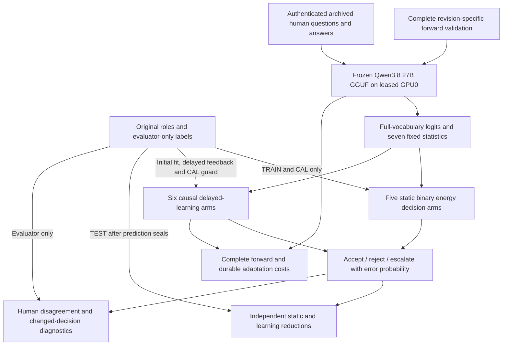
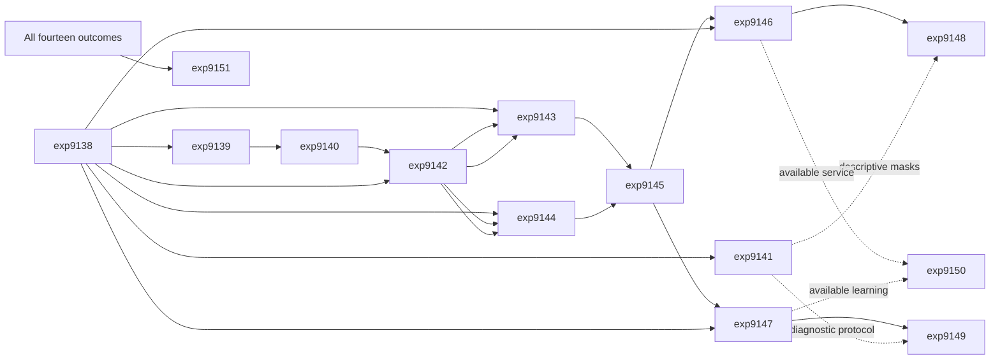

# Carnot Research Roadmap v779: Complete Forward Evidence and Persistent Calibration of Human Energy Decisions

**Milestone:** 2026.11.779  
**Created:** 2026-11-16 UTC  
**Status:** Proposed; not activated or executed.  
**Predecessor:** 2026.11.778, scheduling complete.  
**Execution contract:** Exactly **14 tasks, Exp9138 through Exp9151**, in the
order below, across **four phases**. The visible table and complete embedded
task objects must match `research-roadmap-next.yaml`.

The [V778 design](research-roadmap-v778-preserved-20261116.md) and
[V778 active queue](research-roadmap-v778-queue-preserved-20261116.yaml) are
preserved byte for byte. Their SHA256 values are
`22c845b107d82b95169f902a400ff989cf47398eabda86fdad6b025264967cd7` and
`358d3e5a8ff323d975c52c1ce180fa6aec469ece39754caf2c1edcc0ef674467`.
The completion archive currently ends at V777. V778 closure comes from its
active queue, primaries and conductor log. The active queue stays unchanged.

## What V778 proved

| Experiment | Evidence | Conclusion and limit |
|---|---|---|
| Exp9124 | Contract, source and inherited online-method readiness are 1 | Original human labels and roles remain authenticated. No factual-verifier benefit follows. |
| Exp9125 | Complete manifest has 621 nodes; 48 completed and 573 censored; first partition timed out at 240s | Forward qualification is disqualified. `receipt_ready_score=0`; `bounded_scope_retired=true`. Its own new code had 100% coverage, which does not qualify the original work. |
| Exp9126 | `methods_ready_score=1`, terminal null | Seven logit features, five static arms and gauge controls are qualified methods. No human features or benefit were measured. |
| Exp9127–9131 | Gate failure, then cascade skips; no canonical scientific primaries | Runtime, collection, admission and static fitting did not execute. This is not a scientific negative. |
| Exp9132 | `online_methods_ready_score=1`, terminal null | Six-arm delayed learning and temperature adaptation are qualified mechanics. Human future-prediction benefit remains unmeasured. |
| Exp9133–9135 | Cascade skips | No causal human result or benefit audit exists. |
| Exp9136 | Inventory readiness 1; service/adaptation readiness 0 | Availability is accounted for; no complete-service timing exists. |
| Exp9137 | Reconciliation readiness 1; terminal blocked | All scheduling outcomes are accounted for. Independent verification remains open. |

The failed schedule has a concrete defect. Its measurement budget is 2100s.
The partition loop stops when 1800s remain. Collection, controls and partition
work therefore get at most 300s. A 240s first batch exhausts that allowance.
The later normal CLI repeats both whole suites; each times out at 600s.
The complete normal CLI took about 1603s and still did not qualify readiness.

V779 changes the execution graph, not scientific thresholds. It schedules all
original obligations once, with measured costs and one final verification reserve.
A separate task proves the complete revision. It preserves original assertion
hashes, historical readers, all failed primaries and all semantic controls.
This is not permission to accept the partial partition or increase its deadline.
The underlying computational cost of every slow node is still unknown.

## The three biggest gaps to the PRD

1. **FR-12: useful factual decisions without an executable oracle.** The
   qualified formulas have not reached the authentic human-label panel. Complete
   the matched energy/probability/donor comparison before another architecture.
2. **FR-06/FR-11: beneficial continuous self-learning.** Recovery and coefficient
   updates work on controls. Human future predictions must improve beyond
   frozen, linear, bias, donor and temperature controls while retaining quality.
3. **FR-05/FR-08/NFR-01: reliable and affordable complete verification.** A
   qualified head is insufficient without model features and complete costs.
   Establish an executable evidence path and measure raw-text/durable service.

## Research incorporated before design

The [V779 scan](../../research-references.md) records all eight primary topics
and all six secondary channels before this design. Semantic Scholar returned
46 EBT and 11 ARM–EBM citations without further pages. OpenReview browser
verification and stale GitHub Trending snapshots limit those channels.

| Source | Experiment use | Boundary |
|---|---|---|
| [Persistent Calibration](https://arxiv.org/abs/2609.38797), September 30, 2026 | Exp9141/9149 register and audit changed-decision calibration | A diagnostic adaptation to small-verifier updates, not changing Qwen knowledge or replicating checkpoint training. |
| [Spilled Energy](https://arxiv.org/abs/2602.18671), March 3 revision | Exp9142–9146/9148 complete the registered raw-energy comparison | Whole-answer teacher forcing differs from exact-answer localization. Preserve normalized and gauge controls. |
| [Online spline KAN](https://arxiv.org/abs/2602.02056), June 19 revision | Exp9147/9150 reuse local coefficient updates and measure full costs | Paper hardware results are not local measurements. |
| [Continual Calibration](https://arxiv.org/abs/2604.23987), April 27 | Exp9147/9149 retain temperature and calibration-retention controls | No imported exchangeability or conformal guarantee. |
| [Million-p-bit FPGA system](https://arxiv.org/abs/2606.25313), June 24; [Extropic Z1T](https://extropic.ai/writing/z1t/), September 4 | Exp9150 maps measured operations and communication costs | Neither establishes access to a device that executes this dense-forward workload. |
| [Energy-Based Reasoners](https://arxiv.org/abs/2611.08977), November 6; [ETS](https://arxiv.org/abs/2601.21484) | Deferred | A useful verifier precedes generator training or decoding changes. |

## Architecture



Qwen sees text and token IDs only. Label fields, reference answers, generator
identity and annotation metadata cannot enter the feature path. Generator
identity is an evaluation slice only. Qwen parameters remain frozen.
Static TRAIN150 fitting and online TRAIN100 initialization have separate
transforms and states. Research retention never chooses an operational update.
LPHB remains exposed development. A sealed prediction does not make an already
exposed question independent. `independent_generalization_score` remains 0.

## Phase 1 — Complete the evidence path (Exp9138–9142)

Exp9138 binds the exact contract and reuses qualified Exp9126/9132 methods.
It does not rebuild them. Exp9139 implements a complete execution schedule.
Exp9140 separately proves all original and new obligations with real children
and post-exit coverage. Only Exp9140 can authorize the model runtime.

Exp9141 independently measures human disagreement and freezes descriptive
calibration slices. It needs authenticated source labels, not receipt repair.
Exp9142 tests actual serial/chunked Qwen forwards and complete-shard feasibility.
A schedule prototype, fixture pass or historical model receipt cannot open it.

The schedule uses immutable node/assertion manifests and exact phase outcomes.
It checks the original 621 nodes plus additions from the revision. No test is
removed. Authenticated same-invocation partitions replace repeated execution,
not the checks themselves. Historical artifacts retain historical readers.
Normal success, refusal, tamper and cold replay still run. If measured costs
cannot fit, record that result and stop dependent model work.

## Phase 2 — Collect and admit complete evidence (Exp9143–9145)

Collect two disjoint 450-answer shards, with the original caps and roles.
The runtime pilot must project each complete shard within 3300s. Collection
uses sequential GPU0 jobs, per-qid checkpoints and in-loop progress messages.
No favorable subset or shorter cap can rescue an infeasible study.

Admission authenticates all 900 intended answers and recomputes retained raw
statistics. It keeps static and online views separate. Missing/failed work
remains visible. Readiness does not depend on detector quality.

## Phase 3 — Test energy decisions and persistent calibration (Exp9146–9149)

Exp9146 fits the original five static arms. Exp9147 measures the original six
causal learning arms. These tasks have independent readiness gates after data
admission. Static benefit does not gate online measurement or either audit.

Exp9148 reduces the unchanged two-bound energy comparison and gauge controls.
Exp9149 reduces all seven learning/retention bounds. Both accept complete null
inputs. Registered human and changed-decision slices are descriptive additions.
A favorable slice cannot replace a failing whole-panel result.

## Phase 4 — Measure complete costs and reconcile (Exp9150–9151)

Exp9150 runs an unconditional availability inventory, then measures each eligible
service branch. A blocked learner does not prevent eligible static timing.
Exp9151 accounts for all fourteen tasks, including absent canonical artifacts.
External incompleteness is blocked, not retryable partial. Historical FoVer
publication readiness cannot certify this exposed human study.

## Frozen scientific protocols

The following methods preserve the V778 scientific contract. Their implemented
authorities are Exp9126 and Exp9132. Their immutable receipts take precedence
over mutable checkout files. The new diagnostic section below adds no acceptance
gate and changes no arm, cohort, optimization rule or interval threshold.

### Whole-answer forward statistics

Use original TRAIN150/CAL50/TEST100 question groups, three siblings each.
Primary target is original A1 factuality. A2 sensitivity uses only actual observed
labels; unknown -1 stays missing. The task evaluates archived answers under Qwen,
not newly generated Qwen answers. No answer accuracy claim transfers to Qwen.

Preserve V777's exact protocol. Tokenize question/answer separately with the
embedded tokenizer, no BOS or chat template, and right caps256/768. The prefix is
literal `Question:\n`, retained question text and literal `\nAnswer:\n`.
Freeze detokenization and prefix bytes. Append retained answer token IDs explicitly.
Reset state for every answer. Capture in128-token chunks with the preceding-prefix
logit for the first answer token. Preserve adjacent pairs across chunk boundaries.

For full-vocabulary logits z_i and answer token a_i, compute in stable float64:

- L_i=logsumexp(z_i); NLL_i=L_i-z_i[a_i].
- p_i=softmax(z_i); H_i=-sum_v p_iv*log(p_iv).
- Marginal energy M_i=-L_i.
- Adjacent spill D_i=-z_i[a_i]+L_(i+1), within one answer, i=1..length-1.

The seven features are log1p(answer length), mean NLL, mean H, maximum H,
mean M, mean absolute D and the no-adjacent-pair indicator. Retain selected logits,
L_i, H_i, max probability, token IDs, positions and full-vector hashes per token.
One-token answers lack only spill; TRAIN-only median imputation is fixed. An
entirely missing training feature blocks fitting. Empty answers retain their slots
as escalations. Loss contrasts share predeclared nonempty support; coverage uses
all original TEST rows. No label-based filtering is permitted.

Store full vectors for the first eight answer positions of the global first20
lexical qids/all siblings. Preflight2GiB for bounded raw evidence. Stream statistics
instead of retaining all900 complete token-by-vocabulary arrays in RAM.

### Static energy decisions and susceptibility

The five original arms are prevalence, probability+length logistic (first four
features), raw-energy logistic (length, mean M, mean absolute D, missing-pair
indicator), combined logistic (all seven) and combined with whole-qid TRAIN donor
labels. Donors use a fixed nonidentity cyclic permutation of sorted TRAIN qids;
sibling positions stay fixed. Report the actual changed-label numerator/denominator.

These are binary Gibbs energies E(0)=0, E(1)=-theta·phi and
p(error)=sigmoid(theta·phi). Fit TRAIN-only population mean/std, with constant
scale1. Minimize mean binary logloss plus0.5*0.01 times squared nonintercept
coefficients. L-BFGS-B starts at zero: maxiter2000, gtol1e-7, ftol1e-12.
Require finite parameters/objective and gradient infinity norm<=1e-6.
No regularization or architecture search is scheduled.

CAL alone selects temperature from[0.5,1,2,4], ascending ties. Accept at
p(error)<=0.1; reject at>=0.9; otherwise escalate. Seal TEST predictions before
evaluator access. Report Brier, logloss, coverage, accepted error and exact-half-
coverage error. Rerank half-coverage choices inside each resampled draw.

Use10000 paired TEST-qid bootstrap draws, seed777121, preserving siblings.
`energy_increment_score=1` requires both combined-arm Brier improvement lower
bounds>0 against probability+length and donor, with one-sided tail0.05/2.
Empirical accepted error must not increase versus probability+length.
Undefined accepted risk cannot pass. These are conditional development intervals.

Add c_i=3 or c_i=3*(-1)^i to every vocabulary logit. Normalized probabilities,
NLL and entropy must remain unchanged. M changes by -c_i; D changes by
c_(i+1)-c_i. Report raw-score and frozen-head sensitivity under both gauges.
Do not select the favorable gauge. A gauge-sensitive score can be an empirical
representation signal; it is not evidence of a broken probability chain rule.
The original Exp6980 exact-span null and V776 embedding study remain unchanged.

### Continuous self-learning with a recalibration control

Preserve the original SHA256(`v776-online`+qid) ordering:100 TRAIN groups for
initialization and50 for ten disjoint streams of five. Original CAL50 is the
operational guard; TEST100 is research retention. Preserve the Exp9099 donor map
(seed776099, initialization labels only, original sibling positions).

Fit imputation and scaling only on the100 initialization groups. After standard
scaling, fit initialization min/max to[-1,1], constants0, and clip later inputs.
Use the seven logit features with fixed cubic knots
[-1,-1,-1,-1,-0.5,0,0.5,1,1,1,1]: intercept, seven linear columns and49 basis
columns. Use the existing spline helper. Fit initial heads with the static ridge
objective and convergence contract; temperature starts at1. No random projection
or embedding transformation is used in this separate seven-feature study.

Six arms are frozen spline, adaptive spline, bias-only spline, adaptive linear,
donor-label spline and temperature-only spline. All start from comparable
initial fits. For the original adaptive arms, retain the Exp9099 gradient:
`(sigmoid(theta·phi)-y)*phi + 0.01*(theta-theta_initial)`, with no intercept
anchor. Bias-only zeros other coordinates. Clip L2 norm to1. Use AdaGrad,
learning rate0.05, accumulator initially0 and epsilon1e-8. Apply three sibling
updates in original order, then test promotion once per released qid.

For temperature-only adaptation, keep spline coefficients fixed. Let s be its
initial logit, u=log(T), q=exp(-u), p=sigmoid(q*s). Initially u=0. Use gradient
`(y-p)*q*s + 0.01*u`, clipped to[-1,1], with the same AdaGrad settings.
Clip updated u to[log(0.5),log(4)]. Persist u and its accumulator. This comparator
uses the same feedback and guard access; it is not a multi-group MT-CC replication.

Promote only if complete CAL Brier increase<=0.005 and CAL classification-error
increase<=0 versus that arm's initial state. Otherwise restore parameters and
accumulators while acknowledging consumed feedback. Research retention does not
participate in this decision. Seal all18 sibling/arm predictions for g before
releasing labels for g-1. Drain the final group after all predictions. Reset
every stream to identical initial states. No static150 data may enter this fit.

Atomic snapshots include predictions, parameters, accumulators, temperature,
pending feedback and acknowledgments. Real hard exits at prediction fsync,
feedback receipt and state replacement must reproduce uninterrupted states and
predictions exactly. Preserve private actual-child E2E-020 coverage.

Evaluate future groups2–5:40 distinct qids/120 responses. Use10000 paired stream
bootstrap draws, seed778135, one-sided tail0.05/7. The seven simultaneous bounds
are five adaptive-spline future Brier improvements over each other arm (lower>0),
retained Brier increase (upper<=0.005), and retained classification-error increase
(upper<=0). All seven plus exact recovery are needed for `learning_signal_score=1`.
This adds a comparator and tightens multiplicity correction; it does not replace
the old six-bound embedding protocol. Report per-qid retention changes averaged
over streams. Repeated retention is100 questions, not1000. Ten streams have limited
power and the intervals condition on the initial fit, guard and retention panel.


## New descriptive calibration diagnostics

Exp9141 counts observed A1/A2 agreement and original sibling outcomes by qid.
Unknown A2 labels remain missing. Agreement is not a truth ceiling. Intervals
use question groups, not individual siblings. Empirical resolution does not
change the already frozen sample budgets or significance thresholds.

For static evaluation, the evaluator divides qids into mixed-correctness siblings
and homogeneous siblings. These masks never enter training or scoring.
For online evaluation, freeze `abs(p_adaptive - p_initial) >= 0.05` as the
changed-probability slice. Also report crossings of the fixed 0.5 classification
threshold. Membership uses predictions, not outcomes. Compare every arm on the
same units. Report changed and unchanged groups, empty groups and exclusions.

Use Brier score and signed calibration residual `mean(p-y)`. Static intervals
resample qids. Online future intervals resample paired whole streams, preserving
order, siblings and sealed slice membership. Retention diagnostic intervals
resample paired whole streams conditional on the fixed TEST100 panel. These
conditional intervals do not treat repeated retention as new independent qids.
The diagnostic question is whether a pooled improvement hides damage where the
learner changed its decision. These results cannot select a model, adjust a
threshold, trigger promotion or rescue a failed primary gate. The external paper
studies changing model knowledge; this plan studies a changing small verifier.

## Complete costs and hardware requirements

Retain the original cost panel: first20 TEST qids/all60 siblings, three fresh
processes and order seed776108. Require probability parity atol1e-5/rtol1e-4 and
exact typed decisions. Separate cold load, warm uncached raw-text service and
cached-feature head-only costs. Include tokenization, transfers, logits, feature
reductions, transforms, scores and response serialization in complete service.

Learning costs include all proposals, rejected updates, full CAL scans, durable
writes, fsync, acknowledgments, final drain and recovery. Report missing branches
and censored units. Keep nonoverlapping component clocks separate from the
complete clock. Derive Amdahl ceilings only from measured component fractions.
No measured power integral means no joule claim.

| Resource | Requirement and constraint |
|---|---|
| CPU/RAM/private disk | Small fits, original validation, bootstrap and durable state. Preflight available resources. Preserve bounded raw arrays and measured peak memory. |
| GPU0, RTX3090,24GB | Frozen cached Qwen forwards with an actual lease and CUDA offload evidence. Sequential model tasks. |
| GPU1 | Reserved for the existing owner. No dual-GPU performance or combined-memory assumption. |
| Model/runtime | `unsloth/Qwen3.8-27B-GGUF`, Q4_K_M, cached through `cached_sota_pair()`. Pin model, embedded tokenizer and llama.cpp build bytes. |
| KV260 | Preserve supported Ising fabric with k_max<=5. Sparse spline updates and Qwen forward operations are not that bitstream. |
| PolarFire/GateMate | Preserve CPU-only PolarFire evidence and the unchanged GateMate physical/JTAG block. No repeated bring-up probe. |
| NPU, Extropic TSU, larger FPGA wishlist | Require actual access, an operation-matched implementation and a measured service bottleneck before new execution or purchase. |

The learning acceleration path is CPU state/storage, GPU feature extraction,
and possible future native/FPGA sparse coefficient kernels. Exp9150 measures
whether those kernels can matter at all. A100x local kernel claim cannot imply
a100x complete-service result. The PRD10x Rust throughput goal remains unproved
for this service. This milestone adds no runtime rebuild, hardware purchase or
new dependency. ARC remains opportunistic under the November7 north-star update.

## Execution, evidence and retirement rules

Every LLM task declares the mandated model and `model_load_no_generation`.
These tasks use teacher-forced forwards with a2s floor. There is no generative
run. Any future small-token canary must use `model_bounded_generation` (10s);
real generation must use `model_full_generation` (60s). A refusal before loading
reports actual `blocked_no_run`, while retaining the requested class. Attempted
failed loads retain attempted-load evidence. Never pad elapsed time.

Every prompt has numbered steps for flushed phase/call boundaries,60s child
heartbeats, in-loop progress and gaps below600s. Agents must write files longer
than about200 lines in several calls with a progress message between calls.
The3300s measurement window and1200s verification reserve fit inside4800s.

Every comparative task emits per-unit rows. Every artifact declares the closed
verdict enum and field principles. A blocked verdict names exact gate operands.
Fixture validity is not a scientific positive. Same-verdict matching scopes
retire through `prior_failures` with all four required fields. No retired ID is
reused. No `requires` chain points at retired work. Historical evidence references
preserve failure; they are not current runtime prerequisites.

Prior cascade skips have no canonical honest_verdict. Their prior_failures
entries explicitly cite the conductor's GATE_BLOCK state instead of inventing
an artifact verdict. Current gates always point to a producer in this roadmap,
and each producer declares the exact field in its required artifact fields.
Audits gate on completed predictions, never on benefit. The cost inventory and
capstone remain unconditional. Missing optional diagnostics cannot block primary
scientific reductions.

## Acceptance and continuation

- Full qualification needs every original obligation, all added tests and real
  successful/refused/tampered/replayed CLI evidence. A second unchanged schedule
  failure retires this scope. No historical readiness field is rewritten.
- Collection needs a qualified model operation and measured full-shard budget.
  Infeasibility calls for future smaller execution units with the same total
  population. It does not justify another unmodified450-row attempt.
- Static signal uses the original two simultaneous bounds and accepted-risk rule.
  Learning signal uses all seven bounds plus exact recovery. Complete nulls are
  valid findings. Missing inputs leave the corresponding science unmeasured.
- A controlled exposed-panel signal can justify independent human confirmation.
  This milestone cannot close either independent-verifier gap or certify a new
  publication claim. Historical G1–G4 retains its original FoVer scope.

## Task contract and dependency graph

The following table is generated from the exact YAML task objects. Fields shown
as gates are required to equal integer1. No gate accepts a Python boolean.

| Order | Task | Phase | Deliverable | Required readiness fields |
|---|---|---|---|---|
| 1 | `exp9138-contract` — Bind fourteen tasks and reuse qualified human methods | 1 | `results/experiment_9138_v779_contract.json` | Unconditional |
| 2 | `exp9139-validation-schedule` — Replace duplicated validation with a complete execution schedule | 1 | `results/experiment_9139_v779_validation_schedule.json` | exp9138-contract.contract_ready_score |
| 3 | `exp9140-forward-qualification` — Qualify the complete forward validation revision | 1 | `results/experiment_9140_v779_forward_qualification.json` | exp9139-validation-schedule.schedule_ready_score |
| 4 | `exp9141-human-contrast-audit` — Measure human disagreement and freeze calibration slices | 1 | `results/experiment_9141_v779_human_contrast_audit.json` | exp9138-contract.source_ready_score |
| 5 | `exp9142-logit-runtime` — Qualify frozen Qwen forwards and complete shard budgets | 1 | `results/experiment_9142_v779_logit_runtime.json` | exp9140-forward-qualification.forward_validation_ready_score; exp9138-contract.static_methods_ready_score |
| 6 | `exp9143-logits-a` — Collect fixed human Qwen logit shard A | 2 | `results/experiment_9143_v779_logits_a.json` | exp9138-contract.source_ready_score; exp9142-logit-runtime.logit_runtime_ready_score; exp9142-logit-runtime.shard_feasible_score |
| 7 | `exp9144-logits-b` — Collect fixed human Qwen logit shard B | 2 | `results/experiment_9144_v779_logits_b.json` | exp9138-contract.source_ready_score; exp9142-logit-runtime.logit_runtime_ready_score; exp9142-logit-runtime.shard_feasible_score |
| 8 | `exp9145-logit-admission` — Admit all human features under the original roles | 2 | `results/experiment_9145_v779_logit_admission.json` | exp9143-logits-a.logits_a_ready_score; exp9144-logits-b.logits_b_ready_score |
| 9 | `exp9146-static-energy` — Train the five frozen human energy decision arms | 3 | `results/experiment_9146_v779_static_energy.json` | exp9145-logit-admission.admission_ready_score; exp9138-contract.static_methods_ready_score |
| 10 | `exp9147-delayed-learning` — Measure continuous human learning with exact recovery | 3 | `results/experiment_9147_v779_delayed_learning.json` | exp9145-logit-admission.admission_ready_score; exp9138-contract.online_methods_ready_score |
| 11 | `exp9148-energy-audit` — Audit energy increments and human contrast sensitivity | 3 | `results/experiment_9148_v779_energy_audit.json` | exp9146-static-energy.static_predictions_ready_score |
| 12 | `exp9149-learning-audit` — Audit future benefit and calibration where decisions change | 3 | `results/experiment_9149_v779_learning_audit.json` | exp9147-delayed-learning.online_predictions_ready_score |
| 13 | `exp9150-complete-cost` — Measure complete forward and durable adaptation costs | 4 | `results/experiment_9150_v779_complete_cost.json` | Unconditional |
| 14 | `exp9151-capstone` — Reconcile fourteen outcomes and exact continuation limits | 4 | `results/experiment_9151_v779_capstone.json` | Unconditional |



Solid edges are structured readiness gates. Dotted edges are optional evidence.
Exp9150 and Exp9151 always execute their accounting paths.

## Full machine-readable contract

This JSON repeats all task objects, including prompts and optional fields.
Validation compares parsed objects, task order and visible table against YAML.

<!-- V779_TASK_CONTRACT_START -->
```json
{
"milestone": "2026.11.779",
"milestone_title": "Complete Forward Evidence and Persistent Calibration of Human Energy Decisions",
"milestone_doc": "openspec/change-proposals/research-roadmap-vNEXT.md",
"tasks": [
{"id": "exp9138-contract", "title": "Exp9138: Bind fourteen tasks and reuse qualified human methods", "phase": 1, "track": "research", "priority": "high", "requires_gpu": false, "max_turns": 100, "estimated_wall_time_min": 40, "per_unit_rows": true, "milestone": "2026.11.779", "deliverable": "results/experiment_9138_v779_contract.json", "inference_substrate_class": "no_model_load", "MODEL_SPECS": [], "model": "opus", "prompt": "CONTEXT:\nWork in {project_root} on {date}. V778 qualified source, static formulas and six-arm online methods. It did not collect logits or measure human benefit. Exp9125 retired its bounded qualification scope.\nEXISTING CODE TO READ FIRST:\nCLAUDE.md; CODEX.md; ops/north-star.md; ops/e2e-test-plan.md; ops/exclusion_manifest.yaml; research-references.md (V779 scan); openspec/change-proposals/research-roadmap-vNEXT.md; openspec/capabilities/research-reporting/spec.md; scripts/experiment_template.py; python/carnot/reporting/primary_publication.py; python/carnot/reporting/current_work_receipt.py; python/carnot/reporting/v778_contract.py; python/carnot/reporting/v778_capstone.py; python/carnot/reporting/logit_methods_9126.py; python/carnot/reporting/online_methods_9132.py; results/experiment_9124_v778_contract.json; results/experiment_9125_v778_receipt_qualification.json; results/experiment_9126_v778_logit_methods.json; results/experiment_9132_v778_online_methods.json; results/experiment_9137_v778_capstone.json; openspec/change-proposals/research-roadmap-v778-preserved-20261116.md\nTASK:\nBind fourteen tasks and reuse qualified human methods. Deliver results/experiment_9138_v779_contract.json. Implement scripts/experiments/experiment_9138_v779_contract.py using the existing library paths. MODEL_SPECS: []. Requested inference_substrate_class: no_model_load.\nDo not load an LLM. Record current_llm_invocations=0 and generated_tokens=0. Small numerical energy fitting is CPU work. Historical model provenance stays in source_references.\nCONCRETE STEPS:\n1. Emit a flushed progress line at each phase boundary. Emit before and after every model load, generation, benchmark and subprocess that can take minutes. Print progress inside long loops. Supervise blocking calls with flushed heartbeats every 60 seconds. Keep every silence gap below 600 seconds. Write any file over about 200 lines in several tool calls of at most 200 lines. Send a progress message between writing calls. Never use one huge tool call.\n2. PRECONDITIONS: Authenticate required artifacts and their exact gate fields before dependent work. Check imports, resource limits and private disk space. Keep missing_file, missing_field and observed zero distinct. Missing external inputs produce terminal blocked evidence with gate_check_summary. Never repin historical evidence to mutable checkout code.\n3. Before implementation, inspect all callers with rg. Confirm REQ-REPORT-9138-V779 and SCENARIO-REPORT-9138-V779. Extend the specification first. Write failing controls before code. Freeze units, formulas, exclusions and validation scope before outcomes.\n4. Bind exactly fourteen full task objects, Exp9138 through Exp9151, in the same order as the design. Include prompts, gates, deliverables and model metadata in the canonical digest. Authenticate the preserved V778 design/queue and distinguish archive lag from missing experiment evidence.\n5. Authenticate original human authority and its 900 answers/300 qids. Retain TRAIN150/CAL50/TEST100 roles and two lexical 150-qid shard rosters. Bind original evaluator labels separately from label-blind question/answer views. Preserve exposed-development status.\n6. Replay the existing Exp9126 and Exp9132 method qualification receipts under their original producer authority. Import their protocols, fixtures, transforms, static five-arm contract, online six-arm contract and seven bounds. Do not rerun method development or alter them. Emit separate source_ready_score, static_methods_ready_score and online_methods_ready_score. Contract readiness is independent of scientific availability.\n7. Preserve the exact retired Exp9125 scope and original quarantine bytes. Register the scheduling repair as a new, explicit revision. Never change an old receipt_ready_score. Note that 621 nodes were intended, 48 completed and 573 censored.\n8. Run meaningful owned unit tests and actual child-process coverage with 100 percent owned statements and zero exclusions. Preserve original assertions. Run Ruff check/format, strict mypy and explicit-path scripts/check_spec_coverage.py. Execute private real CLI success, refusal, tamper and cold replay outside the checkout without PYTHONPATH, following E2E-018/021. Learning/recovery changes also require E2E-020. Separate unrelated repository health from affected failures. Affected failures disqualify readiness.\n9. Stop measurement by 3300 seconds. Reserve 1200 seconds for verification within the 4800-second hard cap. Save unfinished units and censor reasons. Recompute claims from rows. Run scripts/adversarial_verify.py and scripts/verdict_row_consistency_lint.py --strict with heartbeats. Publish only through primary_publication after actual checker receipts pass. Reconcile openspec/, _bmad/traceability.md, ops/status.md and ops/changelog.md. Preserve historical primaries, quarantines and exclusions. Do not activate a roadmap or publish externally.\nREQUIRED ARTIFACT FIELDS:\n- honest_verdict: complete_*; principle: A terminal prefix records the actual outcome without inducing a spurious retry.\n- verdict_class: positive | circular_positive | null | blocked | disqualified | partial; principle: Only unfinished owned work uses partial. Absent, retired or blocked external inputs use blocked. Fixtures never establish scientific benefit.\n- gate_check_summary: list of check, upstream, path, sha256, artifact_field, op, expected, observed, passed; principle: Every blocked verdict names the failed operand. Missing files and fields are contract failures, distinct from observed zero.\n- rows: unit_id, qid/group, sibling, arm/condition, seed, absolute metric, numerator, denominator, status, exclusion_reason and censor_reason; principle: Every comparison can be recomputed at its actual independent unit.\n- sample_size_budget: intended, attempted, completed, failed, censored and effective_independent_groups; principle: Siblings, repeated retention and resamples cannot inflate the sample size.\n- verifier_is_oracle: boolean; principle: Executable truth reused as the verifier is circular_positive, never an independent verifier win.\n- claim_scope: include exposure_scope and independent_generalization_score=0; principle: This exposed human panel cannot close GAP-ORACLE-DISTINCT or GAP-DETECTOR-AUROC-4208. No ARC solve is claimed.\n- MODEL_SPECS: actual requested model list with invocation status; principle: Named upstream models cannot masquerade as current inference.\n- inference_substrate_class: actual work class plus requested_inference_substrate_class; principle: No-load refusals use blocked_no_run. A failed attempted load is still an attempted load. No artificial duration padding.\n- inference_substrate: operation-accurate declaration; principle: Cached reduction, live forward work and generation have different evidentiary costs.\n- model_invocation_counts: current_llm_invocations, loads attempted/completed/failed, forward calls and generated_tokens; principle: Current compute counters must agree with operation-specific receipts.\n- duration_s: measured wall time; principle: Real process timing bounds throughput claims and detects invented compute.\n- random_seed: fixed before measurement; principle: Seeds make the planned comparisons reproducible.\n- reproducibility_checksum: input and configuration digest; principle: Changed evidence must not pass as the same experiment.\n- source_references: producer path, SHA256 and imported fields; principle: Original evidence authority survives mutable checkout changes.\n- code_config_hashes: owned implementation, tests and configuration references; principle: Validation qualifies the exact executed revision.\n- current_work_receipts: actual operation-specific receipts; principle: Scripted counters and historical work cannot qualify a current model run.\n- validation_receipts: commands, logs, exit status and coverage references; principle: Readiness depends on executed checks, not self-reported success.\n- required_checks_passed: boolean; principle: Incomplete or failing affected checks cannot produce readiness.\n- acceptance_gates: fixed conditions with one-line principle annotations; principle: Outcome-dependent thresholds cannot manufacture success.\n- contract_ready_score: integer 0/1; principle: Complete task equality is independent of data availability.\n- source_ready_score: integer 0/1; principle: Original labels and all question roles must authenticate.\n- static_methods_ready_score: integer 0/1; principle: Static methods can be reused only under original authority.\n- online_methods_ready_score: integer 0/1; principle: Reuse must retain all six arms and exact delayed-update semantics.\n- full_task_objects: include canonical_task_hash and previous_outcome_rows; principle: Scheduling completion cannot be confused with scientific success.\n- protocol_references: source_manifest_reference, evaluator_label_reference, static_protocol_reference, online_protocol_reference and shard roster references; principle: Consumers share immutable, identically named inputs.\nRun command: cd {project_root} && JAX_PLATFORMS=cpu .venv/bin/python -u scripts/experiments/experiment_9138_v779_contract.py --date {date}\nDo NOT push. Do NOT modify scripts/research_conductor.py.", "prior_failures": [{"experiment_id": "exp7329-contract", "verdict": "complete_disqualified_v644_contract_mismatched_or_invalid", "addressed_by": "Build the visible table, design full objects and YAML from one task list, preserving V778 authority before overwriting vNEXT. Reject any object mismatch.", "retire_if_same_verdict": true}, {"experiment_id": "exp7421-contract-ingestion", "verdict": "complete_disqualified_stale_markdown_contract_with_method_ingestion", "addressed_by": "The V779 design is newly written and contains exactly the emitted fourteen task objects. Method reuse authenticates immutable Exp9126/9132 authority without importing their old roadmap contract.", "retire_if_same_verdict": true}]},
{"id": "exp9139-validation-schedule", "title": "Exp9139: Replace duplicated validation with a complete execution schedule", "phase": 1, "track": "research", "priority": "high", "requires_gpu": false, "max_turns": 100, "estimated_wall_time_min": 70, "per_unit_rows": true, "milestone": "2026.11.779", "deliverable": "results/experiment_9139_v779_validation_schedule.json", "inference_substrate_class": "no_model_load", "MODEL_SPECS": [], "gated_on": [{"upstream": "exp9138-contract", "artifact_field": "contract_ready_score", "op": "==", "value": 1}], "prior_failures": [{"experiment_id": "exp9125-receipt-qualification", "verdict": "complete_disqualified_bounded_receipt_qualification", "addressed_by": "Replace the demonstrated 2100-minus-1800 scheduling defect and duplicated unpartitioned reruns with a complete cost-budgeted execution graph. Preserve every assertion and original quarantine; qualify the new revision separately.", "retire_if_same_verdict": true}, {"experiment_id": "exp9111-forward-evidence", "verdict": "complete_disqualified_owned_checks", "addressed_by": "Preserve all semantic controls and repair validation scheduling, with real post-exit coverage instead of accepting incomplete suites.", "retire_if_same_verdict": true}], "model": "opus", "prompt": "CONTEXT:\nWork in {project_root} on {date}. Exp9125 allowed at most 300 seconds before reserving 1800 seconds, then repeated two suites that timed out at 600 seconds. This is a measured scheduling defect. The cause of every slow node remains unknown.\nEXISTING CODE TO READ FIRST:\nCLAUDE.md; CODEX.md; ops/north-star.md; ops/e2e-test-plan.md; ops/exclusion_manifest.yaml; research-references.md (V779 scan); openspec/change-proposals/research-roadmap-vNEXT.md; openspec/capabilities/research-reporting/spec.md; scripts/experiment_template.py; python/carnot/reporting/primary_publication.py; python/carnot/reporting/current_work_receipt.py; python/carnot/reporting/receipt_qualification_9125.py; python/carnot/reporting/forward_evidence_runner_9111.py; python/carnot/reporting/forward_evidence_9111.py; tests/python/test_forward_evidence_runner_9111.py; tests/python/test_receipt_qualification_9125.py; results/experiment_9125_v778_receipt_qualification.json\nTASK:\nReplace duplicated validation with a complete execution schedule. Deliver results/experiment_9139_v779_validation_schedule.json. Implement scripts/experiments/experiment_9139_v779_validation_schedule.py using the existing library paths. MODEL_SPECS: []. Requested inference_substrate_class: no_model_load.\nDo not load an LLM. Record current_llm_invocations=0 and generated_tokens=0. Small numerical energy fitting is CPU work. Historical model provenance stays in source_references.\nCONCRETE STEPS:\n1. Emit a flushed progress line at each phase boundary. Emit before and after every model load, generation, benchmark and subprocess that can take minutes. Print progress inside long loops. Supervise blocking calls with flushed heartbeats every 60 seconds. Keep every silence gap below 600 seconds. Write any file over about 200 lines in several tool calls of at most 200 lines. Send a progress message between writing calls. Never use one huge tool call.\n2. PRECONDITIONS: Authenticate required artifacts and their exact gate fields before dependent work. Check imports, resource limits and private disk space. Keep missing_file, missing_field and observed zero distinct. Missing external inputs produce terminal blocked evidence with gate_check_summary. Never repin historical evidence to mutable checkout code.\n3. Before implementation, inspect all callers with rg. Confirm REQ-REPORT-9139-V779 and SCENARIO-REPORT-9139-V779. Extend the specification first. Write failing controls before code. Freeze units, formulas, exclusions and validation scope before outcomes.\n4. Retain the original 621-node manifest, every test body, original command roles and original source pins. Read node events and stderr stacks before changing execution. Reproduce the budget arithmetic with an assert-based control. Do not claim a computational root cause that the logs do not show.\n5. Implement an explicit current validation schedule in the existing runner seam. Allocate up to 3300 seconds to the complete measured obligation graph. Reserve verification once. Group nodes by measured cost and fixture lifetime, not a fixed 100-node batch. Unknown durations get bounded individual probes. Preserve module fixture behavior and mutation isolation. If projected total exceeds budget, publish a measured infeasibility result before launching dependent science.\n6. Execute each original test obligation once per qualification invocation. The normal orchestration must consume its authenticated same-invocation partition results instead of launching the original whole suites again. Bind commands, node IDs, assertion hashes, setup/call/teardown outcomes, code/config hashes and actual exit logs. Historical replay retains the historical reader and command contract. New scheduling authority is versioned explicitly; no invented aggregate receipt stands in for an old command.\n7. Keep the full node union and required CLI, lint, type and spec checks. Exercise a bounded real non-diagnostic orchestration child. Combine its coverage only after exit. Reject stale, foreign, missing, duplicated, failed or modified node evidence. Keep the historical semantic/count controls and unchanged artifact checkers. Do not relax a checker, delete a test or increase deadlines as the repair.\n8. Qualify only the schedule implementation and its rejection controls here. Emit schedule_ready_score=1 only with complete deterministic budget accounting, actual small child execution and original-scope equality. Full 621-node qualification belongs to Exp9140; this artifact cannot authorize model work.\n9. Run meaningful owned unit tests and actual child-process coverage with 100 percent owned statements and zero exclusions. Preserve original assertions. Run Ruff check/format, strict mypy and explicit-path scripts/check_spec_coverage.py. Execute private real CLI success, refusal, tamper and cold replay outside the checkout without PYTHONPATH, following E2E-018/021. Learning/recovery changes also require E2E-020. Separate unrelated repository health from affected failures. Affected failures disqualify readiness.\n10. Stop measurement by 3300 seconds. Reserve 1200 seconds for verification within the 4800-second hard cap. Save unfinished units and censor reasons. Recompute claims from rows. Run scripts/adversarial_verify.py and scripts/verdict_row_consistency_lint.py --strict with heartbeats. Publish only through primary_publication after actual checker receipts pass. Reconcile openspec/, _bmad/traceability.md, ops/status.md and ops/changelog.md. Preserve historical primaries, quarantines and exclusions. Do not activate a roadmap or publish externally.\nREQUIRED ARTIFACT FIELDS:\n- honest_verdict: complete_*; principle: A terminal prefix records the actual outcome without inducing a spurious retry.\n- verdict_class: positive | circular_positive | null | blocked | disqualified | partial; principle: Only unfinished owned work uses partial. Absent, retired or blocked external inputs use blocked. Fixtures never establish scientific benefit.\n- gate_check_summary: list of check, upstream, path, sha256, artifact_field, op, expected, observed, passed; principle: Every blocked verdict names the failed operand. Missing files and fields are contract failures, distinct from observed zero.\n- rows: unit_id, qid/group, sibling, arm/condition, seed, absolute metric, numerator, denominator, status, exclusion_reason and censor_reason; principle: Every comparison can be recomputed at its actual independent unit.\n- sample_size_budget: intended, attempted, completed, failed, censored and effective_independent_groups; principle: Siblings, repeated retention and resamples cannot inflate the sample size.\n- verifier_is_oracle: boolean; principle: Executable truth reused as the verifier is circular_positive, never an independent verifier win.\n- claim_scope: include exposure_scope and independent_generalization_score=0; principle: This exposed human panel cannot close GAP-ORACLE-DISTINCT or GAP-DETECTOR-AUROC-4208. No ARC solve is claimed.\n- MODEL_SPECS: actual requested model list with invocation status; principle: Named upstream models cannot masquerade as current inference.\n- inference_substrate_class: actual work class plus requested_inference_substrate_class; principle: No-load refusals use blocked_no_run. A failed attempted load is still an attempted load. No artificial duration padding.\n- inference_substrate: operation-accurate declaration; principle: Cached reduction, live forward work and generation have different evidentiary costs.\n- model_invocation_counts: current_llm_invocations, loads attempted/completed/failed, forward calls and generated_tokens; principle: Current compute counters must agree with operation-specific receipts.\n- duration_s: measured wall time; principle: Real process timing bounds throughput claims and detects invented compute.\n- random_seed: fixed before measurement; principle: Seeds make the planned comparisons reproducible.\n- reproducibility_checksum: input and configuration digest; principle: Changed evidence must not pass as the same experiment.\n- source_references: producer path, SHA256 and imported fields; principle: Original evidence authority survives mutable checkout changes.\n- code_config_hashes: owned implementation, tests and configuration references; principle: Validation qualifies the exact executed revision.\n- current_work_receipts: actual operation-specific receipts; principle: Scripted counters and historical work cannot qualify a current model run.\n- validation_receipts: commands, logs, exit status and coverage references; principle: Readiness depends on executed checks, not self-reported success.\n- required_checks_passed: boolean; principle: Incomplete or failing affected checks cannot produce readiness.\n- acceptance_gates: fixed conditions with one-line principle annotations; principle: Outcome-dependent thresholds cannot manufacture success.\n- schedule_ready_score: integer 0/1; principle: A schedule prototype is not full forward-receipt qualification.\n- schedule_reference: include original_node_manifest, original_assertion_hashes, execution_graph, budget_equation, measured_cost_rows and unknown_cost_rows; principle: Every original obligation remains visible and budgeted.\n- scope_equality: include obligation_union_equality and no_duplicate_execution_controls; principle: Scheduling may change, validation content may not.\n- current_revision_reference: include historical_reader_reference and isolated_child_receipts; principle: A new revision must not reinterpret historical failure as success.\nRun command: cd {project_root} && JAX_PLATFORMS=cpu .venv/bin/python -u scripts/experiments/experiment_9139_v779_validation_schedule.py --date {date}\nDo NOT push. Do NOT modify scripts/research_conductor.py."},
{"id": "exp9140-forward-qualification", "title": "Exp9140: Qualify the complete forward validation revision", "phase": 1, "track": "research", "priority": "high", "requires_gpu": false, "max_turns": 100, "estimated_wall_time_min": 75, "per_unit_rows": true, "milestone": "2026.11.779", "deliverable": "results/experiment_9140_v779_forward_qualification.json", "inference_substrate_class": "no_model_load", "MODEL_SPECS": [], "gated_on": [{"upstream": "exp9139-validation-schedule", "artifact_field": "schedule_ready_score", "op": "==", "value": 1}], "prior_failures": [{"experiment_id": "exp9125-receipt-qualification", "verdict": "complete_disqualified_bounded_receipt_qualification", "addressed_by": "Replace the demonstrated 2100-minus-1800 scheduling defect and duplicated unpartitioned reruns with a complete cost-budgeted execution graph. Preserve every assertion and original quarantine; qualify the new revision separately.", "retire_if_same_verdict": true}], "model": "opus", "prompt": "CONTEXT:\nWork in {project_root} on {date}. The new schedule is only an implementation qualification. Real full-scope execution and all original receipt semantics are still owed.\nEXISTING CODE TO READ FIRST:\nCLAUDE.md; CODEX.md; ops/north-star.md; ops/e2e-test-plan.md; ops/exclusion_manifest.yaml; research-references.md (V779 scan); openspec/change-proposals/research-roadmap-vNEXT.md; openspec/capabilities/research-reporting/spec.md; scripts/experiment_template.py; python/carnot/reporting/primary_publication.py; python/carnot/reporting/current_work_receipt.py; python/carnot/reporting/forward_evidence_runner_9111.py; python/carnot/reporting/receipt_qualification_9125.py; scripts/experiments/experiment_9139_v779_validation_schedule.py; results/experiment_9139_v779_validation_schedule.json; scripts/adversarial_verify.py; tests/python/test_forward_evidence_9111.py; tests/python/test_forward_evidence_runner_9111.py\nTASK:\nQualify the complete forward validation revision. Deliver results/experiment_9140_v779_forward_qualification.json. Implement scripts/experiments/experiment_9140_v779_forward_qualification.py using the existing library paths. MODEL_SPECS: []. Requested inference_substrate_class: no_model_load.\nDo not load an LLM. Record current_llm_invocations=0 and generated_tokens=0. Small numerical energy fitting is CPU work. Historical model provenance stays in source_references.\nCONCRETE STEPS:\n1. Emit a flushed progress line at each phase boundary. Emit before and after every model load, generation, benchmark and subprocess that can take minutes. Print progress inside long loops. Supervise blocking calls with flushed heartbeats every 60 seconds. Keep every silence gap below 600 seconds. Write any file over about 200 lines in several tool calls of at most 200 lines. Send a progress message between writing calls. Never use one huge tool call.\n2. PRECONDITIONS: Authenticate required artifacts and their exact gate fields before dependent work. Check imports, resource limits and private disk space. Keep missing_file, missing_field and observed zero distinct. Missing external inputs produce terminal blocked evidence with gate_check_summary. Never repin historical evidence to mutable checkout code.\n3. Before implementation, inspect all callers with rg. Confirm REQ-REPORT-9140-V779 and SCENARIO-REPORT-9140-V779. Extend the specification first. Write failing controls before code. Freeze units, formulas, exclusions and validation scope before outcomes.\n4. Authenticate the new schedule, original node/assertion manifest and original checker authority. Freeze a complete run plan before outcomes. Enumerate additions from the scheduling change separately; every original node remains required.\n5. Run the full original node union and newly owned tests through the qualified schedule. Emit per-node phase and exit evidence. Reserve the 1200-second final verification budget once. No top-level deadline substitutes for a missing node. A projection failure is terminal blocked; an actual incomplete affected validation is disqualified.\n6. Run real non-diagnostic success, refusal, tamper and cold-replay children. Measure the successful validation branch after child exit. Require 100 percent newly owned statements and all original forward-evidence obligations, including the previously missing runner statements. Old line numbers are diagnostic references; original source hashes define obligations.\n7. Run the original positive and rejecting operation/count controls. Require current forward counters without sampling, attempted failed load, no-load refusal, conflicting counters, unsupported count equality and copied metrics to retain their original meanings. The historical Exp9107/9111/9125 primaries remain quarantined or disqualified.\n8. Emit forward_validation_ready_score=1 only if the entire original scope, new revision, actual children, coverage and unchanged checkers pass. Publish a new revision receipt with its own authority. Never substitute fixture success, Exp9125 readiness, or shell exit zero for the conjunction.\n9. Run meaningful owned unit tests and actual child-process coverage with 100 percent owned statements and zero exclusions. Preserve original assertions. Run Ruff check/format, strict mypy and explicit-path scripts/check_spec_coverage.py. Execute private real CLI success, refusal, tamper and cold replay outside the checkout without PYTHONPATH, following E2E-018/021. Learning/recovery changes also require E2E-020. Separate unrelated repository health from affected failures. Affected failures disqualify readiness.\n10. Stop measurement by 3300 seconds. Reserve 1200 seconds for verification within the 4800-second hard cap. Save unfinished units and censor reasons. Recompute claims from rows. Run scripts/adversarial_verify.py and scripts/verdict_row_consistency_lint.py --strict with heartbeats. Publish only through primary_publication after actual checker receipts pass. Reconcile openspec/, _bmad/traceability.md, ops/status.md and ops/changelog.md. Preserve historical primaries, quarantines and exclusions. Do not activate a roadmap or publish externally.\nREQUIRED ARTIFACT FIELDS:\n- honest_verdict: complete_*; principle: A terminal prefix records the actual outcome without inducing a spurious retry.\n- verdict_class: positive | circular_positive | null | blocked | disqualified | partial; principle: Only unfinished owned work uses partial. Absent, retired or blocked external inputs use blocked. Fixtures never establish scientific benefit.\n- gate_check_summary: list of check, upstream, path, sha256, artifact_field, op, expected, observed, passed; principle: Every blocked verdict names the failed operand. Missing files and fields are contract failures, distinct from observed zero.\n- rows: unit_id, qid/group, sibling, arm/condition, seed, absolute metric, numerator, denominator, status, exclusion_reason and censor_reason; principle: Every comparison can be recomputed at its actual independent unit.\n- sample_size_budget: intended, attempted, completed, failed, censored and effective_independent_groups; principle: Siblings, repeated retention and resamples cannot inflate the sample size.\n- verifier_is_oracle: boolean; principle: Executable truth reused as the verifier is circular_positive, never an independent verifier win.\n- claim_scope: include exposure_scope and independent_generalization_score=0; principle: This exposed human panel cannot close GAP-ORACLE-DISTINCT or GAP-DETECTOR-AUROC-4208. No ARC solve is claimed.\n- MODEL_SPECS: actual requested model list with invocation status; principle: Named upstream models cannot masquerade as current inference.\n- inference_substrate_class: actual work class plus requested_inference_substrate_class; principle: No-load refusals use blocked_no_run. A failed attempted load is still an attempted load. No artificial duration padding.\n- inference_substrate: operation-accurate declaration; principle: Cached reduction, live forward work and generation have different evidentiary costs.\n- model_invocation_counts: current_llm_invocations, loads attempted/completed/failed, forward calls and generated_tokens; principle: Current compute counters must agree with operation-specific receipts.\n- duration_s: measured wall time; principle: Real process timing bounds throughput claims and detects invented compute.\n- random_seed: fixed before measurement; principle: Seeds make the planned comparisons reproducible.\n- reproducibility_checksum: input and configuration digest; principle: Changed evidence must not pass as the same experiment.\n- source_references: producer path, SHA256 and imported fields; principle: Original evidence authority survives mutable checkout changes.\n- code_config_hashes: owned implementation, tests and configuration references; principle: Validation qualifies the exact executed revision.\n- current_work_receipts: actual operation-specific receipts; principle: Scripted counters and historical work cannot qualify a current model run.\n- validation_receipts: commands, logs, exit status and coverage references; principle: Readiness depends on executed checks, not self-reported success.\n- required_checks_passed: boolean; principle: Incomplete or failing affected checks cannot produce readiness.\n- acceptance_gates: fixed conditions with one-line principle annotations; principle: Outcome-dependent thresholds cannot manufacture success.\n- forward_validation_ready_score: integer 0/1; principle: Only complete actual original and new obligations authorize dependent model work.\n- qualified_revision_reference: include scope hashes, full node rows, semantic control rows, complete command receipts, child coverage and original_quarantine_preserved; principle: Qualification is revision-specific and independently replayable.\n- remaining_obligations: exact censored nodes, missing statements and failed controls; principle: A failed qualification remains actionable without another blind rerun.\nRun command: cd {project_root} && JAX_PLATFORMS=cpu .venv/bin/python -u scripts/experiments/experiment_9140_v779_forward_qualification.py --date {date}\nDo NOT push. Do NOT modify scripts/research_conductor.py."},
{"id": "exp9141-human-contrast-audit", "title": "Exp9141: Measure human disagreement and freeze calibration slices", "phase": 1, "track": "research", "priority": "high", "requires_gpu": false, "max_turns": 50, "estimated_wall_time_min": 45, "per_unit_rows": true, "milestone": "2026.11.779", "deliverable": "results/experiment_9141_v779_human_contrast_audit.json", "inference_substrate_class": "no_model_load", "MODEL_SPECS": [], "gated_on": [{"upstream": "exp9138-contract", "artifact_field": "source_ready_score", "op": "==", "value": 1}], "prompt": "CONTEXT:\nWork in {project_root} on {date}. The human panel has authentic labels but remains exposed development. Persistent Calibration (arXiv:2609.38797) shows that pooled metrics can hide failures on changed decisions. This task needs no forward runtime.\nEXISTING CODE TO READ FIRST:\nCLAUDE.md; CODEX.md; ops/north-star.md; ops/e2e-test-plan.md; ops/exclusion_manifest.yaml; research-references.md (V779 scan); openspec/change-proposals/research-roadmap-vNEXT.md; openspec/capabilities/research-reporting/spec.md; scripts/experiment_template.py; python/carnot/reporting/primary_publication.py; python/carnot/reporting/current_work_receipt.py; python/carnot/reporting/human_methods_9084.py; python/carnot/reporting/v778_contract.py; python/carnot/reporting/online_methods_9132.py; results/experiment_9138_v779_contract.json; research-references.md\nTASK:\nMeasure human disagreement and freeze calibration slices. Deliver results/experiment_9141_v779_human_contrast_audit.json. Implement scripts/experiments/experiment_9141_v779_human_contrast_audit.py using the existing library paths. MODEL_SPECS: []. Requested inference_substrate_class: no_model_load.\nDo not load an LLM. Record current_llm_invocations=0 and generated_tokens=0. Small numerical energy fitting is CPU work. Historical model provenance stays in source_references.\nCONCRETE STEPS:\n1. Emit a flushed progress line at each phase boundary. Emit before and after every model load, generation, benchmark and subprocess that can take minutes. Print progress inside long loops. Supervise blocking calls with flushed heartbeats every 60 seconds. Keep every silence gap below 600 seconds. Write any file over about 200 lines in several tool calls of at most 200 lines. Send a progress message between writing calls. Never use one huge tool call.\n2. PRECONDITIONS: Authenticate required artifacts and their exact gate fields before dependent work. Check imports, resource limits and private disk space. Keep missing_file, missing_field and observed zero distinct. Missing external inputs produce terminal blocked evidence with gate_check_summary. Never repin historical evidence to mutable checkout code.\n3. Before implementation, inspect all callers with rg. Confirm REQ-REPORT-9141-V779 and SCENARIO-REPORT-9141-V779. Extend the specification first. Write failing controls before code. Freeze units, formulas, exclusions and validation scope before outcomes.\n4. Use original evaluator-only A1 labels and available A2 labels. Retain missing A2=-1 as missing. For each qid and original role, emit sibling counts, A1 error count and observed A1/A2 disagreements. Report mixed-correctness sibling groups, all-correct groups and all-wrong groups without treating siblings as independent questions.\n5. Compute paired-qid empirical human agreement intervals and the detectable resolution of the fixed TEST100 and future40-qid panels. Report interval widths and counts. Do not call annotator agreement a truth ceiling. Do not change sample sizes, split roles, thresholds or acceptance bounds in response.\n6. Freeze diagnostic definitions before model outcomes. Static slice: qids with both correct and wrong A1 siblings versus homogeneous qids, used only by the evaluator after prediction seals. Online slice: absolute adaptive-versus-initial probability change at least 0.05 versus below 0.05; report classification-threshold flips separately. Compare the same rows across every arm. Empty slices remain unavailable, never wins.\n7. Keep these slices descriptive. They cannot select training rows, choose a model, change promotion or replace the two static/seven online bounds. Label-derived masks remain evaluator-private. Return evaluator_mask_reference and diagnostic_protocol_reference, without publishing label-bearing text to the model path.\n8. Run meaningful owned unit tests and actual child-process coverage with 100 percent owned statements and zero exclusions. Preserve original assertions. Run Ruff check/format, strict mypy and explicit-path scripts/check_spec_coverage.py. Execute private real CLI success, refusal, tamper and cold replay outside the checkout without PYTHONPATH, following E2E-018/021. Learning/recovery changes also require E2E-020. Separate unrelated repository health from affected failures. Affected failures disqualify readiness.\n9. Stop measurement by 3300 seconds. Reserve 1200 seconds for verification within the 4800-second hard cap. Save unfinished units and censor reasons. Recompute claims from rows. Run scripts/adversarial_verify.py and scripts/verdict_row_consistency_lint.py --strict with heartbeats. Publish only through primary_publication after actual checker receipts pass. Reconcile openspec/, _bmad/traceability.md, ops/status.md and ops/changelog.md. Preserve historical primaries, quarantines and exclusions. Do not activate a roadmap or publish externally.\nREQUIRED ARTIFACT FIELDS:\n- honest_verdict: complete_*; principle: A terminal prefix records the actual outcome without inducing a spurious retry.\n- verdict_class: positive | circular_positive | null | blocked | disqualified | partial; principle: Only unfinished owned work uses partial. Absent, retired or blocked external inputs use blocked. Fixtures never establish scientific benefit.\n- gate_check_summary: list of check, upstream, path, sha256, artifact_field, op, expected, observed, passed; principle: Every blocked verdict names the failed operand. Missing files and fields are contract failures, distinct from observed zero.\n- rows: unit_id, qid/group, sibling, arm/condition, seed, absolute metric, numerator, denominator, status, exclusion_reason and censor_reason; principle: Every comparison can be recomputed at its actual independent unit.\n- sample_size_budget: intended, attempted, completed, failed, censored and effective_independent_groups; principle: Siblings, repeated retention and resamples cannot inflate the sample size.\n- verifier_is_oracle: boolean; principle: Executable truth reused as the verifier is circular_positive, never an independent verifier win.\n- claim_scope: include exposure_scope and independent_generalization_score=0; principle: This exposed human panel cannot close GAP-ORACLE-DISTINCT or GAP-DETECTOR-AUROC-4208. No ARC solve is claimed.\n- MODEL_SPECS: actual requested model list with invocation status; principle: Named upstream models cannot masquerade as current inference.\n- inference_substrate_class: actual work class plus requested_inference_substrate_class; principle: No-load refusals use blocked_no_run. A failed attempted load is still an attempted load. No artificial duration padding.\n- inference_substrate: operation-accurate declaration; principle: Cached reduction, live forward work and generation have different evidentiary costs.\n- model_invocation_counts: current_llm_invocations, loads attempted/completed/failed, forward calls and generated_tokens; principle: Current compute counters must agree with operation-specific receipts.\n- duration_s: measured wall time; principle: Real process timing bounds throughput claims and detects invented compute.\n- random_seed: fixed before measurement; principle: Seeds make the planned comparisons reproducible.\n- reproducibility_checksum: input and configuration digest; principle: Changed evidence must not pass as the same experiment.\n- source_references: producer path, SHA256 and imported fields; principle: Original evidence authority survives mutable checkout changes.\n- code_config_hashes: owned implementation, tests and configuration references; principle: Validation qualifies the exact executed revision.\n- current_work_receipts: actual operation-specific receipts; principle: Scripted counters and historical work cannot qualify a current model run.\n- validation_receipts: commands, logs, exit status and coverage references; principle: Readiness depends on executed checks, not self-reported success.\n- required_checks_passed: boolean; principle: Incomplete or failing affected checks cannot produce readiness.\n- acceptance_gates: fixed conditions with one-line principle annotations; principle: Outcome-dependent thresholds cannot manufacture success.\n- contrast_protocol_ready_score: integer 0/1; principle: Readiness denotes complete custody and fixed diagnostic definitions, independent of favorable counts.\n- agreement_rows: paired qid and observed annotation support; principle: Human disagreement is measured without inventing missing labels.\n- evaluator_mask_reference: private reference plus role and hash; principle: Label-defined strata never enter detector inputs.\n- diagnostic_protocol_reference: fixed slice definitions, interval units and empty-slice rules; principle: Subgroup findings cannot become post-hoc promotion gates.\nRun command: cd {project_root} && JAX_PLATFORMS=cpu .venv/bin/python -u scripts/experiments/experiment_9141_v779_human_contrast_audit.py --date {date}\nDo NOT push. Do NOT modify scripts/research_conductor.py.", "prior_failures": [{"experiment_id": "exp9084-human-methods", "verdict": "complete_blocked_historical_producer_hash", "addressed_by": "Exp9097 and Exp9124 now authenticate the original producer. This task counts original observed human labels and freezes descriptive masks; it does not repeat blocked embedding fitting or claim independent source access.", "retire_if_same_verdict": true}, {"experiment_id": "exp7413-source-calibration", "verdict": "complete_null_source_calibration_no_registered_decision_benefit", "addressed_by": "Preserve that learned source-calibration null. The new scope is evaluator-only original-human disagreement and fixed changed-decision diagnostics, with no new predictor or promotion gate.", "retire_if_same_verdict": true}]},
{"id": "exp9142-logit-runtime", "title": "Exp9142: Qualify frozen Qwen forwards and complete shard budgets", "phase": 1, "track": "research", "priority": "high", "requires_gpu": true, "max_turns": 100, "estimated_wall_time_min": 65, "per_unit_rows": true, "milestone": "2026.11.779", "deliverable": "results/experiment_9142_v779_logit_runtime.json", "inference_substrate_class": "model_load_no_generation", "MODEL_SPECS": [{"hf_id": "unsloth/Qwen3.8-27B-GGUF", "quantization": "Q4_K_M"}], "gated_on": [{"upstream": "exp9140-forward-qualification", "artifact_field": "forward_validation_ready_score", "op": "==", "value": 1}, {"upstream": "exp9138-contract", "artifact_field": "static_methods_ready_score", "op": "==", "value": 1}], "prior_failures": [{"experiment_id": "exp9127-logit-runtime", "verdict": "blocked_gate_check_failed", "addressed_by": "Require the complete new scheduling revision rather than the retired bounded qualifier; retain the supported serial-logit operation and original parity tolerances.", "retire_if_same_verdict": true}], "model": "opus", "prompt": "CONTEXT:\nWork in {project_root} on {date}. Exp9127 never ran because receipt readiness was zero. The new revision must qualify before Qwen is loaded. Existing Exp9098 evidence supports serial logits, not ragged embeddings.\nEXISTING CODE TO READ FIRST:\nCLAUDE.md; CODEX.md; ops/north-star.md; ops/e2e-test-plan.md; ops/exclusion_manifest.yaml; research-references.md (V779 scan); openspec/change-proposals/research-roadmap-vNEXT.md; openspec/capabilities/research-reporting/spec.md; scripts/experiment_template.py; python/carnot/reporting/primary_publication.py; python/carnot/reporting/current_work_receipt.py; python/carnot/reporting/embedding_runtime_9098.py; python/carnot/reporting/logit_methods_9126.py; python/carnot/reporting/logit_methods_runner_9126.py; results/experiment_9098_v776_embedding_runtime.json; results/experiment_9140_v779_forward_qualification.json\nTASK:\nQualify frozen Qwen forwards and complete shard budgets. Deliver results/experiment_9142_v779_logit_runtime.json. Implement scripts/experiments/experiment_9142_v779_logit_runtime.py using the existing library paths. MODEL_SPECS: [{\"hf_id\": \"unsloth/Qwen3.8-27B-GGUF\", \"quantization\": \"Q4_K_M\"}]. Requested inference_substrate_class: model_load_no_generation.\nUse frozen unsloth/Qwen3.8-27B-GGUF through the embedded tokenizer and supported full-vocabulary forward path. This task does not generate tokens. The load/forward class has a 2-second floor. A later small-token canary requires model_bounded_generation (10s); real generative work requires model_full_generation (60s). Never relabel or pad a run to pass.\nCONCRETE STEPS:\n1. Emit a flushed progress line at each phase boundary. Emit before and after every model load, generation, benchmark and subprocess that can take minutes. Print progress inside long loops. Supervise blocking calls with flushed heartbeats every 60 seconds. Keep every silence gap below 600 seconds. Write any file over about 200 lines in several tool calls of at most 200 lines. Send a progress message between writing calls. Never use one huge tool call.\n2. PRECONDITIONS: Authenticate required artifacts and their exact gate fields before dependent work. Check imports, resource limits and private disk space. Keep missing_file, missing_field and observed zero distinct. Missing external inputs produce terminal blocked evidence with gate_check_summary. Never repin historical evidence to mutable checkout code. Before any load, use cached_sota_pair() to resolve the mandated cached GGUF. Pin file and llama.cpp build hashes. Confirm GPU0 lease, actual CUDA offload, free VRAM and disk. GPU1 belongs to its existing owner. Do not download, rebuild a runtime or use CPU fallback as headline evidence.\n3. Before implementation, inspect all callers with rg. Confirm REQ-REPORT-9142-V779 and SCENARIO-REPORT-9142-V779. Extend the specification first. Write failing controls before code. Freeze units, formulas, exclusions and validation scope before outcomes.\n4. Bind the Exp9126 frozen tokenization, prefix, caps256/768, full vocabulary and chunk128 protocol. Use only the supported serial forward API. Do not implement embeddings, batching masks or a different tokenizer. Freeze a six-text pilot selected by text-length quantiles from the label-blind roster before model access.\n5. Check logits for serial versus chunk128 parity with atol1e-5/rtol1e-4, identical token IDs and correct first-answer alignment. Compare sufficient statistics and raw vector hashes. Test one-token answers, context reset, adjacent chunk boundaries and nonfinite-output refusal. Classify pilot source exposure honestly; never retain pilot answers as new independent evidence.\n6. Measure actual load, forward, statistic-reduction, serialization and memory/disk costs. Conservatively project each full 450-answer shard using its actual capped token lengths and the worst measured per-token rate, including load, checkpoint and audit overhead. Require each projection <=3300 seconds and available disk >= the raw-sample requirement plus measured checkpoint/storage needs. No favorable row dropping or shortened cap rescues infeasibility.\n7. Validate operation-specific current receipts with the qualified revision. Save logit_runtime_ready_score separately from shard_feasible_score. Both require observed model work. Zero generated tokens is expected. If collection is infeasible, stop before the two shards and record the needed scheduling change for a later plan.\n8. Run meaningful owned unit tests and actual child-process coverage with 100 percent owned statements and zero exclusions. Preserve original assertions. Run Ruff check/format, strict mypy and explicit-path scripts/check_spec_coverage.py. Execute private real CLI success, refusal, tamper and cold replay outside the checkout without PYTHONPATH, following E2E-018/021. Learning/recovery changes also require E2E-020. Separate unrelated repository health from affected failures. Affected failures disqualify readiness.\n9. Stop measurement by 3300 seconds. Reserve 1200 seconds for verification within the 4800-second hard cap. Save unfinished units and censor reasons. Recompute claims from rows. Run scripts/adversarial_verify.py and scripts/verdict_row_consistency_lint.py --strict with heartbeats. Publish only through primary_publication after actual checker receipts pass. Reconcile openspec/, _bmad/traceability.md, ops/status.md and ops/changelog.md. Preserve historical primaries, quarantines and exclusions. Do not activate a roadmap or publish externally.\nREQUIRED ARTIFACT FIELDS:\n- honest_verdict: complete_*; principle: A terminal prefix records the actual outcome without inducing a spurious retry.\n- verdict_class: positive | circular_positive | null | blocked | disqualified | partial; principle: Only unfinished owned work uses partial. Absent, retired or blocked external inputs use blocked. Fixtures never establish scientific benefit.\n- gate_check_summary: list of check, upstream, path, sha256, artifact_field, op, expected, observed, passed; principle: Every blocked verdict names the failed operand. Missing files and fields are contract failures, distinct from observed zero.\n- rows: unit_id, qid/group, sibling, arm/condition, seed, absolute metric, numerator, denominator, status, exclusion_reason and censor_reason; principle: Every comparison can be recomputed at its actual independent unit.\n- sample_size_budget: intended, attempted, completed, failed, censored and effective_independent_groups; principle: Siblings, repeated retention and resamples cannot inflate the sample size.\n- verifier_is_oracle: boolean; principle: Executable truth reused as the verifier is circular_positive, never an independent verifier win.\n- claim_scope: include exposure_scope and independent_generalization_score=0; principle: This exposed human panel cannot close GAP-ORACLE-DISTINCT or GAP-DETECTOR-AUROC-4208. No ARC solve is claimed.\n- MODEL_SPECS: actual requested model list with invocation status; principle: Named upstream models cannot masquerade as current inference.\n- inference_substrate_class: actual work class plus requested_inference_substrate_class; principle: No-load refusals use blocked_no_run. A failed attempted load is still an attempted load. No artificial duration padding.\n- inference_substrate: operation-accurate declaration; principle: Cached reduction, live forward work and generation have different evidentiary costs.\n- model_invocation_counts: current_llm_invocations, loads attempted/completed/failed, forward calls and generated_tokens; principle: Current compute counters must agree with operation-specific receipts.\n- duration_s: measured wall time; principle: Real process timing bounds throughput claims and detects invented compute.\n- random_seed: fixed before measurement; principle: Seeds make the planned comparisons reproducible.\n- reproducibility_checksum: input and configuration digest; principle: Changed evidence must not pass as the same experiment.\n- source_references: producer path, SHA256 and imported fields; principle: Original evidence authority survives mutable checkout changes.\n- code_config_hashes: owned implementation, tests and configuration references; principle: Validation qualifies the exact executed revision.\n- current_work_receipts: actual operation-specific receipts; principle: Scripted counters and historical work cannot qualify a current model run.\n- validation_receipts: commands, logs, exit status and coverage references; principle: Readiness depends on executed checks, not self-reported success.\n- required_checks_passed: boolean; principle: Incomplete or failing affected checks cannot produce readiness.\n- acceptance_gates: fixed conditions with one-line principle annotations; principle: Outcome-dependent thresholds cannot manufacture success.\n- logit_runtime_ready_score: integer 0/1; principle: Correct supported forwards and actual receipts precede collection.\n- shard_feasible_score: integer 0/1; principle: The complete planned populations must fit measured budgets.\n- runtime_reference: model/build/tokenizer hashes, prefix and role-blind pilot roster, full-vocabulary parity rows and actual counters; principle: A forward-only canary must be reproducible.\n- shard_budget_rows: load, tokens, worst observed rate, overhead, memory, disk and per-shard upper projection; principle: Feasibility includes the whole intended workload.\nRun command: cd {project_root} && CARNOT_FORCE_LIVE=1 CUDA_VISIBLE_DEVICES=0 JAX_PLATFORMS=cpu .venv/bin/python -u scripts/experiments/experiment_9142_v779_logit_runtime.py --date {date}\nDo NOT push. Do NOT modify scripts/research_conductor.py."},
{"id": "exp9143-logits-a", "title": "Exp9143: Collect fixed human Qwen logit shard A", "phase": 2, "track": "research", "priority": "high", "requires_gpu": true, "max_turns": 50, "estimated_wall_time_min": 70, "per_unit_rows": true, "milestone": "2026.11.779", "deliverable": "results/experiment_9143_v779_logits_a.json", "inference_substrate_class": "model_load_no_generation", "MODEL_SPECS": [{"hf_id": "unsloth/Qwen3.8-27B-GGUF", "quantization": "Q4_K_M"}], "gated_on": [{"upstream": "exp9138-contract", "artifact_field": "source_ready_score", "op": "==", "value": 1}, {"upstream": "exp9142-logit-runtime", "artifact_field": "logit_runtime_ready_score", "op": "==", "value": 1}, {"upstream": "exp9142-logit-runtime", "artifact_field": "shard_feasible_score", "op": "==", "value": 1}], "prior_failures": [{"experiment_id": "exp9128-logits-a", "verdict": "GATE_BLOCK: upstream retired; no canonical honest_verdict artifact", "addressed_by": "Collection waits for the new fully qualified execution schedule and measured runtime; the old failed authority is never substituted.", "retire_if_same_verdict": true}], "agent_type": "codex", "model": "gpt-6.1-sol", "prompt": "CONTEXT:\nWork in {project_root} on {date}. Exp9128 was cascade-blocked before a canonical primary existed. New collection requires actual forward qualification and a measured complete-shard budget.\nEXISTING CODE TO READ FIRST:\nCLAUDE.md; CODEX.md; ops/north-star.md; ops/e2e-test-plan.md; ops/exclusion_manifest.yaml; research-references.md (V779 scan); openspec/change-proposals/research-roadmap-vNEXT.md; openspec/capabilities/research-reporting/spec.md; scripts/experiment_template.py; python/carnot/reporting/primary_publication.py; python/carnot/reporting/current_work_receipt.py; python/carnot/reporting/logit_methods_9126.py; python/carnot/reporting/embedding_runtime_9098.py; results/experiment_9138_v779_contract.json; results/experiment_9142_v779_logit_runtime.json\nTASK:\nCollect fixed human Qwen logit shard A. Deliver results/experiment_9143_v779_logits_a.json. Implement scripts/experiments/experiment_9143_v779_logits_a.py using the existing library paths. MODEL_SPECS: [{\"hf_id\": \"unsloth/Qwen3.8-27B-GGUF\", \"quantization\": \"Q4_K_M\"}]. Requested inference_substrate_class: model_load_no_generation.\nUse frozen unsloth/Qwen3.8-27B-GGUF through the embedded tokenizer and supported full-vocabulary forward path. This task does not generate tokens. The load/forward class has a 2-second floor. A later small-token canary requires model_bounded_generation (10s); real generative work requires model_full_generation (60s). Never relabel or pad a run to pass.\nCONCRETE STEPS:\n1. Emit a flushed progress line at each phase boundary. Emit before and after every model load, generation, benchmark and subprocess that can take minutes. Print progress inside long loops. Supervise blocking calls with flushed heartbeats every 60 seconds. Keep every silence gap below 600 seconds. Write any file over about 200 lines in several tool calls of at most 200 lines. Send a progress message between writing calls. Never use one huge tool call.\n2. PRECONDITIONS: Authenticate required artifacts and their exact gate fields before dependent work. Check imports, resource limits and private disk space. Keep missing_file, missing_field and observed zero distinct. Missing external inputs produce terminal blocked evidence with gate_check_summary. Never repin historical evidence to mutable checkout code. Before any load, use cached_sota_pair() to resolve the mandated cached GGUF. Pin file and llama.cpp build hashes. Confirm GPU0 lease, actual CUDA offload, free VRAM and disk. GPU1 belongs to its existing owner. Do not download, rebuild a runtime or use CPU fallback as headline evidence.\n3. Before implementation, inspect all callers with rg. Confirm REQ-REPORT-9143-V779 and SCENARIO-REPORT-9143-V779. Extend the specification first. Write failing controls before code. Freeze units, formulas, exclusions and validation scope before outcomes.\n4. Authenticate shard A from the preserved roster: first lexical150 qids, all three siblings, 450 answers. Preserve original roles and source identities. Input contains question and answer text only. A1/A2, references, generator tags and annotation metadata are forbidden model features.\n5. Run the frozen Exp9126 forward/statistic protocol. Keep question cap256, answer cap768, prefix bytes, no BOS/chat template and chunk128. Stream float64 sufficient statistics. Retain designated raw full-vocabulary vectors for the original global first20 lexical qids/all siblings/first8 positions. Keep per-token IDs, offsets, selected logits, logsumexp, entropy and hashes.\n6. Checkpoint after each qid. Emit progress within every answer/chunk loop. Resume only matching hashes and unfinished units. Keep failed and empty answers in their intended slots with reasons. Do not rerun completed rows selectively or replace difficult answers. Preserve cross-chunk adjacent pairs and reset context between answers.\n7. Recompute sampled raw statistics independently. Require the exact 450 intended records, valid nonempty forwards, original model custody and all required output fields for readiness. Empty source answers retain typed escalation records under the frozen policy. An actual model failure prevents complete-shard readiness. Publish labeled evaluator data separately from feature data.\n8. Run meaningful owned unit tests and actual child-process coverage with 100 percent owned statements and zero exclusions. Preserve original assertions. Run Ruff check/format, strict mypy and explicit-path scripts/check_spec_coverage.py. Execute private real CLI success, refusal, tamper and cold replay outside the checkout without PYTHONPATH, following E2E-018/021. Learning/recovery changes also require E2E-020. Separate unrelated repository health from affected failures. Affected failures disqualify readiness.\n9. Stop measurement by 3300 seconds. Reserve 1200 seconds for verification within the 4800-second hard cap. Save unfinished units and censor reasons. Recompute claims from rows. Run scripts/adversarial_verify.py and scripts/verdict_row_consistency_lint.py --strict with heartbeats. Publish only through primary_publication after actual checker receipts pass. Reconcile openspec/, _bmad/traceability.md, ops/status.md and ops/changelog.md. Preserve historical primaries, quarantines and exclusions. Do not activate a roadmap or publish externally.\nREQUIRED ARTIFACT FIELDS:\n- honest_verdict: complete_*; principle: A terminal prefix records the actual outcome without inducing a spurious retry.\n- verdict_class: positive | circular_positive | null | blocked | disqualified | partial; principle: Only unfinished owned work uses partial. Absent, retired or blocked external inputs use blocked. Fixtures never establish scientific benefit.\n- gate_check_summary: list of check, upstream, path, sha256, artifact_field, op, expected, observed, passed; principle: Every blocked verdict names the failed operand. Missing files and fields are contract failures, distinct from observed zero.\n- rows: unit_id, qid/group, sibling, arm/condition, seed, absolute metric, numerator, denominator, status, exclusion_reason and censor_reason; principle: Every comparison can be recomputed at its actual independent unit.\n- sample_size_budget: intended, attempted, completed, failed, censored and effective_independent_groups; principle: Siblings, repeated retention and resamples cannot inflate the sample size.\n- verifier_is_oracle: boolean; principle: Executable truth reused as the verifier is circular_positive, never an independent verifier win.\n- claim_scope: include exposure_scope and independent_generalization_score=0; principle: This exposed human panel cannot close GAP-ORACLE-DISTINCT or GAP-DETECTOR-AUROC-4208. No ARC solve is claimed.\n- MODEL_SPECS: actual requested model list with invocation status; principle: Named upstream models cannot masquerade as current inference.\n- inference_substrate_class: actual work class plus requested_inference_substrate_class; principle: No-load refusals use blocked_no_run. A failed attempted load is still an attempted load. No artificial duration padding.\n- inference_substrate: operation-accurate declaration; principle: Cached reduction, live forward work and generation have different evidentiary costs.\n- model_invocation_counts: current_llm_invocations, loads attempted/completed/failed, forward calls and generated_tokens; principle: Current compute counters must agree with operation-specific receipts.\n- duration_s: measured wall time; principle: Real process timing bounds throughput claims and detects invented compute.\n- random_seed: fixed before measurement; principle: Seeds make the planned comparisons reproducible.\n- reproducibility_checksum: input and configuration digest; principle: Changed evidence must not pass as the same experiment.\n- source_references: producer path, SHA256 and imported fields; principle: Original evidence authority survives mutable checkout changes.\n- code_config_hashes: owned implementation, tests and configuration references; principle: Validation qualifies the exact executed revision.\n- current_work_receipts: actual operation-specific receipts; principle: Scripted counters and historical work cannot qualify a current model run.\n- validation_receipts: commands, logs, exit status and coverage references; principle: Readiness depends on executed checks, not self-reported success.\n- required_checks_passed: boolean; principle: Incomplete or failing affected checks cannot produce readiness.\n- acceptance_gates: fixed conditions with one-line principle annotations; principle: Outcome-dependent thresholds cannot manufacture success.\n- logits_a_ready_score: integer 0/1; principle: An incomplete shard cannot authorize a smaller favorable corpus.\n- feature_shard_reference: token/statistic rows, model receipts, role and roster hashes; principle: Every feature traces to actual frozen Qwen work.\n- raw_vector_reference: selected full-vocabulary arrays with positions and hashes; principle: Aggregate energy statistics remain independently checkable.\n- checkpoint_reference: completed IDs and exact resume ledger; principle: Resume cannot silently duplicate or replace evidence.\nRun command: cd {project_root} && CARNOT_FORCE_LIVE=1 CUDA_VISIBLE_DEVICES=0 JAX_PLATFORMS=cpu .venv/bin/python -u scripts/experiments/experiment_9143_v779_logits_a.py --date {date}\nDo NOT push. Do NOT modify scripts/research_conductor.py."},
{"id": "exp9144-logits-b", "title": "Exp9144: Collect fixed human Qwen logit shard B", "phase": 2, "track": "research", "priority": "high", "requires_gpu": true, "max_turns": 50, "estimated_wall_time_min": 70, "per_unit_rows": true, "milestone": "2026.11.779", "deliverable": "results/experiment_9144_v779_logits_b.json", "inference_substrate_class": "model_load_no_generation", "MODEL_SPECS": [{"hf_id": "unsloth/Qwen3.8-27B-GGUF", "quantization": "Q4_K_M"}], "gated_on": [{"upstream": "exp9138-contract", "artifact_field": "source_ready_score", "op": "==", "value": 1}, {"upstream": "exp9142-logit-runtime", "artifact_field": "logit_runtime_ready_score", "op": "==", "value": 1}, {"upstream": "exp9142-logit-runtime", "artifact_field": "shard_feasible_score", "op": "==", "value": 1}], "prior_failures": [{"experiment_id": "exp9129-logits-b", "verdict": "GATE_BLOCK: upstream retired; no canonical honest_verdict artifact", "addressed_by": "Collection waits for the new fully qualified execution schedule and measured runtime; the old failed authority is never substituted.", "retire_if_same_verdict": true}], "agent_type": "codex", "model": "gpt-6.1-sol", "prompt": "CONTEXT:\nWork in {project_root} on {date}. Exp9129 was cascade-blocked before a canonical primary existed. New collection requires actual forward qualification and a measured complete-shard budget.\nEXISTING CODE TO READ FIRST:\nCLAUDE.md; CODEX.md; ops/north-star.md; ops/e2e-test-plan.md; ops/exclusion_manifest.yaml; research-references.md (V779 scan); openspec/change-proposals/research-roadmap-vNEXT.md; openspec/capabilities/research-reporting/spec.md; scripts/experiment_template.py; python/carnot/reporting/primary_publication.py; python/carnot/reporting/current_work_receipt.py; python/carnot/reporting/logit_methods_9126.py; python/carnot/reporting/embedding_runtime_9098.py; results/experiment_9138_v779_contract.json; results/experiment_9142_v779_logit_runtime.json\nTASK:\nCollect fixed human Qwen logit shard B. Deliver results/experiment_9144_v779_logits_b.json. Implement scripts/experiments/experiment_9144_v779_logits_b.py using the existing library paths. MODEL_SPECS: [{\"hf_id\": \"unsloth/Qwen3.8-27B-GGUF\", \"quantization\": \"Q4_K_M\"}]. Requested inference_substrate_class: model_load_no_generation.\nUse frozen unsloth/Qwen3.8-27B-GGUF through the embedded tokenizer and supported full-vocabulary forward path. This task does not generate tokens. The load/forward class has a 2-second floor. A later small-token canary requires model_bounded_generation (10s); real generative work requires model_full_generation (60s). Never relabel or pad a run to pass.\nCONCRETE STEPS:\n1. Emit a flushed progress line at each phase boundary. Emit before and after every model load, generation, benchmark and subprocess that can take minutes. Print progress inside long loops. Supervise blocking calls with flushed heartbeats every 60 seconds. Keep every silence gap below 600 seconds. Write any file over about 200 lines in several tool calls of at most 200 lines. Send a progress message between writing calls. Never use one huge tool call.\n2. PRECONDITIONS: Authenticate required artifacts and their exact gate fields before dependent work. Check imports, resource limits and private disk space. Keep missing_file, missing_field and observed zero distinct. Missing external inputs produce terminal blocked evidence with gate_check_summary. Never repin historical evidence to mutable checkout code. Before any load, use cached_sota_pair() to resolve the mandated cached GGUF. Pin file and llama.cpp build hashes. Confirm GPU0 lease, actual CUDA offload, free VRAM and disk. GPU1 belongs to its existing owner. Do not download, rebuild a runtime or use CPU fallback as headline evidence.\n3. Before implementation, inspect all callers with rg. Confirm REQ-REPORT-9144-V779 and SCENARIO-REPORT-9144-V779. Extend the specification first. Write failing controls before code. Freeze units, formulas, exclusions and validation scope before outcomes.\n4. Authenticate shard B from the preserved roster: second lexical150 qids, all three siblings, 450 answers. Preserve original roles and source identities. Input contains question and answer text only. A1/A2, references, generator tags and annotation metadata are forbidden model features.\n5. Run the frozen Exp9126 forward/statistic protocol. Keep question cap256, answer cap768, prefix bytes, no BOS/chat template and chunk128. Stream float64 sufficient statistics. Retain designated raw full-vocabulary vectors for the original global first20 lexical qids/all siblings/first8 positions. Keep per-token IDs, offsets, selected logits, logsumexp, entropy and hashes.\n6. Checkpoint after each qid. Emit progress within every answer/chunk loop. Resume only matching hashes and unfinished units. Keep failed and empty answers in their intended slots with reasons. Do not rerun completed rows selectively or replace difficult answers. Preserve cross-chunk adjacent pairs and reset context between answers.\n7. Recompute sampled raw statistics independently. Require the exact 450 intended records, valid nonempty forwards, original model custody and all required output fields for readiness. Empty source answers retain typed escalation records under the frozen policy. An actual model failure prevents complete-shard readiness. Publish labeled evaluator data separately from feature data.\n8. Run meaningful owned unit tests and actual child-process coverage with 100 percent owned statements and zero exclusions. Preserve original assertions. Run Ruff check/format, strict mypy and explicit-path scripts/check_spec_coverage.py. Execute private real CLI success, refusal, tamper and cold replay outside the checkout without PYTHONPATH, following E2E-018/021. Learning/recovery changes also require E2E-020. Separate unrelated repository health from affected failures. Affected failures disqualify readiness.\n9. Stop measurement by 3300 seconds. Reserve 1200 seconds for verification within the 4800-second hard cap. Save unfinished units and censor reasons. Recompute claims from rows. Run scripts/adversarial_verify.py and scripts/verdict_row_consistency_lint.py --strict with heartbeats. Publish only through primary_publication after actual checker receipts pass. Reconcile openspec/, _bmad/traceability.md, ops/status.md and ops/changelog.md. Preserve historical primaries, quarantines and exclusions. Do not activate a roadmap or publish externally.\nREQUIRED ARTIFACT FIELDS:\n- honest_verdict: complete_*; principle: A terminal prefix records the actual outcome without inducing a spurious retry.\n- verdict_class: positive | circular_positive | null | blocked | disqualified | partial; principle: Only unfinished owned work uses partial. Absent, retired or blocked external inputs use blocked. Fixtures never establish scientific benefit.\n- gate_check_summary: list of check, upstream, path, sha256, artifact_field, op, expected, observed, passed; principle: Every blocked verdict names the failed operand. Missing files and fields are contract failures, distinct from observed zero.\n- rows: unit_id, qid/group, sibling, arm/condition, seed, absolute metric, numerator, denominator, status, exclusion_reason and censor_reason; principle: Every comparison can be recomputed at its actual independent unit.\n- sample_size_budget: intended, attempted, completed, failed, censored and effective_independent_groups; principle: Siblings, repeated retention and resamples cannot inflate the sample size.\n- verifier_is_oracle: boolean; principle: Executable truth reused as the verifier is circular_positive, never an independent verifier win.\n- claim_scope: include exposure_scope and independent_generalization_score=0; principle: This exposed human panel cannot close GAP-ORACLE-DISTINCT or GAP-DETECTOR-AUROC-4208. No ARC solve is claimed.\n- MODEL_SPECS: actual requested model list with invocation status; principle: Named upstream models cannot masquerade as current inference.\n- inference_substrate_class: actual work class plus requested_inference_substrate_class; principle: No-load refusals use blocked_no_run. A failed attempted load is still an attempted load. No artificial duration padding.\n- inference_substrate: operation-accurate declaration; principle: Cached reduction, live forward work and generation have different evidentiary costs.\n- model_invocation_counts: current_llm_invocations, loads attempted/completed/failed, forward calls and generated_tokens; principle: Current compute counters must agree with operation-specific receipts.\n- duration_s: measured wall time; principle: Real process timing bounds throughput claims and detects invented compute.\n- random_seed: fixed before measurement; principle: Seeds make the planned comparisons reproducible.\n- reproducibility_checksum: input and configuration digest; principle: Changed evidence must not pass as the same experiment.\n- source_references: producer path, SHA256 and imported fields; principle: Original evidence authority survives mutable checkout changes.\n- code_config_hashes: owned implementation, tests and configuration references; principle: Validation qualifies the exact executed revision.\n- current_work_receipts: actual operation-specific receipts; principle: Scripted counters and historical work cannot qualify a current model run.\n- validation_receipts: commands, logs, exit status and coverage references; principle: Readiness depends on executed checks, not self-reported success.\n- required_checks_passed: boolean; principle: Incomplete or failing affected checks cannot produce readiness.\n- acceptance_gates: fixed conditions with one-line principle annotations; principle: Outcome-dependent thresholds cannot manufacture success.\n- logits_b_ready_score: integer 0/1; principle: An incomplete shard cannot authorize a smaller favorable corpus.\n- feature_shard_reference: token/statistic rows, model receipts, role and roster hashes; principle: Every feature traces to actual frozen Qwen work.\n- raw_vector_reference: selected full-vocabulary arrays with positions and hashes; principle: Aggregate energy statistics remain independently checkable.\n- checkpoint_reference: completed IDs and exact resume ledger; principle: Resume cannot silently duplicate or replace evidence.\nRun command: cd {project_root} && CARNOT_FORCE_LIVE=1 CUDA_VISIBLE_DEVICES=0 JAX_PLATFORMS=cpu .venv/bin/python -u scripts/experiments/experiment_9144_v779_logits_b.py --date {date}\nDo NOT push. Do NOT modify scripts/research_conductor.py."},
{"id": "exp9145-logit-admission", "title": "Exp9145: Admit all human features under the original roles", "phase": 2, "track": "research", "priority": "high", "requires_gpu": false, "max_turns": 50, "estimated_wall_time_min": 45, "per_unit_rows": true, "milestone": "2026.11.779", "deliverable": "results/experiment_9145_v779_logit_admission.json", "inference_substrate_class": "no_model_load", "MODEL_SPECS": [], "gated_on": [{"upstream": "exp9143-logits-a", "artifact_field": "logits_a_ready_score", "op": "==", "value": 1}, {"upstream": "exp9144-logits-b", "artifact_field": "logits_b_ready_score", "op": "==", "value": 1}], "prior_failures": [{"experiment_id": "exp9130-logit-admission", "verdict": "GATE_BLOCK: upstream retired; no canonical honest_verdict artifact", "addressed_by": "Two genuinely collected current shards replace the absent V778 inputs; exact source roles and formulas remain frozen.", "retire_if_same_verdict": true}], "prompt": "CONTEXT:\nWork in {project_root} on {date}. Feature admission verifies completeness and custody. It must not require a favorable detector metric.\nEXISTING CODE TO READ FIRST:\nCLAUDE.md; CODEX.md; ops/north-star.md; ops/e2e-test-plan.md; ops/exclusion_manifest.yaml; research-references.md (V779 scan); openspec/change-proposals/research-roadmap-vNEXT.md; openspec/capabilities/research-reporting/spec.md; scripts/experiment_template.py; python/carnot/reporting/primary_publication.py; python/carnot/reporting/current_work_receipt.py; python/carnot/reporting/logit_methods_9126.py; python/carnot/reporting/v778_contract.py; results/experiment_9143_v779_logits_a.json; results/experiment_9144_v779_logits_b.json\nTASK:\nAdmit all human features under the original roles. Deliver results/experiment_9145_v779_logit_admission.json. Implement scripts/experiments/experiment_9145_v779_logit_admission.py using the existing library paths. MODEL_SPECS: []. Requested inference_substrate_class: no_model_load.\nDo not load an LLM. Record current_llm_invocations=0 and generated_tokens=0. Small numerical energy fitting is CPU work. Historical model provenance stays in source_references.\nCONCRETE STEPS:\n1. Emit a flushed progress line at each phase boundary. Emit before and after every model load, generation, benchmark and subprocess that can take minutes. Print progress inside long loops. Supervise blocking calls with flushed heartbeats every 60 seconds. Keep every silence gap below 600 seconds. Write any file over about 200 lines in several tool calls of at most 200 lines. Send a progress message between writing calls. Never use one huge tool call.\n2. PRECONDITIONS: Authenticate required artifacts and their exact gate fields before dependent work. Check imports, resource limits and private disk space. Keep missing_file, missing_field and observed zero distinct. Missing external inputs produce terminal blocked evidence with gate_check_summary. Never repin historical evidence to mutable checkout code.\n3. Before implementation, inspect all callers with rg. Confirm REQ-REPORT-9145-V779 and SCENARIO-REPORT-9145-V779. Extend the specification first. Write failing controls before code. Freeze units, formulas, exclusions and validation scope before outcomes.\n4. Join exactly 900 answers/300 qids from the two disjoint shards. Verify original TRAIN150/CAL50/TEST100 membership, sibling order, model/tokenizer/build hashes and absence of cross-role qid overlap. Record empty/failed support explicitly. Never choose a favorable intersection.\n5. Cold-recompute all retained raw-vector statistics and token indexing. Check full-vocabulary dimensions, prefix/answer boundary, clipping/cap accounting and chunk adjacency. Reject model-input label fields and opaque aggregate-only evidence.\n6. Emit separate static and online feature views. Static preprocessing fits TRAIN150; online initialization fits only its prescribed100 TRAIN groups. Keep evaluator labels outside both scoring views. Record provenance of historical generation separately from current teacher forcing.\n7. Admission passes on a complete well-formed corpus even when every downstream scientific gain may be null. Empty answers follow the frozen escalation/missing-feature rules. Preserve all original denominators and expose exact common support for proper-loss comparisons.\n8. Run meaningful owned unit tests and actual child-process coverage with 100 percent owned statements and zero exclusions. Preserve original assertions. Run Ruff check/format, strict mypy and explicit-path scripts/check_spec_coverage.py. Execute private real CLI success, refusal, tamper and cold replay outside the checkout without PYTHONPATH, following E2E-018/021. Learning/recovery changes also require E2E-020. Separate unrelated repository health from affected failures. Affected failures disqualify readiness.\n9. Stop measurement by 3300 seconds. Reserve 1200 seconds for verification within the 4800-second hard cap. Save unfinished units and censor reasons. Recompute claims from rows. Run scripts/adversarial_verify.py and scripts/verdict_row_consistency_lint.py --strict with heartbeats. Publish only through primary_publication after actual checker receipts pass. Reconcile openspec/, _bmad/traceability.md, ops/status.md and ops/changelog.md. Preserve historical primaries, quarantines and exclusions. Do not activate a roadmap or publish externally.\nREQUIRED ARTIFACT FIELDS:\n- honest_verdict: complete_*; principle: A terminal prefix records the actual outcome without inducing a spurious retry.\n- verdict_class: positive | circular_positive | null | blocked | disqualified | partial; principle: Only unfinished owned work uses partial. Absent, retired or blocked external inputs use blocked. Fixtures never establish scientific benefit.\n- gate_check_summary: list of check, upstream, path, sha256, artifact_field, op, expected, observed, passed; principle: Every blocked verdict names the failed operand. Missing files and fields are contract failures, distinct from observed zero.\n- rows: unit_id, qid/group, sibling, arm/condition, seed, absolute metric, numerator, denominator, status, exclusion_reason and censor_reason; principle: Every comparison can be recomputed at its actual independent unit.\n- sample_size_budget: intended, attempted, completed, failed, censored and effective_independent_groups; principle: Siblings, repeated retention and resamples cannot inflate the sample size.\n- verifier_is_oracle: boolean; principle: Executable truth reused as the verifier is circular_positive, never an independent verifier win.\n- claim_scope: include exposure_scope and independent_generalization_score=0; principle: This exposed human panel cannot close GAP-ORACLE-DISTINCT or GAP-DETECTOR-AUROC-4208. No ARC solve is claimed.\n- MODEL_SPECS: actual requested model list with invocation status; principle: Named upstream models cannot masquerade as current inference.\n- inference_substrate_class: actual work class plus requested_inference_substrate_class; principle: No-load refusals use blocked_no_run. A failed attempted load is still an attempted load. No artificial duration padding.\n- inference_substrate: operation-accurate declaration; principle: Cached reduction, live forward work and generation have different evidentiary costs.\n- model_invocation_counts: current_llm_invocations, loads attempted/completed/failed, forward calls and generated_tokens; principle: Current compute counters must agree with operation-specific receipts.\n- duration_s: measured wall time; principle: Real process timing bounds throughput claims and detects invented compute.\n- random_seed: fixed before measurement; principle: Seeds make the planned comparisons reproducible.\n- reproducibility_checksum: input and configuration digest; principle: Changed evidence must not pass as the same experiment.\n- source_references: producer path, SHA256 and imported fields; principle: Original evidence authority survives mutable checkout changes.\n- code_config_hashes: owned implementation, tests and configuration references; principle: Validation qualifies the exact executed revision.\n- current_work_receipts: actual operation-specific receipts; principle: Scripted counters and historical work cannot qualify a current model run.\n- validation_receipts: commands, logs, exit status and coverage references; principle: Readiness depends on executed checks, not self-reported success.\n- required_checks_passed: boolean; principle: Incomplete or failing affected checks cannot produce readiness.\n- acceptance_gates: fixed conditions with one-line principle annotations; principle: Outcome-dependent thresholds cannot manufacture success.\n- admission_ready_score: integer 0/1; principle: Complete custody is not scientific benefit.\n- static_features_reference: all role-bound feature records; principle: Static fitting cannot silently alter the population.\n- online_features_reference: initial100 and stream50 roles; principle: Static150 information cannot leak into online initialization.\n- evaluator_reference: private labels plus original authority; principle: Scoring cannot observe TEST truth.\n- raw_reduction_rows: per-token parity, joins, exclusions and exact support; principle: The admission decision can be recomputed.\nRun command: cd {project_root} && JAX_PLATFORMS=cpu .venv/bin/python -u scripts/experiments/experiment_9145_v779_logit_admission.py --date {date}\nDo NOT push. Do NOT modify scripts/research_conductor.py."},
{"id": "exp9146-static-energy", "title": "Exp9146: Train the five frozen human energy decision arms", "phase": 3, "track": "research", "priority": "high", "requires_gpu": false, "max_turns": 50, "estimated_wall_time_min": 60, "per_unit_rows": true, "milestone": "2026.11.779", "deliverable": "results/experiment_9146_v779_static_energy.json", "inference_substrate_class": "no_model_load", "MODEL_SPECS": [], "gated_on": [{"upstream": "exp9145-logit-admission", "artifact_field": "admission_ready_score", "op": "==", "value": 1}, {"upstream": "exp9138-contract", "artifact_field": "static_methods_ready_score", "op": "==", "value": 1}], "prior_failures": [{"experiment_id": "exp9131-static-energy", "verdict": "GATE_BLOCK: upstream retired; no canonical honest_verdict artifact", "addressed_by": "Authentic complete forward features replace the absent V778 corpus; the five arms and two-bound acceptance contract do not change.", "retire_if_same_verdict": true}], "prompt": "CONTEXT:\nWork in {project_root} on {date}. The primary research question is whether raw energy adds useful factual decisions beyond normalized probability. This is exposed development, not independent confirmation.\nEXISTING CODE TO READ FIRST:\nCLAUDE.md; CODEX.md; ops/north-star.md; ops/e2e-test-plan.md; ops/exclusion_manifest.yaml; research-references.md (V779 scan); openspec/change-proposals/research-roadmap-vNEXT.md; openspec/capabilities/research-reporting/spec.md; scripts/experiment_template.py; python/carnot/reporting/primary_publication.py; python/carnot/reporting/current_work_receipt.py; python/carnot/reporting/logit_methods_9126.py; python/carnot/reporting/human_methods_9084.py; results/experiment_9145_v779_logit_admission.json\nTASK:\nTrain the five frozen human energy decision arms. Deliver results/experiment_9146_v779_static_energy.json. Implement scripts/experiments/experiment_9146_v779_static_energy.py using the existing library paths. MODEL_SPECS: []. Requested inference_substrate_class: no_model_load.\nDo not load an LLM. Record current_llm_invocations=0 and generated_tokens=0. Small numerical energy fitting is CPU work. Historical model provenance stays in source_references.\nCONCRETE STEPS:\n1. Emit a flushed progress line at each phase boundary. Emit before and after every model load, generation, benchmark and subprocess that can take minutes. Print progress inside long loops. Supervise blocking calls with flushed heartbeats every 60 seconds. Keep every silence gap below 600 seconds. Write any file over about 200 lines in several tool calls of at most 200 lines. Send a progress message between writing calls. Never use one huge tool call.\n2. PRECONDITIONS: Authenticate required artifacts and their exact gate fields before dependent work. Check imports, resource limits and private disk space. Keep missing_file, missing_field and observed zero distinct. Missing external inputs produce terminal blocked evidence with gate_check_summary. Never repin historical evidence to mutable checkout code.\n3. Before implementation, inspect all callers with rg. Confirm REQ-REPORT-9146-V779 and SCENARIO-REPORT-9146-V779. Extend the specification first. Write failing controls before code. Freeze units, formulas, exclusions and validation scope before outcomes.\n4. Use the frozen seven features and five arms: prevalence, probability+length logistic, raw-energy logistic, combined logistic, and combined with whole-qid TRAIN donor labels. Treat each classifier as a binary Gibbs energy. Keep original TRAIN150/CAL50/TEST100 roles, ridge0.01, zero start and original convergence checks.\n5. Fit imputation/scaling on TRAIN only. Fit each CAL temperature over[0.5,1,2,4], ascending ties. Emit accept at p(error)<=0.1, reject at>=0.9, otherwise escalate. Retain empty-answer escalation slots. Do not use generator identity or evaluator-only contrast masks as features.\n6. Seal all per-answer TEST probabilities, logits and typed decisions before evaluation. Include original A1 targets only in the evaluator view. Retain A2 as separately observed sensitivity. Record actual changed donor-label counts rather than assuming that a permutation changed every label.\n7. Emit static_predictions_ready_score from completeness, convergence and provenance only. Do not gate the later audit on improvement. Retain fitted parameters and transforms for complete-service replay.\n8. Run meaningful owned unit tests and actual child-process coverage with 100 percent owned statements and zero exclusions. Preserve original assertions. Run Ruff check/format, strict mypy and explicit-path scripts/check_spec_coverage.py. Execute private real CLI success, refusal, tamper and cold replay outside the checkout without PYTHONPATH, following E2E-018/021. Learning/recovery changes also require E2E-020. Separate unrelated repository health from affected failures. Affected failures disqualify readiness.\n9. Stop measurement by 3300 seconds. Reserve 1200 seconds for verification within the 4800-second hard cap. Save unfinished units and censor reasons. Recompute claims from rows. Run scripts/adversarial_verify.py and scripts/verdict_row_consistency_lint.py --strict with heartbeats. Publish only through primary_publication after actual checker receipts pass. Reconcile openspec/, _bmad/traceability.md, ops/status.md and ops/changelog.md. Preserve historical primaries, quarantines and exclusions. Do not activate a roadmap or publish externally.\nREQUIRED ARTIFACT FIELDS:\n- honest_verdict: complete_*; principle: A terminal prefix records the actual outcome without inducing a spurious retry.\n- verdict_class: positive | circular_positive | null | blocked | disqualified | partial; principle: Only unfinished owned work uses partial. Absent, retired or blocked external inputs use blocked. Fixtures never establish scientific benefit.\n- gate_check_summary: list of check, upstream, path, sha256, artifact_field, op, expected, observed, passed; principle: Every blocked verdict names the failed operand. Missing files and fields are contract failures, distinct from observed zero.\n- rows: unit_id, qid/group, sibling, arm/condition, seed, absolute metric, numerator, denominator, status, exclusion_reason and censor_reason; principle: Every comparison can be recomputed at its actual independent unit.\n- sample_size_budget: intended, attempted, completed, failed, censored and effective_independent_groups; principle: Siblings, repeated retention and resamples cannot inflate the sample size.\n- verifier_is_oracle: boolean; principle: Executable truth reused as the verifier is circular_positive, never an independent verifier win.\n- claim_scope: include exposure_scope and independent_generalization_score=0; principle: This exposed human panel cannot close GAP-ORACLE-DISTINCT or GAP-DETECTOR-AUROC-4208. No ARC solve is claimed.\n- MODEL_SPECS: actual requested model list with invocation status; principle: Named upstream models cannot masquerade as current inference.\n- inference_substrate_class: actual work class plus requested_inference_substrate_class; principle: No-load refusals use blocked_no_run. A failed attempted load is still an attempted load. No artificial duration padding.\n- inference_substrate: operation-accurate declaration; principle: Cached reduction, live forward work and generation have different evidentiary costs.\n- model_invocation_counts: current_llm_invocations, loads attempted/completed/failed, forward calls and generated_tokens; principle: Current compute counters must agree with operation-specific receipts.\n- duration_s: measured wall time; principle: Real process timing bounds throughput claims and detects invented compute.\n- random_seed: fixed before measurement; principle: Seeds make the planned comparisons reproducible.\n- reproducibility_checksum: input and configuration digest; principle: Changed evidence must not pass as the same experiment.\n- source_references: producer path, SHA256 and imported fields; principle: Original evidence authority survives mutable checkout changes.\n- code_config_hashes: owned implementation, tests and configuration references; principle: Validation qualifies the exact executed revision.\n- current_work_receipts: actual operation-specific receipts; principle: Scripted counters and historical work cannot qualify a current model run.\n- validation_receipts: commands, logs, exit status and coverage references; principle: Readiness depends on executed checks, not self-reported success.\n- required_checks_passed: boolean; principle: Incomplete or failing affected checks cannot produce readiness.\n- acceptance_gates: fixed conditions with one-line principle annotations; principle: Outcome-dependent thresholds cannot manufacture success.\n- static_predictions_ready_score: integer 0/1; principle: Complete null results must reach the independent audit.\n- static_prediction_reference: five arms by qid/sibling with prediction seal; principle: Every risk and coverage comparison uses identical units.\n- fitted_heads_reference: parameters, transforms, CAL temperatures and convergence receipts; principle: Service replay must use the measured policy.\n- donor_change_rows: original and permuted training-label identities; principle: An unchanged donor is not a valid information control.\nRun command: cd {project_root} && JAX_PLATFORMS=cpu .venv/bin/python -u scripts/experiments/experiment_9146_v779_static_energy.py --date {date}\nDo NOT push. Do NOT modify scripts/research_conductor.py."},
{"id": "exp9147-delayed-learning", "title": "Exp9147: Measure continuous human learning with exact recovery", "phase": 3, "track": "research", "priority": "high", "requires_gpu": false, "max_turns": 50, "estimated_wall_time_min": 70, "per_unit_rows": true, "milestone": "2026.11.779", "deliverable": "results/experiment_9147_v779_delayed_learning.json", "inference_substrate_class": "no_model_load", "MODEL_SPECS": [], "gated_on": [{"upstream": "exp9145-logit-admission", "artifact_field": "admission_ready_score", "op": "==", "value": 1}, {"upstream": "exp9138-contract", "artifact_field": "online_methods_ready_score", "op": "==", "value": 1}], "prior_failures": [{"experiment_id": "exp9133-delayed-streams", "verdict": "GATE_BLOCK: upstream retired; no canonical honest_verdict artifact", "addressed_by": "The qualified Exp9132 learner now consumes newly admitted complete features after the revised validation prerequisite; its six-arm algorithm and seven bounds stay fixed.", "retire_if_same_verdict": true}], "prompt": "CONTEXT:\nWork in {project_root} on {date}. Exp9132 qualified the six-arm mechanics, including temperature adaptation. Exp9133 never received features. This task measures future predictions after real released human feedback.\nEXISTING CODE TO READ FIRST:\nCLAUDE.md; CODEX.md; ops/north-star.md; ops/e2e-test-plan.md; ops/exclusion_manifest.yaml; research-references.md (V779 scan); openspec/change-proposals/research-roadmap-vNEXT.md; openspec/capabilities/research-reporting/spec.md; scripts/experiment_template.py; python/carnot/reporting/primary_publication.py; python/carnot/reporting/current_work_receipt.py; python/carnot/reporting/online_methods_9132.py; python/carnot/reporting/online_methods_runner_9132.py; python/carnot/reporting/online_methods_9099.py; results/experiment_9132_v778_online_methods.json; results/experiment_9145_v779_logit_admission.json; tests/python/test_hard_exit_learning_qualification_8206.py\nTASK:\nMeasure continuous human learning with exact recovery. Deliver results/experiment_9147_v779_delayed_learning.json. Implement scripts/experiments/experiment_9147_v779_delayed_learning.py using the existing library paths. MODEL_SPECS: []. Requested inference_substrate_class: no_model_load.\nDo not load an LLM. Record current_llm_invocations=0 and generated_tokens=0. Small numerical energy fitting is CPU work. Historical model provenance stays in source_references.\nCONCRETE STEPS:\n1. Emit a flushed progress line at each phase boundary. Emit before and after every model load, generation, benchmark and subprocess that can take minutes. Print progress inside long loops. Supervise blocking calls with flushed heartbeats every 60 seconds. Keep every silence gap below 600 seconds. Write any file over about 200 lines in several tool calls of at most 200 lines. Send a progress message between writing calls. Never use one huge tool call.\n2. PRECONDITIONS: Authenticate required artifacts and their exact gate fields before dependent work. Check imports, resource limits and private disk space. Keep missing_file, missing_field and observed zero distinct. Missing external inputs produce terminal blocked evidence with gate_check_summary. Never repin historical evidence to mutable checkout code.\n3. Before implementation, inspect all callers with rg. Confirm REQ-REPORT-9147-V779 and SCENARIO-REPORT-9147-V779. Extend the specification first. Write failing controls before code. Freeze units, formulas, exclusions and validation scope before outcomes.\n4. Reuse Exp9132 exactly: original100-group initialization, ten disjoint five-qid streams from the other50 TRAIN groups, CAL50 operational guard and TEST100 research retention. Fit every transform only on initialization. Keep the fixed57-column cubic basis and six original arms: frozen spline, adaptive spline, bias-only, adaptive linear, donor spline and temperature-only.\n5. Use original AdaGrad0.05, clipping, anchoring, donor map and temperature bounds. Seal all18 sibling/arm predictions for group g before releasing g-1 labels. Apply siblings in original order and guard once per released qid. Preserve consumed-feedback acknowledgments on rejected updates. Drain final feedback only after predictions finish.\n6. Use only CAL for promotion: Brier increase<=0.005 and classification-error increase<=0 against that arm's initialization. TEST retention never chooses an update. Reset each stream to the same initial state. No static150 fit or future feedback enters initialization.\n7. Persist predictions, parameters, accumulators, temperature, pending feedback and acknowledgments atomically. Run real hard-exit children at prediction fsync, feedback receipt and state replacement. Require exact uninterrupted/resumed predictions and complete states. Record all proposed, accepted and rejected updates and actual coefficient writes.\n8. Seal complete online and retention predictions. Emit online_predictions_ready_score from valid causal execution and recovery, regardless of gain. Freeze probability-change and classification-flip diagnostic memberships without labels for Exp9149; these never affect updates or promotion.\n9. Run meaningful owned unit tests and actual child-process coverage with 100 percent owned statements and zero exclusions. Preserve original assertions. Run Ruff check/format, strict mypy and explicit-path scripts/check_spec_coverage.py. Execute private real CLI success, refusal, tamper and cold replay outside the checkout without PYTHONPATH, following E2E-018/021. Learning/recovery changes also require E2E-020. Separate unrelated repository health from affected failures. Affected failures disqualify readiness.\n10. Stop measurement by 3300 seconds. Reserve 1200 seconds for verification within the 4800-second hard cap. Save unfinished units and censor reasons. Recompute claims from rows. Run scripts/adversarial_verify.py and scripts/verdict_row_consistency_lint.py --strict with heartbeats. Publish only through primary_publication after actual checker receipts pass. Reconcile openspec/, _bmad/traceability.md, ops/status.md and ops/changelog.md. Preserve historical primaries, quarantines and exclusions. Do not activate a roadmap or publish externally.\nREQUIRED ARTIFACT FIELDS:\n- honest_verdict: complete_*; principle: A terminal prefix records the actual outcome without inducing a spurious retry.\n- verdict_class: positive | circular_positive | null | blocked | disqualified | partial; principle: Only unfinished owned work uses partial. Absent, retired or blocked external inputs use blocked. Fixtures never establish scientific benefit.\n- gate_check_summary: list of check, upstream, path, sha256, artifact_field, op, expected, observed, passed; principle: Every blocked verdict names the failed operand. Missing files and fields are contract failures, distinct from observed zero.\n- rows: unit_id, qid/group, sibling, arm/condition, seed, absolute metric, numerator, denominator, status, exclusion_reason and censor_reason; principle: Every comparison can be recomputed at its actual independent unit.\n- sample_size_budget: intended, attempted, completed, failed, censored and effective_independent_groups; principle: Siblings, repeated retention and resamples cannot inflate the sample size.\n- verifier_is_oracle: boolean; principle: Executable truth reused as the verifier is circular_positive, never an independent verifier win.\n- claim_scope: include exposure_scope and independent_generalization_score=0; principle: This exposed human panel cannot close GAP-ORACLE-DISTINCT or GAP-DETECTOR-AUROC-4208. No ARC solve is claimed.\n- MODEL_SPECS: actual requested model list with invocation status; principle: Named upstream models cannot masquerade as current inference.\n- inference_substrate_class: actual work class plus requested_inference_substrate_class; principle: No-load refusals use blocked_no_run. A failed attempted load is still an attempted load. No artificial duration padding.\n- inference_substrate: operation-accurate declaration; principle: Cached reduction, live forward work and generation have different evidentiary costs.\n- model_invocation_counts: current_llm_invocations, loads attempted/completed/failed, forward calls and generated_tokens; principle: Current compute counters must agree with operation-specific receipts.\n- duration_s: measured wall time; principle: Real process timing bounds throughput claims and detects invented compute.\n- random_seed: fixed before measurement; principle: Seeds make the planned comparisons reproducible.\n- reproducibility_checksum: input and configuration digest; principle: Changed evidence must not pass as the same experiment.\n- source_references: producer path, SHA256 and imported fields; principle: Original evidence authority survives mutable checkout changes.\n- code_config_hashes: owned implementation, tests and configuration references; principle: Validation qualifies the exact executed revision.\n- current_work_receipts: actual operation-specific receipts; principle: Scripted counters and historical work cannot qualify a current model run.\n- validation_receipts: commands, logs, exit status and coverage references; principle: Readiness depends on executed checks, not self-reported success.\n- required_checks_passed: boolean; principle: Incomplete or failing affected checks cannot produce readiness.\n- acceptance_gates: fixed conditions with one-line principle annotations; principle: Outcome-dependent thresholds cannot manufacture success.\n- online_predictions_ready_score: integer 0/1; principle: Complete causal nulls must remain auditable.\n- online_prediction_reference: six arms, stream/qid/sibling order and timestamps; principle: Prediction must precede feedback.\n- retention_prediction_reference: initial and post-update TEST predictions; principle: Repeated evaluation does not create new independent questions.\n- durable_state_reference: all state, release, proposal, rejection and acknowledgment rows; principle: Learning must survive real process failure without data loss.\n- recovery_rows: actual exit codes, state hashes and prediction equality; principle: A simulated exception is not hard-exit recovery.\nRun command: cd {project_root} && JAX_PLATFORMS=cpu .venv/bin/python -u scripts/experiments/experiment_9147_v779_delayed_learning.py --date {date}\nDo NOT push. Do NOT modify scripts/research_conductor.py."},
{"id": "exp9148-energy-audit", "title": "Exp9148: Audit energy increments and human contrast sensitivity", "phase": 3, "track": "research", "priority": "high", "requires_gpu": false, "max_turns": 50, "estimated_wall_time_min": 50, "per_unit_rows": true, "milestone": "2026.11.779", "deliverable": "results/experiment_9148_v779_energy_audit.json", "inference_substrate_class": "no_model_load", "MODEL_SPECS": [], "gated_on": [{"upstream": "exp9146-static-energy", "artifact_field": "static_predictions_ready_score", "op": "==", "value": 1}], "prior_failures": [{"experiment_id": "exp9134-energy-audit", "verdict": "GATE_BLOCK: upstream retired; no canonical honest_verdict artifact", "addressed_by": "Audit complete current predictions rather than absent V778 inputs; add preregistered descriptive human strata without weakening the original energy bounds.", "retire_if_same_verdict": true}, {"experiment_id": "exp6980-spilled-energy-requalification", "verdict": "complete_null_spilled_energy_requalification_retired", "addressed_by": "Preserve that exact-oracle span null. This whole-answer human-label study compares normalized controls and explicit gauge sensitivity under a different fixed scope.", "retire_if_same_verdict": true}], "prompt": "CONTEXT:\nWork in {project_root} on {date}. Spilled Energy motivates the registered raw-logit study. Persistent Calibration motivates descriptive slices; neither changes the original static acceptance contract.\nEXISTING CODE TO READ FIRST:\nCLAUDE.md; CODEX.md; ops/north-star.md; ops/e2e-test-plan.md; ops/exclusion_manifest.yaml; research-references.md (V779 scan); openspec/change-proposals/research-roadmap-vNEXT.md; openspec/capabilities/research-reporting/spec.md; scripts/experiment_template.py; python/carnot/reporting/primary_publication.py; python/carnot/reporting/current_work_receipt.py; python/carnot/reporting/logit_methods_9126.py; python/carnot/verify/restricted_decision_audit_8210.py; results/experiment_9146_v779_static_energy.json; results/experiment_9141_v779_human_contrast_audit.json\nTASK:\nAudit energy increments and human contrast sensitivity. Deliver results/experiment_9148_v779_energy_audit.json. Implement scripts/experiments/experiment_9148_v779_energy_audit.py using the existing library paths. MODEL_SPECS: []. Requested inference_substrate_class: no_model_load.\nDo not load an LLM. Record current_llm_invocations=0 and generated_tokens=0. Small numerical energy fitting is CPU work. Historical model provenance stays in source_references.\nCONCRETE STEPS:\n1. Emit a flushed progress line at each phase boundary. Emit before and after every model load, generation, benchmark and subprocess that can take minutes. Print progress inside long loops. Supervise blocking calls with flushed heartbeats every 60 seconds. Keep every silence gap below 600 seconds. Write any file over about 200 lines in several tool calls of at most 200 lines. Send a progress message between writing calls. Never use one huge tool call.\n2. PRECONDITIONS: Authenticate required artifacts and their exact gate fields before dependent work. Check imports, resource limits and private disk space. Keep missing_file, missing_field and observed zero distinct. Missing external inputs produce terminal blocked evidence with gate_check_summary. Never repin historical evidence to mutable checkout code.\n3. Before implementation, inspect all callers with rg. Confirm REQ-REPORT-9148-V779 and SCENARIO-REPORT-9148-V779. Extend the specification first. Write failing controls before code. Freeze units, formulas, exclusions and validation scope before outcomes.\n4. Independently reduce sealed predictions into Brier, logloss, coverage, accepted error and exact-half-coverage risk. Preserve every qid/sibling and rerank half-coverage selections within each paired bootstrap draw. Use10000 TEST-qid draws, seed777121 and original common nonempty support.\n5. Require both combined-arm Brier improvement lower bounds>0 against probability+length and donor at one-sided tail0.05/2. Accepted error must not increase against probability+length; undefined accepted risk cannot pass. This unchanged conjunction alone determines energy_increment_score. Publish a terminal null when it fails.\n6. Apply the frozen c_i=3 and alternating c_i=3*(-1)^i offsets to retained raw arrays. Confirm invariant softmax/NLL/entropy, M shift -c_i and spill shift c_(i+1)-c_i. Evaluate frozen-head susceptibility from the corresponding sufficient statistics. No gauge selection, retraining or claim of probability-chain violation.\n7. After seals, apply Exp9141 evaluator masks when available. Report mixed-correctness and homogeneous qid slices for all arms, A1/A2 observed sensitivity and exact denominators. Slices are descriptive and cannot rescue a failed primary gate. Missing optional masks only block this diagnostic, not the complete primary reduction.\n8. Run meaningful owned unit tests and actual child-process coverage with 100 percent owned statements and zero exclusions. Preserve original assertions. Run Ruff check/format, strict mypy and explicit-path scripts/check_spec_coverage.py. Execute private real CLI success, refusal, tamper and cold replay outside the checkout without PYTHONPATH, following E2E-018/021. Learning/recovery changes also require E2E-020. Separate unrelated repository health from affected failures. Affected failures disqualify readiness.\n9. Stop measurement by 3300 seconds. Reserve 1200 seconds for verification within the 4800-second hard cap. Save unfinished units and censor reasons. Recompute claims from rows. Run scripts/adversarial_verify.py and scripts/verdict_row_consistency_lint.py --strict with heartbeats. Publish only through primary_publication after actual checker receipts pass. Reconcile openspec/, _bmad/traceability.md, ops/status.md and ops/changelog.md. Preserve historical primaries, quarantines and exclusions. Do not activate a roadmap or publish externally.\nREQUIRED ARTIFACT FIELDS:\n- honest_verdict: complete_*; principle: A terminal prefix records the actual outcome without inducing a spurious retry.\n- verdict_class: positive | circular_positive | null | blocked | disqualified | partial; principle: Only unfinished owned work uses partial. Absent, retired or blocked external inputs use blocked. Fixtures never establish scientific benefit.\n- gate_check_summary: list of check, upstream, path, sha256, artifact_field, op, expected, observed, passed; principle: Every blocked verdict names the failed operand. Missing files and fields are contract failures, distinct from observed zero.\n- rows: unit_id, qid/group, sibling, arm/condition, seed, absolute metric, numerator, denominator, status, exclusion_reason and censor_reason; principle: Every comparison can be recomputed at its actual independent unit.\n- sample_size_budget: intended, attempted, completed, failed, censored and effective_independent_groups; principle: Siblings, repeated retention and resamples cannot inflate the sample size.\n- verifier_is_oracle: boolean; principle: Executable truth reused as the verifier is circular_positive, never an independent verifier win.\n- claim_scope: include exposure_scope and independent_generalization_score=0; principle: This exposed human panel cannot close GAP-ORACLE-DISTINCT or GAP-DETECTOR-AUROC-4208. No ARC solve is claimed.\n- MODEL_SPECS: actual requested model list with invocation status; principle: Named upstream models cannot masquerade as current inference.\n- inference_substrate_class: actual work class plus requested_inference_substrate_class; principle: No-load refusals use blocked_no_run. A failed attempted load is still an attempted load. No artificial duration padding.\n- inference_substrate: operation-accurate declaration; principle: Cached reduction, live forward work and generation have different evidentiary costs.\n- model_invocation_counts: current_llm_invocations, loads attempted/completed/failed, forward calls and generated_tokens; principle: Current compute counters must agree with operation-specific receipts.\n- duration_s: measured wall time; principle: Real process timing bounds throughput claims and detects invented compute.\n- random_seed: fixed before measurement; principle: Seeds make the planned comparisons reproducible.\n- reproducibility_checksum: input and configuration digest; principle: Changed evidence must not pass as the same experiment.\n- source_references: producer path, SHA256 and imported fields; principle: Original evidence authority survives mutable checkout changes.\n- code_config_hashes: owned implementation, tests and configuration references; principle: Validation qualifies the exact executed revision.\n- current_work_receipts: actual operation-specific receipts; principle: Scripted counters and historical work cannot qualify a current model run.\n- validation_receipts: commands, logs, exit status and coverage references; principle: Readiness depends on executed checks, not self-reported success.\n- required_checks_passed: boolean; principle: Incomplete or failing affected checks cannot produce readiness.\n- acceptance_gates: fixed conditions with one-line principle annotations; principle: Outcome-dependent thresholds cannot manufacture success.\n- static_audit_ready_score: integer 0/1; principle: Complete reduction is distinct from a positive result.\n- energy_increment_score: integer 0/1; principle: Both original matched-control bounds and accepted-risk condition must hold.\n- two_bound_rows: original contrast, estimate, lower bound, seed and support; principle: Multiplicity and pairing remain fixed.\n- gauge_rows: raw-statistic identities and frozen-head effects; principle: Empirical raw-energy signal cannot be confused with gauge-invariant truth.\n- contrast_rows: include optional_slice_status and observed-label support; principle: Exploratory strata cannot replace the whole-panel result.\nRun command: cd {project_root} && JAX_PLATFORMS=cpu .venv/bin/python -u scripts/experiments/experiment_9148_v779_energy_audit.py --date {date}\nDo NOT push. Do NOT modify scripts/research_conductor.py."},
{"id": "exp9149-learning-audit", "title": "Exp9149: Audit future benefit and calibration where decisions change", "phase": 3, "track": "research", "priority": "high", "requires_gpu": false, "max_turns": 50, "estimated_wall_time_min": 50, "per_unit_rows": true, "milestone": "2026.11.779", "deliverable": "results/experiment_9149_v779_learning_audit.json", "inference_substrate_class": "no_model_load", "MODEL_SPECS": [], "gated_on": [{"upstream": "exp9147-delayed-learning", "artifact_field": "online_predictions_ready_score", "op": "==", "value": 1}], "prior_failures": [{"experiment_id": "exp9135-learning-audit", "verdict": "GATE_BLOCK: upstream retired; no canonical honest_verdict artifact", "addressed_by": "New complete causal predictions replace absent inputs. Preserve all seven bounds and add fixed descriptive changed-decision calibration diagnostics, not outcome-driven selection.", "retire_if_same_verdict": true}], "prompt": "CONTEXT:\nWork in {project_root} on {date}. The six-arm learner must beat recalibration as well as frozen and donor controls. Aggregate retention can conceal damage on updated decisions.\nEXISTING CODE TO READ FIRST:\nCLAUDE.md; CODEX.md; ops/north-star.md; ops/e2e-test-plan.md; ops/exclusion_manifest.yaml; research-references.md (V779 scan); openspec/change-proposals/research-roadmap-vNEXT.md; openspec/capabilities/research-reporting/spec.md; scripts/experiment_template.py; python/carnot/reporting/primary_publication.py; python/carnot/reporting/current_work_receipt.py; python/carnot/reporting/online_methods_9132.py; python/carnot/verify/restricted_decision_audit_8210.py; results/experiment_9147_v779_delayed_learning.json; results/experiment_9141_v779_human_contrast_audit.json\nTASK:\nAudit future benefit and calibration where decisions change. Deliver results/experiment_9149_v779_learning_audit.json. Implement scripts/experiments/experiment_9149_v779_learning_audit.py using the existing library paths. MODEL_SPECS: []. Requested inference_substrate_class: no_model_load.\nDo not load an LLM. Record current_llm_invocations=0 and generated_tokens=0. Small numerical energy fitting is CPU work. Historical model provenance stays in source_references.\nCONCRETE STEPS:\n1. Emit a flushed progress line at each phase boundary. Emit before and after every model load, generation, benchmark and subprocess that can take minutes. Print progress inside long loops. Supervise blocking calls with flushed heartbeats every 60 seconds. Keep every silence gap below 600 seconds. Write any file over about 200 lines in several tool calls of at most 200 lines. Send a progress message between writing calls. Never use one huge tool call.\n2. PRECONDITIONS: Authenticate required artifacts and their exact gate fields before dependent work. Check imports, resource limits and private disk space. Keep missing_file, missing_field and observed zero distinct. Missing external inputs produce terminal blocked evidence with gate_check_summary. Never repin historical evidence to mutable checkout code.\n3. Before implementation, inspect all callers with rg. Confirm REQ-REPORT-9149-V779 and SCENARIO-REPORT-9149-V779. Extend the specification first. Write failing controls before code. Freeze units, formulas, exclusions and validation scope before outcomes.\n4. Cold-recompute future-group2-5 Brier scores from40 distinct qids/120 responses. Use10000 paired stream bootstrap draws, seed778135, retaining all siblings and stream resets. Report ten streams as the resampling units; never count the same retention panel ten times as new questions.\n5. Retain the seven simultaneous bounds at one-sided tail0.05/7: adaptive-spline improvements against frozen, bias-only, adaptive-linear, donor and temperature arms each have lower>0; retained Brier increase upper<=0.005; retained classification-error increase upper<=0. Exact recovery is also required. Do not change a threshold or drop a comparator.\n6. For retained metrics, average each TEST qid over streams before presenting its contribution. Preserve dependence between future and retention metrics. Record bounds conditional on the fixed initial fit, guard and retention panel. Limited power is a result, not permission to pool dependent samples.\n7. Apply the preregistered probability-change>=0.05 and classification-flip definitions to adaptive-versus-initial predictions without using labels for membership. Compare all arms on identical changed and unchanged units. Report Brier, signed calibration residual mean(p-y) and counts. For future slices, resample paired whole streams and retain their sealed membership, order and siblings. For retention slices, resample paired whole streams conditional on the fixed TEST100 panel; do not treat repeated observations as independent qids. Use the same draws across arms. Keep empty slices unavailable. This adapts Persistent Calibration's diagnostic idea to verifier changes; Qwen knowledge does not change.\n8. Emit learning_signal_score only from the unchanged seven bounds plus recovery. The changed-decision diagnostics are descriptive, never a new promotion rule. If Exp9141 is unavailable, preserve the primary audit and mark the optional diagnostic blocked with its exact operand.\n9. Run meaningful owned unit tests and actual child-process coverage with 100 percent owned statements and zero exclusions. Preserve original assertions. Run Ruff check/format, strict mypy and explicit-path scripts/check_spec_coverage.py. Execute private real CLI success, refusal, tamper and cold replay outside the checkout without PYTHONPATH, following E2E-018/021. Learning/recovery changes also require E2E-020. Separate unrelated repository health from affected failures. Affected failures disqualify readiness.\n10. Stop measurement by 3300 seconds. Reserve 1200 seconds for verification within the 4800-second hard cap. Save unfinished units and censor reasons. Recompute claims from rows. Run scripts/adversarial_verify.py and scripts/verdict_row_consistency_lint.py --strict with heartbeats. Publish only through primary_publication after actual checker receipts pass. Reconcile openspec/, _bmad/traceability.md, ops/status.md and ops/changelog.md. Preserve historical primaries, quarantines and exclusions. Do not activate a roadmap or publish externally.\nREQUIRED ARTIFACT FIELDS:\n- honest_verdict: complete_*; principle: A terminal prefix records the actual outcome without inducing a spurious retry.\n- verdict_class: positive | circular_positive | null | blocked | disqualified | partial; principle: Only unfinished owned work uses partial. Absent, retired or blocked external inputs use blocked. Fixtures never establish scientific benefit.\n- gate_check_summary: list of check, upstream, path, sha256, artifact_field, op, expected, observed, passed; principle: Every blocked verdict names the failed operand. Missing files and fields are contract failures, distinct from observed zero.\n- rows: unit_id, qid/group, sibling, arm/condition, seed, absolute metric, numerator, denominator, status, exclusion_reason and censor_reason; principle: Every comparison can be recomputed at its actual independent unit.\n- sample_size_budget: intended, attempted, completed, failed, censored and effective_independent_groups; principle: Siblings, repeated retention and resamples cannot inflate the sample size.\n- verifier_is_oracle: boolean; principle: Executable truth reused as the verifier is circular_positive, never an independent verifier win.\n- claim_scope: include exposure_scope and independent_generalization_score=0; principle: This exposed human panel cannot close GAP-ORACLE-DISTINCT or GAP-DETECTOR-AUROC-4208. No ARC solve is claimed.\n- MODEL_SPECS: actual requested model list with invocation status; principle: Named upstream models cannot masquerade as current inference.\n- inference_substrate_class: actual work class plus requested_inference_substrate_class; principle: No-load refusals use blocked_no_run. A failed attempted load is still an attempted load. No artificial duration padding.\n- inference_substrate: operation-accurate declaration; principle: Cached reduction, live forward work and generation have different evidentiary costs.\n- model_invocation_counts: current_llm_invocations, loads attempted/completed/failed, forward calls and generated_tokens; principle: Current compute counters must agree with operation-specific receipts.\n- duration_s: measured wall time; principle: Real process timing bounds throughput claims and detects invented compute.\n- random_seed: fixed before measurement; principle: Seeds make the planned comparisons reproducible.\n- reproducibility_checksum: input and configuration digest; principle: Changed evidence must not pass as the same experiment.\n- source_references: producer path, SHA256 and imported fields; principle: Original evidence authority survives mutable checkout changes.\n- code_config_hashes: owned implementation, tests and configuration references; principle: Validation qualifies the exact executed revision.\n- current_work_receipts: actual operation-specific receipts; principle: Scripted counters and historical work cannot qualify a current model run.\n- validation_receipts: commands, logs, exit status and coverage references; principle: Readiness depends on executed checks, not self-reported success.\n- required_checks_passed: boolean; principle: Incomplete or failing affected checks cannot produce readiness.\n- acceptance_gates: fixed conditions with one-line principle annotations; principle: Outcome-dependent thresholds cannot manufacture success.\n- learning_audit_ready_score: integer 0/1; principle: A complete null requires no rerun.\n- learning_signal_score: integer 0/1; principle: Adaptation must improve all five comparisons while retaining quality and exact recovery.\n- seven_bound_rows: estimates, simultaneous limits, units and covariance-preserving resampling; principle: Every promised comparator remains in the decision.\n- changed_decision_rows: threshold, membership, all-arm metrics and empty-slice status; principle: Pooled calibration cannot hide update-local damage.\n- effective_support: future40 qids, ten streams, retention100 qids and actual exclusions; principle: Repeated observations do not inflate evidence.\nRun command: cd {project_root} && JAX_PLATFORMS=cpu .venv/bin/python -u scripts/experiments/experiment_9149_v779_learning_audit.py --date {date}\nDo NOT push. Do NOT modify scripts/research_conductor.py."},
{"id": "exp9150-complete-cost", "title": "Exp9150: Measure complete forward and durable adaptation costs", "phase": 4, "track": "research", "priority": "high", "requires_gpu": true, "max_turns": 50, "estimated_wall_time_min": 65, "per_unit_rows": true, "milestone": "2026.11.779", "deliverable": "results/experiment_9150_v779_complete_cost.json", "inference_substrate_class": "model_load_no_generation", "MODEL_SPECS": [{"hf_id": "unsloth/Qwen3.8-27B-GGUF", "quantization": "Q4_K_M"}], "prior_failures": [{"experiment_id": "exp9136-complete-cost", "verdict": "complete_blocked_upstream_readiness", "addressed_by": "Measure any newly qualified branch independently after actual forward evidence exists; keep unconditional inventory and prevent missing learning from blocking eligible static timings.", "retire_if_same_verdict": true}], "prompt": "CONTEXT:\nWork in {project_root} on {date}. V778 produced an honest availability inventory but no service timings. Complete costs determine which hardware operation could matter.\nEXISTING CODE TO READ FIRST:\nCLAUDE.md; CODEX.md; ops/north-star.md; ops/e2e-test-plan.md; ops/exclusion_manifest.yaml; research-references.md (V779 scan); openspec/change-proposals/research-roadmap-vNEXT.md; openspec/capabilities/research-reporting/spec.md; scripts/experiment_template.py; python/carnot/reporting/primary_publication.py; python/carnot/reporting/current_work_receipt.py; python/carnot/reporting/complete_cost_9136.py; python/carnot/reporting/complete_cost_runner_9136.py; research-hardware-wishlist.md; results/experiment_9146_v779_static_energy.json; results/experiment_9147_v779_delayed_learning.json; results/experiment_9142_v779_logit_runtime.json\nTASK:\nMeasure complete forward and durable adaptation costs. Deliver results/experiment_9150_v779_complete_cost.json. Implement scripts/experiments/experiment_9150_v779_complete_cost.py using the existing library paths. MODEL_SPECS: [{\"hf_id\": \"unsloth/Qwen3.8-27B-GGUF\", \"quantization\": \"Q4_K_M\"}]. Requested inference_substrate_class: model_load_no_generation.\nUse frozen unsloth/Qwen3.8-27B-GGUF through the embedded tokenizer and supported full-vocabulary forward path. This task does not generate tokens. The load/forward class has a 2-second floor. A later small-token canary requires model_bounded_generation (10s); real generative work requires model_full_generation (60s). Never relabel or pad a run to pass.\nCONCRETE STEPS:\n1. Emit a flushed progress line at each phase boundary. Emit before and after every model load, generation, benchmark and subprocess that can take minutes. Print progress inside long loops. Supervise blocking calls with flushed heartbeats every 60 seconds. Keep every silence gap below 600 seconds. Write any file over about 200 lines in several tool calls of at most 200 lines. Send a progress message between writing calls. Never use one huge tool call.\n2. PRECONDITIONS: Authenticate required artifacts and their exact gate fields before dependent work. Check imports, resource limits and private disk space. Keep missing_file, missing_field and observed zero distinct. Missing external inputs produce terminal blocked evidence with gate_check_summary. Never repin historical evidence to mutable checkout code. Before any load, use cached_sota_pair() to resolve the mandated cached GGUF. Pin file and llama.cpp build hashes. Confirm GPU0 lease, actual CUDA offload, free VRAM and disk. GPU1 belongs to its existing owner. Do not download, rebuild a runtime or use CPU fallback as headline evidence.\n3. Before implementation, inspect all callers with rg. Confirm REQ-REPORT-9150-V779 and SCENARIO-REPORT-9150-V779. Extend the specification first. Write failing controls before code. Freeze units, formulas, exclusions and validation scope before outcomes.\n4. Run unconditionally. Before any model load, inventory exact readiness fields for contract, current qualification, runtime, admission, static predictions and online predictions. Static service may run if learning is unavailable. No scientific-positive gate is required. If no service is eligible, emit blocked_no_run and complete availability rows, not invented timings.\n5. Use original first20 TEST qids/all60 siblings, three fresh processes and order seed776108. Match scientific probabilities within atol1e-5/rtol1e-4 and typed decisions exactly. Separate cold load, warm uncached raw-text verification and cached-feature head costs. Include tokenization, GPU forwards, transfers, statistics, transforms, scores and serialization.\n6. For available online service, time proposals, all guard scans, rejected updates, durable write/fsync, acknowledgment, final drain and recovery. Include the six arms and every intended unit. Preserve censored work and initialization costs. Reuse qualified heads and methods; do not redesign them during timing.\n7. Map measured operations to CPU, GPU and possible future native/FPGA kernels. Compute Amdahl ceilings only from actual nonoverlapping component times. Explain what fraction would need acceleration for the program's100x target and PRD10x target. Unknown fractions remain unknown. Power/energy stays unavailable unless measured integrals exist.\n8. Preserve KV260 supported Ising fabric and k_max<=5; spline updates require a different qualified kernel. Preserve PolarFire CPU-only evidence and GateMate physical/JTAG block. TSU/NPU/larger FPGA wishlist items need demonstrated operation fit and access. No repeated board probe or procurement is scheduled. Extropic projections are not local measurements.\n9. Run meaningful owned unit tests and actual child-process coverage with 100 percent owned statements and zero exclusions. Preserve original assertions. Run Ruff check/format, strict mypy and explicit-path scripts/check_spec_coverage.py. Execute private real CLI success, refusal, tamper and cold replay outside the checkout without PYTHONPATH, following E2E-018/021. Learning/recovery changes also require E2E-020. Separate unrelated repository health from affected failures. Affected failures disqualify readiness.\n10. Stop measurement by 3300 seconds. Reserve 1200 seconds for verification within the 4800-second hard cap. Save unfinished units and censor reasons. Recompute claims from rows. Run scripts/adversarial_verify.py and scripts/verdict_row_consistency_lint.py --strict with heartbeats. Publish only through primary_publication after actual checker receipts pass. Reconcile openspec/, _bmad/traceability.md, ops/status.md and ops/changelog.md. Preserve historical primaries, quarantines and exclusions. Do not activate a roadmap or publish externally.\nREQUIRED ARTIFACT FIELDS:\n- honest_verdict: complete_*; principle: A terminal prefix records the actual outcome without inducing a spurious retry.\n- verdict_class: positive | circular_positive | null | blocked | disqualified | partial; principle: Only unfinished owned work uses partial. Absent, retired or blocked external inputs use blocked. Fixtures never establish scientific benefit.\n- gate_check_summary: list of check, upstream, path, sha256, artifact_field, op, expected, observed, passed; principle: Every blocked verdict names the failed operand. Missing files and fields are contract failures, distinct from observed zero.\n- rows: unit_id, qid/group, sibling, arm/condition, seed, absolute metric, numerator, denominator, status, exclusion_reason and censor_reason; principle: Every comparison can be recomputed at its actual independent unit.\n- sample_size_budget: intended, attempted, completed, failed, censored and effective_independent_groups; principle: Siblings, repeated retention and resamples cannot inflate the sample size.\n- verifier_is_oracle: boolean; principle: Executable truth reused as the verifier is circular_positive, never an independent verifier win.\n- claim_scope: include exposure_scope and independent_generalization_score=0; principle: This exposed human panel cannot close GAP-ORACLE-DISTINCT or GAP-DETECTOR-AUROC-4208. No ARC solve is claimed.\n- MODEL_SPECS: actual requested model list with invocation status; principle: Named upstream models cannot masquerade as current inference.\n- inference_substrate_class: actual work class plus requested_inference_substrate_class; principle: No-load refusals use blocked_no_run. A failed attempted load is still an attempted load. No artificial duration padding.\n- inference_substrate: operation-accurate declaration; principle: Cached reduction, live forward work and generation have different evidentiary costs.\n- model_invocation_counts: current_llm_invocations, loads attempted/completed/failed, forward calls and generated_tokens; principle: Current compute counters must agree with operation-specific receipts.\n- duration_s: measured wall time; principle: Real process timing bounds throughput claims and detects invented compute.\n- random_seed: fixed before measurement; principle: Seeds make the planned comparisons reproducible.\n- reproducibility_checksum: input and configuration digest; principle: Changed evidence must not pass as the same experiment.\n- source_references: producer path, SHA256 and imported fields; principle: Original evidence authority survives mutable checkout changes.\n- code_config_hashes: owned implementation, tests and configuration references; principle: Validation qualifies the exact executed revision.\n- current_work_receipts: actual operation-specific receipts; principle: Scripted counters and historical work cannot qualify a current model run.\n- validation_receipts: commands, logs, exit status and coverage references; principle: Readiness depends on executed checks, not self-reported success.\n- required_checks_passed: boolean; principle: Incomplete or failing affected checks cannot produce readiness.\n- acceptance_gates: fixed conditions with one-line principle annotations; principle: Outcome-dependent thresholds cannot manufacture success.\n- cost_inventory_ready_score: integer 0/1; principle: Complete availability accounting survives upstream failure.\n- service_cost_ready_score: integer 0/1; principle: Whole raw-text service requires actual matched outputs and complete clocks.\n- adaptation_cost_ready_score: integer 0/1; principle: Durable guard and feedback work belongs in learning cost.\n- cost_rows: unit, arm, cold/warm boundary, component clocks, complete clock and censor reason; principle: A head-only speedup cannot stand in for end-to-end benefit.\n- hardware_operation_rows: actual supported operation, measured fraction, Amdahl ceiling or unavailable reason; principle: Hardware recommendations require matching work.\nRun command: cd {project_root} && CARNOT_FORCE_LIVE=1 CUDA_VISIBLE_DEVICES=0 JAX_PLATFORMS=cpu .venv/bin/python -u scripts/experiments/experiment_9150_v779_complete_cost.py --date {date}\nDo NOT push. Do NOT modify scripts/research_conductor.py."},
{"id": "exp9151-capstone", "title": "Exp9151: Reconcile fourteen outcomes and exact continuation limits", "phase": 4, "track": "research", "priority": "high", "requires_gpu": false, "max_turns": 30, "estimated_wall_time_min": 40, "per_unit_rows": true, "milestone": "2026.11.779", "deliverable": "results/experiment_9151_v779_capstone.json", "inference_substrate_class": "no_model_load", "MODEL_SPECS": [], "prior_failures": [{"experiment_id": "exp9137-capstone", "verdict": "complete_blocked_declared_gate", "addressed_by": "Reconcile the new validation revision and independently runnable human contrast audit unconditionally; unchanged absent external science remains terminal blocked.", "retire_if_same_verdict": true}], "prompt": "CONTEXT:\nWork in {project_root} on {date}. Every scheduled outcome needs reconciliation even when the science is unmeasured. The current milestone cannot establish independent generalization on this exposed panel.\nEXISTING CODE TO READ FIRST:\nCLAUDE.md; CODEX.md; ops/north-star.md; ops/e2e-test-plan.md; ops/exclusion_manifest.yaml; research-references.md (V779 scan); openspec/change-proposals/research-roadmap-vNEXT.md; openspec/capabilities/research-reporting/spec.md; scripts/experiment_template.py; python/carnot/reporting/primary_publication.py; python/carnot/reporting/current_work_receipt.py; python/carnot/reporting/v778_capstone.py; python/carnot/reporting/v778_capstone_evidence.py; scripts/publication_gate.py; scripts/recurring_blocker_ledger.py; ops/verifier_gaps.md; results/experiment_9137_v778_capstone.json\nTASK:\nReconcile fourteen outcomes and exact continuation limits. Deliver results/experiment_9151_v779_capstone.json. Implement scripts/experiments/experiment_9151_v779_capstone.py using the existing library paths. MODEL_SPECS: []. Requested inference_substrate_class: no_model_load.\nDo not load an LLM. Record current_llm_invocations=0 and generated_tokens=0. Small numerical energy fitting is CPU work. Historical model provenance stays in source_references.\nCONCRETE STEPS:\n1. Emit a flushed progress line at each phase boundary. Emit before and after every model load, generation, benchmark and subprocess that can take minutes. Print progress inside long loops. Supervise blocking calls with flushed heartbeats every 60 seconds. Keep every silence gap below 600 seconds. Write any file over about 200 lines in several tool calls of at most 200 lines. Send a progress message between writing calls. Never use one huge tool call.\n2. PRECONDITIONS: Authenticate required artifacts and their exact gate fields before dependent work. Check imports, resource limits and private disk space. Keep missing_file, missing_field and observed zero distinct. Missing external inputs produce terminal blocked evidence with gate_check_summary. Never repin historical evidence to mutable checkout code.\n3. Before implementation, inspect all callers with rg. Confirm REQ-REPORT-9151-V779 and SCENARIO-REPORT-9151-V779. Extend the specification first. Write failing controls before code. Freeze units, formulas, exclusions and validation scope before outcomes.\n4. Compare the full fourteen-task design and YAML objects. Enumerate each intended deliverable, actual canonical primary, scheduler alternative, quarantine and exact gate operand. Missing scientific primaries are not supplied by scheduler artifacts. Keep observed-zero gates separate from missing file/field contracts.\n5. Reconcile original two static and seven online bounds, all per-unit evidence, human-label disagreement, descriptive contrast diagnostics, complete costs and hardware limits. Separate prototype correctness, complete null, disqualification and unmeasured science. Re-read external-block classifications; never emit partial for unchanged absent or retired prerequisites.\n6. Compute stable G1-G4 using scripts/publication_gate.py --json in its historical FoVer scope. Emit current_science_paper_ready=false and independent_generalization_score=0 here. Preserve the independent-verifier gaps and operator-only publication boundary.\n7. Record exact continuation conditions. A second validation scheduling failure retires this exact schedule scope. Qualified but infeasible collection needs smaller execution units with unchanged total population, not another same-size retry. Only a controlled development signal can justify genuinely independent human confirmation. No gauge-sensitive score establishes a general theorem. No new ARC solve or hardware claim follows from this milestone.\n8. Preserve all historical outcomes. Reconcile same-verdict retirements through the existing manifest workflow without editing the conductor. Report branch readiness independently so administrative completeness cannot look like scientific success.\n9. Run meaningful owned unit tests and actual child-process coverage with 100 percent owned statements and zero exclusions. Preserve original assertions. Run Ruff check/format, strict mypy and explicit-path scripts/check_spec_coverage.py. Execute private real CLI success, refusal, tamper and cold replay outside the checkout without PYTHONPATH, following E2E-018/021. Learning/recovery changes also require E2E-020. Separate unrelated repository health from affected failures. Affected failures disqualify readiness.\n10. Stop measurement by 3300 seconds. Reserve 1200 seconds for verification within the 4800-second hard cap. Save unfinished units and censor reasons. Recompute claims from rows. Run scripts/adversarial_verify.py and scripts/verdict_row_consistency_lint.py --strict with heartbeats. Publish only through primary_publication after actual checker receipts pass. Reconcile openspec/, _bmad/traceability.md, ops/status.md and ops/changelog.md. Preserve historical primaries, quarantines and exclusions. Do not activate a roadmap or publish externally.\nREQUIRED ARTIFACT FIELDS:\n- honest_verdict: complete_*; principle: A terminal prefix records the actual outcome without inducing a spurious retry.\n- verdict_class: positive | circular_positive | null | blocked | disqualified | partial; principle: Only unfinished owned work uses partial. Absent, retired or blocked external inputs use blocked. Fixtures never establish scientific benefit.\n- gate_check_summary: list of check, upstream, path, sha256, artifact_field, op, expected, observed, passed; principle: Every blocked verdict names the failed operand. Missing files and fields are contract failures, distinct from observed zero.\n- rows: unit_id, qid/group, sibling, arm/condition, seed, absolute metric, numerator, denominator, status, exclusion_reason and censor_reason; principle: Every comparison can be recomputed at its actual independent unit.\n- sample_size_budget: intended, attempted, completed, failed, censored and effective_independent_groups; principle: Siblings, repeated retention and resamples cannot inflate the sample size.\n- verifier_is_oracle: boolean; principle: Executable truth reused as the verifier is circular_positive, never an independent verifier win.\n- claim_scope: include exposure_scope and independent_generalization_score=0; principle: This exposed human panel cannot close GAP-ORACLE-DISTINCT or GAP-DETECTOR-AUROC-4208. No ARC solve is claimed.\n- MODEL_SPECS: actual requested model list with invocation status; principle: Named upstream models cannot masquerade as current inference.\n- inference_substrate_class: actual work class plus requested_inference_substrate_class; principle: No-load refusals use blocked_no_run. A failed attempted load is still an attempted load. No artificial duration padding.\n- inference_substrate: operation-accurate declaration; principle: Cached reduction, live forward work and generation have different evidentiary costs.\n- model_invocation_counts: current_llm_invocations, loads attempted/completed/failed, forward calls and generated_tokens; principle: Current compute counters must agree with operation-specific receipts.\n- duration_s: measured wall time; principle: Real process timing bounds throughput claims and detects invented compute.\n- random_seed: fixed before measurement; principle: Seeds make the planned comparisons reproducible.\n- reproducibility_checksum: input and configuration digest; principle: Changed evidence must not pass as the same experiment.\n- source_references: producer path, SHA256 and imported fields; principle: Original evidence authority survives mutable checkout changes.\n- code_config_hashes: owned implementation, tests and configuration references; principle: Validation qualifies the exact executed revision.\n- current_work_receipts: actual operation-specific receipts; principle: Scripted counters and historical work cannot qualify a current model run.\n- validation_receipts: commands, logs, exit status and coverage references; principle: Readiness depends on executed checks, not self-reported success.\n- required_checks_passed: boolean; principle: Incomplete or failing affected checks cannot produce readiness.\n- acceptance_gates: fixed conditions with one-line principle annotations; principle: Outcome-dependent thresholds cannot manufacture success.\n- reconciliation_ready_score: integer 0/1; principle: All fourteen outcomes must be accounted for even if the science blocks.\n- task_outcome_rows: canonical and scheduler paths, hashes, verdict classes and gate operands; principle: Scheduler closure cannot substitute for measurements.\n- science_decisions: two-bound, seven-bound, contrast and cost summaries; principle: Each claim retains its actual scope.\n- publication_gate: G1,G2,G3,G4,paper_ready,unmet_gates,publication_scope,current_science_paper_ready=false; principle: Historical publication readiness cannot certify this new science.\n- continuation_decisions: retirements, exact changed prerequisites and open gaps; principle: An unchanged failure cannot become another experiment.\nRun command: cd {project_root} && JAX_PLATFORMS=cpu .venv/bin/python -u scripts/experiments/experiment_9151_v779_capstone.py --date {date}\nDo NOT push. Do NOT modify scripts/research_conductor.py."}
]
}
```
<!-- V779_TASK_CONTRACT_END -->
