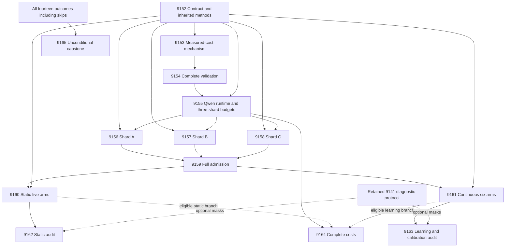

# Carnot Research Roadmap v780: Measured Forward Qualification, Human Energy Decisions, and Continuous Calibration

**Milestone:** 2026.11.780
**Created:** 2026-11-16 UTC
**Status:** Proposed; no experiments executed by this planning change.
**Predecessor:** 2026.11.779, scheduling complete.
**Execution contract:** Exactly **14 tasks, Exp9152 through Exp9165**, in the
order listed below, across **four phases**. Full task objects, visible IDs,
deliverables and structured gates match `research-roadmap-next.yaml`.

Preserve the [V779 design](research-roadmap-v779-preserved-20261116.md) and
[V779 queue](research-roadmap-v779-queue-preserved-20261116.yaml). Their SHA256
values are `d0d9c8dfa3a20edd56eaab56557396a9e94a47139a4b12c153a4fee039b212ad`
and `5615c003502450ff3b321305b1e2e63278ecbe3f58872dfe2825eda9a3b1fad2`.
The completion archive ends at V778. Primary artifacts and the conductor log
establish V779 closure. The active queue and conductor remain unchanged.

## What V779 proved

| Experiment | Observed evidence | Conclusion and limit |
|---|---|---|
| Exp9138 | Contract, source, static-method and online-method readiness all equal1 | Original human authority and qualified methods can be reused. No measured verifier improvement follows. |
| Exp9139 | Schedule prototype ready;32 of621 original nodes executed | Scheduling mechanics qualified on a subset. Complete execution remained unqualified. |
| Exp9140 | `forward_validation_ready_score=0`;23 completed and651 censored obligations out of674 | The forecast failed before original execution. The23 completions are newly owned checks, not a partial scientific corpus. |
| Exp9141 |300 qids/900 siblings audited;100 all-correct,76 all-wrong,124 mixed groups | Human outcome masks and calibration diagnostics qualified. A2 coverage remains incomplete; agreement is not a truth ceiling. |
| Exp9142–9149 | Runtime gate refusal and downstream cascade skips | No human logits, static comparison or delayed-learning measurement ran. This is unmeasured science, not a null detector result. |
| Exp9150 | Cost inventory ready;service and adaptation readiness0 | No complete-service timings were measured. |
| Exp9151 | Reconciliation ready;terminal blocked | All fourteen outcomes were accounted for. The old schedule scope retired; the scientific hypotheses remain open. |

Sources are the corresponding `results/experiment_*_v779_*.json` files and
`ops/conductor-log.md`. Exp9142's scheduler refusal uses
`results/experiment_9142_logit_runtime.json`; it is not the requested scientific
runtime primary. Absent canonical outputs remain absent.

The failed forecast has an identifiable accounting cause. Exp9139 computes
`max(30, 2 * elapsed)` for measured nodes,30 seconds for unknown nodes, and90
seconds per process startup. It then adds4800 seconds of other command timeout
ceilings. That subtotal alone exceeds the3300-second allowance. The full forecast
is27880.142389 seconds. These ceilings do not measure actual workload duration.
The retained slow subprocess's underlying cause is still unknown.

V780 separates observed costs, uncertain forecasts and watchdog limits. It uses
an actual global execution deadline. Every original test and safety limit stays
in force. A targeted child trace must resolve any reproduced stall before the
complete qualifier can pass. The plan cannot obtain readiness by changing a
forecast to `feasible=true`, accepting a subset, or increasing deadlines.

## The three biggest gaps to the PRD

1. **FR-12: useful verification without a cheap executable oracle.** Authentic
   human labels and frozen methods exist. A controlled factual-decision result
   does not. Complete the energy-versus-probability and donor comparison.
2. **FR-06/FR-11: beneficial continuous self-learning.** Update and recovery
   mechanics exist. Future human decisions must improve beyond frozen, linear,
   bias, donor and temperature controls while preserving retained quality.
3. **FR-05/FR-08/NFR-01: reliable, affordable complete execution.** A qualified
   head does not prove a working raw-text service. Execute complete validation,
   measure model features, and include durable learning costs before native ports.

The current north star is the oracle-distinct verifier, per the November7
operator directive. The900-answer LPHB panel is exposed development. It cannot
close `GAP-ORACLE-DISTINCT` or `GAP-DETECTOR-AUROC-4208`, even after a positive
conditional result. Such a result would justify independent human confirmation.

## Research incorporated before design

The [V780 research scan](../../research-references.md) records all eight primary
topics and six secondary channels. It precedes this design. The scan found no
external result that qualifies Carnot's missing local feature pipeline.

| Source | Experiment use | Limit |
|---|---|---|
| [TOOD](https://arxiv.org/abs/2607.29592), July31,2026 | Exp9163 separates logit-scale drift, ranking and Brier changes | A descriptive adaptation from image OOD research, not a TOOD replication or a new promotion gate. |
| [Spilled Energy](https://arxiv.org/abs/2602.18671), February21,2026 | Exp9155–9162 complete raw-energy versus normalized controls | Whole-answer teacher forcing differs from exact-answer localization. Preserve gauge tests and prior negatives. |
| [Online spline KAN](https://arxiv.org/abs/2602.02056), revised June19,2026 | Exp9161 reuses local coefficient updates;Exp9164 measures their complete costs | Published FPGA timings do not establish local hardware speed. |
| [Continual Calibration](https://arxiv.org/abs/2604.23987) and [MT-CC](https://arxiv.org/abs/2610.25689) | Exp9161/9163 retain temperature-only adaptation and calibration retention | No class-incremental or exchangeability guarantee transfers here. |
| [Persistent Calibration](https://arxiv.org/abs/2609.38797) | Exp9163 reuses qualified changed-decision slices | Qwen stays frozen. Only the small verifier changes. |
| [Million-p-bit computer](https://arxiv.org/abs/2606.25313) and [Extropic Z1T](https://extropic.ai/writing/z1t/) | Exp9164 accounts for operation fit and communication | Neither supplies a local dense-Qwen accelerator. |

Energy-Based Reasoners, ETS and neural feasibility layers remain future leads.
A verified natural-error signal comes before generator retraining or guided
decoding. OpenReview browser verification and stale GitHub Trending snapshots
limit those channels. Semantic Scholar returned46 EBT and11 ARM–EBM citations;
these are API results, not an exhaustive literature count.

## Architecture

```mermaid
flowchart TD
  H[Authenticated human questions and archived answers]
  R[Original TRAIN CAL TEST roles and private labels]
  P[Measured-cost validation with unchanged checks]
  V[Complete qualified normal execution]
  Q[Frozen Qwen3.8 27B GGUF on leased GPU0]
  L[Three disjoint logit shards: 100 qids each]
  J[Exact 900-answer admission]
  S[Five static binary energy arms]
  U[Six delayed continuous-learning arms]
  D[Accept reject escalate with error probability]
  A[Paired static and learning audits]
  C[Complete raw-text and durable-update costs]
  P --> V --> Q
  H --> Q --> L --> J
  J --> S --> D
  J --> U --> D
  R -->|TRAIN and CAL only| S
  R -->|Initialization and delayed feedback| U
  R -->|After prediction seals| A
  D --> A
  Q --> C
  U --> C
```



The model sees question/answer text and token IDs. It cannot see labels, reference
answers, annotator metadata or generator identity. The latter is an evaluation
slice only. The static150-group fit and online100-group initialization stay
separate. Research retention never chooses an operational update.

## Phase 1 — Qualify actual execution (Exp9152–9155)

Exp9152 binds the fourteen-task contract. It authenticates Exp9126,Exp9132 and
Exp9141 methods and diagnostics under their original authority. It freezes three
execution rosters whose union equals the original two-shard900-answer population.
It does not repeat completed method development or label analysis.

Exp9153 replaces the diagnosed cost-accounting defect in the existing runner seam.
It records actual process lifetimes and traces any reproduced slow child. Unknown
cost remains unknown. No assumed runtime establishes either feasibility or success.
Its readiness applies only to the scheduling mechanism and targeted controls.

Exp9154 separately executes all621 original nodes,53 V779 additions and new affected
obligations. Original assertions, private CLI checks and100% owned statement coverage
remain mandatory. Any missing obligation leaves model readiness at0. New authority
cannot certify historical quarantined results.

Exp9155 runs the actual six-text serial/chunked forward pilot. It preserves parity
at atol1e-5/rtol1e-4 and projects each complete300-answer execution shard. It blocks
collection unless all three fit within3300 seconds, including load and storage work.

## Phase 2 — Collect the complete unchanged cohort (Exp9156–9159)

Exp9156,Exp9157 and Exp9158 collect lexical qid indices0:100,100:200 and200:300.
Each contains100 qids and all300 sibling answers. These jobs depend on runtime
readiness, not each other's success. All use one shared collector and per-qid
checkpoints. A failed shard cannot become a favorable smaller study.

Exp9159 admits only the exact900-answer union. Original TRAIN150/CAL50/TEST100 roles,
raw-vector sample, caps, tokenizer and numerical formulas remain unchanged.
Static and online feature views preserve their different initialization scopes.

## Phase 3 — Measure verification and continuous learning (Exp9160–9163)

Exp9160 fits and seals the original five static arms. Exp9161 independently runs
all six causal learning arms after admission. Its durable state must survive real
hard exits. New feedback can change only the small energy head, not Qwen weights.

Exp9162 evaluates the two static bounds plus accepted risk and gauge sensitivity.
Exp9163 evaluates all seven learning/retention bounds and exact recovery. Both
accept complete null inputs; a scientific win never gates an audit. Exp9163 also
measures whether ranking, probability scale and calibration move differently.
The new descriptive diagnostic does not change the registered decision rule.

## Phase 4 — Measure service cost and close evidence (Exp9164–9165)

Exp9164 has a structured runtime gate. This skips the repeated inventory-only call
when no forward path exists. After runtime qualifies, static and learning costs
have separate eligibility checks. A blocked learner cannot suppress eligible
static timing. Exp9165 always reconciles all outcomes, including conductor skips,
missing scientific primaries and null results. External absence is terminal blocked.

## Frozen scientific protocols

The following methods preserve the V778 and V779 scientific contract. Their implemented
authorities are Exp9126 and Exp9132. Their immutable receipts take precedence
over mutable checkout files. The new diagnostic section below adds no acceptance
gate and changes no arm, cohort, optimization rule or interval threshold.

### Whole-answer forward statistics

Use original TRAIN150/CAL50/TEST100 question groups, three siblings each.
Primary target is original A1 factuality. A2 sensitivity uses only actual observed
labels; unknown -1 stays missing. The task evaluates archived answers under Qwen,
not newly generated Qwen answers. No answer accuracy claim transfers to Qwen.

Preserve V777's exact protocol. Tokenize question/answer separately with the
embedded tokenizer, no BOS or chat template, and right caps256/768. The prefix is
literal `Question:\n`, retained question text and literal `\nAnswer:\n`.
Freeze detokenization and prefix bytes. Append retained answer token IDs explicitly.
Reset state for every answer. Capture in128-token chunks with the preceding-prefix
logit for the first answer token. Preserve adjacent pairs across chunk boundaries.

For full-vocabulary logits z_i and answer token a_i, compute in stable float64:

- L_i=logsumexp(z_i); NLL_i=L_i-z_i[a_i].
- p_i=softmax(z_i); H_i=-sum_v p_iv*log(p_iv).
- Marginal energy M_i=-L_i.
- Adjacent spill D_i=-z_i[a_i]+L_(i+1), within one answer, i=1..length-1.

The seven features are log1p(answer length), mean NLL, mean H, maximum H,
mean M, mean absolute D and the no-adjacent-pair indicator. Retain selected logits,
L_i, H_i, max probability, token IDs, positions and full-vector hashes per token.
One-token answers lack only spill; TRAIN-only median imputation is fixed. An
entirely missing training feature blocks fitting. Empty answers retain their slots
as escalations. Loss contrasts share predeclared nonempty support; coverage uses
all original TEST rows. No label-based filtering is permitted.

Store full vectors for the first eight answer positions of the global first20
lexical qids/all siblings. Preflight2GiB for bounded raw evidence. Stream statistics
instead of retaining all900 complete token-by-vocabulary arrays in RAM.

### Static energy decisions and susceptibility

The five original arms are prevalence, probability+length logistic (first four
features), raw-energy logistic (length, mean M, mean absolute D, missing-pair
indicator), combined logistic (all seven) and combined with whole-qid TRAIN donor
labels. Donors use a fixed nonidentity cyclic permutation of sorted TRAIN qids;
sibling positions stay fixed. Report the actual changed-label numerator/denominator.

These are binary Gibbs energies E(0)=0, E(1)=-theta·phi and
p(error)=sigmoid(theta·phi). Fit TRAIN-only population mean/std, with constant
scale1. Minimize mean binary logloss plus0.5*0.01 times squared nonintercept
coefficients. L-BFGS-B starts at zero: maxiter2000, gtol1e-7, ftol1e-12.
Require finite parameters/objective and gradient infinity norm<=1e-6.
No regularization or architecture search is scheduled.

CAL alone selects temperature from[0.5,1,2,4], ascending ties. Accept at
p(error)<=0.1; reject at>=0.9; otherwise escalate. Seal TEST predictions before
evaluator access. Report Brier, logloss, coverage, accepted error and exact-half-
coverage error. Rerank half-coverage choices inside each resampled draw.

Use10000 paired TEST-qid bootstrap draws, seed777121, preserving siblings.
`energy_increment_score=1` requires both combined-arm Brier improvement lower
bounds>0 against probability+length and donor, with one-sided tail0.05/2.
Empirical accepted error must not increase versus probability+length.
Undefined accepted risk cannot pass. These are conditional development intervals.

Add c_i=3 or c_i=3*(-1)^i to every vocabulary logit. Normalized probabilities,
NLL and entropy must remain unchanged. M changes by -c_i; D changes by
c_(i+1)-c_i. Report raw-score and frozen-head sensitivity under both gauges.
Do not select the favorable gauge. A gauge-sensitive score can be an empirical
representation signal; it is not evidence of a broken probability chain rule.
The original Exp6980 exact-span null and V776 embedding study remain unchanged.

### Continuous self-learning with a recalibration control

Preserve the original SHA256(`v776-online`+qid) ordering:100 TRAIN groups for
initialization and50 for ten disjoint streams of five. Original CAL50 is the
operational guard; TEST100 is research retention. Preserve the Exp9099 donor map
(seed776099, initialization labels only, original sibling positions).

Fit imputation and scaling only on the100 initialization groups. After standard
scaling, fit initialization min/max to[-1,1], constants0, and clip later inputs.
Use the seven logit features with fixed cubic knots
[-1,-1,-1,-1,-0.5,0,0.5,1,1,1,1]: intercept, seven linear columns and49 basis
columns. Use the existing spline helper. Fit initial heads with the static ridge
objective and convergence contract; temperature starts at1. No random projection
or embedding transformation is used in this separate seven-feature study.

Six arms are frozen spline, adaptive spline, bias-only spline, adaptive linear,
donor-label spline and temperature-only spline. All start from comparable
initial fits. For the original adaptive arms, retain the Exp9099 gradient:
`(sigmoid(theta·phi)-y)*phi + 0.01*(theta-theta_initial)`, with no intercept
anchor. Bias-only zeros other coordinates. Clip L2 norm to1. Use AdaGrad,
learning rate0.05, accumulator initially0 and epsilon1e-8. Apply three sibling
updates in original order, then test promotion once per released qid.

For temperature-only adaptation, keep spline coefficients fixed. Let s be its
initial logit, u=log(T), q=exp(-u), p=sigmoid(q*s). Initially u=0. Use gradient
`(y-p)*q*s + 0.01*u`, clipped to[-1,1], with the same AdaGrad settings.
Clip updated u to[log(0.5),log(4)]. Persist u and its accumulator. This comparator
uses the same feedback and guard access; it is not a multi-group MT-CC replication.

Promote only if complete CAL Brier increase<=0.005 and CAL classification-error
increase<=0 versus that arm's initial state. Otherwise restore parameters and
accumulators while acknowledging consumed feedback. Research retention does not
participate in this decision. Seal all18 sibling/arm predictions for g before
releasing labels for g-1. Drain the final group after all predictions. Reset
every stream to identical initial states. No static150 data may enter this fit.

Atomic snapshots include predictions, parameters, accumulators, temperature,
pending feedback and acknowledgments. Real hard exits at prediction fsync,
feedback receipt and state replacement must reproduce uninterrupted states and
predictions exactly. Preserve private actual-child E2E-020 coverage.

Evaluate future groups2–5:40 distinct qids/120 responses. Use10000 paired stream
bootstrap draws, seed778135, one-sided tail0.05/7. The seven simultaneous bounds
are five adaptive-spline future Brier improvements over each other arm (lower>0),
retained Brier increase (upper<=0.005), and retained classification-error increase
(upper<=0). All seven plus exact recovery are needed for `learning_signal_score=1`.
This adds a comparator and tightens multiplicity correction; it does not replace
the old six-bound embedding protocol. Report per-qid retention changes averaged
over streams. Repeated retention is100 questions, not1000. Ten streams have limited
power and the intervals condition on the initial fit, guard and retention panel.


## Descriptive diagnostics fixed before execution

Reuse Exp9141's authenticated evaluator masks and original agreement counts.
Unknown A2 labels stay missing. Agreement is not an accuracy ceiling. Static
slices distinguish mixed-correctness siblings from homogeneous qids. These
label-defined masks never enter feature extraction, fitting or decisions.

For online predictions, retain `abs(p_adaptive-p_initial)>=0.05` and crossings
of the fixed0.5 classification threshold. Membership uses predictions only.
Compare every arm on identical changed and unchanged units. Report Brier,
`mean(p-y)`, exact counts and unavailable empty slices. Use paired whole-stream
resampling for future and retention contrasts, conditional on the fixed panels.

The new TOOD-inspired diagnostic compares ranking, scale and calibration at
each released-group update. Use the same TEST100 qids and all siblings for every
arm. Record raw logits, RMS logit magnitude, tie-aware AUROC, Brier and class
counts before and after each update. Rejected updates retain their unchanged
state. One-class AUROC remains unavailable. Report every stream and update.
No threshold, temperature, group or model is selected from these results.
This diagnostic cannot rescue any failed primary bound. It tests whether the
observed behavior is consistent with scale drift or lost ranking information;
it cannot identify a causal mechanism from a correlation alone.

## Complete costs and hardware requirements

Retain first20 TEST qids/all60 siblings, three fresh processes and order
seed776108. Require probability parity atol1e-5/rtol1e-4 and exact typed decisions.
Separate cold load, warm uncached raw-text service and cached-feature head cost.
Include tokenization, GPU forwards, transfers, statistics, transformations,
scoring and serialization. Include initialization, proposals, rejected updates,
CAL scans, durable writes/fsync, acknowledgments, final drain and recovery.

| Resource | Requirement and limit |
|---|---|
| CPU and system RAM | Small fits, validation, bootstrap and durable state. Measure peak usage. Stream statistics; do not hold all token-by-vocabulary arrays. |
| Private disk | At least2GiB for designated raw vectors, plus measured checkpoint and validation needs. Preflight actual free space. |
| GPU0: RTX3090,24GB | Lease the GPU. Use CUDA-backed llama.cpp and pin actual offload evidence. Run model jobs sequentially. |
| GPU1 | Reserved for its existing owner. Do not assume combined VRAM or run an unrequested dual-GPU experiment. |
| Model | Frozen `unsloth/Qwen3.8-27B-GGUF`,Q4_K_M via `cached_current_model(gpu_index=0)`. Pin GGUF, embedded tokenizer and build hashes. No smaller-model headline fallback. |
| KV260 | Preserve the qualified Ising fabric and `k_max<=5`. It does not implement the spline learner or dense Qwen forwards. |
| PolarFire and GateMate | Preserve CPU-only PolarFire evidence and unchanged GateMate physical/JTAG block. No repeated bring-up probe. |
| NPU, Extropic TSU, larger FPGA wishlist | Future operation-matched candidates only. Require actual access, compatible kernels and a measured complete-service bottleneck. No purchase or speedup is claimed. |

FR-11's hardware path is sparse small-head coefficient updates on CPU now, with
batched GPU or fixed-point FPGA kernels as later measured candidates. The model
feature path remains GPU work. Use disjoint measured component times for Amdahl
bounds. A100x complete-service target requires accelerating more than99% of its
original cost even with an infinitely fast replacement. The PRD10x target requires
more than90%. Unknown fractions stay unknown. No measured power integral means
no joule claim. Vendor figures cannot establish either local target.

## Execution and evidence rules

Each task has a numbered flushed-progress requirement. Print at phase boundaries
and before/after model load, generation, benchmarks and subprocesses. Supervise
blocking work with60-second heartbeats. Print inside long loops. Keep every gap
below600 seconds. Write files over about200 lines through multiple tool calls,
with a progress message between calls.

The total cap remains4800 seconds:3300 for execution,1200 for final verification,
and300 for publication. The schedule records actual elapsed time independently
of per-command watchdog limits. It counts each obligation once per invocation.
Whole-scope readiness requires every obligation, not an optimistic estimate.

Every task declares `verdict_class` from the closed six-member enum. A complete
null is terminal. Missing or unchanged retired external inputs are `blocked`.
Only unfinished owned work that another attempt can complete is `partial`.
Every refusal records `gate_check_summary`, including the exact failed field
and observed value. A missing file, missing field and observed0 are distinct.
All comparative tasks emit per-unit rows and sample-size accounting.

Five tasks may invoke Qwen:Exp9155,Exp9156,Exp9157,Exp9158 and Exp9164. They perform
teacher-forced forwards only and declare `model_load_no_generation` with zero
sampled tokens. Its duration floor is2 seconds. A no-load refusal uses
`blocked_no_run`; a failed attempted load remains an attempted load. No task
performs bounded generation (10-second floor) or full generation (60-second floor).
CPU fitting, diagnostics and reductions declare `no_model_load`. Never pad runtime.

Schema and qualification tasks use Opus with100 turns. Formulaic collection uses
Codex `gpt-6.1-sol`. Routine training and evaluation keep the requested default
backend and50 turns. The final reconciliation has20 turns. No Luna task is emitted.
These are executor settings; they do not change the scientific model mandate.

Spec-first changes, meaningful tests and100% owned statement coverage remain
required during execution. Include real private CLI success, refusal, tamper and
cold replay per E2E-018/021. Learning changes also require E2E-020 hard exits.
Run scoped lint, format, strict typing and spec tracing. Keep unrelated repository
health separate from affected failures; an affected failure prevents readiness.

Preserve original primaries, source authority, assertion bodies and quarantines.
All repeated scopes include four-field `prior_failures` records with mechanical
retirement. No new task ID or `requires` chain reuses a retired experiment.
Do not push, activate a queue, publish externally or modify the conductor.

## Acceptance, stop conditions and implementation priority

Administrative contract readiness cannot certify science. Full validation
precedes model work. Runtime parity and all three shard budgets precede collection.
Exact complete admission precedes both independent training branches. Completed
predictions open their audits even when the result is null. The cost task uses
runtime readiness, with independent internal eligibility checks for each service.

A controlled development static signal requires both original Brier bounds and
accepted-risk conditions. Learning requires all seven bounds and exact recovery.
Report small-sample and exposure limits even if every bound passes. Preserve
`independent_generalization_score=0` and `current_science_paper_ready=false`.
Historical FoVer G1–G4 remain a separate publication scope. Publication is operator-only.

If full validation still fails, retain the measured cause and exact unmet
obligations. Do not schedule another renamed forecast experiment. If collection
is infeasible, preserve all cohort roles and state the measured execution deficit.
Do not shorten answers or discard rows. If science is null, retire the unchanged
technique under the recorded rule. A new corpus or mechanism needs its own design.
ARC remains opportunistic; no level solve or offline solver is proposed here.

## Dependency graph



Solid experiment edges are structured readiness gates. The all-outcomes edge
means accounting, not a launch gate. Dotted edges are conditional evidence.

## Task contract

| Order | Task ID | Phase | Deliverable | Readiness dependencies |
|---|---|---|---|---|
| 1 | `exp9152-contract` | 1 | `results/experiment_9152_v780_contract.json` | Unconditional |
| 2 | `exp9153-measured-validation` | 1 | `results/experiment_9153_v780_validation_schedule.json` | exp9152-contract.contract_ready_score == 1 |
| 3 | `exp9154-forward-qualification` | 1 | `results/experiment_9154_v780_forward_qualification.json` | exp9153-measured-validation.schedule_ready_score == 1 |
| 4 | `exp9155-logit-runtime` | 1 | `results/experiment_9155_v780_logit_runtime.json` | exp9154-forward-qualification.forward_validation_ready_score == 1; exp9152-contract.static_methods_ready_score == 1 |
| 5 | `exp9156-logits-a` | 2 | `results/experiment_9156_v780_logits_a.json` | exp9152-contract.source_ready_score == 1; exp9155-logit-runtime.logit_runtime_ready_score == 1; exp9155-logit-runtime.shard_feasible_score == 1 |
| 6 | `exp9157-logits-b` | 2 | `results/experiment_9157_v780_logits_b.json` | exp9152-contract.source_ready_score == 1; exp9155-logit-runtime.logit_runtime_ready_score == 1; exp9155-logit-runtime.shard_feasible_score == 1 |
| 7 | `exp9158-logits-c` | 2 | `results/experiment_9158_v780_logits_c.json` | exp9152-contract.source_ready_score == 1; exp9155-logit-runtime.logit_runtime_ready_score == 1; exp9155-logit-runtime.shard_feasible_score == 1 |
| 8 | `exp9159-logit-admission` | 2 | `results/experiment_9159_v780_logit_admission.json` | exp9156-logits-a.logits_a_ready_score == 1; exp9157-logits-b.logits_b_ready_score == 1; exp9158-logits-c.logits_c_ready_score == 1 |
| 9 | `exp9160-static-energy` | 3 | `results/experiment_9160_v780_static_energy.json` | exp9159-logit-admission.admission_ready_score == 1; exp9152-contract.static_methods_ready_score == 1 |
| 10 | `exp9161-delayed-learning` | 3 | `results/experiment_9161_v780_delayed_learning.json` | exp9159-logit-admission.admission_ready_score == 1; exp9152-contract.online_methods_ready_score == 1 |
| 11 | `exp9162-energy-audit` | 3 | `results/experiment_9162_v780_energy_audit.json` | exp9160-static-energy.static_predictions_ready_score == 1 |
| 12 | `exp9163-learning-audit` | 3 | `results/experiment_9163_v780_learning_audit.json` | exp9161-delayed-learning.online_predictions_ready_score == 1 |
| 13 | `exp9164-complete-cost` | 4 | `results/experiment_9164_v780_complete_cost.json` | exp9155-logit-runtime.logit_runtime_ready_score == 1 |
| 14 | `exp9165-capstone` | 4 | `results/experiment_9165_v780_capstone.json` | Unconditional |

## Full machine-readable contract

The parsed objects below equal the proposed YAML, including every prompt and optional field.

<!-- V780_TASK_CONTRACT_START -->
```json
{
  "milestone": "2026.11.780",
  "milestone_title": "Measured Forward Qualification, Human Energy Decisions, and Continuous Calibration",
  "milestone_doc": "openspec/change-proposals/research-roadmap-vNEXT.md",
  "tasks": [
    {
      "id": "exp9152-contract",
      "title": "Exp9152: Bind fourteen tasks and preserve qualified human methods",
      "phase": 1,
      "track": "research",
      "priority": "high",
      "requires_gpu": false,
      "max_turns": 100,
      "estimated_wall_time_min": 55,
      "per_unit_rows": true,
      "milestone": "2026.11.780",
      "deliverable": "results/experiment_9152_v780_contract.json",
      "inference_substrate_class": "no_model_load",
      "MODEL_SPECS": [],
      "prompt": "CONTEXT:\nWork in {project_root} on {date}. V779 qualified source and method reuse plus human-label diagnostics. Exp9140 refused a 27880.142389-second sum of safety ceilings; it did not measure complete runtime. V779 collected no logit corpus. Preserve its exact retired schedule scope.\nEXISTING CODE TO READ FIRST:\nCLAUDE.md; CODEX.md; ops/north-star.md; ops/e2e-test-plan.md; ops/exclusion_manifest.yaml; research-references.md (2026-11-16 V780 scan); openspec/change-proposals/research-roadmap-vNEXT.md; openspec/capabilities/research-reporting/spec.md; scripts/experiment_template.py; python/carnot/reporting/primary_publication.py; python/carnot/reporting/current_work_receipt.py; python/carnot/reporting/v778_contract.py; python/carnot/reporting/v778_capstone.py; python/carnot/reporting/logit_methods_9126.py; python/carnot/reporting/online_methods_9132.py; results/experiment_9124_v778_contract.json; results/experiment_9125_v778_receipt_qualification.json; results/experiment_9126_v778_logit_methods.json; results/experiment_9132_v778_online_methods.json; results/experiment_9137_v778_capstone.json; openspec/change-proposals/research-roadmap-v778-preserved-20261116.md; python/carnot/reporting/v779_contract.py; python/carnot/reporting/v779_capstone.py; results/experiment_9138_v779_contract.json; results/experiment_9139_v779_validation_schedule.json; results/experiment_9140_v779_forward_qualification.json; results/experiment_9141_v779_human_contrast_audit.json; results/experiment_9151_v779_capstone.json; openspec/change-proposals/research-roadmap-v779-preserved-20261116.md; openspec/change-proposals/research-roadmap-v779-queue-preserved-20261116.yaml\nTASK:\nBind fourteen tasks and preserve qualified human methods. Deliver results/experiment_9152_v780_contract.json. Implement scripts/experiments/experiment_9152_v780_contract.py using the existing library paths. MODEL_SPECS: []. Requested inference_substrate_class: no_model_load.\nDo not load an LLM. Record current_llm_invocations=0 and generated_tokens=0. Small numerical energy fitting is CPU work. Historical model provenance stays in source_references.\nCONTINUATION BOUNDARY:\nThe V780 continuation changes validation cost accounting and execution partition size only. Keep original historical authority and scientific thresholds. All model runs use frozen unsloth/Qwen3.8-27B-GGUF; no generator weight updates.\nCONCRETE STEPS:\n1. Emit a flushed progress line at each phase boundary. Emit before and after every model load, generation, benchmark and subprocess that can take minutes. Print progress inside long loops. Supervise blocking calls with flushed heartbeats every 60 seconds. Keep every silence gap below 600 seconds. Write any file over about 200 lines in several tool calls of at most 200 lines. Send a progress message between writing calls. Never use one huge tool call.\n2. PRECONDITIONS: Authenticate required artifacts and their exact gate fields before dependent work. Check imports, resource limits and private disk space. Keep missing_file, missing_field and observed zero distinct. Missing external inputs produce terminal blocked evidence with gate_check_summary. Never repin historical evidence to mutable checkout code.\n3. Before implementation, inspect all callers with rg. Confirm REQ-REPORT-9152-V780 and SCENARIO-REPORT-9152-V780. Extend the specification first. Write failing controls before code. Freeze units, formulas, exclusions and validation scope before outcomes.\n4. Bind exactly fourteen full task objects, Exp9152 through Exp9165, in design and YAML order. Hash prompts, gates, deliverables and model metadata. Authenticate preserved V779 design and queue bytes. Distinguish completion-archive lag from absent scientific evidence. Do not activate either queue.\n5. Authenticate original human authority: 900 answers, 300 qids, TRAIN150/CAL50/TEST100, three siblings each. Preserve labels in evaluator-only views. Replace only execution partitions: three lexical100-qid rosters, A indices0:100, B100:200, C200:300, all siblings. Prove their disjoint union equals both original shards. Retain exposed-development status and independent_generalization_score=0.\n6. Reuse Exp9126 static and Exp9132 online qualification under original producer authority. Reuse Exp9141 human-mask and contrast protocol without rerunning its analysis. Keep all five static arms, six online arms, two static bounds and seven learning bounds. Emit separate source_ready_score, static_methods_ready_score and online_methods_ready_score. Freeze the V780 scale/ranking diagnostic before outcomes. Administrative contract readiness does not certify science.\n7. Preserve failed primaries and quarantines. Retire the exact sum-of-ceilings schedule, never its original test obligations. Record 621 original nodes plus53 V779 additions, of which Exp9140 completed only23 newly owned nodes. Unknown slow-child cost stays unknown. New authority must bind measured durations separately from watchdog limits and cannot reinterpret historical receipts.\n8. Run meaningful owned unit tests and actual child-process coverage with 100 percent owned statements and zero exclusions. Preserve original assertions. Run Ruff check/format, strict mypy and explicit-path scripts/check_spec_coverage.py. Execute private real CLI success, refusal, tamper and cold replay outside the checkout without PYTHONPATH, following E2E-018/021. Learning/recovery changes also require E2E-020. Separate unrelated repository health from affected failures. Affected failures disqualify readiness.\n9. Stop measurement by 3300 seconds. Reserve 1200 seconds for final verification and300 seconds for publication within the4800-second hard cap. Count each required check once; separate actual elapsed time from its watchdog ceiling. Save unfinished units and censor reasons. Recompute claims from rows. Run scripts/adversarial_verify.py and scripts/verdict_row_consistency_lint.py --strict with heartbeats. Publish only through primary_publication after actual checker receipts pass. Reconcile openspec/, _bmad/traceability.md, ops/status.md and ops/changelog.md. Preserve historical primaries, quarantines and exclusions. Do not activate a roadmap or publish externally.\nREQUIRED ARTIFACT FIELDS:\n- honest_verdict: complete_*; principle: A terminal prefix records the actual outcome without inducing a spurious retry.\n- verdict_class: positive | circular_positive | null | blocked | disqualified | partial; principle: Only unfinished owned work uses partial. Absent, retired or blocked external inputs use blocked. Fixtures never establish scientific benefit.\n- gate_check_summary: list of check, upstream, path, sha256, artifact_field, op, expected, observed, passed; principle: Every blocked verdict names the failed operand. Missing files and fields are contract failures, distinct from observed zero.\n- rows: unit_id, qid/group, sibling, arm/condition, seed, absolute metric, numerator, denominator, status, exclusion_reason and censor_reason; principle: Every comparison can be recomputed at its actual independent unit.\n- sample_size_budget: intended, attempted, completed, failed, censored and effective_independent_groups; principle: Siblings, repeated retention and resamples cannot inflate the sample size.\n- verifier_is_oracle: boolean; principle: Executable truth reused as the verifier is circular_positive, never an independent verifier win.\n- claim_scope: include exposure_scope and independent_generalization_score=0; principle: This exposed human panel cannot close GAP-ORACLE-DISTINCT or GAP-DETECTOR-AUROC-4208. No ARC solve is claimed.\n- MODEL_SPECS: actual requested model list with invocation status; principle: Named upstream models cannot masquerade as current inference.\n- inference_substrate_class: actual work class plus requested_inference_substrate_class; principle: No-load refusals use blocked_no_run. A failed attempted load is still an attempted load. No artificial duration padding.\n- inference_substrate: operation-accurate declaration; principle: Cached reduction, live forward work and generation have different evidentiary costs.\n- model_invocation_counts: current_llm_invocations, loads attempted/completed/failed, forward calls and generated_tokens; principle: Current compute counters must agree with operation-specific receipts.\n- duration_s: measured wall time; principle: Real process timing bounds throughput claims and detects invented compute.\n- random_seed: fixed before measurement; principle: Seeds make the planned comparisons reproducible.\n- reproducibility_checksum: input and configuration digest; principle: Changed evidence must not pass as the same experiment.\n- source_references: producer path, SHA256 and imported fields; principle: Original evidence authority survives mutable checkout changes.\n- code_config_hashes: owned implementation, tests and configuration references; principle: Validation qualifies the exact executed revision.\n- current_work_receipts: actual operation-specific receipts; principle: Scripted counters and historical work cannot qualify a current model run.\n- validation_receipts: commands, logs, exit status and coverage references; principle: Readiness depends on executed checks, not self-reported success.\n- required_checks_passed: boolean; principle: Incomplete or failing affected checks cannot produce readiness.\n- acceptance_gates: fixed conditions with one-line principle annotations; principle: Outcome-dependent thresholds cannot manufacture success.\n- contract_ready_score: integer 0/1; principle: Complete task equality is independent of data availability.\n- source_ready_score: integer 0/1; principle: Original labels and all question roles must authenticate.\n- static_methods_ready_score: integer 0/1; principle: Static methods can be reused only under original authority.\n- online_methods_ready_score: integer 0/1; principle: Reuse must retain all six arms and exact delayed-update semantics.\n- full_task_objects: include canonical_task_hash and previous_outcome_rows; principle: Scheduling completion cannot be confused with scientific success.\n- protocol_references: source_manifest_reference, evaluator_label_reference, static_protocol_reference, online_protocol_reference and shard roster references; principle: Consumers share immutable, identically named inputs.\n- diagnostic_protocol_reference: inherited Exp9141 masks plus V780 scale/ranking definitions; principle: Descriptive analysis must be fixed before inspecting predictions.\n- shard_c_roster_reference: lexical qids200:300, all siblings; principle: Smaller execution units preserve the original full population.\nRun command: cd {project_root} && JAX_PLATFORMS=cpu .venv/bin/python -u scripts/experiments/experiment_9152_v780_contract.py --date {date}\nDo NOT push. Do NOT modify scripts/research_conductor.py.",
      "prior_failures": [
        {
          "experiment_id": "exp7329-contract",
          "verdict": "complete_disqualified_v644_contract_mismatched_or_invalid",
          "addressed_by": "Build the visible table, design full objects and YAML from one task list, preserving V778 authority before overwriting vNEXT. Reject any object mismatch.",
          "retire_if_same_verdict": true
        },
        {
          "experiment_id": "exp7421-contract-ingestion",
          "verdict": "complete_disqualified_stale_markdown_contract_with_method_ingestion",
          "addressed_by": "The V780 design is newly written and contains exactly the emitted fourteen task objects. Method reuse authenticates immutable Exp9126/9132 authority without importing their old roadmap contract.",
          "retire_if_same_verdict": true
        }
      ],
      "model": "opus"
    },
    {
      "id": "exp9153-measured-validation",
      "title": "Exp9153: Separate measured validation costs from watchdog ceilings",
      "phase": 1,
      "track": "research",
      "priority": "high",
      "requires_gpu": false,
      "max_turns": 100,
      "estimated_wall_time_min": 70,
      "per_unit_rows": true,
      "milestone": "2026.11.780",
      "deliverable": "results/experiment_9153_v780_validation_schedule.json",
      "inference_substrate_class": "no_model_load",
      "MODEL_SPECS": [],
      "gated_on": [
        {
          "upstream": "exp9152-contract",
          "artifact_field": "contract_ready_score",
          "op": "==",
          "value": 1
        }
      ],
      "prompt": "CONTEXT:\nWork in {project_root} on {date}. Exp9139 uses max(30,2*elapsed) for measured nodes,30 seconds for unknown nodes,90 seconds per startup, and4800 seconds of other command deadlines. It projects27880.142389 seconds against3300 and prevents full execution. This is a timeout-ceiling aggregation defect. The retained slow subprocess cause remains unknown.\nEXISTING CODE TO READ FIRST:\nCLAUDE.md; CODEX.md; ops/north-star.md; ops/e2e-test-plan.md; ops/exclusion_manifest.yaml; research-references.md (2026-11-16 V780 scan); openspec/change-proposals/research-roadmap-vNEXT.md; openspec/capabilities/research-reporting/spec.md; scripts/experiment_template.py; python/carnot/reporting/primary_publication.py; python/carnot/reporting/current_work_receipt.py; python/carnot/reporting/receipt_qualification_9125.py; python/carnot/reporting/forward_evidence_runner_9111.py; python/carnot/reporting/forward_evidence_9111.py; tests/python/test_forward_evidence_runner_9111.py; tests/python/test_receipt_qualification_9125.py; results/experiment_9125_v778_receipt_qualification.json; python/carnot/reporting/validation_schedule_9139.py; python/carnot/reporting/forward_qualification_9140.py; tests/python/test_validation_schedule_9139.py; results/experiment_9139_v779_validation_schedule.json; results/experiment_9140_v779_forward_qualification.json\nTASK:\nSeparate measured validation costs from watchdog ceilings. Deliver results/experiment_9153_v780_validation_schedule.json. Implement scripts/experiments/experiment_9153_v780_validation_schedule.py using the existing library paths. MODEL_SPECS: []. Requested inference_substrate_class: no_model_load.\nDo not load an LLM. Record current_llm_invocations=0 and generated_tokens=0. Small numerical energy fitting is CPU work. Historical model provenance stays in source_references.\nCONTINUATION BOUNDARY:\nThe V780 continuation changes validation cost accounting and execution partition size only. Keep original historical authority and scientific thresholds. All model runs use frozen unsloth/Qwen3.8-27B-GGUF; no generator weight updates.\nCONCRETE STEPS:\n1. Emit a flushed progress line at each phase boundary. Emit before and after every model load, generation, benchmark and subprocess that can take minutes. Print progress inside long loops. Supervise blocking calls with flushed heartbeats every 60 seconds. Keep every silence gap below 600 seconds. Write any file over about 200 lines in several tool calls of at most 200 lines. Send a progress message between writing calls. Never use one huge tool call.\n2. PRECONDITIONS: Authenticate required artifacts and their exact gate fields before dependent work. Check imports, resource limits and private disk space. Keep missing_file, missing_field and observed zero distinct. Missing external inputs produce terminal blocked evidence with gate_check_summary. Never repin historical evidence to mutable checkout code.\n3. Before implementation, inspect all callers with rg. Confirm REQ-REPORT-9153-V780 and SCENARIO-REPORT-9153-V780. Extend the specification first. Write failing controls before code. Freeze units, formulas, exclusions and validation scope before outcomes.\n4. Preserve all621 original nodes and53 V779 additions, original assertion hashes, command roles and historical readers. Reconstruct the27880.142389-second estimate from retained rows. Add a failing control showing fast measured nodes and4800 seconds of command kill ceilings are not expected serial runtime. Keep safety ceilings unchanged.\n5. Separate measured_elapsed_s, estimated_remaining_s, unknown_cost and kill_timeout_s. Preserve module fixture lifetimes. Measure representative complete module/process lifetimes and command phases with actual children. Unknown cost is unknown, not an automatic infeasible result. Use a small bounded probe to trace the retained slow child, including descendant commands and wait stacks. If a loop or redundant nested suite is observed, fix that execution cause in the existing runner seam. If unresolved, emit an exact blocked prerequisite; do not guess.\n6. Use a monotonic global execution deadline and remaining-time checks. Execute each obligation once per qualification invocation. Consume authenticated same-invocation results instead of repeating whole suites. Maintain per-node setup/call/teardown logs, code/config hashes and post-exit coverage. Do not count a command timeout as elapsed time or charge final verification twice. No dropped assertions, lowered kill limits, fabricated receipts or new deadline increase is allowed.\n7. Exercise actual small normal-orchestration children and all original rejection controls. Test fast-cost versus ceiling separation, unknown-cost handling, measured timeout, duplicate/missing/foreign node evidence, code drift and genuine exhausted budgets. Keep total execution3300 seconds, final verification1200 and publication margin300. If measured work exceeds budget, retain completed work and exact remaining nodes without readiness.\n8. Qualify the revised execution mechanism here. Emit schedule_ready_score=1 only after targeted children and all affected controls pass. Full674-node execution plus new obligations belongs to Exp9154. A timing estimate cannot authorize model work. Preserve the original computational_root_cause field as unknown unless trace evidence establishes it.\n9. Run meaningful owned unit tests and actual child-process coverage with 100 percent owned statements and zero exclusions. Preserve original assertions. Run Ruff check/format, strict mypy and explicit-path scripts/check_spec_coverage.py. Execute private real CLI success, refusal, tamper and cold replay outside the checkout without PYTHONPATH, following E2E-018/021. Learning/recovery changes also require E2E-020. Separate unrelated repository health from affected failures. Affected failures disqualify readiness.\n10. Stop measurement by 3300 seconds. Reserve 1200 seconds for final verification and300 seconds for publication within the4800-second hard cap. Count each required check once; separate actual elapsed time from its watchdog ceiling. Save unfinished units and censor reasons. Recompute claims from rows. Run scripts/adversarial_verify.py and scripts/verdict_row_consistency_lint.py --strict with heartbeats. Publish only through primary_publication after actual checker receipts pass. Reconcile openspec/, _bmad/traceability.md, ops/status.md and ops/changelog.md. Preserve historical primaries, quarantines and exclusions. Do not activate a roadmap or publish externally.\nREQUIRED ARTIFACT FIELDS:\n- honest_verdict: complete_*; principle: A terminal prefix records the actual outcome without inducing a spurious retry.\n- verdict_class: positive | circular_positive | null | blocked | disqualified | partial; principle: Only unfinished owned work uses partial. Absent, retired or blocked external inputs use blocked. Fixtures never establish scientific benefit.\n- gate_check_summary: list of check, upstream, path, sha256, artifact_field, op, expected, observed, passed; principle: Every blocked verdict names the failed operand. Missing files and fields are contract failures, distinct from observed zero.\n- rows: unit_id, qid/group, sibling, arm/condition, seed, absolute metric, numerator, denominator, status, exclusion_reason and censor_reason; principle: Every comparison can be recomputed at its actual independent unit.\n- sample_size_budget: intended, attempted, completed, failed, censored and effective_independent_groups; principle: Siblings, repeated retention and resamples cannot inflate the sample size.\n- verifier_is_oracle: boolean; principle: Executable truth reused as the verifier is circular_positive, never an independent verifier win.\n- claim_scope: include exposure_scope and independent_generalization_score=0; principle: This exposed human panel cannot close GAP-ORACLE-DISTINCT or GAP-DETECTOR-AUROC-4208. No ARC solve is claimed.\n- MODEL_SPECS: actual requested model list with invocation status; principle: Named upstream models cannot masquerade as current inference.\n- inference_substrate_class: actual work class plus requested_inference_substrate_class; principle: No-load refusals use blocked_no_run. A failed attempted load is still an attempted load. No artificial duration padding.\n- inference_substrate: operation-accurate declaration; principle: Cached reduction, live forward work and generation have different evidentiary costs.\n- model_invocation_counts: current_llm_invocations, loads attempted/completed/failed, forward calls and generated_tokens; principle: Current compute counters must agree with operation-specific receipts.\n- duration_s: measured wall time; principle: Real process timing bounds throughput claims and detects invented compute.\n- random_seed: fixed before measurement; principle: Seeds make the planned comparisons reproducible.\n- reproducibility_checksum: input and configuration digest; principle: Changed evidence must not pass as the same experiment.\n- source_references: producer path, SHA256 and imported fields; principle: Original evidence authority survives mutable checkout changes.\n- code_config_hashes: owned implementation, tests and configuration references; principle: Validation qualifies the exact executed revision.\n- current_work_receipts: actual operation-specific receipts; principle: Scripted counters and historical work cannot qualify a current model run.\n- validation_receipts: commands, logs, exit status and coverage references; principle: Readiness depends on executed checks, not self-reported success.\n- required_checks_passed: boolean; principle: Incomplete or failing affected checks cannot produce readiness.\n- acceptance_gates: fixed conditions with one-line principle annotations; principle: Outcome-dependent thresholds cannot manufacture success.\n- schedule_ready_score: integer 0/1; principle: A schedule prototype is not full forward-receipt qualification.\n- schedule_reference: include original_node_manifest, original_assertion_hashes, execution_graph, budget_equation, measured_cost_rows and unknown_cost_rows; principle: Every original obligation remains visible and budgeted.\n- scope_equality: include obligation_union_equality and no_duplicate_execution_controls; principle: Scheduling may change, validation content may not.\n- current_revision_reference: include historical_reader_reference and isolated_child_receipts; principle: A new revision must not reinterpret historical failure as success.\n- cost_model_rows: measured elapsed, prediction, uncertainty, watchdog ceiling, command and fixture lifetime; principle: Safety limits are not measurements.\nRun command: cd {project_root} && JAX_PLATFORMS=cpu .venv/bin/python -u scripts/experiments/experiment_9153_v780_validation_schedule.py --date {date}\nDo NOT push. Do NOT modify scripts/research_conductor.py.",
      "prior_failures": [
        {
          "experiment_id": "exp9125-receipt-qualification",
          "verdict": "complete_disqualified_bounded_receipt_qualification",
          "addressed_by": "Replace the demonstrated 2100-minus-1800 scheduling defect and duplicated unpartitioned reruns with a complete cost-budgeted execution graph. Preserve every assertion and original quarantine; qualify the new revision separately.",
          "retire_if_same_verdict": true
        },
        {
          "experiment_id": "exp9111-forward-evidence",
          "verdict": "complete_disqualified_owned_checks",
          "addressed_by": "Preserve all semantic controls and repair validation scheduling, with real post-exit coverage instead of accepting incomplete suites.",
          "retire_if_same_verdict": true
        },
        {
          "experiment_id": "exp9140-forward-qualification",
          "verdict": "complete_blocked_infeasible_forward_schedule",
          "addressed_by": "Replace the diagnosed sum-of-timeout-ceilings admission rule with measured-cost scheduling and an actual global execution deadline; retain every original obligation and resolve any reproduced child stall before qualification.",
          "retire_if_same_verdict": true
        }
      ],
      "model": "opus"
    },
    {
      "id": "exp9154-forward-qualification",
      "title": "Exp9154: Execute the complete forward validation revision",
      "phase": 1,
      "track": "research",
      "priority": "high",
      "requires_gpu": false,
      "max_turns": 100,
      "estimated_wall_time_min": 70,
      "per_unit_rows": true,
      "milestone": "2026.11.780",
      "deliverable": "results/experiment_9154_v780_forward_qualification.json",
      "inference_substrate_class": "no_model_load",
      "MODEL_SPECS": [],
      "gated_on": [
        {
          "upstream": "exp9153-measured-validation",
          "artifact_field": "schedule_ready_score",
          "op": "==",
          "value": 1
        }
      ],
      "prompt": "CONTEXT:\nWork in {project_root} on {date}. Exp9140 completed23 newly owned checks and censored651 obligations after the ceiling-based projection failed. Exp9153 must qualify a different execution mechanism. This task executes the complete preserved union; it does not relabel a projection as a measurement.\nEXISTING CODE TO READ FIRST:\nCLAUDE.md; CODEX.md; ops/north-star.md; ops/e2e-test-plan.md; ops/exclusion_manifest.yaml; research-references.md (2026-11-16 V780 scan); openspec/change-proposals/research-roadmap-vNEXT.md; openspec/capabilities/research-reporting/spec.md; scripts/experiment_template.py; python/carnot/reporting/primary_publication.py; python/carnot/reporting/current_work_receipt.py; python/carnot/reporting/forward_evidence_runner_9111.py; python/carnot/reporting/receipt_qualification_9125.py; scripts/experiments/experiment_9153_v780_validation_schedule.py; results/experiment_9153_v780_validation_schedule.json; scripts/adversarial_verify.py; tests/python/test_forward_evidence_9111.py; tests/python/test_forward_evidence_runner_9111.py; python/carnot/reporting/validation_schedule_9139.py; python/carnot/reporting/forward_qualification_9140.py; results/experiment_9140_v779_forward_qualification.json\nTASK:\nExecute the complete forward validation revision. Deliver results/experiment_9154_v780_forward_qualification.json. Implement scripts/experiments/experiment_9154_v780_forward_qualification.py using the existing library paths. MODEL_SPECS: []. Requested inference_substrate_class: no_model_load.\nDo not load an LLM. Record current_llm_invocations=0 and generated_tokens=0. Small numerical energy fitting is CPU work. Historical model provenance stays in source_references.\nCONTINUATION BOUNDARY:\nThe V780 continuation changes validation cost accounting and execution partition size only. Keep original historical authority and scientific thresholds. All model runs use frozen unsloth/Qwen3.8-27B-GGUF; no generator weight updates.\nCONCRETE STEPS:\n1. Emit a flushed progress line at each phase boundary. Emit before and after every model load, generation, benchmark and subprocess that can take minutes. Print progress inside long loops. Supervise blocking calls with flushed heartbeats every 60 seconds. Keep every silence gap below 600 seconds. Write any file over about 200 lines in several tool calls of at most 200 lines. Send a progress message between writing calls. Never use one huge tool call.\n2. PRECONDITIONS: Authenticate required artifacts and their exact gate fields before dependent work. Check imports, resource limits and private disk space. Keep missing_file, missing_field and observed zero distinct. Missing external inputs produce terminal blocked evidence with gate_check_summary. Never repin historical evidence to mutable checkout code.\n3. Before implementation, inspect all callers with rg. Confirm REQ-REPORT-9154-V780 and SCENARIO-REPORT-9154-V780. Extend the specification first. Write failing controls before code. Freeze units, formulas, exclusions and validation scope before outcomes.\n4. Authenticate Exp9153 revision, code/config hashes, all621 original nodes,53 V779 additions and every new affected obligation. Freeze their exact union. Keep original assertion bodies and full command roles. Run from a private workspace with no current-roadmap substitution for historical authority.\n5. Run the complete normal orchestration with the qualified measured-cost schedule. Track monotonic elapsed time and actual completed phase logs. Unknown estimates never certify completion. Stop original execution at3300 seconds. Retain timeouts, failed assertions, missing nodes and unknown child causes. Do not force feasible=true, lower a watchdog, delete a test or accept a partial union.\n6. Verify complete original node union, setup/call/teardown success and no duplicated obligations. Include real CLI success, refusal, tamper and cold replay, semantic/count controls, lint, strict typing and spec checks. Combine actual child coverage only after exit. Require100 percent owned statements with zero exclusions. Validate current operation receipts through unchanged artifact checkers.\n7. Emit forward_validation_ready_score=1 only after every affected obligation and full normal-path coverage pass. Preserve measured_elapsed_s separately from projected_duration_s and kill_timeout_s. An exhausted budget or unresolved external child blocks model tasks once with exact gate_check_summary. Never synthesize the missing historical command receipt.\n8. Emit forward_validation_ready_score=1 only if the entire original scope, new revision, actual children, coverage and unchanged checkers pass. Publish a new revision receipt with its own authority. Never substitute fixture success, Exp9125 readiness, or shell exit zero for the conjunction.\n9. Run meaningful owned unit tests and actual child-process coverage with 100 percent owned statements and zero exclusions. Preserve original assertions. Run Ruff check/format, strict mypy and explicit-path scripts/check_spec_coverage.py. Execute private real CLI success, refusal, tamper and cold replay outside the checkout without PYTHONPATH, following E2E-018/021. Learning/recovery changes also require E2E-020. Separate unrelated repository health from affected failures. Affected failures disqualify readiness.\n10. Stop measurement by 3300 seconds. Reserve 1200 seconds for final verification and300 seconds for publication within the4800-second hard cap. Count each required check once; separate actual elapsed time from its watchdog ceiling. Save unfinished units and censor reasons. Recompute claims from rows. Run scripts/adversarial_verify.py and scripts/verdict_row_consistency_lint.py --strict with heartbeats. Publish only through primary_publication after actual checker receipts pass. Reconcile openspec/, _bmad/traceability.md, ops/status.md and ops/changelog.md. Preserve historical primaries, quarantines and exclusions. Do not activate a roadmap or publish externally.\nREQUIRED ARTIFACT FIELDS:\n- honest_verdict: complete_*; principle: A terminal prefix records the actual outcome without inducing a spurious retry.\n- verdict_class: positive | circular_positive | null | blocked | disqualified | partial; principle: Only unfinished owned work uses partial. Absent, retired or blocked external inputs use blocked. Fixtures never establish scientific benefit.\n- gate_check_summary: list of check, upstream, path, sha256, artifact_field, op, expected, observed, passed; principle: Every blocked verdict names the failed operand. Missing files and fields are contract failures, distinct from observed zero.\n- rows: unit_id, qid/group, sibling, arm/condition, seed, absolute metric, numerator, denominator, status, exclusion_reason and censor_reason; principle: Every comparison can be recomputed at its actual independent unit.\n- sample_size_budget: intended, attempted, completed, failed, censored and effective_independent_groups; principle: Siblings, repeated retention and resamples cannot inflate the sample size.\n- verifier_is_oracle: boolean; principle: Executable truth reused as the verifier is circular_positive, never an independent verifier win.\n- claim_scope: include exposure_scope and independent_generalization_score=0; principle: This exposed human panel cannot close GAP-ORACLE-DISTINCT or GAP-DETECTOR-AUROC-4208. No ARC solve is claimed.\n- MODEL_SPECS: actual requested model list with invocation status; principle: Named upstream models cannot masquerade as current inference.\n- inference_substrate_class: actual work class plus requested_inference_substrate_class; principle: No-load refusals use blocked_no_run. A failed attempted load is still an attempted load. No artificial duration padding.\n- inference_substrate: operation-accurate declaration; principle: Cached reduction, live forward work and generation have different evidentiary costs.\n- model_invocation_counts: current_llm_invocations, loads attempted/completed/failed, forward calls and generated_tokens; principle: Current compute counters must agree with operation-specific receipts.\n- duration_s: measured wall time; principle: Real process timing bounds throughput claims and detects invented compute.\n- random_seed: fixed before measurement; principle: Seeds make the planned comparisons reproducible.\n- reproducibility_checksum: input and configuration digest; principle: Changed evidence must not pass as the same experiment.\n- source_references: producer path, SHA256 and imported fields; principle: Original evidence authority survives mutable checkout changes.\n- code_config_hashes: owned implementation, tests and configuration references; principle: Validation qualifies the exact executed revision.\n- current_work_receipts: actual operation-specific receipts; principle: Scripted counters and historical work cannot qualify a current model run.\n- validation_receipts: commands, logs, exit status and coverage references; principle: Readiness depends on executed checks, not self-reported success.\n- required_checks_passed: boolean; principle: Incomplete or failing affected checks cannot produce readiness.\n- acceptance_gates: fixed conditions with one-line principle annotations; principle: Outcome-dependent thresholds cannot manufacture success.\n- forward_validation_ready_score: integer 0/1; principle: Only complete actual original and new obligations authorize dependent model work.\n- qualified_revision_reference: include scope hashes, full node rows, semantic control rows, complete command receipts, child coverage and original_quarantine_preserved; principle: Qualification is revision-specific and independently replayable.\n- remaining_obligations: exact censored nodes, missing statements and failed controls; principle: A failed qualification remains actionable without another blind rerun.\nRun command: cd {project_root} && JAX_PLATFORMS=cpu .venv/bin/python -u scripts/experiments/experiment_9154_v780_forward_qualification.py --date {date}\nDo NOT push. Do NOT modify scripts/research_conductor.py.",
      "prior_failures": [
        {
          "experiment_id": "exp9125-receipt-qualification",
          "verdict": "complete_disqualified_bounded_receipt_qualification",
          "addressed_by": "Replace the demonstrated 2100-minus-1800 scheduling defect and duplicated unpartitioned reruns with a complete cost-budgeted execution graph. Preserve every assertion and original quarantine; qualify the new revision separately.",
          "retire_if_same_verdict": true
        },
        {
          "experiment_id": "exp9140-forward-qualification",
          "verdict": "complete_blocked_infeasible_forward_schedule",
          "addressed_by": "Execute the measured-cost revision after Exp9153 passes; the rejected fixed30-second-per-node plus4800-second command-ceiling estimate is no longer the admission rule.",
          "retire_if_same_verdict": true
        }
      ],
      "model": "opus"
    },
    {
      "id": "exp9155-logit-runtime",
      "title": "Exp9155: Qualify frozen Qwen forwards and complete shard budgets",
      "phase": 1,
      "track": "research",
      "priority": "high",
      "requires_gpu": true,
      "max_turns": 50,
      "estimated_wall_time_min": 70,
      "per_unit_rows": true,
      "milestone": "2026.11.780",
      "deliverable": "results/experiment_9155_v780_logit_runtime.json",
      "inference_substrate_class": "model_load_no_generation",
      "MODEL_SPECS": [
        {
          "hf_id": "unsloth/Qwen3.8-27B-GGUF",
          "quantization": "Q4_K_M"
        }
      ],
      "gated_on": [
        {
          "upstream": "exp9154-forward-qualification",
          "artifact_field": "forward_validation_ready_score",
          "op": "==",
          "value": 1
        },
        {
          "upstream": "exp9152-contract",
          "artifact_field": "static_methods_ready_score",
          "op": "==",
          "value": 1
        }
      ],
      "prompt": "CONTEXT:\nWork in {project_root} on {date}. V779 produced no human logit corpus after the validation forecast refused execution. V780 first qualifies measured-cost validation, then collects the same900 answers in three100-qid execution units. Scientific formulas, roles and acceptance gates remain frozen. No independence claim follows from this exposed panel.\nEXISTING CODE TO READ FIRST:\nCLAUDE.md; CODEX.md; ops/north-star.md; ops/e2e-test-plan.md; ops/exclusion_manifest.yaml; research-references.md (2026-11-16 V780 scan); openspec/change-proposals/research-roadmap-vNEXT.md; openspec/capabilities/research-reporting/spec.md; scripts/experiment_template.py; python/carnot/reporting/primary_publication.py; python/carnot/reporting/current_work_receipt.py; python/carnot/reporting/embedding_runtime_9098.py; python/carnot/reporting/logit_methods_9126.py; python/carnot/reporting/logit_methods_runner_9126.py; results/experiment_9098_v776_embedding_runtime.json; results/experiment_9154_v780_forward_qualification.json\nTASK:\nQualify frozen Qwen forwards and complete shard budgets. Deliver results/experiment_9155_v780_logit_runtime.json. Implement scripts/experiments/experiment_9155_v780_logit_runtime.py using the existing library paths. MODEL_SPECS: [{{\"hf_id\": \"unsloth/Qwen3.8-27B-GGUF\", \"quantization\": \"Q4_K_M\"}}]. Requested inference_substrate_class: model_load_no_generation.\nUse frozen unsloth/Qwen3.8-27B-GGUF through the embedded tokenizer and supported full-vocabulary forward path. This task does not generate tokens. The load/forward class has a 2-second floor. A later small-token canary requires model_bounded_generation (10s); real generative work requires model_full_generation (60s). Never relabel or pad a run to pass.\nCONTINUATION BOUNDARY:\nThe V780 continuation changes validation cost accounting and execution partition size only. Keep original historical authority and scientific thresholds. All model runs use frozen unsloth/Qwen3.8-27B-GGUF; no generator weight updates.\nCONCRETE STEPS:\n1. Emit a flushed progress line at each phase boundary. Emit before and after every model load, generation, benchmark and subprocess that can take minutes. Print progress inside long loops. Supervise blocking calls with flushed heartbeats every 60 seconds. Keep every silence gap below 600 seconds. Write any file over about 200 lines in several tool calls of at most 200 lines. Send a progress message between writing calls. Never use one huge tool call.\n2. PRECONDITIONS: Authenticate required artifacts and their exact gate fields before dependent work. Check imports, resource limits and private disk space. Keep missing_file, missing_field and observed zero distinct. Missing external inputs produce terminal blocked evidence with gate_check_summary. Never repin historical evidence to mutable checkout code. Before any load, use cached_current_model(gpu_index=0) to resolve the mandated cached GGUF. Pin file and llama.cpp build hashes. Confirm GPU0 lease, actual CUDA offload, free VRAM and disk. GPU1 belongs to its existing owner. Do not download, rebuild a runtime or use CPU fallback as headline evidence.\n3. Before implementation, inspect all callers with rg. Confirm REQ-REPORT-9155-V780 and SCENARIO-REPORT-9155-V780. Extend the specification first. Write failing controls before code. Freeze units, formulas, exclusions and validation scope before outcomes.\n4. Bind the Exp9126 frozen tokenization, prefix, caps256/768, full vocabulary and chunk128 protocol. Use only the supported serial forward API. Do not implement embeddings, batching masks or a different tokenizer. Freeze a six-text pilot selected by text-length quantiles from the label-blind roster before model access.\n5. Check logits for serial versus chunk128 parity with atol1e-5/rtol1e-4, identical token IDs and correct first-answer alignment. Compare sufficient statistics and raw vector hashes. Test one-token answers, context reset, adjacent chunk boundaries and nonfinite-output refusal. Classify pilot source exposure honestly; never retain pilot answers as new independent evidence.\n6. Measure actual load, forward, reduction, serialization, checkpoint and memory/disk costs. Project each of the three300-answer shards from its actual capped token lengths and worst observed per-token rate. Include load and checkpoint overhead. Require each full shard projection<=3300 seconds and available disk>=2GiB raw evidence plus measured storage needs. A watchdog ceiling is not a runtime observation. No row dropping or shorter cap rescues infeasibility.\n7. Validate operation-specific current receipts under Exp9154. Emit logit_runtime_ready_score and shard_feasible_score separately. Both require actual model work; all three shard projections must pass. Generated tokens remain0. Block before collection if any whole shard is infeasible; preserve the unchanged total cohort.\n8. Run meaningful owned unit tests and actual child-process coverage with 100 percent owned statements and zero exclusions. Preserve original assertions. Run Ruff check/format, strict mypy and explicit-path scripts/check_spec_coverage.py. Execute private real CLI success, refusal, tamper and cold replay outside the checkout without PYTHONPATH, following E2E-018/021. Learning/recovery changes also require E2E-020. Separate unrelated repository health from affected failures. Affected failures disqualify readiness.\n9. Stop measurement by 3300 seconds. Reserve 1200 seconds for final verification and300 seconds for publication within the4800-second hard cap. Count each required check once; separate actual elapsed time from its watchdog ceiling. Save unfinished units and censor reasons. Recompute claims from rows. Run scripts/adversarial_verify.py and scripts/verdict_row_consistency_lint.py --strict with heartbeats. Publish only through primary_publication after actual checker receipts pass. Reconcile openspec/, _bmad/traceability.md, ops/status.md and ops/changelog.md. Preserve historical primaries, quarantines and exclusions. Do not activate a roadmap or publish externally.\nREQUIRED ARTIFACT FIELDS:\n- honest_verdict: complete_*; principle: A terminal prefix records the actual outcome without inducing a spurious retry.\n- verdict_class: positive | circular_positive | null | blocked | disqualified | partial; principle: Only unfinished owned work uses partial. Absent, retired or blocked external inputs use blocked. Fixtures never establish scientific benefit.\n- gate_check_summary: list of check, upstream, path, sha256, artifact_field, op, expected, observed, passed; principle: Every blocked verdict names the failed operand. Missing files and fields are contract failures, distinct from observed zero.\n- rows: unit_id, qid/group, sibling, arm/condition, seed, absolute metric, numerator, denominator, status, exclusion_reason and censor_reason; principle: Every comparison can be recomputed at its actual independent unit.\n- sample_size_budget: intended, attempted, completed, failed, censored and effective_independent_groups; principle: Siblings, repeated retention and resamples cannot inflate the sample size.\n- verifier_is_oracle: boolean; principle: Executable truth reused as the verifier is circular_positive, never an independent verifier win.\n- claim_scope: include exposure_scope and independent_generalization_score=0; principle: This exposed human panel cannot close GAP-ORACLE-DISTINCT or GAP-DETECTOR-AUROC-4208. No ARC solve is claimed.\n- MODEL_SPECS: actual requested model list with invocation status; principle: Named upstream models cannot masquerade as current inference.\n- inference_substrate_class: actual work class plus requested_inference_substrate_class; principle: No-load refusals use blocked_no_run. A failed attempted load is still an attempted load. No artificial duration padding.\n- inference_substrate: operation-accurate declaration; principle: Cached reduction, live forward work and generation have different evidentiary costs.\n- model_invocation_counts: current_llm_invocations, loads attempted/completed/failed, forward calls and generated_tokens; principle: Current compute counters must agree with operation-specific receipts.\n- duration_s: measured wall time; principle: Real process timing bounds throughput claims and detects invented compute.\n- random_seed: fixed before measurement; principle: Seeds make the planned comparisons reproducible.\n- reproducibility_checksum: input and configuration digest; principle: Changed evidence must not pass as the same experiment.\n- source_references: producer path, SHA256 and imported fields; principle: Original evidence authority survives mutable checkout changes.\n- code_config_hashes: owned implementation, tests and configuration references; principle: Validation qualifies the exact executed revision.\n- current_work_receipts: actual operation-specific receipts; principle: Scripted counters and historical work cannot qualify a current model run.\n- validation_receipts: commands, logs, exit status and coverage references; principle: Readiness depends on executed checks, not self-reported success.\n- required_checks_passed: boolean; principle: Incomplete or failing affected checks cannot produce readiness.\n- acceptance_gates: fixed conditions with one-line principle annotations; principle: Outcome-dependent thresholds cannot manufacture success.\n- logit_runtime_ready_score: integer 0/1; principle: Correct supported forwards and actual receipts precede collection.\n- shard_feasible_score: integer 0/1; principle: The complete planned populations must fit measured budgets.\n- runtime_reference: model/build/tokenizer hashes, prefix and role-blind pilot roster, full-vocabulary parity rows and actual counters; principle: A forward-only canary must be reproducible.\n- shard_budget_rows: load, tokens, worst observed rate, overhead, memory, disk and per-shard upper projection; principle: Feasibility includes the whole intended workload.\nRun command: cd {project_root} && CARNOT_FORCE_LIVE=1 CUDA_VISIBLE_DEVICES=0 JAX_PLATFORMS=cpu .venv/bin/python -u scripts/experiments/experiment_9155_v780_logit_runtime.py --date {date}\nDo NOT push. Do NOT modify scripts/research_conductor.py.",
      "prior_failures": [
        {
          "experiment_id": "exp9127-logit-runtime",
          "verdict": "blocked_gate_check_failed",
          "addressed_by": "Require the complete new scheduling revision rather than the retired bounded qualifier; retain the supported serial-logit operation and original parity tolerances.",
          "retire_if_same_verdict": true
        },
        {
          "experiment_id": "exp9142-logit-runtime",
          "verdict": "blocked_gate_check_failed",
          "addressed_by": "Require the new measured-cost full validation revision and three smaller complete source shards. Preserve original scientific methods; current qualified artifacts replace absent V779 prerequisites. This is conditional continuation, never reuse of a retired requires chain.",
          "retire_if_same_verdict": true
        }
      ]
    },
    {
      "id": "exp9156-logits-a",
      "title": "Exp9156: Collect fixed human Qwen logit shard A",
      "phase": 2,
      "track": "research",
      "priority": "high",
      "requires_gpu": true,
      "max_turns": 50,
      "estimated_wall_time_min": 70,
      "per_unit_rows": true,
      "milestone": "2026.11.780",
      "deliverable": "results/experiment_9156_v780_logits_a.json",
      "inference_substrate_class": "model_load_no_generation",
      "MODEL_SPECS": [
        {
          "hf_id": "unsloth/Qwen3.8-27B-GGUF",
          "quantization": "Q4_K_M"
        }
      ],
      "gated_on": [
        {
          "upstream": "exp9152-contract",
          "artifact_field": "source_ready_score",
          "op": "==",
          "value": 1
        },
        {
          "upstream": "exp9155-logit-runtime",
          "artifact_field": "logit_runtime_ready_score",
          "op": "==",
          "value": 1
        },
        {
          "upstream": "exp9155-logit-runtime",
          "artifact_field": "shard_feasible_score",
          "op": "==",
          "value": 1
        }
      ],
      "prompt": "CONTEXT:\nWork in {project_root} on {date}. V779 produced no human logit corpus after the validation forecast refused execution. V780 first qualifies measured-cost validation, then collects the same900 answers in three100-qid execution units. Scientific formulas, roles and acceptance gates remain frozen. No independence claim follows from this exposed panel.\nEXISTING CODE TO READ FIRST:\nCLAUDE.md; CODEX.md; ops/north-star.md; ops/e2e-test-plan.md; ops/exclusion_manifest.yaml; research-references.md (2026-11-16 V780 scan); openspec/change-proposals/research-roadmap-vNEXT.md; openspec/capabilities/research-reporting/spec.md; scripts/experiment_template.py; python/carnot/reporting/primary_publication.py; python/carnot/reporting/current_work_receipt.py; python/carnot/reporting/logit_methods_9126.py; python/carnot/reporting/embedding_runtime_9098.py; results/experiment_9152_v780_contract.json; results/experiment_9155_v780_logit_runtime.json\nTASK:\nCollect fixed human Qwen logit shard A. Deliver results/experiment_9156_v780_logits_a.json. Implement scripts/experiments/experiment_9156_v780_logits_a.py using the existing library paths. MODEL_SPECS: [{{\"hf_id\": \"unsloth/Qwen3.8-27B-GGUF\", \"quantization\": \"Q4_K_M\"}}]. Requested inference_substrate_class: model_load_no_generation.\nUse frozen unsloth/Qwen3.8-27B-GGUF through the embedded tokenizer and supported full-vocabulary forward path. This task does not generate tokens. The load/forward class has a 2-second floor. A later small-token canary requires model_bounded_generation (10s); real generative work requires model_full_generation (60s). Never relabel or pad a run to pass.\nCONTINUATION BOUNDARY:\nThe V780 continuation changes validation cost accounting and execution partition size only. Keep original historical authority and scientific thresholds. All model runs use frozen unsloth/Qwen3.8-27B-GGUF; no generator weight updates.\nCONCRETE STEPS:\n1. Emit a flushed progress line at each phase boundary. Emit before and after every model load, generation, benchmark and subprocess that can take minutes. Print progress inside long loops. Supervise blocking calls with flushed heartbeats every 60 seconds. Keep every silence gap below 600 seconds. Write any file over about 200 lines in several tool calls of at most 200 lines. Send a progress message between writing calls. Never use one huge tool call.\n2. PRECONDITIONS: Authenticate required artifacts and their exact gate fields before dependent work. Check imports, resource limits and private disk space. Keep missing_file, missing_field and observed zero distinct. Missing external inputs produce terminal blocked evidence with gate_check_summary. Never repin historical evidence to mutable checkout code. Before any load, use cached_current_model(gpu_index=0) to resolve the mandated cached GGUF. Pin file and llama.cpp build hashes. Confirm GPU0 lease, actual CUDA offload, free VRAM and disk. GPU1 belongs to its existing owner. Do not download, rebuild a runtime or use CPU fallback as headline evidence.\n3. Before implementation, inspect all callers with rg. Confirm REQ-REPORT-9156-V780 and SCENARIO-REPORT-9156-V780. Extend the specification first. Write failing controls before code. Freeze units, formulas, exclusions and validation scope before outcomes.\n4. Authenticate shard A from Exp9152: lexical qid indices0:100,100 qids/all three siblings,300 answers. Preserve original roles and source identities. Use question and answer text only. Forbid labels, references, generator tags and annotation metadata as model features.\n5. Run the frozen Exp9126 forward/statistic protocol. Keep question cap256, answer cap768, prefix bytes, no BOS/chat template and chunk128. Stream float64 sufficient statistics. Retain designated raw full-vocabulary vectors for the original global first20 lexical qids/all siblings/first8 positions. Keep per-token IDs, offsets, selected logits, logsumexp, entropy and hashes.\n6. Checkpoint after each qid. Emit progress within every answer/chunk loop. Resume only matching hashes and unfinished units. Keep failed and empty answers in their intended slots with reasons. Do not rerun completed rows selectively or replace difficult answers. Preserve cross-chunk adjacent pairs and reset context between answers.\n7. Independently recompute sampled raw statistics. Require all300 intended records, valid nonempty forwards, exact model custody and all required fields. Empty source answers retain typed escalation slots under the frozen policy. Model failure prevents complete-shard readiness. Keep evaluator labels separate. Reuse the same collector for all three shards; do not duplicate implementation.\n8. Run meaningful owned unit tests and actual child-process coverage with 100 percent owned statements and zero exclusions. Preserve original assertions. Run Ruff check/format, strict mypy and explicit-path scripts/check_spec_coverage.py. Execute private real CLI success, refusal, tamper and cold replay outside the checkout without PYTHONPATH, following E2E-018/021. Learning/recovery changes also require E2E-020. Separate unrelated repository health from affected failures. Affected failures disqualify readiness.\n9. Stop measurement by 3300 seconds. Reserve 1200 seconds for final verification and300 seconds for publication within the4800-second hard cap. Count each required check once; separate actual elapsed time from its watchdog ceiling. Save unfinished units and censor reasons. Recompute claims from rows. Run scripts/adversarial_verify.py and scripts/verdict_row_consistency_lint.py --strict with heartbeats. Publish only through primary_publication after actual checker receipts pass. Reconcile openspec/, _bmad/traceability.md, ops/status.md and ops/changelog.md. Preserve historical primaries, quarantines and exclusions. Do not activate a roadmap or publish externally.\nREQUIRED ARTIFACT FIELDS:\n- honest_verdict: complete_*; principle: A terminal prefix records the actual outcome without inducing a spurious retry.\n- verdict_class: positive | circular_positive | null | blocked | disqualified | partial; principle: Only unfinished owned work uses partial. Absent, retired or blocked external inputs use blocked. Fixtures never establish scientific benefit.\n- gate_check_summary: list of check, upstream, path, sha256, artifact_field, op, expected, observed, passed; principle: Every blocked verdict names the failed operand. Missing files and fields are contract failures, distinct from observed zero.\n- rows: unit_id, qid/group, sibling, arm/condition, seed, absolute metric, numerator, denominator, status, exclusion_reason and censor_reason; principle: Every comparison can be recomputed at its actual independent unit.\n- sample_size_budget: intended, attempted, completed, failed, censored and effective_independent_groups; principle: Siblings, repeated retention and resamples cannot inflate the sample size.\n- verifier_is_oracle: boolean; principle: Executable truth reused as the verifier is circular_positive, never an independent verifier win.\n- claim_scope: include exposure_scope and independent_generalization_score=0; principle: This exposed human panel cannot close GAP-ORACLE-DISTINCT or GAP-DETECTOR-AUROC-4208. No ARC solve is claimed.\n- MODEL_SPECS: actual requested model list with invocation status; principle: Named upstream models cannot masquerade as current inference.\n- inference_substrate_class: actual work class plus requested_inference_substrate_class; principle: No-load refusals use blocked_no_run. A failed attempted load is still an attempted load. No artificial duration padding.\n- inference_substrate: operation-accurate declaration; principle: Cached reduction, live forward work and generation have different evidentiary costs.\n- model_invocation_counts: current_llm_invocations, loads attempted/completed/failed, forward calls and generated_tokens; principle: Current compute counters must agree with operation-specific receipts.\n- duration_s: measured wall time; principle: Real process timing bounds throughput claims and detects invented compute.\n- random_seed: fixed before measurement; principle: Seeds make the planned comparisons reproducible.\n- reproducibility_checksum: input and configuration digest; principle: Changed evidence must not pass as the same experiment.\n- source_references: producer path, SHA256 and imported fields; principle: Original evidence authority survives mutable checkout changes.\n- code_config_hashes: owned implementation, tests and configuration references; principle: Validation qualifies the exact executed revision.\n- current_work_receipts: actual operation-specific receipts; principle: Scripted counters and historical work cannot qualify a current model run.\n- validation_receipts: commands, logs, exit status and coverage references; principle: Readiness depends on executed checks, not self-reported success.\n- required_checks_passed: boolean; principle: Incomplete or failing affected checks cannot produce readiness.\n- acceptance_gates: fixed conditions with one-line principle annotations; principle: Outcome-dependent thresholds cannot manufacture success.\n- logits_a_ready_score: integer 0/1; principle: An incomplete shard cannot authorize a smaller favorable corpus.\n- feature_shard_reference: token/statistic rows, model receipts, role and roster hashes; principle: Every feature traces to actual frozen Qwen work.\n- raw_vector_reference: selected full-vocabulary arrays with positions and hashes; principle: Aggregate energy statistics remain independently checkable.\n- checkpoint_reference: completed IDs and exact resume ledger; principle: Resume cannot silently duplicate or replace evidence.\nRun command: cd {project_root} && CARNOT_FORCE_LIVE=1 CUDA_VISIBLE_DEVICES=0 JAX_PLATFORMS=cpu .venv/bin/python -u scripts/experiments/experiment_9156_v780_logits_a.py --date {date}\nDo NOT push. Do NOT modify scripts/research_conductor.py.",
      "prior_failures": [
        {
          "experiment_id": "exp9128-logits-a",
          "verdict": "GATE_BLOCK: upstream retired; no canonical honest_verdict artifact",
          "addressed_by": "Collection waits for the new fully qualified execution schedule and measured runtime; the old failed authority is never substituted.",
          "retire_if_same_verdict": true
        },
        {
          "experiment_id": "exp9143-logits-a",
          "verdict": "GATE_BLOCK: upstream retired; no canonical honest_verdict artifact",
          "addressed_by": "Require the new measured-cost full validation revision and three smaller complete source shards. Preserve original scientific methods; current qualified artifacts replace absent V779 prerequisites. This is conditional continuation, never reuse of a retired requires chain.",
          "retire_if_same_verdict": true
        }
      ],
      "agent_type": "codex",
      "model": "gpt-6.1-sol"
    },
    {
      "id": "exp9157-logits-b",
      "title": "Exp9157: Collect fixed human Qwen logit shard B",
      "phase": 2,
      "track": "research",
      "priority": "high",
      "requires_gpu": true,
      "max_turns": 50,
      "estimated_wall_time_min": 70,
      "per_unit_rows": true,
      "milestone": "2026.11.780",
      "deliverable": "results/experiment_9157_v780_logits_b.json",
      "inference_substrate_class": "model_load_no_generation",
      "MODEL_SPECS": [
        {
          "hf_id": "unsloth/Qwen3.8-27B-GGUF",
          "quantization": "Q4_K_M"
        }
      ],
      "gated_on": [
        {
          "upstream": "exp9152-contract",
          "artifact_field": "source_ready_score",
          "op": "==",
          "value": 1
        },
        {
          "upstream": "exp9155-logit-runtime",
          "artifact_field": "logit_runtime_ready_score",
          "op": "==",
          "value": 1
        },
        {
          "upstream": "exp9155-logit-runtime",
          "artifact_field": "shard_feasible_score",
          "op": "==",
          "value": 1
        }
      ],
      "prompt": "CONTEXT:\nWork in {project_root} on {date}. V779 produced no human logit corpus after the validation forecast refused execution. V780 first qualifies measured-cost validation, then collects the same900 answers in three100-qid execution units. Scientific formulas, roles and acceptance gates remain frozen. No independence claim follows from this exposed panel.\nEXISTING CODE TO READ FIRST:\nCLAUDE.md; CODEX.md; ops/north-star.md; ops/e2e-test-plan.md; ops/exclusion_manifest.yaml; research-references.md (2026-11-16 V780 scan); openspec/change-proposals/research-roadmap-vNEXT.md; openspec/capabilities/research-reporting/spec.md; scripts/experiment_template.py; python/carnot/reporting/primary_publication.py; python/carnot/reporting/current_work_receipt.py; python/carnot/reporting/logit_methods_9126.py; python/carnot/reporting/embedding_runtime_9098.py; results/experiment_9152_v780_contract.json; results/experiment_9155_v780_logit_runtime.json\nTASK:\nCollect fixed human Qwen logit shard B. Deliver results/experiment_9157_v780_logits_b.json. Implement scripts/experiments/experiment_9157_v780_logits_b.py using the existing library paths. MODEL_SPECS: [{{\"hf_id\": \"unsloth/Qwen3.8-27B-GGUF\", \"quantization\": \"Q4_K_M\"}}]. Requested inference_substrate_class: model_load_no_generation.\nUse frozen unsloth/Qwen3.8-27B-GGUF through the embedded tokenizer and supported full-vocabulary forward path. This task does not generate tokens. The load/forward class has a 2-second floor. A later small-token canary requires model_bounded_generation (10s); real generative work requires model_full_generation (60s). Never relabel or pad a run to pass.\nCONTINUATION BOUNDARY:\nThe V780 continuation changes validation cost accounting and execution partition size only. Keep original historical authority and scientific thresholds. All model runs use frozen unsloth/Qwen3.8-27B-GGUF; no generator weight updates.\nCONCRETE STEPS:\n1. Emit a flushed progress line at each phase boundary. Emit before and after every model load, generation, benchmark and subprocess that can take minutes. Print progress inside long loops. Supervise blocking calls with flushed heartbeats every 60 seconds. Keep every silence gap below 600 seconds. Write any file over about 200 lines in several tool calls of at most 200 lines. Send a progress message between writing calls. Never use one huge tool call.\n2. PRECONDITIONS: Authenticate required artifacts and their exact gate fields before dependent work. Check imports, resource limits and private disk space. Keep missing_file, missing_field and observed zero distinct. Missing external inputs produce terminal blocked evidence with gate_check_summary. Never repin historical evidence to mutable checkout code. Before any load, use cached_current_model(gpu_index=0) to resolve the mandated cached GGUF. Pin file and llama.cpp build hashes. Confirm GPU0 lease, actual CUDA offload, free VRAM and disk. GPU1 belongs to its existing owner. Do not download, rebuild a runtime or use CPU fallback as headline evidence.\n3. Before implementation, inspect all callers with rg. Confirm REQ-REPORT-9157-V780 and SCENARIO-REPORT-9157-V780. Extend the specification first. Write failing controls before code. Freeze units, formulas, exclusions and validation scope before outcomes.\n4. Authenticate shard B from Exp9152: lexical qid indices100:200,100 qids/all three siblings,300 answers. Preserve original roles and source identities. Use question and answer text only. Forbid labels, references, generator tags and annotation metadata as model features.\n5. Run the frozen Exp9126 forward/statistic protocol. Keep question cap256, answer cap768, prefix bytes, no BOS/chat template and chunk128. Stream float64 sufficient statistics. Retain designated raw full-vocabulary vectors for the original global first20 lexical qids/all siblings/first8 positions. Keep per-token IDs, offsets, selected logits, logsumexp, entropy and hashes.\n6. Checkpoint after each qid. Emit progress within every answer/chunk loop. Resume only matching hashes and unfinished units. Keep failed and empty answers in their intended slots with reasons. Do not rerun completed rows selectively or replace difficult answers. Preserve cross-chunk adjacent pairs and reset context between answers.\n7. Independently recompute sampled raw statistics. Require all300 intended records, valid nonempty forwards, exact model custody and all required fields. Empty source answers retain typed escalation slots under the frozen policy. Model failure prevents complete-shard readiness. Keep evaluator labels separate. Reuse the same collector for all three shards; do not duplicate implementation.\n8. Run meaningful owned unit tests and actual child-process coverage with 100 percent owned statements and zero exclusions. Preserve original assertions. Run Ruff check/format, strict mypy and explicit-path scripts/check_spec_coverage.py. Execute private real CLI success, refusal, tamper and cold replay outside the checkout without PYTHONPATH, following E2E-018/021. Learning/recovery changes also require E2E-020. Separate unrelated repository health from affected failures. Affected failures disqualify readiness.\n9. Stop measurement by 3300 seconds. Reserve 1200 seconds for final verification and300 seconds for publication within the4800-second hard cap. Count each required check once; separate actual elapsed time from its watchdog ceiling. Save unfinished units and censor reasons. Recompute claims from rows. Run scripts/adversarial_verify.py and scripts/verdict_row_consistency_lint.py --strict with heartbeats. Publish only through primary_publication after actual checker receipts pass. Reconcile openspec/, _bmad/traceability.md, ops/status.md and ops/changelog.md. Preserve historical primaries, quarantines and exclusions. Do not activate a roadmap or publish externally.\nREQUIRED ARTIFACT FIELDS:\n- honest_verdict: complete_*; principle: A terminal prefix records the actual outcome without inducing a spurious retry.\n- verdict_class: positive | circular_positive | null | blocked | disqualified | partial; principle: Only unfinished owned work uses partial. Absent, retired or blocked external inputs use blocked. Fixtures never establish scientific benefit.\n- gate_check_summary: list of check, upstream, path, sha256, artifact_field, op, expected, observed, passed; principle: Every blocked verdict names the failed operand. Missing files and fields are contract failures, distinct from observed zero.\n- rows: unit_id, qid/group, sibling, arm/condition, seed, absolute metric, numerator, denominator, status, exclusion_reason and censor_reason; principle: Every comparison can be recomputed at its actual independent unit.\n- sample_size_budget: intended, attempted, completed, failed, censored and effective_independent_groups; principle: Siblings, repeated retention and resamples cannot inflate the sample size.\n- verifier_is_oracle: boolean; principle: Executable truth reused as the verifier is circular_positive, never an independent verifier win.\n- claim_scope: include exposure_scope and independent_generalization_score=0; principle: This exposed human panel cannot close GAP-ORACLE-DISTINCT or GAP-DETECTOR-AUROC-4208. No ARC solve is claimed.\n- MODEL_SPECS: actual requested model list with invocation status; principle: Named upstream models cannot masquerade as current inference.\n- inference_substrate_class: actual work class plus requested_inference_substrate_class; principle: No-load refusals use blocked_no_run. A failed attempted load is still an attempted load. No artificial duration padding.\n- inference_substrate: operation-accurate declaration; principle: Cached reduction, live forward work and generation have different evidentiary costs.\n- model_invocation_counts: current_llm_invocations, loads attempted/completed/failed, forward calls and generated_tokens; principle: Current compute counters must agree with operation-specific receipts.\n- duration_s: measured wall time; principle: Real process timing bounds throughput claims and detects invented compute.\n- random_seed: fixed before measurement; principle: Seeds make the planned comparisons reproducible.\n- reproducibility_checksum: input and configuration digest; principle: Changed evidence must not pass as the same experiment.\n- source_references: producer path, SHA256 and imported fields; principle: Original evidence authority survives mutable checkout changes.\n- code_config_hashes: owned implementation, tests and configuration references; principle: Validation qualifies the exact executed revision.\n- current_work_receipts: actual operation-specific receipts; principle: Scripted counters and historical work cannot qualify a current model run.\n- validation_receipts: commands, logs, exit status and coverage references; principle: Readiness depends on executed checks, not self-reported success.\n- required_checks_passed: boolean; principle: Incomplete or failing affected checks cannot produce readiness.\n- acceptance_gates: fixed conditions with one-line principle annotations; principle: Outcome-dependent thresholds cannot manufacture success.\n- logits_b_ready_score: integer 0/1; principle: An incomplete shard cannot authorize a smaller favorable corpus.\n- feature_shard_reference: token/statistic rows, model receipts, role and roster hashes; principle: Every feature traces to actual frozen Qwen work.\n- raw_vector_reference: selected full-vocabulary arrays with positions and hashes; principle: Aggregate energy statistics remain independently checkable.\n- checkpoint_reference: completed IDs and exact resume ledger; principle: Resume cannot silently duplicate or replace evidence.\nRun command: cd {project_root} && CARNOT_FORCE_LIVE=1 CUDA_VISIBLE_DEVICES=0 JAX_PLATFORMS=cpu .venv/bin/python -u scripts/experiments/experiment_9157_v780_logits_b.py --date {date}\nDo NOT push. Do NOT modify scripts/research_conductor.py.",
      "prior_failures": [
        {
          "experiment_id": "exp9129-logits-b",
          "verdict": "GATE_BLOCK: upstream retired; no canonical honest_verdict artifact",
          "addressed_by": "Collection waits for the new fully qualified execution schedule and measured runtime; the old failed authority is never substituted.",
          "retire_if_same_verdict": true
        },
        {
          "experiment_id": "exp9144-logits-b",
          "verdict": "GATE_BLOCK: upstream retired; no canonical honest_verdict artifact",
          "addressed_by": "Require the new measured-cost full validation revision and three smaller complete source shards. Preserve original scientific methods; current qualified artifacts replace absent V779 prerequisites. This is conditional continuation, never reuse of a retired requires chain.",
          "retire_if_same_verdict": true
        }
      ],
      "agent_type": "codex",
      "model": "gpt-6.1-sol"
    },
    {
      "id": "exp9158-logits-c",
      "title": "Exp9158: Collect fixed human Qwen logit shard C",
      "phase": 2,
      "track": "research",
      "priority": "high",
      "requires_gpu": true,
      "max_turns": 50,
      "estimated_wall_time_min": 70,
      "per_unit_rows": true,
      "milestone": "2026.11.780",
      "deliverable": "results/experiment_9158_v780_logits_c.json",
      "inference_substrate_class": "model_load_no_generation",
      "MODEL_SPECS": [
        {
          "hf_id": "unsloth/Qwen3.8-27B-GGUF",
          "quantization": "Q4_K_M"
        }
      ],
      "gated_on": [
        {
          "upstream": "exp9152-contract",
          "artifact_field": "source_ready_score",
          "op": "==",
          "value": 1
        },
        {
          "upstream": "exp9155-logit-runtime",
          "artifact_field": "logit_runtime_ready_score",
          "op": "==",
          "value": 1
        },
        {
          "upstream": "exp9155-logit-runtime",
          "artifact_field": "shard_feasible_score",
          "op": "==",
          "value": 1
        }
      ],
      "prompt": "CONTEXT:\nWork in {project_root} on {date}. V779 produced no human logit corpus after the validation forecast refused execution. V780 first qualifies measured-cost validation, then collects the same900 answers in three100-qid execution units. Scientific formulas, roles and acceptance gates remain frozen. No independence claim follows from this exposed panel.\nEXISTING CODE TO READ FIRST:\nCLAUDE.md; CODEX.md; ops/north-star.md; ops/e2e-test-plan.md; ops/exclusion_manifest.yaml; research-references.md (2026-11-16 V780 scan); openspec/change-proposals/research-roadmap-vNEXT.md; openspec/capabilities/research-reporting/spec.md; scripts/experiment_template.py; python/carnot/reporting/primary_publication.py; python/carnot/reporting/current_work_receipt.py; python/carnot/reporting/logit_methods_9126.py; python/carnot/reporting/embedding_runtime_9098.py; results/experiment_9152_v780_contract.json; results/experiment_9155_v780_logit_runtime.json\nTASK:\nCollect fixed human Qwen logit shard C. Deliver results/experiment_9158_v780_logits_c.json. Implement scripts/experiments/experiment_9158_v780_logits_c.py using the existing library paths. MODEL_SPECS: [{{\"hf_id\": \"unsloth/Qwen3.8-27B-GGUF\", \"quantization\": \"Q4_K_M\"}}]. Requested inference_substrate_class: model_load_no_generation.\nUse frozen unsloth/Qwen3.8-27B-GGUF through the embedded tokenizer and supported full-vocabulary forward path. This task does not generate tokens. The load/forward class has a 2-second floor. A later small-token canary requires model_bounded_generation (10s); real generative work requires model_full_generation (60s). Never relabel or pad a run to pass.\nCONTINUATION BOUNDARY:\nThe V780 continuation changes validation cost accounting and execution partition size only. Keep original historical authority and scientific thresholds. All model runs use frozen unsloth/Qwen3.8-27B-GGUF; no generator weight updates.\nCONCRETE STEPS:\n1. Emit a flushed progress line at each phase boundary. Emit before and after every model load, generation, benchmark and subprocess that can take minutes. Print progress inside long loops. Supervise blocking calls with flushed heartbeats every 60 seconds. Keep every silence gap below 600 seconds. Write any file over about 200 lines in several tool calls of at most 200 lines. Send a progress message between writing calls. Never use one huge tool call.\n2. PRECONDITIONS: Authenticate required artifacts and their exact gate fields before dependent work. Check imports, resource limits and private disk space. Keep missing_file, missing_field and observed zero distinct. Missing external inputs produce terminal blocked evidence with gate_check_summary. Never repin historical evidence to mutable checkout code. Before any load, use cached_current_model(gpu_index=0) to resolve the mandated cached GGUF. Pin file and llama.cpp build hashes. Confirm GPU0 lease, actual CUDA offload, free VRAM and disk. GPU1 belongs to its existing owner. Do not download, rebuild a runtime or use CPU fallback as headline evidence.\n3. Before implementation, inspect all callers with rg. Confirm REQ-REPORT-9158-V780 and SCENARIO-REPORT-9158-V780. Extend the specification first. Write failing controls before code. Freeze units, formulas, exclusions and validation scope before outcomes.\n4. Authenticate shard C from Exp9152: lexical qid indices200:300,100 qids/all three siblings,300 answers. Preserve original roles and source identities. Use question and answer text only. Forbid labels, references, generator tags and annotation metadata as model features.\n5. Run the frozen Exp9126 forward/statistic protocol. Keep question cap256, answer cap768, prefix bytes, no BOS/chat template and chunk128. Stream float64 sufficient statistics. Retain designated raw full-vocabulary vectors for the original global first20 lexical qids/all siblings/first8 positions. Keep per-token IDs, offsets, selected logits, logsumexp, entropy and hashes.\n6. Checkpoint after each qid. Emit progress within every answer/chunk loop. Resume only matching hashes and unfinished units. Keep failed and empty answers in their intended slots with reasons. Do not rerun completed rows selectively or replace difficult answers. Preserve cross-chunk adjacent pairs and reset context between answers.\n7. Independently recompute sampled raw statistics. Require all300 intended records, valid nonempty forwards, exact model custody and all required fields. Empty source answers retain typed escalation slots under the frozen policy. Model failure prevents complete-shard readiness. Keep evaluator labels separate. Reuse the same collector for all three shards; do not duplicate implementation.\n8. Run meaningful owned unit tests and actual child-process coverage with 100 percent owned statements and zero exclusions. Preserve original assertions. Run Ruff check/format, strict mypy and explicit-path scripts/check_spec_coverage.py. Execute private real CLI success, refusal, tamper and cold replay outside the checkout without PYTHONPATH, following E2E-018/021. Learning/recovery changes also require E2E-020. Separate unrelated repository health from affected failures. Affected failures disqualify readiness.\n9. Stop measurement by 3300 seconds. Reserve 1200 seconds for final verification and300 seconds for publication within the4800-second hard cap. Count each required check once; separate actual elapsed time from its watchdog ceiling. Save unfinished units and censor reasons. Recompute claims from rows. Run scripts/adversarial_verify.py and scripts/verdict_row_consistency_lint.py --strict with heartbeats. Publish only through primary_publication after actual checker receipts pass. Reconcile openspec/, _bmad/traceability.md, ops/status.md and ops/changelog.md. Preserve historical primaries, quarantines and exclusions. Do not activate a roadmap or publish externally.\nREQUIRED ARTIFACT FIELDS:\n- honest_verdict: complete_*; principle: A terminal prefix records the actual outcome without inducing a spurious retry.\n- verdict_class: positive | circular_positive | null | blocked | disqualified | partial; principle: Only unfinished owned work uses partial. Absent, retired or blocked external inputs use blocked. Fixtures never establish scientific benefit.\n- gate_check_summary: list of check, upstream, path, sha256, artifact_field, op, expected, observed, passed; principle: Every blocked verdict names the failed operand. Missing files and fields are contract failures, distinct from observed zero.\n- rows: unit_id, qid/group, sibling, arm/condition, seed, absolute metric, numerator, denominator, status, exclusion_reason and censor_reason; principle: Every comparison can be recomputed at its actual independent unit.\n- sample_size_budget: intended, attempted, completed, failed, censored and effective_independent_groups; principle: Siblings, repeated retention and resamples cannot inflate the sample size.\n- verifier_is_oracle: boolean; principle: Executable truth reused as the verifier is circular_positive, never an independent verifier win.\n- claim_scope: include exposure_scope and independent_generalization_score=0; principle: This exposed human panel cannot close GAP-ORACLE-DISTINCT or GAP-DETECTOR-AUROC-4208. No ARC solve is claimed.\n- MODEL_SPECS: actual requested model list with invocation status; principle: Named upstream models cannot masquerade as current inference.\n- inference_substrate_class: actual work class plus requested_inference_substrate_class; principle: No-load refusals use blocked_no_run. A failed attempted load is still an attempted load. No artificial duration padding.\n- inference_substrate: operation-accurate declaration; principle: Cached reduction, live forward work and generation have different evidentiary costs.\n- model_invocation_counts: current_llm_invocations, loads attempted/completed/failed, forward calls and generated_tokens; principle: Current compute counters must agree with operation-specific receipts.\n- duration_s: measured wall time; principle: Real process timing bounds throughput claims and detects invented compute.\n- random_seed: fixed before measurement; principle: Seeds make the planned comparisons reproducible.\n- reproducibility_checksum: input and configuration digest; principle: Changed evidence must not pass as the same experiment.\n- source_references: producer path, SHA256 and imported fields; principle: Original evidence authority survives mutable checkout changes.\n- code_config_hashes: owned implementation, tests and configuration references; principle: Validation qualifies the exact executed revision.\n- current_work_receipts: actual operation-specific receipts; principle: Scripted counters and historical work cannot qualify a current model run.\n- validation_receipts: commands, logs, exit status and coverage references; principle: Readiness depends on executed checks, not self-reported success.\n- required_checks_passed: boolean; principle: Incomplete or failing affected checks cannot produce readiness.\n- acceptance_gates: fixed conditions with one-line principle annotations; principle: Outcome-dependent thresholds cannot manufacture success.\n- logits_c_ready_score: integer 0/1; principle: An incomplete shard cannot authorize a smaller favorable corpus.\n- feature_shard_reference: token/statistic rows, model receipts, role and roster hashes; principle: Every feature traces to actual frozen Qwen work.\n- raw_vector_reference: selected full-vocabulary arrays with positions and hashes; principle: Aggregate energy statistics remain independently checkable.\n- checkpoint_reference: completed IDs and exact resume ledger; principle: Resume cannot silently duplicate or replace evidence.\nRun command: cd {project_root} && CARNOT_FORCE_LIVE=1 CUDA_VISIBLE_DEVICES=0 JAX_PLATFORMS=cpu .venv/bin/python -u scripts/experiments/experiment_9158_v780_logits_c.py --date {date}\nDo NOT push. Do NOT modify scripts/research_conductor.py.",
      "prior_failures": [
        {
          "experiment_id": "exp9129-logits-c",
          "verdict": "GATE_BLOCK: upstream retired; no canonical honest_verdict artifact",
          "addressed_by": "Collection waits for the new fully qualified execution schedule and measured runtime; the old failed authority is never substituted.",
          "retire_if_same_verdict": true
        },
        {
          "experiment_id": "exp9144-logits-b",
          "verdict": "GATE_BLOCK: upstream retired; no canonical honest_verdict artifact",
          "addressed_by": "Require the new measured-cost full validation revision and three smaller complete source shards. Preserve original scientific methods; current qualified artifacts replace absent V779 prerequisites. This is conditional continuation, never reuse of a retired requires chain.",
          "retire_if_same_verdict": true
        }
      ],
      "agent_type": "codex",
      "model": "gpt-6.1-sol"
    },
    {
      "id": "exp9159-logit-admission",
      "title": "Exp9159: Admit all human features under the original roles",
      "phase": 2,
      "track": "research",
      "priority": "high",
      "requires_gpu": false,
      "max_turns": 100,
      "estimated_wall_time_min": 55,
      "per_unit_rows": true,
      "milestone": "2026.11.780",
      "deliverable": "results/experiment_9159_v780_logit_admission.json",
      "inference_substrate_class": "no_model_load",
      "MODEL_SPECS": [],
      "gated_on": [
        {
          "upstream": "exp9156-logits-a",
          "artifact_field": "logits_a_ready_score",
          "op": "==",
          "value": 1
        },
        {
          "upstream": "exp9157-logits-b",
          "artifact_field": "logits_b_ready_score",
          "op": "==",
          "value": 1
        },
        {
          "upstream": "exp9158-logits-c",
          "artifact_field": "logits_c_ready_score",
          "op": "==",
          "value": 1
        }
      ],
      "prompt": "CONTEXT:\nWork in {project_root} on {date}. V779 produced no human logit corpus after the validation forecast refused execution. V780 first qualifies measured-cost validation, then collects the same900 answers in three100-qid execution units. Scientific formulas, roles and acceptance gates remain frozen. No independence claim follows from this exposed panel.\nEXISTING CODE TO READ FIRST:\nCLAUDE.md; CODEX.md; ops/north-star.md; ops/e2e-test-plan.md; ops/exclusion_manifest.yaml; research-references.md (2026-11-16 V780 scan); openspec/change-proposals/research-roadmap-vNEXT.md; openspec/capabilities/research-reporting/spec.md; scripts/experiment_template.py; python/carnot/reporting/primary_publication.py; python/carnot/reporting/current_work_receipt.py; python/carnot/reporting/logit_methods_9126.py; python/carnot/reporting/v778_contract.py; results/experiment_9156_v780_logits_a.json; results/experiment_9157_v780_logits_b.json; results/experiment_9158_v780_logits_c.json\nTASK:\nAdmit all human features under the original roles. Deliver results/experiment_9159_v780_logit_admission.json. Implement scripts/experiments/experiment_9159_v780_logit_admission.py using the existing library paths. MODEL_SPECS: []. Requested inference_substrate_class: no_model_load.\nDo not load an LLM. Record current_llm_invocations=0 and generated_tokens=0. Small numerical energy fitting is CPU work. Historical model provenance stays in source_references.\nCONTINUATION BOUNDARY:\nThe V780 continuation changes validation cost accounting and execution partition size only. Keep original historical authority and scientific thresholds. All model runs use frozen unsloth/Qwen3.8-27B-GGUF; no generator weight updates.\nCONCRETE STEPS:\n1. Emit a flushed progress line at each phase boundary. Emit before and after every model load, generation, benchmark and subprocess that can take minutes. Print progress inside long loops. Supervise blocking calls with flushed heartbeats every 60 seconds. Keep every silence gap below 600 seconds. Write any file over about 200 lines in several tool calls of at most 200 lines. Send a progress message between writing calls. Never use one huge tool call.\n2. PRECONDITIONS: Authenticate required artifacts and their exact gate fields before dependent work. Check imports, resource limits and private disk space. Keep missing_file, missing_field and observed zero distinct. Missing external inputs produce terminal blocked evidence with gate_check_summary. Never repin historical evidence to mutable checkout code.\n3. Before implementation, inspect all callers with rg. Confirm REQ-REPORT-9159-V780 and SCENARIO-REPORT-9159-V780. Extend the specification first. Write failing controls before code. Freeze units, formulas, exclusions and validation scope before outcomes.\n4. Join exactly900 answers/300 qids from three disjoint100-qid shards. Verify original TRAIN150/CAL50/TEST100 membership, sibling order and exact model/tokenizer/build hashes. Prove equality to the original two-shard population. Retain every failed/empty slot. Never select a favorable intersection.\n5. Cold-recompute all retained raw-vector statistics and token indexing. Check full-vocabulary dimensions, prefix/answer boundary, clipping/cap accounting and chunk adjacency. Reject model-input label fields and opaque aggregate-only evidence.\n6. Emit separate static and online feature views. Static preprocessing fits TRAIN150; online initialization fits only its prescribed100 TRAIN groups. Keep evaluator labels outside both scoring views. Record provenance of historical generation separately from current teacher forcing.\n7. Admission passes on a complete well-formed corpus even when every downstream scientific gain may be null. Empty answers follow the frozen escalation/missing-feature rules. Preserve all original denominators and expose exact common support for proper-loss comparisons.\n8. Run meaningful owned unit tests and actual child-process coverage with 100 percent owned statements and zero exclusions. Preserve original assertions. Run Ruff check/format, strict mypy and explicit-path scripts/check_spec_coverage.py. Execute private real CLI success, refusal, tamper and cold replay outside the checkout without PYTHONPATH, following E2E-018/021. Learning/recovery changes also require E2E-020. Separate unrelated repository health from affected failures. Affected failures disqualify readiness.\n9. Stop measurement by 3300 seconds. Reserve 1200 seconds for final verification and300 seconds for publication within the4800-second hard cap. Count each required check once; separate actual elapsed time from its watchdog ceiling. Save unfinished units and censor reasons. Recompute claims from rows. Run scripts/adversarial_verify.py and scripts/verdict_row_consistency_lint.py --strict with heartbeats. Publish only through primary_publication after actual checker receipts pass. Reconcile openspec/, _bmad/traceability.md, ops/status.md and ops/changelog.md. Preserve historical primaries, quarantines and exclusions. Do not activate a roadmap or publish externally.\nREQUIRED ARTIFACT FIELDS:\n- honest_verdict: complete_*; principle: A terminal prefix records the actual outcome without inducing a spurious retry.\n- verdict_class: positive | circular_positive | null | blocked | disqualified | partial; principle: Only unfinished owned work uses partial. Absent, retired or blocked external inputs use blocked. Fixtures never establish scientific benefit.\n- gate_check_summary: list of check, upstream, path, sha256, artifact_field, op, expected, observed, passed; principle: Every blocked verdict names the failed operand. Missing files and fields are contract failures, distinct from observed zero.\n- rows: unit_id, qid/group, sibling, arm/condition, seed, absolute metric, numerator, denominator, status, exclusion_reason and censor_reason; principle: Every comparison can be recomputed at its actual independent unit.\n- sample_size_budget: intended, attempted, completed, failed, censored and effective_independent_groups; principle: Siblings, repeated retention and resamples cannot inflate the sample size.\n- verifier_is_oracle: boolean; principle: Executable truth reused as the verifier is circular_positive, never an independent verifier win.\n- claim_scope: include exposure_scope and independent_generalization_score=0; principle: This exposed human panel cannot close GAP-ORACLE-DISTINCT or GAP-DETECTOR-AUROC-4208. No ARC solve is claimed.\n- MODEL_SPECS: actual requested model list with invocation status; principle: Named upstream models cannot masquerade as current inference.\n- inference_substrate_class: actual work class plus requested_inference_substrate_class; principle: No-load refusals use blocked_no_run. A failed attempted load is still an attempted load. No artificial duration padding.\n- inference_substrate: operation-accurate declaration; principle: Cached reduction, live forward work and generation have different evidentiary costs.\n- model_invocation_counts: current_llm_invocations, loads attempted/completed/failed, forward calls and generated_tokens; principle: Current compute counters must agree with operation-specific receipts.\n- duration_s: measured wall time; principle: Real process timing bounds throughput claims and detects invented compute.\n- random_seed: fixed before measurement; principle: Seeds make the planned comparisons reproducible.\n- reproducibility_checksum: input and configuration digest; principle: Changed evidence must not pass as the same experiment.\n- source_references: producer path, SHA256 and imported fields; principle: Original evidence authority survives mutable checkout changes.\n- code_config_hashes: owned implementation, tests and configuration references; principle: Validation qualifies the exact executed revision.\n- current_work_receipts: actual operation-specific receipts; principle: Scripted counters and historical work cannot qualify a current model run.\n- validation_receipts: commands, logs, exit status and coverage references; principle: Readiness depends on executed checks, not self-reported success.\n- required_checks_passed: boolean; principle: Incomplete or failing affected checks cannot produce readiness.\n- acceptance_gates: fixed conditions with one-line principle annotations; principle: Outcome-dependent thresholds cannot manufacture success.\n- admission_ready_score: integer 0/1; principle: Complete custody is not scientific benefit.\n- static_features_reference: all role-bound feature records; principle: Static fitting cannot silently alter the population.\n- online_features_reference: initial100 and stream50 roles; principle: Static150 information cannot leak into online initialization.\n- evaluator_reference: private labels plus original authority; principle: Scoring cannot observe TEST truth.\n- raw_reduction_rows: per-token parity, joins, exclusions and exact support; principle: The admission decision can be recomputed.\nRun command: cd {project_root} && JAX_PLATFORMS=cpu .venv/bin/python -u scripts/experiments/experiment_9159_v780_logit_admission.py --date {date}\nDo NOT push. Do NOT modify scripts/research_conductor.py.",
      "prior_failures": [
        {
          "experiment_id": "exp9130-logit-admission",
          "verdict": "GATE_BLOCK: upstream retired; no canonical honest_verdict artifact",
          "addressed_by": "Three genuinely collected current shards replace the absent V778 inputs; exact source roles and formulas remain frozen.",
          "retire_if_same_verdict": true
        },
        {
          "experiment_id": "exp9145-logit-admission",
          "verdict": "GATE_BLOCK: upstream retired; no canonical honest_verdict artifact",
          "addressed_by": "Require the new measured-cost full validation revision and three smaller complete source shards. Preserve original scientific methods; current qualified artifacts replace absent V779 prerequisites. This is conditional continuation, never reuse of a retired requires chain.",
          "retire_if_same_verdict": true
        }
      ],
      "model": "opus"
    },
    {
      "id": "exp9160-static-energy",
      "title": "Exp9160: Train the five frozen human energy decision arms",
      "phase": 3,
      "track": "research",
      "priority": "high",
      "requires_gpu": false,
      "max_turns": 50,
      "estimated_wall_time_min": 55,
      "per_unit_rows": true,
      "milestone": "2026.11.780",
      "deliverable": "results/experiment_9160_v780_static_energy.json",
      "inference_substrate_class": "no_model_load",
      "MODEL_SPECS": [],
      "gated_on": [
        {
          "upstream": "exp9159-logit-admission",
          "artifact_field": "admission_ready_score",
          "op": "==",
          "value": 1
        },
        {
          "upstream": "exp9152-contract",
          "artifact_field": "static_methods_ready_score",
          "op": "==",
          "value": 1
        }
      ],
      "prompt": "CONTEXT:\nWork in {project_root} on {date}. V779 produced no human logit corpus after the validation forecast refused execution. V780 first qualifies measured-cost validation, then collects the same900 answers in three100-qid execution units. Scientific formulas, roles and acceptance gates remain frozen. No independence claim follows from this exposed panel.\nEXISTING CODE TO READ FIRST:\nCLAUDE.md; CODEX.md; ops/north-star.md; ops/e2e-test-plan.md; ops/exclusion_manifest.yaml; research-references.md (2026-11-16 V780 scan); openspec/change-proposals/research-roadmap-vNEXT.md; openspec/capabilities/research-reporting/spec.md; scripts/experiment_template.py; python/carnot/reporting/primary_publication.py; python/carnot/reporting/current_work_receipt.py; python/carnot/reporting/logit_methods_9126.py; python/carnot/reporting/human_methods_9084.py; results/experiment_9159_v780_logit_admission.json\nTASK:\nTrain the five frozen human energy decision arms. Deliver results/experiment_9160_v780_static_energy.json. Implement scripts/experiments/experiment_9160_v780_static_energy.py using the existing library paths. MODEL_SPECS: []. Requested inference_substrate_class: no_model_load.\nDo not load an LLM. Record current_llm_invocations=0 and generated_tokens=0. Small numerical energy fitting is CPU work. Historical model provenance stays in source_references.\nCONTINUATION BOUNDARY:\nThe V780 continuation changes validation cost accounting and execution partition size only. Keep original historical authority and scientific thresholds. All model runs use frozen unsloth/Qwen3.8-27B-GGUF; no generator weight updates.\nCONCRETE STEPS:\n1. Emit a flushed progress line at each phase boundary. Emit before and after every model load, generation, benchmark and subprocess that can take minutes. Print progress inside long loops. Supervise blocking calls with flushed heartbeats every 60 seconds. Keep every silence gap below 600 seconds. Write any file over about 200 lines in several tool calls of at most 200 lines. Send a progress message between writing calls. Never use one huge tool call.\n2. PRECONDITIONS: Authenticate required artifacts and their exact gate fields before dependent work. Check imports, resource limits and private disk space. Keep missing_file, missing_field and observed zero distinct. Missing external inputs produce terminal blocked evidence with gate_check_summary. Never repin historical evidence to mutable checkout code.\n3. Before implementation, inspect all callers with rg. Confirm REQ-REPORT-9160-V780 and SCENARIO-REPORT-9160-V780. Extend the specification first. Write failing controls before code. Freeze units, formulas, exclusions and validation scope before outcomes.\n4. Use the frozen seven features and five arms: prevalence, probability+length logistic, raw-energy logistic, combined logistic, and combined with whole-qid TRAIN donor labels. Treat each classifier as a binary Gibbs energy. Keep original TRAIN150/CAL50/TEST100 roles, ridge0.01, zero start and original convergence checks.\n5. Fit imputation/scaling on TRAIN only. Fit each CAL temperature over[0.5,1,2,4], ascending ties. Emit accept at p(error)<=0.1, reject at>=0.9, otherwise escalate. Retain empty-answer escalation slots. Do not use generator identity or evaluator-only contrast masks as features.\n6. Seal all per-answer TEST probabilities, logits and typed decisions before evaluation. Include original A1 targets only in the evaluator view. Retain A2 as separately observed sensitivity. Record actual changed donor-label counts rather than assuming that a permutation changed every label.\n7. Emit static_predictions_ready_score from completeness, convergence and provenance only. Do not gate the later audit on improvement. Retain fitted parameters and transforms for complete-service replay.\n8. Run meaningful owned unit tests and actual child-process coverage with 100 percent owned statements and zero exclusions. Preserve original assertions. Run Ruff check/format, strict mypy and explicit-path scripts/check_spec_coverage.py. Execute private real CLI success, refusal, tamper and cold replay outside the checkout without PYTHONPATH, following E2E-018/021. Learning/recovery changes also require E2E-020. Separate unrelated repository health from affected failures. Affected failures disqualify readiness.\n9. Stop measurement by 3300 seconds. Reserve 1200 seconds for final verification and300 seconds for publication within the4800-second hard cap. Count each required check once; separate actual elapsed time from its watchdog ceiling. Save unfinished units and censor reasons. Recompute claims from rows. Run scripts/adversarial_verify.py and scripts/verdict_row_consistency_lint.py --strict with heartbeats. Publish only through primary_publication after actual checker receipts pass. Reconcile openspec/, _bmad/traceability.md, ops/status.md and ops/changelog.md. Preserve historical primaries, quarantines and exclusions. Do not activate a roadmap or publish externally.\nREQUIRED ARTIFACT FIELDS:\n- honest_verdict: complete_*; principle: A terminal prefix records the actual outcome without inducing a spurious retry.\n- verdict_class: positive | circular_positive | null | blocked | disqualified | partial; principle: Only unfinished owned work uses partial. Absent, retired or blocked external inputs use blocked. Fixtures never establish scientific benefit.\n- gate_check_summary: list of check, upstream, path, sha256, artifact_field, op, expected, observed, passed; principle: Every blocked verdict names the failed operand. Missing files and fields are contract failures, distinct from observed zero.\n- rows: unit_id, qid/group, sibling, arm/condition, seed, absolute metric, numerator, denominator, status, exclusion_reason and censor_reason; principle: Every comparison can be recomputed at its actual independent unit.\n- sample_size_budget: intended, attempted, completed, failed, censored and effective_independent_groups; principle: Siblings, repeated retention and resamples cannot inflate the sample size.\n- verifier_is_oracle: boolean; principle: Executable truth reused as the verifier is circular_positive, never an independent verifier win.\n- claim_scope: include exposure_scope and independent_generalization_score=0; principle: This exposed human panel cannot close GAP-ORACLE-DISTINCT or GAP-DETECTOR-AUROC-4208. No ARC solve is claimed.\n- MODEL_SPECS: actual requested model list with invocation status; principle: Named upstream models cannot masquerade as current inference.\n- inference_substrate_class: actual work class plus requested_inference_substrate_class; principle: No-load refusals use blocked_no_run. A failed attempted load is still an attempted load. No artificial duration padding.\n- inference_substrate: operation-accurate declaration; principle: Cached reduction, live forward work and generation have different evidentiary costs.\n- model_invocation_counts: current_llm_invocations, loads attempted/completed/failed, forward calls and generated_tokens; principle: Current compute counters must agree with operation-specific receipts.\n- duration_s: measured wall time; principle: Real process timing bounds throughput claims and detects invented compute.\n- random_seed: fixed before measurement; principle: Seeds make the planned comparisons reproducible.\n- reproducibility_checksum: input and configuration digest; principle: Changed evidence must not pass as the same experiment.\n- source_references: producer path, SHA256 and imported fields; principle: Original evidence authority survives mutable checkout changes.\n- code_config_hashes: owned implementation, tests and configuration references; principle: Validation qualifies the exact executed revision.\n- current_work_receipts: actual operation-specific receipts; principle: Scripted counters and historical work cannot qualify a current model run.\n- validation_receipts: commands, logs, exit status and coverage references; principle: Readiness depends on executed checks, not self-reported success.\n- required_checks_passed: boolean; principle: Incomplete or failing affected checks cannot produce readiness.\n- acceptance_gates: fixed conditions with one-line principle annotations; principle: Outcome-dependent thresholds cannot manufacture success.\n- static_predictions_ready_score: integer 0/1; principle: Complete null results must reach the independent audit.\n- static_prediction_reference: five arms by qid/sibling with prediction seal; principle: Every risk and coverage comparison uses identical units.\n- fitted_heads_reference: parameters, transforms, CAL temperatures and convergence receipts; principle: Service replay must use the measured policy.\n- donor_change_rows: original and permuted training-label identities; principle: An unchanged donor is not a valid information control.\nRun command: cd {project_root} && JAX_PLATFORMS=cpu .venv/bin/python -u scripts/experiments/experiment_9160_v780_static_energy.py --date {date}\nDo NOT push. Do NOT modify scripts/research_conductor.py.",
      "prior_failures": [
        {
          "experiment_id": "exp9131-static-energy",
          "verdict": "GATE_BLOCK: upstream retired; no canonical honest_verdict artifact",
          "addressed_by": "Authentic complete forward features replace the absent V778 corpus; the five arms and two-bound acceptance contract do not change.",
          "retire_if_same_verdict": true
        },
        {
          "experiment_id": "exp9146-static-energy",
          "verdict": "GATE_BLOCK: upstream retired; no canonical honest_verdict artifact",
          "addressed_by": "Require the new measured-cost full validation revision and three smaller complete source shards. Preserve original scientific methods; current qualified artifacts replace absent V779 prerequisites. This is conditional continuation, never reuse of a retired requires chain.",
          "retire_if_same_verdict": true
        }
      ]
    },
    {
      "id": "exp9161-delayed-learning",
      "title": "Exp9161: Measure continuous human learning with exact recovery",
      "phase": 3,
      "track": "research",
      "priority": "high",
      "requires_gpu": false,
      "max_turns": 50,
      "estimated_wall_time_min": 55,
      "per_unit_rows": true,
      "milestone": "2026.11.780",
      "deliverable": "results/experiment_9161_v780_delayed_learning.json",
      "inference_substrate_class": "no_model_load",
      "MODEL_SPECS": [],
      "gated_on": [
        {
          "upstream": "exp9159-logit-admission",
          "artifact_field": "admission_ready_score",
          "op": "==",
          "value": 1
        },
        {
          "upstream": "exp9152-contract",
          "artifact_field": "online_methods_ready_score",
          "op": "==",
          "value": 1
        }
      ],
      "prompt": "CONTEXT:\nWork in {project_root} on {date}. V779 produced no human logit corpus after the validation forecast refused execution. V780 first qualifies measured-cost validation, then collects the same900 answers in three100-qid execution units. Scientific formulas, roles and acceptance gates remain frozen. No independence claim follows from this exposed panel.\nEXISTING CODE TO READ FIRST:\nCLAUDE.md; CODEX.md; ops/north-star.md; ops/e2e-test-plan.md; ops/exclusion_manifest.yaml; research-references.md (2026-11-16 V780 scan); openspec/change-proposals/research-roadmap-vNEXT.md; openspec/capabilities/research-reporting/spec.md; scripts/experiment_template.py; python/carnot/reporting/primary_publication.py; python/carnot/reporting/current_work_receipt.py; python/carnot/reporting/online_methods_9132.py; python/carnot/reporting/online_methods_runner_9132.py; python/carnot/reporting/online_methods_9099.py; results/experiment_9132_v778_online_methods.json; results/experiment_9159_v780_logit_admission.json; tests/python/test_hard_exit_learning_qualification_8206.py\nTASK:\nMeasure continuous human learning with exact recovery. Deliver results/experiment_9161_v780_delayed_learning.json. Implement scripts/experiments/experiment_9161_v780_delayed_learning.py using the existing library paths. MODEL_SPECS: []. Requested inference_substrate_class: no_model_load.\nDo not load an LLM. Record current_llm_invocations=0 and generated_tokens=0. Small numerical energy fitting is CPU work. Historical model provenance stays in source_references.\nCONTINUATION BOUNDARY:\nThe V780 continuation changes validation cost accounting and execution partition size only. Keep original historical authority and scientific thresholds. All model runs use frozen unsloth/Qwen3.8-27B-GGUF; no generator weight updates.\nCONCRETE STEPS:\n1. Emit a flushed progress line at each phase boundary. Emit before and after every model load, generation, benchmark and subprocess that can take minutes. Print progress inside long loops. Supervise blocking calls with flushed heartbeats every 60 seconds. Keep every silence gap below 600 seconds. Write any file over about 200 lines in several tool calls of at most 200 lines. Send a progress message between writing calls. Never use one huge tool call.\n2. PRECONDITIONS: Authenticate required artifacts and their exact gate fields before dependent work. Check imports, resource limits and private disk space. Keep missing_file, missing_field and observed zero distinct. Missing external inputs produce terminal blocked evidence with gate_check_summary. Never repin historical evidence to mutable checkout code.\n3. Before implementation, inspect all callers with rg. Confirm REQ-REPORT-9161-V780 and SCENARIO-REPORT-9161-V780. Extend the specification first. Write failing controls before code. Freeze units, formulas, exclusions and validation scope before outcomes.\n4. Reuse Exp9132 exactly: original100-group initialization, ten disjoint five-qid streams from the other50 TRAIN groups, CAL50 operational guard and TEST100 research retention. Fit every transform only on initialization. Keep the fixed57-column cubic basis and six original arms: frozen spline, adaptive spline, bias-only, adaptive linear, donor spline and temperature-only.\n5. Use original AdaGrad0.05, clipping, anchoring, donor map and temperature bounds. Seal all18 sibling/arm predictions for group g before releasing g-1 labels. Apply siblings in original order and guard once per released qid. Preserve consumed-feedback acknowledgments on rejected updates. Drain final feedback only after predictions finish.\n6. Use only CAL for promotion: Brier increase<=0.005 and classification-error increase<=0 against that arm's initialization. TEST retention never chooses an update. Reset each stream to the same initial state. No static150 fit or future feedback enters initialization.\n7. Persist predictions, parameters, accumulators, temperature, pending feedback and acknowledgments atomically. Run real hard-exit children at prediction fsync, feedback receipt and state replacement. Require exact uninterrupted/resumed predictions and complete states. Record all proposed, accepted and rejected updates and actual coefficient writes.\n8. Seal complete online and retention predictions. Emit online_predictions_ready_score from valid causal execution and recovery, regardless of gain. Freeze probability-change and classification-flip diagnostic memberships without labels for Exp9163; these never affect updates or promotion.\n9. Run meaningful owned unit tests and actual child-process coverage with 100 percent owned statements and zero exclusions. Preserve original assertions. Run Ruff check/format, strict mypy and explicit-path scripts/check_spec_coverage.py. Execute private real CLI success, refusal, tamper and cold replay outside the checkout without PYTHONPATH, following E2E-018/021. Learning/recovery changes also require E2E-020. Separate unrelated repository health from affected failures. Affected failures disqualify readiness.\n10. Stop measurement by 3300 seconds. Reserve 1200 seconds for final verification and300 seconds for publication within the4800-second hard cap. Count each required check once; separate actual elapsed time from its watchdog ceiling. Save unfinished units and censor reasons. Recompute claims from rows. Run scripts/adversarial_verify.py and scripts/verdict_row_consistency_lint.py --strict with heartbeats. Publish only through primary_publication after actual checker receipts pass. Reconcile openspec/, _bmad/traceability.md, ops/status.md and ops/changelog.md. Preserve historical primaries, quarantines and exclusions. Do not activate a roadmap or publish externally.\nREQUIRED ARTIFACT FIELDS:\n- honest_verdict: complete_*; principle: A terminal prefix records the actual outcome without inducing a spurious retry.\n- verdict_class: positive | circular_positive | null | blocked | disqualified | partial; principle: Only unfinished owned work uses partial. Absent, retired or blocked external inputs use blocked. Fixtures never establish scientific benefit.\n- gate_check_summary: list of check, upstream, path, sha256, artifact_field, op, expected, observed, passed; principle: Every blocked verdict names the failed operand. Missing files and fields are contract failures, distinct from observed zero.\n- rows: unit_id, qid/group, sibling, arm/condition, seed, absolute metric, numerator, denominator, status, exclusion_reason and censor_reason; principle: Every comparison can be recomputed at its actual independent unit.\n- sample_size_budget: intended, attempted, completed, failed, censored and effective_independent_groups; principle: Siblings, repeated retention and resamples cannot inflate the sample size.\n- verifier_is_oracle: boolean; principle: Executable truth reused as the verifier is circular_positive, never an independent verifier win.\n- claim_scope: include exposure_scope and independent_generalization_score=0; principle: This exposed human panel cannot close GAP-ORACLE-DISTINCT or GAP-DETECTOR-AUROC-4208. No ARC solve is claimed.\n- MODEL_SPECS: actual requested model list with invocation status; principle: Named upstream models cannot masquerade as current inference.\n- inference_substrate_class: actual work class plus requested_inference_substrate_class; principle: No-load refusals use blocked_no_run. A failed attempted load is still an attempted load. No artificial duration padding.\n- inference_substrate: operation-accurate declaration; principle: Cached reduction, live forward work and generation have different evidentiary costs.\n- model_invocation_counts: current_llm_invocations, loads attempted/completed/failed, forward calls and generated_tokens; principle: Current compute counters must agree with operation-specific receipts.\n- duration_s: measured wall time; principle: Real process timing bounds throughput claims and detects invented compute.\n- random_seed: fixed before measurement; principle: Seeds make the planned comparisons reproducible.\n- reproducibility_checksum: input and configuration digest; principle: Changed evidence must not pass as the same experiment.\n- source_references: producer path, SHA256 and imported fields; principle: Original evidence authority survives mutable checkout changes.\n- code_config_hashes: owned implementation, tests and configuration references; principle: Validation qualifies the exact executed revision.\n- current_work_receipts: actual operation-specific receipts; principle: Scripted counters and historical work cannot qualify a current model run.\n- validation_receipts: commands, logs, exit status and coverage references; principle: Readiness depends on executed checks, not self-reported success.\n- required_checks_passed: boolean; principle: Incomplete or failing affected checks cannot produce readiness.\n- acceptance_gates: fixed conditions with one-line principle annotations; principle: Outcome-dependent thresholds cannot manufacture success.\n- online_predictions_ready_score: integer 0/1; principle: Complete causal nulls must remain auditable.\n- online_prediction_reference: six arms, stream/qid/sibling order and timestamps; principle: Prediction must precede feedback.\n- retention_prediction_reference: initial and post-update TEST predictions; principle: Repeated evaluation does not create new independent questions.\n- durable_state_reference: all state, release, proposal, rejection and acknowledgment rows; principle: Learning must survive real process failure without data loss.\n- recovery_rows: actual exit codes, state hashes and prediction equality; principle: A simulated exception is not hard-exit recovery.\nRun command: cd {project_root} && JAX_PLATFORMS=cpu .venv/bin/python -u scripts/experiments/experiment_9161_v780_delayed_learning.py --date {date}\nDo NOT push. Do NOT modify scripts/research_conductor.py.",
      "prior_failures": [
        {
          "experiment_id": "exp9133-delayed-streams",
          "verdict": "GATE_BLOCK: upstream retired; no canonical honest_verdict artifact",
          "addressed_by": "The qualified Exp9132 learner now consumes newly admitted complete features after the revised validation prerequisite; its six-arm algorithm and seven bounds stay fixed.",
          "retire_if_same_verdict": true
        },
        {
          "experiment_id": "exp9147-delayed-learning",
          "verdict": "GATE_BLOCK: upstream retired; no canonical honest_verdict artifact",
          "addressed_by": "Require the new measured-cost full validation revision and three smaller complete source shards. Preserve original scientific methods; current qualified artifacts replace absent V779 prerequisites. This is conditional continuation, never reuse of a retired requires chain.",
          "retire_if_same_verdict": true
        }
      ]
    },
    {
      "id": "exp9162-energy-audit",
      "title": "Exp9162: Audit energy increments and human contrast sensitivity",
      "phase": 3,
      "track": "research",
      "priority": "high",
      "requires_gpu": false,
      "max_turns": 50,
      "estimated_wall_time_min": 55,
      "per_unit_rows": true,
      "milestone": "2026.11.780",
      "deliverable": "results/experiment_9162_v780_energy_audit.json",
      "inference_substrate_class": "no_model_load",
      "MODEL_SPECS": [],
      "gated_on": [
        {
          "upstream": "exp9160-static-energy",
          "artifact_field": "static_predictions_ready_score",
          "op": "==",
          "value": 1
        }
      ],
      "prompt": "CONTEXT:\nWork in {project_root} on {date}. V779 produced no human logit corpus after the validation forecast refused execution. V780 first qualifies measured-cost validation, then collects the same900 answers in three100-qid execution units. Scientific formulas, roles and acceptance gates remain frozen. No independence claim follows from this exposed panel.\nEXISTING CODE TO READ FIRST:\nCLAUDE.md; CODEX.md; ops/north-star.md; ops/e2e-test-plan.md; ops/exclusion_manifest.yaml; research-references.md (2026-11-16 V780 scan); openspec/change-proposals/research-roadmap-vNEXT.md; openspec/capabilities/research-reporting/spec.md; scripts/experiment_template.py; python/carnot/reporting/primary_publication.py; python/carnot/reporting/current_work_receipt.py; python/carnot/reporting/logit_methods_9126.py; python/carnot/verify/restricted_decision_audit_8210.py; results/experiment_9160_v780_static_energy.json; results/experiment_9141_v779_human_contrast_audit.json\nTASK:\nAudit energy increments and human contrast sensitivity. Deliver results/experiment_9162_v780_energy_audit.json. Implement scripts/experiments/experiment_9162_v780_energy_audit.py using the existing library paths. MODEL_SPECS: []. Requested inference_substrate_class: no_model_load.\nDo not load an LLM. Record current_llm_invocations=0 and generated_tokens=0. Small numerical energy fitting is CPU work. Historical model provenance stays in source_references.\nCONTINUATION BOUNDARY:\nThe V780 continuation changes validation cost accounting and execution partition size only. Keep original historical authority and scientific thresholds. All model runs use frozen unsloth/Qwen3.8-27B-GGUF; no generator weight updates.\nCONCRETE STEPS:\n1. Emit a flushed progress line at each phase boundary. Emit before and after every model load, generation, benchmark and subprocess that can take minutes. Print progress inside long loops. Supervise blocking calls with flushed heartbeats every 60 seconds. Keep every silence gap below 600 seconds. Write any file over about 200 lines in several tool calls of at most 200 lines. Send a progress message between writing calls. Never use one huge tool call.\n2. PRECONDITIONS: Authenticate required artifacts and their exact gate fields before dependent work. Check imports, resource limits and private disk space. Keep missing_file, missing_field and observed zero distinct. Missing external inputs produce terminal blocked evidence with gate_check_summary. Never repin historical evidence to mutable checkout code.\n3. Before implementation, inspect all callers with rg. Confirm REQ-REPORT-9162-V780 and SCENARIO-REPORT-9162-V780. Extend the specification first. Write failing controls before code. Freeze units, formulas, exclusions and validation scope before outcomes.\n4. Independently reduce sealed predictions into Brier, logloss, coverage, accepted error and exact-half-coverage risk. Preserve every qid/sibling and rerank half-coverage selections within each paired bootstrap draw. Use10000 TEST-qid draws, seed777121 and original common nonempty support.\n5. Require both combined-arm Brier improvement lower bounds>0 against probability+length and donor at one-sided tail0.05/2. Accepted error must not increase against probability+length; undefined accepted risk cannot pass. This unchanged conjunction alone determines energy_increment_score. Publish a terminal null when it fails.\n6. Apply the frozen c_i=3 and alternating c_i=3*(-1)^i offsets to retained raw arrays. Confirm invariant softmax/NLL/entropy, M shift -c_i and spill shift c_(i+1)-c_i. Evaluate frozen-head susceptibility from the corresponding sufficient statistics. No gauge selection, retraining or claim of probability-chain violation.\n7. After seals, apply Exp9141 evaluator masks when available. Report mixed-correctness and homogeneous qid slices for all arms, A1/A2 observed sensitivity and exact denominators. Slices are descriptive and cannot rescue a failed primary gate. Missing optional masks only block this diagnostic, not the complete primary reduction.\n8. Run meaningful owned unit tests and actual child-process coverage with 100 percent owned statements and zero exclusions. Preserve original assertions. Run Ruff check/format, strict mypy and explicit-path scripts/check_spec_coverage.py. Execute private real CLI success, refusal, tamper and cold replay outside the checkout without PYTHONPATH, following E2E-018/021. Learning/recovery changes also require E2E-020. Separate unrelated repository health from affected failures. Affected failures disqualify readiness.\n9. Stop measurement by 3300 seconds. Reserve 1200 seconds for final verification and300 seconds for publication within the4800-second hard cap. Count each required check once; separate actual elapsed time from its watchdog ceiling. Save unfinished units and censor reasons. Recompute claims from rows. Run scripts/adversarial_verify.py and scripts/verdict_row_consistency_lint.py --strict with heartbeats. Publish only through primary_publication after actual checker receipts pass. Reconcile openspec/, _bmad/traceability.md, ops/status.md and ops/changelog.md. Preserve historical primaries, quarantines and exclusions. Do not activate a roadmap or publish externally.\nREQUIRED ARTIFACT FIELDS:\n- honest_verdict: complete_*; principle: A terminal prefix records the actual outcome without inducing a spurious retry.\n- verdict_class: positive | circular_positive | null | blocked | disqualified | partial; principle: Only unfinished owned work uses partial. Absent, retired or blocked external inputs use blocked. Fixtures never establish scientific benefit.\n- gate_check_summary: list of check, upstream, path, sha256, artifact_field, op, expected, observed, passed; principle: Every blocked verdict names the failed operand. Missing files and fields are contract failures, distinct from observed zero.\n- rows: unit_id, qid/group, sibling, arm/condition, seed, absolute metric, numerator, denominator, status, exclusion_reason and censor_reason; principle: Every comparison can be recomputed at its actual independent unit.\n- sample_size_budget: intended, attempted, completed, failed, censored and effective_independent_groups; principle: Siblings, repeated retention and resamples cannot inflate the sample size.\n- verifier_is_oracle: boolean; principle: Executable truth reused as the verifier is circular_positive, never an independent verifier win.\n- claim_scope: include exposure_scope and independent_generalization_score=0; principle: This exposed human panel cannot close GAP-ORACLE-DISTINCT or GAP-DETECTOR-AUROC-4208. No ARC solve is claimed.\n- MODEL_SPECS: actual requested model list with invocation status; principle: Named upstream models cannot masquerade as current inference.\n- inference_substrate_class: actual work class plus requested_inference_substrate_class; principle: No-load refusals use blocked_no_run. A failed attempted load is still an attempted load. No artificial duration padding.\n- inference_substrate: operation-accurate declaration; principle: Cached reduction, live forward work and generation have different evidentiary costs.\n- model_invocation_counts: current_llm_invocations, loads attempted/completed/failed, forward calls and generated_tokens; principle: Current compute counters must agree with operation-specific receipts.\n- duration_s: measured wall time; principle: Real process timing bounds throughput claims and detects invented compute.\n- random_seed: fixed before measurement; principle: Seeds make the planned comparisons reproducible.\n- reproducibility_checksum: input and configuration digest; principle: Changed evidence must not pass as the same experiment.\n- source_references: producer path, SHA256 and imported fields; principle: Original evidence authority survives mutable checkout changes.\n- code_config_hashes: owned implementation, tests and configuration references; principle: Validation qualifies the exact executed revision.\n- current_work_receipts: actual operation-specific receipts; principle: Scripted counters and historical work cannot qualify a current model run.\n- validation_receipts: commands, logs, exit status and coverage references; principle: Readiness depends on executed checks, not self-reported success.\n- required_checks_passed: boolean; principle: Incomplete or failing affected checks cannot produce readiness.\n- acceptance_gates: fixed conditions with one-line principle annotations; principle: Outcome-dependent thresholds cannot manufacture success.\n- static_audit_ready_score: integer 0/1; principle: Complete reduction is distinct from a positive result.\n- energy_increment_score: integer 0/1; principle: Both original matched-control bounds and accepted-risk condition must hold.\n- two_bound_rows: original contrast, estimate, lower bound, seed and support; principle: Multiplicity and pairing remain fixed.\n- gauge_rows: raw-statistic identities and frozen-head effects; principle: Empirical raw-energy signal cannot be confused with gauge-invariant truth.\n- contrast_rows: include optional_slice_status and observed-label support; principle: Exploratory strata cannot replace the whole-panel result.\nRun command: cd {project_root} && JAX_PLATFORMS=cpu .venv/bin/python -u scripts/experiments/experiment_9162_v780_energy_audit.py --date {date}\nDo NOT push. Do NOT modify scripts/research_conductor.py.",
      "prior_failures": [
        {
          "experiment_id": "exp9134-energy-audit",
          "verdict": "GATE_BLOCK: upstream retired; no canonical honest_verdict artifact",
          "addressed_by": "Audit complete current predictions rather than absent V778 inputs; add preregistered descriptive human strata without weakening the original energy bounds.",
          "retire_if_same_verdict": true
        },
        {
          "experiment_id": "exp6980-spilled-energy-requalification",
          "verdict": "complete_null_spilled_energy_requalification_retired",
          "addressed_by": "Preserve that exact-oracle span null. This whole-answer human-label study compares normalized controls and explicit gauge sensitivity under a different fixed scope.",
          "retire_if_same_verdict": true
        },
        {
          "experiment_id": "exp9148-energy-audit",
          "verdict": "GATE_BLOCK: upstream retired; no canonical honest_verdict artifact",
          "addressed_by": "Require the new measured-cost full validation revision and three smaller complete source shards. Preserve original scientific methods; current qualified artifacts replace absent V779 prerequisites. This is conditional continuation, never reuse of a retired requires chain.",
          "retire_if_same_verdict": true
        }
      ]
    },
    {
      "id": "exp9163-learning-audit",
      "title": "Exp9163: Audit future benefit and calibration where decisions change",
      "phase": 3,
      "track": "research",
      "priority": "high",
      "requires_gpu": false,
      "max_turns": 50,
      "estimated_wall_time_min": 55,
      "per_unit_rows": true,
      "milestone": "2026.11.780",
      "deliverable": "results/experiment_9163_v780_learning_audit.json",
      "inference_substrate_class": "no_model_load",
      "MODEL_SPECS": [],
      "gated_on": [
        {
          "upstream": "exp9161-delayed-learning",
          "artifact_field": "online_predictions_ready_score",
          "op": "==",
          "value": 1
        }
      ],
      "prompt": "CONTEXT:\nWork in {project_root} on {date}. V779 produced no human logit corpus after the validation forecast refused execution. V780 first qualifies measured-cost validation, then collects the same900 answers in three100-qid execution units. Scientific formulas, roles and acceptance gates remain frozen. No independence claim follows from this exposed panel.\nEXISTING CODE TO READ FIRST:\nCLAUDE.md; CODEX.md; ops/north-star.md; ops/e2e-test-plan.md; ops/exclusion_manifest.yaml; research-references.md (2026-11-16 V780 scan); openspec/change-proposals/research-roadmap-vNEXT.md; openspec/capabilities/research-reporting/spec.md; scripts/experiment_template.py; python/carnot/reporting/primary_publication.py; python/carnot/reporting/current_work_receipt.py; python/carnot/reporting/online_methods_9132.py; python/carnot/verify/restricted_decision_audit_8210.py; results/experiment_9161_v780_delayed_learning.json; results/experiment_9141_v779_human_contrast_audit.json\nTASK:\nAudit future benefit and calibration where decisions change. Deliver results/experiment_9163_v780_learning_audit.json. Implement scripts/experiments/experiment_9163_v780_learning_audit.py using the existing library paths. MODEL_SPECS: []. Requested inference_substrate_class: no_model_load.\nDo not load an LLM. Record current_llm_invocations=0 and generated_tokens=0. Small numerical energy fitting is CPU work. Historical model provenance stays in source_references.\nCONTINUATION BOUNDARY:\nThe V780 continuation changes validation cost accounting and execution partition size only. Keep original historical authority and scientific thresholds. All model runs use frozen unsloth/Qwen3.8-27B-GGUF; no generator weight updates.\nCONCRETE STEPS:\n1. Emit a flushed progress line at each phase boundary. Emit before and after every model load, generation, benchmark and subprocess that can take minutes. Print progress inside long loops. Supervise blocking calls with flushed heartbeats every 60 seconds. Keep every silence gap below 600 seconds. Write any file over about 200 lines in several tool calls of at most 200 lines. Send a progress message between writing calls. Never use one huge tool call.\n2. PRECONDITIONS: Authenticate required artifacts and their exact gate fields before dependent work. Check imports, resource limits and private disk space. Keep missing_file, missing_field and observed zero distinct. Missing external inputs produce terminal blocked evidence with gate_check_summary. Never repin historical evidence to mutable checkout code.\n3. Before implementation, inspect all callers with rg. Confirm REQ-REPORT-9163-V780 and SCENARIO-REPORT-9163-V780. Extend the specification first. Write failing controls before code. Freeze units, formulas, exclusions and validation scope before outcomes.\n4. Cold-recompute future-group2-5 Brier scores from40 distinct qids/120 responses. Use10000 paired stream bootstrap draws, seed778135, retaining all siblings and stream resets. Report ten streams as the resampling units; never count the same retention panel ten times as new questions.\n5. Retain the seven simultaneous bounds at one-sided tail0.05/7: adaptive-spline improvements against frozen, bias-only, adaptive-linear, donor and temperature arms each have lower>0; retained Brier increase upper<=0.005; retained classification-error increase upper<=0. Exact recovery is also required. Do not change a threshold or drop a comparator.\n6. For retained metrics, average each TEST qid over streams before presenting its contribution. Preserve dependence between future and retention metrics. Record bounds conditional on the fixed initial fit, guard and retention panel. Limited power is a result, not permission to pool dependent samples.\n7. Apply the preregistered probability-change>=0.05 and classification-flip definitions to adaptive-versus-initial predictions without using labels for membership. Compare all arms on identical changed and unchanged units. Report Brier, signed calibration residual mean(p-y) and counts. For future slices, resample paired whole streams and retain their sealed membership, order and siblings. For retention slices, resample paired whole streams conditional on the fixed TEST100 panel; do not treat repeated observations as independent qids. Use the same draws across arms. Keep empty slices unavailable. This adapts Persistent Calibration's diagnostic idea to verifier changes; Qwen knowledge does not change.\n8. Emit learning_signal_score only from the unchanged seven bounds plus recovery. Also run the preregistered TOOD-inspired diagnostic: compare frozen and updated logits on identical retained qids at each update. Report RMS logit scale, tie-aware AUROC and Brier per stream/arm, with class counts. Undefined one-class AUROC stays unavailable. Report all updates, including rejected updates as unchanged states. These descriptive rows cannot select an update or rescue a primary failure. This is not a TOOD replication. Missing Exp9141 masks blocks only optional contrast slices.\n9. Run meaningful owned unit tests and actual child-process coverage with 100 percent owned statements and zero exclusions. Preserve original assertions. Run Ruff check/format, strict mypy and explicit-path scripts/check_spec_coverage.py. Execute private real CLI success, refusal, tamper and cold replay outside the checkout without PYTHONPATH, following E2E-018/021. Learning/recovery changes also require E2E-020. Separate unrelated repository health from affected failures. Affected failures disqualify readiness.\n10. Stop measurement by 3300 seconds. Reserve 1200 seconds for final verification and300 seconds for publication within the4800-second hard cap. Count each required check once; separate actual elapsed time from its watchdog ceiling. Save unfinished units and censor reasons. Recompute claims from rows. Run scripts/adversarial_verify.py and scripts/verdict_row_consistency_lint.py --strict with heartbeats. Publish only through primary_publication after actual checker receipts pass. Reconcile openspec/, _bmad/traceability.md, ops/status.md and ops/changelog.md. Preserve historical primaries, quarantines and exclusions. Do not activate a roadmap or publish externally.\nREQUIRED ARTIFACT FIELDS:\n- honest_verdict: complete_*; principle: A terminal prefix records the actual outcome without inducing a spurious retry.\n- verdict_class: positive | circular_positive | null | blocked | disqualified | partial; principle: Only unfinished owned work uses partial. Absent, retired or blocked external inputs use blocked. Fixtures never establish scientific benefit.\n- gate_check_summary: list of check, upstream, path, sha256, artifact_field, op, expected, observed, passed; principle: Every blocked verdict names the failed operand. Missing files and fields are contract failures, distinct from observed zero.\n- rows: unit_id, qid/group, sibling, arm/condition, seed, absolute metric, numerator, denominator, status, exclusion_reason and censor_reason; principle: Every comparison can be recomputed at its actual independent unit.\n- sample_size_budget: intended, attempted, completed, failed, censored and effective_independent_groups; principle: Siblings, repeated retention and resamples cannot inflate the sample size.\n- verifier_is_oracle: boolean; principle: Executable truth reused as the verifier is circular_positive, never an independent verifier win.\n- claim_scope: include exposure_scope and independent_generalization_score=0; principle: This exposed human panel cannot close GAP-ORACLE-DISTINCT or GAP-DETECTOR-AUROC-4208. No ARC solve is claimed.\n- MODEL_SPECS: actual requested model list with invocation status; principle: Named upstream models cannot masquerade as current inference.\n- inference_substrate_class: actual work class plus requested_inference_substrate_class; principle: No-load refusals use blocked_no_run. A failed attempted load is still an attempted load. No artificial duration padding.\n- inference_substrate: operation-accurate declaration; principle: Cached reduction, live forward work and generation have different evidentiary costs.\n- model_invocation_counts: current_llm_invocations, loads attempted/completed/failed, forward calls and generated_tokens; principle: Current compute counters must agree with operation-specific receipts.\n- duration_s: measured wall time; principle: Real process timing bounds throughput claims and detects invented compute.\n- random_seed: fixed before measurement; principle: Seeds make the planned comparisons reproducible.\n- reproducibility_checksum: input and configuration digest; principle: Changed evidence must not pass as the same experiment.\n- source_references: producer path, SHA256 and imported fields; principle: Original evidence authority survives mutable checkout changes.\n- code_config_hashes: owned implementation, tests and configuration references; principle: Validation qualifies the exact executed revision.\n- current_work_receipts: actual operation-specific receipts; principle: Scripted counters and historical work cannot qualify a current model run.\n- validation_receipts: commands, logs, exit status and coverage references; principle: Readiness depends on executed checks, not self-reported success.\n- required_checks_passed: boolean; principle: Incomplete or failing affected checks cannot produce readiness.\n- acceptance_gates: fixed conditions with one-line principle annotations; principle: Outcome-dependent thresholds cannot manufacture success.\n- learning_audit_ready_score: integer 0/1; principle: A complete null requires no rerun.\n- learning_signal_score: integer 0/1; principle: Adaptation must improve all five comparisons while retaining quality and exact recovery.\n- seven_bound_rows: estimates, simultaneous limits, units and covariance-preserving resampling; principle: Every promised comparator remains in the decision.\n- changed_decision_rows: threshold, membership, all-arm metrics and empty-slice status; principle: Pooled calibration cannot hide update-local damage.\n- effective_support: future40 qids, ten streams, retention100 qids and actual exclusions; principle: Repeated observations do not inflate evidence.\n- scale_ranking_rows: arm, stream, update, qid, frozen/adapted logit, Brier, AUROC support and logit-scale summaries; principle: Calibration drift and loss of discrimination are different possible failures.\nRun command: cd {project_root} && JAX_PLATFORMS=cpu .venv/bin/python -u scripts/experiments/experiment_9163_v780_learning_audit.py --date {date}\nDo NOT push. Do NOT modify scripts/research_conductor.py.",
      "prior_failures": [
        {
          "experiment_id": "exp9135-learning-audit",
          "verdict": "GATE_BLOCK: upstream retired; no canonical honest_verdict artifact",
          "addressed_by": "New complete causal predictions replace absent inputs. Preserve all seven bounds and add fixed descriptive changed-decision calibration diagnostics, not outcome-driven selection.",
          "retire_if_same_verdict": true
        },
        {
          "experiment_id": "exp9149-learning-audit",
          "verdict": "GATE_BLOCK: upstream retired; no canonical honest_verdict artifact",
          "addressed_by": "Require the new measured-cost full validation revision and three smaller complete source shards. Preserve original scientific methods; current qualified artifacts replace absent V779 prerequisites. This is conditional continuation, never reuse of a retired requires chain.",
          "retire_if_same_verdict": true
        }
      ]
    },
    {
      "id": "exp9164-complete-cost",
      "title": "Exp9164: Measure complete forward and durable adaptation costs",
      "phase": 4,
      "track": "research",
      "priority": "high",
      "requires_gpu": true,
      "max_turns": 50,
      "estimated_wall_time_min": 70,
      "per_unit_rows": true,
      "milestone": "2026.11.780",
      "deliverable": "results/experiment_9164_v780_complete_cost.json",
      "inference_substrate_class": "model_load_no_generation",
      "MODEL_SPECS": [
        {
          "hf_id": "unsloth/Qwen3.8-27B-GGUF",
          "quantization": "Q4_K_M"
        }
      ],
      "prompt": "CONTEXT:\nWork in {project_root} on {date}. V779 produced no human logit corpus after the validation forecast refused execution. V780 first qualifies measured-cost validation, then collects the same900 answers in three100-qid execution units. Scientific formulas, roles and acceptance gates remain frozen. No independence claim follows from this exposed panel.\nEXISTING CODE TO READ FIRST:\nCLAUDE.md; CODEX.md; ops/north-star.md; ops/e2e-test-plan.md; ops/exclusion_manifest.yaml; research-references.md (2026-11-16 V780 scan); openspec/change-proposals/research-roadmap-vNEXT.md; openspec/capabilities/research-reporting/spec.md; scripts/experiment_template.py; python/carnot/reporting/primary_publication.py; python/carnot/reporting/current_work_receipt.py; python/carnot/reporting/complete_cost_9136.py; python/carnot/reporting/complete_cost_runner_9136.py; research-hardware-wishlist.md; results/experiment_9160_v780_static_energy.json; results/experiment_9161_v780_delayed_learning.json; results/experiment_9155_v780_logit_runtime.json\nTASK:\nMeasure complete forward and durable adaptation costs. Deliver results/experiment_9164_v780_complete_cost.json. Implement scripts/experiments/experiment_9164_v780_complete_cost.py using the existing library paths. MODEL_SPECS: [{{\"hf_id\": \"unsloth/Qwen3.8-27B-GGUF\", \"quantization\": \"Q4_K_M\"}}]. Requested inference_substrate_class: model_load_no_generation.\nUse frozen unsloth/Qwen3.8-27B-GGUF through the embedded tokenizer and supported full-vocabulary forward path. This task does not generate tokens. The load/forward class has a 2-second floor. A later small-token canary requires model_bounded_generation (10s); real generative work requires model_full_generation (60s). Never relabel or pad a run to pass.\nCONTINUATION BOUNDARY:\nThe V780 continuation changes validation cost accounting and execution partition size only. Keep original historical authority and scientific thresholds. All model runs use frozen unsloth/Qwen3.8-27B-GGUF; no generator weight updates.\nCONCRETE STEPS:\n1. Emit a flushed progress line at each phase boundary. Emit before and after every model load, generation, benchmark and subprocess that can take minutes. Print progress inside long loops. Supervise blocking calls with flushed heartbeats every 60 seconds. Keep every silence gap below 600 seconds. Write any file over about 200 lines in several tool calls of at most 200 lines. Send a progress message between writing calls. Never use one huge tool call.\n2. PRECONDITIONS: Authenticate required artifacts and their exact gate fields before dependent work. Check imports, resource limits and private disk space. Keep missing_file, missing_field and observed zero distinct. Missing external inputs produce terminal blocked evidence with gate_check_summary. Never repin historical evidence to mutable checkout code. Before any load, use cached_current_model(gpu_index=0) to resolve the mandated cached GGUF. Pin file and llama.cpp build hashes. Confirm GPU0 lease, actual CUDA offload, free VRAM and disk. GPU1 belongs to its existing owner. Do not download, rebuild a runtime or use CPU fallback as headline evidence.\n3. Before implementation, inspect all callers with rg. Confirm REQ-REPORT-9164-V780 and SCENARIO-REPORT-9164-V780. Extend the specification first. Write failing controls before code. Freeze units, formulas, exclusions and validation scope before outcomes.\n4. After the structured runtime gate passes, inventory exact source, qualification, admission, static and online readiness. Measure each eligible branch independently. A static service can run without learning. Scientific benefit is not a timing prerequisite. If no service is eligible, write terminal blocked evidence with exact gate_check_summary. No repeated pre-runtime inventory or invented timings.\n5. Use original first20 TEST qids/all60 siblings, three fresh processes and order seed776108. Match scientific probabilities within atol1e-5/rtol1e-4 and typed decisions exactly. Separate cold load, warm uncached raw-text verification and cached-feature head costs. Include tokenization, GPU forwards, transfers, statistics, transforms, scores and serialization.\n6. For available online service, time proposals, all guard scans, rejected updates, durable write/fsync, acknowledgment, final drain and recovery. Include the six arms and every intended unit. Preserve censored work and initialization costs. Reuse qualified heads and methods; do not redesign them during timing.\n7. Map measured operations to CPU, GPU and possible future native/FPGA kernels. Compute Amdahl ceilings only from actual nonoverlapping component times. Explain what fraction would need acceleration for the program's100x target and PRD10x target. Unknown fractions remain unknown. Power/energy stays unavailable unless measured integrals exist.\n8. Preserve KV260 supported Ising fabric and k_max<=5; spline updates require a different qualified kernel. Preserve PolarFire CPU-only evidence and GateMate physical/JTAG block. TSU/NPU/larger FPGA wishlist items need demonstrated operation fit and access. No repeated board probe or procurement is scheduled. Extropic projections are not local measurements.\n9. Run meaningful owned unit tests and actual child-process coverage with 100 percent owned statements and zero exclusions. Preserve original assertions. Run Ruff check/format, strict mypy and explicit-path scripts/check_spec_coverage.py. Execute private real CLI success, refusal, tamper and cold replay outside the checkout without PYTHONPATH, following E2E-018/021. Learning/recovery changes also require E2E-020. Separate unrelated repository health from affected failures. Affected failures disqualify readiness.\n10. Stop measurement by 3300 seconds. Reserve 1200 seconds for final verification and300 seconds for publication within the4800-second hard cap. Count each required check once; separate actual elapsed time from its watchdog ceiling. Save unfinished units and censor reasons. Recompute claims from rows. Run scripts/adversarial_verify.py and scripts/verdict_row_consistency_lint.py --strict with heartbeats. Publish only through primary_publication after actual checker receipts pass. Reconcile openspec/, _bmad/traceability.md, ops/status.md and ops/changelog.md. Preserve historical primaries, quarantines and exclusions. Do not activate a roadmap or publish externally.\nREQUIRED ARTIFACT FIELDS:\n- honest_verdict: complete_*; principle: A terminal prefix records the actual outcome without inducing a spurious retry.\n- verdict_class: positive | circular_positive | null | blocked | disqualified | partial; principle: Only unfinished owned work uses partial. Absent, retired or blocked external inputs use blocked. Fixtures never establish scientific benefit.\n- gate_check_summary: list of check, upstream, path, sha256, artifact_field, op, expected, observed, passed; principle: Every blocked verdict names the failed operand. Missing files and fields are contract failures, distinct from observed zero.\n- rows: unit_id, qid/group, sibling, arm/condition, seed, absolute metric, numerator, denominator, status, exclusion_reason and censor_reason; principle: Every comparison can be recomputed at its actual independent unit.\n- sample_size_budget: intended, attempted, completed, failed, censored and effective_independent_groups; principle: Siblings, repeated retention and resamples cannot inflate the sample size.\n- verifier_is_oracle: boolean; principle: Executable truth reused as the verifier is circular_positive, never an independent verifier win.\n- claim_scope: include exposure_scope and independent_generalization_score=0; principle: This exposed human panel cannot close GAP-ORACLE-DISTINCT or GAP-DETECTOR-AUROC-4208. No ARC solve is claimed.\n- MODEL_SPECS: actual requested model list with invocation status; principle: Named upstream models cannot masquerade as current inference.\n- inference_substrate_class: actual work class plus requested_inference_substrate_class; principle: No-load refusals use blocked_no_run. A failed attempted load is still an attempted load. No artificial duration padding.\n- inference_substrate: operation-accurate declaration; principle: Cached reduction, live forward work and generation have different evidentiary costs.\n- model_invocation_counts: current_llm_invocations, loads attempted/completed/failed, forward calls and generated_tokens; principle: Current compute counters must agree with operation-specific receipts.\n- duration_s: measured wall time; principle: Real process timing bounds throughput claims and detects invented compute.\n- random_seed: fixed before measurement; principle: Seeds make the planned comparisons reproducible.\n- reproducibility_checksum: input and configuration digest; principle: Changed evidence must not pass as the same experiment.\n- source_references: producer path, SHA256 and imported fields; principle: Original evidence authority survives mutable checkout changes.\n- code_config_hashes: owned implementation, tests and configuration references; principle: Validation qualifies the exact executed revision.\n- current_work_receipts: actual operation-specific receipts; principle: Scripted counters and historical work cannot qualify a current model run.\n- validation_receipts: commands, logs, exit status and coverage references; principle: Readiness depends on executed checks, not self-reported success.\n- required_checks_passed: boolean; principle: Incomplete or failing affected checks cannot produce readiness.\n- acceptance_gates: fixed conditions with one-line principle annotations; principle: Outcome-dependent thresholds cannot manufacture success.\n- cost_inventory_ready_score: integer 0/1; principle: Complete availability accounting survives upstream failure.\n- service_cost_ready_score: integer 0/1; principle: Whole raw-text service requires actual matched outputs and complete clocks.\n- adaptation_cost_ready_score: integer 0/1; principle: Durable guard and feedback work belongs in learning cost.\n- cost_rows: unit, arm, cold/warm boundary, component clocks, complete clock and censor reason; principle: A head-only speedup cannot stand in for end-to-end benefit.\n- hardware_operation_rows: actual supported operation, measured fraction, Amdahl ceiling or unavailable reason; principle: Hardware recommendations require matching work.\nRun command: cd {project_root} && CARNOT_FORCE_LIVE=1 CUDA_VISIBLE_DEVICES=0 JAX_PLATFORMS=cpu .venv/bin/python -u scripts/experiments/experiment_9164_v780_complete_cost.py --date {date}\nDo NOT push. Do NOT modify scripts/research_conductor.py.",
      "prior_failures": [
        {
          "experiment_id": "exp9136-complete-cost",
          "verdict": "complete_blocked_upstream_readiness",
          "addressed_by": "Measure any newly qualified branch independently after actual forward evidence exists; keep unconditional inventory and prevent missing learning from blocking eligible static timings.",
          "retire_if_same_verdict": true
        },
        {
          "experiment_id": "exp9150-complete-cost",
          "verdict": "complete_blocked_upstream_readiness",
          "addressed_by": "A structured runtime gate skips the old unproductive inventory path. Measure only newly qualified service branches; independent branch checks preserve eligible static work if learning is absent.",
          "retire_if_same_verdict": true
        }
      ],
      "gated_on": [
        {
          "upstream": "exp9155-logit-runtime",
          "artifact_field": "logit_runtime_ready_score",
          "op": "==",
          "value": 1
        }
      ]
    },
    {
      "id": "exp9165-capstone",
      "title": "Exp9165: Reconcile fourteen outcomes and exact continuation limits",
      "phase": 4,
      "track": "research",
      "priority": "high",
      "requires_gpu": false,
      "max_turns": 20,
      "estimated_wall_time_min": 35,
      "per_unit_rows": true,
      "milestone": "2026.11.780",
      "deliverable": "results/experiment_9165_v780_capstone.json",
      "inference_substrate_class": "no_model_load",
      "MODEL_SPECS": [],
      "prompt": "CONTEXT:\nWork in {project_root} on {date}. V779 produced no human logit corpus after the validation forecast refused execution. V780 first qualifies measured-cost validation, then collects the same900 answers in three100-qid execution units. Scientific formulas, roles and acceptance gates remain frozen. No independence claim follows from this exposed panel.\nEXISTING CODE TO READ FIRST:\nCLAUDE.md; CODEX.md; ops/north-star.md; ops/e2e-test-plan.md; ops/exclusion_manifest.yaml; research-references.md (2026-11-16 V780 scan); openspec/change-proposals/research-roadmap-vNEXT.md; openspec/capabilities/research-reporting/spec.md; scripts/experiment_template.py; python/carnot/reporting/primary_publication.py; python/carnot/reporting/current_work_receipt.py; python/carnot/reporting/v778_capstone.py; python/carnot/reporting/v778_capstone_evidence.py; scripts/publication_gate.py; scripts/recurring_blocker_ledger.py; ops/verifier_gaps.md; results/experiment_9137_v778_capstone.json\nTASK:\nReconcile fourteen outcomes and exact continuation limits. Deliver results/experiment_9165_v780_capstone.json. Implement scripts/experiments/experiment_9165_v780_capstone.py using the existing library paths. MODEL_SPECS: []. Requested inference_substrate_class: no_model_load.\nDo not load an LLM. Record current_llm_invocations=0 and generated_tokens=0. Small numerical energy fitting is CPU work. Historical model provenance stays in source_references.\nCONTINUATION BOUNDARY:\nThe V780 continuation changes validation cost accounting and execution partition size only. Keep original historical authority and scientific thresholds. All model runs use frozen unsloth/Qwen3.8-27B-GGUF; no generator weight updates.\nCONCRETE STEPS:\n1. Emit a flushed progress line at each phase boundary. Emit before and after every model load, generation, benchmark and subprocess that can take minutes. Print progress inside long loops. Supervise blocking calls with flushed heartbeats every 60 seconds. Keep every silence gap below 600 seconds. Write any file over about 200 lines in several tool calls of at most 200 lines. Send a progress message between writing calls. Never use one huge tool call.\n2. PRECONDITIONS: Authenticate required artifacts and their exact gate fields before dependent work. Check imports, resource limits and private disk space. Keep missing_file, missing_field and observed zero distinct. Missing external inputs produce terminal blocked evidence with gate_check_summary. Never repin historical evidence to mutable checkout code.\n3. Before implementation, inspect all callers with rg. Confirm REQ-REPORT-9165-V780 and SCENARIO-REPORT-9165-V780. Extend the specification first. Write failing controls before code. Freeze units, formulas, exclusions and validation scope before outcomes.\n4. Compare the full fourteen-task design and YAML objects. Enumerate each intended deliverable, actual canonical primary, scheduler alternative, quarantine and exact gate operand. Missing scientific primaries are not supplied by scheduler artifacts. Keep observed-zero gates separate from missing file/field contracts.\n5. Reconcile original two static and seven online bounds, all per-unit evidence, human-label disagreement, descriptive contrast diagnostics, complete costs and hardware limits. Separate prototype correctness, complete null, disqualification and unmeasured science. Re-read external-block classifications; never emit partial for unchanged absent or retired prerequisites.\n6. Compute stable G1-G4 using scripts/publication_gate.py --json in its historical FoVer scope. Emit current_science_paper_ready=false and independent_generalization_score=0 here. Preserve the independent-verifier gaps and operator-only publication boundary.\n7. Retire the exact old sum-of-ceilings schedule. A failed new measured-cost execution must identify remaining obligations and a demonstrated new cause before any continuation. No blind validation rerun. Collection must preserve all900 answers across three shards. Independent human confirmation requires a controlled development signal and new untouched questions. No gauge-sensitive score establishes a truth theorem. ARC and hardware retain historical scope only.\n8. Preserve all historical outcomes. Reconcile same-verdict retirements through the existing manifest workflow without editing the conductor. Report branch readiness independently so administrative completeness cannot look like scientific success.\n9. Run meaningful owned unit tests and actual child-process coverage with 100 percent owned statements and zero exclusions. Preserve original assertions. Run Ruff check/format, strict mypy and explicit-path scripts/check_spec_coverage.py. Execute private real CLI success, refusal, tamper and cold replay outside the checkout without PYTHONPATH, following E2E-018/021. Learning/recovery changes also require E2E-020. Separate unrelated repository health from affected failures. Affected failures disqualify readiness.\n10. Stop measurement by 3300 seconds. Reserve 1200 seconds for final verification and300 seconds for publication within the4800-second hard cap. Count each required check once; separate actual elapsed time from its watchdog ceiling. Save unfinished units and censor reasons. Recompute claims from rows. Run scripts/adversarial_verify.py and scripts/verdict_row_consistency_lint.py --strict with heartbeats. Publish only through primary_publication after actual checker receipts pass. Reconcile openspec/, _bmad/traceability.md, ops/status.md and ops/changelog.md. Preserve historical primaries, quarantines and exclusions. Do not activate a roadmap or publish externally.\nREQUIRED ARTIFACT FIELDS:\n- honest_verdict: complete_*; principle: A terminal prefix records the actual outcome without inducing a spurious retry.\n- verdict_class: positive | circular_positive | null | blocked | disqualified | partial; principle: Only unfinished owned work uses partial. Absent, retired or blocked external inputs use blocked. Fixtures never establish scientific benefit.\n- gate_check_summary: list of check, upstream, path, sha256, artifact_field, op, expected, observed, passed; principle: Every blocked verdict names the failed operand. Missing files and fields are contract failures, distinct from observed zero.\n- rows: unit_id, qid/group, sibling, arm/condition, seed, absolute metric, numerator, denominator, status, exclusion_reason and censor_reason; principle: Every comparison can be recomputed at its actual independent unit.\n- sample_size_budget: intended, attempted, completed, failed, censored and effective_independent_groups; principle: Siblings, repeated retention and resamples cannot inflate the sample size.\n- verifier_is_oracle: boolean; principle: Executable truth reused as the verifier is circular_positive, never an independent verifier win.\n- claim_scope: include exposure_scope and independent_generalization_score=0; principle: This exposed human panel cannot close GAP-ORACLE-DISTINCT or GAP-DETECTOR-AUROC-4208. No ARC solve is claimed.\n- MODEL_SPECS: actual requested model list with invocation status; principle: Named upstream models cannot masquerade as current inference.\n- inference_substrate_class: actual work class plus requested_inference_substrate_class; principle: No-load refusals use blocked_no_run. A failed attempted load is still an attempted load. No artificial duration padding.\n- inference_substrate: operation-accurate declaration; principle: Cached reduction, live forward work and generation have different evidentiary costs.\n- model_invocation_counts: current_llm_invocations, loads attempted/completed/failed, forward calls and generated_tokens; principle: Current compute counters must agree with operation-specific receipts.\n- duration_s: measured wall time; principle: Real process timing bounds throughput claims and detects invented compute.\n- random_seed: fixed before measurement; principle: Seeds make the planned comparisons reproducible.\n- reproducibility_checksum: input and configuration digest; principle: Changed evidence must not pass as the same experiment.\n- source_references: producer path, SHA256 and imported fields; principle: Original evidence authority survives mutable checkout changes.\n- code_config_hashes: owned implementation, tests and configuration references; principle: Validation qualifies the exact executed revision.\n- current_work_receipts: actual operation-specific receipts; principle: Scripted counters and historical work cannot qualify a current model run.\n- validation_receipts: commands, logs, exit status and coverage references; principle: Readiness depends on executed checks, not self-reported success.\n- required_checks_passed: boolean; principle: Incomplete or failing affected checks cannot produce readiness.\n- acceptance_gates: fixed conditions with one-line principle annotations; principle: Outcome-dependent thresholds cannot manufacture success.\n- reconciliation_ready_score: integer 0/1; principle: All fourteen outcomes must be accounted for even if the science blocks.\n- task_outcome_rows: canonical and scheduler paths, hashes, verdict classes and gate operands; principle: Scheduler closure cannot substitute for measurements.\n- science_decisions: two-bound, seven-bound, contrast and cost summaries; principle: Each claim retains its actual scope.\n- publication_gate: G1,G2,G3,G4,paper_ready,unmet_gates,publication_scope,current_science_paper_ready=false; principle: Historical publication readiness cannot certify this new science.\n- continuation_decisions: retirements, exact changed prerequisites and open gaps; principle: An unchanged failure cannot become another experiment.\nRun command: cd {project_root} && JAX_PLATFORMS=cpu .venv/bin/python -u scripts/experiments/experiment_9165_v780_capstone.py --date {date}\nDo NOT push. Do NOT modify scripts/research_conductor.py.",
      "prior_failures": [
        {
          "experiment_id": "exp9137-capstone",
          "verdict": "complete_blocked_declared_gate",
          "addressed_by": "Reconcile the new validation revision and independently runnable human contrast audit unconditionally; unchanged absent external science remains terminal blocked.",
          "retire_if_same_verdict": true
        },
        {
          "experiment_id": "exp9151-capstone",
          "verdict": "complete_blocked_declared_gate",
          "addressed_by": "Reconcile this distinct measured-cost revision, three-shard execution and scale/ranking diagnostic. Administrative closure never repairs missing external science; preserve terminal blocked classification.",
          "retire_if_same_verdict": true
        }
      ]
    }
  ]
}
```
<!-- V780_TASK_CONTRACT_END -->
