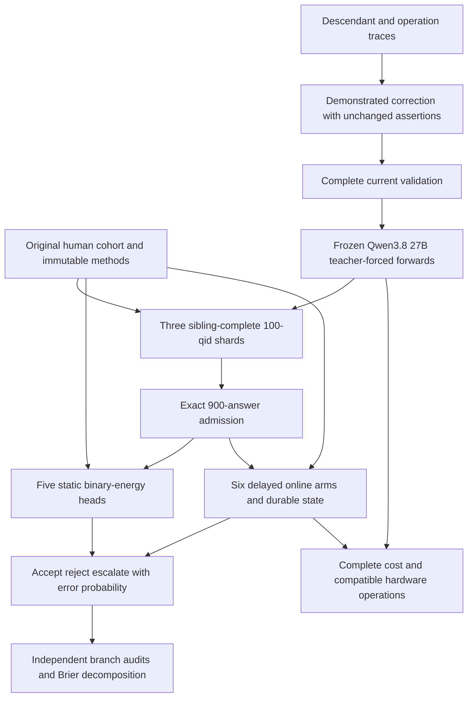
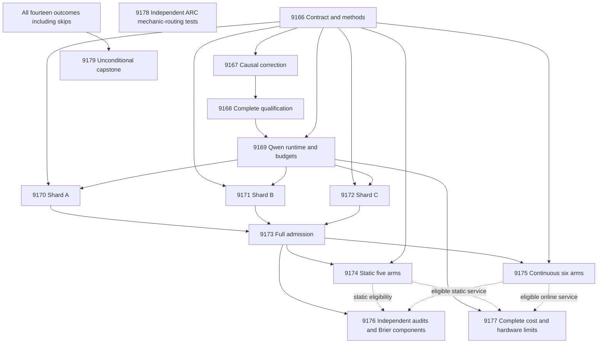

# Carnot Research Roadmap v781: Causal Forward Qualification and Measurable Continuous Energy Learning

**Milestone:** 2026.11.781
**Created:** 2026-11-16 America/New_York
**Status:** Proposed; this planning change executes no experiments.
**Predecessor:** 2026.11.780, scheduling complete.
**Execution contract:** Exactly **14 tasks, Exp9166 through Exp9179**, in the
order below, across **four phases**. The visible table and complete task objects
agree with `research-roadmap-next.yaml`, including prompts and structured gates.

The [V780 design](research-roadmap-v780-preserved-20261116.md) and
[V780 queue](research-roadmap-v780-queue-preserved-20261116.yaml) are preserved.
Their SHA256 values are `a0e721c8b7eaaf50f220d746d9868b588eadea928e683b1625db5b45158a5727`
and `7c8cff073b0e5e8508efe525977413fc6ff932c7d2e3d057fd55ccbe7c768194`.
The completion archive ends at V779. V780's primaries and conductor log establish
closure. Its three executed tasks do not imply fourteen scientific successes.
The active queue and conductor stay unchanged.

## What V780 proved

| Experiment | Observed evidence | Conclusion and limit |
|---|---|---|
| Exp9152 | Contract, source, static-method and online-method readiness equal 1 | The original 900 answers, 300 qids, methods and three execution rosters authenticate. No new model result follows. |
| Exp9153 | Measured-cost accounting; 32 completed and 642 censored obligations of 674; schedule readiness 0 | The sum-of-ceilings defect was corrected. Complete execution and the slow-child cause remain unqualified. |
| Exp9154 | `blocked_gate_check_failed` after schedule readiness 0 | Complete qualification did not execute. |
| Exp9155–9164 | Downstream cascade skips | No logit corpus, static result, learning stream, scientific audit or complete service timing was measured. These hypotheses remain unmeasured. |
| Exp9165 | Reconciliation readiness 1; `complete_blocked_declared_gate` | All fourteen outcomes were accounted for. Scientific and publication readiness did not advance. |

Evidence: `results/experiment_9152_v780_contract.json`,
`results/experiment_9153_v780_validation_schedule.json`,
`results/experiment_9154_forward_qualification.json`,
`results/experiment_9165_v780_capstone.json`, and `ops/conductor-log.md`.
The scheduler's Exp9154 artifact is distinct from the intended scientific primary.

The planning inspection found a concrete diagnostic limitation in
`validation_schedule_9153.measure`: a single test runs for at most 20 seconds,
without descendant instrumentation. The function then unconditionally records
`slow_child_causal_trace` as unknown and failed. Its retained stderr contains an
incomplete stack. This does **not** identify the underlying expensive operation.
It explains why repeating that probe cannot establish the required cause.

V781 changes the diagnostic technique before retrying qualification. It captures
actual process and operation traces. A measured correction must preserve the
original tests. Only then can full qualification and the scientific chain run.
No optimistic forecast, longer timeout or removed false gate grants readiness.

## The three biggest gaps to the PRD

1. **FR-12: useful verification where no cheap executable oracle exists.**
   Human labels and fixed methods exist, but their energy comparison has not run.
   Test raw energy against normalized probability and matched donor controls.
2. **FR-06/FR-11: beneficial continuous self-learning.** Update mechanics exist.
   Future predictions must improve beyond five controls while retained quality
   and exact durable recovery remain intact. Successful writes are insufficient.
3. **FR-05/FR-08/NFR-01: reliable and affordable complete execution.** A qualified
   small head is insufficient if feature extraction or validation cannot finish.
   Demonstrate the execution correction and measure complete service costs.

The north star is the oracle-distinct verifier, per the November 7 directive.
The LPHB panel is exposed development. Even a positive result cannot close
`GAP-ORACLE-DISTINCT` or `GAP-DETECTOR-AUROC-4208`. It can justify later untouched
human confirmation. ARC receives one bounded method task and no solve target.

## Research incorporated before design

The V781 scan was added to [research references](../../research-references.md)
before this design. It checks all eight requested primary topics and six
secondary channels. Publication dates come from primary sources.

| Source | Use in this milestone | Limit |
|---|---|---|
| [Brier covariance decomposition, March 2026](https://arxiv.org/abs/2603.05544) | Exp9166 freezes moment definitions; Exp9176 tests components on sealed predictions | An exact score identity does not establish a causal mechanism or irreducible uncertainty. |
| [Discrimination, Calibration, and Ranking, November 2026](https://arxiv.org/abs/2611.02215) | Exp9176 separates ranking and probability loss with explicit grouping | Ranking improvement alone does not establish calibration. |
| [Spilled Energy, February 2026](https://arxiv.org/abs/2602.18671) | Exp9169–9176 complete the registered whole-answer comparison and gauge controls | This differs from exact-answer localization; the earlier exact-span null remains closed. |
| [Continual Calibration, April 2026](https://arxiv.org/abs/2604.23987) | Exp9175 retains temperature-only learning and untouched retention | No exchangeability or lifelong-LLM theorem transfers to this delayed small-head study. |
| [Online spline KAN, revised June 2026](https://arxiv.org/abs/2602.02056) | Exp9175 uses existing local updates; Exp9177 includes their full service cost | Published FPGA results do not prove local acceleration. |
| [Sequence-level supervised losses, November 12, 2026](https://arxiv.org/abs/2611.16736) | Retain frozen Qwen and the existing proper-loss head | The paper rejects two studied losses, not every sequence objective. No generator training follows. |

EBR, EBT, ARM–EBM, neural feasibility, ETS/DCCD and Ising sampling remain recorded
leads. They do not remove the current evidence prerequisite. Semantic Scholar's
API returned 46 EBT and 11 ARM–EBM citations, without a next page. These are
retrieved counts. GitHub Trending snapshots were stale; no current ranking is
claimed. Kona and Extropic supplied no local benchmark or access evidence.

## Architecture



Labels and annotator metadata remain evaluator-only except original TRAIN,
CAL and causal feedback roles. The model sees question/answer text and token IDs.
Only the small verifier learns. Static150 fitting cannot contaminate the separate
online100 initialization. Research retention cannot select an operational update.

## Phase 1 — Establish a causal execution correction (Exp9166–9169)

Exp9166 binds the exact fourteen-task contract, original cohort and existing
methods. It freezes the new descriptive moment diagnostic before predictions.
It preserves V780 failure evidence instead of rerunning completed method studies.

Exp9167 captures authentication, historical-checker and replay operations, plus
actual descendant processes. Its diagnostic budget is at most 900 seconds within
the existing total cap. Setup time and the test assertion are distinguished.
A cause must identify measured work or a failing child. A parent wait is insufficient.
A minimal correction is allowed only after that evidence. Controlled before/after
reproductions must retain every refusal. Targeted success grants no model authority.

Exp9168 executes the entire original 621-node scope, 53 V779 additions and every
affected V780/current obligation under the corrected revision. Earlier 32-node
completion is historical observation only. Missing current obligations block.
Same-invocation receipt consumption avoids duplicated final checks while retaining
all assertions, command roles and 100 percent owned statement coverage.

Exp9169 loads frozen Qwen and tests the original six-text serial/chunked forward
pilot. Preserve atol1e-5/rtol1e-4, token alignment and chunk128 boundaries. Project
all three complete 300-answer shards from measured work before collection.

## Phase 2 — Collect the complete fixed cohort (Exp9170–9173)

Exp9170–9172 collect lexical qid indices 0:100, 100:200 and 200:300. Each keeps
all three sibling answers. They share one collector and separate checkpoints.
They depend on runtime readiness, not on each other. A failed shard cannot become
a favorable smaller sample. Exp9173 admits only the exact 900-answer union and
preserves original TRAIN150/CAL50/TEST100 roles, formulas, caps and raw samples.

## Phase 3 — Test energy decisions and continuous learning (Exp9174–9176)

Exp9174 fits the five static arms. Exp9175 independently runs six online arms
with prediction seals before delayed labels and exact hard-exit recovery.
Exp9176 independently checks each branch's eligibility. A complete static result
can be audited when learning is blocked, and the converse also holds. Its launch
gate is complete admission; each branch additionally needs complete predictions.
No scientific win gates an audit. All original primary bounds stay unchanged.

The new diagnostic splits Brier changes into mean bias, variance mismatch and
covariance deficit. It requires no fitted bins or new learned calibrator.
It is descriptive and cannot rescue a failed scientific acceptance condition.

## Phase 4 — Bound cost, harden a generic method and reconcile (Exp9177–9179)

Exp9177 measures qualified complete services with separate static and online
eligibility. It has a runtime gate, which avoids another inventory-only call.
It records hardware-compatible fractions and preserves physical-board blockers.

Exp9178 tests a source-visible ARC primitive-routing collision. A recognized
explicit mechanic should select the same operators under game-name permutation.
It checks all selector branches and preserves absent/unknown-mechanic fallbacks.
Any correction stays in the shared selector and is verified through its actual
callers. This is a CPU development test, not a live level solve. Consumer reachability
must be reported honestly; helper tests alone do not establish live-agent behavior.

Exp9179 always accounts for every outcome, including scheduler skips and missing
scientific primaries. It records independent branch dispositions and exact reopen
conditions. External absence is terminal blocked; it never triggers partial retries.

## Frozen scientific protocols


The following methods preserve the V778 and V779 scientific contract. Their implemented
authorities are Exp9126 and Exp9132. Their immutable receipts take precedence
over mutable checkout files. The new diagnostic section below adds no acceptance
gate and changes no arm, cohort, optimization rule or interval threshold.

### Whole-answer forward statistics

Use original TRAIN150/CAL50/TEST100 question groups, three siblings each.
Primary target is original A1 factuality. A2 sensitivity uses only actual observed
labels; unknown -1 stays missing. The task evaluates archived answers under Qwen,
not newly generated Qwen answers. No answer accuracy claim transfers to Qwen.

Preserve V777's exact protocol. Tokenize question/answer separately with the
embedded tokenizer, no BOS or chat template, and right caps256/768. The prefix is
literal `Question:\n`, retained question text and literal `\nAnswer:\n`.
Freeze detokenization and prefix bytes. Append retained answer token IDs explicitly.
Reset state for every answer. Capture in128-token chunks with the preceding-prefix
logit for the first answer token. Preserve adjacent pairs across chunk boundaries.

For full-vocabulary logits z_i and answer token a_i, compute in stable float64:

- L_i=logsumexp(z_i); NLL_i=L_i-z_i[a_i].
- p_i=softmax(z_i); H_i=-sum_v p_iv*log(p_iv).
- Marginal energy M_i=-L_i.
- Adjacent spill D_i=-z_i[a_i]+L_(i+1), within one answer, i=1..length-1.

The seven features are log1p(answer length), mean NLL, mean H, maximum H,
mean M, mean absolute D and the no-adjacent-pair indicator. Retain selected logits,
L_i, H_i, max probability, token IDs, positions and full-vector hashes per token.
One-token answers lack only spill; TRAIN-only median imputation is fixed. An
entirely missing training feature blocks fitting. Empty answers retain their slots
as escalations. Loss contrasts share predeclared nonempty support; coverage uses
all original TEST rows. No label-based filtering is permitted.

Store full vectors for the first eight answer positions of the global first20
lexical qids/all siblings. Preflight2GiB for bounded raw evidence. Stream statistics
instead of retaining all900 complete token-by-vocabulary arrays in RAM.

### Static energy decisions and susceptibility

The five original arms are prevalence, probability+length logistic (first four
features), raw-energy logistic (length, mean M, mean absolute D, missing-pair
indicator), combined logistic (all seven) and combined with whole-qid TRAIN donor
labels. Donors use a fixed nonidentity cyclic permutation of sorted TRAIN qids;
sibling positions stay fixed. Report the actual changed-label numerator/denominator.

These are binary Gibbs energies E(0)=0, E(1)=-theta·phi and
p(error)=sigmoid(theta·phi). Fit TRAIN-only population mean/std, with constant
scale1. Minimize mean binary logloss plus0.5*0.01 times squared nonintercept
coefficients. L-BFGS-B starts at zero: maxiter2000, gtol1e-7, ftol1e-12.
Require finite parameters/objective and gradient infinity norm<=1e-6.
No regularization or architecture search is scheduled.

CAL alone selects temperature from[0.5,1,2,4], ascending ties. Accept at
p(error)<=0.1; reject at>=0.9; otherwise escalate. Seal TEST predictions before
evaluator access. Report Brier, logloss, coverage, accepted error and exact-half-
coverage error. Rerank half-coverage choices inside each resampled draw.

Use10000 paired TEST-qid bootstrap draws, seed777121, preserving siblings.
`energy_increment_score=1` requires both combined-arm Brier improvement lower
bounds>0 against probability+length and donor, with one-sided tail0.05/2.
Empirical accepted error must not increase versus probability+length.
Undefined accepted risk cannot pass. These are conditional development intervals.

Add c_i=3 or c_i=3*(-1)^i to every vocabulary logit. Normalized probabilities,
NLL and entropy must remain unchanged. M changes by -c_i; D changes by
c_(i+1)-c_i. Report raw-score and frozen-head sensitivity under both gauges.
Do not select the favorable gauge. A gauge-sensitive score can be an empirical
representation signal; it is not evidence of a broken probability chain rule.
The original Exp6980 exact-span null and V776 embedding study remain unchanged.

### Continuous self-learning with a recalibration control

Preserve the original SHA256(`v776-online`+qid) ordering:100 TRAIN groups for
initialization and50 for ten disjoint streams of five. Original CAL50 is the
operational guard; TEST100 is research retention. Preserve the Exp9099 donor map
(seed776099, initialization labels only, original sibling positions).

Fit imputation and scaling only on the100 initialization groups. After standard
scaling, fit initialization min/max to[-1,1], constants0, and clip later inputs.
Use the seven logit features with fixed cubic knots
[-1,-1,-1,-1,-0.5,0,0.5,1,1,1,1]: intercept, seven linear columns and49 basis
columns. Use the existing spline helper. Fit initial heads with the static ridge
objective and convergence contract; temperature starts at1. No random projection
or embedding transformation is used in this separate seven-feature study.

Six arms are frozen spline, adaptive spline, bias-only spline, adaptive linear,
donor-label spline and temperature-only spline. All start from comparable
initial fits. For the original adaptive arms, retain the Exp9099 gradient:
`(sigmoid(theta·phi)-y)*phi + 0.01*(theta-theta_initial)`, with no intercept
anchor. Bias-only zeros other coordinates. Clip L2 norm to1. Use AdaGrad,
learning rate0.05, accumulator initially0 and epsilon1e-8. Apply three sibling
updates in original order, then test promotion once per released qid.

For temperature-only adaptation, keep spline coefficients fixed. Let s be its
initial logit, u=log(T), q=exp(-u), p=sigmoid(q*s). Initially u=0. Use gradient
`(y-p)*q*s + 0.01*u`, clipped to[-1,1], with the same AdaGrad settings.
Clip updated u to[log(0.5),log(4)]. Persist u and its accumulator. This comparator
uses the same feedback and guard access; it is not a multi-group MT-CC replication.

Promote only if complete CAL Brier increase<=0.005 and CAL classification-error
increase<=0 versus that arm's initial state. Otherwise restore parameters and
accumulators while acknowledging consumed feedback. Research retention does not
participate in this decision. Seal all18 sibling/arm predictions for g before
releasing labels for g-1. Drain the final group after all predictions. Reset
every stream to identical initial states. No static150 data may enter this fit.

Atomic snapshots include predictions, parameters, accumulators, temperature,
pending feedback and acknowledgments. Real hard exits at prediction fsync,
feedback receipt and state replacement must reproduce uninterrupted states and
predictions exactly. Preserve private actual-child E2E-020 coverage.

Evaluate future groups2–5:40 distinct qids/120 responses. Use10000 paired stream
bootstrap draws, seed778135, one-sided tail0.05/7. The seven simultaneous bounds
are five adaptive-spline future Brier improvements over each other arm (lower>0),
retained Brier increase (upper<=0.005), and retained classification-error increase
(upper<=0). All seven plus exact recovery are needed for `learning_signal_score=1`.
This adds a comparator and tightens multiplicity correction; it does not replace
the old six-bound embedding protocol. Report per-qid retention changes averaged
over streams. Repeated retention is100 questions, not1000. Ten streams have limited
power and the intervals condition on the initial fit, guard and retention panel.


## Descriptive diagnostics fixed before execution

Reuse Exp9141's authenticated evaluator masks and original agreement counts.
Unknown A2 labels stay missing. Agreement is not an accuracy ceiling. Static
slices distinguish mixed-correctness siblings from homogeneous qids. These
label-defined masks never enter feature extraction, fitting or decisions.

For online predictions, retain `abs(p_adaptive-p_initial)>=0.05` and crossings
of the fixed0.5 classification threshold. Membership uses predictions only.
Compare every arm on identical changed and unchanged units. Report Brier,
`mean(p-y)`, exact counts and unavailable empty slices. Use paired whole-stream
resampling for future and retention contrasts, conditional on the fixed panels.

The new TOOD-inspired diagnostic compares ranking, scale and calibration at
each released-group update. Use the same TEST100 qids and all siblings for every
arm. Record raw logits, RMS logit magnitude, tie-aware AUROC, Brier and class
counts before and after each update. Rejected updates retain their unchanged
state. One-class AUROC remains unavailable. Report every stream and update.
No threshold, temperature, group or model is selected from these results.
This diagnostic cannot rescue any failed primary bound. It tests whether the
observed behavior is consistent with scale drift or lost ranking information;
it cannot identify a causal mechanism from a correlation alone.


## Additional descriptive diagnostic: exact Brier moments

Use the frozen original supports and equal-qid weighting. Let p be predicted
error probability and y the human error label. Use population moments throughout:

`Brier = (mean(p)-mean(y))^2 + (sd(p)-sd(y))^2 + 2*(sd(p)*sd(y)-cov(p,y))`.

The three terms are squared mean bias, variance mismatch and covariance deficit.
Compute the last term directly from covariance when either variance is zero;
correlation is then unavailable. The identity must match direct Brier within
1e-12 on deterministic controls and measured rows. Report raw signed residuals.
Do not clamp roundoff before checking the identity. Empty supports remain unavailable.

Use all five static arms and all six online arms. Report static TEST, future
stream support and each retained panel separately. The original qid and stream
resampling units apply to diagnostic deltas. Neither labels nor these diagnostics
select features, update rules, temperatures or promotion thresholds. No new
significance test replaces the original two static and seven learning bounds.

## Complete costs and hardware requirements

Use the first20 TEST qids/all60 siblings, three fresh processes and order seed776108.
Require probability parity atol1e-5/rtol1e-4 and exact typed decisions. Separate
cold model load, warm uncached raw-text service and cached-feature head cost.
Include tokenization, forwards, transfer, statistics, transforms and serialization.
For learning include initialization, proposals, rejection, guard scans, write/fsync,
feedback acknowledgment, final drain and exact recovery. Preserve censored units.

| Resource | Requirement and boundary |
|---|---|
| CPU and RAM | Validation, small-head fitting, bootstrap and durable state. Measure peak memory. Stream full-vocabulary statistics. |
| Private disk | At least2GiB for designated raw vectors, plus measured checkpoint, trace and validation space. Check actual free space before work. |
| GPU0, RTX3090 24GB | Lease the available GPU and verify actual CUDA offload through llama.cpp. All five model tasks run sequentially. |
| GPU1 | Retain its existing owner. Do not assume pooled48GB VRAM or request dual-GPU work. |
| Mandated model | Frozen `unsloth/Qwen3.8-27B-GGUF`, Q4_K_M via `cached_current_model(gpu_index=0)`. Pin embedded tokenizer and model/build hashes. |
| KV260 | Graduated board evidence remains valid within its Ising operation scope, with k_max<=5. Dense Qwen and spline learning need different qualified kernels. |
| PolarFire | Preserve graduated CPU dispatch evidence; it does not establish an FPGA learning kernel. |
| GateMate | Physical/JTAG attestation remains blocked. The September9 known-issues correction explicitly rejects another identical probe. Exp9177 retains this boundary; no invented graduation or override. |
| NPU, TSU and larger FPGA wishlist | Consider only after access, operation compatibility and a measured complete-service bottleneck. No purchase, local TSU access or power result is claimed. |

FR-11 runs local small-head updates on CPU now. Batched GPU and fixed-point FPGA
kernels remain acceleration candidates. An infinitely fast replacement yields
at most `1/(1-f)` total speedup for measured cost fraction f. The program's100x
target needs more than99% acceleration coverage; PRD10x needs more than90%.
Unknown fractions stay unknown. Sampling throughput does not accelerate dense
forward evaluation or fsync by itself. No joule result follows without power data.

## Execution, routing and evidence rules

Every prompt contains numbered progress and chunked-writing requirements.
Print at phase boundaries and before/after model loads, generation, benchmarks
and subprocesses. Print inside long loops; supervise blocking calls with60-second
heartbeats. Keep each silence gap below600 seconds. Write files over about200
lines in several tool calls, with a progress message between calls.

The cap stays4800 seconds:3300 measurement,1200 final verification,300 publication.
Keep actual elapsed time separate from watchdog limits. Run each required check
once per qualifying invocation. Whole-scope readiness requires every obligation.

Exp9169–9172 and Exp9177 declare `model_load_no_generation`: teacher-forced
forwards only, no sampled tokens, with a2-second floor. A bounded token canary
would require `model_bounded_generation` and10 seconds; real generative work
requires `model_full_generation` and60 seconds. Neither generation class is
needed here. No-load refusals use `blocked_no_run`; failed attempted loads remain
attempted loads. No duration padding, simulated inference or small-model headlines.
All other tasks declare `no_model_load` and zero current LLM invocations.

Infrastructure and hardware integration use Opus with100 turns: Exp9166–9169 and
Exp9177. Formulaic admission and ARC routing use Codex/gpt-6.1-sol with30 turns.
Routine experiments retain the requested default synthesis backend and50 turns.
No Gemini or Luna task is scheduled. This follows the user's current routing
directive, which supersedes older model defaults in CLAUDE.md.

All tasks declare the closed `verdict_class` enum. Complete nulls are terminal.
Unchanged absent/retired/blocked external inputs are blocked, never partial.
Every comparison emits per-unit rows. Every blocked record includes the exact
failed operand in `gate_check_summary`. Missing files, missing fields and zero
are different states. Readiness does not follow from fixtures or shell exit alone.

Same-scope continuations name the prior verdict, changed prerequisite and
`retire_if_same_verdict: true`. New IDs do not authorize the old failed chain.
The new causal-fix gate is required before retrying full validation. No task
requires a retired upstream ID. Administrative audits can read historical failures.

## Acceptance and stop conditions

A demonstrated targeted correction precedes full qualification. Full current
validation precedes Qwen. Runtime parity and all three budgets precede collection.
Complete900-answer admission precedes training. Complete predictions open their
audits even if every effect is null. Exp9176 evaluates its two branches separately.
The unconditional capstone records all outcomes; it does not wait for positive science.

If diagnosis finds no cause, emit blocked evidence and stop dependent work.
Do not repeat the original20-second probe under a new name. If a corrected full
run exceeds budget, preserve exact remaining obligations and measured cause.
If corpus collection is infeasible, preserve roles and caps for later execution
redesign. A complete null retires the unchanged scientific method.

The Brier components, human disagreement and logit-scale diagnostics are descriptive.
They cannot alter primary bounds. Preserve `independent_generalization_score=0`
and `current_science_paper_ready=false`. Historical FoVer G1–G4 have separate scope.
External publication stays operator-only. ARC routing tests carry development-proxy
scope and zero solve credit; no already-solved level is repeated.

## Dependency graph



Solid experiment edges are structured launch gates. Dotted edges are independent
internal eligibility checks. The all-outcomes edge denotes accounting, not gating.
Exp9178 is independent of human verification and uses no model.

## Task contract

| Order | Task ID | Phase | Deliverable | Readiness dependencies |
|---|---|---|---|---|
| 1 | `exp9166-contract` | 1 | `results/experiment_9166_v781_contract.json` | Unconditional |
| 2 | `exp9167-causal-validation` | 1 | `results/experiment_9167_v781_causal_validation.json` | exp9166-contract.contract_ready_score == 1 |
| 3 | `exp9168-forward-qualification` | 1 | `results/experiment_9168_v781_forward_qualification.json` | exp9167-causal-validation.causal_fix_ready_score == 1 |
| 4 | `exp9169-logit-runtime` | 1 | `results/experiment_9169_v781_logit_runtime.json` | exp9168-forward-qualification.forward_validation_ready_score == 1; exp9166-contract.static_methods_ready_score == 1 |
| 5 | `exp9170-logits-a` | 2 | `results/experiment_9170_v781_logits_a.json` | exp9166-contract.source_ready_score == 1; exp9169-logit-runtime.logit_runtime_ready_score == 1; exp9169-logit-runtime.shard_feasible_score == 1 |
| 6 | `exp9171-logits-b` | 2 | `results/experiment_9171_v781_logits_b.json` | exp9166-contract.source_ready_score == 1; exp9169-logit-runtime.logit_runtime_ready_score == 1; exp9169-logit-runtime.shard_feasible_score == 1 |
| 7 | `exp9172-logits-c` | 2 | `results/experiment_9172_v781_logits_c.json` | exp9166-contract.source_ready_score == 1; exp9169-logit-runtime.logit_runtime_ready_score == 1; exp9169-logit-runtime.shard_feasible_score == 1 |
| 8 | `exp9173-logit-admission` | 2 | `results/experiment_9173_v781_logit_admission.json` | exp9170-logits-a.logits_a_ready_score == 1; exp9171-logits-b.logits_b_ready_score == 1; exp9172-logits-c.logits_c_ready_score == 1 |
| 9 | `exp9174-static-energy` | 3 | `results/experiment_9174_v781_static_energy.json` | exp9173-logit-admission.admission_ready_score == 1; exp9166-contract.static_methods_ready_score == 1 |
| 10 | `exp9175-delayed-learning` | 3 | `results/experiment_9175_v781_delayed_learning.json` | exp9173-logit-admission.admission_ready_score == 1; exp9166-contract.online_methods_ready_score == 1 |
| 11 | `exp9176-decision-audit` | 3 | `results/experiment_9176_v781_decision_audit.json` | exp9173-logit-admission.admission_ready_score == 1 |
| 12 | `exp9177-complete-cost` | 4 | `results/experiment_9177_v781_complete_cost.json` | exp9169-logit-runtime.logit_runtime_ready_score == 1 |
| 13 | `exp9178-arc-mechanic-routing` | 4 | `results/experiment_9178_v781_arc_mechanic_routing.json` | Unconditional |
| 14 | `exp9179-capstone` | 4 | `results/experiment_9179_v781_capstone.json` | Unconditional |

## Full machine-readable contract

This array contains the complete task objects, including every prompt.

```json
[
{"id": "exp9166-contract", "title": "Exp9166: Bind fourteen tasks and freeze diagnostic supports", "phase": 1, "track": "infrastructure", "priority": "high", "requires_gpu": false, "max_turns": 100, "estimated_wall_time_min": 45, "per_unit_rows": true, "milestone": "2026.11.781", "deliverable": "results/experiment_9166_v781_contract.json", "inference_substrate_class": "no_model_load", "MODEL_SPECS": [], "model": "opus", "prior_failures": [{"experiment_id": "exp7329-contract", "verdict": "complete_disqualified_v644_contract_mismatched_or_invalid", "addressed_by": "Generate both full contracts from one list; compare every object before activation.", "retire_if_same_verdict": true}, {"experiment_id": "exp7421-contract-ingestion", "verdict": "complete_disqualified_stale_markdown_contract_with_method_ingestion", "addressed_by": "Preserve V780 bytes and write a fresh V781 design, including the new diagnostic and exact fourteen tasks.", "retire_if_same_verdict": true}], "prompt": "CONTEXT:\nWork in {project_root} on {date}. V780 preserved qualified human methods but collected no logits. Its archive entry lags; primaries and conductor log establish closure. Preserve all historical failures and exposed-development scope.\nEXISTING CODE TO READ FIRST:\nCLAUDE.md; CODEX.md; ops/north-star.md; ops/e2e-test-plan.md; ops/exclusion_manifest.yaml; research-references.md (V781 scan); openspec/change-proposals/research-roadmap-vNEXT.md; openspec/capabilities/research-reporting/spec.md; scripts/experiment_template.py; python/carnot/reporting/primary_publication.py; python/carnot/reporting/current_work_receipt.py; python/carnot/reporting/v780_contract.py; python/carnot/reporting/v780_capstone.py; python/carnot/reporting/logit_methods_9126.py; python/carnot/reporting/online_methods_9132.py; results/experiment_9152_v780_contract.json; results/experiment_9153_v780_validation_schedule.json; results/experiment_9165_v780_capstone.json; openspec/change-proposals/research-roadmap-v780-preserved-20261116.md; openspec/change-proposals/research-roadmap-v780-queue-preserved-20261116.yaml\nTASK:\nBind fourteen tasks and freeze diagnostic supports. Deliver results/experiment_9166_v781_contract.json. Implement scripts/experiments/experiment_9166_v781_contract.py using existing library seams. MODEL_SPECS: []. Requested inference_substrate_class: no_model_load.\nDo not load an LLM. Set current_llm_invocations=0 and generated_tokens=0. Small energy-head training is CPU work. Keep historical model provenance in source_references.\nCONCRETE STEPS:\n1. Emit a flushed progress line at each phase boundary. Emit before and after every model load, generation, benchmark and subprocess that can take minutes. Print inside long loops. Supervise blocking calls with flushed heartbeats every 60 seconds. Keep every silence gap below 600 seconds. Write any file over about 200 lines in several tool calls of at most 200 lines. Send a progress message between writing calls. Never use one huge tool call.\n2. PRECONDITIONS: Authenticate exact required paths, hashes and gate fields before dependent work. Check imports, CPU/memory limits and private free disk. Distinguish missing_file, missing_field and observed zero. Missing external inputs produce terminal blocked evidence with gate_check_summary. Never repin historical evidence to mutable checkout code.\n3. Before implementation inspect callers with rg. Confirm REQ-REPORT-9166-V781 and SCENARIO-REPORT-9166-V781. Extend specs first. Write failing controls before code. Freeze units, exclusions, formulas and validation scope before outcomes.\n4. Compare all fourteen ordered task objects, prompts, model metadata, gates and deliverables in the new design and queue. Authenticate the preserved V780 design and queue. Distinguish scheduler artifacts from missing canonical scientific outputs. Do not activate either queue.\n5. Authenticate Exp9152 source and method references under their original producers. Reuse the 900-answer, 300-qid human cohort, TRAIN150/CAL50/TEST100 roles and three lexical100-qid execution rosters. Retain three siblings per qid, private labels and independent_generalization_score=0. Reuse qualified Exp9126 static and Exp9132 online methods; do not repeat their completed method studies.\n6. Freeze all five static arms, six online arms, two static bounds and seven learning bounds from the design. Freeze Brier moment diagnostics before predictions: squared mean bias, variance mismatch and covariance deficit on identical supports. Preserve Exp9141 masks and V780 scale/ranking definitions. The new decomposition cannot rescue a failed primary gate.\n7. Bind the original 621 nodes plus 53 V779 additions and every affected V780/current obligation by identity and assertion hash. Record 32 completed and 642 censored V780 observations without granting current qualification credit. Preserve original quarantines. Administrative contract readiness, source readiness and each method readiness remain separate.\n8. Run owned unit tests and real child-process coverage with 100 percent owned statements and zero exclusions. Preserve original assertions. Run scoped Ruff check/format, strict mypy and scripts/check_spec_coverage.py with explicit test paths. Execute private real CLI success, refusal, tamper and cold replay outside the checkout without PYTHONPATH, following E2E-018/021. Learning/recovery changes also require E2E-020. Separate unrelated repository health from affected failures. Affected failures disqualify readiness.\n9. Stop measurement by 3300 seconds. Reserve 1200 seconds for final verification and 300 seconds for publication within the 4800-second cap. Count each obligation once; distinguish elapsed time from its watchdog ceiling. Save unfinished units and censor reasons. Recompute claims from rows. Run scripts/adversarial_verify.py and scripts/verdict_row_consistency_lint.py --strict with heartbeats. Publish through primary_publication only after actual checker receipts pass. Reconcile openspec/, _bmad/traceability.md, ops/status.md and ops/changelog.md. Preserve historical primaries, quarantines and exclusions. Do not activate a queue or publish externally.\nREQUIRED ARTIFACT FIELDS:\n- honest_verdict: complete_* for terminal outcomes; partial_* only for retryable owned work; principle: A terminal prefix must agree with its verdict class.\n- verdict_class: positive | circular_positive | null | blocked | disqualified | partial; principle: External absence, retirement or gate failure is blocked. Only unfinished owned work is partial.\n- gate_check_summary: check, upstream, path, sha256, artifact_field, op, expected, observed, passed; principle: Every blocked result names its failed operand; missing evidence differs from an observed zero.\n- preconditions_checked: resource, available and actual check receipt; principle: Unavailable resources cannot produce invented measurements.\n- rows: unit_id, qid/group, sibling, arm/condition, seed, absolute metrics, numerator, denominator, status, exclusion_reason, censor_reason; principle: All comparative headlines must be reproducible from their independent units.\n- sample_size_budget: intended, attempted, completed, failed, censored, effective_independent_groups; principle: Siblings and repeated retention do not multiply independent sample size.\n- verifier_is_oracle: boolean; principle: Reusing executable truth as the verifier requires circular_positive, not an independent verifier win.\n- claim_scope: exposure_scope, independent_generalization_score=0 and allowed claims; principle: Exposed development and fixtures cannot close the independent-verifier gaps.\n- MODEL_SPECS: actual requested list and invocation status; principle: An upstream model reference is not current model work.\n- inference_substrate_class: actual class and requested_inference_substrate_class; principle: Use blocked_no_run for refusal before loading; attempted loads remain attempted loads.\n- inference_substrate: operation-accurate work description; principle: Forward work, generation and cached CPU reduction have different evidence requirements.\n- model_invocation_counts: current_llm_invocations, loads attempted/completed/failed, forward calls, generated_tokens; principle: Counters must agree with actual operation-specific receipts.\n- duration_s: measured wall time; principle: No artificial sleeping or duration padding may satisfy a substrate floor.\n- random_seed: fixed before outcomes; principle: A frozen seed permits replay without favorable seed selection.\n- reproducibility_checksum: inputs and configuration digest; principle: Changed inputs cannot pass as the original experiment.\n- source_references: original producer paths, SHA256 and imported fields; principle: Historical evidence retains its original authority.\n- code_config_hashes: owned implementation, tests and configuration; principle: Validation qualifies the executed revision.\n- current_work_receipts: operation-specific records; principle: Historical receipts cannot certify current inference.\n- validation_receipts: commands, logs, exit codes and coverage references; principle: Self-reported passing checks do not establish readiness.\n- required_checks_passed: boolean; principle: Readiness requires every affected check.\n- acceptance_gates: fixed conditions, each with a principle annotation; principle: Outcome-dependent thresholds cannot manufacture success.\n- contract_ready_score: integer 0/1; principle: All fourteen complete objects must agree.\n- source_ready_score: integer 0/1; principle: Original labels, roles and complete rosters must authenticate.\n- static_methods_ready_score: integer 0/1; principle: Reuse requires original static method authority.\n- online_methods_ready_score: integer 0/1; principle: Reuse preserves all causal update and recovery semantics.\n- protocol_references: source, evaluator labels, static, online, diagnostic and three shard rosters; principle: Consumers share immutable inputs with exact names.\n- full_task_objects: canonical_task_hash and previous_outcome_rows; principle: Scheduling completion is not scientific success.\nRun command: cd {project_root} && JAX_PLATFORMS=cpu .venv/bin/python -u scripts/experiments/experiment_9166_v781_contract.py --date {date}\nDo NOT push. Do NOT modify scripts/research_conductor.py."},
{"id": "exp9167-causal-validation", "title": "Exp9167: Trace the actual validation work and qualify a causal correction", "phase": 1, "track": "infrastructure", "priority": "high", "requires_gpu": false, "max_turns": 100, "estimated_wall_time_min": 75, "per_unit_rows": true, "milestone": "2026.11.781", "deliverable": "results/experiment_9167_v781_causal_validation.json", "inference_substrate_class": "no_model_load", "MODEL_SPECS": [], "model": "opus", "gated_on": [{"upstream": "exp9166-contract", "artifact_field": "contract_ready_score", "op": "==", "value": 1}], "prior_failures": [{"experiment_id": "exp9153-measured-validation", "verdict": "complete_blocked_validation_prerequisite", "addressed_by": "Replace the 20-second parent-only, always-unknown probe with per-phase and descendant tracing. Permit correction only after a demonstrated cause and controlled reproduction.", "retire_if_same_verdict": true}, {"experiment_id": "exp9125-receipt-qualification", "verdict": "complete_disqualified_bounded_receipt_qualification", "addressed_by": "Replace the demonstrated 2100-minus-1800 scheduling defect and duplicated unpartitioned reruns with a complete cost-budgeted execution graph. Preserve every assertion and original quarantine; qualify the new revision separately.", "retire_if_same_verdict": true}, {"experiment_id": "exp9111-forward-evidence", "verdict": "complete_disqualified_owned_checks", "addressed_by": "Preserve all semantic controls and repair validation scheduling, with real post-exit coverage instead of accepting incomplete suites.", "retire_if_same_verdict": true}, {"experiment_id": "exp9140-forward-qualification", "verdict": "complete_blocked_infeasible_forward_schedule", "addressed_by": "Preserve the already-corrected ceiling accounting. Run complete qualification only after Exp9167 emits causal_fix_ready_score=1 from demonstrated cause, corrective execution and unchanged controls.", "retire_if_same_verdict": true}], "prompt": "CONTEXT:\nWork in {project_root} on {date}. Exp9153 fixed ceiling accounting but still emitted complete_blocked_validation_prerequisite. Its 20-second single-test probe lacks descendant instrumentation and unconditionally reports unknown. The underlying slow operation remains unidentified. This task changes the diagnostic method; it does not assume a faster schedule.\nEXISTING CODE TO READ FIRST:\nCLAUDE.md; CODEX.md; ops/north-star.md; ops/e2e-test-plan.md; ops/exclusion_manifest.yaml; research-references.md (V781 scan); openspec/change-proposals/research-roadmap-vNEXT.md; openspec/capabilities/research-reporting/spec.md; scripts/experiment_template.py; python/carnot/reporting/primary_publication.py; python/carnot/reporting/current_work_receipt.py; python/carnot/reporting/validation_schedule_9153.py; python/carnot/reporting/validation_schedule_9139.py; python/carnot/reporting/validation_schedule_runner_9139.py; python/carnot/reporting/forward_evidence_runner_9111.py; tests/python/test_forward_evidence_runner_9111.py; tests/python/test_validation_schedule_9153.py; results/experiment_9153_v780_validation_schedule.json\nTASK:\nTrace the actual validation work and qualify a causal correction. Deliver results/experiment_9167_v781_causal_validation.json. Implement scripts/experiments/experiment_9167_v781_causal_validation.py using existing library seams. MODEL_SPECS: []. Requested inference_substrate_class: no_model_load.\nDo not load an LLM. Set current_llm_invocations=0 and generated_tokens=0. Small energy-head training is CPU work. Keep historical model provenance in source_references.\nCONCRETE STEPS:\n1. Emit a flushed progress line at each phase boundary. Emit before and after every model load, generation, benchmark and subprocess that can take minutes. Print inside long loops. Supervise blocking calls with flushed heartbeats every 60 seconds. Keep every silence gap below 600 seconds. Write any file over about 200 lines in several tool calls of at most 200 lines. Send a progress message between writing calls. Never use one huge tool call.\n2. PRECONDITIONS: Authenticate exact required paths, hashes and gate fields before dependent work. Check imports, CPU/memory limits and private free disk. Distinguish missing_file, missing_field and observed zero. Missing external inputs produce terminal blocked evidence with gate_check_summary. Never repin historical evidence to mutable checkout code.\n3. Before implementation inspect callers with rg. Confirm REQ-REPORT-9167-V781 and SCENARIO-REPORT-9167-V781. Extend specs first. Write failing controls before code. Freeze units, exclusions, formulas and validation scope before outcomes.\n4. Preserve Exp9153 primary and original trace. Inspect every caller of measure, historical_report and replay. Record the demonstrated diagnostic defect separately from hypotheses about repeated hashing, historical checker execution, filesystem work or a nested child. Do not label any hypothesis as a cause without a trace.\n5. Use a new private invocation in the existing diagnostic seam. Capture phase timestamps, PID/PPID/argv, child exit status, wait stacks and per-operation counters for authentication, historical reproduction and replay. Instrument descendants before their imports. Prefer existing Python hooks and /proc; external tracing tools are optional. Record trace overhead. Bound diagnosis to 900 seconds within the unchanged total budget, with 60-second heartbeats and per-operation progress.\n6. Reproduce the retained test_rehashed_primitive_tampering[derivation] path with its module fixture. Distinguish setup from the assertion itself. Trace enough to identify the executed expensive function or failing child; a parent wait stack alone is insufficient. Record missing permissions or evidence as an exact terminal block. Do not repeat the whole 674-node suite during diagnosis.\n7. Only after a cause is demonstrated, make the smallest correction in the existing runner seam. Preserve original assertions, historical verifier code, validation union and public check semantics. If repeated immutable work is proven, any reuse is same-invocation and binds content hashes, validator version and configuration; changed bytes must invalidate it. Do not use cached pass/fail verdicts as current execution. No unobserved optimization or deadline increase.\n8. Run one bounded original-path reproduction and one corrected reproduction under the same inputs and instrumentation. Require the corrected targeted module to finish, preserve all tamper refusals and execute the actual formerly expensive operation. A faster parent wait or subset result is not sufficient. Emit causal_fix_ready_score=1 only for demonstrated cause, implemented correction and passing controls. If no cause or correction is proven, stop; do not fabricate readiness from removal of the hardcoded false gate.\n9. Publish the exact revised source and obligation manifest for Exp9168. Preserve measured elapsed cost, unknown remaining cost and watchdog ceilings separately. This targeted qualification grants no model-work authority and no whole-suite completion claim.\n10. Run owned unit tests and real child-process coverage with 100 percent owned statements and zero exclusions. Preserve original assertions. Run scoped Ruff check/format, strict mypy and scripts/check_spec_coverage.py with explicit test paths. Execute private real CLI success, refusal, tamper and cold replay outside the checkout without PYTHONPATH, following E2E-018/021. Learning/recovery changes also require E2E-020. Separate unrelated repository health from affected failures. Affected failures disqualify readiness.\n11. Stop measurement by 3300 seconds. Reserve 1200 seconds for final verification and 300 seconds for publication within the 4800-second cap. Count each obligation once; distinguish elapsed time from its watchdog ceiling. Save unfinished units and censor reasons. Recompute claims from rows. Run scripts/adversarial_verify.py and scripts/verdict_row_consistency_lint.py --strict with heartbeats. Publish through primary_publication only after actual checker receipts pass. Reconcile openspec/, _bmad/traceability.md, ops/status.md and ops/changelog.md. Preserve historical primaries, quarantines and exclusions. Do not activate a queue or publish externally.\nREQUIRED ARTIFACT FIELDS:\n- honest_verdict: complete_* for terminal outcomes; partial_* only for retryable owned work; principle: A terminal prefix must agree with its verdict class.\n- verdict_class: positive | circular_positive | null | blocked | disqualified | partial; principle: External absence, retirement or gate failure is blocked. Only unfinished owned work is partial.\n- gate_check_summary: check, upstream, path, sha256, artifact_field, op, expected, observed, passed; principle: Every blocked result names its failed operand; missing evidence differs from an observed zero.\n- preconditions_checked: resource, available and actual check receipt; principle: Unavailable resources cannot produce invented measurements.\n- rows: unit_id, qid/group, sibling, arm/condition, seed, absolute metrics, numerator, denominator, status, exclusion_reason, censor_reason; principle: All comparative headlines must be reproducible from their independent units.\n- sample_size_budget: intended, attempted, completed, failed, censored, effective_independent_groups; principle: Siblings and repeated retention do not multiply independent sample size.\n- verifier_is_oracle: boolean; principle: Reusing executable truth as the verifier requires circular_positive, not an independent verifier win.\n- claim_scope: exposure_scope, independent_generalization_score=0 and allowed claims; principle: Exposed development and fixtures cannot close the independent-verifier gaps.\n- MODEL_SPECS: actual requested list and invocation status; principle: An upstream model reference is not current model work.\n- inference_substrate_class: actual class and requested_inference_substrate_class; principle: Use blocked_no_run for refusal before loading; attempted loads remain attempted loads.\n- inference_substrate: operation-accurate work description; principle: Forward work, generation and cached CPU reduction have different evidence requirements.\n- model_invocation_counts: current_llm_invocations, loads attempted/completed/failed, forward calls, generated_tokens; principle: Counters must agree with actual operation-specific receipts.\n- duration_s: measured wall time; principle: No artificial sleeping or duration padding may satisfy a substrate floor.\n- random_seed: fixed before outcomes; principle: A frozen seed permits replay without favorable seed selection.\n- reproducibility_checksum: inputs and configuration digest; principle: Changed inputs cannot pass as the original experiment.\n- source_references: original producer paths, SHA256 and imported fields; principle: Historical evidence retains its original authority.\n- code_config_hashes: owned implementation, tests and configuration; principle: Validation qualifies the executed revision.\n- current_work_receipts: operation-specific records; principle: Historical receipts cannot certify current inference.\n- validation_receipts: commands, logs, exit codes and coverage references; principle: Self-reported passing checks do not establish readiness.\n- required_checks_passed: boolean; principle: Readiness requires every affected check.\n- acceptance_gates: fixed conditions, each with a principle annotation; principle: Outcome-dependent thresholds cannot manufacture success.\n- causal_fix_ready_score: integer 0/1; principle: Demonstrated cause, corrective execution and unchanged negative controls must all pass.\n- causal_evidence: operation, trace references, competing hypotheses, before/after rows and instrumentation overhead; principle: A stack location alone does not establish a cause.\n- revision_reference: owned code/config hashes and exact obligation union; principle: Full qualification must run the corrected revision.\n- remaining_obligations: original and added node IDs with reasons; principle: Targeted completion cannot replace full validation.\nRun command: cd {project_root} && JAX_PLATFORMS=cpu .venv/bin/python -u scripts/experiments/experiment_9167_v781_causal_validation.py --date {date}\nDo NOT push. Do NOT modify scripts/research_conductor.py."},
{"id": "exp9168-forward-qualification", "title": "Exp9168: Execute the complete causally corrected validation revision", "phase": 1, "track": "infrastructure", "priority": "high", "requires_gpu": false, "max_turns": 100, "estimated_wall_time_min": 75, "per_unit_rows": true, "milestone": "2026.11.781", "deliverable": "results/experiment_9168_v781_forward_qualification.json", "inference_substrate_class": "no_model_load", "MODEL_SPECS": [], "model": "opus", "gated_on": [{"upstream": "exp9167-causal-validation", "artifact_field": "causal_fix_ready_score", "op": "==", "value": 1}], "prior_failures": [{"experiment_id": "exp9154-forward-qualification", "verdict": "blocked_gate_check_failed", "addressed_by": "Run only after a new demonstrated correction passes Exp9167. Preserve the full union and actual process execution, not a revised forecast.", "retire_if_same_verdict": true}, {"experiment_id": "exp9125-receipt-qualification", "verdict": "complete_disqualified_bounded_receipt_qualification", "addressed_by": "Replace the demonstrated 2100-minus-1800 scheduling defect and duplicated unpartitioned reruns with a complete cost-budgeted execution graph. Preserve every assertion and original quarantine; qualify the new revision separately.", "retire_if_same_verdict": true}, {"experiment_id": "exp9140-forward-qualification", "verdict": "complete_blocked_infeasible_forward_schedule", "addressed_by": "Preserve the already-corrected ceiling accounting. Run complete qualification only after Exp9167 emits causal_fix_ready_score=1 from demonstrated cause, corrective execution and unchanged controls.", "retire_if_same_verdict": true}], "prompt": "CONTEXT:\nWork in {project_root} on {date}. V780 full qualification was skipped after cause readiness stayed zero. A new causal correction is a prerequisite, not an assumption. Preserve every original obligation and all scientific thresholds.\nEXISTING CODE TO READ FIRST:\nCLAUDE.md; CODEX.md; ops/north-star.md; ops/e2e-test-plan.md; ops/exclusion_manifest.yaml; research-references.md (V781 scan); openspec/change-proposals/research-roadmap-vNEXT.md; openspec/capabilities/research-reporting/spec.md; scripts/experiment_template.py; python/carnot/reporting/primary_publication.py; python/carnot/reporting/current_work_receipt.py; python/carnot/reporting/forward_qualification_9140.py; python/carnot/reporting/validation_schedule_9153.py; python/carnot/reporting/receipt_qualification_9125.py; tests/python/test_forward_qualification_9140.py; results/experiment_9167_v781_causal_validation.json\nTASK:\nExecute the complete causally corrected validation revision. Deliver results/experiment_9168_v781_forward_qualification.json. Implement scripts/experiments/experiment_9168_v781_forward_qualification.py using existing library seams. MODEL_SPECS: []. Requested inference_substrate_class: no_model_load.\nDo not load an LLM. Set current_llm_invocations=0 and generated_tokens=0. Small energy-head training is CPU work. Keep historical model provenance in source_references.\nCONCRETE STEPS:\n1. Emit a flushed progress line at each phase boundary. Emit before and after every model load, generation, benchmark and subprocess that can take minutes. Print inside long loops. Supervise blocking calls with flushed heartbeats every 60 seconds. Keep every silence gap below 600 seconds. Write any file over about 200 lines in several tool calls of at most 200 lines. Send a progress message between writing calls. Never use one huge tool call.\n2. PRECONDITIONS: Authenticate exact required paths, hashes and gate fields before dependent work. Check imports, CPU/memory limits and private free disk. Distinguish missing_file, missing_field and observed zero. Missing external inputs produce terminal blocked evidence with gate_check_summary. Never repin historical evidence to mutable checkout code.\n3. Before implementation inspect callers with rg. Confirm REQ-REPORT-9168-V781 and SCENARIO-REPORT-9168-V781. Extend specs first. Write failing controls before code. Freeze units, exclusions, formulas and validation scope before outcomes.\n4. Authenticate Exp9167 causal_fix_ready_score and exact source revision. Freeze the union of all 621 original nodes, 53 V779 additions, affected V780 tests and new obligations. Preserve assertion bodies and full command roles. Historical completions do not count as current completions.\n5. Execute the complete normal orchestration once with measured-cost accounting and the causal correction. Retain whole-module fixture lifetimes. Record setup/call/teardown, actual process costs, child exits and coverage after exit. Stop measurement at 3300 seconds. Unknown forecasts cannot establish completion.\n6. Count each obligation once in this invocation; consume authenticated same-invocation results in final verification instead of launching the suite twice. Include semantic/count controls, real CLI refusal/tamper/cold replay, lint, strict types and spec checks. Combine only current actual child coverage. Require 100 percent owned statements with zero exclusions.\n7. Emit forward_validation_ready_score=1 only for the full node/command union, exact revision, coverage and unchanged checkers. Missing nodes, unresolved stalls or exhausted budget leave readiness zero. Save exact remaining work and causes. Do not lower watchdogs, force feasible=true, drop assertions or repin quarantined history.\n8. Run owned unit tests and real child-process coverage with 100 percent owned statements and zero exclusions. Preserve original assertions. Run scoped Ruff check/format, strict mypy and scripts/check_spec_coverage.py with explicit test paths. Execute private real CLI success, refusal, tamper and cold replay outside the checkout without PYTHONPATH, following E2E-018/021. Learning/recovery changes also require E2E-020. Separate unrelated repository health from affected failures. Affected failures disqualify readiness.\n9. Stop measurement by 3300 seconds. Reserve 1200 seconds for final verification and 300 seconds for publication within the 4800-second cap. Count each obligation once; distinguish elapsed time from its watchdog ceiling. Save unfinished units and censor reasons. Recompute claims from rows. Run scripts/adversarial_verify.py and scripts/verdict_row_consistency_lint.py --strict with heartbeats. Publish through primary_publication only after actual checker receipts pass. Reconcile openspec/, _bmad/traceability.md, ops/status.md and ops/changelog.md. Preserve historical primaries, quarantines and exclusions. Do not activate a queue or publish externally.\nREQUIRED ARTIFACT FIELDS:\n- honest_verdict: complete_* for terminal outcomes; partial_* only for retryable owned work; principle: A terminal prefix must agree with its verdict class.\n- verdict_class: positive | circular_positive | null | blocked | disqualified | partial; principle: External absence, retirement or gate failure is blocked. Only unfinished owned work is partial.\n- gate_check_summary: check, upstream, path, sha256, artifact_field, op, expected, observed, passed; principle: Every blocked result names its failed operand; missing evidence differs from an observed zero.\n- preconditions_checked: resource, available and actual check receipt; principle: Unavailable resources cannot produce invented measurements.\n- rows: unit_id, qid/group, sibling, arm/condition, seed, absolute metrics, numerator, denominator, status, exclusion_reason, censor_reason; principle: All comparative headlines must be reproducible from their independent units.\n- sample_size_budget: intended, attempted, completed, failed, censored, effective_independent_groups; principle: Siblings and repeated retention do not multiply independent sample size.\n- verifier_is_oracle: boolean; principle: Reusing executable truth as the verifier requires circular_positive, not an independent verifier win.\n- claim_scope: exposure_scope, independent_generalization_score=0 and allowed claims; principle: Exposed development and fixtures cannot close the independent-verifier gaps.\n- MODEL_SPECS: actual requested list and invocation status; principle: An upstream model reference is not current model work.\n- inference_substrate_class: actual class and requested_inference_substrate_class; principle: Use blocked_no_run for refusal before loading; attempted loads remain attempted loads.\n- inference_substrate: operation-accurate work description; principle: Forward work, generation and cached CPU reduction have different evidence requirements.\n- model_invocation_counts: current_llm_invocations, loads attempted/completed/failed, forward calls, generated_tokens; principle: Counters must agree with actual operation-specific receipts.\n- duration_s: measured wall time; principle: No artificial sleeping or duration padding may satisfy a substrate floor.\n- random_seed: fixed before outcomes; principle: A frozen seed permits replay without favorable seed selection.\n- reproducibility_checksum: inputs and configuration digest; principle: Changed inputs cannot pass as the original experiment.\n- source_references: original producer paths, SHA256 and imported fields; principle: Historical evidence retains its original authority.\n- code_config_hashes: owned implementation, tests and configuration; principle: Validation qualifies the executed revision.\n- current_work_receipts: operation-specific records; principle: Historical receipts cannot certify current inference.\n- validation_receipts: commands, logs, exit codes and coverage references; principle: Self-reported passing checks do not establish readiness.\n- required_checks_passed: boolean; principle: Readiness requires every affected check.\n- acceptance_gates: fixed conditions, each with a principle annotation; principle: Outcome-dependent thresholds cannot manufacture success.\n- forward_validation_ready_score: integer 0/1; principle: Only complete normal-path execution authorizes current model evidence.\n- node_completion_rows: original/additional node IDs, phase exits and actual durations; principle: No duplicated or absent node can satisfy the full union.\n- qualified_revision_reference: exact code and configuration plus full validation receipts; principle: Downstream work uses only the revision actually tested.\nRun command: cd {project_root} && JAX_PLATFORMS=cpu .venv/bin/python -u scripts/experiments/experiment_9168_v781_forward_qualification.py --date {date}\nDo NOT push. Do NOT modify scripts/research_conductor.py."},
{"id": "exp9169-logit-runtime", "title": "Exp9169: Qualify frozen Qwen forwards and all three shard budgets", "phase": 1, "track": "research", "priority": "high", "requires_gpu": true, "max_turns": 100, "estimated_wall_time_min": 65, "per_unit_rows": true, "milestone": "2026.11.781", "deliverable": "results/experiment_9169_v781_logit_runtime.json", "inference_substrate_class": "model_load_no_generation", "MODEL_SPECS": [{"hf_id": "unsloth/Qwen3.8-27B-GGUF", "quantization": "Q4_K_M"}], "model": "opus", "gated_on": [{"upstream": "exp9168-forward-qualification", "artifact_field": "forward_validation_ready_score", "op": "==", "value": 1}, {"upstream": "exp9166-contract", "artifact_field": "static_methods_ready_score", "op": "==", "value": 1}], "prior_failures": [{"experiment_id": "exp9155-logit-runtime", "verdict": "GATE_BLOCK: upstream retired; no canonical honest_verdict artifact", "addressed_by": "A demonstrated causal correction and complete current qualification replace the unknown-cause predecessor. Keep supported serial forwards and original tolerances.", "retire_if_same_verdict": true}], "prompt": "CONTEXT:\nWork in {project_root} on {date}. V780 performed no Qwen runtime qualification. Supported serial logits remain the intended path. Only a completely qualified causal revision can authorize this load.\nEXISTING CODE TO READ FIRST:\nCLAUDE.md; CODEX.md; ops/north-star.md; ops/e2e-test-plan.md; ops/exclusion_manifest.yaml; research-references.md (V781 scan); openspec/change-proposals/research-roadmap-vNEXT.md; openspec/capabilities/research-reporting/spec.md; scripts/experiment_template.py; python/carnot/reporting/primary_publication.py; python/carnot/reporting/current_work_receipt.py; python/carnot/reporting/embedding_runtime_9098.py; python/carnot/reporting/logit_methods_9126.py; python/carnot/reporting/logit_methods_runner_9126.py; results/experiment_9098_v776_embedding_runtime.json; results/experiment_9168_v781_forward_qualification.json\nTASK:\nQualify frozen Qwen forwards and all three shard budgets. Deliver results/experiment_9169_v781_logit_runtime.json. Implement scripts/experiments/experiment_9169_v781_logit_runtime.py using existing library seams. MODEL_SPECS: [{\"hf_id\": \"unsloth/Qwen3.8-27B-GGUF\", \"quantization\": \"Q4_K_M\"}]. Requested inference_substrate_class: model_load_no_generation.\nUse frozen Qwen teacher-forced forwards only; generated_tokens=0. model_load_no_generation has a 2-second floor. A small-token canary would require model_bounded_generation (10s); a real generative run requires model_full_generation (60s). Do not add either operation here.\nCONCRETE STEPS:\n1. Emit a flushed progress line at each phase boundary. Emit before and after every model load, generation, benchmark and subprocess that can take minutes. Print inside long loops. Supervise blocking calls with flushed heartbeats every 60 seconds. Keep every silence gap below 600 seconds. Write any file over about 200 lines in several tool calls of at most 200 lines. Send a progress message between writing calls. Never use one huge tool call.\n2. PRECONDITIONS: Authenticate exact required paths, hashes and gate fields before dependent work. Check imports, CPU/memory limits and private free disk. Distinguish missing_file, missing_field and observed zero. Missing external inputs produce terminal blocked evidence with gate_check_summary. Never repin historical evidence to mutable checkout code. Before model work, resolve cached_current_model(gpu_index=0), as documented by cached_sota_pair() in the experiment template. Require the mandated local GGUF, embedded tokenizer, GPU0 lease, free VRAM and actual CUDA offload support. Pin GGUF and llama.cpp build hashes. GPU1 remains with its owner. Cache or resource failure blocks; no download or small-model headline fallback.\n3. Before implementation inspect callers with rg. Confirm REQ-REPORT-9169-V781 and SCENARIO-REPORT-9169-V781. Extend specs first. Write failing controls before code. Freeze units, exclusions, formulas and validation scope before outcomes.\n4. Bind the Exp9126 frozen tokenization, prefix, caps256/768, full vocabulary and chunk128 protocol. Use only the supported serial forward API. Do not implement embeddings, batching masks or a different tokenizer. Freeze a six-text pilot selected by text-length quantiles from the label-blind roster before model access.\n5. Check logits for serial versus chunk128 parity with atol1e-5/rtol1e-4, identical token IDs and correct first-answer alignment. Compare sufficient statistics and raw vector hashes. Test one-token answers, context reset, adjacent chunk boundaries and nonfinite-output refusal. Classify pilot source exposure honestly; never retain pilot answers as new independent evidence.\n6. Measure actual load, forward, reduction, serialization, checkpoint and memory/disk costs. Project each of the three300-answer shards from its actual capped token lengths and worst observed per-token rate. Include load and checkpoint overhead. Require each full shard projection<=3300 seconds and available disk>=2GiB raw evidence plus measured storage needs. A watchdog ceiling is not a runtime observation. No row dropping or shorter cap rescues infeasibility.\n7. Validate operation-specific current receipts under Exp9168. Emit logit_runtime_ready_score and shard_feasible_score separately. Both require actual model work; all three shard projections must pass. Generated tokens remain0. Block before collection if any whole shard is infeasible; preserve the unchanged total cohort.\n8. Run owned unit tests and real child-process coverage with 100 percent owned statements and zero exclusions. Preserve original assertions. Run scoped Ruff check/format, strict mypy and scripts/check_spec_coverage.py with explicit test paths. Execute private real CLI success, refusal, tamper and cold replay outside the checkout without PYTHONPATH, following E2E-018/021. Learning/recovery changes also require E2E-020. Separate unrelated repository health from affected failures. Affected failures disqualify readiness.\n9. Stop measurement by 3300 seconds. Reserve 1200 seconds for final verification and 300 seconds for publication within the 4800-second cap. Count each obligation once; distinguish elapsed time from its watchdog ceiling. Save unfinished units and censor reasons. Recompute claims from rows. Run scripts/adversarial_verify.py and scripts/verdict_row_consistency_lint.py --strict with heartbeats. Publish through primary_publication only after actual checker receipts pass. Reconcile openspec/, _bmad/traceability.md, ops/status.md and ops/changelog.md. Preserve historical primaries, quarantines and exclusions. Do not activate a queue or publish externally.\nREQUIRED ARTIFACT FIELDS:\n- honest_verdict: complete_* for terminal outcomes; partial_* only for retryable owned work; principle: A terminal prefix must agree with its verdict class.\n- verdict_class: positive | circular_positive | null | blocked | disqualified | partial; principle: External absence, retirement or gate failure is blocked. Only unfinished owned work is partial.\n- gate_check_summary: check, upstream, path, sha256, artifact_field, op, expected, observed, passed; principle: Every blocked result names its failed operand; missing evidence differs from an observed zero.\n- preconditions_checked: resource, available and actual check receipt; principle: Unavailable resources cannot produce invented measurements.\n- rows: unit_id, qid/group, sibling, arm/condition, seed, absolute metrics, numerator, denominator, status, exclusion_reason, censor_reason; principle: All comparative headlines must be reproducible from their independent units.\n- sample_size_budget: intended, attempted, completed, failed, censored, effective_independent_groups; principle: Siblings and repeated retention do not multiply independent sample size.\n- verifier_is_oracle: boolean; principle: Reusing executable truth as the verifier requires circular_positive, not an independent verifier win.\n- claim_scope: exposure_scope, independent_generalization_score=0 and allowed claims; principle: Exposed development and fixtures cannot close the independent-verifier gaps.\n- MODEL_SPECS: actual requested list and invocation status; principle: An upstream model reference is not current model work.\n- inference_substrate_class: actual class and requested_inference_substrate_class; principle: Use blocked_no_run for refusal before loading; attempted loads remain attempted loads.\n- inference_substrate: operation-accurate work description; principle: Forward work, generation and cached CPU reduction have different evidence requirements.\n- model_invocation_counts: current_llm_invocations, loads attempted/completed/failed, forward calls, generated_tokens; principle: Counters must agree with actual operation-specific receipts.\n- duration_s: measured wall time; principle: No artificial sleeping or duration padding may satisfy a substrate floor.\n- random_seed: fixed before outcomes; principle: A frozen seed permits replay without favorable seed selection.\n- reproducibility_checksum: inputs and configuration digest; principle: Changed inputs cannot pass as the original experiment.\n- source_references: original producer paths, SHA256 and imported fields; principle: Historical evidence retains its original authority.\n- code_config_hashes: owned implementation, tests and configuration; principle: Validation qualifies the executed revision.\n- current_work_receipts: operation-specific records; principle: Historical receipts cannot certify current inference.\n- validation_receipts: commands, logs, exit codes and coverage references; principle: Self-reported passing checks do not establish readiness.\n- required_checks_passed: boolean; principle: Readiness requires every affected check.\n- acceptance_gates: fixed conditions, each with a principle annotation; principle: Outcome-dependent thresholds cannot manufacture success.\n- logit_runtime_ready_score: integer 0/1; principle: Correct supported forwards and actual receipts precede collection.\n- shard_feasible_score: integer 0/1; principle: The complete planned populations must fit measured budgets.\n- runtime_reference: model/build/tokenizer hashes, prefix and role-blind pilot roster, full-vocabulary parity rows and actual counters; principle: A forward-only canary must be reproducible.\n- shard_budget_rows: load, tokens, worst observed rate, overhead, memory, disk and per-shard upper projection; principle: Feasibility includes the whole intended workload.\nRun command: cd {project_root} && JAX_PLATFORMS=cpu CARNOT_FORCE_LIVE=1 .venv/bin/python -u scripts/experiments/experiment_9169_v781_logit_runtime.py --date {date}\nDo NOT push. Do NOT modify scripts/research_conductor.py."},
{"id": "exp9170-logits-a", "title": "Exp9170: Collect complete frozen Qwen logit shard A", "phase": 2, "track": "research", "priority": "high", "requires_gpu": true, "max_turns": 50, "estimated_wall_time_min": 65, "per_unit_rows": true, "milestone": "2026.11.781", "deliverable": "results/experiment_9170_v781_logits_a.json", "inference_substrate_class": "model_load_no_generation", "MODEL_SPECS": [{"hf_id": "unsloth/Qwen3.8-27B-GGUF", "quantization": "Q4_K_M"}], "gated_on": [{"upstream": "exp9166-contract", "artifact_field": "source_ready_score", "op": "==", "value": 1}, {"upstream": "exp9169-logit-runtime", "artifact_field": "logit_runtime_ready_score", "op": "==", "value": 1}, {"upstream": "exp9169-logit-runtime", "artifact_field": "shard_feasible_score", "op": "==", "value": 1}], "prior_failures": [{"experiment_id": "exp9156-logits-a", "verdict": "GATE_BLOCK: upstream retired; no canonical honest_verdict artifact", "addressed_by": "Run the unchanged scientific cohort only after the new causal revision fully qualifies and all three measured shard budgets pass. Preserve independent sibling-complete execution shards.", "retire_if_same_verdict": true}], "prompt": "CONTEXT:\nWork in {project_root} on {date}. V780 shard A did not run. The unchanged 900-answer population is split into three execution units only; question roles, siblings and token caps stay fixed.\nEXISTING CODE TO READ FIRST:\nCLAUDE.md; CODEX.md; ops/north-star.md; ops/e2e-test-plan.md; ops/exclusion_manifest.yaml; research-references.md (V781 scan); openspec/change-proposals/research-roadmap-vNEXT.md; openspec/capabilities/research-reporting/spec.md; scripts/experiment_template.py; python/carnot/reporting/primary_publication.py; python/carnot/reporting/current_work_receipt.py; python/carnot/reporting/logit_methods_9126.py; python/carnot/reporting/logit_methods_runner_9126.py; python/carnot/reporting/embedding_runtime_9098.py; results/experiment_9166_v781_contract.json; results/experiment_9169_v781_logit_runtime.json\nTASK:\nCollect complete frozen Qwen logit shard A. Deliver results/experiment_9170_v781_logits_a.json. Implement scripts/experiments/experiment_9170_v781_logits_a.py using existing library seams. MODEL_SPECS: [{\"hf_id\": \"unsloth/Qwen3.8-27B-GGUF\", \"quantization\": \"Q4_K_M\"}]. Requested inference_substrate_class: model_load_no_generation.\nUse frozen Qwen teacher-forced forwards only; generated_tokens=0. model_load_no_generation has a 2-second floor. A small-token canary would require model_bounded_generation (10s); a real generative run requires model_full_generation (60s). Do not add either operation here.\nCONCRETE STEPS:\n1. Emit a flushed progress line at each phase boundary. Emit before and after every model load, generation, benchmark and subprocess that can take minutes. Print inside long loops. Supervise blocking calls with flushed heartbeats every 60 seconds. Keep every silence gap below 600 seconds. Write any file over about 200 lines in several tool calls of at most 200 lines. Send a progress message between writing calls. Never use one huge tool call.\n2. PRECONDITIONS: Authenticate exact required paths, hashes and gate fields before dependent work. Check imports, CPU/memory limits and private free disk. Distinguish missing_file, missing_field and observed zero. Missing external inputs produce terminal blocked evidence with gate_check_summary. Never repin historical evidence to mutable checkout code. Before model work, resolve cached_current_model(gpu_index=0), as documented by cached_sota_pair() in the experiment template. Require the mandated local GGUF, embedded tokenizer, GPU0 lease, free VRAM and actual CUDA offload support. Pin GGUF and llama.cpp build hashes. GPU1 remains with its owner. Cache or resource failure blocks; no download or small-model headline fallback.\n3. Before implementation inspect callers with rg. Confirm REQ-REPORT-9170-V781 and SCENARIO-REPORT-9170-V781. Extend specs first. Write failing controls before code. Freeze units, exclusions, formulas and validation scope before outcomes.\n4. Authenticate shard A from Exp9166: lexical qid indices0:100,100 qids/all three siblings,300 answers. Preserve original roles and source identities. Use question and answer text only. Forbid labels, references, generator tags and annotation metadata as model features.\n5. Run the frozen Exp9126 forward/statistic protocol. Keep question cap256, answer cap768, prefix bytes, no BOS/chat template and chunk128. Stream float64 sufficient statistics. Retain designated raw full-vocabulary vectors for the original global first20 lexical qids/all siblings/first8 positions. Keep per-token IDs, offsets, selected logits, logsumexp, entropy and hashes.\n6. Checkpoint after each qid. Emit progress within every answer/chunk loop. Resume only matching hashes and unfinished units. Keep failed and empty answers in their intended slots with reasons. Do not rerun completed rows selectively or replace difficult answers. Preserve cross-chunk adjacent pairs and reset context between answers.\n7. Independently recompute sampled raw statistics. Require all300 intended records, valid nonempty forwards, exact model custody and all required fields. Empty source answers retain typed escalation slots under the frozen policy. Model failure prevents complete-shard readiness. Keep evaluator labels separate. Reuse the same collector for all three shards; do not duplicate implementation.\n8. Run owned unit tests and real child-process coverage with 100 percent owned statements and zero exclusions. Preserve original assertions. Run scoped Ruff check/format, strict mypy and scripts/check_spec_coverage.py with explicit test paths. Execute private real CLI success, refusal, tamper and cold replay outside the checkout without PYTHONPATH, following E2E-018/021. Learning/recovery changes also require E2E-020. Separate unrelated repository health from affected failures. Affected failures disqualify readiness.\n9. Stop measurement by 3300 seconds. Reserve 1200 seconds for final verification and 300 seconds for publication within the 4800-second cap. Count each obligation once; distinguish elapsed time from its watchdog ceiling. Save unfinished units and censor reasons. Recompute claims from rows. Run scripts/adversarial_verify.py and scripts/verdict_row_consistency_lint.py --strict with heartbeats. Publish through primary_publication only after actual checker receipts pass. Reconcile openspec/, _bmad/traceability.md, ops/status.md and ops/changelog.md. Preserve historical primaries, quarantines and exclusions. Do not activate a queue or publish externally.\nREQUIRED ARTIFACT FIELDS:\n- honest_verdict: complete_* for terminal outcomes; partial_* only for retryable owned work; principle: A terminal prefix must agree with its verdict class.\n- verdict_class: positive | circular_positive | null | blocked | disqualified | partial; principle: External absence, retirement or gate failure is blocked. Only unfinished owned work is partial.\n- gate_check_summary: check, upstream, path, sha256, artifact_field, op, expected, observed, passed; principle: Every blocked result names its failed operand; missing evidence differs from an observed zero.\n- preconditions_checked: resource, available and actual check receipt; principle: Unavailable resources cannot produce invented measurements.\n- rows: unit_id, qid/group, sibling, arm/condition, seed, absolute metrics, numerator, denominator, status, exclusion_reason, censor_reason; principle: All comparative headlines must be reproducible from their independent units.\n- sample_size_budget: intended, attempted, completed, failed, censored, effective_independent_groups; principle: Siblings and repeated retention do not multiply independent sample size.\n- verifier_is_oracle: boolean; principle: Reusing executable truth as the verifier requires circular_positive, not an independent verifier win.\n- claim_scope: exposure_scope, independent_generalization_score=0 and allowed claims; principle: Exposed development and fixtures cannot close the independent-verifier gaps.\n- MODEL_SPECS: actual requested list and invocation status; principle: An upstream model reference is not current model work.\n- inference_substrate_class: actual class and requested_inference_substrate_class; principle: Use blocked_no_run for refusal before loading; attempted loads remain attempted loads.\n- inference_substrate: operation-accurate work description; principle: Forward work, generation and cached CPU reduction have different evidence requirements.\n- model_invocation_counts: current_llm_invocations, loads attempted/completed/failed, forward calls, generated_tokens; principle: Counters must agree with actual operation-specific receipts.\n- duration_s: measured wall time; principle: No artificial sleeping or duration padding may satisfy a substrate floor.\n- random_seed: fixed before outcomes; principle: A frozen seed permits replay without favorable seed selection.\n- reproducibility_checksum: inputs and configuration digest; principle: Changed inputs cannot pass as the original experiment.\n- source_references: original producer paths, SHA256 and imported fields; principle: Historical evidence retains its original authority.\n- code_config_hashes: owned implementation, tests and configuration; principle: Validation qualifies the executed revision.\n- current_work_receipts: operation-specific records; principle: Historical receipts cannot certify current inference.\n- validation_receipts: commands, logs, exit codes and coverage references; principle: Self-reported passing checks do not establish readiness.\n- required_checks_passed: boolean; principle: Readiness requires every affected check.\n- acceptance_gates: fixed conditions, each with a principle annotation; principle: Outcome-dependent thresholds cannot manufacture success.\n- logits_a_ready_score: integer 0/1; principle: An incomplete shard cannot authorize a smaller favorable corpus.\n- feature_shard_reference: token/statistic rows, model receipts, role and roster hashes; principle: Every feature traces to actual frozen Qwen work.\n- raw_vector_reference: selected full-vocabulary arrays with positions and hashes; principle: Aggregate energy statistics remain independently checkable.\n- checkpoint_reference: completed IDs and exact resume ledger; principle: Resume cannot silently duplicate or replace evidence.\nRun command: cd {project_root} && JAX_PLATFORMS=cpu CARNOT_FORCE_LIVE=1 .venv/bin/python -u scripts/experiments/experiment_9170_v781_logits_a.py --date {date}\nDo NOT push. Do NOT modify scripts/research_conductor.py."},
{"id": "exp9171-logits-b", "title": "Exp9171: Collect complete frozen Qwen logit shard B", "phase": 2, "track": "research", "priority": "high", "requires_gpu": true, "max_turns": 50, "estimated_wall_time_min": 65, "per_unit_rows": true, "milestone": "2026.11.781", "deliverable": "results/experiment_9171_v781_logits_b.json", "inference_substrate_class": "model_load_no_generation", "MODEL_SPECS": [{"hf_id": "unsloth/Qwen3.8-27B-GGUF", "quantization": "Q4_K_M"}], "gated_on": [{"upstream": "exp9166-contract", "artifact_field": "source_ready_score", "op": "==", "value": 1}, {"upstream": "exp9169-logit-runtime", "artifact_field": "logit_runtime_ready_score", "op": "==", "value": 1}, {"upstream": "exp9169-logit-runtime", "artifact_field": "shard_feasible_score", "op": "==", "value": 1}], "prior_failures": [{"experiment_id": "exp9157-logits-b", "verdict": "GATE_BLOCK: upstream retired; no canonical honest_verdict artifact", "addressed_by": "Run the unchanged scientific cohort only after the new causal revision fully qualifies and all three measured shard budgets pass. Preserve independent sibling-complete execution shards.", "retire_if_same_verdict": true}], "prompt": "CONTEXT:\nWork in {project_root} on {date}. V780 shard B did not run. The unchanged 900-answer population is split into three execution units only; question roles, siblings and token caps stay fixed.\nEXISTING CODE TO READ FIRST:\nCLAUDE.md; CODEX.md; ops/north-star.md; ops/e2e-test-plan.md; ops/exclusion_manifest.yaml; research-references.md (V781 scan); openspec/change-proposals/research-roadmap-vNEXT.md; openspec/capabilities/research-reporting/spec.md; scripts/experiment_template.py; python/carnot/reporting/primary_publication.py; python/carnot/reporting/current_work_receipt.py; python/carnot/reporting/logit_methods_9126.py; python/carnot/reporting/logit_methods_runner_9126.py; python/carnot/reporting/embedding_runtime_9098.py; results/experiment_9166_v781_contract.json; results/experiment_9169_v781_logit_runtime.json\nTASK:\nCollect complete frozen Qwen logit shard B. Deliver results/experiment_9171_v781_logits_b.json. Implement scripts/experiments/experiment_9171_v781_logits_b.py using existing library seams. MODEL_SPECS: [{\"hf_id\": \"unsloth/Qwen3.8-27B-GGUF\", \"quantization\": \"Q4_K_M\"}]. Requested inference_substrate_class: model_load_no_generation.\nUse frozen Qwen teacher-forced forwards only; generated_tokens=0. model_load_no_generation has a 2-second floor. A small-token canary would require model_bounded_generation (10s); a real generative run requires model_full_generation (60s). Do not add either operation here.\nCONCRETE STEPS:\n1. Emit a flushed progress line at each phase boundary. Emit before and after every model load, generation, benchmark and subprocess that can take minutes. Print inside long loops. Supervise blocking calls with flushed heartbeats every 60 seconds. Keep every silence gap below 600 seconds. Write any file over about 200 lines in several tool calls of at most 200 lines. Send a progress message between writing calls. Never use one huge tool call.\n2. PRECONDITIONS: Authenticate exact required paths, hashes and gate fields before dependent work. Check imports, CPU/memory limits and private free disk. Distinguish missing_file, missing_field and observed zero. Missing external inputs produce terminal blocked evidence with gate_check_summary. Never repin historical evidence to mutable checkout code. Before model work, resolve cached_current_model(gpu_index=0), as documented by cached_sota_pair() in the experiment template. Require the mandated local GGUF, embedded tokenizer, GPU0 lease, free VRAM and actual CUDA offload support. Pin GGUF and llama.cpp build hashes. GPU1 remains with its owner. Cache or resource failure blocks; no download or small-model headline fallback.\n3. Before implementation inspect callers with rg. Confirm REQ-REPORT-9171-V781 and SCENARIO-REPORT-9171-V781. Extend specs first. Write failing controls before code. Freeze units, exclusions, formulas and validation scope before outcomes.\n4. Authenticate shard B from Exp9166: lexical qid indices100:200,100 qids/all three siblings,300 answers. Preserve original roles and source identities. Use question and answer text only. Forbid labels, references, generator tags and annotation metadata as model features.\n5. Run the frozen Exp9126 forward/statistic protocol. Keep question cap256, answer cap768, prefix bytes, no BOS/chat template and chunk128. Stream float64 sufficient statistics. Retain designated raw full-vocabulary vectors for the original global first20 lexical qids/all siblings/first8 positions. Keep per-token IDs, offsets, selected logits, logsumexp, entropy and hashes.\n6. Checkpoint after each qid. Emit progress within every answer/chunk loop. Resume only matching hashes and unfinished units. Keep failed and empty answers in their intended slots with reasons. Do not rerun completed rows selectively or replace difficult answers. Preserve cross-chunk adjacent pairs and reset context between answers.\n7. Independently recompute sampled raw statistics. Require all300 intended records, valid nonempty forwards, exact model custody and all required fields. Empty source answers retain typed escalation slots under the frozen policy. Model failure prevents complete-shard readiness. Keep evaluator labels separate. Reuse the same collector for all three shards; do not duplicate implementation.\n8. Run owned unit tests and real child-process coverage with 100 percent owned statements and zero exclusions. Preserve original assertions. Run scoped Ruff check/format, strict mypy and scripts/check_spec_coverage.py with explicit test paths. Execute private real CLI success, refusal, tamper and cold replay outside the checkout without PYTHONPATH, following E2E-018/021. Learning/recovery changes also require E2E-020. Separate unrelated repository health from affected failures. Affected failures disqualify readiness.\n9. Stop measurement by 3300 seconds. Reserve 1200 seconds for final verification and 300 seconds for publication within the 4800-second cap. Count each obligation once; distinguish elapsed time from its watchdog ceiling. Save unfinished units and censor reasons. Recompute claims from rows. Run scripts/adversarial_verify.py and scripts/verdict_row_consistency_lint.py --strict with heartbeats. Publish through primary_publication only after actual checker receipts pass. Reconcile openspec/, _bmad/traceability.md, ops/status.md and ops/changelog.md. Preserve historical primaries, quarantines and exclusions. Do not activate a queue or publish externally.\nREQUIRED ARTIFACT FIELDS:\n- honest_verdict: complete_* for terminal outcomes; partial_* only for retryable owned work; principle: A terminal prefix must agree with its verdict class.\n- verdict_class: positive | circular_positive | null | blocked | disqualified | partial; principle: External absence, retirement or gate failure is blocked. Only unfinished owned work is partial.\n- gate_check_summary: check, upstream, path, sha256, artifact_field, op, expected, observed, passed; principle: Every blocked result names its failed operand; missing evidence differs from an observed zero.\n- preconditions_checked: resource, available and actual check receipt; principle: Unavailable resources cannot produce invented measurements.\n- rows: unit_id, qid/group, sibling, arm/condition, seed, absolute metrics, numerator, denominator, status, exclusion_reason, censor_reason; principle: All comparative headlines must be reproducible from their independent units.\n- sample_size_budget: intended, attempted, completed, failed, censored, effective_independent_groups; principle: Siblings and repeated retention do not multiply independent sample size.\n- verifier_is_oracle: boolean; principle: Reusing executable truth as the verifier requires circular_positive, not an independent verifier win.\n- claim_scope: exposure_scope, independent_generalization_score=0 and allowed claims; principle: Exposed development and fixtures cannot close the independent-verifier gaps.\n- MODEL_SPECS: actual requested list and invocation status; principle: An upstream model reference is not current model work.\n- inference_substrate_class: actual class and requested_inference_substrate_class; principle: Use blocked_no_run for refusal before loading; attempted loads remain attempted loads.\n- inference_substrate: operation-accurate work description; principle: Forward work, generation and cached CPU reduction have different evidence requirements.\n- model_invocation_counts: current_llm_invocations, loads attempted/completed/failed, forward calls, generated_tokens; principle: Counters must agree with actual operation-specific receipts.\n- duration_s: measured wall time; principle: No artificial sleeping or duration padding may satisfy a substrate floor.\n- random_seed: fixed before outcomes; principle: A frozen seed permits replay without favorable seed selection.\n- reproducibility_checksum: inputs and configuration digest; principle: Changed inputs cannot pass as the original experiment.\n- source_references: original producer paths, SHA256 and imported fields; principle: Historical evidence retains its original authority.\n- code_config_hashes: owned implementation, tests and configuration; principle: Validation qualifies the executed revision.\n- current_work_receipts: operation-specific records; principle: Historical receipts cannot certify current inference.\n- validation_receipts: commands, logs, exit codes and coverage references; principle: Self-reported passing checks do not establish readiness.\n- required_checks_passed: boolean; principle: Readiness requires every affected check.\n- acceptance_gates: fixed conditions, each with a principle annotation; principle: Outcome-dependent thresholds cannot manufacture success.\n- logits_b_ready_score: integer 0/1; principle: An incomplete shard cannot authorize a smaller favorable corpus.\n- feature_shard_reference: token/statistic rows, model receipts, role and roster hashes; principle: Every feature traces to actual frozen Qwen work.\n- raw_vector_reference: selected full-vocabulary arrays with positions and hashes; principle: Aggregate energy statistics remain independently checkable.\n- checkpoint_reference: completed IDs and exact resume ledger; principle: Resume cannot silently duplicate or replace evidence.\nRun command: cd {project_root} && JAX_PLATFORMS=cpu CARNOT_FORCE_LIVE=1 .venv/bin/python -u scripts/experiments/experiment_9171_v781_logits_b.py --date {date}\nDo NOT push. Do NOT modify scripts/research_conductor.py."},
{"id": "exp9172-logits-c", "title": "Exp9172: Collect complete frozen Qwen logit shard C", "phase": 2, "track": "research", "priority": "high", "requires_gpu": true, "max_turns": 50, "estimated_wall_time_min": 65, "per_unit_rows": true, "milestone": "2026.11.781", "deliverable": "results/experiment_9172_v781_logits_c.json", "inference_substrate_class": "model_load_no_generation", "MODEL_SPECS": [{"hf_id": "unsloth/Qwen3.8-27B-GGUF", "quantization": "Q4_K_M"}], "gated_on": [{"upstream": "exp9166-contract", "artifact_field": "source_ready_score", "op": "==", "value": 1}, {"upstream": "exp9169-logit-runtime", "artifact_field": "logit_runtime_ready_score", "op": "==", "value": 1}, {"upstream": "exp9169-logit-runtime", "artifact_field": "shard_feasible_score", "op": "==", "value": 1}], "prior_failures": [{"experiment_id": "exp9158-logits-c", "verdict": "GATE_BLOCK: upstream retired; no canonical honest_verdict artifact", "addressed_by": "Run the unchanged scientific cohort only after the new causal revision fully qualifies and all three measured shard budgets pass. Preserve independent sibling-complete execution shards.", "retire_if_same_verdict": true}], "prompt": "CONTEXT:\nWork in {project_root} on {date}. V780 shard C did not run. The unchanged 900-answer population is split into three execution units only; question roles, siblings and token caps stay fixed.\nEXISTING CODE TO READ FIRST:\nCLAUDE.md; CODEX.md; ops/north-star.md; ops/e2e-test-plan.md; ops/exclusion_manifest.yaml; research-references.md (V781 scan); openspec/change-proposals/research-roadmap-vNEXT.md; openspec/capabilities/research-reporting/spec.md; scripts/experiment_template.py; python/carnot/reporting/primary_publication.py; python/carnot/reporting/current_work_receipt.py; python/carnot/reporting/logit_methods_9126.py; python/carnot/reporting/logit_methods_runner_9126.py; python/carnot/reporting/embedding_runtime_9098.py; results/experiment_9166_v781_contract.json; results/experiment_9169_v781_logit_runtime.json\nTASK:\nCollect complete frozen Qwen logit shard C. Deliver results/experiment_9172_v781_logits_c.json. Implement scripts/experiments/experiment_9172_v781_logits_c.py using existing library seams. MODEL_SPECS: [{\"hf_id\": \"unsloth/Qwen3.8-27B-GGUF\", \"quantization\": \"Q4_K_M\"}]. Requested inference_substrate_class: model_load_no_generation.\nUse frozen Qwen teacher-forced forwards only; generated_tokens=0. model_load_no_generation has a 2-second floor. A small-token canary would require model_bounded_generation (10s); a real generative run requires model_full_generation (60s). Do not add either operation here.\nCONCRETE STEPS:\n1. Emit a flushed progress line at each phase boundary. Emit before and after every model load, generation, benchmark and subprocess that can take minutes. Print inside long loops. Supervise blocking calls with flushed heartbeats every 60 seconds. Keep every silence gap below 600 seconds. Write any file over about 200 lines in several tool calls of at most 200 lines. Send a progress message between writing calls. Never use one huge tool call.\n2. PRECONDITIONS: Authenticate exact required paths, hashes and gate fields before dependent work. Check imports, CPU/memory limits and private free disk. Distinguish missing_file, missing_field and observed zero. Missing external inputs produce terminal blocked evidence with gate_check_summary. Never repin historical evidence to mutable checkout code. Before model work, resolve cached_current_model(gpu_index=0), as documented by cached_sota_pair() in the experiment template. Require the mandated local GGUF, embedded tokenizer, GPU0 lease, free VRAM and actual CUDA offload support. Pin GGUF and llama.cpp build hashes. GPU1 remains with its owner. Cache or resource failure blocks; no download or small-model headline fallback.\n3. Before implementation inspect callers with rg. Confirm REQ-REPORT-9172-V781 and SCENARIO-REPORT-9172-V781. Extend specs first. Write failing controls before code. Freeze units, exclusions, formulas and validation scope before outcomes.\n4. Authenticate shard C from Exp9166: lexical qid indices200:300,100 qids/all three siblings,300 answers. Preserve original roles and source identities. Use question and answer text only. Forbid labels, references, generator tags and annotation metadata as model features.\n5. Run the frozen Exp9126 forward/statistic protocol. Keep question cap256, answer cap768, prefix bytes, no BOS/chat template and chunk128. Stream float64 sufficient statistics. Retain designated raw full-vocabulary vectors for the original global first20 lexical qids/all siblings/first8 positions. Keep per-token IDs, offsets, selected logits, logsumexp, entropy and hashes.\n6. Checkpoint after each qid. Emit progress within every answer/chunk loop. Resume only matching hashes and unfinished units. Keep failed and empty answers in their intended slots with reasons. Do not rerun completed rows selectively or replace difficult answers. Preserve cross-chunk adjacent pairs and reset context between answers.\n7. Independently recompute sampled raw statistics. Require all300 intended records, valid nonempty forwards, exact model custody and all required fields. Empty source answers retain typed escalation slots under the frozen policy. Model failure prevents complete-shard readiness. Keep evaluator labels separate. Reuse the same collector for all three shards; do not duplicate implementation.\n8. Run owned unit tests and real child-process coverage with 100 percent owned statements and zero exclusions. Preserve original assertions. Run scoped Ruff check/format, strict mypy and scripts/check_spec_coverage.py with explicit test paths. Execute private real CLI success, refusal, tamper and cold replay outside the checkout without PYTHONPATH, following E2E-018/021. Learning/recovery changes also require E2E-020. Separate unrelated repository health from affected failures. Affected failures disqualify readiness.\n9. Stop measurement by 3300 seconds. Reserve 1200 seconds for final verification and 300 seconds for publication within the 4800-second cap. Count each obligation once; distinguish elapsed time from its watchdog ceiling. Save unfinished units and censor reasons. Recompute claims from rows. Run scripts/adversarial_verify.py and scripts/verdict_row_consistency_lint.py --strict with heartbeats. Publish through primary_publication only after actual checker receipts pass. Reconcile openspec/, _bmad/traceability.md, ops/status.md and ops/changelog.md. Preserve historical primaries, quarantines and exclusions. Do not activate a queue or publish externally.\nREQUIRED ARTIFACT FIELDS:\n- honest_verdict: complete_* for terminal outcomes; partial_* only for retryable owned work; principle: A terminal prefix must agree with its verdict class.\n- verdict_class: positive | circular_positive | null | blocked | disqualified | partial; principle: External absence, retirement or gate failure is blocked. Only unfinished owned work is partial.\n- gate_check_summary: check, upstream, path, sha256, artifact_field, op, expected, observed, passed; principle: Every blocked result names its failed operand; missing evidence differs from an observed zero.\n- preconditions_checked: resource, available and actual check receipt; principle: Unavailable resources cannot produce invented measurements.\n- rows: unit_id, qid/group, sibling, arm/condition, seed, absolute metrics, numerator, denominator, status, exclusion_reason, censor_reason; principle: All comparative headlines must be reproducible from their independent units.\n- sample_size_budget: intended, attempted, completed, failed, censored, effective_independent_groups; principle: Siblings and repeated retention do not multiply independent sample size.\n- verifier_is_oracle: boolean; principle: Reusing executable truth as the verifier requires circular_positive, not an independent verifier win.\n- claim_scope: exposure_scope, independent_generalization_score=0 and allowed claims; principle: Exposed development and fixtures cannot close the independent-verifier gaps.\n- MODEL_SPECS: actual requested list and invocation status; principle: An upstream model reference is not current model work.\n- inference_substrate_class: actual class and requested_inference_substrate_class; principle: Use blocked_no_run for refusal before loading; attempted loads remain attempted loads.\n- inference_substrate: operation-accurate work description; principle: Forward work, generation and cached CPU reduction have different evidence requirements.\n- model_invocation_counts: current_llm_invocations, loads attempted/completed/failed, forward calls, generated_tokens; principle: Counters must agree with actual operation-specific receipts.\n- duration_s: measured wall time; principle: No artificial sleeping or duration padding may satisfy a substrate floor.\n- random_seed: fixed before outcomes; principle: A frozen seed permits replay without favorable seed selection.\n- reproducibility_checksum: inputs and configuration digest; principle: Changed inputs cannot pass as the original experiment.\n- source_references: original producer paths, SHA256 and imported fields; principle: Historical evidence retains its original authority.\n- code_config_hashes: owned implementation, tests and configuration; principle: Validation qualifies the executed revision.\n- current_work_receipts: operation-specific records; principle: Historical receipts cannot certify current inference.\n- validation_receipts: commands, logs, exit codes and coverage references; principle: Self-reported passing checks do not establish readiness.\n- required_checks_passed: boolean; principle: Readiness requires every affected check.\n- acceptance_gates: fixed conditions, each with a principle annotation; principle: Outcome-dependent thresholds cannot manufacture success.\n- logits_c_ready_score: integer 0/1; principle: An incomplete shard cannot authorize a smaller favorable corpus.\n- feature_shard_reference: token/statistic rows, model receipts, role and roster hashes; principle: Every feature traces to actual frozen Qwen work.\n- raw_vector_reference: selected full-vocabulary arrays with positions and hashes; principle: Aggregate energy statistics remain independently checkable.\n- checkpoint_reference: completed IDs and exact resume ledger; principle: Resume cannot silently duplicate or replace evidence.\nRun command: cd {project_root} && JAX_PLATFORMS=cpu CARNOT_FORCE_LIVE=1 .venv/bin/python -u scripts/experiments/experiment_9172_v781_logits_c.py --date {date}\nDo NOT push. Do NOT modify scripts/research_conductor.py."},
{"id": "exp9173-logit-admission", "title": "Exp9173: Admit the exact full cohort and retain separate fit views", "phase": 2, "track": "research", "priority": "high", "requires_gpu": false, "max_turns": 30, "estimated_wall_time_min": 45, "per_unit_rows": true, "milestone": "2026.11.781", "deliverable": "results/experiment_9173_v781_logit_admission.json", "inference_substrate_class": "no_model_load", "MODEL_SPECS": [], "agent_type": "codex", "model": "gpt-6.1-sol", "gated_on": [{"upstream": "exp9170-logits-a", "artifact_field": "logits_a_ready_score", "op": "==", "value": 1}, {"upstream": "exp9171-logits-b", "artifact_field": "logits_b_ready_score", "op": "==", "value": 1}, {"upstream": "exp9172-logits-c", "artifact_field": "logits_c_ready_score", "op": "==", "value": 1}], "prior_failures": [{"experiment_id": "exp9159-logit-admission", "verdict": "GATE_BLOCK: upstream retired; no canonical honest_verdict artifact", "addressed_by": "Authenticate the complete three-shard union produced under the new qualified causal revision; do not reuse missing V780 corpus evidence.", "retire_if_same_verdict": true}], "prompt": "CONTEXT:\nWork in {project_root} on {date}. All V780 source shards were skipped. Admission must authenticate actual new outputs, not the scheduler placeholders. No scientific claim may use a convenient completed subset.\nEXISTING CODE TO READ FIRST:\nCLAUDE.md; CODEX.md; ops/north-star.md; ops/e2e-test-plan.md; ops/exclusion_manifest.yaml; research-references.md (V781 scan); openspec/change-proposals/research-roadmap-vNEXT.md; openspec/capabilities/research-reporting/spec.md; scripts/experiment_template.py; python/carnot/reporting/primary_publication.py; python/carnot/reporting/current_work_receipt.py; python/carnot/reporting/logit_methods_9126.py; python/carnot/reporting/online_methods_9132.py; results/experiment_9166_v781_contract.json; results/experiment_9170_v781_logits_a.json; results/experiment_9171_v781_logits_b.json; results/experiment_9172_v781_logits_c.json\nTASK:\nAdmit the exact full cohort and retain separate fit views. Deliver results/experiment_9173_v781_logit_admission.json. Implement scripts/experiments/experiment_9173_v781_logit_admission.py using existing library seams. MODEL_SPECS: []. Requested inference_substrate_class: no_model_load.\nDo not load an LLM. Set current_llm_invocations=0 and generated_tokens=0. Small energy-head training is CPU work. Keep historical model provenance in source_references.\nCONCRETE STEPS:\n1. Emit a flushed progress line at each phase boundary. Emit before and after every model load, generation, benchmark and subprocess that can take minutes. Print inside long loops. Supervise blocking calls with flushed heartbeats every 60 seconds. Keep every silence gap below 600 seconds. Write any file over about 200 lines in several tool calls of at most 200 lines. Send a progress message between writing calls. Never use one huge tool call.\n2. PRECONDITIONS: Authenticate exact required paths, hashes and gate fields before dependent work. Check imports, CPU/memory limits and private free disk. Distinguish missing_file, missing_field and observed zero. Missing external inputs produce terminal blocked evidence with gate_check_summary. Never repin historical evidence to mutable checkout code.\n3. Before implementation inspect callers with rg. Confirm REQ-REPORT-9173-V781 and SCENARIO-REPORT-9173-V781. Extend specs first. Write failing controls before code. Freeze units, exclusions, formulas and validation scope before outcomes.\n4. Join exactly900 answers/300 qids from three disjoint100-qid shards. Verify original TRAIN150/CAL50/TEST100 membership, sibling order and exact model/tokenizer/build hashes. Prove equality to the original two-shard population. Retain every failed/empty slot. Never select a favorable intersection.\n5. Cold-recompute all retained raw-vector statistics and token indexing. Check full-vocabulary dimensions, prefix/answer boundary, clipping/cap accounting and chunk adjacency. Reject model-input label fields and opaque aggregate-only evidence.\n6. Emit separate static and online feature views. Static preprocessing fits TRAIN150; online initialization fits only its prescribed100 TRAIN groups. Keep evaluator labels outside both scoring views. Record provenance of historical generation separately from current teacher forcing.\n7. Admission passes on a complete well-formed corpus even when every downstream scientific gain may be null. Empty answers follow the frozen escalation/missing-feature rules. Preserve all original denominators and expose exact common support for proper-loss comparisons.\n8. Run owned unit tests and real child-process coverage with 100 percent owned statements and zero exclusions. Preserve original assertions. Run scoped Ruff check/format, strict mypy and scripts/check_spec_coverage.py with explicit test paths. Execute private real CLI success, refusal, tamper and cold replay outside the checkout without PYTHONPATH, following E2E-018/021. Learning/recovery changes also require E2E-020. Separate unrelated repository health from affected failures. Affected failures disqualify readiness.\n9. Stop measurement by 3300 seconds. Reserve 1200 seconds for final verification and 300 seconds for publication within the 4800-second cap. Count each obligation once; distinguish elapsed time from its watchdog ceiling. Save unfinished units and censor reasons. Recompute claims from rows. Run scripts/adversarial_verify.py and scripts/verdict_row_consistency_lint.py --strict with heartbeats. Publish through primary_publication only after actual checker receipts pass. Reconcile openspec/, _bmad/traceability.md, ops/status.md and ops/changelog.md. Preserve historical primaries, quarantines and exclusions. Do not activate a queue or publish externally.\nREQUIRED ARTIFACT FIELDS:\n- honest_verdict: complete_* for terminal outcomes; partial_* only for retryable owned work; principle: A terminal prefix must agree with its verdict class.\n- verdict_class: positive | circular_positive | null | blocked | disqualified | partial; principle: External absence, retirement or gate failure is blocked. Only unfinished owned work is partial.\n- gate_check_summary: check, upstream, path, sha256, artifact_field, op, expected, observed, passed; principle: Every blocked result names its failed operand; missing evidence differs from an observed zero.\n- preconditions_checked: resource, available and actual check receipt; principle: Unavailable resources cannot produce invented measurements.\n- rows: unit_id, qid/group, sibling, arm/condition, seed, absolute metrics, numerator, denominator, status, exclusion_reason, censor_reason; principle: All comparative headlines must be reproducible from their independent units.\n- sample_size_budget: intended, attempted, completed, failed, censored, effective_independent_groups; principle: Siblings and repeated retention do not multiply independent sample size.\n- verifier_is_oracle: boolean; principle: Reusing executable truth as the verifier requires circular_positive, not an independent verifier win.\n- claim_scope: exposure_scope, independent_generalization_score=0 and allowed claims; principle: Exposed development and fixtures cannot close the independent-verifier gaps.\n- MODEL_SPECS: actual requested list and invocation status; principle: An upstream model reference is not current model work.\n- inference_substrate_class: actual class and requested_inference_substrate_class; principle: Use blocked_no_run for refusal before loading; attempted loads remain attempted loads.\n- inference_substrate: operation-accurate work description; principle: Forward work, generation and cached CPU reduction have different evidence requirements.\n- model_invocation_counts: current_llm_invocations, loads attempted/completed/failed, forward calls, generated_tokens; principle: Counters must agree with actual operation-specific receipts.\n- duration_s: measured wall time; principle: No artificial sleeping or duration padding may satisfy a substrate floor.\n- random_seed: fixed before outcomes; principle: A frozen seed permits replay without favorable seed selection.\n- reproducibility_checksum: inputs and configuration digest; principle: Changed inputs cannot pass as the original experiment.\n- source_references: original producer paths, SHA256 and imported fields; principle: Historical evidence retains its original authority.\n- code_config_hashes: owned implementation, tests and configuration; principle: Validation qualifies the executed revision.\n- current_work_receipts: operation-specific records; principle: Historical receipts cannot certify current inference.\n- validation_receipts: commands, logs, exit codes and coverage references; principle: Self-reported passing checks do not establish readiness.\n- required_checks_passed: boolean; principle: Readiness requires every affected check.\n- acceptance_gates: fixed conditions, each with a principle annotation; principle: Outcome-dependent thresholds cannot manufacture success.\n- admission_ready_score: integer 0/1; principle: Complete custody is not scientific benefit.\n- static_features_reference: all role-bound feature records; principle: Static fitting cannot silently alter the population.\n- online_features_reference: initial100 and stream50 roles; principle: Static150 information cannot leak into online initialization.\n- evaluator_reference: private labels plus original authority; principle: Scoring cannot observe TEST truth.\n- raw_reduction_rows: per-token parity, joins, exclusions and exact support; principle: The admission decision can be recomputed.\nRun command: cd {project_root} && JAX_PLATFORMS=cpu .venv/bin/python -u scripts/experiments/experiment_9173_v781_logit_admission.py --date {date}\nDo NOT push. Do NOT modify scripts/research_conductor.py."},
{"id": "exp9174-static-energy", "title": "Exp9174: Train the five fixed human energy decision arms", "phase": 3, "track": "research", "priority": "high", "requires_gpu": false, "max_turns": 50, "estimated_wall_time_min": 60, "per_unit_rows": true, "milestone": "2026.11.781", "deliverable": "results/experiment_9174_v781_static_energy.json", "inference_substrate_class": "no_model_load", "MODEL_SPECS": [], "gated_on": [{"upstream": "exp9173-logit-admission", "artifact_field": "admission_ready_score", "op": "==", "value": 1}, {"upstream": "exp9166-contract", "artifact_field": "static_methods_ready_score", "op": "==", "value": 1}], "prior_failures": [{"experiment_id": "exp9160-static-energy", "verdict": "GATE_BLOCK: upstream retired; no canonical honest_verdict artifact", "addressed_by": "Train only from the new complete admitted feature corpus after causal execution correction; preserve all five original arms and two static bounds.", "retire_if_same_verdict": true}], "prompt": "CONTEXT:\nWork in {project_root} on {date}. Static energy benefit remains unmeasured. The hypothesis is that raw-energy features add information beyond normalized probability and donor controls. Original method qualification remains valid.\nEXISTING CODE TO READ FIRST:\nCLAUDE.md; CODEX.md; ops/north-star.md; ops/e2e-test-plan.md; ops/exclusion_manifest.yaml; research-references.md (V781 scan); openspec/change-proposals/research-roadmap-vNEXT.md; openspec/capabilities/research-reporting/spec.md; scripts/experiment_template.py; python/carnot/reporting/primary_publication.py; python/carnot/reporting/current_work_receipt.py; python/carnot/reporting/logit_methods_9126.py; python/carnot/reporting/logit_methods_runner_9126.py; results/experiment_9126_v778_logit_methods.json; results/experiment_9173_v781_logit_admission.json\nTASK:\nTrain the five fixed human energy decision arms. Deliver results/experiment_9174_v781_static_energy.json. Implement scripts/experiments/experiment_9174_v781_static_energy.py using existing library seams. MODEL_SPECS: []. Requested inference_substrate_class: no_model_load.\nDo not load an LLM. Set current_llm_invocations=0 and generated_tokens=0. Small energy-head training is CPU work. Keep historical model provenance in source_references.\nCONCRETE STEPS:\n1. Emit a flushed progress line at each phase boundary. Emit before and after every model load, generation, benchmark and subprocess that can take minutes. Print inside long loops. Supervise blocking calls with flushed heartbeats every 60 seconds. Keep every silence gap below 600 seconds. Write any file over about 200 lines in several tool calls of at most 200 lines. Send a progress message between writing calls. Never use one huge tool call.\n2. PRECONDITIONS: Authenticate exact required paths, hashes and gate fields before dependent work. Check imports, CPU/memory limits and private free disk. Distinguish missing_file, missing_field and observed zero. Missing external inputs produce terminal blocked evidence with gate_check_summary. Never repin historical evidence to mutable checkout code.\n3. Before implementation inspect callers with rg. Confirm REQ-REPORT-9174-V781 and SCENARIO-REPORT-9174-V781. Extend specs first. Write failing controls before code. Freeze units, exclusions, formulas and validation scope before outcomes.\n4. Use the frozen seven features and five arms: prevalence, probability+length logistic, raw-energy logistic, combined logistic, and combined with whole-qid TRAIN donor labels. Treat each classifier as a binary Gibbs energy. Keep original TRAIN150/CAL50/TEST100 roles, ridge0.01, zero start and original convergence checks.\n5. Fit imputation/scaling on TRAIN only. Fit each CAL temperature over[0.5,1,2,4], ascending ties. Emit accept at p(error)<=0.1, reject at>=0.9, otherwise escalate. Retain empty-answer escalation slots. Do not use generator identity or evaluator-only contrast masks as features.\n6. Seal all per-answer TEST probabilities, logits and typed decisions before evaluation. Include original A1 targets only in the evaluator view. Retain A2 as separately observed sensitivity. Record actual changed donor-label counts rather than assuming that a permutation changed every label.\n7. Emit static_predictions_ready_score from completeness, convergence and provenance only. Do not gate the later audit on improvement. Retain fitted parameters and transforms for complete-service replay.\n8. Run owned unit tests and real child-process coverage with 100 percent owned statements and zero exclusions. Preserve original assertions. Run scoped Ruff check/format, strict mypy and scripts/check_spec_coverage.py with explicit test paths. Execute private real CLI success, refusal, tamper and cold replay outside the checkout without PYTHONPATH, following E2E-018/021. Learning/recovery changes also require E2E-020. Separate unrelated repository health from affected failures. Affected failures disqualify readiness.\n9. Stop measurement by 3300 seconds. Reserve 1200 seconds for final verification and 300 seconds for publication within the 4800-second cap. Count each obligation once; distinguish elapsed time from its watchdog ceiling. Save unfinished units and censor reasons. Recompute claims from rows. Run scripts/adversarial_verify.py and scripts/verdict_row_consistency_lint.py --strict with heartbeats. Publish through primary_publication only after actual checker receipts pass. Reconcile openspec/, _bmad/traceability.md, ops/status.md and ops/changelog.md. Preserve historical primaries, quarantines and exclusions. Do not activate a queue or publish externally.\nREQUIRED ARTIFACT FIELDS:\n- honest_verdict: complete_* for terminal outcomes; partial_* only for retryable owned work; principle: A terminal prefix must agree with its verdict class.\n- verdict_class: positive | circular_positive | null | blocked | disqualified | partial; principle: External absence, retirement or gate failure is blocked. Only unfinished owned work is partial.\n- gate_check_summary: check, upstream, path, sha256, artifact_field, op, expected, observed, passed; principle: Every blocked result names its failed operand; missing evidence differs from an observed zero.\n- preconditions_checked: resource, available and actual check receipt; principle: Unavailable resources cannot produce invented measurements.\n- rows: unit_id, qid/group, sibling, arm/condition, seed, absolute metrics, numerator, denominator, status, exclusion_reason, censor_reason; principle: All comparative headlines must be reproducible from their independent units.\n- sample_size_budget: intended, attempted, completed, failed, censored, effective_independent_groups; principle: Siblings and repeated retention do not multiply independent sample size.\n- verifier_is_oracle: boolean; principle: Reusing executable truth as the verifier requires circular_positive, not an independent verifier win.\n- claim_scope: exposure_scope, independent_generalization_score=0 and allowed claims; principle: Exposed development and fixtures cannot close the independent-verifier gaps.\n- MODEL_SPECS: actual requested list and invocation status; principle: An upstream model reference is not current model work.\n- inference_substrate_class: actual class and requested_inference_substrate_class; principle: Use blocked_no_run for refusal before loading; attempted loads remain attempted loads.\n- inference_substrate: operation-accurate work description; principle: Forward work, generation and cached CPU reduction have different evidence requirements.\n- model_invocation_counts: current_llm_invocations, loads attempted/completed/failed, forward calls, generated_tokens; principle: Counters must agree with actual operation-specific receipts.\n- duration_s: measured wall time; principle: No artificial sleeping or duration padding may satisfy a substrate floor.\n- random_seed: fixed before outcomes; principle: A frozen seed permits replay without favorable seed selection.\n- reproducibility_checksum: inputs and configuration digest; principle: Changed inputs cannot pass as the original experiment.\n- source_references: original producer paths, SHA256 and imported fields; principle: Historical evidence retains its original authority.\n- code_config_hashes: owned implementation, tests and configuration; principle: Validation qualifies the executed revision.\n- current_work_receipts: operation-specific records; principle: Historical receipts cannot certify current inference.\n- validation_receipts: commands, logs, exit codes and coverage references; principle: Self-reported passing checks do not establish readiness.\n- required_checks_passed: boolean; principle: Readiness requires every affected check.\n- acceptance_gates: fixed conditions, each with a principle annotation; principle: Outcome-dependent thresholds cannot manufacture success.\n- static_predictions_ready_score: integer 0/1; principle: Complete null results must reach the independent audit.\n- static_prediction_reference: five arms by qid/sibling with prediction seal; principle: Every risk and coverage comparison uses identical units.\n- fitted_heads_reference: parameters, transforms, CAL temperatures and convergence receipts; principle: Service replay must use the measured policy.\n- donor_change_rows: original and permuted training-label identities; principle: An unchanged donor is not a valid information control.\nRun command: cd {project_root} && JAX_PLATFORMS=cpu .venv/bin/python -u scripts/experiments/experiment_9174_v781_static_energy.py --date {date}\nDo NOT push. Do NOT modify scripts/research_conductor.py."},
{"id": "exp9175-delayed-learning", "title": "Exp9175: Measure continuous small-energy learning with exact recovery", "phase": 3, "track": "research", "priority": "high", "requires_gpu": false, "max_turns": 50, "estimated_wall_time_min": 70, "per_unit_rows": true, "milestone": "2026.11.781", "deliverable": "results/experiment_9175_v781_delayed_learning.json", "inference_substrate_class": "no_model_load", "MODEL_SPECS": [], "gated_on": [{"upstream": "exp9173-logit-admission", "artifact_field": "admission_ready_score", "op": "==", "value": 1}, {"upstream": "exp9166-contract", "artifact_field": "online_methods_ready_score", "op": "==", "value": 1}], "prior_failures": [{"experiment_id": "exp9161-delayed-learning", "verdict": "GATE_BLOCK: upstream retired; no canonical honest_verdict artifact", "addressed_by": "Require a complete current feature corpus after causal correction, then execute delayed learning and hard exits. Keep every original arm, label release rule and retention bound.", "retire_if_same_verdict": true}], "prompt": "CONTEXT:\nWork in {project_root} on {date}. FR-11 needs improved future decisions, not merely successful parameter writes. V780 produced no online stream. The new run retains six arms, causal delayed feedback and seven simultaneous bounds.\nEXISTING CODE TO READ FIRST:\nCLAUDE.md; CODEX.md; ops/north-star.md; ops/e2e-test-plan.md; ops/exclusion_manifest.yaml; research-references.md (V781 scan); openspec/change-proposals/research-roadmap-vNEXT.md; openspec/capabilities/research-reporting/spec.md; scripts/experiment_template.py; python/carnot/reporting/primary_publication.py; python/carnot/reporting/current_work_receipt.py; python/carnot/reporting/online_methods_9132.py; python/carnot/reporting/online_methods_runner_9132.py; python/carnot/memory/human_online_9099.py; tests/python/test_hard_exit_learning_qualification_8206.py; results/experiment_9132_v778_online_methods.json; results/experiment_9173_v781_logit_admission.json\nTASK:\nMeasure continuous small-energy learning with exact recovery. Deliver results/experiment_9175_v781_delayed_learning.json. Implement scripts/experiments/experiment_9175_v781_delayed_learning.py using existing library seams. MODEL_SPECS: []. Requested inference_substrate_class: no_model_load.\nDo not load an LLM. Set current_llm_invocations=0 and generated_tokens=0. Small energy-head training is CPU work. Keep historical model provenance in source_references.\nCONCRETE STEPS:\n1. Emit a flushed progress line at each phase boundary. Emit before and after every model load, generation, benchmark and subprocess that can take minutes. Print inside long loops. Supervise blocking calls with flushed heartbeats every 60 seconds. Keep every silence gap below 600 seconds. Write any file over about 200 lines in several tool calls of at most 200 lines. Send a progress message between writing calls. Never use one huge tool call.\n2. PRECONDITIONS: Authenticate exact required paths, hashes and gate fields before dependent work. Check imports, CPU/memory limits and private free disk. Distinguish missing_file, missing_field and observed zero. Missing external inputs produce terminal blocked evidence with gate_check_summary. Never repin historical evidence to mutable checkout code.\n3. Before implementation inspect callers with rg. Confirm REQ-REPORT-9175-V781 and SCENARIO-REPORT-9175-V781. Extend specs first. Write failing controls before code. Freeze units, exclusions, formulas and validation scope before outcomes.\n4. Reuse Exp9132 exactly: original100-group initialization, ten disjoint five-qid streams from the other50 TRAIN groups, CAL50 operational guard and TEST100 research retention. Fit every transform only on initialization. Keep the fixed57-column cubic basis and six original arms: frozen spline, adaptive spline, bias-only, adaptive linear, donor spline and temperature-only.\n5. Use original AdaGrad0.05, clipping, anchoring, donor map and temperature bounds. Seal all18 sibling/arm predictions for group g before releasing g-1 labels. Apply siblings in original order and guard once per released qid. Preserve consumed-feedback acknowledgments on rejected updates. Drain final feedback only after predictions finish.\n6. Use only CAL for promotion: Brier increase<=0.005 and classification-error increase<=0 against that arm's initialization. TEST retention never chooses an update. Reset each stream to the same initial state. No static150 fit or future feedback enters initialization.\n7. Persist predictions, parameters, accumulators, temperature, pending feedback and acknowledgments atomically. Run real hard-exit children at prediction fsync, feedback receipt and state replacement. Require exact uninterrupted/resumed predictions and complete states. Record all proposed, accepted and rejected updates and actual coefficient writes.\n8. Seal complete online and retention predictions, including raw pre-sigmoid logits before and after every update. Key each retained logit by stream, released qid, update, arm, evaluation qid, sibling and state hash. Retain initial logits and explicit pre/post state identities; never recover logits from saturated probabilities. Emit online_predictions_ready_score from valid causal execution and recovery, regardless of gain. Freeze probability-change and classification-flip diagnostic memberships without labels for Exp9176; these never affect updates or promotion.\n9. Run owned unit tests and real child-process coverage with 100 percent owned statements and zero exclusions. Preserve original assertions. Run scoped Ruff check/format, strict mypy and scripts/check_spec_coverage.py with explicit test paths. Execute private real CLI success, refusal, tamper and cold replay outside the checkout without PYTHONPATH, following E2E-018/021. Learning/recovery changes also require E2E-020. Separate unrelated repository health from affected failures. Affected failures disqualify readiness.\n10. Stop measurement by 3300 seconds. Reserve 1200 seconds for final verification and 300 seconds for publication within the 4800-second cap. Count each obligation once; distinguish elapsed time from its watchdog ceiling. Save unfinished units and censor reasons. Recompute claims from rows. Run scripts/adversarial_verify.py and scripts/verdict_row_consistency_lint.py --strict with heartbeats. Publish through primary_publication only after actual checker receipts pass. Reconcile openspec/, _bmad/traceability.md, ops/status.md and ops/changelog.md. Preserve historical primaries, quarantines and exclusions. Do not activate a queue or publish externally.\nREQUIRED ARTIFACT FIELDS:\n- honest_verdict: complete_* for terminal outcomes; partial_* only for retryable owned work; principle: A terminal prefix must agree with its verdict class.\n- verdict_class: positive | circular_positive | null | blocked | disqualified | partial; principle: External absence, retirement or gate failure is blocked. Only unfinished owned work is partial.\n- gate_check_summary: check, upstream, path, sha256, artifact_field, op, expected, observed, passed; principle: Every blocked result names its failed operand; missing evidence differs from an observed zero.\n- preconditions_checked: resource, available and actual check receipt; principle: Unavailable resources cannot produce invented measurements.\n- rows: unit_id, qid/group, sibling, arm/condition, seed, absolute metrics, numerator, denominator, status, exclusion_reason, censor_reason; principle: All comparative headlines must be reproducible from their independent units.\n- sample_size_budget: intended, attempted, completed, failed, censored, effective_independent_groups; principle: Siblings and repeated retention do not multiply independent sample size.\n- verifier_is_oracle: boolean; principle: Reusing executable truth as the verifier requires circular_positive, not an independent verifier win.\n- claim_scope: exposure_scope, independent_generalization_score=0 and allowed claims; principle: Exposed development and fixtures cannot close the independent-verifier gaps.\n- MODEL_SPECS: actual requested list and invocation status; principle: An upstream model reference is not current model work.\n- inference_substrate_class: actual class and requested_inference_substrate_class; principle: Use blocked_no_run for refusal before loading; attempted loads remain attempted loads.\n- inference_substrate: operation-accurate work description; principle: Forward work, generation and cached CPU reduction have different evidence requirements.\n- model_invocation_counts: current_llm_invocations, loads attempted/completed/failed, forward calls, generated_tokens; principle: Counters must agree with actual operation-specific receipts.\n- duration_s: measured wall time; principle: No artificial sleeping or duration padding may satisfy a substrate floor.\n- random_seed: fixed before outcomes; principle: A frozen seed permits replay without favorable seed selection.\n- reproducibility_checksum: inputs and configuration digest; principle: Changed inputs cannot pass as the original experiment.\n- source_references: original producer paths, SHA256 and imported fields; principle: Historical evidence retains its original authority.\n- code_config_hashes: owned implementation, tests and configuration; principle: Validation qualifies the executed revision.\n- current_work_receipts: operation-specific records; principle: Historical receipts cannot certify current inference.\n- validation_receipts: commands, logs, exit codes and coverage references; principle: Self-reported passing checks do not establish readiness.\n- required_checks_passed: boolean; principle: Readiness requires every affected check.\n- acceptance_gates: fixed conditions, each with a principle annotation; principle: Outcome-dependent thresholds cannot manufacture success.\n- online_predictions_ready_score: integer 0/1; principle: Complete causal nulls must remain auditable.\n- online_prediction_reference: six arms, stream/qid/sibling order and timestamps; principle: Prediction must precede feedback.\n- retention_prediction_reference: initial and post-update TEST predictions; principle: Repeated evaluation does not create new independent questions.\n- raw_logit_reference: initial and per-update pre/post logits keyed by stream, released qid, update, arm, qid, sibling and state hash; principle: Scale diagnostics require original logits, not inversion of clipped probabilities.\n- durable_state_reference: all state, release, proposal, rejection and acknowledgment rows; principle: Learning must survive real process failure without data loss.\n- recovery_rows: actual exit codes, state hashes and prediction equality; principle: A simulated exception is not hard-exit recovery.\nRun command: cd {project_root} && JAX_PLATFORMS=cpu .venv/bin/python -u scripts/experiments/experiment_9175_v781_delayed_learning.py --date {date}\nDo NOT push. Do NOT modify scripts/research_conductor.py."},
{"id": "exp9176-decision-audit", "title": "Exp9176: Audit static and future benefit with exact Brier components", "phase": 3, "track": "research", "priority": "high", "requires_gpu": false, "max_turns": 50, "estimated_wall_time_min": 65, "per_unit_rows": true, "milestone": "2026.11.781", "deliverable": "results/experiment_9176_v781_decision_audit.json", "inference_substrate_class": "no_model_load", "MODEL_SPECS": [], "gated_on": [{"upstream": "exp9173-logit-admission", "artifact_field": "admission_ready_score", "op": "==", "value": 1}], "prior_failures": [{"experiment_id": "exp9162-energy-audit", "verdict": "GATE_BLOCK: upstream retired; no canonical honest_verdict artifact", "addressed_by": "Audit qualified new predictions. Independent branch eligibility avoids a static/learning conjunction cascade. Preserve all original thresholds and add only a predeclared algebraic diagnostic.", "retire_if_same_verdict": true}, {"experiment_id": "exp9163-learning-audit", "verdict": "GATE_BLOCK: upstream retired; no canonical honest_verdict artifact", "addressed_by": "Audit actual causal predictions after the new upstream qualification. A blocked sibling branch does not suppress complete evidence.", "retire_if_same_verdict": true}, {"experiment_id": "exp6980-spilled-energy-requalification", "verdict": "complete_null_spilled_energy_requalification_retired", "addressed_by": "Preserve the exact-span null. This study uses the separately registered whole-answer human development corpus and normalized-probability/donor controls; it does not repeat exact-span extraction.", "retire_if_same_verdict": true}], "prompt": "CONTEXT:\nWork in {project_root} on {date}. V780 static and learning audits never ran. A new Brier decomposition can explain a complete result, but cannot turn an unmeasured branch or failed acceptance gate into a win. Static and learning eligibility are independent.\nEXISTING CODE TO READ FIRST:\nCLAUDE.md; CODEX.md; ops/north-star.md; ops/e2e-test-plan.md; ops/exclusion_manifest.yaml; research-references.md (V781 scan); openspec/change-proposals/research-roadmap-vNEXT.md; openspec/capabilities/research-reporting/spec.md; scripts/experiment_template.py; python/carnot/reporting/primary_publication.py; python/carnot/reporting/current_work_receipt.py; python/carnot/reporting/logit_methods_9126.py; python/carnot/reporting/online_methods_9132.py; python/carnot/reporting/human_contrast_9141.py; python/carnot/verify/restricted_decision_audit_8210.py; results/experiment_9174_v781_static_energy.json; results/experiment_9175_v781_delayed_learning.json; results/experiment_9166_v781_contract.json\nTASK:\nAudit static and future benefit with exact Brier components. Deliver results/experiment_9176_v781_decision_audit.json. Implement scripts/experiments/experiment_9176_v781_decision_audit.py using existing library seams. MODEL_SPECS: []. Requested inference_substrate_class: no_model_load.\nDo not load an LLM. Set current_llm_invocations=0 and generated_tokens=0. Small energy-head training is CPU work. Keep historical model provenance in source_references.\nCONCRETE STEPS:\n1. Emit a flushed progress line at each phase boundary. Emit before and after every model load, generation, benchmark and subprocess that can take minutes. Print inside long loops. Supervise blocking calls with flushed heartbeats every 60 seconds. Keep every silence gap below 600 seconds. Write any file over about 200 lines in several tool calls of at most 200 lines. Send a progress message between writing calls. Never use one huge tool call.\n2. PRECONDITIONS: Authenticate exact required paths, hashes and gate fields before dependent work. Check imports, CPU/memory limits and private free disk. Distinguish missing_file, missing_field and observed zero. Missing external inputs produce terminal blocked evidence with gate_check_summary. Never repin historical evidence to mutable checkout code.\n3. Before implementation inspect callers with rg. Confirm REQ-REPORT-9176-V781 and SCENARIO-REPORT-9176-V781. Extend specs first. Write failing controls before code. Freeze units, exclusions, formulas and validation scope before outcomes.\n4. Check static_predictions_ready_score in Exp9174 and online_predictions_ready_score in Exp9175 independently. Audit either complete branch even when the other is absent or blocked. Record each failed operand and branch verdict. The task-level admission gate does not authorize missing predictions. No positive scientific effect is a launch prerequisite.\n5. Recompute the original two static Brier bounds using 10000 paired TEST-qid bootstrap draws, seed777121, tail0.05/2. Preserve all siblings and exact-half-coverage reselection inside each draw. Require both lower bounds>0 versus probability+length and donor, with no accepted-risk increase and defined accepted risk. Recompute original gauge controls and diagnostic masks.\n6. Recompute the original five future contrasts plus two retention bounds using 10000 paired whole-stream draws, seed778135, tail0.05/7. Require every future lower bound>0, retained Brier upper<=0.005, retained error upper<=0 and exact hard-exit recovery. Forty future qids and100 unique retention qids remain the effective supports; repeated evaluations are not extra data.\n7. For each eligible arm and fixed support, calculate mean Brier as (mean(p)-mean(y))^2 + (sd(p)-sd(y))^2 + 2*(sd(p)*sd(y)-cov(p,y)), using population moments and the original equal-qid weighting. Use the covariance expression for zero-variance cases; report correlation as unavailable then. Require agreement with direct mean squared error within1e-12 on fixed test vectors and measured rows. Do not clamp signed roundoff before testing the identity.\n8. Report those three terms for original static TEST, future groups and each unchanged retention panel. Preserve the V780 RMS-logit, tie-aware AUROC, Brier and class-count diagnostics. Show one-class and empty supports explicitly. Bootstrap diagnostic deltas at the original qid/stream unit. These intervals are descriptive; never label covariance deficit as causal information gain or irreducible truth uncertainty.\n9. Run independent recomputation from per-unit rows and tamper controls for signs, supports, sibling duplication and gauge formulas. Emit separate static_audit_complete_score, learning_audit_complete_score, energy_increment_score and learning_signal_score. Complete nulls are terminal. Exposed-panel positives remain conditional development evidence; independent_generalization_score stays0.\n10. Run owned unit tests and real child-process coverage with 100 percent owned statements and zero exclusions. Preserve original assertions. Run scoped Ruff check/format, strict mypy and scripts/check_spec_coverage.py with explicit test paths. Execute private real CLI success, refusal, tamper and cold replay outside the checkout without PYTHONPATH, following E2E-018/021. Learning/recovery changes also require E2E-020. Separate unrelated repository health from affected failures. Affected failures disqualify readiness.\n11. Stop measurement by 3300 seconds. Reserve 1200 seconds for final verification and 300 seconds for publication within the 4800-second cap. Count each obligation once; distinguish elapsed time from its watchdog ceiling. Save unfinished units and censor reasons. Recompute claims from rows. Run scripts/adversarial_verify.py and scripts/verdict_row_consistency_lint.py --strict with heartbeats. Publish through primary_publication only after actual checker receipts pass. Reconcile openspec/, _bmad/traceability.md, ops/status.md and ops/changelog.md. Preserve historical primaries, quarantines and exclusions. Do not activate a queue or publish externally.\nREQUIRED ARTIFACT FIELDS:\n- honest_verdict: complete_* for terminal outcomes; partial_* only for retryable owned work; principle: A terminal prefix must agree with its verdict class.\n- verdict_class: positive | circular_positive | null | blocked | disqualified | partial; principle: External absence, retirement or gate failure is blocked. Only unfinished owned work is partial.\n- gate_check_summary: check, upstream, path, sha256, artifact_field, op, expected, observed, passed; principle: Every blocked result names its failed operand; missing evidence differs from an observed zero.\n- preconditions_checked: resource, available and actual check receipt; principle: Unavailable resources cannot produce invented measurements.\n- rows: unit_id, qid/group, sibling, arm/condition, seed, absolute metrics, numerator, denominator, status, exclusion_reason, censor_reason; principle: All comparative headlines must be reproducible from their independent units.\n- sample_size_budget: intended, attempted, completed, failed, censored, effective_independent_groups; principle: Siblings and repeated retention do not multiply independent sample size.\n- verifier_is_oracle: boolean; principle: Reusing executable truth as the verifier requires circular_positive, not an independent verifier win.\n- claim_scope: exposure_scope, independent_generalization_score=0 and allowed claims; principle: Exposed development and fixtures cannot close the independent-verifier gaps.\n- MODEL_SPECS: actual requested list and invocation status; principle: An upstream model reference is not current model work.\n- inference_substrate_class: actual class and requested_inference_substrate_class; principle: Use blocked_no_run for refusal before loading; attempted loads remain attempted loads.\n- inference_substrate: operation-accurate work description; principle: Forward work, generation and cached CPU reduction have different evidence requirements.\n- model_invocation_counts: current_llm_invocations, loads attempted/completed/failed, forward calls, generated_tokens; principle: Counters must agree with actual operation-specific receipts.\n- duration_s: measured wall time; principle: No artificial sleeping or duration padding may satisfy a substrate floor.\n- random_seed: fixed before outcomes; principle: A frozen seed permits replay without favorable seed selection.\n- reproducibility_checksum: inputs and configuration digest; principle: Changed inputs cannot pass as the original experiment.\n- source_references: original producer paths, SHA256 and imported fields; principle: Historical evidence retains its original authority.\n- code_config_hashes: owned implementation, tests and configuration; principle: Validation qualifies the executed revision.\n- current_work_receipts: operation-specific records; principle: Historical receipts cannot certify current inference.\n- validation_receipts: commands, logs, exit codes and coverage references; principle: Self-reported passing checks do not establish readiness.\n- required_checks_passed: boolean; principle: Readiness requires every affected check.\n- acceptance_gates: fixed conditions, each with a principle annotation; principle: Outcome-dependent thresholds cannot manufacture success.\n- static_audit_complete_score: integer 0/1; principle: A complete static null is still an auditable result.\n- learning_audit_complete_score: integer 0/1; principle: A blocked static branch cannot erase eligible learning evidence.\n- energy_increment_score: integer 0/1; principle: Both original static bounds and accepted-risk requirements must pass.\n- learning_signal_score: integer 0/1; principle: All seven original bounds plus exact recovery must pass.\n- branch_outcomes: static and learning verdict_class, gate_check_summary, support and bounds; principle: One blocked input cannot masquerade as a scientific null.\n- brier_components: mean_bias_squared, variance_mismatch, covariance_deficit, direct_brier, identity_residual; principle: Exact descriptive identities explain score changes without a new promotion threshold.\n- gauge_rows: original, constant and alternating shifts with all metrics; principle: Raw-energy sensitivity cannot be hidden by favorable gauge selection.\nRun command: cd {project_root} && JAX_PLATFORMS=cpu .venv/bin/python -u scripts/experiments/experiment_9176_v781_decision_audit.py --date {date}\nDo NOT push. Do NOT modify scripts/research_conductor.py."},
{"id": "exp9177-complete-cost", "title": "Exp9177: Measure complete service costs and operation-matched hardware limits", "phase": 4, "track": "hardware", "priority": "high", "requires_gpu": true, "max_turns": 100, "estimated_wall_time_min": 70, "per_unit_rows": true, "milestone": "2026.11.781", "deliverable": "results/experiment_9177_v781_complete_cost.json", "inference_substrate_class": "model_load_no_generation", "MODEL_SPECS": [{"hf_id": "unsloth/Qwen3.8-27B-GGUF", "quantization": "Q4_K_M"}], "model": "opus", "gated_on": [{"upstream": "exp9169-logit-runtime", "artifact_field": "logit_runtime_ready_score", "op": "==", "value": 1}], "prior_failures": [{"experiment_id": "exp9164-complete-cost", "verdict": "GATE_BLOCK: upstream retired; no canonical honest_verdict artifact", "addressed_by": "Require actual current qualified forwards before launching; measure complete eligible services instead of repeating an inventory-only cost task.", "retire_if_same_verdict": true}], "prompt": "CONTEXT:\nWork in {project_root} on {date}. V780 complete costs were skipped because no runtime qualified. Measure eligible complete services after current runtime readiness; preserve separate static and learning eligibility. Hardware promises require compatible operations and measured fractions.\nEXISTING CODE TO READ FIRST:\nCLAUDE.md; CODEX.md; ops/north-star.md; ops/e2e-test-plan.md; ops/exclusion_manifest.yaml; research-references.md (V781 scan); openspec/change-proposals/research-roadmap-vNEXT.md; openspec/capabilities/research-reporting/spec.md; scripts/experiment_template.py; python/carnot/reporting/primary_publication.py; python/carnot/reporting/current_work_receipt.py; python/carnot/reporting/complete_cost_9150.py; python/carnot/reporting/online_methods_9132.py; results/experiment_9169_v781_logit_runtime.json; results/experiment_9174_v781_static_energy.json; results/experiment_9175_v781_delayed_learning.json; research-hardware-wishlist.md; ops/known-issues.md (2026-09-09 hardware continuity correction)\nTASK:\nMeasure complete service costs and operation-matched hardware limits. Deliver results/experiment_9177_v781_complete_cost.json. Implement scripts/experiments/experiment_9177_v781_complete_cost.py using existing library seams. MODEL_SPECS: [{\"hf_id\": \"unsloth/Qwen3.8-27B-GGUF\", \"quantization\": \"Q4_K_M\"}]. Requested inference_substrate_class: model_load_no_generation.\nUse frozen Qwen teacher-forced forwards only; generated_tokens=0. model_load_no_generation has a 2-second floor. A small-token canary would require model_bounded_generation (10s); a real generative run requires model_full_generation (60s). Do not add either operation here.\nCONCRETE STEPS:\n1. Emit a flushed progress line at each phase boundary. Emit before and after every model load, generation, benchmark and subprocess that can take minutes. Print inside long loops. Supervise blocking calls with flushed heartbeats every 60 seconds. Keep every silence gap below 600 seconds. Write any file over about 200 lines in several tool calls of at most 200 lines. Send a progress message between writing calls. Never use one huge tool call.\n2. PRECONDITIONS: Authenticate exact required paths, hashes and gate fields before dependent work. Check imports, CPU/memory limits and private free disk. Distinguish missing_file, missing_field and observed zero. Missing external inputs produce terminal blocked evidence with gate_check_summary. Never repin historical evidence to mutable checkout code. Before model work, resolve cached_current_model(gpu_index=0), as documented by cached_sota_pair() in the experiment template. Require the mandated local GGUF, embedded tokenizer, GPU0 lease, free VRAM and actual CUDA offload support. Pin GGUF and llama.cpp build hashes. GPU1 remains with its owner. Cache or resource failure blocks; no download or small-model headline fallback.\n3. Before implementation inspect callers with rg. Confirm REQ-REPORT-9177-V781 and SCENARIO-REPORT-9177-V781. Extend specs first. Write failing controls before code. Freeze units, exclusions, formulas and validation scope before outcomes.\n4. After the structured runtime gate passes, inventory exact source, qualification, admission, static and online readiness. Measure each eligible branch independently. A static service can run without learning. Scientific benefit is not a timing prerequisite. If no service is eligible, write terminal blocked evidence with exact gate_check_summary. No repeated pre-runtime inventory or invented timings.\n5. Use original first20 TEST qids/all60 siblings, three fresh processes and order seed776108. Match scientific probabilities within atol1e-5/rtol1e-4 and typed decisions exactly. Separate cold load, warm uncached raw-text verification and cached-feature head costs. Include tokenization, GPU forwards, transfers, statistics, transforms, scores and serialization.\n6. For available online service, time proposals, all guard scans, rejected updates, durable write/fsync, acknowledgment, final drain and recovery. Include the six arms and every intended unit. Preserve censored work and initialization costs. Reuse qualified heads and methods; do not redesign them during timing.\n7. Map measured operations to CPU, GPU and possible future native/FPGA kernels. Compute Amdahl ceilings only from actual nonoverlapping component times. Explain what fraction would need acceleration for the program's100x target and PRD10x target. Unknown fractions remain unknown. Power/energy stays unavailable unless measured integrals exist.\n8. Preserve KV260 supported Ising fabric and k_max<=5; spline updates require a different qualified kernel. Preserve PolarFire CPU-only evidence and GateMate physical/JTAG block. TSU/NPU/larger FPGA wishlist items need demonstrated operation fit and access. No repeated board probe or procurement is scheduled. Extropic projections are not local measurements.\n9. Keep the GateMate physical/JTAG continuation blocked under its unchanged physical prerequisite. The September9 operator record explicitly rejects another identical probe; no new attestation is invented. Preserve graduated KV260 and PolarFire scope. Map measured sparse-update, guard-scan, storage and Qwen components to compatible future kernels. Amdahl bounds require measured disjoint fractions; unknown fractions stay unknown. No board run, purchase, TSU access or power claim is authorized by a CPU/GPU timing.\n10. Run owned unit tests and real child-process coverage with 100 percent owned statements and zero exclusions. Preserve original assertions. Run scoped Ruff check/format, strict mypy and scripts/check_spec_coverage.py with explicit test paths. Execute private real CLI success, refusal, tamper and cold replay outside the checkout without PYTHONPATH, following E2E-018/021. Learning/recovery changes also require E2E-020. Separate unrelated repository health from affected failures. Affected failures disqualify readiness.\n11. Stop measurement by 3300 seconds. Reserve 1200 seconds for final verification and 300 seconds for publication within the 4800-second cap. Count each obligation once; distinguish elapsed time from its watchdog ceiling. Save unfinished units and censor reasons. Recompute claims from rows. Run scripts/adversarial_verify.py and scripts/verdict_row_consistency_lint.py --strict with heartbeats. Publish through primary_publication only after actual checker receipts pass. Reconcile openspec/, _bmad/traceability.md, ops/status.md and ops/changelog.md. Preserve historical primaries, quarantines and exclusions. Do not activate a queue or publish externally.\nREQUIRED ARTIFACT FIELDS:\n- honest_verdict: complete_* for terminal outcomes; partial_* only for retryable owned work; principle: A terminal prefix must agree with its verdict class.\n- verdict_class: positive | circular_positive | null | blocked | disqualified | partial; principle: External absence, retirement or gate failure is blocked. Only unfinished owned work is partial.\n- gate_check_summary: check, upstream, path, sha256, artifact_field, op, expected, observed, passed; principle: Every blocked result names its failed operand; missing evidence differs from an observed zero.\n- preconditions_checked: resource, available and actual check receipt; principle: Unavailable resources cannot produce invented measurements.\n- rows: unit_id, qid/group, sibling, arm/condition, seed, absolute metrics, numerator, denominator, status, exclusion_reason, censor_reason; principle: All comparative headlines must be reproducible from their independent units.\n- sample_size_budget: intended, attempted, completed, failed, censored, effective_independent_groups; principle: Siblings and repeated retention do not multiply independent sample size.\n- verifier_is_oracle: boolean; principle: Reusing executable truth as the verifier requires circular_positive, not an independent verifier win.\n- claim_scope: exposure_scope, independent_generalization_score=0 and allowed claims; principle: Exposed development and fixtures cannot close the independent-verifier gaps.\n- MODEL_SPECS: actual requested list and invocation status; principle: An upstream model reference is not current model work.\n- inference_substrate_class: actual class and requested_inference_substrate_class; principle: Use blocked_no_run for refusal before loading; attempted loads remain attempted loads.\n- inference_substrate: operation-accurate work description; principle: Forward work, generation and cached CPU reduction have different evidence requirements.\n- model_invocation_counts: current_llm_invocations, loads attempted/completed/failed, forward calls, generated_tokens; principle: Counters must agree with actual operation-specific receipts.\n- duration_s: measured wall time; principle: No artificial sleeping or duration padding may satisfy a substrate floor.\n- random_seed: fixed before outcomes; principle: A frozen seed permits replay without favorable seed selection.\n- reproducibility_checksum: inputs and configuration digest; principle: Changed inputs cannot pass as the original experiment.\n- source_references: original producer paths, SHA256 and imported fields; principle: Historical evidence retains its original authority.\n- code_config_hashes: owned implementation, tests and configuration; principle: Validation qualifies the executed revision.\n- current_work_receipts: operation-specific records; principle: Historical receipts cannot certify current inference.\n- validation_receipts: commands, logs, exit codes and coverage references; principle: Self-reported passing checks do not establish readiness.\n- required_checks_passed: boolean; principle: Readiness requires every affected check.\n- acceptance_gates: fixed conditions, each with a principle annotation; principle: Outcome-dependent thresholds cannot manufacture success.\n- cost_inventory_ready_score: integer 0/1; principle: Complete availability accounting survives upstream failure.\n- service_cost_ready_score: integer 0/1; principle: Whole raw-text service requires actual matched outputs and complete clocks.\n- adaptation_cost_ready_score: integer 0/1; principle: Durable guard and feedback work belongs in learning cost.\n- cost_rows: unit, arm, cold/warm boundary, component clocks, complete clock and censor reason; principle: A head-only speedup cannot stand in for end-to-end benefit.\n- hardware_operation_rows: actual supported operation, measured fraction, Amdahl ceiling or unavailable reason; principle: Hardware recommendations require matching work.\nRun command: cd {project_root} && JAX_PLATFORMS=cpu CARNOT_FORCE_LIVE=1 .venv/bin/python -u scripts/experiments/experiment_9177_v781_complete_cost.py --date {date}\nDo NOT push. Do NOT modify scripts/research_conductor.py."},
{"id": "exp9178-arc-mechanic-routing", "title": "Exp9178: Test game-name invariance of explicit ARC mechanic routing", "phase": 4, "track": "research", "priority": "high", "requires_gpu": false, "max_turns": 30, "estimated_wall_time_min": 40, "per_unit_rows": true, "milestone": "2026.11.781", "deliverable": "results/experiment_9178_v781_arc_mechanic_routing.json", "inference_substrate_class": "no_model_load", "MODEL_SPECS": [], "agent_type": "codex", "model": "gpt-6.1-sol", "prompt": "CONTEXT:\nWork in {project_root} on {date}. The opportunistic ARC floor permits reusable-primitive hardening without new solve claims. select_primitive_operators mixes explicit mechanics with game-ID fallbacks: game=sc25 can override an explicit color_match mechanic. Test whether this source-visible collision prevents generic method selection.\nEXISTING CODE TO READ FIRST:\nCLAUDE.md; CODEX.md; ops/north-star.md; ops/e2e-test-plan.md; ops/exclusion_manifest.yaml; research-references.md (V781 scan); openspec/change-proposals/research-roadmap-vNEXT.md; openspec/capabilities/research-reporting/spec.md; scripts/experiment_template.py; python/carnot/reporting/primary_publication.py; python/carnot/reporting/current_work_receipt.py; openspec/capabilities/arc-agi/spec.md; python/carnot/agentic/arc_solver_kit.py; python/carnot/agentic/arc_solve_learning.py; tests/python/test_experiment_4470_color_match_slot_operator_solve_sb26.py; tests/python/test_experiment_4469_generic_cast_grid_fsm_operator.py; ops/arc_solve_registry.yaml\nTASK:\nTest game-name invariance of explicit ARC mechanic routing. Deliver results/experiment_9178_v781_arc_mechanic_routing.json. Implement scripts/experiments/experiment_9178_v781_arc_mechanic_routing.py using existing library seams. MODEL_SPECS: []. Requested inference_substrate_class: no_model_load.\nDo not load an LLM. Set current_llm_invocations=0 and generated_tokens=0. Small energy-head training is CPU work. Keep historical model provenance in source_references.\nCONCRETE STEPS:\n1. Emit a flushed progress line at each phase boundary. Emit before and after every model load, generation, benchmark and subprocess that can take minutes. Print inside long loops. Supervise blocking calls with flushed heartbeats every 60 seconds. Keep every silence gap below 600 seconds. Write any file over about 200 lines in several tool calls of at most 200 lines. Send a progress message between writing calls. Never use one huge tool call.\n2. PRECONDITIONS: Authenticate exact required paths, hashes and gate fields before dependent work. Check imports, CPU/memory limits and private free disk. Distinguish missing_file, missing_field and observed zero. Missing external inputs produce terminal blocked evidence with gate_check_summary. Never repin historical evidence to mutable checkout code.\n3. Before implementation inspect callers with rg. Confirm REQ-REPORT-9178-V781 and SCENARIO-REPORT-9178-V781. Extend specs first. Write failing controls before code. Freeze units, exclusions, formulas and validation scope before outcomes.\n4. Inspect all callers and existing registered mechanic precedence. Register an explicit recognized-mechanic priority contract without altering game-only fallback or unknown-mechanic behavior. Use the registry only to define test cases; do not run a solver or inspect game source.\n5. Build a deterministic matrix of the distinct recognized mechanic branches in select_primitive_operators crossed with empty, matching, conflicting and unseen game names. Hold action_model fixed per case. The reference is the same explicit recognized mechanic with an empty game name. Record current selected operators and every mismatch before any correction.\n6. If mismatches occur, fix precedence once in select_primitive_operators using its existing structure. An explicit recognized mechanic selects its branch before identity fallbacks. Unknown or absent mechanics retain existing fallback semantics. Preserve each operator list and error handling. Do not introduce per-game adapters, new learned routing or a new wrapper.\n7. Run all affected selector callers and existing primitive-selection tests. Exercise arc_solve_learning call sites with controlled mechanics and game-name permutations. Prove the corrected recognized-mechanic matrix is invariant and unknown/game-only cases are unchanged. State exactly whether the consumer is an offline helper or a live path; do not infer live reachability from a helper test.\n8. Emit per-mechanic/name rows and a deterministic regression result. If the behavior was already corrected, record a complete null and preserve the existing implementation. No new LLM, SDK episode, level solve, leaderboard score or generalization improvement is measured. This is method hardening for future live discovery, with development_proxy scope.\n9. Run owned unit tests and real child-process coverage with 100 percent owned statements and zero exclusions. Preserve original assertions. Run scoped Ruff check/format, strict mypy and scripts/check_spec_coverage.py with explicit test paths. Execute private real CLI success, refusal, tamper and cold replay outside the checkout without PYTHONPATH, following E2E-018/021. Learning/recovery changes also require E2E-020. Separate unrelated repository health from affected failures. Affected failures disqualify readiness.\n10. Stop measurement by 3300 seconds. Reserve 1200 seconds for final verification and 300 seconds for publication within the 4800-second cap. Count each obligation once; distinguish elapsed time from its watchdog ceiling. Save unfinished units and censor reasons. Recompute claims from rows. Run scripts/adversarial_verify.py and scripts/verdict_row_consistency_lint.py --strict with heartbeats. Publish through primary_publication only after actual checker receipts pass. Reconcile openspec/, _bmad/traceability.md, ops/status.md and ops/changelog.md. Preserve historical primaries, quarantines and exclusions. Do not activate a queue or publish externally.\nREQUIRED ARTIFACT FIELDS:\n- honest_verdict: complete_* for terminal outcomes; partial_* only for retryable owned work; principle: A terminal prefix must agree with its verdict class.\n- verdict_class: positive | circular_positive | null | blocked | disqualified | partial; principle: External absence, retirement or gate failure is blocked. Only unfinished owned work is partial.\n- gate_check_summary: check, upstream, path, sha256, artifact_field, op, expected, observed, passed; principle: Every blocked result names its failed operand; missing evidence differs from an observed zero.\n- preconditions_checked: resource, available and actual check receipt; principle: Unavailable resources cannot produce invented measurements.\n- rows: unit_id, qid/group, sibling, arm/condition, seed, absolute metrics, numerator, denominator, status, exclusion_reason, censor_reason; principle: All comparative headlines must be reproducible from their independent units.\n- sample_size_budget: intended, attempted, completed, failed, censored, effective_independent_groups; principle: Siblings and repeated retention do not multiply independent sample size.\n- verifier_is_oracle: boolean; principle: Reusing executable truth as the verifier requires circular_positive, not an independent verifier win.\n- claim_scope: exposure_scope, independent_generalization_score=0 and allowed claims; principle: Exposed development and fixtures cannot close the independent-verifier gaps.\n- MODEL_SPECS: actual requested list and invocation status; principle: An upstream model reference is not current model work.\n- inference_substrate_class: actual class and requested_inference_substrate_class; principle: Use blocked_no_run for refusal before loading; attempted loads remain attempted loads.\n- inference_substrate: operation-accurate work description; principle: Forward work, generation and cached CPU reduction have different evidence requirements.\n- model_invocation_counts: current_llm_invocations, loads attempted/completed/failed, forward calls, generated_tokens; principle: Counters must agree with actual operation-specific receipts.\n- duration_s: measured wall time; principle: No artificial sleeping or duration padding may satisfy a substrate floor.\n- random_seed: fixed before outcomes; principle: A frozen seed permits replay without favorable seed selection.\n- reproducibility_checksum: inputs and configuration digest; principle: Changed inputs cannot pass as the original experiment.\n- source_references: original producer paths, SHA256 and imported fields; principle: Historical evidence retains its original authority.\n- code_config_hashes: owned implementation, tests and configuration; principle: Validation qualifies the executed revision.\n- current_work_receipts: operation-specific records; principle: Historical receipts cannot certify current inference.\n- validation_receipts: commands, logs, exit codes and coverage references; principle: Self-reported passing checks do not establish readiness.\n- required_checks_passed: boolean; principle: Readiness requires every affected check.\n- acceptance_gates: fixed conditions, each with a principle annotation; principle: Outcome-dependent thresholds cannot manufacture success.\n- mechanic_routing_ready_score: integer 0/1; principle: Every recognized-mechanic permutation and legacy fallback control must pass.\n- solve_provenance: development_proxy; principle: Controlled routing tests provide no live-agent level credit.\n- consumer_reachability: actual callers and measured fixture paths; principle: Offline helper reachability cannot be presented as live hidden-game success.\n- changed_behavior_rows: mechanic, action_model, game_name, before, after and reference operators; principle: The method correction must be checkable without a game solve.\nRun command: cd {project_root} && JAX_PLATFORMS=cpu .venv/bin/python -u scripts/experiments/experiment_9178_v781_arc_mechanic_routing.py --date {date}\nDo NOT push. Do NOT modify scripts/research_conductor.py.", "prior_failures": [{"experiment_id": "exp5727-arc-generalization-live-oracle-gap-v511", "verdict": "complete: arc_generalization_live_oracle_gap_4_of_183_levels_gap_179", "addressed_by": "Preserve the measured live-oracle gap. Test a source-visible explicit-mechanic precedence collision in the shared selector; no live solve or gap-closure rerun.", "retire_if_same_verdict": true}, {"experiment_id": "exp5740-arc-game-blind-primitive-causal-audit", "verdict": "complete: game_blind_primitive_causal_audit_positive_count_7_no_policy_or_registry_credit", "addressed_by": "Preserve the positive primitive audit and its no-policy-credit limit. Change the target to deterministic selector precedence across name permutations, with no trajectory or generalization claim.", "retire_if_same_verdict": true}, {"experiment_id": "exp5766-arc-loo-component-interaction-audit", "verdict": "complete: loo_component_interaction_audit_no_heldout_gain_no_causal_interactions", "addressed_by": "Preserve the held-out null. This tests and corrects the concrete mechanic/game-name precedence collision, not a rerun of learned component composition or its held-out gain test.", "retire_if_same_verdict": true}, {"experiment_id": "exp5767-arc-game-blind-composition-hardening", "verdict": "blocked_gate_check_failed", "addressed_by": "The shared selector bug is independently reproducible without a learned composition or positive LOO bound. Harden only this deterministic precedence contract; no promotion or live reachability claim.", "retire_if_same_verdict": true}, {"experiment_id": "exp6295-arc-mechanic-router-holdout-audit", "verdict": "blocked_gate_check_failed", "addressed_by": "Preserve the failed 0.91 causal-readiness prerequisite. This changes the technique to a deterministic explicit-mechanic precedence test in select_primitive_operators, independent of the learned router and without a holdout or solve claim.", "retire_if_same_verdict": true}]},
{"id": "exp9179-capstone", "title": "Exp9179: Reconcile fourteen outcomes and retire unchanged failed paths", "phase": 4, "track": "research", "priority": "high", "requires_gpu": false, "max_turns": 50, "estimated_wall_time_min": 45, "per_unit_rows": true, "milestone": "2026.11.781", "deliverable": "results/experiment_9179_v781_capstone.json", "inference_substrate_class": "no_model_load", "MODEL_SPECS": [], "prior_failures": [{"experiment_id": "exp9165-capstone", "verdict": "complete_blocked_declared_gate", "addressed_by": "Reconcile a new causally qualified chain, independent audit eligibility and ARC method controls. Missing external results remain terminal blocked, with exact fields and no retryable partial classification.", "retire_if_same_verdict": true}], "prompt": "CONTEXT:\nWork in {project_root} on {date}. Scheduling closure does not establish scientific success. Reconcile every branch even after cascade skips. V780 produced a useful accounting correction and an unresolved diagnosis, not measured detector or learning benefit.\nEXISTING CODE TO READ FIRST:\nCLAUDE.md; CODEX.md; ops/north-star.md; ops/e2e-test-plan.md; ops/exclusion_manifest.yaml; research-references.md (V781 scan); openspec/change-proposals/research-roadmap-vNEXT.md; openspec/capabilities/research-reporting/spec.md; scripts/experiment_template.py; python/carnot/reporting/primary_publication.py; python/carnot/reporting/current_work_receipt.py; python/carnot/reporting/v780_capstone.py; python/carnot/reporting/v780_contract.py; scripts/publication_gate.py; scripts/recurring_blocker_ledger.py; results/experiment_9165_v780_capstone.json; research-roadmap-next.yaml\nTASK:\nReconcile fourteen outcomes and retire unchanged failed paths. Deliver results/experiment_9179_v781_capstone.json. Implement scripts/experiments/experiment_9179_v781_capstone.py using existing library seams. MODEL_SPECS: []. Requested inference_substrate_class: no_model_load.\nDo not load an LLM. Set current_llm_invocations=0 and generated_tokens=0. Small energy-head training is CPU work. Keep historical model provenance in source_references.\nCONCRETE STEPS:\n1. Emit a flushed progress line at each phase boundary. Emit before and after every model load, generation, benchmark and subprocess that can take minutes. Print inside long loops. Supervise blocking calls with flushed heartbeats every 60 seconds. Keep every silence gap below 600 seconds. Write any file over about 200 lines in several tool calls of at most 200 lines. Send a progress message between writing calls. Never use one huge tool call.\n2. PRECONDITIONS: Authenticate exact required paths, hashes and gate fields before dependent work. Check imports, CPU/memory limits and private free disk. Distinguish missing_file, missing_field and observed zero. Missing external inputs produce terminal blocked evidence with gate_check_summary. Never repin historical evidence to mutable checkout code.\n3. Before implementation inspect callers with rg. Confirm REQ-REPORT-9179-V781 and SCENARIO-REPORT-9179-V781. Extend specs first. Write failing controls before code. Freeze units, exclusions, formulas and validation scope before outcomes.\n4. Compare all fourteen full design/YAML objects. Enumerate each intended deliverable, canonical primary, scheduler alternative and quarantine. Recompute exact gate operands. Scheduler skips do not supply missing scientific predictions. Capture the actual terminal class for every branch.\n5. Reconcile demonstrated validation cause and complete obligation union; three source shards; static and learning bounds; descriptive Brier/ranking changes; full service costs; and ARC method-only controls. Recompute claims from rows. Keep static and learning outcomes independent. Report unmeasured science separately from a complete null.\n6. Run scripts/publication_gate.py --json for historical FoVer G1-G4. Emit current_science_paper_ready=false and independent_generalization_score=0 for this exposed development panel. Preserve GAP-ORACLE-DISTINCT and GAP-DETECTOR-AUROC-4208. Only new untouched human confirmation can close them after a development signal.\n7. Apply same-verdict retirement through the existing manifest workflow. No next renamed validation attempt is allowed without a demonstrated new cause or changed external prerequisite. If collection exceeds its measured budget, retain the full cohort and exact execution deficit. Do not shorten caps or drop rows. A complete scientific null retires the unchanged method.\n8. Record future work separately from this contract: independent labels after useful controlled signal; hardware only after operation-matched bottleneck evidence; live ARC generalization only after a demonstrated reachable method change. No physical-board retry without changed attestation. No external publication or queue activation.\n9. Run owned unit tests and real child-process coverage with 100 percent owned statements and zero exclusions. Preserve original assertions. Run scoped Ruff check/format, strict mypy and scripts/check_spec_coverage.py with explicit test paths. Execute private real CLI success, refusal, tamper and cold replay outside the checkout without PYTHONPATH, following E2E-018/021. Learning/recovery changes also require E2E-020. Separate unrelated repository health from affected failures. Affected failures disqualify readiness.\n10. Stop measurement by 3300 seconds. Reserve 1200 seconds for final verification and 300 seconds for publication within the 4800-second cap. Count each obligation once; distinguish elapsed time from its watchdog ceiling. Save unfinished units and censor reasons. Recompute claims from rows. Run scripts/adversarial_verify.py and scripts/verdict_row_consistency_lint.py --strict with heartbeats. Publish through primary_publication only after actual checker receipts pass. Reconcile openspec/, _bmad/traceability.md, ops/status.md and ops/changelog.md. Preserve historical primaries, quarantines and exclusions. Do not activate a queue or publish externally.\nREQUIRED ARTIFACT FIELDS:\n- honest_verdict: complete_* for terminal outcomes; partial_* only for retryable owned work; principle: A terminal prefix must agree with its verdict class.\n- verdict_class: positive | circular_positive | null | blocked | disqualified | partial; principle: External absence, retirement or gate failure is blocked. Only unfinished owned work is partial.\n- gate_check_summary: check, upstream, path, sha256, artifact_field, op, expected, observed, passed; principle: Every blocked result names its failed operand; missing evidence differs from an observed zero.\n- preconditions_checked: resource, available and actual check receipt; principle: Unavailable resources cannot produce invented measurements.\n- rows: unit_id, qid/group, sibling, arm/condition, seed, absolute metrics, numerator, denominator, status, exclusion_reason, censor_reason; principle: All comparative headlines must be reproducible from their independent units.\n- sample_size_budget: intended, attempted, completed, failed, censored, effective_independent_groups; principle: Siblings and repeated retention do not multiply independent sample size.\n- verifier_is_oracle: boolean; principle: Reusing executable truth as the verifier requires circular_positive, not an independent verifier win.\n- claim_scope: exposure_scope, independent_generalization_score=0 and allowed claims; principle: Exposed development and fixtures cannot close the independent-verifier gaps.\n- MODEL_SPECS: actual requested list and invocation status; principle: An upstream model reference is not current model work.\n- inference_substrate_class: actual class and requested_inference_substrate_class; principle: Use blocked_no_run for refusal before loading; attempted loads remain attempted loads.\n- inference_substrate: operation-accurate work description; principle: Forward work, generation and cached CPU reduction have different evidence requirements.\n- model_invocation_counts: current_llm_invocations, loads attempted/completed/failed, forward calls, generated_tokens; principle: Counters must agree with actual operation-specific receipts.\n- duration_s: measured wall time; principle: No artificial sleeping or duration padding may satisfy a substrate floor.\n- random_seed: fixed before outcomes; principle: A frozen seed permits replay without favorable seed selection.\n- reproducibility_checksum: inputs and configuration digest; principle: Changed inputs cannot pass as the original experiment.\n- source_references: original producer paths, SHA256 and imported fields; principle: Historical evidence retains its original authority.\n- code_config_hashes: owned implementation, tests and configuration; principle: Validation qualifies the executed revision.\n- current_work_receipts: operation-specific records; principle: Historical receipts cannot certify current inference.\n- validation_receipts: commands, logs, exit codes and coverage references; principle: Self-reported passing checks do not establish readiness.\n- required_checks_passed: boolean; principle: Readiness requires every affected check.\n- acceptance_gates: fixed conditions, each with a principle annotation; principle: Outcome-dependent thresholds cannot manufacture success.\n- reconciliation_ready_score: integer 0/1; principle: Administrative completeness stays separate from scientific success.\n- outcome_rows: fourteen ordered task IDs with actual paths, classes and gate operands; principle: No blocked branch disappears from the milestone record.\n- continuation_decisions: branch, disposition, evidence and exact reopen condition; principle: Renaming a failure cannot authorize a rerun.\n- publication_gates: historical G1-G4, unmet_gates and current_science_paper_ready=false; principle: Historical paper readiness cannot authorize a new exposed-panel claim.\nRun command: cd {project_root} && JAX_PLATFORMS=cpu .venv/bin/python -u scripts/experiments/experiment_9179_v781_capstone.py --date {date}\nDo NOT push. Do NOT modify scripts/research_conductor.py."}
]
```
