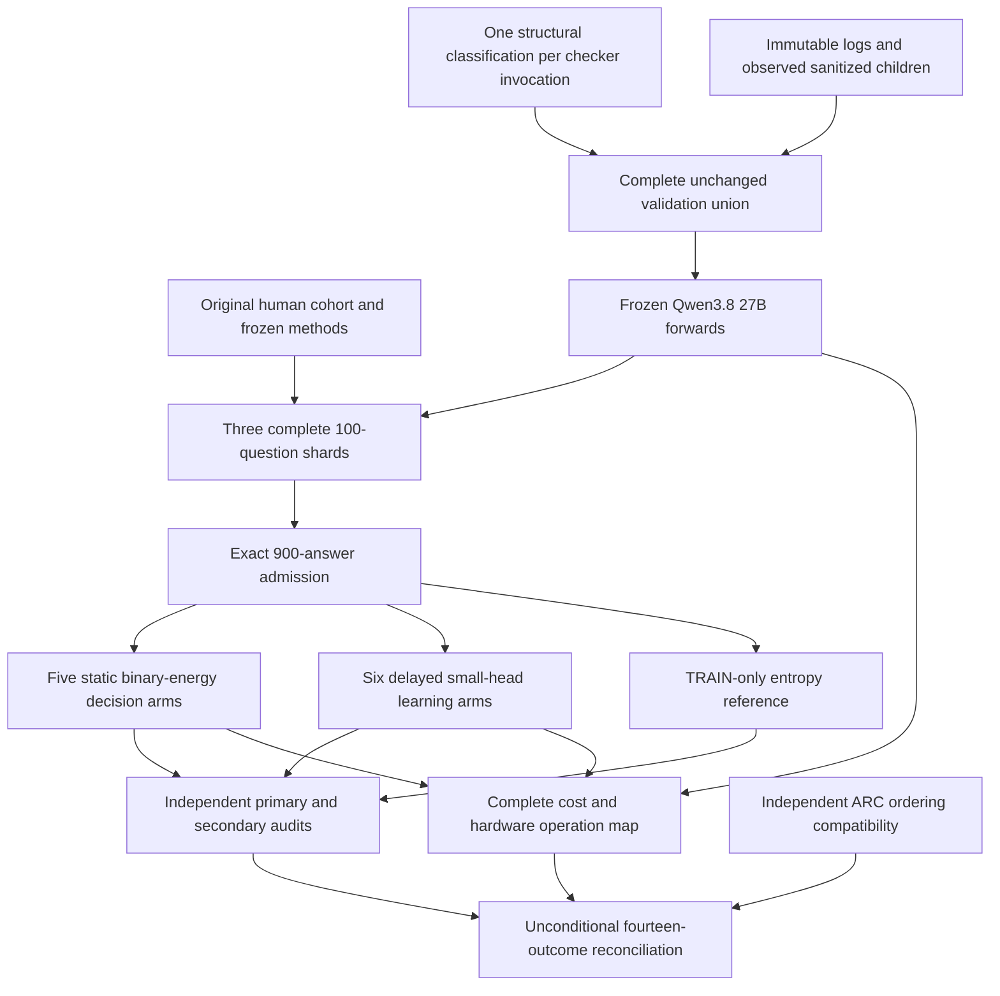
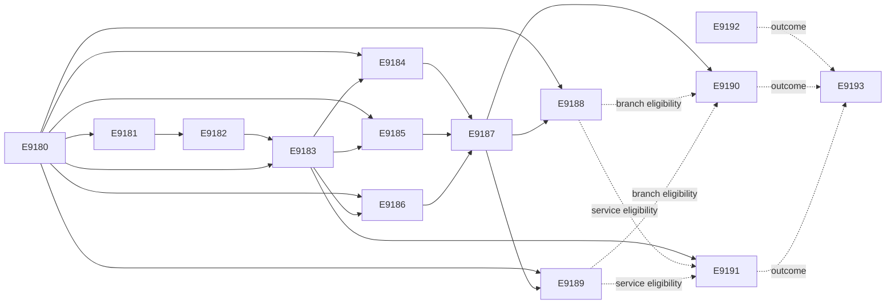

# Carnot Research Roadmap v782: Single-Pass Validation, Human Energy Decisions, and Continuous Calibration

**Milestone:** 2026.11.782  
**Created:** 2026-11-17 America/New_York  
**Status:** Proposed; no experiments executed or queue activated by planning.  
**Predecessor:** 2026.11.781, scheduling complete.  
**Execution contract:** Exactly **14 tasks, Exp9180 through Exp9193**, in the
order in the task table, across **four phases**. The complete task objects below
must equal `research-roadmap-next.yaml`, including prompts, gates and metadata.

The [V781 design](research-roadmap-v781-preserved-20261117.md) and
[V781 activated queue](research-roadmap-v781-queue-preserved-20261117.yaml)
are preserved byte for byte. The active roadmap and conductor remain unchanged.
`research-complete.yaml` currently ends at V780; V781's primaries and conductor
log are the current outcome authority. No archival scheduling action is required
of this planning change.

## What V781 proved

| Experiment | Evidence | Finding and limit |
|---|---|---|
| Exp9166 | Contract, source, static-method and online-method readiness all1 | Original human roles and methods authenticate. This is administrative readiness. |
| Exp9167 | `complete_disqualified_causal_validation`; correction readiness0 | Traces localize repeated structural traversal, but immutable-log, child-observation, diagnostic-budget and complete-module checks failed. |
| Exp9168 | `blocked_gate_check_failed`; exact repeated scope retired | The full qualification never ran. Its retired ID must not be a new dependency. |
| Exp9169–9177 | Nine cascade skips, no canonical scientific primaries | No new Qwen collection, detector comparison, learning gain or service cost was measured. |
| Exp9178 | 52 recognized and72 legacy fixture rows;22 to0 recognized mismatches; ten direct-consumer failures | Explicit mechanic precedence helped fixtures, but ordering compatibility remains disqualified. No live-agent solve was observed. |
| Exp9179 | Reconciliation readiness1; `complete_blocked_declared_gate` | All fourteen outcomes are accounted for; the independent-verifier gaps remain open. |

Four primaries executed; ten tasks were skipped. Primary sources are
`results/experiment_9166_v781_contract.json`,
`results/experiment_9167_v781_causal_validation.json`,
`results/experiment_9168_forward_qualification.json`,
`results/experiment_9178_v781_arc_mechanic_routing.json`,
`results/experiment_9179_v781_capstone.json` and `ops/conductor-log.md`.
The scheduler's Exp9168 file is not the absent intended scientific primary.

The corrected Exp9167 trace still contains2178 classifier calls and4368 full
canonical hashes. Its cache rescans complete artifact content per pair.
Three intermediate receipts name overwritten logs. Private child CLIs remove
PYTHONPATH, which removes its tracing bootstrap. Diagnosis took925.472 seconds
against900; the full target module was then killed at130 seconds. These are
observed defects, not evidence that the scientific methods failed.

V782 changes the algorithm: compute an invariant structural predicate once,
lazily within the synchronous checker call. It also separates bounded diagnosis
from complete target validation and retains unique logs and sanitized-child
observations. Exact flag parity and original mutation controls are mandatory.
This is a falsifiable correction hypothesis, not a predeclared speedup.

## The three biggest gaps to the PRD

1. **FR-12: useful independent factual verification.** The exposed human cohort
   and methods exist, but no admitted Qwen logit comparison exists. Test energy
   beyond probability, donor-label and entropy-reference controls. Later untouched
   independent human confirmation is still necessary.
2. **FR-06/FR-11: beneficial continuous self-learning.** Durable updates exist;
   future error must decrease beyond five controls without damaging retained
   quality. Only the small verifier learns; the generator stays frozen.
3. **FR-05/FR-08/NFR-01: reliable, affordable complete execution.** Finish the
   qualification path, then measure raw-text and durable-update cost. Head-only
   timing and a theoretical hardware mapping cannot establish service speedup.

The November7 north star is the oracle-distinct verifier. This exposed LPHB panel
cannot close `GAP-ORACLE-DISTINCT` or `GAP-DETECTOR-AUROC-4208`, even on a positive
result. ARC is an independent opportunistic compatibility task, not a solve target.

## Research incorporated before design

The [V782 reference scan](../../research-references.md) was recorded first.
It covers all requested arXiv topics and secondary sources, including access limits.

| Source | Experiment use | Boundary |
|---|---|---|
| [Entropy Distribution, May2026](https://arxiv.org/abs/2605.28264) | Exp9180 freezes CES; Exp9190 compares a reference-CDF score with mean/max entropy and the probability head | Teacher-forced archived answers differ from self-generated answers; token iid guarantees do not transfer. |
| [Spilled Energy, February2026](https://arxiv.org/abs/2602.18671) and [ARM–EBM, December2025/revised2026](https://arxiv.org/abs/2512.15605) | Exp9183–9190 preserve energy, normalized probability and logit-gauge controls | Energy can be an empirical feature without being factual truth. |
| [Continual Calibration, April2026](https://arxiv.org/abs/2604.23987) | Exp9189–9190 preserve future loss, retention and changed-decision evidence | No conformal coverage guarantee or generator learning is claimed. |
| [Online spline locality, February2026](https://arxiv.org/abs/2602.02056) | Exp9189 updates existing coefficients; Exp9191 measures full adaptation cost | Local arithmetic does not remove dense guard scans or fsync. |
| [Near-linear Ising sampler, November2026](https://arxiv.org/abs/2611.04786) | Exp9191 records operation mismatch; defer implementation | Zero-field ferromagnets do not cover arbitrary signed learned constraints. |

EBT, Distributional EBMs, PAL/HardNet++, EBD and KAN-CL remain scoped leads.
No retired importance-anchor or projection rerun is proposed. Semantic Scholar
returned11 ARM–EBM citation records; EBT retrieval was rate-limited. OpenReview
exposed indexed papers but challenged direct retrieval. GitHub Trending was stale.
Extropic/Kona pages do not establish local access or a reproducible new benchmark.

## Architecture



Human labels remain outside model inputs. TRAIN labels fit heads or the reference
CDF. CAL controls temperatures and operational guards. TEST is evaluator-only;
its repeated retention measurements never select updates. Static150 fitting and
online100 initialization stay separate. Archived answers are not current Qwen
outputs. All current LLM work is teacher forcing with zero generated tokens.

## Phase 1 — Qualify the changed validation algorithm (Exp9180–9183)

Exp9180 binds the full contract and original source/method authority. It freezes
the CES comparison and preserves historical failures without rerunning methods.

Exp9181 changes the repeated structural-predicate evaluation in the shared checker.
All pair ordering, classification, flags and refusal semantics remain identical.
It uses no global or pass/fail cache. Unique attempt logs cannot overwrite earlier
receipts. An explicit child startup seam supplies diagnostic observation when
PYTHONPATH is absent; no shared interpreter installation is allowed.
Diagnosis uses one900-second budget, including cleanup:300 baseline,450 corrected,
150 overhead. Remaining execution time serves the complete original target module,
not another diagnostic attempt. The total execution limit stays3300 seconds.

Exp9182 executes all621 original nodes,53 V779 additions and every affected
V780/V781/V782 obligation with original assertions. Same-invocation receipts
avoid duplicate final runs; historical passes grant no current execution credit.
Only complete current validation authorizes Exp9183. The retired Exp9168 ID is
cited in prior failures, never used as a dependency.

Exp9183 qualifies the existing six-text serial/chunk128 Qwen pilot, alignment,
full-vocabulary parity and actual operation receipts. Measured token rates and
load/storage costs must fit all three complete300-answer shards before collection.

## Phase 2 — Collect the complete fixed population (Exp9184–9187)

Exp9184–9186 use one collector with separate checkpoints and lexical qid ranges
0:100,100:200,200:300. Each retains all three siblings and original roles.
They depend on runtime readiness, not on each other. Exp9187 admits only the exact
900-answer union. No favorable intersection, changed cap or replacement answer
rescues a failed shard. Already-required token entropies also support CES.

## Phase 3 — Measure energy decisions and continuous learning (Exp9188–9190)

Exp9188 fits the original five static arms. Exp9189 runs the original six delayed
arms, predicts before feedback, and proves actual hard-exit recovery. Scientific
benefit never gates the independent audit. Exp9190 evaluates each available branch
separately and runs the frozen entropy-reference comparison from admitted features.
Both original static bounds and all seven learning bounds remain unchanged.

## Phase 4 — Complete cost, compatibility and reconciliation (Exp9191–9193)

Exp9191 times each eligible complete service independently, including rejected
updates, full guards and durable storage. Hardware fractions require measured
nonoverlapping clocks. Exp9192 addresses the ten real ARC ordering failures while
preserving mechanic invariance and measuring actual consumer reachability. It can
run if the entire model branch blocks. Exp9193 always records all fourteen outcomes,
with exact failed operands and branch-specific reopening conditions.

## Frozen scientific protocols


The following methods preserve the V778 and V779 scientific contract. Their implemented
authorities are Exp9126 and Exp9132. Their immutable receipts take precedence
over mutable checkout files. The new diagnostic section below adds no acceptance
gate and changes no arm, cohort, optimization rule or interval threshold.

### Whole-answer forward statistics

Use original TRAIN150/CAL50/TEST100 question groups, three siblings each.
Primary target is original A1 factuality. A2 sensitivity uses only actual observed
labels; unknown -1 stays missing. The task evaluates archived answers under Qwen,
not newly generated Qwen answers. No answer accuracy claim transfers to Qwen.

Preserve V777's exact protocol. Tokenize question/answer separately with the
embedded tokenizer, no BOS or chat template, and right caps256/768. The prefix is
literal `Question:\n`, retained question text and literal `\nAnswer:\n`.
Freeze detokenization and prefix bytes. Append retained answer token IDs explicitly.
Reset state for every answer. Capture in128-token chunks with the preceding-prefix
logit for the first answer token. Preserve adjacent pairs across chunk boundaries.

For full-vocabulary logits z_i and answer token a_i, compute in stable float64:

- L_i=logsumexp(z_i); NLL_i=L_i-z_i[a_i].
- p_i=softmax(z_i); H_i=-sum_v p_iv*log(p_iv).
- Marginal energy M_i=-L_i.
- Adjacent spill D_i=-z_i[a_i]+L_(i+1), within one answer, i=1..length-1.

The seven features are log1p(answer length), mean NLL, mean H, maximum H,
mean M, mean absolute D and the no-adjacent-pair indicator. Retain selected logits,
L_i, H_i, max probability, token IDs, positions and full-vector hashes per token.
One-token answers lack only spill; TRAIN-only median imputation is fixed. An
entirely missing training feature blocks fitting. Empty answers retain their slots
as escalations. Loss contrasts share predeclared nonempty support; coverage uses
all original TEST rows. No label-based filtering is permitted.

Store full vectors for the first eight answer positions of the global first20
lexical qids/all siblings. Preflight2GiB for bounded raw evidence. Stream statistics
instead of retaining all900 complete token-by-vocabulary arrays in RAM.

### Static energy decisions and susceptibility

The five original arms are prevalence, probability+length logistic (first four
features), raw-energy logistic (length, mean M, mean absolute D, missing-pair
indicator), combined logistic (all seven) and combined with whole-qid TRAIN donor
labels. Donors use a fixed nonidentity cyclic permutation of sorted TRAIN qids;
sibling positions stay fixed. Report the actual changed-label numerator/denominator.

These are binary Gibbs energies E(0)=0, E(1)=-theta·phi and
p(error)=sigmoid(theta·phi). Fit TRAIN-only population mean/std, with constant
scale1. Minimize mean binary logloss plus0.5*0.01 times squared nonintercept
coefficients. L-BFGS-B starts at zero: maxiter2000, gtol1e-7, ftol1e-12.
Require finite parameters/objective and gradient infinity norm<=1e-6.
No regularization or architecture search is scheduled.

CAL alone selects temperature from[0.5,1,2,4], ascending ties. Accept at
p(error)<=0.1; reject at>=0.9; otherwise escalate. Seal TEST predictions before
evaluator access. Report Brier, logloss, coverage, accepted error and exact-half-
coverage error. Rerank half-coverage choices inside each resampled draw.

Use10000 paired TEST-qid bootstrap draws, seed777121, preserving siblings.
`energy_increment_score=1` requires both combined-arm Brier improvement lower
bounds>0 against probability+length and donor, with one-sided tail0.05/2.
Empirical accepted error must not increase versus probability+length.
Undefined accepted risk cannot pass. These are conditional development intervals.

Add c_i=3 or c_i=3*(-1)^i to every vocabulary logit. Normalized probabilities,
NLL and entropy must remain unchanged. M changes by -c_i; D changes by
c_(i+1)-c_i. Report raw-score and frozen-head sensitivity under both gauges.
Do not select the favorable gauge. A gauge-sensitive score can be an empirical
representation signal; it is not evidence of a broken probability chain rule.
The original Exp6980 exact-span null and V776 embedding study remain unchanged.

### Continuous self-learning with a recalibration control

Preserve the original SHA256(`v776-online`+qid) ordering:100 TRAIN groups for
initialization and50 for ten disjoint streams of five. Original CAL50 is the
operational guard; TEST100 is research retention. Preserve the Exp9099 donor map
(seed776099, initialization labels only, original sibling positions).

Fit imputation and scaling only on the100 initialization groups. After standard
scaling, fit initialization min/max to[-1,1], constants0, and clip later inputs.
Use the seven logit features with fixed cubic knots
[-1,-1,-1,-1,-0.5,0,0.5,1,1,1,1]: intercept, seven linear columns and49 basis
columns. Use the existing spline helper. Fit initial heads with the static ridge
objective and convergence contract; temperature starts at1. No random projection
or embedding transformation is used in this separate seven-feature study.

Six arms are frozen spline, adaptive spline, bias-only spline, adaptive linear,
donor-label spline and temperature-only spline. All start from comparable
initial fits. For the original adaptive arms, retain the Exp9099 gradient:
`(sigmoid(theta·phi)-y)*phi + 0.01*(theta-theta_initial)`, with no intercept
anchor. Bias-only zeros other coordinates. Clip L2 norm to1. Use AdaGrad,
learning rate0.05, accumulator initially0 and epsilon1e-8. Apply three sibling
updates in original order, then test promotion once per released qid.

For temperature-only adaptation, keep spline coefficients fixed. Let s be its
initial logit, u=log(T), q=exp(-u), p=sigmoid(q*s). Initially u=0. Use gradient
`(y-p)*q*s + 0.01*u`, clipped to[-1,1], with the same AdaGrad settings.
Clip updated u to[log(0.5),log(4)]. Persist u and its accumulator. This comparator
uses the same feedback and guard access; it is not a multi-group MT-CC replication.

Promote only if complete CAL Brier increase<=0.005 and CAL classification-error
increase<=0 versus that arm's initial state. Otherwise restore parameters and
accumulators while acknowledging consumed feedback. Research retention does not
participate in this decision. Seal all18 sibling/arm predictions for g before
releasing labels for g-1. Drain the final group after all predictions. Reset
every stream to identical initial states. No static150 data may enter this fit.

Atomic snapshots include predictions, parameters, accumulators, temperature,
pending feedback and acknowledgments. Real hard exits at prediction fsync,
feedback receipt and state replacement must reproduce uninterrupted states and
predictions exactly. Preserve private actual-child E2E-020 coverage.

Evaluate future groups2–5:40 distinct qids/120 responses. Use10000 paired stream
bootstrap draws, seed778135, one-sided tail0.05/7. The seven simultaneous bounds
are five adaptive-spline future Brier improvements over each other arm (lower>0),
retained Brier increase (upper<=0.005), and retained classification-error increase
(upper<=0). All seven plus exact recovery are needed for `learning_signal_score=1`.
This adds a comparator and tightens multiplicity correction; it does not replace
the old six-bound embedding protocol. Report per-qid retention changes averaged
over streams. Repeated retention is100 questions, not1000. Ten streams have limited
power and the intervals condition on the initial fit, guard and retention panel.


## Descriptive diagnostics fixed before execution

Reuse Exp9141's authenticated evaluator masks and original agreement counts.
Unknown A2 labels stay missing. Agreement is not an accuracy ceiling. Static
slices distinguish mixed-correctness siblings from homogeneous qids. These
label-defined masks never enter feature extraction, fitting or decisions.

For online predictions, retain `abs(p_adaptive-p_initial)>=0.05` and crossings
of the fixed0.5 classification threshold. Membership uses predictions only.
Compare every arm on identical changed and unchanged units. Report Brier,
`mean(p-y)`, exact counts and unavailable empty slices. Use paired whole-stream
resampling for future and retention contrasts, conditional on the fixed panels.

The new TOOD-inspired diagnostic compares ranking, scale and calibration at
each released-group update. Use the same TEST100 qids and all siblings for every
arm. Record raw logits, RMS logit magnitude, tie-aware AUROC, Brier and class
counts before and after each update. Rejected updates retain their unchanged
state. One-class AUROC remains unavailable. Report every stream and update.
No threshold, temperature, group or model is selected from these results.
This diagnostic cannot rescue any failed primary bound. It tests whether the
observed behavior is consistent with scale drift or lost ranking information;
it cannot identify a causal mechanism from a correlation alone.


## Additional descriptive diagnostic: exact Brier moments

Use the frozen original supports and equal-qid weighting. Let p be predicted
error probability and y the human error label. Use population moments throughout:

`Brier = (mean(p)-mean(y))^2 + (sd(p)-sd(y))^2 + 2*(sd(p)*sd(y)-cov(p,y))`.

The three terms are squared mean bias, variance mismatch and covariance deficit.
Compute the last term directly from covariance when either variance is zero;
correlation is then unavailable. The identity must match direct Brier within
1e-12 on deterministic controls and measured rows. Report raw signed residuals.
Do not clamp roundoff before checking the identity. Empty supports remain unavailable.

Use all five static arms and all six online arms. Report static TEST, future
stream support and each retained panel separately. The original qid and stream
resampling units apply to diagnostic deltas. Neither labels nor these diagnostics
select features, update rules, temperatures or promotion thresholds. No new
significance test replaces the original two static and seven learning bounds.

## Secondary experiment: a frozen entropy reference

Exp9180 fixes this protocol before model work. For all nonempty A1-correct
TRAIN150 answers, pool token entropies and define F0(x) as the fraction<=x.
Preserve the paper's token weighting and report tokens and distinct qids.
A missing correct reference blocks this branch. No CAL or TEST response defines
F0. For each TEST answer, compute `CES=sqrt(F0(mean(H))*F0(max(H)))`.
Larger CES, mean H and max H predict error. CES is not an error probability.

Compare CES AUROC against mean H, max H and the probability+length head's error
probability. Use10000 paired TEST-qid bootstrap draws, seed782190, preserving
siblings and half-credit ties. Require every contrast's one-sided lower bound
at tail0.05/3>0 for `entropy_reference_signal_score=1`. If a draw lacks either
class, the affected interval is unavailable; do not drop/redraw it to obtain a
favorable interval. Retain raw estimates and valid/invalid draw counts. Score
all original nonempty TEST answers; report empty exclusions and all900 original
slots separately. Missing fitted-head predictions block that contrast, not the
mean/max comparisons. Completion and effect gates are separate.

Record per-answer token count, lag1 correlation when variance/support permit,
ties, mean/max entropy and every score. An empty answer or one-class TEST set
cannot receive invented AUROC. This is a secondary ranking experiment: no new
probability threshold, learned feature, online arm or primary bound. Its outcome
can motivate a later study, not close independent factual verification.

## Complete cost and hardware requirements

Use first20 TEST qids/all60 siblings, three fresh processes, seed776108 and
probability parity atol1e-5/rtol1e-4 with exact typed decisions. Distinguish cold
load, warm uncached raw-text service and cached-feature head timing. Include
forward passes, full-vocabulary reduction, transfer, transforms and serialization.
Online costs include initialization, proposal, rejection, all guards, fsync,
acknowledgment, drain and recovery. Retain censored units and complete denominators.

| Resource | Requirement and claim boundary |
|---|---|
| CPU/RAM | Validation, small-head fitting, bootstrap and durable updates; measure peak memory and stream vocabulary statistics. |
| Private disk | At least2GiB for designated raw vectors plus measured traces/checkpoints; test actual free space. |
| GPU0 RTX3090 24GB | Verify CUDA offload under the existing lease. Five model tasks execute serially; do not disturb GPU1 ownership. |
| Mandated model | Frozen `unsloth/Qwen3.8-27B-GGUF`, Q4_K_M, existing `cached_current_model(gpu_index=0)` resolver; pin model, tokenizer and runtime hashes. |
| KV260 | Preserve qualified Ising operations and k_max<=5; no dense Qwen or spline-training kernel is inferred. |
| PolarFire | Preserve qualified Linux CPU dispatch; this does not prove fabric acceleration. |
| GateMate | Preserve unchanged physical/JTAG `0xffffffff` blocker; no identical probe without changed physical attestation. |
| NPU/TSU/larger FPGA wishlist | Require access, matching operations and a measured bottleneck before implementation or procurement. |

Continuous learning has a CPU path now and possible batched GPU/native or
fixed-point FPGA arithmetic later. Dense anchors, guard scans and disk commits
remain part of its cost. Amdahl's limit is `1/(1-f)` for an infinitely fast
replacement of fraction f: at least0.99 for100x,0.90 for10x; finite acceleration
needs strictly more coverage. Unknown fractions stay unknown. Sampling hardware
cannot by itself remove dense forwards or durable storage. No power claim without
measured energy integrals, and no purchase or board operation is scheduled.

## Execution, routing and stop rules

Every prompt has numbered phase-boundary and before/after-call flushed progress,
60-second heartbeats inside long loops/calls, gaps below600 seconds, and file
writes split into calls of at most about200 lines with messages between calls.
The4800-second cap contains3300 execution,1200 final verification and300 publication.
All child deadlines include cleanup. Actual elapsed cost stays distinct from
watchdog ceilings. Each complete validation obligation executes once per current
qualifying invocation; no passing verdict cache replaces execution.

Exp9183–9186 and Exp9191 declare `model_load_no_generation` with the mandated
MODEL_SPECS and a2-second floor: actual frozen forwards, zero sampled tokens.
A future handful-token canary requires `model_bounded_generation`/10 seconds;
a real generative workload requires `model_full_generation`/60 seconds.
No such generation is authorized here. Use `blocked_no_run` for refusal before
loading; count failed attempted loads accurately. No duration padding or simulated
fallback. Legacy small models are CPU smoke controls only, never headline results.

Exp9180–9183 and Exp9191 use Opus/100 turns for infrastructure/runtime work.
Exp9187 uses Codex/gpt-6.1-sol/30 turns for formulaic admission. Exp9192 uses
Codex/gpt-6.1-sol/50 turns for the connected compatibility fix. Other science tasks
use the default synthesis backend/50 turns; Exp9193 uses the default/20 turns.
No Luna or Gemini task is planned. Current user routing overrides old defaults.

All comparisons require per-unit rows. Every required field carries a principle.
Every failed gate names its exact upstream field, expected and observed values;
missing file, missing field and zero are different states. All tasks declare
`verdict_class: positive | circular_positive | null | blocked | disqualified | partial`.
External missing/retired/gated inputs are terminal blocked. Only incomplete owned
work that another attempt can finish is partial. Oracle fixtures require
circular_positive if called a positive; readiness alone is not scientific benefit.

Spec first, failing controls first, smallest shared implementation, then scoped
unit/real-child coverage, Ruff, strict types, explicit spec tracing and applicable
E2E-018/021; learning changes also require E2E-020. Preserve every old assertion.
Qualification requires100 percent owned statements with zero exclusions.
Actual adversarial and strict-row checker receipts precede primary publication.
Do not mutate historical primaries, quarantine determinations or the conductor.

Stop the checker branch if parity, sanitized-child evidence, deadlines or any
required original obligation fails. Stop collection if a complete shard cannot
fit; record the deficit without shrinking the population. A complete primary
scientific null retires the unchanged method; absent predictions leave it untested.
CES nulls retire the unchanged reference comparison. ARC compatibility failures
cannot be described as live progress. Capstone execution is unconditional.

## Dependency graph



Solid arrows are structured launch gates; dotted arrows are independently checked
branch evidence. Exp9192 and Exp9193 have no launch gates. The full gate table
below is authoritative, including the two runtime gates for each collection shard.

## Task contract

| Order | Task ID | Phase | Deliverable |
|---|---|---|---|
| 1 | `exp9180-contract` | 1 | `results/experiment_9180_v782_contract.json` |
| 2 | `exp9181-validation-loop-repair` | 1 | `results/experiment_9181_v782_causal_validation.json` |
| 3 | `exp9182-forward-qualification` | 1 | `results/experiment_9182_v782_forward_qualification.json` |
| 4 | `exp9183-logit-runtime` | 1 | `results/experiment_9183_v782_logit_runtime.json` |
| 5 | `exp9184-logits-a` | 2 | `results/experiment_9184_v782_logits_a.json` |
| 6 | `exp9185-logits-b` | 2 | `results/experiment_9185_v782_logits_b.json` |
| 7 | `exp9186-logits-c` | 2 | `results/experiment_9186_v782_logits_c.json` |
| 8 | `exp9187-logit-admission` | 2 | `results/experiment_9187_v782_logit_admission.json` |
| 9 | `exp9188-static-energy` | 3 | `results/experiment_9188_v782_static_energy.json` |
| 10 | `exp9189-delayed-learning` | 3 | `results/experiment_9189_v782_delayed_learning.json` |
| 11 | `exp9190-decision-audit` | 3 | `results/experiment_9190_v782_decision_audit.json` |
| 12 | `exp9191-complete-cost` | 4 | `results/experiment_9191_v782_complete_cost.json` |
| 13 | `exp9192-arc-ordering-compatibility` | 4 | `results/experiment_9192_v782_arc_mechanic_routing.json` |
| 14 | `exp9193-capstone` | 4 | `results/experiment_9193_v782_capstone.json` |

| Downstream | Upstream field | Required value |
|---|---|---|
| `exp9181-validation-loop-repair` | `exp9180-contract.contract_ready_score` | `== 1` |
| `exp9182-forward-qualification` | `exp9181-validation-loop-repair.causal_fix_ready_score` | `== 1` |
| `exp9183-logit-runtime` | `exp9182-forward-qualification.forward_validation_ready_score` | `== 1` |
| `exp9183-logit-runtime` | `exp9180-contract.static_methods_ready_score` | `== 1` |
| `exp9184-logits-a` | `exp9180-contract.source_ready_score` | `== 1` |
| `exp9184-logits-a` | `exp9183-logit-runtime.logit_runtime_ready_score` | `== 1` |
| `exp9184-logits-a` | `exp9183-logit-runtime.shard_feasible_score` | `== 1` |
| `exp9185-logits-b` | `exp9180-contract.source_ready_score` | `== 1` |
| `exp9185-logits-b` | `exp9183-logit-runtime.logit_runtime_ready_score` | `== 1` |
| `exp9185-logits-b` | `exp9183-logit-runtime.shard_feasible_score` | `== 1` |
| `exp9186-logits-c` | `exp9180-contract.source_ready_score` | `== 1` |
| `exp9186-logits-c` | `exp9183-logit-runtime.logit_runtime_ready_score` | `== 1` |
| `exp9186-logits-c` | `exp9183-logit-runtime.shard_feasible_score` | `== 1` |
| `exp9187-logit-admission` | `exp9184-logits-a.logits_a_ready_score` | `== 1` |
| `exp9187-logit-admission` | `exp9185-logits-b.logits_b_ready_score` | `== 1` |
| `exp9187-logit-admission` | `exp9186-logits-c.logits_c_ready_score` | `== 1` |
| `exp9188-static-energy` | `exp9187-logit-admission.admission_ready_score` | `== 1` |
| `exp9188-static-energy` | `exp9180-contract.static_methods_ready_score` | `== 1` |
| `exp9189-delayed-learning` | `exp9187-logit-admission.admission_ready_score` | `== 1` |
| `exp9189-delayed-learning` | `exp9180-contract.online_methods_ready_score` | `== 1` |
| `exp9190-decision-audit` | `exp9187-logit-admission.admission_ready_score` | `== 1` |
| `exp9191-complete-cost` | `exp9183-logit-runtime.logit_runtime_ready_score` | `== 1` |

## Full machine-readable contract

```yaml
milestone: 2026.11.782
milestone_title: Single-Pass Validation, Human Energy Decisions, and Continuous Calibration
milestone_doc: openspec/change-proposals/research-roadmap-vNEXT.md
tasks:
- id: exp9180-contract
  title: 'Exp9180: Bind fourteen tasks and freeze diagnostic supports'
  phase: 1
  track: infrastructure
  priority: high
  requires_gpu: false
  max_turns: 100
  estimated_wall_time_min: 45
  per_unit_rows: true
  milestone: 2026.11.782
  deliverable: results/experiment_9180_v782_contract.json
  inference_substrate_class: no_model_load
  MODEL_SPECS: []
  model: opus
  prior_failures:
  - experiment_id: exp7329-contract
    verdict: complete_disqualified_v644_contract_mismatched_or_invalid
    addressed_by: Generate both full contracts from one list; compare every object before activation.
    retire_if_same_verdict: true
  - experiment_id: exp7421-contract-ingestion
    verdict: complete_disqualified_stale_markdown_contract_with_method_ingestion
    addressed_by: Preserve V781 authority and generate both complete V782 contracts from one task list.
    retire_if_same_verdict: true
  prompt: |-
    CONTEXT:
    Work in {project_root} on {date}. V781 has four executed primaries and ten skipped tasks. Its archive entry lags. Authenticate primaries and scheduler evidence, preserve the full previous design/queue, and bind the new fourteen-task contract. No activation or science execution belongs in this task.
    EXISTING CODE TO READ FIRST:
    CLAUDE.md; CODEX.md; ops/north-star.md; ops/e2e-test-plan.md; ops/exclusion_manifest.yaml; research-references.md (V782 scan); openspec/change-proposals/research-roadmap-vNEXT.md; openspec/capabilities/research-reporting/spec.md; scripts/experiment_template.py; python/carnot/reporting/primary_publication.py; python/carnot/reporting/current_work_receipt.py; python/carnot/reporting/v780_contract.py; python/carnot/reporting/v780_capstone.py; python/carnot/reporting/logit_methods_9126.py; python/carnot/reporting/online_methods_9132.py; results/experiment_9152_v780_contract.json; results/experiment_9153_v780_validation_schedule.json; results/experiment_9165_v780_capstone.json; openspec/change-proposals/research-roadmap-v780-preserved-20261116.md; openspec/change-proposals/research-roadmap-v780-queue-preserved-20261116.yaml; python/carnot/reporting/v781_contract.py; python/carnot/reporting/v781_capstone.py; results/experiment_9166_v781_contract.json; results/experiment_9167_v781_causal_validation.json; results/experiment_9179_v781_capstone.json; openspec/change-proposals/research-roadmap-v781-preserved-20261117.md; openspec/change-proposals/research-roadmap-v781-queue-preserved-20261117.yaml
    TASK:
    Bind fourteen tasks and freeze diagnostic supports. Deliver results/experiment_9180_v782_contract.json. Implement scripts/experiments/experiment_9180_v782_contract.py using existing library seams. MODEL_SPECS: []. Requested inference_substrate_class: no_model_load.
    Do not load an LLM. Set current_llm_invocations=0 and generated_tokens=0. Small energy-head training is CPU work. Keep historical model provenance in source_references.
    CONCRETE STEPS:
    1. Emit a flushed progress line at each phase boundary. Emit before and after every model load, generation, benchmark and subprocess that can take minutes. Print inside long loops. Supervise blocking calls with flushed heartbeats every 60 seconds. Keep every silence gap below 600 seconds. Write any file over about 200 lines in several tool calls of at most 200 lines. Send a progress message between writing calls. Never use one huge tool call.
    2. PRECONDITIONS: Authenticate exact required paths, hashes and gate fields before dependent work. Check imports, CPU/memory limits and private free disk. Distinguish missing_file, missing_field and observed zero. Missing external inputs produce terminal blocked evidence with gate_check_summary. Never repin historical evidence to mutable checkout code.
    3. Before implementation inspect callers with rg. Confirm REQ-REPORT-9180-V782 and SCENARIO-REPORT-9180-V782. Extend specs first. Write failing controls before code. Freeze units, exclusions, formulas and validation scope before outcomes.
    4. Compare fourteen ordered complete task objects between V782 design and queue, including prompts, gates, model metadata and deliverables. Preserve the V781 activated queue bytes and separately its design objects; do not rewrite either to hide brace encoding. Follow the qualified V781 binding normalization and test rendering, missing objects and tamper controls. Never activate the next queue.
    5. Authenticate Exp9166 source and Exp9126/9132 methods through original producer snapshots. Retain 900 answers/300 qids, TRAIN150/CAL50/TEST100, all siblings, independent_generalization_score=0 and three lexical100-qid rosters. Source/method readiness stays independent of the diagnostic failure. Do not rerun completed method studies.
    6. Freeze the five static arms, six delayed-learning arms, two static bounds, seven learning bounds and existing Brier moment diagnostics. Freeze the new CES reference protocol from the design: TRAIN-correct token empirical CDF, three fixed ranking contrasts, qid resampling and no TEST tuning. Do not add CES to the primary energy or online acceptance conditions.
    7. Bind all621 original nodes,53 V779 additions and every affected V780/V781/V782 obligation by node identity and assertion hash. Retain original failing/censored checks and ten ARC regressions separately. Prior completions grant no current qualification credit. Record all fourteen V781 outcomes, including absent scientific primaries.
    8. Run owned unit tests and real child-process coverage with 100 percent owned statements and zero exclusions. Preserve original assertions. Run scoped Ruff check/format, strict mypy and scripts/check_spec_coverage.py with explicit test paths. Execute private real CLI success, refusal, tamper and cold replay outside the checkout without PYTHONPATH, following E2E-018/021. Learning/recovery changes also require E2E-020. Separate unrelated repository health from affected failures. Affected failures disqualify readiness.
    9. Stop measurement by 3300 seconds. Use one monotonic deadline for all descendants, including cleanup; do not spend the reserve on another measurement attempt. Reserve 1200 seconds for final verification and 300 seconds for publication within the 4800-second cap. Count each obligation once; distinguish elapsed time from its watchdog ceiling. Save unfinished units and censor reasons. Recompute claims from rows. Run scripts/adversarial_verify.py and scripts/verdict_row_consistency_lint.py --strict with heartbeats. Publish through primary_publication only after actual checker receipts pass. Reconcile openspec/, _bmad/traceability.md, ops/status.md and ops/changelog.md. Preserve historical primaries, quarantines and exclusions. Do not activate a queue or publish externally.
    REQUIRED ARTIFACT FIELDS:
    - honest_verdict: complete_* for terminal outcomes; partial_* only for retryable owned work; principle: A terminal prefix must agree with its verdict class.
    - verdict_class: positive | circular_positive | null | blocked | disqualified | partial; principle: External absence, retirement or gate failure is blocked. Only unfinished owned work is partial.
    - gate_check_summary: check, upstream, path, sha256, artifact_field, op, expected, observed, passed; principle: Every blocked result names its failed operand; missing evidence differs from an observed zero.
    - preconditions_checked: resource, available and actual check receipt; principle: Unavailable resources cannot produce invented measurements.
    - rows: unit_id, qid/group, sibling, arm/condition, seed, absolute metrics, numerator, denominator, status, exclusion_reason, censor_reason; principle: All comparative headlines must be reproducible from their independent units.
    - sample_size_budget: intended, attempted, completed, failed, censored, effective_independent_groups; principle: Siblings and repeated retention do not multiply independent sample size.
    - verifier_is_oracle: boolean; principle: Reusing executable truth as the verifier requires circular_positive, not an independent verifier win.
    - claim_scope: exposure_scope, independent_generalization_score=0 and allowed claims; principle: Exposed development and fixtures cannot close the independent-verifier gaps.
    - MODEL_SPECS: actual requested list and invocation status; principle: An upstream model reference is not current model work.
    - inference_substrate_class: actual class and requested_inference_substrate_class; principle: Use blocked_no_run for refusal before loading; attempted loads remain attempted loads.
    - inference_substrate: operation-accurate work description; principle: Forward work, generation and cached CPU reduction have different evidence requirements.
    - model_invocation_counts: current_llm_invocations, loads attempted/completed/failed, forward calls, generated_tokens; principle: Counters must agree with actual operation-specific receipts.
    - duration_s: measured wall time; principle: No artificial sleeping or duration padding may satisfy a substrate floor.
    - random_seed: fixed before outcomes; principle: A frozen seed permits replay without favorable seed selection.
    - reproducibility_checksum: inputs and configuration digest; principle: Changed inputs cannot pass as the original experiment.
    - source_references: original producer paths, SHA256 and imported fields; principle: Historical evidence retains its original authority.
    - code_config_hashes: owned implementation, tests and configuration; principle: Validation qualifies the executed revision.
    - current_work_receipts: operation-specific records; principle: Historical receipts cannot certify current inference.
    - validation_receipts: commands, logs, exit codes and coverage references; principle: Self-reported passing checks do not establish readiness.
    - required_checks_passed: boolean; principle: Readiness requires every affected check.
    - acceptance_gates: fixed conditions, each with a principle annotation; principle: Outcome-dependent thresholds cannot manufacture success.
    - contract_ready_score: integer 0/1; principle: All fourteen complete objects must agree.
    - source_ready_score: integer 0/1; principle: Original labels, roles and complete rosters must authenticate.
    - static_methods_ready_score: integer 0/1; principle: Reuse requires original static method authority.
    - online_methods_ready_score: integer 0/1; principle: Reuse preserves all causal update and recovery semantics.
    - protocol_references: source, evaluator labels, static, online, diagnostic and three shard rosters; principle: Consumers share immutable inputs with exact names.
    - full_task_objects: canonical_task_hash and previous_outcome_rows; principle: Scheduling completion is not scientific success.
    - entropy_reference_protocol: exact CDF construction, score, comparator directions, bootstrap seed and support rules; principle: An auxiliary comparison must be fixed before its TEST results.
    Run command: cd {project_root} && JAX_PLATFORMS=cpu .venv/bin/python -u scripts/experiments/experiment_9180_v782_contract.py --date {date}
    Do NOT push. Do NOT modify scripts/research_conductor.py.
- id: exp9181-validation-loop-repair
  title: 'Exp9181: Remove repeated structural scans and qualify immutable diagnostic evidence'
  phase: 1
  track: infrastructure
  priority: high
  requires_gpu: false
  max_turns: 100
  estimated_wall_time_min: 75
  per_unit_rows: true
  milestone: 2026.11.782
  deliverable: results/experiment_9181_v782_causal_validation.json
  inference_substrate_class: no_model_load
  MODEL_SPECS: []
  model: opus
  gated_on:
  - upstream: exp9180-contract
    artifact_field: contract_ready_score
    op: ==
    value: 1
  prior_failures:
  - experiment_id: exp9167-causal-validation
    verdict: complete_disqualified_causal_validation
    addressed_by: Only new Exp9181 invocation-local structural classification, immutable attempt logs and PYTHONPATH-independent
      child observation may reopen full validation in Exp9182. Every original assertion remains; no model work before
      complete current qualification. Reproduce the original flags with the changed algorithm;900 seconds for diagnosis
      plus separate complete-module execution, not a leftover130-second module cap.
    retire_if_same_verdict: true
  - experiment_id: exp9153-measured-validation
    verdict: complete_blocked_validation_prerequisite
    addressed_by: Only new Exp9181 invocation-local structural classification, immutable attempt logs and PYTHONPATH-independent
      child observation may reopen full validation in Exp9182. Every original assertion remains; no model work before
      complete current qualification. Reproduce the original flags with the changed algorithm;900 seconds for diagnosis
      plus separate complete-module execution, not a leftover130-second module cap.
    retire_if_same_verdict: true
  - experiment_id: exp9125-receipt-qualification
    verdict: complete_disqualified_bounded_receipt_qualification
    addressed_by: Only new Exp9181 invocation-local structural classification, immutable attempt logs and PYTHONPATH-independent
      child observation may reopen full validation in Exp9182. Every original assertion remains; no model work before
      complete current qualification. Reproduce the original flags with the changed algorithm;900 seconds for diagnosis
      plus separate complete-module execution, not a leftover130-second module cap.
    retire_if_same_verdict: true
  - experiment_id: exp9111-forward-evidence
    verdict: complete_disqualified_owned_checks
    addressed_by: Only new Exp9181 invocation-local structural classification, immutable attempt logs and PYTHONPATH-independent
      child observation may reopen full validation in Exp9182. Every original assertion remains; no model work before
      complete current qualification. Reproduce the original flags with the changed algorithm;900 seconds for diagnosis
      plus separate complete-module execution, not a leftover130-second module cap.
    retire_if_same_verdict: true
  - experiment_id: exp9140-forward-qualification
    verdict: complete_blocked_infeasible_forward_schedule
    addressed_by: Only new Exp9181 invocation-local structural classification, immutable attempt logs and PYTHONPATH-independent
      child observation may reopen full validation in Exp9182. Every original assertion remains; no model work before
      complete current qualification. Reproduce the original flags with the changed algorithm;900 seconds for diagnosis
      plus separate complete-module execution, not a leftover130-second module cap.
    retire_if_same_verdict: true
  prompt: |-
    CONTEXT:
    Work in {project_root} on {date}. V781 traced repeated structural traversal but its correction failed: complete artifact hashing repeats per numeric pair, probe logs were overwritten, PYTHONPATH removal hid children, and diagnosis exceeded900 seconds. Change the algorithm and evidence lifecycle; do not repeat the unqualified cache or extend deadlines.
    EXISTING CODE TO READ FIRST:
    CLAUDE.md; CODEX.md; ops/north-star.md; ops/e2e-test-plan.md; ops/exclusion_manifest.yaml; research-references.md (V782 scan); openspec/change-proposals/research-roadmap-vNEXT.md; openspec/capabilities/research-reporting/spec.md; scripts/experiment_template.py; python/carnot/reporting/primary_publication.py; python/carnot/reporting/current_work_receipt.py; python/carnot/reporting/validation_schedule_9153.py; python/carnot/reporting/validation_schedule_9139.py; python/carnot/reporting/validation_schedule_runner_9139.py; python/carnot/reporting/forward_evidence_runner_9111.py; tests/python/test_forward_evidence_runner_9111.py; tests/python/test_validation_schedule_9153.py; results/experiment_9153_v780_validation_schedule.json; scripts/adversarial_verify.py; python/carnot/reporting/validation_reuse_9167.py; python/carnot/reporting/validation_trace_9167.py; python/carnot/reporting/causal_validation_9167.py; tests/python/test_causal_validation_9167.py; results/experiment_9167_v781_causal_validation.json
    TASK:
    Remove repeated structural scans and qualify immutable diagnostic evidence. Deliver results/experiment_9181_v782_causal_validation.json. Implement scripts/experiments/experiment_9181_v782_causal_validation.py using existing library seams. MODEL_SPECS: []. Requested inference_substrate_class: no_model_load.
    Do not load an LLM. Set current_llm_invocations=0 and generated_tokens=0. Small energy-head training is CPU work. Keep historical model provenance in source_references.
    CONCRETE STEPS:
    1. Emit a flushed progress line at each phase boundary. Emit before and after every model load, generation, benchmark and subprocess that can take minutes. Print inside long loops. Supervise blocking calls with flushed heartbeats every 60 seconds. Keep every silence gap below 600 seconds. Write any file over about 200 lines in several tool calls of at most 200 lines. Send a progress message between writing calls. Never use one huge tool call.
    2. PRECONDITIONS: Authenticate exact required paths, hashes and gate fields before dependent work. Check imports, CPU/memory limits and private free disk. Distinguish missing_file, missing_field and observed zero. Missing external inputs produce terminal blocked evidence with gate_check_summary. Never repin historical evidence to mutable checkout code.
    3. Before implementation inspect callers with rg. Confirm REQ-REPORT-9181-V782 and SCENARIO-REPORT-9181-V782. Extend specs first. Write failing controls before code. Freeze units, exclusions, formulas and validation scope before outcomes.
    4. Read all callers of check_tautology and its ARC-null descriptor. Freeze the retained original/corrected traces and every original assertion. The corrected trace shows2178 classifier calls and4368 canonical hashes. This establishes repeated work, not a qualified performance gain. Do not rerun a900-second search for an already-localized operation.
    5. Before code, reproduce one bounded semantic/performance failure with counts and exact flags. Replace per-pair whole-artifact scanning/hashing with lazy invocation-local evaluation of the invariant structural predicate inside check_tautology. Preserve direct helper behavior, pair order, exclusions, severity and details. No global/object-id/pass-fail cache; no historical checker rewrite. Keep mutation detection across calls and original validation_reuse controls; remove only redundant use from the normal path if all callers qualify.
    6. Give every attempt, child, stdout and stderr a unique immutable path; create exclusively and seal only after exit. Use an explicit diagnostic startup seam in the actual child entrypoints that does not depend on PYTHONPATH. Keep the outside-checkout no-PYTHONPATH execution unchanged. Demonstrate traced PID/PPID/argv and measured operation in a real sanitized child; do not substitute parent wait time. No shared interpreter installation or replacement checker.
    7. Use one monotonic900-second diagnostic deadline, with planned original/corrected/overhead slices300/450/150 seconds including cleanup. Require same-input flag parity and at most one full structural classification per synchronous tautology call. Compare actual original versus changed work and report censoring; a censored baseline supports a bound only. Do not run the full target module inside the diagnostic slice. Measure hook overhead separately and retain all logs.
    8. Use the remaining execution allowance up to3300 seconds for the complete original test_forward_evidence_runner_9111 module, all seven rehashed primitive tamper cases, cache mutation/revision/config controls and real private CLI cases. Preserve fixture lifetime, assertions and coverage. Count those checks once when finalizing. This separation replaces the prior130-second leftover module run without increasing any total cap.
    9. Require exact flag parity, qualified changed-algorithm counts, immutable logs, complete sanitized-child observation, diagnostic elapsed<=900 and complete targeted normal execution before causal_fix_ready_score=1. Emit revision_reference and the full obligation union for Exp9182. Any affected failing test disqualifies. Targeted readiness cannot authorize model work or claim full674-node completion.
    10. Run owned unit tests and real child-process coverage with 100 percent owned statements and zero exclusions. Preserve original assertions. Run scoped Ruff check/format, strict mypy and scripts/check_spec_coverage.py with explicit test paths. Execute private real CLI success, refusal, tamper and cold replay outside the checkout without PYTHONPATH, following E2E-018/021. Learning/recovery changes also require E2E-020. Separate unrelated repository health from affected failures. Affected failures disqualify readiness.
    11. Stop measurement by 3300 seconds. Use one monotonic deadline for all descendants, including cleanup; do not spend the reserve on another measurement attempt. Reserve 1200 seconds for final verification and 300 seconds for publication within the 4800-second cap. Count each obligation once; distinguish elapsed time from its watchdog ceiling. Save unfinished units and censor reasons. Recompute claims from rows. Run scripts/adversarial_verify.py and scripts/verdict_row_consistency_lint.py --strict with heartbeats. Publish through primary_publication only after actual checker receipts pass. Reconcile openspec/, _bmad/traceability.md, ops/status.md and ops/changelog.md. Preserve historical primaries, quarantines and exclusions. Do not activate a queue or publish externally.
    REQUIRED ARTIFACT FIELDS:
    - honest_verdict: complete_* for terminal outcomes; partial_* only for retryable owned work; principle: A terminal prefix must agree with its verdict class.
    - verdict_class: positive | circular_positive | null | blocked | disqualified | partial; principle: External absence, retirement or gate failure is blocked. Only unfinished owned work is partial.
    - gate_check_summary: check, upstream, path, sha256, artifact_field, op, expected, observed, passed; principle: Every blocked result names its failed operand; missing evidence differs from an observed zero.
    - preconditions_checked: resource, available and actual check receipt; principle: Unavailable resources cannot produce invented measurements.
    - rows: unit_id, qid/group, sibling, arm/condition, seed, absolute metrics, numerator, denominator, status, exclusion_reason, censor_reason; principle: All comparative headlines must be reproducible from their independent units.
    - sample_size_budget: intended, attempted, completed, failed, censored, effective_independent_groups; principle: Siblings and repeated retention do not multiply independent sample size.
    - verifier_is_oracle: boolean; principle: Reusing executable truth as the verifier requires circular_positive, not an independent verifier win.
    - claim_scope: exposure_scope, independent_generalization_score=0 and allowed claims; principle: Exposed development and fixtures cannot close the independent-verifier gaps.
    - MODEL_SPECS: actual requested list and invocation status; principle: An upstream model reference is not current model work.
    - inference_substrate_class: actual class and requested_inference_substrate_class; principle: Use blocked_no_run for refusal before loading; attempted loads remain attempted loads.
    - inference_substrate: operation-accurate work description; principle: Forward work, generation and cached CPU reduction have different evidence requirements.
    - model_invocation_counts: current_llm_invocations, loads attempted/completed/failed, forward calls, generated_tokens; principle: Counters must agree with actual operation-specific receipts.
    - duration_s: measured wall time; principle: No artificial sleeping or duration padding may satisfy a substrate floor.
    - random_seed: fixed before outcomes; principle: A frozen seed permits replay without favorable seed selection.
    - reproducibility_checksum: inputs and configuration digest; principle: Changed inputs cannot pass as the original experiment.
    - source_references: original producer paths, SHA256 and imported fields; principle: Historical evidence retains its original authority.
    - code_config_hashes: owned implementation, tests and configuration; principle: Validation qualifies the executed revision.
    - current_work_receipts: operation-specific records; principle: Historical receipts cannot certify current inference.
    - validation_receipts: commands, logs, exit codes and coverage references; principle: Self-reported passing checks do not establish readiness.
    - required_checks_passed: boolean; principle: Readiness requires every affected check.
    - acceptance_gates: fixed conditions, each with a principle annotation; principle: Outcome-dependent thresholds cannot manufacture success.
    - causal_fix_ready_score: integer 0/1; principle: Demonstrated cause, corrective execution and unchanged negative controls must all pass.
    - causal_evidence: operation, trace references, competing hypotheses, before/after rows and instrumentation overhead; principle: A stack location alone does not establish a cause.
    - revision_reference: owned code/config hashes and exact obligation union; principle: Full qualification must run the corrected revision.
    - remaining_obligations: original and added node IDs with reasons; principle: Targeted completion cannot replace full validation.
    - structural_scan_rows: invocation, artifact size, numeric pairs, full scans, hashes, flags and measured duration; principle: A faster wrapper is insufficient without the formerly repeated work changing.
    - diagnostic_attempt_rows: immutable log paths/hashes, child identities, total deadline and measured hook overhead; principle: Overwritten or unobserved child evidence cannot qualify a correction.
    Run command: cd {project_root} && JAX_PLATFORMS=cpu .venv/bin/python -u scripts/experiments/experiment_9181_v782_causal_validation.py --date {date}
    Do NOT push. Do NOT modify scripts/research_conductor.py.
- id: exp9182-forward-qualification
  title: 'Exp9182: Execute the complete causally corrected validation revision'
  phase: 1
  track: infrastructure
  priority: high
  requires_gpu: false
  max_turns: 100
  estimated_wall_time_min: 75
  per_unit_rows: true
  milestone: 2026.11.782
  deliverable: results/experiment_9182_v782_forward_qualification.json
  inference_substrate_class: no_model_load
  MODEL_SPECS: []
  model: opus
  gated_on:
  - upstream: exp9181-validation-loop-repair
    artifact_field: causal_fix_ready_score
    op: ==
    value: 1
  prior_failures:
  - experiment_id: exp9168-forward-qualification
    verdict: blocked_gate_check_failed
    addressed_by: Only new Exp9181 invocation-local structural classification, immutable attempt logs and PYTHONPATH-independent
      child observation may reopen full validation in Exp9182. Every original assertion remains; no model work before
      complete current qualification.
    retire_if_same_verdict: true
  - experiment_id: exp9154-forward-qualification
    verdict: blocked_gate_check_failed
    addressed_by: Run only after a new demonstrated correction passes Exp9181. Preserve the full union and actual
      process execution, not a revised forecast.
    retire_if_same_verdict: true
  - experiment_id: exp9125-receipt-qualification
    verdict: complete_disqualified_bounded_receipt_qualification
    addressed_by: Replace the demonstrated 2100-minus-1800 scheduling defect and duplicated unpartitioned reruns
      with a complete cost-budgeted execution graph. Preserve every assertion and original quarantine; qualify the
      new revision separately.
    retire_if_same_verdict: true
  - experiment_id: exp9140-forward-qualification
    verdict: complete_blocked_infeasible_forward_schedule
    addressed_by: Preserve the already-corrected ceiling accounting. Run complete qualification only after Exp9181
      emits causal_fix_ready_score=1 from demonstrated cause, corrective execution and unchanged controls.
    retire_if_same_verdict: true
  prompt: |-
    CONTEXT:
    Work in {project_root} on {date}. V781 completed scheduling with contract/source/method readiness but no model collection. Exp9167 was disqualified; Exp9168 was retired after the repeated blocked gate. The new checker-loop correction must qualify before the preserved scientific chain runs. Keep the exposed-development scope and historical failures.
    EXISTING CODE TO READ FIRST:
    CLAUDE.md; CODEX.md; ops/north-star.md; ops/e2e-test-plan.md; ops/exclusion_manifest.yaml; research-references.md (V782 scan); openspec/change-proposals/research-roadmap-vNEXT.md; openspec/capabilities/research-reporting/spec.md; scripts/experiment_template.py; python/carnot/reporting/primary_publication.py; python/carnot/reporting/current_work_receipt.py; python/carnot/reporting/forward_qualification_9140.py; python/carnot/reporting/validation_schedule_9153.py; python/carnot/reporting/receipt_qualification_9125.py; tests/python/test_forward_qualification_9140.py; results/experiment_9181_v782_causal_validation.json
    TASK:
    Execute the complete causally corrected validation revision. Deliver results/experiment_9182_v782_forward_qualification.json. Implement scripts/experiments/experiment_9182_v782_forward_qualification.py using existing library seams. MODEL_SPECS: []. Requested inference_substrate_class: no_model_load.
    Do not load an LLM. Set current_llm_invocations=0 and generated_tokens=0. Small energy-head training is CPU work. Keep historical model provenance in source_references.
    CONCRETE STEPS:
    1. Emit a flushed progress line at each phase boundary. Emit before and after every model load, generation, benchmark and subprocess that can take minutes. Print inside long loops. Supervise blocking calls with flushed heartbeats every 60 seconds. Keep every silence gap below 600 seconds. Write any file over about 200 lines in several tool calls of at most 200 lines. Send a progress message between writing calls. Never use one huge tool call.
    2. PRECONDITIONS: Authenticate exact required paths, hashes and gate fields before dependent work. Check imports, CPU/memory limits and private free disk. Distinguish missing_file, missing_field and observed zero. Missing external inputs produce terminal blocked evidence with gate_check_summary. Never repin historical evidence to mutable checkout code.
    3. Before implementation inspect callers with rg. Confirm REQ-REPORT-9182-V782 and SCENARIO-REPORT-9182-V782. Extend specs first. Write failing controls before code. Freeze units, exclusions, formulas and validation scope before outcomes.
    4. Authenticate Exp9181 causal_fix_ready_score and exact source revision. Freeze the union of all 621 original nodes, 53 V779 additions, affected V780 tests and new obligations. Preserve assertion bodies and full command roles. Historical completions do not count as current completions.
    5. Execute the complete normal orchestration once with measured-cost accounting and the causal correction. Retain whole-module fixture lifetimes. Record setup/call/teardown, actual process costs, child exits and coverage after exit. Stop measurement at 3300 seconds. Unknown forecasts cannot establish completion.
    6. Count each obligation once in this invocation; consume authenticated same-invocation results in final verification instead of launching the suite twice. Include semantic/count controls, real CLI refusal/tamper/cold replay, lint, strict types and spec checks. Combine only current actual child coverage. Require 100 percent owned statements with zero exclusions.
    7. Emit forward_validation_ready_score=1 only for the full node/command union, exact revision, coverage and checker semantics unchanged by the optimization. Missing nodes, unresolved stalls or exhausted budget leave readiness zero. Save exact remaining work and causes. Do not lower watchdogs, force feasible=true, drop assertions or repin quarantined history.
    8. Authenticate Exp9181 immutable attempt logs, child coverage and algorithmic parity. Execute all affected V781 and V782 controls in addition to the original union. Do not treat a new task ID as satisfying the retired Exp9168 reopen condition. If the correction is unqualified, the structured gate must skip this task.
    9. Run owned unit tests and real child-process coverage with 100 percent owned statements and zero exclusions. Preserve original assertions. Run scoped Ruff check/format, strict mypy and scripts/check_spec_coverage.py with explicit test paths. Execute private real CLI success, refusal, tamper and cold replay outside the checkout without PYTHONPATH, following E2E-018/021. Learning/recovery changes also require E2E-020. Separate unrelated repository health from affected failures. Affected failures disqualify readiness.
    10. Stop measurement by 3300 seconds. Use one monotonic deadline for all descendants, including cleanup; do not spend the reserve on another measurement attempt. Reserve 1200 seconds for final verification and 300 seconds for publication within the 4800-second cap. Count each obligation once; distinguish elapsed time from its watchdog ceiling. Save unfinished units and censor reasons. Recompute claims from rows. Run scripts/adversarial_verify.py and scripts/verdict_row_consistency_lint.py --strict with heartbeats. Publish through primary_publication only after actual checker receipts pass. Reconcile openspec/, _bmad/traceability.md, ops/status.md and ops/changelog.md. Preserve historical primaries, quarantines and exclusions. Do not activate a queue or publish externally.
    REQUIRED ARTIFACT FIELDS:
    - honest_verdict: complete_* for terminal outcomes; partial_* only for retryable owned work; principle: A terminal prefix must agree with its verdict class.
    - verdict_class: positive | circular_positive | null | blocked | disqualified | partial; principle: External absence, retirement or gate failure is blocked. Only unfinished owned work is partial.
    - gate_check_summary: check, upstream, path, sha256, artifact_field, op, expected, observed, passed; principle: Every blocked result names its failed operand; missing evidence differs from an observed zero.
    - preconditions_checked: resource, available and actual check receipt; principle: Unavailable resources cannot produce invented measurements.
    - rows: unit_id, qid/group, sibling, arm/condition, seed, absolute metrics, numerator, denominator, status, exclusion_reason, censor_reason; principle: All comparative headlines must be reproducible from their independent units.
    - sample_size_budget: intended, attempted, completed, failed, censored, effective_independent_groups; principle: Siblings and repeated retention do not multiply independent sample size.
    - verifier_is_oracle: boolean; principle: Reusing executable truth as the verifier requires circular_positive, not an independent verifier win.
    - claim_scope: exposure_scope, independent_generalization_score=0 and allowed claims; principle: Exposed development and fixtures cannot close the independent-verifier gaps.
    - MODEL_SPECS: actual requested list and invocation status; principle: An upstream model reference is not current model work.
    - inference_substrate_class: actual class and requested_inference_substrate_class; principle: Use blocked_no_run for refusal before loading; attempted loads remain attempted loads.
    - inference_substrate: operation-accurate work description; principle: Forward work, generation and cached CPU reduction have different evidence requirements.
    - model_invocation_counts: current_llm_invocations, loads attempted/completed/failed, forward calls, generated_tokens; principle: Counters must agree with actual operation-specific receipts.
    - duration_s: measured wall time; principle: No artificial sleeping or duration padding may satisfy a substrate floor.
    - random_seed: fixed before outcomes; principle: A frozen seed permits replay without favorable seed selection.
    - reproducibility_checksum: inputs and configuration digest; principle: Changed inputs cannot pass as the original experiment.
    - source_references: original producer paths, SHA256 and imported fields; principle: Historical evidence retains its original authority.
    - code_config_hashes: owned implementation, tests and configuration; principle: Validation qualifies the executed revision.
    - current_work_receipts: operation-specific records; principle: Historical receipts cannot certify current inference.
    - validation_receipts: commands, logs, exit codes and coverage references; principle: Self-reported passing checks do not establish readiness.
    - required_checks_passed: boolean; principle: Readiness requires every affected check.
    - acceptance_gates: fixed conditions, each with a principle annotation; principle: Outcome-dependent thresholds cannot manufacture success.
    - forward_validation_ready_score: integer 0/1; principle: Only complete normal-path execution authorizes current model evidence.
    - node_completion_rows: original/additional node IDs, phase exits and actual durations; principle: No duplicated or absent node can satisfy the full union.
    - qualified_revision_reference: exact code and configuration plus full validation receipts; principle: Downstream work uses only the revision actually tested.
    Run command: cd {project_root} && JAX_PLATFORMS=cpu .venv/bin/python -u scripts/experiments/experiment_9182_v782_forward_qualification.py --date {date}
    Do NOT push. Do NOT modify scripts/research_conductor.py.
  operator_override: '2026-05-29 operator directive (standing): versioned lineage continuation versus exp9168-forward-qualification;
    new Exp9181 removes per-pair scanning and repairs immutable logs/sanitized-child observation before the complete
    unchanged validation union. No retired ID is reused.'
- id: exp9183-logit-runtime
  title: 'Exp9183: Qualify frozen Qwen forwards and all three shard budgets'
  phase: 1
  track: research
  priority: high
  requires_gpu: true
  max_turns: 100
  estimated_wall_time_min: 65
  per_unit_rows: true
  milestone: 2026.11.782
  deliverable: results/experiment_9183_v782_logit_runtime.json
  inference_substrate_class: model_load_no_generation
  MODEL_SPECS:
  - hf_id: unsloth/Qwen3.8-27B-GGUF
    quantization: Q4_K_M
  model: opus
  gated_on:
  - upstream: exp9182-forward-qualification
    artifact_field: forward_validation_ready_score
    op: ==
    value: 1
  - upstream: exp9180-contract
    artifact_field: static_methods_ready_score
    op: ==
    value: 1
  prior_failures:
  - experiment_id: exp9169-logit-runtime
    verdict: 'GATE_BLOCK: upstream retired; no canonical honest_verdict artifact'
    addressed_by: Only new Exp9181 invocation-local structural classification, immutable attempt logs and PYTHONPATH-independent
      child observation may reopen full validation in Exp9182. Every original assertion remains; no model work before
      complete current qualification.
    retire_if_same_verdict: true
  - experiment_id: exp9155-logit-runtime
    verdict: 'GATE_BLOCK: upstream retired; no canonical honest_verdict artifact'
    addressed_by: A demonstrated causal correction and complete current qualification replace the unknown-cause
      predecessor. Keep supported serial forwards and original tolerances.
    retire_if_same_verdict: true
  prompt: |-
    CONTEXT:
    Work in {project_root} on {date}. V781 completed scheduling with contract/source/method readiness but no model collection. Exp9167 was disqualified; Exp9168 was retired after the repeated blocked gate. The new checker-loop correction must qualify before the preserved scientific chain runs. Keep the exposed-development scope and historical failures.
    EXISTING CODE TO READ FIRST:
    CLAUDE.md; CODEX.md; ops/north-star.md; ops/e2e-test-plan.md; ops/exclusion_manifest.yaml; research-references.md (V782 scan); openspec/change-proposals/research-roadmap-vNEXT.md; openspec/capabilities/research-reporting/spec.md; scripts/experiment_template.py; python/carnot/reporting/primary_publication.py; python/carnot/reporting/current_work_receipt.py; python/carnot/reporting/embedding_runtime_9098.py; python/carnot/reporting/logit_methods_9126.py; python/carnot/reporting/logit_methods_runner_9126.py; results/experiment_9098_v776_embedding_runtime.json; results/experiment_9182_v782_forward_qualification.json
    TASK:
    Qualify frozen Qwen forwards and all three shard budgets. Deliver results/experiment_9183_v782_logit_runtime.json. Implement scripts/experiments/experiment_9183_v782_logit_runtime.py using existing library seams. MODEL_SPECS: [{{"hf_id": "unsloth/Qwen3.8-27B-GGUF", "quantization": "Q4_K_M"}}]. Requested inference_substrate_class: model_load_no_generation.
    Use frozen Qwen teacher-forced forwards only; generated_tokens=0. model_load_no_generation has a 2-second floor. A small-token canary would require model_bounded_generation (10s); a real generative run requires model_full_generation (60s). Do not add either operation here.
    CONCRETE STEPS:
    1. Emit a flushed progress line at each phase boundary. Emit before and after every model load, generation, benchmark and subprocess that can take minutes. Print inside long loops. Supervise blocking calls with flushed heartbeats every 60 seconds. Keep every silence gap below 600 seconds. Write any file over about 200 lines in several tool calls of at most 200 lines. Send a progress message between writing calls. Never use one huge tool call.
    2. PRECONDITIONS: Authenticate exact required paths, hashes and gate fields before dependent work. Check imports, CPU/memory limits and private free disk. Distinguish missing_file, missing_field and observed zero. Missing external inputs produce terminal blocked evidence with gate_check_summary. Never repin historical evidence to mutable checkout code. Before model work, resolve cached_current_model(gpu_index=0), as documented by cached_sota_pair() in the experiment template. Require the mandated local GGUF, embedded tokenizer, GPU0 lease, free VRAM and actual CUDA offload support. Pin GGUF and llama.cpp build hashes. GPU1 remains with its owner. Cache or resource failure blocks; no download or small-model headline fallback.
    3. Before implementation inspect callers with rg. Confirm REQ-REPORT-9183-V782 and SCENARIO-REPORT-9183-V782. Extend specs first. Write failing controls before code. Freeze units, exclusions, formulas and validation scope before outcomes.
    4. Bind the Exp9126 frozen tokenization, prefix, caps256/768, full vocabulary and chunk128 protocol. Use only the supported serial forward API. Do not implement embeddings, batching masks or a different tokenizer. Freeze a six-text pilot selected by text-length quantiles from the label-blind roster before model access.
    5. Check logits for serial versus chunk128 parity with atol1e-5/rtol1e-4, identical token IDs and correct first-answer alignment. Compare sufficient statistics and raw vector hashes. Test one-token answers, context reset, adjacent chunk boundaries and nonfinite-output refusal. Classify pilot source exposure honestly; never retain pilot answers as new independent evidence.
    6. Measure actual load, forward, reduction, serialization, checkpoint and memory/disk costs. Project each of the three300-answer shards from its actual capped token lengths and worst observed per-token rate. Include load and checkpoint overhead. Require each full shard projection<=3300 seconds and available disk>=2GiB raw evidence plus measured storage needs. A watchdog ceiling is not a runtime observation. No row dropping or shorter cap rescues infeasibility.
    7. Validate operation-specific current receipts under Exp9182. Emit logit_runtime_ready_score and shard_feasible_score separately. Both require actual model work; all three shard projections must pass. Generated tokens remain0. Block before collection if any whole shard is infeasible; preserve the unchanged total cohort.
    8. Run owned unit tests and real child-process coverage with 100 percent owned statements and zero exclusions. Preserve original assertions. Run scoped Ruff check/format, strict mypy and scripts/check_spec_coverage.py with explicit test paths. Execute private real CLI success, refusal, tamper and cold replay outside the checkout without PYTHONPATH, following E2E-018/021. Learning/recovery changes also require E2E-020. Separate unrelated repository health from affected failures. Affected failures disqualify readiness.
    9. Stop measurement by 3300 seconds. Use one monotonic deadline for all descendants, including cleanup; do not spend the reserve on another measurement attempt. Reserve 1200 seconds for final verification and 300 seconds for publication within the 4800-second cap. Count each obligation once; distinguish elapsed time from its watchdog ceiling. Save unfinished units and censor reasons. Recompute claims from rows. Run scripts/adversarial_verify.py and scripts/verdict_row_consistency_lint.py --strict with heartbeats. Publish through primary_publication only after actual checker receipts pass. Reconcile openspec/, _bmad/traceability.md, ops/status.md and ops/changelog.md. Preserve historical primaries, quarantines and exclusions. Do not activate a queue or publish externally.
    REQUIRED ARTIFACT FIELDS:
    - honest_verdict: complete_* for terminal outcomes; partial_* only for retryable owned work; principle: A terminal prefix must agree with its verdict class.
    - verdict_class: positive | circular_positive | null | blocked | disqualified | partial; principle: External absence, retirement or gate failure is blocked. Only unfinished owned work is partial.
    - gate_check_summary: check, upstream, path, sha256, artifact_field, op, expected, observed, passed; principle: Every blocked result names its failed operand; missing evidence differs from an observed zero.
    - preconditions_checked: resource, available and actual check receipt; principle: Unavailable resources cannot produce invented measurements.
    - rows: unit_id, qid/group, sibling, arm/condition, seed, absolute metrics, numerator, denominator, status, exclusion_reason, censor_reason; principle: All comparative headlines must be reproducible from their independent units.
    - sample_size_budget: intended, attempted, completed, failed, censored, effective_independent_groups; principle: Siblings and repeated retention do not multiply independent sample size.
    - verifier_is_oracle: boolean; principle: Reusing executable truth as the verifier requires circular_positive, not an independent verifier win.
    - claim_scope: exposure_scope, independent_generalization_score=0 and allowed claims; principle: Exposed development and fixtures cannot close the independent-verifier gaps.
    - MODEL_SPECS: actual requested list and invocation status; principle: An upstream model reference is not current model work.
    - inference_substrate_class: actual class and requested_inference_substrate_class; principle: Use blocked_no_run for refusal before loading; attempted loads remain attempted loads.
    - inference_substrate: operation-accurate work description; principle: Forward work, generation and cached CPU reduction have different evidence requirements.
    - model_invocation_counts: current_llm_invocations, loads attempted/completed/failed, forward calls, generated_tokens; principle: Counters must agree with actual operation-specific receipts.
    - duration_s: measured wall time; principle: No artificial sleeping or duration padding may satisfy a substrate floor.
    - random_seed: fixed before outcomes; principle: A frozen seed permits replay without favorable seed selection.
    - reproducibility_checksum: inputs and configuration digest; principle: Changed inputs cannot pass as the original experiment.
    - source_references: original producer paths, SHA256 and imported fields; principle: Historical evidence retains its original authority.
    - code_config_hashes: owned implementation, tests and configuration; principle: Validation qualifies the executed revision.
    - current_work_receipts: operation-specific records; principle: Historical receipts cannot certify current inference.
    - validation_receipts: commands, logs, exit codes and coverage references; principle: Self-reported passing checks do not establish readiness.
    - required_checks_passed: boolean; principle: Readiness requires every affected check.
    - acceptance_gates: fixed conditions, each with a principle annotation; principle: Outcome-dependent thresholds cannot manufacture success.
    - logit_runtime_ready_score: integer 0/1; principle: Correct supported forwards and actual receipts precede collection.
    - shard_feasible_score: integer 0/1; principle: The complete planned populations must fit measured budgets.
    - runtime_reference: model/build/tokenizer hashes, prefix and role-blind pilot roster, full-vocabulary parity rows and actual counters; principle: A forward-only canary must be reproducible.
    - shard_budget_rows: load, tokens, worst observed rate, overhead, memory, disk and per-shard upper projection; principle: Feasibility includes the whole intended workload.
    Run command: cd {project_root} && JAX_PLATFORMS=cpu CARNOT_FORCE_LIVE=1 .venv/bin/python -u scripts/experiments/experiment_9183_v782_logit_runtime.py --date {date}
    Do NOT push. Do NOT modify scripts/research_conductor.py.
- id: exp9184-logits-a
  title: 'Exp9184: Collect complete frozen Qwen logit shard A'
  phase: 2
  track: research
  priority: high
  requires_gpu: true
  max_turns: 50
  estimated_wall_time_min: 65
  per_unit_rows: true
  milestone: 2026.11.782
  deliverable: results/experiment_9184_v782_logits_a.json
  inference_substrate_class: model_load_no_generation
  MODEL_SPECS:
  - hf_id: unsloth/Qwen3.8-27B-GGUF
    quantization: Q4_K_M
  gated_on:
  - upstream: exp9180-contract
    artifact_field: source_ready_score
    op: ==
    value: 1
  - upstream: exp9183-logit-runtime
    artifact_field: logit_runtime_ready_score
    op: ==
    value: 1
  - upstream: exp9183-logit-runtime
    artifact_field: shard_feasible_score
    op: ==
    value: 1
  prior_failures:
  - experiment_id: exp9170-logits-a
    verdict: 'GATE_BLOCK: upstream retired; no canonical honest_verdict artifact'
    addressed_by: Only new Exp9181 invocation-local structural classification, immutable attempt logs and PYTHONPATH-independent
      child observation may reopen full validation in Exp9182. Every original assertion remains; no model work before
      complete current qualification.
    retire_if_same_verdict: true
  - experiment_id: exp9156-logits-a
    verdict: 'GATE_BLOCK: upstream retired; no canonical honest_verdict artifact'
    addressed_by: Run the unchanged scientific cohort only after the new causal revision fully qualifies and all
      three measured shard budgets pass. Preserve independent sibling-complete execution shards.
    retire_if_same_verdict: true
  prompt: |-
    CONTEXT:
    Work in {project_root} on {date}. V781 completed scheduling with contract/source/method readiness but no model collection. Exp9167 was disqualified; Exp9168 was retired after the repeated blocked gate. The new checker-loop correction must qualify before the preserved scientific chain runs. Keep the exposed-development scope and historical failures.
    EXISTING CODE TO READ FIRST:
    CLAUDE.md; CODEX.md; ops/north-star.md; ops/e2e-test-plan.md; ops/exclusion_manifest.yaml; research-references.md (V782 scan); openspec/change-proposals/research-roadmap-vNEXT.md; openspec/capabilities/research-reporting/spec.md; scripts/experiment_template.py; python/carnot/reporting/primary_publication.py; python/carnot/reporting/current_work_receipt.py; python/carnot/reporting/logit_methods_9126.py; python/carnot/reporting/logit_methods_runner_9126.py; python/carnot/reporting/embedding_runtime_9098.py; results/experiment_9180_v782_contract.json; results/experiment_9183_v782_logit_runtime.json
    TASK:
    Collect complete frozen Qwen logit shard A. Deliver results/experiment_9184_v782_logits_a.json. Implement scripts/experiments/experiment_9184_v782_logits_a.py using existing library seams. MODEL_SPECS: [{{"hf_id": "unsloth/Qwen3.8-27B-GGUF", "quantization": "Q4_K_M"}}]. Requested inference_substrate_class: model_load_no_generation.
    Use frozen Qwen teacher-forced forwards only; generated_tokens=0. model_load_no_generation has a 2-second floor. A small-token canary would require model_bounded_generation (10s); a real generative run requires model_full_generation (60s). Do not add either operation here.
    CONCRETE STEPS:
    1. Emit a flushed progress line at each phase boundary. Emit before and after every model load, generation, benchmark and subprocess that can take minutes. Print inside long loops. Supervise blocking calls with flushed heartbeats every 60 seconds. Keep every silence gap below 600 seconds. Write any file over about 200 lines in several tool calls of at most 200 lines. Send a progress message between writing calls. Never use one huge tool call.
    2. PRECONDITIONS: Authenticate exact required paths, hashes and gate fields before dependent work. Check imports, CPU/memory limits and private free disk. Distinguish missing_file, missing_field and observed zero. Missing external inputs produce terminal blocked evidence with gate_check_summary. Never repin historical evidence to mutable checkout code. Before model work, resolve cached_current_model(gpu_index=0), as documented by cached_sota_pair() in the experiment template. Require the mandated local GGUF, embedded tokenizer, GPU0 lease, free VRAM and actual CUDA offload support. Pin GGUF and llama.cpp build hashes. GPU1 remains with its owner. Cache or resource failure blocks; no download or small-model headline fallback.
    3. Before implementation inspect callers with rg. Confirm REQ-REPORT-9184-V782 and SCENARIO-REPORT-9184-V782. Extend specs first. Write failing controls before code. Freeze units, exclusions, formulas and validation scope before outcomes.
    4. Authenticate shard A from Exp9180: lexical qid indices0:100,100 qids/all three siblings,300 answers. Preserve original roles and source identities. Use question and answer text only. Forbid labels, references, generator tags and annotation metadata as model features.
    5. Run the frozen Exp9126 forward/statistic protocol. Keep question cap256, answer cap768, prefix bytes, no BOS/chat template and chunk128. Stream float64 sufficient statistics. Retain designated raw full-vocabulary vectors for the original global first20 lexical qids/all siblings/first8 positions. Keep per-token IDs, offsets, selected logits, logsumexp, entropy and hashes.
    6. Checkpoint after each qid. Emit progress within every answer/chunk loop. Resume only matching hashes and unfinished units. Keep failed and empty answers in their intended slots with reasons. Do not rerun completed rows selectively or replace difficult answers. Preserve cross-chunk adjacent pairs and reset context between answers.
    7. Independently recompute sampled raw statistics. Require all300 intended records, valid nonempty forwards, exact model custody and all required fields. Empty source answers retain typed escalation slots under the frozen policy. Model failure prevents complete-shard readiness. Keep evaluator labels separate. Reuse the same collector for all three shards; do not duplicate implementation.
    8. Run owned unit tests and real child-process coverage with 100 percent owned statements and zero exclusions. Preserve original assertions. Run scoped Ruff check/format, strict mypy and scripts/check_spec_coverage.py with explicit test paths. Execute private real CLI success, refusal, tamper and cold replay outside the checkout without PYTHONPATH, following E2E-018/021. Learning/recovery changes also require E2E-020. Separate unrelated repository health from affected failures. Affected failures disqualify readiness.
    9. Stop measurement by 3300 seconds. Use one monotonic deadline for all descendants, including cleanup; do not spend the reserve on another measurement attempt. Reserve 1200 seconds for final verification and 300 seconds for publication within the 4800-second cap. Count each obligation once; distinguish elapsed time from its watchdog ceiling. Save unfinished units and censor reasons. Recompute claims from rows. Run scripts/adversarial_verify.py and scripts/verdict_row_consistency_lint.py --strict with heartbeats. Publish through primary_publication only after actual checker receipts pass. Reconcile openspec/, _bmad/traceability.md, ops/status.md and ops/changelog.md. Preserve historical primaries, quarantines and exclusions. Do not activate a queue or publish externally.
    REQUIRED ARTIFACT FIELDS:
    - honest_verdict: complete_* for terminal outcomes; partial_* only for retryable owned work; principle: A terminal prefix must agree with its verdict class.
    - verdict_class: positive | circular_positive | null | blocked | disqualified | partial; principle: External absence, retirement or gate failure is blocked. Only unfinished owned work is partial.
    - gate_check_summary: check, upstream, path, sha256, artifact_field, op, expected, observed, passed; principle: Every blocked result names its failed operand; missing evidence differs from an observed zero.
    - preconditions_checked: resource, available and actual check receipt; principle: Unavailable resources cannot produce invented measurements.
    - rows: unit_id, qid/group, sibling, arm/condition, seed, absolute metrics, numerator, denominator, status, exclusion_reason, censor_reason; principle: All comparative headlines must be reproducible from their independent units.
    - sample_size_budget: intended, attempted, completed, failed, censored, effective_independent_groups; principle: Siblings and repeated retention do not multiply independent sample size.
    - verifier_is_oracle: boolean; principle: Reusing executable truth as the verifier requires circular_positive, not an independent verifier win.
    - claim_scope: exposure_scope, independent_generalization_score=0 and allowed claims; principle: Exposed development and fixtures cannot close the independent-verifier gaps.
    - MODEL_SPECS: actual requested list and invocation status; principle: An upstream model reference is not current model work.
    - inference_substrate_class: actual class and requested_inference_substrate_class; principle: Use blocked_no_run for refusal before loading; attempted loads remain attempted loads.
    - inference_substrate: operation-accurate work description; principle: Forward work, generation and cached CPU reduction have different evidence requirements.
    - model_invocation_counts: current_llm_invocations, loads attempted/completed/failed, forward calls, generated_tokens; principle: Counters must agree with actual operation-specific receipts.
    - duration_s: measured wall time; principle: No artificial sleeping or duration padding may satisfy a substrate floor.
    - random_seed: fixed before outcomes; principle: A frozen seed permits replay without favorable seed selection.
    - reproducibility_checksum: inputs and configuration digest; principle: Changed inputs cannot pass as the original experiment.
    - source_references: original producer paths, SHA256 and imported fields; principle: Historical evidence retains its original authority.
    - code_config_hashes: owned implementation, tests and configuration; principle: Validation qualifies the executed revision.
    - current_work_receipts: operation-specific records; principle: Historical receipts cannot certify current inference.
    - validation_receipts: commands, logs, exit codes and coverage references; principle: Self-reported passing checks do not establish readiness.
    - required_checks_passed: boolean; principle: Readiness requires every affected check.
    - acceptance_gates: fixed conditions, each with a principle annotation; principle: Outcome-dependent thresholds cannot manufacture success.
    - logits_a_ready_score: integer 0/1; principle: An incomplete shard cannot authorize a smaller favorable corpus.
    - feature_shard_reference: token/statistic rows, model receipts, role and roster hashes; principle: Every feature traces to actual frozen Qwen work.
    - raw_vector_reference: selected full-vocabulary arrays with positions and hashes; principle: Aggregate energy statistics remain independently checkable.
    - checkpoint_reference: completed IDs and exact resume ledger; principle: Resume cannot silently duplicate or replace evidence.
    Run command: cd {project_root} && JAX_PLATFORMS=cpu CARNOT_FORCE_LIVE=1 .venv/bin/python -u scripts/experiments/experiment_9184_v782_logits_a.py --date {date}
    Do NOT push. Do NOT modify scripts/research_conductor.py.
- id: exp9185-logits-b
  title: 'Exp9185: Collect complete frozen Qwen logit shard B'
  phase: 2
  track: research
  priority: high
  requires_gpu: true
  max_turns: 50
  estimated_wall_time_min: 65
  per_unit_rows: true
  milestone: 2026.11.782
  deliverable: results/experiment_9185_v782_logits_b.json
  inference_substrate_class: model_load_no_generation
  MODEL_SPECS:
  - hf_id: unsloth/Qwen3.8-27B-GGUF
    quantization: Q4_K_M
  gated_on:
  - upstream: exp9180-contract
    artifact_field: source_ready_score
    op: ==
    value: 1
  - upstream: exp9183-logit-runtime
    artifact_field: logit_runtime_ready_score
    op: ==
    value: 1
  - upstream: exp9183-logit-runtime
    artifact_field: shard_feasible_score
    op: ==
    value: 1
  prior_failures:
  - experiment_id: exp9171-logits-b
    verdict: 'GATE_BLOCK: upstream retired; no canonical honest_verdict artifact'
    addressed_by: Only new Exp9181 invocation-local structural classification, immutable attempt logs and PYTHONPATH-independent
      child observation may reopen full validation in Exp9182. Every original assertion remains; no model work before
      complete current qualification.
    retire_if_same_verdict: true
  - experiment_id: exp9157-logits-b
    verdict: 'GATE_BLOCK: upstream retired; no canonical honest_verdict artifact'
    addressed_by: Run the unchanged scientific cohort only after the new causal revision fully qualifies and all
      three measured shard budgets pass. Preserve independent sibling-complete execution shards.
    retire_if_same_verdict: true
  prompt: |-
    CONTEXT:
    Work in {project_root} on {date}. V781 completed scheduling with contract/source/method readiness but no model collection. Exp9167 was disqualified; Exp9168 was retired after the repeated blocked gate. The new checker-loop correction must qualify before the preserved scientific chain runs. Keep the exposed-development scope and historical failures.
    EXISTING CODE TO READ FIRST:
    CLAUDE.md; CODEX.md; ops/north-star.md; ops/e2e-test-plan.md; ops/exclusion_manifest.yaml; research-references.md (V782 scan); openspec/change-proposals/research-roadmap-vNEXT.md; openspec/capabilities/research-reporting/spec.md; scripts/experiment_template.py; python/carnot/reporting/primary_publication.py; python/carnot/reporting/current_work_receipt.py; python/carnot/reporting/logit_methods_9126.py; python/carnot/reporting/logit_methods_runner_9126.py; python/carnot/reporting/embedding_runtime_9098.py; results/experiment_9180_v782_contract.json; results/experiment_9183_v782_logit_runtime.json
    TASK:
    Collect complete frozen Qwen logit shard B. Deliver results/experiment_9185_v782_logits_b.json. Implement scripts/experiments/experiment_9185_v782_logits_b.py using existing library seams. MODEL_SPECS: [{{"hf_id": "unsloth/Qwen3.8-27B-GGUF", "quantization": "Q4_K_M"}}]. Requested inference_substrate_class: model_load_no_generation.
    Use frozen Qwen teacher-forced forwards only; generated_tokens=0. model_load_no_generation has a 2-second floor. A small-token canary would require model_bounded_generation (10s); a real generative run requires model_full_generation (60s). Do not add either operation here.
    CONCRETE STEPS:
    1. Emit a flushed progress line at each phase boundary. Emit before and after every model load, generation, benchmark and subprocess that can take minutes. Print inside long loops. Supervise blocking calls with flushed heartbeats every 60 seconds. Keep every silence gap below 600 seconds. Write any file over about 200 lines in several tool calls of at most 200 lines. Send a progress message between writing calls. Never use one huge tool call.
    2. PRECONDITIONS: Authenticate exact required paths, hashes and gate fields before dependent work. Check imports, CPU/memory limits and private free disk. Distinguish missing_file, missing_field and observed zero. Missing external inputs produce terminal blocked evidence with gate_check_summary. Never repin historical evidence to mutable checkout code. Before model work, resolve cached_current_model(gpu_index=0), as documented by cached_sota_pair() in the experiment template. Require the mandated local GGUF, embedded tokenizer, GPU0 lease, free VRAM and actual CUDA offload support. Pin GGUF and llama.cpp build hashes. GPU1 remains with its owner. Cache or resource failure blocks; no download or small-model headline fallback.
    3. Before implementation inspect callers with rg. Confirm REQ-REPORT-9185-V782 and SCENARIO-REPORT-9185-V782. Extend specs first. Write failing controls before code. Freeze units, exclusions, formulas and validation scope before outcomes.
    4. Authenticate shard B from Exp9180: lexical qid indices100:200,100 qids/all three siblings,300 answers. Preserve original roles and source identities. Use question and answer text only. Forbid labels, references, generator tags and annotation metadata as model features.
    5. Run the frozen Exp9126 forward/statistic protocol. Keep question cap256, answer cap768, prefix bytes, no BOS/chat template and chunk128. Stream float64 sufficient statistics. Retain designated raw full-vocabulary vectors for the original global first20 lexical qids/all siblings/first8 positions. Keep per-token IDs, offsets, selected logits, logsumexp, entropy and hashes.
    6. Checkpoint after each qid. Emit progress within every answer/chunk loop. Resume only matching hashes and unfinished units. Keep failed and empty answers in their intended slots with reasons. Do not rerun completed rows selectively or replace difficult answers. Preserve cross-chunk adjacent pairs and reset context between answers.
    7. Independently recompute sampled raw statistics. Require all300 intended records, valid nonempty forwards, exact model custody and all required fields. Empty source answers retain typed escalation slots under the frozen policy. Model failure prevents complete-shard readiness. Keep evaluator labels separate. Reuse the same collector for all three shards; do not duplicate implementation.
    8. Run owned unit tests and real child-process coverage with 100 percent owned statements and zero exclusions. Preserve original assertions. Run scoped Ruff check/format, strict mypy and scripts/check_spec_coverage.py with explicit test paths. Execute private real CLI success, refusal, tamper and cold replay outside the checkout without PYTHONPATH, following E2E-018/021. Learning/recovery changes also require E2E-020. Separate unrelated repository health from affected failures. Affected failures disqualify readiness.
    9. Stop measurement by 3300 seconds. Use one monotonic deadline for all descendants, including cleanup; do not spend the reserve on another measurement attempt. Reserve 1200 seconds for final verification and 300 seconds for publication within the 4800-second cap. Count each obligation once; distinguish elapsed time from its watchdog ceiling. Save unfinished units and censor reasons. Recompute claims from rows. Run scripts/adversarial_verify.py and scripts/verdict_row_consistency_lint.py --strict with heartbeats. Publish through primary_publication only after actual checker receipts pass. Reconcile openspec/, _bmad/traceability.md, ops/status.md and ops/changelog.md. Preserve historical primaries, quarantines and exclusions. Do not activate a queue or publish externally.
    REQUIRED ARTIFACT FIELDS:
    - honest_verdict: complete_* for terminal outcomes; partial_* only for retryable owned work; principle: A terminal prefix must agree with its verdict class.
    - verdict_class: positive | circular_positive | null | blocked | disqualified | partial; principle: External absence, retirement or gate failure is blocked. Only unfinished owned work is partial.
    - gate_check_summary: check, upstream, path, sha256, artifact_field, op, expected, observed, passed; principle: Every blocked result names its failed operand; missing evidence differs from an observed zero.
    - preconditions_checked: resource, available and actual check receipt; principle: Unavailable resources cannot produce invented measurements.
    - rows: unit_id, qid/group, sibling, arm/condition, seed, absolute metrics, numerator, denominator, status, exclusion_reason, censor_reason; principle: All comparative headlines must be reproducible from their independent units.
    - sample_size_budget: intended, attempted, completed, failed, censored, effective_independent_groups; principle: Siblings and repeated retention do not multiply independent sample size.
    - verifier_is_oracle: boolean; principle: Reusing executable truth as the verifier requires circular_positive, not an independent verifier win.
    - claim_scope: exposure_scope, independent_generalization_score=0 and allowed claims; principle: Exposed development and fixtures cannot close the independent-verifier gaps.
    - MODEL_SPECS: actual requested list and invocation status; principle: An upstream model reference is not current model work.
    - inference_substrate_class: actual class and requested_inference_substrate_class; principle: Use blocked_no_run for refusal before loading; attempted loads remain attempted loads.
    - inference_substrate: operation-accurate work description; principle: Forward work, generation and cached CPU reduction have different evidence requirements.
    - model_invocation_counts: current_llm_invocations, loads attempted/completed/failed, forward calls, generated_tokens; principle: Counters must agree with actual operation-specific receipts.
    - duration_s: measured wall time; principle: No artificial sleeping or duration padding may satisfy a substrate floor.
    - random_seed: fixed before outcomes; principle: A frozen seed permits replay without favorable seed selection.
    - reproducibility_checksum: inputs and configuration digest; principle: Changed inputs cannot pass as the original experiment.
    - source_references: original producer paths, SHA256 and imported fields; principle: Historical evidence retains its original authority.
    - code_config_hashes: owned implementation, tests and configuration; principle: Validation qualifies the executed revision.
    - current_work_receipts: operation-specific records; principle: Historical receipts cannot certify current inference.
    - validation_receipts: commands, logs, exit codes and coverage references; principle: Self-reported passing checks do not establish readiness.
    - required_checks_passed: boolean; principle: Readiness requires every affected check.
    - acceptance_gates: fixed conditions, each with a principle annotation; principle: Outcome-dependent thresholds cannot manufacture success.
    - logits_b_ready_score: integer 0/1; principle: An incomplete shard cannot authorize a smaller favorable corpus.
    - feature_shard_reference: token/statistic rows, model receipts, role and roster hashes; principle: Every feature traces to actual frozen Qwen work.
    - raw_vector_reference: selected full-vocabulary arrays with positions and hashes; principle: Aggregate energy statistics remain independently checkable.
    - checkpoint_reference: completed IDs and exact resume ledger; principle: Resume cannot silently duplicate or replace evidence.
    Run command: cd {project_root} && JAX_PLATFORMS=cpu CARNOT_FORCE_LIVE=1 .venv/bin/python -u scripts/experiments/experiment_9185_v782_logits_b.py --date {date}
    Do NOT push. Do NOT modify scripts/research_conductor.py.
- id: exp9186-logits-c
  title: 'Exp9186: Collect complete frozen Qwen logit shard C'
  phase: 2
  track: research
  priority: high
  requires_gpu: true
  max_turns: 50
  estimated_wall_time_min: 65
  per_unit_rows: true
  milestone: 2026.11.782
  deliverable: results/experiment_9186_v782_logits_c.json
  inference_substrate_class: model_load_no_generation
  MODEL_SPECS:
  - hf_id: unsloth/Qwen3.8-27B-GGUF
    quantization: Q4_K_M
  gated_on:
  - upstream: exp9180-contract
    artifact_field: source_ready_score
    op: ==
    value: 1
  - upstream: exp9183-logit-runtime
    artifact_field: logit_runtime_ready_score
    op: ==
    value: 1
  - upstream: exp9183-logit-runtime
    artifact_field: shard_feasible_score
    op: ==
    value: 1
  prior_failures:
  - experiment_id: exp9172-logits-c
    verdict: 'GATE_BLOCK: upstream retired; no canonical honest_verdict artifact'
    addressed_by: Only new Exp9181 invocation-local structural classification, immutable attempt logs and PYTHONPATH-independent
      child observation may reopen full validation in Exp9182. Every original assertion remains; no model work before
      complete current qualification.
    retire_if_same_verdict: true
  - experiment_id: exp9158-logits-c
    verdict: 'GATE_BLOCK: upstream retired; no canonical honest_verdict artifact'
    addressed_by: Run the unchanged scientific cohort only after the new causal revision fully qualifies and all
      three measured shard budgets pass. Preserve independent sibling-complete execution shards.
    retire_if_same_verdict: true
  prompt: |-
    CONTEXT:
    Work in {project_root} on {date}. V781 completed scheduling with contract/source/method readiness but no model collection. Exp9167 was disqualified; Exp9168 was retired after the repeated blocked gate. The new checker-loop correction must qualify before the preserved scientific chain runs. Keep the exposed-development scope and historical failures.
    EXISTING CODE TO READ FIRST:
    CLAUDE.md; CODEX.md; ops/north-star.md; ops/e2e-test-plan.md; ops/exclusion_manifest.yaml; research-references.md (V782 scan); openspec/change-proposals/research-roadmap-vNEXT.md; openspec/capabilities/research-reporting/spec.md; scripts/experiment_template.py; python/carnot/reporting/primary_publication.py; python/carnot/reporting/current_work_receipt.py; python/carnot/reporting/logit_methods_9126.py; python/carnot/reporting/logit_methods_runner_9126.py; python/carnot/reporting/embedding_runtime_9098.py; results/experiment_9180_v782_contract.json; results/experiment_9183_v782_logit_runtime.json
    TASK:
    Collect complete frozen Qwen logit shard C. Deliver results/experiment_9186_v782_logits_c.json. Implement scripts/experiments/experiment_9186_v782_logits_c.py using existing library seams. MODEL_SPECS: [{{"hf_id": "unsloth/Qwen3.8-27B-GGUF", "quantization": "Q4_K_M"}}]. Requested inference_substrate_class: model_load_no_generation.
    Use frozen Qwen teacher-forced forwards only; generated_tokens=0. model_load_no_generation has a 2-second floor. A small-token canary would require model_bounded_generation (10s); a real generative run requires model_full_generation (60s). Do not add either operation here.
    CONCRETE STEPS:
    1. Emit a flushed progress line at each phase boundary. Emit before and after every model load, generation, benchmark and subprocess that can take minutes. Print inside long loops. Supervise blocking calls with flushed heartbeats every 60 seconds. Keep every silence gap below 600 seconds. Write any file over about 200 lines in several tool calls of at most 200 lines. Send a progress message between writing calls. Never use one huge tool call.
    2. PRECONDITIONS: Authenticate exact required paths, hashes and gate fields before dependent work. Check imports, CPU/memory limits and private free disk. Distinguish missing_file, missing_field and observed zero. Missing external inputs produce terminal blocked evidence with gate_check_summary. Never repin historical evidence to mutable checkout code. Before model work, resolve cached_current_model(gpu_index=0), as documented by cached_sota_pair() in the experiment template. Require the mandated local GGUF, embedded tokenizer, GPU0 lease, free VRAM and actual CUDA offload support. Pin GGUF and llama.cpp build hashes. GPU1 remains with its owner. Cache or resource failure blocks; no download or small-model headline fallback.
    3. Before implementation inspect callers with rg. Confirm REQ-REPORT-9186-V782 and SCENARIO-REPORT-9186-V782. Extend specs first. Write failing controls before code. Freeze units, exclusions, formulas and validation scope before outcomes.
    4. Authenticate shard C from Exp9180: lexical qid indices200:300,100 qids/all three siblings,300 answers. Preserve original roles and source identities. Use question and answer text only. Forbid labels, references, generator tags and annotation metadata as model features.
    5. Run the frozen Exp9126 forward/statistic protocol. Keep question cap256, answer cap768, prefix bytes, no BOS/chat template and chunk128. Stream float64 sufficient statistics. Retain designated raw full-vocabulary vectors for the original global first20 lexical qids/all siblings/first8 positions. Keep per-token IDs, offsets, selected logits, logsumexp, entropy and hashes.
    6. Checkpoint after each qid. Emit progress within every answer/chunk loop. Resume only matching hashes and unfinished units. Keep failed and empty answers in their intended slots with reasons. Do not rerun completed rows selectively or replace difficult answers. Preserve cross-chunk adjacent pairs and reset context between answers.
    7. Independently recompute sampled raw statistics. Require all300 intended records, valid nonempty forwards, exact model custody and all required fields. Empty source answers retain typed escalation slots under the frozen policy. Model failure prevents complete-shard readiness. Keep evaluator labels separate. Reuse the same collector for all three shards; do not duplicate implementation.
    8. Run owned unit tests and real child-process coverage with 100 percent owned statements and zero exclusions. Preserve original assertions. Run scoped Ruff check/format, strict mypy and scripts/check_spec_coverage.py with explicit test paths. Execute private real CLI success, refusal, tamper and cold replay outside the checkout without PYTHONPATH, following E2E-018/021. Learning/recovery changes also require E2E-020. Separate unrelated repository health from affected failures. Affected failures disqualify readiness.
    9. Stop measurement by 3300 seconds. Use one monotonic deadline for all descendants, including cleanup; do not spend the reserve on another measurement attempt. Reserve 1200 seconds for final verification and 300 seconds for publication within the 4800-second cap. Count each obligation once; distinguish elapsed time from its watchdog ceiling. Save unfinished units and censor reasons. Recompute claims from rows. Run scripts/adversarial_verify.py and scripts/verdict_row_consistency_lint.py --strict with heartbeats. Publish through primary_publication only after actual checker receipts pass. Reconcile openspec/, _bmad/traceability.md, ops/status.md and ops/changelog.md. Preserve historical primaries, quarantines and exclusions. Do not activate a queue or publish externally.
    REQUIRED ARTIFACT FIELDS:
    - honest_verdict: complete_* for terminal outcomes; partial_* only for retryable owned work; principle: A terminal prefix must agree with its verdict class.
    - verdict_class: positive | circular_positive | null | blocked | disqualified | partial; principle: External absence, retirement or gate failure is blocked. Only unfinished owned work is partial.
    - gate_check_summary: check, upstream, path, sha256, artifact_field, op, expected, observed, passed; principle: Every blocked result names its failed operand; missing evidence differs from an observed zero.
    - preconditions_checked: resource, available and actual check receipt; principle: Unavailable resources cannot produce invented measurements.
    - rows: unit_id, qid/group, sibling, arm/condition, seed, absolute metrics, numerator, denominator, status, exclusion_reason, censor_reason; principle: All comparative headlines must be reproducible from their independent units.
    - sample_size_budget: intended, attempted, completed, failed, censored, effective_independent_groups; principle: Siblings and repeated retention do not multiply independent sample size.
    - verifier_is_oracle: boolean; principle: Reusing executable truth as the verifier requires circular_positive, not an independent verifier win.
    - claim_scope: exposure_scope, independent_generalization_score=0 and allowed claims; principle: Exposed development and fixtures cannot close the independent-verifier gaps.
    - MODEL_SPECS: actual requested list and invocation status; principle: An upstream model reference is not current model work.
    - inference_substrate_class: actual class and requested_inference_substrate_class; principle: Use blocked_no_run for refusal before loading; attempted loads remain attempted loads.
    - inference_substrate: operation-accurate work description; principle: Forward work, generation and cached CPU reduction have different evidence requirements.
    - model_invocation_counts: current_llm_invocations, loads attempted/completed/failed, forward calls, generated_tokens; principle: Counters must agree with actual operation-specific receipts.
    - duration_s: measured wall time; principle: No artificial sleeping or duration padding may satisfy a substrate floor.
    - random_seed: fixed before outcomes; principle: A frozen seed permits replay without favorable seed selection.
    - reproducibility_checksum: inputs and configuration digest; principle: Changed inputs cannot pass as the original experiment.
    - source_references: original producer paths, SHA256 and imported fields; principle: Historical evidence retains its original authority.
    - code_config_hashes: owned implementation, tests and configuration; principle: Validation qualifies the executed revision.
    - current_work_receipts: operation-specific records; principle: Historical receipts cannot certify current inference.
    - validation_receipts: commands, logs, exit codes and coverage references; principle: Self-reported passing checks do not establish readiness.
    - required_checks_passed: boolean; principle: Readiness requires every affected check.
    - acceptance_gates: fixed conditions, each with a principle annotation; principle: Outcome-dependent thresholds cannot manufacture success.
    - logits_c_ready_score: integer 0/1; principle: An incomplete shard cannot authorize a smaller favorable corpus.
    - feature_shard_reference: token/statistic rows, model receipts, role and roster hashes; principle: Every feature traces to actual frozen Qwen work.
    - raw_vector_reference: selected full-vocabulary arrays with positions and hashes; principle: Aggregate energy statistics remain independently checkable.
    - checkpoint_reference: completed IDs and exact resume ledger; principle: Resume cannot silently duplicate or replace evidence.
    Run command: cd {project_root} && JAX_PLATFORMS=cpu CARNOT_FORCE_LIVE=1 .venv/bin/python -u scripts/experiments/experiment_9186_v782_logits_c.py --date {date}
    Do NOT push. Do NOT modify scripts/research_conductor.py.
- id: exp9187-logit-admission
  title: 'Exp9187: Admit the exact full cohort and retain separate fit views'
  phase: 2
  track: research
  priority: high
  requires_gpu: false
  max_turns: 30
  estimated_wall_time_min: 45
  per_unit_rows: true
  milestone: 2026.11.782
  deliverable: results/experiment_9187_v782_logit_admission.json
  inference_substrate_class: no_model_load
  MODEL_SPECS: []
  agent_type: codex
  model: gpt-6.1-sol
  gated_on:
  - upstream: exp9184-logits-a
    artifact_field: logits_a_ready_score
    op: ==
    value: 1
  - upstream: exp9185-logits-b
    artifact_field: logits_b_ready_score
    op: ==
    value: 1
  - upstream: exp9186-logits-c
    artifact_field: logits_c_ready_score
    op: ==
    value: 1
  prior_failures:
  - experiment_id: exp9173-logit-admission
    verdict: 'GATE_BLOCK: upstream retired; no canonical honest_verdict artifact'
    addressed_by: Only new Exp9181 invocation-local structural classification, immutable attempt logs and PYTHONPATH-independent
      child observation may reopen full validation in Exp9182. Every original assertion remains; no model work before
      complete current qualification.
    retire_if_same_verdict: true
  - experiment_id: exp9159-logit-admission
    verdict: 'GATE_BLOCK: upstream retired; no canonical honest_verdict artifact'
    addressed_by: Authenticate the complete three-shard union produced under the new qualified causal revision;
      do not reuse missing V780 corpus evidence.
    retire_if_same_verdict: true
  prompt: |-
    CONTEXT:
    Work in {project_root} on {date}. V781 completed scheduling with contract/source/method readiness but no model collection. Exp9167 was disqualified; Exp9168 was retired after the repeated blocked gate. The new checker-loop correction must qualify before the preserved scientific chain runs. Keep the exposed-development scope and historical failures.
    EXISTING CODE TO READ FIRST:
    CLAUDE.md; CODEX.md; ops/north-star.md; ops/e2e-test-plan.md; ops/exclusion_manifest.yaml; research-references.md (V782 scan); openspec/change-proposals/research-roadmap-vNEXT.md; openspec/capabilities/research-reporting/spec.md; scripts/experiment_template.py; python/carnot/reporting/primary_publication.py; python/carnot/reporting/current_work_receipt.py; python/carnot/reporting/logit_methods_9126.py; python/carnot/reporting/online_methods_9132.py; results/experiment_9180_v782_contract.json; results/experiment_9184_v782_logits_a.json; results/experiment_9185_v782_logits_b.json; results/experiment_9186_v782_logits_c.json
    TASK:
    Admit the exact full cohort and retain separate fit views. Deliver results/experiment_9187_v782_logit_admission.json. Implement scripts/experiments/experiment_9187_v782_logit_admission.py using existing library seams. MODEL_SPECS: []. Requested inference_substrate_class: no_model_load.
    Do not load an LLM. Set current_llm_invocations=0 and generated_tokens=0. Small energy-head training is CPU work. Keep historical model provenance in source_references.
    CONCRETE STEPS:
    1. Emit a flushed progress line at each phase boundary. Emit before and after every model load, generation, benchmark and subprocess that can take minutes. Print inside long loops. Supervise blocking calls with flushed heartbeats every 60 seconds. Keep every silence gap below 600 seconds. Write any file over about 200 lines in several tool calls of at most 200 lines. Send a progress message between writing calls. Never use one huge tool call.
    2. PRECONDITIONS: Authenticate exact required paths, hashes and gate fields before dependent work. Check imports, CPU/memory limits and private free disk. Distinguish missing_file, missing_field and observed zero. Missing external inputs produce terminal blocked evidence with gate_check_summary. Never repin historical evidence to mutable checkout code.
    3. Before implementation inspect callers with rg. Confirm REQ-REPORT-9187-V782 and SCENARIO-REPORT-9187-V782. Extend specs first. Write failing controls before code. Freeze units, exclusions, formulas and validation scope before outcomes.
    4. Join exactly900 answers/300 qids from three disjoint100-qid shards. Verify original TRAIN150/CAL50/TEST100 membership, sibling order and exact model/tokenizer/build hashes. Prove equality to the original two-shard population. Retain every failed/empty slot. Never select a favorable intersection.
    5. Cold-recompute all retained raw-vector statistics and token indexing. Check full-vocabulary dimensions, prefix/answer boundary, clipping/cap accounting and chunk adjacency. Reject model-input label fields and opaque aggregate-only evidence.
    6. Emit separate static and online feature views. Static preprocessing fits TRAIN150; online initialization fits only its prescribed100 TRAIN groups. Keep evaluator labels outside both scoring views. Record provenance of historical generation separately from current teacher forcing.
    7. Admission passes on a complete well-formed corpus even when every downstream scientific gain may be null. Empty answers follow the frozen escalation/missing-feature rules. Preserve all original denominators and expose exact common support for proper-loss comparisons.
    8. Retain token-entropy sequences in the admitted feature view for the frozen CES diagnostic. They are already required collection statistics; no extra LLM invocation or replacement source is permitted. Preserve distinct TRAIN label authority for reference construction and evaluator-only TEST labels.
    9. Run owned unit tests and real child-process coverage with 100 percent owned statements and zero exclusions. Preserve original assertions. Run scoped Ruff check/format, strict mypy and scripts/check_spec_coverage.py with explicit test paths. Execute private real CLI success, refusal, tamper and cold replay outside the checkout without PYTHONPATH, following E2E-018/021. Learning/recovery changes also require E2E-020. Separate unrelated repository health from affected failures. Affected failures disqualify readiness.
    10. Stop measurement by 3300 seconds. Use one monotonic deadline for all descendants, including cleanup; do not spend the reserve on another measurement attempt. Reserve 1200 seconds for final verification and 300 seconds for publication within the 4800-second cap. Count each obligation once; distinguish elapsed time from its watchdog ceiling. Save unfinished units and censor reasons. Recompute claims from rows. Run scripts/adversarial_verify.py and scripts/verdict_row_consistency_lint.py --strict with heartbeats. Publish through primary_publication only after actual checker receipts pass. Reconcile openspec/, _bmad/traceability.md, ops/status.md and ops/changelog.md. Preserve historical primaries, quarantines and exclusions. Do not activate a queue or publish externally.
    REQUIRED ARTIFACT FIELDS:
    - honest_verdict: complete_* for terminal outcomes; partial_* only for retryable owned work; principle: A terminal prefix must agree with its verdict class.
    - verdict_class: positive | circular_positive | null | blocked | disqualified | partial; principle: External absence, retirement or gate failure is blocked. Only unfinished owned work is partial.
    - gate_check_summary: check, upstream, path, sha256, artifact_field, op, expected, observed, passed; principle: Every blocked result names its failed operand; missing evidence differs from an observed zero.
    - preconditions_checked: resource, available and actual check receipt; principle: Unavailable resources cannot produce invented measurements.
    - rows: unit_id, qid/group, sibling, arm/condition, seed, absolute metrics, numerator, denominator, status, exclusion_reason, censor_reason; principle: All comparative headlines must be reproducible from their independent units.
    - sample_size_budget: intended, attempted, completed, failed, censored, effective_independent_groups; principle: Siblings and repeated retention do not multiply independent sample size.
    - verifier_is_oracle: boolean; principle: Reusing executable truth as the verifier requires circular_positive, not an independent verifier win.
    - claim_scope: exposure_scope, independent_generalization_score=0 and allowed claims; principle: Exposed development and fixtures cannot close the independent-verifier gaps.
    - MODEL_SPECS: actual requested list and invocation status; principle: An upstream model reference is not current model work.
    - inference_substrate_class: actual class and requested_inference_substrate_class; principle: Use blocked_no_run for refusal before loading; attempted loads remain attempted loads.
    - inference_substrate: operation-accurate work description; principle: Forward work, generation and cached CPU reduction have different evidence requirements.
    - model_invocation_counts: current_llm_invocations, loads attempted/completed/failed, forward calls, generated_tokens; principle: Counters must agree with actual operation-specific receipts.
    - duration_s: measured wall time; principle: No artificial sleeping or duration padding may satisfy a substrate floor.
    - random_seed: fixed before outcomes; principle: A frozen seed permits replay without favorable seed selection.
    - reproducibility_checksum: inputs and configuration digest; principle: Changed inputs cannot pass as the original experiment.
    - source_references: original producer paths, SHA256 and imported fields; principle: Historical evidence retains its original authority.
    - code_config_hashes: owned implementation, tests and configuration; principle: Validation qualifies the executed revision.
    - current_work_receipts: operation-specific records; principle: Historical receipts cannot certify current inference.
    - validation_receipts: commands, logs, exit codes and coverage references; principle: Self-reported passing checks do not establish readiness.
    - required_checks_passed: boolean; principle: Readiness requires every affected check.
    - acceptance_gates: fixed conditions, each with a principle annotation; principle: Outcome-dependent thresholds cannot manufacture success.
    - admission_ready_score: integer 0/1; principle: Complete custody is not scientific benefit.
    - static_features_reference: all role-bound feature records; principle: Static fitting cannot silently alter the population.
    - online_features_reference: initial100 and stream50 roles; principle: Static150 information cannot leak into online initialization.
    - evaluator_reference: private labels plus original authority; principle: Scoring cannot observe TEST truth.
    - raw_reduction_rows: per-token parity, joins, exclusions and exact support; principle: The admission decision can be recomputed.
    Run command: cd {project_root} && JAX_PLATFORMS=cpu .venv/bin/python -u scripts/experiments/experiment_9187_v782_logit_admission.py --date {date}
    Do NOT push. Do NOT modify scripts/research_conductor.py.
- id: exp9188-static-energy
  title: 'Exp9188: Train the five fixed human energy decision arms'
  phase: 3
  track: research
  priority: high
  requires_gpu: false
  max_turns: 50
  estimated_wall_time_min: 60
  per_unit_rows: true
  milestone: 2026.11.782
  deliverable: results/experiment_9188_v782_static_energy.json
  inference_substrate_class: no_model_load
  MODEL_SPECS: []
  gated_on:
  - upstream: exp9187-logit-admission
    artifact_field: admission_ready_score
    op: ==
    value: 1
  - upstream: exp9180-contract
    artifact_field: static_methods_ready_score
    op: ==
    value: 1
  prior_failures:
  - experiment_id: exp9174-static-energy
    verdict: 'GATE_BLOCK: upstream retired; no canonical honest_verdict artifact'
    addressed_by: Only new Exp9181 invocation-local structural classification, immutable attempt logs and PYTHONPATH-independent
      child observation may reopen full validation in Exp9182. Every original assertion remains; no model work before
      complete current qualification.
    retire_if_same_verdict: true
  - experiment_id: exp9160-static-energy
    verdict: 'GATE_BLOCK: upstream retired; no canonical honest_verdict artifact'
    addressed_by: Train only from the new complete admitted feature corpus after causal execution correction; preserve
      all five original arms and two static bounds.
    retire_if_same_verdict: true
  prompt: |-
    CONTEXT:
    Work in {project_root} on {date}. V781 completed scheduling with contract/source/method readiness but no model collection. Exp9167 was disqualified; Exp9168 was retired after the repeated blocked gate. The new checker-loop correction must qualify before the preserved scientific chain runs. Keep the exposed-development scope and historical failures.
    EXISTING CODE TO READ FIRST:
    CLAUDE.md; CODEX.md; ops/north-star.md; ops/e2e-test-plan.md; ops/exclusion_manifest.yaml; research-references.md (V782 scan); openspec/change-proposals/research-roadmap-vNEXT.md; openspec/capabilities/research-reporting/spec.md; scripts/experiment_template.py; python/carnot/reporting/primary_publication.py; python/carnot/reporting/current_work_receipt.py; python/carnot/reporting/logit_methods_9126.py; python/carnot/reporting/logit_methods_runner_9126.py; results/experiment_9126_v778_logit_methods.json; results/experiment_9187_v782_logit_admission.json
    TASK:
    Train the five fixed human energy decision arms. Deliver results/experiment_9188_v782_static_energy.json. Implement scripts/experiments/experiment_9188_v782_static_energy.py using existing library seams. MODEL_SPECS: []. Requested inference_substrate_class: no_model_load.
    Do not load an LLM. Set current_llm_invocations=0 and generated_tokens=0. Small energy-head training is CPU work. Keep historical model provenance in source_references.
    CONCRETE STEPS:
    1. Emit a flushed progress line at each phase boundary. Emit before and after every model load, generation, benchmark and subprocess that can take minutes. Print inside long loops. Supervise blocking calls with flushed heartbeats every 60 seconds. Keep every silence gap below 600 seconds. Write any file over about 200 lines in several tool calls of at most 200 lines. Send a progress message between writing calls. Never use one huge tool call.
    2. PRECONDITIONS: Authenticate exact required paths, hashes and gate fields before dependent work. Check imports, CPU/memory limits and private free disk. Distinguish missing_file, missing_field and observed zero. Missing external inputs produce terminal blocked evidence with gate_check_summary. Never repin historical evidence to mutable checkout code.
    3. Before implementation inspect callers with rg. Confirm REQ-REPORT-9188-V782 and SCENARIO-REPORT-9188-V782. Extend specs first. Write failing controls before code. Freeze units, exclusions, formulas and validation scope before outcomes.
    4. Use the frozen seven features and five arms: prevalence, probability+length logistic, raw-energy logistic, combined logistic, and combined with whole-qid TRAIN donor labels. Treat each classifier as a binary Gibbs energy. Keep original TRAIN150/CAL50/TEST100 roles, ridge0.01, zero start and original convergence checks.
    5. Fit imputation/scaling on TRAIN only. Fit each CAL temperature over[0.5,1,2,4], ascending ties. Emit accept at p(error)<=0.1, reject at>=0.9, otherwise escalate. Retain empty-answer escalation slots. Do not use generator identity or evaluator-only contrast masks as features.
    6. Seal all per-answer TEST probabilities, logits and typed decisions before evaluation. Include original A1 targets only in the evaluator view. Retain A2 as separately observed sensitivity. Record actual changed donor-label counts rather than assuming that a permutation changed every label.
    7. Emit static_predictions_ready_score from completeness, convergence and provenance only. Do not gate the later audit on improvement. Retain fitted parameters and transforms for complete-service replay.
    8. Run owned unit tests and real child-process coverage with 100 percent owned statements and zero exclusions. Preserve original assertions. Run scoped Ruff check/format, strict mypy and scripts/check_spec_coverage.py with explicit test paths. Execute private real CLI success, refusal, tamper and cold replay outside the checkout without PYTHONPATH, following E2E-018/021. Learning/recovery changes also require E2E-020. Separate unrelated repository health from affected failures. Affected failures disqualify readiness.
    9. Stop measurement by 3300 seconds. Use one monotonic deadline for all descendants, including cleanup; do not spend the reserve on another measurement attempt. Reserve 1200 seconds for final verification and 300 seconds for publication within the 4800-second cap. Count each obligation once; distinguish elapsed time from its watchdog ceiling. Save unfinished units and censor reasons. Recompute claims from rows. Run scripts/adversarial_verify.py and scripts/verdict_row_consistency_lint.py --strict with heartbeats. Publish through primary_publication only after actual checker receipts pass. Reconcile openspec/, _bmad/traceability.md, ops/status.md and ops/changelog.md. Preserve historical primaries, quarantines and exclusions. Do not activate a queue or publish externally.
    REQUIRED ARTIFACT FIELDS:
    - honest_verdict: complete_* for terminal outcomes; partial_* only for retryable owned work; principle: A terminal prefix must agree with its verdict class.
    - verdict_class: positive | circular_positive | null | blocked | disqualified | partial; principle: External absence, retirement or gate failure is blocked. Only unfinished owned work is partial.
    - gate_check_summary: check, upstream, path, sha256, artifact_field, op, expected, observed, passed; principle: Every blocked result names its failed operand; missing evidence differs from an observed zero.
    - preconditions_checked: resource, available and actual check receipt; principle: Unavailable resources cannot produce invented measurements.
    - rows: unit_id, qid/group, sibling, arm/condition, seed, absolute metrics, numerator, denominator, status, exclusion_reason, censor_reason; principle: All comparative headlines must be reproducible from their independent units.
    - sample_size_budget: intended, attempted, completed, failed, censored, effective_independent_groups; principle: Siblings and repeated retention do not multiply independent sample size.
    - verifier_is_oracle: boolean; principle: Reusing executable truth as the verifier requires circular_positive, not an independent verifier win.
    - claim_scope: exposure_scope, independent_generalization_score=0 and allowed claims; principle: Exposed development and fixtures cannot close the independent-verifier gaps.
    - MODEL_SPECS: actual requested list and invocation status; principle: An upstream model reference is not current model work.
    - inference_substrate_class: actual class and requested_inference_substrate_class; principle: Use blocked_no_run for refusal before loading; attempted loads remain attempted loads.
    - inference_substrate: operation-accurate work description; principle: Forward work, generation and cached CPU reduction have different evidence requirements.
    - model_invocation_counts: current_llm_invocations, loads attempted/completed/failed, forward calls, generated_tokens; principle: Counters must agree with actual operation-specific receipts.
    - duration_s: measured wall time; principle: No artificial sleeping or duration padding may satisfy a substrate floor.
    - random_seed: fixed before outcomes; principle: A frozen seed permits replay without favorable seed selection.
    - reproducibility_checksum: inputs and configuration digest; principle: Changed inputs cannot pass as the original experiment.
    - source_references: original producer paths, SHA256 and imported fields; principle: Historical evidence retains its original authority.
    - code_config_hashes: owned implementation, tests and configuration; principle: Validation qualifies the executed revision.
    - current_work_receipts: operation-specific records; principle: Historical receipts cannot certify current inference.
    - validation_receipts: commands, logs, exit codes and coverage references; principle: Self-reported passing checks do not establish readiness.
    - required_checks_passed: boolean; principle: Readiness requires every affected check.
    - acceptance_gates: fixed conditions, each with a principle annotation; principle: Outcome-dependent thresholds cannot manufacture success.
    - static_predictions_ready_score: integer 0/1; principle: Complete null results must reach the independent audit.
    - static_prediction_reference: five arms by qid/sibling with prediction seal; principle: Every risk and coverage comparison uses identical units.
    - fitted_heads_reference: parameters, transforms, CAL temperatures and convergence receipts; principle: Service replay must use the measured policy.
    - donor_change_rows: original and permuted training-label identities; principle: An unchanged donor is not a valid information control.
    Run command: cd {project_root} && JAX_PLATFORMS=cpu .venv/bin/python -u scripts/experiments/experiment_9188_v782_static_energy.py --date {date}
    Do NOT push. Do NOT modify scripts/research_conductor.py.
- id: exp9189-delayed-learning
  title: 'Exp9189: Measure continuous small-energy learning with exact recovery'
  phase: 3
  track: research
  priority: high
  requires_gpu: false
  max_turns: 50
  estimated_wall_time_min: 70
  per_unit_rows: true
  milestone: 2026.11.782
  deliverable: results/experiment_9189_v782_delayed_learning.json
  inference_substrate_class: no_model_load
  MODEL_SPECS: []
  gated_on:
  - upstream: exp9187-logit-admission
    artifact_field: admission_ready_score
    op: ==
    value: 1
  - upstream: exp9180-contract
    artifact_field: online_methods_ready_score
    op: ==
    value: 1
  prior_failures:
  - experiment_id: exp9175-delayed-learning
    verdict: 'GATE_BLOCK: upstream retired; no canonical honest_verdict artifact'
    addressed_by: Only new Exp9181 invocation-local structural classification, immutable attempt logs and PYTHONPATH-independent
      child observation may reopen full validation in Exp9182. Every original assertion remains; no model work before
      complete current qualification.
    retire_if_same_verdict: true
  - experiment_id: exp9161-delayed-learning
    verdict: 'GATE_BLOCK: upstream retired; no canonical honest_verdict artifact'
    addressed_by: Require a complete current feature corpus after causal correction, then execute delayed learning
      and hard exits. Keep every original arm, label release rule and retention bound.
    retire_if_same_verdict: true
  prompt: |-
    CONTEXT:
    Work in {project_root} on {date}. V781 completed scheduling with contract/source/method readiness but no model collection. Exp9167 was disqualified; Exp9168 was retired after the repeated blocked gate. The new checker-loop correction must qualify before the preserved scientific chain runs. Keep the exposed-development scope and historical failures.
    EXISTING CODE TO READ FIRST:
    CLAUDE.md; CODEX.md; ops/north-star.md; ops/e2e-test-plan.md; ops/exclusion_manifest.yaml; research-references.md (V782 scan); openspec/change-proposals/research-roadmap-vNEXT.md; openspec/capabilities/research-reporting/spec.md; scripts/experiment_template.py; python/carnot/reporting/primary_publication.py; python/carnot/reporting/current_work_receipt.py; python/carnot/reporting/online_methods_9132.py; python/carnot/reporting/online_methods_runner_9132.py; python/carnot/memory/human_online_9099.py; tests/python/test_hard_exit_learning_qualification_8206.py; results/experiment_9132_v778_online_methods.json; results/experiment_9187_v782_logit_admission.json
    TASK:
    Measure continuous small-energy learning with exact recovery. Deliver results/experiment_9189_v782_delayed_learning.json. Implement scripts/experiments/experiment_9189_v782_delayed_learning.py using existing library seams. MODEL_SPECS: []. Requested inference_substrate_class: no_model_load.
    Do not load an LLM. Set current_llm_invocations=0 and generated_tokens=0. Small energy-head training is CPU work. Keep historical model provenance in source_references.
    CONCRETE STEPS:
    1. Emit a flushed progress line at each phase boundary. Emit before and after every model load, generation, benchmark and subprocess that can take minutes. Print inside long loops. Supervise blocking calls with flushed heartbeats every 60 seconds. Keep every silence gap below 600 seconds. Write any file over about 200 lines in several tool calls of at most 200 lines. Send a progress message between writing calls. Never use one huge tool call.
    2. PRECONDITIONS: Authenticate exact required paths, hashes and gate fields before dependent work. Check imports, CPU/memory limits and private free disk. Distinguish missing_file, missing_field and observed zero. Missing external inputs produce terminal blocked evidence with gate_check_summary. Never repin historical evidence to mutable checkout code.
    3. Before implementation inspect callers with rg. Confirm REQ-REPORT-9189-V782 and SCENARIO-REPORT-9189-V782. Extend specs first. Write failing controls before code. Freeze units, exclusions, formulas and validation scope before outcomes.
    4. Reuse Exp9132 exactly: original100-group initialization, ten disjoint five-qid streams from the other50 TRAIN groups, CAL50 operational guard and TEST100 research retention. Fit every transform only on initialization. Keep the fixed57-column cubic basis and six original arms: frozen spline, adaptive spline, bias-only, adaptive linear, donor spline and temperature-only.
    5. Use original AdaGrad0.05, clipping, anchoring, donor map and temperature bounds. Seal all18 sibling/arm predictions for group g before releasing g-1 labels. Apply siblings in original order and guard once per released qid. Preserve consumed-feedback acknowledgments on rejected updates. Drain final feedback only after predictions finish.
    6. Use only CAL for promotion: Brier increase<=0.005 and classification-error increase<=0 against that arm's initialization. TEST retention never chooses an update. Reset each stream to the same initial state. No static150 fit or future feedback enters initialization.
    7. Persist predictions, parameters, accumulators, temperature, pending feedback and acknowledgments atomically. Run real hard-exit children at prediction fsync, feedback receipt and state replacement. Require exact uninterrupted/resumed predictions and complete states. Record all proposed, accepted and rejected updates and actual coefficient writes.
    8. Seal complete online and retention predictions, including raw pre-sigmoid logits before and after every update. Key each retained logit by stream, released qid, update, arm, evaluation qid, sibling and state hash. Retain initial logits and explicit pre/post state identities; never recover logits from saturated probabilities. Emit online_predictions_ready_score from valid causal execution and recovery, regardless of gain. Freeze probability-change and classification-flip diagnostic memberships without labels for Exp9190; these never affect updates or promotion.
    9. Run owned unit tests and real child-process coverage with 100 percent owned statements and zero exclusions. Preserve original assertions. Run scoped Ruff check/format, strict mypy and scripts/check_spec_coverage.py with explicit test paths. Execute private real CLI success, refusal, tamper and cold replay outside the checkout without PYTHONPATH, following E2E-018/021. Learning/recovery changes also require E2E-020. Separate unrelated repository health from affected failures. Affected failures disqualify readiness.
    10. Stop measurement by 3300 seconds. Use one monotonic deadline for all descendants, including cleanup; do not spend the reserve on another measurement attempt. Reserve 1200 seconds for final verification and 300 seconds for publication within the 4800-second cap. Count each obligation once; distinguish elapsed time from its watchdog ceiling. Save unfinished units and censor reasons. Recompute claims from rows. Run scripts/adversarial_verify.py and scripts/verdict_row_consistency_lint.py --strict with heartbeats. Publish through primary_publication only after actual checker receipts pass. Reconcile openspec/, _bmad/traceability.md, ops/status.md and ops/changelog.md. Preserve historical primaries, quarantines and exclusions. Do not activate a queue or publish externally.
    REQUIRED ARTIFACT FIELDS:
    - honest_verdict: complete_* for terminal outcomes; partial_* only for retryable owned work; principle: A terminal prefix must agree with its verdict class.
    - verdict_class: positive | circular_positive | null | blocked | disqualified | partial; principle: External absence, retirement or gate failure is blocked. Only unfinished owned work is partial.
    - gate_check_summary: check, upstream, path, sha256, artifact_field, op, expected, observed, passed; principle: Every blocked result names its failed operand; missing evidence differs from an observed zero.
    - preconditions_checked: resource, available and actual check receipt; principle: Unavailable resources cannot produce invented measurements.
    - rows: unit_id, qid/group, sibling, arm/condition, seed, absolute metrics, numerator, denominator, status, exclusion_reason, censor_reason; principle: All comparative headlines must be reproducible from their independent units.
    - sample_size_budget: intended, attempted, completed, failed, censored, effective_independent_groups; principle: Siblings and repeated retention do not multiply independent sample size.
    - verifier_is_oracle: boolean; principle: Reusing executable truth as the verifier requires circular_positive, not an independent verifier win.
    - claim_scope: exposure_scope, independent_generalization_score=0 and allowed claims; principle: Exposed development and fixtures cannot close the independent-verifier gaps.
    - MODEL_SPECS: actual requested list and invocation status; principle: An upstream model reference is not current model work.
    - inference_substrate_class: actual class and requested_inference_substrate_class; principle: Use blocked_no_run for refusal before loading; attempted loads remain attempted loads.
    - inference_substrate: operation-accurate work description; principle: Forward work, generation and cached CPU reduction have different evidence requirements.
    - model_invocation_counts: current_llm_invocations, loads attempted/completed/failed, forward calls, generated_tokens; principle: Counters must agree with actual operation-specific receipts.
    - duration_s: measured wall time; principle: No artificial sleeping or duration padding may satisfy a substrate floor.
    - random_seed: fixed before outcomes; principle: A frozen seed permits replay without favorable seed selection.
    - reproducibility_checksum: inputs and configuration digest; principle: Changed inputs cannot pass as the original experiment.
    - source_references: original producer paths, SHA256 and imported fields; principle: Historical evidence retains its original authority.
    - code_config_hashes: owned implementation, tests and configuration; principle: Validation qualifies the executed revision.
    - current_work_receipts: operation-specific records; principle: Historical receipts cannot certify current inference.
    - validation_receipts: commands, logs, exit codes and coverage references; principle: Self-reported passing checks do not establish readiness.
    - required_checks_passed: boolean; principle: Readiness requires every affected check.
    - acceptance_gates: fixed conditions, each with a principle annotation; principle: Outcome-dependent thresholds cannot manufacture success.
    - online_predictions_ready_score: integer 0/1; principle: Complete causal nulls must remain auditable.
    - online_prediction_reference: six arms, stream/qid/sibling order and timestamps; principle: Prediction must precede feedback.
    - retention_prediction_reference: initial and post-update TEST predictions; principle: Repeated evaluation does not create new independent questions.
    - raw_logit_reference: initial and per-update pre/post logits keyed by stream, released qid, update, arm, qid, sibling and state hash; principle: Scale diagnostics require original logits, not inversion of clipped probabilities.
    - durable_state_reference: all state, release, proposal, rejection and acknowledgment rows; principle: Learning must survive real process failure without data loss.
    - recovery_rows: actual exit codes, state hashes and prediction equality; principle: A simulated exception is not hard-exit recovery.
    Run command: cd {project_root} && JAX_PLATFORMS=cpu .venv/bin/python -u scripts/experiments/experiment_9189_v782_delayed_learning.py --date {date}
    Do NOT push. Do NOT modify scripts/research_conductor.py.
- id: exp9190-decision-audit
  title: 'Exp9190: Audit energy and learning gains against a frozen entropy reference'
  phase: 3
  track: research
  priority: high
  requires_gpu: false
  max_turns: 50
  estimated_wall_time_min: 65
  per_unit_rows: true
  milestone: 2026.11.782
  deliverable: results/experiment_9190_v782_decision_audit.json
  inference_substrate_class: no_model_load
  MODEL_SPECS: []
  gated_on:
  - upstream: exp9187-logit-admission
    artifact_field: admission_ready_score
    op: ==
    value: 1
  prior_failures:
  - experiment_id: exp9176-decision-audit
    verdict: 'GATE_BLOCK: upstream retired; no canonical honest_verdict artifact'
    addressed_by: Only new Exp9181 invocation-local structural classification, immutable attempt logs and PYTHONPATH-independent
      child observation may reopen full validation in Exp9182. Every original assertion remains; no model work before
      complete current qualification. Add an actual frozen CES reference comparison; keep the two static and seven
      learning bounds unchanged.
    retire_if_same_verdict: true
  - experiment_id: exp9162-energy-audit
    verdict: 'GATE_BLOCK: upstream retired; no canonical honest_verdict artifact'
    addressed_by: Audit qualified new predictions. Independent branch eligibility avoids a static/learning conjunction
      cascade. Preserve all original thresholds and add only a predeclared algebraic diagnostic.
    retire_if_same_verdict: true
  - experiment_id: exp9163-learning-audit
    verdict: 'GATE_BLOCK: upstream retired; no canonical honest_verdict artifact'
    addressed_by: Audit actual causal predictions after the new upstream qualification. A blocked sibling branch
      does not suppress complete evidence.
    retire_if_same_verdict: true
  - experiment_id: exp6980-spilled-energy-requalification
    verdict: complete_null_spilled_energy_requalification_retired
    addressed_by: Preserve the exact-span null. This study uses the separately registered whole-answer human development
      corpus and normalized-probability/donor controls; it does not repeat exact-span extraction.
    retire_if_same_verdict: true
  prompt: |-
    CONTEXT:
    Work in {project_root} on {date}. V781 completed scheduling with contract/source/method readiness but no model collection. Exp9167 was disqualified; Exp9168 was retired after the repeated blocked gate. The new checker-loop correction must qualify before the preserved scientific chain runs. Keep the exposed-development scope and historical failures.
    EXISTING CODE TO READ FIRST:
    CLAUDE.md; CODEX.md; ops/north-star.md; ops/e2e-test-plan.md; ops/exclusion_manifest.yaml; research-references.md (V782 scan); openspec/change-proposals/research-roadmap-vNEXT.md; openspec/capabilities/research-reporting/spec.md; scripts/experiment_template.py; python/carnot/reporting/primary_publication.py; python/carnot/reporting/current_work_receipt.py; python/carnot/reporting/logit_methods_9126.py; python/carnot/reporting/online_methods_9132.py; python/carnot/reporting/human_contrast_9141.py; python/carnot/verify/restricted_decision_audit_8210.py; results/experiment_9188_v782_static_energy.json; results/experiment_9189_v782_delayed_learning.json; results/experiment_9180_v782_contract.json
    TASK:
    Audit energy and learning gains against a frozen entropy reference. Deliver results/experiment_9190_v782_decision_audit.json. Implement scripts/experiments/experiment_9190_v782_decision_audit.py using existing library seams. MODEL_SPECS: []. Requested inference_substrate_class: no_model_load.
    Do not load an LLM. Set current_llm_invocations=0 and generated_tokens=0. Small energy-head training is CPU work. Keep historical model provenance in source_references.
    CONCRETE STEPS:
    1. Emit a flushed progress line at each phase boundary. Emit before and after every model load, generation, benchmark and subprocess that can take minutes. Print inside long loops. Supervise blocking calls with flushed heartbeats every 60 seconds. Keep every silence gap below 600 seconds. Write any file over about 200 lines in several tool calls of at most 200 lines. Send a progress message between writing calls. Never use one huge tool call.
    2. PRECONDITIONS: Authenticate exact required paths, hashes and gate fields before dependent work. Check imports, CPU/memory limits and private free disk. Distinguish missing_file, missing_field and observed zero. Missing external inputs produce terminal blocked evidence with gate_check_summary. Never repin historical evidence to mutable checkout code.
    3. Before implementation inspect callers with rg. Confirm REQ-REPORT-9190-V782 and SCENARIO-REPORT-9190-V782. Extend specs first. Write failing controls before code. Freeze units, exclusions, formulas and validation scope before outcomes.
    4. Check static_predictions_ready_score in Exp9188 and online_predictions_ready_score in Exp9189 independently. Audit either complete branch even when the other is absent or blocked. Record each failed operand and branch verdict. The task-level admission gate does not authorize missing predictions. No positive scientific effect is a launch prerequisite.
    5. Recompute the original two static Brier bounds using 10000 paired TEST-qid bootstrap draws, seed777121, tail0.05/2. Preserve all siblings and exact-half-coverage reselection inside each draw. Require both lower bounds>0 versus probability+length and donor, with no accepted-risk increase and defined accepted risk. Recompute original gauge controls and diagnostic masks.
    6. Recompute the original five future contrasts plus two retention bounds using 10000 paired whole-stream draws, seed778135, tail0.05/7. Require every future lower bound>0, retained Brier upper<=0.005, retained error upper<=0 and exact hard-exit recovery. Forty future qids and100 unique retention qids remain the effective supports; repeated evaluations are not extra data.
    7. For each eligible arm and fixed support, calculate mean Brier as (mean(p)-mean(y))^2 + (sd(p)-sd(y))^2 + 2*(sd(p)*sd(y)-cov(p,y)), using population moments and the original equal-qid weighting. Use the covariance expression for zero-variance cases; report correlation as unavailable then. Require agreement with direct mean squared error within1e-12 on fixed test vectors and measured rows. Do not clamp signed roundoff before testing the identity.
    8. Report those three terms for original static TEST, future groups and each unchanged retention panel. Preserve the V780 RMS-logit, tie-aware AUROC, Brier and class-count diagnostics. Show one-class and empty supports explicitly. Bootstrap diagnostic deltas at the original qid/stream unit. These intervals are descriptive; never label covariance deficit as causal information gain or irreducible truth uncertainty.
    9. Run independent recomputation from per-unit rows and tamper controls for signs, supports, sibling duplication and gauge formulas. Emit separate static_audit_complete_score, learning_audit_complete_score, energy_increment_score and learning_signal_score. Complete nulls are terminal. Exposed-panel positives remain conditional development evidence; independent_generalization_score stays0.
    10. Independently execute the design CES diagnostic from admitted token rows even if a fitted static/online branch is unavailable. Build F0 only from nonempty original A1-correct TRAIN responses, pooling their token entropies. Reference data, token weighting and all reference hashes seal before TEST reduction. Score sqrt(F0(mean H)*F0(max H)); larger means greater error suspicion. This is a rank score, not p(error); do not apply0.1/0.9 decision thresholds to it.
    11. Compare TEST qid-clustered AUROC against mean H, max H and the probability+length arm when its sealed predictions exist. Use10000 paired qid draws, seed782190, one-sided tail0.05/3, preserving siblings and ties. A one-class bootstrap draw makes that contrast interval unavailable; retain all draw counts and do not drop or redraw invalid draws. Report all planned contrasts; entropy_reference_signal_score=1 requires all three defined lower bounds>0. Missing comparator predictions block only that comparison and the aggregate signal gate; still retain the two available comparisons. Empty/one-class/reference-empty supports remain explicit, never zero-filled.
    12. Report per-answer lag1 entropy correlation when defined, answer length and tied-score fraction. No iid token theorem, self-generation claim or independent-generalization claim transfers from the paper. CES is a secondary registered ranking experiment; it cannot rescue either original static bound or any of the seven learning bounds. Do not tune CDF, clipping, thresholds or direction after seeing TEST.
    13. Run owned unit tests and real child-process coverage with 100 percent owned statements and zero exclusions. Preserve original assertions. Run scoped Ruff check/format, strict mypy and scripts/check_spec_coverage.py with explicit test paths. Execute private real CLI success, refusal, tamper and cold replay outside the checkout without PYTHONPATH, following E2E-018/021. Learning/recovery changes also require E2E-020. Separate unrelated repository health from affected failures. Affected failures disqualify readiness.
    14. Stop measurement by 3300 seconds. Use one monotonic deadline for all descendants, including cleanup; do not spend the reserve on another measurement attempt. Reserve 1200 seconds for final verification and 300 seconds for publication within the 4800-second cap. Count each obligation once; distinguish elapsed time from its watchdog ceiling. Save unfinished units and censor reasons. Recompute claims from rows. Run scripts/adversarial_verify.py and scripts/verdict_row_consistency_lint.py --strict with heartbeats. Publish through primary_publication only after actual checker receipts pass. Reconcile openspec/, _bmad/traceability.md, ops/status.md and ops/changelog.md. Preserve historical primaries, quarantines and exclusions. Do not activate a queue or publish externally.
    REQUIRED ARTIFACT FIELDS:
    - honest_verdict: complete_* for terminal outcomes; partial_* only for retryable owned work; principle: A terminal prefix must agree with its verdict class.
    - verdict_class: positive | circular_positive | null | blocked | disqualified | partial; principle: External absence, retirement or gate failure is blocked. Only unfinished owned work is partial.
    - gate_check_summary: check, upstream, path, sha256, artifact_field, op, expected, observed, passed; principle: Every blocked result names its failed operand; missing evidence differs from an observed zero.
    - preconditions_checked: resource, available and actual check receipt; principle: Unavailable resources cannot produce invented measurements.
    - rows: unit_id, qid/group, sibling, arm/condition, seed, absolute metrics, numerator, denominator, status, exclusion_reason, censor_reason; principle: All comparative headlines must be reproducible from their independent units.
    - sample_size_budget: intended, attempted, completed, failed, censored, effective_independent_groups; principle: Siblings and repeated retention do not multiply independent sample size.
    - verifier_is_oracle: boolean; principle: Reusing executable truth as the verifier requires circular_positive, not an independent verifier win.
    - claim_scope: exposure_scope, independent_generalization_score=0 and allowed claims; principle: Exposed development and fixtures cannot close the independent-verifier gaps.
    - MODEL_SPECS: actual requested list and invocation status; principle: An upstream model reference is not current model work.
    - inference_substrate_class: actual class and requested_inference_substrate_class; principle: Use blocked_no_run for refusal before loading; attempted loads remain attempted loads.
    - inference_substrate: operation-accurate work description; principle: Forward work, generation and cached CPU reduction have different evidence requirements.
    - model_invocation_counts: current_llm_invocations, loads attempted/completed/failed, forward calls, generated_tokens; principle: Counters must agree with actual operation-specific receipts.
    - duration_s: measured wall time; principle: No artificial sleeping or duration padding may satisfy a substrate floor.
    - random_seed: fixed before outcomes; principle: A frozen seed permits replay without favorable seed selection.
    - reproducibility_checksum: inputs and configuration digest; principle: Changed inputs cannot pass as the original experiment.
    - source_references: original producer paths, SHA256 and imported fields; principle: Historical evidence retains its original authority.
    - code_config_hashes: owned implementation, tests and configuration; principle: Validation qualifies the executed revision.
    - current_work_receipts: operation-specific records; principle: Historical receipts cannot certify current inference.
    - validation_receipts: commands, logs, exit codes and coverage references; principle: Self-reported passing checks do not establish readiness.
    - required_checks_passed: boolean; principle: Readiness requires every affected check.
    - acceptance_gates: fixed conditions, each with a principle annotation; principle: Outcome-dependent thresholds cannot manufacture success.
    - static_audit_complete_score: integer 0/1; principle: A complete static null is still an auditable result.
    - learning_audit_complete_score: integer 0/1; principle: A blocked static branch cannot erase eligible learning evidence.
    - energy_increment_score: integer 0/1; principle: Both original static bounds and accepted-risk requirements must pass.
    - learning_signal_score: integer 0/1; principle: All seven original bounds plus exact recovery must pass.
    - branch_outcomes: static and learning verdict_class, gate_check_summary, support and bounds; principle: One blocked input cannot masquerade as a scientific null.
    - brier_components: mean_bias_squared, variance_mismatch, covariance_deficit, direct_brier, identity_residual; principle: Exact descriptive identities explain score changes without a new promotion threshold.
    - gauge_rows: original, constant and alternating shifts with all metrics; principle: Raw-energy sensitivity cannot be hidden by favorable gauge selection.
    - entropy_reference_complete_score: integer0/1; principle: Completeness requires all three declared comparisons, independently of a positive effect.
    - entropy_reference_signal_score: integer0/1; principle: All three registered qid-clustered ranking bounds must exceed zero; this never replaces primary scientific gates.
    - entropy_reference_rows: qid, sibling, token count, mean/max entropy, CES, comparator scores, exclusions and correlation; principle: Reference-distribution claims must be reproducible from individual answers.
    - entropy_reference_cdf: TRAIN IDs, A1 authority, token counts, sorted values or authenticated path and hash; principle: TEST labels cannot define a reference distribution.
    Run command: cd {project_root} && JAX_PLATFORMS=cpu .venv/bin/python -u scripts/experiments/experiment_9190_v782_decision_audit.py --date {date}
    Do NOT push. Do NOT modify scripts/research_conductor.py.
- id: exp9191-complete-cost
  title: 'Exp9191: Measure complete service costs and operation-matched hardware limits'
  phase: 4
  track: hardware
  priority: high
  requires_gpu: true
  max_turns: 100
  estimated_wall_time_min: 70
  per_unit_rows: true
  milestone: 2026.11.782
  deliverable: results/experiment_9191_v782_complete_cost.json
  inference_substrate_class: model_load_no_generation
  MODEL_SPECS:
  - hf_id: unsloth/Qwen3.8-27B-GGUF
    quantization: Q4_K_M
  model: opus
  gated_on:
  - upstream: exp9183-logit-runtime
    artifact_field: logit_runtime_ready_score
    op: ==
    value: 1
  prior_failures:
  - experiment_id: exp9177-complete-cost
    verdict: 'GATE_BLOCK: upstream retired; no canonical honest_verdict artifact'
    addressed_by: Only new Exp9181 invocation-local structural classification, immutable attempt logs and PYTHONPATH-independent
      child observation may reopen full validation in Exp9182. Every original assertion remains; no model work before
      complete current qualification.
    retire_if_same_verdict: true
  - experiment_id: exp9164-complete-cost
    verdict: 'GATE_BLOCK: upstream retired; no canonical honest_verdict artifact'
    addressed_by: Require actual current qualified forwards before launching; measure complete eligible services
      instead of repeating an inventory-only cost task.
    retire_if_same_verdict: true
  prompt: |-
    CONTEXT:
    Work in {project_root} on {date}. V781 completed scheduling with contract/source/method readiness but no model collection. Exp9167 was disqualified; Exp9168 was retired after the repeated blocked gate. The new checker-loop correction must qualify before the preserved scientific chain runs. Keep the exposed-development scope and historical failures.
    EXISTING CODE TO READ FIRST:
    CLAUDE.md; CODEX.md; ops/north-star.md; ops/e2e-test-plan.md; ops/exclusion_manifest.yaml; research-references.md (V782 scan); openspec/change-proposals/research-roadmap-vNEXT.md; openspec/capabilities/research-reporting/spec.md; scripts/experiment_template.py; python/carnot/reporting/primary_publication.py; python/carnot/reporting/current_work_receipt.py; python/carnot/reporting/complete_cost_9150.py; python/carnot/reporting/online_methods_9132.py; results/experiment_9183_v782_logit_runtime.json; results/experiment_9188_v782_static_energy.json; results/experiment_9189_v782_delayed_learning.json; research-hardware-wishlist.md; ops/known-issues.md (2026-09-09 hardware continuity correction)
    TASK:
    Measure complete service costs and operation-matched hardware limits. Deliver results/experiment_9191_v782_complete_cost.json. Implement scripts/experiments/experiment_9191_v782_complete_cost.py using existing library seams. MODEL_SPECS: [{{"hf_id": "unsloth/Qwen3.8-27B-GGUF", "quantization": "Q4_K_M"}}]. Requested inference_substrate_class: model_load_no_generation.
    Use frozen Qwen teacher-forced forwards only; generated_tokens=0. model_load_no_generation has a 2-second floor. A small-token canary would require model_bounded_generation (10s); a real generative run requires model_full_generation (60s). Do not add either operation here.
    CONCRETE STEPS:
    1. Emit a flushed progress line at each phase boundary. Emit before and after every model load, generation, benchmark and subprocess that can take minutes. Print inside long loops. Supervise blocking calls with flushed heartbeats every 60 seconds. Keep every silence gap below 600 seconds. Write any file over about 200 lines in several tool calls of at most 200 lines. Send a progress message between writing calls. Never use one huge tool call.
    2. PRECONDITIONS: Authenticate exact required paths, hashes and gate fields before dependent work. Check imports, CPU/memory limits and private free disk. Distinguish missing_file, missing_field and observed zero. Missing external inputs produce terminal blocked evidence with gate_check_summary. Never repin historical evidence to mutable checkout code. Before model work, resolve cached_current_model(gpu_index=0), as documented by cached_sota_pair() in the experiment template. Require the mandated local GGUF, embedded tokenizer, GPU0 lease, free VRAM and actual CUDA offload support. Pin GGUF and llama.cpp build hashes. GPU1 remains with its owner. Cache or resource failure blocks; no download or small-model headline fallback.
    3. Before implementation inspect callers with rg. Confirm REQ-REPORT-9191-V782 and SCENARIO-REPORT-9191-V782. Extend specs first. Write failing controls before code. Freeze units, exclusions, formulas and validation scope before outcomes.
    4. After the structured runtime gate passes, inventory exact source, qualification, admission, static and online readiness. Measure each eligible branch independently. A static service can run without learning. Scientific benefit is not a timing prerequisite. If no service is eligible, write terminal blocked evidence with exact gate_check_summary. No repeated pre-runtime inventory or invented timings.
    5. Use original first20 TEST qids/all60 siblings, three fresh processes and order seed776108. Match scientific probabilities within atol1e-5/rtol1e-4 and typed decisions exactly. Separate cold load, warm uncached raw-text verification and cached-feature head costs. Include tokenization, GPU forwards, transfers, statistics, transforms, scores and serialization.
    6. For available online service, time proposals, all guard scans, rejected updates, durable write/fsync, acknowledgment, final drain and recovery. Include the six arms and every intended unit. Preserve censored work and initialization costs. Reuse qualified heads and methods; do not redesign them during timing.
    7. Map measured operations to CPU, GPU and possible future native/FPGA kernels. Compute Amdahl ceilings only from actual nonoverlapping component times. Explain what fraction would need acceleration for the program's100x target and PRD10x target. Unknown fractions remain unknown. Power/energy stays unavailable unless measured integrals exist.
    8. Preserve KV260 supported Ising fabric and k_max<=5; spline updates require a different qualified kernel. Preserve PolarFire CPU-only evidence and GateMate physical/JTAG block. TSU/NPU/larger FPGA wishlist items need demonstrated operation fit and access. No repeated board probe or procurement is scheduled. Extropic projections are not local measurements.
    9. Keep the GateMate physical/JTAG continuation blocked under its unchanged physical prerequisite. The September9 operator record explicitly rejects another identical probe; no new attestation is invented. Preserve graduated KV260 and PolarFire scope. Map measured sparse-update, guard-scan, storage and Qwen components to compatible future kernels. Amdahl bounds require measured disjoint fractions; unknown fractions stay unknown. No board run, purchase, TSU access or power claim is authorized by a CPU/GPU timing.
    10. Run owned unit tests and real child-process coverage with 100 percent owned statements and zero exclusions. Preserve original assertions. Run scoped Ruff check/format, strict mypy and scripts/check_spec_coverage.py with explicit test paths. Execute private real CLI success, refusal, tamper and cold replay outside the checkout without PYTHONPATH, following E2E-018/021. Learning/recovery changes also require E2E-020. Separate unrelated repository health from affected failures. Affected failures disqualify readiness.
    11. Stop measurement by 3300 seconds. Use one monotonic deadline for all descendants, including cleanup; do not spend the reserve on another measurement attempt. Reserve 1200 seconds for final verification and 300 seconds for publication within the 4800-second cap. Count each obligation once; distinguish elapsed time from its watchdog ceiling. Save unfinished units and censor reasons. Recompute claims from rows. Run scripts/adversarial_verify.py and scripts/verdict_row_consistency_lint.py --strict with heartbeats. Publish through primary_publication only after actual checker receipts pass. Reconcile openspec/, _bmad/traceability.md, ops/status.md and ops/changelog.md. Preserve historical primaries, quarantines and exclusions. Do not activate a queue or publish externally.
    REQUIRED ARTIFACT FIELDS:
    - honest_verdict: complete_* for terminal outcomes; partial_* only for retryable owned work; principle: A terminal prefix must agree with its verdict class.
    - verdict_class: positive | circular_positive | null | blocked | disqualified | partial; principle: External absence, retirement or gate failure is blocked. Only unfinished owned work is partial.
    - gate_check_summary: check, upstream, path, sha256, artifact_field, op, expected, observed, passed; principle: Every blocked result names its failed operand; missing evidence differs from an observed zero.
    - preconditions_checked: resource, available and actual check receipt; principle: Unavailable resources cannot produce invented measurements.
    - rows: unit_id, qid/group, sibling, arm/condition, seed, absolute metrics, numerator, denominator, status, exclusion_reason, censor_reason; principle: All comparative headlines must be reproducible from their independent units.
    - sample_size_budget: intended, attempted, completed, failed, censored, effective_independent_groups; principle: Siblings and repeated retention do not multiply independent sample size.
    - verifier_is_oracle: boolean; principle: Reusing executable truth as the verifier requires circular_positive, not an independent verifier win.
    - claim_scope: exposure_scope, independent_generalization_score=0 and allowed claims; principle: Exposed development and fixtures cannot close the independent-verifier gaps.
    - MODEL_SPECS: actual requested list and invocation status; principle: An upstream model reference is not current model work.
    - inference_substrate_class: actual class and requested_inference_substrate_class; principle: Use blocked_no_run for refusal before loading; attempted loads remain attempted loads.
    - inference_substrate: operation-accurate work description; principle: Forward work, generation and cached CPU reduction have different evidence requirements.
    - model_invocation_counts: current_llm_invocations, loads attempted/completed/failed, forward calls, generated_tokens; principle: Counters must agree with actual operation-specific receipts.
    - duration_s: measured wall time; principle: No artificial sleeping or duration padding may satisfy a substrate floor.
    - random_seed: fixed before outcomes; principle: A frozen seed permits replay without favorable seed selection.
    - reproducibility_checksum: inputs and configuration digest; principle: Changed inputs cannot pass as the original experiment.
    - source_references: original producer paths, SHA256 and imported fields; principle: Historical evidence retains its original authority.
    - code_config_hashes: owned implementation, tests and configuration; principle: Validation qualifies the executed revision.
    - current_work_receipts: operation-specific records; principle: Historical receipts cannot certify current inference.
    - validation_receipts: commands, logs, exit codes and coverage references; principle: Self-reported passing checks do not establish readiness.
    - required_checks_passed: boolean; principle: Readiness requires every affected check.
    - acceptance_gates: fixed conditions, each with a principle annotation; principle: Outcome-dependent thresholds cannot manufacture success.
    - cost_inventory_ready_score: integer 0/1; principle: Complete availability accounting survives upstream failure.
    - service_cost_ready_score: integer 0/1; principle: Whole raw-text service requires actual matched outputs and complete clocks.
    - adaptation_cost_ready_score: integer 0/1; principle: Durable guard and feedback work belongs in learning cost.
    - cost_rows: unit, arm, cold/warm boundary, component clocks, complete clock and censor reason; principle: A head-only speedup cannot stand in for end-to-end benefit.
    - hardware_operation_rows: actual supported operation, measured fraction, Amdahl ceiling or unavailable reason; principle: Hardware recommendations require matching work.
    Run command: cd {project_root} && JAX_PLATFORMS=cpu CARNOT_FORCE_LIVE=1 .venv/bin/python -u scripts/experiments/experiment_9191_v782_complete_cost.py --date {date}
    Do NOT push. Do NOT modify scripts/research_conductor.py.
- id: exp9192-arc-ordering-compatibility
  title: 'Exp9192: Reconcile primitive ordering with explicit mechanic precedence'
  phase: 4
  track: research
  priority: high
  requires_gpu: false
  max_turns: 50
  estimated_wall_time_min: 60
  per_unit_rows: true
  milestone: 2026.11.782
  deliverable: results/experiment_9192_v782_arc_mechanic_routing.json
  inference_substrate_class: no_model_load
  MODEL_SPECS: []
  agent_type: codex
  model: gpt-6.1-sol
  prompt: |-
    CONTEXT:
    Work in {project_root} on {date}. Exp9178 removed22 game-name collisions in124 fixtures but was disqualified by ten direct-consumer regressions. The failures require specialized primitives first; current tuples prepend orchestration operators. Preserve original assertions and prove consumer compatibility before claiming readiness. This is an independent CPU method study, never a solve claim.
    EXISTING CODE TO READ FIRST:
    CLAUDE.md; CODEX.md; ops/north-star.md; ops/e2e-test-plan.md; ops/exclusion_manifest.yaml; research-references.md (V782 scan); openspec/change-proposals/research-roadmap-vNEXT.md; openspec/capabilities/research-reporting/spec.md; scripts/experiment_template.py; python/carnot/reporting/primary_publication.py; python/carnot/reporting/current_work_receipt.py; openspec/capabilities/arc-agi/spec.md; python/carnot/agentic/arc_solver_kit.py; python/carnot/agentic/arc_solve_learning.py; tests/python/test_experiment_4470_color_match_slot_operator_solve_sb26.py; tests/python/test_experiment_4469_generic_cast_grid_fsm_operator.py; ops/arc_solve_registry.yaml; python/carnot/reporting/arc_mechanic_routing_9178.py; tests/python/test_arc_mechanic_routing_9178.py; tests/python/test_experiment_4436_deepen_plus_primitive_consolidation.py; tests/python/test_experiment_4537_reinduction_primitive_persist_transfer.py; python/carnot/agentic/arc_competition_agent.py; results/experiment_9178_v781_arc_mechanic_routing.json
    TASK:
    Reconcile primitive ordering with explicit mechanic precedence. Deliver results/experiment_9192_v782_arc_mechanic_routing.json. Implement scripts/experiments/experiment_9192_v782_arc_mechanic_routing.py using existing library seams. MODEL_SPECS: []. Requested inference_substrate_class: no_model_load.
    Do not load an LLM. Set current_llm_invocations=0 and generated_tokens=0. Small energy-head training is CPU work. Keep historical model provenance in source_references.
    CONCRETE STEPS:
    1. Emit a flushed progress line at each phase boundary. Emit before and after every model load, generation, benchmark and subprocess that can take minutes. Print inside long loops. Supervise blocking calls with flushed heartbeats every 60 seconds. Keep every silence gap below 600 seconds. Write any file over about 200 lines in several tool calls of at most 200 lines. Send a progress message between writing calls. Never use one huge tool call.
    2. PRECONDITIONS: Authenticate exact required paths, hashes and gate fields before dependent work. Check imports, CPU/memory limits and private free disk. Distinguish missing_file, missing_field and observed zero. Missing external inputs produce terminal blocked evidence with gate_check_summary. Never repin historical evidence to mutable checkout code.
    3. Before implementation inspect callers with rg. Confirm REQ-REPORT-9192-V782 and SCENARIO-REPORT-9192-V782. Extend specs first. Write failing controls before code. Freeze units, exclusions, formulas and validation scope before outcomes.
    4. Read the retained ten failing assertions and every selector consumer before implementation. Reproduce the ordering failures on the current checkout and on the immutable pre-Exp9178 snapshot to separate inherited regression from the mechanic-precedence change. Registry-precheck prevents re-solving any credited level; run no game solve, source RE or offline ground-truth BFS.
    5. Freeze a typed compatibility matrix for returned primitive order, explicit recognized mechanics, unknown/absent mechanic fallbacks and dispatcher reachability. First-slot specialists and orchestration dispatch are separate consumer obligations. Reuse the registry and existing dispatcher; do not introduce a per-game adapter or new solver. Keep all historical assertions and add collision controls before the smallest shared fix.
    6. Preserve the recognized-mechanic game-name invariance measured in Exp9178 while restoring specialized-first ordering for existing consumers. Do not update expected test lists to the currently broken dispatcher-first output. Ensure orchestration still runs where its consumers require it. If the two contracts are genuinely inconsistent, publish the exact minimal conflicting assertions and stop disqualified; do not silently select one.
    7. Run the original124-row matrix, all ten failed assertions and the full affected consumer modules. Measure the corrected selector through recommend_approach and an existing public live-agent policy entry using label-free scripted observations. Record the reached call/action path; if the live entry never consumes this selector, report that explicitly with live_path_observed=false. Fixtures do not establish a live solve or generalization.
    8. Emit mechanic_routing_ready_score only for complete behavior parity and passing affected checks. Separate compatibility readiness from measured policy reachability. Keep solve_provenance=development_proxy and independent_generalization_score=0. Do not change any solve-registry credit, agent default or game-specific route.
    9. Run owned unit tests and real child-process coverage with 100 percent owned statements and zero exclusions. Preserve original assertions. Run scoped Ruff check/format, strict mypy and scripts/check_spec_coverage.py with explicit test paths. Execute private real CLI success, refusal, tamper and cold replay outside the checkout without PYTHONPATH, following E2E-018/021. Learning/recovery changes also require E2E-020. Separate unrelated repository health from affected failures. Affected failures disqualify readiness.
    10. Stop measurement by 3300 seconds. Use one monotonic deadline for all descendants, including cleanup; do not spend the reserve on another measurement attempt. Reserve 1200 seconds for final verification and 300 seconds for publication within the 4800-second cap. Count each obligation once; distinguish elapsed time from its watchdog ceiling. Save unfinished units and censor reasons. Recompute claims from rows. Run scripts/adversarial_verify.py and scripts/verdict_row_consistency_lint.py --strict with heartbeats. Publish through primary_publication only after actual checker receipts pass. Reconcile openspec/, _bmad/traceability.md, ops/status.md and ops/changelog.md. Preserve historical primaries, quarantines and exclusions. Do not activate a queue or publish externally.
    REQUIRED ARTIFACT FIELDS:
    - honest_verdict: complete_* for terminal outcomes; partial_* only for retryable owned work; principle: A terminal prefix must agree with its verdict class.
    - verdict_class: positive | circular_positive | null | blocked | disqualified | partial; principle: External absence, retirement or gate failure is blocked. Only unfinished owned work is partial.
    - gate_check_summary: check, upstream, path, sha256, artifact_field, op, expected, observed, passed; principle: Every blocked result names its failed operand; missing evidence differs from an observed zero.
    - preconditions_checked: resource, available and actual check receipt; principle: Unavailable resources cannot produce invented measurements.
    - rows: unit_id, qid/group, sibling, arm/condition, seed, absolute metrics, numerator, denominator, status, exclusion_reason, censor_reason; principle: All comparative headlines must be reproducible from their independent units.
    - sample_size_budget: intended, attempted, completed, failed, censored, effective_independent_groups; principle: Siblings and repeated retention do not multiply independent sample size.
    - verifier_is_oracle: boolean; principle: Reusing executable truth as the verifier requires circular_positive, not an independent verifier win.
    - claim_scope: exposure_scope, independent_generalization_score=0 and allowed claims; principle: Exposed development and fixtures cannot close the independent-verifier gaps.
    - MODEL_SPECS: actual requested list and invocation status; principle: An upstream model reference is not current model work.
    - inference_substrate_class: actual class and requested_inference_substrate_class; principle: Use blocked_no_run for refusal before loading; attempted loads remain attempted loads.
    - inference_substrate: operation-accurate work description; principle: Forward work, generation and cached CPU reduction have different evidence requirements.
    - model_invocation_counts: current_llm_invocations, loads attempted/completed/failed, forward calls, generated_tokens; principle: Counters must agree with actual operation-specific receipts.
    - duration_s: measured wall time; principle: No artificial sleeping or duration padding may satisfy a substrate floor.
    - random_seed: fixed before outcomes; principle: A frozen seed permits replay without favorable seed selection.
    - reproducibility_checksum: inputs and configuration digest; principle: Changed inputs cannot pass as the original experiment.
    - source_references: original producer paths, SHA256 and imported fields; principle: Historical evidence retains its original authority.
    - code_config_hashes: owned implementation, tests and configuration; principle: Validation qualifies the executed revision.
    - current_work_receipts: operation-specific records; principle: Historical receipts cannot certify current inference.
    - validation_receipts: commands, logs, exit codes and coverage references; principle: Self-reported passing checks do not establish readiness.
    - required_checks_passed: boolean; principle: Readiness requires every affected check.
    - acceptance_gates: fixed conditions, each with a principle annotation; principle: Outcome-dependent thresholds cannot manufacture success.
    - mechanic_routing_ready_score: integer 0/1; principle: Every recognized-mechanic permutation and legacy fallback control must pass.
    - solve_provenance: development_proxy; principle: Controlled routing tests provide no live-agent level credit.
    - consumer_reachability: actual callers and measured fixture paths; principle: Offline helper reachability cannot be presented as live hidden-game success.
    - changed_behavior_rows: mechanic, action_model, game_name, before, after and reference operators; principle: The method correction must be checkable without a game solve.
    Run command: cd {project_root} && JAX_PLATFORMS=cpu .venv/bin/python -u scripts/experiments/experiment_9192_v782_arc_mechanic_routing.py --date {date}
    Do NOT push. Do NOT modify scripts/research_conductor.py.
  prior_failures:
  - experiment_id: exp9178-arc-mechanic-routing
    verdict: complete_disqualified_arc_mechanic_routing
    addressed_by: Exp9178 failed ten specialized-first assertions because shared tuples begin with orchestration
      operators. Compare the pre-change baseline, restore consumer ordering while retaining explicit-mechanic invariance,
      and test actual policy reachability; keep every old assertion.
    retire_if_same_verdict: true
  - experiment_id: exp5727-arc-generalization-live-oracle-gap-v511
    verdict: 'complete: arc_generalization_live_oracle_gap_4_of_183_levels_gap_179'
    addressed_by: Preserve the measured live-oracle gap. Test a source-visible explicit-mechanic precedence collision
      in the shared selector; no live solve or gap-closure rerun.
    retire_if_same_verdict: true
  - experiment_id: exp5740-arc-game-blind-primitive-causal-audit
    verdict: 'complete: game_blind_primitive_causal_audit_positive_count_7_no_policy_or_registry_credit'
    addressed_by: Preserve the positive primitive audit and its no-policy-credit limit. Change the target to deterministic
      selector precedence across name permutations, with no trajectory or generalization claim.
    retire_if_same_verdict: true
  - experiment_id: exp5766-arc-loo-component-interaction-audit
    verdict: 'complete: loo_component_interaction_audit_no_heldout_gain_no_causal_interactions'
    addressed_by: Preserve the held-out null. This tests and corrects the concrete mechanic/game-name precedence
      collision, not a rerun of learned component composition or its held-out gain test.
    retire_if_same_verdict: true
  - experiment_id: exp5767-arc-game-blind-composition-hardening
    verdict: blocked_gate_check_failed
    addressed_by: The shared selector bug is independently reproducible without a learned composition or positive
      LOO bound. Harden only this deterministic precedence contract; no promotion or live reachability claim.
    retire_if_same_verdict: true
  - experiment_id: exp6295-arc-mechanic-router-holdout-audit
    verdict: blocked_gate_check_failed
    addressed_by: Preserve the failed 0.91 causal-readiness prerequisite. This changes the technique to a deterministic
      explicit-mechanic precedence test in select_primitive_operators, independent of the learned router and without
      a holdout or solve claim.
    retire_if_same_verdict: true
- id: exp9193-capstone
  title: 'Exp9193: Reconcile fourteen outcomes and retire unchanged failed paths'
  phase: 4
  track: research
  priority: high
  requires_gpu: false
  max_turns: 20
  estimated_wall_time_min: 45
  per_unit_rows: true
  milestone: 2026.11.782
  deliverable: results/experiment_9193_v782_capstone.json
  inference_substrate_class: no_model_load
  MODEL_SPECS: []
  prior_failures:
  - experiment_id: exp9179-capstone
    verdict: complete_blocked_declared_gate
    addressed_by: Unconditional accounting for a changed checker correction and secondary CES test; independently
      preserve blocked branches and exact field failures. No scientific null is inferred from unavailable inputs.
    retire_if_same_verdict: true
  - experiment_id: exp9165-capstone
    verdict: complete_blocked_declared_gate
    addressed_by: Reconcile a new causally qualified chain, independent audit eligibility and ARC method controls.
      Missing external results remain terminal blocked, with exact fields and no retryable partial classification.
    retire_if_same_verdict: true
  prompt: |-
    CONTEXT:
    Work in {project_root} on {date}. Account for all fourteen V782 outcomes regardless of any failed scientific gate. Preserve V781 retirement and diagnostic/ARC disqualifications. Distinguish a qualified checker correction, exposed human science, secondary CES evidence and independent-generalization readiness.
    EXISTING CODE TO READ FIRST:
    CLAUDE.md; CODEX.md; ops/north-star.md; ops/e2e-test-plan.md; ops/exclusion_manifest.yaml; research-references.md (V782 scan); openspec/change-proposals/research-roadmap-vNEXT.md; openspec/capabilities/research-reporting/spec.md; scripts/experiment_template.py; python/carnot/reporting/primary_publication.py; python/carnot/reporting/current_work_receipt.py; python/carnot/reporting/v780_capstone.py; python/carnot/reporting/v780_contract.py; scripts/publication_gate.py; scripts/recurring_blocker_ledger.py; results/experiment_9165_v780_capstone.json; research-roadmap-next.yaml; python/carnot/reporting/v781_capstone.py; python/carnot/reporting/v781_capstone_evidence.py; python/carnot/reporting/v781_capstone_reduction.py; results/experiment_9179_v781_capstone.json
    TASK:
    Reconcile fourteen outcomes and retire unchanged failed paths. Deliver results/experiment_9193_v782_capstone.json. Implement scripts/experiments/experiment_9193_v782_capstone.py using existing library seams. MODEL_SPECS: []. Requested inference_substrate_class: no_model_load.
    Do not load an LLM. Set current_llm_invocations=0 and generated_tokens=0. Small energy-head training is CPU work. Keep historical model provenance in source_references.
    CONCRETE STEPS:
    1. Emit a flushed progress line at each phase boundary. Emit before and after every model load, generation, benchmark and subprocess that can take minutes. Print inside long loops. Supervise blocking calls with flushed heartbeats every 60 seconds. Keep every silence gap below 600 seconds. Write any file over about 200 lines in several tool calls of at most 200 lines. Send a progress message between writing calls. Never use one huge tool call.
    2. PRECONDITIONS: Authenticate exact required paths, hashes and gate fields before dependent work. Check imports, CPU/memory limits and private free disk. Distinguish missing_file, missing_field and observed zero. Missing external inputs produce terminal blocked evidence with gate_check_summary. Never repin historical evidence to mutable checkout code.
    3. Before implementation inspect callers with rg. Confirm REQ-REPORT-9193-V782 and SCENARIO-REPORT-9193-V782. Extend specs first. Write failing controls before code. Freeze units, exclusions, formulas and validation scope before outcomes.
    4. Read both complete V782 contracts and all fourteen outcomes in order. Accept canonical primaries or explicitly identified scheduler skips; absent scientific artifacts stay absent. Resolve exact original source hashes. Preserve administrative accounting even when the scientific branches are blocked; no positive upstream gate applies to this task.
    5. Reduce the two original static and seven original learning bounds from independently eligible rows. Keep CES completeness and three ranking bounds separate. Preserve original prediction/feedback roles, qid/stream denominators, recovery and source exposure. A positive secondary score does not promote the primary energy method.
    6. Account for changed checker semantics/parity, complete obligation execution, three source shards, cost boundaries and ARC compatibility/reachability separately. Reconcile the four executed and ten skipped V781 tasks without converting scheduling closure into findings. Keep missing field, missing file and observed zero distinct.
    7. Apply exact repeated-verdict retirement only to authenticated matching failed scope, with all four prior-failure fields. Keep unmeasured scientific hypotheses separate from retired execution routes. Never depend on a retired task ID. External absence is terminal blocked, never partial. An unconditional capstone can be administratively complete while its scientific verdict is blocked.
    8. Reconcile specs, traceability, architecture scope, status and changelog using actual outcomes. Retain historical FoVer publication gates and current_science_paper_ready=false for this exposed development panel. State exact reopen conditions and whether a later untouched human cohort is warranted. No queue activation, external publication or push.
    9. Run owned unit tests and real child-process coverage with 100 percent owned statements and zero exclusions. Preserve original assertions. Run scoped Ruff check/format, strict mypy and scripts/check_spec_coverage.py with explicit test paths. Execute private real CLI success, refusal, tamper and cold replay outside the checkout without PYTHONPATH, following E2E-018/021. Learning/recovery changes also require E2E-020. Separate unrelated repository health from affected failures. Affected failures disqualify readiness.
    10. Stop measurement by 3300 seconds. Use one monotonic deadline for all descendants, including cleanup; do not spend the reserve on another measurement attempt. Reserve 1200 seconds for final verification and 300 seconds for publication within the 4800-second cap. Count each obligation once; distinguish elapsed time from its watchdog ceiling. Save unfinished units and censor reasons. Recompute claims from rows. Run scripts/adversarial_verify.py and scripts/verdict_row_consistency_lint.py --strict with heartbeats. Publish through primary_publication only after actual checker receipts pass. Reconcile openspec/, _bmad/traceability.md, ops/status.md and ops/changelog.md. Preserve historical primaries, quarantines and exclusions. Do not activate a queue or publish externally.
    REQUIRED ARTIFACT FIELDS:
    - honest_verdict: complete_* for terminal outcomes; partial_* only for retryable owned work; principle: A terminal prefix must agree with its verdict class.
    - verdict_class: positive | circular_positive | null | blocked | disqualified | partial; principle: External absence, retirement or gate failure is blocked. Only unfinished owned work is partial.
    - gate_check_summary: check, upstream, path, sha256, artifact_field, op, expected, observed, passed; principle: Every blocked result names its failed operand; missing evidence differs from an observed zero.
    - preconditions_checked: resource, available and actual check receipt; principle: Unavailable resources cannot produce invented measurements.
    - rows: unit_id, qid/group, sibling, arm/condition, seed, absolute metrics, numerator, denominator, status, exclusion_reason, censor_reason; principle: All comparative headlines must be reproducible from their independent units.
    - sample_size_budget: intended, attempted, completed, failed, censored, effective_independent_groups; principle: Siblings and repeated retention do not multiply independent sample size.
    - verifier_is_oracle: boolean; principle: Reusing executable truth as the verifier requires circular_positive, not an independent verifier win.
    - claim_scope: exposure_scope, independent_generalization_score=0 and allowed claims; principle: Exposed development and fixtures cannot close the independent-verifier gaps.
    - MODEL_SPECS: actual requested list and invocation status; principle: An upstream model reference is not current model work.
    - inference_substrate_class: actual class and requested_inference_substrate_class; principle: Use blocked_no_run for refusal before loading; attempted loads remain attempted loads.
    - inference_substrate: operation-accurate work description; principle: Forward work, generation and cached CPU reduction have different evidence requirements.
    - model_invocation_counts: current_llm_invocations, loads attempted/completed/failed, forward calls, generated_tokens; principle: Counters must agree with actual operation-specific receipts.
    - duration_s: measured wall time; principle: No artificial sleeping or duration padding may satisfy a substrate floor.
    - random_seed: fixed before outcomes; principle: A frozen seed permits replay without favorable seed selection.
    - reproducibility_checksum: inputs and configuration digest; principle: Changed inputs cannot pass as the original experiment.
    - source_references: original producer paths, SHA256 and imported fields; principle: Historical evidence retains its original authority.
    - code_config_hashes: owned implementation, tests and configuration; principle: Validation qualifies the executed revision.
    - current_work_receipts: operation-specific records; principle: Historical receipts cannot certify current inference.
    - validation_receipts: commands, logs, exit codes and coverage references; principle: Self-reported passing checks do not establish readiness.
    - required_checks_passed: boolean; principle: Readiness requires every affected check.
    - acceptance_gates: fixed conditions, each with a principle annotation; principle: Outcome-dependent thresholds cannot manufacture success.
    - reconciliation_ready_score: integer 0/1; principle: Administrative completeness stays separate from scientific success.
    - outcome_rows: fourteen ordered task IDs with actual paths, classes and gate operands; principle: No blocked branch disappears from the milestone record.
    - continuation_decisions: branch, disposition, evidence and exact reopen condition; principle: Renaming a failure cannot authorize a rerun.
    - publication_gates: historical G1-G4, unmet_gates and current_science_paper_ready=false; principle: Historical paper readiness cannot authorize a new exposed-panel claim.
    Run command: cd {project_root} && JAX_PLATFORMS=cpu .venv/bin/python -u scripts/experiments/experiment_9193_v782_capstone.py --date {date}
    Do NOT push. Do NOT modify scripts/research_conductor.py.
```
