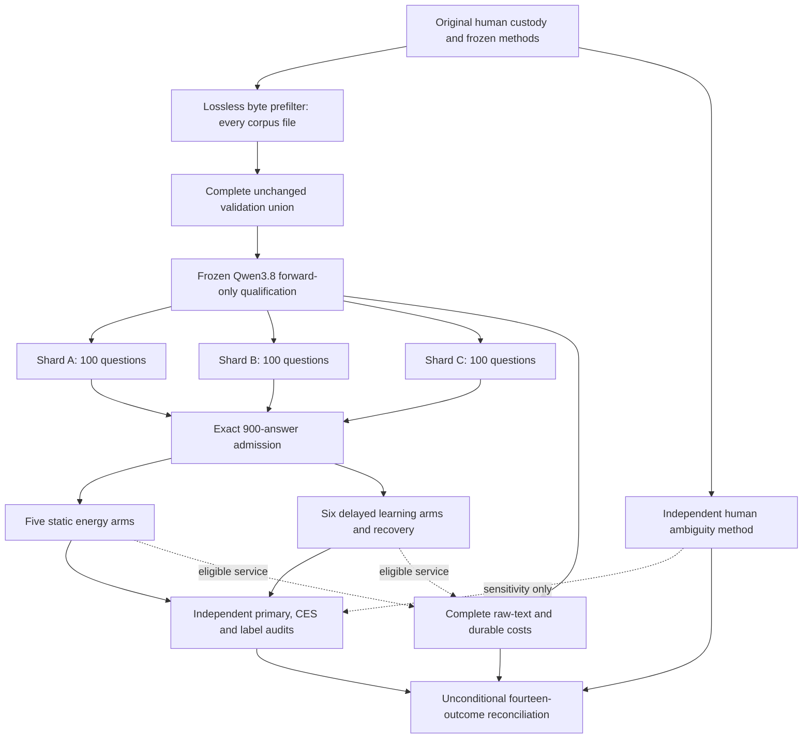

# Carnot Research Roadmap v783: Lossless Corpus Validation, Human Energy Decisions, and Label-Robust Learning

**Milestone:** 2026.11.783  
**Created:** 2026-11-17 America/New_York  
**Status:** Proposed; planning executes no experiment and activates no queue.  
**Predecessor:** 2026.11.782, scheduling complete.  
**Execution contract:** Exactly **14 tasks, Exp9194 through Exp9207**, in the
order shown below, across **four phases**. The embedded complete task objects
must equal `research-roadmap-next.yaml`, including prompts, gates and metadata.

The [V782 design](research-roadmap-v782-preserved-20261117.md) and
[V782 activated queue](research-roadmap-v782-queue-preserved-20261117.yaml)
are preserved byte for byte. The active roadmap and conductor are unchanged.
At planning read time the completion archive ends at V781; V782 primaries and
`ops/conductor-log.md` establish its outcomes. Scheduling completion is not
scientific success.

## What V782 proved

| Experiment | Observed outcome | Limit |
|---|---|---|
| Exp9180 | Contract and original human methods authenticated | Administrative readiness, no new inference |
| Exp9181 | Controlled case: 91 structural scans became 1, with zero canonical hashes; targeted tests and owned coverage passed | `complete_disqualified_causal_validation`; direct consumers did not finish |
| Exp9182 | `blocked_gate_check_failed`, observed correction gate 0 | No complete forward qualification; exact repeated execution scope retired |
| Exp9183–9191 | Nine downstream skips | No Qwen panel, static comparison, learning effect, CES result or service cost |
| Exp9192 | `complete_disqualified_arc_ordering_compatibility` | Affected compatibility tests failed; no live solve or generalization |
| Exp9193 | Reconciliation ready; `complete_blocked_declared_gate` | All fourteen outcomes accounted for; independent-verifier gaps remain open |

Four tasks executed and ten skipped. Primary authority:
`results/experiment_9180_v782_contract.json`,
`results/experiment_9181_v782_causal_validation.json`,
`results/experiment_9192_v782_arc_mechanic_routing.json` and
`results/experiment_9193_v782_capstone.json`. The Exp9182 scheduler refusal is
`results/experiment_9182_forward_qualification.json`, distinct from its absent
intended scientific primary.

Exp9181's `direct_consumers` receipt ran 1224.316 seconds and exited -15.
Its stderr records an outer work cutoff, not an assertion failure or a measured
scientific null. Node events stop inside
`test_no_artifact_on_disk_is_newly_flagged_by_closing_this_hole`. That test
recursively decodes every JSON beneath `results/`. A read-only planning census
counted 714,951 paths and 275,757,334,875 bytes. Those counts are mutable snapshots;
they do not establish decoder throughput or a complete causal profile.

V783 tests a different correction: avoid decoding files that cannot contain any
recognized sentinel. Every file remains in the walk. Potential matches and
Unicode escapes use the original decoder and classifier. The original assertions
and all validation obligations remain. No previous disqualification is cleared.

## Three biggest gaps to the PRD

1. **FR-12: independent factual verification.** Original human labels exist,
   but the forward-feature comparison remains unmeasured. Energy must beat
   matched probability and donor controls, and its dependence on label ambiguity
   must be visible. This exposed panel cannot close independent generalization.
2. **FR-06/FR-11: useful continuous learning.** Durable machinery is not a
   future-loss improvement. Preserve causal feedback, a calibration-only control,
   retained quality and exact recovery. Train only the small verifier.
3. **FR-05/FR-08/NFR-01: reliable and affordable execution.** A corpus-level
   validation walk now scans hundreds of GB. Qualify a lossless correction, then
   measure complete raw-text and durable-update cost before selecting hardware.

The November 7 north star is the oracle-distinct verifier. ARC is opportunistic;
no ARC task is scheduled while its latest compatibility route remains disqualified.
Historical FoVer publication gates stay separate from this new development study.

## Research recorded before design

The V783 entry in [research-references.md](../../research-references.md) records
all eight requested primary topics, the six secondary channels and access limits.

| Primary source | Experiment use | Boundary |
|---|---|---|
| [Labeling Problem, October 2026](https://arxiv.org/abs/2610.08026) and [Automatic Labeling, November 2026](https://arxiv.org/abs/2611.04697) | Exp9197 exact ambiguity masks and endpoint reducer; Exp9205 sensitivity on genuine predictions | Preserve A1 factuality; missing A2 stays missing; no new truth labels |
| [Spilled Energy, February 2026](https://arxiv.org/abs/2602.18671), [ARM–EBM, December 2025/revised May 2026](https://arxiv.org/abs/2512.15605) | Exp9198–9205 unchanged energy/probability and logit-offset controls | Empirical energy is not factual truth |
| [Continual Calibration, April 2026](https://arxiv.org/abs/2604.23987) | Exp9204–9205 causal updates, temperature control, future loss and retention | No imported conformal guarantee or generator training |
| [Online spline locality, February/revised June 2026](https://arxiv.org/abs/2602.02056) | Exp9204 small coefficient updates; Exp9206 full adaptation costs | Sparse arithmetic does not remove full guards and durable storage |
| [Entropy Distribution, May 2026](https://arxiv.org/abs/2605.28264) | Preserve the registered CES comparison in Exp9205 | Secondary ranking cannot rescue primary failures |

EBT and Energy-Based Reasoners remain generator research leads. HardNet++,
Neural Ising Machines, EBD and the million-p-bit FPGA work do not remove the
current input or verification bottleneck. Extropic's Z1T supplies a concrete
sparse JAX repository, but its estimates are not local Carnot measurements.
Kona's product pages supply no reproducible new architecture result.

Semantic Scholar returned 46 EBT and 11 ARM–EBM citation records with no next
page. P(Yes) was checked as a lead. Generated confidence transport was considered
and rejected after the manifest review: Exp5813 closes that mechanism. No
finite-ID, grammar, parser-retry or generated-confidence workaround is proposed.
OpenReview direct retrieval had a browser challenge; Trending was a stale snapshot.

## Architecture



Labels never enter model input. Static fitting uses TRAIN150; online initialization
uses its original TRAIN100. CAL guards promotion; TEST retention cannot select an
update. All current LLM work is forward-only with zero generated tokens. The
model scores archived answers; those answers are not new Qwen generations.

## Phase 1 — Qualify corpus execution and label sensitivity (Exp9194–9197)

Exp9194 binds both complete contracts and original source/method authority.
Exp9195 tests the lossless corpus reader. Exp9196 then executes all 621 original
nodes, 53 additions and every affected V780–V783 obligation. Exp9197 can run
independently of those validation results: it builds exact sensitivity masks
from authenticated human annotations and proves the endpoint reducer on controls.
It makes no verifier-benefit claim before prediction rows exist.

## Phase 2 — Collect the unchanged population (Exp9198–9202)

Exp9198 qualifies serial/chunk128 Qwen forwards and budgets all three complete
300-answer shards. Exp9199–9201 use one collector and distinct checkpoints;
they depend on runtime readiness, not on one another. Exp9202 admits the exact
900-answer union. No changed cap, favorable subset or replacement answer rescues
an incomplete population. CES uses already-required token entropy statistics.

## Phase 3 — Test energy decisions and continuous learning (Exp9203–9205)

Exp9203 fits the original five static arms. Exp9204 runs six delayed-learning
arms with actual hard-exit recovery. Exp9205 audits each available branch even
if the other is unavailable or null. It retains the original two static and
seven learning bounds and the separate three CES contrasts. New ambiguity
intervals are descriptive robustness results, not replacement acceptance gates.

## Phase 4 — Measure complete cost and reconcile (Exp9206–9207)

Exp9206 measures each eligible service with cold/warm model work, all guards,
rejected updates, storage and recovery. Exp9207 always accounts for all fourteen
outcomes, including scheduler skips and the independent ambiguity method.
Retirement applies to authenticated repeated execution scope, not to an
unmeasured scientific hypothesis. No queue activation or external publication.

## Lossless corpus correction and its stop rule

The target classifier recognizes five fixed ASCII substrate strings at the top
level or in the existing principle wrapper. A JSON string spelling any of those
values contains either the literal sentinel or a JSON Unicode escape. Therefore,
absence of every sentinel and of the Unicode escape marker is a necessary
negative condition. It is not a positive classifier.

Stream each file in bounded chunks. Retain overlap of at least the longest
needle minus one byte. A negative decision requires EOF. Any sentinel or Unicode
escape sends the entire file to the unchanged `read_text`/`json.loads` path and
classifier. False-positive candidates are harmless extra parsing. Invalid JSON,
invalid encoding, non-dicts, duplicate keys, wrapped values and annotated suffixes
retain original behavior. No directory, filename, age or size is excluded.
Original `checked > 0` and `offenders == []` assertions remain executable.

Freeze the classifier revision and sentinel inventory together. Add controls for
every sentinel and escape handling; deleting any fallback must fail a control.
Measure original and candidate decoding on identical predetermined size strata.
The planning census is not a content seal. Record a complete current path manifest,
bytes read and changed files. Do not call a concurrently changing corpus complete.
Do not claim full-corpus speedup from a censored baseline.

The new gate is `corpus_scan_ready_score`. Exp9181's old gate remains zero.
Readiness requires the full original target module, original V782 mutation and
structural controls, every affected consumer, immutable receipts and owned coverage.
Exp9196 still runs the entire validation union with original assertions. No subset,
old passing receipt or cache of verdicts can stand in for execution. If full
validation cannot finish, the model branch stays blocked and Exp9197 still runs.

## New label-ambiguity protocol

Use the original 300 question groups and all three answer siblings. A1 remains
the primary binary factual-error target. Actual A2 annotations are observations;
`-1` means missing. Do not replace either annotator with model judgments.

Freeze two sets per original response before model work:

- **Observed-disagreement sensitivity:** agreements fix A1; observed A1/A2
  disagreements permit either binary value; missing A2 fixes A1 but is reported.
- **Missing-annotation envelope:** agreements fix A1; disagreements and missing
  A2 permit either binary value. This deliberately broad envelope does not assume
  that all unobserved annotations would disagree.

For fixed control and treatment error probabilities c and t, the Brier improvement
is `d(y) = (c-y)^2 - (t-y)^2 = c*c - t*t - 2*y*(c-t)`.
It is affine in binary y. Evaluate allowed endpoints to obtain exact minimum and
maximum contrast under each scenario. Use the original equal-qid weights and all
three siblings. An unchanged label belongs to the response, not to a measurement:
for repeated retention across streams/updates, first sum that response's weighted
coefficient, then choose its endpoint. Never assign a different label to the same
response at each appearance. Pairwise worst cases need not be jointly attainable
across several contrasts; do not claim a simultaneous worst-case assignment.

Exp9197 tests the reducer using exhaustive small binary panels, duplicated
retention, permuted order, constant scores, missing annotations and boundary
probabilities. It publishes masks and code receipts, not natural model effects.
Exp9205 uses genuine frozen predictions to report both endpoint intervals beside
the original A1 estimate and sampling interval. Endpoint robustness is conditional
on the declared ambiguity set and is not a confidence interval or factuality proof.
No mask, endpoint, A2 label or sensitivity result selects training, temperature,
learning promotion or primary acceptance. Missing sensitivity authority blocks
only that secondary branch.

## Frozen scientific protocols


The following methods preserve the V778 and V779 scientific contract. Their implemented
authorities are Exp9126 and Exp9132. Their immutable receipts take precedence
over mutable checkout files. The new diagnostic section below adds no acceptance
gate and changes no arm, cohort, optimization rule or interval threshold.

### Whole-answer forward statistics

Use original TRAIN150/CAL50/TEST100 question groups, three siblings each.
Primary target is original A1 factuality. A2 sensitivity uses only actual observed
labels; unknown -1 stays missing. The task evaluates archived answers under Qwen,
not newly generated Qwen answers. No answer accuracy claim transfers to Qwen.

Preserve V777's exact protocol. Tokenize question/answer separately with the
embedded tokenizer, no BOS or chat template, and right caps256/768. The prefix is
literal `Question:\n`, retained question text and literal `\nAnswer:\n`.
Freeze detokenization and prefix bytes. Append retained answer token IDs explicitly.
Reset state for every answer. Capture in128-token chunks with the preceding-prefix
logit for the first answer token. Preserve adjacent pairs across chunk boundaries.

For full-vocabulary logits z_i and answer token a_i, compute in stable float64:

- L_i=logsumexp(z_i); NLL_i=L_i-z_i[a_i].
- p_i=softmax(z_i); H_i=-sum_v p_iv*log(p_iv).
- Marginal energy M_i=-L_i.
- Adjacent spill D_i=-z_i[a_i]+L_(i+1), within one answer, i=1..length-1.

The seven features are log1p(answer length), mean NLL, mean H, maximum H,
mean M, mean absolute D and the no-adjacent-pair indicator. Retain selected logits,
L_i, H_i, max probability, token IDs, positions and full-vector hashes per token.
One-token answers lack only spill; TRAIN-only median imputation is fixed. An
entirely missing training feature blocks fitting. Empty answers retain their slots
as escalations. Loss contrasts share predeclared nonempty support; coverage uses
all original TEST rows. No label-based filtering is permitted.

Store full vectors for the first eight answer positions of the global first20
lexical qids/all siblings. Preflight2GiB for bounded raw evidence. Stream statistics
instead of retaining all900 complete token-by-vocabulary arrays in RAM.

### Static energy decisions and susceptibility

The five original arms are prevalence, probability+length logistic (first four
features), raw-energy logistic (length, mean M, mean absolute D, missing-pair
indicator), combined logistic (all seven) and combined with whole-qid TRAIN donor
labels. Donors use a fixed nonidentity cyclic permutation of sorted TRAIN qids;
sibling positions stay fixed. Report the actual changed-label numerator/denominator.

These are binary Gibbs energies E(0)=0, E(1)=-theta·phi and
p(error)=sigmoid(theta·phi). Fit TRAIN-only population mean/std, with constant
scale1. Minimize mean binary logloss plus0.5*0.01 times squared nonintercept
coefficients. L-BFGS-B starts at zero: maxiter2000, gtol1e-7, ftol1e-12.
Require finite parameters/objective and gradient infinity norm<=1e-6.
No regularization or architecture search is scheduled.

CAL alone selects temperature from[0.5,1,2,4], ascending ties. Accept at
p(error)<=0.1; reject at>=0.9; otherwise escalate. Seal TEST predictions before
evaluator access. Report Brier, logloss, coverage, accepted error and exact-half-
coverage error. Rerank half-coverage choices inside each resampled draw.

Use10000 paired TEST-qid bootstrap draws, seed777121, preserving siblings.
`energy_increment_score=1` requires both combined-arm Brier improvement lower
bounds>0 against probability+length and donor, with one-sided tail0.05/2.
Empirical accepted error must not increase versus probability+length.
Undefined accepted risk cannot pass. These are conditional development intervals.

Add c_i=3 or c_i=3*(-1)^i to every vocabulary logit. Normalized probabilities,
NLL and entropy must remain unchanged. M changes by -c_i; D changes by
c_(i+1)-c_i. Report raw-score and frozen-head sensitivity under both gauges.
Do not select the favorable gauge. A gauge-sensitive score can be an empirical
representation signal; it is not evidence of a broken probability chain rule.
The original Exp6980 exact-span null and V776 embedding study remain unchanged.

### Continuous self-learning with a recalibration control

Preserve the original SHA256(`v776-online`+qid) ordering:100 TRAIN groups for
initialization and50 for ten disjoint streams of five. Original CAL50 is the
operational guard; TEST100 is research retention. Preserve the Exp9099 donor map
(seed776099, initialization labels only, original sibling positions).

Fit imputation and scaling only on the100 initialization groups. After standard
scaling, fit initialization min/max to[-1,1], constants0, and clip later inputs.
Use the seven logit features with fixed cubic knots
[-1,-1,-1,-1,-0.5,0,0.5,1,1,1,1]: intercept, seven linear columns and49 basis
columns. Use the existing spline helper. Fit initial heads with the static ridge
objective and convergence contract; temperature starts at1. No random projection
or embedding transformation is used in this separate seven-feature study.

Six arms are frozen spline, adaptive spline, bias-only spline, adaptive linear,
donor-label spline and temperature-only spline. All start from comparable
initial fits. For the original adaptive arms, retain the Exp9099 gradient:
`(sigmoid(theta·phi)-y)*phi + 0.01*(theta-theta_initial)`, with no intercept
anchor. Bias-only zeros other coordinates. Clip L2 norm to1. Use AdaGrad,
learning rate0.05, accumulator initially0 and epsilon1e-8. Apply three sibling
updates in original order, then test promotion once per released qid.

For temperature-only adaptation, keep spline coefficients fixed. Let s be its
initial logit, u=log(T), q=exp(-u), p=sigmoid(q*s). Initially u=0. Use gradient
`(y-p)*q*s + 0.01*u`, clipped to[-1,1], with the same AdaGrad settings.
Clip updated u to[log(0.5),log(4)]. Persist u and its accumulator. This comparator
uses the same feedback and guard access; it is not a multi-group MT-CC replication.

Promote only if complete CAL Brier increase<=0.005 and CAL classification-error
increase<=0 versus that arm's initial state. Otherwise restore parameters and
accumulators while acknowledging consumed feedback. Research retention does not
participate in this decision. Seal all18 sibling/arm predictions for g before
releasing labels for g-1. Drain the final group after all predictions. Reset
every stream to identical initial states. No static150 data may enter this fit.

Atomic snapshots include predictions, parameters, accumulators, temperature,
pending feedback and acknowledgments. Real hard exits at prediction fsync,
feedback receipt and state replacement must reproduce uninterrupted states and
predictions exactly. Preserve private actual-child E2E-020 coverage.

Evaluate future groups2–5:40 distinct qids/120 responses. Use10000 paired stream
bootstrap draws, seed778135, one-sided tail0.05/7. The seven simultaneous bounds
are five adaptive-spline future Brier improvements over each other arm (lower>0),
retained Brier increase (upper<=0.005), and retained classification-error increase
(upper<=0). All seven plus exact recovery are needed for `learning_signal_score=1`.
This adds a comparator and tightens multiplicity correction; it does not replace
the old six-bound embedding protocol. Report per-qid retention changes averaged
over streams. Repeated retention is100 questions, not1000. Ten streams have limited
power and the intervals condition on the initial fit, guard and retention panel.


## Descriptive diagnostics fixed before execution

Reuse Exp9141's authenticated evaluator masks and original agreement counts.
Unknown A2 labels stay missing. Agreement is not an accuracy ceiling. Static
slices distinguish mixed-correctness siblings from homogeneous qids. These
label-defined masks never enter feature extraction, fitting or decisions.

For online predictions, retain `abs(p_adaptive-p_initial)>=0.05` and crossings
of the fixed0.5 classification threshold. Membership uses predictions only.
Compare every arm on identical changed and unchanged units. Report Brier,
`mean(p-y)`, exact counts and unavailable empty slices. Use paired whole-stream
resampling for future and retention contrasts, conditional on the fixed panels.

The new TOOD-inspired diagnostic compares ranking, scale and calibration at
each released-group update. Use the same TEST100 qids and all siblings for every
arm. Record raw logits, RMS logit magnitude, tie-aware AUROC, Brier and class
counts before and after each update. Rejected updates retain their unchanged
state. One-class AUROC remains unavailable. Report every stream and update.
No threshold, temperature, group or model is selected from these results.
This diagnostic cannot rescue any failed primary bound. It tests whether the
observed behavior is consistent with scale drift or lost ranking information;
it cannot identify a causal mechanism from a correlation alone.


## Additional descriptive diagnostic: exact Brier moments

Use the frozen original supports and equal-qid weighting. Let p be predicted
error probability and y the human error label. Use population moments throughout:

`Brier = (mean(p)-mean(y))^2 + (sd(p)-sd(y))^2 + 2*(sd(p)*sd(y)-cov(p,y))`.

The three terms are squared mean bias, variance mismatch and covariance deficit.
Compute the last term directly from covariance when either variance is zero;
correlation is then unavailable. The identity must match direct Brier within
1e-12 on deterministic controls and measured rows. Report raw signed residuals.
Do not clamp roundoff before checking the identity. Empty supports remain unavailable.

Use all five static arms and all six online arms. Report static TEST, future
stream support and each retained panel separately. The original qid and stream
resampling units apply to diagnostic deltas. Neither labels nor these diagnostics
select features, update rules, temperatures or promotion thresholds. No new
significance test replaces the original two static and seven learning bounds.

## Secondary experiment: a frozen entropy reference

Exp9194 fixes this protocol before model work. For all nonempty A1-correct
TRAIN150 answers, pool token entropies and define F0(x) as the fraction<=x.
Preserve the paper's token weighting and report tokens and distinct qids.
A missing correct reference blocks this branch. No CAL or TEST response defines
F0. For each TEST answer, compute `CES=sqrt(F0(mean(H))*F0(max(H)))`.
Larger CES, mean H and max H predict error. CES is not an error probability.

Compare CES AUROC against mean H, max H and the probability+length head's error
probability. Use10000 paired TEST-qid bootstrap draws, seed782190, preserving
siblings and half-credit ties. Require every contrast's one-sided lower bound
at tail0.05/3>0 for `entropy_reference_signal_score=1`. If a draw lacks either
class, the affected interval is unavailable; do not drop/redraw it to obtain a
favorable interval. Retain raw estimates and valid/invalid draw counts. Score
all original nonempty TEST answers; report empty exclusions and all900 original
slots separately. Missing fitted-head predictions block that contrast, not the
mean/max comparisons. Completion and effect gates are separate.

Record per-answer token count, lag1 correlation when variance/support permit,
ties, mean/max entropy and every score. An empty answer or one-class TEST set
cannot receive invented AUROC. This is a secondary ranking experiment: no new
probability threshold, learned feature, online arm or primary bound. Its outcome
can motivate a later study, not close independent factual verification.


## Complete cost and hardware requirements

Use first20 TEST qids/all60 siblings, three fresh processes, seed776108 and
probability parity atol1e-5/rtol1e-4 with exact typed decisions. Distinguish cold
load, warm uncached raw-text service and cached-feature head timing. Include
forward passes, full-vocabulary reduction, transfer, transforms and serialization.
Online costs include initialization, proposal, rejection, all guards, fsync,
acknowledgment, drain and recovery. Retain censored units and complete denominators.

| Resource | Requirement and claim boundary |
|---|---|
| CPU/RAM | Validation, small-head fitting, bootstrap and durable updates; measure peak memory and stream vocabulary statistics. |
| Private disk | At least2GiB for designated raw vectors plus measured traces/checkpoints; test actual free space. |
| GPU0 RTX3090 24GB | Verify CUDA offload under the existing lease. Five model tasks execute serially; do not disturb GPU1 ownership. |
| Mandated model | Frozen `unsloth/Qwen3.8-27B-GGUF`, Q4_K_M, existing `cached_current_model(gpu_index=0)` resolver; pin model, tokenizer and runtime hashes. |
| KV260 | Preserve qualified Ising operations and k_max<=5; no dense Qwen or spline-training kernel is inferred. |
| PolarFire | Preserve qualified Linux CPU dispatch; this does not prove fabric acceleration. |
| GateMate | Preserve unchanged physical/JTAG `0xffffffff` blocker; no identical probe without changed physical attestation. |
| NPU/TSU/larger FPGA wishlist | Require access, matching operations and a measured bottleneck before implementation or procurement. |

Continuous learning has a CPU path now and possible batched GPU/native or
fixed-point FPGA arithmetic later. Dense anchors, guard scans and disk commits
remain part of its cost. Amdahl's limit is `1/(1-f)` for an infinitely fast
replacement of fraction f: at least0.99 for100x,0.90 for10x; finite acceleration
needs strictly more coverage. Unknown fractions stay unknown. Sampling hardware
cannot by itself remove dense forwards or durable storage. No power claim without
measured energy integrals, and no purchase or board operation is scheduled.


## Execution, routing and stop rules

Every prompt requires numbered flushed progress at phase boundaries, before and
after minute-scale calls, and inside long loops. Blocking children get 60-second
heartbeats; every silence gap stays below 600 seconds. Files over about 200 lines
are written in bounded tool calls with progress between them. The 4800-second cap
contains 3300 seconds of work, 1200 of final checks and 300 of publication; child
cleanup shares the same deadline. Each current validation obligation runs once.

The five model tasks use `unsloth/Qwen3.8-27B-GGUF` through the current resolver.
All request `model_load_no_generation` (2-second floor): actual forward work,
zero generated tokens. A refusal before load records `blocked_no_run`; attempted
loads remain attempted loads. No artificial padding or CPU simulation can qualify.
If scope ever includes short generation, it requires bounded-generation receipts
and the 10-second class; real full generation has a 60-second floor. Neither is
scheduled here. Historical or cached Qwen provenance is not current model work.

Exp9195 and Exp9196 route to Claude Opus with 100 turns for the corpus
preflight correction and complete validation coordination. Formulaic collection, admission and contract tasks use Codex
`gpt-6.1-sol`. The new label method and judgment-heavy scientific tasks retain
Sonnet. No Luna or Gemini task is scheduled. Per-task budgets remain in the YAML.

Every comparative task emits primitive rows. All artifacts declare the closed
verdict class next to the terminal honest verdict and principle-annotated fields.
External absence is blocked; only retryable unfinished owned work is partial.
Every blocked result gives `gate_check_summary` with its exact failed operand.
A readiness score measures completeness and checks, never a favorable result.

Exp9181/9182 remain retired; neither is a new dependency. Their matching new
scopes carry complete prior-failure records and the standing May 29 versioned-
continuation rationale naming the changed corpus algorithm. All prior scientific
nulls and original two/seven/three bounds remain. No new mechanism reopens the
retired finite-ID generation, importance-anchor or projection lanes.

## Dependency graph

These are the exact structured gates; all listed checks require value 1. Tasks
are executed in table order. Scientific success never gates an audit. Exp9197
depends only on human custody and can run after an execution-branch failure.
Exp9207 has no structured prerequisite. Optional audit/cost inputs remain
branch-specific checks, not conjunctive gates that discard eligible evidence.

| Task | Required earlier readiness fields |
|---|---|
| exp9194-contract | None |
| exp9195-corpus-prefilter | exp9194-contract.contract_ready_score |
| exp9196-forward-qualification | exp9195-corpus-prefilter.corpus_scan_ready_score |
| exp9197-label-ambiguity | exp9194-contract.source_ready_score |
| exp9198-logit-runtime | exp9196-forward-qualification.forward_validation_ready_score; exp9194-contract.static_methods_ready_score |
| exp9199-logits-a | exp9194-contract.source_ready_score; exp9198-logit-runtime.logit_runtime_ready_score; exp9198-logit-runtime.shard_feasible_score |
| exp9200-logits-b | exp9194-contract.source_ready_score; exp9198-logit-runtime.logit_runtime_ready_score; exp9198-logit-runtime.shard_feasible_score |
| exp9201-logits-c | exp9194-contract.source_ready_score; exp9198-logit-runtime.logit_runtime_ready_score; exp9198-logit-runtime.shard_feasible_score |
| exp9202-logit-admission | exp9199-logits-a.logits_a_ready_score; exp9200-logits-b.logits_b_ready_score; exp9201-logits-c.logits_c_ready_score |
| exp9203-static-energy | exp9202-logit-admission.admission_ready_score; exp9194-contract.static_methods_ready_score |
| exp9204-delayed-learning | exp9202-logit-admission.admission_ready_score; exp9194-contract.online_methods_ready_score |
| exp9205-decision-audit | exp9202-logit-admission.admission_ready_score |
| exp9206-complete-cost | exp9198-logit-runtime.logit_runtime_ready_score |
| exp9207-capstone | None |

## Task contract

Exactly **14 tasks, Exp9194 through Exp9207**, with these exact IDs and order.
Every row has a concrete JSON deliverable; implementation scripts are named in
its prompt. This table and the complete YAML below describe the same work.

| Order | Phase | Task ID | Deliverable |
|---|---|---|---|
| 1 | 1 | exp9194-contract | `results/experiment_9194_v783_contract.json` |
| 2 | 1 | exp9195-corpus-prefilter | `results/experiment_9195_v783_corpus_prefilter.json` |
| 3 | 1 | exp9196-forward-qualification | `results/experiment_9196_v783_forward_qualification.json` |
| 4 | 1 | exp9197-label-ambiguity | `results/experiment_9197_v783_label_ambiguity.json` |
| 5 | 2 | exp9198-logit-runtime | `results/experiment_9198_v783_logit_runtime.json` |
| 6 | 2 | exp9199-logits-a | `results/experiment_9199_v783_logits_a.json` |
| 7 | 2 | exp9200-logits-b | `results/experiment_9200_v783_logits_b.json` |
| 8 | 2 | exp9201-logits-c | `results/experiment_9201_v783_logits_c.json` |
| 9 | 2 | exp9202-logit-admission | `results/experiment_9202_v783_logit_admission.json` |
| 10 | 3 | exp9203-static-energy | `results/experiment_9203_v783_static_energy.json` |
| 11 | 3 | exp9204-delayed-learning | `results/experiment_9204_v783_delayed_learning.json` |
| 12 | 3 | exp9205-decision-audit | `results/experiment_9205_v783_decision_audit.json` |
| 13 | 4 | exp9206-complete-cost | `results/experiment_9206_v783_complete_cost.json` |
| 14 | 4 | exp9207-capstone | `results/experiment_9207_v783_capstone.json` |

## Deferred work and reopen conditions

- No ARC compatibility rerun, hidden-game solve, registry edit or board probe.
- No generated-ID/confidence transport workaround for the blocked forward path.
- No new generator training, raw-energy threshold search or reduced human cohort.
- No independent-verifier or publication claim from exposed development results.
- A later untouched human confirmation needs a useful qualified development
  result and independent label/source custody. A hardware implementation needs
  a measured bottleneck, matching operations and authenticated device access.

## Full machine-readable contract

The complete objects below are normative and equal the proposed execution file.

```yaml
milestone: 2026.11.783
milestone_title: Lossless Corpus Validation, Human Energy Decisions, and Label-Robust
  Learning
milestone_doc: openspec/change-proposals/research-roadmap-vNEXT.md
tasks:
- id: exp9194-contract
  title: 'Exp9194: Bind fourteen tasks and preserve human methods and V782 failures'
  phase: 1
  track: infrastructure
  priority: high
  requires_gpu: false
  max_turns: 30
  estimated_wall_time_min: 45
  per_unit_rows: true
  milestone: 2026.11.783
  deliverable: results/experiment_9194_v783_contract.json
  inference_substrate_class: no_model_load
  MODEL_SPECS: []
  model: gpt-6.1-sol
  prior_failures:
  - experiment_id: exp7329-contract
    verdict: complete_disqualified_v644_contract_mismatched_or_invalid
    addressed_by: Generate both full contracts from one list; compare every object before activation.
    retire_if_same_verdict: true
  - experiment_id: exp7421-contract-ingestion
    verdict: complete_disqualified_stale_markdown_contract_with_method_ingestion
    addressed_by: Preserve V782 authority and generate both complete V783 contracts from one task list, comparing
      all objects before activation.
    retire_if_same_verdict: true
  prompt: |-
    CONTEXT:
    Work in {project_root} on {date}. V782 closed scheduling with four executed tasks and ten skips; its correction and ARC compatibility remain disqualified. Bind this distinct corpus-scan correction and the unchanged human science. No activation or experiment finding is implied.
    EXISTING CODE TO READ FIRST:
    CLAUDE.md; CODEX.md; ops/north-star.md; ops/e2e-test-plan.md; ops/exclusion_manifest.yaml; openspec/change-proposals/research-roadmap-vNEXT.md; openspec/capabilities/research-reporting/spec.md; scripts/experiment_template.py; python/carnot/reporting/primary_publication.py; python/carnot/reporting/current_work_receipt.py; python/carnot/reporting/v782_contract.py; python/carnot/reporting/v782_capstone.py; python/carnot/reporting/human_authority_9097.py; python/carnot/reporting/logit_methods_9126.py; python/carnot/reporting/online_methods_9132.py; results/experiment_9180_v782_contract.json; results/experiment_9181_v782_causal_validation.json; results/experiment_9193_v782_capstone.json; openspec/change-proposals/research-roadmap-v782-preserved-20261117.md; openspec/change-proposals/research-roadmap-v782-queue-preserved-20261117.yaml; research-roadmap-next.yaml
    TASK:
    Exp9194: Bind fourteen tasks and preserve human methods and V782 failures. Deliver results/experiment_9194_v783_contract.json. Implement scripts/experiments/experiment_9194_v783_contract.py using existing seams. MODEL_SPECS: []. Requested inference_substrate_class: no_model_load. No current LLM load or generation; current_llm_invocations=0, generated_tokens=0.
    CONCRETE STEPS:
    1. Emit a flushed progress line at each phase boundary and before and after every model load, generation, benchmark or subprocess that can take minutes. Print inside long loops and supervise blocking calls with flushed heartbeats every 60 seconds. Keep every silence gap below 600 seconds. Write any file over about 200 lines in several tool calls of at most 200 lines; send a progress message between calls. Never use one huge tool call.
    2. PRECONDITIONS: authenticate exact inputs, immutable producer hashes and named gate operands. Check CPU, memory, private free disk and required tools. Record missing_file, missing_field and observed zero separately in gate_check_summary. External absence is terminal blocked, never partial. Do not repin historical evidence to mutable checkout bytes.
    3. Before implementation use rg to inspect every caller. Confirm the REQ-REPORT-9194-V783 / SCENARIO-REPORT-9194-V783 in the research-reporting spec, extend the spec first, then add failing controls before code. Preserve original assertions, artifacts and quarantines. Freeze units, formulas, exclusions and the complete affected validation scope before outcomes.
    4. Compare all fourteen ordered complete objects in the design and proposed/activated queue, including prompts, IDs, gates and model metadata. Preserve V782 design and queue bytes. Verify new ID availability against the archive, current queue, manifest and canonical artifacts; exclude only this task own canonical output from collision checks. Do not perform activation.
    5. Authenticate the original Exp9097 human authority and Exp9126/9132 methods through their retained original bytes, not by changing pins. Preserve 300 qids/900 siblings with TRAIN150/CAL50/TEST100 and lexical qid shards 0:100,100:200,200:300. Retain source-ready, static-method and online-method gates independently of contract readiness.
    6. Freeze the additional label ambiguity protocol in the design: observed A1/A2 disagreement sets and a separate missing-A2 envelope, exact affine Brier contrast endpoints, fixed qid/stream weights and no replacement of the original primary gates. Reuse original Brier-moment and CES protocols without rewriting them.
    7. Inventory the complete original621 plus53 added validation nodes and all affected V780-V783 obligations, including the stalled full-corpus duration node. No assertion, file category or historical quarantine is removed. Preserve Exp9181/9182 retirement; the new gate is corpus_scan_ready_score, not a rewrite of causal_fix_ready_score.
    8. Run owned unit tests and actual child-process coverage with 100 percent owned statements and zero exclusions. Preserve original assertions. Run scoped Ruff check/format, strict mypy and scripts/check_spec_coverage.py with explicit test paths. Run private real CLI success, refusal, tamper and cold replay outside the checkout without PYTHONPATH under E2E-018/021; learning/recovery changes also require E2E-020. Every affected failure disqualifies readiness; record unrelated repository health separately.
    9. Stop measurement by 3300 seconds using one monotonic deadline for descendants and cleanup. Reserve 1200 seconds for final verification and 300 for publication within the 4800-second cap. Preserve unfinished units and censor reasons. Recompute every claim from rows. Run scripts/adversarial_verify.py and scripts/verdict_row_consistency_lint.py --strict with heartbeats; publish through primary_publication only after actual checker receipts pass. Reconcile openspec/, _bmad/traceability.md, ops/status.md and ops/changelog.md. Do not activate a queue, change the exclusion manifest, publish externally or modify historical results.
    REQUIRED ARTIFACT FIELDS:
    - honest_verdict: complete_* for terminal outcomes; partial_* only for retryable owned work; principle: A terminal prefix must agree with its verdict class.
    - verdict_class: positive | circular_positive | null | blocked | disqualified | partial; principle: External absence, retirement or gate failure is blocked. Only unfinished owned work is partial.
    - gate_check_summary: check, upstream, path, sha256, artifact_field, op, expected, observed, passed; principle: Every blocked result names its failed operand; missing evidence differs from an observed zero.
    - preconditions_checked: resource, available and actual check receipt; principle: Unavailable resources cannot produce invented measurements.
    - rows: unit_id, qid/group, sibling, arm/condition, seed, absolute metrics, numerator, denominator, status, exclusion_reason, censor_reason; principle: All comparative headlines must be reproducible from their independent units.
    - sample_size_budget: intended, attempted, completed, failed, censored, effective_independent_groups; principle: Siblings and repeated retention do not multiply independent sample size.
    - verifier_is_oracle: boolean; principle: Reusing executable truth as the verifier requires circular_positive, not an independent verifier win.
    - claim_scope: exposure_scope, independent_generalization_score=0 and allowed claims; principle: Exposed development and fixtures cannot close the independent-verifier gaps.
    - MODEL_SPECS: actual requested list and invocation status; principle: An upstream model reference is not current model work.
    - inference_substrate_class: actual class and requested_inference_substrate_class; principle: Use blocked_no_run for refusal before loading; attempted loads remain attempted loads.
    - inference_substrate: operation-accurate work description; principle: Forward work, generation and cached CPU reduction have different evidence requirements.
    - model_invocation_counts: current_llm_invocations, loads attempted/completed/failed, forward calls, generated_tokens; principle: Counters must agree with actual operation-specific receipts.
    - duration_s: measured wall time; principle: No artificial sleeping or duration padding may satisfy a substrate floor.
    - random_seed: fixed before outcomes; principle: A frozen seed permits replay without favorable seed selection.
    - reproducibility_checksum: inputs and configuration digest; principle: Changed inputs cannot pass as the original experiment.
    - source_references: original producer paths, SHA256 and imported fields; principle: Historical evidence retains its original authority.
    - code_config_hashes: owned implementation, tests and configuration; principle: Validation qualifies the executed revision.
    - current_work_receipts: operation-specific records; principle: Historical receipts cannot certify current inference.
    - validation_receipts: commands, logs, exit codes and coverage references; principle: Self-reported passing checks do not establish readiness.
    - required_checks_passed: boolean; principle: Readiness requires every affected check.
    - acceptance_gates: fixed conditions, each with a principle annotation; principle: Outcome-dependent thresholds cannot manufacture success.
    - protocol_references: source, evaluator labels, static, online, diagnostic and three shard rosters; principle: Consumers share immutable inputs with exact names.
    - contract_ready_score: integer 0/1; principle: Exact full-object agreement is administrative readiness, independent of scientific effects.
    - source_ready_score: integer 0/1; principle: Original authenticated roles and labels cannot be replaced with convenient current bytes.
    - static_methods_ready_score: integer 0/1; principle: Exp9126 five arms and both original bounds remain fixed.
    - online_methods_ready_score: integer 0/1; principle: Exp9132 six arms, recovery and seven bounds remain fixed.
    - full_task_objects: fourteen ordered complete objects; principle: A short aspirational task list is not an execution contract.
    - validation_scope_manifest: original and affected nodes with code/test hashes; principle: Corpus optimization grants no omitted-test credit.
    - label_ambiguity_protocol_reference: immutable path and SHA256; principle: Label sensitivity is fixed before predictions and never selects an update.
    Run command: cd {project_root} && JAX_PLATFORMS=cpu .venv/bin/python -u scripts/experiments/experiment_9194_v783_contract.py --date {date}
    Do NOT push. Do NOT modify scripts/research_conductor.py.
  agent_type: codex
- id: exp9195-corpus-prefilter
  title: 'Exp9195: Qualify a lossless byte prefilter for the complete corpus walk'
  phase: 1
  track: infrastructure
  priority: high
  requires_gpu: false
  max_turns: 100
  estimated_wall_time_min: 75
  per_unit_rows: true
  milestone: 2026.11.783
  deliverable: results/experiment_9195_v783_corpus_prefilter.json
  inference_substrate_class: no_model_load
  MODEL_SPECS: []
  model: opus
  gated_on:
  - upstream: exp9194-contract
    artifact_field: contract_ready_score
    op: ==
    value: 1
  prior_failures:
  - experiment_id: exp9181-validation-loop-repair
    verdict: complete_disqualified_causal_validation
    addressed_by: Exp9181 completed local structural controls but was cut off inside a recursive JSON corpus scan.
      The new method filters impossible sentinel matches before decoding while visiting every file and preserving
      every assertion; it does not retry structural caching.
    retire_if_same_verdict: true
  - experiment_id: exp9167-causal-validation
    verdict: complete_disqualified_causal_validation
    addressed_by: New Exp9195 tests a lossless byte prefilter for the demonstrated full-corpus JSON decode bottleneck,
      preserving every path and assertion. Only corpus_scan_ready_score=1 permits Exp9196 to execute the entire
      original and affected validation union. Old structural caching or a changed forecast is insufficient.
    retire_if_same_verdict: true
  - experiment_id: exp9153-measured-validation
    verdict: complete_blocked_validation_prerequisite
    addressed_by: New Exp9195 tests a lossless byte prefilter for the demonstrated full-corpus JSON decode bottleneck,
      preserving every path and assertion. Only corpus_scan_ready_score=1 permits Exp9196 to execute the entire
      original and affected validation union. Old structural caching or a changed forecast is insufficient.
    retire_if_same_verdict: true
  - experiment_id: exp9125-receipt-qualification
    verdict: complete_disqualified_bounded_receipt_qualification
    addressed_by: New Exp9195 tests a lossless byte prefilter for the demonstrated full-corpus JSON decode bottleneck,
      preserving every path and assertion. Only corpus_scan_ready_score=1 permits Exp9196 to execute the entire
      original and affected validation union. Old structural caching or a changed forecast is insufficient.
    retire_if_same_verdict: true
  - experiment_id: exp9111-forward-evidence
    verdict: complete_disqualified_owned_checks
    addressed_by: New Exp9195 tests a lossless byte prefilter for the demonstrated full-corpus JSON decode bottleneck,
      preserving every path and assertion. Only corpus_scan_ready_score=1 permits Exp9196 to execute the entire
      original and affected validation union. Old structural caching or a changed forecast is insufficient.
    retire_if_same_verdict: true
  - experiment_id: exp9140-forward-qualification
    verdict: complete_blocked_infeasible_forward_schedule
    addressed_by: New Exp9195 tests a lossless byte prefilter for the demonstrated full-corpus JSON decode bottleneck,
      preserving every path and assertion. Only corpus_scan_ready_score=1 permits Exp9196 to execute the entire
      original and affected validation union. Old structural caching or a changed forecast is insufficient.
    retire_if_same_verdict: true
  prompt: |-
    CONTEXT:
    Work in {project_root} on {date}. Exp9181 completed local structural controls but was cut off inside a recursive JSON corpus scan. The new method filters impossible sentinel matches before decoding while visiting every file and preserving every assertion; it does not retry structural caching.
    EXISTING CODE TO READ FIRST:
    CLAUDE.md; CODEX.md; ops/north-star.md; ops/e2e-test-plan.md; ops/exclusion_manifest.yaml; openspec/change-proposals/research-roadmap-vNEXT.md; openspec/capabilities/research-reporting/spec.md; scripts/experiment_template.py; python/carnot/reporting/primary_publication.py; python/carnot/reporting/current_work_receipt.py; scripts/adversarial_verify.py (_is_arc_live_agent_no_llm, _inference_substrate_text); tests/python/test_adversarial_verify_arc_no_llm_floor_2026_07_30.py; python/carnot/reporting/causal_validation_9181.py; python/carnot/reporting/validation_diagnostics_9181.py; results/experiment_9181_v782_causal_validation.json; python/carnot/reporting/receipt_qualification_9125.py
    TASK:
    Exp9195: Qualify a lossless byte prefilter for the complete corpus walk. Deliver results/experiment_9195_v783_corpus_prefilter.json. Implement scripts/experiments/experiment_9195_v783_corpus_prefilter.py using existing seams. MODEL_SPECS: []. Requested inference_substrate_class: no_model_load. No current LLM load or generation; current_llm_invocations=0, generated_tokens=0.
    CONCRETE STEPS:
    1. Emit a flushed progress line at each phase boundary and before and after every model load, generation, benchmark or subprocess that can take minutes. Print inside long loops and supervise blocking calls with flushed heartbeats every 60 seconds. Keep every silence gap below 600 seconds. Write any file over about 200 lines in several tool calls of at most 200 lines; send a progress message between calls. Never use one huge tool call.
    2. PRECONDITIONS: authenticate exact inputs, immutable producer hashes and named gate operands. Check CPU, memory, private free disk and required tools. Record missing_file, missing_field and observed zero separately in gate_check_summary. External absence is terminal blocked, never partial. Do not repin historical evidence to mutable checkout bytes.
    3. Before implementation use rg to inspect every caller. Confirm the REQ-REPORT-9195-V783 / SCENARIO-REPORT-9195-V783 in the research-reporting spec, extend the spec first, then add failing controls before code. Preserve original assertions, artifacts and quarantines. Freeze units, formulas, exclusions and the complete affected validation scope before outcomes.
    4. Authenticate Exp9181 direct_consumers stdout/stderr and node events. It exited -15 after1224.316 seconds with an outer_work_cutoff; the active node recursively decodes results/**/*.json. Treat the planning size census as advisory. Record a fresh complete path/size manifest and bounded read/decode/classifier timings on deterministic size strata before asserting the cost cause. Do not rerun the failed structural-cache experiment.
    5. Implement one conservative reader for this corpus-impact test: derive all five currently recognized ASCII sentinels from the unchanged classifier constants. Visit every original recursive path. Stream every file to EOF in bounded chunks with enough overlap to detect sentinels and the JSON Unicode escape marker across boundaries. If a sentinel or Unicode escape is present, use the original read_text/json.loads and classifier. Only absence of every sentinel and Unicode escape can skip decoding. Never use filename, directory, size, age, schema or verdict as an exclusion. Keep original malformed/non-dict behavior, checked>0 and offenders==[] assertions.
    6. Prove parity against the original decoder on escaped keys/values, wrapped declarations, suffix boundaries, duplicate keys, malformed UTF-8/JSON, non-dicts, Unicode-escaped sentinels, cross-chunk markers and nested decoys. Run mutation controls deleting each sentinel and the escape fallback. No pass/fail cache, production validator semantic change, monkeypatch of outcomes, test skip or removal of corpus files is allowed. Audit callers before sharing the reader with any other scan.
    7. Measure original versus prefilter on the same bounded, preselected corpus strata; retain every byte/path denominator and censoring. Then execute the complete original target test over the full manifest, plus all original V782 targeted controls and every consumer affected by the new reader. No full-corpus original-versus-new speed ratio from a censored original run. Verify stable candidate bytes and record concurrent file additions or changes; unstable input cannot qualify corpus completeness.
    8. Set corpus_scan_ready_score=1 only when complete path traversal, exact refusal/semantic parity, the full original target module and all affected checks pass within budget. Retain original V782 structural correction code and all unchanged mutation tests. This qualifies the changed corpus walker only; Exp9196 must still run the entire validation union. If the complete corpus does not finish, report the measured remaining work; no subset can pass.
    9. Run owned unit tests and actual child-process coverage with 100 percent owned statements and zero exclusions. Preserve original assertions. Run scoped Ruff check/format, strict mypy and scripts/check_spec_coverage.py with explicit test paths. Run private real CLI success, refusal, tamper and cold replay outside the checkout without PYTHONPATH under E2E-018/021; learning/recovery changes also require E2E-020. Every affected failure disqualifies readiness; record unrelated repository health separately.
    10. Stop measurement by 3300 seconds using one monotonic deadline for descendants and cleanup. Reserve 1200 seconds for final verification and 300 for publication within the 4800-second cap. Preserve unfinished units and censor reasons. Recompute every claim from rows. Run scripts/adversarial_verify.py and scripts/verdict_row_consistency_lint.py --strict with heartbeats; publish through primary_publication only after actual checker receipts pass. Reconcile openspec/, _bmad/traceability.md, ops/status.md and ops/changelog.md. Do not activate a queue, change the exclusion manifest, publish externally or modify historical results.
    REQUIRED ARTIFACT FIELDS:
    - honest_verdict: complete_* for terminal outcomes; partial_* only for retryable owned work; principle: A terminal prefix must agree with its verdict class.
    - verdict_class: positive | circular_positive | null | blocked | disqualified | partial; principle: External absence, retirement or gate failure is blocked. Only unfinished owned work is partial.
    - gate_check_summary: check, upstream, path, sha256, artifact_field, op, expected, observed, passed; principle: Every blocked result names its failed operand; missing evidence differs from an observed zero.
    - preconditions_checked: resource, available and actual check receipt; principle: Unavailable resources cannot produce invented measurements.
    - rows: unit_id, qid/group, sibling, arm/condition, seed, absolute metrics, numerator, denominator, status, exclusion_reason, censor_reason; principle: All comparative headlines must be reproducible from their independent units.
    - sample_size_budget: intended, attempted, completed, failed, censored, effective_independent_groups; principle: Siblings and repeated retention do not multiply independent sample size.
    - verifier_is_oracle: boolean; principle: Reusing executable truth as the verifier requires circular_positive, not an independent verifier win.
    - claim_scope: exposure_scope, independent_generalization_score=0 and allowed claims; principle: Exposed development and fixtures cannot close the independent-verifier gaps.
    - MODEL_SPECS: actual requested list and invocation status; principle: An upstream model reference is not current model work.
    - inference_substrate_class: actual class and requested_inference_substrate_class; principle: Use blocked_no_run for refusal before loading; attempted loads remain attempted loads.
    - inference_substrate: operation-accurate work description; principle: Forward work, generation and cached CPU reduction have different evidence requirements.
    - model_invocation_counts: current_llm_invocations, loads attempted/completed/failed, forward calls, generated_tokens; principle: Counters must agree with actual operation-specific receipts.
    - duration_s: measured wall time; principle: No artificial sleeping or duration padding may satisfy a substrate floor.
    - random_seed: fixed before outcomes; principle: A frozen seed permits replay without favorable seed selection.
    - reproducibility_checksum: inputs and configuration digest; principle: Changed inputs cannot pass as the original experiment.
    - source_references: original producer paths, SHA256 and imported fields; principle: Historical evidence retains its original authority.
    - code_config_hashes: owned implementation, tests and configuration; principle: Validation qualifies the executed revision.
    - current_work_receipts: operation-specific records; principle: Historical receipts cannot certify current inference.
    - validation_receipts: commands, logs, exit codes and coverage references; principle: Self-reported passing checks do not establish readiness.
    - required_checks_passed: boolean; principle: Readiness requires every affected check.
    - acceptance_gates: fixed conditions, each with a principle annotation; principle: Outcome-dependent thresholds cannot manufacture success.
    - protocol_references: source, evaluator labels, static, online, diagnostic and three shard rosters; principle: Consumers share immutable inputs with exact names.
    - corpus_scan_ready_score: integer 0/1; principle: Complete traversal, unchanged assertions and exact semantic parity are all necessary.
    - corpus_manifest_reference: ordered paths, sizes, population hashes and change observations; principle: Every original file remains in scope, including raw and nested results.
    - scan_rows: path, bytes_read, decode_reason, decode_status, original/candidate comparison, duration and censor_reason; principle: Parsing less must not mean checking fewer eligible artifacts.
    - candidate_counts: visited, decoded, safely_negative, malformed, changed and unfinished; principle: Every path has one accountable outcome.
    - parity_controls: each sentinel, escape fallback, chunk boundary and mutation; principle: A filter is useful only if false negatives are excluded.
    - cost_model_rows: same-input read/decode/classification clocks; principle: Size counts alone do not identify the slow operation.
    Run command: cd {project_root} && JAX_PLATFORMS=cpu .venv/bin/python -u scripts/experiments/experiment_9195_v783_corpus_prefilter.py --date {date}
    Do NOT push. Do NOT modify scripts/research_conductor.py.
  agent_type: claude
  operator_override: '2026-05-29 operator directive (standing): versioned lineage continuation vs exp9181-validation-loop-repair;
    change from structural caching to a lossless full-corpus byte prefilter with exact decoder parity and unchanged
    assertions.'
- id: exp9196-forward-qualification
  title: 'Exp9196: Execute the complete causally corrected validation revision'
  phase: 1
  track: infrastructure
  priority: high
  requires_gpu: false
  max_turns: 100
  estimated_wall_time_min: 75
  per_unit_rows: true
  milestone: 2026.11.783
  deliverable: results/experiment_9196_v783_forward_qualification.json
  inference_substrate_class: no_model_load
  MODEL_SPECS: []
  model: opus
  gated_on:
  - upstream: exp9195-corpus-prefilter
    artifact_field: corpus_scan_ready_score
    op: ==
    value: 1
  prior_failures:
  - experiment_id: exp9182-forward-qualification
    verdict: blocked_gate_check_failed
    addressed_by: Exp9182 never ran because the structural correction gate was zero. Require a separately qualified
      lossless corpus traversal, then execute the complete original674 and all affected obligations; no retired
      upstream ID or sampled corpus.
    retire_if_same_verdict: true
  - experiment_id: exp9168-forward-qualification
    verdict: blocked_gate_check_failed
    addressed_by: New Exp9195 tests a lossless byte prefilter for the demonstrated full-corpus JSON decode bottleneck,
      preserving every path and assertion. Only corpus_scan_ready_score=1 permits Exp9196 to execute the entire
      original and affected validation union. Old structural caching or a changed forecast is insufficient.
    retire_if_same_verdict: true
  - experiment_id: exp9154-forward-qualification
    verdict: blocked_gate_check_failed
    addressed_by: New Exp9195 tests a lossless byte prefilter for the demonstrated full-corpus JSON decode bottleneck,
      preserving every path and assertion. Only corpus_scan_ready_score=1 permits Exp9196 to execute the entire
      original and affected validation union. Old structural caching or a changed forecast is insufficient.
    retire_if_same_verdict: true
  - experiment_id: exp9125-receipt-qualification
    verdict: complete_disqualified_bounded_receipt_qualification
    addressed_by: New Exp9195 tests a lossless byte prefilter for the demonstrated full-corpus JSON decode bottleneck,
      preserving every path and assertion. Only corpus_scan_ready_score=1 permits Exp9196 to execute the entire
      original and affected validation union. Old structural caching or a changed forecast is insufficient.
    retire_if_same_verdict: true
  - experiment_id: exp9140-forward-qualification
    verdict: complete_blocked_infeasible_forward_schedule
    addressed_by: New Exp9195 tests a lossless byte prefilter for the demonstrated full-corpus JSON decode bottleneck,
      preserving every path and assertion. Only corpus_scan_ready_score=1 permits Exp9196 to execute the entire
      original and affected validation union. Old structural caching or a changed forecast is insufficient.
    retire_if_same_verdict: true
  prompt: |-
    CONTEXT:
    V783 preserves V782 four-executed/ten-skipped closure and every disqualification. The changed execution prerequisite is the full-corpus byte prefilter, not another structural-cache retry. Work in {project_root} on {date}. V781 completed scheduling with contract/source/method readiness but no model collection. Exp9167 was disqualified; Exp9168 was retired after the repeated blocked gate. The new checker-loop correction must qualify before the preserved scientific chain runs. Keep the exposed-development scope and historical failures.
    EXISTING CODE TO READ FIRST:
    CLAUDE.md; CODEX.md; ops/north-star.md; ops/e2e-test-plan.md; ops/exclusion_manifest.yaml; research-references.md (V783 scan); openspec/change-proposals/research-roadmap-vNEXT.md; openspec/capabilities/research-reporting/spec.md; scripts/experiment_template.py; python/carnot/reporting/primary_publication.py; python/carnot/reporting/current_work_receipt.py; python/carnot/reporting/forward_qualification_9140.py; python/carnot/reporting/validation_schedule_9153.py; python/carnot/reporting/receipt_qualification_9125.py; tests/python/test_forward_qualification_9140.py; results/experiment_9181_v782_causal_validation.json
    TASK:
    Execute the complete causally corrected validation revision. Deliver results/experiment_9196_v783_forward_qualification.json. Implement scripts/experiments/experiment_9196_v783_forward_qualification.py using existing library seams. MODEL_SPECS: []. Requested inference_substrate_class: no_model_load.
    Do not load an LLM. Set current_llm_invocations=0 and generated_tokens=0. Small energy-head training is CPU work. Keep historical model provenance in source_references.
    CONCRETE STEPS:
    1. Emit a flushed progress line at each phase boundary. Emit before and after every model load, generation, benchmark and subprocess that can take minutes. Print inside long loops. Supervise blocking calls with flushed heartbeats every 60 seconds. Keep every silence gap below 600 seconds. Write any file over about 200 lines in several tool calls of at most 200 lines. Send a progress message between writing calls. Never use one huge tool call.
    2. PRECONDITIONS: Authenticate exact required paths, hashes and gate fields before dependent work. Check imports, CPU/memory limits and private free disk. Distinguish missing_file, missing_field and observed zero. Missing external inputs produce terminal blocked evidence with gate_check_summary. Never repin historical evidence to mutable checkout code.
    3. Before implementation inspect callers with rg. Confirm REQ-REPORT-9196-V783 and SCENARIO-REPORT-9196-V783. Extend specs first. Write failing controls before code. Freeze units, exclusions, formulas and validation scope before outcomes.
    4. Authenticate Exp9195 corpus_scan_ready_score and exact source revision. Freeze the union of all 621 original nodes, 53 V779 additions, affected V780 tests and new obligations. Preserve assertion bodies and full command roles. Historical completions do not count as current completions.
    5. Execute the complete normal orchestration once with measured-cost accounting and the causal correction. Retain whole-module fixture lifetimes. Record setup/call/teardown, actual process costs, child exits and coverage after exit. Stop measurement at 3300 seconds. Unknown forecasts cannot establish completion.
    6. Count each obligation once in this invocation; consume authenticated same-invocation results in final verification instead of launching the suite twice. Include semantic/count controls, real CLI refusal/tamper/cold replay, lint, strict types and spec checks. Combine only current actual child coverage. Require 100 percent owned statements with zero exclusions.
    7. Emit forward_validation_ready_score=1 only for the full node/command union, exact revision, coverage and checker semantics unchanged by the optimization. Missing nodes, unresolved stalls or exhausted budget leave readiness zero. Save exact remaining work and causes. Do not lower watchdogs, force feasible=true, drop assertions or repin quarantined history.
    8. Authenticate Exp9195 immutable attempt logs, child coverage and algorithmic parity. Execute all affected V780, V781, V782 and V783 controls in addition to the original union. Do not treat a new task ID as satisfying the retired Exp9168 reopen condition. If the correction is unqualified, the structured gate must skip this task.
    9. The changed prerequisite is Exp9195 full-corpus reader qualification. Preserve original621+53 nodes and every affected V780-V783 obligation, including full recursive-corpus assertions. Run each obligation once under this current revision with original outcomes. Do not execute a historical cached pass, rename a zero prerequisite, or reclassify an unfinished full scan as unrelated health. Any incomplete obligation keeps forward_validation_ready_score=0.
    10. Preserve V782 original methods and failures. Exp9195 qualifies only a lossless corpus-input optimization; Exp9196 must execute all original674 and all affected obligations before model work. Do not reduce the corpus, bypass a test, depend on a retired task ID or reactivate ARC work. Read the preserved V782 design for immutable scientific context.
    11. Run owned unit tests and real child-process coverage with 100 percent owned statements and zero exclusions. Preserve original assertions. Run scoped Ruff check/format, strict mypy and scripts/check_spec_coverage.py with explicit test paths. Execute private real CLI success, refusal, tamper and cold replay outside the checkout without PYTHONPATH, following E2E-018/021. Learning/recovery changes also require E2E-020. Separate unrelated repository health from affected failures. Affected failures disqualify readiness.
    12. Stop measurement by 3300 seconds. Use one monotonic deadline for all descendants, including cleanup; do not spend the reserve on another measurement attempt. Reserve 1200 seconds for final verification and 300 seconds for publication within the 4800-second cap. Count each obligation once; distinguish elapsed time from its watchdog ceiling. Save unfinished units and censor reasons. Recompute claims from rows. Run scripts/adversarial_verify.py and scripts/verdict_row_consistency_lint.py --strict with heartbeats. Publish through primary_publication only after actual checker receipts pass. Reconcile openspec/, _bmad/traceability.md, ops/status.md and ops/changelog.md. Preserve historical primaries, quarantines and exclusions. Do not activate a queue or publish externally.
    REQUIRED ARTIFACT FIELDS:
    - honest_verdict: complete_* for terminal outcomes; partial_* only for retryable owned work; principle: A terminal prefix must agree with its verdict class.
    - verdict_class: positive | circular_positive | null | blocked | disqualified | partial; principle: External absence, retirement or gate failure is blocked. Only unfinished owned work is partial.
    - gate_check_summary: check, upstream, path, sha256, artifact_field, op, expected, observed, passed; principle: Every blocked result names its failed operand; missing evidence differs from an observed zero.
    - preconditions_checked: resource, available and actual check receipt; principle: Unavailable resources cannot produce invented measurements.
    - rows: unit_id, qid/group, sibling, arm/condition, seed, absolute metrics, numerator, denominator, status, exclusion_reason, censor_reason; principle: All comparative headlines must be reproducible from their independent units.
    - sample_size_budget: intended, attempted, completed, failed, censored, effective_independent_groups; principle: Siblings and repeated retention do not multiply independent sample size.
    - verifier_is_oracle: boolean; principle: Reusing executable truth as the verifier requires circular_positive, not an independent verifier win.
    - claim_scope: exposure_scope, independent_generalization_score=0 and allowed claims; principle: Exposed development and fixtures cannot close the independent-verifier gaps.
    - MODEL_SPECS: actual requested list and invocation status; principle: An upstream model reference is not current model work.
    - inference_substrate_class: actual class and requested_inference_substrate_class; principle: Use blocked_no_run for refusal before loading; attempted loads remain attempted loads.
    - inference_substrate: operation-accurate work description; principle: Forward work, generation and cached CPU reduction have different evidence requirements.
    - model_invocation_counts: current_llm_invocations, loads attempted/completed/failed, forward calls, generated_tokens; principle: Counters must agree with actual operation-specific receipts.
    - duration_s: measured wall time; principle: No artificial sleeping or duration padding may satisfy a substrate floor.
    - random_seed: fixed before outcomes; principle: A frozen seed permits replay without favorable seed selection.
    - reproducibility_checksum: inputs and configuration digest; principle: Changed inputs cannot pass as the original experiment.
    - source_references: original producer paths, SHA256 and imported fields; principle: Historical evidence retains its original authority.
    - code_config_hashes: owned implementation, tests and configuration; principle: Validation qualifies the executed revision.
    - current_work_receipts: operation-specific records; principle: Historical receipts cannot certify current inference.
    - validation_receipts: commands, logs, exit codes and coverage references; principle: Self-reported passing checks do not establish readiness.
    - required_checks_passed: boolean; principle: Readiness requires every affected check.
    - acceptance_gates: fixed conditions, each with a principle annotation; principle: Outcome-dependent thresholds cannot manufacture success.
    - forward_validation_ready_score: integer 0/1; principle: Only complete normal-path execution authorizes current model evidence.
    - node_completion_rows: original/additional node IDs, phase exits and actual durations; principle: No duplicated or absent node can satisfy the full union.
    - qualified_revision_reference: exact code and configuration plus full validation receipts; principle: Downstream work uses only the revision actually tested.
    Run command: cd {project_root} && JAX_PLATFORMS=cpu .venv/bin/python -u scripts/experiments/experiment_9196_v783_forward_qualification.py --date {date}
    Do NOT push. Do NOT modify scripts/research_conductor.py.
  operator_override: '2026-05-29 operator directive (standing): versioned lineage continuation vs exp9182-forward-qualification
    and exp9168-forward-qualification; require changed corpus_scan_ready_score before the complete unchanged validation
    union.'
  agent_type: claude
- id: exp9197-label-ambiguity
  title: 'Exp9197: Freeze exact human-label ambiguity envelopes without model work'
  phase: 1
  track: research
  priority: high
  requires_gpu: false
  max_turns: 50
  estimated_wall_time_min: 45
  per_unit_rows: true
  milestone: 2026.11.783
  deliverable: results/experiment_9197_v783_label_ambiguity.json
  inference_substrate_class: no_model_load
  MODEL_SPECS: []
  gated_on:
  - upstream: exp9194-contract
    artifact_field: source_ready_score
    op: ==
    value: 1
  prior_failures:
  - experiment_id: exp9190-decision-audit
    verdict: blocked_upstream_retired
    addressed_by: No prediction study ran. This independently freezes exact label-ambiguity endpoints from already
      authenticated human labels; it needs no absent Qwen logits and makes no verifier-benefit claim.
    retire_if_same_verdict: true
  prompt: |-
    CONTEXT:
    Work in {project_root} on {date}. Recent label-source papers motivate a sensitivity envelope that remains useful when Qwen collection is blocked. This is a new ambiguity calculation, not another agreement recount or a replacement for A1 evaluation.
    EXISTING CODE TO READ FIRST:
    CLAUDE.md; CODEX.md; ops/north-star.md; ops/e2e-test-plan.md; ops/exclusion_manifest.yaml; openspec/change-proposals/research-roadmap-vNEXT.md; openspec/capabilities/research-reporting/spec.md; scripts/experiment_template.py; python/carnot/reporting/primary_publication.py; python/carnot/reporting/current_work_receipt.py; python/carnot/reporting/human_contrast_9141.py; python/carnot/reporting/human_authority_9097.py; python/carnot/reporting/logit_methods_9126.py; results/experiment_9141_v779_human_contrast_audit.json; results/experiment_9180_v782_contract.json; research-references.md (V783 scan)
    TASK:
    Exp9197: Freeze exact human-label ambiguity envelopes without model work. Deliver results/experiment_9197_v783_label_ambiguity.json. Implement scripts/experiments/experiment_9197_v783_label_ambiguity.py using existing seams. MODEL_SPECS: []. Requested inference_substrate_class: no_model_load. No current LLM load or generation; current_llm_invocations=0, generated_tokens=0.
    CONCRETE STEPS:
    1. Emit a flushed progress line at each phase boundary and before and after every model load, generation, benchmark or subprocess that can take minutes. Print inside long loops and supervise blocking calls with flushed heartbeats every 60 seconds. Keep every silence gap below 600 seconds. Write any file over about 200 lines in several tool calls of at most 200 lines; send a progress message between calls. Never use one huge tool call.
    2. PRECONDITIONS: authenticate exact inputs, immutable producer hashes and named gate operands. Check CPU, memory, private free disk and required tools. Record missing_file, missing_field and observed zero separately in gate_check_summary. External absence is terminal blocked, never partial. Do not repin historical evidence to mutable checkout bytes.
    3. Before implementation use rg to inspect every caller. Confirm the REQ-REPORT-9197-V783 / SCENARIO-REPORT-9197-V783 in the research-reporting spec, extend the spec first, then add failing controls before code. Preserve original assertions, artifacts and quarantines. Freeze units, formulas, exclusions and the complete affected validation scope before outcomes.
    4. Authenticate original A1 and actual A2 annotations, qid/sibling IDs and original roles. Preserve A2=-1 as missing. Keep annotator tags, references and evaluator labels out of inference/training views. Retain all900 rows, with no new adjudication, relabeling, consensus target or claimed new independent cohort.
    5. Build two immutable per-response admissible label sets. Observed-disagreement sensitivity: observed agreement fixes A1, observed disagreement permits0/1, missing A2 fixes A1 but is reported. Missing-annotation envelope: observed agreement fixes A1 and every disagreement or missing A2 permits0/1. These are conditional robustness scenarios, not ground-truth sets or assumptions about actual error rates.
    6. Implement the exact endpoints for d(y)=(p_control-y)^2-(p_treatment-y)^2=p_control^2-p_treatment^2-2*y*(p_control-p_treatment). Evaluate both admissible endpoints at each original unit and sum with frozen weights. One label variable is shared across repeated appearances of the same qid/sibling, especially retention across ten streams: first sum its weighted coefficients, then optimize endpoints. Never choose a different label per repeated observation or claim that pairwise bounds share one joint worst case.
    7. Use analytic, binary exhaustive small-panel and permutation/duplicate-retention controls to prove min/max equality, sign correctness, constant predictions, missing labels, exact weights and finite probabilities. Freeze the reducer and masks before any current model prediction. Current900-label masks are empirical source evidence; artificial probabilities are method fixtures only.
    8. Publish label_ambiguity_ready_score only after all controls and custody checks pass. Report exact eligible/missing counts by TRAIN/CAL/TEST and original online supports; no empirical verifier Brier or learning effect exists here. Exp9205 can consume the reducer and report bounds on genuine predictions independently of primary gates. No automatic source-based exclusion or direction selection.
    9. Run owned unit tests and actual child-process coverage with 100 percent owned statements and zero exclusions. Preserve original assertions. Run scoped Ruff check/format, strict mypy and scripts/check_spec_coverage.py with explicit test paths. Run private real CLI success, refusal, tamper and cold replay outside the checkout without PYTHONPATH under E2E-018/021; learning/recovery changes also require E2E-020. Every affected failure disqualifies readiness; record unrelated repository health separately.
    10. Stop measurement by 3300 seconds using one monotonic deadline for descendants and cleanup. Reserve 1200 seconds for final verification and 300 for publication within the 4800-second cap. Preserve unfinished units and censor reasons. Recompute every claim from rows. Run scripts/adversarial_verify.py and scripts/verdict_row_consistency_lint.py --strict with heartbeats; publish through primary_publication only after actual checker receipts pass. Reconcile openspec/, _bmad/traceability.md, ops/status.md and ops/changelog.md. Do not activate a queue, change the exclusion manifest, publish externally or modify historical results.
    REQUIRED ARTIFACT FIELDS:
    - honest_verdict: complete_* for terminal outcomes; partial_* only for retryable owned work; principle: A terminal prefix must agree with its verdict class.
    - verdict_class: positive | circular_positive | null | blocked | disqualified | partial; principle: External absence, retirement or gate failure is blocked. Only unfinished owned work is partial.
    - gate_check_summary: check, upstream, path, sha256, artifact_field, op, expected, observed, passed; principle: Every blocked result names its failed operand; missing evidence differs from an observed zero.
    - preconditions_checked: resource, available and actual check receipt; principle: Unavailable resources cannot produce invented measurements.
    - rows: unit_id, qid/group, sibling, arm/condition, seed, absolute metrics, numerator, denominator, status, exclusion_reason, censor_reason; principle: All comparative headlines must be reproducible from their independent units.
    - sample_size_budget: intended, attempted, completed, failed, censored, effective_independent_groups; principle: Siblings and repeated retention do not multiply independent sample size.
    - verifier_is_oracle: boolean; principle: Reusing executable truth as the verifier requires circular_positive, not an independent verifier win.
    - claim_scope: exposure_scope, independent_generalization_score=0 and allowed claims; principle: Exposed development and fixtures cannot close the independent-verifier gaps.
    - MODEL_SPECS: actual requested list and invocation status; principle: An upstream model reference is not current model work.
    - inference_substrate_class: actual class and requested_inference_substrate_class; principle: Use blocked_no_run for refusal before loading; attempted loads remain attempted loads.
    - inference_substrate: operation-accurate work description; principle: Forward work, generation and cached CPU reduction have different evidence requirements.
    - model_invocation_counts: current_llm_invocations, loads attempted/completed/failed, forward calls, generated_tokens; principle: Counters must agree with actual operation-specific receipts.
    - duration_s: measured wall time; principle: No artificial sleeping or duration padding may satisfy a substrate floor.
    - random_seed: fixed before outcomes; principle: A frozen seed permits replay without favorable seed selection.
    - reproducibility_checksum: inputs and configuration digest; principle: Changed inputs cannot pass as the original experiment.
    - source_references: original producer paths, SHA256 and imported fields; principle: Historical evidence retains its original authority.
    - code_config_hashes: owned implementation, tests and configuration; principle: Validation qualifies the executed revision.
    - current_work_receipts: operation-specific records; principle: Historical receipts cannot certify current inference.
    - validation_receipts: commands, logs, exit codes and coverage references; principle: Self-reported passing checks do not establish readiness.
    - required_checks_passed: boolean; principle: Readiness requires every affected check.
    - acceptance_gates: fixed conditions, each with a principle annotation; principle: Outcome-dependent thresholds cannot manufacture success.
    - protocol_references: source, evaluator labels, static, online, diagnostic and three shard rosters; principle: Consumers share immutable inputs with exact names.
    - label_ambiguity_ready_score: integer 0/1; principle: Custody and exact endpoint controls establish a method, not a useful verifier.
    - ambiguity_masks_reference: every qid/sibling, A1/A2 status and both admissible sets; principle: Missing annotations cannot be invented or silently dropped.
    - endpoint_control_rows: probabilities, admissible assignments, exact and reducer extrema; principle: Repeated measurements share one underlying label.
    - label_exposure_scope: exposed_development_only; principle: Reusing the human panel supplies no untouched confirmation.
    - scientific_effect_measured: false; principle: Fixture probabilities cannot establish a natural-verification benefit.
    Run command: cd {project_root} && JAX_PLATFORMS=cpu .venv/bin/python -u scripts/experiments/experiment_9197_v783_label_ambiguity.py --date {date}
    Do NOT push. Do NOT modify scripts/research_conductor.py.
- id: exp9198-logit-runtime
  title: 'Exp9198: Qualify frozen Qwen forwards and all three shard budgets'
  phase: 2
  track: research
  priority: high
  requires_gpu: true
  max_turns: 50
  estimated_wall_time_min: 65
  per_unit_rows: true
  milestone: 2026.11.783
  deliverable: results/experiment_9198_v783_logit_runtime.json
  inference_substrate_class: model_load_no_generation
  MODEL_SPECS:
  - hf_id: unsloth/Qwen3.8-27B-GGUF
    quantization: Q4_K_M
  model: gpt-6.1-sol
  gated_on:
  - upstream: exp9196-forward-qualification
    artifact_field: forward_validation_ready_score
    op: ==
    value: 1
  - upstream: exp9194-contract
    artifact_field: static_methods_ready_score
    op: ==
    value: 1
  prior_failures:
  - experiment_id: exp9183-logit-runtime
    verdict: blocked_upstream_retired
    addressed_by: The prior scientific run did not execute. A separately qualified lossless corpus prefilter and
      complete unchanged validation now gate current model work; preserve all original data, arms and thresholds.
    retire_if_same_verdict: true
  - experiment_id: exp9169-logit-runtime
    verdict: 'GATE_BLOCK: upstream retired; no canonical honest_verdict artifact'
    addressed_by: The original scientific scope remains unmeasured. New Exp9195 lossless full-corpus traversal
      and Exp9196 complete unchanged validation must qualify before current model work; preserve the original
      data, arms and thresholds.
    retire_if_same_verdict: true
  - experiment_id: exp9155-logit-runtime
    verdict: 'GATE_BLOCK: upstream retired; no canonical honest_verdict artifact'
    addressed_by: A demonstrated causal correction and complete current qualification replace the unknown-cause
      predecessor. Keep supported serial forwards and original tolerances.
    retire_if_same_verdict: true
  prompt: |-
    CONTEXT:
    V783 preserves V782 four-executed/ten-skipped closure and every disqualification. The changed execution prerequisite is the full-corpus byte prefilter, not another structural-cache retry. Work in {project_root} on {date}. V781 completed scheduling with contract/source/method readiness but no model collection. Exp9167 was disqualified; Exp9168 was retired after the repeated blocked gate. The new checker-loop correction must qualify before the preserved scientific chain runs. Keep the exposed-development scope and historical failures.
    EXISTING CODE TO READ FIRST:
    CLAUDE.md; CODEX.md; ops/north-star.md; ops/e2e-test-plan.md; ops/exclusion_manifest.yaml; research-references.md (V783 scan); openspec/change-proposals/research-roadmap-vNEXT.md; openspec/capabilities/research-reporting/spec.md; scripts/experiment_template.py; python/carnot/reporting/primary_publication.py; python/carnot/reporting/current_work_receipt.py; python/carnot/reporting/embedding_runtime_9098.py; python/carnot/reporting/logit_methods_9126.py; python/carnot/reporting/logit_methods_runner_9126.py; results/experiment_9098_v776_embedding_runtime.json; results/experiment_9182_v782_forward_qualification.json
    TASK:
    Qualify frozen Qwen forwards and all three shard budgets. Deliver results/experiment_9198_v783_logit_runtime.json. Implement scripts/experiments/experiment_9198_v783_logit_runtime.py using existing library seams. MODEL_SPECS: [{{"hf_id": "unsloth/Qwen3.8-27B-GGUF", "quantization": "Q4_K_M"}}]. Requested inference_substrate_class: model_load_no_generation.
    Use frozen Qwen teacher-forced forwards only; generated_tokens=0. model_load_no_generation has a 2-second floor. A small-token canary would require model_bounded_generation (10s); a real generative run requires model_full_generation (60s). Do not add either operation here.
    CONCRETE STEPS:
    1. Emit a flushed progress line at each phase boundary. Emit before and after every model load, generation, benchmark and subprocess that can take minutes. Print inside long loops. Supervise blocking calls with flushed heartbeats every 60 seconds. Keep every silence gap below 600 seconds. Write any file over about 200 lines in several tool calls of at most 200 lines. Send a progress message between writing calls. Never use one huge tool call.
    2. PRECONDITIONS: Authenticate exact required paths, hashes and gate fields before dependent work. Check imports, CPU/memory limits and private free disk. Distinguish missing_file, missing_field and observed zero. Missing external inputs produce terminal blocked evidence with gate_check_summary. Never repin historical evidence to mutable checkout code. Before model work, resolve cached_current_model(gpu_index=0), as documented by cached_sota_pair() in the experiment template. Require the mandated local GGUF, embedded tokenizer, GPU0 lease, free VRAM and actual CUDA offload support. Pin GGUF and llama.cpp build hashes. GPU1 remains with its owner. Cache or resource failure blocks; no download or small-model headline fallback.
    3. Before implementation inspect callers with rg. Confirm REQ-REPORT-9198-V783 and SCENARIO-REPORT-9198-V783. Extend specs first. Write failing controls before code. Freeze units, exclusions, formulas and validation scope before outcomes.
    4. Bind the Exp9126 frozen tokenization, prefix, caps256/768, full vocabulary and chunk128 protocol. Use only the supported serial forward API. Do not implement embeddings, batching masks or a different tokenizer. Freeze a six-text pilot selected by text-length quantiles from the label-blind roster before model access.
    5. Check logits for serial versus chunk128 parity with atol1e-5/rtol1e-4, identical token IDs and correct first-answer alignment. Compare sufficient statistics and raw vector hashes. Test one-token answers, context reset, adjacent chunk boundaries and nonfinite-output refusal. Classify pilot source exposure honestly; never retain pilot answers as new independent evidence.
    6. Measure actual load, forward, reduction, serialization, checkpoint and memory/disk costs. Project each of the three300-answer shards from its actual capped token lengths and worst observed per-token rate. Include load and checkpoint overhead. Require each full shard projection<=3300 seconds and available disk>=2GiB raw evidence plus measured storage needs. A watchdog ceiling is not a runtime observation. No row dropping or shorter cap rescues infeasibility.
    7. Validate operation-specific current receipts under Exp9196. Emit logit_runtime_ready_score and shard_feasible_score separately. Both require actual model work; all three shard projections must pass. Generated tokens remain0. Block before collection if any whole shard is infeasible; preserve the unchanged total cohort.
    8. Preserve V782 original methods and failures. Exp9195 qualifies only a lossless corpus-input optimization; Exp9196 must execute all original674 and all affected obligations before model work. Do not reduce the corpus, bypass a test, depend on a retired task ID or reactivate ARC work. Read the preserved V782 design for immutable scientific context.
    9. Run owned unit tests and real child-process coverage with 100 percent owned statements and zero exclusions. Preserve original assertions. Run scoped Ruff check/format, strict mypy and scripts/check_spec_coverage.py with explicit test paths. Execute private real CLI success, refusal, tamper and cold replay outside the checkout without PYTHONPATH, following E2E-018/021. Learning/recovery changes also require E2E-020. Separate unrelated repository health from affected failures. Affected failures disqualify readiness.
    10. Stop measurement by 3300 seconds. Use one monotonic deadline for all descendants, including cleanup; do not spend the reserve on another measurement attempt. Reserve 1200 seconds for final verification and 300 seconds for publication within the 4800-second cap. Count each obligation once; distinguish elapsed time from its watchdog ceiling. Save unfinished units and censor reasons. Recompute claims from rows. Run scripts/adversarial_verify.py and scripts/verdict_row_consistency_lint.py --strict with heartbeats. Publish through primary_publication only after actual checker receipts pass. Reconcile openspec/, _bmad/traceability.md, ops/status.md and ops/changelog.md. Preserve historical primaries, quarantines and exclusions. Do not activate a queue or publish externally.
    REQUIRED ARTIFACT FIELDS:
    - honest_verdict: complete_* for terminal outcomes; partial_* only for retryable owned work; principle: A terminal prefix must agree with its verdict class.
    - verdict_class: positive | circular_positive | null | blocked | disqualified | partial; principle: External absence, retirement or gate failure is blocked. Only unfinished owned work is partial.
    - gate_check_summary: check, upstream, path, sha256, artifact_field, op, expected, observed, passed; principle: Every blocked result names its failed operand; missing evidence differs from an observed zero.
    - preconditions_checked: resource, available and actual check receipt; principle: Unavailable resources cannot produce invented measurements.
    - rows: unit_id, qid/group, sibling, arm/condition, seed, absolute metrics, numerator, denominator, status, exclusion_reason, censor_reason; principle: All comparative headlines must be reproducible from their independent units.
    - sample_size_budget: intended, attempted, completed, failed, censored, effective_independent_groups; principle: Siblings and repeated retention do not multiply independent sample size.
    - verifier_is_oracle: boolean; principle: Reusing executable truth as the verifier requires circular_positive, not an independent verifier win.
    - claim_scope: exposure_scope, independent_generalization_score=0 and allowed claims; principle: Exposed development and fixtures cannot close the independent-verifier gaps.
    - MODEL_SPECS: actual requested list and invocation status; principle: An upstream model reference is not current model work.
    - inference_substrate_class: actual class and requested_inference_substrate_class; principle: Use blocked_no_run for refusal before loading; attempted loads remain attempted loads.
    - inference_substrate: operation-accurate work description; principle: Forward work, generation and cached CPU reduction have different evidence requirements.
    - model_invocation_counts: current_llm_invocations, loads attempted/completed/failed, forward calls, generated_tokens; principle: Counters must agree with actual operation-specific receipts.
    - duration_s: measured wall time; principle: No artificial sleeping or duration padding may satisfy a substrate floor.
    - random_seed: fixed before outcomes; principle: A frozen seed permits replay without favorable seed selection.
    - reproducibility_checksum: inputs and configuration digest; principle: Changed inputs cannot pass as the original experiment.
    - source_references: original producer paths, SHA256 and imported fields; principle: Historical evidence retains its original authority.
    - code_config_hashes: owned implementation, tests and configuration; principle: Validation qualifies the executed revision.
    - current_work_receipts: operation-specific records; principle: Historical receipts cannot certify current inference.
    - validation_receipts: commands, logs, exit codes and coverage references; principle: Self-reported passing checks do not establish readiness.
    - required_checks_passed: boolean; principle: Readiness requires every affected check.
    - acceptance_gates: fixed conditions, each with a principle annotation; principle: Outcome-dependent thresholds cannot manufacture success.
    - logit_runtime_ready_score: integer 0/1; principle: Correct supported forwards and actual receipts precede collection.
    - shard_feasible_score: integer 0/1; principle: The complete planned populations must fit measured budgets.
    - runtime_reference: model/build/tokenizer hashes, prefix and role-blind pilot roster, full-vocabulary parity rows and actual counters; principle: A forward-only canary must be reproducible.
    - shard_budget_rows: load, tokens, worst observed rate, overhead, memory, disk and per-shard upper projection; principle: Feasibility includes the whole intended workload.
    Run command: cd {project_root} && JAX_PLATFORMS=cpu CARNOT_FORCE_LIVE=1 .venv/bin/python -u scripts/experiments/experiment_9198_v783_logit_runtime.py --date {date}
    Do NOT push. Do NOT modify scripts/research_conductor.py.
  agent_type: codex
- id: exp9199-logits-a
  title: 'Exp9199: Collect complete frozen Qwen logit shard A'
  phase: 2
  track: research
  priority: high
  requires_gpu: true
  max_turns: 50
  estimated_wall_time_min: 65
  per_unit_rows: true
  milestone: 2026.11.783
  deliverable: results/experiment_9199_v783_logits_a.json
  inference_substrate_class: model_load_no_generation
  MODEL_SPECS:
  - hf_id: unsloth/Qwen3.8-27B-GGUF
    quantization: Q4_K_M
  gated_on:
  - upstream: exp9194-contract
    artifact_field: source_ready_score
    op: ==
    value: 1
  - upstream: exp9198-logit-runtime
    artifact_field: logit_runtime_ready_score
    op: ==
    value: 1
  - upstream: exp9198-logit-runtime
    artifact_field: shard_feasible_score
    op: ==
    value: 1
  prior_failures:
  - experiment_id: exp9184-logits-a
    verdict: blocked_upstream_retired
    addressed_by: The prior scientific run did not execute. A separately qualified lossless corpus prefilter and
      complete unchanged validation now gate current model work; preserve all original data, arms and thresholds.
    retire_if_same_verdict: true
  - experiment_id: exp9170-logits-a
    verdict: 'GATE_BLOCK: upstream retired; no canonical honest_verdict artifact'
    addressed_by: The original scientific scope remains unmeasured. New Exp9195 lossless full-corpus traversal
      and Exp9196 complete unchanged validation must qualify before current model work; preserve the original
      data, arms and thresholds.
    retire_if_same_verdict: true
  - experiment_id: exp9156-logits-a
    verdict: 'GATE_BLOCK: upstream retired; no canonical honest_verdict artifact'
    addressed_by: Run the unchanged scientific cohort only after the new causal revision fully qualifies and all
      three measured shard budgets pass. Preserve independent sibling-complete execution shards.
    retire_if_same_verdict: true
  prompt: |-
    CONTEXT:
    V783 preserves V782 four-executed/ten-skipped closure and every disqualification. The changed execution prerequisite is the full-corpus byte prefilter, not another structural-cache retry. Work in {project_root} on {date}. V781 completed scheduling with contract/source/method readiness but no model collection. Exp9167 was disqualified; Exp9168 was retired after the repeated blocked gate. The new checker-loop correction must qualify before the preserved scientific chain runs. Keep the exposed-development scope and historical failures.
    EXISTING CODE TO READ FIRST:
    CLAUDE.md; CODEX.md; ops/north-star.md; ops/e2e-test-plan.md; ops/exclusion_manifest.yaml; research-references.md (V783 scan); openspec/change-proposals/research-roadmap-vNEXT.md; openspec/capabilities/research-reporting/spec.md; scripts/experiment_template.py; python/carnot/reporting/primary_publication.py; python/carnot/reporting/current_work_receipt.py; python/carnot/reporting/logit_methods_9126.py; python/carnot/reporting/logit_methods_runner_9126.py; python/carnot/reporting/embedding_runtime_9098.py; results/experiment_9180_v782_contract.json; results/experiment_9183_v782_logit_runtime.json
    TASK:
    Collect complete frozen Qwen logit shard A. Deliver results/experiment_9199_v783_logits_a.json. Implement scripts/experiments/experiment_9199_v783_logits_a.py using existing library seams. MODEL_SPECS: [{{"hf_id": "unsloth/Qwen3.8-27B-GGUF", "quantization": "Q4_K_M"}}]. Requested inference_substrate_class: model_load_no_generation.
    Use frozen Qwen teacher-forced forwards only; generated_tokens=0. model_load_no_generation has a 2-second floor. A small-token canary would require model_bounded_generation (10s); a real generative run requires model_full_generation (60s). Do not add either operation here.
    CONCRETE STEPS:
    1. Emit a flushed progress line at each phase boundary. Emit before and after every model load, generation, benchmark and subprocess that can take minutes. Print inside long loops. Supervise blocking calls with flushed heartbeats every 60 seconds. Keep every silence gap below 600 seconds. Write any file over about 200 lines in several tool calls of at most 200 lines. Send a progress message between writing calls. Never use one huge tool call.
    2. PRECONDITIONS: Authenticate exact required paths, hashes and gate fields before dependent work. Check imports, CPU/memory limits and private free disk. Distinguish missing_file, missing_field and observed zero. Missing external inputs produce terminal blocked evidence with gate_check_summary. Never repin historical evidence to mutable checkout code. Before model work, resolve cached_current_model(gpu_index=0), as documented by cached_sota_pair() in the experiment template. Require the mandated local GGUF, embedded tokenizer, GPU0 lease, free VRAM and actual CUDA offload support. Pin GGUF and llama.cpp build hashes. GPU1 remains with its owner. Cache or resource failure blocks; no download or small-model headline fallback.
    3. Before implementation inspect callers with rg. Confirm REQ-REPORT-9199-V783 and SCENARIO-REPORT-9199-V783. Extend specs first. Write failing controls before code. Freeze units, exclusions, formulas and validation scope before outcomes.
    4. Authenticate shard A from Exp9194: lexical qid indices0:100,100 qids/all three siblings,300 answers. Preserve original roles and source identities. Use question and answer text only. Forbid labels, references, generator tags and annotation metadata as model features.
    5. Run the frozen Exp9126 forward/statistic protocol. Keep question cap256, answer cap768, prefix bytes, no BOS/chat template and chunk128. Stream float64 sufficient statistics. Retain designated raw full-vocabulary vectors for the original global first20 lexical qids/all siblings/first8 positions. Keep per-token IDs, offsets, selected logits, logsumexp, entropy and hashes.
    6. Checkpoint after each qid. Emit progress within every answer/chunk loop. Resume only matching hashes and unfinished units. Keep failed and empty answers in their intended slots with reasons. Do not rerun completed rows selectively or replace difficult answers. Preserve cross-chunk adjacent pairs and reset context between answers.
    7. Independently recompute sampled raw statistics. Require all300 intended records, valid nonempty forwards, exact model custody and all required fields. Empty source answers retain typed escalation slots under the frozen policy. Model failure prevents complete-shard readiness. Keep evaluator labels separate. Reuse the same collector for all three shards; do not duplicate implementation.
    8. Preserve V782 original methods and failures. Exp9195 qualifies only a lossless corpus-input optimization; Exp9196 must execute all original674 and all affected obligations before model work. Do not reduce the corpus, bypass a test, depend on a retired task ID or reactivate ARC work. Read the preserved V782 design for immutable scientific context.
    9. Run owned unit tests and real child-process coverage with 100 percent owned statements and zero exclusions. Preserve original assertions. Run scoped Ruff check/format, strict mypy and scripts/check_spec_coverage.py with explicit test paths. Execute private real CLI success, refusal, tamper and cold replay outside the checkout without PYTHONPATH, following E2E-018/021. Learning/recovery changes also require E2E-020. Separate unrelated repository health from affected failures. Affected failures disqualify readiness.
    10. Stop measurement by 3300 seconds. Use one monotonic deadline for all descendants, including cleanup; do not spend the reserve on another measurement attempt. Reserve 1200 seconds for final verification and 300 seconds for publication within the 4800-second cap. Count each obligation once; distinguish elapsed time from its watchdog ceiling. Save unfinished units and censor reasons. Recompute claims from rows. Run scripts/adversarial_verify.py and scripts/verdict_row_consistency_lint.py --strict with heartbeats. Publish through primary_publication only after actual checker receipts pass. Reconcile openspec/, _bmad/traceability.md, ops/status.md and ops/changelog.md. Preserve historical primaries, quarantines and exclusions. Do not activate a queue or publish externally.
    REQUIRED ARTIFACT FIELDS:
    - honest_verdict: complete_* for terminal outcomes; partial_* only for retryable owned work; principle: A terminal prefix must agree with its verdict class.
    - verdict_class: positive | circular_positive | null | blocked | disqualified | partial; principle: External absence, retirement or gate failure is blocked. Only unfinished owned work is partial.
    - gate_check_summary: check, upstream, path, sha256, artifact_field, op, expected, observed, passed; principle: Every blocked result names its failed operand; missing evidence differs from an observed zero.
    - preconditions_checked: resource, available and actual check receipt; principle: Unavailable resources cannot produce invented measurements.
    - rows: unit_id, qid/group, sibling, arm/condition, seed, absolute metrics, numerator, denominator, status, exclusion_reason, censor_reason; principle: All comparative headlines must be reproducible from their independent units.
    - sample_size_budget: intended, attempted, completed, failed, censored, effective_independent_groups; principle: Siblings and repeated retention do not multiply independent sample size.
    - verifier_is_oracle: boolean; principle: Reusing executable truth as the verifier requires circular_positive, not an independent verifier win.
    - claim_scope: exposure_scope, independent_generalization_score=0 and allowed claims; principle: Exposed development and fixtures cannot close the independent-verifier gaps.
    - MODEL_SPECS: actual requested list and invocation status; principle: An upstream model reference is not current model work.
    - inference_substrate_class: actual class and requested_inference_substrate_class; principle: Use blocked_no_run for refusal before loading; attempted loads remain attempted loads.
    - inference_substrate: operation-accurate work description; principle: Forward work, generation and cached CPU reduction have different evidence requirements.
    - model_invocation_counts: current_llm_invocations, loads attempted/completed/failed, forward calls, generated_tokens; principle: Counters must agree with actual operation-specific receipts.
    - duration_s: measured wall time; principle: No artificial sleeping or duration padding may satisfy a substrate floor.
    - random_seed: fixed before outcomes; principle: A frozen seed permits replay without favorable seed selection.
    - reproducibility_checksum: inputs and configuration digest; principle: Changed inputs cannot pass as the original experiment.
    - source_references: original producer paths, SHA256 and imported fields; principle: Historical evidence retains its original authority.
    - code_config_hashes: owned implementation, tests and configuration; principle: Validation qualifies the executed revision.
    - current_work_receipts: operation-specific records; principle: Historical receipts cannot certify current inference.
    - validation_receipts: commands, logs, exit codes and coverage references; principle: Self-reported passing checks do not establish readiness.
    - required_checks_passed: boolean; principle: Readiness requires every affected check.
    - acceptance_gates: fixed conditions, each with a principle annotation; principle: Outcome-dependent thresholds cannot manufacture success.
    - logits_a_ready_score: integer 0/1; principle: An incomplete shard cannot authorize a smaller favorable corpus.
    - feature_shard_reference: token/statistic rows, model receipts, role and roster hashes; principle: Every feature traces to actual frozen Qwen work.
    - raw_vector_reference: selected full-vocabulary arrays with positions and hashes; principle: Aggregate energy statistics remain independently checkable.
    - checkpoint_reference: completed IDs and exact resume ledger; principle: Resume cannot silently duplicate or replace evidence.
    Run command: cd {project_root} && JAX_PLATFORMS=cpu CARNOT_FORCE_LIVE=1 .venv/bin/python -u scripts/experiments/experiment_9199_v783_logits_a.py --date {date}
    Do NOT push. Do NOT modify scripts/research_conductor.py.
  agent_type: codex
  model: gpt-6.1-sol
- id: exp9200-logits-b
  title: 'Exp9200: Collect complete frozen Qwen logit shard B'
  phase: 2
  track: research
  priority: high
  requires_gpu: true
  max_turns: 50
  estimated_wall_time_min: 65
  per_unit_rows: true
  milestone: 2026.11.783
  deliverable: results/experiment_9200_v783_logits_b.json
  inference_substrate_class: model_load_no_generation
  MODEL_SPECS:
  - hf_id: unsloth/Qwen3.8-27B-GGUF
    quantization: Q4_K_M
  gated_on:
  - upstream: exp9194-contract
    artifact_field: source_ready_score
    op: ==
    value: 1
  - upstream: exp9198-logit-runtime
    artifact_field: logit_runtime_ready_score
    op: ==
    value: 1
  - upstream: exp9198-logit-runtime
    artifact_field: shard_feasible_score
    op: ==
    value: 1
  prior_failures:
  - experiment_id: exp9185-logits-b
    verdict: blocked_upstream_retired
    addressed_by: The prior scientific run did not execute. A separately qualified lossless corpus prefilter and
      complete unchanged validation now gate current model work; preserve all original data, arms and thresholds.
    retire_if_same_verdict: true
  - experiment_id: exp9171-logits-b
    verdict: 'GATE_BLOCK: upstream retired; no canonical honest_verdict artifact'
    addressed_by: The original scientific scope remains unmeasured. New Exp9195 lossless full-corpus traversal
      and Exp9196 complete unchanged validation must qualify before current model work; preserve the original
      data, arms and thresholds.
    retire_if_same_verdict: true
  - experiment_id: exp9157-logits-b
    verdict: 'GATE_BLOCK: upstream retired; no canonical honest_verdict artifact'
    addressed_by: Run the unchanged scientific cohort only after the new causal revision fully qualifies and all
      three measured shard budgets pass. Preserve independent sibling-complete execution shards.
    retire_if_same_verdict: true
  prompt: |-
    CONTEXT:
    V783 preserves V782 four-executed/ten-skipped closure and every disqualification. The changed execution prerequisite is the full-corpus byte prefilter, not another structural-cache retry. Work in {project_root} on {date}. V781 completed scheduling with contract/source/method readiness but no model collection. Exp9167 was disqualified; Exp9168 was retired after the repeated blocked gate. The new checker-loop correction must qualify before the preserved scientific chain runs. Keep the exposed-development scope and historical failures.
    EXISTING CODE TO READ FIRST:
    CLAUDE.md; CODEX.md; ops/north-star.md; ops/e2e-test-plan.md; ops/exclusion_manifest.yaml; research-references.md (V783 scan); openspec/change-proposals/research-roadmap-vNEXT.md; openspec/capabilities/research-reporting/spec.md; scripts/experiment_template.py; python/carnot/reporting/primary_publication.py; python/carnot/reporting/current_work_receipt.py; python/carnot/reporting/logit_methods_9126.py; python/carnot/reporting/logit_methods_runner_9126.py; python/carnot/reporting/embedding_runtime_9098.py; results/experiment_9180_v782_contract.json; results/experiment_9183_v782_logit_runtime.json
    TASK:
    Collect complete frozen Qwen logit shard B. Deliver results/experiment_9200_v783_logits_b.json. Implement scripts/experiments/experiment_9200_v783_logits_b.py using existing library seams. MODEL_SPECS: [{{"hf_id": "unsloth/Qwen3.8-27B-GGUF", "quantization": "Q4_K_M"}}]. Requested inference_substrate_class: model_load_no_generation.
    Use frozen Qwen teacher-forced forwards only; generated_tokens=0. model_load_no_generation has a 2-second floor. A small-token canary would require model_bounded_generation (10s); a real generative run requires model_full_generation (60s). Do not add either operation here.
    CONCRETE STEPS:
    1. Emit a flushed progress line at each phase boundary. Emit before and after every model load, generation, benchmark and subprocess that can take minutes. Print inside long loops. Supervise blocking calls with flushed heartbeats every 60 seconds. Keep every silence gap below 600 seconds. Write any file over about 200 lines in several tool calls of at most 200 lines. Send a progress message between writing calls. Never use one huge tool call.
    2. PRECONDITIONS: Authenticate exact required paths, hashes and gate fields before dependent work. Check imports, CPU/memory limits and private free disk. Distinguish missing_file, missing_field and observed zero. Missing external inputs produce terminal blocked evidence with gate_check_summary. Never repin historical evidence to mutable checkout code. Before model work, resolve cached_current_model(gpu_index=0), as documented by cached_sota_pair() in the experiment template. Require the mandated local GGUF, embedded tokenizer, GPU0 lease, free VRAM and actual CUDA offload support. Pin GGUF and llama.cpp build hashes. GPU1 remains with its owner. Cache or resource failure blocks; no download or small-model headline fallback.
    3. Before implementation inspect callers with rg. Confirm REQ-REPORT-9200-V783 and SCENARIO-REPORT-9200-V783. Extend specs first. Write failing controls before code. Freeze units, exclusions, formulas and validation scope before outcomes.
    4. Authenticate shard B from Exp9194: lexical qid indices100:200,100 qids/all three siblings,300 answers. Preserve original roles and source identities. Use question and answer text only. Forbid labels, references, generator tags and annotation metadata as model features.
    5. Run the frozen Exp9126 forward/statistic protocol. Keep question cap256, answer cap768, prefix bytes, no BOS/chat template and chunk128. Stream float64 sufficient statistics. Retain designated raw full-vocabulary vectors for the original global first20 lexical qids/all siblings/first8 positions. Keep per-token IDs, offsets, selected logits, logsumexp, entropy and hashes.
    6. Checkpoint after each qid. Emit progress within every answer/chunk loop. Resume only matching hashes and unfinished units. Keep failed and empty answers in their intended slots with reasons. Do not rerun completed rows selectively or replace difficult answers. Preserve cross-chunk adjacent pairs and reset context between answers.
    7. Independently recompute sampled raw statistics. Require all300 intended records, valid nonempty forwards, exact model custody and all required fields. Empty source answers retain typed escalation slots under the frozen policy. Model failure prevents complete-shard readiness. Keep evaluator labels separate. Reuse the same collector for all three shards; do not duplicate implementation.
    8. Preserve V782 original methods and failures. Exp9195 qualifies only a lossless corpus-input optimization; Exp9196 must execute all original674 and all affected obligations before model work. Do not reduce the corpus, bypass a test, depend on a retired task ID or reactivate ARC work. Read the preserved V782 design for immutable scientific context.
    9. Run owned unit tests and real child-process coverage with 100 percent owned statements and zero exclusions. Preserve original assertions. Run scoped Ruff check/format, strict mypy and scripts/check_spec_coverage.py with explicit test paths. Execute private real CLI success, refusal, tamper and cold replay outside the checkout without PYTHONPATH, following E2E-018/021. Learning/recovery changes also require E2E-020. Separate unrelated repository health from affected failures. Affected failures disqualify readiness.
    10. Stop measurement by 3300 seconds. Use one monotonic deadline for all descendants, including cleanup; do not spend the reserve on another measurement attempt. Reserve 1200 seconds for final verification and 300 seconds for publication within the 4800-second cap. Count each obligation once; distinguish elapsed time from its watchdog ceiling. Save unfinished units and censor reasons. Recompute claims from rows. Run scripts/adversarial_verify.py and scripts/verdict_row_consistency_lint.py --strict with heartbeats. Publish through primary_publication only after actual checker receipts pass. Reconcile openspec/, _bmad/traceability.md, ops/status.md and ops/changelog.md. Preserve historical primaries, quarantines and exclusions. Do not activate a queue or publish externally.
    REQUIRED ARTIFACT FIELDS:
    - honest_verdict: complete_* for terminal outcomes; partial_* only for retryable owned work; principle: A terminal prefix must agree with its verdict class.
    - verdict_class: positive | circular_positive | null | blocked | disqualified | partial; principle: External absence, retirement or gate failure is blocked. Only unfinished owned work is partial.
    - gate_check_summary: check, upstream, path, sha256, artifact_field, op, expected, observed, passed; principle: Every blocked result names its failed operand; missing evidence differs from an observed zero.
    - preconditions_checked: resource, available and actual check receipt; principle: Unavailable resources cannot produce invented measurements.
    - rows: unit_id, qid/group, sibling, arm/condition, seed, absolute metrics, numerator, denominator, status, exclusion_reason, censor_reason; principle: All comparative headlines must be reproducible from their independent units.
    - sample_size_budget: intended, attempted, completed, failed, censored, effective_independent_groups; principle: Siblings and repeated retention do not multiply independent sample size.
    - verifier_is_oracle: boolean; principle: Reusing executable truth as the verifier requires circular_positive, not an independent verifier win.
    - claim_scope: exposure_scope, independent_generalization_score=0 and allowed claims; principle: Exposed development and fixtures cannot close the independent-verifier gaps.
    - MODEL_SPECS: actual requested list and invocation status; principle: An upstream model reference is not current model work.
    - inference_substrate_class: actual class and requested_inference_substrate_class; principle: Use blocked_no_run for refusal before loading; attempted loads remain attempted loads.
    - inference_substrate: operation-accurate work description; principle: Forward work, generation and cached CPU reduction have different evidence requirements.
    - model_invocation_counts: current_llm_invocations, loads attempted/completed/failed, forward calls, generated_tokens; principle: Counters must agree with actual operation-specific receipts.
    - duration_s: measured wall time; principle: No artificial sleeping or duration padding may satisfy a substrate floor.
    - random_seed: fixed before outcomes; principle: A frozen seed permits replay without favorable seed selection.
    - reproducibility_checksum: inputs and configuration digest; principle: Changed inputs cannot pass as the original experiment.
    - source_references: original producer paths, SHA256 and imported fields; principle: Historical evidence retains its original authority.
    - code_config_hashes: owned implementation, tests and configuration; principle: Validation qualifies the executed revision.
    - current_work_receipts: operation-specific records; principle: Historical receipts cannot certify current inference.
    - validation_receipts: commands, logs, exit codes and coverage references; principle: Self-reported passing checks do not establish readiness.
    - required_checks_passed: boolean; principle: Readiness requires every affected check.
    - acceptance_gates: fixed conditions, each with a principle annotation; principle: Outcome-dependent thresholds cannot manufacture success.
    - logits_b_ready_score: integer 0/1; principle: An incomplete shard cannot authorize a smaller favorable corpus.
    - feature_shard_reference: token/statistic rows, model receipts, role and roster hashes; principle: Every feature traces to actual frozen Qwen work.
    - raw_vector_reference: selected full-vocabulary arrays with positions and hashes; principle: Aggregate energy statistics remain independently checkable.
    - checkpoint_reference: completed IDs and exact resume ledger; principle: Resume cannot silently duplicate or replace evidence.
    Run command: cd {project_root} && JAX_PLATFORMS=cpu CARNOT_FORCE_LIVE=1 .venv/bin/python -u scripts/experiments/experiment_9200_v783_logits_b.py --date {date}
    Do NOT push. Do NOT modify scripts/research_conductor.py.
  agent_type: codex
  model: gpt-6.1-sol
- id: exp9201-logits-c
  title: 'Exp9201: Collect complete frozen Qwen logit shard C'
  phase: 2
  track: research
  priority: high
  requires_gpu: true
  max_turns: 50
  estimated_wall_time_min: 65
  per_unit_rows: true
  milestone: 2026.11.783
  deliverable: results/experiment_9201_v783_logits_c.json
  inference_substrate_class: model_load_no_generation
  MODEL_SPECS:
  - hf_id: unsloth/Qwen3.8-27B-GGUF
    quantization: Q4_K_M
  gated_on:
  - upstream: exp9194-contract
    artifact_field: source_ready_score
    op: ==
    value: 1
  - upstream: exp9198-logit-runtime
    artifact_field: logit_runtime_ready_score
    op: ==
    value: 1
  - upstream: exp9198-logit-runtime
    artifact_field: shard_feasible_score
    op: ==
    value: 1
  prior_failures:
  - experiment_id: exp9186-logits-c
    verdict: blocked_upstream_retired
    addressed_by: The prior scientific run did not execute. A separately qualified lossless corpus prefilter and
      complete unchanged validation now gate current model work; preserve all original data, arms and thresholds.
    retire_if_same_verdict: true
  - experiment_id: exp9172-logits-c
    verdict: 'GATE_BLOCK: upstream retired; no canonical honest_verdict artifact'
    addressed_by: The original scientific scope remains unmeasured. New Exp9195 lossless full-corpus traversal
      and Exp9196 complete unchanged validation must qualify before current model work; preserve the original
      data, arms and thresholds.
    retire_if_same_verdict: true
  - experiment_id: exp9158-logits-c
    verdict: 'GATE_BLOCK: upstream retired; no canonical honest_verdict artifact'
    addressed_by: Run the unchanged scientific cohort only after the new causal revision fully qualifies and all
      three measured shard budgets pass. Preserve independent sibling-complete execution shards.
    retire_if_same_verdict: true
  prompt: |-
    CONTEXT:
    V783 preserves V782 four-executed/ten-skipped closure and every disqualification. The changed execution prerequisite is the full-corpus byte prefilter, not another structural-cache retry. Work in {project_root} on {date}. V781 completed scheduling with contract/source/method readiness but no model collection. Exp9167 was disqualified; Exp9168 was retired after the repeated blocked gate. The new checker-loop correction must qualify before the preserved scientific chain runs. Keep the exposed-development scope and historical failures.
    EXISTING CODE TO READ FIRST:
    CLAUDE.md; CODEX.md; ops/north-star.md; ops/e2e-test-plan.md; ops/exclusion_manifest.yaml; research-references.md (V783 scan); openspec/change-proposals/research-roadmap-vNEXT.md; openspec/capabilities/research-reporting/spec.md; scripts/experiment_template.py; python/carnot/reporting/primary_publication.py; python/carnot/reporting/current_work_receipt.py; python/carnot/reporting/logit_methods_9126.py; python/carnot/reporting/logit_methods_runner_9126.py; python/carnot/reporting/embedding_runtime_9098.py; results/experiment_9180_v782_contract.json; results/experiment_9183_v782_logit_runtime.json
    TASK:
    Collect complete frozen Qwen logit shard C. Deliver results/experiment_9201_v783_logits_c.json. Implement scripts/experiments/experiment_9201_v783_logits_c.py using existing library seams. MODEL_SPECS: [{{"hf_id": "unsloth/Qwen3.8-27B-GGUF", "quantization": "Q4_K_M"}}]. Requested inference_substrate_class: model_load_no_generation.
    Use frozen Qwen teacher-forced forwards only; generated_tokens=0. model_load_no_generation has a 2-second floor. A small-token canary would require model_bounded_generation (10s); a real generative run requires model_full_generation (60s). Do not add either operation here.
    CONCRETE STEPS:
    1. Emit a flushed progress line at each phase boundary. Emit before and after every model load, generation, benchmark and subprocess that can take minutes. Print inside long loops. Supervise blocking calls with flushed heartbeats every 60 seconds. Keep every silence gap below 600 seconds. Write any file over about 200 lines in several tool calls of at most 200 lines. Send a progress message between writing calls. Never use one huge tool call.
    2. PRECONDITIONS: Authenticate exact required paths, hashes and gate fields before dependent work. Check imports, CPU/memory limits and private free disk. Distinguish missing_file, missing_field and observed zero. Missing external inputs produce terminal blocked evidence with gate_check_summary. Never repin historical evidence to mutable checkout code. Before model work, resolve cached_current_model(gpu_index=0), as documented by cached_sota_pair() in the experiment template. Require the mandated local GGUF, embedded tokenizer, GPU0 lease, free VRAM and actual CUDA offload support. Pin GGUF and llama.cpp build hashes. GPU1 remains with its owner. Cache or resource failure blocks; no download or small-model headline fallback.
    3. Before implementation inspect callers with rg. Confirm REQ-REPORT-9201-V783 and SCENARIO-REPORT-9201-V783. Extend specs first. Write failing controls before code. Freeze units, exclusions, formulas and validation scope before outcomes.
    4. Authenticate shard C from Exp9194: lexical qid indices200:300,100 qids/all three siblings,300 answers. Preserve original roles and source identities. Use question and answer text only. Forbid labels, references, generator tags and annotation metadata as model features.
    5. Run the frozen Exp9126 forward/statistic protocol. Keep question cap256, answer cap768, prefix bytes, no BOS/chat template and chunk128. Stream float64 sufficient statistics. Retain designated raw full-vocabulary vectors for the original global first20 lexical qids/all siblings/first8 positions. Keep per-token IDs, offsets, selected logits, logsumexp, entropy and hashes.
    6. Checkpoint after each qid. Emit progress within every answer/chunk loop. Resume only matching hashes and unfinished units. Keep failed and empty answers in their intended slots with reasons. Do not rerun completed rows selectively or replace difficult answers. Preserve cross-chunk adjacent pairs and reset context between answers.
    7. Independently recompute sampled raw statistics. Require all300 intended records, valid nonempty forwards, exact model custody and all required fields. Empty source answers retain typed escalation slots under the frozen policy. Model failure prevents complete-shard readiness. Keep evaluator labels separate. Reuse the same collector for all three shards; do not duplicate implementation.
    8. Preserve V782 original methods and failures. Exp9195 qualifies only a lossless corpus-input optimization; Exp9196 must execute all original674 and all affected obligations before model work. Do not reduce the corpus, bypass a test, depend on a retired task ID or reactivate ARC work. Read the preserved V782 design for immutable scientific context.
    9. Run owned unit tests and real child-process coverage with 100 percent owned statements and zero exclusions. Preserve original assertions. Run scoped Ruff check/format, strict mypy and scripts/check_spec_coverage.py with explicit test paths. Execute private real CLI success, refusal, tamper and cold replay outside the checkout without PYTHONPATH, following E2E-018/021. Learning/recovery changes also require E2E-020. Separate unrelated repository health from affected failures. Affected failures disqualify readiness.
    10. Stop measurement by 3300 seconds. Use one monotonic deadline for all descendants, including cleanup; do not spend the reserve on another measurement attempt. Reserve 1200 seconds for final verification and 300 seconds for publication within the 4800-second cap. Count each obligation once; distinguish elapsed time from its watchdog ceiling. Save unfinished units and censor reasons. Recompute claims from rows. Run scripts/adversarial_verify.py and scripts/verdict_row_consistency_lint.py --strict with heartbeats. Publish through primary_publication only after actual checker receipts pass. Reconcile openspec/, _bmad/traceability.md, ops/status.md and ops/changelog.md. Preserve historical primaries, quarantines and exclusions. Do not activate a queue or publish externally.
    REQUIRED ARTIFACT FIELDS:
    - honest_verdict: complete_* for terminal outcomes; partial_* only for retryable owned work; principle: A terminal prefix must agree with its verdict class.
    - verdict_class: positive | circular_positive | null | blocked | disqualified | partial; principle: External absence, retirement or gate failure is blocked. Only unfinished owned work is partial.
    - gate_check_summary: check, upstream, path, sha256, artifact_field, op, expected, observed, passed; principle: Every blocked result names its failed operand; missing evidence differs from an observed zero.
    - preconditions_checked: resource, available and actual check receipt; principle: Unavailable resources cannot produce invented measurements.
    - rows: unit_id, qid/group, sibling, arm/condition, seed, absolute metrics, numerator, denominator, status, exclusion_reason, censor_reason; principle: All comparative headlines must be reproducible from their independent units.
    - sample_size_budget: intended, attempted, completed, failed, censored, effective_independent_groups; principle: Siblings and repeated retention do not multiply independent sample size.
    - verifier_is_oracle: boolean; principle: Reusing executable truth as the verifier requires circular_positive, not an independent verifier win.
    - claim_scope: exposure_scope, independent_generalization_score=0 and allowed claims; principle: Exposed development and fixtures cannot close the independent-verifier gaps.
    - MODEL_SPECS: actual requested list and invocation status; principle: An upstream model reference is not current model work.
    - inference_substrate_class: actual class and requested_inference_substrate_class; principle: Use blocked_no_run for refusal before loading; attempted loads remain attempted loads.
    - inference_substrate: operation-accurate work description; principle: Forward work, generation and cached CPU reduction have different evidence requirements.
    - model_invocation_counts: current_llm_invocations, loads attempted/completed/failed, forward calls, generated_tokens; principle: Counters must agree with actual operation-specific receipts.
    - duration_s: measured wall time; principle: No artificial sleeping or duration padding may satisfy a substrate floor.
    - random_seed: fixed before outcomes; principle: A frozen seed permits replay without favorable seed selection.
    - reproducibility_checksum: inputs and configuration digest; principle: Changed inputs cannot pass as the original experiment.
    - source_references: original producer paths, SHA256 and imported fields; principle: Historical evidence retains its original authority.
    - code_config_hashes: owned implementation, tests and configuration; principle: Validation qualifies the executed revision.
    - current_work_receipts: operation-specific records; principle: Historical receipts cannot certify current inference.
    - validation_receipts: commands, logs, exit codes and coverage references; principle: Self-reported passing checks do not establish readiness.
    - required_checks_passed: boolean; principle: Readiness requires every affected check.
    - acceptance_gates: fixed conditions, each with a principle annotation; principle: Outcome-dependent thresholds cannot manufacture success.
    - logits_c_ready_score: integer 0/1; principle: An incomplete shard cannot authorize a smaller favorable corpus.
    - feature_shard_reference: token/statistic rows, model receipts, role and roster hashes; principle: Every feature traces to actual frozen Qwen work.
    - raw_vector_reference: selected full-vocabulary arrays with positions and hashes; principle: Aggregate energy statistics remain independently checkable.
    - checkpoint_reference: completed IDs and exact resume ledger; principle: Resume cannot silently duplicate or replace evidence.
    Run command: cd {project_root} && JAX_PLATFORMS=cpu CARNOT_FORCE_LIVE=1 .venv/bin/python -u scripts/experiments/experiment_9201_v783_logits_c.py --date {date}
    Do NOT push. Do NOT modify scripts/research_conductor.py.
  agent_type: codex
  model: gpt-6.1-sol
- id: exp9202-logit-admission
  title: 'Exp9202: Admit the exact full cohort and retain separate fit views'
  phase: 2
  track: research
  priority: high
  requires_gpu: false
  max_turns: 30
  estimated_wall_time_min: 45
  per_unit_rows: true
  milestone: 2026.11.783
  deliverable: results/experiment_9202_v783_logit_admission.json
  inference_substrate_class: no_model_load
  MODEL_SPECS: []
  agent_type: codex
  model: gpt-6.1-sol
  gated_on:
  - upstream: exp9199-logits-a
    artifact_field: logits_a_ready_score
    op: ==
    value: 1
  - upstream: exp9200-logits-b
    artifact_field: logits_b_ready_score
    op: ==
    value: 1
  - upstream: exp9201-logits-c
    artifact_field: logits_c_ready_score
    op: ==
    value: 1
  prior_failures:
  - experiment_id: exp9187-logit-admission
    verdict: blocked_upstream_retired
    addressed_by: The prior scientific run did not execute. A separately qualified lossless corpus prefilter and
      complete unchanged validation now gate current model work; preserve all original data, arms and thresholds.
    retire_if_same_verdict: true
  - experiment_id: exp9173-logit-admission
    verdict: 'GATE_BLOCK: upstream retired; no canonical honest_verdict artifact'
    addressed_by: The original scientific scope remains unmeasured. New Exp9195 lossless full-corpus traversal
      and Exp9196 complete unchanged validation must qualify before current model work; preserve the original
      data, arms and thresholds.
    retire_if_same_verdict: true
  - experiment_id: exp9159-logit-admission
    verdict: 'GATE_BLOCK: upstream retired; no canonical honest_verdict artifact'
    addressed_by: Authenticate the complete three-shard union produced under the new qualified causal revision;
      do not reuse missing V780 corpus evidence.
    retire_if_same_verdict: true
  prompt: |-
    CONTEXT:
    V783 preserves V782 four-executed/ten-skipped closure and every disqualification. The changed execution prerequisite is the full-corpus byte prefilter, not another structural-cache retry. Work in {project_root} on {date}. V781 completed scheduling with contract/source/method readiness but no model collection. Exp9167 was disqualified; Exp9168 was retired after the repeated blocked gate. The new checker-loop correction must qualify before the preserved scientific chain runs. Keep the exposed-development scope and historical failures.
    EXISTING CODE TO READ FIRST:
    CLAUDE.md; CODEX.md; ops/north-star.md; ops/e2e-test-plan.md; ops/exclusion_manifest.yaml; research-references.md (V783 scan); openspec/change-proposals/research-roadmap-vNEXT.md; openspec/capabilities/research-reporting/spec.md; scripts/experiment_template.py; python/carnot/reporting/primary_publication.py; python/carnot/reporting/current_work_receipt.py; python/carnot/reporting/logit_methods_9126.py; python/carnot/reporting/online_methods_9132.py; results/experiment_9180_v782_contract.json; results/experiment_9184_v782_logits_a.json; results/experiment_9185_v782_logits_b.json; results/experiment_9186_v782_logits_c.json
    TASK:
    Admit the exact full cohort and retain separate fit views. Deliver results/experiment_9202_v783_logit_admission.json. Implement scripts/experiments/experiment_9202_v783_logit_admission.py using existing library seams. MODEL_SPECS: []. Requested inference_substrate_class: no_model_load.
    Do not load an LLM. Set current_llm_invocations=0 and generated_tokens=0. Small energy-head training is CPU work. Keep historical model provenance in source_references.
    CONCRETE STEPS:
    1. Emit a flushed progress line at each phase boundary. Emit before and after every model load, generation, benchmark and subprocess that can take minutes. Print inside long loops. Supervise blocking calls with flushed heartbeats every 60 seconds. Keep every silence gap below 600 seconds. Write any file over about 200 lines in several tool calls of at most 200 lines. Send a progress message between writing calls. Never use one huge tool call.
    2. PRECONDITIONS: Authenticate exact required paths, hashes and gate fields before dependent work. Check imports, CPU/memory limits and private free disk. Distinguish missing_file, missing_field and observed zero. Missing external inputs produce terminal blocked evidence with gate_check_summary. Never repin historical evidence to mutable checkout code.
    3. Before implementation inspect callers with rg. Confirm REQ-REPORT-9202-V783 and SCENARIO-REPORT-9202-V783. Extend specs first. Write failing controls before code. Freeze units, exclusions, formulas and validation scope before outcomes.
    4. Join exactly900 answers/300 qids from three disjoint100-qid shards. Verify original TRAIN150/CAL50/TEST100 membership, sibling order and exact model/tokenizer/build hashes. Prove equality to the original two-shard population. Retain every failed/empty slot. Never select a favorable intersection.
    5. Cold-recompute all retained raw-vector statistics and token indexing. Check full-vocabulary dimensions, prefix/answer boundary, clipping/cap accounting and chunk adjacency. Reject model-input label fields and opaque aggregate-only evidence.
    6. Emit separate static and online feature views. Static preprocessing fits TRAIN150; online initialization fits only its prescribed100 TRAIN groups. Keep evaluator labels outside both scoring views. Record provenance of historical generation separately from current teacher forcing.
    7. Admission passes on a complete well-formed corpus even when every downstream scientific gain may be null. Empty answers follow the frozen escalation/missing-feature rules. Preserve all original denominators and expose exact common support for proper-loss comparisons.
    8. Retain token-entropy sequences in the admitted feature view for the frozen CES diagnostic. They are already required collection statistics; no extra LLM invocation or replacement source is permitted. Preserve distinct TRAIN label authority for reference construction and evaluator-only TEST labels.
    9. Preserve V782 original methods and failures. Exp9195 qualifies only a lossless corpus-input optimization; Exp9196 must execute all original674 and all affected obligations before model work. Do not reduce the corpus, bypass a test, depend on a retired task ID or reactivate ARC work. Read the preserved V782 design for immutable scientific context.
    10. Run owned unit tests and real child-process coverage with 100 percent owned statements and zero exclusions. Preserve original assertions. Run scoped Ruff check/format, strict mypy and scripts/check_spec_coverage.py with explicit test paths. Execute private real CLI success, refusal, tamper and cold replay outside the checkout without PYTHONPATH, following E2E-018/021. Learning/recovery changes also require E2E-020. Separate unrelated repository health from affected failures. Affected failures disqualify readiness.
    11. Stop measurement by 3300 seconds. Use one monotonic deadline for all descendants, including cleanup; do not spend the reserve on another measurement attempt. Reserve 1200 seconds for final verification and 300 seconds for publication within the 4800-second cap. Count each obligation once; distinguish elapsed time from its watchdog ceiling. Save unfinished units and censor reasons. Recompute claims from rows. Run scripts/adversarial_verify.py and scripts/verdict_row_consistency_lint.py --strict with heartbeats. Publish through primary_publication only after actual checker receipts pass. Reconcile openspec/, _bmad/traceability.md, ops/status.md and ops/changelog.md. Preserve historical primaries, quarantines and exclusions. Do not activate a queue or publish externally.
    REQUIRED ARTIFACT FIELDS:
    - honest_verdict: complete_* for terminal outcomes; partial_* only for retryable owned work; principle: A terminal prefix must agree with its verdict class.
    - verdict_class: positive | circular_positive | null | blocked | disqualified | partial; principle: External absence, retirement or gate failure is blocked. Only unfinished owned work is partial.
    - gate_check_summary: check, upstream, path, sha256, artifact_field, op, expected, observed, passed; principle: Every blocked result names its failed operand; missing evidence differs from an observed zero.
    - preconditions_checked: resource, available and actual check receipt; principle: Unavailable resources cannot produce invented measurements.
    - rows: unit_id, qid/group, sibling, arm/condition, seed, absolute metrics, numerator, denominator, status, exclusion_reason, censor_reason; principle: All comparative headlines must be reproducible from their independent units.
    - sample_size_budget: intended, attempted, completed, failed, censored, effective_independent_groups; principle: Siblings and repeated retention do not multiply independent sample size.
    - verifier_is_oracle: boolean; principle: Reusing executable truth as the verifier requires circular_positive, not an independent verifier win.
    - claim_scope: exposure_scope, independent_generalization_score=0 and allowed claims; principle: Exposed development and fixtures cannot close the independent-verifier gaps.
    - MODEL_SPECS: actual requested list and invocation status; principle: An upstream model reference is not current model work.
    - inference_substrate_class: actual class and requested_inference_substrate_class; principle: Use blocked_no_run for refusal before loading; attempted loads remain attempted loads.
    - inference_substrate: operation-accurate work description; principle: Forward work, generation and cached CPU reduction have different evidence requirements.
    - model_invocation_counts: current_llm_invocations, loads attempted/completed/failed, forward calls, generated_tokens; principle: Counters must agree with actual operation-specific receipts.
    - duration_s: measured wall time; principle: No artificial sleeping or duration padding may satisfy a substrate floor.
    - random_seed: fixed before outcomes; principle: A frozen seed permits replay without favorable seed selection.
    - reproducibility_checksum: inputs and configuration digest; principle: Changed inputs cannot pass as the original experiment.
    - source_references: original producer paths, SHA256 and imported fields; principle: Historical evidence retains its original authority.
    - code_config_hashes: owned implementation, tests and configuration; principle: Validation qualifies the executed revision.
    - current_work_receipts: operation-specific records; principle: Historical receipts cannot certify current inference.
    - validation_receipts: commands, logs, exit codes and coverage references; principle: Self-reported passing checks do not establish readiness.
    - required_checks_passed: boolean; principle: Readiness requires every affected check.
    - acceptance_gates: fixed conditions, each with a principle annotation; principle: Outcome-dependent thresholds cannot manufacture success.
    - admission_ready_score: integer 0/1; principle: Complete custody is not scientific benefit.
    - static_features_reference: all role-bound feature records; principle: Static fitting cannot silently alter the population.
    - online_features_reference: initial100 and stream50 roles; principle: Static150 information cannot leak into online initialization.
    - evaluator_reference: private labels plus original authority; principle: Scoring cannot observe TEST truth.
    - raw_reduction_rows: per-token parity, joins, exclusions and exact support; principle: The admission decision can be recomputed.
    Run command: cd {project_root} && JAX_PLATFORMS=cpu .venv/bin/python -u scripts/experiments/experiment_9202_v783_logit_admission.py --date {date}
    Do NOT push. Do NOT modify scripts/research_conductor.py.
- id: exp9203-static-energy
  title: 'Exp9203: Train the five fixed human energy decision arms'
  phase: 3
  track: research
  priority: high
  requires_gpu: false
  max_turns: 50
  estimated_wall_time_min: 60
  per_unit_rows: true
  milestone: 2026.11.783
  deliverable: results/experiment_9203_v783_static_energy.json
  inference_substrate_class: no_model_load
  MODEL_SPECS: []
  gated_on:
  - upstream: exp9202-logit-admission
    artifact_field: admission_ready_score
    op: ==
    value: 1
  - upstream: exp9194-contract
    artifact_field: static_methods_ready_score
    op: ==
    value: 1
  prior_failures:
  - experiment_id: exp9188-static-energy
    verdict: blocked_upstream_retired
    addressed_by: The prior scientific run did not execute. A separately qualified lossless corpus prefilter and
      complete unchanged validation now gate current model work; preserve all original data, arms and thresholds.
    retire_if_same_verdict: true
  - experiment_id: exp9174-static-energy
    verdict: 'GATE_BLOCK: upstream retired; no canonical honest_verdict artifact'
    addressed_by: The original scientific scope remains unmeasured. New Exp9195 lossless full-corpus traversal
      and Exp9196 complete unchanged validation must qualify before current model work; preserve the original
      data, arms and thresholds.
    retire_if_same_verdict: true
  - experiment_id: exp9160-static-energy
    verdict: 'GATE_BLOCK: upstream retired; no canonical honest_verdict artifact'
    addressed_by: Train only from the new complete admitted feature corpus after causal execution correction;
      preserve all five original arms and two static bounds.
    retire_if_same_verdict: true
  prompt: |-
    CONTEXT:
    V783 preserves V782 four-executed/ten-skipped closure and every disqualification. The changed execution prerequisite is the full-corpus byte prefilter, not another structural-cache retry. Work in {project_root} on {date}. V781 completed scheduling with contract/source/method readiness but no model collection. Exp9167 was disqualified; Exp9168 was retired after the repeated blocked gate. The new checker-loop correction must qualify before the preserved scientific chain runs. Keep the exposed-development scope and historical failures.
    EXISTING CODE TO READ FIRST:
    CLAUDE.md; CODEX.md; ops/north-star.md; ops/e2e-test-plan.md; ops/exclusion_manifest.yaml; research-references.md (V783 scan); openspec/change-proposals/research-roadmap-vNEXT.md; openspec/capabilities/research-reporting/spec.md; scripts/experiment_template.py; python/carnot/reporting/primary_publication.py; python/carnot/reporting/current_work_receipt.py; python/carnot/reporting/logit_methods_9126.py; python/carnot/reporting/logit_methods_runner_9126.py; results/experiment_9126_v778_logit_methods.json; results/experiment_9187_v782_logit_admission.json
    TASK:
    Train the five fixed human energy decision arms. Deliver results/experiment_9203_v783_static_energy.json. Implement scripts/experiments/experiment_9203_v783_static_energy.py using existing library seams. MODEL_SPECS: []. Requested inference_substrate_class: no_model_load.
    Do not load an LLM. Set current_llm_invocations=0 and generated_tokens=0. Small energy-head training is CPU work. Keep historical model provenance in source_references.
    CONCRETE STEPS:
    1. Emit a flushed progress line at each phase boundary. Emit before and after every model load, generation, benchmark and subprocess that can take minutes. Print inside long loops. Supervise blocking calls with flushed heartbeats every 60 seconds. Keep every silence gap below 600 seconds. Write any file over about 200 lines in several tool calls of at most 200 lines. Send a progress message between writing calls. Never use one huge tool call.
    2. PRECONDITIONS: Authenticate exact required paths, hashes and gate fields before dependent work. Check imports, CPU/memory limits and private free disk. Distinguish missing_file, missing_field and observed zero. Missing external inputs produce terminal blocked evidence with gate_check_summary. Never repin historical evidence to mutable checkout code.
    3. Before implementation inspect callers with rg. Confirm REQ-REPORT-9203-V783 and SCENARIO-REPORT-9203-V783. Extend specs first. Write failing controls before code. Freeze units, exclusions, formulas and validation scope before outcomes.
    4. Use the frozen seven features and five arms: prevalence, probability+length logistic, raw-energy logistic, combined logistic, and combined with whole-qid TRAIN donor labels. Treat each classifier as a binary Gibbs energy. Keep original TRAIN150/CAL50/TEST100 roles, ridge0.01, zero start and original convergence checks.
    5. Fit imputation/scaling on TRAIN only. Fit each CAL temperature over[0.5,1,2,4], ascending ties. Emit accept at p(error)<=0.1, reject at>=0.9, otherwise escalate. Retain empty-answer escalation slots. Do not use generator identity or evaluator-only contrast masks as features.
    6. Seal all per-answer TEST probabilities, logits and typed decisions before evaluation. Include original A1 targets only in the evaluator view. Retain A2 as separately observed sensitivity. Record actual changed donor-label counts rather than assuming that a permutation changed every label.
    7. Emit static_predictions_ready_score from completeness, convergence and provenance only. Do not gate the later audit on improvement. Retain fitted parameters and transforms for complete-service replay.
    8. Preserve V782 original methods and failures. Exp9195 qualifies only a lossless corpus-input optimization; Exp9196 must execute all original674 and all affected obligations before model work. Do not reduce the corpus, bypass a test, depend on a retired task ID or reactivate ARC work. Read the preserved V782 design for immutable scientific context.
    9. Run owned unit tests and real child-process coverage with 100 percent owned statements and zero exclusions. Preserve original assertions. Run scoped Ruff check/format, strict mypy and scripts/check_spec_coverage.py with explicit test paths. Execute private real CLI success, refusal, tamper and cold replay outside the checkout without PYTHONPATH, following E2E-018/021. Learning/recovery changes also require E2E-020. Separate unrelated repository health from affected failures. Affected failures disqualify readiness.
    10. Stop measurement by 3300 seconds. Use one monotonic deadline for all descendants, including cleanup; do not spend the reserve on another measurement attempt. Reserve 1200 seconds for final verification and 300 seconds for publication within the 4800-second cap. Count each obligation once; distinguish elapsed time from its watchdog ceiling. Save unfinished units and censor reasons. Recompute claims from rows. Run scripts/adversarial_verify.py and scripts/verdict_row_consistency_lint.py --strict with heartbeats. Publish through primary_publication only after actual checker receipts pass. Reconcile openspec/, _bmad/traceability.md, ops/status.md and ops/changelog.md. Preserve historical primaries, quarantines and exclusions. Do not activate a queue or publish externally.
    REQUIRED ARTIFACT FIELDS:
    - honest_verdict: complete_* for terminal outcomes; partial_* only for retryable owned work; principle: A terminal prefix must agree with its verdict class.
    - verdict_class: positive | circular_positive | null | blocked | disqualified | partial; principle: External absence, retirement or gate failure is blocked. Only unfinished owned work is partial.
    - gate_check_summary: check, upstream, path, sha256, artifact_field, op, expected, observed, passed; principle: Every blocked result names its failed operand; missing evidence differs from an observed zero.
    - preconditions_checked: resource, available and actual check receipt; principle: Unavailable resources cannot produce invented measurements.
    - rows: unit_id, qid/group, sibling, arm/condition, seed, absolute metrics, numerator, denominator, status, exclusion_reason, censor_reason; principle: All comparative headlines must be reproducible from their independent units.
    - sample_size_budget: intended, attempted, completed, failed, censored, effective_independent_groups; principle: Siblings and repeated retention do not multiply independent sample size.
    - verifier_is_oracle: boolean; principle: Reusing executable truth as the verifier requires circular_positive, not an independent verifier win.
    - claim_scope: exposure_scope, independent_generalization_score=0 and allowed claims; principle: Exposed development and fixtures cannot close the independent-verifier gaps.
    - MODEL_SPECS: actual requested list and invocation status; principle: An upstream model reference is not current model work.
    - inference_substrate_class: actual class and requested_inference_substrate_class; principle: Use blocked_no_run for refusal before loading; attempted loads remain attempted loads.
    - inference_substrate: operation-accurate work description; principle: Forward work, generation and cached CPU reduction have different evidence requirements.
    - model_invocation_counts: current_llm_invocations, loads attempted/completed/failed, forward calls, generated_tokens; principle: Counters must agree with actual operation-specific receipts.
    - duration_s: measured wall time; principle: No artificial sleeping or duration padding may satisfy a substrate floor.
    - random_seed: fixed before outcomes; principle: A frozen seed permits replay without favorable seed selection.
    - reproducibility_checksum: inputs and configuration digest; principle: Changed inputs cannot pass as the original experiment.
    - source_references: original producer paths, SHA256 and imported fields; principle: Historical evidence retains its original authority.
    - code_config_hashes: owned implementation, tests and configuration; principle: Validation qualifies the executed revision.
    - current_work_receipts: operation-specific records; principle: Historical receipts cannot certify current inference.
    - validation_receipts: commands, logs, exit codes and coverage references; principle: Self-reported passing checks do not establish readiness.
    - required_checks_passed: boolean; principle: Readiness requires every affected check.
    - acceptance_gates: fixed conditions, each with a principle annotation; principle: Outcome-dependent thresholds cannot manufacture success.
    - static_predictions_ready_score: integer 0/1; principle: Complete null results must reach the independent audit.
    - static_prediction_reference: five arms by qid/sibling with prediction seal; principle: Every risk and coverage comparison uses identical units.
    - fitted_heads_reference: parameters, transforms, CAL temperatures and convergence receipts; principle: Service replay must use the measured policy.
    - donor_change_rows: original and permuted training-label identities; principle: An unchanged donor is not a valid information control.
    Run command: cd {project_root} && JAX_PLATFORMS=cpu .venv/bin/python -u scripts/experiments/experiment_9203_v783_static_energy.py --date {date}
    Do NOT push. Do NOT modify scripts/research_conductor.py.
  model: sonnet
- id: exp9204-delayed-learning
  title: 'Exp9204: Measure continuous small-energy learning with exact recovery'
  phase: 3
  track: research
  priority: high
  requires_gpu: false
  max_turns: 50
  estimated_wall_time_min: 70
  per_unit_rows: true
  milestone: 2026.11.783
  deliverable: results/experiment_9204_v783_delayed_learning.json
  inference_substrate_class: no_model_load
  MODEL_SPECS: []
  gated_on:
  - upstream: exp9202-logit-admission
    artifact_field: admission_ready_score
    op: ==
    value: 1
  - upstream: exp9194-contract
    artifact_field: online_methods_ready_score
    op: ==
    value: 1
  prior_failures:
  - experiment_id: exp9189-delayed-learning
    verdict: blocked_upstream_retired
    addressed_by: The prior scientific run did not execute. A separately qualified lossless corpus prefilter and
      complete unchanged validation now gate current model work; preserve all original data, arms and thresholds.
    retire_if_same_verdict: true
  - experiment_id: exp9175-delayed-learning
    verdict: 'GATE_BLOCK: upstream retired; no canonical honest_verdict artifact'
    addressed_by: The original scientific scope remains unmeasured. New Exp9195 lossless full-corpus traversal
      and Exp9196 complete unchanged validation must qualify before current model work; preserve the original
      data, arms and thresholds.
    retire_if_same_verdict: true
  - experiment_id: exp9161-delayed-learning
    verdict: 'GATE_BLOCK: upstream retired; no canonical honest_verdict artifact'
    addressed_by: Require a complete current feature corpus after causal correction, then execute delayed learning
      and hard exits. Keep every original arm, label release rule and retention bound.
    retire_if_same_verdict: true
  prompt: |-
    CONTEXT:
    V783 preserves V782 four-executed/ten-skipped closure and every disqualification. The changed execution prerequisite is the full-corpus byte prefilter, not another structural-cache retry. Work in {project_root} on {date}. V781 completed scheduling with contract/source/method readiness but no model collection. Exp9167 was disqualified; Exp9168 was retired after the repeated blocked gate. The new checker-loop correction must qualify before the preserved scientific chain runs. Keep the exposed-development scope and historical failures.
    EXISTING CODE TO READ FIRST:
    CLAUDE.md; CODEX.md; ops/north-star.md; ops/e2e-test-plan.md; ops/exclusion_manifest.yaml; research-references.md (V783 scan); openspec/change-proposals/research-roadmap-vNEXT.md; openspec/capabilities/research-reporting/spec.md; scripts/experiment_template.py; python/carnot/reporting/primary_publication.py; python/carnot/reporting/current_work_receipt.py; python/carnot/reporting/online_methods_9132.py; python/carnot/reporting/online_methods_runner_9132.py; python/carnot/memory/human_online_9099.py; tests/python/test_hard_exit_learning_qualification_8206.py; results/experiment_9132_v778_online_methods.json; results/experiment_9187_v782_logit_admission.json
    TASK:
    Measure continuous small-energy learning with exact recovery. Deliver results/experiment_9204_v783_delayed_learning.json. Implement scripts/experiments/experiment_9204_v783_delayed_learning.py using existing library seams. MODEL_SPECS: []. Requested inference_substrate_class: no_model_load.
    Do not load an LLM. Set current_llm_invocations=0 and generated_tokens=0. Small energy-head training is CPU work. Keep historical model provenance in source_references.
    CONCRETE STEPS:
    1. Emit a flushed progress line at each phase boundary. Emit before and after every model load, generation, benchmark and subprocess that can take minutes. Print inside long loops. Supervise blocking calls with flushed heartbeats every 60 seconds. Keep every silence gap below 600 seconds. Write any file over about 200 lines in several tool calls of at most 200 lines. Send a progress message between writing calls. Never use one huge tool call.
    2. PRECONDITIONS: Authenticate exact required paths, hashes and gate fields before dependent work. Check imports, CPU/memory limits and private free disk. Distinguish missing_file, missing_field and observed zero. Missing external inputs produce terminal blocked evidence with gate_check_summary. Never repin historical evidence to mutable checkout code.
    3. Before implementation inspect callers with rg. Confirm REQ-REPORT-9204-V783 and SCENARIO-REPORT-9204-V783. Extend specs first. Write failing controls before code. Freeze units, exclusions, formulas and validation scope before outcomes.
    4. Reuse Exp9132 exactly: original100-group initialization, ten disjoint five-qid streams from the other50 TRAIN groups, CAL50 operational guard and TEST100 research retention. Fit every transform only on initialization. Keep the fixed57-column cubic basis and six original arms: frozen spline, adaptive spline, bias-only, adaptive linear, donor spline and temperature-only.
    5. Use original AdaGrad0.05, clipping, anchoring, donor map and temperature bounds. Seal all18 sibling/arm predictions for group g before releasing g-1 labels. Apply siblings in original order and guard once per released qid. Preserve consumed-feedback acknowledgments on rejected updates. Drain final feedback only after predictions finish.
    6. Use only CAL for promotion: Brier increase<=0.005 and classification-error increase<=0 against that arm's initialization. TEST retention never chooses an update. Reset each stream to the same initial state. No static150 fit or future feedback enters initialization.
    7. Persist predictions, parameters, accumulators, temperature, pending feedback and acknowledgments atomically. Run real hard-exit children at prediction fsync, feedback receipt and state replacement. Require exact uninterrupted/resumed predictions and complete states. Record all proposed, accepted and rejected updates and actual coefficient writes.
    8. Seal complete online and retention predictions, including raw pre-sigmoid logits before and after every update. Key each retained logit by stream, released qid, update, arm, evaluation qid, sibling and state hash. Retain initial logits and explicit pre/post state identities; never recover logits from saturated probabilities. Emit online_predictions_ready_score from valid causal execution and recovery, regardless of gain. Freeze probability-change and classification-flip diagnostic memberships without labels for Exp9205; these never affect updates or promotion.
    9. Preserve V782 original methods and failures. Exp9195 qualifies only a lossless corpus-input optimization; Exp9196 must execute all original674 and all affected obligations before model work. Do not reduce the corpus, bypass a test, depend on a retired task ID or reactivate ARC work. Read the preserved V782 design for immutable scientific context.
    10. Run owned unit tests and real child-process coverage with 100 percent owned statements and zero exclusions. Preserve original assertions. Run scoped Ruff check/format, strict mypy and scripts/check_spec_coverage.py with explicit test paths. Execute private real CLI success, refusal, tamper and cold replay outside the checkout without PYTHONPATH, following E2E-018/021. Learning/recovery changes also require E2E-020. Separate unrelated repository health from affected failures. Affected failures disqualify readiness.
    11. Stop measurement by 3300 seconds. Use one monotonic deadline for all descendants, including cleanup; do not spend the reserve on another measurement attempt. Reserve 1200 seconds for final verification and 300 seconds for publication within the 4800-second cap. Count each obligation once; distinguish elapsed time from its watchdog ceiling. Save unfinished units and censor reasons. Recompute claims from rows. Run scripts/adversarial_verify.py and scripts/verdict_row_consistency_lint.py --strict with heartbeats. Publish through primary_publication only after actual checker receipts pass. Reconcile openspec/, _bmad/traceability.md, ops/status.md and ops/changelog.md. Preserve historical primaries, quarantines and exclusions. Do not activate a queue or publish externally.
    REQUIRED ARTIFACT FIELDS:
    - honest_verdict: complete_* for terminal outcomes; partial_* only for retryable owned work; principle: A terminal prefix must agree with its verdict class.
    - verdict_class: positive | circular_positive | null | blocked | disqualified | partial; principle: External absence, retirement or gate failure is blocked. Only unfinished owned work is partial.
    - gate_check_summary: check, upstream, path, sha256, artifact_field, op, expected, observed, passed; principle: Every blocked result names its failed operand; missing evidence differs from an observed zero.
    - preconditions_checked: resource, available and actual check receipt; principle: Unavailable resources cannot produce invented measurements.
    - rows: unit_id, qid/group, sibling, arm/condition, seed, absolute metrics, numerator, denominator, status, exclusion_reason, censor_reason; principle: All comparative headlines must be reproducible from their independent units.
    - sample_size_budget: intended, attempted, completed, failed, censored, effective_independent_groups; principle: Siblings and repeated retention do not multiply independent sample size.
    - verifier_is_oracle: boolean; principle: Reusing executable truth as the verifier requires circular_positive, not an independent verifier win.
    - claim_scope: exposure_scope, independent_generalization_score=0 and allowed claims; principle: Exposed development and fixtures cannot close the independent-verifier gaps.
    - MODEL_SPECS: actual requested list and invocation status; principle: An upstream model reference is not current model work.
    - inference_substrate_class: actual class and requested_inference_substrate_class; principle: Use blocked_no_run for refusal before loading; attempted loads remain attempted loads.
    - inference_substrate: operation-accurate work description; principle: Forward work, generation and cached CPU reduction have different evidence requirements.
    - model_invocation_counts: current_llm_invocations, loads attempted/completed/failed, forward calls, generated_tokens; principle: Counters must agree with actual operation-specific receipts.
    - duration_s: measured wall time; principle: No artificial sleeping or duration padding may satisfy a substrate floor.
    - random_seed: fixed before outcomes; principle: A frozen seed permits replay without favorable seed selection.
    - reproducibility_checksum: inputs and configuration digest; principle: Changed inputs cannot pass as the original experiment.
    - source_references: original producer paths, SHA256 and imported fields; principle: Historical evidence retains its original authority.
    - code_config_hashes: owned implementation, tests and configuration; principle: Validation qualifies the executed revision.
    - current_work_receipts: operation-specific records; principle: Historical receipts cannot certify current inference.
    - validation_receipts: commands, logs, exit codes and coverage references; principle: Self-reported passing checks do not establish readiness.
    - required_checks_passed: boolean; principle: Readiness requires every affected check.
    - acceptance_gates: fixed conditions, each with a principle annotation; principle: Outcome-dependent thresholds cannot manufacture success.
    - online_predictions_ready_score: integer 0/1; principle: Complete causal nulls must remain auditable.
    - online_prediction_reference: six arms, stream/qid/sibling order and timestamps; principle: Prediction must precede feedback.
    - retention_prediction_reference: initial and post-update TEST predictions; principle: Repeated evaluation does not create new independent questions.
    - raw_logit_reference: initial and per-update pre/post logits keyed by stream, released qid, update, arm, qid, sibling and state hash; principle: Scale diagnostics require original logits, not inversion of clipped probabilities.
    - durable_state_reference: all state, release, proposal, rejection and acknowledgment rows; principle: Learning must survive real process failure without data loss.
    - recovery_rows: actual exit codes, state hashes and prediction equality; principle: A simulated exception is not hard-exit recovery.
    Run command: cd {project_root} && JAX_PLATFORMS=cpu .venv/bin/python -u scripts/experiments/experiment_9204_v783_delayed_learning.py --date {date}
    Do NOT push. Do NOT modify scripts/research_conductor.py.
  model: sonnet
- id: exp9205-decision-audit
  title: 'Exp9205: Audit primary gains, entropy controls and human-label ambiguity'
  phase: 3
  track: research
  priority: high
  requires_gpu: false
  max_turns: 50
  estimated_wall_time_min: 65
  per_unit_rows: true
  milestone: 2026.11.783
  deliverable: results/experiment_9205_v783_decision_audit.json
  inference_substrate_class: no_model_load
  MODEL_SPECS: []
  gated_on:
  - upstream: exp9202-logit-admission
    artifact_field: admission_ready_score
    op: ==
    value: 1
  prior_failures:
  - experiment_id: exp9190-decision-audit
    verdict: blocked_upstream_retired
    addressed_by: The prior scientific run did not execute. A separately qualified lossless corpus prefilter and
      complete unchanged validation now gate current model work; preserve all original data, arms and thresholds.
    retire_if_same_verdict: true
  - experiment_id: exp9176-decision-audit
    verdict: 'GATE_BLOCK: upstream retired; no canonical honest_verdict artifact'
    addressed_by: The original scientific scope remains unmeasured. New Exp9195 lossless full-corpus traversal
      and Exp9196 complete unchanged validation must qualify before current model work; preserve the original
      data, arms and thresholds.
    retire_if_same_verdict: true
  - experiment_id: exp9162-energy-audit
    verdict: 'GATE_BLOCK: upstream retired; no canonical honest_verdict artifact'
    addressed_by: Audit qualified new predictions. Independent branch eligibility avoids a static/learning conjunction
      cascade. Preserve all original thresholds and add only a predeclared algebraic diagnostic.
    retire_if_same_verdict: true
  - experiment_id: exp9163-learning-audit
    verdict: 'GATE_BLOCK: upstream retired; no canonical honest_verdict artifact'
    addressed_by: Audit actual causal predictions after the new upstream qualification. A blocked sibling branch
      does not suppress complete evidence.
    retire_if_same_verdict: true
  - experiment_id: exp6980-spilled-energy-requalification
    verdict: complete_null_spilled_energy_requalification_retired
    addressed_by: Preserve the exact-span null. This study uses the separately registered whole-answer human development
      corpus and normalized-probability/donor controls; it does not repeat exact-span extraction.
    retire_if_same_verdict: true
  prompt: |-
    CONTEXT:
    V783 preserves V782 four-executed/ten-skipped closure and every disqualification. The changed execution prerequisite is the full-corpus byte prefilter, not another structural-cache retry. Work in {project_root} on {date}. V781 completed scheduling with contract/source/method readiness but no model collection. Exp9167 was disqualified; Exp9168 was retired after the repeated blocked gate. The new checker-loop correction must qualify before the preserved scientific chain runs. Keep the exposed-development scope and historical failures.
    EXISTING CODE TO READ FIRST:
    CLAUDE.md; CODEX.md; ops/north-star.md; ops/e2e-test-plan.md; ops/exclusion_manifest.yaml; research-references.md (V783 scan); openspec/change-proposals/research-roadmap-vNEXT.md; openspec/capabilities/research-reporting/spec.md; scripts/experiment_template.py; python/carnot/reporting/primary_publication.py; python/carnot/reporting/current_work_receipt.py; python/carnot/reporting/logit_methods_9126.py; python/carnot/reporting/online_methods_9132.py; python/carnot/reporting/human_contrast_9141.py; python/carnot/verify/restricted_decision_audit_8210.py; results/experiment_9188_v782_static_energy.json; results/experiment_9189_v782_delayed_learning.json; results/experiment_9180_v782_contract.json
    TASK:
    Audit energy and learning gains against a frozen entropy reference. Deliver results/experiment_9205_v783_decision_audit.json. Implement scripts/experiments/experiment_9205_v783_decision_audit.py using existing library seams. MODEL_SPECS: []. Requested inference_substrate_class: no_model_load.
    Do not load an LLM. Set current_llm_invocations=0 and generated_tokens=0. Small energy-head training is CPU work. Keep historical model provenance in source_references.
    CONCRETE STEPS:
    1. Emit a flushed progress line at each phase boundary. Emit before and after every model load, generation, benchmark and subprocess that can take minutes. Print inside long loops. Supervise blocking calls with flushed heartbeats every 60 seconds. Keep every silence gap below 600 seconds. Write any file over about 200 lines in several tool calls of at most 200 lines. Send a progress message between writing calls. Never use one huge tool call.
    2. PRECONDITIONS: Authenticate exact required paths, hashes and gate fields before dependent work. Check imports, CPU/memory limits and private free disk. Distinguish missing_file, missing_field and observed zero. Missing external inputs produce terminal blocked evidence with gate_check_summary. Never repin historical evidence to mutable checkout code.
    3. Before implementation inspect callers with rg. Confirm REQ-REPORT-9205-V783 and SCENARIO-REPORT-9205-V783. Extend specs first. Write failing controls before code. Freeze units, exclusions, formulas and validation scope before outcomes.
    4. Check static_predictions_ready_score in Exp9203 and online_predictions_ready_score in Exp9204 independently. Audit either complete branch even when the other is absent or blocked. Record each failed operand and branch verdict. The task-level admission gate does not authorize missing predictions. No positive scientific effect is a launch prerequisite.
    5. Recompute the original two static Brier bounds using 10000 paired TEST-qid bootstrap draws, seed777121, tail0.05/2. Preserve all siblings and exact-half-coverage reselection inside each draw. Require both lower bounds>0 versus probability+length and donor, with no accepted-risk increase and defined accepted risk. Recompute original gauge controls and diagnostic masks.
    6. Recompute the original five future contrasts plus two retention bounds using 10000 paired whole-stream draws, seed778135, tail0.05/7. Require every future lower bound>0, retained Brier upper<=0.005, retained error upper<=0 and exact hard-exit recovery. Forty future qids and100 unique retention qids remain the effective supports; repeated evaluations are not extra data.
    7. For each eligible arm and fixed support, calculate mean Brier as (mean(p)-mean(y))^2 + (sd(p)-sd(y))^2 + 2*(sd(p)*sd(y)-cov(p,y)), using population moments and the original equal-qid weighting. Use the covariance expression for zero-variance cases; report correlation as unavailable then. Require agreement with direct mean squared error within1e-12 on fixed test vectors and measured rows. Do not clamp signed roundoff before testing the identity.
    8. Report those three terms for original static TEST, future groups and each unchanged retention panel. Preserve the V780 RMS-logit, tie-aware AUROC, Brier and class-count diagnostics. Show one-class and empty supports explicitly. Bootstrap diagnostic deltas at the original qid/stream unit. These intervals are descriptive; never label covariance deficit as causal information gain or irreducible truth uncertainty.
    9. Run independent recomputation from per-unit rows and tamper controls for signs, supports, sibling duplication and gauge formulas. Emit separate static_audit_complete_score, learning_audit_complete_score, energy_increment_score and learning_signal_score. Complete nulls are terminal. Exposed-panel positives remain conditional development evidence; independent_generalization_score stays0.
    10. Independently execute the design CES diagnostic from admitted token rows even if a fitted static/online branch is unavailable. Build F0 only from nonempty original A1-correct TRAIN responses, pooling their token entropies. Reference data, token weighting and all reference hashes seal before TEST reduction. Score sqrt(F0(mean H)*F0(max H)); larger means greater error suspicion. This is a rank score, not p(error); do not apply0.1/0.9 decision thresholds to it.
    11. Compare TEST qid-clustered AUROC against mean H, max H and the probability+length arm when its sealed predictions exist. Use10000 paired qid draws, seed782190, one-sided tail0.05/3, preserving siblings and ties. A one-class bootstrap draw makes that contrast interval unavailable; retain all draw counts and do not drop or redraw invalid draws. Report all planned contrasts; entropy_reference_signal_score=1 requires all three defined lower bounds>0. Missing comparator predictions block only that comparison and the aggregate signal gate; still retain the two available comparisons. Empty/one-class/reference-empty supports remain explicit, never zero-filled.
    12. Report per-answer lag1 entropy correlation when defined, answer length and tied-score fraction. No iid token theorem, self-generation claim or independent-generalization claim transfers from the paper. CES is a secondary registered ranking experiment; it cannot rescue either original static bound or any of the seven learning bounds. Do not tune CDF, clipping, thresholds or direction after seeing TEST.
    13. Preserve V782 original methods and failures. Exp9195 qualifies only a lossless corpus-input optimization; Exp9196 must execute all original674 and all affected obligations before model work. Do not reduce the corpus, bypass a test, depend on a retired task ID or reactivate ARC work. Read the preserved V782 design for immutable scientific context.
    14. Read Exp9197 label_ambiguity_ready_score and its hash-bound reducer. For each eligible static/online contrast compute both ambiguity envelopes on identical original supports, with shared labels across repeated retention. Mark the sensitivity branch blocked if its authority is missing; still evaluate other eligible branches. Report robustness of the point contrast separately from sampling intervals. Never use ambiguous labels to refit, promote, tune or rescue failed primary bounds. Missing A2 remains visible.
    15. Run owned unit tests and real child-process coverage with 100 percent owned statements and zero exclusions. Preserve original assertions. Run scoped Ruff check/format, strict mypy and scripts/check_spec_coverage.py with explicit test paths. Execute private real CLI success, refusal, tamper and cold replay outside the checkout without PYTHONPATH, following E2E-018/021. Learning/recovery changes also require E2E-020. Separate unrelated repository health from affected failures. Affected failures disqualify readiness.
    16. Stop measurement by 3300 seconds. Use one monotonic deadline for all descendants, including cleanup; do not spend the reserve on another measurement attempt. Reserve 1200 seconds for final verification and 300 seconds for publication within the 4800-second cap. Count each obligation once; distinguish elapsed time from its watchdog ceiling. Save unfinished units and censor reasons. Recompute claims from rows. Run scripts/adversarial_verify.py and scripts/verdict_row_consistency_lint.py --strict with heartbeats. Publish through primary_publication only after actual checker receipts pass. Reconcile openspec/, _bmad/traceability.md, ops/status.md and ops/changelog.md. Preserve historical primaries, quarantines and exclusions. Do not activate a queue or publish externally.
    REQUIRED ARTIFACT FIELDS:
    - honest_verdict: complete_* for terminal outcomes; partial_* only for retryable owned work; principle: A terminal prefix must agree with its verdict class.
    - verdict_class: positive | circular_positive | null | blocked | disqualified | partial; principle: External absence, retirement or gate failure is blocked. Only unfinished owned work is partial.
    - gate_check_summary: check, upstream, path, sha256, artifact_field, op, expected, observed, passed; principle: Every blocked result names its failed operand; missing evidence differs from an observed zero.
    - preconditions_checked: resource, available and actual check receipt; principle: Unavailable resources cannot produce invented measurements.
    - rows: unit_id, qid/group, sibling, arm/condition, seed, absolute metrics, numerator, denominator, status, exclusion_reason, censor_reason; principle: All comparative headlines must be reproducible from their independent units.
    - sample_size_budget: intended, attempted, completed, failed, censored, effective_independent_groups; principle: Siblings and repeated retention do not multiply independent sample size.
    - verifier_is_oracle: boolean; principle: Reusing executable truth as the verifier requires circular_positive, not an independent verifier win.
    - claim_scope: exposure_scope, independent_generalization_score=0 and allowed claims; principle: Exposed development and fixtures cannot close the independent-verifier gaps.
    - MODEL_SPECS: actual requested list and invocation status; principle: An upstream model reference is not current model work.
    - inference_substrate_class: actual class and requested_inference_substrate_class; principle: Use blocked_no_run for refusal before loading; attempted loads remain attempted loads.
    - inference_substrate: operation-accurate work description; principle: Forward work, generation and cached CPU reduction have different evidence requirements.
    - model_invocation_counts: current_llm_invocations, loads attempted/completed/failed, forward calls, generated_tokens; principle: Counters must agree with actual operation-specific receipts.
    - duration_s: measured wall time; principle: No artificial sleeping or duration padding may satisfy a substrate floor.
    - random_seed: fixed before outcomes; principle: A frozen seed permits replay without favorable seed selection.
    - reproducibility_checksum: inputs and configuration digest; principle: Changed inputs cannot pass as the original experiment.
    - source_references: original producer paths, SHA256 and imported fields; principle: Historical evidence retains its original authority.
    - code_config_hashes: owned implementation, tests and configuration; principle: Validation qualifies the executed revision.
    - current_work_receipts: operation-specific records; principle: Historical receipts cannot certify current inference.
    - validation_receipts: commands, logs, exit codes and coverage references; principle: Self-reported passing checks do not establish readiness.
    - required_checks_passed: boolean; principle: Readiness requires every affected check.
    - acceptance_gates: fixed conditions, each with a principle annotation; principle: Outcome-dependent thresholds cannot manufacture success.
    - static_audit_complete_score: integer 0/1; principle: A complete static null is still an auditable result.
    - learning_audit_complete_score: integer 0/1; principle: A blocked static branch cannot erase eligible learning evidence.
    - energy_increment_score: integer 0/1; principle: Both original static bounds and accepted-risk requirements must pass.
    - learning_signal_score: integer 0/1; principle: All seven original bounds plus exact recovery must pass.
    - branch_outcomes: static and learning verdict_class, gate_check_summary, support and bounds; principle: One blocked input cannot masquerade as a scientific null.
    - brier_components: mean_bias_squared, variance_mismatch, covariance_deficit, direct_brier, identity_residual; principle: Exact descriptive identities explain score changes without a new promotion threshold.
    - gauge_rows: original, constant and alternating shifts with all metrics; principle: Raw-energy sensitivity cannot be hidden by favorable gauge selection.
    - entropy_reference_complete_score: integer0/1; principle: Completeness requires all three declared comparisons, independently of a positive effect.
    - entropy_reference_signal_score: integer0/1; principle: All three registered qid-clustered ranking bounds must exceed zero; this never replaces primary scientific gates.
    - entropy_reference_rows: qid, sibling, token count, mean/max entropy, CES, comparator scores, exclusions and correlation; principle: Reference-distribution claims must be reproducible from individual answers.
    - entropy_reference_cdf: TRAIN IDs, A1 authority, token counts, sorted values or authenticated path and hash; principle: TEST labels cannot define a reference distribution.
    - label_ambiguity_rows: paired contrast, fixed support, observed-disagreement interval, missing-annotation interval and counts; principle: Conditional label robustness is separate from statistical confidence and primary benefit.
    Run command: cd {project_root} && JAX_PLATFORMS=cpu .venv/bin/python -u scripts/experiments/experiment_9205_v783_decision_audit.py --date {date}
    Do NOT push. Do NOT modify scripts/research_conductor.py.
  model: sonnet
- id: exp9206-complete-cost
  title: 'Exp9206: Measure complete service costs and operation-matched hardware limits'
  phase: 4
  track: hardware
  priority: high
  requires_gpu: true
  max_turns: 50
  estimated_wall_time_min: 70
  per_unit_rows: true
  milestone: 2026.11.783
  deliverable: results/experiment_9206_v783_complete_cost.json
  inference_substrate_class: model_load_no_generation
  MODEL_SPECS:
  - hf_id: unsloth/Qwen3.8-27B-GGUF
    quantization: Q4_K_M
  model: gpt-6.1-sol
  gated_on:
  - upstream: exp9198-logit-runtime
    artifact_field: logit_runtime_ready_score
    op: ==
    value: 1
  prior_failures:
  - experiment_id: exp9191-complete-cost
    verdict: blocked_upstream_retired
    addressed_by: The prior scientific run did not execute. A separately qualified lossless corpus prefilter and
      complete unchanged validation now gate current model work; preserve all original data, arms and thresholds.
    retire_if_same_verdict: true
  - experiment_id: exp9177-complete-cost
    verdict: 'GATE_BLOCK: upstream retired; no canonical honest_verdict artifact'
    addressed_by: The original scientific scope remains unmeasured. New Exp9195 lossless full-corpus traversal
      and Exp9196 complete unchanged validation must qualify before current model work; preserve the original
      data, arms and thresholds.
    retire_if_same_verdict: true
  - experiment_id: exp9164-complete-cost
    verdict: 'GATE_BLOCK: upstream retired; no canonical honest_verdict artifact'
    addressed_by: Require actual current qualified forwards before launching; measure complete eligible services
      instead of repeating an inventory-only cost task.
    retire_if_same_verdict: true
  prompt: |-
    CONTEXT:
    V783 preserves V782 four-executed/ten-skipped closure and every disqualification. The changed execution prerequisite is the full-corpus byte prefilter, not another structural-cache retry. Work in {project_root} on {date}. V781 completed scheduling with contract/source/method readiness but no model collection. Exp9167 was disqualified; Exp9168 was retired after the repeated blocked gate. The new checker-loop correction must qualify before the preserved scientific chain runs. Keep the exposed-development scope and historical failures.
    EXISTING CODE TO READ FIRST:
    CLAUDE.md; CODEX.md; ops/north-star.md; ops/e2e-test-plan.md; ops/exclusion_manifest.yaml; research-references.md (V783 scan); openspec/change-proposals/research-roadmap-vNEXT.md; openspec/capabilities/research-reporting/spec.md; scripts/experiment_template.py; python/carnot/reporting/primary_publication.py; python/carnot/reporting/current_work_receipt.py; python/carnot/reporting/complete_cost_9150.py; python/carnot/reporting/online_methods_9132.py; results/experiment_9183_v782_logit_runtime.json; results/experiment_9188_v782_static_energy.json; results/experiment_9189_v782_delayed_learning.json; research-hardware-wishlist.md; ops/known-issues.md (2026-09-09 hardware continuity correction)
    TASK:
    Measure complete service costs and operation-matched hardware limits. Deliver results/experiment_9206_v783_complete_cost.json. Implement scripts/experiments/experiment_9206_v783_complete_cost.py using existing library seams. MODEL_SPECS: [{{"hf_id": "unsloth/Qwen3.8-27B-GGUF", "quantization": "Q4_K_M"}}]. Requested inference_substrate_class: model_load_no_generation.
    Use frozen Qwen teacher-forced forwards only; generated_tokens=0. model_load_no_generation has a 2-second floor. A small-token canary would require model_bounded_generation (10s); a real generative run requires model_full_generation (60s). Do not add either operation here.
    CONCRETE STEPS:
    1. Emit a flushed progress line at each phase boundary. Emit before and after every model load, generation, benchmark and subprocess that can take minutes. Print inside long loops. Supervise blocking calls with flushed heartbeats every 60 seconds. Keep every silence gap below 600 seconds. Write any file over about 200 lines in several tool calls of at most 200 lines. Send a progress message between writing calls. Never use one huge tool call.
    2. PRECONDITIONS: Authenticate exact required paths, hashes and gate fields before dependent work. Check imports, CPU/memory limits and private free disk. Distinguish missing_file, missing_field and observed zero. Missing external inputs produce terminal blocked evidence with gate_check_summary. Never repin historical evidence to mutable checkout code. Before model work, resolve cached_current_model(gpu_index=0), as documented by cached_sota_pair() in the experiment template. Require the mandated local GGUF, embedded tokenizer, GPU0 lease, free VRAM and actual CUDA offload support. Pin GGUF and llama.cpp build hashes. GPU1 remains with its owner. Cache or resource failure blocks; no download or small-model headline fallback.
    3. Before implementation inspect callers with rg. Confirm REQ-REPORT-9206-V783 and SCENARIO-REPORT-9206-V783. Extend specs first. Write failing controls before code. Freeze units, exclusions, formulas and validation scope before outcomes.
    4. After the structured runtime gate passes, inventory exact source, qualification, admission, static and online readiness. Measure each eligible branch independently. A static service can run without learning. Scientific benefit is not a timing prerequisite. If no service is eligible, write terminal blocked evidence with exact gate_check_summary. No repeated pre-runtime inventory or invented timings.
    5. Use original first20 TEST qids/all60 siblings, three fresh processes and order seed776108. Match scientific probabilities within atol1e-5/rtol1e-4 and typed decisions exactly. Separate cold load, warm uncached raw-text verification and cached-feature head costs. Include tokenization, GPU forwards, transfers, statistics, transforms, scores and serialization.
    6. For available online service, time proposals, all guard scans, rejected updates, durable write/fsync, acknowledgment, final drain and recovery. Include the six arms and every intended unit. Preserve censored work and initialization costs. Reuse qualified heads and methods; do not redesign them during timing.
    7. Map measured operations to CPU, GPU and possible future native/FPGA kernels. Compute Amdahl ceilings only from actual nonoverlapping component times. Explain what fraction would need acceleration for the program's100x target and PRD10x target. Unknown fractions remain unknown. Power/energy stays unavailable unless measured integrals exist.
    8. Preserve KV260 supported Ising fabric and k_max<=5; spline updates require a different qualified kernel. Preserve PolarFire CPU-only evidence and GateMate physical/JTAG block. TSU/NPU/larger FPGA wishlist items need demonstrated operation fit and access. No repeated board probe or procurement is scheduled. Extropic projections are not local measurements.
    9. Keep the GateMate physical/JTAG continuation blocked under its unchanged physical prerequisite. The September9 operator record explicitly rejects another identical probe; no new attestation is invented. Preserve graduated KV260 and PolarFire scope. Map measured sparse-update, guard-scan, storage and Qwen components to compatible future kernels. Amdahl bounds require measured disjoint fractions; unknown fractions stay unknown. No board run, purchase, TSU access or power claim is authorized by a CPU/GPU timing.
    10. Preserve V782 original methods and failures. Exp9195 qualifies only a lossless corpus-input optimization; Exp9196 must execute all original674 and all affected obligations before model work. Do not reduce the corpus, bypass a test, depend on a retired task ID or reactivate ARC work. Read the preserved V782 design for immutable scientific context.
    11. Run owned unit tests and real child-process coverage with 100 percent owned statements and zero exclusions. Preserve original assertions. Run scoped Ruff check/format, strict mypy and scripts/check_spec_coverage.py with explicit test paths. Execute private real CLI success, refusal, tamper and cold replay outside the checkout without PYTHONPATH, following E2E-018/021. Learning/recovery changes also require E2E-020. Separate unrelated repository health from affected failures. Affected failures disqualify readiness.
    12. Stop measurement by 3300 seconds. Use one monotonic deadline for all descendants, including cleanup; do not spend the reserve on another measurement attempt. Reserve 1200 seconds for final verification and 300 seconds for publication within the 4800-second cap. Count each obligation once; distinguish elapsed time from its watchdog ceiling. Save unfinished units and censor reasons. Recompute claims from rows. Run scripts/adversarial_verify.py and scripts/verdict_row_consistency_lint.py --strict with heartbeats. Publish through primary_publication only after actual checker receipts pass. Reconcile openspec/, _bmad/traceability.md, ops/status.md and ops/changelog.md. Preserve historical primaries, quarantines and exclusions. Do not activate a queue or publish externally.
    REQUIRED ARTIFACT FIELDS:
    - honest_verdict: complete_* for terminal outcomes; partial_* only for retryable owned work; principle: A terminal prefix must agree with its verdict class.
    - verdict_class: positive | circular_positive | null | blocked | disqualified | partial; principle: External absence, retirement or gate failure is blocked. Only unfinished owned work is partial.
    - gate_check_summary: check, upstream, path, sha256, artifact_field, op, expected, observed, passed; principle: Every blocked result names its failed operand; missing evidence differs from an observed zero.
    - preconditions_checked: resource, available and actual check receipt; principle: Unavailable resources cannot produce invented measurements.
    - rows: unit_id, qid/group, sibling, arm/condition, seed, absolute metrics, numerator, denominator, status, exclusion_reason, censor_reason; principle: All comparative headlines must be reproducible from their independent units.
    - sample_size_budget: intended, attempted, completed, failed, censored, effective_independent_groups; principle: Siblings and repeated retention do not multiply independent sample size.
    - verifier_is_oracle: boolean; principle: Reusing executable truth as the verifier requires circular_positive, not an independent verifier win.
    - claim_scope: exposure_scope, independent_generalization_score=0 and allowed claims; principle: Exposed development and fixtures cannot close the independent-verifier gaps.
    - MODEL_SPECS: actual requested list and invocation status; principle: An upstream model reference is not current model work.
    - inference_substrate_class: actual class and requested_inference_substrate_class; principle: Use blocked_no_run for refusal before loading; attempted loads remain attempted loads.
    - inference_substrate: operation-accurate work description; principle: Forward work, generation and cached CPU reduction have different evidence requirements.
    - model_invocation_counts: current_llm_invocations, loads attempted/completed/failed, forward calls, generated_tokens; principle: Counters must agree with actual operation-specific receipts.
    - duration_s: measured wall time; principle: No artificial sleeping or duration padding may satisfy a substrate floor.
    - random_seed: fixed before outcomes; principle: A frozen seed permits replay without favorable seed selection.
    - reproducibility_checksum: inputs and configuration digest; principle: Changed inputs cannot pass as the original experiment.
    - source_references: original producer paths, SHA256 and imported fields; principle: Historical evidence retains its original authority.
    - code_config_hashes: owned implementation, tests and configuration; principle: Validation qualifies the executed revision.
    - current_work_receipts: operation-specific records; principle: Historical receipts cannot certify current inference.
    - validation_receipts: commands, logs, exit codes and coverage references; principle: Self-reported passing checks do not establish readiness.
    - required_checks_passed: boolean; principle: Readiness requires every affected check.
    - acceptance_gates: fixed conditions, each with a principle annotation; principle: Outcome-dependent thresholds cannot manufacture success.
    - cost_inventory_ready_score: integer 0/1; principle: Complete availability accounting survives upstream failure.
    - service_cost_ready_score: integer 0/1; principle: Whole raw-text service requires actual matched outputs and complete clocks.
    - adaptation_cost_ready_score: integer 0/1; principle: Durable guard and feedback work belongs in learning cost.
    - cost_rows: unit, arm, cold/warm boundary, component clocks, complete clock and censor reason; principle: A head-only speedup cannot stand in for end-to-end benefit.
    - hardware_operation_rows: actual supported operation, measured fraction, Amdahl ceiling or unavailable reason; principle: Hardware recommendations require matching work.
    Run command: cd {project_root} && JAX_PLATFORMS=cpu CARNOT_FORCE_LIVE=1 .venv/bin/python -u scripts/experiments/experiment_9206_v783_complete_cost.py --date {date}
    Do NOT push. Do NOT modify scripts/research_conductor.py.
  agent_type: codex
- id: exp9207-capstone
  title: 'Exp9207: Reconcile fourteen outcomes and exact continuation boundaries'
  phase: 4
  track: research
  priority: high
  requires_gpu: false
  max_turns: 20
  estimated_wall_time_min: 45
  per_unit_rows: true
  milestone: 2026.11.783
  deliverable: results/experiment_9207_v783_capstone.json
  inference_substrate_class: no_model_load
  MODEL_SPECS: []
  prior_failures:
  - experiment_id: exp9193-capstone
    verdict: complete_blocked_declared_gate
    addressed_by: Unconditional fourteen-outcome accounting for a changed full-corpus prefilter and an independently
      runnable label-ambiguity method. External absent science stays terminal blocked; historical failures and
      unmeasured hypotheses remain distinct.
    retire_if_same_verdict: true
  - experiment_id: exp9179-capstone
    verdict: complete_blocked_declared_gate
    addressed_by: Unconditional accounting for V783 corpus qualification and independently runnable label ambiguity,
      preserving original human methods. Exact missing operands remain terminal blocked; unavailable science is
      not a scientific null.
    retire_if_same_verdict: true
  - experiment_id: exp9165-capstone
    verdict: complete_blocked_declared_gate
    addressed_by: Unconditional accounting for V783 corpus qualification and independently runnable label ambiguity,
      preserving original human methods. Exact missing operands remain terminal blocked; unavailable science is
      not a scientific null.
    retire_if_same_verdict: true
  prompt: |-
    CONTEXT:
    V783 preserves V782 four-executed/ten-skipped closure and every disqualification. The changed execution prerequisite is the full-corpus byte prefilter, not another structural-cache retry. Work in {project_root} on {date}. Account for all fourteen V783 outcomes regardless of any failed scientific gate. Preserve V781 retirement and diagnostic/ARC disqualifications. Distinguish a qualified checker correction, exposed human science, secondary CES and label-ambiguity evidence and independent-generalization readiness.
    EXISTING CODE TO READ FIRST:
    CLAUDE.md; CODEX.md; ops/north-star.md; ops/e2e-test-plan.md; ops/exclusion_manifest.yaml; research-references.md (V783 scan); openspec/change-proposals/research-roadmap-vNEXT.md; openspec/capabilities/research-reporting/spec.md; scripts/experiment_template.py; python/carnot/reporting/primary_publication.py; python/carnot/reporting/current_work_receipt.py; python/carnot/reporting/v780_capstone.py; python/carnot/reporting/v780_contract.py; scripts/publication_gate.py; scripts/recurring_blocker_ledger.py; results/experiment_9165_v780_capstone.json; research-roadmap-next.yaml; python/carnot/reporting/v781_capstone.py; python/carnot/reporting/v781_capstone_evidence.py; python/carnot/reporting/v781_capstone_reduction.py; results/experiment_9179_v781_capstone.json
    TASK:
    Reconcile fourteen outcomes and retire unchanged failed paths. Deliver results/experiment_9207_v783_capstone.json. Implement scripts/experiments/experiment_9207_v783_capstone.py using existing library seams. MODEL_SPECS: []. Requested inference_substrate_class: no_model_load.
    Do not load an LLM. Set current_llm_invocations=0 and generated_tokens=0. Small energy-head training is CPU work. Keep historical model provenance in source_references.
    CONCRETE STEPS:
    1. Emit a flushed progress line at each phase boundary. Emit before and after every model load, generation, benchmark and subprocess that can take minutes. Print inside long loops. Supervise blocking calls with flushed heartbeats every 60 seconds. Keep every silence gap below 600 seconds. Write any file over about 200 lines in several tool calls of at most 200 lines. Send a progress message between writing calls. Never use one huge tool call.
    2. PRECONDITIONS: Authenticate exact required paths, hashes and gate fields before dependent work. Check imports, CPU/memory limits and private free disk. Distinguish missing_file, missing_field and observed zero. Missing external inputs produce terminal blocked evidence with gate_check_summary. Never repin historical evidence to mutable checkout code.
    3. Before implementation inspect callers with rg. Confirm REQ-REPORT-9207-V783 and SCENARIO-REPORT-9207-V783. Extend specs first. Write failing controls before code. Freeze units, exclusions, formulas and validation scope before outcomes.
    4. Read both complete V783 contracts and all fourteen outcomes in order. Accept canonical primaries or explicitly identified scheduler skips; absent scientific artifacts stay absent. Resolve exact original source hashes. Preserve administrative accounting even when the scientific branches are blocked; no positive upstream gate applies to this task.
    5. Reduce the two original static and seven original learning bounds from independently eligible rows. Keep CES completeness and three ranking bounds separate. Preserve original prediction/feedback roles, qid/stream denominators, recovery and source exposure. A positive secondary score does not promote the primary energy method.
    6. Account for lossless corpus-input parity with unchanged checker semantics, complete obligation execution, three source shards, cost boundaries and label-ambiguity completeness separately. Reconcile the four executed and ten skipped V782 tasks without converting scheduling closure into findings. Keep missing field, missing file and observed zero distinct.
    7. Apply exact repeated-verdict retirement only to authenticated matching failed scope, with all four prior-failure fields. Keep unmeasured scientific hypotheses separate from retired execution routes. Never depend on a retired task ID. External absence is terminal blocked, never partial. An unconditional capstone can be administratively complete while its scientific verdict is blocked.
    8. Reconcile specs, traceability, architecture scope, status and changelog using actual outcomes. Retain historical FoVer publication gates and current_science_paper_ready=false for this exposed development panel. State exact reopen conditions and whether a later untouched human cohort is warranted. No queue activation, external publication or push.
    9. Preserve V782 original methods and failures. Exp9195 qualifies only a lossless corpus-input optimization; Exp9196 must execute all original674 and all affected obligations before model work. Do not reduce the corpus, bypass a test, depend on a retired task ID or reactivate ARC work. Read the preserved V782 design for immutable scientific context.
    10. Account for the independent Exp9197 label method even if all model tasks skip. Preserve Exp9192 disqualified ARC compatibility as history; no ARC experiment is scheduled. Separate all14 ordered outcomes, new scan readiness, complete forward qualification, human science and two sensitivity branches. Keep exp9181/exp9182 retirement untouched; recommend exact retirement in the artifact for the conductor rather than editing the manifest.
    11. Run owned unit tests and real child-process coverage with 100 percent owned statements and zero exclusions. Preserve original assertions. Run scoped Ruff check/format, strict mypy and scripts/check_spec_coverage.py with explicit test paths. Execute private real CLI success, refusal, tamper and cold replay outside the checkout without PYTHONPATH, following E2E-018/021. Learning/recovery changes also require E2E-020. Separate unrelated repository health from affected failures. Affected failures disqualify readiness.
    12. Stop measurement by 3300 seconds. Use one monotonic deadline for all descendants, including cleanup; do not spend the reserve on another measurement attempt. Reserve 1200 seconds for final verification and 300 seconds for publication within the 4800-second cap. Count each obligation once; distinguish elapsed time from its watchdog ceiling. Save unfinished units and censor reasons. Recompute claims from rows. Run scripts/adversarial_verify.py and scripts/verdict_row_consistency_lint.py --strict with heartbeats. Publish through primary_publication only after actual checker receipts pass. Reconcile openspec/, _bmad/traceability.md, ops/status.md and ops/changelog.md. Preserve historical primaries, quarantines and exclusions. Do not activate a queue or publish externally.
    REQUIRED ARTIFACT FIELDS:
    - honest_verdict: complete_* for terminal outcomes; partial_* only for retryable owned work; principle: A terminal prefix must agree with its verdict class.
    - verdict_class: positive | circular_positive | null | blocked | disqualified | partial; principle: External absence, retirement or gate failure is blocked. Only unfinished owned work is partial.
    - gate_check_summary: check, upstream, path, sha256, artifact_field, op, expected, observed, passed; principle: Every blocked result names its failed operand; missing evidence differs from an observed zero.
    - preconditions_checked: resource, available and actual check receipt; principle: Unavailable resources cannot produce invented measurements.
    - rows: unit_id, qid/group, sibling, arm/condition, seed, absolute metrics, numerator, denominator, status, exclusion_reason, censor_reason; principle: All comparative headlines must be reproducible from their independent units.
    - sample_size_budget: intended, attempted, completed, failed, censored, effective_independent_groups; principle: Siblings and repeated retention do not multiply independent sample size.
    - verifier_is_oracle: boolean; principle: Reusing executable truth as the verifier requires circular_positive, not an independent verifier win.
    - claim_scope: exposure_scope, independent_generalization_score=0 and allowed claims; principle: Exposed development and fixtures cannot close the independent-verifier gaps.
    - MODEL_SPECS: actual requested list and invocation status; principle: An upstream model reference is not current model work.
    - inference_substrate_class: actual class and requested_inference_substrate_class; principle: Use blocked_no_run for refusal before loading; attempted loads remain attempted loads.
    - inference_substrate: operation-accurate work description; principle: Forward work, generation and cached CPU reduction have different evidence requirements.
    - model_invocation_counts: current_llm_invocations, loads attempted/completed/failed, forward calls, generated_tokens; principle: Counters must agree with actual operation-specific receipts.
    - duration_s: measured wall time; principle: No artificial sleeping or duration padding may satisfy a substrate floor.
    - random_seed: fixed before outcomes; principle: A frozen seed permits replay without favorable seed selection.
    - reproducibility_checksum: inputs and configuration digest; principle: Changed inputs cannot pass as the original experiment.
    - source_references: original producer paths, SHA256 and imported fields; principle: Historical evidence retains its original authority.
    - code_config_hashes: owned implementation, tests and configuration; principle: Validation qualifies the executed revision.
    - current_work_receipts: operation-specific records; principle: Historical receipts cannot certify current inference.
    - validation_receipts: commands, logs, exit codes and coverage references; principle: Self-reported passing checks do not establish readiness.
    - required_checks_passed: boolean; principle: Readiness requires every affected check.
    - acceptance_gates: fixed conditions, each with a principle annotation; principle: Outcome-dependent thresholds cannot manufacture success.
    - reconciliation_ready_score: integer 0/1; principle: Administrative completeness stays separate from scientific success.
    - outcome_rows: fourteen ordered task IDs with actual paths, classes and gate operands; principle: No blocked branch disappears from the milestone record.
    - continuation_decisions: branch, disposition, evidence and exact reopen condition; principle: Renaming a failure cannot authorize a rerun.
    - publication_gates: historical G1-G4, unmet_gates and current_science_paper_ready=false; principle: Historical paper readiness cannot authorize a new exposed-panel claim.
    Run command: cd {project_root} && JAX_PLATFORMS=cpu .venv/bin/python -u scripts/experiments/experiment_9207_v783_capstone.py --date {date}
    Do NOT push. Do NOT modify scripts/research_conductor.py.
  model: sonnet
```
