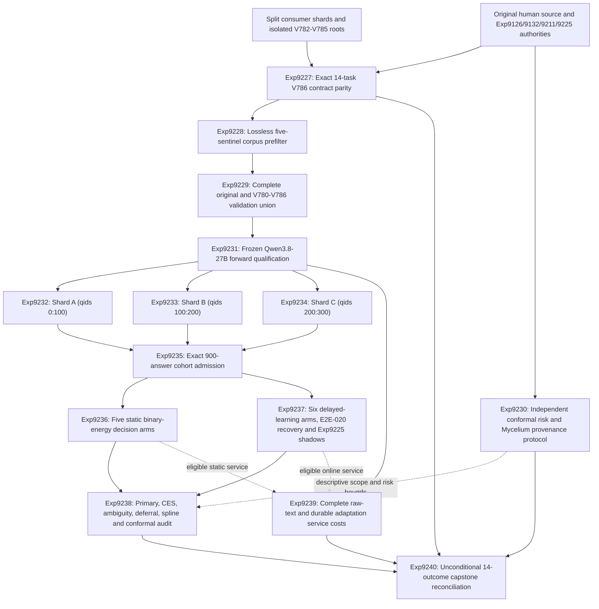

# Carnot Research Roadmap v786: Complete Contract Parity, Lossless Validation, Conformal Risk Bounds, and Human Energy Decisions

**Milestone:** 2026.11.786
**Created:** 2026-11-19 America/New_York
**Status:** Proposed; no experiment execution or queue activation.
**Predecessor:** 2026.11.785, scheduling complete.
**Execution contract:** Exactly **14 tasks, Exp9227 through Exp9240**, in the
order below, across **four phases**. The full embedded task objects must equal
`research-roadmap-next.yaml`, including prompts, gates and model metadata.

The [V785 activated queue](research-roadmap-v785-queue-preserved-20261119.yaml)
is preserved byte for byte (`sha256:df65951514658c58082d5e27b4ce5d06af731cb40607da5cc23d47cb364c1917`).
During V785, `openspec/change-proposals/research-roadmap-vNEXT.md` stayed byte
for byte identical to the preserved [V784 design](research-roadmap-v784-preserved-20261118.md)
(`sha256:06ddcee74cab8be574b2892e7773983d2e41a0d733b2003f0712bfe1ff48e811`).
The active queue, conductor, completion archive and exclusion manifest remain
unchanged.

## What V785 proved

| Experiment | Observed outcome | What it does not establish |
|---|---|---|
| Exp9222 | `required_checks_passed=true`, `replay_authority_ready_score=1`, `source_ready_score=1`, `static_methods_ready_score=1`, `online_methods_ready_score=1`; all three consumer shards passed (`core` 162.3s, `v782_v783` 913.4s, `v784` 757.7s) and `owned_tests` passed (768.7s) | `contract_ready_score=0` (`complete_blocked_v785_contract`) because V785 shipped 5 queue tasks against a stale V784 markdown file |
| Exp9223 | Scheduler `blocked_gate_check_failed` on `exp9222-contract.contract_ready_score` (0 vs 1) | No lossless corpus byte prefilter executed |
| Exp9224 | Pre-emptive upstream-retired skip | No complete forward validation union executed |
| Exp9225 | `complete_null_v785_selective_deferral_protocol`; all 121 checks passed; `selective_deferral_ready_score=1`, `spline_support_diagnostic_ready_score=1` | Method qualification on synthetic fixtures; `scientific_effect_measured=false` |
| Exp9226 | Pre-emptive upstream-retired skip | No frozen Qwen3.8-27B forward run executed |
| Slots 6–14 | Omitted from V785 queue (`missing_field` in Exp9222) | No shards, admission, static/online training, audit, cost, or V785 capstone |

**Two tasks executed and three skipped; nine slots were omitted.** Authority is
`results/experiment_9222_v785_contract.json` (`sha256:c54b5707...`),
`results/experiment_9223_corpus_prefilter.json` (`sha256:3b9c0ffc...`),
`results/experiment_9225_v785_selective_deferral_protocol.json` (`sha256:73125a91...`),
and `ops/conductor-log.md`.

Two facts govern V786:

1. **Partitioned consumer replay works.** Exp9222 solved Exp9208's 1200-second
   serial consumer timeout. Only the stale V784 markdown file and truncated
   5-task queue blocked `contract_ready_score`. V786 ships both files with exact
   14-task parity (`Exp9227`–`Exp9240`), isolates the V785 historical root, and
   splits `direct_consumers_v782_v783` (913.4s) into separate `v782` and `v783`
   shards alongside `v784` and `v785` so every shard finishes with large margin.
2. **Both label-ambiguity and selective-deferral authorities are now qualified.**
   Exp9211 (V784) qualified target identifiability and exact affine label-ambiguity
   bounds. Exp9225 (V785) qualified selective-deferral feedback masks and B-spline
   support-density slices. V786 consumes both immutable artifacts directly and
   uses its ungated Phase 1 CPU slot (`Exp9230`) to qualify cluster-valid
   conformal accepted-risk bounds and a Mycelium provenance-granularity ledger.

## Three biggest gaps between current state and PRD

1. **FR-12: an oracle-distinct factual verifier.** Authenticated human labels
   (`Exp9097`) and frozen methods (`Exp9126`) exist, but the matched frozen
   Qwen3.8-27B energy versus probability comparison is still unmeasured. V786
   unblocks collection (`Exp9231`–`Exp9235`), fits all five arms (`Exp9236`),
   and audits primary, ambiguity, spline-support, and conformal risk bounds
   (`Exp9238`). The exposed panel cannot establish independent generalization.
2. **FR-06/FR-11: useful continuous self-learning.** Durable recovery mechanics
   exist, but real future-loss improvement on human errors is still unmeasured.
   `Exp9237` runs the frozen six-arm delayed learner (`Exp9132`) with real
   E2E-020 hard-exit recovery plus non-interfering `Exp9225` selective-deferral
   shadow streams.
3. **FR-05/FR-08/NFR-01: reproducible, affordable whole-service execution.**
   Contract parity and lossless corpus scanning (`Exp9227`–`Exp9229`) must pass
   before model work. `Exp9239` then times cold/warm raw-text forwards and
   durable adaptation end-to-end and maps measured fractions to hardware limits.

The November 7 north star is the oracle-distinct verifier. ARC remains
opportunistic and is not scheduled in V786. Generator weights stay frozen.

## Research recorded before experiment design

The V786 scan in [research-references.md](../../research-references.md) checks
all eight primary arXiv topics and all six secondary channels on 2026-11-19.

| Finding | Experiment use | Boundary |
|---|---|---|
| [SCoRE, 2603.24704](https://arxiv.org/abs/2603.24704); [SCRC, 2512.12844](https://arxiv.org/abs/2512.12844); [Chance-Constrained Risk Control, 2602.01637](https://arxiv.org/abs/2602.01637) | Exp9230 qid-cluster-valid conformal accepted-risk bounds; Exp9238 descriptive audit | Requires independent qid clusters, never i.i.d. siblings; cannot override primary gates |
| [Mycelium, 2610.33608](https://arxiv.org/abs/2610.33608) | Exp9230 provenance-typology-granularity ledger over 900 responses; Exp9238 descriptive slices | Records actual metadata only; never invents missing span labels |
| [Selective Deferral, 2610.15128](https://arxiv.org/abs/2610.15128); [VX-One, 2610.30090](https://arxiv.org/abs/2610.30090); [PostHoc FREE KAN Calibration, 2503.01195](https://arxiv.org/abs/2503.01195) | Already qualified in Exp9225; consumed in Exp9237 shadow streams and Exp9238 IPW/spline-support slices | Non-interfering with primary Exp9132 arms and frozen 57-column basis |
| [CPC FPGA, 2610.31339](https://arxiv.org/abs/2610.31339); [Anechoic Onsager FPGA, 2610.13368](https://arxiv.org/abs/2610.13368); Extropic Z1T | Exp9239 honest future operation-mapping leads | Future hardware leads only; never local measurements or dense-forward speedup claims |
| [ARM–EBM, 2512.15605](https://arxiv.org/abs/2512.15605); [Spilled Energy, 2602.18671](https://arxiv.org/abs/2602.18671); [Taxonomy v2, 2610.38520v2](https://arxiv.org/abs/2610.38520v2) | Preserved in Exp9231–9238 via Exp9126 and Exp9211 immutable authorities | Unnormalized logits are not factual truth; exposed panel stays conditional |

Secondary channel retrieval limits: Semantic Scholar returned `HTTP 200` with 11
citing records for `ARXIV:2512.15605` (`next=None`) and `HTTP 429` for
`ARXIV:2507.02092` (retaining V785's verified count of 46). OpenReview, Hugging
Face Papers, GitHub, Extropic, and Logical Intelligence supplied leads only; no
vendor projection or external benchmark becomes a local Carnot claim.

## Architecture

Labels stay outside model inputs. Static fitting uses `TRAIN150`; online fitting
uses its separate `TRAIN100` initialization. `CAL50` guards promotion; `TEST100`
retention never selects updates. All five GPU tasks run teacher-forced forwards
only and generate zero tokens.

## Phase 1 — Close Contract Parity, Lossless Corpus Walk, Complete Validation, and Conformal Protocol (Exp9227–Exp9230)

`Exp9227` isolates the V785 historical root, splits the 913-second `v782_v783`
shard into separate `v782` and `v783` shards alongside `v784` and `v785`, and
binds all 14 matching V786 tasks. `Exp9228` requires both `contract_ready_score`
and `replay_authority_ready_score`, then qualifies the lossless five-sentinel
streaming reader over `results/**/*.json`. `Exp9229` executes the complete
original 621 + 53 nodes and all affected V780–V786 obligations once under the
current revision.

`Exp9230` has no upstream task gate. It independently authenticates immutable
`Exp9097`, `Exp9126`, `Exp9132`, `Exp9211`, and `Exp9225` custody hashes,
proves qid-cluster-valid conformal accepted-risk bounds on correlated synthetic
fixtures, and freezes the Mycelium provenance-typology-granularity ledger over
all 900 human responses.

## Phase 2 — Collect Frozen Qwen3.8-27B Logits for the Unchanged Human Panel (Exp9231–Exp9235)

`Exp9231` qualifies serial versus chunk128 teacher-forced forwards for frozen
`unsloth/Qwen3.8-27B-GGUF` (`Q4_K_M`) on GPU0 and projects all three 300-answer
shard budgets. `Exp9232`–`Exp9234` share one collector module with per-qid
checkpoints across disjoint lexical ranges (`0:100`, `100:200`, `200:300`).
`Exp9235` admits exactly the original 900 answers and 300 qids, cold-recomputes
designated raw-vector statistics, and emits separate static (`TRAIN150`) and
online (`TRAIN100`) views plus token-entropy sequences for CES.

## Phase 3 — Static Energy Decisions, Continuous Self-Learning, and Multi-Lens Audit (Exp9236–Exp9238)

`Exp9236` fits the five fixed binary Gibbs energy arms (`Exp9126`) on `TRAIN150`,
calibrates temperature on `CAL50`, and seals all `TEST100` predictions before
evaluator access. `Exp9237` executes the continuous self-learning (FR-11)
six-arm delayed learner (`Exp9132`) with real E2E-020 hard-exit recovery and
non-interfering selective-deferral shadow streams consuming `Exp9225` masks.
`Exp9238` audits every eligible static and learning branch independently against
the frozen two static, seven learning, and three secondary CES bounds, plus
exact Brier moments and the qualified `Exp9211`, `Exp9225`, and `Exp9230`
descriptive diagnostics.

## Phase 4 — Complete Service Costs, Hardware Operation Limits, and Reconciliation (Exp9239–Exp9240)

`Exp9239` times every eligible raw-text forward and durable continuous-learning
service end-to-end across three fresh processes and maps measured component
fractions to actual supported hardware operations (including Amdahl ceilings
and honest non-substitutable boundaries). `Exp9240` unconditionally reconciles
all 14 V786 outcomes, recomputes stable historical G1–G4 via
`scripts/publication_gate.py --json`, preserves V785 history, and freezes exact
continuation boundaries.

## Split consumer replay and falsifiable stop rule

`Exp9222` proved partitioned consumer replay passes within budget
(`direct_consumers_core` 162.3s, `direct_consumers_v782_v783` 913.4s,
`direct_consumers_v784` 757.7s). `Exp9227` strengthens this path:

- **Five bounded shards:** split `v782_v783` into separate `direct_consumers_v782`
  and `direct_consumers_v783` shards, keep `direct_consumers_core` and
  `direct_consumers_v784`, and add `direct_consumers_v785` for
  `tests/python/test_v785_contract_9222.py`. Give every shard its own
  `COVERAGE_FILE` (`.coverage.<shard>`) before combining coverage.
- **Isolated V785 historical root:** extend `historical_contract_inputs.py` so
  V785 tests resolve against preserved `research-roadmap-v785-queue-preserved-20261119.yaml`,
  preserved `research-roadmap-v784-preserved-20261118.md`, and
  `experiment_9222_v785_contract.json`. Preserve every original assertion and
  tamper control.
- **Protocol-owner replay:** validate `entropy_reference_protocol`,
  `label_ambiguity_protocol`, `selective_deferral_protocol`, and the new
  `conformal_risk_protocol` in fresh cold-replay processes.
- **Complete obligation union:** untouched 900-second
  `tests/python/test_causal_validation_9181.py` stays in `Exp9229`'s full
  validation union rather than `Exp9227`'s contract shard.

## New conformal accepted-risk and Mycelium provenance protocol (Exp9230)

`Exp9230` independently authenticates `Exp9097`, `Exp9126`, `Exp9132`,
`Exp9211`, and `Exp9225` directly via immutable SHA256 hashes without gating on
`Exp9227` or any GPU task:

1. **Qid-cluster-valid finite-sample conformal accepted-risk bounds
   (`2603.24704`, `2512.12844`, `2602.01637`):** For any sealed decision policy
   (primary `p <= 0.10` plus `CAL50` empirical quantile grid `alpha_risk in
   [0.05, 0.10, 0.15]` at `1 - delta = 0.95`), aggregate accepted-error indicators
   to the independent `qid` cluster first. Compute exact Clopper-Pearson upper
   bounds (on binary qid-level any-accepted-error) and deterministic betting
   e-process upper bounds over independent accepted qids. Prove on correlated
   synthetic 3-sibling fixtures (seed `786230`, 2000 trials) that naive i.i.d.
   sibling bounds undercover at intra-qid correlation `rho >= 0.7`, while
   cluster-aggregated bounds retain `>= 0.95` coverage. Report undefined risk
   as unavailable when zero qids accept.
2. **Mycelium provenance-typology-granularity ledger (`2610.33608`):** Freeze
   exact dataset provenance, generator sibling family, annotation granularity
   (`answer_level` present, `span_level` absent), and factual-error typology
   across all 900 `Exp9097` responses by role (`TRAIN150`/`CAL50`/`TEST100`).
   Never invent missing span labels or use model judges.

Mark `scientific_effect_measured=false`. `Exp9238` consumes `Exp9230` strictly
as a descriptive audit branch; missing `Exp9230` authority blocks only that
branch, never primary auditing.

## Inherited methods and acceptance thresholds

V786 preserves all immutable scientific methods, arms, cohorts, and acceptance
thresholds from `Exp9126`, `Exp9132`, `Exp9211`, and `Exp9225`:

- **Lossless corpus walk (`Exp9228`):** Derive all five ASCII substrate
  sentinels from unchanged `scripts/adversarial_verify.py` constants. Visit
  every recursive `results/**/*.json` path in bounded chunks with overlap
  `>= max_needle_len - 1`. Route any sentinel or `\u` escape through unchanged
  `read_text`/`json.loads` and classifier logic. Only EOF without sentinels or
  `\u` skips decoding. Prove exact semantic parity and sentinel-deletion
  mutation controls before setting `corpus_scan_ready_score=1`.
- **Whole-answer forward statistics (`Exp9231`–`Exp9235`):** Frozen
  `unsloth/Qwen3.8-27B-GGUF` (`Q4_K_M`) via embedded `llama.cpp` tokenizer
  (no BOS, no chat template), literal `Question:\n` / `\nAnswer:\n` prefix,
  right caps 256/768, `chunk128`, float64 `L_i`, `NLL_i`, `H_i`, `M_i=-L_i`,
  `D_i=-z_i[a_i]+L_(i+1)`. Seven features: `log1p(answer_len)`, mean NLL,
  mean H, max H, mean M, mean `|D|`, missing-pair indicator. Retain designated
  full-vocabulary vectors for global first 20 lexical qids / all siblings /
  first 8 positions.
- **Static binary Gibbs energy (`Exp9236`):** Five arms (`prevalence`,
  `probability_length`, `raw_energy`, `combined`, `combined_donor`), `TRAIN150`
  imputation/scaling, ridge `0.01`, L-BFGS-B zero start (`gtol=1e-7`,
  `ftol=1e-12`, grad inf-norm `<= 1e-6`), `CAL50` temperature in `[0.5, 1, 2, 4]`,
  accept `<= 0.1`, reject `>= 0.9`, else escalate. `energy_increment_score=1`
  requires both combined Brier improvement lower bounds `> 0` vs
  `probability_length` and `donor` (10000 paired `TEST100`-qid bootstrap draws,
  seed `777121`, one-sided tail `0.05/2`), defined accepted risk, and no
  accepted-risk increase vs `probability_length`.
- **Continuous delayed self-learning (`Exp9237`):** `SHA256('v776-online'+qid)`
  split (`TRAIN100` init, ten 5-qid streams, `CAL50` guard, `TEST100` retention),
  fixed 57-column cubic B-spline basis (`knots=[-1,-1,-1,-1,-0.5,0,0.5,1,1,1,1]`),
  six primary arms (`frozen_spline`, `adaptive_spline`, `bias_only_spline`,
  `adaptive_linear`, `donor_label_spline`, `temperature_only_spline`), AdaGrad
  `lr=0.05`, L2 clip `1.0`, anchor `0.01`, `CAL50` promotion guard (Brier
  increase `<= 0.005`, error increase `<= 0`), atomic snapshots with genuine
  E2E-020 hard-exit recovery. Plus non-interfering `Exp9225` selective-deferral
  shadow streams (`escalation_only`, `audited_deferral` at `alpha in [0.10, 0.25]`).
  `learning_signal_score=1` requires all five adaptive-spline future Brier
  lower bounds `> 0`, retained Brier upper `<= 0.005`, retained error upper
  `<= 0` (10000 paired stream draws, seed `778135`, tail `0.05/7`), and exact
  hard-exit recovery.
- **Descriptive and secondary audits (`Exp9238`):** Exact population Brier
  moments within `1e-12`, gauge shifts (`c_i=3` and `c_i=3*(-1)^i`), RMS-logit
  and tie-aware AUROC trajectories, secondary CES entropy reference
  (`seed=782190`, tail `0.05/3`), qualified `Exp9211` target scope and exact
  label-ambiguity endpoints, qualified `Exp9225` Horvitz-Thompson IPW risk and
  B-spline support-density calibration slices, and qualified `Exp9230`
  cluster-valid conformal risk bounds and Mycelium provenance slices.

## Complete cost and hardware requirements

`Exp9239` uses the original first 20 `TEST` qids (60 siblings), three fresh
processes, seed `776108`, probability parity `atol=1e-5 / rtol=1e-4`, and exact
typed decisions. Separate cold load, warm uncached raw-text verification, and
cached-feature head costs, plus durable online proposal/guard/fsync/recovery
costs. Compute Amdahl ceilings `1/(1-f)` from measured nonoverlapping fractions
only (`f >= 0.99` for 100x, `f >= 0.90` for 10x; unknown fractions stay unknown).

| Resource | Requirement and claim boundary |
|---|---|
| CPU/RAM | Validation, small-head fitting, bootstrap, conformal bounds, and durable updates; stream vocabulary stats without holding all 900 full arrays in RAM. |
| Private disk | At least 2 GiB free for designated raw vectors plus measured checkpoints and logs; verify before model runs. |
| GPU0 RTX 3090 24 GB | Verify CUDA offload via `cached_current_model(gpu_index=0)` under the existing lease. Five model tasks run serially; leave GPU1 untouched. |
| Mandated model | Frozen `unsloth/Qwen3.8-27B-GGUF` (`Q4_K_M`); pin GGUF, embedded tokenizer, and `llama.cpp` hashes; `generated_tokens=0`. |
| KV260 | Preserve qualified Ising fabric at `k_max <= 5`; dense Qwen forwards and spline updates require distinct kernels. |
| PolarFire | Preserve qualified Linux CPU dispatch only; no fabric speedup claim. |
| GateMate | Preserve unchanged physical/JTAG `0xffffffff` blocker; no repeated identical probe. |
| Wishlist / leads | `2610.31339` (CPC FPGA), `2610.13368` (Anechoic Onsager FPGA), Extropic Z1T, NPU, and larger FPGAs stay future operation-mapping leads until access and matching bottlenecks are measured. |

## Execution, routing and stop rules

Every task prompt includes a numbered step requiring flushed progress lines at
each phase boundary, before and after minute-scale calls, inside long loops,
and supervised 60-second heartbeats so every silence gap stays below 600 seconds.
Files over 200 lines must be written in chunks of at most 200 lines with progress
messages between calls. Each task stops measurement by 3300 seconds, reserving
1200 seconds for verification and 300 seconds for publication within the
4800-second hard cap.

`Exp9227`–`Exp9229` use Claude Opus (`max_turns=100`) for replay/schema/validation
coordination. Formulaic runtime, sharded forward collection, and admission
(`Exp9231`–`Exp9235`) use Codex `gpt-6.1-sol`. Scientific analysis, protocol
design, continuous learning, complete cost, and reconciliation (`Exp9230`,
`Exp9236`–`Exp9240`) use Claude Sonnet. All five GPU tasks declare
`unsloth/Qwen3.8-27B-GGUF` (`Q4_K_M`) with `model_load_no_generation` (2-second
floor, `generated_tokens=0`); all nine CPU tasks declare `no_model_load` and
`MODEL_SPECS: []`. No `gpt-6-luna` or Gemini tasks are scheduled.

## Dependency graph and exact gate contract

Conductor execution follows the exact table order below. `Exp9230` and `Exp9240`
have no structured upstream gate; `Exp9232`–`Exp9234` share independent gates.

| Consumer | Required current upstream field(s), each == 1 |
|---|---|
| exp9227-contract | None; authenticate own inputs |
| exp9228-corpus-prefilter | exp9227-contract.contract_ready_score; exp9227-contract.replay_authority_ready_score |
| exp9229-forward-qualification | exp9228-corpus-prefilter.corpus_scan_ready_score |
| exp9230-conformal-risk-protocol | None; authenticate own inputs |
| exp9231-logit-runtime | exp9229-forward-qualification.forward_validation_ready_score; exp9227-contract.static_methods_ready_score |
| exp9232-logits-a | exp9227-contract.source_ready_score; exp9231-logit-runtime.logit_runtime_ready_score; exp9231-logit-runtime.shard_feasible_score |
| exp9233-logits-b | exp9227-contract.source_ready_score; exp9231-logit-runtime.logit_runtime_ready_score; exp9231-logit-runtime.shard_feasible_score |
| exp9234-logits-c | exp9227-contract.source_ready_score; exp9231-logit-runtime.logit_runtime_ready_score; exp9231-logit-runtime.shard_feasible_score |
| exp9235-logit-admission | exp9232-logits-a.logits_a_ready_score; exp9233-logits-b.logits_b_ready_score; exp9234-logits-c.logits_c_ready_score |
| exp9236-static-energy | exp9235-logit-admission.admission_ready_score; exp9227-contract.static_methods_ready_score |
| exp9237-delayed-learning | exp9235-logit-admission.admission_ready_score; exp9227-contract.online_methods_ready_score |
| exp9238-decision-audit | exp9235-logit-admission.admission_ready_score |
| exp9239-complete-cost | exp9231-logit-runtime.logit_runtime_ready_score |
| exp9240-capstone | None; authenticate own inputs |

## Task contract

Exactly 14 tasks, Exp9227 through Exp9240, in this exact order. Each path is a
distinct canonical deliverable.

| Order | Phase | Task ID | Deliverable |
|---|---|---|---|
| 1 | 1 | exp9227-contract | results/experiment_9227_v786_contract.json |
| 2 | 1 | exp9228-corpus-prefilter | results/experiment_9228_v786_corpus_prefilter.json |
| 3 | 1 | exp9229-forward-qualification | results/experiment_9229_v786_forward_qualification.json |
| 4 | 1 | exp9230-conformal-risk-protocol | results/experiment_9230_v786_conformal_risk_protocol.json |
| 5 | 2 | exp9231-logit-runtime | results/experiment_9231_v786_logit_runtime.json |
| 6 | 2 | exp9232-logits-a | results/experiment_9232_v786_logits_a.json |
| 7 | 2 | exp9233-logits-b | results/experiment_9233_v786_logits_b.json |
| 8 | 2 | exp9234-logits-c | results/experiment_9234_v786_logits_c.json |
| 9 | 2 | exp9235-logit-admission | results/experiment_9235_v786_logit_admission.json |
| 10 | 3 | exp9236-static-energy | results/experiment_9236_v786_static_energy.json |
| 11 | 3 | exp9237-delayed-learning | results/experiment_9237_v786_delayed_learning.json |
| 12 | 3 | exp9238-decision-audit | results/experiment_9238_v786_decision_audit.json |
| 13 | 4 | exp9239-complete-cost | results/experiment_9239_v786_complete_cost.json |
| 14 | 4 | exp9240-capstone | results/experiment_9240_v786_capstone.json |

## Planning verification

Verify exact object and table parity between this document and
`research-roadmap-next.yaml`, prompt rendering, backward gate field existence,
four-field `prior_failures` compliance, operation-accurate model metadata, and
all roadmap linters (`exclusion_manifest_lint.py`, `harness_fit_lint.py`,
`overdue_priority_lint.py`, `audit_roadmap_gates.py`). Planning does not
activate the queue or execute any proposed experiment.

## Full machine-readable contract
