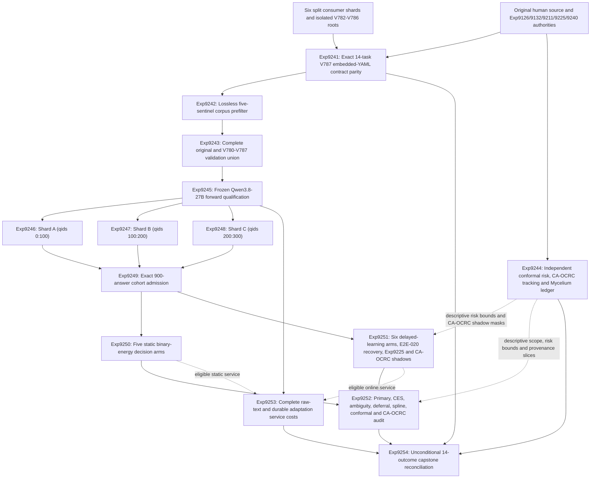

# Carnot Research Roadmap v787: Full Machine-Readable Contract Parity, Lossless Validation, Conformal CA-OCRC Bounds, and Human Energy Decisions

**Milestone:** 2026.11.787
**Created:** 2026-11-20 America/New_York
**Status:** Proposed; no experiment execution or queue activation.
**Predecessor:** 2026.11.786, scheduling complete.
**Execution contract:** Exactly **14 tasks, Exp9241 through Exp9254**, in the
order below, across **four phases**. The full embedded YAML contract below must
equal `research-roadmap-next.yaml`, including prompts, gates, and model metadata.

The [V786 preserved design](research-roadmap-v786-preserved-20261120.md)
(`sha256:a1c32ac1892b59219fe288446020893822350f866781f89a39088b76d1b7c763`) and
[V786 preserved queue](research-roadmap-v786-queue-preserved-20261120.yaml)
(`sha256:2681afbc366b7282955350ecfbedf5d4b932d8dae58c32ca0ea329672356c8ec`) are
saved byte for byte. The active queue, conductor, completion archive, and
exclusion manifest remain unchanged.

## What V786 proved

| Experiment | Observed outcome | What it does not establish |
|---|---|---|
| Exp9227 | Three conductor pre-test skips (`SKIP: Pre-tests failing, self-heal failed`) before commit `5930e6195a` cleared the smart subset | No split consumer replay or V786 contract check executed; V786 `research-roadmap-vNEXT.md` also omitted its embedded YAML block |
| Exp9230 | Three conductor pre-test skips (`SKIP: Pre-tests failing, self-heal failed`) before commit `5930e6195a` cleared the smart subset | No cluster-valid conformal risk bounds or Mycelium provenance ledger executed |
| Exp9228–Exp9229, Exp9231–Exp9239 | Eleven pre-emptive upstream-retired skips (`GATE_BLOCK`) | No lossless prefilter, full validation union, Qwen3.8-27B forwards, static/online learning, audit, or cost timing ran |
| Exp9240 | `complete_blocked_declared_gate`, `reconciliation_ready_score=1`, `required_checks_passed=true`; 88 tests passed in 115.77s (`sha256:b19a3b64...`) | Administrative reconciliation only; no scientific claim on the human panel (`effective_independent_groups=0`) |

**One task executed and thirteen skipped.** Authority is
`results/experiment_9240_v786_capstone.json` (`sha256:b19a3b647f573f5b74c1dead4584137e25c0301dc47a08efb9cdd3b4e95c9500`),
`results/experiment_9222_v785_contract.json` (`sha256:c54b57079cfd43221a9b2387f208c7603f768e8bf8b6b28816e458c71ac9b3a8`),
`results/experiment_9225_v785_selective_deferral_protocol.json` (`sha256:73125a9151fc8be16793ccd1daf3e2b369c5ac0929eac5a088cea7863ed8a4af`),
`results/experiment_9211_v784_label_ambiguity.json` (`sha256:00da04356c958a063793c21d85287653e38eda69c85c65ca1819426519852610`),
and `ops/conductor-log.md`.

Two concrete fixes govern V787:

1. **Restore the embedded machine-readable YAML block.** V786's
   `research-roadmap-vNEXT.md` ended at `## Full machine-readable contract` with
   no fenced YAML block. Contract verifiers (`v785_contract_evidence.py`) parse
   that block directly. V787 embeds the complete 14-task YAML block and checks
   exact parsed equality against `research-roadmap-next.yaml`.
2. **Preserve V786 bytes and split six bounded consumer shards.** Commit
   `5930e6195a` already cleared the smart pre-test subset (`Exp9240` passed 88
   tests in 115.77s). `Exp9241` adds isolated V785 and V786 historical roots
   and splits `direct_consumers` across six shards (`core`, `v782`, `v783`,
   `v784`, `v785`, `v786`), each with its own `COVERAGE_FILE`.

## Three biggest gaps between current state and PRD

1. **FR-12: an oracle-distinct factual verifier.** Authenticated human labels
   (`Exp9097`) and frozen methods (`Exp9126`) exist, but the matched frozen
   Qwen3.8-27B energy versus probability comparison remains unmeasured. V787
   unblocks collection (`Exp9245`–`Exp9249`), fits all five arms (`Exp9250`),
   and audits primary, ambiguity, spline-support, and conformal risk bounds
   (`Exp9252`). The exposed panel cannot establish independent generalization.
2. **FR-06/FR-11: useful continuous self-learning.** Durable recovery mechanics
   exist, but real future-loss improvement on human errors remains unmeasured.
   `Exp9251` runs the frozen six-arm delayed learner (`Exp9132`) with real
   E2E-020 hard-exit recovery plus non-interfering `Exp9225` selective-deferral
   and `Exp9244` CA-OCRC capacity-constrained tracking shadow streams.
3. **FR-05/FR-08/NFR-01: reproducible, affordable whole-service execution.**
   Contract parity and lossless corpus scanning (`Exp9241`–`Exp9243`) must pass
   before model work. `Exp9253` then times cold/warm raw-text forwards and
   durable adaptation end-to-end and maps measured fractions to hardware limits.

The November 7 north star is the oracle-distinct verifier. ARC stays
opportunistic and is not scheduled in V787. Generator weights stay frozen.

## Research recorded before experiment design

The V787 scan in [research-references.md](../../research-references.md) checks
all eight primary arXiv topics and all six secondary channels on 2026-11-20.

| Finding | Experiment use | Boundary |
|---|---|---|
| [CA-OCRC, 2611.17059](https://arxiv.org/abs/2611.17059); [Corrupted OCP, 2605.20515](https://arxiv.org/abs/2605.20515); [OCPQ, 2608.07139](https://arxiv.org/abs/2608.07139) | `Exp9244` capacity-constrained delayed-feedback IPW tracking and flip-rate checks; `Exp9251` non-interfering shadow stream | Shadow and descriptive audit only; never modifies primary `Exp9132` states or promotion |
| [SCoRE, 2603.24704](https://arxiv.org/abs/2603.24704); [SCRC, 2512.12844](https://arxiv.org/abs/2512.12844); [Chance-Constrained Risk Control, 2602.01637](https://arxiv.org/abs/2602.01637) | `Exp9244` qid-cluster-valid conformal accepted-risk bounds; `Exp9252` descriptive audit | Requires independent qid clusters, never i.i.d. siblings; cannot override primary gates |
| [Mycelium, 2610.33608](https://arxiv.org/abs/2610.33608) | `Exp9244` provenance-typology-granularity ledger over 900 responses; `Exp9252` descriptive slices | Records actual metadata only; never invents missing span labels |
| [CRAM, 2611.17309](https://arxiv.org/abs/2611.17309); [1M p-bit FPGA, 2606.25313](https://arxiv.org/abs/2606.25313); [CPC FPGA, 2610.31339](https://arxiv.org/abs/2610.31339); [Anechoic Onsager, 2610.13368](https://arxiv.org/abs/2610.13368); Extropic Z1T | `Exp9253` honest future hardware operation-mapping leads | Future hardware leads only; never local measurements or dense-forward speedup claims |
| [Thermodynamic Signatures, 2606.19404](https://arxiv.org/abs/2606.19404); [KORE, 2606.23575](https://arxiv.org/abs/2606.23575); [LNS + Neural Constraints, 2603.20801](https://arxiv.org/abs/2603.20801) | Recorded in `research-references.md` for future attention-Laplacian and adaptive-knot work | Deferred until V787 closes the frozen Qwen3.8-27B whole-answer forward baseline |

Secondary channel notes: Semantic Scholar returned `HTTP 200` for both queries
on 2026-11-20 (`ARXIV:2507.02092` EBT: 47 citing records, `next=None`, adding
`2611.23053`; `ARXIV:2512.15605` ARM–EBM: 11 citing records, `next=None`).
OpenReview, Hugging Face Papers, GitHub, Extropic, and Logical Intelligence
supplied leads only; no vendor projection or external benchmark becomes a local
Carnot claim.

## Architecture

Labels stay outside model inputs. Static fitting uses `TRAIN150`; online fitting
uses its separate `TRAIN100` initialization. `CAL50` guards promotion; `TEST100`
retention never selects updates. All five GPU tasks run teacher-forced forwards
only and generate zero tokens.

## Phase 1 — Close Embedded-YAML Contract Parity, Lossless Corpus Walk, Complete Validation, and Conformal/CA-OCRC Protocol (Exp9241–Exp9244)

`Exp9241` isolates V785 and V786 historical roots, splits `direct_consumers`
across six bounded shards (`core`, `v782`, `v783`, `v784`, `v785`, `v786`), and
authenticates all 14 matching V787 tasks from the embedded YAML contract block.
`Exp9242` requires both `contract_ready_score` and `replay_authority_ready_score`,
then qualifies the lossless five-sentinel streaming reader over `results/**/*.json`.
`Exp9243` executes the complete original 621 + 53 nodes and all affected
V780–V787 obligations once under the current revision.

`Exp9244` has no upstream task gate. It independently authenticates immutable
`Exp9097`, `Exp9126`, `Exp9132`, `Exp9211`, and `Exp9225` custody hashes,
proves qid-cluster-valid conformal accepted-risk bounds on correlated synthetic
fixtures, qualifies CA-OCRC capacity-constrained delayed-feedback IPW tracking
(`arXiv:2611.17059`) plus corrupted-feedback checks (`arXiv:2605.20515`), and
freezes the Mycelium provenance-typology-granularity ledger (`arXiv:2610.33608`)
over all 900 human responses.

## Phase 2 — Collect Frozen Qwen3.8-27B Logits for the Unchanged Human Panel (Exp9245–Exp9249)

`Exp9245` qualifies serial versus chunk128 teacher-forced forwards for frozen
`unsloth/Qwen3.8-27B-GGUF` (`Q4_K_M`) on GPU0 and projects all three 300-answer
shard budgets. `Exp9246`–`Exp9248` share one collector module with per-qid
checkpoints across disjoint lexical ranges (`0:100`, `100:200`, `200:300`).
`Exp9249` admits exactly the original 900 answers and 300 qids, cold-recomputes
designated raw-vector statistics, and emits separate static (`TRAIN150`) and
online (`TRAIN100`) views plus token-entropy sequences for CES.

## Phase 3 — Static Energy Decisions, Continuous Self-Learning, and Multi-Lens Audit (Exp9250–Exp9252)

`Exp9250` fits the five fixed binary Gibbs energy arms (`Exp9126`) on `TRAIN150`,
calibrates temperature on `CAL50`, and seals all `TEST100` predictions before
evaluator access. `Exp9251` executes the continuous self-learning (FR-11)
six-arm delayed learner (`Exp9132`) with real E2E-020 hard-exit recovery plus
non-interfering `Exp9225` selective-deferral and `Exp9244` CA-OCRC
capacity-constrained tracking shadow streams. `Exp9252` audits every eligible
static and learning branch independently against the frozen two static, seven
learning, and three secondary CES bounds, plus exact Brier moments and the
qualified `Exp9211`, `Exp9225`, and `Exp9244` descriptive diagnostics.

## Phase 4 — Complete Service Costs, Hardware Operation Limits, and Reconciliation (Exp9253–Exp9254)

`Exp9253` times every eligible raw-text forward and durable continuous-learning
service end-to-end across three fresh processes and maps measured component
fractions to actual supported hardware operations (including Amdahl ceilings
and honest non-substitutable boundaries). `Exp9254` unconditionally reconciles
all 14 V787 outcomes, recomputes stable historical G1–G4 via
`scripts/publication_gate.py --json`, preserves V786 history, and freezes exact
continuation boundaries.

## Split consumer replay and falsifiable stop rule

`Exp9222` proved partitioned consumer replay passes within budget
(`direct_consumers_core` 162.3s, `direct_consumers_v782_v783` 913.4s,
`direct_consumers_v784` 757.7s). `Exp9241` strengthens this path:

- **Six bounded shards:** keep `direct_consumers_core` and `direct_consumers_v784`,
  split `v782_v783` into separate `direct_consumers_v782` and
  `direct_consumers_v783`, and add `direct_consumers_v785`
  (`test_v785_contract_9222.py`) and `direct_consumers_v786`
  (`test_v786_capstone_9240.py`). Assign each shard its own `COVERAGE_FILE`
  (`.coverage.<shard>`) before combining coverage.
- **Isolated V785 and V786 historical roots:** extend
  `historical_contract_inputs.py` so V785 and V786 suites resolve against
  preserved V784/V785/V786 design and queue files plus `experiment_9222` and
  `experiment_9240` primaries. Preserve every original assertion and tamper check.
- **Embedded YAML parity:** parse the fenced YAML under
  `## Full machine-readable contract` and match all 14 ordered task objects
  against the active queue.
- **Complete obligation union:** keep untouched 900-second
  `tests/python/test_causal_validation_9181.py` in `Exp9243`'s full validation
  union rather than `Exp9241`'s contract shards.

## Conformal accepted-risk, CA-OCRC tracking, and Mycelium provenance protocol (Exp9244)

`Exp9244` independently authenticates `Exp9097`, `Exp9126`, `Exp9132`,
`Exp9211`, and `Exp9225` directly via immutable SHA256 hashes without gating on
`Exp9241` or any GPU task:

1. **Qid-cluster-valid finite-sample conformal accepted-risk bounds
   (`2603.24704`, `2512.12844`, `2602.01637`):** Aggregate accepted-error
   indicators to independent `qid` clusters first, then compute exact
   Clopper-Pearson and deterministic betting e-process upper bounds over
   independent accepted qids (`alpha_risk in [0.05, 0.10, 0.15]`, `1-delta=0.95`).
   Prove on correlated 3-sibling synthetic fixtures (seed `787244`, 2000 trials)
   that naive i.i.d. sibling bounds undercover at `rho >= 0.7` while cluster
   bounds hold `>= 0.95`. Report undefined risk as unavailable when zero qids
   accept.
2. **CA-OCRC capacity-constrained delayed-feedback tracking (`2611.17059`,
   `2605.20515`):** Qualify randomized proxy-delay tracking with IPW for finite
   buffer capacities `C in [1, 2, 5]` (seed `787245`), proving unbiased IPW risk
   versus biased naive drop-on-full tracking plus corrupted-feedback bounds
   (`epsilon in [0.0, 0.05]`). Seal masks and seeds for non-interfering shadow
   replay in `Exp9251`.
3. **Mycelium provenance-typology-granularity ledger (`2610.33608`):** Freeze
   exact dataset provenance, generator sibling family, annotation granularity
   (`answer_level` present, `span_level` absent), and factual-error typology
   across all 900 `Exp9097` responses by role (`TRAIN150`/`CAL50`/`TEST100`).
   Never invent missing span labels or use model judges.

Mark `scientific_effect_measured=false`. `Exp9251` and `Exp9252` consume
`Exp9244` strictly as shadow/descriptive branches; missing `Exp9244` authority
blocks only those branches, never primary auditing.

## Inherited methods and acceptance thresholds

V787 preserves all immutable scientific methods, arms, cohorts, and acceptance
thresholds from `Exp9126`, `Exp9132`, `Exp9211`, and `Exp9225`:

- **Lossless corpus walk (`Exp9242`):** Derive all five ASCII substrate
  sentinels from unchanged `scripts/adversarial_verify.py` constants. Stream
  every recursive `results/**/*.json` path in bounded chunks with overlap
  `>= max_needle_len - 1`. Route any sentinel or `\u` escape through unchanged
  `read_text`/`json.loads` and classifier logic. Only EOF without sentinels or
  `\u` skips decoding. Prove exact semantic parity and sentinel-deletion
  mutation controls before setting `corpus_scan_ready_score=1`.
- **Whole-answer forward statistics (`Exp9245`–`Exp9249`):** Frozen
  `unsloth/Qwen3.8-27B-GGUF` (`Q4_K_M`) via embedded `llama.cpp` tokenizer
  (no BOS, no chat template), literal `Question:\n` / `\nAnswer:\n` prefix,
  right caps 256/768, `chunk128`, float64 `L_i`, `NLL_i`, `H_i`, `M_i=-L_i`,
  `D_i=-z_i[a_i]+L_(i+1)`. Seven features: `log1p(answer_len)`, mean NLL,
  mean H, max H, mean M, mean `|D|`, missing-pair indicator. Retain designated
  full-vocabulary vectors for global first 20 lexical qids / all siblings /
  first 8 positions.
- **Static binary Gibbs energy (`Exp9250`):** Five arms (`prevalence`,
  `probability_length`, `raw_energy`, `combined`, `combined_donor`), `TRAIN150`
  imputation/scaling, ridge `0.01`, L-BFGS-B zero start (`gtol=1e-7`,
  `ftol=1e-12`, grad inf-norm `<= 1e-6`), `CAL50` temperature in `[0.5, 1, 2, 4]`,
  accept `<= 0.1`, reject `>= 0.9`, else escalate. `energy_increment_score=1`
  requires both combined Brier improvement lower bounds `> 0` vs
  `probability_length` and `donor` (10000 paired `TEST100`-qid bootstrap draws,
  seed `777121`, one-sided tail `0.05/2`), defined accepted risk, and no
  accepted-risk increase vs `probability_length`.
- **Continuous delayed self-learning (`Exp9251`):** `SHA256('v776-online'+qid)`
  split (`TRAIN100` init, ten 5-qid streams, `CAL50` guard, `TEST100` retention),
  fixed 57-column cubic B-spline basis (`knots=[-1,-1,-1,-1,-0.5,0,0.5,1,1,1,1]`),
  six primary arms (`frozen_spline`, `adaptive_spline`, `bias_only_spline`,
  `adaptive_linear`, `donor_label_spline`, `temperature_only_spline`), AdaGrad
  `lr=0.05`, L2 clip `1.0`, anchor `0.01`, `CAL50` promotion guard (Brier
  increase `<= 0.005`, error increase `<= 0`), atomic snapshots with genuine
  E2E-020 hard-exit recovery. Plus non-interfering `Exp9225` selective-deferral
  and `Exp9244` CA-OCRC capacity-constrained shadow streams.
  `learning_signal_score=1` requires all five adaptive-spline future Brier
  lower bounds `> 0`, retained Brier upper `<= 0.005`, retained error upper
  `<= 0` (10000 paired stream draws, seed `778135`, tail `0.05/7`), and exact
  hard-exit recovery.
- **Descriptive and secondary audits (`Exp9252`):** Exact population Brier
  moments within `1e-12`, gauge shifts (`c_i=3` and `c_i=3*(-1)^i`), RMS-logit
  and tie-aware AUROC trajectories, secondary CES entropy reference
  (`seed=782190`, tail `0.05/3`), qualified `Exp9211` target scope and exact
  label-ambiguity endpoints, qualified `Exp9225` Horvitz-Thompson IPW risk and
  B-spline support-density calibration slices, and qualified `Exp9244`
  cluster-valid conformal risk bounds, CA-OCRC IPW risk, and Mycelium provenance
  slices.

## Complete cost and hardware requirements

`Exp9253` uses the original first 20 `TEST` qids (60 siblings), three fresh
processes, seed `776108`, probability parity `atol=1e-5 / rtol=1e-4`, and exact
typed decisions. Separate cold load, warm uncached raw-text verification, and
cached-feature head costs, plus durable online proposal/guard/fsync/recovery
costs. Compute Amdahl ceilings `1/(1-f)` from measured nonoverlapping fractions
only (`f >= 0.99` for 100x, `f >= 0.90` for 10x; unknown fractions stay unknown).

| Resource | Requirement and claim boundary |
|---|---|
| CPU/RAM | Validation, small-head fitting, bootstrap, conformal/CA-OCRC bounds, and durable updates; stream vocabulary stats without holding all 900 full arrays in RAM. |
| Private disk | At least 2 GiB free for designated raw vectors plus measured checkpoints and logs; verify before model runs. |
| GPU0 RTX 3090 24 GB | Verify CUDA offload via `cached_current_model(gpu_index=0)` under the existing lease. Five model tasks run serially; leave GPU1 untouched. |
| Mandated model | Frozen `unsloth/Qwen3.8-27B-GGUF` (`Q4_K_M`); pin GGUF, embedded tokenizer, and `llama.cpp` hashes; `generated_tokens=0`. |
| KV260 | Preserve qualified Ising fabric at `k_max <= 5`; dense Qwen forwards and spline updates require distinct kernels. |
| PolarFire | Preserve qualified Linux CPU dispatch only; no fabric speedup claim. |
| GateMate | Preserve unchanged physical/JTAG `0xffffffff` blocker; no repeated identical probe. |
| Wishlist / leads | `2611.17309` (CRAM), `2606.25313` (1M p-bit FPGA), `2610.31339` (CPC FPGA), `2610.13368` (Anechoic Onsager FPGA), Extropic Z1T, NPU, and larger FPGAs stay future operation-mapping leads until access and matching bottlenecks are measured. |

## Execution, routing and stop rules

Every task prompt includes a numbered step requiring flushed progress lines at
each phase boundary, before and after minute-scale calls, inside long loops,
and supervised 60-second heartbeats so every silence gap stays below 600 seconds.
Files over 200 lines must be written in chunks of at most 200 lines with progress
messages between calls. Each task stops measurement by 3300 seconds, reserving
1200 seconds for verification and 300 seconds for publication within the
4800-second hard cap.

`Exp9241`–`Exp9243` use Claude Opus (`max_turns=100`) for replay/schema/validation
coordination. Formulaic runtime, sharded forward collection, and admission
(`Exp9245`–`Exp9249`) use Codex `gpt-6.1-sol`. Scientific analysis, protocol
design, continuous learning, complete cost, and reconciliation (`Exp9244`,
`Exp9250`–`Exp9254`) use Claude Sonnet. All five GPU tasks declare
`unsloth/Qwen3.8-27B-GGUF` (`Q4_K_M`) with `model_load_no_generation` (2-second
floor, `generated_tokens=0`); all nine CPU tasks declare `no_model_load` and
`MODEL_SPECS: []`. No `gpt-6-luna` or Gemini tasks are scheduled.

## Dependency graph and exact gate contract

Conductor execution follows the exact table order below. `Exp9241`, `Exp9244`,
and `Exp9254` have no structured upstream gate; `Exp9246`–`Exp9248` share
independent gates.

| Consumer | Required current upstream field(s), each == 1 |
|---|---|
| exp9241-contract | None; authenticate own inputs |
| exp9242-corpus-prefilter | exp9241-contract.contract_ready_score; exp9241-contract.replay_authority_ready_score |
| exp9243-forward-qualification | exp9242-corpus-prefilter.corpus_scan_ready_score |
| exp9244-conformal-risk-protocol | None; authenticate own inputs |
| exp9245-logit-runtime | exp9243-forward-qualification.forward_validation_ready_score; exp9241-contract.static_methods_ready_score |
| exp9246-logits-a | exp9241-contract.source_ready_score; exp9245-logit-runtime.logit_runtime_ready_score; exp9245-logit-runtime.shard_feasible_score |
| exp9247-logits-b | exp9241-contract.source_ready_score; exp9245-logit-runtime.logit_runtime_ready_score; exp9245-logit-runtime.shard_feasible_score |
| exp9248-logits-c | exp9241-contract.source_ready_score; exp9245-logit-runtime.logit_runtime_ready_score; exp9245-logit-runtime.shard_feasible_score |
| exp9249-logit-admission | exp9246-logits-a.logits_a_ready_score; exp9247-logits-b.logits_b_ready_score; exp9248-logits-c.logits_c_ready_score |
| exp9250-static-energy | exp9249-logit-admission.admission_ready_score; exp9241-contract.static_methods_ready_score |
| exp9251-delayed-learning | exp9249-logit-admission.admission_ready_score; exp9241-contract.online_methods_ready_score |
| exp9252-decision-audit | exp9249-logit-admission.admission_ready_score |
| exp9253-complete-cost | exp9245-logit-runtime.logit_runtime_ready_score |
| exp9254-capstone | None; authenticate own inputs |

## Task contract

Exactly 14 tasks, Exp9241 through Exp9254, in this exact order. Each path is a
distinct canonical deliverable.

| Order | Phase | Task ID | Deliverable |
|---|---|---|---|
| 1 | 1 | exp9241-contract | results/experiment_9241_v787_contract.json |
| 2 | 1 | exp9242-corpus-prefilter | results/experiment_9242_v787_corpus_prefilter.json |
| 3 | 1 | exp9243-forward-qualification | results/experiment_9243_v787_forward_qualification.json |
| 4 | 1 | exp9244-conformal-risk-protocol | results/experiment_9244_v787_conformal_risk_protocol.json |
| 5 | 2 | exp9245-logit-runtime | results/experiment_9245_v787_logit_runtime.json |
| 6 | 2 | exp9246-logits-a | results/experiment_9246_v787_logits_a.json |
| 7 | 2 | exp9247-logits-b | results/experiment_9247_v787_logits_b.json |
| 8 | 2 | exp9248-logits-c | results/experiment_9248_v787_logits_c.json |
| 9 | 2 | exp9249-logit-admission | results/experiment_9249_v787_logit_admission.json |
| 10 | 3 | exp9250-static-energy | results/experiment_9250_v787_static_energy.json |
| 11 | 3 | exp9251-delayed-learning | results/experiment_9251_v787_delayed_learning.json |
| 12 | 3 | exp9252-decision-audit | results/experiment_9252_v787_decision_audit.json |
| 13 | 4 | exp9253-complete-cost | results/experiment_9253_v787_complete_cost.json |
| 14 | 4 | exp9254-capstone | results/experiment_9254_v787_capstone.json |

## Planning verification

Verify exact object and table parity between the embedded YAML contract below
and `research-roadmap-next.yaml`, prompt brace encoding, backward gate field
existence, four-field `prior_failures` compliance, operation-accurate model
metadata, and all roadmap linters (`exclusion_manifest_lint.py`,
`harness_fit_lint.py`, `overdue_priority_lint.py`, `audit_roadmap_gates.py`).
Planning does not activate the queue or execute any proposed experiment.

## Full machine-readable contract

