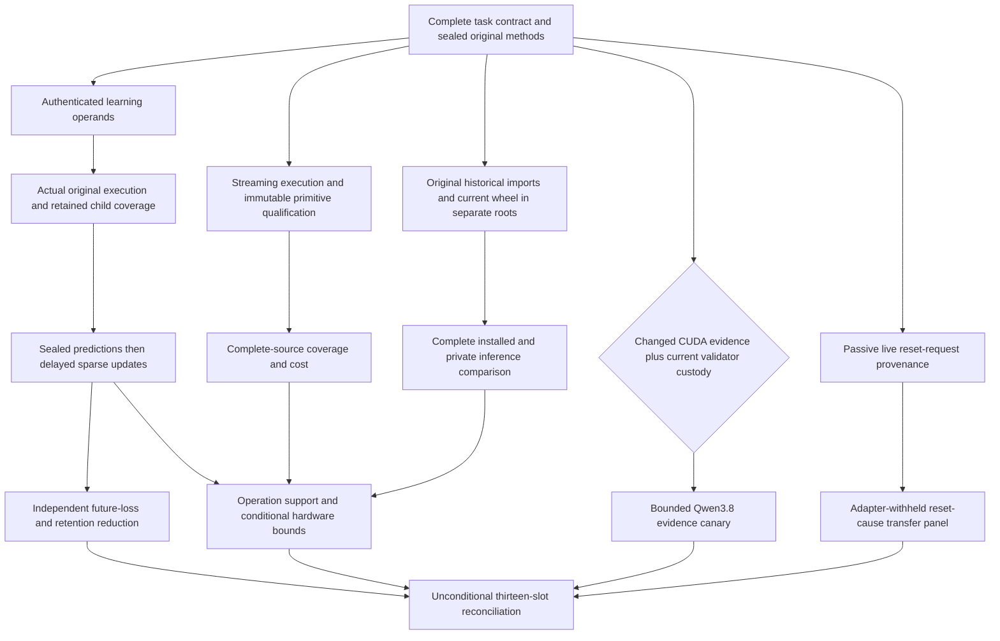
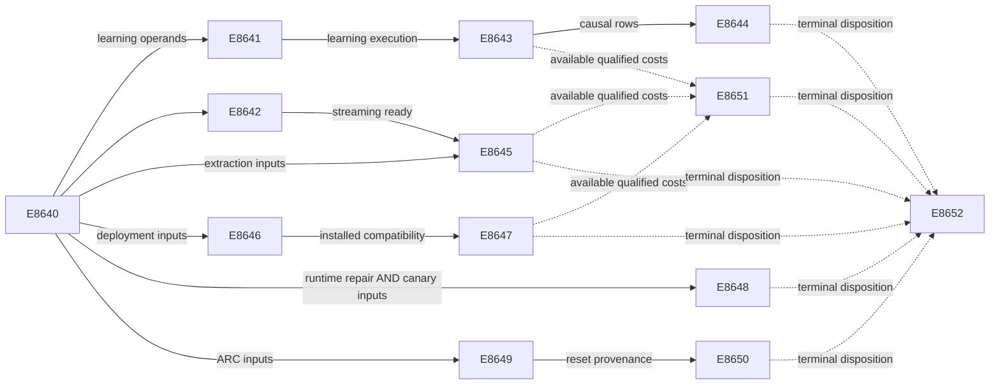

# Carnot Research Roadmap v742: Executable Learning and Complete Evidence

**Created:** 2026-10-18
**Milestone:** 2026.10.742
**Status:** Planned; staged only
**Title:** Causal learning, complete-source verification, and qualified installed inference
**Supersedes:** V741 scheduling; all historical evidence remains unchanged.
**Task contract:** Exactly 13 tasks, Exp8640 through Exp8652, in conductor order.

## What V741 Proved

V741 completed thirteen scheduling slots. Seven producers ran; four slots have
conductor pre-gate records and two have cascade-skip records without a producer.
The archive has not yet appended V741. The active queue, conductor log, original
producer artifacts and Exp8639 capstone establish the disposition. An `OK`
conductor row is not proof that scientific acceptance gates passed.

The complete previous design is preserved byte-for-byte in
`openspec/change-proposals/research-roadmap-v741-preserved-20261018.md`.

| Evidence | Actual result | Next decision |
|---|---|---|
| Exp8627 | Thirteen-object authority qualified; learning_inputs_ready_score=0 | Separate available learning operands from failed execution qualification |
| Exp8628/8630/8631 | Qualification pre-gated; training and audit cascade-skipped | Qualify actual execution before the unchanged scientific study |
| Exp8629 | Fixture parity and resource checks passed; original_coverage_retention failed | Capture actual child data immediately and freeze measurement bytes |
| Exp8632 | Natural complete-source comparison pre-gated | The 190-response coverage question remains unmeasured |
| Exp8633 | Installed lean prototype and private replay qualified | Preserve installed entry and lazy exports |
| Exp8634/8635 | Original compatibility node union failed; cost pre-gated | Qualify historical replay and current wheel separately, then measure |
| Exp8636 | No causal CUDA repair evidence | Conditional canary only; no repeated unchanged device probe |
| Exp8637 | Eight paired action-parity checks passed; all 16 redirects censored | Record reset request origin without changing policy or horizons |
| Exp8638 | No admitted new costs; owned validation disqualified its report | Separate external cost absence from report qualification and actual severity |
| Exp8639 | All thirteen slots reconciled; learning, streaming and cost remain blocked | Preserve missing science and all historical quarantines |

The learning defect is a circular prerequisite. `v741_contract_inputs.historical`
requires `Exp8616.required_checks_passed=1` for learning input readiness. Exp8628
was meant to repair Exp8616's missing execution evidence, but required that
readiness field first. V742 keeps the old failed result and creates a current
operand adapter. Only the new execution qualification can authorize training.

The streaming hook captures `.coverage.*` at combine time. Its retained-data
check failed. The capstone also found that its measurement bytes changed after
sealing. Fresh per-child snapshots and immutable invocation operands address
these two defects. Numerical parity observations alone remain insufficient.

Installed compatibility failed when an original prototype reader saw changed
`resident_protocol.py` bytes. A later source-overlay helper exists in the code;
its presence is not a qualified terminal receipt. V742 tests actual isolated
historical execution and current installed behavior, preserving both contracts.

Qualified older findings remain closed: exposed source-head information nulls,
V735 cold-cost null, V737 supervisor efficacy null, and V740's separate lean
lifecycle gain. V740 measured native/Python throughput CI95 [1.1799076, 1.2584954];
it did not meet NFR-01. No new study renames that comparison into a 10× result.

## Three Biggest Gaps Against the PRD

1. **FR-12: useful verification from complete evidence.** The original extractor
   abstained on 55 of 190 long-source responses. Streaming completeness remains
   unmeasured, and lexical evidence does not certify semantic truth. Finish the
   exposed coverage study with exact old-domain parity and full source custody.
2. **FR-06/FR-11: useful continuous self-learning.** The fixed causal study has
   not produced qualified future-loss and retention evidence. Separate input
   authentication from execution, then measure actual small-head updates and
   held-future typed decisions under the original controls.
3. **FR-05/FR-08/NFR-01: deployable, measured performance.** The installed lean
   entry exists, but public compatibility and complete installed costs remain
   unqualified. Preserve APIs and compare complete installed/private sessions.
   Native arithmetic and lifecycle gains remain separate estimands.

The ARC standing floor remains independent. Generalization work tests a reusable
reset-provenance hook on the scored live path with adapters withheld. It explains
observed censoring; it cannot establish supervisor efficacy or a new level solve.

## Research Selection

The dated V742 scan was appended to `research-references.md` before this design.
All eight requested arXiv topics and six secondary channels were checked.

| Lead | Experiment use | Boundary |
|---|---|---|
| [Long-context decomposition, 2504.19457](https://arxiv.org/abs/2504.19457) | Exp8642/8645 finish bounded complete-source reduction | Carnot's lexical adaptation is not the trained encoder |
| [Calibeating, 2603.22167](https://arxiv.org/abs/2603.22167) | Exp8643/8644 use proper-loss controls | No transferred nonlinear regret guarantee |
| [Delayed capacity, 2606.11711](https://arxiv.org/abs/2606.11711) | Exp8643 retains pending, admitted and lost feedback | Fixed causal protocol; no post-test scheduler change |
| [Online KAN, 2602.02056](https://arxiv.org/abs/2602.02056) | Exp8643/8651 count sparse writes and complete operations | No inferred FPGA speed |
| [Enoki, 2609.00581](https://arxiv.org/abs/2609.00581) | Exp8645 preserves answer/source offsets | Anchored evidence is not semantic entailment |
| [Ising review, 2610.03972](https://arxiv.org/abs/2610.03972) | Exp8651 distinguishes evaluator, optimizer and sampler support | Device compatibility precedes performance claims |

CORTEX (2606.31033) offers a future internal-representation discriminator.
It requires internal-state access and independent span labels. EBT, ARM–EBM,
neural routing feasibility, reward-guided decoding and KAN sample-efficiency
remain useful references. They do not justify a new generator, basis or retired
external-text reranker while the fixed studies remain unmeasured.

Semantic Scholar citation requests failed; citation-following is incomplete.
OpenReview forums returned browser challenges. GitHub Trending returned month-old
snapshots. Extropic estimates and Kona product positioning do not establish
local hardware access or a reproducible new architecture result.

## V742 Architecture



The existing nine-input energy head, basis, causal objective and learner stay
fixed. Streaming features do not enter the learning or installed-cost branches.
Original readers keep original pins. New adapters bind explicit current producers.
ARC instrumentation records actual causes without modifying decisions. Optional
CUDA absence cannot block CPU science. Hardware readers admit available branches
independently and preserve missing costs.

## Phase 1: Qualify Execution — Exp8640–Exp8642

**Exp8640 — contract and methods.** Bind thirteen full task objects and register
branch methods before observing results. Inherit V741 objective, audit, streaming,
installed-cost and canary operands by value and hash. Separate
`learning_operands_ready_score` from `learning_execution_ready_score`.
The first authenticates Exp8431's head, Exp8580's validator, Exp8581's accounting,
data and test inventory. Exp8641 exclusively owns the second. A regression must
show failed old execution permits the repair to run, while missing head/data
still blocks. This changes the input dependency, not the science acceptance gate.

**Exp8641 — learning execution custody.** Give each child an independent coverage
path. Read actual CoverageData immediately on child completion, retain raw SQLite
bytes and source identities, then combine copies. Keep original and new-adapter
aggregates separate. Require the original 27-node family, complete affected union,
83/83 original runner statements and unchanged deadline semantics. Deadline cases
3599/3600/3601 retain 2/3/3 clock reads and null/3600.25/3601.25 elapsed values.
Missing, overwritten, duplicate or foreign data must fail. A second combine must
leave original evidence unchanged. No historical quarantine is cleared.

**Exp8642 — streaming execution custody.** Keep the existing reducer. Replace late
filename-glob custody with direct per-child data capture and immutable invocation
measurements. Run original streaming tests and real child/publication checks.
Require exact eager/streaming parity at chunk sizes 1/32/128, original window
order, collision-safe byte deduplication and UTF-8 offsets. Preserve 512 KiB source,
64 KiB answer, 30 seconds per response, 256 MiB extra working memory and answer
cap 16. Qualification uses fixtures; natural coverage remains Exp8645's question.

## Phase 2: Measure Learning and Evidence — Exp8643–Exp8645

**Exp8643 — continuous self-learning.** Run the fixed nine-input,
109-coefficient head under frozen, log_loss, brier and brier_shuffled_released
arms. Seeds are 17/29/43/71/101. Five 20-question blocks with three siblings produce
6,000 intended predictions. Capacity is eight questions per block, learning rate
0.01 and L2 0.001. Preserve derivative `2*(p-y)*p*(1-p)/T`.
Seal predictions and target-blind admission before labels. Shuffle only admitted,
released labels. Commit state and acknowledgments atomically. Count real coordinate
writes, delayed/pending/lost feedback, durable writes and final drain. Execute real
block-2 exits and exact resumes for seed 17 in every arm. Retention evaluates
50 questions at five windows without training on them. This is the FR-11 and
calibrated typed-decision training slot; generator weights are untouched.

**Exp8644 — benefit and retention.** Reduce 80 later-block question units,
averaging siblings and seeds within question. Use 10,000 paired question draws,
seed 7278448 and two-sided 97.5% intervals. Brier training must beat both frozen
and log-loss controls with both lower bounds above zero and no higher typed loss.
Retention jointly resamples the same 50 questions across all five windows with
10,000 draws and seed 7258421. The upper 95% bound for maximum-window Brier
increase must be at most 0.01. Retain shuffled-release controls. A qualified null
closes this unchanged study. Exposed positives retain independent and generalized
learning scores of zero; construction-dependent positives remain circular.

**Exp8645 — complete-source coverage.** Use the same 190 responses and 128 exposed
question groups. Compare capped extraction to chunk-32 streaming; check chunk-1
and chunk-128 invariance. All 135 previously usable rows must preserve features
exactly. Keep all 55 prior window-limit abstentions, including any that still exceed
resource limits. The engineering gate requires full window custody, common-domain
parity, satisfied resource bounds and at least one recovered response. Interleave
three paired cost repetitions. Use question-cluster descriptive intervals with
10,000 draws and seed 7418632. Join labels after sealing features; compare fixed
scores on common and recovered support separately. No detector fitting, confidence
imputation or changed-denominator detection-benefit claim is authorized.

## Phase 3: Qualify Installed Costs — Exp8646–Exp8648

**Exp8646 — original and current compatibility.** First test the existing
original-source overlay in actual historical children. If unavailable, use an
immutable private checkout. Authenticate the original resident-protocol bytes;
never update historical pins. Preserve all 122 original nodes and their assertions.
Test the current wheel separately outside the checkout with PYTHONPATH removed.
Exercise installed inference, public imports, Python/native parity, CLI, MCP and
existing HTTP smoke routes. Verify resolved source paths, malformed framing,
deadlines, immutable configuration, stale payloads and forced cleanup. Legacy
coverage cannot fill missing current statements. All owned checks must pass
before installed measurement readiness.

**Exp8647 — complete installed cost.** Cross private/installed entry with
Python/native arithmetic. Keep original 64 requests, session lengths 1/4/16,
batch 1 and ten paired repetitions: 120 intended cells. Include setup, imports,
full features, transport, arithmetic, typed policy, serialization and shutdown.
Use original capped features and checkpoint. Primary L16/B1 installed_native /
private_native noninferiority requires throughput lower95 >= 0.95, p95 latency
ratio <= 1.05 and exact decisions. Use 10,000 paired-index draws and seed 7418635.
Native/Python remains a separate contrast; only its lower95 >= 10 meets NFR-01.
Preserve missing cells if the time cap stops work. Never shrink the planned matrix.

**Exp8648 — conditional Qwen canary.** Require supplied causal CUDA repair evidence
and current validator custody. Use `MODEL_SPECS=["unsloth/Qwen3.8-27B-GGUF"]`
and `model_bounded_generation`: four exposed fit questions in four fixed evidence
views, 16 calls, temperature zero and at most 128 output tokens per call.
Load cap is 600 seconds, call cap 120 seconds and measurement cap 2,400 seconds.
Use a GPU lease and real offload evidence. No unchanged device probe, download,
CPU headline fallback, generator training or scientific benefit claim is planned.

## Phase 4: Transfer Diagnostics and Reconcile — Exp8649–Exp8652

**Exp8649 — live reset provenance.** V741's real censoring motivates a reusable
passive hook. Record request ID, action index, actual requester/branch, public
observation hashes and remaining action/time budgets at reachable request sites.
Distinguish agent RESET, environment terminal, harness reset and unknown. Test
conflicting requesters, repeated reset, terminal without reset, recorder failure,
overlapping redirects and disabled instrumentation. Require action/RNG/SDK-call
parity through the scored wrapper. Seal historical source closures before changes;
new adapters bind current source explicitly. No arm priority or reset timing changes.

**Exp8650 — diagnostic transfer.** Run four games (ar25, ft09, lf52, tn36), seeds
11/22, with reset provenance off/on: 16 fresh official-SDK episodes. Keep the
existing outcome observer and capability masking on. Withhold adapters, routes and
LLM induction. Preserve 512-action/120-second limits and horizon 120. Require exact
actions in all eight pairs and unique authenticated requester ownership for every
observed agent/harness reset across all four games. Zero-reset games retain zero
support; unknown origins remain unknown. Current instrumentation and original
observer history use separate source bindings. Outcome censoring and the prior
supervisor null remain unchanged. This is a new diagnostic-transfer question,
not a repeated efficacy panel. No game-source access, offline BFS or solve claim.

**Exp8651 — operation evidence.** Read original board facts once, without device
commands. Admit new learning, installed and extraction cost boundaries separately.
Qualify report-state handling: external missing costs are blocked, INFO findings
stay INFO, critical findings and owned failures remain disqualified. Preserve every
finding. Recompute complete disjoint costs before any arithmetic-removal ceiling.
A ceiling is conditional, never a measured speedup. Explain the compatible work
and fixed host fraction needed for the program's 100× learning target. If costs
remain unavailable, emit null ceilings with exact diagnostics once.

**Exp8652 — capstone.** Run unconditionally. Reconcile all thirteen slots from
original producer and conductor evidence. Treat missing producers and pre-gate
artifacts distinctly. Reduce admitted science, preserve quarantines, and compare
literal verdicts plus normalized causes before recommending retirement. A qualified
null closes its exact study; failed qualification leaves science unmeasured.
Report G1–G4 and unmet gates from the unchanged publication script. Essential
external incompleteness is `blocked`, never retryable `partial`.

## Dependency Graph and Failure Isolation



The YAML supplies all conjunctive gates, including method/branch prerequisites
omitted from the compact diagram. Every gate references an earlier task in this
roadmap and a top-level numeric field in that producer's required fields.
Dotted edges are optional evidence reads, not conductor gates. Exp8651 and Exp8652
must run even if science or CUDA remains blocked. No `requires:` references a
retired task. Prior failures retain all four mandatory fields and concrete changes.
No operator override is asserted or needed for a reused retired ID.

## Hardware and Execution Requirements

| Resource | Tasks | Requirement and limit |
|---|---|---|
| CPU, Python 3.12 environment, disk-backed scratch | All except conditional model work | Bounded children, immutable raw shards, real flush/exit receipts |
| Rust/PyO3 and private wheel environment | Exp8646/8647 | Actual current extension and loaded wheel; original source separate |
| Dual RTX 3090 host | Exp8648 only | Lease sufficient available VRAM; authenticated repaired CUDA; no background-process interference |
| ARC SDK | Exp8649/8650 | Scored wrapper, adapter-withheld games, no LLM calls |
| KV260 | Exp8651 evidence mapping | Quadratic Ising scope, k <= 5; no deterministic spline or full-service support inferred |
| PolarFire | Exp8651 evidence mapping | Existing Linux CPU dispatch only |
| GateMate | Exp8651 evidence mapping | Physical change, GM1Ax IDCODE and n16 smoke remain prerequisites; no unchanged probe |
| NPU / Extropic TSU | Deferred | No qualified local execution or authenticated provider run |

No hardware acquisition, driver installation, flashing, external publication or
network message is part of the milestone. Sparse CPU/Rust updates remain the
current learning path. A conditional 100× target needs compatible dominant work
and at most 1% unaccelerated cost; a faster isolated kernel cannot establish it.

Task estimates total 650 minutes of serial work, including qualification. They
are scheduling estimates, not measured durations. Each task stays within the
4,800-second cap. All prompts require flushed phase/long-call boundaries,
inside-loop progress, child heartbeats at least every 60 seconds, silence below
600 seconds and file writes in chunks of at most 150 lines. Measurement ends by
3,600 seconds with at least 900 seconds reserved for validation. The model canary
uses the 10-second bounded-generation floor; load-only and full-generation classes
are not used. Small legacy models are permitted only as CPU smoke checks.

## Verification and Stop Conditions

Before activation, check schema, full-object JSON/YAML equality, independent visible
table parsing, canonical task digest, prompt requirements, path existence, gate
order/field names and complete prior-failure entries. Run exclusion, harness,
ARC-floor and priority linters. Use existing unit tests and private E2E-018/021
for planning authority/publication contracts. This planning change runs no science.

Each future implementation follows spec first, tests first, scoped lint/types,
100% owned unit/child statement coverage and applicable E2E checks. Preserve all
original assertions and raw evidence; no broad historical rerun controllers.
All claimed comparisons retain per-unit rows. Owned failure is disqualified;
unchanged external failure is blocked. The capstone cannot rewrite these classes.

Exp8640–8642 and Exp8646 reserve infrastructure work. Exp8643 satisfies continuous
self-learning and calibrated-decision training. Exp8649/8650 satisfy reusable live
ARC generalization work. Literature ingestion occurs in Exp8640. Formulaic live
hook work routes to Codex/gpt-6.1-sol; schema/preflight coordination routes to Opus
with 100 turns. Routine experiments use Sonnet. No Gemini or luna task is scheduled.

## Exact task contract

Exactly 13 tasks, Exp8640 through Exp8652, in this order. The JSON below contains
the complete task objects, including every prompt, gate and failure lineage.

| Order | Task ID | Title | Phase | Deliverable |
|---|---|---|---|---|
| 1 | exp8640-contract-methods | Bind thirteen tasks and separate research operands from execution qualification | 1 | results/experiment_8640_v742_contract_methods.json |
| 2 | exp8641-learning-execution-custody | Qualify original learning execution with immutable per-child coverage | 1 | results/experiment_8641_v742_learning_execution_custody.json |
| 3 | exp8642-streaming-execution-custody | Qualify streaming extraction with immutable measurements and actual child data | 1 | results/experiment_8642_v742_streaming_execution_custody.json |
| 4 | exp8643-causal-brier-stream | Measure continuous small-head learning with sealed delayed feedback | 2 | results/experiment_8643_v742_causal_brier_stream.json |
| 5 | exp8644-learning-benefit-audit | Test future Brier benefit and simultaneous retention from qualified causal rows | 2 | results/experiment_8644_v742_learning_benefit_audit.json |
| 6 | exp8645-complete-source-comparison | Measure complete streaming source coverage and matched cost on the exposed roster | 2 | results/experiment_8645_v742_complete_source_comparison.json |
| 7 | exp8646-installed-compatibility | Qualify original import contracts and current installed inference in separate roots | 3 | results/experiment_8646_v742_installed_compatibility.json |
| 8 | exp8647-installed-complete-cost | Measure complete installed and private inference under qualified compatibility | 3 | results/experiment_8647_v742_installed_complete_cost.json |
| 9 | exp8648-qwen-evidence-canary | Run bounded mandated-Qwen evidence views after causal runtime recovery | 3 | results/experiment_8648_v742_qwen_evidence_canary.json |
| 10 | exp8649-arc-reset-provenance | Qualify passive reset provenance on the reachable live ARC path | 4 | results/experiment_8649_v742_arc_reset_provenance.json |
| 11 | exp8650-arc-reset-transfer | Measure reset-cause transfer across adapter-withheld live games | 4 | results/experiment_8650_v742_arc_reset_transfer.json |
| 12 | exp8651-hardware-operation-evidence | Map qualified new operations while preserving absent cost and physical evidence | 4 | results/experiment_8651_v742_hardware_operation_evidence.json |
| 13 | exp8652-capstone | Reconcile thirteen outcomes and close unchanged scientific questions | 4 | results/experiment_8652_v742_capstone.json |

canonical_tasks_sha256: `sha256:37b4a48b1d0649006b646d10749f79badecb1c9dbbf84869a92f591f7fdbe12a`

<!-- V742_TASK_CONTRACT_START -->
```json
{
  "milestone": "2026.10.742",
  "tasks": [
