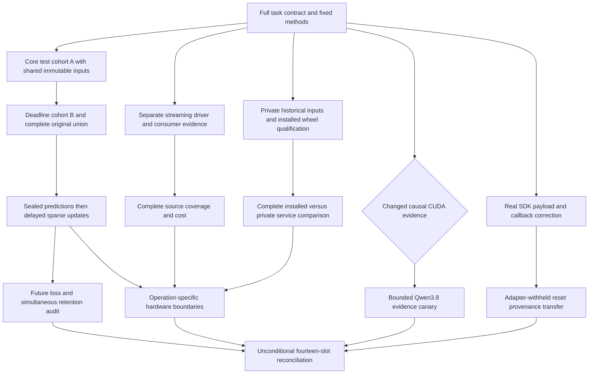
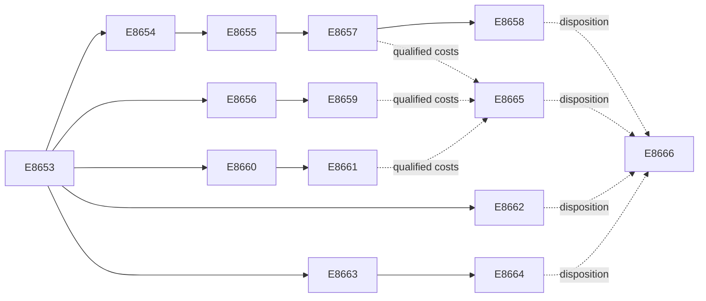

# Carnot Research Roadmap v743: Bounded Learning and Complete Evidence

**Created:** 2026-10-18 (America/New_York)
**Milestone:** 2026.10.743
**Status:** Planned; staged only
**Title:** Bounded causal learning, complete evidence, and installed inference
**Supersedes:** V742 scheduling; historical evidence remains unchanged.
**Task contract:** Exactly 14 tasks, Exp8653 through Exp8666, in conductor order.

## What V742 Proved

V742 completed thirteen scheduling slots. Eight producers ran including its
capstone; four slots have conductor pre-gate receipts and one has a cascade-skip
record. The archive currently ends at V741, so the active V742 queue, conductor
log, original artifacts and Exp8652 capstone supply the latest disposition.
Conductor `OK` and scheduling completion do not establish scientific success.
The full prior design is preserved byte-for-byte in
`openspec/change-proposals/research-roadmap-v742-preserved-20261018.md`.

| Evidence | Actual finding | Next decision |
|---|---|---|
| Exp8640 | Qualified circular-positive contract; learning operands ready, CUDA repair absent | Reuse separate input gates; do not make failed execution a qualification prerequisite |
| Exp8641 | Raw custody and original statement checks passed; original test union and semantic mutation qualification failed | Split core execution and deadline qualification into separately budgeted tasks |
| Exp8642 | Numerical/resource observations passed; current/original driver identity and child coverage qualification failed | Separate driver authority and instrument consumer-only children for their actual sources |
| Exp8643/8644 | Training pre-gated; audit cascade-skipped | No new learning-benefit or retention finding |
| Exp8645 | Natural source comparison pre-gated | The fixed 190-response completeness study remains unmeasured |
| Exp8646 | 690 numerical rows and current 73-node union passed; original union credited 116/122 | Fix private historical fixture cleanup while retaining the guard and all assertions |
| Exp8647/8648 | Installed cost and Qwen canary pre-gated | No new installed timing or generator result |
| Exp8649 | Passive recorder fixtures qualified | Fixture qualification does not certify real SDK payloads |
| Exp8650 | All eight action-parity pairs passed; 16 horizons censored; 236 resets lacked authenticated causes | Repair real payload/context handling before another transfer panel |
| Exp8651/8652 | Qualified blocked hardware mapping and capstone reconciliation | Preserve missing science and physical execution as external blocks |

Exp8641's `original25` child exited -9 after 62.074893612 seconds near the
3,600-second measurement boundary. Eleven original nodes remained pending.
Three nominal deadline rows had correct reads and elapsed values; missing
mutation executions prevented semantic qualification. This is execution-budget
failure, not evidence against the numerical learner. Module-aware grouping
and two independently budgeted cohorts address the observed cause.

Exp8642's recorded source mismatch was `streaming_source_runner_8629.py`.
Passing authority/publication suites also reported `missing_child_statements`
because their coverage inventory targeted unrelated streaming code. Two owned
tests failed. V743 retains original driver authority in an isolated replay and
qualifies current driver behavior separately. It measures real consumer sources
for consumer-only children; it does not waive coverage or old assertions.

Exp8646's original runner child passed six assertions, then raised two teardown
errors when cleanup resolved a result symlink into shared repository evidence.
The tracked-results guard correctly stopped removal. Materialized private input
copies replace cleanup-sensitive aliases. The guard remains enabled.

Exp8650 recorded `TypeError`, stale action indices and missing post-observation
joins on actual SDK frames. The precise exception message was not retained.
Serialization/context failure is a code-supported hypothesis to reproduce before
editing. The new task stops if it cannot reproduce the recorded failure; it may
not guess a cause, increase horizons or promote supervisor arms.

Qualified V733 source-information, V735 cold-cost, V737 supervisor-efficacy and
V740 lean-lifecycle results retain their original scope. V740's native/Python
throughput interval [1.1799076, 1.2584954] did not meet NFR-01. No historical
quarantine is cleared, and none of these findings is rerun unchanged.

## Three Biggest Gaps Against the PRD

1. **FR-12: verifiable reasoning from complete evidence.** Long-source coverage
   remains unmeasured after 55 of 190 responses exceeded the capped extractor.
   Complete processing is necessary but cannot establish semantic entailment.
   Finish the fixed coverage study with exact old-domain parity and explicit
   annotation/support limits before adding a new detector.
2. **FR-06/FR-11: beneficial continuous self-learning.** Mechanics must qualify
   before actual delayed small-head updates can establish later Brier benefit
   and retention. Execute the fixed scientific protocol after complete source-
   bound test evidence; do not replace missing science with another summary.
3. **FR-05/FR-08/NFR-01: qualified deployment and complete performance.** The
   installed entry works numerically, but historical compatibility failed
   cleanup. Qualify that boundary and measure identical installed/private work.
   Packaging noninferiority and a native/Python 10x gain are separate questions.

ARC generalization remains a separate standing obligation. Real SDK recorder
hardening and adapter-withheld transfer improve evidence quality on the live
path. Neither grants a new solve, hidden leaderboard or supervisor-benefit claim.

## Research Selection and Novelty Boundary

The fresh V743 scan was appended to `research-references.md` before experiment
design. It covers all eight requested arXiv areas and all six secondary channels.
These are revalidated leads already in the repository, not newly discovered methods.

| Primary method | Concrete use | Limit |
|---|---|---|
| [Long-context decomposition, 2504.19457](https://arxiv.org/abs/2504.19457) and [HallDetect, 2608.05823](https://arxiv.org/html/2608.05823v1) | Exp8656/8659 preserve complete windows, offsets and fixed evidence aggregation | A lexical reducer is not a learned entailment reproduction |
| [Calibeating, 2603.22167](https://arxiv.org/html/2603.22167v1) | Exp8657/8658 compare proper losses and typed decisions | No nonlinear regret guarantee is imported |
| [Delayed capacity, 2606.11711](https://arxiv.org/abs/2606.11711) | Exp8657 seals predictions and counts admitted, pending and lost feedback | Keep the registered scheduler and capacity; no post-test change |
| [Online spline KAN, 2602.02056](https://arxiv.org/html/2602.02056v1) | Exp8657/8665 measure actual coordinate writes and complete operation costs | No new basis, fixed-point claim or inferred board speed |
| [OpenHalDet, 2606.06959](https://arxiv.org/abs/2606.06959) | Exp8653/8659 freeze equal detector access and inputs | No new broad benchmark or dependency |
| [Ising algorithms, 2610.03972](https://arxiv.org/abs/2610.03972) | Exp8665 separates evaluation, optimization and sampling support | Different device operations are not interchangeable |

EBT and ARM–EBM remain architectural references. Neural routing constraints and
energy-guided decoding are deferred until current evidence and runtime qualify.
Extropic Z1T's projected headline costs exclude final dense logits and its energy
ratio excludes inter-device movement; complete accounting is the relevant lesson.
Kona's inspected page supplies positioning, not reproducible new architecture.
Semantic Scholar citation APIs failed, OpenReview returned a browser challenge,
and Trending returned month-old snapshots. These retrieval limits are recorded;
no complete citation inventory, current ranking or unread review claim is made.

## V743 Architecture



The nine-input, 109-coefficient energy head and original learning objective stay
fixed. Streaming inputs do not enter the learner or installed-cost branch.
Historical tests run under original authority; current execution gets explicit
new adapters. Complete original obligations remain required. Optional CUDA and
physical hardware absence cannot veto independently qualified CPU work.

## Phase 1: Bound the Original Execution — Exp8653–Exp8655

**Exp8653: methods and contract.** Bind fourteen complete objects and freeze
original V742 objective, audit, streaming, installed-cost and canary methods by
value and hash. Ingest the research mapping. Register the exact original test
partition and independent operand gates. Missing CUDA evidence pre-skips only
the canary. No qualification requires the failed result it is meant to replace.

**Exp8654: core execution.** Execute cohort A: original learning-clock,
causal-runner and objective-checkpoint families. Group module fixtures to avoid
repeated expensive setup and retain immutable real child receipts. Publish only
`learning_core_ready_score`; this cannot authorize training. The exact B remainder
is a planned separate obligation, not a reason to declare this task partial.

**Exp8655: full qualification.** Authenticate A's transitive source/config/input
identity and execute cohort B: original deadline-edge, deadline-statement and
two private E2E nodes. Require the complete 64-node union, all 27 original runner
nodes, 83/83 executable runner statements, unchanged deadline cases and actual
mutation rejection. Changed A sources invalidate reuse. Only this full gate
publishes `learning_execution_ready_score`.

## Phase 2: Complete the Fixed Science — Exp8656–Exp8659

**Exp8656: streaming qualification.** Separate original custody-driver replay
from current adapter behavior. Instrument consumer-only children against their
actual source inventories. Preserve all original assertions, numerical windows,
UTF-8 offsets, deduplication and resource rejections. Retain immutable measurements
and real coverage; qualify the full current execution before natural evaluation.

**Exp8657: continuous self-learning.** Run four arms: frozen, log-loss, Brier,
and shuffled released-label Brier. Keep five seeds 17/29/43/71/101, five blocks
of 20 questions with three siblings, and 6,000 prediction rows. Capacity remains
eight questions per block, learning rate 0.01 and L2 0.001. Seal predictions before
feedback, keep actual sparse writes and atomic acknowledgments, and compare real
block-two exits/resumes for seed 17. Evaluate 50 retention questions at five
windows without using their labels for training. No generator weights change.

**Exp8658: benefit audit.** Aggregate siblings/seeds within each of 80 later-block
question units. Use 10,000 paired draws, seed 7278448 and two-sided 97.5% intervals
for Brier versus frozen and log-loss; both lower benefit bounds must exceed zero
with no higher typed-decision loss. Joint retention resampling uses 50 questions,
five windows and seed 7258421; the upper 95% bound on maximum-window Brier increase
must be <=0.01. Qualified null closes the fixed scope. Exposed-development benefit
cannot establish independent generalization or close GAP-ORACLE-DISTINCT.

**Exp8659: complete-source comparison.** Evaluate all 190 responses in 128 exposed
question groups. Compare capped extraction with chunk-32 streaming and check
chunk-1/128 invariance. Preserve all 135 prior usable responses and 55 abstentions.
Use source <=512 KiB, answer <=64 KiB, response <=30 seconds, extra memory <=256 MiB
and answer cap 16. Three interleaved cost repeats retain complete extraction/I/O
clocks. Require exact common-domain feature parity, complete windows, resource
bounds and at least one recovery for coverage benefit. Use fixed seed 7418632 for
10,000 question-cluster draws. Join labels after feature sealing; changed-support
AUROC cannot establish detector improvement. Missing judge confidence stays missing.

## Phase 3: Qualify Deployment and Optional Model Access — Exp8660–Exp8662

**Exp8660: installed compatibility.** Reproduce the guarded teardown error, then
materialize private historical result inputs instead of cleanup-sensitive aliases.
Keep the guard and original assertions. Require all 122 original nodes, affected
current/public surfaces, actual installed wheel/native parity and complete current
coverage. Verify original evidence hashes before and after cleanup. Historical
source coverage cannot fill current-source holes.

**Exp8661: installed costs.** Cross private/installed entry with Python/native
arithmetic, original 64 requests, session lengths 1/4/16, batch 1 and ten paired
repeats: 120 cells. Include startup/import, features, transport, scaling, residual,
normalization, policy, serialization and shutdown. Primary L16 installed-native
versus private-native noninferiority requires throughput lower95 >=0.95 and p95
ratio <=1.05 with exact decisions. Use 10,000 paired-index draws, seed 7418635.
Only installed-native/installed-Python lower95 >=10 meets NFR-01.

**Exp8662: optional bounded Qwen canary.** Require changed causal CUDA evidence
and current validator custody. Use `unsloth/Qwen3.8-27B-GGUF`, four fit questions,
four fixed evidence views, temperature zero and at most 128 output tokens per
call: 16 calls. Bound load to 600 seconds and each call to 120 seconds with parent
heartbeats. This uses `model_bounded_generation` and its 10-second floor. No
sleep-padding, CPU headline fallback or unchanged CUDA probe is permitted.

## Phase 4: Live Evidence and Decision — Exp8663–Exp8666

**Exp8663: real SDK recorder correction.** Reproduce TypeError from retained
public payloads before changing code. Correct canonical frame serialization and
fresh action-context ownership; distinguish duplicate callbacks from legitimate
repeated observations. Keep policy behavior unchanged. Require actual bounded SDK
off/on witnesses with zero errors, authentic joins and exact action/RNG/SDK/legacy
receipt parity. This is reusable generalization infrastructure, not a game solve.

**Exp8664: transfer.** Run the same ar25/ft09/lf52/tn36 games, seeds 11/22 and
recording off/on: 16 fresh official SDK episodes, 512 actions, 120 seconds and
120-action horizons. Withhold adapters, stored routes and LLM induction. Require
all eight parity pairs and authentic unique origins for observed resets across
all four games. Unknowns and recorder errors remain explicit. Zero complete
horizons cannot authorize arm promotion; keep solve and policy-benefit credit zero.

**Exp8665: hardware boundaries.** Read qualified new costs independently and
preserve KV260, PolarFire and GateMate evidence. Map actual supported operations;
compute conditional arithmetic-removal ceilings only from complete disjoint spans.
Report absence once if no branch qualifies. No unchanged board probe is scheduled.

**Exp8666: capstone.** Reconcile every scheduled slot, including exact conductor
fallback paths and cascade records. Independently reduce admitted primitives and
original test obligations. Preserve failed qualifications as failures, measured
nulls as nulls and missing science as blocked. Keep G1–G4 and exact reopen/retire
conditions. External unchanged failure is terminal blocked, never retrying partial.

## Dependency Graph and Gate Ownership



Solid edges are structured prerequisites; dashed edges are unconditional
readers that preserve missing inputs. Additional input checks remain conjunctive:

| Consumer | Same-roadmap producer fields required to equal numeric 1 |
|---|---|
| Exp8654 | Exp8653.methods_ready_score; Exp8653.learning_operands_ready_score |
| Exp8655 | Exp8654.learning_core_ready_score; Exp8653.learning_operands_ready_score |
| Exp8656 | Exp8653.methods_ready_score; Exp8653.extraction_inputs_ready_score |
| Exp8657 | Exp8653.learning_operands_ready_score; Exp8655.learning_execution_ready_score |
| Exp8658 | Exp8657.learning_rows_ready_score |
| Exp8659 | Exp8656.streaming_extractor_ready_score; Exp8653.extraction_inputs_ready_score |
| Exp8660 | Exp8653.methods_ready_score; Exp8653.deployment_inputs_ready_score |
| Exp8661 | Exp8660.installed_measurement_ready_score; Exp8653.deployment_inputs_ready_score |
| Exp8662 | Exp8653.runtime_repair_ready_score; Exp8653.canary_inputs_ready_score |
| Exp8663 | Exp8653.arc_inputs_ready_score |
| Exp8664 | Exp8663.reset_provenance_ready_score; Exp8653.arc_inputs_ready_score |
| Exp8653/8665/8666 | None; run independently and retain external blocks |

Every gate field appears identically in its producer's REQUIRED ARTIFACT FIELDS.
No new gate references a retired or out-of-roadmap producer. Historical artifacts
are authenticated inputs, not scheduling dependencies. Every failure continuation
has all four prior_failures fields, including retire_if_same_verdict=true.
Do not reuse retired IDs or invent operator overrides. Exact repeated causal
failure requires a changed mechanism or prerequisite before future planning.

## Hardware Requirements and Runtime Budget

| Resource | Tasks | Requirement and claim boundary |
|---|---|---|
| CPU, Python3.12, disk-backed scratch | All CPU branches | Actual child receipts, bounded memory, immutable copies and complete clocks |
| Rust/PyO3 and private wheel environment | Exp8660/8661 | Actual loaded current extension; historical sources remain isolated |
| Dual RTX3090 host, cached ~16GB mandated GGUF | Exp8662 only | Authenticated changed runtime and available lease; no other process interference |
| ARC SDK and existing numerical frame-change head | Exp8663/8664 | Actual scored wrapper, public observations, no LLM calls |
| KV260 | Exp8665 | Existing quadratic Ising operations, k_max<=5; no spline/service support inferred |
| PolarFire | Exp8665 | Linux CPU dispatch evidence only |
| GateMate | Exp8665 | Dated physical change, GM1Ax IDCODE0x20000001 and n16 sample/hash evidence still required |
| NPU/Extropic TSU | Deferred | No qualified local workload or authenticated provider run |

The hardware wishlist supplies availability and desired directions; dated
producer evidence controls actual support. No purchase, driver installation,
flashing, external publication or message is scheduled. Acquisition priority
changes only if qualified complete costs identify an actionable bottleneck.
Sparse CPU updates are the current learning path. A conditional 100x target
requires compatible accelerated work and <=1% unaccelerated cost; arithmetic
removal bounds cannot establish achieved speed or physical compatibility.

The fourteen estimates total **665 serial minutes**, including validation.
Individual estimates are 25–60 minutes, within the 4,800-second hard cap.
Measurements end by 3,600 seconds with at least 900 seconds reserved. The split
learning cohorts each get a separate task budget; neither waives original work.
Every prompt requires flushed phase and long-call boundaries, progress inside
loops, child heartbeats at least every 60 seconds, silence below 600 seconds,
and files over about 200 lines written in multiple calls of at most 150 lines.

Only Exp8662 loads a language model: MODEL_SPECS contains
`unsloth/Qwen3.8-27B-GGUF` and substrate is `model_bounded_generation` (10-second
floor). No task declares full generation (60-second floor) or load-only work
(2-second floor). Other tasks declare no_model_load with truthful separate
numerical-head provenance. Legacy small models are CPU smoke tests only.

Schema/preflight and coordinated qualification tasks route to Claude Opus with
100 turns per the current task instruction; routine experiments retain default
routing and <=50 turns. Runtime environment coercion may still select Codex.
No operator-only backend override is fabricated.

## Verification and Stop Conditions

Before activation: schema, exact full-object/table/digest equality, gate order,
producer field spellings, prompt sections, concrete progress/chunking steps,
prior-failure completeness and existing-path resolution must pass. Run exclusion,
harness, ARC-generalization and overdue-priority linters, focused contract/schema
unit checks and private E2E-018/021. Preserve protected-file hashes.

Future implementation is spec first, tests first, scoped lint/types, 100% owned
unit/real-child statement coverage and applicable E2E. Preserve real severity and
all assertions. Failed owned validation disqualifies; unchanged missing external
science blocks once. All comparative tasks keep per-unit rows and exact missing
reasons. Only valid scientific nulls close hypotheses. Optional runtime absence
and short genuine durations never justify simulated results or clock padding.

## Planning Validation

Validation receipts will be recorded here after the staged files are checked.
This plan does not activate the milestone, execute research or publish results.

## Exact task contract

Exactly **14 tasks, Exp8653 through Exp8666**, in the order below. The JSON contains
every complete YAML task dictionary, including prompts and optional fields.

| Order | ID | Title | Phase | Deliverable |
|---|---|---|---|---|
| 1 | exp8653-contract-methods | Bind fourteen tasks and freeze bounded execution and unchanged scientific methods | 1 | results/experiment_8653_v743_contract_methods.json |
| 2 | exp8654-learning-core-execution | Execute the original learning core with fixture-aware bounded cohorts | 1 | results/experiment_8654_v743_learning_core_execution.json |
| 3 | exp8655-learning-execution-qualification | Qualify the complete learning union with original deadline and mutation controls | 1 | results/experiment_8655_v743_learning_execution_qualification.json |
| 4 | exp8656-streaming-execution-custody | Qualify streaming execution with separate driver authority and consumer coverage | 2 | results/experiment_8656_v743_streaming_execution_custody.json |
| 5 | exp8657-causal-brier-stream | Measure continuous small-head learning through the fully qualified causal runner | 2 | results/experiment_8657_v743_causal_brier_stream.json |
| 6 | exp8658-learning-benefit-audit | Audit later Brier benefit and simultaneous retention from causal updates | 2 | results/experiment_8658_v743_learning_benefit_audit.json |
| 7 | exp8659-complete-source-comparison | Measure complete-source coverage and cost on the fixed exposed response roster | 2 | results/experiment_8659_v743_complete_source_comparison.json |
| 8 | exp8660-installed-compatibility | Qualify installed inference with owned historical checkout cleanup | 3 | results/experiment_8660_v743_installed_compatibility.json |
| 9 | exp8661-installed-complete-cost | Measure complete installed and private inference at equal numerical work | 3 | results/experiment_8661_v743_installed_complete_cost.json |
| 10 | exp8662-qwen-evidence-canary | Run bounded mandated-Qwen evidence views only after causal runtime recovery | 3 | results/experiment_8662_v743_qwen_evidence_canary.json |
| 11 | exp8663-arc-reset-provenance | Repair live reset recording for real SDK frames and callback identities | 4 | results/experiment_8663_v743_arc_reset_provenance.json |
| 12 | exp8664-arc-reset-transfer | Measure corrected reset-cause transfer across adapter-withheld live games | 4 | results/experiment_8664_v743_arc_reset_transfer.json |
| 13 | exp8665-hardware-operation-evidence | Map new complete costs to actual KV260 PolarFire and GateMate operation limits | 4 | results/experiment_8665_v743_hardware_operation_evidence.json |
| 14 | exp8666-capstone | Reconcile fourteen outcomes and close exact unchanged scientific questions | 4 | results/experiment_8666_v743_capstone.json |

canonical_tasks_sha256: `9e2b82c9848840daddf08f28e1d722178a72b91ce676daa13e1883a5e9713bca`

<!-- V743_TASK_CONTRACT_START -->
```json
{
  "milestone": "2026.10.743",
  "tasks": [
    {
      "id": "exp8653-contract-methods",
      "title": "Bind fourteen tasks and freeze bounded execution and unchanged scientific methods",
      "phase": 1,
      "track": "infrastructure",
      "priority": "high",
      "requires_gpu": false,
      "max_turns": 100,
      "estimated_wall_time_min": 35,
      "per_unit_rows": true,
      "milestone": "2026.10.743",
      "deliverable": "results/experiment_8653_v743_contract_methods.json",
      "inference_substrate_class": "no_model_load",
      "MODEL_SPECS": [],
      "gated_on": [],
      "prior_failures": [],
      "agent_type": "claude",
      "model": "opus",
      "prompt": "CONTEXT:\nWork in {project_root} on {date}. V742 completed thirteen scheduling slots, not thirteen scientific studies. Exp8640 qualified independent input gates. Exp8641 retained coverage but exhausted its measurement budget before the original node union and deadline mutations completed. Exp8642 failed current/original driver separation and demanded unrelated source statements from consumer-only children. Exp8646 passed current numerical checks but historical fixture teardown hit the tracked-results guard. Learning, complete-source comparison and installed costs never ran. Exp8650 preserved action parity but live reset recording raised TypeError and left236 observed resets without authenticated causes. Preserve all historical nulls and quarantines. V743 contains exactly fourteen tasks, Exp8653 through Exp8666.\n\nEXISTING CODE TO READ FIRST:\nCLAUDE.md; CODEX.md; ops/e2e-test-plan.md; ops/exclusion_manifest.yaml; openspec/capabilities/research-reporting/spec.md; openspec/capabilities/verification/spec.md; scripts/experiment_template.py; python/carnot/reporting/primary_publication.py; openspec/change-proposals/research-roadmap-vNEXT.md; openspec/change-proposals/research-roadmap-v742-preserved-20261018.md; research-references.md; python/carnot/reporting/v741_contract_inputs.py; python/carnot/reporting/v741_contract_methods.py; python/carnot/reporting/roadmap_contract.py; openspec/change-proposals/v741-methods-protocol.json; results/experiment_8627_v741_contract_methods.json; results/experiment_8639_v741_capstone.json; python/carnot/verify/cuda_reader_8410.py; research-studying.md; python/carnot/reporting/v742_contract_methods.py; python/carnot/reporting/v742_contract_inputs.py; openspec/change-proposals/v742-methods-protocol.json; results/experiment_8640_v742_contract_methods.json; results/experiment_8652_v742_capstone.json\n\nTASK:\nBind fourteen tasks and freeze bounded execution and unchanged scientific methods. Deliver results/experiment_8653_v743_contract_methods.json. Create thin runner scripts/experiments/experiment_8653_v743_contract_methods.py, immutable primitives in results/raw/experiment_8653_v743_contract_methods/ and notes docs/research-notes/v743-contract-methods.md. Same-roadmap artifacts are future dependencies.\n\nCONCRETE STEPS:\n1. PRECONDITIONS: Print a flushed start line. Authenticate exact input paths and hashes, tools, free memory and writable disk-backed scratch. Distinguish missing files, missing fields and observed zero in gate_check_summary. Optional hardware absence cannot block independent CPU work.\n\n2. Print a flushed progress line at each phase boundary and before and after every model load, generation, benchmark and subprocess that can take minutes. Use unbuffered output; print completed/pending counts inside long loops. Supervise children with a flushed heartbeat at least every60 seconds and keep every silence gap under600 seconds. Write any file over about200 lines in several tool calls of at most150 lines, with a progress message between calls. Poll in tool calls of at most60 seconds. Stop measurements by3600 seconds and reserve at least900 seconds for validation within the4800-second hard cap. Never pad duration.\n\n3. Spec first: confirm relevant REQ-* and SCENARIO-* before implementation, then write focused failing tests. Preserve scientific thresholds and original assertions. Accept --date {date}; runners belong in scripts/experiments/, tests in tests/python/, scratch in /var/tmp. Do not change research-roadmap.yaml, scripts/research_conductor.py, shared validators, generator weights or external services.\n\n4. Declare inference_substrate_class=no_model_load, MODEL_SPECS=[] and zero current language-model calls. Separate historical generator identities from current execution. Authenticate any numerical energy head and checkpoint separately; no_model_load does not mean no numerical inference.\n\n5. Bind exactly fourteen full dictionaries Exp8653 through Exp8666. Independently parse the visible task table, complete JSON, canonical_tasks_sha256 and end marker. Test staged V743 with active V742 and genuinely activated V743. Reject count/order/ID/title/phase/deliverable/prompt/model/substrate/gate/retirement mutations. Authenticate preserved V742 bytes; never read mutable vNEXT as historical authority.\n\n6. Create openspec/change-proposals/v743-methods-protocol.json before measurements. Inherit objective_updates, objective_audit, streaming_extraction_protocol, installed_entry_2x2 and evidence_canary by value/hash from the original V742 protocol. Bind historical originals independently, including numerical head, data, labels, accounting and validator receipts. Preserve the separate learning_operands_ready_score established by Exp8640; failed old execution must not block qualification itself.\n\n7. Register disjoint learning test cohorts A and B, derived from the exact original64-node union: A covers test_learning_clock_8592.py, test_causal_brier_stream_8582.py and test_objective_checkpoint_8461.py; B covers test_deadline_edge_8603.py, test_deadline_statement_8616.py and the two original E2E nodes. Preserve all original27 runner nodes. Collect full IDs and hashes before partitioning. Group by module/fixture to avoid repeated preparation, use measured child budgets, and keep each cohort within its own task reserve. No node is waived or counted twice.\n\n8. Ingest the V743 scan from research-references.md: long-context decomposition, HallDetect limits, Calibeating, delayed-capacity OCO, sparse online KAN and OpenHalDet access controls. Register use/defer decisions and source versions; update research-studying.md. These are adaptations, not theorem or paper-performance transfers.\n\n9. Authenticate extraction inputs independently: Exp8617 release, Exp8620 roster190 responses/128 exposed questions, original capped features and eight streaming features. Authenticate deployment inputs from Exp8633/8621/8622 independently of failed compatibility. Preserve seed7418632 for source and7418635 for installed costs; no post-outcome tuning.\n\n10. Register the unchanged installed/private by Python/native120-cell matrix and unchanged causal benefit/retention protocol. Freeze a new reset callback payload protocol using actual Exp8650 public frames and errors, then the same four-game/two-seed16-episode panel. The correction may change serialization and event ownership, never policy actions, horizon, priorities or quotas.\n\n11. Use the existing CUDA evidence reader once on supplied changed evidence without device commands. runtime_repair_ready_score=1 requires causal library/environment hashes plus real context/copy success; canary_inputs_ready_score independently requires validator custody. No repair receipt means pre-skip the optional canary. Emit branch readiness independently, with every failed operand named; methods_ready_score alone cannot certify execution.\n\n12. Run focused unit tests, actual private CLI paths, Ruff check/format, strict mypy and scripts/check_spec_coverage.py --files <owned-test-files>. Run applicable ops/e2e-test-plan.md checks, including private E2E-018/021. Require100 percent newly owned statement coverage including child/rejection paths. Preserve original node IDs/assertions and independently sealed historical authority. Collect once; run bounded disjoint children with -n 0 -o addopts= --no-cov. Retain raw child SQLite, source hashes, JUnit, command, exit and duration before combining copies. Instrument each child for the sources it actually tests; consumer-only execution cannot provide producer coverage. A killed child fails validation. No whole-repository suite or recursive historical controllers.\n\n13. Cold-replay immutable primitives in a fresh bounded process. Reject missing operands and self-consistently rehashed tampering. Run primary_publication, scripts/adversarial_verify.py --json <private-candidate> and scripts/verdict_row_consistency_lint.py --strict <private-candidate>; preserve actual severity. Validate final bytes before atomic publication. Failed owned checks disqualify. Unchanged external incompleteness is blocked, never partial. Reconcile openspec/, _bmad/traceability.md, ops/status.md and ops/changelog.md without rewriting historical outcomes.\n\nREQUIRED ARTIFACT FIELDS:\nexperiment_id, task_id, milestone, run_date: principle: Bind the result to this invocation.\nhonest_verdict, verdict_class: principle: Use complete_ terminal prefixes. verdict_class is exactly positive | circular_positive | null | blocked | disqualified | partial. Partial means incomplete owned work that a retry may finish; external unchanged failure is blocked.\ngate_check_summary: principle: Every blocked_* or complete_blocked_* names upstream, check, path/hash, field, operator, expected and observed; missing differs from zero.\ninference_substrate, inference_substrate_class, MODEL_SPECS, model_invocation_counts, historical_model_provenance, target_model: principle: Separate current execution and numerical checkpoint identity from imported generators.\nrows, intended_count, completed_count, failed_count, censored_count, excluded_count, independent_count, sample_size_budget: principle: Retain one metric/status row per intended unit and arm, including missing reasons; siblings and seeds do not enlarge independent question N.\nverifier_is_oracle, exposure_scope, independent_generalization_score, generalized_learning_benefit_score: principle: Oracle-dependent positives are circular_positive; exposed data cannot establish independent generalization.\nrequired_checks_passed, flagged_adversarial, acceptance_gates, validation_receipts, terminal_validation_sidecar_path, adversarial_findings: principle: Failed acceptance gates forbid positive classes; readiness differs from benefit.\npreconditions_checked, duration_s, phase_spans, random_seed, reproducibility_checksum, source_artifact_hashes, code_config_hashes, raw_shard_hashes: principle: Retain real clocks and immutable source/operand evidence.\ncited_upstream_artifacts, field_principles: principle: Identify original producers and explain each metric or gate.\nmethods_ready_score, current_contract_ready_score, learning_operands_ready_score, extraction_inputs_ready_score, deployment_inputs_ready_score, arc_inputs_ready_score, runtime_repair_ready_score, canary_inputs_ready_score: principle: Separate branch operands from execution and optional runtime.\nmethods_protocol_reference, cohort_partition_reference, inherited_operand_checks, gate_field_map, literature_method_rows, canonical_tasks_sha256, authority_mutation_rows: principle: Immutable premeasurement registration preserves all old methods and exact task authority.\nbranch_gate_values: principle: Every declared readiness score is a top-level numeric0/1 with an explicit check; qualification and scientific benefit stay separate.\n\nRun command: cd {project_root} && JAX_PLATFORMS=cpu PYTHONPATH=python:. PYTHONUNBUFFERED=1 .venv/bin/python -u scripts/experiments/experiment_8653_v743_contract_methods.py --date {date}\n\nDo NOT push. Do NOT modify scripts/research_conductor.py.\n"
    },
    {
      "id": "exp8654-learning-core-execution",
      "title": "Execute the original learning core with fixture-aware bounded cohorts",
      "phase": 1,
      "track": "infrastructure",
      "priority": "high",
      "requires_gpu": false,
      "max_turns": 100,
      "estimated_wall_time_min": 60,
      "per_unit_rows": true,
      "milestone": "2026.10.743",
      "deliverable": "results/experiment_8654_v743_learning_core_execution.json",
      "inference_substrate_class": "no_model_load",
      "MODEL_SPECS": [],
      "gated_on": [
        {
          "upstream": "exp8653-contract-methods",
          "artifact_field": "methods_ready_score",
          "op": "==",
          "value": 1
        },
        {
          "upstream": "exp8653-contract-methods",
          "artifact_field": "learning_operands_ready_score",
          "op": "==",
          "value": 1
        }
      ],
      "prior_failures": [
        {
          "experiment_id": "exp8641-learning-execution-custody",
          "verdict": "complete_disqualified_v742_learning_execution_custody",
          "addressed_by": "The single run spent its3600-second measurement budget before original25, killed it with about62 seconds left, and left11 nodes pending. Separate core and deadline cohorts with module-fixture reuse and exact source-bound receipts; no timeout or assertion is relaxed.",
          "retire_if_same_verdict": true
        }
      ],
      "agent_type": "claude",
      "model": "opus",
      "prompt": "CONTEXT:\nWork in {project_root} on {date}. V742 completed thirteen scheduling slots, not thirteen scientific studies. Exp8640 qualified independent input gates. Exp8641 retained coverage but exhausted its measurement budget before the original node union and deadline mutations completed. Exp8642 failed current/original driver separation and demanded unrelated source statements from consumer-only children. Exp8646 passed current numerical checks but historical fixture teardown hit the tracked-results guard. Learning, complete-source comparison and installed costs never ran. Exp8650 preserved action parity but live reset recording raised TypeError and left236 observed resets without authenticated causes. Preserve all historical nulls and quarantines. V743 contains exactly fourteen tasks, Exp8653 through Exp8666.\n\nEXISTING CODE TO READ FIRST:\nCLAUDE.md; CODEX.md; ops/e2e-test-plan.md; ops/exclusion_manifest.yaml; openspec/capabilities/research-reporting/spec.md; openspec/capabilities/verification/spec.md; scripts/experiment_template.py; python/carnot/reporting/primary_publication.py; openspec/change-proposals/research-roadmap-vNEXT.md; openspec/change-proposals/research-roadmap-v742-preserved-20261018.md; research-references.md; python/carnot/reporting/deadline_statement_validation_8616.py; python/carnot/reporting/deadline_statement_8616.py; python/carnot/reporting/learning_clock_8592.py; python/carnot/reporting/deadline_edge_8603.py; python/carnot/reporting/causal_brier_runner_8582.py; tests/python/test_deadline_statement_8616.py; tests/python/test_causal_brier_stream_8582.py; results/experiment_8616_v740_deadline_statement_qualification.json; results/experiment_8628_learning_shard_custody.json; python/carnot/reporting/learning_execution_8641.py; python/carnot/reporting/learning_custody_8641.py; results/experiment_8641_v742_learning_execution_custody.json\n\nTASK:\nExecute the original learning core with fixture-aware bounded cohorts. Deliver results/experiment_8654_v743_learning_core_execution.json. Create thin runner scripts/experiments/experiment_8654_v743_learning_core_execution.py, immutable primitives in results/raw/experiment_8654_v743_learning_core_execution/ and notes docs/research-notes/v743-learning-core-execution.md. Same-roadmap artifacts are future dependencies.\n\nCONCRETE STEPS:\n1. PRECONDITIONS: Print a flushed start line. Authenticate exact input paths and hashes, tools, free memory and writable disk-backed scratch. Distinguish missing files, missing fields and observed zero in gate_check_summary. Optional hardware absence cannot block independent CPU work.\n\n2. Print a flushed progress line at each phase boundary and before and after every model load, generation, benchmark and subprocess that can take minutes. Use unbuffered output; print completed/pending counts inside long loops. Supervise children with a flushed heartbeat at least every60 seconds and keep every silence gap under600 seconds. Write any file over about200 lines in several tool calls of at most150 lines, with a progress message between calls. Poll in tool calls of at most60 seconds. Stop measurements by3600 seconds and reserve at least900 seconds for validation within the4800-second hard cap. Never pad duration.\n\n3. Spec first: confirm relevant REQ-* and SCENARIO-* before implementation, then write focused failing tests. Preserve scientific thresholds and original assertions. Accept --date {date}; runners belong in scripts/experiments/, tests in tests/python/, scratch in /var/tmp. Do not change research-roadmap.yaml, scripts/research_conductor.py, shared validators, generator weights or external services.\n\n4. Declare inference_substrate_class=no_model_load, MODEL_SPECS=[] and zero current language-model calls. Separate historical generator identities from current execution. Authenticate any numerical energy head and checkpoint separately; no_model_load does not mean no numerical inference.\n\n5. Authenticate Exp8653 methods, operand checks and collected cohort partition. Re-read the original Exp8641 receipt: original25 exited-9 after62.074893612 seconds near the3600-second boundary. Three nominal deadline rows passed; the missing mutation nodes made semantics fail. Preserve this budget-exhaustion diagnosis instead of inventing a numerical failure.\n\n6. Execute only registered cohort A under its original source/data/authority. Reuse the authenticated mechanics input through CARNOT_8582_MEASUREMENT. Group nodes sharing module-scoped fixtures into bounded children based on actual earlier durations; do not launch one fresh heavy preparation per node. Preflight estimated remaining work before launching each child and reserve validation time. Never invoke old whole controllers or change clock/numerical semantics.\n\n7. Retain the exact original node/assertion bytes. Give each child unique COVERAGE_FILE, JUnit and raw directory; capture unsuffixed/suffixed SQLite immediately, including source/context data. Freeze command, PID, start/end, exit, actual test outcomes, environment and transitive source hashes. Combine disposable copies only. Require all cohort A nodes and real runner statements they execute; the global83/83 gate belongs to Exp8655.\n\n8. Add new tests for module-aware grouping, duplicate/omitted node rejection, insufficient launch budget, immutable second-combine behavior and changed-source receipt refusal. These tests extend the contract without editing old assertions. Current missing/deleted/rehashed shard cases must fail.\n\n9. Publish learning_core_ready_score=1 only when all A nodes pass with retained receipts and owned checks pass. Emit the exact B remainder and core_only scope; this is a complete planned partition, not partial work and not complete learning qualification. Exp8655 must verify A source/config/operands unchanged and execute B before training is eligible.\n\n10. Run focused unit tests, actual private CLI paths, Ruff check/format, strict mypy and scripts/check_spec_coverage.py --files <owned-test-files>. Run applicable ops/e2e-test-plan.md checks, including private E2E-018/021. Require100 percent newly owned statement coverage including child/rejection paths. Preserve original node IDs/assertions and independently sealed historical authority. Collect once; run bounded disjoint children with -n 0 -o addopts= --no-cov. Retain raw child SQLite, source hashes, JUnit, command, exit and duration before combining copies. Instrument each child for the sources it actually tests; consumer-only execution cannot provide producer coverage. A killed child fails validation. No whole-repository suite or recursive historical controllers.\n\n11. Cold-replay immutable primitives in a fresh bounded process. Reject missing operands and self-consistently rehashed tampering. Run primary_publication, scripts/adversarial_verify.py --json <private-candidate> and scripts/verdict_row_consistency_lint.py --strict <private-candidate>; preserve actual severity. Validate final bytes before atomic publication. Failed owned checks disqualify. Unchanged external incompleteness is blocked, never partial. Reconcile openspec/, _bmad/traceability.md, ops/status.md and ops/changelog.md without rewriting historical outcomes.\n\nREQUIRED ARTIFACT FIELDS:\nexperiment_id, task_id, milestone, run_date: principle: Bind the result to this invocation.\nhonest_verdict, verdict_class: principle: Use complete_ terminal prefixes. verdict_class is exactly positive | circular_positive | null | blocked | disqualified | partial. Partial means incomplete owned work that a retry may finish; external unchanged failure is blocked.\ngate_check_summary: principle: Every blocked_* or complete_blocked_* names upstream, check, path/hash, field, operator, expected and observed; missing differs from zero.\ninference_substrate, inference_substrate_class, MODEL_SPECS, model_invocation_counts, historical_model_provenance, target_model: principle: Separate current execution and numerical checkpoint identity from imported generators.\nrows, intended_count, completed_count, failed_count, censored_count, excluded_count, independent_count, sample_size_budget: principle: Retain one metric/status row per intended unit and arm, including missing reasons; siblings and seeds do not enlarge independent question N.\nverifier_is_oracle, exposure_scope, independent_generalization_score, generalized_learning_benefit_score: principle: Oracle-dependent positives are circular_positive; exposed data cannot establish independent generalization.\nrequired_checks_passed, flagged_adversarial, acceptance_gates, validation_receipts, terminal_validation_sidecar_path, adversarial_findings: principle: Failed acceptance gates forbid positive classes; readiness differs from benefit.\npreconditions_checked, duration_s, phase_spans, random_seed, reproducibility_checksum, source_artifact_hashes, code_config_hashes, raw_shard_hashes: principle: Retain real clocks and immutable source/operand evidence.\ncited_upstream_artifacts, field_principles: principle: Identify original producers and explain each metric or gate.\nlearning_core_ready_score, cohort_a_nodes, cohort_b_pending_nodes, original_full_node_union, child_execution_receipts, child_shard_manifest, transitive_source_hashes, mechanics_fixture_reference: principle: Partitioned execution preserves the complete original obligation; core readiness cannot authorize training.\noriginal_statement_union, owned_statement_coverage, grouping_rows, launch_budget_rows: principle: Actual observed work and budget admission remain auditable.\nbranch_gate_values: principle: Every declared readiness score is a top-level numeric0/1 with an explicit check; qualification and scientific benefit stay separate.\n\nRun command: cd {project_root} && JAX_PLATFORMS=cpu PYTHONPATH=python:. PYTHONUNBUFFERED=1 .venv/bin/python -u scripts/experiments/experiment_8654_v743_learning_core_execution.py --date {date}\n\nDo NOT push. Do NOT modify scripts/research_conductor.py.\n"
    },
    {
      "id": "exp8655-learning-execution-qualification",
      "title": "Qualify the complete learning union with original deadline and mutation controls",
      "phase": 1,
      "track": "infrastructure",
      "priority": "high",
      "requires_gpu": false,
      "max_turns": 100,
      "estimated_wall_time_min": 55,
      "per_unit_rows": true,
      "milestone": "2026.10.743",
      "deliverable": "results/experiment_8655_v743_learning_execution_qualification.json",
      "inference_substrate_class": "no_model_load",
      "MODEL_SPECS": [],
      "gated_on": [
        {
          "upstream": "exp8654-learning-core-execution",
          "artifact_field": "learning_core_ready_score",
          "op": "==",
          "value": 1
        },
        {
          "upstream": "exp8653-contract-methods",
          "artifact_field": "learning_operands_ready_score",
          "op": "==",
          "value": 1
        }
      ],
      "prior_failures": [
        {
          "experiment_id": "exp8641-learning-execution-custody",
          "verdict": "complete_disqualified_v742_learning_execution_custody",
          "addressed_by": "The deadline and mutation tail was starved by earlier children. It now has a separate task budget, combining authenticated core receipts with freshly executed original tail nodes and identical semantic gates.",
          "retire_if_same_verdict": true
        }
      ],
      "agent_type": "claude",
      "model": "opus",
      "prompt": "CONTEXT:\nWork in {project_root} on {date}. V742 completed thirteen scheduling slots, not thirteen scientific studies. Exp8640 qualified independent input gates. Exp8641 retained coverage but exhausted its measurement budget before the original node union and deadline mutations completed. Exp8642 failed current/original driver separation and demanded unrelated source statements from consumer-only children. Exp8646 passed current numerical checks but historical fixture teardown hit the tracked-results guard. Learning, complete-source comparison and installed costs never ran. Exp8650 preserved action parity but live reset recording raised TypeError and left236 observed resets without authenticated causes. Preserve all historical nulls and quarantines. V743 contains exactly fourteen tasks, Exp8653 through Exp8666.\n\nEXISTING CODE TO READ FIRST:\nCLAUDE.md; CODEX.md; ops/e2e-test-plan.md; ops/exclusion_manifest.yaml; openspec/capabilities/research-reporting/spec.md; openspec/capabilities/verification/spec.md; scripts/experiment_template.py; python/carnot/reporting/primary_publication.py; openspec/change-proposals/research-roadmap-vNEXT.md; openspec/change-proposals/research-roadmap-v742-preserved-20261018.md; research-references.md; python/carnot/reporting/deadline_statement_validation_8616.py; python/carnot/reporting/deadline_statement_8616.py; python/carnot/reporting/learning_clock_8592.py; python/carnot/reporting/deadline_edge_8603.py; python/carnot/reporting/causal_brier_runner_8582.py; tests/python/test_deadline_statement_8616.py; tests/python/test_causal_brier_stream_8582.py; results/experiment_8616_v740_deadline_statement_qualification.json; results/experiment_8628_learning_shard_custody.json; python/carnot/reporting/learning_execution_8641.py; python/carnot/reporting/deadline_edge_8603.py; tests/python/test_deadline_statement_8616.py; results/experiment_8641_v742_learning_execution_custody.json\n\nTASK:\nQualify the complete learning union with original deadline and mutation controls. Deliver results/experiment_8655_v743_learning_execution_qualification.json. Create thin runner scripts/experiments/experiment_8655_v743_learning_execution_qualification.py, immutable primitives in results/raw/experiment_8655_v743_learning_execution_qualification/ and notes docs/research-notes/v743-learning-execution-qualification.md. Same-roadmap artifacts are future dependencies.\n\nCONCRETE STEPS:\n1. PRECONDITIONS: Print a flushed start line. Authenticate exact input paths and hashes, tools, free memory and writable disk-backed scratch. Distinguish missing files, missing fields and observed zero in gate_check_summary. Optional hardware absence cannot block independent CPU work.\n\n2. Print a flushed progress line at each phase boundary and before and after every model load, generation, benchmark and subprocess that can take minutes. Use unbuffered output; print completed/pending counts inside long loops. Supervise children with a flushed heartbeat at least every60 seconds and keep every silence gap under600 seconds. Write any file over about200 lines in several tool calls of at most150 lines, with a progress message between calls. Poll in tool calls of at most60 seconds. Stop measurements by3600 seconds and reserve at least900 seconds for validation within the4800-second hard cap. Never pad duration.\n\n3. Spec first: confirm relevant REQ-* and SCENARIO-* before implementation, then write focused failing tests. Preserve scientific thresholds and original assertions. Accept --date {date}; runners belong in scripts/experiments/, tests in tests/python/, scratch in /var/tmp. Do not change research-roadmap.yaml, scripts/research_conductor.py, shared validators, generator weights or external services.\n\n4. Declare inference_substrate_class=no_model_load, MODEL_SPECS=[] and zero current language-model calls. Separate historical generator identities from current execution. Authenticate any numerical energy head and checkpoint separately; no_model_load does not mean no numerical inference.\n\n5. Authenticate Exp8654 retained A receipt, original partition and full transitive code/config/operand identities. Reuse only exact unchanged source-bound execution from this milestone. If any covered source or operand changed, block receipt reuse and name the mismatch; never blend stale coverage into current qualification.\n\n6. Execute cohort B under original authority with module-fixture grouping and a fresh task budget. Preserve original 3599/3600/3601 cases with2/3/3 reads and elapsed null/3600.25/3601.25. Run the actual removed-third-read and altered-diagnostic mutants, original replay/rehashed controls, unresumed dispatch and both private E2E nodes. Three valid case summaries alone are insufficient.\n\n7. Combine copies of retained A and actual B coverage after independently reconstructing JUnit identity sets. Require all64 original nodes exactly once, all27 original runner nodes,83/83 executable runner statements with no exclusions, continuation94-to-statement92 mapping and100 percent newly owned statements. Keep source-role coverage namespaces separate. A killed or omitted child fails readiness.\n\n8. Cold-recompute the full union from raw SQLite and actual commands. Test missing A receipts, stale transitive sources, duplicated A/B nodes, absent mutation cases, removed third read and self-consistently rehashed evidence. Preserve Exp8641 disqualification; qualification applies only to this new execution.\n\n9. Emit learning_execution_ready_score=1 only after complete union, semantic mutations, current source identities and terminal readers pass. Readiness certifies mechanics, not benefit. This exact unchanged protocol closes if the same source-bound qualification failure repeats.\n\n10. Run focused unit tests, actual private CLI paths, Ruff check/format, strict mypy and scripts/check_spec_coverage.py --files <owned-test-files>. Run applicable ops/e2e-test-plan.md checks, including private E2E-018/021. Require100 percent newly owned statement coverage including child/rejection paths. Preserve original node IDs/assertions and independently sealed historical authority. Collect once; run bounded disjoint children with -n 0 -o addopts= --no-cov. Retain raw child SQLite, source hashes, JUnit, command, exit and duration before combining copies. Instrument each child for the sources it actually tests; consumer-only execution cannot provide producer coverage. A killed child fails validation. No whole-repository suite or recursive historical controllers.\n\n11. Cold-replay immutable primitives in a fresh bounded process. Reject missing operands and self-consistently rehashed tampering. Run primary_publication, scripts/adversarial_verify.py --json <private-candidate> and scripts/verdict_row_consistency_lint.py --strict <private-candidate>; preserve actual severity. Validate final bytes before atomic publication. Failed owned checks disqualify. Unchanged external incompleteness is blocked, never partial. Reconcile openspec/, _bmad/traceability.md, ops/status.md and ops/changelog.md without rewriting historical outcomes.\n\nREQUIRED ARTIFACT FIELDS:\nexperiment_id, task_id, milestone, run_date: principle: Bind the result to this invocation.\nhonest_verdict, verdict_class: principle: Use complete_ terminal prefixes. verdict_class is exactly positive | circular_positive | null | blocked | disqualified | partial. Partial means incomplete owned work that a retry may finish; external unchanged failure is blocked.\ngate_check_summary: principle: Every blocked_* or complete_blocked_* names upstream, check, path/hash, field, operator, expected and observed; missing differs from zero.\ninference_substrate, inference_substrate_class, MODEL_SPECS, model_invocation_counts, historical_model_provenance, target_model: principle: Separate current execution and numerical checkpoint identity from imported generators.\nrows, intended_count, completed_count, failed_count, censored_count, excluded_count, independent_count, sample_size_budget: principle: Retain one metric/status row per intended unit and arm, including missing reasons; siblings and seeds do not enlarge independent question N.\nverifier_is_oracle, exposure_scope, independent_generalization_score, generalized_learning_benefit_score: principle: Oracle-dependent positives are circular_positive; exposed data cannot establish independent generalization.\nrequired_checks_passed, flagged_adversarial, acceptance_gates, validation_receipts, terminal_validation_sidecar_path, adversarial_findings: principle: Failed acceptance gates forbid positive classes; readiness differs from benefit.\npreconditions_checked, duration_s, phase_spans, random_seed, reproducibility_checksum, source_artifact_hashes, code_config_hashes, raw_shard_hashes: principle: Retain real clocks and immutable source/operand evidence.\ncited_upstream_artifacts, field_principles: principle: Identify original producers and explain each metric or gate.\nlearning_execution_ready_score, cohort_a_reference, cohort_b_receipts, original_node_union, executed_node_ids, child_shard_manifest, original_statement_coverage, owned_statement_coverage: principle: Full current-source execution is required before training.\ndeadline_case_rows, semantic_mutation_rows, source_identity_rows, second_combine_invariance: principle: Preserve original numerical-clock separation and all actual mutation checks.\nbranch_gate_values: principle: Every declared readiness score is a top-level numeric0/1 with an explicit check; qualification and scientific benefit stay separate.\n\nRun command: cd {project_root} && JAX_PLATFORMS=cpu PYTHONPATH=python:. PYTHONUNBUFFERED=1 .venv/bin/python -u scripts/experiments/experiment_8655_v743_learning_execution_qualification.py --date {date}\n\nDo NOT push. Do NOT modify scripts/research_conductor.py.\n"
    },
    {
      "id": "exp8656-streaming-execution-custody",
      "title": "Qualify streaming execution with separate driver authority and consumer coverage",
      "phase": 2,
      "track": "infrastructure",
      "priority": "high",
      "requires_gpu": false,
      "max_turns": 100,
      "estimated_wall_time_min": 60,
      "per_unit_rows": true,
      "milestone": "2026.10.743",
      "deliverable": "results/experiment_8656_v743_streaming_execution_custody.json",
      "inference_substrate_class": "no_model_load",
      "MODEL_SPECS": [],
      "gated_on": [
        {
          "upstream": "exp8653-contract-methods",
          "artifact_field": "methods_ready_score",
          "op": "==",
          "value": 1
        },
        {
          "upstream": "exp8653-contract-methods",
          "artifact_field": "extraction_inputs_ready_score",
          "op": "==",
          "value": 1
        }
      ],
      "prior_failures": [
        {
          "experiment_id": "exp8642-streaming-execution-custody",
          "verdict": "complete_disqualified_v742_streaming_execution_custody",
          "addressed_by": "Only the historical custody-driver hash changed; consumer-only suites had no streaming statements and were wrongly required to provide them. Separate immutable old-driver replay from current-driver tests and instrument each child against its actual source role, retaining full semantic parity and all test outcomes.",
          "retire_if_same_verdict": true
        }
      ],
      "agent_type": "claude",
      "model": "opus",
      "prompt": "CONTEXT:\nWork in {project_root} on {date}. V742 completed thirteen scheduling slots, not thirteen scientific studies. Exp8640 qualified independent input gates. Exp8641 retained coverage but exhausted its measurement budget before the original node union and deadline mutations completed. Exp8642 failed current/original driver separation and demanded unrelated source statements from consumer-only children. Exp8646 passed current numerical checks but historical fixture teardown hit the tracked-results guard. Learning, complete-source comparison and installed costs never ran. Exp8650 preserved action parity but live reset recording raised TypeError and left236 observed resets without authenticated causes. Preserve all historical nulls and quarantines. V743 contains exactly fourteen tasks, Exp8653 through Exp8666.\n\nEXISTING CODE TO READ FIRST:\nCLAUDE.md; CODEX.md; ops/e2e-test-plan.md; ops/exclusion_manifest.yaml; openspec/capabilities/research-reporting/spec.md; openspec/capabilities/verification/spec.md; scripts/experiment_template.py; python/carnot/reporting/primary_publication.py; openspec/change-proposals/research-roadmap-vNEXT.md; openspec/change-proposals/research-roadmap-v742-preserved-20261018.md; research-references.md; python/carnot/verify/streaming_evidence.py; python/carnot/reporting/streaming_source_runner_8629.py; python/carnot/reporting/streaming_source_8629.py; python/carnot/reporting/triviaplus_extraction_runner_8620.py; tests/python/test_streaming_evidence_8629.py; results/experiment_8629_v741_streaming_source_prototype.json; results/experiment_8639_v741_capstone.json; python/carnot/reporting/streaming_execution_8642.py; python/carnot/reporting/streaming_custody_8642.py; tests/python/test_streaming_custody_8642.py; results/experiment_8642_v742_streaming_execution_custody.json\n\nTASK:\nQualify streaming execution with separate driver authority and consumer coverage. Deliver results/experiment_8656_v743_streaming_execution_custody.json. Create thin runner scripts/experiments/experiment_8656_v743_streaming_execution_custody.py, immutable primitives in results/raw/experiment_8656_v743_streaming_execution_custody/ and notes docs/research-notes/v743-streaming-execution-custody.md. Same-roadmap artifacts are future dependencies.\n\nCONCRETE STEPS:\n1. PRECONDITIONS: Print a flushed start line. Authenticate exact input paths and hashes, tools, free memory and writable disk-backed scratch. Distinguish missing files, missing fields and observed zero in gate_check_summary. Optional hardware absence cannot block independent CPU work.\n\n2. Print a flushed progress line at each phase boundary and before and after every model load, generation, benchmark and subprocess that can take minutes. Use unbuffered output; print completed/pending counts inside long loops. Supervise children with a flushed heartbeat at least every60 seconds and keep every silence gap under600 seconds. Write any file over about200 lines in several tool calls of at most150 lines, with a progress message between calls. Poll in tool calls of at most60 seconds. Stop measurements by3600 seconds and reserve at least900 seconds for validation within the4800-second hard cap. Never pad duration.\n\n3. Spec first: confirm relevant REQ-* and SCENARIO-* before implementation, then write focused failing tests. Preserve scientific thresholds and original assertions. Accept --date {date}; runners belong in scripts/experiments/, tests in tests/python/, scratch in /var/tmp. Do not change research-roadmap.yaml, scripts/research_conductor.py, shared validators, generator weights or external services.\n\n4. Declare inference_substrate_class=no_model_load, MODEL_SPECS=[] and zero current language-model calls. Separate historical generator identities from current execution. Authenticate any numerical energy head and checkpoint separately; no_model_load does not mean no numerical inference.\n\n5. Authenticate original Exp8629 and Exp8642 artifacts plus their source closures. Reproduce two recorded failures: changed streaming_source_runner_8629.py authority and missing_child_statements for passing authority/publication consumer children. Preserve the two failed owned test identities and their logs; do not reinterpret either old producer as qualified.\n\n6. Create an explicit new execution adapter. Replay historical driver tests against exact original bytes in isolated private roots. Execute current adapter tests with current bytes. Preserve original semantic extractor/test hashes and independently compare current numerical behavior. A changed custody driver cannot fail semantic parity solely by being different, but its own current behavior must be tested; no shared reader/hash check is patched.\n\n7. Assign each child an explicit source-role inventory: streaming producer, current adapter or historical consumer. Instrument real consumer source paths for consumer-only suites and retain their own statements/context; never waive empty data or make unrelated streaming execution a consumer prerequisite. All actual original and current node outcomes must pass. Only exact current producer/adapter data count toward their respective100 percent coverage gates.\n\n8. Keep all original chunk1/32/128, UTF-8 offsets, sentence/window order, collision-safe deduplication, answer cap16 and resource rejection tests. Limits stay source512KiB, answer64KiB, response30 seconds, extra working memory256MiB and dedup disk32MiB. Reproduce the legacy unsuffixed coverage loss and test immediate capture, source mismatch, missing/overwritten data and second-combine immutability.\n\n9. Freeze invocation measurements before validation; cold replay must reject rehashed offsets/features and mixed historical/current sources. Emit streaming_extractor_ready_score only after original obligations and new role-aware execution qualify. Do not collect natural-response comparisons here or change extraction numerics.\n\n10. Run focused unit tests, actual private CLI paths, Ruff check/format, strict mypy and scripts/check_spec_coverage.py --files <owned-test-files>. Run applicable ops/e2e-test-plan.md checks, including private E2E-018/021. Require100 percent newly owned statement coverage including child/rejection paths. Preserve original node IDs/assertions and independently sealed historical authority. Collect once; run bounded disjoint children with -n 0 -o addopts= --no-cov. Retain raw child SQLite, source hashes, JUnit, command, exit and duration before combining copies. Instrument each child for the sources it actually tests; consumer-only execution cannot provide producer coverage. A killed child fails validation. No whole-repository suite or recursive historical controllers.\n\n11. Cold-replay immutable primitives in a fresh bounded process. Reject missing operands and self-consistently rehashed tampering. Run primary_publication, scripts/adversarial_verify.py --json <private-candidate> and scripts/verdict_row_consistency_lint.py --strict <private-candidate>; preserve actual severity. Validate final bytes before atomic publication. Failed owned checks disqualify. Unchanged external incompleteness is blocked, never partial. Reconcile openspec/, _bmad/traceability.md, ops/status.md and ops/changelog.md without rewriting historical outcomes.\n\nREQUIRED ARTIFACT FIELDS:\nexperiment_id, task_id, milestone, run_date: principle: Bind the result to this invocation.\nhonest_verdict, verdict_class: principle: Use complete_ terminal prefixes. verdict_class is exactly positive | circular_positive | null | blocked | disqualified | partial. Partial means incomplete owned work that a retry may finish; external unchanged failure is blocked.\ngate_check_summary: principle: Every blocked_* or complete_blocked_* names upstream, check, path/hash, field, operator, expected and observed; missing differs from zero.\ninference_substrate, inference_substrate_class, MODEL_SPECS, model_invocation_counts, historical_model_provenance, target_model: principle: Separate current execution and numerical checkpoint identity from imported generators.\nrows, intended_count, completed_count, failed_count, censored_count, excluded_count, independent_count, sample_size_budget: principle: Retain one metric/status row per intended unit and arm, including missing reasons; siblings and seeds do not enlarge independent question N.\nverifier_is_oracle, exposure_scope, independent_generalization_score, generalized_learning_benefit_score: principle: Oracle-dependent positives are circular_positive; exposed data cannot establish independent generalization.\nrequired_checks_passed, flagged_adversarial, acceptance_gates, validation_receipts, terminal_validation_sidecar_path, adversarial_findings: principle: Failed acceptance gates forbid positive classes; readiness differs from benefit.\npreconditions_checked, duration_s, phase_spans, random_seed, reproducibility_checksum, source_artifact_hashes, code_config_hashes, raw_shard_hashes: principle: Retain real clocks and immutable source/operand evidence.\ncited_upstream_artifacts, field_principles: principle: Identify original producers and explain each metric or gate.\nstreaming_extractor_ready_score, historical_driver_reference, semantic_source_identity_rows, child_source_roles, child_shard_manifest, original_node_union, current_node_union, immutable_measurement_reference: principle: Historical execution and current compatibility have distinct authorities; all original obligations remain.\nchunk_parity_rows, feature_parity_rows, window_offset_rows, bounded_memory_rows, resource_rejection_rows: principle: Source completeness needs exact numerical and resource behavior.\nbranch_gate_values: principle: Every declared readiness score is a top-level numeric0/1 with an explicit check; qualification and scientific benefit stay separate.\n\nRun command: cd {project_root} && JAX_PLATFORMS=cpu PYTHONPATH=python:. PYTHONUNBUFFERED=1 .venv/bin/python -u scripts/experiments/experiment_8656_v743_streaming_execution_custody.py --date {date}\n\nDo NOT push. Do NOT modify scripts/research_conductor.py.\n"
    },
    {
      "id": "exp8657-causal-brier-stream",
      "title": "Measure continuous small-head learning through the fully qualified causal runner",
      "phase": 2,
      "track": "research",
      "priority": "high",
      "requires_gpu": false,
      "max_turns": 50,
      "estimated_wall_time_min": 55,
      "per_unit_rows": true,
      "milestone": "2026.10.743",
      "deliverable": "results/experiment_8657_v743_causal_brier_stream.json",
      "inference_substrate_class": "no_model_load",
      "MODEL_SPECS": [],
      "gated_on": [
        {
          "upstream": "exp8653-contract-methods",
          "artifact_field": "learning_operands_ready_score",
          "op": "==",
          "value": 1
        },
        {
          "upstream": "exp8655-learning-execution-qualification",
          "artifact_field": "learning_execution_ready_score",
          "op": "==",
          "value": 1
        }
      ],
      "prior_failures": [
        {
          "experiment_id": "exp8643-causal-brier-stream",
          "verdict": "blocked_gate_check_failed",
          "addressed_by": "Training never ran because execution readiness was zero. Exp8654/8655 split and qualify the complete original union before this fixed scientific protocol may run.",
          "retire_if_same_verdict": true
        }
      ],
      "prompt": "CONTEXT:\nWork in {project_root} on {date}. V742 completed thirteen scheduling slots, not thirteen scientific studies. Exp8640 qualified independent input gates. Exp8641 retained coverage but exhausted its measurement budget before the original node union and deadline mutations completed. Exp8642 failed current/original driver separation and demanded unrelated source statements from consumer-only children. Exp8646 passed current numerical checks but historical fixture teardown hit the tracked-results guard. Learning, complete-source comparison and installed costs never ran. Exp8650 preserved action parity but live reset recording raised TypeError and left236 observed resets without authenticated causes. Preserve all historical nulls and quarantines. V743 contains exactly fourteen tasks, Exp8653 through Exp8666.\n\nEXISTING CODE TO READ FIRST:\nCLAUDE.md; CODEX.md; ops/e2e-test-plan.md; ops/exclusion_manifest.yaml; openspec/capabilities/research-reporting/spec.md; openspec/capabilities/verification/spec.md; scripts/experiment_template.py; python/carnot/reporting/primary_publication.py; openspec/change-proposals/research-roadmap-vNEXT.md; openspec/change-proposals/research-roadmap-v742-preserved-20261018.md; research-references.md; python/carnot/reporting/causal_brier_stream_8582.py; python/carnot/reporting/causal_brier_evidence_8582.py; python/carnot/reporting/causal_brier_runner_8582.py; openspec/change-proposals/v741-methods-protocol.json; results/experiment_8431_v726_criterion_energy_fit.json; tests/python/test_causal_brier_stream_8582.py; python/carnot/reporting/learning_execution_8641.py; results/experiment_8643_causal_brier_stream.json\n\nTASK:\nMeasure continuous small-head learning through the fully qualified causal runner. Deliver results/experiment_8657_v743_causal_brier_stream.json. Create thin runner scripts/experiments/experiment_8657_v743_causal_brier_stream.py, immutable primitives in results/raw/experiment_8657_v743_causal_brier_stream/ and notes docs/research-notes/v743-causal-brier-stream.md. Same-roadmap artifacts are future dependencies.\n\nCONCRETE STEPS:\n1. PRECONDITIONS: Print a flushed start line. Authenticate exact input paths and hashes, tools, free memory and writable disk-backed scratch. Distinguish missing files, missing fields and observed zero in gate_check_summary. Optional hardware absence cannot block independent CPU work.\n\n2. Print a flushed progress line at each phase boundary and before and after every model load, generation, benchmark and subprocess that can take minutes. Use unbuffered output; print completed/pending counts inside long loops. Supervise children with a flushed heartbeat at least every60 seconds and keep every silence gap under600 seconds. Write any file over about200 lines in several tool calls of at most150 lines, with a progress message between calls. Poll in tool calls of at most60 seconds. Stop measurements by3600 seconds and reserve at least900 seconds for validation within the4800-second hard cap. Never pad duration.\n\n3. Spec first: confirm relevant REQ-* and SCENARIO-* before implementation, then write focused failing tests. Preserve scientific thresholds and original assertions. Accept --date {date}; runners belong in scripts/experiments/, tests in tests/python/, scratch in /var/tmp. Do not change research-roadmap.yaml, scripts/research_conductor.py, shared validators, generator weights or external services.\n\n4. Declare inference_substrate_class=no_model_load, MODEL_SPECS=[] and zero current language-model calls. Separate historical generator identities from current execution. Authenticate any numerical energy head and checkpoint separately; no_model_load does not mean no numerical inference.\n\n5. Require Exp8653.learning_operands_ready_score=1 and Exp8655.learning_execution_ready_score=1. Authenticate current qualification and original Exp8431 operands. Reuse fixed objective_updates by value/hash. A qualifying receipt permits fresh work; it does not clear Exp8582 or Exp8616 historical disqualification.\n\n6. Train only the existing nine-input109-coefficient small energy head. Preserve arms frozen, log_loss, brier and brier_shuffled_released; seeds17/29/43/71/101; five20-question blocks with three siblings,6000 predictions. Preserve capacity8 questions per block, learning_rate0.01,L2=0.001 and Brier derivative2*(p-y)*p*(1-p)/T. Do not refit the source head, change basis, tune on test rows or train the mandated generator.\n\n7. Seal all predictions and target-blind admission before releasing labels. Shuffle only released admitted labels within the registered block. Persist prediction hashes, delay and admission/rejection reasons, pending/lost feedback, pre/post coefficients, actual nonzero coordinate writes and acknowledgment IDs. Commit updated state and acknowledgments atomically. Evaluate50 retention questions at five windows without admitting their labels to training.\n\n8. For seed17 in every arm, execute real block2 child exits and exact resume comparisons against uninterrupted histories. Preserve earlier state commits and no double acknowledgment. Count actual attempted/applied updates; zero numerical movement is not a learned result. Qualify causal rows even if science is null; learning_rows_ready_score does not depend on benefit.\n\n9. Use real complete clocks including extraction, prediction, update, serialization, durable file/directory sync, response and final feedback drain. Retain disjoint spans and actual primitive operands. Authenticate the head descriptor for shared validators; do not disguise numerical inference as absence of inference. Publish learning_rows_ready_score and learning_cost_ready_score independently. Refer every efficacy conclusion to Exp8658.\n\n10. Run focused unit tests, actual private CLI paths, Ruff check/format, strict mypy and scripts/check_spec_coverage.py --files <owned-test-files>. Run applicable ops/e2e-test-plan.md checks, including private E2E-018/021. Require100 percent newly owned statement coverage including child/rejection paths. Preserve original node IDs/assertions and independently sealed historical authority. Collect once; run bounded disjoint children with -n 0 -o addopts= --no-cov. Retain raw child SQLite, source hashes, JUnit, command, exit and duration before combining copies. Instrument each child for the sources it actually tests; consumer-only execution cannot provide producer coverage. A killed child fails validation. No whole-repository suite or recursive historical controllers.\n\n11. Cold-replay immutable primitives in a fresh bounded process. Reject missing operands and self-consistently rehashed tampering. Run primary_publication, scripts/adversarial_verify.py --json <private-candidate> and scripts/verdict_row_consistency_lint.py --strict <private-candidate>; preserve actual severity. Validate final bytes before atomic publication. Failed owned checks disqualify. Unchanged external incompleteness is blocked, never partial. Reconcile openspec/, _bmad/traceability.md, ops/status.md and ops/changelog.md without rewriting historical outcomes.\n\nREQUIRED ARTIFACT FIELDS:\nexperiment_id, task_id, milestone, run_date: principle: Bind the result to this invocation.\nhonest_verdict, verdict_class: principle: Use complete_ terminal prefixes. verdict_class is exactly positive | circular_positive | null | blocked | disqualified | partial. Partial means incomplete owned work that a retry may finish; external unchanged failure is blocked.\ngate_check_summary: principle: Every blocked_* or complete_blocked_* names upstream, check, path/hash, field, operator, expected and observed; missing differs from zero.\ninference_substrate, inference_substrate_class, MODEL_SPECS, model_invocation_counts, historical_model_provenance, target_model: principle: Separate current execution and numerical checkpoint identity from imported generators.\nrows, intended_count, completed_count, failed_count, censored_count, excluded_count, independent_count, sample_size_budget: principle: Retain one metric/status row per intended unit and arm, including missing reasons; siblings and seeds do not enlarge independent question N.\nverifier_is_oracle, exposure_scope, independent_generalization_score, generalized_learning_benefit_score: principle: Oracle-dependent positives are circular_positive; exposed data cannot establish independent generalization.\nrequired_checks_passed, flagged_adversarial, acceptance_gates, validation_receipts, terminal_validation_sidecar_path, adversarial_findings: principle: Failed acceptance gates forbid positive classes; readiness differs from benefit.\npreconditions_checked, duration_s, phase_spans, random_seed, reproducibility_checksum, source_artifact_hashes, code_config_hashes, raw_shard_hashes: principle: Retain real clocks and immutable source/operand evidence.\ncited_upstream_artifacts, field_principles: principle: Identify original producers and explain each metric or gate.\ncontinuous_self_learning_task: principle: This task performs actual sparse energy-head updates from delayed feedback.\nlearning_rows_ready_score, learning_cost_ready_score, causal_prediction_rows, feedback_admission_rows, update_rows, checkpoint_references, restart_rows, retention_rows, complete_operation_spans: principle: Causal row validity, numerical learning and complete costs are separately qualified.\nobjective_protocol_reference, actual_nonzero_coordinate_writes, pending_count, admitted_count, lost_feedback_count: principle: Preserve fixed loss, capacity and update accounting.\nbranch_gate_values: principle: Every declared readiness score is a top-level numeric0/1 with an explicit check; qualification and scientific benefit stay separate.\n\nRun command: cd {project_root} && JAX_PLATFORMS=cpu PYTHONPATH=python:. PYTHONUNBUFFERED=1 .venv/bin/python -u scripts/experiments/experiment_8657_v743_causal_brier_stream.py --date {date}\n\nDo NOT push. Do NOT modify scripts/research_conductor.py.\n"
    },
    {
      "id": "exp8658-learning-benefit-audit",
      "title": "Audit later Brier benefit and simultaneous retention from causal updates",
      "phase": 2,
      "track": "research",
      "priority": "high",
      "requires_gpu": false,
      "max_turns": 50,
      "estimated_wall_time_min": 35,
      "per_unit_rows": true,
      "milestone": "2026.10.743",
      "deliverable": "results/experiment_8658_v743_learning_benefit_audit.json",
      "inference_substrate_class": "no_model_load",
      "MODEL_SPECS": [],
      "gated_on": [
        {
          "upstream": "exp8657-causal-brier-stream",
          "artifact_field": "learning_rows_ready_score",
          "op": "==",
          "value": 1
        }
      ],
      "prior_failures": [
        {
          "experiment_id": "exp8644-learning-benefit-audit",
          "verdict": "no producer honest_verdict; conductor cascade-skip: upstream retired exp8643-causal-brier-stream",
          "addressed_by": "The unchanged question is eligible only after new source-bound execution and qualified Exp8657 rows. No missing audit is relabeled a measured null.",
          "retire_if_same_verdict": true
        }
      ],
      "prompt": "CONTEXT:\nWork in {project_root} on {date}. V742 completed thirteen scheduling slots, not thirteen scientific studies. Exp8640 qualified independent input gates. Exp8641 retained coverage but exhausted its measurement budget before the original node union and deadline mutations completed. Exp8642 failed current/original driver separation and demanded unrelated source statements from consumer-only children. Exp8646 passed current numerical checks but historical fixture teardown hit the tracked-results guard. Learning, complete-source comparison and installed costs never ran. Exp8650 preserved action parity but live reset recording raised TypeError and left236 observed resets without authenticated causes. Preserve all historical nulls and quarantines. V743 contains exactly fourteen tasks, Exp8653 through Exp8666.\n\nEXISTING CODE TO READ FIRST:\nCLAUDE.md; CODEX.md; ops/e2e-test-plan.md; ops/exclusion_manifest.yaml; openspec/capabilities/research-reporting/spec.md; openspec/capabilities/verification/spec.md; scripts/experiment_template.py; python/carnot/reporting/primary_publication.py; openspec/change-proposals/research-roadmap-vNEXT.md; openspec/change-proposals/research-roadmap-v742-preserved-20261018.md; research-references.md; python/carnot/reporting/causal_brier_evidence_8582.py; openspec/change-proposals/v741-methods-protocol.json; python/carnot/verify/restricted_decision_audit_8210.py; results/experiment_8639_v741_capstone.json; results/experiment_8643_causal_brier_stream.json; results/experiment_8652_v742_capstone.json\n\nTASK:\nAudit later Brier benefit and simultaneous retention from causal updates. Deliver results/experiment_8658_v743_learning_benefit_audit.json. Create thin runner scripts/experiments/experiment_8658_v743_learning_benefit_audit.py, immutable primitives in results/raw/experiment_8658_v743_learning_benefit_audit/ and notes docs/research-notes/v743-learning-benefit-audit.md. Same-roadmap artifacts are future dependencies.\n\nCONCRETE STEPS:\n1. PRECONDITIONS: Print a flushed start line. Authenticate exact input paths and hashes, tools, free memory and writable disk-backed scratch. Distinguish missing files, missing fields and observed zero in gate_check_summary. Optional hardware absence cannot block independent CPU work.\n\n2. Print a flushed progress line at each phase boundary and before and after every model load, generation, benchmark and subprocess that can take minutes. Use unbuffered output; print completed/pending counts inside long loops. Supervise children with a flushed heartbeat at least every60 seconds and keep every silence gap under600 seconds. Write any file over about200 lines in several tool calls of at most150 lines, with a progress message between calls. Poll in tool calls of at most60 seconds. Stop measurements by3600 seconds and reserve at least900 seconds for validation within the4800-second hard cap. Never pad duration.\n\n3. Spec first: confirm relevant REQ-* and SCENARIO-* before implementation, then write focused failing tests. Preserve scientific thresholds and original assertions. Accept --date {date}; runners belong in scripts/experiments/, tests in tests/python/, scratch in /var/tmp. Do not change research-roadmap.yaml, scripts/research_conductor.py, shared validators, generator weights or external services.\n\n4. Declare inference_substrate_class=no_model_load, MODEL_SPECS=[] and zero current language-model calls. Separate historical generator identities from current execution. Authenticate any numerical energy head and checkpoint separately; no_model_load does not mean no numerical inference.\n\n5. Require Exp8657.learning_rows_ready_score=1. Authenticate original objective_audit and a frozen copy of all producer primitives. Recompute predictions, release chronology, real coefficient changes, capacity accounting and restart equality. Missing upstream evidence is blocked once; an internally contradictory audit is disqualified.\n\n6. Use the registered80 later-block question units. Average siblings and seeds within each question; do not inflate independent N from6000 prediction rows. Compare Brier-trained against frozen and log-loss controls. Use10000 paired question bootstrap draws, seed7278448, and two-sided97.5percent intervals. Both lower bounds must exceed0 with no higher typed-decision loss. Keep shuffled-release evidence separate and retain raw paired differences.\n\n7. Retention jointly resamples the same50 questions across all five windows,10000 draws, seed7258421. The upper95percent bound on the maximum-window Brier increase must be<=0.01. Seal retention labels outside training. Report typed accept/reject/escalate errors, risk and coverage with fixed thresholds. Reject leakage, missing rows, duplicate units and post-test selection.\n\n8. Emit qualified null when all measurements are valid but benefit gates fail. Close that unchanged objective/data/control scope after a valid null. An exposed-development positive cannot close GAP-ORACLE-DISTINCT: independent_generalization_score=0 and generalized_learning_benefit_score=0. Keep verifier_is_oracle and circular_positive classification consistent with actual label construction. Publish learning_audit_ready_score separately from learning_benefit_score.\n\n9. Run focused unit tests, actual private CLI paths, Ruff check/format, strict mypy and scripts/check_spec_coverage.py --files <owned-test-files>. Run applicable ops/e2e-test-plan.md checks, including private E2E-018/021. Require100 percent newly owned statement coverage including child/rejection paths. Preserve original node IDs/assertions and independently sealed historical authority. Collect once; run bounded disjoint children with -n 0 -o addopts= --no-cov. Retain raw child SQLite, source hashes, JUnit, command, exit and duration before combining copies. Instrument each child for the sources it actually tests; consumer-only execution cannot provide producer coverage. A killed child fails validation. No whole-repository suite or recursive historical controllers.\n\n10. Cold-replay immutable primitives in a fresh bounded process. Reject missing operands and self-consistently rehashed tampering. Run primary_publication, scripts/adversarial_verify.py --json <private-candidate> and scripts/verdict_row_consistency_lint.py --strict <private-candidate>; preserve actual severity. Validate final bytes before atomic publication. Failed owned checks disqualify. Unchanged external incompleteness is blocked, never partial. Reconcile openspec/, _bmad/traceability.md, ops/status.md and ops/changelog.md without rewriting historical outcomes.\n\nREQUIRED ARTIFACT FIELDS:\nexperiment_id, task_id, milestone, run_date: principle: Bind the result to this invocation.\nhonest_verdict, verdict_class: principle: Use complete_ terminal prefixes. verdict_class is exactly positive | circular_positive | null | blocked | disqualified | partial. Partial means incomplete owned work that a retry may finish; external unchanged failure is blocked.\ngate_check_summary: principle: Every blocked_* or complete_blocked_* names upstream, check, path/hash, field, operator, expected and observed; missing differs from zero.\ninference_substrate, inference_substrate_class, MODEL_SPECS, model_invocation_counts, historical_model_provenance, target_model: principle: Separate current execution and numerical checkpoint identity from imported generators.\nrows, intended_count, completed_count, failed_count, censored_count, excluded_count, independent_count, sample_size_budget: principle: Retain one metric/status row per intended unit and arm, including missing reasons; siblings and seeds do not enlarge independent question N.\nverifier_is_oracle, exposure_scope, independent_generalization_score, generalized_learning_benefit_score: principle: Oracle-dependent positives are circular_positive; exposed data cannot establish independent generalization.\nrequired_checks_passed, flagged_adversarial, acceptance_gates, validation_receipts, terminal_validation_sidecar_path, adversarial_findings: principle: Failed acceptance gates forbid positive classes; readiness differs from benefit.\npreconditions_checked, duration_s, phase_spans, random_seed, reproducibility_checksum, source_artifact_hashes, code_config_hashes, raw_shard_hashes: principle: Retain real clocks and immutable source/operand evidence.\ncited_upstream_artifacts, field_principles: principle: Identify original producers and explain each metric or gate.\nlearning_audit_ready_score, learning_benefit_score, paired_question_rows, future_loss_intervals, retention_maximum_interval, typed_decision_rows, label_exposure_checks: principle: Benefit requires both multiplicity-controlled later-loss contrasts, no higher typed loss and simultaneous retention; row readiness is independent.\nbranch_gate_values: principle: Every declared readiness score is a top-level numeric0/1 with an explicit check; qualification and scientific benefit stay separate.\n\nRun command: cd {project_root} && JAX_PLATFORMS=cpu PYTHONPATH=python:. PYTHONUNBUFFERED=1 .venv/bin/python -u scripts/experiments/experiment_8658_v743_learning_benefit_audit.py --date {date}\n\nDo NOT push. Do NOT modify scripts/research_conductor.py.\n"
    },
    {
      "id": "exp8659-complete-source-comparison",
      "title": "Measure complete-source coverage and cost on the fixed exposed response roster",
      "phase": 2,
      "track": "research",
      "priority": "high",
      "requires_gpu": false,
      "max_turns": 50,
      "estimated_wall_time_min": 50,
      "per_unit_rows": true,
      "milestone": "2026.10.743",
      "deliverable": "results/experiment_8659_v743_complete_source_comparison.json",
      "inference_substrate_class": "no_model_load",
      "MODEL_SPECS": [],
      "gated_on": [
        {
          "upstream": "exp8656-streaming-execution-custody",
          "artifact_field": "streaming_extractor_ready_score",
          "op": "==",
          "value": 1
        },
        {
          "upstream": "exp8653-contract-methods",
          "artifact_field": "extraction_inputs_ready_score",
          "op": "==",
          "value": 1
        }
      ],
      "prior_failures": [
        {
          "experiment_id": "exp8645-complete-source-comparison",
          "verdict": "blocked_gate_check_failed",
          "addressed_by": "Exp8656 fixes driver authority and child-specific coverage obligations before the unchanged190-response study can run; no new fit or changed roster.",
          "retire_if_same_verdict": true
        }
      ],
      "prompt": "CONTEXT:\nWork in {project_root} on {date}. V742 completed thirteen scheduling slots, not thirteen scientific studies. Exp8640 qualified independent input gates. Exp8641 retained coverage but exhausted its measurement budget before the original node union and deadline mutations completed. Exp8642 failed current/original driver separation and demanded unrelated source statements from consumer-only children. Exp8646 passed current numerical checks but historical fixture teardown hit the tracked-results guard. Learning, complete-source comparison and installed costs never ran. Exp8650 preserved action parity but live reset recording raised TypeError and left236 observed resets without authenticated causes. Preserve all historical nulls and quarantines. V743 contains exactly fourteen tasks, Exp8653 through Exp8666.\n\nEXISTING CODE TO READ FIRST:\nCLAUDE.md; CODEX.md; ops/e2e-test-plan.md; ops/exclusion_manifest.yaml; openspec/capabilities/research-reporting/spec.md; openspec/capabilities/verification/spec.md; scripts/experiment_template.py; python/carnot/reporting/primary_publication.py; openspec/change-proposals/research-roadmap-vNEXT.md; openspec/change-proposals/research-roadmap-v742-preserved-20261018.md; research-references.md; python/carnot/verify/streaming_evidence.py; python/carnot/verify/source_alignment.py; python/carnot/reporting/triviaplus_extraction_8620.py; python/carnot/reporting/triviaplus_extraction_runner_8620.py; results/experiment_8620_v740_triviaplus_extraction.json; results/experiment_8617_v740_triviaplus_release.json; results/experiment_8645_complete_source_comparison.json; results/experiment_8642_v742_streaming_execution_custody.json\n\nTASK:\nMeasure complete-source coverage and cost on the fixed exposed response roster. Deliver results/experiment_8659_v743_complete_source_comparison.json. Create thin runner scripts/experiments/experiment_8659_v743_complete_source_comparison.py, immutable primitives in results/raw/experiment_8659_v743_complete_source_comparison/ and notes docs/research-notes/v743-complete-source-comparison.md. Same-roadmap artifacts are future dependencies.\n\nCONCRETE STEPS:\n1. PRECONDITIONS: Print a flushed start line. Authenticate exact input paths and hashes, tools, free memory and writable disk-backed scratch. Distinguish missing files, missing fields and observed zero in gate_check_summary. Optional hardware absence cannot block independent CPU work.\n\n2. Print a flushed progress line at each phase boundary and before and after every model load, generation, benchmark and subprocess that can take minutes. Use unbuffered output; print completed/pending counts inside long loops. Supervise children with a flushed heartbeat at least every60 seconds and keep every silence gap under600 seconds. Write any file over about200 lines in several tool calls of at most150 lines, with a progress message between calls. Poll in tool calls of at most60 seconds. Stop measurements by3600 seconds and reserve at least900 seconds for validation within the4800-second hard cap. Never pad duration.\n\n3. Spec first: confirm relevant REQ-* and SCENARIO-* before implementation, then write focused failing tests. Preserve scientific thresholds and original assertions. Accept --date {date}; runners belong in scripts/experiments/, tests in tests/python/, scratch in /var/tmp. Do not change research-roadmap.yaml, scripts/research_conductor.py, shared validators, generator weights or external services.\n\n4. Declare inference_substrate_class=no_model_load, MODEL_SPECS=[] and zero current language-model calls. Separate historical generator identities from current execution. Authenticate any numerical energy head and checkpoint separately; no_model_load does not mean no numerical inference.\n\n5. Require Exp8656.streaming_extractor_ready_score=1 and Exp8653.extraction_inputs_ready_score=1. Authenticate private release bytes and the same190 response IDs in128 question groups. Keep machine predictions, human labels and source custody separate. Use the original fixed streaming protocol; missing input does not shrink the intended roster.\n\n6. Compare original capped extraction to chunk32 streaming over full source bytes. Run chunk1 and128 invariance checks. Preserve all135 original usable responses and55 previous window-limit abstentions; all common-domain feature hashes must match exactly. Enumerate all source windows in order with byte offsets and deduplication records. Oversized/timed-out rows remain explicit abstentions, never silently truncated or dropped.\n\n7. Keep source512KiB,answer64KiB,response30seconds,extra-memory256MiB and answer cap16. Interleave three paired cost repeats with original order controls and fresh per-response subprocesses where needed for peak-memory attribution. Record complete extraction time, I/O, window count, bytes and peak extra memory. Supervise loops with flushed per-response progress. Preserve all intended rows if the3600-second measurement cap stops work.\n\n8. The engineering gate requires exact common-domain parity, complete-window custody, satisfied resource bounds and at least one recovered response. Report absolute recovered coverage and question-cluster descriptive intervals with10000 draws and seed7418632. Join labels only after features are sealed. Report the original four fixed scores separately on common and newly recovered support; changed-denominator AUROC cannot establish detector benefit.\n\n9. Do not fit a detector, impute missing p2 judge confidence or route these new features into the existing nine-input learner. Complete source processing is an engineering result, not semantic entailment, calibration, independent factuality or generalization. Publish source_comparison_ready_score separately from coverage_benefit_score.\n\n10. Run focused unit tests, actual private CLI paths, Ruff check/format, strict mypy and scripts/check_spec_coverage.py --files <owned-test-files>. Run applicable ops/e2e-test-plan.md checks, including private E2E-018/021. Require100 percent newly owned statement coverage including child/rejection paths. Preserve original node IDs/assertions and independently sealed historical authority. Collect once; run bounded disjoint children with -n 0 -o addopts= --no-cov. Retain raw child SQLite, source hashes, JUnit, command, exit and duration before combining copies. Instrument each child for the sources it actually tests; consumer-only execution cannot provide producer coverage. A killed child fails validation. No whole-repository suite or recursive historical controllers.\n\n11. Cold-replay immutable primitives in a fresh bounded process. Reject missing operands and self-consistently rehashed tampering. Run primary_publication, scripts/adversarial_verify.py --json <private-candidate> and scripts/verdict_row_consistency_lint.py --strict <private-candidate>; preserve actual severity. Validate final bytes before atomic publication. Failed owned checks disqualify. Unchanged external incompleteness is blocked, never partial. Reconcile openspec/, _bmad/traceability.md, ops/status.md and ops/changelog.md without rewriting historical outcomes.\n\nREQUIRED ARTIFACT FIELDS:\nexperiment_id, task_id, milestone, run_date: principle: Bind the result to this invocation.\nhonest_verdict, verdict_class: principle: Use complete_ terminal prefixes. verdict_class is exactly positive | circular_positive | null | blocked | disqualified | partial. Partial means incomplete owned work that a retry may finish; external unchanged failure is blocked.\ngate_check_summary: principle: Every blocked_* or complete_blocked_* names upstream, check, path/hash, field, operator, expected and observed; missing differs from zero.\ninference_substrate, inference_substrate_class, MODEL_SPECS, model_invocation_counts, historical_model_provenance, target_model: principle: Separate current execution and numerical checkpoint identity from imported generators.\nrows, intended_count, completed_count, failed_count, censored_count, excluded_count, independent_count, sample_size_budget: principle: Retain one metric/status row per intended unit and arm, including missing reasons; siblings and seeds do not enlarge independent question N.\nverifier_is_oracle, exposure_scope, independent_generalization_score, generalized_learning_benefit_score: principle: Oracle-dependent positives are circular_positive; exposed data cannot establish independent generalization.\nrequired_checks_passed, flagged_adversarial, acceptance_gates, validation_receipts, terminal_validation_sidecar_path, adversarial_findings: principle: Failed acceptance gates forbid positive classes; readiness differs from benefit.\npreconditions_checked, duration_s, phase_spans, random_seed, reproducibility_checksum, source_artifact_hashes, code_config_hashes, raw_shard_hashes: principle: Retain real clocks and immutable source/operand evidence.\ncited_upstream_artifacts, field_principles: principle: Identify original producers and explain each metric or gate.\nsource_comparison_ready_score, coverage_benefit_score, per_response_results, source_window_rows, complete_extraction_cost_rows, common_support_metrics, recovered_support_metrics, annotation_sensitivity: principle: Equal-support comparisons and explicit abstentions separate coverage from semantic correctness.\nroster_reference, source_protocol_reference, question_cluster_intervals: principle: The190 responses form128 exposed question units, not190 independent questions.\nbranch_gate_values: principle: Every declared readiness score is a top-level numeric0/1 with an explicit check; qualification and scientific benefit stay separate.\n\nRun command: cd {project_root} && JAX_PLATFORMS=cpu PYTHONPATH=python:. PYTHONUNBUFFERED=1 .venv/bin/python -u scripts/experiments/experiment_8659_v743_complete_source_comparison.py --date {date}\n\nDo NOT push. Do NOT modify scripts/research_conductor.py.\n"
    },
    {
      "id": "exp8660-installed-compatibility",
      "title": "Qualify installed inference with owned historical checkout cleanup",
      "phase": 3,
      "track": "infrastructure",
      "priority": "high",
      "requires_gpu": false,
      "max_turns": 100,
      "estimated_wall_time_min": 60,
      "per_unit_rows": true,
      "milestone": "2026.10.743",
      "deliverable": "results/experiment_8660_v743_installed_compatibility.json",
      "inference_substrate_class": "no_model_load",
      "MODEL_SPECS": [],
      "gated_on": [
        {
          "upstream": "exp8653-contract-methods",
          "artifact_field": "deployment_inputs_ready_score",
          "op": "==",
          "value": 1
        },
        {
          "upstream": "exp8653-contract-methods",
          "artifact_field": "methods_ready_score",
          "op": "==",
          "value": 1
        }
      ],
      "prior_failures": [
        {
          "experiment_id": "exp8646-installed-compatibility",
          "verdict": "complete_disqualified_v742_installed_compatibility",
          "addressed_by": "Six original runner assertions passed but two teardown errors tried to remove a results symlink resolving into shared evidence. Use owned materialized result copies in private historical checkouts and prove teardown leaves originals unchanged, preserving the guard and assertions.",
          "retire_if_same_verdict": true
        }
      ],
      "agent_type": "claude",
      "model": "opus",
      "prompt": "CONTEXT:\nWork in {project_root} on {date}. V742 completed thirteen scheduling slots, not thirteen scientific studies. Exp8640 qualified independent input gates. Exp8641 retained coverage but exhausted its measurement budget before the original node union and deadline mutations completed. Exp8642 failed current/original driver separation and demanded unrelated source statements from consumer-only children. Exp8646 passed current numerical checks but historical fixture teardown hit the tracked-results guard. Learning, complete-source comparison and installed costs never ran. Exp8650 preserved action parity but live reset recording raised TypeError and left236 observed resets without authenticated causes. Preserve all historical nulls and quarantines. V743 contains exactly fourteen tasks, Exp8653 through Exp8666.\n\nEXISTING CODE TO READ FIRST:\nCLAUDE.md; CODEX.md; ops/e2e-test-plan.md; ops/exclusion_manifest.yaml; openspec/capabilities/research-reporting/spec.md; openspec/capabilities/verification/spec.md; scripts/experiment_template.py; python/carnot/reporting/primary_publication.py; openspec/change-proposals/research-roadmap-vNEXT.md; openspec/change-proposals/research-roadmap-v742-preserved-20261018.md; research-references.md; python/carnot/reporting/installed_validation_8634.py; python/carnot/reporting/installed_compatibility_8634.py; python/carnot/reporting/installed_runner_8634.py; python/carnot/reporting/installed_lean_8633.py; python/carnot/inference/resident_protocol.py; tests/python/test_installed_validation_8634.py; tests/python/test_installed_compatibility_8634.py; tests/python/test_lean_qualification_8609.py; results/experiment_8634_v741_installed_compatibility.json; results/experiment_8633_v741_installed_lean_prototype.json; python/carnot/reporting/installed_compatibility_8646.py; python/carnot/reporting/lean_runner_8609.py; tests/python/test_lean_runner_8609.py; python/carnot/testing/tracked_results_guard.py; results/experiment_8646_v742_installed_compatibility.json\n\nTASK:\nQualify installed inference with owned historical checkout cleanup. Deliver results/experiment_8660_v743_installed_compatibility.json. Create thin runner scripts/experiments/experiment_8660_v743_installed_compatibility.py, immutable primitives in results/raw/experiment_8660_v743_installed_compatibility/ and notes docs/research-notes/v743-installed-compatibility.md. Same-roadmap artifacts are future dependencies.\n\nCONCRETE STEPS:\n1. PRECONDITIONS: Print a flushed start line. Authenticate exact input paths and hashes, tools, free memory and writable disk-backed scratch. Distinguish missing files, missing fields and observed zero in gate_check_summary. Optional hardware absence cannot block independent CPU work.\n\n2. Print a flushed progress line at each phase boundary and before and after every model load, generation, benchmark and subprocess that can take minutes. Use unbuffered output; print completed/pending counts inside long loops. Supervise children with a flushed heartbeat at least every60 seconds and keep every silence gap under600 seconds. Write any file over about200 lines in several tool calls of at most150 lines, with a progress message between calls. Poll in tool calls of at most60 seconds. Stop measurements by3600 seconds and reserve at least900 seconds for validation within the4800-second hard cap. Never pad duration.\n\n3. Spec first: confirm relevant REQ-* and SCENARIO-* before implementation, then write focused failing tests. Preserve scientific thresholds and original assertions. Accept --date {date}; runners belong in scripts/experiments/, tests in tests/python/, scratch in /var/tmp. Do not change research-roadmap.yaml, scripts/research_conductor.py, shared validators, generator weights or external services.\n\n4. Declare inference_substrate_class=no_model_load, MODEL_SPECS=[] and zero current language-model calls. Separate historical generator identities from current execution. Authenticate any numerical energy head and checkpoint separately; no_model_load does not mean no numerical inference.\n\n5. Authenticate the Exp8646 log: original runner child had6 passed tests and2 TrackedResultWriteError teardown errors; original union credited116/122. Current73-node union and690 numerical rows do not waive failed teardown. Preserve old original-protocol hash7865070fe8b58fb21e301bd5b1a75ac7ba7923ab9d4ccc5b4fd0051da3c2f966 from ae7e7115c6.\n\n6. First reproduce the guarded cleanup failure in a private minimal fixture. Change the task-owned historical checkout materializer to give results and all writable/cleanup roots actual private owned directories with authenticated copied operands. Do not symlink those roots back to repository results. Audit recursive path resolution before launch and cleanup. Keep tracked_results_guard unchanged and enabled. Verify source results hashes before/after real teardown and reject a malicious alias fixture.\n\n7. Retain original source authority through explicit isolated overlays; never replace current source in place. Run all122 original IDs including test_lean_runner_8609.py teardown, then the affected current/public union. Preserve assertions and hash checks. New materializer tests are additive. Original test bytes needing original helpers execute under original authority with private inputs; current helper changes require separate current checks. A mixed-source execution cannot certify either.\n\n8. Build a current wheel into an isolated private environment with PYTHONPATH removed. Exercise installed Python/native complete responses, public model/sampler/training imports, optional errors, CLI, MCP and existing HTTP smoke surfaces. Record wheel, extension, dependency and resolved module hashes. Preserve original64 request, knot, decay, long-text and threshold fixtures.\n\n9. Exercise malformed framing, deadlines, stale payload/config, failure and actual killed-worker cleanup as negative controls. Keep historical and current source coverage separate and capture raw children before combining. A killed validation child still fails. Publish installed_measurement_ready_score=1 only after original122, current surfaces, current owned coverage and terminal readers pass. Packaging qualification is not a timing or generalization result.\n\n10. Run focused unit tests, actual private CLI paths, Ruff check/format, strict mypy and scripts/check_spec_coverage.py --files <owned-test-files>. Run applicable ops/e2e-test-plan.md checks, including private E2E-018/021. Require100 percent newly owned statement coverage including child/rejection paths. Preserve original node IDs/assertions and independently sealed historical authority. Collect once; run bounded disjoint children with -n 0 -o addopts= --no-cov. Retain raw child SQLite, source hashes, JUnit, command, exit and duration before combining copies. Instrument each child for the sources it actually tests; consumer-only execution cannot provide producer coverage. A killed child fails validation. No whole-repository suite or recursive historical controllers.\n\n11. Cold-replay immutable primitives in a fresh bounded process. Reject missing operands and self-consistently rehashed tampering. Run primary_publication, scripts/adversarial_verify.py --json <private-candidate> and scripts/verdict_row_consistency_lint.py --strict <private-candidate>; preserve actual severity. Validate final bytes before atomic publication. Failed owned checks disqualify. Unchanged external incompleteness is blocked, never partial. Reconcile openspec/, _bmad/traceability.md, ops/status.md and ops/changelog.md without rewriting historical outcomes.\n\nREQUIRED ARTIFACT FIELDS:\nexperiment_id, task_id, milestone, run_date: principle: Bind the result to this invocation.\nhonest_verdict, verdict_class: principle: Use complete_ terminal prefixes. verdict_class is exactly positive | circular_positive | null | blocked | disqualified | partial. Partial means incomplete owned work that a retry may finish; external unchanged failure is blocked.\ngate_check_summary: principle: Every blocked_* or complete_blocked_* names upstream, check, path/hash, field, operator, expected and observed; missing differs from zero.\ninference_substrate, inference_substrate_class, MODEL_SPECS, model_invocation_counts, historical_model_provenance, target_model: principle: Separate current execution and numerical checkpoint identity from imported generators.\nrows, intended_count, completed_count, failed_count, censored_count, excluded_count, independent_count, sample_size_budget: principle: Retain one metric/status row per intended unit and arm, including missing reasons; siblings and seeds do not enlarge independent question N.\nverifier_is_oracle, exposure_scope, independent_generalization_score, generalized_learning_benefit_score: principle: Oracle-dependent positives are circular_positive; exposed data cannot establish independent generalization.\nrequired_checks_passed, flagged_adversarial, acceptance_gates, validation_receipts, terminal_validation_sidecar_path, adversarial_findings: principle: Failed acceptance gates forbid positive classes; readiness differs from benefit.\npreconditions_checked, duration_s, phase_spans, random_seed, reproducibility_checksum, source_artifact_hashes, code_config_hashes, raw_shard_hashes: principle: Retain real clocks and immutable source/operand evidence.\ncited_upstream_artifacts, field_principles: principle: Identify original producers and explain each metric or gate.\ninstalled_measurement_ready_score, historical_source_reference, original_node_union, current_node_union, wheel_reference, installed_module_identity, installed_parity_rows, public_surface_rows: principle: Historical assertions and actual installed entry both qualify.\ncleanup_rows, original_result_hashes_before_after, materialization_manifest, alias_rejection_rows, child_shard_manifest: principle: Private cleanup must never target shared evidence; preserve guard enforcement.\nbranch_gate_values: principle: Every declared readiness score is a top-level numeric0/1 with an explicit check; qualification and scientific benefit stay separate.\n\nRun command: cd {project_root} && JAX_PLATFORMS=cpu PYTHONPATH=python:. PYTHONUNBUFFERED=1 .venv/bin/python -u scripts/experiments/experiment_8660_v743_installed_compatibility.py --date {date}\n\nDo NOT push. Do NOT modify scripts/research_conductor.py.\n"
    },
    {
      "id": "exp8661-installed-complete-cost",
      "title": "Measure complete installed and private inference at equal numerical work",
      "phase": 3,
      "track": "research",
      "priority": "high",
      "requires_gpu": false,
      "max_turns": 50,
      "estimated_wall_time_min": 45,
      "per_unit_rows": true,
      "milestone": "2026.10.743",
      "deliverable": "results/experiment_8661_v743_installed_complete_cost.json",
      "inference_substrate_class": "no_model_load",
      "MODEL_SPECS": [],
      "gated_on": [
        {
          "upstream": "exp8660-installed-compatibility",
          "artifact_field": "installed_measurement_ready_score",
          "op": "==",
          "value": 1
        },
        {
          "upstream": "exp8653-contract-methods",
          "artifact_field": "deployment_inputs_ready_score",
          "op": "==",
          "value": 1
        }
      ],
      "prior_failures": [
        {
          "experiment_id": "exp8647-installed-complete-cost",
          "verdict": "blocked_gate_check_failed",
          "addressed_by": "Exp8660 repairs the actual owned-checkout cleanup failure and must qualify all original and current surfaces before these unchanged120 cells run.",
          "retire_if_same_verdict": true
        }
      ],
      "prompt": "CONTEXT:\nWork in {project_root} on {date}. V742 completed thirteen scheduling slots, not thirteen scientific studies. Exp8640 qualified independent input gates. Exp8641 retained coverage but exhausted its measurement budget before the original node union and deadline mutations completed. Exp8642 failed current/original driver separation and demanded unrelated source statements from consumer-only children. Exp8646 passed current numerical checks but historical fixture teardown hit the tracked-results guard. Learning, complete-source comparison and installed costs never ran. Exp8650 preserved action parity but live reset recording raised TypeError and left236 observed resets without authenticated causes. Preserve all historical nulls and quarantines. V743 contains exactly fourteen tasks, Exp8653 through Exp8666.\n\nEXISTING CODE TO READ FIRST:\nCLAUDE.md; CODEX.md; ops/e2e-test-plan.md; ops/exclusion_manifest.yaml; openspec/capabilities/research-reporting/spec.md; openspec/capabilities/verification/spec.md; scripts/experiment_template.py; python/carnot/reporting/primary_publication.py; openspec/change-proposals/research-roadmap-vNEXT.md; openspec/change-proposals/research-roadmap-v742-preserved-20261018.md; research-references.md; python/carnot/inference/resident_protocol.py; python/carnot/reporting/installed_compatibility_8634.py; python/carnot/reporting/installed_lean_8633.py; openspec/change-proposals/v741-methods-protocol.json; results/experiment_8622_v740_lean_resident_cost.json; results/experiment_8635_installed_complete_cost.json; results/experiment_8647_installed_complete_cost.json; results/experiment_8646_v742_installed_compatibility.json\n\nTASK:\nMeasure complete installed and private inference at equal numerical work. Deliver results/experiment_8661_v743_installed_complete_cost.json. Create thin runner scripts/experiments/experiment_8661_v743_installed_complete_cost.py, immutable primitives in results/raw/experiment_8661_v743_installed_complete_cost/ and notes docs/research-notes/v743-installed-complete-cost.md. Same-roadmap artifacts are future dependencies.\n\nCONCRETE STEPS:\n1. PRECONDITIONS: Print a flushed start line. Authenticate exact input paths and hashes, tools, free memory and writable disk-backed scratch. Distinguish missing files, missing fields and observed zero in gate_check_summary. Optional hardware absence cannot block independent CPU work.\n\n2. Print a flushed progress line at each phase boundary and before and after every model load, generation, benchmark and subprocess that can take minutes. Use unbuffered output; print completed/pending counts inside long loops. Supervise children with a flushed heartbeat at least every60 seconds and keep every silence gap under600 seconds. Write any file over about200 lines in several tool calls of at most150 lines, with a progress message between calls. Poll in tool calls of at most60 seconds. Stop measurements by3600 seconds and reserve at least900 seconds for validation within the4800-second hard cap. Never pad duration.\n\n3. Spec first: confirm relevant REQ-* and SCENARIO-* before implementation, then write focused failing tests. Preserve scientific thresholds and original assertions. Accept --date {date}; runners belong in scripts/experiments/, tests in tests/python/, scratch in /var/tmp. Do not change research-roadmap.yaml, scripts/research_conductor.py, shared validators, generator weights or external services.\n\n4. Declare inference_substrate_class=no_model_load, MODEL_SPECS=[] and zero current language-model calls. Separate historical generator identities from current execution. Authenticate any numerical energy head and checkpoint separately; no_model_load does not mean no numerical inference.\n\n5. Require Exp8660.installed_measurement_ready_score=1 and Exp8653.deployment_inputs_ready_score=1. Freeze current wheel, private baseline, extension, checkpoint, request corpus and method hashes before timing. Independently verify the actual loaded head descriptor through unchanged validators. The existing V740 costs are historical controls, never fresh measurements.\n\n6. Execute the fixed private/installed entry crossed with Python/native arithmetic matrix. Use the original64 requests, session lengths1/4/16, batch1 and ten paired repetitions:120 intended cells. Alternate paired arm order with the registered schedule. Cover process setup, installed/private import, full original text-feature extraction, transport/framing, scaling, residual evaluation, normalization, typed decision, serialization and clean shutdown.\n\n7. Keep capped features and the same nine-input109-coefficient head for all arms. The streaming branch cannot alter this experiment. Compare every typed output and probability within original tolerance; record threshold fallbacks and exact decision parity. Record per-request and complete-session spans, environment/CPU contention and warmup; never sum overlapping clocks.\n\n8. Primary L16/B1 installed_native/private_native noninferiority requires throughput lower95>=0.95 and p95 latency ratio<=1.05 with exact decisions. Use10000 paired-index draws and original seed7418635. Report installed_native/installed_python separately. Only that arithmetic contrast with lower95>=10 satisfies NFR-01. Retain all cells if the measurement deadline stops work; missing cells cannot become zero-cost samples or reduced-N successes.\n\n9. Publish installed_cost_ready_score for a complete qualified measurement, packaging_noninferiority_score for its gate and nfr01_score separately. A valid null closes this installed mechanism at the fixed workload. Preserve exposed-checkpoint and no-hardware-claim boundaries. Include a complete operation matrix suitable for independent acceleration bounds.\n\n10. Run focused unit tests, actual private CLI paths, Ruff check/format, strict mypy and scripts/check_spec_coverage.py --files <owned-test-files>. Run applicable ops/e2e-test-plan.md checks, including private E2E-018/021. Require100 percent newly owned statement coverage including child/rejection paths. Preserve original node IDs/assertions and independently sealed historical authority. Collect once; run bounded disjoint children with -n 0 -o addopts= --no-cov. Retain raw child SQLite, source hashes, JUnit, command, exit and duration before combining copies. Instrument each child for the sources it actually tests; consumer-only execution cannot provide producer coverage. A killed child fails validation. No whole-repository suite or recursive historical controllers.\n\n11. Cold-replay immutable primitives in a fresh bounded process. Reject missing operands and self-consistently rehashed tampering. Run primary_publication, scripts/adversarial_verify.py --json <private-candidate> and scripts/verdict_row_consistency_lint.py --strict <private-candidate>; preserve actual severity. Validate final bytes before atomic publication. Failed owned checks disqualify. Unchanged external incompleteness is blocked, never partial. Reconcile openspec/, _bmad/traceability.md, ops/status.md and ops/changelog.md without rewriting historical outcomes.\n\nREQUIRED ARTIFACT FIELDS:\nexperiment_id, task_id, milestone, run_date: principle: Bind the result to this invocation.\nhonest_verdict, verdict_class: principle: Use complete_ terminal prefixes. verdict_class is exactly positive | circular_positive | null | blocked | disqualified | partial. Partial means incomplete owned work that a retry may finish; external unchanged failure is blocked.\ngate_check_summary: principle: Every blocked_* or complete_blocked_* names upstream, check, path/hash, field, operator, expected and observed; missing differs from zero.\ninference_substrate, inference_substrate_class, MODEL_SPECS, model_invocation_counts, historical_model_provenance, target_model: principle: Separate current execution and numerical checkpoint identity from imported generators.\nrows, intended_count, completed_count, failed_count, censored_count, excluded_count, independent_count, sample_size_budget: principle: Retain one metric/status row per intended unit and arm, including missing reasons; siblings and seeds do not enlarge independent question N.\nverifier_is_oracle, exposure_scope, independent_generalization_score, generalized_learning_benefit_score: principle: Oracle-dependent positives are circular_positive; exposed data cannot establish independent generalization.\nrequired_checks_passed, flagged_adversarial, acceptance_gates, validation_receipts, terminal_validation_sidecar_path, adversarial_findings: principle: Failed acceptance gates forbid positive classes; readiness differs from benefit.\npreconditions_checked, duration_s, phase_spans, random_seed, reproducibility_checksum, source_artifact_hashes, code_config_hashes, raw_shard_hashes: principle: Retain real clocks and immutable source/operand evidence.\ncited_upstream_artifacts, field_principles: principle: Identify original producers and explain each metric or gate.\ninstalled_cost_ready_score, packaging_noninferiority_score, nfr01_score, per_request_rows, per_session_rows, paired_throughput_intervals, p95_latency_ratios, complete_operation_spans, loaded_module_hashes: principle: Installed/private noninferiority and native/Python10x performance are distinct estimands with complete clocks.\nbranch_gate_values: principle: Every declared readiness score is a top-level numeric0/1 with an explicit check; qualification and scientific benefit stay separate.\n\nRun command: cd {project_root} && JAX_PLATFORMS=cpu PYTHONPATH=python:. PYTHONUNBUFFERED=1 .venv/bin/python -u scripts/experiments/experiment_8661_v743_installed_complete_cost.py --date {date}\n\nDo NOT push. Do NOT modify scripts/research_conductor.py.\n"
    },
    {
      "id": "exp8662-qwen-evidence-canary",
      "title": "Run bounded mandated-Qwen evidence views only after causal runtime recovery",
      "phase": 3,
      "track": "research",
      "priority": "high",
      "requires_gpu": true,
      "max_turns": 50,
      "estimated_wall_time_min": 40,
      "per_unit_rows": true,
      "milestone": "2026.10.743",
      "deliverable": "results/experiment_8662_v743_qwen_evidence_canary.json",
      "inference_substrate_class": "model_bounded_generation",
      "MODEL_SPECS": [
        "unsloth/Qwen3.8-27B-GGUF"
      ],
      "gated_on": [
        {
          "upstream": "exp8653-contract-methods",
          "artifact_field": "runtime_repair_ready_score",
          "op": "==",
          "value": 1
        },
        {
          "upstream": "exp8653-contract-methods",
          "artifact_field": "canary_inputs_ready_score",
          "op": "==",
          "value": 1
        }
      ],
      "prior_failures": [
        {
          "experiment_id": "exp8648-qwen-evidence-canary",
          "verdict": "blocked_gate_check_failed",
          "addressed_by": "No generation is rerun on unchanged CUDA. The structured gate requires a newly supplied causal runtime repair and actual context/copy receipt; otherwise the conductor pre-skips this conditional slot.",
          "retire_if_same_verdict": true
        }
      ],
      "prompt": "CONTEXT:\nWork in {project_root} on {date}. V742 completed thirteen scheduling slots, not thirteen scientific studies. Exp8640 qualified independent input gates. Exp8641 retained coverage but exhausted its measurement budget before the original node union and deadline mutations completed. Exp8642 failed current/original driver separation and demanded unrelated source statements from consumer-only children. Exp8646 passed current numerical checks but historical fixture teardown hit the tracked-results guard. Learning, complete-source comparison and installed costs never ran. Exp8650 preserved action parity but live reset recording raised TypeError and left236 observed resets without authenticated causes. Preserve all historical nulls and quarantines. V743 contains exactly fourteen tasks, Exp8653 through Exp8666.\n\nEXISTING CODE TO READ FIRST:\nCLAUDE.md; CODEX.md; ops/e2e-test-plan.md; ops/exclusion_manifest.yaml; openspec/capabilities/research-reporting/spec.md; openspec/capabilities/verification/spec.md; scripts/experiment_template.py; python/carnot/reporting/primary_publication.py; openspec/change-proposals/research-roadmap-vNEXT.md; openspec/change-proposals/research-roadmap-v742-preserved-20261018.md; research-references.md; python/carnot/verify/cuda_reader_8410.py; openspec/change-proposals/v741-methods-protocol.json; scripts/experiment_template.py; results/experiment_8636_qwen_evidence_canary.json; results/experiment_8648_qwen_evidence_canary.json; python/carnot/verify/cuda_reader_8410.py\n\nTASK:\nRun bounded mandated-Qwen evidence views only after causal runtime recovery. Deliver results/experiment_8662_v743_qwen_evidence_canary.json. Create thin runner scripts/experiments/experiment_8662_v743_qwen_evidence_canary.py, immutable primitives in results/raw/experiment_8662_v743_qwen_evidence_canary/ and notes docs/research-notes/v743-qwen-evidence-canary.md. Same-roadmap artifacts are future dependencies.\n\nCONCRETE STEPS:\n1. PRECONDITIONS: Print a flushed start line. Authenticate exact input paths and hashes, tools, free memory and writable disk-backed scratch. Distinguish missing files, missing fields and observed zero in gate_check_summary. Optional hardware absence cannot block independent CPU work.\n\n2. Print a flushed progress line at each phase boundary and before and after every model load, generation, benchmark and subprocess that can take minutes. Use unbuffered output; print completed/pending counts inside long loops. Supervise children with a flushed heartbeat at least every60 seconds and keep every silence gap under600 seconds. Write any file over about200 lines in several tool calls of at most150 lines, with a progress message between calls. Poll in tool calls of at most60 seconds. Stop measurements by3600 seconds and reserve at least900 seconds for validation within the4800-second hard cap. Never pad duration.\n\n3. Spec first: confirm relevant REQ-* and SCENARIO-* before implementation, then write focused failing tests. Preserve scientific thresholds and original assertions. Accept --date {date}; runners belong in scripts/experiments/, tests in tests/python/, scratch in /var/tmp. Do not change research-roadmap.yaml, scripts/research_conductor.py, shared validators, generator weights or external services.\n\n4. Declare inference_substrate_class=model_bounded_generation and MODEL_SPECS=[\"unsloth/Qwen3.8-27B-GGUF\"]. The bounded canary uses the10-second floor, not model_full_generation60seconds or model_load_no_generation2seconds. Record genuine clocks without padding. Legacy small models are CPU smoke tests only, never headline models.\n\n5. Require Exp8653.runtime_repair_ready_score=1 and canary_inputs_ready_score=1 before model access. Authenticate causal library/environment repair hashes and genuine CUDA context/copy success. If either changed operand is absent, the conductor skips this task; do not repeat an unchanged CUDA probe. A busy background GPU does not qualify the experiment runtime.\n\n6. Resolve cached unsloth/Qwen3.8-27B-GGUF and record exact GGUF, tokenizer, loader library, backend and GPU-offload identity. Use the existing GPU lease and avoid other inference processes. No new model download or CPU headline fallback. Bound load at600seconds with parent heartbeat and each call at120seconds. Record actual model/device activity, token counts and cleanup.\n\n7. Use the inherited evidence_canary: four exposed fit questions in four fixed evidence views,16 calls, temperature0 and at most128 output tokens per call. Preserve original prompt/schema/answer inputs and source hashes. Seal replies before evaluator access. Keep every failed/truncated/unstarted row. Stop measurement by2400seconds with periodic flushed per-call status.\n\n8. Report transport usability, evidence-view sensitivity, latency and complete model receipts only. This is bounded generation, not full generation or proof of detector improvement. No answer-label selection, generator training, hidden-game claim or new independent calibration follows. Record a true sub-floor duration honestly for review; never label it full generation or sleep to evade the floor.\n\n9. Run focused unit tests, actual private CLI paths, Ruff check/format, strict mypy and scripts/check_spec_coverage.py --files <owned-test-files>. Run applicable ops/e2e-test-plan.md checks, including private E2E-018/021. Require100 percent newly owned statement coverage including child/rejection paths. Preserve original node IDs/assertions and independently sealed historical authority. Collect once; run bounded disjoint children with -n 0 -o addopts= --no-cov. Retain raw child SQLite, source hashes, JUnit, command, exit and duration before combining copies. Instrument each child for the sources it actually tests; consumer-only execution cannot provide producer coverage. A killed child fails validation. No whole-repository suite or recursive historical controllers.\n\n10. Cold-replay immutable primitives in a fresh bounded process. Reject missing operands and self-consistently rehashed tampering. Run primary_publication, scripts/adversarial_verify.py --json <private-candidate> and scripts/verdict_row_consistency_lint.py --strict <private-candidate>; preserve actual severity. Validate final bytes before atomic publication. Failed owned checks disqualify. Unchanged external incompleteness is blocked, never partial. Reconcile openspec/, _bmad/traceability.md, ops/status.md and ops/changelog.md without rewriting historical outcomes.\n\nREQUIRED ARTIFACT FIELDS:\nexperiment_id, task_id, milestone, run_date: principle: Bind the result to this invocation.\nhonest_verdict, verdict_class: principle: Use complete_ terminal prefixes. verdict_class is exactly positive | circular_positive | null | blocked | disqualified | partial. Partial means incomplete owned work that a retry may finish; external unchanged failure is blocked.\ngate_check_summary: principle: Every blocked_* or complete_blocked_* names upstream, check, path/hash, field, operator, expected and observed; missing differs from zero.\ninference_substrate, inference_substrate_class, MODEL_SPECS, model_invocation_counts, historical_model_provenance, target_model: principle: Separate current execution and numerical checkpoint identity from imported generators.\nrows, intended_count, completed_count, failed_count, censored_count, excluded_count, independent_count, sample_size_budget: principle: Retain one metric/status row per intended unit and arm, including missing reasons; siblings and seeds do not enlarge independent question N.\nverifier_is_oracle, exposure_scope, independent_generalization_score, generalized_learning_benefit_score: principle: Oracle-dependent positives are circular_positive; exposed data cannot establish independent generalization.\nrequired_checks_passed, flagged_adversarial, acceptance_gates, validation_receipts, terminal_validation_sidecar_path, adversarial_findings: principle: Failed acceptance gates forbid positive classes; readiness differs from benefit.\npreconditions_checked, duration_s, phase_spans, random_seed, reproducibility_checksum, source_artifact_hashes, code_config_hashes, raw_shard_hashes: principle: Retain real clocks and immutable source/operand evidence.\ncited_upstream_artifacts, field_principles: principle: Identify original producers and explain each metric or gate.\ncanary_rows_ready_score, usable_response_score, per_call_rows, runtime_repair_reference, cache_identity, tokenizer_hash, loader_library_hash, gpu_offload_receipt, token_counts, model_load_spans: principle: Fixed16 calls with at most128 output tokens are bounded generation; usability is not factuality benefit.\nbranch_gate_values: principle: Every declared readiness score is a top-level numeric0/1 with an explicit check; qualification and scientific benefit stay separate.\n\nRun command: cd {project_root} && JAX_PLATFORMS=cpu PYTHONPATH=python:. PYTHONUNBUFFERED=1 CARNOT_FORCE_LIVE=1 .venv/bin/python -u scripts/experiments/experiment_8662_v743_qwen_evidence_canary.py --date {date}\n\nDo NOT push. Do NOT modify scripts/research_conductor.py.\n"
    },
    {
      "id": "exp8663-arc-reset-provenance",
      "title": "Repair live reset recording for real SDK frames and callback identities",
      "phase": 4,
      "track": "research",
      "priority": "high",
      "requires_gpu": false,
      "max_turns": 50,
      "estimated_wall_time_min": 60,
      "per_unit_rows": true,
      "milestone": "2026.10.743",
      "deliverable": "results/experiment_8663_v743_arc_reset_provenance.json",
      "inference_substrate_class": "no_model_load",
      "MODEL_SPECS": [],
      "gated_on": [
        {
          "upstream": "exp8653-contract-methods",
          "artifact_field": "arc_inputs_ready_score",
          "op": "==",
          "value": 1
        }
      ],
      "prior_failures": [
        {
          "experiment_id": "exp8650-arc-reset-transfer",
          "verdict": "complete_disqualified_arc_reset_transfer",
          "addressed_by": "Real SDK frames raised TypeError before fresh context was installed; later request prefixes advanced while stored action_index stayed1. Reproduce with retained real payloads and repair serialization/context ownership plus duplicate callback handling, then qualify real SDK crossings before transfer.",
          "retire_if_same_verdict": true
        }
      ],
      "prompt": "CONTEXT:\nWork in {project_root} on {date}. V742 completed thirteen scheduling slots, not thirteen scientific studies. Exp8640 qualified independent input gates. Exp8641 retained coverage but exhausted its measurement budget before the original node union and deadline mutations completed. Exp8642 failed current/original driver separation and demanded unrelated source statements from consumer-only children. Exp8646 passed current numerical checks but historical fixture teardown hit the tracked-results guard. Learning, complete-source comparison and installed costs never ran. Exp8650 preserved action parity but live reset recording raised TypeError and left236 observed resets without authenticated causes. Preserve all historical nulls and quarantines. V743 contains exactly fourteen tasks, Exp8653 through Exp8666.\n\nEXISTING CODE TO READ FIRST:\nCLAUDE.md; CODEX.md; ops/e2e-test-plan.md; ops/exclusion_manifest.yaml; openspec/capabilities/research-reporting/spec.md; openspec/capabilities/verification/spec.md; scripts/experiment_template.py; python/carnot/reporting/primary_publication.py; openspec/change-proposals/research-roadmap-vNEXT.md; openspec/change-proposals/research-roadmap-v742-preserved-20261018.md; research-references.md; python/carnot/agentic/arc_competition_agent.py; python/carnot/agentic/arc_trajectory_supervisor.py; python/carnot/agentic/arc_outcome_observer.py; python/carnot/agentic/arc_live_panel_runtime_8384.py; python/carnot/reporting/arc_observer_live_8637.py; tests/python/test_arc_observer_transfer_8637.py; results/experiment_8637_v741_arc_observer_transfer.json; ops/arc_solve_registry.yaml; python/carnot/agentic/arc_reset_provenance.py; python/carnot/agentic/arc_competition_agent.py; python/carnot/agentic/arc_outcome_observer.py; results/experiment_8650_v742_arc_reset_transfer.json; docs/research-notes/v742-arc-reset-transfer.md; ops/arc_solve_registry.yaml\n\nTASK:\nRepair live reset recording for real SDK frames and callback identities. Deliver results/experiment_8663_v743_arc_reset_provenance.json. Create thin runner scripts/experiments/experiment_8663_v743_arc_reset_provenance.py, immutable primitives in results/raw/experiment_8663_v743_arc_reset_provenance/ and notes docs/research-notes/v743-arc-reset-provenance.md. Same-roadmap artifacts are future dependencies.\n\nCONCRETE STEPS:\n1. PRECONDITIONS: Print a flushed start line. Authenticate exact input paths and hashes, tools, free memory and writable disk-backed scratch. Distinguish missing files, missing fields and observed zero in gate_check_summary. Optional hardware absence cannot block independent CPU work.\n\n2. Print a flushed progress line at each phase boundary and before and after every model load, generation, benchmark and subprocess that can take minutes. Use unbuffered output; print completed/pending counts inside long loops. Supervise children with a flushed heartbeat at least every60 seconds and keep every silence gap under600 seconds. Write any file over about200 lines in several tool calls of at most150 lines, with a progress message between calls. Poll in tool calls of at most60 seconds. Stop measurements by3600 seconds and reserve at least900 seconds for validation within the4800-second hard cap. Never pad duration.\n\n3. Spec first: confirm relevant REQ-* and SCENARIO-* before implementation, then write focused failing tests. Preserve scientific thresholds and original assertions. Accept --date {date}; runners belong in scripts/experiments/, tests in tests/python/, scratch in /var/tmp. Do not change research-roadmap.yaml, scripts/research_conductor.py, shared validators, generator weights or external services.\n\n4. Declare inference_substrate_class=no_model_load, MODEL_SPECS=[] and zero current language-model calls. Separate historical generator identities from current execution. Authenticate any numerical energy head and checkpoint separately; no_model_load does not mean no numerical inference.\n\n5. Authenticate Exp8650 immutable public streams and error rows. Inspect only runtime observations and actual wrapper/recorder call sites, not game source or per-game models. Registry-precheck ensures no duplicate solve target. Record the original236 missing causes,688 request rows,16 censored redirects and8/8 paired action equality; these are disqualified provenance observations, not a qualified transfer null.\n\n6. Reproduce the exact TypeError using retained real SDK frame shapes through public_hash, begin, sdk_call and make_carnot_agent. Capture bounded exception message/site and value-type metadata in private diagnostics. Check nested ndarray/list/enum payloads and fresh per-action context. If the observed failure cannot be reproduced, stop disqualified with evidence; do not guess a fix or rerun the full panel.\n\n7. Implement the smallest opt-in reusable correction: canonicalize actual public frame payloads without loss, bind fresh monotone action/request identities atomically, and ensure failed serialization cannot reuse an earlier action context. Trace actual callback ownership; distinguish repeated legitimate observations from duplicate invocation. Do not deduplicate by equal frame hash alone. Record unknown/error explicitly without inventing a cause. Preserve bounded memory, original exception propagation and passive behavior.\n\n8. Add failing regressions from the real payload shape, same-pixel successive observations, repeated reset, two requesters at one action, missing observation, serialization failure and selected/returned callbacks. Test old semantic invariants under sealed original source, current corrections under current source, and original assertion bodies against the corrected path where compatible. No assertion deletion or broad hash rewrite.\n\n9. Qualify through actual official SDK wrapper calls on a small deterministic two-episode off/on witness with adapters/routes/LLM induction withheld. Require zero recorder exceptions, consistent request/action IDs, matching post-observation joins and exact action/RNG/SDK/termination/legacy-observer parity. This is a bounded engineering witness, not a solve or policy benefit. Exp8664 owns the complete fixed transfer panel.\n\n10. Publish reset_provenance_ready_score only after witnessed SDK behavior, semantic fixture controls and current coverage/replay pass. Preserve old Exp8649 fixture qualification and Exp8650 disqualification. Keep solve_provenance=live_agent_self_discovery for runtime provenance, headline_solve_credit=0 and promotion_ready_score=0.\n\n11. Run focused unit tests, actual private CLI paths, Ruff check/format, strict mypy and scripts/check_spec_coverage.py --files <owned-test-files>. Run applicable ops/e2e-test-plan.md checks, including private E2E-018/021. Require100 percent newly owned statement coverage including child/rejection paths. Preserve original node IDs/assertions and independently sealed historical authority. Collect once; run bounded disjoint children with -n 0 -o addopts= --no-cov. Retain raw child SQLite, source hashes, JUnit, command, exit and duration before combining copies. Instrument each child for the sources it actually tests; consumer-only execution cannot provide producer coverage. A killed child fails validation. No whole-repository suite or recursive historical controllers.\n\n12. Cold-replay immutable primitives in a fresh bounded process. Reject missing operands and self-consistently rehashed tampering. Run primary_publication, scripts/adversarial_verify.py --json <private-candidate> and scripts/verdict_row_consistency_lint.py --strict <private-candidate>; preserve actual severity. Validate final bytes before atomic publication. Failed owned checks disqualify. Unchanged external incompleteness is blocked, never partial. Reconcile openspec/, _bmad/traceability.md, ops/status.md and ops/changelog.md without rewriting historical outcomes.\n\nREQUIRED ARTIFACT FIELDS:\nexperiment_id, task_id, milestone, run_date: principle: Bind the result to this invocation.\nhonest_verdict, verdict_class: principle: Use complete_ terminal prefixes. verdict_class is exactly positive | circular_positive | null | blocked | disqualified | partial. Partial means incomplete owned work that a retry may finish; external unchanged failure is blocked.\ngate_check_summary: principle: Every blocked_* or complete_blocked_* names upstream, check, path/hash, field, operator, expected and observed; missing differs from zero.\ninference_substrate, inference_substrate_class, MODEL_SPECS, model_invocation_counts, historical_model_provenance, target_model: principle: Separate current execution and numerical checkpoint identity from imported generators.\nrows, intended_count, completed_count, failed_count, censored_count, excluded_count, independent_count, sample_size_budget: principle: Retain one metric/status row per intended unit and arm, including missing reasons; siblings and seeds do not enlarge independent question N.\nverifier_is_oracle, exposure_scope, independent_generalization_score, generalized_learning_benefit_score: principle: Oracle-dependent positives are circular_positive; exposed data cannot establish independent generalization.\nrequired_checks_passed, flagged_adversarial, acceptance_gates, validation_receipts, terminal_validation_sidecar_path, adversarial_findings: principle: Failed acceptance gates forbid positive classes; readiness differs from benefit.\npreconditions_checked, duration_s, phase_spans, random_seed, reproducibility_checksum, source_artifact_hashes, code_config_hashes, raw_shard_hashes: principle: Retain real clocks and immutable source/operand evidence.\ncited_upstream_artifacts, field_principles: principle: Identify original producers and explain each metric or gate.\nreset_provenance_ready_score, solve_provenance, headline_solve_credit, promotion_ready_score, real_frame_fixture_reference, exception_reproduction_rows, callback_sequence_rows, request_context_rows, sdk_witness_rows, action_parity_rows: principle: Actual runtime payload and call-site ownership must qualify without changing decisions or claiming solves.\nbranch_gate_values: principle: Every declared readiness score is a top-level numeric0/1 with an explicit check; qualification and scientific benefit stay separate.\n\nRun command: cd {project_root} && JAX_PLATFORMS=cpu PYTHONPATH=python:. PYTHONUNBUFFERED=1 .venv/bin/python -u scripts/experiments/experiment_8663_v743_arc_reset_provenance.py --date {date}\n\nDo NOT push. Do NOT modify scripts/research_conductor.py.\n"
    },
    {
      "id": "exp8664-arc-reset-transfer",
      "title": "Measure corrected reset-cause transfer across adapter-withheld live games",
      "phase": 4,
      "track": "research",
      "priority": "high",
      "requires_gpu": false,
      "max_turns": 50,
      "estimated_wall_time_min": 45,
      "per_unit_rows": true,
      "milestone": "2026.10.743",
      "deliverable": "results/experiment_8664_v743_arc_reset_transfer.json",
      "inference_substrate_class": "no_model_load",
      "MODEL_SPECS": [],
      "gated_on": [
        {
          "upstream": "exp8663-arc-reset-provenance",
          "artifact_field": "reset_provenance_ready_score",
          "op": "==",
          "value": 1
        },
        {
          "upstream": "exp8653-contract-methods",
          "artifact_field": "arc_inputs_ready_score",
          "op": "==",
          "value": 1
        }
      ],
      "prior_failures": [
        {
          "experiment_id": "exp8650-arc-reset-transfer",
          "verdict": "complete_disqualified_arc_reset_transfer",
          "addressed_by": "A new payload/context correction must first pass actual SDK witnesses in Exp8663. The same16-cell transfer protocol then tests changed recorder behavior, preserving fixed actions/horizons and all prior failure bytes.",
          "retire_if_same_verdict": true
        }
      ],
      "prompt": "CONTEXT:\nWork in {project_root} on {date}. V742 completed thirteen scheduling slots, not thirteen scientific studies. Exp8640 qualified independent input gates. Exp8641 retained coverage but exhausted its measurement budget before the original node union and deadline mutations completed. Exp8642 failed current/original driver separation and demanded unrelated source statements from consumer-only children. Exp8646 passed current numerical checks but historical fixture teardown hit the tracked-results guard. Learning, complete-source comparison and installed costs never ran. Exp8650 preserved action parity but live reset recording raised TypeError and left236 observed resets without authenticated causes. Preserve all historical nulls and quarantines. V743 contains exactly fourteen tasks, Exp8653 through Exp8666.\n\nEXISTING CODE TO READ FIRST:\nCLAUDE.md; CODEX.md; ops/e2e-test-plan.md; ops/exclusion_manifest.yaml; openspec/capabilities/research-reporting/spec.md; openspec/capabilities/verification/spec.md; scripts/experiment_template.py; python/carnot/reporting/primary_publication.py; openspec/change-proposals/research-roadmap-vNEXT.md; openspec/change-proposals/research-roadmap-v742-preserved-20261018.md; research-references.md; python/carnot/reporting/arc_observer_transfer_8637.py; python/carnot/reporting/arc_observer_live_8637.py; python/carnot/reporting/arc_observer_runner_8637.py; python/carnot/agentic/arc_competition_agent.py; results/experiment_8637_v741_arc_observer_transfer.json; ops/arc_solve_registry.yaml; results/experiment_8650_v742_arc_reset_transfer.json; python/carnot/agentic/arc_reset_provenance.py\n\nTASK:\nMeasure corrected reset-cause transfer across adapter-withheld live games. Deliver results/experiment_8664_v743_arc_reset_transfer.json. Create thin runner scripts/experiments/experiment_8664_v743_arc_reset_transfer.py, immutable primitives in results/raw/experiment_8664_v743_arc_reset_transfer/ and notes docs/research-notes/v743-arc-reset-transfer.md. Same-roadmap artifacts are future dependencies.\n\nCONCRETE STEPS:\n1. PRECONDITIONS: Print a flushed start line. Authenticate exact input paths and hashes, tools, free memory and writable disk-backed scratch. Distinguish missing files, missing fields and observed zero in gate_check_summary. Optional hardware absence cannot block independent CPU work.\n\n2. Print a flushed progress line at each phase boundary and before and after every model load, generation, benchmark and subprocess that can take minutes. Use unbuffered output; print completed/pending counts inside long loops. Supervise children with a flushed heartbeat at least every60 seconds and keep every silence gap under600 seconds. Write any file over about200 lines in several tool calls of at most150 lines, with a progress message between calls. Poll in tool calls of at most60 seconds. Stop measurements by3600 seconds and reserve at least900 seconds for validation within the4800-second hard cap. Never pad duration.\n\n3. Spec first: confirm relevant REQ-* and SCENARIO-* before implementation, then write focused failing tests. Preserve scientific thresholds and original assertions. Accept --date {date}; runners belong in scripts/experiments/, tests in tests/python/, scratch in /var/tmp. Do not change research-roadmap.yaml, scripts/research_conductor.py, shared validators, generator weights or external services.\n\n4. Declare inference_substrate_class=no_model_load, MODEL_SPECS=[] and zero current language-model calls. Separate historical generator identities from current execution. Authenticate any numerical energy head and checkpoint separately; no_model_load does not mean no numerical inference.\n\n5. Require Exp8663.reset_provenance_ready_score=1 and Exp8653.arc_inputs_ready_score=1. Authenticate original observer authority separately from the corrected current recorder; use a new panel adapter binding Exp8663. Keep ar25-0c556536,ft09-0d8bbf25,lf52-271a04aa,tn36-ef4dde99, seeds11/22, observer ON, capability mask ON, and cross only reset-recording off/on.\n\n6. Run16 fresh official SDK episodes through make_carnot_agent with adapters, stored routes and language-model induction disabled. Retain max512 actions,120seconds per episode and horizon120. Parent heartbeats must continue while the SDK runs. Never extend an episode to complete a redirect horizon. Retain every slot and exact environment/policy identity, action, RNG, observation and termination record.\n\n7. Compare paired actions, RNG state, environment calls and old observer receipts exactly. For each censored redirect, join actual reset_request_id to its call-site record and public reset observation. Classify reset origin, observed horizon, time/action remainder and collisions. Count each game/seed once for support; observer off/on twins are not independent evidence. Unknown origins remain explicit, not assigned to the supervisor.\n\n8. Retain full bounded recorder error metadata, canonical public-frame primitives and exact callback IDs. Gate validity on zero recorder exceptions and current index/observation joins. A public RESET with unknown or conflicting origin remains a failure of diagnostic transfer, never a fabricated supervisor cause. Compare changed recorder with the fixed prior protocol; no old disqualified row becomes new evidence.\n\n9. Primary engineering gate: action parity in all8 pairs and unique authentic origin for every observed agent/harness reset in all four games, with no fabricated request records. If a game supplies no reset, retain zero support and report the diagnostic transfer gate as unestablished, not a failure of policy. Report per-game cause coverage and missing reasons; no significance test over16 dependent redirect rows.\n\n10. Preserve full-horizon versus censored outcome definitions. Zero complete horizons cannot authorize arm retirement, priority promotion or a benefit claim. Keep policy_refinement_score=0,promotion_ready_score=0 and no level-solve headline. Publish reset_transfer_rows_ready_score independently of diagnostic_transfer_score. A qualified null closes this exact provenance panel until mechanism or new evidence changes.\n\n11. Run focused unit tests, actual private CLI paths, Ruff check/format, strict mypy and scripts/check_spec_coverage.py --files <owned-test-files>. Run applicable ops/e2e-test-plan.md checks, including private E2E-018/021. Require100 percent newly owned statement coverage including child/rejection paths. Preserve original node IDs/assertions and independently sealed historical authority. Collect once; run bounded disjoint children with -n 0 -o addopts= --no-cov. Retain raw child SQLite, source hashes, JUnit, command, exit and duration before combining copies. Instrument each child for the sources it actually tests; consumer-only execution cannot provide producer coverage. A killed child fails validation. No whole-repository suite or recursive historical controllers.\n\n12. Cold-replay immutable primitives in a fresh bounded process. Reject missing operands and self-consistently rehashed tampering. Run primary_publication, scripts/adversarial_verify.py --json <private-candidate> and scripts/verdict_row_consistency_lint.py --strict <private-candidate>; preserve actual severity. Validate final bytes before atomic publication. Failed owned checks disqualify. Unchanged external incompleteness is blocked, never partial. Reconcile openspec/, _bmad/traceability.md, ops/status.md and ops/changelog.md without rewriting historical outcomes.\n\nREQUIRED ARTIFACT FIELDS:\nexperiment_id, task_id, milestone, run_date: principle: Bind the result to this invocation.\nhonest_verdict, verdict_class: principle: Use complete_ terminal prefixes. verdict_class is exactly positive | circular_positive | null | blocked | disqualified | partial. Partial means incomplete owned work that a retry may finish; external unchanged failure is blocked.\ngate_check_summary: principle: Every blocked_* or complete_blocked_* names upstream, check, path/hash, field, operator, expected and observed; missing differs from zero.\ninference_substrate, inference_substrate_class, MODEL_SPECS, model_invocation_counts, historical_model_provenance, target_model: principle: Separate current execution and numerical checkpoint identity from imported generators.\nrows, intended_count, completed_count, failed_count, censored_count, excluded_count, independent_count, sample_size_budget: principle: Retain one metric/status row per intended unit and arm, including missing reasons; siblings and seeds do not enlarge independent question N.\nverifier_is_oracle, exposure_scope, independent_generalization_score, generalized_learning_benefit_score: principle: Oracle-dependent positives are circular_positive; exposed data cannot establish independent generalization.\nrequired_checks_passed, flagged_adversarial, acceptance_gates, validation_receipts, terminal_validation_sidecar_path, adversarial_findings: principle: Failed acceptance gates forbid positive classes; readiness differs from benefit.\npreconditions_checked, duration_s, phase_spans, random_seed, reproducibility_checksum, source_artifact_hashes, code_config_hashes, raw_shard_hashes: principle: Retain real clocks and immutable source/operand evidence.\ncited_upstream_artifacts, field_principles: principle: Identify original producers and explain each metric or gate.\nreset_transfer_rows_ready_score, diagnostic_transfer_score, promotion_ready_score, policy_refinement_score, solve_provenance, headline_solve_credit, per_game_results, redirect_reset_joins, reset_request_rows, missing_cause_rows, action_parity_rows, complete_horizon_count, recorder_error_rows: principle: Diagnostic transfer, censoring and policy value remain distinct; no level solve headline or arm promotion follows.\nbranch_gate_values: principle: Every declared readiness score is a top-level numeric0/1 with an explicit check; qualification and scientific benefit stay separate.\n\nRun command: cd {project_root} && JAX_PLATFORMS=cpu PYTHONPATH=python:. PYTHONUNBUFFERED=1 .venv/bin/python -u scripts/experiments/experiment_8664_v743_arc_reset_transfer.py --date {date}\n\nDo NOT push. Do NOT modify scripts/research_conductor.py.\n"
    },
    {
      "id": "exp8665-hardware-operation-evidence",
      "title": "Map new complete costs to actual KV260 PolarFire and GateMate operation limits",
      "phase": 4,
      "track": "research",
      "priority": "high",
      "requires_gpu": false,
      "max_turns": 30,
      "estimated_wall_time_min": 25,
      "per_unit_rows": true,
      "milestone": "2026.10.743",
      "deliverable": "results/experiment_8665_v743_hardware_operation_evidence.json",
      "inference_substrate_class": "no_model_load",
      "MODEL_SPECS": [],
      "gated_on": [],
      "prior_failures": [
        {
          "experiment_id": "exp8651-hardware-operation-evidence",
          "verdict": "complete_blocked_hardware_operation_evidence",
          "addressed_by": "New separately qualified learning/source/installed costs may change the operation boundary. Consume each independently; unchanged missing producers remain blocked once, with no repeated board or CUDA probe.",
          "retire_if_same_verdict": true
        }
      ],
      "prompt": "CONTEXT:\nWork in {project_root} on {date}. V742 completed thirteen scheduling slots, not thirteen scientific studies. Exp8640 qualified independent input gates. Exp8641 retained coverage but exhausted its measurement budget before the original node union and deadline mutations completed. Exp8642 failed current/original driver separation and demanded unrelated source statements from consumer-only children. Exp8646 passed current numerical checks but historical fixture teardown hit the tracked-results guard. Learning, complete-source comparison and installed costs never ran. Exp8650 preserved action parity but live reset recording raised TypeError and left236 observed resets without authenticated causes. Preserve all historical nulls and quarantines. V743 contains exactly fourteen tasks, Exp8653 through Exp8666.\n\nEXISTING CODE TO READ FIRST:\nCLAUDE.md; CODEX.md; ops/e2e-test-plan.md; ops/exclusion_manifest.yaml; openspec/capabilities/research-reporting/spec.md; openspec/capabilities/verification/spec.md; scripts/experiment_template.py; python/carnot/reporting/primary_publication.py; openspec/change-proposals/research-roadmap-vNEXT.md; openspec/change-proposals/research-roadmap-v742-preserved-20261018.md; research-references.md; python/carnot/reporting/hardware_delta_runner_8638.py; results/experiment_8638_v741_hardware_operation_delta.json; results/experiment_8625_v740_hardware_operation_boundary.json; research-hardware-wishlist.md; scripts/adversarial_verify.py; results/experiment_8651_v742_hardware_operation_evidence.json; research-hardware-wishlist.md\n\nTASK:\nMap new complete costs to actual KV260 PolarFire and GateMate operation limits. Deliver results/experiment_8665_v743_hardware_operation_evidence.json. Create thin runner scripts/experiments/experiment_8665_v743_hardware_operation_evidence.py, immutable primitives in results/raw/experiment_8665_v743_hardware_operation_evidence/ and notes docs/research-notes/v743-hardware-operation-evidence.md. Same-roadmap artifacts are future dependencies.\n\nCONCRETE STEPS:\n1. PRECONDITIONS: Print a flushed start line. Authenticate exact input paths and hashes, tools, free memory and writable disk-backed scratch. Distinguish missing files, missing fields and observed zero in gate_check_summary. Optional hardware absence cannot block independent CPU work.\n\n2. Print a flushed progress line at each phase boundary and before and after every model load, generation, benchmark and subprocess that can take minutes. Use unbuffered output; print completed/pending counts inside long loops. Supervise children with a flushed heartbeat at least every60 seconds and keep every silence gap under600 seconds. Write any file over about200 lines in several tool calls of at most150 lines, with a progress message between calls. Poll in tool calls of at most60 seconds. Stop measurements by3600 seconds and reserve at least900 seconds for validation within the4800-second hard cap. Never pad duration.\n\n3. Spec first: confirm relevant REQ-* and SCENARIO-* before implementation, then write focused failing tests. Preserve scientific thresholds and original assertions. Accept --date {date}; runners belong in scripts/experiments/, tests in tests/python/, scratch in /var/tmp. Do not change research-roadmap.yaml, scripts/research_conductor.py, shared validators, generator weights or external services.\n\n4. Declare inference_substrate_class=no_model_load, MODEL_SPECS=[] and zero current language-model calls. Separate historical generator identities from current execution. Authenticate any numerical energy head and checkpoint separately; no_model_load does not mean no numerical inference.\n\n5. Authenticate the original Exp8651 board references and Exp8625 ledger once within60 seconds, with zero device/model calls. Retain original per-board evidence. Admit each new qualified cost closure independently; absent learning cannot veto installed or extraction costs. If none changed, produce a bounded blocked disposition without rerunning historical timings.\n\n6. Retain the qualified distinction between hardware_mapping_ready_score and physical_hardware_ready_score. Preserve INFO findings as INFO; do not promote or suppress them. Critical findings and owned failures remain disqualified. Test missing-all, one-present, invalid-receipt and critical-finding paths against unchanged shared readers.\n\n7. Consume only qualified Exp8657.learning_cost_ready_score and Exp8661.installed_cost_ready_score primitive closures, with Exp8659 extraction costs as a separate workload if qualified. Recompute disjoint complete spans, include startup, source processing, transport, arithmetic, policy, shutdown, sparse writes, durable sync and final drain where applicable. Never combine different cohorts or complete-service boundaries. Missing spans remain null with exact producer/path/field diagnostics.\n\n8. For each available boundary, map supported operations to KV260 quadratic Ising k<=5, PolarFire Linux CPU dispatch, deterministic spline arithmetic, distribution sampling and optimization separately. GateMate still needs dated physical change then GM1Ax IDCODE0x20000001 and n16 sample/hash evidence; do not probe. NPU/TSU remain unqualified. Existing board facts do not establish native current-head support.\n\n9. Only when spans are complete compute conditional arithmetic-removal ceiling T_total/(T_total-T_compatible). Label it a conditional bound, not achieved speed. If denominator is zero report unbounded conditional limit, not infinity as a measurement. A100x learning target requires compatible dominant operations and unaccelerated share<=1percent; otherwise state which host operation prevents it and the concrete architecture work needed. Update wishlist evidence only when new qualified costs change acquisition priority; no purchase.\n\n10. An absent external cost producer yields complete_blocked with gate_check_summary and null new ceilings, while owned report checks may pass. Do not emit partial for unavailable science. This unconditional reader preserves each board and source disposition; it does not rerun old timings or promote Exp8638 quarantine.\n\n11. Run focused unit tests, actual private CLI paths, Ruff check/format, strict mypy and scripts/check_spec_coverage.py --files <owned-test-files>. Run applicable ops/e2e-test-plan.md checks, including private E2E-018/021. Require100 percent newly owned statement coverage including child/rejection paths. Preserve original node IDs/assertions and independently sealed historical authority. Collect once; run bounded disjoint children with -n 0 -o addopts= --no-cov. Retain raw child SQLite, source hashes, JUnit, command, exit and duration before combining copies. Instrument each child for the sources it actually tests; consumer-only execution cannot provide producer coverage. A killed child fails validation. No whole-repository suite or recursive historical controllers.\n\n12. Cold-replay immutable primitives in a fresh bounded process. Reject missing operands and self-consistently rehashed tampering. Run primary_publication, scripts/adversarial_verify.py --json <private-candidate> and scripts/verdict_row_consistency_lint.py --strict <private-candidate>; preserve actual severity. Validate final bytes before atomic publication. Failed owned checks disqualify. Unchanged external incompleteness is blocked, never partial. Reconcile openspec/, _bmad/traceability.md, ops/status.md and ops/changelog.md without rewriting historical outcomes.\n\nREQUIRED ARTIFACT FIELDS:\nexperiment_id, task_id, milestone, run_date: principle: Bind the result to this invocation.\nhonest_verdict, verdict_class: principle: Use complete_ terminal prefixes. verdict_class is exactly positive | circular_positive | null | blocked | disqualified | partial. Partial means incomplete owned work that a retry may finish; external unchanged failure is blocked.\ngate_check_summary: principle: Every blocked_* or complete_blocked_* names upstream, check, path/hash, field, operator, expected and observed; missing differs from zero.\ninference_substrate, inference_substrate_class, MODEL_SPECS, model_invocation_counts, historical_model_provenance, target_model: principle: Separate current execution and numerical checkpoint identity from imported generators.\nrows, intended_count, completed_count, failed_count, censored_count, excluded_count, independent_count, sample_size_budget: principle: Retain one metric/status row per intended unit and arm, including missing reasons; siblings and seeds do not enlarge independent question N.\nverifier_is_oracle, exposure_scope, independent_generalization_score, generalized_learning_benefit_score: principle: Oracle-dependent positives are circular_positive; exposed data cannot establish independent generalization.\nrequired_checks_passed, flagged_adversarial, acceptance_gates, validation_receipts, terminal_validation_sidecar_path, adversarial_findings: principle: Failed acceptance gates forbid positive classes; readiness differs from benefit.\npreconditions_checked, duration_s, phase_spans, random_seed, reproducibility_checksum, source_artifact_hashes, code_config_hashes, raw_shard_hashes: principle: Retain real clocks and immutable source/operand evidence.\ncited_upstream_artifacts, field_principles: principle: Identify original producers and explain each metric or gate.\nhardware_mapping_ready_score, physical_hardware_ready_score, per_board_results, operation_support_rows, complete_boundary_rows, conditional_acceleration_bounds, acquisition_priority_delta: principle: Report readiness is distinct from physical support; conditional ceilings are not achieved speedup.\nkv260_evidence, polarfire_evidence, gatemate_blocker, npu_status, tsu_status: principle: Preserve operation-specific support and dated physical reopening conditions.\nbranch_gate_values: principle: Every declared readiness score is a top-level numeric0/1 with an explicit check; qualification and scientific benefit stay separate.\n\nRun command: cd {project_root} && JAX_PLATFORMS=cpu PYTHONPATH=python:. PYTHONUNBUFFERED=1 .venv/bin/python -u scripts/experiments/experiment_8665_v743_hardware_operation_evidence.py --date {date}\n\nDo NOT push. Do NOT modify scripts/research_conductor.py.\n"
    },
    {
      "id": "exp8666-capstone",
      "title": "Reconcile fourteen outcomes and close exact unchanged scientific questions",
      "phase": 4,
      "track": "research",
      "priority": "high",
      "requires_gpu": false,
      "max_turns": 50,
      "estimated_wall_time_min": 40,
      "per_unit_rows": true,
      "milestone": "2026.10.743",
      "deliverable": "results/experiment_8666_v743_capstone.json",
      "inference_substrate_class": "no_model_load",
      "MODEL_SPECS": [],
      "gated_on": [],
      "prior_failures": [
        {
          "experiment_id": "exp8652-capstone",
          "verdict": "complete_blocked_v742_capstone",
          "addressed_by": "Routine reconciliation of a different fourteen-task authority and new cohort/driver/cleanup/SDK evidence. External blocks stay terminal blocked; failed qualification never becomes a scientific null.",
          "retire_if_same_verdict": true
        }
      ],
      "prompt": "CONTEXT:\nWork in {project_root} on {date}. V742 completed thirteen scheduling slots, not thirteen scientific studies. Exp8640 qualified independent input gates. Exp8641 retained coverage but exhausted its measurement budget before the original node union and deadline mutations completed. Exp8642 failed current/original driver separation and demanded unrelated source statements from consumer-only children. Exp8646 passed current numerical checks but historical fixture teardown hit the tracked-results guard. Learning, complete-source comparison and installed costs never ran. Exp8650 preserved action parity but live reset recording raised TypeError and left236 observed resets without authenticated causes. Preserve all historical nulls and quarantines. V743 contains exactly fourteen tasks, Exp8653 through Exp8666.\n\nEXISTING CODE TO READ FIRST:\nCLAUDE.md; CODEX.md; ops/e2e-test-plan.md; ops/exclusion_manifest.yaml; openspec/capabilities/research-reporting/spec.md; openspec/capabilities/verification/spec.md; scripts/experiment_template.py; python/carnot/reporting/primary_publication.py; openspec/change-proposals/research-roadmap-vNEXT.md; openspec/change-proposals/research-roadmap-v742-preserved-20261018.md; research-references.md; python/carnot/reporting/roadmap_contract.py; results/experiment_8639_v741_capstone.json; scripts/publication_gate.py; scripts/conductor_gates.py; scripts/recurring_blocker_ledger.py; ops/north-star.md; ops/conductor-log.md; results/experiment_8652_v742_capstone.json; docs/research-notes/v742-capstone.md\n\nTASK:\nReconcile fourteen outcomes and close exact unchanged scientific questions. Deliver results/experiment_8666_v743_capstone.json. Create thin runner scripts/experiments/experiment_8666_v743_capstone.py, immutable primitives in results/raw/experiment_8666_v743_capstone/ and notes docs/research-notes/v743-capstone.md. Same-roadmap artifacts are future dependencies.\n\nCONCRETE STEPS:\n1. PRECONDITIONS: Print a flushed start line. Authenticate exact input paths and hashes, tools, free memory and writable disk-backed scratch. Distinguish missing files, missing fields and observed zero in gate_check_summary. Optional hardware absence cannot block independent CPU work.\n\n2. Print a flushed progress line at each phase boundary and before and after every model load, generation, benchmark and subprocess that can take minutes. Use unbuffered output; print completed/pending counts inside long loops. Supervise children with a flushed heartbeat at least every60 seconds and keep every silence gap under600 seconds. Write any file over about200 lines in several tool calls of at most150 lines, with a progress message between calls. Poll in tool calls of at most60 seconds. Stop measurements by3600 seconds and reserve at least900 seconds for validation within the4800-second hard cap. Never pad duration.\n\n3. Spec first: confirm relevant REQ-* and SCENARIO-* before implementation, then write focused failing tests. Preserve scientific thresholds and original assertions. Accept --date {date}; runners belong in scripts/experiments/, tests in tests/python/, scratch in /var/tmp. Do not change research-roadmap.yaml, scripts/research_conductor.py, shared validators, generator weights or external services.\n\n4. Declare inference_substrate_class=no_model_load, MODEL_SPECS=[] and zero current language-model calls. Separate historical generator identities from current execution. Authenticate any numerical energy head and checkpoint separately; no_model_load does not mean no numerical inference.\n\n5. Run unconditionally. Bind exactly fourteen V743 task objects, visible table, JSON digest and original staged/activated authority. Read declared producer paths first, then exact authenticated conductor pre-gate fallback names and cascade records. Account for all14 slots including this capstone; never invent a science artifact for a skipped slot.\n\n6. Cold-reduce admitted primitives for learning, retention, complete-source coverage, installed costs and reset-cause transfer. Read actual verdict_class, acceptance gates, owned checks and sidecars. Preserve failed artifacts, missing files, missing fields and observed zeros as distinct states. Gate receipts may use conductor fallback filenames; resolve them by exact task ID without inventing a producer.\n\n7. Compare literal prior verdicts and normalized underlying causes before deciding retirement. Keep V733 source-information,V735 cold-cost,V737 supervisor efficacy and all historical quarantines closed. A newly qualified null closes its exact unchanged scientific protocol. A failed qualification does not become a scientific null. Same-cause failure requires a concrete changed prerequisite before another proposal; never reopen solely with a new ID.\n\n8. Emit a decision per task and per PRD gap. Learning needs real updates plus later Brier benefit and retention; source coverage does not imply semantics; installed compatibility does not imply cost; packaging noninferiority does not meet10x native performance. Exposed data cannot close independent-generalization or oracle-distinct gates. Reset provenance cannot authorize supervisor promotion or known-level solve claims.\n\n9. Run unchanged scripts/publication_gate.py --json and retain stable G1-G4 plus unmet_gates. Do not publish, submit, push, train the generator or mutate the exclusion manifest/conductor from this experiment. Record retirement recommendations for the conductor owner. Map actual newly measured costs and missing physical evidence from Exp8665 without claiming hardware speed.\n\n10. Produce next-actions with exact reopening operands and stop conditions. If any essential science remains externally blocked, use complete_blocked and verdict_class=blocked, with successful reconciliation reported separately. Use partial only for incomplete owned work that another attempt can finish. Update research references/studying, specs, traceability and ops based on observed evidence, not on this plan.\n\n11. Independently compare the original64-node learning union across both cohort receipts, streaming semantic versus custody-driver authority, historical cleanup evidence and live reset callback data. Missing source identity or an omitted original obligation prevents claim admission. Recommend retirement by exact causal scope, not task-name churn.\n\n12. Run focused unit tests, actual private CLI paths, Ruff check/format, strict mypy and scripts/check_spec_coverage.py --files <owned-test-files>. Run applicable ops/e2e-test-plan.md checks, including private E2E-018/021. Require100 percent newly owned statement coverage including child/rejection paths. Preserve original node IDs/assertions and independently sealed historical authority. Collect once; run bounded disjoint children with -n 0 -o addopts= --no-cov. Retain raw child SQLite, source hashes, JUnit, command, exit and duration before combining copies. Instrument each child for the sources it actually tests; consumer-only execution cannot provide producer coverage. A killed child fails validation. No whole-repository suite or recursive historical controllers.\n\n13. Cold-replay immutable primitives in a fresh bounded process. Reject missing operands and self-consistently rehashed tampering. Run primary_publication, scripts/adversarial_verify.py --json <private-candidate> and scripts/verdict_row_consistency_lint.py --strict <private-candidate>; preserve actual severity. Validate final bytes before atomic publication. Failed owned checks disqualify. Unchanged external incompleteness is blocked, never partial. Reconcile openspec/, _bmad/traceability.md, ops/status.md and ops/changelog.md without rewriting historical outcomes.\n\nREQUIRED ARTIFACT FIELDS:\nexperiment_id, task_id, milestone, run_date: principle: Bind the result to this invocation.\nhonest_verdict, verdict_class: principle: Use complete_ terminal prefixes. verdict_class is exactly positive | circular_positive | null | blocked | disqualified | partial. Partial means incomplete owned work that a retry may finish; external unchanged failure is blocked.\ngate_check_summary: principle: Every blocked_* or complete_blocked_* names upstream, check, path/hash, field, operator, expected and observed; missing differs from zero.\ninference_substrate, inference_substrate_class, MODEL_SPECS, model_invocation_counts, historical_model_provenance, target_model: principle: Separate current execution and numerical checkpoint identity from imported generators.\nrows, intended_count, completed_count, failed_count, censored_count, excluded_count, independent_count, sample_size_budget: principle: Retain one metric/status row per intended unit and arm, including missing reasons; siblings and seeds do not enlarge independent question N.\nverifier_is_oracle, exposure_scope, independent_generalization_score, generalized_learning_benefit_score: principle: Oracle-dependent positives are circular_positive; exposed data cannot establish independent generalization.\nrequired_checks_passed, flagged_adversarial, acceptance_gates, validation_receipts, terminal_validation_sidecar_path, adversarial_findings: principle: Failed acceptance gates forbid positive classes; readiness differs from benefit.\npreconditions_checked, duration_s, phase_spans, random_seed, reproducibility_checksum, source_artifact_hashes, code_config_hashes, raw_shard_hashes: principle: Retain real clocks and immutable source/operand evidence.\ncited_upstream_artifacts, field_principles: principle: Identify original producers and explain each metric or gate.\nreconciliation_ready_score, per_task_results, per_gap_results, original_union_audit, normalized_failure_causes, retirement_recommendations, reopen_conditions, publication_gates, unmet_gates: principle: Terminal blocked science can coexist with successful reconciliation; retain unchanged G1-G4 and every scheduled slot.\nbranch_gate_values: principle: Every declared readiness score is a top-level numeric0/1 with an explicit check; qualification and scientific benefit stay separate.\n\nRun command: cd {project_root} && JAX_PLATFORMS=cpu PYTHONPATH=python:. PYTHONUNBUFFERED=1 .venv/bin/python -u scripts/experiments/experiment_8666_v743_capstone.py --date {date}\n\nDo NOT push. Do NOT modify scripts/research_conductor.py.\n"
    }
  ]
}
```
<!-- V743_TASK_CONTRACT_END -->
