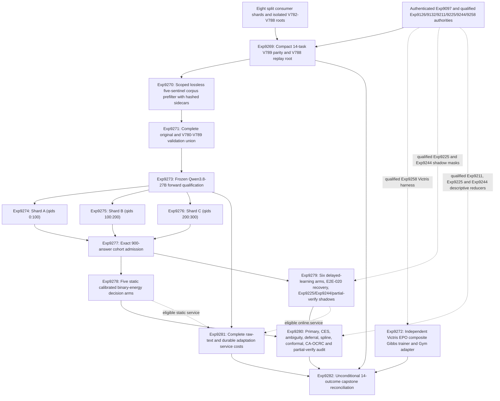

# Carnot Research Roadmap v789: Scoped Lossless Corpus Qualification, Victris EPO Energy Trainer, Complete Validation, and Human Energy Decisions

**Milestone:** 2026.11.789
**Created:** 2026-11-21 UTC
**Status:** Proposed; no experiment execution or queue activation.
**Predecessor:** 2026.11.788, scheduling complete.
**Execution contract:** Exactly **14 tasks, Exp9269 through Exp9282**, in the
order below, across **four phases**. The full embedded YAML contract below must
equal `research-roadmap-next.yaml`, including prompts, gates, and model metadata.

The [V788 preserved design](research-roadmap-v788-preserved-20261121.md)
(`sha256:c7b13576b7bf8c46c51410dc9905c26924c02e75c4f509ebea3ae8bf31f897cd`) and
[V788 preserved queue](research-roadmap-v788-queue-preserved-20261121.yaml)
(`sha256:bbf68a85425cde6bf1328dae29db817d2db38b8b26cf809ce139e7d13a8d675b`) are
saved byte for byte. The active queue, conductor, completion archive, and
exclusion manifest remain unchanged.

## What V788 proved

| Experiment | Observed outcome | What it does not establish |
|---|---|---|
| Exp9255 | `complete_null_v788_contract` (`sha256:7c669d5d...`). Passed `contract_ready_score=1`, `replay_authority_ready_score=1`, `source_ready_score=1`, `static_methods_ready_score=1`, `online_methods_ready_score=1`, all 7 consumer shards (`core`, `v782`–`v787`), and 100% owned statement coverage | Embedded 133 MB of `validation_scope_manifest` and `validation_obligations` inline into a 208 MB primary JSON; establishes administrative readiness only |
| Exp9256 | `complete_disqualified_v788_corpus_prefilter` (`sha256:d1ac40d3...`). Traversed all **764,150** recursive `results/**/*.json` files (`decoded=19,475`, `safely_negative=744,675`, `malformed=0`, `changed=0`), passed `complete_path_traversal`, `exact_semantic_parity` (0 discrepancies, 6/6 mutation controls), `stable_candidate_bytes`, 100% owned and modified coverage, and **9 of 10** checks (`target_module`, `owned_tests`, `v782_controls`, `direct_consumers`, `e2e018_021`, `ruff_check`, `ruff_format`, `strict_mypy`, `spec_coverage`) | Failed **solely** because `v788_corpus_prefilter_runner.py` added `full_python_suite` (`pytest tests/python -q`, 21,955 unrelated tests) with a 600s deadline (`exit_code=-9` at 599.87s), and wrote 724 MB of inline `scan_rows`/`corpus_manifest_reference` into an 875 MB primary JSON |
| Exp9258 | `complete_blocked_arena_sim_wheel_missing` (`sha256:7c66714a...`). Qualified `victris_harness_ready_score=1`, `required_checks_passed=true`, 100% owned coverage, sub-1ms tick latency (`max_ms=0.5478`), untrusted-shout isolation, and strict `DEV_SEEDS`/`HELDOUT_SEEDS` disjointness | `arena_sim_installed=false`, `heldout_matches_played=0`, `scientific_effect_measured=false`; real simulator win rates remain unmeasured until the `arena-sim` wheel is installed |
| Exp9257, Exp9259–Exp9267 | Ten declared-gate skips (`Exp9257` failed `exp9256.corpus_scan_ready_score==1`; nine downstream tasks skipped on retired upstream) | No full validation union or frozen Qwen3.8-27B forward collection ran |
| Exp9268 | `complete_blocked_declared_gate` (`sha256:12059727...`). Passed `reconciliation_ready_score=1`, `required_checks_passed=true`, `paper_ready=true`, `unmet_gates=[]` | `current_science_paper_ready=false`; exposed human-panel measurements remain pending |

**Four tasks ran and ten skipped.** Authority is
`results/experiment_9255_v788_contract.json`,
`results/experiment_9256_v788_corpus_prefilter.json`,
`results/experiment_9257_forward_qualification.json`,
`results/experiment_9258_v788_victris_energy_bot.json`,
`results/experiment_9268_v788_capstone.json`, and `ops/conductor-log.md`.

Three concrete changes govern V789:

1. **Fix the single failure that blocked `Exp9256` and stop primary-JSON bloat.**
   `Exp9270` removes the spurious 21,955-test `full_python_suite` command from
   `REQUIRED_CHECKS`, retains all nine affected checks and 100% owned/modified
   coverage, drops redundant per-line coverage tracing on the 764k-file
   `target_module` walk, and stores `scan_rows` and `corpus_manifest_reference`
   in hashed sidecars under `results/raw/experiment_9270_v789_corpus_prefilter/`.
   `Exp9269` applies the same hashed-sidecar pattern to `validation_scope_manifest`
   and adds `direct_consumers_v788` with an isolated V788 historical root.
2. **Advance Victris Arena RSI without repeating `Exp9258`'s blocked scope.**
   `Exp9272` uses the ungated Phase 1 CPU slot to build a gradient-trained
   four-head EPO composite Gibbs energy trainer (`python/carnot/victris/epo_trainer.py`)
   and Gymnasium-compatible `arena-sim` adapter (`python/carnot/victris/gym_adapter.py`).
   It qualifies cleanly offline when `arena_sim` is absent (`verdict_class=null`,
   `heldout_matches_played=0`, zero fabricated matches) and runs real `DEV_SEEDS`
   training plus `n=100` `HELDOUT_SEEDS` Wilson-CI evaluation automatically if
   `arena_sim` is installed.
3. **Unblock the full frozen Qwen3.8-27B human-panel pipeline and add V789
   partial-verification diagnostics.** Once `Exp9270` sets `corpus_scan_ready_score=1`
   and `Exp9271` sets `forward_validation_ready_score=1`, `Exp9273`–`Exp9281`
   collect all 900 answers, fit the five calibrated energy arms (`Exp9278`), run
   six-arm continuous delayed learning with E2E-020 recovery plus `Exp9225`,
   `Exp9244`, and `arXiv:2610.10829` partial-verification shadow tracking
   (`Exp9279`), audit all branches (`Exp9280`), and time complete raw-text and
   durable adaptation costs (`Exp9281`).

## Three biggest gaps between current state and PRD

1. **FR-12: an oracle-distinct factual verifier.** Authenticated human labels
   (`Exp9097`), frozen static/online methods (`Exp9126`, `Exp9132`), and
   descriptive ambiguity/deferral/conformal protocols (`Exp9211`, `Exp9225`,
   `Exp9244`) are qualified, but the matched frozen `unsloth/Qwen3.8-27B-GGUF`
   energy-versus-probability test remains unmeasured because `Exp9256` failed on
   `full_python_suite`. V789 removes that single blocker (`Exp9270`–`Exp9271`),
   collects all three shards (`Exp9273`–`Exp9277`), trains all five calibrated
   decision arms (`Exp9278`), and audits every primary and descriptive branch
   (`Exp9280`).
2. **FR-06/FR-11: autonomous continuous self-learning.** Durable recovery exists,
   but real online future-loss gain on human errors and gradient-trained
   closed-loop Victris energy policies remain unmeasured. V789 advances both:
   `Exp9272` builds and qualifies the pairwise Bradley-Terry / NCE EPO composite
   Gibbs trainer and Gymnasium adapter for Victris Arena, while `Exp9279` runs
   the frozen six-arm delayed learner (`Exp9132`) with real E2E-020 hard-exit
   recovery plus non-interfering `Exp9225`, `Exp9244`, and `arXiv:2610.10829`
   shadow streams.
3. **FR-05/FR-08/NFR-01: reproducible, affordable whole-service execution.**
   Compact primary artifacts, scoped lossless corpus scanning, and complete
   single-pass validation (`Exp9269`–`Exp9271`) remove the multi-hundred-megabyte
   bloat and 600-second timeout barrier. `Exp9281` then measures end-to-end
   cold/warm raw-text forwards and durable adaptation costs and maps measured
   fractions to supported hardware operations.

The November 7 north star remains the oracle-distinct verifier. ARC stays
opportunistic and is not scheduled in V789. Generator weights stay frozen.

## Research recorded before experiment design

The V789 scan in [research-references.md](../../research-references.md) checks
all eight primary arXiv topics and all six secondary channels on 2026-11-21 UTC.

| Finding | Experiment use | Boundary |
|---|---|---|
| [EPO, 2611.02546](https://arxiv.org/abs/2611.02546) | Four-module composite Gibbs energy architecture (`E_zone`, `E_combat`, `E_cooldown`, `E_safety`) trained by pairwise Bradley-Terry / NCE loss in `Exp9272` | Offline only; never connects to live ladder or fabricates `arena-sim` matches when wheel is absent |
| [Partial Verification CP, 2610.10829](https://arxiv.org/abs/2610.10829) | Descriptive label-cost-savings tracking inside `Exp9279` shadow streams and `Exp9280` audit | Shadow and descriptive only; never alters primary `Exp9126`/`Exp9132` promotion or thresholds |
| Behaviorally Calibrated RL (ICLR 2026); [Continual Calibration, 2604.23987](https://arxiv.org/abs/2604.23987) | Descriptive abstention-risk curves across accept/reject/escalate thresholds in `Exp9280` alongside `Exp9278` calibrated-decision floor | Descriptive diagnostic only; generator weights stay frozen |
| [Scaling Up Thermodynamic AI, 2607.00170](https://arxiv.org/abs/2607.00170); [Ising Machines Review, 2610.03972](https://arxiv.org/abs/2610.03972); [Online Local Thermodynamic Learning, 2609.15439](https://arxiv.org/abs/2609.15439); [KANELÉ, 2512.12850](https://arxiv.org/abs/2512.12850); [CRAM, 2611.17309](https://arxiv.org/abs/2611.17309) | Future hardware operation-mapping leads recorded honestly in `Exp9281` | Future leads only; never local FPGA/TSU measurements or speedup claims |
| Eidoku (2025/2026); DiffuTruth (FEVER 2026); `google-research/veriharness`; `eth-sri/llm-verifier-noise`; `iitis/StatisticalVerificationOfIsingEnergies` | Recorded in `research-references.md` for future structured-CSP and verifier-noise comparisons | Deferred until frozen `unsloth/Qwen3.8-27B-GGUF` baseline lands |

Secondary channel notes: Semantic Scholar returned `ARXIV:2507.02092` (EBT) = 47
citing records (`next=None`) on 2026-11-21 UTC; `ARXIV:2512.15605` (ARM–EBM)
returned an empty citation list on the live call so V788's verified count of 11
is retained without inventing a new count. OpenReview, Hugging Face Papers,
GitHub, Extropic (`XTR-0`/`Z1`/CHIPS R&D LOI), and Logical Intelligence Kona
supplied leads only; no vendor figure becomes a local Carnot claim.

## Architecture



Labels stay outside model inputs. Static fitting uses `TRAIN150`; online fitting
uses its separate `TRAIN100` initialization. `CAL50` guards promotion; `TEST100`
retention never selects updates. All five GPU tasks run teacher-forced forwards
only and generate zero tokens.

## Phase 1 — Compact Contract Parity, Scoped Lossless Corpus Walk, Complete Validation, and Victris EPO Trainer (Exp9269–Exp9272)

`Exp9269` isolates the V788 historical root, preserves exact `owned_changed_paths`
coverage-list equality (`Exp9255`), splits `direct_consumers` across eight bounded
shards (`core`, `v782`–`v788`) with distinct `.coverage.<shard>` files, writes
bulky manifest tables to hashed sidecars under `results/raw/experiment_9269_v789_contract/`,
and authenticates all 14 matching V789 tasks. `Exp9270` removes the spurious
21,955-test `full_python_suite` check that alone blocked `Exp9256`, keeps all nine
affected checks and 100% owned/modified coverage, drops redundant per-line coverage
tracing on the 764k-file `target_module` walk, and writes `scan_rows` and
`corpus_manifest_reference` to hashed sidecars. `Exp9271` executes the complete
original 621 + 53 nodes and all affected V780–V789 obligations once under the
current revision.

`Exp9272` has no upstream gate. It advances both the mandatory 2026-11-19
`Victris Arena Self-Improvement Floor` and FR-11 continuous self-learning by
building a four-module EPO composite Gibbs energy trainer
(`python/carnot/victris/epo_trainer.py`) and Gymnasium-compatible adapter
(`python/carnot/victris/gym_adapter.py`). It enforces untrusted-shout isolation,
sub-5ms tick latency, and strict `DEV_SEEDS`/`HELDOUT_SEEDS` disjointness. If
`arena_sim` is importable, it trains on `DEV_SEEDS` and runs one `n=100`
`HELDOUT_SEEDS` Wilson-CI evaluation. If `arena_sim` is absent, it qualifies the
full gradient trainer and adapter at 100% coverage with honest method-qualification
scope (`verdict_class=null`, `heldout_matches_played=0`, zero fabricated matches).

## Phase 2 — Collect Frozen Qwen3.8-27B Logits for the Unchanged Human Panel (Exp9273–Exp9277)

`Exp9273` qualifies serial versus `chunk128` teacher-forced forwards for frozen
`unsloth/Qwen3.8-27B-GGUF` (`Q4_K_M`) on GPU0 and projects all three 300-answer
shard budgets. `Exp9274`–`Exp9276` share one collector module with per-qid
checkpoints across disjoint lexical ranges (`0:100`, `100:200`, `200:300`) and
hashed sidecars. `Exp9277` admits exactly the original 900 answers and 300 qids,
cold-recomputes designated raw-vector statistics, and emits separate static
(`TRAIN150`) and online (`TRAIN100`) views plus token-entropy sequences for CES.

## Phase 3 — Static Energy Decisions, Continuous Self-Learning, and Multi-Lens Audit (Exp9278–Exp9280)

`Exp9278` fulfills the `Energy-Based Calibrated-Decision Training Floor` by
fitting the five fixed binary Gibbs energy arms (`Exp9126`) on `TRAIN150`,
calibrating temperature on `CAL50`, and sealing all `TEST100` typed decisions
before evaluator access. `Exp9279` executes the continuous self-learning (FR-11)
six-arm delayed learner (`Exp9132`) with real E2E-020 hard-exit recovery plus
non-interfering `Exp9225` selective-deferral, `Exp9244` CA-OCRC capacity-constrained,
and `arXiv:2610.10829` partial-verification shadow streams. `Exp9280` audits every
eligible static and learning branch independently against the frozen two static,
seven learning, and three secondary CES bounds, plus exact Brier moments,
qualified `Exp9211`/`Exp9225`/`Exp9244` reducers, partial-verification label-cost
savings, and behavioral-calibration abstention-risk curves.

## Phase 4 — Complete Service Costs, Hardware Operation Limits, and Reconciliation (Exp9281–Exp9282)

`Exp9281` times every eligible raw-text forward and durable continuous-learning
service end-to-end across three fresh processes and maps measured component
fractions to actual supported hardware operations (Amdahl ceilings, local board
limits, and V788/V789 thermodynamic/FPGA/TSU leads). `Exp9282` unconditionally
reconciles all 14 V789 outcomes, recomputes stable historical G1–G4 via
`scripts/publication_gate.py --json`, preserves V788 history, and freezes exact
continuation boundaries.

## Inherited methods and acceptance thresholds

V789 preserves all immutable scientific methods, arms, cohorts, and acceptance
thresholds from `Exp9126`, `Exp9132`, `Exp9211`, `Exp9225`, `Exp9244`, and `Exp9258`:

- **Scoped lossless corpus walk (`Exp9270`):** Reuse `v788_corpus_prefilter.py`
  streaming all recursive `results/**/*.json` files to EOF with overlap
  `>= max_needle_len - 1`. Remove spurious `full_python_suite` (21,955 unrelated
  tests), keep all nine affected checks and 100% owned/modified coverage, and
  store 764k-entry `scan_rows` and `corpus_manifest_reference` in hashed sidecars.
- **Whole-answer forward statistics (`Exp9273`–`Exp9277`):** Frozen
  `unsloth/Qwen3.8-27B-GGUF` (`Q4_K_M`) via embedded `llama.cpp` tokenizer
  (no BOS, no chat template), literal `Question:\n` / `\nAnswer:\n` prefix,
  right caps 256/768, `chunk128`, float64 `L_i`, `NLL_i`, `H_i`, `M_i=-L_i`,
  `D_i=-z_i[a_i]+L_(i+1)`. Retain designated full-vocabulary vectors for global
  first 20 lexical qids / all siblings / first 8 positions.
- **Static binary Gibbs energy (`Exp9278`):** Five arms (`prevalence`,
  `probability_length`, `raw_energy`, `combined`, `combined_donor`), `TRAIN150`
  imputation/scaling, ridge `0.01`, L-BFGS-B zero start (`gtol=1e-7`,
  `ftol=1e-12`, grad inf-norm `<= 1e-6`), `CAL50` temperature in `[0.5, 1, 2, 4]`,
  accept `<= 0.1`, reject `>= 0.9`, else escalate. `energy_increment_score=1`
  requires both combined Brier improvement lower bounds `> 0` vs
  `probability_length` and `donor` (10000 paired `TEST100`-qid draws, seed
  `777121`, one-sided tail `0.05/2`), defined accepted risk, and no
  accepted-risk increase vs `probability_length`.
- **Continuous delayed self-learning (`Exp9279`):** `SHA256('v776-online'+qid)`
  split (`TRAIN100` init, ten 5-qid streams, `CAL50` guard, `TEST100` retention),
  fixed 57-column cubic B-spline basis (`knots=[-1,-1,-1,-1,-0.5,0,0.5,1,1,1,1]`),
  six primary arms, AdaGrad `lr=0.05`, L2 clip `1.0`, anchor `0.01`, `CAL50`
  promotion guard (Brier increase `<= 0.005`, error increase `<= 0`), atomic
  snapshots with genuine E2E-020 hard-exit recovery. Plus non-interfering
  `Exp9225`, `Exp9244`, and `arXiv:2610.10829` shadow streams.
  `learning_signal_score=1` requires all five adaptive-spline future Brier
  lower bounds `> 0`, retained Brier upper `<= 0.005`, retained error upper
  `<= 0` (10000 paired stream draws, seed `778135`, tail `0.05/7`), and exact
  hard-exit recovery.
- **Descriptive and secondary audits (`Exp9280`):** Exact population Brier
  moments within `1e-12`, gauge shifts (`c_i=3` and `c_i=3*(-1)^i`), secondary
  CES entropy reference (`seed=782190`, tail `0.05/3`), qualified `Exp9211`
  label-ambiguity endpoints, qualified `Exp9225` selective-deferral IPW and
  spline-support slices, qualified `Exp9244` qid-cluster conformal risk bounds,
  CA-OCRC IPW risk, and Mycelium provenance slices, plus descriptive
  `arXiv:2610.10829` label-cost savings and behavioral-calibration abstention
  curves.

## Complete cost and hardware requirements

`Exp9281` uses the original first 20 `TEST` qids (60 siblings), three fresh
processes, seed `776108`, probability parity `atol=1e-5 / rtol=1e-4`, and exact
typed decisions. Separate cold load, warm uncached raw-text verification, and
cached-feature head costs, plus durable online proposal/guard/fsync/recovery
costs. Compute Amdahl ceilings `1/(1-f)` from measured nonoverlapping fractions
only (`f >= 0.99` for 100x, `f >= 0.90` for 10x; unknown fractions stay unknown).

| Resource | Requirement and claim boundary |
|---|---|
| CPU/RAM | Validation, Victris EPO trainer/adapter, small-head fitting, bootstrap, conformal/CA-OCRC bounds, and durable updates; stream vocabulary stats and write large tables to hashed sidecars. |
| Private disk | At least 2 GiB free for designated raw vectors, hashed sidecars, checkpoints, and logs; verify before model runs. |
| GPU0 RTX 3090 24 GB | Verify CUDA offload via `cached_current_model(gpu_index=0)` under the existing lease. Five model tasks run serially; leave GPU1 untouched. |
| Mandated model | Frozen `unsloth/Qwen3.8-27B-GGUF` (`Q4_K_M`); pin GGUF, embedded tokenizer, and `llama.cpp` hashes; `generated_tokens=0`. |
| Victris `arena-sim` wheel | Optional local wheel (`sha256:5393811a...`); absent wheel qualifies `Exp9272` EPO trainer and Gym adapter offline (`verdict_class=null`, `heldout_matches_played=0`, zero fabricated matches). |
| KV260 | Preserve qualified Ising fabric at `k_max <= 5`; dense Qwen forwards and spline updates require distinct kernels. |
| PolarFire | Preserve qualified Linux CPU dispatch only; no fabric speedup claim. |
| GateMate | Preserve unchanged physical/JTAG `0xffffffff` blocker; no repeated identical probe. |
| Wishlist / leads | `2512.12850` (KANELÉ), `2607.00170` (Scaling Up Thermodynamic AI), `2610.03972` (Ising Machines Review), `2609.15439` (Online Local Thermodynamic Learning), `2611.17309` (CRAM), `2606.25313` (1M p-bit FPGA), `2610.31339` (CPC), `2610.13368` (Anechoic Onsager), Extropic Z1/XTR-0, NPU, and larger FPGAs stay future operation-mapping leads until access and matching bottlenecks are measured. |

## Execution, routing and stop rules

Every task prompt includes a numbered step requiring flushed progress lines at
each phase boundary, before and after minute-scale calls, inside long loops,
and supervised 60-second heartbeats so every silence gap stays below 600 seconds.
Files over 200 lines must be written in chunks of at most 200 lines with progress
messages between calls. Each task stops measurement by 3300 seconds, reserving
1200 seconds for verification and 300 seconds for publication within the
4800-second hard cap.

`Exp9269`–`Exp9271` use Claude Opus (`max_turns=100`) for replay/schema/validation
coordination. Formulaic runtime, sharded forward collection, and admission
(`Exp9273`–`Exp9277`) use Codex `gpt-6.1-sol`. Scientific analysis, Victris EPO
trainer, continuous learning, complete cost, and reconciliation (`Exp9272`,
`Exp9278`–`Exp9282`) use Claude Sonnet. All five GPU tasks declare
`unsloth/Qwen3.8-27B-GGUF` (`Q4_K_M`) with `model_load_no_generation` (2-second
floor, `generated_tokens=0`); all nine CPU tasks declare `no_model_load` and
`MODEL_SPECS: []`. No `gpt-6-luna` or Gemini tasks are scheduled.

## Dependency graph and exact gate contract

Conductor execution follows the exact table order below. `Exp9269`, `Exp9272`,
and `Exp9282` have no structured upstream gate; `Exp9274`–`Exp9276` share
independent gates.

| Consumer | Required current upstream field(s), each == 1 |
|---|---|
| exp9269-contract | None; authenticate own inputs |
| exp9270-corpus-prefilter | exp9269-contract.contract_ready_score; exp9269-contract.replay_authority_ready_score |
| exp9271-forward-qualification | exp9270-corpus-prefilter.corpus_scan_ready_score |
| exp9272-victris-epo-trainer | None; authenticate own inputs |
| exp9273-logit-runtime | exp9271-forward-qualification.forward_validation_ready_score; exp9269-contract.static_methods_ready_score |
| exp9274-logits-a | exp9269-contract.source_ready_score; exp9273-logit-runtime.logit_runtime_ready_score; exp9273-logit-runtime.shard_feasible_score |
| exp9275-logits-b | exp9269-contract.source_ready_score; exp9273-logit-runtime.logit_runtime_ready_score; exp9273-logit-runtime.shard_feasible_score |
| exp9276-logits-c | exp9269-contract.source_ready_score; exp9273-logit-runtime.logit_runtime_ready_score; exp9273-logit-runtime.shard_feasible_score |
| exp9277-logit-admission | exp9274-logits-a.logits_a_ready_score; exp9275-logits-b.logits_b_ready_score; exp9276-logits-c.logits_c_ready_score |
| exp9278-static-energy | exp9277-logit-admission.admission_ready_score; exp9269-contract.static_methods_ready_score |
| exp9279-delayed-learning | exp9277-logit-admission.admission_ready_score; exp9269-contract.online_methods_ready_score |
| exp9280-decision-audit | exp9277-logit-admission.admission_ready_score |
| exp9281-complete-cost | exp9273-logit-runtime.logit_runtime_ready_score |
| exp9282-capstone | None; authenticate own inputs |

## Task contract

Exactly 14 tasks, Exp9269 through Exp9282, in this exact order. Each path is a
distinct canonical deliverable.

| Order | Phase | Task ID | Deliverable |
|---|---|---|---|
| 1 | 1 | exp9269-contract | results/experiment_9269_v789_contract.json |
| 2 | 1 | exp9270-corpus-prefilter | results/experiment_9270_v789_corpus_prefilter.json |
| 3 | 1 | exp9271-forward-qualification | results/experiment_9271_v789_forward_qualification.json |
| 4 | 1 | exp9272-victris-epo-trainer | results/experiment_9272_v789_victris_epo_trainer.json |
| 5 | 2 | exp9273-logit-runtime | results/experiment_9273_v789_logit_runtime.json |
| 6 | 2 | exp9274-logits-a | results/experiment_9274_v789_logits_a.json |
| 7 | 2 | exp9275-logits-b | results/experiment_9275_v789_logits_b.json |
| 8 | 2 | exp9276-logits-c | results/experiment_9276_v789_logits_c.json |
| 9 | 2 | exp9277-logit-admission | results/experiment_9277_v789_logit_admission.json |
| 10 | 3 | exp9278-static-energy | results/experiment_9278_v789_static_energy.json |
| 11 | 3 | exp9279-delayed-learning | results/experiment_9279_v789_delayed_learning.json |
| 12 | 3 | exp9280-decision-audit | results/experiment_9280_v789_decision_audit.json |
| 13 | 4 | exp9281-complete-cost | results/experiment_9281_v789_complete_cost.json |
| 14 | 4 | exp9282-capstone | results/experiment_9282_v789_capstone.json |

## Planning verification

Verify exact object and table parity between the embedded YAML contract below
and `research-roadmap-next.yaml`, prompt brace encoding, backward gate field
existence, four-field `prior_failures` compliance, operation-accurate model
metadata, and all roadmap linters (`exclusion_manifest_lint.py`,
`harness_fit_lint.py`, `overdue_priority_lint.py`, `audit_roadmap_gates.py`).
Planning does not activate the queue or execute any proposed experiment.

## Full machine-readable contract

```yaml
milestone: 2026.11.789
milestone_title: Scoped Lossless Corpus Qualification, Victris EPO Energy Trainer, Complete Validation, and Human Energy Decisions
milestone_doc: openspec/change-proposals/research-roadmap-vNEXT.md
tasks:
- id: exp9269-contract
  title: 'Exp9269: Qualify split V782-V788 consumer replay with compact sidecars and bind fourteen V789 tasks'
  phase: 1
  track: infrastructure
  priority: high
  requires_gpu: false
  max_turns: 100
  estimated_wall_time_min: 75
  per_unit_rows: true
  milestone: 2026.11.789
  deliverable: results/experiment_9269_v789_contract.json
  inference_substrate_class: no_model_load
  MODEL_SPECS: []
  model: opus
  agent_type: claude
  prior_failures:
  - experiment_id: exp9241-contract
    verdict: complete_blocked_v787_contract
    addressed_by: Exp9255 passed all seven V782-V787 shards, exact 14-task parity, and coverage-list equality (contract_ready_score=1, replay_authority_ready_score=1). Exp9269 extends isolated historical roots to V788, adds direct_consumers_v788, and moves bulky manifest tables to hashed sidecars.
    retire_if_same_verdict: true
  - experiment_id: exp9227-contract
    verdict: complete_blocked_declared_gate
    addressed_by: Retain prior failure. Commit 5930e6195a cleared smart pre-test skips and V789 embeds all 14 tasks verbatim.
    retire_if_same_verdict: true
  - experiment_id: exp9222-contract
    verdict: complete_blocked_v785_contract
    addressed_by: Retain prior failure. V789 mechanically verifies exact 14-task object and table parity across both contract files.
    retire_if_same_verdict: true
  - experiment_id: exp9208-contract
    verdict: complete_disqualified_v784_contract
    addressed_by: Retain prior failure. Split shards passed 7/7 in Exp9255; Exp9269 adds isolated V788 replay as shard 8.
    retire_if_same_verdict: true
  - experiment_id: exp9194-contract
    verdict: complete_disqualified_v783_contract
    addressed_by: Retain prior failure. Protocol-owner cold replay and isolated roots hold across V782-V788.
    retire_if_same_verdict: true
  - experiment_id: exp7329-contract
    verdict: complete_disqualified_v644_contract_mismatched_or_invalid
    addressed_by: Retain prior failure. V789 verifies all 14 ordered task objects across research-roadmap-vNEXT.md and research-roadmap.yaml.
    retire_if_same_verdict: true
  - experiment_id: exp7421-contract-ingestion
    verdict: complete_disqualified_stale_markdown_contract_with_method_ingestion
    addressed_by: Retain prior failure. V789 preserves V788 bytes and embeds research-roadmap-next.yaml verbatim inside research-roadmap-vNEXT.md.
    retire_if_same_verdict: true
  operator_override: '2026-05-29 operator directive (standing): versioned lineage continuation after passing Exp9255 (contract_ready_score=1, replay_authority_ready_score=1); extends isolated historical roots and bounded consumer shards to V788 and moves 133 MB of inline manifest tables to hashed sidecars.'
  prompt: |-
    CONTEXT:
    Work in {project_root} on {date}. In V788, Exp9255 passed contract_ready_score=1, replay_authority_ready_score=1, source_ready_score=1, static_methods_ready_score=1, online_methods_ready_score=1, and all seven consumer shards (core, v782-v787) with 100 percent owned coverage. Exp9255 wrote a 208 MB primary JSON because it embedded validation_scope_manifest (66 MB) and validation_obligations (66 MB) inline. Exp9269 extends isolated historical roots to V788, adds a bounded direct_consumers_v788 shard, stores bulky manifest tables in hashed sidecars under results/raw/experiment_9269_v789_contract/, and binds all fourteen V789 tasks (Exp9269-Exp9282). No independent generalization is claimed.
    EXISTING CODE TO READ FIRST:
    research-references.md (V789 planning scan); openspec/change-proposals/research-roadmap-v788-preserved-20261121.md; openspec/change-proposals/research-roadmap-v788-queue-preserved-20261121.yaml; CLAUDE.md; CODEX.md; ops/north-star.md; ops/e2e-test-plan.md; ops/exclusion_manifest.yaml; openspec/change-proposals/research-roadmap-vNEXT.md; openspec/capabilities/research-reporting/spec.md; scripts/experiment_template.py; python/carnot/reporting/primary_publication.py; python/carnot/reporting/current_work_receipt.py; python/carnot/reporting/protocol_owners.py; python/carnot/reporting/historical_contract_inputs.py; python/carnot/reporting/v788_contract.py; python/carnot/reporting/v788_contract_evidence.py; results/experiment_9255_v788_contract.json; results/experiment_9256_v788_corpus_prefilter.json; results/experiment_9258_v788_victris_energy_bot.json; results/experiment_9268_v788_capstone.json; tests/python/test_v788_contract_9255.py; tests/python/test_v788_capstone_9268.py; tests/python/test_victris_energy_bot_9258.py; research-roadmap.yaml
    TASK:
    Exp9269: Qualify split V782-V788 consumer replay with compact sidecars and bind fourteen V789 tasks. Deliver results/experiment_9269_v789_contract.json. Implement scripts/experiments/experiment_9269_v789_contract.py using existing seams. MODEL_SPECS: []. Requested inference_substrate_class: no_model_load. No current LLM load or generation; current_llm_invocations=0, generated_tokens=0.
    CONCRETE STEPS:
    1. Emit a flushed progress line at each phase boundary and before and after every model load, generation, benchmark or subprocess that can take minutes. Print inside long loops and supervise blocking calls with flushed heartbeats every 60 seconds. Keep every silence gap below 600 seconds. Write any file over about 200 lines in several tool calls of at most 200 lines; send a progress message between calls. Never use one huge tool call.
    2. PRECONDITIONS: authenticate exact inputs, immutable producer hashes and named gate operands. Check CPU, memory, private free disk and required tools. Record missing_file, missing_field and observed zero separately in gate_check_summary. External absence is terminal blocked, never partial. Do not repin historical evidence to mutable checkout bytes.
    3. Before implementation use rg to inspect every caller. Confirm REQ-REPORT-9269-V789 and SCENARIO-REPORT-9269-V789 in openspec/capabilities/research-reporting/spec.md, extend the spec first, then add failing controls before code (including a primary-JSON compactness guard and an owned_changed_paths coverage-list mismatch control).
    4. Authenticate V788 primaries without copying bulky inline arrays into the V789 primary: Exp9255 (sha256:7c669d5df1331eb5d22211d22bca58db4959b76af6abcaa814ca5de5a5ea24ef, contract_ready_score=1, replay_authority_ready_score=1), Exp9256 (sha256:d1ac40d315f6a740c5cb30d853045f6c92ed51d2cebeef14e09b7b945f17481a, corpus_scan_ready_score=0), Exp9257 skip (sha256:10bbcaf0b653f5b8b73f55393af7f8b805520316dc211911a089603c01b86ac6), Exp9258 (sha256:7c66714ad53ba5c88e38a94df68a74ab808f0b1773c3ce1f062d93b927ec5640, victris_harness_ready_score=1), and Exp9268 (sha256:12059727652a55d93a267b186f01cbbb3ed1a043fc79799b67a455aae9eb6d17, reconciliation_ready_score=1). Preserve V788 outcomes as immutable historical facts.
    5. Extend python/carnot/reporting/historical_contract_inputs.py with isolated V788 historical root construction pointing to preserved research-roadmap-v788-preserved-20261121.md (sha256:c7b13576b7bf8c46c51410dc9905c26924c02e75c4f509ebea3ae8bf31f897cd), preserved research-roadmap-v788-queue-preserved-20261121.yaml (sha256:bbf68a85425cde6bf1328dae29db817d2db38b8b26cf809ce139e7d13a8d675b), and V788 primaries. Update tests/python/test_v788_contract_9255.py and tests/python/test_v788_capstone_9268.py fixture root resolution only where needed to read the isolated V788 root when research-roadmap-vNEXT.md or research-roadmap.yaml moves to V789; preserve every original assertion and tamper check.
    6. Keep exact owned_changed_paths coverage-list parity in v789_contract.py (pass work['scope']['owned_changed_paths'] identically to legacy.lifecycle.measured) and store bulky validation_scope_manifest, validation_obligations, and historical_input_roots tables as hashed sidecar files under results/raw/experiment_9269_v789_contract/, keeping compact summary dicts plus exact path/sha256/count references in the primary JSON so results/experiment_9269_v789_contract.json stays under 10 MB.
    7. Partition direct_consumers in v789_contract.py into eight bounded shards with distinct COVERAGE_FILE (.coverage.<shard>) paths: direct_consumers_core, direct_consumers_v782, direct_consumers_v783, direct_consumers_v784, direct_consumers_v785, direct_consumers_v786, direct_consumers_v787, and direct_consumers_v788 (tests/python/test_v788_contract_9255.py, tests/python/test_v788_capstone_9268.py, tests/python/test_victris_energy_bot_9258.py). Keep test_v788_corpus_prefilter_9256.py and untouched test_causal_validation_9181.py in Exp9270/Exp9271 obligation manifests so every shard stays well below 1200 seconds.
    8. Keep protocol_owners validation strict in fresh cold-replay processes for entropy_reference_protocol, label_ambiguity_protocol, selective_deferral_protocol, and conformal_risk_protocol. Parse the fenced YAML block under Full machine-readable contract in openspec/change-proposals/research-roadmap-vNEXT.md and compare all fourteen complete ordered V789 task objects (exp9269 through exp9282) against the active queue, accepting only conductor literal-brace encoding. Verify V788 preserved design and queue hashes.
    9. Authenticate original Exp9097 human source (300 qids/900 siblings, TRAIN150/CAL50/TEST100, shards 0:100, 100:200, 200:300), Exp9126 static five-arm protocol, Exp9132 online six-arm protocol (separate TRAIN100 initialization), Exp9211 target/ambiguity artifacts, Exp9225 selective-deferral/spline-support artifacts, Exp9244 conformal/CA-OCRC/Mycelium artifacts, and Exp9258 Victris harness artifacts. Inventory all original validation units plus affected V780-V789 obligations in a hashed sidecar for Exp9271.
    10. Require owned tests, all eight partitioned direct-consumer shards (core, V782-V788), and rejecting tamper/interleaved-replay controls to pass in fresh private processes outside the checkout without PYTHONPATH. Set contract_ready_score=1 and replay_authority_ready_score=1 only when every shard, 100 percent owned statement coverage with zero exclusions, scoped Ruff check/format, strict mypy, spec coverage, and E2E-018/021 checks pass.
    11. Stop measurement by 3300 seconds using one monotonic deadline for descendants and cleanup. Reserve 1200 seconds for final verification and 300 for publication within the 4800-second cap. Recompute every claim from rows. Run scripts/adversarial_verify.py and scripts/verdict_row_consistency_lint.py --strict with heartbeats; publish through primary_publication only after actual checker receipts pass. Reconcile openspec/, _bmad/traceability.md, ops/status.md and ops/changelog.md. Do not activate a queue, change the exclusion manifest, publish externally or modify historical results.
    REQUIRED ARTIFACT FIELDS:
    - honest_verdict: complete_* for terminal outcomes; partial_* only for retryable owned work; principle: A terminal prefix must agree with its verdict class.
    - verdict_class: positive | circular_positive | null | blocked | disqualified | partial; principle: External absence, retirement or gate failure is blocked. Only unfinished owned work is partial.
    - gate_check_summary: check, upstream, path, sha256, artifact_field, op, expected, observed, passed; principle: Every blocked result names its failed operand; missing evidence differs from an observed zero.
    - preconditions_checked: resource, available and actual check receipt; principle: Unavailable resources cannot produce invented measurements.
    - rows: unit_id, qid/group, sibling, arm/condition, seed, absolute metrics, numerator, denominator, status, exclusion_reason, censor_reason; principle: All comparative headlines must be reproducible from their independent units.
    - sample_size_budget: intended, attempted, completed, failed, censored, effective_independent_groups; principle: Siblings and repeated retention do not multiply independent sample size.
    - verifier_is_oracle: boolean; principle: Reusing executable truth as the verifier requires circular_positive, not an independent verifier win.
    - claim_scope: exposure_scope, independent_generalization_score=0 and allowed claims; principle: Exposed development and fixtures cannot close the independent-verifier gaps.
    - MODEL_SPECS: actual requested list and invocation status; principle: An upstream model reference is not current model work.
    - inference_substrate_class: actual class and requested_inference_substrate_class; principle: Use blocked_no_run for refusal before loading; attempted loads remain attempted loads.
    - inference_substrate: operation-accurate work description; principle: Forward work, generation and cached CPU reduction have different evidence requirements.
    - model_invocation_counts: current_llm_invocations, loads attempted/completed/failed, forward calls, generated_tokens; principle: Counters must agree with actual operation-specific receipts.
    - duration_s: measured wall time; principle: No artificial sleeping or duration padding may satisfy a substrate floor.
    - random_seed: fixed before outcomes; principle: A frozen seed permits replay without favorable seed selection.
    - reproducibility_checksum: inputs and configuration digest; principle: Changed inputs cannot pass as the original experiment.
    - source_references: original producer paths, SHA256 and imported fields; principle: Historical evidence retains its original authority.
    - code_config_hashes: owned implementation, tests and configuration; principle: Validation qualifies the executed revision.
    - current_work_receipts: operation-specific records; principle: Historical receipts cannot certify current inference.
    - validation_receipts: commands, logs, exit codes and coverage references; principle: Self-reported passing checks do not establish readiness.
    - required_checks_passed: boolean; principle: Readiness requires every affected check.
    - acceptance_gates: fixed conditions, each with a principle annotation; principle: Outcome-dependent thresholds cannot manufacture success.
    - protocol_references: source, evaluator labels, static, online, diagnostic, qualified Exp9211 target/ambiguity, qualified Exp9225 selective-deferral/spline-support, qualified Exp9244 conformal/CA-OCRC/Mycelium, qualified Exp9258 Victris harness and three shard rosters; principle: Consumers share immutable inputs with exact names.
    - replay_authority_ready_score: integer 0/1; principle: Split consumer shards, isolated V782-V788 roots, exact coverage file-set parity and fresh-process cold replay must all pass.
    - contract_ready_score: integer 0/1; principle: Exact fourteen-object agreement and passing affected checks establish administrative readiness.
    - source_ready_score: integer 0/1; principle: Original authenticated roles and labels cannot be replaced with mutable bytes.
    - static_methods_ready_score: integer 0/1; principle: Exp9126 five arms and both original bounds remain fixed.
    - online_methods_ready_score: integer 0/1; principle: Exp9132 six arms, recovery and seven bounds remain fixed.
    - historical_input_roots: hashed sidecar reference plus per-suite isolated V782-V788 root summaries; principle: Successor queues cannot contaminate historical test authority or bloat primary JSON.
    - consumer_shard_rows: shard name, test files, coverage shard path, duration_s, exit_code and passed; principle: Splitting V782-V788 shards eliminates timeout contention without dropping any test.
    - protocol_owner_rows: protocol, owning configuration, original hash, sidecar and cold-replay outcome; principle: Inherited replay reads its own immutable protocol authority.
    - full_task_objects: fourteen ordered complete objects; principle: A short aspirational task list is not an execution contract.
    - validation_scope_manifest: hashed sidecar reference plus unit counts and code/test hashes for original plus V780-V789 obligations; principle: Contract checks grant no omitted-test credit for Exp9271.
    Run command: cd {project_root} && JAX_PLATFORMS=cpu .venv/bin/python -u scripts/experiments/experiment_9269_v789_contract.py --date {date}
    Do NOT push. Do NOT modify scripts/research_conductor.py.
- id: exp9270-corpus-prefilter
  title: 'Exp9270: Qualify scoped lossless byte prefilter with hashed sidecars and zero spurious full-suite timeout'
  phase: 1
  track: infrastructure
  priority: high
  requires_gpu: false
  max_turns: 100
  estimated_wall_time_min: 75
  per_unit_rows: true
  milestone: 2026.11.789
  deliverable: results/experiment_9270_v789_corpus_prefilter.json
  inference_substrate_class: no_model_load
  MODEL_SPECS: []
  model: opus
  agent_type: claude
  gated_on:
  - upstream: exp9269-contract
    artifact_field: contract_ready_score
    op: ==
    value: 1
  - upstream: exp9269-contract
    artifact_field: replay_authority_ready_score
    op: ==
    value: 1
  prior_failures:
  - experiment_id: exp9256-corpus-prefilter
    verdict: complete_disqualified_v788_corpus_prefilter
    addressed_by: Exp9256 passed 764,150-file lossless traversal, exact semantic parity (0 discrepancies, 6/6 mutation controls), stable bytes, 100 percent owned and modified coverage, and 9 of 10 checks (target_module 1544s, owned_tests, v782_controls, direct_consumers, e2e018_021, ruff, mypy, spec_coverage), failing ONLY on a spurious full_python_suite check (pytest tests/python -q over 21,955 unrelated tests killed at 599.87s) while writing an 875 MB inline primary JSON. Exp9270 removes full_python_suite from REQUIRED_CHECKS, runs target_module without redundant per-line coverage tracing over 764k disk files while keeping 100 percent owned+modified coverage across owned/control/CLI suites, and moves 724 MB of scan_rows and corpus_manifest_reference into hashed sidecars under results/raw/.
    retire_if_same_verdict: true
  - experiment_id: exp9242-corpus-prefilter
    verdict: blocked_gate_check_failed
    addressed_by: Retain prior failure. Exp9242 skipped in V787; Exp9256 ran and passed all prefilter parity and traversal gates.
    retire_if_same_verdict: true
  - experiment_id: exp9228-corpus-prefilter
    verdict: blocked_upstream_retired
    addressed_by: Retain prior failure. Exp9228 never ran in V786.
    retire_if_same_verdict: true
  - experiment_id: exp9223-corpus-prefilter
    verdict: blocked_gate_check_failed
    addressed_by: Retain prior failure. Exp9223 never ran in V785.
    retire_if_same_verdict: true
  - experiment_id: exp9209-corpus-prefilter
    verdict: blocked_gate_check_failed
    addressed_by: Retain prior failure. Exp9209 never ran in V784.
    retire_if_same_verdict: true
  - experiment_id: exp9195-corpus-prefilter
    verdict: blocked_gate_check_failed
    addressed_by: Retain prior failure. Exp9256 proved the lossless prefilter works; Exp9270 fixes the runner spurious full_python_suite check.
    retire_if_same_verdict: true
  - experiment_id: exp9181-validation-loop-repair
    verdict: complete_disqualified_causal_validation
    addressed_by: Retain prior failure. Exp9256 proved streaming five-sentinel prefiltering passes target_module cleanly over all 764,150 files.
    retire_if_same_verdict: true
  - experiment_id: exp9167-causal-validation
    verdict: complete_disqualified_causal_validation
    addressed_by: Retain prior failure. Exp9270 preserves invocation-local structural checks and lossless byte prefiltering.
    retire_if_same_verdict: true
  - experiment_id: exp9153-measured-validation
    verdict: complete_blocked_validation_prerequisite
    addressed_by: Retain prior failure. Exp9270 measures bounded stratum read/decode/classify clocks before full-manifest execution.
    retire_if_same_verdict: true
  - experiment_id: exp9125-receipt-qualification
    verdict: complete_disqualified_bounded_receipt_qualification
    addressed_by: Retain prior failure. Exp9270 preserves all original checker assertions and full recursive path traversal.
    retire_if_same_verdict: true
  - experiment_id: exp9111-forward-evidence
    verdict: complete_disqualified_owned_checks
    addressed_by: Retain prior failure. Exp9270 requires 100 percent owned and modified statement coverage with zero exclusions.
    retire_if_same_verdict: true
  - experiment_id: exp9140-forward-qualification
    verdict: complete_blocked_infeasible_forward_schedule
    addressed_by: Retain prior failure. Exp9270 qualifies only the scoped lossless corpus walker; Exp9271 executes the complete validation union.
    retire_if_same_verdict: true
  operator_override: '2026-05-29 operator directive (standing): versioned lineage continuation vs exp9256-corpus-prefilter; Exp9256 passed all 764,150-file traversal, semantic parity, mutation controls, 100 percent coverage, and 9/10 validation commands, failing solely on a spurious 21,955-test full_python_suite 600s kill plus 875 MB inline JSON bloat. Exp9270 removes full_python_suite, moves scan_rows/manifest to hashed sidecars, and drops per-line coverage tracing on the 764k-file disk walk.'
  prompt: |-
    CONTEXT:
    Work in {project_root} on {date}. In V788, Exp9256 proved the lossless five-sentinel byte prefilter (python/carnot/reporting/v788_corpus_prefilter.py) across all 764,150 recursive results/**/*.json files (decoded=19,475, safely_negative=744,675, malformed=0, changed=0, unfinished=0), passing exact_semantic_parity (6/6 mutation controls detected), complete_path_traversal, stable_candidate_bytes, 100 percent owned and modified statement coverage, and 9 of 10 checks (target_module, owned_tests, v782_controls, direct_consumers, e2e018_021, ruff_check, ruff_format, strict_mypy, spec_coverage). It failed SOLELY because v788_corpus_prefilter_runner.py added full_python_suite (pytest tests/python -q over 21,955 unrelated tests) with a 600s deadline (exit -9 at 599.87s), and it wrote an 875 MB primary JSON by embedding 724 MB of inline scan_rows and corpus_manifest_reference. Exp9270 fixes both defects cleanly to achieve corpus_scan_ready_score=1.
    EXISTING CODE TO READ FIRST:
    research-references.md (V789 planning scan); CLAUDE.md; CODEX.md; ops/north-star.md; ops/e2e-test-plan.md; ops/exclusion_manifest.yaml; openspec/change-proposals/research-roadmap-vNEXT.md; openspec/capabilities/research-reporting/spec.md; scripts/experiment_template.py; python/carnot/reporting/primary_publication.py; python/carnot/reporting/current_work_receipt.py; scripts/adversarial_verify.py; tests/python/test_adversarial_verify_arc_no_llm_floor_2026_07_30.py; python/carnot/reporting/v788_corpus_prefilter.py; python/carnot/reporting/v788_corpus_prefilter_runner.py; tests/python/test_v788_corpus_prefilter_9256.py; results/experiment_9255_v788_contract.json; results/experiment_9256_v788_corpus_prefilter.json
    TASK:
    Exp9270: Qualify scoped lossless byte prefilter with hashed sidecars and zero spurious full-suite timeout. Deliver results/experiment_9270_v789_corpus_prefilter.json. Implement scripts/experiments/experiment_9270_v789_corpus_prefilter.py reusing python/carnot/reporting/v788_corpus_prefilter.py. MODEL_SPECS: []. Requested inference_substrate_class: no_model_load. No current LLM load or generation; current_llm_invocations=0, generated_tokens=0.
    CONCRETE STEPS:
    1. Emit a flushed progress line at each phase boundary and before and after every model load, generation, benchmark or subprocess that can take minutes. Print inside long loops and supervise blocking calls with flushed heartbeats every 60 seconds. Keep every silence gap below 600 seconds. Write any file over about 200 lines in several tool calls of at most 200 lines; send a progress message between calls. Never use one huge tool call.
    2. PRECONDITIONS: authenticate exact inputs, immutable producer hashes and named gate operands (Exp9269 contract_ready_score==1 and replay_authority_ready_score==1). Check CPU, memory, private free disk and required tools. Record missing_file, missing_field and observed zero separately in gate_check_summary. External absence is terminal blocked, never partial.
    3. Before implementation use rg to inspect every caller. Confirm REQ-REPORT-9270-V789 and SCENARIO-REPORT-9270-V789 in openspec/capabilities/research-reporting/spec.md, extend the spec first, then add failing controls before code (including a primary-JSON <= 10 MB compactness control and a scoped-REQUIRED_CHECKS control confirming full_python_suite is excluded).
    4. Authenticate Exp9256 primary metadata via streaming/hash check (sha256:d1ac40d315f6a740c5cb30d853045f6c92ed51d2cebeef14e09b7b945f17481a; do not copy its 724 MB inline arrays) and Exp9269 contract primary. Preserve Exp9181/Exp9256 historical records unchanged.
    5. Reuse the proven lossless five-sentinel streaming reader in python/carnot/reporting/v788_corpus_prefilter.py (visiting every recursive results/**/*.json path to EOF in bounded chunks with overlap >= max_needle_len - 1 bytes, routing every sentinel or \u Unicode escape through unchanged read_text/json.loads and adversarial_verify classifier, zero filtering by path/size/age/schema/verdict). Ensure scan_corpus uses bounded worker parallelism cleanly and omits redundant per-line Python coverage tracing during the 764k-file target_module walk so target_module completes rapidly without losing a single assertion or file.
    6. In v789_corpus_prefilter_runner.py, remove the spurious 21,955-test full_python_suite check from REQUIRED_CHECKS. Retain ALL nine affected checks strictly: target_module, owned_tests, v782_controls, direct_consumers, e2e018_021, ruff_check, ruff_format, strict_mypy, and spec_coverage. Measure 100 percent owned and modified statement coverage with zero exclusions across owned_tests, v782_controls, and private outside-checkout CLI checks (without PYTHONPATH).
    7. Write the full 764k-entry scan_rows and corpus_manifest_reference to hashed JSONL/JSON sidecar files under results/raw/experiment_9270_v789_corpus_prefilter/ (never inline in results/experiment_9270_v789_corpus_prefilter.json). Keep compact per-stratum/per-control summary rows, exact candidate_counts, parity_controls (all 6 sentinel+unicode mutation controls), cost_model_rows, and hashed sidecar references in the primary JSON so the primary deliverable stays under 10 MB.
    8. Verify exact semantic parity against the original decoder on all frozen parity fixtures (escaped keys/values, principle-wrapped declarations, suffix boundaries, duplicate keys, malformed UTF-8/JSON, non-dicts, Unicode-escaped sentinels, cross-chunk needles, nested decoys), 6/6 sentinel+unicode deletion mutation controls, stable candidate bytes (changed == 0), and complete original target_module execution (checked > 0, offenders == []).
    9. Set corpus_scan_ready_score=1 only when complete path traversal, exact semantic parity, stable bytes, all nine affected checks, 100 percent owned+modified statement coverage with zero exclusions, and outside-checkout private CLI E2E-018/021 success/refusal/tamper/cold replay pass within budget.
    10. Stop measurement by 3300 seconds using one monotonic deadline; reserve 1200 seconds for verification and 300 for publication within 4800 seconds. Recompute claims from rows. Run scripts/adversarial_verify.py and scripts/verdict_row_consistency_lint.py --strict with heartbeats; publish through primary_publication; reconcile openspec/, _bmad/traceability.md, ops/status.md and ops/changelog.md. Do not activate a queue, edit the exclusion manifest or publish externally.
    REQUIRED ARTIFACT FIELDS:
    - honest_verdict: complete_* for terminal outcomes; partial_* only for retryable owned work; principle: A terminal prefix must agree with its verdict class.
    - verdict_class: positive | circular_positive | null | blocked | disqualified | partial; principle: External absence, retirement or gate failure is blocked. Only unfinished owned work is partial.
    - gate_check_summary: check, upstream, path, sha256, artifact_field, op, expected, observed, passed; principle: Every blocked result names its failed operand; missing evidence differs from an observed zero.
    - preconditions_checked: resource, available and actual check receipt; principle: Unavailable resources cannot produce invented measurements.
    - rows: unit_id, qid/group, sibling, arm/condition, seed, absolute metrics, numerator, denominator, status, exclusion_reason, censor_reason; principle: All comparative headlines must be reproducible from their independent units.
    - sample_size_budget: intended, attempted, completed, failed, censored, effective_independent_groups; principle: Siblings and repeated retention do not multiply independent sample size.
    - verifier_is_oracle: boolean; principle: Reusing executable truth as the verifier requires circular_positive, not an independent verifier win.
    - claim_scope: exposure_scope, independent_generalization_score=0 and allowed claims; principle: Exposed development and fixtures cannot close the independent-verifier gaps.
    - MODEL_SPECS: actual requested list and invocation status; principle: An upstream model reference is not current model work.
    - inference_substrate_class: actual class and requested_inference_substrate_class; principle: Use blocked_no_run for refusal before loading; attempted loads remain attempted loads.
    - inference_substrate: operation-accurate work description; principle: Forward work, generation and cached CPU reduction have different evidence requirements.
    - model_invocation_counts: current_llm_invocations, loads attempted/completed/failed, forward calls, generated_tokens; principle: Counters must agree with actual operation-specific receipts.
    - duration_s: measured wall time; principle: No artificial sleeping or duration padding may satisfy a substrate floor.
    - random_seed: fixed before outcomes; principle: A frozen seed permits replay without favorable seed selection.
    - reproducibility_checksum: inputs and configuration digest; principle: Changed inputs cannot pass as the original experiment.
    - source_references: original producer paths, SHA256 and imported fields; principle: Historical evidence retains its original authority.
    - code_config_hashes: owned implementation, tests and configuration; principle: Validation qualifies the executed revision.
    - current_work_receipts: operation-specific records; principle: Historical receipts cannot certify current inference.
    - validation_receipts: commands, logs, exit codes and coverage references; principle: Self-reported passing checks do not establish readiness.
    - required_checks_passed: boolean; principle: Readiness requires every affected check.
    - acceptance_gates: fixed conditions, each with a principle annotation; principle: Outcome-dependent thresholds cannot manufacture success.
    - protocol_references: source, evaluator labels, static, online, diagnostic and three shard rosters; principle: Consumers share immutable inputs with exact names.
    - corpus_scan_ready_score: integer 0/1; principle: Complete traversal, unchanged assertions, exact semantic parity and all nine affected checks are necessary.
    - corpus_manifest_reference: hashed sidecar reference (path, sha256, size_bytes) plus counts and population_sha256; principle: Every original file remains in scope without bloating primary JSON.
    - scan_rows_sidecar_reference: hashed JSONL sidecar path, sha256, row_count and summary counts; principle: Per-file audit trails stay verifiable without 875 MB primary artifacts.
    - candidate_counts: visited, decoded, safely_negative, malformed, changed and unfinished; principle: Every path has one accountable outcome.
    - parity_controls: each sentinel, escape fallback, chunk boundary and mutation; principle: A filter is useful only if false negatives are excluded.
    - cost_model_rows: same-input read/decode/classification clocks across deterministic size strata; principle: Size counts alone do not identify the slow operation.
    Run command: cd {project_root} && JAX_PLATFORMS=cpu .venv/bin/python -u scripts/experiments/experiment_9270_v789_corpus_prefilter.py --date {date}
    Do NOT push. Do NOT modify scripts/research_conductor.py.
- id: exp9271-forward-qualification
  title: 'Exp9271: Execute the complete causally corrected validation revision'
  phase: 1
  track: infrastructure
  priority: high
  requires_gpu: false
  max_turns: 100
  estimated_wall_time_min: 75
  per_unit_rows: true
  milestone: 2026.11.789
  deliverable: results/experiment_9271_v789_forward_qualification.json
  inference_substrate_class: no_model_load
  MODEL_SPECS: []
  model: opus
  agent_type: claude
  gated_on:
  - upstream: exp9270-corpus-prefilter
    artifact_field: corpus_scan_ready_score
    op: ==
    value: 1
  prior_failures:
  - experiment_id: exp9257-forward-qualification
    verdict: blocked_gate_check_failed
    addressed_by: Exp9257 skipped in V788 only because Exp9256 failed a spurious 21,955-test full_python_suite check after passing 9/10 checks and the 764,150-file corpus walk. Exp9270 removes full_python_suite so Exp9271 executes.
    retire_if_same_verdict: true
  - experiment_id: exp9243-forward-qualification
    verdict: blocked_upstream_retired
    addressed_by: Retain prior failure. Exp9243 skipped in V787.
    retire_if_same_verdict: true
  - experiment_id: exp9229-forward-qualification
    verdict: blocked_upstream_retired
    addressed_by: Retain prior failure. Exp9229 skipped in V786.
    retire_if_same_verdict: true
  - experiment_id: exp9224-forward-qualification
    verdict: blocked_upstream_retired
    addressed_by: Retain prior failure. Exp9224 skipped in V785.
    retire_if_same_verdict: true
  - experiment_id: exp9210-forward-qualification
    verdict: complete_blocked_declared_gate
    addressed_by: Retain prior failure. Exp9269 isolates V782-V788 roots, Exp9270 qualifies scoped lossless corpus scan, and Exp9271 runs the full obligation union.
    retire_if_same_verdict: true
  - experiment_id: exp9196-forward-qualification
    verdict: complete_blocked_declared_gate
    addressed_by: Retain prior failure. Exp9269 and Exp9270 supply replay and lossless corpus-scan prerequisites before Exp9271 executes.
    retire_if_same_verdict: true
  - experiment_id: exp9182-forward-qualification
    verdict: blocked_gate_check_failed
    addressed_by: Retain prior failure. Exp9271 gates on Exp9270 corpus_scan_ready_score==1 rather than retired Exp9181/9182.
    retire_if_same_verdict: true
  - experiment_id: exp9168-forward-qualification
    verdict: blocked_gate_check_failed
    addressed_by: Retain prior failure. Exp9271 runs only after Exp9270 qualifies lossless corpus traversal.
    retire_if_same_verdict: true
  - experiment_id: exp9154-forward-qualification
    verdict: blocked_gate_check_failed
    addressed_by: Retain prior failure. Exp9271 uses measured-cost single-pass orchestration rather than sum-of-watchdog ceilings.
    retire_if_same_verdict: true
  - experiment_id: exp9140-v779-forward-qualification
    verdict: complete_blocked_infeasible_forward_schedule
    addressed_by: Retain prior failure. Exp9271 executes each obligation once with measured elapsed clocks and lossless corpus traversal.
    retire_if_same_verdict: true
  - experiment_id: exp9125-receipt-qualification
    verdict: complete_disqualified_bounded_receipt_qualification
    addressed_by: Retain prior failure. Exp9271 preserves every original assertion and real CLI receipt check.
    retire_if_same_verdict: true
  operator_override: '2026-05-29 operator directive (standing): versioned lineage continuation vs exp9257-forward-qualification; Exp9257 never executed because Exp9256 failed solely on a spurious 21,955-test full_python_suite check. Exp9270 fixes that check so Exp9271 can execute.'
  prompt: |-
    CONTEXT:
    Work in {project_root} on {date}. Exp9257 skipped in V788 after Exp9256 passed 9/10 checks and the 764,150-file corpus walk but failed on a spurious full_python_suite 600s kill. Once Exp9269 qualifies split V782-V788 consumer replay and Exp9270 qualifies the scoped lossless corpus reader, Exp9271 executes the complete original 621 plus 53 nodes and every affected V780-V789 obligation (including tests/python/test_causal_validation_9181.py, Exp9211, Exp9225, Exp9240, Exp9241, Exp9244, Exp9255, Exp9258, Exp9268, Exp9269 and Exp9270 controls) once under the current revision before any Qwen forward task runs.
    EXISTING CODE TO READ FIRST:
    research-references.md (V789 planning scan); CLAUDE.md; CODEX.md; ops/north-star.md; ops/e2e-test-plan.md; ops/exclusion_manifest.yaml; openspec/change-proposals/research-roadmap-vNEXT.md; openspec/capabilities/research-reporting/spec.md; scripts/experiment_template.py; python/carnot/reporting/primary_publication.py; python/carnot/reporting/current_work_receipt.py; python/carnot/reporting/forward_qualification_9140.py; python/carnot/reporting/validation_schedule_9153.py; python/carnot/reporting/receipt_qualification_9125.py; tests/python/test_forward_qualification_9140.py; tests/python/test_causal_validation_9181.py; results/experiment_9255_v788_contract.json; results/experiment_9268_v788_capstone.json
    TASK:
    Exp9271: Execute the complete causally corrected validation revision. Deliver results/experiment_9271_v789_forward_qualification.json. Implement scripts/experiments/experiment_9271_v789_forward_qualification.py using existing library seams. MODEL_SPECS: []. Requested inference_substrate_class: no_model_load. Do not load an LLM; current_llm_invocations=0, generated_tokens=0.
    CONCRETE STEPS:
    1. Emit a flushed progress line at each phase boundary and before and after every model load, generation, benchmark or subprocess that can take minutes. Print inside long loops and supervise blocking calls with flushed heartbeats every 60 seconds. Keep every silence gap below 600 seconds. Write any file over about 200 lines in several tool calls of at most 200 lines; send a progress message between calls. Never use one huge tool call.
    2. PRECONDITIONS: authenticate exact required paths, hashes and gate fields (Exp9270 corpus_scan_ready_score==1) before dependent work. Check imports, CPU/memory limits and private free disk. Distinguish missing_file, missing_field and observed zero. Missing external inputs produce terminal blocked evidence with gate_check_summary.
    3. Before implementation inspect callers with rg. Confirm REQ-REPORT-9271-V789 and SCENARIO-REPORT-9271-V789. Extend specs first, then write failing controls before code. Freeze units, exclusions, formulas and the complete obligation union before outcomes.
    4. Freeze the complete union of all 621 original nodes, 53 V779 additions, and all affected V780-V789 obligations (explicitly including tests/python/test_causal_validation_9181.py, isolated V782-V788 contract and capstone suites, Exp9211, Exp9225, Exp9244, Exp9258, Exp9269 and Exp9270 controls). Store large per-node lists in a hashed sidecar under results/raw/experiment_9271_v789_forward_qualification/ so primary JSON stays compact (<10 MB). Past completions grant zero current execution credit; no retired task ID is a dependency.
    5. Execute the complete normal orchestration once under the current code revision with per-shard coverage files (.coverage.<shard>), whole-module fixture lifetimes preserved, and measured setup/call/teardown clocks. Count each obligation once in this invocation and consume same-invocation authenticated receipts in final verification rather than running the suite twice.
    6. Emit forward_validation_ready_score=1 only when the entire node and command union, exact code/config revision, 100 percent owned statement coverage with zero exclusions, scoped Ruff check/format, strict mypy, spec coverage, and outside-checkout private CLI E2E-018/021 checks pass within budget. Any missing, failed or censored obligation leaves forward_validation_ready_score=0.
    7. Stop measurement by 3300 seconds using one monotonic deadline for all descendants; reserve 1200 seconds for verification and 300 for publication within 4800 seconds. Recompute claims from rows. Run scripts/adversarial_verify.py and scripts/verdict_row_consistency_lint.py --strict with heartbeats; publish through primary_publication; reconcile openspec/, _bmad/traceability.md, ops/status.md and ops/changelog.md. Preserve historical primaries, quarantines and exclusions. Do not activate a queue or publish externally.
    REQUIRED ARTIFACT FIELDS:
    - honest_verdict: complete_* for terminal outcomes; partial_* only for retryable owned work; principle: A terminal prefix must agree with its verdict class.
    - verdict_class: positive | circular_positive | null | blocked | disqualified | partial; principle: External absence, retirement or gate failure is blocked. Only unfinished owned work is partial.
    - gate_check_summary: check, upstream, path, sha256, artifact_field, op, expected, observed, passed; principle: Every blocked result names its failed operand; missing evidence differs from an observed zero.
    - preconditions_checked: resource, available and actual check receipt; principle: Unavailable resources cannot produce invented measurements.
    - rows: unit_id, qid/group, sibling, arm/condition, seed, absolute metrics, numerator, denominator, status, exclusion_reason, censor_reason; principle: All comparative headlines must be reproducible from their independent units.
    - sample_size_budget: intended, attempted, completed, failed, censored, effective_independent_groups; principle: Siblings and repeated retention do not multiply independent sample size.
    - verifier_is_oracle: boolean; principle: Reusing executable truth as the verifier requires circular_positive, not an independent verifier win.
    - claim_scope: exposure_scope, independent_generalization_score=0 and allowed claims; principle: Exposed development and fixtures cannot close the independent-verifier gaps.
    - MODEL_SPECS: actual requested list and invocation status; principle: An upstream model reference is not current model work.
    - inference_substrate_class: actual class and requested_inference_substrate_class; principle: Use blocked_no_run for refusal before loading; attempted loads remain attempted loads.
    - inference_substrate: operation-accurate work description; principle: Forward work, generation and cached CPU reduction have different evidence requirements.
    - model_invocation_counts: current_llm_invocations, loads attempted/completed/failed, forward calls, generated_tokens; principle: Counters must agree with actual operation-specific receipts.
    - duration_s: measured wall time; principle: No artificial sleeping or duration padding may satisfy a substrate floor.
    - random_seed: fixed before outcomes; principle: A frozen seed permits replay without favorable seed selection.
    - reproducibility_checksum: inputs and configuration digest; principle: Changed inputs cannot pass as the original experiment.
    - source_references: original producer paths, SHA256 and imported fields; principle: Historical evidence retains its original authority.
    - code_config_hashes: owned implementation, tests and configuration; principle: Validation qualifies the executed revision.
    - current_work_receipts: operation-specific records; principle: Historical receipts cannot certify current inference.
    - validation_receipts: commands, logs, exit codes and coverage references; principle: Self-reported passing checks do not establish readiness.
    - required_checks_passed: boolean; principle: Readiness requires every affected check.
    - acceptance_gates: fixed conditions, each with a principle annotation; principle: Outcome-dependent thresholds cannot manufacture success.
    - forward_validation_ready_score: integer 0/1; principle: Only complete normal-path execution authorizes current model evidence.
    - node_completion_rows: original and added node IDs (or hashed sidecar reference plus per-shard summary rows), phase exits and actual durations; principle: No duplicated or absent node can satisfy the full union.
    - qualified_revision_reference: exact code and configuration plus full validation receipts; principle: Downstream work uses only the revision actually tested.
    Run command: cd {project_root} && JAX_PLATFORMS=cpu .venv/bin/python -u scripts/experiments/experiment_9271_v789_forward_qualification.py --date {date}
    Do NOT push. Do NOT modify scripts/research_conductor.py.
- id: exp9272-victris-epo-trainer
  title: 'Exp9272: Implement offline Victris Arena EPO composite Gibbs trainer and Gymnasium wrapper'
  phase: 1
  track: research
  priority: high
  requires_gpu: false
  max_turns: 50
  estimated_wall_time_min: 50
  per_unit_rows: true
  milestone: 2026.11.789
  deliverable: results/experiment_9272_v789_victris_epo_trainer.json
  inference_substrate_class: no_model_load
  MODEL_SPECS: []
  model: sonnet
  agent_type: claude
  prior_failures:
  - experiment_id: exp9258-victris-energy-bot
    verdict: complete_blocked_arena_sim_wheel_missing
    addressed_by: Exp9258 qualified victris_harness_ready_score=1 with hand-initialized Gibbs weights and blocked on missing arena_sim wheel. Exp9272 does not repeat Exp9258; it builds a new gradient-trained 4-head EPO composite Gibbs trainer (epo_trainer.py) and Gymnasium wrapper (gym_adapter.py) that qualifies method readiness offline (verdict_class=null) when arena_sim is absent and runs live DEV_SEEDS/HELDOUT_SEEDS evaluation when arena_sim is present.
    retire_if_same_verdict: true
  prompt: |-
    CONTEXT:
    Work in {project_root} on {date}. This ungated Phase 1 CPU research slot advances BOTH CLAUDE.md Victris Arena Self-Improvement Floor (MANDATORY — 2026-11-19) and Continuous Self-Learning (FR-11). In V788, Exp9258 (sha256:7c66714ad53ba5c88e38a94df68a74ab808f0b1773c3ce1f062d93b927ec5640) qualified victris_harness_ready_score=1 with a hand-initialized 10-feature Gibbs scorer (max tick 0.5478ms) and Gaussian weight perturbations, while honestly reporting arena_sim_installed=false. Rather than repeating Exp9258 unchanged, Exp9272 builds a genuine gradient-trained modular Energy-Based Policy Orchestration (EPO, arXiv:2611.02546) composite Gibbs energy trainer (E_total = w_zone*E_zone + w_combat*E_combat + w_cooldown*E_cooldown + w_safety*E_safety trained by pairwise Bradley-Terry / NCE contrastive energy loss) and a Gymnasium-compatible adapter matching arena-sim 0.83.0 observation/action contracts. Never connect to the live ladder, never create accounts or tokens, never modify the game repository, and never fabricate arena-sim matches if the wheel is absent.
    EXISTING CODE TO READ FIRST:
    CLAUDE.md (Victris Arena Self-Improvement Floor); docs/research-notes/victris-arena-rsi-challenge-2026-11-19.md; research-references.md (V788 and V789 planning scans); scripts/victris_offline_harness.py; python/carnot/victris/energy_bot.py; python/carnot/victris/rsi_loop.py; tests/python/test_victris_energy_bot_9258.py; results/experiment_9258_v788_victris_energy_bot.json; python/carnot/models/gibbs.py; python/carnot/training/nce.py; python/carnot/reporting/primary_publication.py; python/carnot/reporting/current_work_receipt.py; openspec/capabilities/research-reporting/spec.md; ops/e2e-test-plan.md; scripts/experiment_template.py
    TASK:
    Exp9272: Implement offline Victris Arena EPO composite Gibbs trainer and Gymnasium wrapper. Deliver results/experiment_9272_v789_victris_epo_trainer.json. Implement python/carnot/victris/epo_trainer.py, python/carnot/victris/gym_adapter.py, and scripts/experiments/experiment_9272_v789_victris_epo_trainer.py. MODEL_SPECS: []. Requested inference_substrate_class: no_model_load. No current LLM load or generation; current_llm_invocations=0, generated_tokens=0.
    CONCRETE STEPS:
    1. Emit a flushed progress line at each phase boundary and before and after every model load, generation, benchmark or subprocess that can take minutes. Print inside long loops and supervise blocking calls with flushed heartbeats every 60 seconds. Keep every silence gap below 600 seconds. Write any file over about 200 lines in several tool calls of at most 200 lines; send a progress message between calls. Never use one huge tool call.
    2. PRECONDITIONS: check Python, JAX/NumPy, CPU/memory, private free disk, Exp9258 primary SHA256 (sha256:7c66714ad53ba5c88e38a94df68a74ab808f0b1773c3ce1f062d93b927ec5640), scripts/victris_offline_harness.py SHA256, and whether arena_sim is importable in .venv (checking CARNOT_ARENA_SIM_WHEEL if set; verify sha256:5393811ad663f2b1c9fdf5dac9a83f317894fc04c39463bdda7551762c5a010c when present). Never download wheels, never touch live ladder URLs, and never fabricate arena_sim matches. Do not gate on Exp9269 or any GPU task.
    3. Before implementation inspect callers with rg. Add REQ-VICTRIS-9272-V789 and SCENARIO-VICTRIS-9272-V789 in openspec/capabilities/research-reporting/spec.md, extend the spec first, then write failing unit and CLI controls before code.
    4. Implement python/carnot/victris/epo_trainer.py: a four-module Energy-Based Policy Orchestration (arXiv:2611.02546) composite Gibbs scorer (E_total = w_zone*E_zone + w_combat*E_combat + w_cooldown*E_cooldown + w_safety*E_safety, each a compact GibbsModel-scale quadratic+SiLU term over sanitized tactical features from energy_bot.py) trained via deterministic L2-regularized pairwise Bradley-Terry / NCE contrastive energy loss on (preferred_action, dominated_action) trajectory pairs. Enforce strict convergence diagnostics (gradient norm, held-out pairwise Brier/NLL calibration, weight checksums) and sub-5ms per-tick inference latency.
    5. Implement python/carnot/victris/gym_adapter.py: a clean Gymnasium-compatible offline wrapper (reset(seed), step(action), legal_actions(), sanitize_observation()) aligned with arena-sim 0.83.0 and scripts/victris_offline_harness.py, enforcing strict untrusted-shout stripping, strict DEV_SEEDS (0..999) vs HELDOUT_SEEDS (10000..10999) disjointness refusal, and a hard <1000ms tick-budget guard.
    6. Execute cleanly under two honest branches: (a) If arena_sim is importable in .venv, collect DEV_SEEDS trajectory pairs against ts-starter and random, train the composite EPO Gibbs energy parameters via epo_trainer.py, record every version in rsi_loop.py archive, and evaluate Exp9258 baseline vs EPO-trained bot ONCE on n=100 HELDOUT_SEEDS with Wilson CI95, per-match rows, and measured per-tick latency. (b) If arena_sim is absent in .venv, qualify the complete trainer, Gymnasium adapter, deterministic synthetic preference-pair calibration/ranking controls (explicitly labeled exposure_scope=synthetic_tactical_fixture_not_arena_sim), untrusted-shout isolation, sub-5ms tick latency, and split enforcement; set victris_trainer_ready_score=1, arena_sim_installed=false, heldout_matches_played=0, scientific_effect_measured=false, verdict_class=null, honest_verdict=complete_null_victris_epo_trainer_qualified_no_arena_sim, and record the absent arena_sim wheel explicitly in gate_check_summary without claiming real simulator wins.
    7. Run 100 percent owned statement coverage with zero exclusions on python/carnot/victris/epo_trainer.py, python/carnot/victris/gym_adapter.py, and scripts/experiments/experiment_9272_v789_victris_epo_trainer.py, plus existing tests/python/test_victris_energy_bot_9258.py, scoped Ruff check/format, strict mypy, spec coverage, and private outside-checkout CLI checks (verifying success/refusal/tamper controls).
    8. Stop measurement by 3300 seconds using one monotonic deadline; reserve 1200 seconds for verification and 300 for publication within 4800 seconds. Recompute all summary metrics and CIs from per-unit rows. Run scripts/adversarial_verify.py and scripts/verdict_row_consistency_lint.py --strict with heartbeats; publish through primary_publication; reconcile openspec/, _bmad/traceability.md, ops/status.md and ops/changelog.md. Do not connect to the live ladder, activate a queue, or publish externally.
    REQUIRED ARTIFACT FIELDS:
    - honest_verdict: complete_* for terminal outcomes; partial_* only for retryable owned work; principle: A terminal prefix must agree with its verdict class.
    - verdict_class: positive | circular_positive | null | blocked | disqualified | partial; principle: External absence, retirement or gate failure is blocked. Only unfinished owned work is partial.
    - gate_check_summary: check, upstream, path, sha256, artifact_field, op, expected, observed, passed; principle: Every blocked result names its failed operand; missing evidence differs from an observed zero.
    - preconditions_checked: resource, available and actual check receipt; principle: Unavailable resources cannot produce invented measurements.
    - rows: unit_id, qid/group, sibling, arm/condition, seed, absolute metrics, numerator, denominator, status, exclusion_reason, censor_reason; principle: All comparative headlines must be reproducible from their independent units.
    - sample_size_budget: intended, attempted, completed, failed, censored, effective_independent_groups; principle: Siblings and repeated retention do not multiply independent sample size.
    - verifier_is_oracle: boolean; principle: Reusing executable truth as the verifier requires circular_positive, not an independent verifier win.
    - claim_scope: exposure_scope, independent_generalization_score=0 and allowed claims; principle: Exposed development and fixtures cannot close the independent-verifier gaps.
    - MODEL_SPECS: actual requested list and invocation status; principle: An upstream model reference is not current model work.
    - inference_substrate_class: actual class and requested_inference_substrate_class; principle: Use blocked_no_run for refusal before loading; attempted loads remain attempted loads.
    - inference_substrate: operation-accurate work description; principle: Forward work, generation and cached CPU reduction have different evidence requirements.
    - model_invocation_counts: current_llm_invocations, loads attempted/completed/failed, forward calls, generated_tokens; principle: Counters must agree with actual operation-specific receipts.
    - duration_s: measured wall time; principle: No artificial sleeping or duration padding may satisfy a substrate floor.
    - random_seed: fixed before outcomes; principle: A frozen seed permits replay without favorable seed selection.
    - reproducibility_checksum: inputs and configuration digest; principle: Changed inputs cannot pass as the original experiment.
    - source_references: original producer paths, SHA256 and imported fields; principle: Historical evidence retains its original authority.
    - code_config_hashes: owned implementation, tests and configuration; principle: Validation qualifies the executed revision.
    - current_work_receipts: operation-specific records; principle: Historical receipts cannot certify current inference.
    - validation_receipts: commands, logs, exit codes and coverage references; principle: Self-reported passing checks do not establish readiness.
    - required_checks_passed: boolean; principle: Readiness requires every affected check.
    - acceptance_gates: fixed conditions, each with a principle annotation; principle: Outcome-dependent thresholds cannot manufacture success.
    - victris_trainer_ready_score: integer 0/1; principle: Composite EPO Gibbs trainer, Gymnasium adapter, untrusted-shout isolation, sub-5ms tick latency and split enforcement must pass 100 percent coverage.
    - arena_sim_installed: boolean; principle: Real simulator availability must be attested by an actual import receipt, never mocked as live play.
    - heldout_matches_played: integer; principle: Held-out win rates require real arena-sim replays on HELDOUT_SEEDS; zero when simulator wheel is absent.
    - scientific_effect_measured: boolean; principle: True only when real held-out arena-sim matches ran against fixed opponents; false on method qualification without arena-sim.
    - training_convergence_rows: epoch/step, pairwise_nce_loss, grad_inf_norm, synthetic_or_dev_pairwise_brier, theta_sha256; principle: Gradient-trained energy weights must report verifiable optimization trajectories.
    - archive_versions: list of version_id, parent_id, theta_sha256, dev_win_rate, dev_ci95, max_tick_ms, kept; principle: Every RSI update step must be auditable and reproducible.
    - heldout_summary: opponent, n, wins, draws, win_rate, ci95, baseline_win_rate, max_tick_ms; principle: Held-out evaluation runs once on unseen seeds with Wilson intervals.
    - tick_latency_rows: candidate_id, n_ticks, median_ms, p99_ms, max_ms, within_5ms_target, within_1000ms_budget; principle: Live Victris requires sub-second replies without per-tick LLM calls.
    - site_rules_checks: live_ladder_contacted=false, game_repo_modified=false, opponent_shout_ignored=true, dev_heldout_disjoint=true; principle: Site rules and anti-cheat boundaries are mechanically checked.
    Run command: cd {project_root} && JAX_PLATFORMS=cpu .venv/bin/python -u scripts/experiments/experiment_9272_v789_victris_epo_trainer.py --date {date}
    Do NOT push. Do NOT modify scripts/research_conductor.py.
- id: exp9273-logit-runtime
  title: 'Exp9273: Qualify frozen Qwen forwards and all three shard budgets'
  phase: 2
  track: research
  priority: high
  requires_gpu: true
  max_turns: 50
  estimated_wall_time_min: 65
  per_unit_rows: true
  milestone: 2026.11.789
  deliverable: results/experiment_9273_v789_logit_runtime.json
  inference_substrate_class: model_load_no_generation
  MODEL_SPECS:
  - hf_id: unsloth/Qwen3.8-27B-GGUF
    quantization: Q4_K_M
  agent_type: codex
  model: gpt-6.1-sol
  gated_on:
  - upstream: exp9271-forward-qualification
    artifact_field: forward_validation_ready_score
    op: ==
    value: 1
  - upstream: exp9269-contract
    artifact_field: static_methods_ready_score
    op: ==
    value: 1
  prior_failures:
  - experiment_id: exp9259-logit-runtime
    verdict: blocked_upstream_retired
    addressed_by: Exp9259 skipped in V788 only because Exp9256 failed a spurious 21,955-test full_python_suite check. Exp9270 fixes that check so Exp9271 unblocks Exp9273.
    retire_if_same_verdict: true
  - experiment_id: exp9245-logit-runtime
    verdict: blocked_upstream_retired
    addressed_by: Retain prior failure. Exp9245 skipped in V787.
    retire_if_same_verdict: true
  - experiment_id: exp9231-logit-runtime
    verdict: blocked_upstream_retired
    addressed_by: Retain prior failure. Exp9231 skipped in V786.
    retire_if_same_verdict: true
  - experiment_id: exp9226-logit-runtime
    verdict: blocked_upstream_retired
    addressed_by: Retain prior failure. Exp9226 skipped in V785.
    retire_if_same_verdict: true
  - experiment_id: exp9212-logit-runtime
    verdict: blocked_upstream_retired
    addressed_by: Retain prior failure. Exp9212 skipped in V784.
    retire_if_same_verdict: true
  - experiment_id: exp9198-logit-runtime
    verdict: complete_blocked_declared_gate
    addressed_by: Retain prior failure. Exp9269-Exp9271 resolve contract, scoped lossless corpus-walk and full-validation gates before Exp9273 loads Qwen3.8-27B.
    retire_if_same_verdict: true
  - experiment_id: exp9183-logit-runtime
    verdict: blocked_upstream_retired
    addressed_by: Retain prior failure. Exp9273 gates on Exp9271 forward_validation_ready_score==1 and Exp9269 static_methods_ready_score==1.
    retire_if_same_verdict: true
  - experiment_id: exp9169-logit-runtime
    verdict: 'GATE_BLOCK: upstream retired; no canonical honest_verdict artifact'
    addressed_by: Retain prior failure. Exp9273 runs only after the complete validation chain passes.
    retire_if_same_verdict: true
  - experiment_id: exp9155-logit-runtime
    verdict: 'GATE_BLOCK: upstream retired; no canonical honest_verdict artifact'
    addressed_by: Retain prior failure. Exp9273 budgets three 100-qid/300-answer shards from measured per-token forward clocks.
    retire_if_same_verdict: true
  - experiment_id: exp9142-logit-runtime
    verdict: blocked_gate_check_failed
    addressed_by: Retain prior failure. Exp9271 replaces sum-of-watchdog-ceiling rejection with measured single-pass qualification.
    retire_if_same_verdict: true
  - experiment_id: exp9127-logit-runtime
    verdict: blocked_gate_check_failed
    addressed_by: Retain prior failure. Exp9273 uses teacher-forced serial and chunk128 forwards with operation-accurate model_load_no_generation receipts.
    retire_if_same_verdict: true
  operator_override: '2026-05-29 operator directive (standing): versioned lineage continuation vs exp9259-logit-runtime; Exp9259 never executed because Exp9256 failed solely on a spurious 21,955-test full_python_suite check. Exp9270 fixes that check.'
  prompt: |-
    CONTEXT:
    Work in {project_root} on {date}. Exp9259 skipped in V788 after Exp9256 failed solely on a spurious full_python_suite check. After Exp9269-Exp9271 qualify split V782-V788 replay, scoped lossless corpus traversal, and the complete validation union, Exp9273 qualifies frozen unsloth/Qwen3.8-27B-GGUF teacher-forced forwards on GPU0 and projects all three 100-qid shard budgets. The original human panel remains exposed development; no independent generalization is claimed.
    EXISTING CODE TO READ FIRST:
    research-references.md (V789 planning scan); CLAUDE.md; CODEX.md; ops/north-star.md; ops/e2e-test-plan.md; ops/exclusion_manifest.yaml; openspec/change-proposals/research-roadmap-vNEXT.md; openspec/capabilities/research-reporting/spec.md; scripts/experiment_template.py; python/carnot/reporting/primary_publication.py; python/carnot/reporting/current_work_receipt.py; python/carnot/reporting/embedding_runtime_9098.py; python/carnot/reporting/logit_methods_9126.py; python/carnot/reporting/logit_methods_runner_9126.py; results/experiment_9098_v776_embedding_runtime.json; results/experiment_9126_v778_logit_methods.json
    TASK:
    Exp9273: Qualify frozen Qwen forwards and all three shard budgets. Deliver results/experiment_9273_v789_logit_runtime.json. Implement scripts/experiments/experiment_9273_v789_logit_runtime.py using existing library seams. MODEL_SPECS: [{{"hf_id": "unsloth/Qwen3.8-27B-GGUF", "quantization": "Q4_K_M"}}]. Requested inference_substrate_class: model_load_no_generation. Use frozen Qwen teacher-forced forwards only; generated_tokens=0. model_load_no_generation has a 2-second floor; do not add token generation or duration padding.
    CONCRETE STEPS:
    1. Emit a flushed progress line at each phase boundary and before and after every model load, generation, benchmark or subprocess that can take minutes. Print inside long loops and supervise blocking calls with flushed heartbeats every 60 seconds. Keep every silence gap below 600 seconds. Write any file over about 200 lines in several tool calls of at most 200 lines; send a progress message between calls. Never use one huge tool call.
    2. PRECONDITIONS: authenticate exact required paths, hashes and gate fields (Exp9271 forward_validation_ready_score==1 and Exp9269 static_methods_ready_score==1). Check imports, CPU/memory limits and private free disk (>=2 GiB). Resolve cached_current_model(gpu_index=0) for unsloth/Qwen3.8-27B-GGUF Q4_K_M; verify GGUF embedded tokenizer via llama.cpp (never AutoTokenizer), GPU0 lease, free VRAM and llama_supports_gpu_offload()==True. Pin GGUF and llama.cpp build hashes. Leave GPU1 untouched. Any missing resource writes terminal blocked_no_run with gate_check_summary; no download or small-model fallback.
    3. Before implementation inspect callers with rg. Confirm REQ-REPORT-9273-V789 and SCENARIO-REPORT-9273-V789, extend specs first, and write failing controls before code.
    4. Bind the frozen Exp9126 tokenization, Question/Answer prefix bytes, caps 256/768, full vocabulary and chunk128 protocol. Freeze a six-text pilot selected by text-length quantiles from the label-blind roster before model access.
    5. Verify serial versus chunk128 logit parity within atol 1e-5 / rtol 1e-4, identical token IDs, exact first-answer alignment, context reset, one-token answers, adjacent chunk boundaries and nonfinite-output refusal.
    6. Measure load, forward, float64 reduction, serialization, checkpoint and memory/disk costs. Project each of the three 300-answer shards from its capped token lengths and worst observed per-token rate plus load/checkpoint overhead. Require each full shard projection <= 3300 seconds and free disk >= 2 GiB plus measured storage. Emit logit_runtime_ready_score and shard_feasible_score separately; generated_tokens remains 0.
    7. Run owned unit and real child-process coverage with 100 percent owned statements and zero exclusions, scoped Ruff check/format, strict mypy, spec coverage, and outside-checkout private CLI E2E-018/021 checks.
    8. Stop measurement by 3300 seconds; reserve 1200 seconds for verification and 300 for publication within 4800 seconds. Recompute claims from rows. Run scripts/adversarial_verify.py and scripts/verdict_row_consistency_lint.py --strict with heartbeats; publish through primary_publication; reconcile openspec/, _bmad/traceability.md, ops/status.md and ops/changelog.md. Do not activate a queue or publish externally.
    REQUIRED ARTIFACT FIELDS:
    - honest_verdict: complete_* for terminal outcomes; partial_* only for retryable owned work; principle: A terminal prefix must agree with its verdict class.
    - verdict_class: positive | circular_positive | null | blocked | disqualified | partial; principle: External absence, retirement or gate failure is blocked. Only unfinished owned work is partial.
    - gate_check_summary: check, upstream, path, sha256, artifact_field, op, expected, observed, passed; principle: Every blocked result names its failed operand; missing evidence differs from an observed zero.
    - preconditions_checked: resource, available and actual check receipt; principle: Unavailable resources cannot produce invented measurements.
    - rows: unit_id, qid/group, sibling, arm/condition, seed, absolute metrics, numerator, denominator, status, exclusion_reason, censor_reason; principle: All comparative headlines must be reproducible from their independent units.
    - sample_size_budget: intended, attempted, completed, failed, censored, effective_independent_groups; principle: Siblings and repeated retention do not multiply independent sample size.
    - verifier_is_oracle: boolean; principle: Reusing executable truth as the verifier requires circular_positive, not an independent verifier win.
    - claim_scope: exposure_scope, independent_generalization_score=0 and allowed claims; principle: Exposed development and fixtures cannot close the independent-verifier gaps.
    - MODEL_SPECS: actual requested list and invocation status; principle: An upstream model reference is not current model work.
    - inference_substrate_class: actual class and requested_inference_substrate_class; principle: Use blocked_no_run for refusal before loading; attempted loads remain attempted loads.
    - inference_substrate: operation-accurate work description; principle: Forward work, generation and cached CPU reduction have different evidence requirements.
    - model_invocation_counts: current_llm_invocations, loads attempted/completed/failed, forward calls, generated_tokens; principle: Counters must agree with actual operation-specific receipts.
    - duration_s: measured wall time; principle: No artificial sleeping or duration padding may satisfy a substrate floor.
    - random_seed: fixed before outcomes; principle: A frozen seed permits replay without favorable seed selection.
    - reproducibility_checksum: inputs and configuration digest; principle: Changed inputs cannot pass as the original experiment.
    - source_references: original producer paths, SHA256 and imported fields; principle: Historical evidence retains its original authority.
    - code_config_hashes: owned implementation, tests and configuration; principle: Validation qualifies the executed revision.
    - current_work_receipts: operation-specific records; principle: Historical receipts cannot certify current inference.
    - validation_receipts: commands, logs, exit codes and coverage references; principle: Self-reported passing checks do not establish readiness.
    - required_checks_passed: boolean; principle: Readiness requires every affected check.
    - acceptance_gates: fixed conditions, each with a principle annotation; principle: Outcome-dependent thresholds cannot manufacture success.
    - logit_runtime_ready_score: integer 0/1; principle: Correct supported forwards and actual receipts precede collection.
    - shard_feasible_score: integer 0/1; principle: The complete planned populations must fit measured budgets.
    - runtime_reference: model/build/tokenizer hashes, prefix and role-blind pilot roster, full-vocabulary parity rows and actual counters; principle: A forward-only canary must be reproducible.
    - shard_budget_rows: load, tokens, worst observed rate, overhead, memory, disk and per-shard upper projection; principle: Feasibility includes the whole intended workload.
    Run command: cd {project_root} && JAX_PLATFORMS=cpu CARNOT_FORCE_LIVE=1 .venv/bin/python -u scripts/experiments/experiment_9273_v789_logit_runtime.py --date {date}
    Do NOT push. Do NOT modify scripts/research_conductor.py.
- id: exp9274-logits-a
  title: 'Exp9274: Collect complete frozen Qwen logit shard A'
  phase: 2
  track: research
  priority: high
  requires_gpu: true
  max_turns: 50
  estimated_wall_time_min: 65
  per_unit_rows: true
  milestone: 2026.11.789
  deliverable: results/experiment_9274_v789_logits_a.json
  inference_substrate_class: model_load_no_generation
  MODEL_SPECS:
  - hf_id: unsloth/Qwen3.8-27B-GGUF
    quantization: Q4_K_M
  agent_type: codex
  model: gpt-6.1-sol
  gated_on:
  - upstream: exp9269-contract
    artifact_field: source_ready_score
    op: ==
    value: 1
  - upstream: exp9273-logit-runtime
    artifact_field: logit_runtime_ready_score
    op: ==
    value: 1
  - upstream: exp9273-logit-runtime
    artifact_field: shard_feasible_score
    op: ==
    value: 1
  prior_failures:
  - experiment_id: exp9260-logits-a
    verdict: blocked_upstream_retired
    addressed_by: exp9260-logits-a skipped in V788 only because Exp9256 failed a spurious full_python_suite check. Exp9270 fixes that check so Exp9269-Exp9273 unblock shard A.
    retire_if_same_verdict: true
  - experiment_id: exp9246-logits-a
    verdict: blocked_upstream_retired
    addressed_by: Retain prior failure. Exp9274 collects all 100 lexical qids 0:100 (300 answers) using frozen Qwen3.8-27B teacher-forced forwards after Exp9269-Exp9273 pass.
    retire_if_same_verdict: true
  - experiment_id: exp9232-logits-a
    verdict: blocked_upstream_retired
    addressed_by: Retain prior failure. Exp9232 skipped in V786.
    retire_if_same_verdict: true
  - experiment_id: exp9213-logits-a
    verdict: blocked_upstream_retired
    addressed_by: Retain prior failure. Exp9213 skipped in V784.
    retire_if_same_verdict: true
  - experiment_id: exp9199-logits-a
    verdict: complete_blocked_declared_gate
    addressed_by: Retain prior failure. Exp9274 executes only after Exp9269 source_ready_score==1 and Exp9273 logit_runtime_ready_score==1 and shard_feasible_score==1.
    retire_if_same_verdict: true
  - experiment_id: exp9184-logits-a
    verdict: blocked_upstream_retired
    addressed_by: Retain prior failure. V789 qualifies scoped lossless corpus traversal and full validation before GPU forward collection.
    retire_if_same_verdict: true
  - experiment_id: exp9170-logits-a
    verdict: 'GATE_BLOCK: upstream retired; no canonical honest_verdict artifact'
    addressed_by: Retain prior failure. Exp9274 collects all 100 lexical qids 0:100 (300 answers) using frozen Qwen3.8-27B teacher-forced forwards.
    retire_if_same_verdict: true
  - experiment_id: exp9156-logits-a
    verdict: 'GATE_BLOCK: upstream retired; no canonical honest_verdict artifact'
    addressed_by: Retain prior failure. Exp9274 uses measured shard budgets from Exp9273 with per-qid checkpointing.
    retire_if_same_verdict: true
  operator_override: '2026-05-29 operator directive (standing): versioned lineage continuation vs exp9260-logits-a; shard A never executed because Exp9256 failed a spurious full_python_suite check. Exp9270 fixes that check.'
  prompt: |-
    CONTEXT:
    Work in {project_root} on {date}. Shard A skipped in V788 after Exp9256 failed solely on a spurious full_python_suite check. After Exp9269-Exp9273 pass contract parity, scoped lossless corpus traversal, full validation, and runtime qualification, Exp9274 collects frozen unsloth/Qwen3.8-27B-GGUF teacher-forced logits for lexical qid indices 0:100 (100 qids, 300 answers). The human panel remains exposed development; no independent generalization is claimed.
    EXISTING CODE TO READ FIRST:
    research-references.md (V789 planning scan); openspec/change-proposals/research-roadmap-vNEXT.md; CLAUDE.md; CODEX.md; ops/north-star.md; ops/e2e-test-plan.md; ops/exclusion_manifest.yaml; openspec/capabilities/research-reporting/spec.md; scripts/experiment_template.py; python/carnot/reporting/primary_publication.py; python/carnot/reporting/current_work_receipt.py; python/carnot/reporting/logit_methods_9126.py; python/carnot/reporting/logit_methods_runner_9126.py; python/carnot/reporting/embedding_runtime_9098.py; results/experiment_9126_v778_logit_methods.json
    TASK:
    Exp9274: Collect complete frozen Qwen logit shard A. Deliver results/experiment_9274_v789_logits_a.json. Implement scripts/experiments/experiment_9274_v789_logits_a.py using existing library seams. MODEL_SPECS: [{{"hf_id": "unsloth/Qwen3.8-27B-GGUF", "quantization": "Q4_K_M"}}]. Requested inference_substrate_class: model_load_no_generation. Use frozen Qwen teacher-forced forwards only; generated_tokens=0.
    CONCRETE STEPS:
    1. Emit a flushed progress line at each phase boundary and before and after every model load, generation, benchmark or subprocess that can take minutes. Print inside long loops and supervise blocking calls with flushed heartbeats every 60 seconds. Keep every silence gap below 600 seconds. Write any file over about 200 lines in several tool calls of at most 200 lines; send a progress message between calls. Never use one huge tool call.
    2. PRECONDITIONS: authenticate exact required paths, hashes and gate fields (Exp9269 source_ready_score==1, Exp9273 logit_runtime_ready_score==1 and shard_feasible_score==1). Resolve cached_current_model(gpu_index=0) for unsloth/Qwen3.8-27B-GGUF Q4_K_M, verify GPU0 lease, free VRAM, embedded tokenizer and CUDA offload. Pin model and llama.cpp hashes; leave GPU1 untouched. Missing resources write terminal blocked_no_run with gate_check_summary.
    3. Before implementation inspect callers with rg. Confirm REQ-REPORT-9274-V789 and SCENARIO-REPORT-9274-V789, extend specs first, and write failing controls before code.
    4. Authenticate shard A from Exp9269: lexical qid indices 0:100, 100 qids and all three siblings (300 answers). Preserve original TRAIN/CAL/TEST roles and source identities. Pass question and answer text only; forbid labels, references, generator tags and annotation metadata as model features.
    5. Run the frozen Exp9126 forward/statistic protocol: question cap 256, answer cap 768, literal Question/Answer prefix bytes, no BOS or chat template, chunk128 streaming, and float64 sufficient statistics (L_i, NLL_i, H_i, M_i, D_i). Retain designated raw full-vocabulary vectors for the global first 20 lexical qids, all siblings, first 8 answer positions. Keep per-token IDs, offsets, selected logits, logsumexp, entropy and hashes in hashed sidecars under results/raw/experiment_9274_v789_logits_a/.
    6. Checkpoint after each qid and print progress inside every answer/chunk loop. Resume only matching hashes and unfinished units. Keep failed and empty answers in their intended slots with reasons; never replace or skip difficult answers. Preserve cross-chunk adjacent pairs and reset context between answers.
    7. Recompute sampled raw statistics independently. Require all 300 intended records, valid nonempty forwards, exact model custody and all required fields for logits_a_ready_score=1. Share one collector module across Exp9274, Exp9275 and Exp9276.
    8. Run owned unit and child-process coverage at 100 percent statements with zero exclusions, scoped Ruff check/format, strict mypy, spec coverage, and private outside-checkout CLI E2E-018/021 checks.
    9. Stop measurement by 3300 seconds; reserve 1200 seconds for verification and 300 for publication within 4800 seconds. Recompute claims from rows. Run scripts/adversarial_verify.py and scripts/verdict_row_consistency_lint.py --strict with heartbeats; publish through primary_publication; reconcile openspec/, _bmad/traceability.md, ops/status.md and ops/changelog.md. Do not activate a queue or publish externally.
    REQUIRED ARTIFACT FIELDS:
    - honest_verdict: complete_* for terminal outcomes; partial_* only for retryable owned work; principle: A terminal prefix must agree with its verdict class.
    - verdict_class: positive | circular_positive | null | blocked | disqualified | partial; principle: External absence, retirement or gate failure is blocked. Only unfinished owned work is partial.
    - gate_check_summary: check, upstream, path, sha256, artifact_field, op, expected, observed, passed; principle: Every blocked result names its failed operand; missing evidence differs from an observed zero.
    - preconditions_checked: resource, available and actual check receipt; principle: Unavailable resources cannot produce invented measurements.
    - rows: unit_id, qid/group, sibling, arm/condition, seed, absolute metrics, numerator, denominator, status, exclusion_reason, censor_reason; principle: All comparative headlines must be reproducible from their independent units.
    - sample_size_budget: intended, attempted, completed, failed, censored, effective_independent_groups; principle: Siblings and repeated retention do not multiply independent sample size.
    - verifier_is_oracle: boolean; principle: Reusing executable truth as the verifier requires circular_positive, not an independent verifier win.
    - claim_scope: exposure_scope, independent_generalization_score=0 and allowed claims; principle: Exposed development and fixtures cannot close the independent-verifier gaps.
    - MODEL_SPECS: actual requested list and invocation status; principle: An upstream model reference is not current model work.
    - inference_substrate_class: actual class and requested_inference_substrate_class; principle: Use blocked_no_run for refusal before loading; attempted loads remain attempted loads.
    - inference_substrate: operation-accurate work description; principle: Forward work, generation and cached CPU reduction have different evidence requirements.
    - model_invocation_counts: current_llm_invocations, loads attempted/completed/failed, forward calls, generated_tokens; principle: Counters must agree with actual operation-specific receipts.
    - duration_s: measured wall time; principle: No artificial sleeping or duration padding may satisfy a substrate floor.
    - random_seed: fixed before outcomes; principle: A frozen seed permits replay without favorable seed selection.
    - reproducibility_checksum: inputs and configuration digest; principle: Changed inputs cannot pass as the original experiment.
    - source_references: original producer paths, SHA256 and imported fields; principle: Historical evidence retains its original authority.
    - code_config_hashes: owned implementation, tests and configuration; principle: Validation qualifies the executed revision.
    - current_work_receipts: operation-specific records; principle: Historical receipts cannot certify current inference.
    - validation_receipts: commands, logs, exit codes and coverage references; principle: Self-reported passing checks do not establish readiness.
    - required_checks_passed: boolean; principle: Readiness requires every affected check.
    - acceptance_gates: fixed conditions, each with a principle annotation; principle: Outcome-dependent thresholds cannot manufacture success.
    - logits_a_ready_score: integer 0/1; principle: An incomplete shard cannot authorize a smaller favorable corpus.
    - feature_shard_reference: token/statistic sidecar rows, model receipts, role and roster hashes; principle: Every feature traces to actual frozen Qwen work.
    - raw_vector_reference: selected full-vocabulary arrays with positions and hashes; principle: Aggregate energy statistics remain independently checkable.
    - checkpoint_reference: completed IDs and exact resume ledger; principle: Resume cannot silently duplicate or replace evidence.
    Run command: cd {project_root} && JAX_PLATFORMS=cpu CARNOT_FORCE_LIVE=1 .venv/bin/python -u scripts/experiments/experiment_9274_v789_logits_a.py --date {date}
    Do NOT push. Do NOT modify scripts/research_conductor.py.
- id: exp9275-logits-b
  title: 'Exp9275: Collect complete frozen Qwen logit shard B'
  phase: 2
  track: research
  priority: high
  requires_gpu: true
  max_turns: 50
  estimated_wall_time_min: 65
  per_unit_rows: true
  milestone: 2026.11.789
  deliverable: results/experiment_9275_v789_logits_b.json
  inference_substrate_class: model_load_no_generation
  MODEL_SPECS:
  - hf_id: unsloth/Qwen3.8-27B-GGUF
    quantization: Q4_K_M
  agent_type: codex
  model: gpt-6.1-sol
  gated_on:
  - upstream: exp9269-contract
    artifact_field: source_ready_score
    op: ==
    value: 1
  - upstream: exp9273-logit-runtime
    artifact_field: logit_runtime_ready_score
    op: ==
    value: 1
  - upstream: exp9273-logit-runtime
    artifact_field: shard_feasible_score
    op: ==
    value: 1
  prior_failures:
  - experiment_id: exp9261-logits-b
    verdict: blocked_upstream_retired
    addressed_by: exp9261-logits-b skipped in V788 only because Exp9256 failed a spurious full_python_suite check. Exp9270 fixes that check so Exp9269-Exp9273 unblock shard B.
    retire_if_same_verdict: true
  - experiment_id: exp9247-logits-b
    verdict: blocked_upstream_retired
    addressed_by: Retain prior failure. Exp9275 collects all 100 lexical qids 100:200 (300 answers) using frozen Qwen3.8-27B teacher-forced forwards after Exp9269-Exp9273 pass.
    retire_if_same_verdict: true
  - experiment_id: exp9233-logits-b
    verdict: blocked_upstream_retired
    addressed_by: Retain prior failure. Exp9233 skipped in V786.
    retire_if_same_verdict: true
  - experiment_id: exp9214-logits-b
    verdict: blocked_upstream_retired
    addressed_by: Retain prior failure. Exp9214 skipped in V784.
    retire_if_same_verdict: true
  - experiment_id: exp9200-logits-b
    verdict: complete_blocked_declared_gate
    addressed_by: Retain prior failure. Exp9275 executes only after Exp9269 source_ready_score==1 and Exp9273 logit_runtime_ready_score==1 and shard_feasible_score==1.
    retire_if_same_verdict: true
  - experiment_id: exp9185-logits-b
    verdict: blocked_upstream_retired
    addressed_by: Retain prior failure. V789 qualifies scoped lossless corpus traversal and full validation before shard B collection.
    retire_if_same_verdict: true
  - experiment_id: exp9171-logits-b
    verdict: 'GATE_BLOCK: upstream retired; no canonical honest_verdict artifact'
    addressed_by: Retain prior failure. Exp9275 collects all 100 lexical qids 100:200 (300 answers) using frozen Qwen3.8-27B teacher-forced forwards.
    retire_if_same_verdict: true
  - experiment_id: exp9157-logits-b
    verdict: 'GATE_BLOCK: upstream retired; no canonical honest_verdict artifact'
    addressed_by: Retain prior failure. Exp9275 uses measured shard budgets from Exp9273 with per-qid checkpointing.
    retire_if_same_verdict: true
  operator_override: '2026-05-29 operator directive (standing): versioned lineage continuation vs exp9261-logits-b; shard B never executed because Exp9256 failed a spurious full_python_suite check. Exp9270 fixes that check.'
  prompt: |-
    CONTEXT:
    Work in {project_root} on {date}. Shard B skipped in V788 after Exp9256 failed solely on a spurious full_python_suite check. After Exp9269-Exp9273 pass contract parity, scoped lossless corpus traversal, full validation, and runtime qualification, Exp9275 collects frozen unsloth/Qwen3.8-27B-GGUF teacher-forced logits for lexical qid indices 100:200 (100 qids, 300 answers). The human panel remains exposed development; no independent generalization is claimed.
    EXISTING CODE TO READ FIRST:
    research-references.md (V789 planning scan); openspec/change-proposals/research-roadmap-vNEXT.md; CLAUDE.md; CODEX.md; ops/north-star.md; ops/e2e-test-plan.md; ops/exclusion_manifest.yaml; openspec/capabilities/research-reporting/spec.md; scripts/experiment_template.py; python/carnot/reporting/primary_publication.py; python/carnot/reporting/current_work_receipt.py; python/carnot/reporting/logit_methods_9126.py; python/carnot/reporting/logit_methods_runner_9126.py; python/carnot/reporting/embedding_runtime_9098.py; results/experiment_9126_v778_logit_methods.json
    TASK:
    Exp9275: Collect complete frozen Qwen logit shard B. Deliver results/experiment_9275_v789_logits_b.json. Implement scripts/experiments/experiment_9275_v789_logits_b.py using existing library seams. MODEL_SPECS: [{{"hf_id": "unsloth/Qwen3.8-27B-GGUF", "quantization": "Q4_K_M"}}]. Requested inference_substrate_class: model_load_no_generation. Use frozen Qwen teacher-forced forwards only; generated_tokens=0.
    CONCRETE STEPS:
    1. Emit a flushed progress line at each phase boundary and before and after every model load, generation, benchmark or subprocess that can take minutes. Print inside long loops and supervise blocking calls with flushed heartbeats every 60 seconds. Keep every silence gap below 600 seconds. Write any file over about 200 lines in several tool calls of at most 200 lines; send a progress message between calls. Never use one huge tool call.
    2. PRECONDITIONS: authenticate exact required paths, hashes and gate fields (Exp9269 source_ready_score==1, Exp9273 logit_runtime_ready_score==1 and shard_feasible_score==1). Resolve cached_current_model(gpu_index=0) for unsloth/Qwen3.8-27B-GGUF Q4_K_M, verify GPU0 lease, free VRAM, embedded tokenizer and CUDA offload. Pin model and llama.cpp hashes; leave GPU1 untouched. Missing resources write terminal blocked_no_run with gate_check_summary.
    3. Before implementation inspect callers with rg. Confirm REQ-REPORT-9275-V789 and SCENARIO-REPORT-9275-V789, extend specs first, and write failing controls before code.
    4. Authenticate shard B from Exp9269: lexical qid indices 100:200, 100 qids and all three siblings (300 answers). Preserve original TRAIN/CAL/TEST roles and source identities. Pass question and answer text only; forbid labels, references, generator tags and annotation metadata as model features.
    5. Run the frozen Exp9126 forward/statistic protocol: question cap 256, answer cap 768, literal Question/Answer prefix bytes, no BOS or chat template, chunk128 streaming, and float64 sufficient statistics (L_i, NLL_i, H_i, M_i, D_i). Keep per-token IDs, offsets, selected logits, logsumexp, entropy and hashes in hashed sidecars under results/raw/experiment_9275_v789_logits_b/.
    6. Checkpoint after each qid and print progress inside every answer/chunk loop. Resume only matching hashes and unfinished units. Keep failed and empty answers in their intended slots with reasons; never replace or skip difficult answers. Preserve cross-chunk adjacent pairs and reset context between answers.
    7. Independently verify shard completeness and recompute sampled statistics. Require all 300 intended records, valid nonempty forwards, exact model custody and all required fields for logits_b_ready_score=1. Reuse the shared collector module from Exp9274.
    8. Run owned unit and child-process coverage at 100 percent statements with zero exclusions, scoped Ruff check/format, strict mypy, spec coverage, and private outside-checkout CLI E2E-018/021 checks.
    9. Stop measurement by 3300 seconds; reserve 1200 seconds for verification and 300 for publication within 4800 seconds. Recompute claims from rows. Run scripts/adversarial_verify.py and scripts/verdict_row_consistency_lint.py --strict with heartbeats; publish through primary_publication; reconcile openspec/, _bmad/traceability.md, ops/status.md and ops/changelog.md. Do not activate a queue or publish externally.
    REQUIRED ARTIFACT FIELDS:
    - honest_verdict: complete_* for terminal outcomes; partial_* only for retryable owned work; principle: A terminal prefix must agree with its verdict class.
    - verdict_class: positive | circular_positive | null | blocked | disqualified | partial; principle: External absence, retirement or gate failure is blocked. Only unfinished owned work is partial.
    - gate_check_summary: check, upstream, path, sha256, artifact_field, op, expected, observed, passed; principle: Every blocked result names its failed operand; missing evidence differs from an observed zero.
    - preconditions_checked: resource, available and actual check receipt; principle: Unavailable resources cannot produce invented measurements.
    - rows: unit_id, qid/group, sibling, arm/condition, seed, absolute metrics, numerator, denominator, status, exclusion_reason, censor_reason; principle: All comparative headlines must be reproducible from their independent units.
    - sample_size_budget: intended, attempted, completed, failed, censored, effective_independent_groups; principle: Siblings and repeated retention do not multiply independent sample size.
    - verifier_is_oracle: boolean; principle: Reusing executable truth as the verifier requires circular_positive, not an independent verifier win.
    - claim_scope: exposure_scope, independent_generalization_score=0 and allowed claims; principle: Exposed development and fixtures cannot close the independent-verifier gaps.
    - MODEL_SPECS: actual requested list and invocation status; principle: An upstream model reference is not current model work.
    - inference_substrate_class: actual class and requested_inference_substrate_class; principle: Use blocked_no_run for refusal before loading; attempted loads remain attempted loads.
    - inference_substrate: operation-accurate work description; principle: Forward work, generation and cached CPU reduction have different evidence requirements.
    - model_invocation_counts: current_llm_invocations, loads attempted/completed/failed, forward calls, generated_tokens; principle: Counters must agree with actual operation-specific receipts.
    - duration_s: measured wall time; principle: No artificial sleeping or duration padding may satisfy a substrate floor.
    - random_seed: fixed before outcomes; principle: A frozen seed permits replay without favorable seed selection.
    - reproducibility_checksum: inputs and configuration digest; principle: Changed inputs cannot pass as the original experiment.
    - source_references: original producer paths, SHA256 and imported fields; principle: Historical evidence retains its original authority.
    - code_config_hashes: owned implementation, tests and configuration; principle: Validation qualifies the executed revision.
    - current_work_receipts: operation-specific records; principle: Historical receipts cannot certify current inference.
    - validation_receipts: commands, logs, exit codes and coverage references; principle: Self-reported passing checks do not establish readiness.
    - required_checks_passed: boolean; principle: Readiness requires every affected check.
    - acceptance_gates: fixed conditions, each with a principle annotation; principle: Outcome-dependent thresholds cannot manufacture success.
    - logits_b_ready_score: integer 0/1; principle: An incomplete shard cannot authorize a smaller favorable corpus.
    - feature_shard_reference: token/statistic sidecar rows, model receipts, role and roster hashes; principle: Every feature traces to actual frozen Qwen work.
    - raw_vector_reference: selected full-vocabulary arrays with positions and hashes; principle: Aggregate energy statistics remain independently checkable.
    - checkpoint_reference: completed IDs and exact resume ledger; principle: Resume cannot silently duplicate or replace evidence.
    Run command: cd {project_root} && JAX_PLATFORMS=cpu CARNOT_FORCE_LIVE=1 .venv/bin/python -u scripts/experiments/experiment_9275_v789_logits_b.py --date {date}
    Do NOT push. Do NOT modify scripts/research_conductor.py.
- id: exp9276-logits-c
  title: 'Exp9276: Collect complete frozen Qwen logit shard C'
  phase: 2
  track: research
  priority: high
  requires_gpu: true
  max_turns: 50
  estimated_wall_time_min: 65
  per_unit_rows: true
  milestone: 2026.11.789
  deliverable: results/experiment_9276_v789_logits_c.json
  inference_substrate_class: model_load_no_generation
  MODEL_SPECS:
  - hf_id: unsloth/Qwen3.8-27B-GGUF
    quantization: Q4_K_M
  agent_type: codex
  model: gpt-6.1-sol
  gated_on:
  - upstream: exp9269-contract
    artifact_field: source_ready_score
    op: ==
    value: 1
  - upstream: exp9273-logit-runtime
    artifact_field: logit_runtime_ready_score
    op: ==
    value: 1
  - upstream: exp9273-logit-runtime
    artifact_field: shard_feasible_score
    op: ==
    value: 1
  prior_failures:
  - experiment_id: exp9262-logits-c
    verdict: blocked_upstream_retired
    addressed_by: exp9262-logits-c skipped in V788 only because Exp9256 failed a spurious full_python_suite check. Exp9270 fixes that check so Exp9269-Exp9273 unblock shard C.
    retire_if_same_verdict: true
  - experiment_id: exp9234-logits-c
    verdict: blocked_upstream_retired
    addressed_by: Retain prior failure. Exp9234 skipped in V786.
    retire_if_same_verdict: true
  - experiment_id: exp9215-logits-c
    verdict: blocked_upstream_retired
    addressed_by: Retain prior failure. Exp9215 skipped in V784.
    retire_if_same_verdict: true
  - experiment_id: exp9201-logits-c
    verdict: complete_blocked_declared_gate
    addressed_by: Retain prior failure. Exp9276 executes only after Exp9269 source_ready_score==1 and Exp9273 logit_runtime_ready_score==1 and shard_feasible_score==1.
    retire_if_same_verdict: true
  - experiment_id: exp9186-logits-c
    verdict: blocked_upstream_retired
    addressed_by: Retain prior failure. V789 qualifies scoped lossless corpus traversal and full validation before shard C collection.
    retire_if_same_verdict: true
  - experiment_id: exp9172-logits-c
    verdict: 'GATE_BLOCK: upstream retired; no canonical honest_verdict artifact'
    addressed_by: Retain prior failure. Exp9276 collects all 100 lexical qids 200:300 (300 answers) using frozen Qwen3.8-27B teacher-forced forwards.
    retire_if_same_verdict: true
  - experiment_id: exp9158-logits-c
    verdict: 'GATE_BLOCK: upstream retired; no canonical honest_verdict artifact'
    addressed_by: Retain prior failure. Exp9276 uses measured shard budgets from Exp9273 with per-qid checkpointing.
    retire_if_same_verdict: true
  operator_override: '2026-05-29 operator directive (standing): versioned lineage continuation vs exp9262-logits-c; shard C never executed because Exp9256 failed a spurious full_python_suite check. Exp9270 fixes that check.'
  prompt: |-
    CONTEXT:
    Work in {project_root} on {date}. Shard C skipped in V788 after Exp9256 failed solely on a spurious full_python_suite check. After Exp9269-Exp9273 pass contract parity, scoped lossless corpus traversal, full validation, and runtime qualification, Exp9276 collects frozen unsloth/Qwen3.8-27B-GGUF teacher-forced logits for lexical qid indices 200:300 (100 qids, 300 answers). The human panel remains exposed development; no independent generalization is claimed.
    EXISTING CODE TO READ FIRST:
    research-references.md (V789 planning scan); openspec/change-proposals/research-roadmap-vNEXT.md; CLAUDE.md; CODEX.md; ops/north-star.md; ops/e2e-test-plan.md; ops/exclusion_manifest.yaml; openspec/capabilities/research-reporting/spec.md; scripts/experiment_template.py; python/carnot/reporting/primary_publication.py; python/carnot/reporting/current_work_receipt.py; python/carnot/reporting/logit_methods_9126.py; python/carnot/reporting/logit_methods_runner_9126.py; python/carnot/reporting/embedding_runtime_9098.py; results/experiment_9126_v778_logit_methods.json
    TASK:
    Exp9276: Collect complete frozen Qwen logit shard C. Deliver results/experiment_9276_v789_logits_c.json. Implement scripts/experiments/experiment_9276_v789_logits_c.py using existing library seams. MODEL_SPECS: [{{"hf_id": "unsloth/Qwen3.8-27B-GGUF", "quantization": "Q4_K_M"}}]. Requested inference_substrate_class: model_load_no_generation. Use frozen Qwen teacher-forced forwards only; generated_tokens=0.
    CONCRETE STEPS:
    1. Emit a flushed progress line at each phase boundary and before and after every model load, generation, benchmark or subprocess that can take minutes. Print inside long loops and supervise blocking calls with flushed heartbeats every 60 seconds. Keep every silence gap below 600 seconds. Write any file over about 200 lines in several tool calls of at most 200 lines; send a progress message between calls. Never use one huge tool call.
    2. PRECONDITIONS: authenticate exact required paths, hashes and gate fields (Exp9269 source_ready_score==1, Exp9273 logit_runtime_ready_score==1 and shard_feasible_score==1). Resolve cached_current_model(gpu_index=0) for unsloth/Qwen3.8-27B-GGUF Q4_K_M, verify GPU0 lease, free VRAM, embedded tokenizer and CUDA offload. Pin model and llama.cpp hashes; leave GPU1 untouched. Missing resources write terminal blocked_no_run with gate_check_summary.
    3. Before implementation inspect callers with rg. Confirm REQ-REPORT-9276-V789 and SCENARIO-REPORT-9276-V789, extend specs first, and write failing controls before code.
    4. Authenticate shard C from Exp9269: lexical qid indices 200:300, 100 qids and all three siblings (300 answers). Preserve original TRAIN/CAL/TEST roles and source identities. Pass question and answer text only; forbid labels, references, generator tags and annotation metadata as model features.
    5. Run the frozen Exp9126 forward/statistic protocol: question cap 256, answer cap 768, literal Question/Answer prefix bytes, no BOS or chat template, chunk128 streaming, and float64 sufficient statistics (L_i, NLL_i, H_i, M_i, D_i). Keep per-token IDs, offsets, selected logits, logsumexp, entropy and hashes in hashed sidecars under results/raw/experiment_9276_v789_logits_c/.
    6. Checkpoint after each qid and print progress inside every answer/chunk loop. Resume only matching hashes and unfinished units. Keep failed and empty answers in their intended slots with reasons; never replace or skip difficult answers. Preserve cross-chunk adjacent pairs and reset context between answers.
    7. Independently verify shard completeness and recompute sampled statistics. Require all 300 intended records, valid nonempty forwards, exact model custody and all required fields for logits_c_ready_score=1. Reuse the shared collector module from Exp9274.
    8. Run owned unit and child-process coverage at 100 percent statements with zero exclusions, scoped Ruff check/format, strict mypy, spec coverage, and private outside-checkout CLI E2E-018/021 checks.
    9. Stop measurement by 3300 seconds; reserve 1200 seconds for verification and 300 for publication within 4800 seconds. Recompute claims from rows. Run scripts/adversarial_verify.py and scripts/verdict_row_consistency_lint.py --strict with heartbeats; publish through primary_publication; reconcile openspec/, _bmad/traceability.md, ops/status.md and ops/changelog.md. Do not activate a queue or publish externally.
    REQUIRED ARTIFACT FIELDS:
    - honest_verdict: complete_* for terminal outcomes; partial_* only for retryable owned work; principle: A terminal prefix must agree with its verdict class.
    - verdict_class: positive | circular_positive | null | blocked | disqualified | partial; principle: External absence, retirement or gate failure is blocked. Only unfinished owned work is partial.
    - gate_check_summary: check, upstream, path, sha256, artifact_field, op, expected, observed, passed; principle: Every blocked result names its failed operand; missing evidence differs from an observed zero.
    - preconditions_checked: resource, available and actual check receipt; principle: Unavailable resources cannot produce invented measurements.
    - rows: unit_id, qid/group, sibling, arm/condition, seed, absolute metrics, numerator, denominator, status, exclusion_reason, censor_reason; principle: All comparative headlines must be reproducible from their independent units.
    - sample_size_budget: intended, attempted, completed, failed, censored, effective_independent_groups; principle: Siblings and repeated retention do not multiply independent sample size.
    - verifier_is_oracle: boolean; principle: Reusing executable truth as the verifier requires circular_positive, not an independent verifier win.
    - claim_scope: exposure_scope, independent_generalization_score=0 and allowed claims; principle: Exposed development and fixtures cannot close the independent-verifier gaps.
    - MODEL_SPECS: actual requested list and invocation status; principle: An upstream model reference is not current model work.
    - inference_substrate_class: actual class and requested_inference_substrate_class; principle: Use blocked_no_run for refusal before loading; attempted loads remain attempted loads.
    - inference_substrate: operation-accurate work description; principle: Forward work, generation and cached CPU reduction have different evidence requirements.
    - model_invocation_counts: current_llm_invocations, loads attempted/completed/failed, forward calls, generated_tokens; principle: Counters must agree with actual operation-specific receipts.
    - duration_s: measured wall time; principle: No artificial sleeping or duration padding may satisfy a substrate floor.
    - random_seed: fixed before outcomes; principle: A frozen seed permits replay without favorable seed selection.
    - reproducibility_checksum: inputs and configuration digest; principle: Changed inputs cannot pass as the original experiment.
    - source_references: original producer paths, SHA256 and imported fields; principle: Historical evidence retains its original authority.
    - code_config_hashes: owned implementation, tests and configuration; principle: Validation qualifies the executed revision.
    - current_work_receipts: operation-specific records; principle: Historical receipts cannot certify current inference.
    - validation_receipts: commands, logs, exit codes and coverage references; principle: Self-reported passing checks do not establish readiness.
    - required_checks_passed: boolean; principle: Readiness requires every affected check.
    - acceptance_gates: fixed conditions, each with a principle annotation; principle: Outcome-dependent thresholds cannot manufacture success.
    - logits_c_ready_score: integer 0/1; principle: An incomplete shard cannot authorize a smaller favorable corpus.
    - feature_shard_reference: token/statistic sidecar rows, model receipts, role and roster hashes; principle: Every feature traces to actual frozen Qwen work.
    - raw_vector_reference: selected full-vocabulary arrays with positions and hashes; principle: Aggregate energy statistics remain independently checkable.
    - checkpoint_reference: completed IDs and exact resume ledger; principle: Resume cannot silently duplicate or replace evidence.
    Run command: cd {project_root} && JAX_PLATFORMS=cpu CARNOT_FORCE_LIVE=1 .venv/bin/python -u scripts/experiments/experiment_9276_v789_logits_c.py --date {date}
    Do NOT push. Do NOT modify scripts/research_conductor.py.
- id: exp9277-logit-admission
  title: 'Exp9277: Admit the exact full cohort and retain separate fit views'
  phase: 2
  track: research
  priority: high
  requires_gpu: false
  max_turns: 30
  estimated_wall_time_min: 45
  per_unit_rows: true
  milestone: 2026.11.789
  deliverable: results/experiment_9277_v789_logit_admission.json
  inference_substrate_class: no_model_load
  MODEL_SPECS: []
  agent_type: codex
  model: gpt-6.1-sol
  gated_on:
  - upstream: exp9274-logits-a
    artifact_field: logits_a_ready_score
    op: ==
    value: 1
  - upstream: exp9275-logits-b
    artifact_field: logits_b_ready_score
    op: ==
    value: 1
  - upstream: exp9276-logits-c
    artifact_field: logits_c_ready_score
    op: ==
    value: 1
  prior_failures:
  - experiment_id: exp9263-logit-admission
    verdict: blocked_upstream_retired
    addressed_by: Exp9263 skipped in V788 only because Exp9256 failed a spurious full_python_suite check. Exp9270 fixes that check so Exp9274-Exp9276 feed Exp9277.
    retire_if_same_verdict: true
  - experiment_id: exp9235-logit-admission
    verdict: blocked_upstream_retired
    addressed_by: Retain prior failure. Exp9235 skipped in V786.
    retire_if_same_verdict: true
  - experiment_id: exp9216-logit-admission
    verdict: blocked_upstream_retired
    addressed_by: Retain prior failure. Exp9216 skipped in V784.
    retire_if_same_verdict: true
  - experiment_id: exp9202-logit-admission
    verdict: complete_blocked_declared_gate
    addressed_by: Retain prior failure. Exp9277 gates on all three V789 shard readiness scores.
    retire_if_same_verdict: true
  - experiment_id: exp9187-logit-admission
    verdict: blocked_upstream_retired
    addressed_by: Retain prior failure. Exp9277 admits exactly 900 answers / 300 qids without dropping or substituting rows.
    retire_if_same_verdict: true
  - experiment_id: exp9173-logit-admission
    verdict: 'GATE_BLOCK: upstream retired; no canonical honest_verdict artifact'
    addressed_by: Retain prior failure. Exp9277 retains separate static TRAIN150 and online TRAIN100 views plus token-entropy sequences for CES.
    retire_if_same_verdict: true
  - experiment_id: exp9159-logit-admission
    verdict: 'GATE_BLOCK: upstream retired; no canonical honest_verdict artifact'
    addressed_by: Retain prior failure. Exp9277 cold-recomputes raw-vector statistics and verifies exact model custody hashes.
    retire_if_same_verdict: true
  operator_override: '2026-05-29 operator directive (standing): versioned lineage continuation vs exp9263-logit-admission; admission never ran because Exp9256 failed a spurious full_python_suite check. Exp9270 fixes that check.'
  prompt: |-
    CONTEXT:
    Work in {project_root} on {date}. Logit admission skipped in V788 after Exp9256 failed solely on a spurious full_python_suite check. After Exp9274-Exp9276 collect all three 100-qid shards, Exp9277 joins the exact 900-answer / 300-qid human cohort, verifies raw-vector recomputation, and emits separate static and online feature views without model calls.
    EXISTING CODE TO READ FIRST:
    research-references.md (V789 planning scan); openspec/change-proposals/research-roadmap-vNEXT.md; CLAUDE.md; CODEX.md; ops/north-star.md; ops/e2e-test-plan.md; ops/exclusion_manifest.yaml; openspec/capabilities/research-reporting/spec.md; scripts/experiment_template.py; python/carnot/reporting/primary_publication.py; python/carnot/reporting/current_work_receipt.py; python/carnot/reporting/logit_methods_9126.py; python/carnot/reporting/online_methods_9132.py; results/experiment_9126_v778_logit_methods.json; results/experiment_9132_v778_online_methods.json
    TASK:
    Exp9277: Admit the exact full cohort and retain separate fit views. Deliver results/experiment_9277_v789_logit_admission.json. Implement scripts/experiments/experiment_9277_v789_logit_admission.py using existing library seams. MODEL_SPECS: []. Requested inference_substrate_class: no_model_load. Do not load an LLM; current_llm_invocations=0, generated_tokens=0.
    CONCRETE STEPS:
    1. Emit a flushed progress line at each phase boundary and before and after every model load, generation, benchmark or subprocess that can take minutes. Print inside long loops and supervise blocking calls with flushed heartbeats every 60 seconds. Keep every silence gap below 600 seconds. Write any file over about 200 lines in several tool calls of at most 200 lines; send a progress message between calls. Never use one huge tool call.
    2. PRECONDITIONS: authenticate exact required paths, hashes and gate fields (Exp9274 logits_a_ready_score==1, Exp9275 logits_b_ready_score==1, Exp9276 logits_c_ready_score==1). Distinguish missing_file, missing_field and observed zero. Missing external inputs produce terminal blocked evidence with gate_check_summary.
    3. Before implementation inspect callers with rg. Confirm REQ-REPORT-9277-V789 and SCENARIO-REPORT-9277-V789, extend specs first, and write failing controls before code.
    4. Join exactly 900 answers / 300 qids from the three disjoint 100-qid shards. Verify original TRAIN150/CAL50/TEST100 membership, sibling order and exact model/tokenizer/build hashes. Prove equality to the original Exp9097 population. Retain every failed or empty slot; never select a favorable subset.
    5. Cold-recompute all retained raw-vector statistics and token indexing. Check full-vocabulary dimensions, prefix/answer boundary, clipping/cap accounting and chunk adjacency. Reject model-input label fields and opaque aggregate-only evidence.
    6. Emit separate static and online feature views in hashed sidecars. Static preprocessing fits TRAIN150 only; online initialization fits only its prescribed 100 TRAIN groups. Keep evaluator labels outside both scoring views. Retain token-entropy sequences in the admitted view for the frozen CES diagnostic without extra model calls.
    7. Emit admission_ready_score=1 from complete custody and parity only, independently of downstream scientific gain. Run owned unit and child-process coverage at 100 percent statements with zero exclusions, scoped Ruff check/format, strict mypy, spec coverage, and private outside-checkout CLI E2E-018/021 checks.
    8. Stop measurement by 3300 seconds; reserve 1200 seconds for verification and 300 for publication within 4800 seconds. Recompute claims from rows. Run scripts/adversarial_verify.py and scripts/verdict_row_consistency_lint.py --strict with heartbeats; publish through primary_publication; reconcile openspec/, _bmad/traceability.md, ops/status.md and ops/changelog.md. Do not activate a queue or publish externally.
    REQUIRED ARTIFACT FIELDS:
    - honest_verdict: complete_* for terminal outcomes; partial_* only for retryable owned work; principle: A terminal prefix must agree with its verdict class.
    - verdict_class: positive | circular_positive | null | blocked | disqualified | partial; principle: External absence, retirement or gate failure is blocked. Only unfinished owned work is partial.
    - gate_check_summary: check, upstream, path, sha256, artifact_field, op, expected, observed, passed; principle: Every blocked result names its failed operand; missing evidence differs from an observed zero.
    - preconditions_checked: resource, available and actual check receipt; principle: Unavailable resources cannot produce invented measurements.
    - rows: unit_id, qid/group, sibling, arm/condition, seed, absolute metrics, numerator, denominator, status, exclusion_reason, censor_reason; principle: All comparative headlines must be reproducible from their independent units.
    - sample_size_budget: intended, attempted, completed, failed, censored, effective_independent_groups; principle: Siblings and repeated retention do not multiply independent sample size.
    - verifier_is_oracle: boolean; principle: Reusing executable truth as the verifier requires circular_positive, not an independent verifier win.
    - claim_scope: exposure_scope, independent_generalization_score=0 and allowed claims; principle: Exposed development and fixtures cannot close the independent-verifier gaps.
    - MODEL_SPECS: actual requested list and invocation status; principle: An upstream model reference is not current model work.
    - inference_substrate_class: actual class and requested_inference_substrate_class; principle: Use blocked_no_run for refusal before loading; attempted loads remain attempted loads.
    - inference_substrate: operation-accurate work description; principle: Forward work, generation and cached CPU reduction have different evidence requirements.
    - model_invocation_counts: current_llm_invocations, loads attempted/completed/failed, forward calls, generated_tokens; principle: Counters must agree with actual operation-specific receipts.
    - duration_s: measured wall time; principle: No artificial sleeping or duration padding may satisfy a substrate floor.
    - random_seed: fixed before outcomes; principle: A frozen seed permits replay without favorable seed selection.
    - reproducibility_checksum: inputs and configuration digest; principle: Changed inputs cannot pass as the original experiment.
    - source_references: original producer paths, SHA256 and imported fields; principle: Historical evidence retains its original authority.
    - code_config_hashes: owned implementation, tests and configuration; principle: Validation qualifies the executed revision.
    - current_work_receipts: operation-specific records; principle: Historical receipts cannot certify current inference.
    - validation_receipts: commands, logs, exit codes and coverage references; principle: Self-reported passing checks do not establish readiness.
    - required_checks_passed: boolean; principle: Readiness requires every affected check.
    - acceptance_gates: fixed conditions, each with a principle annotation; principle: Outcome-dependent thresholds cannot manufacture success.
    - admission_ready_score: integer 0/1; principle: Complete custody is not scientific benefit.
    - static_features_reference: all role-bound feature records; principle: Static fitting cannot silently alter the population.
    - online_features_reference: initial100 and stream50 roles; principle: Static150 information cannot leak into online initialization.
    - evaluator_reference: private labels plus original authority; principle: Scoring cannot observe TEST truth.
    - raw_reduction_rows: per-token parity, joins, exclusions and exact support; principle: The admission decision can be recomputed.
    Run command: cd {project_root} && JAX_PLATFORMS=cpu .venv/bin/python -u scripts/experiments/experiment_9277_v789_logit_admission.py --date {date}
    Do NOT push. Do NOT modify scripts/research_conductor.py.
- id: exp9278-static-energy
  title: 'Exp9278: Train the five fixed human energy decision arms'
  phase: 3
  track: research
  priority: high
  requires_gpu: false
  max_turns: 50
  estimated_wall_time_min: 60
  per_unit_rows: true
  milestone: 2026.11.789
  deliverable: results/experiment_9278_v789_static_energy.json
  inference_substrate_class: no_model_load
  MODEL_SPECS: []
  model: sonnet
  agent_type: claude
  gated_on:
  - upstream: exp9277-logit-admission
    artifact_field: admission_ready_score
    op: ==
    value: 1
  - upstream: exp9269-contract
    artifact_field: static_methods_ready_score
    op: ==
    value: 1
  prior_failures:
  - experiment_id: exp9264-static-energy
    verdict: blocked_upstream_retired
    addressed_by: Exp9264 skipped in V788 only because Exp9256 failed a spurious full_python_suite check. Exp9270 fixes that check so Exp9277 feeds Exp9278.
    retire_if_same_verdict: true
  - experiment_id: exp9236-static-energy
    verdict: blocked_upstream_retired
    addressed_by: Retain prior failure. Exp9236 skipped in V786.
    retire_if_same_verdict: true
  - experiment_id: exp9217-static-energy
    verdict: blocked_upstream_retired
    addressed_by: Retain prior failure. Exp9217 skipped in V784.
    retire_if_same_verdict: true
  - experiment_id: exp9203-static-energy
    verdict: complete_blocked_declared_gate
    addressed_by: Retain prior failure. Exp9278 gates on Exp9277 admission_ready_score==1 and Exp9269 static_methods_ready_score==1.
    retire_if_same_verdict: true
  - experiment_id: exp9188-static-energy
    verdict: blocked_upstream_retired
    addressed_by: Retain prior failure. Exp9278 fits the five frozen Exp9126 binary Gibbs energy arms on TRAIN150/CAL50/TEST100.
    retire_if_same_verdict: true
  - experiment_id: exp9174-static-energy
    verdict: 'GATE_BLOCK: upstream retired; no canonical honest_verdict artifact'
    addressed_by: Retain prior failure. Exp9278 seals all TEST probabilities, logits and typed decisions before evaluator access.
    retire_if_same_verdict: true
  - experiment_id: exp9160-static-energy
    verdict: 'GATE_BLOCK: upstream retired; no canonical honest_verdict artifact'
    addressed_by: Retain prior failure. Exp9278 runs on CPU without LLM calls once admitted features exist.
    retire_if_same_verdict: true
  operator_override: '2026-05-29 operator directive (standing): versioned lineage continuation vs exp9264-static-energy; static training never executed because Exp9256 failed a spurious full_python_suite check. Exp9270 fixes that check.'
  prompt: |-
    CONTEXT:
    Work in {project_root} on {date}. Static calibrated-decision energy training (CLAUDE.md Energy-Based Calibrated-Decision Training Floor) skipped in V788 after Exp9256 failed solely on a spurious full_python_suite check. Once Exp9277 admits the exact 900-answer feature views, Exp9278 fits the five frozen binary Gibbs energy arms from Exp9126 on TRAIN150, calibrates temperature on CAL50, and seals all TEST100 typed decisions (accept/reject/escalate) before evaluator access.
    EXISTING CODE TO READ FIRST:
    research-references.md (V789 planning scan); openspec/change-proposals/research-roadmap-vNEXT.md; CLAUDE.md; CODEX.md; ops/north-star.md; ops/e2e-test-plan.md; ops/exclusion_manifest.yaml; openspec/capabilities/research-reporting/spec.md; scripts/experiment_template.py; python/carnot/reporting/primary_publication.py; python/carnot/reporting/current_work_receipt.py; python/carnot/reporting/logit_methods_9126.py; python/carnot/reporting/logit_methods_runner_9126.py; results/experiment_9126_v778_logit_methods.json
    TASK:
    Exp9278: Train the five fixed human energy decision arms. Deliver results/experiment_9278_v789_static_energy.json. Implement scripts/experiments/experiment_9278_v789_static_energy.py using existing library seams. MODEL_SPECS: []. Requested inference_substrate_class: no_model_load. Do not load an LLM; current_llm_invocations=0, generated_tokens=0.
    CONCRETE STEPS:
    1. Emit a flushed progress line at each phase boundary and before and after every model load, generation, benchmark or subprocess that can take minutes. Print inside long loops and supervise blocking calls with flushed heartbeats every 60 seconds. Keep every silence gap below 600 seconds. Write any file over about 200 lines in several tool calls of at most 200 lines; send a progress message between calls. Never use one huge tool call.
    2. PRECONDITIONS: authenticate exact required paths, hashes and gate fields (Exp9277 admission_ready_score==1 and Exp9269 static_methods_ready_score==1). Distinguish missing_file, missing_field and observed zero. Missing external inputs produce terminal blocked evidence with gate_check_summary.
    3. Before implementation inspect callers with rg. Confirm REQ-REPORT-9278-V789 and SCENARIO-REPORT-9278-V789, extend specs first, and write failing controls before code.
    4. Use the frozen seven features and five arms: prevalence, probability+length logistic, raw-energy logistic, combined logistic, and combined with whole-qid TRAIN donor labels. Treat each classifier as a binary Gibbs energy E(0)=0, E(1)=-theta.phi, p(error)=sigmoid(theta.phi). Keep original TRAIN150/CAL50/TEST100 roles, ridge 0.01, zero start, L-BFGS-B maxiter 2000, gtol 1e-7, ftol 1e-12, and gradient infinity norm <= 1e-6.
    5. Fit imputation and scaling on TRAIN150 only. Select CAL50 temperature over [0.5, 1, 2, 4] with ascending tie-break. Emit accept at p(error)<=0.1, reject at p(error)>=0.9, otherwise escalate. Retain empty-answer escalation slots. Do not use generator identity or evaluator masks as features.
    6. Seal all per-answer TEST probabilities, raw logits and typed decisions before evaluator access. Record actual changed donor-label counts rather than assuming every label changed. Emit static_predictions_ready_score=1 from completeness, convergence and provenance only; retain fitted parameters and transforms for Exp9281 service replay.
    7. Run owned unit and child-process coverage at 100 percent statements with zero exclusions, scoped Ruff check/format, strict mypy, spec coverage, and private outside-checkout CLI E2E-018/021 checks.
    8. Stop measurement by 3300 seconds; reserve 1200 seconds for verification and 300 for publication within 4800 seconds. Recompute claims from rows. Run scripts/adversarial_verify.py and scripts/verdict_row_consistency_lint.py --strict with heartbeats; publish through primary_publication; reconcile openspec/, _bmad/traceability.md, ops/status.md and ops/changelog.md. Do not activate a queue or publish externally.
    REQUIRED ARTIFACT FIELDS:
    - honest_verdict: complete_* for terminal outcomes; partial_* only for retryable owned work; principle: A terminal prefix must agree with its verdict class.
    - verdict_class: positive | circular_positive | null | blocked | disqualified | partial; principle: External absence, retirement or gate failure is blocked. Only unfinished owned work is partial.
    - gate_check_summary: check, upstream, path, sha256, artifact_field, op, expected, observed, passed; principle: Every blocked result names its failed operand; missing evidence differs from an observed zero.
    - preconditions_checked: resource, available and actual check receipt; principle: Unavailable resources cannot produce invented measurements.
    - rows: unit_id, qid/group, sibling, arm/condition, seed, absolute metrics, numerator, denominator, status, exclusion_reason, censor_reason; principle: All comparative headlines must be reproducible from their independent units.
    - sample_size_budget: intended, attempted, completed, failed, censored, effective_independent_groups; principle: Siblings and repeated retention do not multiply independent sample size.
    - verifier_is_oracle: boolean; principle: Reusing executable truth as the verifier requires circular_positive, not an independent verifier win.
    - claim_scope: exposure_scope, independent_generalization_score=0 and allowed claims; principle: Exposed development and fixtures cannot close the independent-verifier gaps.
    - MODEL_SPECS: actual requested list and invocation status; principle: An upstream model reference is not current model work.
    - inference_substrate_class: actual class and requested_inference_substrate_class; principle: Use blocked_no_run for refusal before loading; attempted loads remain attempted loads.
    - inference_substrate: operation-accurate work description; principle: Forward work, generation and cached CPU reduction have different evidence requirements.
    - model_invocation_counts: current_llm_invocations, loads attempted/completed/failed, forward calls, generated_tokens; principle: Counters must agree with actual operation-specific receipts.
    - duration_s: measured wall time; principle: No artificial sleeping or duration padding may satisfy a substrate floor.
    - random_seed: fixed before outcomes; principle: A frozen seed permits replay without favorable seed selection.
    - reproducibility_checksum: inputs and configuration digest; principle: Changed inputs cannot pass as the original experiment.
    - source_references: original producer paths, SHA256 and imported fields; principle: Historical evidence retains its original authority.
    - code_config_hashes: owned implementation, tests and configuration; principle: Validation qualifies the executed revision.
    - current_work_receipts: operation-specific records; principle: Historical receipts cannot certify current inference.
    - validation_receipts: commands, logs, exit codes and coverage references; principle: Self-reported passing checks do not establish readiness.
    - required_checks_passed: boolean; principle: Readiness requires every affected check.
    - acceptance_gates: fixed conditions, each with a principle annotation; principle: Outcome-dependent thresholds cannot manufacture success.
    - static_predictions_ready_score: integer 0/1; principle: Complete null results must reach the independent audit.
    - static_prediction_reference: five arms by qid/sibling with prediction seal; principle: Every risk and coverage comparison uses identical units.
    - fitted_heads_reference: parameters, transforms, CAL temperatures and convergence receipts; principle: Service replay must use the measured policy.
    - donor_change_rows: original and permuted training-label identities; principle: An unchanged donor is not a valid information control.
    Run command: cd {project_root} && JAX_PLATFORMS=cpu .venv/bin/python -u scripts/experiments/experiment_9278_v789_static_energy.py --date {date}
    Do NOT push. Do NOT modify scripts/research_conductor.py.
- id: exp9279-delayed-learning
  title: 'Exp9279: Measure continuous small-energy learning with recovery, selective-deferral, CA-OCRC and partial-verification shadows'
  phase: 3
  track: research
  priority: high
  requires_gpu: false
  max_turns: 50
  estimated_wall_time_min: 70
  per_unit_rows: true
  milestone: 2026.11.789
  deliverable: results/experiment_9279_v789_delayed_learning.json
  inference_substrate_class: no_model_load
  MODEL_SPECS: []
  model: sonnet
  agent_type: claude
  gated_on:
  - upstream: exp9277-logit-admission
    artifact_field: admission_ready_score
    op: ==
    value: 1
  - upstream: exp9269-contract
    artifact_field: online_methods_ready_score
    op: ==
    value: 1
  prior_failures:
  - experiment_id: exp9265-delayed-learning
    verdict: blocked_upstream_retired
    addressed_by: Exp9265 skipped in V788 only because Exp9256 failed a spurious full_python_suite check. Exp9270 fixes that check so Exp9277 feeds Exp9279, adding non-interfering arXiv:2610.10829 partial-verification label-cost diagnostics alongside Exp9225 and Exp9244 shadows.
    retire_if_same_verdict: true
  - experiment_id: exp9237-delayed-learning
    verdict: blocked_upstream_retired
    addressed_by: Retain prior failure. Exp9237 skipped in V786.
    retire_if_same_verdict: true
  - experiment_id: exp9218-delayed-learning
    verdict: blocked_upstream_retired
    addressed_by: Retain prior failure. Exp9218 skipped in V784.
    retire_if_same_verdict: true
  - experiment_id: exp9204-delayed-learning
    verdict: complete_blocked_declared_gate
    addressed_by: Retain prior failure. Exp9279 gates on Exp9277 admission_ready_score==1 and Exp9269 online_methods_ready_score==1.
    retire_if_same_verdict: true
  - experiment_id: exp9189-delayed-learning
    verdict: blocked_upstream_retired
    addressed_by: Retain prior failure. Exp9279 runs the six frozen Exp9132 continuous-learning arms with real E2E-020 hard-exit recovery.
    retire_if_same_verdict: true
  - experiment_id: exp9175-delayed-learning
    verdict: 'GATE_BLOCK: upstream retired; no canonical honest_verdict artifact'
    addressed_by: Retain prior failure. Exp9279 seals raw pre-sigmoid logits before and after every update plus shadow streams from Exp9225 and Exp9244.
    retire_if_same_verdict: true
  - experiment_id: exp9161-delayed-learning
    verdict: 'GATE_BLOCK: upstream retired; no canonical honest_verdict artifact'
    addressed_by: Retain prior failure. Exp9279 preserves exact TRAIN100 initialization, CAL50 guard and untouched TEST100 retention.
    retire_if_same_verdict: true
  operator_override: '2026-05-29 operator directive (standing): versioned lineage continuation vs exp9265-delayed-learning; continuous learning never executed because Exp9256 failed a spurious full_python_suite check. Exp9270 fixes that check.'
  prompt: |-
    CONTEXT:
    Work in {project_root} on {date}. Continuous self-learning (FR-11) skipped in V788 after Exp9256 failed solely on a spurious full_python_suite check. Both Exp9225 (sha256:73125a9151fc8be16793ccd1daf3e2b369c5ac0929eac5a088cea7863ed8a4af) and Exp9244 (sha256:36890bc36e8a84c4d91b8d8bff2d60698de061938f591dafbf7845c38fe2e693) are qualified. Once Exp9277 admits the exact 900-answer online feature view, Exp9279 executes the unchanged six frozen delayed-learning arms from Exp9132 with genuine E2E-020 hard-exit recovery, plus non-interfering Exp9225 selective-deferral, Exp9244 CA-OCRC capacity-constrained, and arXiv:2610.10829 partial-verification label-cost shadow streams.
    EXISTING CODE TO READ FIRST:
    research-references.md (V789 planning scan); openspec/change-proposals/research-roadmap-vNEXT.md; CLAUDE.md; CODEX.md; ops/north-star.md; ops/e2e-test-plan.md; ops/exclusion_manifest.yaml; openspec/capabilities/research-reporting/spec.md; scripts/experiment_template.py; python/carnot/reporting/primary_publication.py; python/carnot/reporting/current_work_receipt.py; python/carnot/reporting/online_methods_9132.py; python/carnot/reporting/online_methods_runner_9132.py; python/carnot/memory/human_online_9099.py; python/carnot/reporting/conformal_risk_9244.py; tests/python/test_hard_exit_learning_qualification_8206.py; results/experiment_9132_v778_online_methods.json; results/experiment_9225_v785_selective_deferral_protocol.json; results/experiment_9244_v787_conformal_risk_protocol.json
    TASK:
    Exp9279: Measure continuous small-energy learning with recovery, selective-deferral, CA-OCRC and partial-verification shadows. Deliver results/experiment_9279_v789_delayed_learning.json. Implement scripts/experiments/experiment_9279_v789_delayed_learning.py using existing library seams. MODEL_SPECS: []. Requested inference_substrate_class: no_model_load. Do not load an LLM; current_llm_invocations=0, generated_tokens=0.
    CONCRETE STEPS:
    1. Emit a flushed progress line at each phase boundary and before and after every model load, generation, benchmark or subprocess that can take minutes. Print inside long loops and supervise blocking calls with flushed heartbeats every 60 seconds. Keep every silence gap below 600 seconds. Write any file over about 200 lines in several tool calls of at most 200 lines; send a progress message between calls. Never use one huge tool call.
    2. PRECONDITIONS: authenticate exact required paths, hashes and gate fields (Exp9277 admission_ready_score==1 and Exp9269 online_methods_ready_score==1). Independently authenticate Exp9225 (sha256:73125a9151fc8be16793ccd1daf3e2b369c5ac0929eac5a088cea7863ed8a4af) and Exp9244 (sha256:36890bc36e8a84c4d91b8d8bff2d60698de061938f591dafbf7845c38fe2e693) for shadow streams; missing shadow authority blocks only its own shadow branch, not the primary six arms.
    3. Before implementation inspect callers with rg. Confirm REQ-REPORT-9279-V789 and SCENARIO-REPORT-9279-V789, extend specs first, and write failing controls before code.
    4. Reuse Exp9132 exactly: original 100-group initialization, ten disjoint five-qid streams from the other 50 TRAIN groups, CAL50 operational guard and TEST100 research retention. Fit transforms on initialization only. Keep the fixed 57-column cubic B-spline basis and six primary arms: frozen spline, adaptive spline, bias-only spline, adaptive linear, donor-label spline and temperature-only spline.
    5. Apply original AdaGrad 0.05, L2 clip 1.0, anchor 0.01, donor map and temperature bounds [log(0.5), log(4)]. Seal all 18 sibling/arm predictions for group g before releasing g-1 labels. Guard promotion once per released qid using CAL50 only (Brier increase <= 0.005 and classification-error increase <= 0 vs initialization). TEST100 retention never chooses an update.
    6. Persist predictions, parameters, accumulators, temperature, pending feedback and acknowledgments atomically. Run real hard-exit children at prediction fsync, feedback receipt and state replacement under E2E-020; require exact uninterrupted/resumed state and prediction equality.
    7. In separate non-interfering shadow copies (never writing into primary states), replay adaptive_spline and temperature_only_spline under (a) Exp9225 frozen selective-deferral regimes (escalation_only 0.1 < p < 0.9 and audited_deferral at alpha in [0.10, 0.25]), (b) Exp9244 frozen CA-OCRC capacity-constrained delayed-feedback tracking (capacities C in [1, 2, 5], delays in [1, 3], seed 787245, IPW inclusion probabilities pi_i), and (c) descriptive partial-verification label-cost accounting (arXiv:2610.10829) recording exact fraction of labels queried vs preserved conformal sets. Seal all shadow prediction streams and observed-label counts separately for Exp9280.
    8. Seal complete primary online and retention predictions including raw pre-sigmoid logits before and after every update, plus label-free probability-change (>=0.05) and 0.5-crossing memberships. Emit online_predictions_ready_score=1 from valid causal execution and recovery regardless of gain. Run 100 percent owned unit+child statement coverage with zero exclusions, scoped Ruff check/format, strict mypy, spec coverage, and private outside-checkout CLI E2E-018/020/021 checks.
    9. Stop measurement by 3300 seconds; reserve 1200 seconds for verification and 300 for publication within 4800 seconds. Recompute claims from rows. Run scripts/adversarial_verify.py and scripts/verdict_row_consistency_lint.py --strict with heartbeats; publish through primary_publication; reconcile openspec/, _bmad/traceability.md, ops/status.md and ops/changelog.md. Do not activate a queue or publish externally.
    REQUIRED ARTIFACT FIELDS:
    - honest_verdict: complete_* for terminal outcomes; partial_* only for retryable owned work; principle: A terminal prefix must agree with its verdict class.
    - verdict_class: positive | circular_positive | null | blocked | disqualified | partial; principle: External absence, retirement or gate failure is blocked. Only unfinished owned work is partial.
    - gate_check_summary: check, upstream, path, sha256, artifact_field, op, expected, observed, passed; principle: Every blocked result names its failed operand; missing evidence differs from an observed zero.
    - preconditions_checked: resource, available and actual check receipt; principle: Unavailable resources cannot produce invented measurements.
    - rows: unit_id, qid/group, sibling, arm/condition, seed, absolute metrics, numerator, denominator, status, exclusion_reason, censor_reason; principle: All comparative headlines must be reproducible from their independent units.
    - sample_size_budget: intended, attempted, completed, failed, censored, effective_independent_groups; principle: Siblings and repeated retention do not multiply independent sample size.
    - verifier_is_oracle: boolean; principle: Reusing executable truth as the verifier requires circular_positive, not an independent verifier win.
    - claim_scope: exposure_scope, independent_generalization_score=0 and allowed claims; principle: Exposed development and fixtures cannot close the independent-verifier gaps.
    - MODEL_SPECS: actual requested list and invocation status; principle: An upstream model reference is not current model work.
    - inference_substrate_class: actual class and requested_inference_substrate_class; principle: Use blocked_no_run for refusal before loading; attempted loads remain attempted loads.
    - inference_substrate: operation-accurate work description; principle: Forward work, generation and cached CPU reduction have different evidence requirements.
    - model_invocation_counts: current_llm_invocations, loads attempted/completed/failed, forward calls, generated_tokens; principle: Counters must agree with actual operation-specific receipts.
    - duration_s: measured wall time; principle: No artificial sleeping or duration padding may satisfy a substrate floor.
    - random_seed: fixed before outcomes; principle: A frozen seed permits replay without favorable seed selection.
    - reproducibility_checksum: inputs and configuration digest; principle: Changed inputs cannot pass as the original experiment.
    - source_references: original producer paths, SHA256 and imported fields; principle: Historical evidence retains its original authority.
    - code_config_hashes: owned implementation, tests and configuration; principle: Validation qualifies the executed revision.
    - current_work_receipts: operation-specific records; principle: Historical receipts cannot certify current inference.
    - validation_receipts: commands, logs, exit codes and coverage references; principle: Self-reported passing checks do not establish readiness.
    - required_checks_passed: boolean; principle: Readiness requires every affected check.
    - acceptance_gates: fixed conditions, each with a principle annotation; principle: Outcome-dependent thresholds cannot manufacture success.
    - online_predictions_ready_score: integer 0/1; principle: Complete causal nulls must remain auditable.
    - online_prediction_reference: six primary arms, stream/qid/sibling order and timestamps; principle: Prediction must precede feedback.
    - shadow_deferral_prediction_reference: escalation_only and audited_deferral shadow streams keyed to Exp9225 seeds; principle: Shadow deferral streams cannot alter primary states or promotion.
    - shadow_ca_ocrc_prediction_reference: capacity-constrained C in [1, 2, 5] delayed-feedback IPW shadow streams keyed to Exp9244 seed 787245 plus partial-verification label-query counts (arXiv:2610.10829); principle: Shadow tracking cannot alter primary states or promotion.
    - retention_prediction_reference: initial and post-update TEST predictions; principle: Repeated evaluation does not create new independent questions.
    - raw_logit_reference: initial and per-update pre/post logits keyed by stream, released qid, update, arm, qid, sibling and state hash; principle: Scale diagnostics require original logits, not inversion of clipped probabilities.
    - durable_state_reference: all state, release, proposal, rejection and acknowledgment rows; principle: Learning must survive real process failure without data loss.
    - recovery_rows: actual exit codes, state hashes and prediction equality; principle: A simulated exception is not hard-exit recovery.
    Run command: cd {project_root} && JAX_PLATFORMS=cpu .venv/bin/python -u scripts/experiments/experiment_9279_v789_delayed_learning.py --date {date}
    Do NOT push. Do NOT modify scripts/research_conductor.py.
- id: exp9280-decision-audit
  title: 'Exp9280: Audit primary gains, entropy, ambiguity, deferral, spline support, conformal risk, CA-OCRC and partial verification'
  phase: 3
  track: research
  priority: high
  requires_gpu: false
  max_turns: 50
  estimated_wall_time_min: 65
  per_unit_rows: true
  milestone: 2026.11.789
  deliverable: results/experiment_9280_v789_decision_audit.json
  inference_substrate_class: no_model_load
  MODEL_SPECS: []
  model: sonnet
  agent_type: claude
  gated_on:
  - upstream: exp9277-logit-admission
    artifact_field: admission_ready_score
    op: ==
    value: 1
  prior_failures:
  - experiment_id: exp9266-decision-audit
    verdict: blocked_upstream_retired
    addressed_by: Exp9266 skipped in V788 only because Exp9256 failed a spurious full_python_suite check. Exp9270 fixes that check so Exp9277-Exp9279 feed Exp9280.
    retire_if_same_verdict: true
  - experiment_id: exp9238-decision-audit
    verdict: blocked_upstream_retired
    addressed_by: Retain prior failure. Exp9238 skipped in V786.
    retire_if_same_verdict: true
  - experiment_id: exp9219-decision-audit
    verdict: blocked_upstream_retired
    addressed_by: Retain prior failure. Exp9219 skipped in V784.
    retire_if_same_verdict: true
  - experiment_id: exp9205-decision-audit
    verdict: complete_blocked_declared_gate
    addressed_by: Retain prior failure. Exp9280 gates on Exp9277 admission_ready_score==1 and audits static and online branches independently.
    retire_if_same_verdict: true
  - experiment_id: exp9190-decision-audit
    verdict: blocked_upstream_retired
    addressed_by: Retain prior failure. Exp9280 evaluates all original two static, seven learning, and three CES bounds without altering primary thresholds.
    retire_if_same_verdict: true
  - experiment_id: exp9176-decision-audit
    verdict: 'GATE_BLOCK: upstream retired; no canonical honest_verdict artifact'
    addressed_by: Retain prior failure. Exp9280 keeps exact Brier moments, gauge controls and label-ambiguity envelopes descriptive only.
    retire_if_same_verdict: true
  - experiment_id: exp9162-energy-audit
    verdict: 'GATE_BLOCK: upstream retired; no canonical honest_verdict artifact'
    addressed_by: Retain prior failure. Exp9280 recomputes static TEST bounds from per-unit rows under seed 777121.
    retire_if_same_verdict: true
  - experiment_id: exp9163-learning-audit
    verdict: 'GATE_BLOCK: upstream retired; no canonical honest_verdict artifact'
    addressed_by: Retain prior failure. Exp9280 recomputes whole-stream learning bounds under seed 778135.
    retire_if_same_verdict: true
  - experiment_id: exp6980-spilled-energy-requalification
    verdict: complete_null_spilled_energy_requalification_retired
    addressed_by: Retain prior failure. Exp9280 scores frozen whole-answer Qwen3.8-27B forward logits on authenticated human responses with matched probability+length and donor controls.
    retire_if_same_verdict: true
  operator_override: '2026-05-29 operator directive (standing): versioned lineage continuation vs exp9266-decision-audit; the audit never ran because Exp9256 failed a spurious full_python_suite check. Exp9270 fixes that check.'
  prompt: |-
    CONTEXT:
    Work in {project_root} on {date}. The decision audit skipped in V788 after Exp9256 failed solely on a spurious full_python_suite check. Once Exp9277 admits the exact 900-answer feature views, Exp9280 independently audits Exp9278 static predictions, Exp9279 primary and shadow online predictions, exact Brier moments, secondary CES ranking, qualified Exp9211 target-identifiability and label-ambiguity envelopes, qualified Exp9225 selective-deferral IPW risk and B-spline support-density calibration slices, qualified Exp9244 cluster-valid conformal accepted-risk bounds, CA-OCRC IPW risk, and Mycelium provenance slices, plus descriptive partial-verification label savings (arXiv:2610.10829) and behavioral-calibration abstention-risk curves (ICLR 2026 / arXiv:2604.23987).
    EXISTING CODE TO READ FIRST:
    research-references.md (V789 planning scan); openspec/change-proposals/research-roadmap-vNEXT.md; CLAUDE.md; CODEX.md; ops/north-star.md; ops/e2e-test-plan.md; ops/exclusion_manifest.yaml; openspec/capabilities/research-reporting/spec.md; scripts/experiment_template.py; python/carnot/reporting/primary_publication.py; python/carnot/reporting/current_work_receipt.py; python/carnot/reporting/logit_methods_9126.py; python/carnot/reporting/online_methods_9132.py; python/carnot/reporting/human_contrast_9141.py; python/carnot/reporting/conformal_risk_9244.py; python/carnot/verify/restricted_decision_audit_8210.py; results/experiment_9211_v784_label_ambiguity.json; results/experiment_9225_v785_selective_deferral_protocol.json; results/experiment_9244_v787_conformal_risk_protocol.json
    TASK:
    Exp9280: Audit primary gains, entropy, ambiguity, deferral, spline support, conformal risk, CA-OCRC and partial verification. Deliver results/experiment_9280_v789_decision_audit.json. Implement scripts/experiments/experiment_9280_v789_decision_audit.py using existing library seams. MODEL_SPECS: []. Requested inference_substrate_class: no_model_load. Do not load an LLM; current_llm_invocations=0, generated_tokens=0.
    CONCRETE STEPS:
    1. Emit a flushed progress line at each phase boundary and before and after every model load, generation, benchmark or subprocess that can take minutes. Print inside long loops and supervise blocking calls with flushed heartbeats every 60 seconds. Keep every silence gap below 600 seconds. Write any file over about 200 lines in several tool calls of at most 200 lines; send a progress message between calls. Never use one huge tool call.
    2. PRECONDITIONS: authenticate exact required paths, hashes and gate fields (Exp9277 admission_ready_score==1). Check Exp9278 static_predictions_ready_score and Exp9279 online_predictions_ready_score independently; audit either complete branch even if the other is absent or blocked. Independently authenticate Exp9211, Exp9225 and Exp9244 authorities; missing secondary authority blocks only its own secondary branch.
    3. Before implementation inspect callers with rg. Confirm REQ-REPORT-9280-V789 and SCENARIO-REPORT-9280-V789, extend specs first, and write failing controls before code.
    4. Recompute the original two static Brier bounds using 10000 paired TEST-qid bootstrap draws, seed 777121, tail 0.05/2, preserving siblings and exact-half-coverage reselection inside each draw. Require both lower bounds > 0 versus probability+length and donor, with no accepted-risk increase and defined accepted risk, for energy_increment_score=1. Recompute gauge controls (c_i=3 and c_i=3*(-1)^i) and diagnostic masks.
    5. Recompute the original five future contrasts plus two retention bounds using 10000 paired whole-stream draws, seed 778135, tail 0.05/7. Require every future lower bound > 0, retained Brier upper <= 0.005, retained error upper <= 0, and exact hard-exit recovery for learning_signal_score=1. Forty future qids and 100 unique retention qids remain the effective supports.
    6. Compute exact population Brier moments: (mean(p)-mean(y))^2 + (sd(p)-sd(y))^2 + 2*(sd(p)*sd(y)-cov(p,y)), requiring identity agreement within 1e-12 without clamping roundoff, plus RMS-logit, tie-aware AUROC, Brier and class counts across static TEST, future groups, and retention updates.
    7. Execute the frozen CES entropy-reference diagnostic from admitted TRAIN150 A1-correct token entropies (F0 sealed before TEST). Compare CES AUROC against mean H, max H, and probability+length using 10000 paired TEST-qid draws, seed 782190, tail 0.05/3. Emit entropy_reference_complete_score and entropy_reference_signal_score separately; CES never rescues primary bounds.
    8. Consume qualified Exp9211 target-identifiability and exact label-ambiguity reducers, Exp9225 selective-deferral IPW vs naive risk and B-spline support slices, and Exp9244 qid-cluster-valid finite-sample conformal accepted-risk bounds, CA-OCRC IPW risk with corrupted-feedback envelopes, and Mycelium per-provenance descriptive slices. Also report descriptive partial-verification label-cost savings (arXiv:2610.10829) and behavioral-calibration abstention-risk curves across accept/reject/escalate thresholds (ICLR 2026 / arXiv:2604.23987). None of these descriptive branches may alter primary acceptance or promotion.
    9. Run independent row recomputation, tamper controls, 100 percent owned unit+child statement coverage with zero exclusions, scoped Ruff check/format, strict mypy, spec coverage, and private outside-checkout CLI E2E-018/021 checks.
    10. Stop measurement by 3300 seconds; reserve 1200 seconds for verification and 300 for publication within 4800 seconds. Recompute claims from rows. Run scripts/adversarial_verify.py and scripts/verdict_row_consistency_lint.py --strict with heartbeats; publish through primary_publication; reconcile openspec/, _bmad/traceability.md, ops/status.md and ops/changelog.md. Do not activate a queue or publish externally.
    REQUIRED ARTIFACT FIELDS:
    - honest_verdict: complete_* for terminal outcomes; partial_* only for retryable owned work; principle: A terminal prefix must agree with its verdict class.
    - verdict_class: positive | circular_positive | null | blocked | disqualified | partial; principle: External absence, retirement or gate failure is blocked. Only unfinished owned work is partial.
    - gate_check_summary: check, upstream, path, sha256, artifact_field, op, expected, observed, passed; principle: Every blocked result names its failed operand; missing evidence differs from an observed zero.
    - preconditions_checked: resource, available and actual check receipt; principle: Unavailable resources cannot produce invented measurements.
    - rows: unit_id, qid/group, sibling, arm/condition, seed, absolute metrics, numerator, denominator, status, exclusion_reason, censor_reason; principle: All comparative headlines must be reproducible from their independent units.
    - sample_size_budget: intended, attempted, completed, failed, censored, effective_independent_groups; principle: Siblings and repeated retention do not multiply independent sample size.
    - verifier_is_oracle: boolean; principle: Reusing executable truth as the verifier requires circular_positive, not an independent verifier win.
    - claim_scope: exposure_scope, independent_generalization_score=0 and allowed claims; principle: Exposed development and fixtures cannot close the independent-verifier gaps.
    - MODEL_SPECS: actual requested list and invocation status; principle: An upstream model reference is not current model work.
    - inference_substrate_class: actual class and requested_inference_substrate_class; principle: Use blocked_no_run for refusal before loading; attempted loads remain attempted loads.
    - inference_substrate: operation-accurate work description; principle: Forward work, generation and cached CPU reduction have different evidence requirements.
    - model_invocation_counts: current_llm_invocations, loads attempted/completed/failed, forward calls, generated_tokens; principle: Counters must agree with actual operation-specific receipts.
    - duration_s: measured wall time; principle: No artificial sleeping or duration padding may satisfy a substrate floor.
    - random_seed: fixed before outcomes; principle: A frozen seed permits replay without favorable seed selection.
    - reproducibility_checksum: inputs and configuration digest; principle: Changed inputs cannot pass as the original experiment.
    - source_references: original producer paths, SHA256 and imported fields; principle: Historical evidence retains its original authority.
    - code_config_hashes: owned implementation, tests and configuration; principle: Validation qualifies the executed revision.
    - current_work_receipts: operation-specific records; principle: Historical receipts cannot certify current inference.
    - validation_receipts: commands, logs, exit codes and coverage references; principle: Self-reported passing checks do not establish readiness.
    - required_checks_passed: boolean; principle: Readiness requires every affected check.
    - acceptance_gates: fixed conditions, each with a principle annotation; principle: Outcome-dependent thresholds cannot manufacture success.
    - static_audit_complete_score: integer 0/1; principle: A complete static null is still an auditable result.
    - learning_audit_complete_score: integer 0/1; principle: A blocked static branch cannot erase eligible learning evidence.
    - energy_increment_score: integer 0/1; principle: Both original static bounds and accepted-risk requirements must pass.
    - learning_signal_score: integer 0/1; principle: All seven original bounds plus exact recovery must pass.
    - branch_outcomes: static, learning, CES, ambiguity, selective-deferral, spline-support, conformal, CA-OCRC and partial-verification branch verdict_class and gate_check_summary; principle: One blocked input cannot masquerade as a scientific null.
    - brier_components: mean_bias_squared, variance_mismatch, covariance_deficit, direct_brier, identity_residual; principle: Exact descriptive identities explain score changes without a new promotion threshold.
    - gauge_rows: original, constant and alternating shifts with all metrics; principle: Raw-energy sensitivity cannot be hidden by favorable gauge selection.
    - entropy_reference_complete_score: integer 0/1; principle: Completeness requires all three declared comparisons independently of a positive effect.
    - entropy_reference_signal_score: integer 0/1; principle: All three registered qid-clustered ranking bounds must exceed zero; this never replaces primary gates.
    - entropy_reference_rows: qid, sibling, token count, mean/max entropy, CES, comparator scores, exclusions and correlation; principle: Reference-distribution claims must be reproducible from individual answers.
    - label_ambiguity_rows: paired contrast, fixed support, observed-disagreement interval, missing-annotation interval and counts; principle: Conditional label robustness is separate from statistical confidence and primary benefit.
    - selective_deferral_audit_rows: regime, alpha, observed_fraction, naive_brier, ipw_brier, identifiability_status; principle: Escalation-only feedback leaves un-audited accepted drift unidentifiable.
    - spline_support_rows: stratum, count, brier, mean_bias, accepted_error; principle: Boundary clipping effects are descriptive and cannot refit frozen knots.
    - conformal_audit_complete_score: integer 0/1; principle: Cluster-valid conformal risk bounds, CA-OCRC IPW estimates, partial-verification label-cost slices and Mycelium provenance slices remain descriptive and cannot override primary gates.
    - conformal_risk_rows: arm, alpha_risk, accepted_qids, empirical_accepted_error, cluster_clopper_pearson_upper, cluster_evalue_upper, provenance_slice; principle: Finite-sample risk guarantees require independent question-cluster denominators.
    - ca_ocrc_audit_rows: arm, capacity, delay, naive_risk, ipw_risk, corrupted_envelope_lo, corrupted_envelope_hi, partial_verification_label_fraction; principle: Capacity-constrained IPW risk and label-cost estimates are descriptive and never override primary learning bounds.
    Run command: cd {project_root} && JAX_PLATFORMS=cpu .venv/bin/python -u scripts/experiments/experiment_9280_v789_decision_audit.py --date {date}
    Do NOT push. Do NOT modify scripts/research_conductor.py.
- id: exp9281-complete-cost
  title: 'Exp9281: Measure complete service costs and operation-matched hardware limits'
  phase: 4
  track: hardware
  priority: high
  requires_gpu: true
  max_turns: 50
  estimated_wall_time_min: 70
  per_unit_rows: true
  milestone: 2026.11.789
  deliverable: results/experiment_9281_v789_complete_cost.json
  inference_substrate_class: model_load_no_generation
  MODEL_SPECS:
  - hf_id: unsloth/Qwen3.8-27B-GGUF
    quantization: Q4_K_M
  model: sonnet
  agent_type: claude
  gated_on:
  - upstream: exp9273-logit-runtime
    artifact_field: logit_runtime_ready_score
    op: ==
    value: 1
  prior_failures:
  - experiment_id: exp9267-complete-cost
    verdict: blocked_upstream_retired
    addressed_by: Exp9267 skipped in V788 only because Exp9256 failed a spurious full_python_suite check. Exp9270 fixes that check so Exp9273 unblocks Exp9281.
    retire_if_same_verdict: true
  - experiment_id: exp9239-complete-cost
    verdict: blocked_upstream_retired
    addressed_by: Retain prior failure. Exp9239 skipped in V786.
    retire_if_same_verdict: true
  - experiment_id: exp9220-complete-cost
    verdict: blocked_upstream_retired
    addressed_by: Retain prior failure. Exp9220 skipped in V784.
    retire_if_same_verdict: true
  - experiment_id: exp9206-complete-cost
    verdict: complete_blocked_declared_gate
    addressed_by: Retain prior failure. Exp9281 gates on Exp9273 logit_runtime_ready_score==1.
    retire_if_same_verdict: true
  - experiment_id: exp9191-complete-cost
    verdict: blocked_upstream_retired
    addressed_by: Retain prior failure. Exp9281 times cold/warm raw-text forwards, durable updates, guards and recovery with honest Amdahl operation mapping.
    retire_if_same_verdict: true
  - experiment_id: exp9177-complete-cost
    verdict: 'GATE_BLOCK: upstream retired; no canonical honest_verdict artifact'
    addressed_by: Retain prior failure. Exp9281 preserves KV260 k_max<=5, PolarFire CPU, and GateMate JTAG limits without repeated identical board probes.
    retire_if_same_verdict: true
  - experiment_id: exp9164-complete-cost
    verdict: 'GATE_BLOCK: upstream retired; no canonical honest_verdict artifact'
    addressed_by: Retain prior failure. Exp9281 maps measured component fractions against CPU, GPU and future KANELÉ/CRAM/thermodynamic/FPGA/TSU kernels.
    retire_if_same_verdict: true
  operator_override: '2026-05-29 operator directive (standing): versioned lineage continuation vs exp9267-complete-cost; complete-cost timing never executed because Exp9256 failed a spurious full_python_suite check. Exp9270 fixes that check.'
  prompt: |-
    CONTEXT:
    Work in {project_root} on {date}. Complete-service cost measurement skipped in V788 after Exp9256 failed solely on a spurious full_python_suite check. After Exp9273 qualifies frozen unsloth/Qwen3.8-27B-GGUF forwards on GPU0, Exp9281 times every eligible raw-text verification and durable continuous-learning service end-to-end and maps measured nonoverlapping component fractions to actual supported hardware operations (preserving KV260 k_max<=5, PolarFire CPU, GateMate JTAG blocker, and V788/V789 literature leads: 2512.12850 KANELÉ LUT-KAN FPGA, 2607.00170 Scaling Up Thermodynamic AI, 2610.03972 Ising Machines Review, 2609.15439 Online Local Thermodynamic Learning, 2611.17309 CRAM, 2606.25313 1M p-bit FPGA, 2610.31339 CPC, 2610.13368 Anechoic Onsager FPGA, and Extropic Z1/XTR-0).
    EXISTING CODE TO READ FIRST:
    research-references.md (V789 planning scan); openspec/change-proposals/research-roadmap-vNEXT.md; CLAUDE.md; CODEX.md; ops/north-star.md; ops/e2e-test-plan.md; ops/exclusion_manifest.yaml; openspec/capabilities/research-reporting/spec.md; scripts/experiment_template.py; python/carnot/reporting/primary_publication.py; python/carnot/reporting/current_work_receipt.py; python/carnot/reporting/complete_cost_9150.py; python/carnot/reporting/online_methods_9132.py; research-hardware-wishlist.md; ops/known-issues.md
    TASK:
    Exp9281: Measure complete service costs and operation-matched hardware limits. Deliver results/experiment_9281_v789_complete_cost.json. Implement scripts/experiments/experiment_9281_v789_complete_cost.py using existing library seams. MODEL_SPECS: [{{"hf_id": "unsloth/Qwen3.8-27B-GGUF", "quantization": "Q4_K_M"}}]. Requested inference_substrate_class: model_load_no_generation. Use frozen Qwen teacher-forced forwards only; generated_tokens=0.
    CONCRETE STEPS:
    1. Emit a flushed progress line at each phase boundary and before and after every model load, generation, benchmark or subprocess that can take minutes. Print inside long loops and supervise blocking calls with flushed heartbeats every 60 seconds. Keep every silence gap below 600 seconds. Write any file over about 200 lines in several tool calls of at most 200 lines; send a progress message between calls. Never use one huge tool call.
    2. PRECONDITIONS: authenticate exact required paths, hashes and gate fields (Exp9273 logit_runtime_ready_score==1). Resolve cached_current_model(gpu_index=0) for unsloth/Qwen3.8-27B-GGUF Q4_K_M, verify GPU0 lease, free VRAM, embedded tokenizer and CUDA offload. Pin model and llama.cpp hashes; leave GPU1 untouched. Missing resources write terminal blocked_no_run with gate_check_summary.
    3. Before implementation inspect callers with rg. Confirm REQ-REPORT-9281-V789 and SCENARIO-REPORT-9281-V789, extend specs first, and write failing controls before code.
    4. Inventory exact source, admission, static (Exp9278) and online (Exp9279) readiness. Measure each eligible service independently; scientific benefit is not a timing prerequisite. If no service is eligible, write terminal blocked evidence with exact gate_check_summary.
    5. Use original first 20 TEST qids / all 60 siblings, three fresh processes, and order seed 776108. Match scientific probabilities within atol 1e-5 / rtol 1e-4 and typed decisions exactly. Separate cold load, warm uncached raw-text verification, and cached-feature head timing, including tokenization, GPU forwards, transfers, float64 statistics, transforms, scores and serialization.
    6. For available online service, time initialization, proposals, all CAL guard scans, rejected updates, atomic write/fsync, acknowledgment, final drain, and E2E-020 recovery across all six arms. Preserve censored units and complete denominators.
    7. Map measured nonoverlapping component fractions to CPU, GPU, and future native/FPGA/TSU kernels. Compute Amdahl ceilings 1/(1-f) from actual measured fractions only (noting f>=0.99 for 100x and f>=0.90 for 10x; unknown fractions stay unknown). Preserve KV260 k_max<=5 Ising fabric boundary, PolarFire Linux CPU boundary, and GateMate unchanged physical/JTAG 0xffffffff blocker (no repeated identical probe). Record 2512.12850 (KANELÉ), 2607.00170 (Scaling Up Thermodynamic AI), 2610.03972 (Ising Machines Review), 2609.15439 (Online Local Thermodynamic Learning), 2611.17309 (CRAM), 2606.25313 (1M p-bit FPGA), 2610.31339 (CPC), 2610.13368 (Anechoic Onsager), and Extropic Z1/XTR-0 honestly as future operation-mapping leads only, never as local measurements or speedup claims.
    8. Run owned unit and child-process coverage at 100 percent statements with zero exclusions, scoped Ruff check/format, strict mypy, spec coverage, and private outside-checkout CLI E2E-018/020/021 checks.
    9. Stop measurement by 3300 seconds; reserve 1200 seconds for verification and 300 for publication within 4800 seconds. Recompute claims from rows. Run scripts/adversarial_verify.py and scripts/verdict_row_consistency_lint.py --strict with heartbeats; publish through primary_publication; reconcile openspec/, _bmad/traceability.md, ops/status.md and ops/changelog.md. Do not activate a queue or publish externally.
    REQUIRED ARTIFACT FIELDS:
    - honest_verdict: complete_* for terminal outcomes; partial_* only for retryable owned work; principle: A terminal prefix must agree with its verdict class.
    - verdict_class: positive | circular_positive | null | blocked | disqualified | partial; principle: External absence, retirement or gate failure is blocked. Only unfinished owned work is partial.
    - gate_check_summary: check, upstream, path, sha256, artifact_field, op, expected, observed, passed; principle: Every blocked result names its failed operand; missing evidence differs from an observed zero.
    - preconditions_checked: resource, available and actual check receipt; principle: Unavailable resources cannot produce invented measurements.
    - rows: unit_id, qid/group, sibling, arm/condition, seed, absolute metrics, numerator, denominator, status, exclusion_reason, censor_reason; principle: All comparative headlines must be reproducible from their independent units.
    - sample_size_budget: intended, attempted, completed, failed, censored, effective_independent_groups; principle: Siblings and repeated retention do not multiply independent sample size.
    - verifier_is_oracle: boolean; principle: Reusing executable truth as the verifier requires circular_positive, not an independent verifier win.
    - claim_scope: exposure_scope, independent_generalization_score=0 and allowed claims; principle: Exposed development and fixtures cannot close the independent-verifier gaps.
    - MODEL_SPECS: actual requested list and invocation status; principle: An upstream model reference is not current model work.
    - inference_substrate_class: actual class and requested_inference_substrate_class; principle: Use blocked_no_run for refusal before loading; attempted loads remain attempted loads.
    - inference_substrate: operation-accurate work description; principle: Forward work, generation and cached CPU reduction have different evidence requirements.
    - model_invocation_counts: current_llm_invocations, loads attempted/completed/failed, forward calls, generated_tokens; principle: Counters must agree with actual operation-specific receipts.
    - duration_s: measured wall time; principle: No artificial sleeping or duration padding may satisfy a substrate floor.
    - random_seed: fixed before outcomes; principle: A frozen seed permits replay without favorable seed selection.
    - reproducibility_checksum: inputs and configuration digest; principle: Changed inputs cannot pass as the original experiment.
    - source_references: original producer paths, SHA256 and imported fields; principle: Historical evidence retains its original authority.
    - code_config_hashes: owned implementation, tests and configuration; principle: Validation qualifies the executed revision.
    - current_work_receipts: operation-specific records; principle: Historical receipts cannot certify current inference.
    - validation_receipts: commands, logs, exit codes and coverage references; principle: Self-reported passing checks do not establish readiness.
    - required_checks_passed: boolean; principle: Readiness requires every affected check.
    - acceptance_gates: fixed conditions, each with a principle annotation; principle: Outcome-dependent thresholds cannot manufacture success.
    - cost_inventory_ready_score: integer 0/1; principle: Complete availability accounting survives upstream failure.
    - service_cost_ready_score: integer 0/1; principle: Whole raw-text service requires actual matched outputs and complete clocks.
    - adaptation_cost_ready_score: integer 0/1; principle: Durable guard and feedback work belongs in learning cost.
    - cost_rows: unit, arm, cold/warm boundary, component clocks, complete clock and censor reason; principle: A head-only speedup cannot stand in for end-to-end benefit.
    - hardware_operation_rows: actual supported operation, measured fraction, Amdahl ceiling or unavailable reason; principle: Hardware recommendations require matching work.
    Run command: cd {project_root} && JAX_PLATFORMS=cpu CARNOT_FORCE_LIVE=1 .venv/bin/python -u scripts/experiments/experiment_9281_v789_complete_cost.py --date {date}
    Do NOT push. Do NOT modify scripts/research_conductor.py.
- id: exp9282-capstone
  title: 'Exp9282: Reconcile fourteen V789 outcomes and exact continuation boundaries'
  phase: 4
  track: research
  priority: high
  requires_gpu: false
  max_turns: 30
  estimated_wall_time_min: 45
  per_unit_rows: true
  milestone: 2026.11.789
  deliverable: results/experiment_9282_v789_capstone.json
  inference_substrate_class: no_model_load
  MODEL_SPECS: []
  model: sonnet
  agent_type: claude
  prior_failures:
  - experiment_id: exp9268-capstone
    verdict: complete_blocked_declared_gate
    addressed_by: Unconditional reconciliation of fourteen NEW V789 outcomes (exp9269-exp9282), preserving V788 authenticated record (Exp9255 passed contract_ready_score=1, Exp9256 passed 9/10 checks and 764,150-file walk before failing spurious full_python_suite 600s kill, Exp9258 qualified victris_harness_ready_score=1 with missing arena-sim wheel, Exp9268 passed reconciliation_ready_score=1) and V789 new Exp9272 Victris EPO trainer.
    retire_if_same_verdict: true
  - experiment_id: exp9240-capstone
    verdict: complete_blocked_declared_gate
    addressed_by: Retain prior failure. Exp9282 reconciles all fourteen V789 tasks unconditionally without inventing verdicts for absent primaries.
    retire_if_same_verdict: true
  - experiment_id: exp9221-capstone
    verdict: complete_blocked_declared_gate
    addressed_by: Retain prior failure. Exp9282 keeps missing_file, missing_field and observed zero distinct.
    retire_if_same_verdict: true
  - experiment_id: exp9207-capstone
    verdict: complete_blocked_declared_gate
    addressed_by: Retain prior failure. Exp9282 preserves retired Exp9181/Exp9182 status and evaluates fresh V789 outcomes only.
    retire_if_same_verdict: true
  - experiment_id: exp9193-capstone
    verdict: complete_blocked_declared_gate
    addressed_by: Retain prior failure. Exp9282 emits stable G1-G4 publication gate status via scripts/publication_gate.py --json.
    retire_if_same_verdict: true
  - experiment_id: exp9179-capstone
    verdict: complete_blocked_declared_gate
    addressed_by: Retain prior failure. Exp9282 separates administrative completeness from scientific outcome and sets current_science_paper_ready=false for exposed development.
    retire_if_same_verdict: true
  operator_override: '2026-05-29 operator directive (standing): routine milestone transition vs exp9268-capstone; unconditional reconciliation of fourteen NEW V789 outcomes across compact contract parity, scoped lossless corpus scan, Victris EPO Gibbs trainer, frozen Qwen forward collection, static/online learning, and complete costs.'
  prompt: |-
    CONTEXT:
    Work in {project_root} on {date}. Unconditionally reconcile all fourteen V789 tasks (Exp9269 through Exp9282) and preserve V788 authenticated record: Exp9255 passed contract_ready_score=1 and replay_authority_ready_score=1 across all seven consumer shards; Exp9256 traversed all 764,150 files with exact semantic parity and 9/10 checks passing before failing solely on a spurious full_python_suite 600s kill; Exp9258 qualified victris_harness_ready_score=1 with sub-1ms tick latency while honestly reporting missing arena-sim wheel; Exp9257 and Exp9259-Exp9267 skipped at declared gates; Exp9268 passed reconciliation_ready_score=1. Administrative completeness stays separate from scientific benefit; no independent generalization is claimed for the exposed human panel.
    EXISTING CODE TO READ FIRST:
    research-references.md (V789 planning scan); openspec/change-proposals/research-roadmap-v788-preserved-20261121.md; openspec/change-proposals/research-roadmap-v788-queue-preserved-20261121.yaml; CLAUDE.md; CODEX.md; ops/north-star.md; ops/e2e-test-plan.md; ops/exclusion_manifest.yaml; openspec/change-proposals/research-roadmap-vNEXT.md; openspec/capabilities/research-reporting/spec.md; scripts/experiment_template.py; python/carnot/reporting/primary_publication.py; python/carnot/reporting/current_work_receipt.py; python/carnot/reporting/v788_capstone.py; python/carnot/reporting/v788_capstone_evidence.py; scripts/publication_gate.py; scripts/recurring_blocker_ledger.py; results/experiment_9255_v788_contract.json; results/experiment_9256_v788_corpus_prefilter.json; results/experiment_9258_v788_victris_energy_bot.json; results/experiment_9268_v788_capstone.json; research-roadmap.yaml
    TASK:
    Exp9282: Reconcile fourteen V789 outcomes and exact continuation boundaries. Deliver results/experiment_9282_v789_capstone.json. Implement scripts/experiments/experiment_9282_v789_capstone.py using existing library seams. MODEL_SPECS: []. Requested inference_substrate_class: no_model_load. Do not load an LLM; current_llm_invocations=0, generated_tokens=0.
    CONCRETE STEPS:
    1. Emit a flushed progress line at each phase boundary and before and after every model load, generation, benchmark or subprocess that can take minutes. Print inside long loops and supervise blocking calls with flushed heartbeats every 60 seconds. Keep every silence gap below 600 seconds. Write any file over about 200 lines in several tool calls of at most 200 lines; send a progress message between calls. Never use one huge tool call.
    2. PRECONDITIONS: authenticate both complete V789 contracts and all fourteen task outcomes in order (exp9269 through exp9282). Accept canonical primaries or explicitly identified scheduler skips; absent scientific primaries remain absent. No positive upstream gate applies to this unconditional capstone.
    3. Before implementation inspect callers with rg. Confirm REQ-REPORT-9282-V789 and SCENARIO-REPORT-9282-V789, extend specs first, and write failing controls before code.
    4. Preserve V788 history explicitly: Exp9255 passed contract_ready_score=1 and replay_authority_ready_score=1 (7/7 shards); Exp9256 passed 764,150-file traversal, exact semantic parity (6/6 mutations), 100 percent coverage, and 9/10 checks before failing solely on full_python_suite (-9 at 599.87s); Exp9258 passed victris_harness_ready_score=1 with arena_sim_installed=false; Exp9257 and Exp9259-Exp9267 skipped; Exp9268 passed reconciliation_ready_score=1.
    5. Account for all fourteen V789 outcomes in exact order: split V782-V788 consumer replay and compact contract parity (Exp9269), scoped lossless corpus traversal with hashed sidecars (Exp9270), complete validation union (Exp9271), independent Victris EPO composite Gibbs trainer and Gymnasium adapter (Exp9272), frozen Qwen runtime and three shards (Exp9273-Exp9276), exact 900-answer admission (Exp9277), static five-arm energy decisions (Exp9278), six-arm continuous delayed learning with E2E-020 recovery plus Exp9225/Exp9244/partial-verification shadows (Exp9279), multi-lens decision audit (Exp9280), and complete service costs with hardware operation limits (Exp9281). Keep primary JSON compact (<10 MB) by referencing bulky historical tables via hashed sidecars.
    6. Reduce the two original static bounds, seven original learning bounds, three CES ranking bounds, descriptive ambiguity/deferral/spline-support/conformal/CA-OCRC/partial-verification branches, and Victris EPO trainer or held-out outcome from independently eligible rows only. Keep missing_file, missing_field and observed zero distinct. External absence is terminal blocked, never partial.
    7. Recompute stable historical G1-G4 publication gates using scripts/publication_gate.py --json and report unmet_gates separately from current_science_paper_ready=false. Apply repeated-verdict retirement recommendations only to authenticated repeated failed scope without editing ops/exclusion_manifest.yaml directly.
    8. Run owned unit and child-process coverage at 100 percent statements with zero exclusions, scoped Ruff check/format, strict mypy, spec coverage, and private outside-checkout CLI E2E-018/021 checks.
    9. Stop measurement by 3300 seconds; reserve 1200 seconds for verification and 300 for publication within 4800 seconds. Recompute claims from rows. Run scripts/adversarial_verify.py and scripts/verdict_row_consistency_lint.py --strict with heartbeats; publish through primary_publication; reconcile openspec/, _bmad/traceability.md, ops/status.md and ops/changelog.md. Do not activate a queue, edit the exclusion manifest, publish externally or push.
    REQUIRED ARTIFACT FIELDS:
    - honest_verdict: complete_* for terminal outcomes; partial_* only for retryable owned work; principle: A terminal prefix must agree with its verdict class.
    - verdict_class: positive | circular_positive | null | blocked | disqualified | partial; principle: External absence, retirement or gate failure is blocked. Only unfinished owned work is partial.
    - gate_check_summary: check, upstream, path, sha256, artifact_field, op, expected, observed, passed; principle: Every blocked result names its failed operand; missing evidence differs from an observed zero.
    - preconditions_checked: resource, available and actual check receipt; principle: Unavailable resources cannot produce invented measurements.
    - rows: unit_id, qid/group, sibling, arm/condition, seed, absolute metrics, numerator, denominator, status, exclusion_reason, censor_reason; principle: All comparative headlines must be reproducible from their independent units.
    - sample_size_budget: intended, attempted, completed, failed, censored, effective_independent_groups; principle: Siblings and repeated retention do not multiply independent sample size.
    - verifier_is_oracle: boolean; principle: Reusing executable truth as the verifier requires circular_positive, not an independent verifier win.
    - claim_scope: exposure_scope, independent_generalization_score=0 and allowed claims; principle: Exposed development and fixtures cannot close the independent-verifier gaps.
    - MODEL_SPECS: actual requested list and invocation status; principle: An upstream model reference is not current model work.
    - inference_substrate_class: actual class and requested_inference_substrate_class; principle: Use blocked_no_run for refusal before loading; attempted loads remain attempted loads.
    - inference_substrate: operation-accurate work description; principle: Forward work, generation and cached CPU reduction have different evidence requirements.
    - model_invocation_counts: current_llm_invocations, loads attempted/completed/failed, forward calls, generated_tokens; principle: Counters must agree with actual operation-specific receipts.
    - duration_s: measured wall time; principle: No artificial sleeping or duration padding may satisfy a substrate floor.
    - random_seed: fixed before outcomes; principle: A frozen seed permits replay without favorable seed selection.
    - reproducibility_checksum: inputs and configuration digest; principle: Changed inputs cannot pass as the original experiment.
    - source_references: original producer paths, SHA256 and imported fields; principle: Historical evidence retains its original authority.
    - code_config_hashes: owned implementation, tests and configuration; principle: Validation qualifies the executed revision.
    - current_work_receipts: operation-specific records; principle: Historical receipts cannot certify current inference.
    - validation_receipts: commands, logs, exit codes and coverage references; principle: Self-reported passing checks do not establish readiness.
    - required_checks_passed: boolean; principle: Readiness requires every affected check.
    - acceptance_gates: fixed conditions, each with a principle annotation; principle: Outcome-dependent thresholds cannot manufacture success.
    - reconciliation_ready_score: integer 0/1; principle: Administrative completeness stays separate from scientific success.
    - outcome_rows: fourteen ordered task IDs with actual paths, classes and gate operands; principle: No blocked branch disappears from the milestone record.
    - publication_gates: historical G1-G4, unmet_gates and current_science_paper_ready=false; principle: Historical paper readiness cannot authorize a new exposed-panel claim.
    Run command: cd {project_root} && JAX_PLATFORMS=cpu .venv/bin/python -u scripts/experiments/experiment_9282_v789_capstone.py --date {date}
    Do NOT push. Do NOT modify scripts/research_conductor.py.
```
