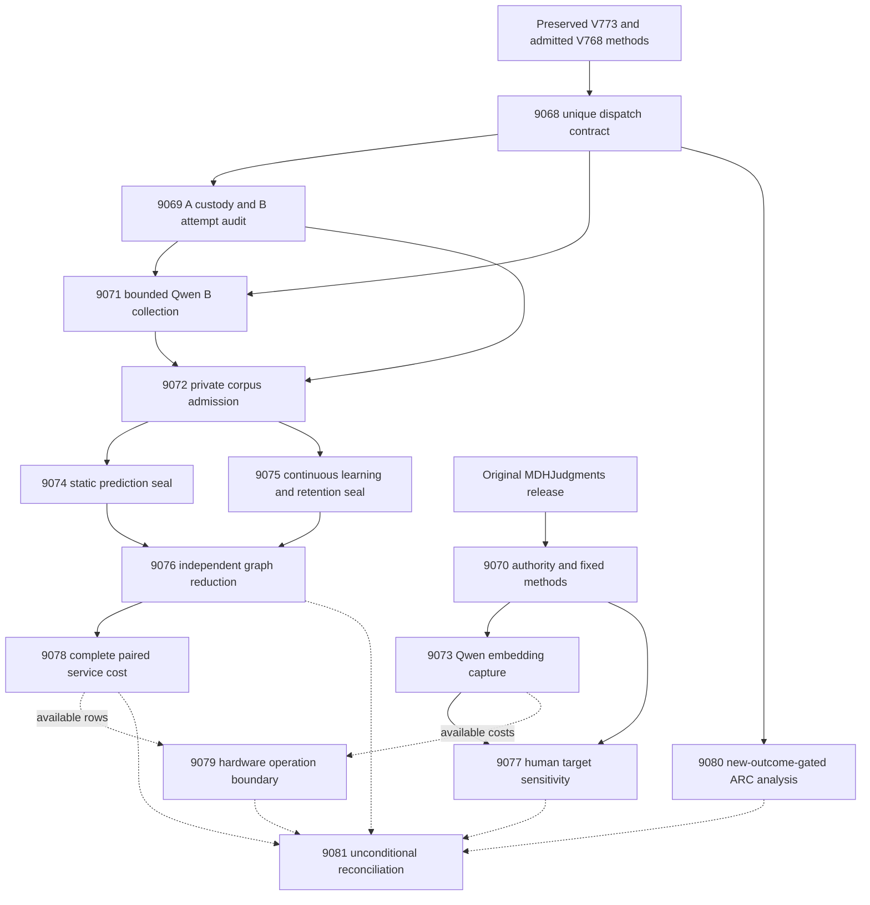

# Carnot Research Roadmap v774: Sealed Graph Confirmation and Adjudication-Aware Energy Verification

**Created:** 2026-11-12 America/New_York
**Milestone:** 2026.11.774
**Status:** Planned; staged, not activated
**Supersedes:** Completed scheduling milestone 2026.11.773, Exp9054–Exp9067
**Task contract:** Exactly 14 tasks, Exp9068 through Exp9081, in the order below.
**Execution file:** `research-roadmap-next.yaml`

The full V773 design and queue are preserved byte for byte in
`research-roadmap-v773-preserved-20261112.md` and
`research-roadmap-v773-queue-preserved-20261112.yaml`. The current active queue
and conductor remain unchanged. This design authorizes experiments, not results.

## What V773 proved

| Primary evidence | Observed result | Next consequence |
|---|---|---|
| Exp9054 | Contract and frozen-method gates passed; ARC new-outcome gate was zero. | Reuse qualified methods; keep ARC conditional. |
| Exp9055 | All 1,024 graph identities completed in 47,987 proposals; 46,963 cardinality rejections; construction 98.89 seconds. | No new graph construction or favorable-cohort selection. |
| Exp9058 | 512 first Qwen responses, 66/66 layers offloaded; protected TEST custody; 707.56 seconds total. | Reuse A only after checking its exact custody. |
| Exp9059 | No primary and no distinct conductor run. | Establish absence of attempts before collecting B. |
| Exp9056 | No original individual judgments or original factual-error instructions in MDH-Bench; 396 candidate groups and zero authority-supported responses. | Close the unchanged MDH-Bench pilot. |
| Exp9060–Exp9066 | Admission and scientific consumers stopped on missing B, unavailable human authority or absent new ARC support. | No new graph detector, learning or cost result was measured. |
| Exp9067 | `complete_blocked_declared_gate`; `reconciliation_ready_score=1`. | Accounting can finish while scientific evidence remains blocked. |

The missing B has a concrete scheduling mechanism. The A and B titles have the
same stripped first 50 characters. `pick_next_task` uses this key for completed
log entries; `_artifact_unfinished_reason` returns no contradiction for an absent
artifact. Thus A's OK can skip B. Every V774 title begins with its unique experiment
ID. Exp9068 verifies selection with private old-key/new-key controls without
changing `scripts/research_conductor.py`.

This diagnosis does not establish that B was never attempted. Exp9069 must inspect
intent, checkpoint and response inventories. It must also check that A's TEST
outcomes stayed protected. Old V768/V771 A was exposed and remains ineligible.
The admitted development fit (Exp8987 spline Brier 0.0279759276 versus converged
linear 0.0636283248) and five-arm mechanics (Exp8988) are not prospective benefits.

At planning time `research-complete.yaml` ends at V772. V773 primary artifacts and
conductor receipts establish scheduling closure. Preserve the archive lag rather
than manufacturing completion records or treating title-only OK as science.

## Three largest gaps to the PRD and current north star

1. **FR-12: independent factual verification.** The November 7 north star asks
   whether a learned verifier beats a matched control where no cheap executable
   oracle exists. BFS graphs cannot establish this. A separate, human-adjudicated
   panel tests a narrow part of the gap, with explicit selection and label limits.
2. **FR-11/FR-06: useful continuous self-learning.** Qualified local update
   mechanics have not demonstrated future-query improvement and retention on the
   completed prospective corpus. Finish that fixed test before changing learners.
3. **FR-09/FR-10/NFR-01: executable evidence and complete costs.** A title collision
   removed a necessary producer. Verify task identity, preserve prediction seals
   and measure the entire service before a deployment or acceleration decision.

FR-05/FR-08 production ports follow demonstrated usefulness and operation support.
The generator is fixed. A calibrated energy score is not a proof of factual truth.

## Literature incorporated before design

The V774 scan was appended to `research-references.md` before this design. It
covers all eight requested arXiv topics and all six secondary channels.

| Source and date | Decision in this milestone |
|---|---|
| [Beyond Majority Vote, 2609.03953](https://arxiv.org/abs/2609.03953), September 2026; [author data](https://github.com/isi-vista/mdhjudgments) | Exp9070 qualifies actual adjudication passes; Exp9077 tests target sensitivity on the same predictions. |
| [What Hallucinations Have We Measured?, 2610.38520](https://arxiv.org/abs/2610.38520), October 2026 | Keep factual error and expressed uncertainty distinct. Do not infer re-elicitation categories from one archived answer. |
| [Weakly Supervised Distillation, 2604.06277v2](https://arxiv.org/abs/2604.06277), November 8 revision | Exp9073/9078 retain feature-acquisition and complete-service cost; weak labels cannot replace human judgments. |
| [Online spline KAN, 2602.02056v4](https://arxiv.org/abs/2602.02056), June revision; [Continual Calibration, 2604.23987](https://arxiv.org/abs/2604.23987), April 2026 | Exp9075/9076 preserve causal delayed feedback and separate loss/error retention bounds. |
| [Thermodynamic AI, 2607.00170](https://arxiv.org/abs/2607.00170); [PAOA, 2507.07420](https://arxiv.org/abs/2507.07420) | Exp9079 maps actual operations and sampling limits; no borrowed hardware speedup. |

EBR (2611.08977), PAL (2503.19466), ETS (2601.21484) and distributional EBMs
(2605.18871) remain relevant architectural leads. No retired generator, steering
or sampler experiment is reopened without a distinct justified protocol.

OpenReview forums/PDF challenged access; official ICLR proceedings supplied the
EBT abstract. Semantic Scholar returned 20 EBT citations with another page and ten
ARM-EBM citations without another page. This is partial coverage. Hugging Face's
HalluGuard page was accessible. GitHub trending carried an old crawl; no current
rank is claimed. Extropic and Kona supplied vendor direction, not reproducible
local hardware or new public architecture evidence. Full access notes are in the
reference entry. Exp9070 also performs focused method ingestion for its new panel.

## Architecture and dependency graph

Solid arrows are runtime gates or required source dependencies. Dotted arrows are
optional evidence reads, never positive-result requirements. Human-data failure
cannot block graph science. Static and online graph arms run independently after
admission; TEST truth opens only after both prediction seals. Hardware accounting
and the capstone always run. No capstone gate can erase an honest branch null.

## Phase 1 — exact identities and independent authority (Exp9068–Exp9070)

**Exp9068: dispatch contract.** Bind all fourteen full task objects and the visible
order. Test unique title prefixes against this queue and existing log keys, and
replay the actual read-only selector in private fixtures. Separate administrative,
frozen-method and new-ARC readiness. Preserve all original failed determinations.

**Exp9069: source custody.** Authenticate the 1,024 original identities and A's
512 request/response receipts. Check TEST disclosure and all task-owned B attempt
locations. Missing B primary is insufficient. If B has an orphan attempt, or A
TEST truth was exposed, block this plan with the exact evidence. Do not silently
recover a second answer, replace graphs, relabel roles or generate another A.

**Exp9070: adjudication methods and SOTA ingestion.** Qualify the separate
`isi-vista/mdhjudgments` release at revision
`30d9349a2a8d6a7395681cfbd23cc8116af5a2da`. Preserve five original human annotation
files, instructions, licenses and conversion schema. The metadata-only planning
read found 541 responses and 312 distinct question strings; neither number proves
independent question families. Original MDH-Bench remains closed.

The new panel consists of sections with two definitive medical-expert judgments.
Use major/minor factual error as 1 and no_hallucination as 0; unresolved judgments
stay unknown. Unadjudicated sections never become clean negatives. Family closure
must join question templates, generators, responses and sections; ambiguous joins
block. Anonymized adjudicator IDs cannot establish global unique-person counts.
This is an adjudication-conditioned sample, not the medical-response population.

Freeze five outer folds by SHA256 order with salt `v774-mdhj-v1`, round robin.
Use all eligible groups and require at least 60 base-question families, twelve per
TEST fold. Every fifth hash-ordered group from the other four folds is CAL; the
rest is FIT. A private checker requires at least five groups representing each
human error/no-error class in each FIT and CAL set. No label-stratified reshuffle
or lower support threshold is allowed. Inadequate measured support is terminal
null feasibility; unknown authority is blocked. Neither launches model capture.

## Phase 2 — bounded evidence acquisition (Exp9071–Exp9073)

**Exp9071: collect B.** Collect only the missing 512 fixed first responses:
64 CAL, 64 TEST and 384 online. Use `unsloth/Qwen3.8-27B-GGUF` Q4_K_M, original
seed 764031, temperature zero, top_p 1, reasoning disabled and sixteen output
tokens with original logprobs/parser. Authenticate GGUF/tokenizer identity against
A. Lease one GPU using the current policy. Preflight/load each have 240 seconds,
each request 30 seconds, collection 2,700 seconds. Retain every failed/in-flight
slot; no retries, repair, replacement, best-of-N or small-model substitution.
Only the same authenticated invocation may resume its original first attempts.
This is `model_bounded_generation`, with a ten-second floor and no padding.

**Exp9072: sealed admission.** Join A and B into the original 128 CAL/128 TEST/768
online population. Keep transport, format, out-of-graph and semantic failures
separate. Preserve the original 200-error overall support floor and five examples
per class in each pooled role. A private evaluator returns TEST readiness only.
No TEST class count or outcome is published. Migrate original consumer permissions
to Exp9074/9075/9076 through an append-only receipt; do not overwrite old custody.

**Exp9073: human features.** Capture genuine final-layer mean-pooled Qwen Q4_K_M
embeddings of question plus full response with target-section offsets. No human
label, judge/generator ID, reference, explanation or evidence excerpt enters the
features. The maximum is 4,096 tokens with no silent truncation. Unsupported
embedding mode or an incomplete panel blocks readiness. Load has 240 seconds,
forward calls 30 seconds, total capture 2,400 seconds. Checkpoint exact vectors.
Declare `model_load_no_generation`, two-second floor; no generation or head fit.

## Phase 3 — fixed decisions and continuous learning (Exp9074–Exp9077)

**Exp9074: static seal.** Restore spline, converged linear, shared logistic,
confidence logistic and prevalence states from Exp8987. Use 128 CAL graphs to
select only temperature from [0.5,1,2,4], ascending ties. Keep thresholds at
p(error)<=0.1 for accept and >=0.9 for reject. Seal 640 TEST predictions over
128 graphs; preserve topology-hash rank ties. Node-permutation tolerance 1e-6,
denied-truth and removed-context controls do not authorize model selection.

**Exp9075: continuous self-learning.** Run the original five arms over 24 disjoint
32-query streams: frozen spline, adaptive spline, bias-only spline, adaptive
linear and permuted-feedback spline. Preserve temperature one, log loss, anchor
0.01 excluding intercept, gradient-norm clip one, AdaGrad rate 0.05 and epsilon
1e-8. The encoder, spline knots and generator never learn.

After predictions 8/12/16/20/24/28/32, release labels 1–4/5–8/9–12/13–16/17–20/
21–24/25–28. Labels 29–32 remain pending through scientific scoring. Permutation
stays within released blocks. The original 64-graph development guard allows
Brier increase <=0.005 and no error increase. Rejection restores coefficients
and accumulator while acknowledging feedback atomically. Verify exact recovery
after a real child kill at query 16. Seal 3,840 online and 46,080 retention
predictions, including checkpoints 0/16/32 on 128 shared TEST graphs. These
49,920 rows are not independent samples. Log local coefficient activity and all
dense-anchor, guard, durable-write and recovery work.

**Exp9076: independent reduction.** Authenticate both prediction seals before
opening TEST truth. Preserve every registered graph criterion:

- Seven detector bounds: spline Brier-improvement lower >0 against prevalence,
  confidence logistic, shared logistic and converged linear; accepted-error-delta
  upper <=0 against the three linear controls at exactly 50% coverage. Use
  10,000 paired graph draws, original seed 773063, family alpha 0.05 and tail
  0.05/7. Rerank inside each draw. All seven must pass.
- Ten learning bounds: future-query 17–32 adaptive-minus-frozen Brier upper
  <=-0.01; upper <0 against bias-only, adaptive linear and permuted feedback;
  six retention Brier/error uppers at 0/16/32 each <=0.01. Use 10,000 whole-stream
  draws, original seed 773064, family alpha 0.01 and tail 0.001. Resample shared
  retention IDs once per replicate across streams/checkpoints, independently
  of stream resampling. All ten must pass.

Ordinary CI95 is separate. Sample counts do not guarantee power. Numerical row
readiness does not require benefit. Graph wins remain `circular_positive`, with
`verifier_is_oracle=true` and independent generalization zero. Release pending
feedback for cost replay only after the scientific reduction is sealed.

**Exp9077: matched human heads and target sensitivity.** Use cached features and
isolated fold workers; each worker sees only its FIT/CAL labels. Freeze code and
configuration before all folds, and share no learned state or TEST results.
Compare prevalence, full-embedding ridge logistic, projected ridge logistic and
additive cubic spline energy. The projection is Gaussian, 32 dimensions, seed
774070. FIT-only scaling clips to [-3,3]; knots are [-3,-2,-1,0,1,2,3]. Ridge is
0.01 excluding intercept. Both linear heads and spline require gradient infinity
norm <=1e-6 within 2,000 iterations; a nonconverged control invalidates comparison.
CAL selects temperature from [0.5,1,2,4]; typed thresholds remain 0.1 and 0.9.

Fit soft-target log loss, but evaluate mean Brier against each of the two actual
medical-expert judgments. Weight question groups equally, responses equally
within group and eligible sections equally within response. Seal all out-of-fold
predictions before reduction. Three improvement lower bounds, against prevalence,
projected linear and full linear, must all exceed zero: 10,000 paired group draws,
seed 774077, family alpha 0.05, tail 0.05/3. Report ordinary CI95 separately.
Intervals condition on fitted predictions; training-set variability is unmeasured.

Use the same predictions for descriptive first-pass/fact-checker comparisons on
named common-support intersections. Retain unknown labels and selection counts.
Report criterion-dependent ranking reversals, never choose a favorable truth
criterion. A supported positive is limited to the adjudicated panel;
`independent_generalization_score=0` remains correct without a broader replication.
This tests human-judgment agreement, not clinical validity or medical advice.

## Phase 4 — complete cost, hardware and closure (Exp9078–Exp9081)

**Exp9078: full service costs.** Gate on numerical rows, not benefit. Run 24 paired
fresh-process blocks across frozen/adaptive spline and frozen/adaptive converged
linear, randomized arm order, seed 774078. Include startup/JIT, reads, encoding,
scoring, gradient, dense anchors, guard replay, durable storage, recovery, pending
feedback drain and shutdown. Linear performs no artificial spline work. Parent
clocks define the complete interval; component clocks do not replace them.

Use 10,000 paired process-block draws for the adaptive-spline/adaptive-linear
ratio. Recommendation requires both graph benefit gates and upper95 ratio<=1.
Report original generation and human-feature acquisition separately from cached
service timing. A missing cost is unknown, not zero. No extra LLM run is needed.

**Exp9079: hardware boundary.** This unconditional task maps new workload needs
to supported CPU/GPU, KV260, PolarFire and GateMate operations. Use current cost
rows when available; missing rows yield an explicit unmeasured bound. Amdahl's
ideal bound is 1/f for nonaccelerable fraction f: f>=0.01 prevents strictly more
than 100x even with ideal accelerated computation. Keep transfer and startup
costs. No unchanged board probe, purchase, tool installation or claimed device
speedup occurs. Preserve original board limits and state exact reopening evidence.

**Exp9080: ARC opportunity.** Structured new-evidence gate from Exp9068 requires
30 new uncensored episodes, three families and both arms per family. Freeze
leave-one-family-out selection, retain episode outcomes and censoring, and report
observational association. Bootstrap by family (10,000 draws, seed 774080); three
families offer weak uncertainty resolution. No live game/model run or agent edit.
Registry-precheck incidental credit; original `solve_provenance` must prove live
self-discovery. No duplicate or outer-loop solve claim is made.

**Exp9081: unconditional capstone.** Account for all fourteen slots with actual
primary or scheduler paths, including absent, malformed and gate-skipped outputs.
A normalized scheduler disposition is labeled as such when no authored verdict
exists. Recompute available bounds; keep unmeasured science unmeasured. Preserve
historical FoVer G1–G4 scope from `publication_gate.py --json`. Those gates certify
neither this new study nor general factual verification. External blocks use
`blocked`, never retryable `partial`; accounting readiness may still equal one.

A supported graph null ends the unchanged spline comparison and favors converged
linear. An exhausted human support gate does not authorize changed thresholds.
MDH-Bench needs genuinely changed original evidence. Record exact same-verdict
retirements and reopening conditions without mutating the exclusion manifest.
