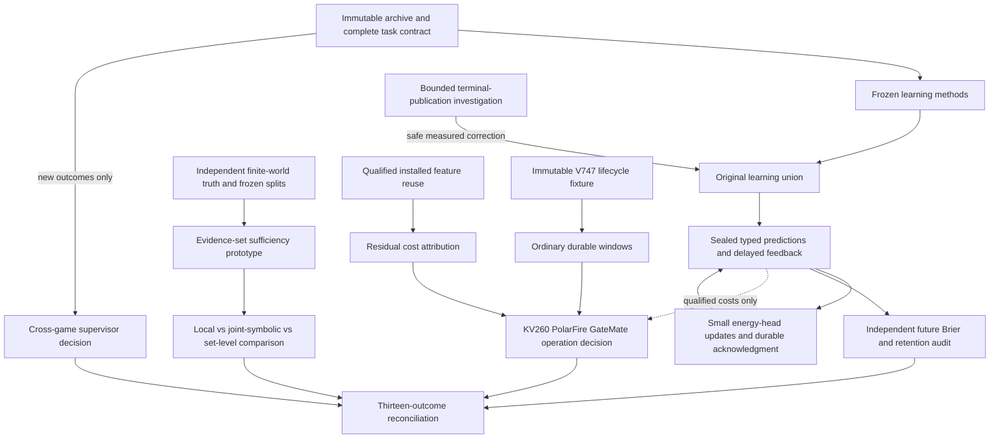

# Carnot Research Roadmap V751: Causal Learning, Evidence Sets, and Residual Costs

**Created:** 2026-11-03
**Milestone:** 2026.11.751
**Status:** Staged plan; execution and activation are separate
**Supersedes:** V750 after all fourteen scheduling slots ended
**Historical authority:** [Complete V750 design](research-roadmap-v750-preserved-20261103.md)
**Execution queue:** [research-roadmap-next.yaml](../../research-roadmap-next.yaml)
**Contract:** Exactly 13 tasks, Exp8763 through Exp8775, in four phases

## What V750 proved

Ten primary producers ran; four studies were skipped. Scheduling completion
does not establish scientific success. At planning time, completed-history
YAML ends at V749. The V750 primary artifacts and conductor log establish
its outcomes; this plan does not invent a completed-history entry.

| Evidence | Finding | Next decision |
|---|---|---|
| Exp8749 archive contract | Archive and method controls passed; owned statement coverage was 324/325 | Exercise the actual missed private-control branch; preserve the disqualified primary |
| Exp8750 deadline observer | Unprofiled supervision failed; timer-observed run was killed; retained stacks wait in terminal publication | Investigate publication-stage work before any original deadline rerun |
| Exp8751–8753 | Original union, causal stream and benefit audit skipped | No scientific learning result exists from V750 |
| Exp8754/8755 verifier methods and transfer | Methods qualified; new-family detection gain 0, CI95 [0,0]; zero equivalent-surface disagreements | Close the unchanged probe schedule; test evidence-set sufficiency against a strong symbolic comparator |
| Exp8756 feature reuse | Complete scoped and installed parity qualification passed | Reuse the qualified implementation |
| Exp8757 complete installed cost | Native reuse/original 1.5165x, CI95 [1.5017,1.5316]; native steady p95 18.81 to 9.95 ms | Keep the measured optimization; investigate residual costs |
| Exp8757 same-batch contrast | Optimized native/Python 1.0023x, CI95 [0.9936,1.0108] | NFR-01's 10x target remains unmet |
| Exp8758/8759 lifecycle and cost | Numerical controls passed but original V747 authority test failed against moving roadmap; timing skipped | Isolate the historical fixture, retain every original assertion, then time ordinary windows |
| Exp8760 ARC | Sensitivity checks qualified; no new events, all four arms have 16 missing outcomes each | No policy change; require actual new outcomes before another reader task |
| Exp8761/8762 | Mapping and reconciliation retained absent learning, durability and device evidence | Preserve those limits; readers remain independent of failed branches |

Sources are the matching `results/experiment_8749_*` through
`results/experiment_8762_*` primary files, including their pinned raw receipts.
Exp8750's first unprofiled case finished only after its budget, so it is not
admitted as a passing deadline control. Repeated cold replay and terminal
stack locations are observations, not a proven causal explanation.

## Three biggest gaps against the PRD

1. **FR-11: qualified, useful continuous self-learning.** The small energy
   head can update, but the fixed causal future-loss/retention study still
   lacks qualified execution. Repair only measured execution defects, then
   run the original scientific question without changing its estimand.
2. **FR-12: verification beyond local evidence and planted defects.** Surface
   invariance did not produce composition transfer. Test whether explicit
   evidence-set sufficiency handles missing hops and conflicts, while keeping
   the existing joint symbolic evaluator as a strong comparator. Natural
   extraction and an oracle-distinct verification advantage remain open.
3. **FR-05/FR-08/NFR-01: useful complete-service performance.** Feature reuse
   helps both languages equally. Measure the optimized path's remaining
   costs and bounded durable updates before proposing another kernel or
   accelerator. Numerical parity alone cannot meet the throughput requirement.

The active architecture is the hybrid generator plus energy verifier in
`ops/north-star.md`. The older PRD's generative aspiration does not reopen
the retired energy-as-generator experiments. The fixed FoVer publication
gate remains separate from these research questions.

## Research informing the milestone

The [V751 literature scan](../../research-references.md#v751-planning-scan--2026-11-03)
was appended before this design. It covers all eight requested primary topics
and all six secondary channels, with retrieval failures recorded.

| Source | Concrete adoption | Tasks |
|---|---|---|
| [SURE-RAG v2](https://arxiv.org/abs/2605.03534v2), July 24 | Set sufficiency, missing-hop/conflict controls, and separate natural-data claims | Exp8768/8769 |
| [Paraphrase consistency](https://arxiv.org/abs/2606.08158), June 6 | Pair agreement checks with independent label preservation and truth-changing controls | Exp8768/8769 |
| [Capacity-constrained delayed OCO](https://arxiv.org/abs/2606.11711), June 10 | Record pending capacity, causal feedback release and lost feedback | Exp8766/8767 |
| [On-chip KAN v4](https://arxiv.org/abs/2602.02056v4), June 19 | Separate sparse arithmetic from state movement, restart and durable acknowledgment | Exp8771/8772/8774 |
| [Higher-order FPGA Ising](https://arxiv.org/abs/2610.40522), October 29 | Compare operation/topology requirements before proposing device work | Exp8774 |
| [Extropic Z1T](https://extropic.ai/writing/z1t), September 4 | Account for digital host work in heterogeneous acceleration | Exp8774 |

These are method adaptations, not reproductions of the papers. No external
accuracy or efficiency number is a Carnot result. EBT and ARM–EBM remain
context; their compatibility results do not certify semantic truth. CAffNet
does not fix extraction, and a new distributional encoder would broaden the
work before the current small-head study is measured.

Semantic Scholar returned HTTP 429 for EBT and ten ARM–EBM citation records
with no next page. OpenReview's ICLR page challenged access; NeurIPS search
returned primary workshop material, and ICML inventory coverage was limited.
Hugging Face led to SURE-RAG's primary full text. GitHub Trending returned an
old snapshot, so no current rank is asserted. Extropic's index timed out but
Z1T was readable. Kona supplied no reproducible new local implementation.

## Architecture

Only the learning chain depends on complete original execution qualification.
Verifier methods, installed cost attribution and lifecycle qualification
authenticate their own inputs. Hardware accounting and the capstone always
run. A valid scientific null may release complete rows; a failed owned check
cannot release readiness. The ARC branch has a cheap new-evidence gate.

## Phase 1 — Qualify execution from measured defects

**Exp8763 — Branch contract and archive-runner coverage.** Bind all thirteen
task objects and the digest below. Exercise the real private-control CLI
branch missing from Exp8749 coverage. Preserve historical fixture assertions,
original digests and failed primaries. Freeze unchanged learning methods.
The same bounded authority read detects actual new ARC outcomes beyond the
qualified V750 frontier; no new events means that branch's score is zero.

**Exp8764 — Terminal publication cost.** Build the actual call graph from
retained V750 logs, then supervise original terminal stages separately on one
frozen private measurement. Limit diagnosis to 1800 seconds. One correction
is allowed only for measured repeated immutable work, with full identity
checks and unchanged independent validation. Never cache success verdicts or
skip cold replay. Three paired repeats test any correction. Unknown cause
ends with a diagnostic null and readiness zero. The original deadline panel
does not run in this task.

**Exp8765 — Original learning union.** Require both current method custody
and a demonstrated safe publication path. Retain 64 original learning nodes,
27 runner nodes and 83 executable anchors, plus all new statements. Run
3599/3600/3601 deadline semantics, hard-exit/resume and original clock checks.
Reuse child receipts only with exact transitive identity and normal exit.
The measured union plus 25 percent reserve must fit 3000 seconds.

Phase acceptance is the complete original union, not infrastructure optimism.
Owned-failure, killed-child, stale-source and changed-task controls must fail
closed before the learning branch scales.
